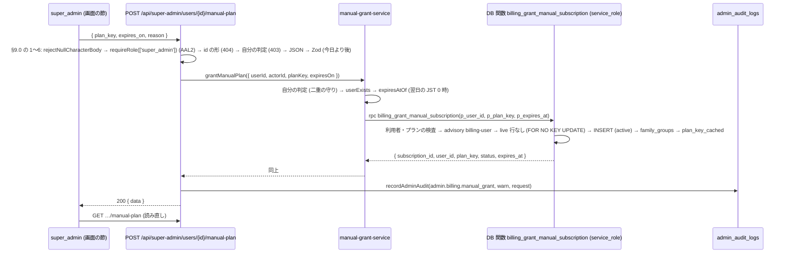

# billing/02 手動のプラン付与 — 運営者が有料プランを手で付与・取り消す画面と API

| | |
|---|---|
| 版 | v1.8 (2026-10-18) |
| Status | 設計ゲート通過 (2026-10-17・R4 で Opus 5.5 と Sonnet 5.5 の 2 枚と E・F 枠が PASS)。§14.1 の段 A〜D 実装済み (段 A は PR #1837 (migration `20261017230000_billing_manual_plan_grant.sql`)、段 B は PR #1843、段 C は PR #1854、段 D は PR #1820。どれも main に入っている) |
| Issue | #1797 (運営者による手動のプラン付与の画面と API。親 #1151 の残り)。課金の核は `docs/design/billing/01-billing-core.md` (段 A〜C と追随 #1711・#1726・#1738・#1763 は main 入り) |
| 範囲の正本 | Issue #1797 の本文とコメント・親 #1151 の要件・billing/01 §0.2 (配線の冊に回したもの) と §16.2 (期日が「配線の冊と同時」「family / org の冊」の追随の行) |
| 実装者 | Sonnet 5.5 が本書だけを読んで手を止めずに実装できることを完成条件にする |

課金の核 (billing/01) は「利用者が Stripe で買う」経路だけを作り、運営者が手で付与する経路 (`stripe_subscription_id IS NULL` の行 = **M 行**) の画面と API は配線の冊に回した (billing/01 §0.2)。本冊はその配線の最初の冊で、手動付与・取り消し・期限・監査を作り、billing/01 §16.2 で期日が「配線の冊と同時」「family の冊」「family / org の冊」になっていた追随の行 (10 行。F23) の行き先 (本冊で直す・配線の残りの冊に期日を付け替える・期日を変えない) を決める。billing/01 §0.2 右列のうち手動付与以外 (運用バッチ 20 本・Finance 画面の実データ化ほか) は本冊の対象外で、本冊ではまとめて「**配線の残りの冊**」(未作成) と呼ぶ (§0.2)。

---

## 0. 分冊判定・範囲・読み方

### 0.1 分冊判定 (相 1 で実施)

| 目安 | 本冊 | 判定 |
|---|---|---|
| 設計書 800 行超 | 超える (正典コード・表 3 点・トレースを 1 冊に持つため) | 該当 |
| 消費先レーン 3 以上 | API 3 本 (`GET` / `POST` / `DELETE /api/super-admin/users/{id}/manual-plan`)・画面 1 つ (`/admin/users/{id}` の節)・定期のジョブ 1 本 (期限切れ)・family の入力の整理 (段 D) = 4 | 該当 |
| 共有面 2 つ以上 | `personal_subscriptions` (核の写像・`get_effective_plan`・family / org・AI 上限が読む)・`user_profiles.plan_key_cached`・`family_groups.plan_key` / `member_limit`・`admin_audit_logs` の `action_type`・`cross/04` のエラー表・`operator/08` の pg_cron の一覧 (番兵つき) | 該当 |

判定: **設計は 1 冊 (本書) のまま、実装を 4 段 (A: DB 層 / B: サーバ層 / C: 画面層 / D: family の入力の整理。§14) に分け、段ごとに 2 枚レビューを挟む**。理由: 核 (billing/01) は main に入っているので、本冊が足すのは「M 行を書く DB 関数 3 本 + それを呼ぶ route 1 本 + 画面の節 1 つ + 期限のジョブ 1 本」で、DB 関数の戻り値 (§6) を挟んで表裏になっている。冊を分けると、未マージの関数を参照する route の冊を作ることになる (billing/01 §0.1 と同じ理由)。段 A は単独でマージできる (関数とジョブの新設だけ。既存の挙動は変わらない)。段 D は本冊の主題 (手動付与) と独立で、単独でマージできる。

さらに分ける案 (採らない): 「期限のジョブ」を別冊にする案は、ジョブが呼ぶ関数が取り消しと同じ同期の式 (§6.3) を使うだけで独自の表を持たないため、分けても行数が減らない。

### 0.2 本冊の範囲と、対象外

| 本冊 | 対象外 (別の冊) |
|---|---|
| 運営者 (super_admin) が利用者に有料プラン (`personal` / `family` の `public` のプラン = `pro`・`family_basic`・`family_pro`。`private` のアドオン `family_addon` は billing/01 §1 と同じく対象外) を手で付与する API と画面 | 運用バッチ 20 本 (`grace_period_check`・`revenue_snapshot`・`stripe_integrity_check` (reconcile)・`stripe_event_stuck_check`・ライセンス系ほか。billing/01 §0.2 右列) |
| 付与の取り消し (M 行を `cancelled` に) | 運営の Finance 画面 (`/admin/finance/*`) の実データ化 |
| 期限 (任意。JST の暦日の終わり) と、期限を過ぎた M 行を `expired` にする日次のジョブ | ブランドのメール・チャージバック・組織ライセンス受領による一時停止 (`paused`)・請求書番号・モバイル画面の契約状態の表示 |
| M 行と Stripe の契約 (S 行) が重なったときの扱い (§7.3) | 契約中のプランの移行 (billing/01 §18 の 16) |
| M 行と家族グループ・組織のプランとの関係 (§6・§7.3) | 利用者向け画面 `/account/billing` の M 行の文言 (「次回更新日」の見出しのまま。§16 の 3) |
| 監査 (`admin.billing.manual_grant` / `admin.billing.manual_revoke` / `system.billing.manual_grant_expired`) | |
| billing/01 §16.2 の追随の行 (F23 の 10 行) の行き先: 「配線の冊と同時」の `operator/08` の注記 (段 A)・「family の冊」の 3 行 (段 D と §16 の 6)・残りの行の期日の付け替え (§15.2 の billing/01 の行) | 「配線の冊と同時」のうち reconcile の 3 行 (`operator/02` §22・`operator/09` §4・`requirements/03` §15.1) と組織ライセンスの一時停止の 2 行 (`org/04` :517・`requirements/02` :763-764) の書き換えそのもの (配線の残りの冊)。「family / org の冊」の `migrate-to-personal` の 1 行 (それを実装する冊。期日を変えない) |

- **配線の残りの冊** = billing/01 §0.2 右列のうち手動付与以外のすべて (運用バッチ 20 本・Finance 画面の実データ化・ブランドのメール・チャージバック・`grace` の 402・組織ライセンス受領による一時停止・請求書番号・モバイル画面の契約状態)。未作成。billing/01 の表紙の `02-billing-wiring.md` は、本冊 (手動付与) とこの冊に分かれる。billing/01 の本文の「配線の冊」は、手動付与については本冊、それ以外は配線の残りの冊を指す (billing/01 の表紙にそう書く。§15.2)。
- 前提 (#1125 のコメントに記録されている選択): **オーナーの選択 (#1125 のコメント): 課金は無料のまま計測 (Stripe の本番の設定はオーナー作業 #1113)**。本冊はこの前提の下で、Stripe を呼ばない経路 (手動付与) だけを作る。本冊の API と関数は Stripe を 1 回も呼ばない。

### 0.3 読み方

- §3 要件行列・§3.2 シナリオ → §4 構想とトレース → §5 構造裁定 → §6 以降が仕上げ (実装者は §6〜§15 だけ読めば手を止めない)。
- 正典の TS は §8 の ```ts ブロック。どれも 1 行目に `// tsc:skip place=<パス>` (そのパスの新しいファイルの全文) か `// tsc:skip insert=<パス>` (既存のファイルの決まった位置に差し込む) の印がある (既存のモジュール `@/lib/...` を import するので単独の検査から外し、billing/01 §8.0 の手順で置き場所に置いてリポジトリ全体と一緒に検査する)。印の無い `// tsc:skip` のブロックは説明用の断片だけ。SQL は §6。
- 既存の設計書との食い違いは本冊が正 (billing/01 との食い違いは §15.2 の行で billing/01 を直す)。

---

## 1. 目的・スコープ

- 運営者が、利用者に有料プランを手で付与し (招待・検証・補償など)、取り消し、期限を付けられる。付与した行は核の写し (`personal_subscriptions`) と同じ表に入り、権利判定 (`get_effective_plan` / `getEffectivePlan`)・AI の上限・家族グループのプラン・機能フラグの段階公開が、Stripe で買った契約と同じように効く。
- 対象外: §0.2 右列。

---

## 2. 関連要件と現行の事実

### 2.1 関連要件・既存設計

| 文書 | 使う箇所 |
|---|---|
| `docs/design/billing/01-billing-core.md` | §6.2 RLS・§6.4 (9) 写像 (ロック順・同期の式)・(10) 家族のトリガー・§7.1〜§7.3 (M 行の列)・§8.1 `core.ts`・§12 配線の契約・§13.3 DB の業務エラー・§16.2 追随 |
| `docs/design/operator/02-api-spec.md` | §4 ユーザー管理 API の形 (401 / 403 / 404 の本文)・§19 `OP_INVALID_INPUT` |
| `docs/design/operator/03-ui-spec.md` | §6 `/admin/users/{id}` の節の置き方 |
| `docs/design/operator/04-plan-management.md` | §5.1 状態遷移 (S 行) |
| `docs/design/operator/07-audit-monitoring.md` | §4 `action_type` の命名・§4.5 システム自動操作 |
| `docs/design/operator/08-cron-batches.md` | §3.0・§3.1 pg_cron の一覧 (番兵 `tests/log-cleanup-dau-snapshot-contract.test.ts` が数と名前を突き合わせる) |
| `docs/design/cross/12-operator-mfa.md` | §13.1 `requireRole` の AAL2 の門・§20 入口の走査 |
| `docs/design/cross/04-api-conventions.md` | §4 エラーコード・§5 応答の形 |
| `docs/design/cross/02-rls-patterns.md` | §6.2 ロックキーの命名 |
| `docs/design/CLAUDE.md` | RLS 必須・service_role は限定・監査ログ必須・snake_case |

### 2.2 現行の事実 (origin/main `88b803f5` で採取し、`d2aac552` で突き合わせ直した。2026-10-17)

| # | 事実 | 出どころ |
|---|---|---|
| F1 | 手動付与の route・画面は無い。`src/app/api/super-admin/` は `admins`・`audit-logs`・`backups`・`coupons`・`db-stats`・`email-outbox`・`embeddings`・`experiments`・`exports`・`feature-packages`・`flags`・`infra`・`llm`・`logs`・`plans`・`settings` (`users` は無い)。`src/app/api/admin/users/[id]/` は `route.ts` (GET / PATCH)・`freeze`・`login-history` (#1720 段 D)・`role` | `git ls-tree` (origin/main `b508f749` で数え直した) |
| F2 | `personal_subscriptions` の RLS: INSERT / UPDATE は `personal_subscriptions_insert_admin` / `_update_admin` (admin / super_admin の JWT)・SELECT は本人 + admin / super_admin / finance / support・DELETE 禁止。anon は書けない | `supabase/migrations/20261016210000_billing_core.sql:49-63` |
| F3 | **admin の JWT から直接 INSERT しても `plan_key_cached` は同期できない**: 特権列ガード `guard_user_profiles_privileged` は `current_user IN ('authenticated','anon')` の UPDATE で `plan_key_cached` の変更を 42501 にする。運営のセッションも `authenticated` ロールなので、本人の JWT では書けない。写像 (SECURITY DEFINER・所有者 postgres) だけが書ける | 同 `:502-549` |
| F4 | 写像 `billing_apply_stripe_subscription` のロック順: advisory `billing-user:<uuid>` → `stripe-subscription:<sub>` → 契約の行 (`FOR NO KEY UPDATE`) → `family_groups` の行 → `user_profiles` の行。家族の同期は `plan_type='family'` のとき `UPDATE family_groups SET plan_key, member_limit=LEAST(COALESCE(max_members,4),20) WHERE representative_id=<利用者> AND status='active'`、終了のときは「同じ利用者に同じプランの live な行が無いとき」だけ `free` / 4 に戻す。`plan_key_cached` は live な行から `ORDER BY created_at DESC, id LIMIT 1` で再計算 | 同 `:190-420` (billing/01 §6.4 (9) の 2.・3.・10.) |
| F5 | 写像の 6. は「同じ利用者の別の live 行 (別の Stripe の契約、または手動付与) があれば `BILL_LIVE_ROW_CONFLICT`」。M 行が live の間に Stripe の契約が届けば、イベントは `failed`・500 で監査 `system.stripe.event_failed` (billing/01 S12・§13.3) | 同 `:296-308` |
| F6 | 家族のトリガー `billing_family_plan_follow_representative` (BEFORE INSERT / UPDATE OF `representative_id`) は、代表者の live な行を `JOIN subscription_plans … plan_type='family'` で読む。**行の由来 (S / M) を見ない**ので、M 行にもそのまま効く | 同 `:441-497` |
| F7 | live = `status IN ('trialing','active','paused','past_due','grace')` (部分 UNIQUE `idx_personal_subscriptions_active_per_user`)。`get_effective_plan` は `trialing / active / grace / past_due` の個人契約 → 家族 → 組織 → `free`。**由来 (S / M) を区別しない** | `20251126124224:14264`・`20261010140000_ai_usage_foundation.sql:95-160` |
| F8 | `personal_subscriptions` の列: `id`・`user_id`・`plan_key`・`status` (8 値)・`trial_started_at`・`trial_ends_at`・`trial_source`・`paused_at`・`paused_until`・`pause_reason`・`starts_at`・`current_period_start`・`current_period_end`・`cancel_at`・`cancelled_at`・`past_due_since`・`grace_started_at`・`stripe_customer_id`・`stripe_subscription_id`・`stripe_price_id`・`active_coupon_redemption_id`・`notes`・`created_at`・`updated_at`・`stripe_synced_at`・`stripe_status`・`cancel_at_period_end`・`billing_interval`。期限 (終了日) を表す専用の列は無い。`notes` は本人の SELECT ポリシーで読める (本人のデータの書き出しからは `omit` で外しているが、PostgREST の直接の SELECT では読める) | baseline `:5787-5816`・billing_core `:13-17`・`src/lib/account-export-tables.ts:249-255` |
| F9 | `src/lib/billing/core.ts`: `LIVE_SUBSCRIPTION_STATUSES`・`SUBSCRIPTION_STATUSES`・`FREE_PLAN_KEY`・`PURCHASABLE_PLAN_TYPES = ['personal','family']`・`summarizeSubscription` は M 行に `source: 'manual'`・`can_cancel: false`・`can_resume: false` を返す。`BILLING_AUDIT_ACTIONS` は 9 つで手動付与の名前は無い。`BillingRepository.findLiveSubscription` は由来を問わず live 行を返す | 同ファイル `:85-99, 159-170, 724-749, 859-` |
| F10 | `findLiveSubscription` が行を返せば `POST /api/billing/checkout` は 409 `OP_SUBSCRIPTION_ALREADY_ACTIVE`。解約の予約・取り消しは M 行なら 409 `BILL_NO_LIVE_SUBSCRIPTION` (「手動付与の解約は配線の画面」) | `src/lib/billing/service.ts:86-92, 156-176` |
| F11 | `subscription_plans`: `plan_type` CHECK (`personal` / `family` / `org`)・`status` CHECK (`draft` / `public` / `private` / `deprecated`)・`max_members`・`display_order`。本番は `free` 0 円 / `pro` / `family_basic` (`max_members` 4) / `family_pro` (8) / `family_addon` private / `org_*` (billing/01 F8)。`family_addon` は `plan_type='family'`・`status='private'`・`max_members` NULL・`feature_packages` `'{}'`・月 280 円のアドオンで、billing/01 §1 が「対象外 (別の冊)」にしている。`private` のプランは `family_addon` だけ | baseline `:6437-6463`・`20251126124224_create_meal_planner_tables.sql:14169`・billing/01 :55 |
| F12 | 既存の運営の変更系の型: super_admin 専用は `POST /api/super-admin/coupons/[id]/apply` (`requireRole(['super_admin'])` → `getSupabaseAdmin()` で RPC → `recordAdminAudit` を user-scoped の client で・severity `warn`)。admin + super_admin は `POST /api/admin/users/[id]/freeze` (永久 BAN だけ super_admin)。401 は `AUTH_UNAUTHENTICATED`・403 は `OP_PERMISSION_DENIED`・404 は `NOT_FOUND`「ユーザーが見つかりません」 | 各 route |
| F13 | `requireRole(roles)` は既定で AAL2 を求める (`MFA_REQUIRED_ROLES = super_admin / admin / finance / org_industrial_doctor`。support は対象外)。`src/app/api/{admin,super-admin,support,operator}` の全 handler が `requireRole` / `requireSuperAdmin` / `respondNotSupported` を呼ぶことを `tests/operator-mfa-entry-points-scan.test.ts` が見張る | `src/lib/auth/helpers.ts:154-180`・`src/lib/auth/mfa/policy.ts:17` |
| F14 | 変更系 (POST / PUT / PATCH / DELETE) の handler は `tests/admin-mutation-audit-coverage-1571.test.ts` の `EXPECTED` に載り、`recordAdminAudit` を `request` つきのリテラルで呼ぶ。`admin_audit_logs` へ直接 INSERT する route・`x-forwarded-for` を直読みする route は `tests/admin-view-audit-1326.test.ts` (b) で 0 件 | 各テスト |
| F15 | 本文を読む handler は最初の 2 行で `rejectNullCharacterBody(request)` を呼び、`src/__tests__/api/null-character-routes.test.ts` の `ENTRIES` に載る | 同テスト |
| F16 | 監査ログの本人の JWT からの INSERT は `action_type NOT LIKE 'system.%'` かつ運営の 6 ロールだけ。`system.*` と `actor_id NULL` は service_role / SECURITY DEFINER だけが書く (#1736) | `20261016238000_admin_audit_logs_insert_actor_only.sql:53-71` |
| F17 | pg_cron のジョブの登録の書き方 (DO ブロック・`to_regclass('cron.job')` のガード・同じ名前の登録解除 → `cron.schedule('名前', '分 時 * * *', 'SELECT …;')`)。毎日のジョブは 03:10 / 03:15 / 03:20 / 03:25 / 03:45 / 03:55 / 01:30 / 00:20・00:35 JST。毎時 5 分 (`5 * * * *`) と 5 分ごと (`*/5`・`2-59/5`) のジョブもある。`operator/08` §3.0・§3.1 の注記が「migration が pg_cron に登録しているジョブは 11 つ」と名前の一覧を持ち、`tests/log-cleanup-dau-snapshot-contract.test.ts` が全 migration の `cron.schedule` の名前と数を突き合わせる | `20261010150000:216-233`・`20261016100000:160-170`・`docs/design/operator/08-cron-batches.md:15-22, 152-156` |
| F18 | DB の型 (`src/types/database.types.ts`・`packages/shared/src/database.types.ts`) は migration の `CREATE FUNCTION` (トリガー関数を除く。EXECUTE の有無を問わない: `invoke_purge_hidden_content` も載る) を全部持つことを `tests/database-types-migrations-contract.test.ts` が求める | 同テスト・`src/types/database.types.ts:8902` |
| F19 | `/admin/users/[id]` の page は `requireRoleForPage(['admin','super_admin','support'])` で守られ、`OperatorMfaResetSection` (client component) を `canResetMfa` のときだけ描く。節の形 (`section` + `h2` + form + `data-testid`) の先例。#1720 段 D (#1807) がログイン履歴の節 (`LoginHistorySection`。admin / super_admin) を足した。`tests/admin-user-login-history-page.test.tsx` がこの page を `renderToStaticMarkup` で描く | `src/app/admin/users/[id]/page.tsx:166, 187, 193, 317`・`src/components/admin/OperatorMfaResetSection.tsx` |
| F20 | JST の暦日の入力は `CalendarDateSchema` (`src/lib/calendar-date-schema.ts`) で受け、timestamptz との比較は `jstDayRangeTimestamps(from, to).toTimestampExclusive` (= `to` の翌日の JST 0 時) で作る。「今日」は `jstToday()`。素の日付の文字列を timestamptz の列に渡す書き方は `tests/jst-today-source-scan.test.ts` が止める | `src/lib/jst-day-ranges.ts:43, 73-81` |
| F21 | `apply_coupon` は `personal_subscriptions.id` を `FOR NO KEY UPDATE` でロックし `active_coupon_redemption_id` だけを書く。M 行にも使える (billing/01 §7.1) | `20261007160700_apply_coupon_rpc.sql:147-152, 260-265` |
| F22 | `PATCH /api/super-admin/plans/[id]` の廃止は `countPlanSubscribers` が live 5 値の `personal_subscriptions` を数え、1 件でもあれば 409 `OP_PLAN_HAS_SUBSCRIBERS`。由来を問わない | `src/lib/super-admin/plan-subscribers.ts:10-11,112-150` |
| F23 | billing/01 §16.2 で期日が本冊にかかわる行は 10 行。期日「配線の冊と同時」= 6 行: `operator/08` §3.1・§3.2 (`stripe_event_stuck_check` の注記・`grace_period_check` / `stripe_integrity_check` の注記。:3948)・`operator/02` §22 `POST /api/cron/stripe-reconcile` (:3959)・`operator/09` §4 Stripe ↔ DB Reconciliation (:3964)・`org/04` :517 重複請求防止 (`pause_collection`。:3971)・`requirements/02` :763-764 (一時停止中の個人プラン。:3973)・`requirements/03` §15.1 日次 reconciliation (:3978)。期日「family の冊」= 3 行: `POST /api/family/groups` の入力 `plan_key` (`CreateFamilyGroupBodySchema`)・作成の画面の選択欄 (`src/app/(main)/family/setup/page.tsx:15,33,95-105`) を外す (:3953) / `member_limit` が下がったときの扱い (:3954) / `family/03` のグループ作成の画面の「プラン選択」と支払いのボタン (:3982)。期日「family / org の冊 (`migrate-to-personal` を実装するとき)」= 1 行 (:3981)。本冊での扱いは R14 と §15.2 の billing/01 の行 | billing/01 `:3931-3990` (origin/main) |
| F24 | `CreateFamilyGroupBodySchema = { name, plan_key: z.string().default('free') }`。route は `create_family_group(p_name, p_plan_key)` に渡すが、トリガー (F6) が `p_plan_key` を効かなくしている (billing/01 S20)。単体テストは `src/__tests__/api/family/groups.test.ts`。`tests/e2e/membership/05-family-create-and-invite.spec.ts` と `tests/integration/security/invite-accept-missing-profile.test.ts` も route を名指しする (いまは段 D (#1820) で `plan_key` を外し、route は `p_name` だけで呼ぶ: §7.2) | `src/schemas/membership/family-group.ts:8-11`・`src/app/api/family/groups/route.ts:49-56` |
| F25 | 本番の `personal_subscriptions` は 0 行 (billing/01 F9。2026-10-15 読み取り)。本冊は本番の行を問い合わせていない (設定と版だけを F26 で読んだ) | billing/01 §2.2 |
| F26 | 本番の DB は PostgreSQL 17.6・pg_cron 1.6.4・`cron.use_background_workers = off` (2026-10-17 に SELECT で読み取り)。`off` では pg_cron がジョブの所有者として接続し、command を 1 つの問い合わせとして送る (`CALL` の 1 文なら最上位の `CALL`)。PostgreSQL の決まり: プロシージャの中の `COMMIT` は最上位の `CALL` (トランザクションのブロックの外) から呼んだときだけ使え、`SECURITY DEFINER` のプロシージャと `SET` 句の付いたプロシージャでは使えない (2D000)。1 つの問い合わせに複数の文を並べると 1 つのトランザクションのブロックになる (結合テストの `pg/query` が `SET LOCAL ROLE postgres; select …` を通すのはこのため)。DB の型の生成 (postgres-meta) は関数を `pg_proc.prokind = 'f'` で拾うので、プロシージャは `database.types.ts` に出ない。`tests/database-types-migrations-contract.test.ts` は `CREATE [OR REPLACE] FUNCTION` だけを数える | PostgreSQL 文書「PL/pgSQL Transaction Management」「CREATE PROCEDURE」・postgres-meta `src/lib/sql/functions.sql.ts`・`tests/database-types-migrations-contract.test.ts:88-90`・`tests/integration/rls/org-challenge-progress.test.ts:400` |
| F27 | `tests/lib-raw-error-message-scan.test.ts` は `src/lib` の全ファイルで、オブジェクトリテラルのプロパティの値に「エラーらしい名前 (`e` / `err` / `error` / … / `…Error`、または `.error` のプロパティ) の `.message` / `.details` / `.hint`」があるものを違反に数える。`??`・入れ子の中も数える。数えないのはログの呼び出しと `new XxxError(…)` / `throw` の中だけ。許可リスト `ALLOWED` に無いファイルは 0 件でなければ赤。文面が固定の文かどうかは見ない。先例 `src/lib/auth/mfa/client.ts:87-96` は失敗の本文から `code` だけを読む | 同テスト `:43, 55-78, 101-162, 223-235`・`src/lib/auth/mfa/client.ts:87-96` |

---

## 3. 相 1 外形固定

### 3.1 要件行列

| ID | 要件 | 出どころ | 本冊の答え |
|---|---|---|---|
| R1 | 運営者が利用者に有料プランを手で付与できる (`personal_subscriptions` への INSERT の経路) | #1151・#1797 | `POST /api/super-admin/users/{id}/manual-plan` → DB 関数 `billing_grant_manual_subscription` (§6.2・§9.2) |
| R2 | 付与を取り消せる | #1797 (「付与・取り消す」) | `DELETE /api/super-admin/users/{id}/manual-plan` → `billing_revoke_manual_subscription` (§6.3・§9.3)。M 行を `cancelled` にする |
| R3 | どのロールが操作できるか | #1797 | **super_admin だけ** (§5.1 の裁定)。`requireRole(['super_admin'])` |
| R4 | MFA 段 B の AAL2 の門に載せる | #1797・cross/12 §13.1 | `requireRole` の既定 (`assurance: 'aal2'`) のまま呼ぶ。super_admin は `MFA_REQUIRED_ROLES` なので AAL2 が要る。`{ assurance: 'session' }` は書かない |
| R5 | 監査ログ必須 | `docs/design/CLAUDE.md`・operator/07 §4 | 運営の操作は route が `recordAdminAudit` (user-scoped の client・`request` つき・severity `warn`) で `admin.billing.manual_grant` / `admin.billing.manual_revoke`。期限切れは関数が `system.billing.manual_grant_expired` (actor NULL・info) を書く (§6.4・§12) |
| R6 | Stripe の購読と手動の付与が重なったときの扱い | #1797 | 1 利用者 1 live 行の不変条件をそのまま使う。live 行 (S でも M でも) があれば付与は 409 `OP_SUBSCRIPTION_ALREADY_ACTIVE`。M 行が live の間の購入は核の 409 (F10)、Stripe 側で作られた契約の写像は `BILL_LIVE_ROW_CONFLICT` でイベントが `failed` (F5。運営が M 行を取り消すか Stripe で解約する)。§7.3 |
| R7 | 期限 | #1797 | 任意の有効期限 (JST の暦日。その日の終わりまで使える)。`current_period_end` に「翌日の JST 0 時」を入れる (列を足さない)。期限を過ぎた M 行は日次のジョブ `expire-manual-plan-grants` (00:11 JST) が `expired` にする (§6.4)。期限なし = `current_period_end IS NULL` |
| R8 | family のプランとの関係 | #1797・billing/01 §12 | 付与の関数が写像と同じ式で `family_groups.plan_key` / `member_limit` を代表者の M 行に合わせ、取り消し・期限切れで同じ戻しをする (§6.2・§6.3)。グループの作成・代表者の交代は既存のトリガー (F6) が M 行も拾う |
| R9 | org のプランとの関係 | #1797 | `plan_type='org'` のプランは付与できない (422)。組織に属する利用者への個人プランの付与は `get_effective_plan` の順 (個人 → 家族 → 組織。F7) のとおり個人が先に効く。組織ライセンス受領による `paused` は本冊の対象外 (§0.2) |
| R10 | 利用者本人が M 行を書けない・写しを書けない | billing/01 R14 | 本冊は RLS を変えない (F2 のまま)。書く入口は service_role だけが呼べる DB 関数 (§6)。本人の JWT では呼べない |
| R11 | 核の写像・`get_effective_plan`・RLS・トリガーを変えない | billing/01 R5・§12 | 変えない。本冊の関数は写像と同じ鍵 (`billing-user:<uuid>`)・同じロック順・同じ同期の式を使う (§4.1) |
| R12 | 権利の判定で S 行と M 行を区別しない | billing/01 §12 | 変えない (F7)。`/account/billing` は `source: 'manual'`・解約の予約なし (F9) のまま |
| R13 | 運営の画面 | #1797 | `/admin/users/{id}` に節「手動のプラン付与」(client component)。super_admin で、対象が自分でないときだけ描く (§10) |
| R14 | billing/01 §16.2 の「配線の冊と同時」「family の冊」「family / org の冊」の行 (F23 の 10 行) | #1797 | 本冊で直す 4 行: `operator/08` の注記 (段 A の専権 PATCH。§15.2)・family の入力の整理 (段 D。§14.1)・`family/03` の作成の画面 (段 D の専権 PATCH。§15.2)・`member_limit` が下がったときは「外さない」で確定 (§16 の 6。`family/02` §5.2 の注記は段 D)。期日を付け替える 5 行: reconcile の 3 行 (`operator/02` §22・`operator/09` §4・`requirements/03` §15.1) と組織ライセンスの一時停止の 2 行 (`org/04` :517・`requirements/02` :763-764) は、手動付与と関係が無く、直し方の中身 (reconcile の時刻・認証、どの status から止めるか) を配線の残りの冊が決めるので、期日を「配線の残りの冊と同時」にする (§15.2 の billing/01 の行・§16 の 11)。期日を変えない 1 行: `migrate-to-personal` (本冊は作らない) |
| R15 | migration は「追加だけ」・番号はマージ時・`.down.sql` を対で | 本冊の規約 | §6.1・§6.6。関数 4 本・プロシージャ 1 本・ジョブ 1 本の新設だけ。既存の表・列・ポリシー・関数は変えない |
| R16 | as any 禁止・マジックナンバー禁止 | 本冊の規約 | §8 の定数に根拠。SQL の定数は `CONSTANT` に根拠のコメント |

### 3.2 ユーザーシナリオ (22 本)

| ID | シナリオ |
|---|---|
| S1 | 無期限の付与: super_admin が `free` の利用者に `pro` を期限なしで付与する。利用者は `/account/billing` で「ご利用中」(手動) を見る。AI の上限は `pro` の値になる |
| S2 | 期限つきの付与と期限切れ: `pro` を 2026-12-31 まで付与する。2027-01-01 の 00:11 JST のジョブが行を `expired` にし、利用者は `free` に戻る |
| S3 | 取り消し: 付与した `pro` を運営が理由つきで取り消す。行は `cancelled`、利用者はすぐ `free` に戻る |
| S4 | Stripe の契約中の利用者への付与: `pro` を Stripe で契約中 (`active` の S 行) の利用者に付与しようとする → 409。何も書かれない |
| S5 | 付与済みの利用者への別のプランの付与: `pro` の M 行が live の利用者に `family_basic` を付与しようとする → 409。運営は先に取り消してから付与する (監査は 2 行) |
| S6 | 家族プランの付与 (代表者): 家族グループ (`free`・上限 4) の代表者に `family_pro` を付与する → グループは `family_pro`・上限 8。メンバーの `get_effective_plan` は `family_pro`。取り消しでグループは `free` / 4 に戻る |
| S7 | 家族プランの付与 (代表者でない利用者): グループを持たない利用者に `family_basic` を付与し、その後その利用者が家族グループを作る → 作成のトリガーがグループを `family_basic` / 4 にする |
| S8 | 代表者の交代: `family_basic` の M 行を持つ代表者 A が B に代表者を譲る → トリガーがグループを B の契約に合わせる (B に家族プランが無ければ `free` / 4)。A の M 行はそのまま A の個人の権利 |
| S9 | M 行が live の間に Stripe 側で契約が作られた (運営が Dashboard で作った・利用者が核の 409 の前に通した 2 本目など): 写像が `BILL_LIVE_ROW_CONFLICT` でイベントを `failed` にし、監査 `system.stripe.event_failed` が残る。運営は M 行を取り消す (次の再送で写る) か、Stripe の契約を解約する |
| S10 | `incomplete` の S 行 (live でない) がある利用者への付与: 付与できる。その後 Stripe 側で支払いが完了しても、写像は `BILL_LIVE_ROW_CONFLICT` で S 行を `incomplete` のまま止める (billing/01 §7.3 の `incomplete` の行のガード) |
| S11 | 付与できないプラン: `free`・`org_standard`・`private` のプラン (`family_addon`。アドオンで、billing/01 §1 が対象外)・`draft` のプラン・`deprecated` のプラン・存在しない `plan_key` → 422 `OP_PLAN_NOT_GRANTABLE`。付与できるのは `public` の `personal` / `family` のプラン (`pro`・`family_basic`・`family_pro`) だけ |
| S12 | 期限の誤り: 有効期限に今日・過去の日・存在しない日 (2026-02-30) を入れる → 400 `OP_INVALID_INPUT` (DB には触れない) |
| S13 | 自分への付与: super_admin が自分の利用者 ID に付与しようとする (API を直接呼ぶ) → 403 `OP_SELF_MODIFY`。画面は自分の詳細では節を描かない |
| S14 | 権限: admin / support が API を呼ぶ → 403 `OP_PERMISSION_DENIED`。super_admin でも AAL1 のセッション → 403 (`MfaRequiredError` は `ForbiddenError` の派生)。未ログイン → 401 |
| S15 | 利用者が無い: 存在しない UUID、UUID の形でない id → 404 `NOT_FOUND` (DB の uuid の型の誤りを 500 にしない) |
| S16 | 凍結 (BAN) 中の利用者への付与: 付与できる (凍結は契約の行を変えない。billing/01 §12)。凍結中は権利が効く場面が無く、解除後に効く |
| S17 | 退会: M 行を持つ利用者が退会する → 行は `deleteUser` の CASCADE で消える。Stripe には何も無いので核の段階 `billing` は何もしない。監査の行は残る (`admin_audit_logs.target_id` には外部キーが無く、消えた利用者の UUID をそのまま持つ。`actor_id` は運営者の id で `ON DELETE SET NULL`) |
| S18 | クーポン: M 行に `apply_coupon` (遡及適用) を当てる → 従来どおり適用できる (F21)。取り消し・期限切れで `active_coupon_redemption_id` は触らない |
| S19 | プランの廃止: M 行が live の `pro` を super_admin が廃止しようとする → 既存の `countPlanSubscribers` が止める (409 `OP_PLAN_HAS_SUBSCRIBERS`。F22) |
| S20 | pg_cron が無い DB (ローカルの単体・結合の環境の一部): migration はジョブの登録を飛ばして成功する。期限切れの関数は service_role から手で呼べる (結合テストはこれを使う) |
| S21 | Stripe の契約だけがある利用者の取り消し: `DELETE` → 409 `OP_NO_MANUAL_SUBSCRIPTION` (Stripe の契約は利用者の解約か Stripe で)。M 行が無い (`free`) 利用者の取り消しも同じ 409 |
| S22 | 同時: 同じ利用者への付与と、Stripe の写像 (または期限のジョブ・取り消し) が同時に走る → advisory `billing-user:<uuid>` で直列になり、後の方が commit 済みの行を見て 409 / 何もしない / 衝突のどれかになる (競合で 2 本の live 行はできない。部分 UNIQUE が最後の網) |

---

## 4. 相 2 構想

### 4.1 構造 (発明相の結論)

```
  /admin/users/{id} (server page。requireRoleForPage)
     └ <ManualPlanGrantSection userId> (client component。super_admin で対象が自分でないときだけ)
          │ fetch (manual-grant-client.ts)
          ▼
  GET / POST / DELETE /api/super-admin/users/{id}/manual-plan  (route。requireRole(['super_admin']) = AAL2 の門)
          │ service (manual-grant-service.ts) ── repository (manual-grant-repository.ts。service_role の RPC と SELECT)
          ▼
  DB 関数 (SECURITY DEFINER。EXECUTE は service_role だけ)
     billing_grant_manual_subscription   ── INSERT (M 行・active) → family_groups → user_profiles.plan_key_cached
     billing_revoke_manual_subscription  ── UPDATE (cancelled)    → billing_manual_subscription_sync_after_end
     billing_expire_manual_subscription_for_user ── UPDATE (expired。1 人分) → 同上 + 監査 system.billing.manual_grant_expired
          ▲      ▲ プロシージャ billing_expire_manual_subscriptions が利用者ごとに呼んで COMMIT (1 トランザクション 1 人)
          │      └ pg_cron expire-manual-plan-grants 00:11 JST (CALL)
          │ 同じ鍵 billing-user:<uuid>・同じロック順 (行 → family_groups → user_profiles)・同じ同期の式
  核の写像 billing_apply_stripe_subscription (billing/01 §6.4 (9)) と家族のトリガー (10)
```

**原理 (3 つ)**:

1. **M 行の正本は DB。書く入口は DB 関数 3 本だけ** (付与・取り消し・1 人分の期限切れ。期限切れはプロシージャ `billing_expire_manual_subscriptions` が利用者ごとに呼ぶ)。route は関数を呼ぶだけで、`personal_subscriptions` に直接 INSERT / UPDATE しない。関数は 1 トランザクションで「行 + `family_groups` + `plan_key_cached`」を書くので、途中で止まっても食い違いが残らない。
2. **核の写像と同じ鍵・同じロック順・同じ同期の式**。advisory `billing-user:<uuid>` → 契約の行 (`FOR NO KEY UPDATE`) → `family_groups` の行 → `user_profiles` の行の順 (billing/01 §6.4 (9) の 10.・家族の関数の LOCK-ORDER #1310 と同じ向き)。これで S 行と M 行が同じ不変条件 (1 利用者 1 live 行・`plan_key_cached` = live な行のプラン・active なグループのプラン = 代表者の live な家族プラン) を共有し、写像・トリガー・`apply_coupon`・配線の直接 UPDATE と直列になる。**1 トランザクションで扱う利用者は 1 人だけ**: ある利用者の行・鍵を持ったまま、別の利用者の鍵・`family_groups` の行を取らない (持ったまま取ると、利用者をまたいで `user_profiles` の行 → `family_groups` の行の逆向きになり、家族の関数・代表者の交代とデッドロックする。§6.4)。期限切れの日次の処理は、利用者ごとに COMMIT するプロシージャにする。
3. **監査は操作ごとに 1 行**。運営の操作 (付与・取り消し) は route が `recordAdminAudit` (actor = 運営・`ip_address` / `user_agent` つき) で書く (既存の `coupons/[id]/apply` と同じ fail-open。失敗は app_logs)。期限切れは関数が `system.*` (actor NULL) で書く (写像の `system.billing.*` と同じ流儀)。核の `BILLING_AUDIT_ACTIONS` (9 つ) は変えない。

M 行の列の規則: `status='active'`・`starts_at = current_period_start = now()`・`current_period_end = 期限 (翌日の JST 0 時) または NULL`・`stripe_*` / `billing_interval` / `trial_*` / `cancel_at` / `cancel_at_period_end` は既定 (NULL / false)・`notes` は書かない (理由は監査の `details` だけに残す。F8: `notes` は本人が読める)。取り消しは `status='cancelled'`・`cancelled_at=now()`。期限切れは `status='expired'` (`cancelled_at` は NULL のまま)。`trial_started_at` を入れないので、同じプランの再購入の試用の判定 (`hasUsedTrial`) に数えない。

### 4.2 シナリオのトレース (上の構造で手で走らせたもの)

記法: `→` は処理の順、`[DB]` は `personal_subscriptions` の該当行。

| ID | トレース |
|---|---|
| S1 | 画面の節 (`current: null`・`plans` に `pro`) →「付与する」(確認ダイアログ) → `POST …/manual-plan { plan_key: 'pro', expires_on: null, reason }` → route の判定の順 (§9.0) の 1〜6: `rejectNullCharacterBody` → `requireRole(['super_admin'])` (AAL2) → `targetIdOf(id)` (UUID の形・小文字にそろえる) → 自分でない (`id !== normalizeUuid(actor.id)`) → `readJsonBody` → `manualPlanGrantBodySchema(jstToday())` → 7. `grantManualPlan` (自分でない (二重の守り) → `userExists` が真) → RPC: 引数 OK → 利用者あり → `pro` は `personal` / `public` → advisory `billing-user:<id>` → live 行なし → INSERT (`active`・`current_period_end NULL`) → `plan_type='personal'` なので家族は触らない → `plan_key_cached='pro'` → 戻り値 → route が `recordAdminAudit('admin.billing.manual_grant', warn, details: { subscription_id, plan_key: 'pro', expires_at: null, reason })` → 200 `{ data: { subscription_id, user_id, plan_key: 'pro', status: 'active', expires_at: null } }` → 節が `GET` で読み直し (`current.source='manual'`・`history` に 1 行)。利用者: `GET /api/billing/subscription` → `source: 'manual'`・`can_cancel: false`・「ご利用中」(F9)。AI の上限は `get_effective_plan` = `pro` |
| S2 | 同上で `expires_on: '2026-12-31'` → スキーマの `superRefine` が `'2026-12-31' > jstToday()` を確かめる → service が `expiresAtOf('2026-12-31')` = `jstDayRangeTimestamps('2026-12-31','2026-12-31').toTimestampExclusive` = `2026-12-31T15:00:00.000Z` (= 2027-01-01 00:00 JST) → RPC (`p_expires_at > now()` を再確認) → `[DB] current_period_end = 2026-12-31T15:00:00Z`。2027-01-01 00:11 JST: ジョブ → `CALL billing_expire_manual_subscriptions()` → 期限を過ぎた利用者の一覧 (この利用者) → `billing_expire_manual_subscription_for_user(<id>)` → advisory → 期限を過ぎた live な M 行を `FOR NO KEY UPDATE` で読む (鍵の後なので最新) → UPDATE `status='expired'` → `sync_after_end` (家族は `pro` なので触らない・`plan_key_cached` は live 行なし = NULL) → 監査 `system.billing.manual_grant_expired` (actor NULL・info・details: { subscription_id, plan_key, expires_at }) → 1 を返す → COMMIT → 次の利用者。利用者は `free`。`/account/billing` は `can_purchase` |
| S3 | 節 (`current.source='manual'`) →「取り消す」(確認) → `DELETE …/manual-plan { reason }` → §9.0 の 1〜6 (本文は `ManualPlanRevokeBodySchema`) → 7. `revokeManualPlan` (自分でない (二重の守り) → `userExists` が真) → RPC: advisory → live な M 行 (`stripe_subscription_id IS NULL`) を `FOR NO KEY UPDATE` で読む → UPDATE `status='cancelled'`・`cancelled_at=now()`・`cancel_at=NULL` → `sync_after_end` → 戻り値 `{ status_from: 'active', status_to: 'cancelled' }` → 監査 `admin.billing.manual_revoke` (warn) → 200。利用者は `free` |
| S4 | `POST` → RPC: advisory → live 行あり (S 行 `active`) → `BILL_LIVE_ROW_CONFLICT` (DETAIL = その行の id) → repository が `ManualGrantRpcError` に → service が `ManualGrantError('OP_SUBSCRIPTION_ALREADY_ACTIVE')` → route 409 `{ error: { code, message: 'すでに有効な契約があります' } }`。監査なし・INSERT なし (トランザクションは失敗で戻る) |
| S5 | S4 と同じ 409 (live な M 行)。運営は `DELETE` (S3) → `POST family_basic` (S6 の形)。監査は `manual_revoke`・`manual_grant` の 2 行 |
| S6 | `POST family_pro` → RPC: `family_pro` は `family` / `public` → live なし → INSERT → `plan_type='family'`: `v_member_limit = LEAST(COALESCE(8,4),20) = 8` → `UPDATE family_groups SET plan_key='family_pro', member_limit=8 WHERE representative_id=<id> AND status='active' AND (plan_key IS DISTINCT FROM … OR member_limit IS DISTINCT FROM …)` → `plan_key_cached='family_pro'`。メンバーの `get_effective_plan`: 個人契約なし → 家族 `family_pro`。`DELETE` → `sync_after_end('family_pro')`: `UPDATE family_groups SET plan_key='free', member_limit=4 WHERE representative_id=<id> AND status='active' AND plan_key='family_pro' AND NOT EXISTS (同じ利用者の `family_pro` の live 行)` → 戻る |
| S7 | `POST family_basic` (グループ無し) → INSERT → 家族の UPDATE は 0 行 → `plan_key_cached='family_basic'`。後日 `POST /api/family/groups` → `create_family_group` の INSERT → BEFORE INSERT のトリガー (F6) が代表者の live 行 (M 行。`plan_type='family'`) を読み `NEW.plan_key='family_basic'`・`member_limit=4` |
| S8 | 交代 (`accept_family_representative_transfer` / `operator_force_representative_transfer`) → BEFORE UPDATE OF `representative_id` のトリガー → advisory `billing-user:<B>` → B の live な家族プランの行 (S でも M でも) があればそれ・無ければ旧代表者 A に同じ `plan_key` の live 行があるので `free` / 4 (billing/01 S18 と同じ)。A の M 行は変わらない。A が後で取り消せば `sync_after_end` の家族の UPDATE は `representative_id = A` のグループ 0 行 (すでに B のもの) |
| S9 | `[DB]` M 行 `active` → Stripe が `customer.subscription.created` → 受け口 → 取り直し → 写像: 利用者を解決 → advisory (本冊の関数と同じ鍵。付与の途中なら待つ) → 既存の S 行なし → live に写るので 6. で `BILL_LIVE_ROW_CONFLICT` (DETAIL = M 行の id) → イベント `failed`・500・監査 `system.stripe.event_failed` (billing/01 §9.6)。運営は Finance 画面 (配線の残りの冊) か `admin_audit_logs` で気づく → (a) M 行を取り消す → Stripe の再送で写像が通る (S 行 INSERT) / (b) Stripe の契約を解約・返金 → 届く `deleted` は終端・非 live なので `cancelled` の S 行を INSERT (billing/01 §7.3 の「–」の 3 行目) |
| S10 | `[DB]` S 行 `incomplete` (live でない) → `POST pro` → RPC の live の検査は `incomplete` を数えない → INSERT (M 行) → `plan_key_cached='pro'`。Stripe で支払いが完了 → 写像: 既存の S 行 → `active` に写そうとして 6. で別の live 行 (M) → `BILL_LIVE_ROW_CONFLICT` → S 行は `incomplete` のまま (billing/01 §7.3 の `incomplete → active` の行のガード)。運営が S9 と同じ処置 |
| S11 | `POST free` → RPC の 2. で `plan_key='free'` → `BILL_PLAN_NOT_GRANTABLE` → 422。`org_standard` (`plan_type='org'`)・`family_addon` (`status='private'`)・`draft`・`deprecated`・無い `plan_key` も同じ。画面の `plans` にも出ない (repository の SELECT が `status='public'` で絞り、`isGrantablePlan` が `free` を落とす) |
| S12 | `expires_on: '2026-10-17'` (今日) → `superRefine` が issue「有効期限は今日より後の日付を指定してください」→ 400 `OP_INVALID_INPUT` (`details` に issue)。`'2026-02-30'` は `CalendarDateSchema` が拒む → 同じ 400。RPC の `p_expires_at <= now()` は二重の守り (route のスキーマが通した直後に日付が変わった場合など) で、`BILL_MANUAL_EXPIRES_AT_PAST` → 400 `OP_INVALID_INPUT` (固定の文・`details: []`) |
| S13 | `POST` / `DELETE` → §9.0 の 1〜3 を通る → 4. route が `id` (`targetIdOf` が小文字にそろえた値) `=== normalizeUuid(actor.id)` を見て 403 `OP_SELF_MODIFY` (`errorJson`・`Cache-Control: no-store`)。JSON と Zod の検証 (5・6)・service・DB・監査より前なので、本文が JSON でなくても Zod に通らなくても 403 (NULL 文字の 400 `INVALID_CHARACTER` と `requireRole` の 401 / 403 だけはその前)。service の `grantManualPlan` / `revokeManualPlan` も先頭で同じ判定をする (二重の守り。route を経ずに呼ばれたときに備える。テスト 10・12)。`GET` は自分の判定をしない (読むだけ)。画面は `actor.id !== profile.id` のときだけ節を描く |
| S14 | `requireRole(['super_admin'])`: admin → `ForbiddenError('PERM_DENIED')` → 403 `OP_PERMISSION_DENIED`。AAL1 の super_admin → `MfaRequiredError` (ForbiddenError の派生) → 同じ 403。未ログイン → `AuthError` → 401 `AUTH_UNAUTHENTICATED` |
| S15 | `isUuid(id)` が偽 → 404 `NOT_FOUND` (DB に触れない)。UUID だが `user_profiles` に無い → service が呼ぶ repository の `userExists` が偽 → 404。RPC の `BILL_UNKNOWN_USER` は二重の守り (同時に退会した場合) → 404 |
| S16 | 凍結中の利用者 (`frozen_at` あり) → RPC は凍結を見ない → INSERT。利用者はログインしても `/frozen` に回る (middleware)。解除後に `get_effective_plan` が効く。凍結中も `/frozen/billing` の要約は `source: 'manual'`・解約のボタンなし (F9) |
| S17 | `POST /api/account/delete` → `deleteAccount` の段階 `billing`: `findCustomer` なし・`listStripeBackedSubscriptions` は `stripe_subscription_id IS NOT NULL` だけ → M 行は列挙されない → Stripe を呼ばない → `deleteUser` → `personal_subscriptions` は CASCADE で消える (`personal_subscriptions_user_id_fkey` は `ON DELETE CASCADE`)。`admin_audit_logs` の行は消えない (`target_id` に外部キーは無い) |
| S18 | `POST /api/super-admin/coupons/[id]/apply { subscription_target: 'personal', subscription_id: <M 行の id> }` → `apply_coupon` が M 行を `FOR NO KEY UPDATE` でロック (本冊の関数と行ロックで直列) → `active_coupon_redemption_id` を書く。本冊の UPDATE (取り消し・期限切れ) は `status` / `cancelled_at` / `cancel_at` だけを書く |
| S19 | `PATCH /api/super-admin/plans/[id] { status: 'deprecated' }` → `countPlanSubscribers('pro')` が live 5 値の行 (M 行を含む) を数える → 1 件 → 409 `OP_PLAN_HAS_SUBSCRIBERS`。本冊は変えない |
| S20 | migration の DO ブロック: `to_regclass('cron.job') IS NULL` → `RAISE NOTICE` → `RETURN`。関数とプロシージャは作られている。結合テストは `srAdmin.rpc('billing_expire_manual_subscription_for_user', { p_user_id })` で 1 人分を、`pg/query` の `CALL public.billing_expire_manual_subscriptions();` (1 文だけの要求) で全員分を流す (テスト 43) |
| S21 | `DELETE` → RPC: advisory → `stripe_subscription_id IS NULL AND status IN (live 5 値)` の行なし → `BILL_MANUAL_ROW_NOT_FOUND` → 409 `OP_NO_MANUAL_SUBSCRIPTION` (「手動で付与した有効な契約がありません」)。S 行には触れない |
| S22 | 付与 (T1) と写像 (T2) が同じ利用者で同時: T1 が advisory を取る → T2 は待つ → T1 が INSERT して commit → T2 は live の検査で M 行を見て `BILL_LIVE_ROW_CONFLICT` (S9)。逆の順なら T1 が 409 (S4)。付与と期限のジョブ: ジョブ (その利用者の 1 人分のトランザクション) が advisory を取って行を `expired` にして COMMIT すれば、後の付与は live なしで通る (新しい M 行)。ジョブが同時に持つのは 1 人分の鍵と行だけなので、家族の関数 (強制解散・脱退・メンバーの削除) と代表者の交代とも循環しない (§6.4。テスト 57)。付与と取り消しの同時 2 本は、取り消しが先なら付与が通り、付与が先なら取り消しが新しい行を消す (運営が画面で確かめる前提。どちらも監査に残る) |

---

## 5. 相 3 構造裁定 (1 回だけ)

### 5.1 代替案の比較

| 案 | 内容 | 利点 | 欠点 | 判定 |
|---|---|---|---|---|
| A (採用) | DB 関数 3 本 (SECURITY DEFINER・service_role だけ) + super_admin 専用の route 1 本 (GET / POST / DELETE) + 既存のユーザー詳細の画面の節 + 日次の pg_cron で期限切れ | 1 トランザクションで行・家族・`plan_key_cached` がそろう。写像と同じ鍵・順で直列になる。本人の JWT から呼べない。route と画面は既存の型 (coupons apply・MFA の解除の節) の写し | 関数が 4 本とプロシージャが 1 本 (関数は型の再生成が要る)。pg_cron のジョブが 1 本増える (`operator/08` の追随) | 採用 |
| B | billing/01 §12 の文面どおり、route が運営の user-scoped の client で `personal_subscriptions` に INSERT / UPDATE する (admin の RLS) | DB に足すものが無い | **成り立たない**: `plan_key_cached` は特権列ガードが `authenticated` ロールの UPDATE を 42501 にする (F3)。`family_groups` も `trg_guard_family_groups_privileged` が `plan_key` / `member_limit` の変更を止める。写しが同期されないまま行だけできる。複数文で原子性も無い | 不採用 (billing/01 §12 の「admin の RLS で書く」は本冊で RPC に改める。§15.2) |
| C | route が service_role の client で INSERT → `family_groups` の UPDATE → `user_profiles` の UPDATE を順に送る (TS で 3 文) | 関数を足さない | 原子性が無い (2 文目で止まると `plan_key_cached` が古いまま)。写像の advisory lock と直列にならず、同時の写像と 2 本の live 行を作りかけて部分 UNIQUE の 23505 (500) になる。ロック順の規律 (#1310) を TS 側に書くことになる | 不採用 |
| D | 核の写像 `billing_apply_stripe_subscription` を手動の行にも使う (`stripe_subscription_id` に `manual:<uuid>` のような印を入れる) | 入口が 1 つ | 写像の契約 (正本は Stripe・`fetched_at` で単調・`stripe_status` 必須・退会の解約の列挙が `stripe_subscription_id IS NOT NULL` を Stripe の契約とみなす) を壊す。billing/01 §12「写像は触らない」に反する | 不採用 |
| E | 期限を持たない (付与と取り消しだけ。期限は運営が覚えて取り消す) | 関数 2 本・ジョブなし | #1797 が「期限」を決めることを求めている。運営が忘れると無料で使い続ける。列は既存の `current_period_end` で足り、ジョブは関数 1 本の呼び出しで、費用は小さい | 不採用 |
| F | 別の画面 `/super-admin/users/{id}/plan` を新設する | 区画が super_admin に閉じる | 画面 1 つ・layout・page guard の表 (`tests/operator-page-guard-wiring.test.ts`) の行が増える。既存のユーザー詳細に契約の節があり、そこに置く方が運営の導線が短い | 不採用 |

### 5.2 「縁の発生源を消すより単純な構造は無いか」

- **列を足さない**: 期限は `current_period_end`、由来は `stripe_subscription_id IS NULL` (billing/01 の定義)、付与した運営と理由は `admin_audit_logs` に置く。`granted_by` / `grant_reason` / `expires_at` の列を足すと、本人の書き出しの分類 (`account-export-tables`)・`SENSITIVE_NAME` の見張り・型の再生成・billing/01 §6.2 の列の一覧の追随が増える。`notes` に理由を書く案は、本人が PostgREST で読める列 (F8) に運営の内部の文を置くことになるので採らない。
- **RLS を変えない**: admin の INSERT / UPDATE ポリシー (F2) は残す (消すのは「追加だけ」の外。§16 の 1)。本冊の経路は関数だけを使い、ポリシーに依らない。
- **監査は既存のヘルパー**: `recordAdminAudit` を route で呼ぶ (監査を関数の中で書く案は、`ip_address` / `user_agent` を引数で渡す必要があり、`tests/admin-mutation-audit-coverage-1571.test.ts` の exempt の行も要る。atomic の利点より、既存の型との一致を取る)。
- **画面は節 1 つ**: 付与・取り消し・履歴を 1 つの client component にまとめ、データは `GET` 1 本で取る (プランの一覧を `GET /api/super-admin/plans` から別に取らない。付与できるプランの条件 (§8.1 `isGrantablePlan`) を画面に写さずに済む)。
- **レート制限を付けない**: super_admin の変更系 (coupons apply・plans) は付けていない。AAL2 の門と監査で足りる。
- **`If-Unmodified-Since` を付けない**: 行は advisory lock と行ロックで直列になり、API は「いまの状態」に対して冪等でない操作 (付与は live なしのとき、取り消しは M 行があるとき) なので、楽観ロックの代わりに 409 で状態を返す。

### 5.3 確定した構造

§4.1 の構造を確定する。以後、構造への疑義は「裁定への差し戻し事由」として扱い、仕上げの指摘 (blocking) とは分ける。

- 決めたこと: ロールは super_admin だけ (AAL2) / 書く入口は DB 関数 3 本 (+ 内部の同期 1 本) / 期限は `current_period_end` + 日次の pg_cron (利用者ごとに COMMIT するプロシージャ。1 トランザクション 1 人) / 列・RLS・写像・トリガー・`get_effective_plan` は変えない / 監査は route の `recordAdminAudit` + 期限切れの `system.*` / 画面はユーザー詳細の節 / family の入力の整理は段 D。

---

## 6. データモデル (migration)

### 6.1 ファイル

| ファイル | 内容 |
|---|---|
| `supabase/migrations/<番号はマージ時に確定>_billing_manual_plan_grant.sql` | §6.2〜§6.4 の全部 (1 本) |
| `supabase/rollbacks/<番号はマージ時に確定>_billing_manual_plan_grant.down.sql` | §6.6 |

番号はマージ直前に `origin/main` の `supabase/migrations` の最大 (2026-10-17 時点 `20261017100000_organizations_owner_id_not_null.sql`) より大きい値で確定する。1 行目は `-- migration: <番号>_billing_manual_plan_grant.sql`、戻し口の 1 行目は `-- rollback: <番号>_billing_manual_plan_grant.sql` (`tests/migration-file-version-integrity.test.ts` の形)。適用後に `src/types/database.types.ts` と `packages/shared/src/database.types.ts` を作り直す (`tests/database-types-migrations-contract.test.ts` の冒頭の手順。段 A)。

migration の冒頭コメントには、billing/01 の migration と同じく帰属の記載 (「オーナー判断」など) を書かない。方針は「billing/02 で定めた」とだけ書く。

本冊の migration は **追加だけ**: 関数 4 本 (`billing_grant_manual_subscription`・`billing_revoke_manual_subscription`・`billing_manual_subscription_sync_after_end`・`billing_expire_manual_subscription_for_user`)・プロシージャ 1 本 (`billing_expire_manual_subscriptions`) と pg_cron のジョブ 1 本 (`expire-manual-plan-grants`) の新設。表・列・制約・索引・RLS ポリシー・既存の関数・トリガーには触れない (§6.5)。既存の行の UPDATE / DELETE は関数・プロシージャの本体の外に書かない。

### 6.2 付与 `billing_grant_manual_subscription`

```sql
-- migration: <番号はマージ時に確定>_billing_manual_plan_grant.sql (前半)
-- billing/02 (手動のプラン付与): 運営者が利用者に有料プランを手で付与・取り消す DB 関数と、期限を過ぎた付与を expired にする日次のジョブ。
-- 本番の personal_subscriptions は 0 行 (billing/01 §2.2 F9)。既存の行の書き換え (UPDATE / DELETE) は関数の本体の外に無い。
-- 戻し方: supabase/rollbacks/<番号はマージ時に確定>_billing_manual_plan_grant.down.sql

SET LOCAL lock_timeout = '10s';

-- (1) 手動付与 (M 行 = stripe_subscription_id IS NULL の行を 1 行 INSERT する)。
--     p_user_id: 対象の利用者 (auth.users と user_profiles の両方にあること)。
--     p_plan_key: subscription_plans の plan_key。free でなく、plan_type が personal / family で、status が public のものだけ
--                 (private は family_addon = アドオンで、billing/01 §1 が対象外。基本のプランとして付与すると家族グループのプランがアドオンの名前に置き換わる)。
--     p_expires_at: 有効期限 (その時刻を過ぎたら日次のプロシージャ billing_expire_manual_subscriptions が expired にする)。NULL = 期限なし。now() より後であること。
--     戻り値 (jsonb): { subscription_id, user_id, plan_key, status: 'active', expires_at }。
--     ロックの順 (billing/01 §6.4 (9) の 2.・3.・10. と同じ): advisory billing-user:<uuid> → 契約の行 (FOR NO KEY UPDATE) → family_groups の行 → user_profiles の行。
--     写像 billing_apply_stripe_subscription・家族のトリガー billing_family_plan_follow_representative・apply_coupon と直列になる。
--     業務エラー (RAISE EXCEPTION '<コード>' USING ERRCODE = 'P0001', DETAIL = <補足>): BILL_UNKNOWN_USER / BILL_PLAN_NOT_GRANTABLE /
--     BILL_MANUAL_EXPIRES_AT_PAST / BILL_LIVE_ROW_CONFLICT。引数の不足は 22023。監査は呼び出し側 (route) が admin.billing.manual_grant を書く。
CREATE OR REPLACE FUNCTION public.billing_grant_manual_subscription(
  p_user_id    uuid,
  p_plan_key   text,
  p_expires_at timestamptz DEFAULT NULL
) RETURNS jsonb
LANGUAGE plpgsql
SECURITY DEFINER
SET search_path = ''
AS $$
DECLARE
  -- family_groups.member_limit の DDL の既定値 (写像 (9) の 10. と同じ値)
  c_default_member_limit CONSTANT integer := 4;
  -- family_groups_member_limit_check の上限 (1〜20)
  c_max_member_limit     CONSTANT integer := 20;
  v_plan         public.subscription_plans%ROWTYPE;
  v_other_live   uuid;
  v_row_id       uuid;
  v_member_limit integer;
BEGIN
  IF p_user_id IS NULL OR p_plan_key IS NULL OR p_plan_key = '' THEN
    RAISE EXCEPTION 'billing_grant_manual_subscription: p_user_id / p_plan_key are required' USING ERRCODE = '22023';
  END IF;
  IF p_expires_at IS NOT NULL AND p_expires_at <= now() THEN
    RAISE EXCEPTION 'BILL_MANUAL_EXPIRES_AT_PAST' USING ERRCODE = 'P0001', DETAIL = p_expires_at::text;
  END IF;

  -- 1. 利用者 (退会済み・プロフィール未作成は付与できない)
  IF NOT EXISTS (SELECT 1 FROM auth.users AS u WHERE u.id = p_user_id)
     OR NOT EXISTS (SELECT 1 FROM public.user_profiles AS p WHERE p.id = p_user_id) THEN
    RAISE EXCEPTION 'BILL_UNKNOWN_USER' USING ERRCODE = 'P0001', DETAIL = p_user_id::text;
  END IF;

  -- 2. プラン (free・org・private (family_addon)・draft・deprecated は付与できない。billing/02 §8.1 isGrantablePlan と同じ条件)
  SELECT p.* INTO v_plan FROM public.subscription_plans AS p WHERE p.plan_key = p_plan_key;
  IF v_plan.id IS NULL
     OR v_plan.plan_key = 'free'
     OR v_plan.plan_type NOT IN ('personal', 'family')
     OR v_plan.status <> 'public' THEN
    RAISE EXCEPTION 'BILL_PLAN_NOT_GRANTABLE' USING ERRCODE = 'P0001', DETAIL = p_plan_key;
  END IF;

  -- 3. ロック (写像・トリガーと同じ鍵。cross/02 §6.2 の命名)
  PERFORM pg_advisory_xact_lock(hashtext('billing-user:' || p_user_id::text));

  -- 4. 同じ利用者の live な行 (S でも M でも) があれば衝突 (部分 UNIQUE idx_personal_subscriptions_active_per_user の違反を先に名指しする)。
  --    FOR NO KEY UPDATE で読む (写像の 3.・apply_coupon と行ロックで直列)
  SELECT s.id INTO v_other_live
    FROM public.personal_subscriptions AS s
   WHERE s.user_id = p_user_id
     AND s.status IN ('trialing', 'active', 'paused', 'past_due', 'grace')
   ORDER BY s.created_at DESC, s.id
   LIMIT 1
   FOR NO KEY UPDATE;
  IF v_other_live IS NOT NULL THEN
    RAISE EXCEPTION 'BILL_LIVE_ROW_CONFLICT' USING ERRCODE = 'P0001', DETAIL = v_other_live::text;
  END IF;

  -- 5. INSERT (M 行)。stripe_* / billing_interval / trial_* / cancel_* / notes は既定のまま (billing/02 §4.1 の列の規則)
  INSERT INTO public.personal_subscriptions (user_id, plan_key, status, starts_at, current_period_start, current_period_end)
  VALUES (p_user_id, p_plan_key, 'active', now(), now(), p_expires_at)
  RETURNING id INTO v_row_id;

  -- 6. 家族プランなら、いまの代表者 = p_user_id の active なグループを合わせる (写像 (9) の 10. の live の側と同じ式。
  --    family_groups の UPDATE を user_profiles の UPDATE より先に流す = 家族の関数の LOCK-ORDER #1310 と同じ向き)
  IF v_plan.plan_type = 'family' THEN
    v_member_limit := LEAST(COALESCE(v_plan.max_members, c_default_member_limit), c_max_member_limit);
    UPDATE public.family_groups AS g
       SET plan_key = p_plan_key, member_limit = v_member_limit
     WHERE g.representative_id = p_user_id AND g.status = 'active'
       AND (g.plan_key IS DISTINCT FROM p_plan_key OR g.member_limit IS DISTINCT FROM v_member_limit);
  END IF;

  -- 7. 個人契約のキャッシュ (写像 (9) の 10. と同じ式。live な行は今 INSERT した 1 行だけ)
  UPDATE public.user_profiles AS p
     SET plan_key_cached = (
       SELECT s.plan_key FROM public.personal_subscriptions AS s
        WHERE s.user_id = p_user_id AND s.status IN ('trialing', 'active', 'paused', 'past_due', 'grace')
        ORDER BY s.created_at DESC, s.id LIMIT 1)
   WHERE p.id = p_user_id;

  RETURN jsonb_build_object('subscription_id', v_row_id, 'user_id', p_user_id, 'plan_key', p_plan_key,
                            'status', 'active', 'expires_at', p_expires_at);
END
$$;
REVOKE ALL ON FUNCTION public.billing_grant_manual_subscription(uuid, text, timestamptz) FROM PUBLIC, anon, authenticated;
GRANT EXECUTE ON FUNCTION public.billing_grant_manual_subscription(uuid, text, timestamptz) TO service_role;
COMMENT ON FUNCTION public.billing_grant_manual_subscription(uuid, text, timestamptz) IS
  'billing/02 §6.2: 運営者の手動付与。stripe_subscription_id IS NULL の行を active で 1 行 INSERT し、family_groups と plan_key_cached を写像と同じ式で合わせる。service_role だけ (route は requireRole([''super_admin'']) の後に呼ぶ)';
```

### 6.3 取り消し `billing_revoke_manual_subscription` と、終了後の同期 `billing_manual_subscription_sync_after_end`

```sql
-- migration: <番号はマージ時に確定>_billing_manual_plan_grant.sql (中盤)

-- (2) M 行が終わった (cancelled / expired になった) あとの写しの同期。取り消し (3) と 1 人分の期限切れ (4) が呼ぶ内部の関数。
--     家族: この行のプランを持つ、いまの代表者 = p_user_id の active なグループを、同じ利用者に同じプランの live な行が無いときだけ free / 4 に戻す
--     (写像 (9) の 10. の else と同じ式。ほかの経路 = service_role の直接の UPDATE で入ったプランは触らない)。
--     plan_key_cached: live な行から再計算 (無ければ NULL = free)。
--     呼ぶ側が advisory billing-user:<uuid> を取り、契約の行をロックしたあとで呼ぶこと (この関数は鍵を取らない)。
--     EXECUTE は誰にも付けない (所有者 postgres = SECURITY DEFINER の (3)・(4) の中からだけ呼ばれる)。
CREATE OR REPLACE FUNCTION public.billing_manual_subscription_sync_after_end(
  p_user_id  uuid,
  p_plan_key text
) RETURNS void
LANGUAGE plpgsql
SECURITY DEFINER
SET search_path = ''
AS $$
DECLARE
  -- family_groups.member_limit の DDL の既定値 (写像 (9) の 10. の戻しと同じ値)
  c_default_member_limit CONSTANT integer := 4;
BEGIN
  IF EXISTS (SELECT 1 FROM public.subscription_plans AS p WHERE p.plan_key = p_plan_key AND p.plan_type = 'family') THEN
    UPDATE public.family_groups AS g
       SET plan_key = 'free', member_limit = c_default_member_limit
     WHERE g.representative_id = p_user_id AND g.status = 'active' AND g.plan_key = p_plan_key
       AND NOT EXISTS (
         SELECT 1 FROM public.personal_subscriptions AS s
          WHERE s.user_id = p_user_id AND s.plan_key = p_plan_key
            AND s.status IN ('trialing', 'active', 'paused', 'past_due', 'grace'));
  END IF;
  UPDATE public.user_profiles AS p
     SET plan_key_cached = (
       SELECT s.plan_key FROM public.personal_subscriptions AS s
        WHERE s.user_id = p_user_id AND s.status IN ('trialing', 'active', 'paused', 'past_due', 'grace')
        ORDER BY s.created_at DESC, s.id LIMIT 1)
   WHERE p.id = p_user_id;
END
$$;
REVOKE ALL ON FUNCTION public.billing_manual_subscription_sync_after_end(uuid, text) FROM PUBLIC, anon, authenticated, service_role;
COMMENT ON FUNCTION public.billing_manual_subscription_sync_after_end(uuid, text) IS
  'billing/02 §6.3: 手動付与の行が終わった (cancelled / expired) あとに family_groups (free / 4 に戻す) と plan_key_cached を写像と同じ式で合わせる内部の関数。呼び出し側が billing-user の鍵と行ロックを持つ。所有者 (postgres) だけが呼ぶ';

-- (3) 取り消し。利用者の live な M 行 (stripe_subscription_id IS NULL) を cancelled にする。S 行 (Stripe の契約) には触れない。
--     戻り値 (jsonb): { subscription_id, user_id, plan_key, status_from, status_to: 'cancelled' }。
--     業務エラー: BILL_MANUAL_ROW_NOT_FOUND (live な M 行が無い)。監査は呼び出し側 (route) が admin.billing.manual_revoke を書く。
CREATE OR REPLACE FUNCTION public.billing_revoke_manual_subscription(
  p_user_id uuid
) RETURNS jsonb
LANGUAGE plpgsql
SECURITY DEFINER
SET search_path = ''
AS $$
DECLARE
  v_row public.personal_subscriptions%ROWTYPE;
BEGIN
  IF p_user_id IS NULL THEN
    RAISE EXCEPTION 'billing_revoke_manual_subscription: p_user_id is required' USING ERRCODE = '22023';
  END IF;

  -- 1. ロック (付与・写像・トリガーと同じ鍵)
  PERFORM pg_advisory_xact_lock(hashtext('billing-user:' || p_user_id::text));

  -- 2. live な M 行 (利用者ごとに最大 1 行。FOR NO KEY UPDATE で apply_coupon・写像と直列)
  SELECT s.* INTO v_row
    FROM public.personal_subscriptions AS s
   WHERE s.user_id = p_user_id
     AND s.stripe_subscription_id IS NULL
     AND s.status IN ('trialing', 'active', 'paused', 'past_due', 'grace')
   ORDER BY s.created_at DESC, s.id
   LIMIT 1
   FOR NO KEY UPDATE;
  IF v_row.id IS NULL THEN
    RAISE EXCEPTION 'BILL_MANUAL_ROW_NOT_FOUND' USING ERRCODE = 'P0001', DETAIL = p_user_id::text;
  END IF;

  -- 3. cancelled に (active_coupon_redemption_id・notes・current_period_end は触らない)
  UPDATE public.personal_subscriptions
     SET status = 'cancelled', cancelled_at = now(), cancel_at = NULL
   WHERE id = v_row.id;

  -- 4. 写しの同期 (family_groups → user_profiles の順)
  PERFORM public.billing_manual_subscription_sync_after_end(p_user_id, v_row.plan_key);

  RETURN jsonb_build_object('subscription_id', v_row.id, 'user_id', p_user_id, 'plan_key', v_row.plan_key,
                            'status_from', v_row.status, 'status_to', 'cancelled');
END
$$;
REVOKE ALL ON FUNCTION public.billing_revoke_manual_subscription(uuid) FROM PUBLIC, anon, authenticated;
GRANT EXECUTE ON FUNCTION public.billing_revoke_manual_subscription(uuid) TO service_role;
COMMENT ON FUNCTION public.billing_revoke_manual_subscription(uuid) IS
  'billing/02 §6.3: 運営者の手動付与の取り消し。利用者の live な手動付与の行 (stripe_subscription_id IS NULL) を cancelled にし、family_groups と plan_key_cached を合わせる。service_role だけ';
```

### 6.4 期限切れ (利用者 1 人分の関数 `billing_expire_manual_subscription_for_user` と、利用者ごとに COMMIT するプロシージャ `billing_expire_manual_subscriptions`) と pg_cron のジョブ

**1 トランザクションで扱う利用者は 1 人だけ** (§4.1 の原理 2)。期限を過ぎた行が複数の利用者にあっても、1 人分を 1 つのトランザクションで処理して COMMIT し、次の利用者に進む。全員を 1 つのトランザクションで処理すると、前の利用者 U1 の `user_profiles` の行 (と advisory `billing-user:<U1>`) を持ったまま、後の利用者 U2 の `family_groups` の行を取りに行くことになり、家族の関数の順 (`family_groups` の行 → 子の行。根の `CLAUDE.md` の「家族 (family_*) を変える関数のロック順」) と逆向きになる。具体的には次の 2 つでデッドロック (40P01) する (同じグループ G の代表者を U2、メンバーを U1 とし、`user_id` の順は U1 < U2):

| 相手 | 相手が持つもの → 待つもの | 1 トランザクションのジョブが持つもの → 待つもの |
|---|---|---|
| 強制解散 `operator_force_dissolve_family` (最新の定義 `20261017130000_operator_mfa_db_gate.sql:301` で `family_groups` を `FOR NO KEY UPDATE` → `:304` で `UPDATE user_profiles … WHERE family_id`。ロックの順は `20261008090100_family_lock_order.sql:204`・`:207` と同じ。#1917 で後始末は `family_dissolve_apply` に移ったが、順は同じ)・利用者の解散 `dissolve_family_by_representative` (`20261019120000_self_dissolve.sql`。家族の行 → `family_members` → `user_profiles`。family/11 §11.3)・脱退 `leave_family` (`20261008090100_family_lock_order.sql:376`)・メンバーの削除 `remove_family_member` (同 `:422`) | `family_groups` の行 (G) → `user_profiles` の行 (U1) | `user_profiles` の行 (U1。U1 の周で書いた) → `family_groups` の行 (G。U2 の周の家族の同期) |
| 代表者の交代 (U2 → U1。トリガー `billing_family_plan_follow_representative` は `family_groups` の行のあとに新しい代表者の advisory を取る。`20261016210000_billing_core.sql:451-460`) | `family_groups` の行 (G) → advisory `billing-user:<U1>` | advisory `billing-user:<U1>` (U1 の周で取った) → `family_groups` の行 (G) |

利用者ごとに COMMIT すれば、ジョブが同時に持つのは 1 人分の鍵と行だけで、その順は写像・付与・取り消しと同じ (advisory → 契約の行 → `family_groups` の行 → `user_profiles` の行) になる。写像 (1 人分) が家族の関数・交代と循環しない理由 (billing_core.sql:451-460 の注記) がそのまま当てはまる。

PostgreSQL の決まり (F26): プロシージャの中の `COMMIT` は、最上位の `CALL` (トランザクションのブロックの外) から呼んだときだけ使える。`SECURITY DEFINER` のプロシージャ・`SET` 句 (`SET search_path = ''` など) の付いたプロシージャは `COMMIT` できない (2D000 `invalid transaction termination`)。このため、プロシージャは `SECURITY INVOKER` (既定) で `SET` 句を付けず、本体の名前はすべて `public.` で修飾する。権限の要る処理 (行・`family_groups`・`user_profiles`・監査を書く) は、1 人分の関数 (`SECURITY DEFINER`・`SET search_path = ''`) に置く。プロシージャを呼ぶのは pg_cron (ジョブの所有者 `postgres`) と結合テスト (`postgres` の `pg/query`) だけ。PostgREST からはプロシージャを呼べない (`.rpc()` は関数だけ) ので、service_role から手で流すときは 1 人分の関数を呼ぶ。

```sql
-- migration: <番号はマージ時に確定>_billing_manual_plan_grant.sql (後半)

-- (4) 利用者 1 人分の期限切れ。期限 (current_period_end) を過ぎた live な M 行を expired にする。
--     プロシージャ (5) が利用者ごとに呼ぶ (1 回の呼び出し = 1 つのトランザクションの中で 1 人分)。service_role からも手で呼べる。
--     戻り値: expired にした行の数 (0 か 1。live な行は利用者ごとに最大 1 行 = 部分 UNIQUE idx_personal_subscriptions_active_per_user)。
--     ロックの順 (付与・取り消し・写像と同じ): advisory billing-user:<uuid> → 契約の行 (FOR NO KEY UPDATE) → family_groups の行 → user_profiles の行。
--     ほかの利用者の鍵・行は取らない (1 トランザクション 1 人。billing/02 §6.4)。
--     鍵を取ってから行を読むので、一覧を読んだあとに取り消された・写像が動いた行は読まれない (0 を返す)。
--     監査 system.billing.manual_grant_expired (actor_id NULL・target は利用者・info) を 1 行書く。S 行 (Stripe の契約) には触れない (期限は Stripe が持つ)。
CREATE OR REPLACE FUNCTION public.billing_expire_manual_subscription_for_user(
  p_user_id uuid
) RETURNS integer
LANGUAGE plpgsql
SECURITY DEFINER
SET search_path = ''
AS $$
DECLARE
  v_row public.personal_subscriptions%ROWTYPE;
BEGIN
  IF p_user_id IS NULL THEN
    RAISE EXCEPTION 'billing_expire_manual_subscription_for_user: p_user_id is required' USING ERRCODE = '22023';
  END IF;

  -- 1. ロック (付与・取り消し・写像・トリガーと同じ鍵)
  PERFORM pg_advisory_xact_lock(hashtext('billing-user:' || p_user_id::text));

  -- 2. 期限を過ぎた live な M 行 (FOR NO KEY UPDATE で apply_coupon・写像と直列)
  SELECT s.* INTO v_row
    FROM public.personal_subscriptions AS s
   WHERE s.user_id = p_user_id
     AND s.stripe_subscription_id IS NULL
     AND s.status IN ('trialing', 'active', 'paused', 'past_due', 'grace')
     AND s.current_period_end IS NOT NULL
     AND s.current_period_end <= now()
   ORDER BY s.created_at DESC, s.id
   LIMIT 1
   FOR NO KEY UPDATE;
  IF v_row.id IS NULL THEN
    RETURN 0;
  END IF;

  -- 3. expired に (cancelled_at・active_coupon_redemption_id・notes・current_period_end は触らない)
  UPDATE public.personal_subscriptions
     SET status = 'expired'
   WHERE id = v_row.id;

  -- 4. 写しの同期 (family_groups → user_profiles の順)
  PERFORM public.billing_manual_subscription_sync_after_end(p_user_id, v_row.plan_key);

  -- 5. 監査 (system.* と actor_id NULL は SECURITY DEFINER だけが書ける。#1736)
  INSERT INTO public.admin_audit_logs (actor_id, action_type, target_id, target_type, severity, details)
  VALUES (NULL, 'system.billing.manual_grant_expired', p_user_id, 'user', 'info',
          jsonb_build_object('subscription_id', v_row.id, 'plan_key', v_row.plan_key, 'expires_at', v_row.current_period_end));
  RETURN 1;
END
$$;
REVOKE ALL ON FUNCTION public.billing_expire_manual_subscription_for_user(uuid) FROM PUBLIC, anon, authenticated;
GRANT EXECUTE ON FUNCTION public.billing_expire_manual_subscription_for_user(uuid) TO service_role;
COMMENT ON FUNCTION public.billing_expire_manual_subscription_for_user(uuid) IS
  'billing/02 §6.4: 利用者 1 人分の期限切れ。期限 (current_period_end) を過ぎた手動付与の行を expired にし、family_groups と plan_key_cached を合わせ、監査 system.billing.manual_grant_expired を書く。プロシージャ billing_expire_manual_subscriptions が利用者ごとに呼ぶ。service_role からも手で呼べる';

-- (5) 期限切れの日次の処理。期限を過ぎた live な M 行を持つ利用者を user_id の順に並べ、1 人ずつ (4) を呼んで COMMIT する。
--     1 トランザクションで扱う利用者は 1 人だけ (全員を 1 つのトランザクションにすると、前の利用者の user_profiles の行を持ったまま
--     次の利用者の family_groups の行を待ち、家族の関数・代表者の交代とデッドロックする。billing/02 §6.4)。
--     COMMIT を使うので SECURITY INVOKER (既定) で SET 句を付けない (SECURITY DEFINER / SET 句の付いたプロシージャは COMMIT できない)。
--     本体の名前は public. で修飾する。最上位の CALL だけで呼ぶ (pg_cron のジョブ expire-manual-plan-grants・結合テスト)。
--     途中の利用者で例外が出たら、そこで止まる (それまでの利用者は COMMIT 済み。残りは翌日の実行で処理する。失敗は cron.job_run_details に残る)。
--     一覧は開始時に読む (処理中に期限が来た行は翌日)。EXECUTE は誰にも付けない (所有者 postgres = pg_cron だけが呼ぶ)。
CREATE OR REPLACE PROCEDURE public.billing_expire_manual_subscriptions()
LANGUAGE plpgsql
AS $$
DECLARE
  v_target record;
BEGIN
  FOR v_target IN
    SELECT DISTINCT s.user_id
      FROM public.personal_subscriptions AS s
     WHERE s.stripe_subscription_id IS NULL
       AND s.status IN ('trialing', 'active', 'paused', 'past_due', 'grace')
       AND s.current_period_end IS NOT NULL
       AND s.current_period_end <= now()
     ORDER BY s.user_id
  LOOP
    PERFORM public.billing_expire_manual_subscription_for_user(v_target.user_id);
    COMMIT;
  END LOOP;
END
$$;
REVOKE ALL ON PROCEDURE public.billing_expire_manual_subscriptions() FROM PUBLIC, anon, authenticated, service_role;
COMMENT ON PROCEDURE public.billing_expire_manual_subscriptions() IS
  'billing/02 §6.4: 期限を過ぎた手動付与の行を持つ利用者ごとに billing_expire_manual_subscription_for_user を呼んで COMMIT する (1 トランザクション 1 人)。pg_cron のジョブ expire-manual-plan-grants (毎日 00:11 JST) が CALL で呼ぶ。所有者 (postgres) だけ';

-- (6) pg_cron のジョブ。毎日 00:11 JST (15:11 UTC。pg_cron は UTC で解釈する。日本に夏時間は無い)。
--     期限は JST の暦日の終わり (翌日の 0 時) なので、日付が変わった直後に流す。00:05 の毎時のジョブ (calculate-segment-stats)・
--     00:10 / 00:12 の 5 分ごとのジョブ (requeue-stale-meal-image-jobs / process-pending-meal-image-jobs)・00:20 / 00:35 の
--     calculate-segment-stats-finalize-retry と重ならない分にする。
--     command は CALL の 1 文だけにする (ほかの文と並べると 1 つのトランザクションのブロックになり、プロシージャの COMMIT が 2D000 になる)。
--     本番の pg_cron は cron.use_background_workers = off (billing/02 F26) で、ジョブの command を接続から 1 つの問い合わせとして送る = 最上位の CALL。
--     pg_cron が無い DB (cron.job が無い) では登録を飛ばす (20261010150000 と同じ)。同じ名前のジョブがあれば外してから登録する (何度流しても 1 つ)。
DO $$
BEGIN
  IF to_regclass('cron.job') IS NULL THEN
    RAISE NOTICE 'pg_cron が無いため、ジョブ expire-manual-plan-grants の登録を飛ばします';
    RETURN;
  END IF;
  PERFORM cron.unschedule(jobid) FROM cron.job WHERE jobname = 'expire-manual-plan-grants';
  PERFORM cron.schedule(
    'expire-manual-plan-grants',
    '11 15 * * *',
    'CALL public.billing_expire_manual_subscriptions();'
  );
END
$$;
```

### 6.5 migration が触らないもの

触らないもの: `personal_subscriptions` の列・CHECK・索引・RLS ポリシー (`personal_subscriptions_insert_admin` / `_update_admin` / `_select` / `_no_delete`。F2)・`billing_apply_stripe_subscription`・`billing_claim_stripe_event`・`billing_finish_stripe_event`・`billing_family_plan_follow_representative` とそのトリガー・特権列ガード 2 本・`get_effective_plan`・`apply_coupon`・`subscription_plans`・`family_groups`・`user_profiles`・`admin_audit_logs` のポリシー・`supabase/baseline/**` (凍結。billing/01 §6.5)。本冊の migration が作る PROCEDURE は §6.4 の (5) の 1 本だけで、既存のプロシージャは無い。

本冊の関数が既存の表に書くのは `personal_subscriptions` (INSERT 1 行・`status` / `cancelled_at` / `cancel_at` の UPDATE)・`family_groups` (`plan_key` / `member_limit`)・`user_profiles` (`plan_key_cached`)・`admin_audit_logs` (INSERT) だけで、どれも写像 (billing/01 §6.4 (9)) がすでに書いている列。

### 6.6 ロールバック

```sql
-- rollback: <番号はマージ時に確定>_billing_manual_plan_grant.sql
-- 先に Web のデプロイを戻すこと (新しい Web はこの関数を呼ぶ。関数だけ消すと手動付与の API が 500 になる)。
-- 消えるもの: pg_cron のジョブ expire-manual-plan-grants・プロシージャ 1 本・関数 4 本。
-- 残るもの: 付与済みの行 (personal_subscriptions の stripe_subscription_id IS NULL の行) と監査の行。行は消さない。
--           戻したあとは、期限を過ぎた付与が expired にならない (運営が service_role で status を直す)。
-- 消す順: ジョブ → プロシージャ (1 人分の関数を呼ぶ) → 呼ばれる側の関数。
-- 本番への適用: 本番への直接 SQL は禁止 (CLAUDE.md)。この内容を新しい migration として supabase/migrations に追加し、PR → main マージ → CI で適用する。
SET LOCAL lock_timeout = '10s';

DO $$
BEGIN
  IF to_regclass('cron.job') IS NULL THEN
    RETURN;
  END IF;
  PERFORM cron.unschedule(jobid) FROM cron.job WHERE jobname = 'expire-manual-plan-grants';
END
$$;

DROP PROCEDURE IF EXISTS public.billing_expire_manual_subscriptions();
DROP FUNCTION IF EXISTS public.billing_expire_manual_subscription_for_user(uuid);
DROP FUNCTION IF EXISTS public.billing_revoke_manual_subscription(uuid);
DROP FUNCTION IF EXISTS public.billing_grant_manual_subscription(uuid, text, timestamptz);
DROP FUNCTION IF EXISTS public.billing_manual_subscription_sync_after_end(uuid, text);
```

---

## 7. 表 3 点

### 7.1 全パターン表 (行の由来 × status × 消費経路)

行の由来: **M** = 手動付与 (`stripe_subscription_id IS NULL`。本冊の関数が書く。写像は触らない) / **S** = Stripe-backed (写像が書く。billing/01 §7.1) / **–** = 行が無い。M 行が本冊で取る status は `active` / `cancelled` / `expired` の 3 つだけ (`trialing` / `past_due` / `grace` / `paused` / `incomplete` の M 行は本冊の経路からは生まれない。組織ライセンス受領による一時停止 (`paused`) は本冊の対象外 (配線の残りの冊) で、もし service_role の直接 UPDATE で入っても live として同じ扱い)。

| 利用者の行 | live | 権利 (`get_effective_plan`) | `plan_key_cached` | 付与 `POST` | 取り消し `DELETE` | 期限のジョブ | 新規購入 `POST /api/billing/checkout` (核) | 解約の予約 `/cancel` (核) | 写像 (Stripe の契約が届いた) | `apply_coupon` | `countPlanSubscribers` |
|---|---|---|---|---|---|---|---|---|---|---|---|
| – (行なし) | – | free (家族 / 組織があればそれ) | NULL | ○ → M `active` | 409 `OP_NO_MANUAL_SUBSCRIPTION` | – | ○ | 409 | INSERT (S) | 404 | 数えない |
| M `active` (期限なし) | ○ | ○ (plan_key) | plan_key | 409 `OP_SUBSCRIPTION_ALREADY_ACTIVE` | ○ → `cancelled` | – (期限なし) | 409 `OP_SUBSCRIPTION_ALREADY_ACTIVE` | 409 `BILL_NO_LIVE_SUBSCRIPTION` | `BILL_LIVE_ROW_CONFLICT` (イベント `failed`。S9) | ○ | 数える |
| M `active` (期限あり・未到来) | ○ | ○ | plan_key | 409 | ○ → `cancelled` | 当たらない (`current_period_end > now()`) | 409 | 409 | 同上 | ○ | 数える |
| M `active` (期限を過ぎてジョブ前。最長 00:11 JST まで) | ○ | ○ (ジョブまで権利が残る。§16 の 4) | plan_key | 409 | ○ → `cancelled` | → `expired` + 監査 | 409 | 409 | 同上 | ○ | 数える |
| M `cancelled` | × | × | NULL (ほかに live 行が無ければ) | ○ (新しい M 行) | 409 | – | ○ | 409 | INSERT (S) | ○ (履歴の行にも当てられる。既存の挙動) | 数えない |
| M `expired` | × | × | NULL | ○ (新しい M 行) | 409 | – | ○ | 409 | INSERT (S) | ○ | 数えない |
| S live (`trialing` / `active` / `past_due` / `grace` / `paused`) | ○ | billing/01 §7.1 | plan_key | 409 `OP_SUBSCRIPTION_ALREADY_ACTIVE` | 409 `OP_NO_MANUAL_SUBSCRIPTION` (S 行は対象外) | – | 409 | ○ (S) | ○ | ○ | 数える |
| S `incomplete` (live でない) | × | × | NULL | ○ → M `active` (S10) | 409 | – | ○ | 409 | S 行を `active` に写そうとして `BILL_LIVE_ROW_CONFLICT` (M が live の間) | ○ | 数えない |
| S `cancelled` / `expired` | × | × | NULL | ○ → M `active` | 409 | – | ○ | 409 | billing/01 §7.3 | ○ | 数えない |

凍結 (BAN) 中の利用者は、どの行でも上の表と同じ (凍結は契約の行を変えない。S16)。退会で行は CASCADE で消える (S17)。

消費経路 (既存コード) と本冊の影響:

| 消費経路 | 読 / 書 | 列 / 条件 | 本冊での変化 |
|---|---|---|---|
| `get_effective_plan` (F7) | 読 | `status IN ('trialing','active','grace','past_due')` の個人契約 → 家族 → 組織 | 変えない。M 行の `active` が個人契約として効く。M `expired` / `cancelled` は対象外 |
| `src/lib/plan/entitlements.ts:370` `getEffectivePlan` (TS から DB の `get_effective_plan` を呼ぶ口。`src/lib/billing/service.ts:155` の `getBillingSummary` が呼ぶ) | 読 (RPC) | `get_effective_plan(p_user_id)` の戻り値 (空なら `free`) | 変えない。M 行が live なら付与したプランの `plan_key` を返し、要約の `effective_plan_key` になる。取り消し・期限切れの後は家族 / 組織 / `free` |
| AI の 1 日の上限 `consume_ai_usage_at` (最新の定義は `20261011030000_ai_usage_unmetered_caps_and_grants.sql:79`。`:147` で `get_effective_plan` を呼び、その `plan_key` の `ai_daily_limits` の行 (無ければ `free` の行) で判定する。`20261011020000_ai_daily_limits.sql:132` は同じ関数の前の定義で、`030000` が置き換えた) ← `consume_ai_usage` (`20261011020000:176-185`)・`consume_ai_usage_capped_at` (`20261014100000_ai_usage_feature_daily_cap.sql:114`) ← `src/lib/plan/entitlements.ts:205-209` (`consumeAiUsage`)・`supabase/functions/_shared/ai-usage.ts:139-140` (Edge Function) | 読 (RPC の中で `get_effective_plan`) | `get_effective_plan(p_user_id)` → `ai_daily_limits.plan_key` | 変えない (関数も `ai_daily_limits` も触らない)。M 行が live の間は付与したプランの上限 (S1)、取り消し・期限切れの後は家族 / 組織 / `free` の上限になる。上限に数えない機能 (`ai_unmetered_daily_caps`) はプランを見ないので変わらない |
| 写像 `billing_apply_stripe_subscription` の 6. (F5) | 読 | 同じ利用者の別の live 行 | 変えない。M 行が live なら `BILL_LIVE_ROW_CONFLICT` (S9・S10) |
| 家族のトリガー `billing_family_plan_follow_representative` (F6) | 読 (live な家族プランの行) | `plan_type='family'` の live 行 | 変えない。M 行も拾う (S7・S8) |
| `family_groups.member_limit` の人数の上限の判定: `create_family_invite` (最新の定義 `20261022130000_family_invite_plan_gate.sql:38`。`:68` で読み `:71` で `MEMBER_LIMIT_EXCEEDED`)・`accept_family_invite` (`20261017030000_parental_consent_and_birth_date.sql:833`。`:873` で読み `:911`)・`add_family_child` (同 `:354`。`:403` で読み `:410`) ← `src/app/api/family/invites/route.ts:157`・`invites/[id]/accept/route.ts:59`・`members/child/route.ts:94` | 読 (`family_groups` の行の `member_limit`・`status`) | 招待の作成・承諾・子供の追加のときのメンバー数 < `member_limit` | 変えない。付与・取り消し・期限切れの関数が `member_limit` を写像と同じ式で書き換えるので、`family_pro` の付与の後は 8、取り消し・期限切れの後は 4 で判定する。すでに上限を超えたグループでは新しい招待の作成・承諾・子供の追加だけが止まり、既存のメンバーは外さない (§16 の 6) |
| `src/app/(main)/family/dashboard/page.tsx:56` (`.select('id, name, member_limit, status')`。`:132` で `n/<member_limit> 人`)・`src/app/(main)/family/members/page.tsx:60` (`.select('id, name, member_limit')`。`:191` で同じ表示) | 読 (本人のセッション。`family_groups.member_limit`) | 自分の家族グループの 1 行 | 変えない。付与・取り消し・期限切れの後は関数が書いた `member_limit` がそのまま出る (上限を超えたグループは `6/4 人` のように出る。§16 の 6) |
| `family_groups` の `status` / `representative_id` を書く入口: 強制解散 `src/app/api/operator/membership/family/[id]/dissolve/route.ts:66` → `operator_force_dissolve_family` (最新の定義 `20261019120000_self_dissolve.sql` の 4 → `family_dissolve_apply`。`status='dissolved'`・メンバーを `left`・`user_profiles.family_id` を NULL・`representative_id` を NULL。`plan_key` / `member_limit` は書かない)・利用者の解散 `src/app/api/family/dissolve/route.ts` → `dissolve_family_by_representative` (→ `family_dissolve_apply`。`status='dissolved'`・メンバーを `left`・`user_profiles.family_id` を NULL・`representative_id` を NULL。`plan_key` / `member_limit` は書かない。family/11)・強制の代表者の交代 `operator/membership/family/[id]/transfer/route.ts:79` → `operator_force_representative_transfer` (最新の定義 `20261017130000_operator_mfa_db_gate.sql:322`)・利用者どうしの交代 `family/representative-transfer/[id]/accept/route.ts:52` → `accept_family_representative_transfer` (`20261017030000:947`)。交代の提案 `representative-transfer/propose/route.ts` は `family_groups` を書かない | 書 (`status` / `representative_id`) | — | 変えない。代表者の交代は上の家族のトリガーの行 (S8)。強制解散は §7.3 の「M `active` (家族プラン・代表者) × 強制解散」の行 (代表者の M 行も `plan_key_cached` も変わらず、解散したグループの `plan_key` / `member_limit` はそのまま残る。付与・取り消し・期限切れの家族の同期は `status='active'` のグループだけを書くので、解散したグループには触れない) |
| `src/lib/billing/repository.ts` `findLiveSubscription` / `service.ts` `startCheckout`・`scheduleCancellation`・`revokeCancellation`・`getBillingSummary` (F9・F10) | 読 | live 5 値・`stripe_subscription_id` | 変えない。M 行は購入 409・解約の予約 409・要約 `source: 'manual'` |
| `src/lib/billing/core.ts:724-741` `summarizeSubscription` (`getBillingSummary` の要約。`GET /api/billing/subscription` → `/account/billing`・`/frozen/billing`) | 読 | `findLiveSubscription` の 1 行 (live 5 値) の `status`・`stripe_subscription_id`・`cancel_at_period_end` (`source` = `stripe_subscription_id` の有無・`can_purchase = !live`・`can_cancel` / `can_resume = live && stripeBacked && …`) | 変えない (核。§14.2 で触らない)。live な M 行は `source: 'manual'`・`can_purchase: false`・`can_cancel: false`・`can_resume: false` で、利用者の画面に解約・再開のボタンは出ない (S16 の `/frozen/billing` も同じ要約)。取り消し (S3)・期限切れの後は live 行が無いので `status: null`・`source: null`・`can_purchase: true` |
| `src/lib/billing/account-deletion.ts` (退会の段階 `billing`) ← `listStripeBackedSubscriptions` | 読 | `stripe_subscription_id IS NOT NULL` | 変えない。M 行は列挙されず Stripe を呼ばない (S17) |
| `src/app/api/admin/users/[id]/route.ts:93-100` (運営のユーザー詳細の `active_subscription`) | 読 | session client・live 5 値の最新 1 行の `plan_key, status, current_period_end` | 変えない。M 行は `next_billing_at = current_period_end` (= 期限か NULL) として出る。画面 `/admin/users/[id]` の「現在のサブスクリプション」の節はそのまま。本冊の節 (§10) が由来と期限を別に出す |
| `src/app/api/admin/finance/exports/route.ts:131-142` (`subscriptions` の CSV) | 読 | 9 列・status で絞らない | 変えない。M 行も出る (`stripe_*` は列に無い) |
| `src/app/api/admin/finance/invoices/[id]/route.ts:44-52` (運営の請求書の詳細。請求先の利用者を引く) | 読 | `stripe_subscription_id = <イベントの subscription>` の 1 行 | 変えない。M 行は `stripe_subscription_id IS NULL` なので一致せず、請求書の詳細の対象にならない (M 行には Stripe の請求書が無い) |
| `src/app/api/admin/finance/reconciliation/route.ts:68`・`dashboard/route.ts:45-56` | 読 | live 4 値 / 集計 | 変えない (実データ化は配線の残りの冊) |
| `src/lib/super-admin/plan-subscribers.ts` (F22) | 読 | live 5 値 | 変えない (S19) |
| `src/app/api/super-admin/plans/[id]/price-impact/route.ts` (価格変更の影響の試算) | — (`personal_subscriptions` を集計しない。route の冒頭の注記 `:8`。価格の変更は新規契約だけに効く) | — | 変えない。M 行は試算に入らない (既存の契約の行を数えない route なので、M 行が増えても結果は変わらない) |
| `apply_coupon` (F21) ← `src/lib/plan/coupon.ts:129` `applyCoupon` (service_role の client で RPC) ← `src/app/api/super-admin/coupons/[id]/apply/route.ts:63` (`POST /api/super-admin/coupons/{id}/apply`。S18 の呼び口) | 読・書 | 行を `FOR NO KEY UPDATE`・`active_coupon_redemption_id` | 変えない (3 つとも触らない)。本冊の UPDATE は `status` / `cancelled_at` / `cancel_at` だけ (S18) |
| `src/lib/account-export-tables.ts:249-255` (本人の書き出し) | 読 | `omit` 6 列 | 変えない (列を足さない)。M 行は `status` / `current_period_end` / `cancelled_at` がそのまま出る |
| `src/lib/feature-flags.ts:217-229` (`loadUserContext`。機能フラグの判定) | 読 (`user_profiles.plan_key_cached`) | 空なら `free` | 変えない。本冊の関数が同期するので、付与後は M 行の `plan_key` でプランの段階公開が効き、取り消し・期限切れの後は `free` に戻る |
| `src/app/api/feature-flags/route.ts:45-56` (機能フラグの一覧の判定) | 読 (`plan_key_cached`) | 空なら `free` | 変えない。上と同じ |
| `src/lib/super-admin/flag-active-users.ts:73-93` (フラグの対象人数の集計) | 読 (`plan_key_cached`) | 空なら `free` | 変えない。M 行の利用者はそのプランの人数に入る |
| `supabase/functions/_shared/ai-chat-flag.ts:52-108` (Edge Function の AI 相談のスイッチ) | 読 (`plan_key_cached`) | 空なら `free` (`DEFAULT_PLAN_KEY`) | 変えない。上と同じ (本冊は Edge Function を変えない) |
| `src/app/api/admin/users/route.ts:73,178` (運営のユーザー一覧の `plan_key`。`UserListItemSchema`) | 読 (`plan_key_cached`) | 空なら `free` | 変えない。M 行の利用者は付与したプランで出る (由来は出さない。由来と期限は本冊の節 §10 だけ) |
| `src/app/api/admin/users/[id]/route.ts:140` (運営のユーザー詳細の `plan_key`) | 読 (`plan_key_cached`) | 空なら `free` | 変えない。上と同じ |
| `src/lib/account-export-tables.ts:142` (本人の書き出しの `user_profiles`) | 読 (`plan_key_cached`) | 列をそのまま | 変えない。M 行の `plan_key` がそのまま出る |
| `user_profiles` の本人の UPDATE (特権列ガード) | 書 (本人) | `plan_key_cached` は 42501 | 変えない。本冊の関数は SECURITY DEFINER (所有者 postgres) なのでガードに当たらない (F3) |
| `admin_audit_logs` の INSERT ポリシー (F16) | 書 | 本人の JWT は `system.*` を書けない | route は `admin.billing.*` を user-scoped の client で (通る)。`system.billing.manual_grant_expired` は SECURITY DEFINER の関数が書く (RLS を通らない) |
| `tests/log-cleanup-dau-snapshot-contract.test.ts` ← `operator/08` §3.0・§3.1 (F17) | 読 (migration の `cron.schedule` の名前と数) | 11 つ | 12 つになる。`operator/08` の注記に `expire-manual-plan-grants` を足す (§15.2。段 A と同じ PR) |

### 7.2 状態比較表 (現行 vs 設計後)

| 項目 | 現行 (origin/main) | 設計後 |
|---|---|---|
| 手動付与の経路 | 無い (F1)。admin / super_admin の JWT で PostgREST から `personal_subscriptions` に直接 INSERT はできる (F2) が、`plan_key_cached` と `family_groups` は同期できない (F3) | `POST /api/super-admin/users/{id}/manual-plan` → `billing_grant_manual_subscription` (行 + 家族 + `plan_key_cached` を 1 トランザクションで) |
| 取り消し | 無い | `DELETE /api/super-admin/users/{id}/manual-plan` → `billing_revoke_manual_subscription` (`cancelled`) |
| 期限 | 無い | `current_period_end` (翌日の JST 0 時) + 日次のジョブ `expire-manual-plan-grants` (00:11 JST。プロシージャが利用者ごとに 1 人分の関数を呼んで COMMIT) → `expired` |
| 誰ができるか | (直接の INSERT なら admin / super_admin。AAL2 の門は無い) | super_admin だけ。`requireRole(['super_admin'])` (AAL2)。自分への付与・取り消しは 403 `OP_SELF_MODIFY` (route が本文の検証より前に断る。§9.0 の 4) |
| 監査 | 無い | `admin.billing.manual_grant` / `admin.billing.manual_revoke` (route・warn・IP と UA つき)・`system.billing.manual_grant_expired` (関数・info) |
| M 行の家族グループへの反映 | グループの作成・代表者の交代のトリガーだけ (billing/01 §12「既存のグループへの反映は配線の手動付与の画面が行う」) | 付与・取り消し・期限切れの関数が、いまの代表者の active なグループを写像と同じ式で合わせる |
| M 行の `plan_key_cached` | 誰も同期しない (billing/01 §2.2 F11 の未確定) | 付与・取り消し・期限切れの関数が同期 |
| Stripe の契約と M 行が重なったとき | 核の 409 と `BILL_LIVE_ROW_CONFLICT` (billing/01 S12・§13.3) | 変えない。本冊の付与も live 行があれば 409。運営の処置は S9 |
| 運営の画面 | `/admin/users/{id}` に「現在のサブスクリプション」(読むだけ) | 同じページに節「手動のプラン付与」(付与・取り消し・履歴。super_admin だけ) |
| RLS・写像・`get_effective_plan`・トリガー | billing/01 のとおり | 変えない (R10・R11) |
| `POST /api/family/groups` の入力 `plan_key`・作成の画面の選択欄 (F24) | 受けるが効かない (トリガーが決める) | 段 D で入力と選択欄を外す (billing/01 §16.2 の「family の冊」の行)。済: #1820 |
| 利用者向けの `/account/billing` の M 行の表示 | `source: 'manual'`・「ご利用中」・解約のボタンなし・「次回更新日: <current_period_end>」 | 変えない (期限つきの M 行は「次回更新日」に期限の日が出る。文言は §16 の 3) |
| 核の `BILLING_AUDIT_ACTIONS` (9 つ) | 9 つ | 変えない。本冊の 3 つは `src/lib/billing/manual-grant.ts` の `MANUAL_GRANT_AUDIT_ACTIONS` |

### 7.3 状態遷移表 (M 行: status × 操作・イベント → 遷移先・ガード・副作用)

「関数」= 本冊の DB 関数。「—」= その状態では起きない / 何もしない。S 行の遷移は billing/01 §7.3 (本冊で変えない)。

| 現在 | 操作 / イベント (入口) | 遷移先 | ガード | 副作用 |
|---|---|---|---|---|
| – (M 行なし。S 行が無いか、S 行が live でない) | 付与 `POST …/manual-plan` (関数 `billing_grant_manual_subscription`) | M `active` | super_admin (AAL2)・対象が自分でない・利用者が `auth.users` と `user_profiles` にある・プランが付与できる (`free` でなく `personal` / `family` で `public`)・期限が無いか未来 (スキーマ: 今日より後の暦日 / 関数: `> now()`)・同じ利用者に live 行 (S / M) が無い | INSERT (`starts_at` = `current_period_start` = `now()`・`current_period_end` = 期限 or NULL)・家族プランなら代表者の active なグループを `plan_key` / `member_limit` に (写像の 10. と同じ)・`plan_key_cached` = plan_key・監査 `admin.billing.manual_grant` (route・warn・details: `subscription_id`・`plan_key`・`expires_at`・`reason`) |
| – | 同上で、同じ利用者に live 行 (S / M) がある | – (何も書かない) | — | 409 `OP_SUBSCRIPTION_ALREADY_ACTIVE` (関数の `BILL_LIVE_ROW_CONFLICT`)。監査なし。S4・S5 |
| – | 同上で、プランが付与できない / 利用者が無い / 期限が過去 | – | — | 422 `OP_PLAN_NOT_GRANTABLE` / 404 `NOT_FOUND` / 400 `OP_INVALID_INPUT`。監査なし。S11・S12・S15 |
| – (live な行が無い: 行なし / S `incomplete` / S `cancelled` / S `expired`。M の履歴の行があっても同じ) | 取り消し `DELETE …/manual-plan` (関数 `billing_revoke_manual_subscription`) | – (何も書かない) | live な M 行が無い (利用者が無ければ 404 `NOT_FOUND` が先) | 409 `OP_NO_MANUAL_SUBSCRIPTION` (関数の `BILL_MANUAL_ROW_NOT_FOUND`)。監査なし。S21 |
| – (live な行が無い: 行なし / S `incomplete` / S `cancelled` / S `expired`) | 新規購入 `POST /api/billing/checkout` (核) | billing/01 §7.3 のとおり (Checkout の完了後に写像が S 行を INSERT / 写す) | `findLiveSubscription` が null | 本冊で変えない (billing/01 §7.3) |
| – (live な行が無い: 行なし / S `incomplete` / S `cancelled` / S `expired`) | 解約の予約 / 取り消し `POST /api/billing/subscription/cancel` / `resume` (核) | 同じ | `findLiveSubscription` が null | 409 `BILL_NO_LIVE_SUBSCRIPTION` (billing/01 §7.3。本冊で変えない) |
| S `incomplete` (live な M 行なし) | Stripe の契約の写像 (支払いの完了など) | billing/01 §7.3 のとおり | billing/01 §7.3 の `incomplete` の行のガード | 本冊で変えない |
| S `incomplete` + M `active` (S10 の付与の後) | Stripe の契約の写像 (S 行を live の status に写そうとする) | 同じ (S `incomplete` のまま・M `active` のまま) | 写像の 6. で別の live 行 (M) | `BILL_LIVE_ROW_CONFLICT` → イベント `failed`・500・監査 `system.stripe.event_failed`。運営の処置は S9 と同じ (M 行を取り消した後の再送で S 行が写る)。S10 |
| M `active` | 取り消し `DELETE …/manual-plan` (関数 `billing_revoke_manual_subscription`) | M `cancelled` | super_admin (AAL2)・対象が自分でない・live な M 行がある | UPDATE `status='cancelled'`・`cancelled_at=now()`・`cancel_at=NULL`・家族プランなら、グループの `plan_key` がこのプランで同じ利用者に同じプランの live 行が無いとき `free` / 4 に戻す・`plan_key_cached` を live 行から再計算 (NULL)・監査 `admin.billing.manual_revoke` (route・warn・details: `subscription_id`・`plan_key`・`reason`) |
| M `active` (期限あり) | 期限 (`current_period_end <= now()`) を過ぎた後の日次のジョブ (プロシージャ `billing_expire_manual_subscriptions` → 利用者ごとに関数 `billing_expire_manual_subscription_for_user` → COMMIT) | M `expired` | `stripe_subscription_id IS NULL`・live・`current_period_end <= now()` (鍵を取った後の `FOR NO KEY UPDATE` の SELECT で読み直す) | UPDATE `status='expired'` (`cancelled_at` は NULL のまま)・家族の戻しと `plan_key_cached` の再計算 (取り消しと同じ)・監査 `system.billing.manual_grant_expired` (関数・actor NULL・info・details: `subscription_id`・`plan_key`・`expires_at`)。S2 |
| M `active` (期限なし) | 日次のジョブ | M `active` (同じ) | `current_period_end IS NULL` は対象外 | 何もしない |
| M `active` | 新規購入 `POST /api/billing/checkout` (核) | M `active` (同じ) | `findLiveSubscription` が M 行を返す | 409 `OP_SUBSCRIPTION_ALREADY_ACTIVE` (billing/01 §7.3。顧客も Session も作らない) |
| M `active` | 解約の予約 / 取り消し `POST /api/billing/subscription/cancel` / `resume` (核) | M `active` (同じ) | live だが `stripe_subscription_id IS NULL` | 409 `BILL_NO_LIVE_SUBSCRIPTION` (billing/01 §7.3)。`/account/billing` は解約のボタンを出さない (`can_cancel: false`) |
| M `active` | Stripe の契約の写像 (Dashboard で作られた契約・核の 409 の前に通った 2 本目) | M `active` (同じ。S 行は作られない) | 写像の 6. で別の live 行 | `BILL_LIVE_ROW_CONFLICT` → イベント `failed`・500・監査 `system.stripe.event_failed`。運営の処置は S9。M 行を取り消した後の再送で S 行が写る |
| M `active` | `apply_coupon` (super_admin) | M `active` (同じ) | 行がある | `active_coupon_redemption_id` を書く (既存)。S18 |
| M `active` (家族プラン・代表者) | 家族グループの作成 / 代表者の交代 (family の関数) | M 行は同じ。グループの `plan_key` / `member_limit` はトリガーが決める | billing/01 §7.3 の 2 行と同じ (M 行も live な家族プランの行として読まれる) | トリガー (F6)。S7・S8 |
| M `active` (家族プラン・代表者) | 強制解散 `operator_force_dissolve_family` (super_admin。`POST /api/operator/membership/family/{id}/dissolve`) | M 行は同じ (`active`)。グループは `dissolved` (`plan_key` / `member_limit` は書かれず、付与したプランの値のまま残る) | 家族の関数の側のガード (本冊で変えない) | M 行・`plan_key_cached` (= M 行の `plan_key`) は変わらない。代表者の権利は個人の M 行が先に効くので変わらない (`get_effective_plan` の a。F7)。メンバーは `left`・`family_id` NULL になり、家族のプランを失う (`get_effective_plan` の b は `active` なメンバーと `active` なグループだけを読む)。その後の取り消し・期限切れの家族の同期は `status='active'` のグループだけを書くので、解散したグループに触れない (`plan_key_cached` は再計算する)。代表者が新しくグループを作れば、作成のトリガーが M 行を拾う (S7)。強制の代表者の交代は上の「家族グループの作成 / 代表者の交代」の行 |
| M `active` (家族プラン・代表者) | 利用者の解散 `dissolve_family_by_representative` (代表者本人。`POST /api/family/dissolve`。family/11) | M 行は同じ (`active`)。グループは `dissolved` (`plan_key` / `member_limit` は書かれず、付与したプランの値のまま残る) | 家族の関数の側のガード (本冊で変えない。family/11 §11.1) | 強制解散の行と同じ (M 行・`plan_key_cached` は変わらない。メンバーは `left`・`family_id` NULL になり家族のプランを失う。`family_groups_billing_plan_follow_representative` は `NEW.status <> 'active'` で何もしない。family/11 F-14) |
| M `active` | 凍結 / 凍結の解除 | 同じ | — | 何もしない (S16) |
| M `active` | 退会 | 行は `deleteUser` の CASCADE で消える | — | 核の段階 `billing` は M 行を列挙しない。S17 |
| M `active` | プランの廃止 `PATCH /api/super-admin/plans/[id]` | 同じ | `countPlanSubscribers` が 1 件以上 | 409 `OP_PLAN_HAS_SUBSCRIBERS` (既存)。S19 |
| M `cancelled` / M `expired` | 付与 (関数) | 新しい M `active` (古い行は履歴) | 上の「–」の行と同じ | 同上 |
| M `cancelled` / M `expired` | 取り消し (関数) | 同じ | live な M 行が無い | 409 `OP_NO_MANUAL_SUBSCRIPTION`。S21 |
| M `cancelled` / M `expired` | 日次のジョブ・写像・核の購入 | 同じ / S 行の遷移は billing/01 §7.3 | — | 何もしない (M の履歴の行は触らない) |
| M `cancelled` / M `expired` | 解約の予約 / 取り消し `POST /api/billing/subscription/cancel` / `resume` (核) | 同じ | `findLiveSubscription` が null (M の履歴の行は live でない) | 409 `BILL_NO_LIVE_SUBSCRIPTION` (billing/01 §7.3。本冊で変えない) |
| S live | 付与 (関数) | – (何も書かない) | live 行あり | 409 `OP_SUBSCRIPTION_ALREADY_ACTIVE`。S4 |
| S live | 取り消し (関数) | – | live な M 行が無い (S 行は対象外) | 409 `OP_NO_MANUAL_SUBSCRIPTION`。S21 |
| S `incomplete` | 付与 (関数) | S `incomplete` + 新しい M `active` | `incomplete` は live でない | S10。以後 S 行が live に写ろうとすると `BILL_LIVE_ROW_CONFLICT` (billing/01 §7.3) |
| 任意 | 付与・取り消しの API を admin / support / 未ログイン / AAL1 の super_admin が呼ぶ | 同じ | `requireRole(['super_admin'])` | 403 `OP_PERMISSION_DENIED` / 401 `AUTH_UNAUTHENTICATED`。S14 |
| 任意 | 自分の id への付与・取り消し (`POST` / `DELETE`。`GET` は対象外で 200) | 同じ | route の §9.0 の 4 (パスの id の形の 404 の直後・JSON と Zod の検証より前): `targetIdOf(id) === normalizeUuid(actor.id)`。service の `grantManualPlan` / `revokeManualPlan` の先頭にも同じ判定 (二重の守り) | 403 `OP_SELF_MODIFY` (本文が JSON でなくても Zod に通らなくても 403)。service・DB・監査に届かない。S13 |
| 任意 | 同時の付与 ×2 / 付与と写像 / 付与と取り消し / 付与とジョブ | advisory `billing-user:<uuid>` で直列。後の方が commit 済みの状態で上の行のどれかになる | — | S22 |
| M `active` (期限を過ぎた・家族グループのメンバーか代表者) | 日次のジョブと、同じグループの強制解散・脱退・メンバーの削除・代表者の交代が同時 | ジョブは M `expired`。家族の操作の結果は、それぞれの行 (強制解散は「M `active` (家族プラン・代表者) × 強制解散」の行、代表者の交代は「家族グループの作成 / 代表者の交代」の行) のとおり。どちらが先に終わっても、残る状態は 2 つを順に流したときと同じ | ジョブは 1 トランザクションで 1 人分の鍵と行だけを持つ (§6.4) | 40P01 にならない (どちらかが待つだけ)。テスト 57 |

表に無い遷移を作るコードは blocking。M 行に `trialing` / `past_due` / `grace` / `paused` / `incomplete` を入れる経路は本冊に無い (組織ライセンス受領による一時停止は配線の残りの冊)。

---

## 8. 正典コード

モジュールの置き方 (モジュラーモノリス。`src/lib/billing/` が課金モジュール。route と画面は facade (`manual-grant-service.ts` / `manual-grant-client.ts`) だけを呼ぶ):

| ファイル | 役割 | import してよいもの |
|---|---|---|
| `src/lib/billing/manual-grant.ts` | 定数・Zod・型・純関数・エラー (I/O なし) | `zod`・`@/lib/billing/core` (純)・`@/lib/calendar-date-schema` (純)。テスト 1 が見張る |
| `src/lib/billing/manual-grant-repository.ts` | service_role の RPC と SELECT | `@/lib/supabase/server` (`getSupabaseAdmin`)・`manual-grant.ts`・`core.ts` |
| `src/lib/billing/manual-grant-service.ts` | ユースケース (facade。route はこれだけを呼ぶ) | `manual-grant.ts`・`manual-grant-repository.ts` (型と例外)・`@/lib/jst-day-ranges` |
| `src/lib/billing/manual-grant-client.ts` | 画面 (client component) の通信の facade | `zod`・`manual-grant.ts`。サーバー専用のもの (`next/headers`・`@/lib/supabase/server`・`@/lib/auth/helpers`) を import しない |
| `src/app/api/super-admin/users/[id]/manual-plan/route.ts` | HTTP handler 3 本 | 既存の共通 (`requireRole`・`recordAdminAudit`・`rejectNullCharacterBody`・`internalError`・`validation-errors`・`http-params`) + service + repository の生成 |
| `src/components/admin/ManualPlanGrantSection.tsx` | 画面の節 (`'use client'`) | `react`・`manual-grant-client.ts`・`manual-grant.ts` |

どのファイルも `@/lib/env` に届かない (`stripe-gateway.ts` を import しない) ので、AI の入口の棚卸し (billing/01 §2.2 F24) には載らない。

### 8.0 正典の TS の型検査の手順 (設計ゲート用。実装者は読まなくてよい)

billing/01 §8.0 と同じ: 1 行目の印 `// tsc:skip place=<パス>` のブロックをそのパスに置き、`// tsc:skip insert=<パス>` のブロックを既存のファイルの指定の位置に差し込み、§6 の migration を当ててから DB の型を再生成した木で `npx tsc --noEmit` を流す (0 件)。本冊のブロックは全部この印つき (単独では `@/lib/...` を解決できない)。

### 8.1 `src/lib/billing/manual-grant.ts` (正典。純)

```ts
// tsc:skip place=src/lib/billing/manual-grant.ts — 手動のプラン付与 (billing/02) の定数・Zod・型・純関数・エラー。I/O を持たない (fetch / DB / env を読まない)。
// import は zod と、純なモジュール @/lib/billing/core・@/lib/calendar-date-schema だけ (tests/billing-manual-grant.test.ts のテスト 1 が見張る)。
import { z } from 'zod';
import { FREE_PLAN_KEY, SUBSCRIPTION_STATUSES } from '@/lib/billing/core';
import { CalendarDateSchema } from '@/lib/calendar-date-schema';

// ─────────────────────────────────────────────────────────────────────────────
// 定数 (根拠つき)
// ─────────────────────────────────────────────────────────────────────────────

/** 理由 (監査ログの details に入る自由記述) の長さの上限。巨大な本文で監査の行を膨らませない (MFA の解除の理由 MFA_RESET_REASON_MAX_LENGTH と同じ値・同じ理由) */
export const MANUAL_GRANT_REASON_MAX_LENGTH = 500;
/** subscription_plans.plan_key は varchar(100) (billing/01 §2.2 F5 の DDL)。これより長い入力は DB に届く前に 400 */
export const PLAN_KEY_MAX_LENGTH = 100;
/** 画面に出す履歴 (監査ログ) の件数。ユーザー詳細の監査ログの節 (直近 20 件) より少なめにし、付与の履歴だけを読める量にする */
export const MANUAL_GRANT_HISTORY_LIMIT = 10;
/** 手動付与できるプランの種類 (subscription_plans.plan_type)。org は組織ライセンスの仕組みで、個人の契約の行に入れない (core.ts の PURCHASABLE_PLAN_TYPES と同じ 2 種) */
export const GRANTABLE_PLAN_TYPES = ['personal', 'family'] as const;
/**
 * 手動付与できるプランの status。public だけ (billing/01 §1 が扱うプラン pro / family_basic / family_pro と同じ集合)。
 * private のプランは family_addon (アドオン。feature_packages が空・max_members NULL・月 280 円) だけで、billing/01 §1 が対象外にしている。
 * 基本のプランとして付与すると、家族グループのプランがアドオンの名前に置き換わり、家族プランの権利も付かない。
 * draft (未完成) と deprecated (廃止。契約者が 0 でないと廃止できない規則の逆向きを作らない) にも付与しない
 */
export const GRANTABLE_PLAN_STATUSES = ['public'] as const;
/** スキーマの検証に失敗したときの文 (有効期限は JST の暦日で、今日より後だけを受ける) */
export const MANUAL_GRANT_EXPIRES_ON_MESSAGE = '有効期限は今日より後の日付を指定してください';
/** 運営 API の URL (route と client が同じ文字列を使う) */
export const MANUAL_PLAN_API_BASE_PATH = '/api/super-admin/users';
export const MANUAL_PLAN_API_SUFFIX = '/manual-plan';
export function manualPlanPath(userId: string): string {
  return `${MANUAL_PLAN_API_BASE_PATH}/${encodeURIComponent(userId)}${MANUAL_PLAN_API_SUFFIX}`;
}

// ─────────────────────────────────────────────────────────────────────────────
// 監査 (admin_audit_logs.action_type。operator/07 §4 の命名)
// ─────────────────────────────────────────────────────────────────────────────

export const MANUAL_GRANT_AUDIT_ACTIONS = {
  /** 運営者が付与した (actor = 運営。route が書く) */
  grant: 'admin.billing.manual_grant',
  /** 運営者が取り消した (actor = 運営。route が書く) */
  revoke: 'admin.billing.manual_revoke',
  /** 期限を過ぎて expired にした (actor NULL。DB 関数 billing_expire_manual_subscription_for_user が書く) */
  expired: 'system.billing.manual_grant_expired',
} as const;
export type ManualGrantAuditAction = (typeof MANUAL_GRANT_AUDIT_ACTIONS)[keyof typeof MANUAL_GRANT_AUDIT_ACTIONS];
export const MANUAL_GRANT_AUDIT_ACTION_VALUES = [
  MANUAL_GRANT_AUDIT_ACTIONS.grant,
  MANUAL_GRANT_AUDIT_ACTIONS.revoke,
  MANUAL_GRANT_AUDIT_ACTIONS.expired,
] as const satisfies readonly ManualGrantAuditAction[];
/** 運営の操作は課金に影響する (coupons apply と同じ warn)。期限切れは予定どおりの出来事なので info */
export const MANUAL_GRANT_AUDIT_SEVERITY: Readonly<Record<ManualGrantAuditAction, 'info' | 'warn'>> = {
  'admin.billing.manual_grant': 'warn',
  'admin.billing.manual_revoke': 'warn',
  'system.billing.manual_grant_expired': 'info',
};
/** target_type (対象は利用者。varchar(30)) */
export const MANUAL_GRANT_AUDIT_TARGET_TYPE = 'user';

// ─────────────────────────────────────────────────────────────────────────────
// エラー (応答の本文は固定の文。生のエラー文は入れない)
// ─────────────────────────────────────────────────────────────────────────────

/**
 * 本冊のエラーコードと HTTP ステータス。既存の名前 (NOT_FOUND / OP_INVALID_INPUT / OP_SUBSCRIPTION_ALREADY_ACTIVE / OP_SELF_MODIFY) はそのまま使う。
 * cross/04 §4.2 には、本冊の新しい 2 つ (OP_PLAN_NOT_GRANTABLE / OP_NO_MANUAL_SUBSCRIPTION) と、実コードが先に使っていて未記載の OP_SELF_MODIFY の 3 行を足す (§12.1・§15.2)
 */
export const MANUAL_GRANT_ERROR_HTTP_STATUS = {
  NOT_FOUND: 404,
  OP_INVALID_INPUT: 400,
  OP_SELF_MODIFY: 403,
  OP_PLAN_NOT_GRANTABLE: 422,
  OP_SUBSCRIPTION_ALREADY_ACTIVE: 409,
  OP_NO_MANUAL_SUBSCRIPTION: 409,
} as const;
export type ManualGrantErrorCode = keyof typeof MANUAL_GRANT_ERROR_HTTP_STATUS;

export const MANUAL_GRANT_ERROR_MESSAGES: Readonly<Record<ManualGrantErrorCode, string>> = {
  NOT_FOUND: 'ユーザーが見つかりません',
  OP_INVALID_INPUT: '有効期限は今日より後の日付を指定してください',
  OP_SELF_MODIFY: '自分自身のプランは、ここでは変更できません',
  OP_PLAN_NOT_GRANTABLE: 'このプランは手動で付与できません',
  OP_SUBSCRIPTION_ALREADY_ACTIVE: 'すでに有効な契約があります',
  OP_NO_MANUAL_SUBSCRIPTION: '手動で付与した有効な契約がありません',
};

export class ManualGrantError extends Error {
  readonly code: ManualGrantErrorCode;
  constructor(code: ManualGrantErrorCode) {
    super(MANUAL_GRANT_ERROR_MESSAGES[code]);
    this.name = 'ManualGrantError';
    this.code = code;
  }
}

/** DB 関数の業務エラー (P0001 の message) → API のエラーコード (§12.2) */
export const MANUAL_GRANT_RPC_TO_API_CODE = {
  BILL_UNKNOWN_USER: 'NOT_FOUND',
  BILL_PLAN_NOT_GRANTABLE: 'OP_PLAN_NOT_GRANTABLE',
  BILL_MANUAL_EXPIRES_AT_PAST: 'OP_INVALID_INPUT',
  BILL_LIVE_ROW_CONFLICT: 'OP_SUBSCRIPTION_ALREADY_ACTIVE',
  BILL_MANUAL_ROW_NOT_FOUND: 'OP_NO_MANUAL_SUBSCRIPTION',
} as const satisfies Readonly<Record<string, ManualGrantErrorCode>>;
export type ManualGrantRpcCode = keyof typeof MANUAL_GRANT_RPC_TO_API_CODE;
export function isManualGrantRpcCode(value: unknown): value is ManualGrantRpcCode {
  return typeof value === 'string' && Object.prototype.hasOwnProperty.call(MANUAL_GRANT_RPC_TO_API_CODE, value);
}

// ─────────────────────────────────────────────────────────────────────────────
// 入力 (本文)
// ─────────────────────────────────────────────────────────────────────────────

/**
 * POST の本文。expires_on は JST の暦日 (YYYY-MM-DD。その日の終わりまで使える)。null / 省略 = 期限なし。
 * 「今日より後」は呼び出し側が jstToday() を渡して決める (このモジュールは時計を読まない)。YYYY-MM-DD どうしは文字列の比較で日付の順になる
 */
export function manualPlanGrantBodySchema(today: string) {
  return z
    .object({
      plan_key: z.string().trim().min(1).max(PLAN_KEY_MAX_LENGTH),
      expires_on: CalendarDateSchema.nullable().optional(),
      reason: z.string().trim().min(1).max(MANUAL_GRANT_REASON_MAX_LENGTH),
    })
    .superRefine((body, ctx) => {
      if (body.expires_on !== null && body.expires_on !== undefined && body.expires_on <= today) {
        ctx.addIssue({ code: 'custom', path: ['expires_on'], message: MANUAL_GRANT_EXPIRES_ON_MESSAGE });
      }
    });
}
export type ManualPlanGrantBody = z.infer<ReturnType<typeof manualPlanGrantBodySchema>>;

/** DELETE の本文 */
export const ManualPlanRevokeBodySchema = z.object({
  reason: z.string().trim().min(1).max(MANUAL_GRANT_REASON_MAX_LENGTH),
});
export type ManualPlanRevokeBody = z.infer<typeof ManualPlanRevokeBodySchema>;

// ─────────────────────────────────────────────────────────────────────────────
// 応答 (運営 API の nested の形 { data } / { error: { code, message } })。client はこの Zod で読む
// ─────────────────────────────────────────────────────────────────────────────

/** 付与できるプラン (画面の選択肢)。subscription_plans の 4 列 */
export const GrantablePlanViewSchema = z.object({
  plan_key: z.string(),
  display_name: z.string(),
  plan_type: z.enum(GRANTABLE_PLAN_TYPES),
  max_members: z.number().int().nullable(),
});
export type GrantablePlanView = z.infer<typeof GrantablePlanViewSchema>;

/** 利用者の live な契約の行 (S でも M でも)。無ければ null */
export const ManualPlanCurrentViewSchema = z.object({
  subscription_id: z.uuid(),
  plan_key: z.string(),
  status: z.enum(SUBSCRIPTION_STATUSES),
  source: z.enum(['stripe', 'manual']),
  starts_at: z.string(),
  /** M 行の有効期限 (current_period_end。NULL = 期限なし)。S 行では次回の更新日 */
  expires_at: z.string().nullable(),
});
export type ManualPlanCurrentView = z.infer<typeof ManualPlanCurrentViewSchema>;

/** 履歴 (admin_audit_logs の本冊の 3 つの action_type。新しい順) */
export const ManualGrantHistoryEntrySchema = z.object({
  id: z.uuid(),
  action_type: z.enum(MANUAL_GRANT_AUDIT_ACTION_VALUES),
  actor_id: z.uuid().nullable(),
  created_at: z.string(),
  plan_key: z.string().nullable(),
  expires_at: z.string().nullable(),
  reason: z.string().nullable(),
});
export type ManualGrantHistoryEntry = z.infer<typeof ManualGrantHistoryEntrySchema>;

/** admin_audit_logs.details (jsonb) から履歴の 3 項目を読む (無い・形の違う項目は null) */
export const ManualGrantAuditDetailsSchema = z.looseObject({
  plan_key: z.string().nullable().optional(),
  expires_at: z.string().nullable().optional(),
  reason: z.string().nullable().optional(),
});

export const ManualPlanViewSchema = z.object({
  current: ManualPlanCurrentViewSchema.nullable(),
  plans: z.array(GrantablePlanViewSchema),
  history: z.array(ManualGrantHistoryEntrySchema),
});
export type ManualPlanView = z.infer<typeof ManualPlanViewSchema>;

/** billing_grant_manual_subscription の戻り値 (jsonb) */
export const ManualPlanGrantResultSchema = z.object({
  subscription_id: z.uuid(),
  user_id: z.uuid(),
  plan_key: z.string(),
  status: z.literal('active'),
  expires_at: z.string().nullable(),
});
export type ManualPlanGrantResult = z.infer<typeof ManualPlanGrantResultSchema>;

/** billing_revoke_manual_subscription の戻り値 (jsonb) */
export const ManualPlanRevokeResultSchema = z.object({
  subscription_id: z.uuid(),
  user_id: z.uuid(),
  plan_key: z.string(),
  status_from: z.enum(SUBSCRIPTION_STATUSES),
  status_to: z.literal('cancelled'),
});
export type ManualPlanRevokeResult = z.infer<typeof ManualPlanRevokeResultSchema>;

/** 応答の包み (運営 API の形) */
export const ManualPlanViewResponseSchema = z.object({ data: ManualPlanViewSchema });
export const ManualPlanGrantResponseSchema = z.object({ data: ManualPlanGrantResultSchema });
export const ManualPlanRevokeResponseSchema = z.object({ data: ManualPlanRevokeResultSchema });

// ─────────────────────────────────────────────────────────────────────────────
// 純関数
// ─────────────────────────────────────────────────────────────────────────────

/** 付与できるプランか (DB 関数の 2. と同じ条件。画面の選択肢と repository の SELECT の絞り込みが同じ規則になる) */
export function isGrantablePlan(plan: { plan_key: string; plan_type: string; status: string }): boolean {
  return (
    plan.plan_key !== FREE_PLAN_KEY &&
    (GRANTABLE_PLAN_TYPES as readonly string[]).includes(plan.plan_type) &&
    (GRANTABLE_PLAN_STATUSES as readonly string[]).includes(plan.status)
  );
}

/**
 * 画面で 400 OP_INVALID_INPUT に出す文。画面は応答の本文の文面 (error.message) を読まず code だけを読む
 * (src/lib/auth/mfa/client.ts と同じ。tests/lib-raw-error-message-scan.test.ts は src/lib の結果にエラーの .message を入れることを数える) ので、
 * どの入力の誤り (有効期限・理由の長さ・JSON) にも当てはまる文にする
 */
export const MANUAL_GRANT_CLIENT_INVALID_INPUT_MESSAGE = `入力を確かめてください (有効期限は今日より後の日付、理由は ${MANUAL_GRANT_REASON_MAX_LENGTH} 文字まで)`;
/** 画面の文 (画面はエラーの本文の文面を読まず、code から引く。OP_INVALID_INPUT だけは画面用の文に差し替える) */
export const MANUAL_GRANT_CLIENT_MESSAGES: Readonly<Record<string, string>> = {
  ...MANUAL_GRANT_ERROR_MESSAGES,
  OP_INVALID_INPUT: MANUAL_GRANT_CLIENT_INVALID_INPUT_MESSAGE,
  AUTH_UNAUTHENTICATED: 'ログインし直してください',
  OP_PERMISSION_DENIED: '権限がありません',
  INTERNAL_ERROR: '処理中にエラーが発生しました。しばらくしてからお試しください',
};
/** code が無い・知らない code のときの文 */
export const MANUAL_GRANT_CLIENT_FALLBACK_MESSAGE = '処理に失敗しました。しばらくしてからお試しください';
export function manualGrantErrorMessage(code: string): string {
  return MANUAL_GRANT_CLIENT_MESSAGES[code] ?? MANUAL_GRANT_CLIENT_FALLBACK_MESSAGE;
}
```

### 8.2 `src/lib/billing/manual-grant-repository.ts` (service_role)

```ts
// tsc:skip place=src/lib/billing/manual-grant-repository.ts — ManualGrantRepository の実装 (billing/02 §8.2)。service_role の client で RPC と SELECT を行う。
// 呼ぶ側は必ず認可 (requireRole(['super_admin'])) のあと。DB の型は §6 の migration を当てて再生成したもの (段 A)。
import { getSupabaseAdmin } from '@/lib/supabase/server';
import { LIVE_SUBSCRIPTION_STATUSES, isSubscriptionStatus } from '@/lib/billing/core';
import {
  GRANTABLE_PLAN_STATUSES,
  GRANTABLE_PLAN_TYPES,
  MANUAL_GRANT_AUDIT_ACTION_VALUES,
  MANUAL_GRANT_HISTORY_LIMIT,
  ManualGrantAuditDetailsSchema,
  ManualPlanGrantResultSchema,
  ManualPlanRevokeResultSchema,
  isGrantablePlan,
  isManualGrantRpcCode,
  type GrantablePlanView,
  type ManualGrantHistoryEntry,
  type ManualGrantRpcCode,
  type ManualPlanCurrentView,
  type ManualPlanGrantResult,
  type ManualPlanRevokeResult,
} from '@/lib/billing/manual-grant';

/** DB の RPC が RAISE EXCEPTION '<コード>' USING ERRCODE='P0001' で返す業務エラー (billing/01 の BillingRpcError と同じ流儀。コードの集合が違うので別のクラス) */
export class ManualGrantRpcError extends Error {
  readonly code: ManualGrantRpcCode;
  readonly detail: string | null;
  constructor(code: ManualGrantRpcCode, detail: string | null) {
    super(code);
    this.name = 'ManualGrantRpcError';
    this.code = code;
    this.detail = detail;
  }
}
function toManualGrantRpcError(error: { code?: string; message?: string; details?: string | null }): ManualGrantRpcError | null {
  if (error.code !== 'P0001' || !isManualGrantRpcCode(error.message)) return null;
  return new ManualGrantRpcError(error.message, typeof error.details === 'string' ? error.details : null);
}

const PLAN_COLUMNS = 'plan_key, display_name, plan_type, status, max_members';
const SUBSCRIPTION_COLUMNS = 'id, plan_key, status, stripe_subscription_id, starts_at, current_period_end';
const HISTORY_COLUMNS = 'id, action_type, actor_id, created_at, details';

export interface ManualGrantRepository {
  /** 対象の利用者が user_profiles にあるか (無ければ route は 404) */
  userExists(userId: string): Promise<boolean>;
  /** 付与できるプラン (free でなく personal / family で public)。display_order 順 */
  listGrantablePlans(): Promise<GrantablePlanView[]>;
  /** live な行 (S でも M でも。利用者ごとに最大 1 行) */
  findLiveSubscription(userId: string): Promise<ManualPlanCurrentView | null>;
  /** 本冊の 3 つの action_type の監査 (新しい順・MANUAL_GRANT_HISTORY_LIMIT 件) */
  listHistory(userId: string): Promise<ManualGrantHistoryEntry[]>;
  /** billing_grant_manual_subscription。業務エラーは ManualGrantRpcError */
  grant(input: { userId: string; planKey: string; expiresAt: string | null }): Promise<ManualPlanGrantResult>;
  /** billing_revoke_manual_subscription。業務エラーは ManualGrantRpcError */
  revoke(userId: string): Promise<ManualPlanRevokeResult>;
}

type Admin = ReturnType<typeof getSupabaseAdmin>;

export function createManualGrantRepository(admin: Admin = getSupabaseAdmin()): ManualGrantRepository {
  return {
    async userExists(userId) {
      const { data, error } = await admin.from('user_profiles').select('id').eq('id', userId).maybeSingle();
      if (error) throw error;
      return data !== null;
    },
    async listGrantablePlans() {
      const { data, error } = await admin
        .from('subscription_plans')
        .select(PLAN_COLUMNS)
        .in('plan_type', [...GRANTABLE_PLAN_TYPES])
        .in('status', [...GRANTABLE_PLAN_STATUSES])
        .order('display_order', { ascending: true });
      if (error) throw error;
      // free は plan_type が personal なので SELECT では落ちない。isGrantablePlan (DB 関数の 2. と同じ条件) で落とす
      return (data ?? [])
        .filter((row) => isGrantablePlan(row))
        .map((row) => ({
          plan_key: row.plan_key,
          display_name: row.display_name,
          plan_type: row.plan_type as GrantablePlanView['plan_type'],
          max_members: row.max_members,
        }));
    },
    async findLiveSubscription(userId) {
      const { data, error } = await admin
        .from('personal_subscriptions')
        .select(SUBSCRIPTION_COLUMNS)
        .eq('user_id', userId)
        .in('status', [...LIVE_SUBSCRIPTION_STATUSES])
        .order('created_at', { ascending: false })
        .limit(1)
        .maybeSingle();
      if (error) throw error;
      if (data === null) return null;
      if (!isSubscriptionStatus(data.status)) throw new Error('personal_subscriptions.status が想定外の値です');
      return {
        subscription_id: data.id,
        plan_key: data.plan_key,
        status: data.status,
        source: data.stripe_subscription_id === null ? 'manual' : 'stripe',
        starts_at: data.starts_at,
        expires_at: data.current_period_end,
      };
    },
    async listHistory(userId) {
      const { data, error } = await admin
        .from('admin_audit_logs')
        .select(HISTORY_COLUMNS)
        .eq('target_id', userId)
        .in('action_type', [...MANUAL_GRANT_AUDIT_ACTION_VALUES])
        .order('created_at', { ascending: false })
        .limit(MANUAL_GRANT_HISTORY_LIMIT);
      if (error) throw error;
      return (data ?? []).map((row) => {
        const details = ManualGrantAuditDetailsSchema.safeParse(row.details);
        return {
          id: row.id,
          action_type: row.action_type as ManualGrantHistoryEntry['action_type'],
          actor_id: row.actor_id,
          created_at: row.created_at ?? '',
          plan_key: details.success ? (details.data.plan_key ?? null) : null,
          expires_at: details.success ? (details.data.expires_at ?? null) : null,
          reason: details.success ? (details.data.reason ?? null) : null,
        };
      });
    },
    async grant({ userId, planKey, expiresAt }) {
      // p_expires_at は既定値 (NULL) のある引数で、生成された型は省略可 (null を受けない。billing/01 §8.0 の p_error と同じ)。期限なしのときは渡さない
      const args = expiresAt === null ? { p_user_id: userId, p_plan_key: planKey } : { p_user_id: userId, p_plan_key: planKey, p_expires_at: expiresAt };
      const { data, error } = await admin.rpc('billing_grant_manual_subscription', args);
      if (error) throw toManualGrantRpcError(error) ?? error;
      const parsed = ManualPlanGrantResultSchema.safeParse(data);
      if (!parsed.success) throw new Error('billing_grant_manual_subscription が想定外の結果を返しました');
      return parsed.data;
    },
    async revoke(userId) {
      const { data, error } = await admin.rpc('billing_revoke_manual_subscription', { p_user_id: userId });
      if (error) throw toManualGrantRpcError(error) ?? error;
      const parsed = ManualPlanRevokeResultSchema.safeParse(data);
      if (!parsed.success) throw new Error('billing_revoke_manual_subscription が想定外の結果を返しました');
      return parsed.data;
    },
  };
}
```

- `created_at ?? ''`: `admin_audit_logs.created_at` は NULL 可の列 (DDL の既定 `now()`)。生成された型が `string | null` なので、履歴の表示用に空文字にそろえる (本冊の関数は必ず `now()` で書くので実際には NULL にならない)。
- `row.plan_type as …` / `row.action_type as …`: SELECT の `.in()` で絞った値を文字列の型から狭める (`any` も `as unknown as` も使わない)。

### 8.3 `src/lib/billing/manual-grant-service.ts` (facade。route はこれだけを呼ぶ)

```ts
// tsc:skip place=src/lib/billing/manual-grant-service.ts — 手動のプラン付与のユースケース (billing/02 §8.3)。route はこれだけを呼ぶ。
// DB は repository (service_role)。Stripe は呼ばない。監査は route が書く (recordAdminAudit は request を要るため)。
import { jstDayRangeTimestamps } from '@/lib/jst-day-ranges';
import {
  MANUAL_GRANT_RPC_TO_API_CODE,
  ManualGrantError,
  type ManualPlanGrantResult,
  type ManualPlanRevokeResult,
  type ManualPlanView,
} from '@/lib/billing/manual-grant';
import { ManualGrantRpcError, type ManualGrantRepository } from '@/lib/billing/manual-grant-repository';

export interface ManualGrantDeps {
  repository: ManualGrantRepository;
}

/** 有効期限の日 (JST の暦日) → その日の終わり = 翌日の JST 0 時 (timestamptz の ISO)。「2026-12-31 まで」= 2026-12-31T15:00:00.000Z */
export function expiresAtOf(expiresOn: string): string {
  return jstDayRangeTimestamps(expiresOn, expiresOn).toTimestampExclusive;
}

function rethrowRpcError(error: unknown): never {
  if (error instanceof ManualGrantRpcError) throw new ManualGrantError(MANUAL_GRANT_RPC_TO_API_CODE[error.code]);
  throw error;
}

/** GET の中身。利用者が無ければ NOT_FOUND */
export async function getManualPlanView(deps: ManualGrantDeps, userId: string): Promise<ManualPlanView> {
  if (!(await deps.repository.userExists(userId))) throw new ManualGrantError('NOT_FOUND');
  const [current, plans, history] = await Promise.all([
    deps.repository.findLiveSubscription(userId),
    deps.repository.listGrantablePlans(),
    deps.repository.listHistory(userId),
  ]);
  return { current, plans, history };
}

export interface GrantManualPlanInput {
  /** 対象の利用者 (route が normalizeUuid した id) */
  userId: string;
  /**
   * 実行者 (route が normalizeUuid した id)。同じなら OP_SELF_MODIFY。
   * route は本文の検証の前に同じ判定で 403 を返している (§9.0 の 4) ので、ここは二重の守り (route を経ずに呼ばれたとき)
   */
  actorId: string;
  planKey: string;
  /** JST の暦日 (スキーマが今日より後を確かめ済み)。null = 期限なし */
  expiresOn: string | null;
}

/** 付与。業務エラーは ManualGrantError (route が §12.1 の HTTP に写す)。それ以外の例外は 500 */
export async function grantManualPlan(deps: ManualGrantDeps, input: GrantManualPlanInput): Promise<ManualPlanGrantResult> {
  // 二重の守り (route の §9.0 の 4 と同じ判定)。repository に触れる前に断る
  if (input.userId === input.actorId) throw new ManualGrantError('OP_SELF_MODIFY');
  if (!(await deps.repository.userExists(input.userId))) throw new ManualGrantError('NOT_FOUND');
  const expiresAt = input.expiresOn === null ? null : expiresAtOf(input.expiresOn);
  try {
    return await deps.repository.grant({ userId: input.userId, planKey: input.planKey, expiresAt });
  } catch (error) {
    return rethrowRpcError(error);
  }
}

export interface RevokeManualPlanInput {
  /** 対象の利用者 (route が normalizeUuid した id) */
  userId: string;
  /** 実行者 (route が normalizeUuid した id)。同じなら OP_SELF_MODIFY (GrantManualPlanInput.actorId と同じく二重の守り) */
  actorId: string;
}

/** 取り消し。live な M 行が無ければ OP_NO_MANUAL_SUBSCRIPTION */
export async function revokeManualPlan(deps: ManualGrantDeps, input: RevokeManualPlanInput): Promise<ManualPlanRevokeResult> {
  // 二重の守り (route の §9.0 の 4 と同じ判定)。repository に触れる前に断る
  if (input.userId === input.actorId) throw new ManualGrantError('OP_SELF_MODIFY');
  if (!(await deps.repository.userExists(input.userId))) throw new ManualGrantError('NOT_FOUND');
  try {
    return await deps.repository.revoke(input.userId);
  } catch (error) {
    return rethrowRpcError(error);
  }
}
```

### 8.4 `src/lib/billing/manual-grant-client.ts` (画面の通信の facade)

```ts
// tsc:skip place=src/lib/billing/manual-grant-client.ts — 運営の画面の節 (client component) の通信の facade (billing/02 §8.4)。
// React に依存しない。fetch を 1 回呼び、結果を判別共用体で返す (例外を投げない。src/lib/auth/mfa/client.ts と同じ考え方)。
// ⚠️ client component が import するので、このファイルと import 先 (manual-grant.ts → core.ts / calendar-date-schema.ts) はサーバー専用のもの
// (next/headers・@/lib/supabase/server・@/lib/auth/helpers) を import しない。
import { z } from 'zod';
import {
  ManualPlanGrantResponseSchema,
  ManualPlanRevokeResponseSchema,
  ManualPlanViewResponseSchema,
  manualPlanPath,
  type ManualPlanGrantBody,
  type ManualPlanGrantResult,
  type ManualPlanRevokeBody,
  type ManualPlanRevokeResult,
  type ManualPlanView,
} from '@/lib/billing/manual-grant';

/** HTTP の応答として扱えなかった (fetch が例外を投げた・2xx なのに本文が形に合わない) ときの status。HTTP のステータスに 0 は無い */
export const MANUAL_GRANT_CLIENT_NO_STATUS = 0;
/** 本文から code を読めないときの code (manualGrantErrorMessage は既定の文を返す) */
export const MANUAL_GRANT_CLIENT_UNKNOWN_CODE = 'UNKNOWN';
/** JSON の本文を送るときのヘッダ */
export const MANUAL_GRANT_JSON_HEADERS: Readonly<Record<string, string>> = { 'Content-Type': 'application/json' };

export interface ManualGrantClientSuccess<T> {
  readonly ok: true;
  readonly data: T;
}
export interface ManualGrantClientFailure {
  readonly ok: false;
  /** HTTP のステータス。応答として扱えなかったときは MANUAL_GRANT_CLIENT_NO_STATUS */
  readonly status: number;
  /** 本文の error.code (nested) か code (flat)。読めなければ MANUAL_GRANT_CLIENT_UNKNOWN_CODE。画面は manualGrantErrorMessage(code) で文を引く */
  readonly code: string;
}
export type ManualGrantClientResult<T> = ManualGrantClientSuccess<T> | ManualGrantClientFailure;

/**
 * 運営 API の失敗の本文 (nested) と、rejectNullCharacterBody の flat の本文 ({ error, code }) の両方から code だけを読む。
 * 本文の文面 (error.message) は読まない (src/lib/auth/mfa/client.ts:87-96 と同じ。tests/lib-raw-error-message-scan.test.ts が
 * src/lib の結果に「エラーらしい名前の .message」を入れることを違反に数える。F27)
 */
const NestedErrorBodySchema = z.object({ error: z.object({ code: z.string().min(1) }) });
const FlatErrorBodySchema = z.object({ code: z.string().min(1) });

function failureCodeOf(body: unknown): string {
  const nested = NestedErrorBodySchema.safeParse(body);
  if (nested.success) return nested.data.error.code;
  const flat = FlatErrorBodySchema.safeParse(body);
  return flat.success ? flat.data.code : MANUAL_GRANT_CLIENT_UNKNOWN_CODE;
}

function failureOf(status: number, body: unknown): ManualGrantClientFailure {
  return { ok: false, status, code: failureCodeOf(body) };
}

const NO_RESPONSE_FAILURE: ManualGrantClientFailure = {
  ok: false,
  status: MANUAL_GRANT_CLIENT_NO_STATUS,
  code: MANUAL_GRANT_CLIENT_UNKNOWN_CODE,
};

/** API を 1 回呼び、2xx の本文を schema で読む。Cookie のセッションで呼ぶ (same-origin)。応答は運営だけのものなので no-store */
export async function requestManualPlanApi<T>(
  path: string,
  init: Pick<RequestInit, 'method' | 'headers' | 'body'>,
  schema: z.ZodType<T>,
): Promise<ManualGrantClientResult<T>> {
  let response: Response;
  try {
    response = await fetch(path, { ...init, credentials: 'same-origin', cache: 'no-store' });
  } catch {
    return NO_RESPONSE_FAILURE;
  }
  let body: unknown = null;
  try {
    body = await response.json();
  } catch {
    body = null;
  }
  if (!response.ok) return failureOf(response.status, body);
  const parsed = schema.safeParse(body);
  if (!parsed.success) return NO_RESPONSE_FAILURE;
  return { ok: true, data: parsed.data };
}

/** GET /api/super-admin/users/{id}/manual-plan */
export async function fetchManualPlanView(userId: string): Promise<ManualGrantClientResult<ManualPlanView>> {
  const result = await requestManualPlanApi(manualPlanPath(userId), { method: 'GET' }, ManualPlanViewResponseSchema);
  return result.ok ? { ok: true, data: result.data.data } : result;
}

/** POST /api/super-admin/users/{id}/manual-plan */
export async function grantManualPlanRequest(userId: string, body: ManualPlanGrantBody): Promise<ManualGrantClientResult<ManualPlanGrantResult>> {
  const result = await requestManualPlanApi(
    manualPlanPath(userId),
    { method: 'POST', headers: MANUAL_GRANT_JSON_HEADERS, body: JSON.stringify(body) },
    ManualPlanGrantResponseSchema,
  );
  return result.ok ? { ok: true, data: result.data.data } : result;
}

/** DELETE /api/super-admin/users/{id}/manual-plan */
export async function revokeManualPlanRequest(userId: string, body: ManualPlanRevokeBody): Promise<ManualGrantClientResult<ManualPlanRevokeResult>> {
  const result = await requestManualPlanApi(
    manualPlanPath(userId),
    { method: 'DELETE', headers: MANUAL_GRANT_JSON_HEADERS, body: JSON.stringify(body) },
    ManualPlanRevokeResponseSchema,
  );
  return result.ok ? { ok: true, data: result.data.data } : result;
}
```

### 8.5 `src/app/api/super-admin/users/[id]/manual-plan/route.ts` (GET / POST / DELETE)

```ts
// tsc:skip place=src/app/api/super-admin/users/[id]/manual-plan/route.ts
/**
 * GET    /api/super-admin/users/{id}/manual-plan — 利用者の live な契約・付与できるプラン・付与の履歴 (運営の画面の節が読む)
 * POST   /api/super-admin/users/{id}/manual-plan — 手動付与 (billing_grant_manual_subscription)
 * DELETE /api/super-admin/users/{id}/manual-plan — 付与の取り消し (billing_revoke_manual_subscription)
 * 設計: docs/design/billing/02-manual-plan-grant.md §8.5・§9
 *
 * 権限: super_admin だけ (requireRole(['super_admin'])。既定の assurance = AAL2 の門。cross/12 §13.1)。
 * 自分自身 (POST / DELETE) は 403 OP_SELF_MODIFY: パスの id の形の判定の直後、本文 (JSON・Zod) を読む前に route が断る
 * (cross/12 の super_admin の reset と同じ順。本文が不正でも 403)。service の grantManualPlan / revokeManualPlan も同じ判定を持つ (二重の守り)。
 * GET は読むだけなので自分の判定をしない。判定の順の正本は設計書 §9.0。
 * 本文の形は運営 API (nested): 失敗は { error: { code, message } }・成功は { data }。
 * DB は requireRole 通過後に service_role (getSupabaseAdmin) の repository で RPC を呼ぶ (#1028 の型)。
 * 監査は recordAdminAudit を user-scoped の client で (admin.billing.manual_grant / manual_revoke。severity warn。request つき。
 * tests/admin-mutation-audit-coverage-1571.test.ts の EXPECTED に POST / DELETE を audited で載せる)。GET は個人情報を返さない
 * (プランの状態と運営の操作の履歴だけ) ので閲覧の監査は書かない (#1200 の対象外。ユーザー詳細の GET が admin.user.view を書く)。
 * 応答の本文に例外の文面を入れない (tests/api-raw-error-message-scan.test.ts): ManualGrantError も code から固定の文を引く。
 */
import { NextResponse } from 'next/server';
import { requireRole } from '@/lib/auth/helpers';
import { AuthError, ForbiddenError } from '@/lib/auth/errors';
import { createClient } from '@/lib/supabase/server';
import { recordAdminAudit } from '@/lib/admin/audit';
import { rejectNullCharacterBody } from '@/lib/api/reject-null-character';
import { internalError } from '@/lib/api/errors';
import { isUuid, normalizeUuid } from '@/lib/http-params';
import { jstToday } from '@/lib/jst-day-ranges';
import { invalidInputResponse, invalidJsonBodyResponse, readJsonBody } from '@/lib/super-admin/validation-errors';
import {
  MANUAL_GRANT_AUDIT_ACTIONS,
  MANUAL_GRANT_AUDIT_SEVERITY,
  MANUAL_GRANT_AUDIT_TARGET_TYPE,
  MANUAL_GRANT_ERROR_HTTP_STATUS,
  MANUAL_GRANT_ERROR_MESSAGES,
  ManualGrantError,
  ManualPlanRevokeBodySchema,
  manualPlanGrantBodySchema,
} from '@/lib/billing/manual-grant';
import { createManualGrantRepository } from '@/lib/billing/manual-grant-repository';
import { getManualPlanView, grantManualPlan, revokeManualPlan } from '@/lib/billing/manual-grant-service';

export const dynamic = 'force-dynamic';

const ROUTE_GET = 'GET /api/super-admin/users/[id]/manual-plan';
const ROUTE_POST = 'POST /api/super-admin/users/[id]/manual-plan';
const ROUTE_DELETE = 'DELETE /api/super-admin/users/[id]/manual-plan';
const HTTP_OK = 200;
const HTTP_UNAUTHORIZED = 401;
const HTTP_FORBIDDEN = 403;
/**
 * 運営の画面だけが読む応答 (共有キャッシュに残さない)。route が自分で組み立てる応答 (errorJson と 200) にだけ付ける。
 * 共通のヘルパーの応答 (rejectNullCharacterBody の 400・invalidInputResponse / invalidJsonBodyResponse の 400・internalError の 500) は、
 * ヘルパーが作ったまま返す (本文は固定の文と Zod の issue だけ。NULL 文字の 2 行は null-character-routes.test.ts が逐語を求めるので包めない。§9 の冒頭)
 */
const NO_STORE = { 'Cache-Control': 'no-store' } as const;

type Params = { params: Promise<{ id: string }> };

function errorJson(code: string, message: string, status: number): NextResponse {
  return NextResponse.json({ error: { code, message } }, { status, headers: NO_STORE });
}

/** requireRole の失敗 → 401 / 403 (既存の super-admin の route と同じ形)。それ以外は投げ直す */
function authFailure(err: unknown): NextResponse {
  if (err instanceof AuthError) return errorJson('AUTH_UNAUTHENTICATED', '認証が必要です', HTTP_UNAUTHORIZED);
  if (err instanceof ForbiddenError) return errorJson('OP_PERMISSION_DENIED', '権限がありません', HTTP_FORBIDDEN);
  throw err;
}

/** ManualGrantError → §12.1 の HTTP と固定の文 */
function manualGrantFailure(err: ManualGrantError): NextResponse {
  return errorJson(err.code, MANUAL_GRANT_ERROR_MESSAGES[err.code], MANUAL_GRANT_ERROR_HTTP_STATUS[err.code]);
}

/** パスの id (UUID の形なら小文字にそろえる。形が違えば 404。#1707・#1478) */
function targetIdOf(rawId: string): string | null {
  return isUuid(rawId) ? normalizeUuid(rawId) : null;
}

/** 自分自身への付与・取り消し → 403 OP_SELF_MODIFY (§9.0 の 4。本文の検証・service・DB・監査より前) */
function selfModifyFailure(): NextResponse {
  return errorJson('OP_SELF_MODIFY', MANUAL_GRANT_ERROR_MESSAGES.OP_SELF_MODIFY, MANUAL_GRANT_ERROR_HTTP_STATUS.OP_SELF_MODIFY);
}

export async function GET(_request: Request, props: Params): Promise<NextResponse> {
  let actor;
  try {
    actor = await requireRole(['super_admin']);
  } catch (err) {
    return authFailure(err);
  }
  const { id: rawId } = await props.params;
  const id = targetIdOf(rawId);
  if (id === null) return errorJson('NOT_FOUND', MANUAL_GRANT_ERROR_MESSAGES.NOT_FOUND, MANUAL_GRANT_ERROR_HTTP_STATUS.NOT_FOUND);
  try {
    const view = await getManualPlanView({ repository: createManualGrantRepository() }, id);
    return NextResponse.json({ data: view }, { status: HTTP_OK, headers: NO_STORE });
  } catch (err) {
    if (err instanceof ManualGrantError) return manualGrantFailure(err);
    return internalError(ROUTE_GET, err, { userId: actor.id, targetId: id }, { shape: 'nested' });
  }
}

export async function POST(request: Request, props: Params): Promise<NextResponse> {
  // 本文の文字列に NULL 文字 (U+0000) があると、DB (text / jsonb) に届いたところで拒まれて 500 になる。本文を読む handler はどれも、認証・DB に触れる前に 400 で断る (#1657。一覧と例外は src/__tests__/api/null-character-routes.test.ts)
  const nullCharacterRejection = await rejectNullCharacterBody(request);
  if (nullCharacterRejection) return nullCharacterRejection;
  let actor;
  try {
    actor = await requireRole(['super_admin']);
  } catch (err) {
    return authFailure(err);
  }
  const { id: rawId } = await props.params;
  const id = targetIdOf(rawId);
  if (id === null) return errorJson('NOT_FOUND', MANUAL_GRANT_ERROR_MESSAGES.NOT_FOUND, MANUAL_GRANT_ERROR_HTTP_STATUS.NOT_FOUND);
  // 自分自身は本文を読む前に断る (§9.0 の 4。大文字の自分の UUID も targetIdOf が小文字にそろえているので同じ値になる #1707)
  const actorId = normalizeUuid(actor.id);
  if (id === actorId) return selfModifyFailure();
  const raw = await readJsonBody(request);
  if (!raw.ok) return invalidJsonBodyResponse();
  const parsed = manualPlanGrantBodySchema(jstToday()).safeParse(raw.body);
  if (!parsed.success) return invalidInputResponse(parsed.error.issues);
  try {
    const result = await grantManualPlan(
      { repository: createManualGrantRepository() },
      { userId: id, actorId, planKey: parsed.data.plan_key, expiresOn: parsed.data.expires_on ?? null },
    );
    // 監査は付与のあと (fail-open。失敗は app_logs)。details に本人の個人情報は入れない (理由は運営が書いた文)
    const supabase = await createClient();
    await recordAdminAudit({
      supabase,
      actorId: actor.id,
      actionType: MANUAL_GRANT_AUDIT_ACTIONS.grant,
      targetId: id,
      targetType: MANUAL_GRANT_AUDIT_TARGET_TYPE,
      details: { subscription_id: result.subscription_id, plan_key: result.plan_key, expires_at: result.expires_at, reason: parsed.data.reason },
      severity: MANUAL_GRANT_AUDIT_SEVERITY[MANUAL_GRANT_AUDIT_ACTIONS.grant],
      request,
      routeName: ROUTE_POST,
    });
    return NextResponse.json({ data: result }, { status: HTTP_OK, headers: NO_STORE });
  } catch (err) {
    if (err instanceof ManualGrantError) return manualGrantFailure(err);
    return internalError(ROUTE_POST, err, { userId: actor.id, targetId: id }, { shape: 'nested' });
  }
}

export async function DELETE(request: Request, props: Params): Promise<NextResponse> {
  // 本文の文字列に NULL 文字 (U+0000) があると、DB (text / jsonb) に届いたところで拒まれて 500 になる。本文を読む handler はどれも、認証・DB に触れる前に 400 で断る (#1657。一覧と例外は src/__tests__/api/null-character-routes.test.ts)
  const nullCharacterRejection = await rejectNullCharacterBody(request);
  if (nullCharacterRejection) return nullCharacterRejection;
  let actor;
  try {
    actor = await requireRole(['super_admin']);
  } catch (err) {
    return authFailure(err);
  }
  const { id: rawId } = await props.params;
  const id = targetIdOf(rawId);
  if (id === null) return errorJson('NOT_FOUND', MANUAL_GRANT_ERROR_MESSAGES.NOT_FOUND, MANUAL_GRANT_ERROR_HTTP_STATUS.NOT_FOUND);
  // 自分自身は本文を読む前に断る (§9.0 の 4。POST と同じ)
  const actorId = normalizeUuid(actor.id);
  if (id === actorId) return selfModifyFailure();
  const raw = await readJsonBody(request);
  if (!raw.ok) return invalidJsonBodyResponse();
  const parsed = ManualPlanRevokeBodySchema.safeParse(raw.body);
  if (!parsed.success) return invalidInputResponse(parsed.error.issues);
  try {
    const result = await revokeManualPlan({ repository: createManualGrantRepository() }, { userId: id, actorId });
    const supabase = await createClient();
    await recordAdminAudit({
      supabase,
      actorId: actor.id,
      actionType: MANUAL_GRANT_AUDIT_ACTIONS.revoke,
      targetId: id,
      targetType: MANUAL_GRANT_AUDIT_TARGET_TYPE,
      details: { subscription_id: result.subscription_id, plan_key: result.plan_key, reason: parsed.data.reason },
      severity: MANUAL_GRANT_AUDIT_SEVERITY[MANUAL_GRANT_AUDIT_ACTIONS.revoke],
      request,
      routeName: ROUTE_DELETE,
    });
    return NextResponse.json({ data: result }, { status: HTTP_OK, headers: NO_STORE });
  } catch (err) {
    if (err instanceof ManualGrantError) return manualGrantFailure(err);
    return internalError(ROUTE_DELETE, err, { userId: actor.id, targetId: id }, { shape: 'nested' });
  }
}
```

- `requireRole` の例外は `authFailure` が 401 / 403 にし、それ以外 (`UserProfileReadError` など) は投げ直す (Next の既定の 500。既存の super-admin の route と同じ)。`MfaRequiredError` は `ForbiddenError` の派生なので 403 `OP_PERMISSION_DENIED`。
- `recordAdminAudit` は `request` つきのオブジェクトのリテラルで呼ぶ (`tests/admin-mutation-audit-coverage-1571.test.ts` の (b))。`admin_audit_logs` への直接の INSERT と `x-forwarded-for` の直読みは書かない (`tests/admin-view-audit-1326.test.ts` (b))。
- `roles` の手書きの判定 (`actor.roles.includes(...)`) は書かない (`tests/role-check-source-scan.test.ts`)。
- 自分自身の判定は 2 か所に置く: route (`POST` / `DELETE` の `selfModifyFailure`。§9.0 の 4。本文を読む前) と service (`grantManualPlan` / `revokeManualPlan` の先頭。二重の守り)。route の判定を消して service だけに任せると、自分の id に不正な本文を送ったときに 403 でなく 400 になる (テスト 16 が赤になる)。`GET` には置かない (読むだけ)。

### 8.6 `src/components/admin/ManualPlanGrantSection.tsx` (画面の節)

```tsx
// tsc:skip place=src/components/admin/ManualPlanGrantSection.tsx
'use client';

/**
 * /admin/users/{id} の「手動のプラン付与」(billing/02 §8.6・§10)。
 * super_admin で、対象が自分でないときだけ page (src/app/admin/users/[id]/page.tsx) が描く。
 * 開いたとき GET /api/super-admin/users/{id}/manual-plan で、live な契約 (S / M)・付与できるプラン・履歴を読む。
 *   - 契約なし → 付与のフォーム (プラン・有効期限 (任意)・理由) → 確認ダイアログ → POST
 *   - 手動付与の契約あり → 取り消しのフォーム (理由) → 確認ダイアログ → DELETE
 *   - Stripe の契約あり → 「Stripe の契約があるため、手動付与はできません」(解約は利用者の操作か Stripe で)
 * 成功は GET で読み直して表示を更新し、失敗は manualGrantErrorMessage(code) を出す (応答の本文の文面は読まない。400 OP_INVALID_INPUT は画面用の文)。
 * 通信は src/lib/billing/manual-grant-client.ts だけで行う (URL をここで組み立てない)。
 */
import { useCallback, useEffect, useState, type FormEvent } from 'react';
import {
  MANUAL_GRANT_REASON_MAX_LENGTH,
  manualGrantErrorMessage,
  type ManualGrantHistoryEntry,
  type ManualPlanView,
} from '@/lib/billing/manual-grant';
import { fetchManualPlanView, grantManualPlanRequest, revokeManualPlanRequest } from '@/lib/billing/manual-grant-client';

/** 付与の確認ダイアログの文 (§10) */
export const GRANT_CONFIRM_MESSAGE = 'この利用者に有料プランを手動で付与します。利用者は課金なしでプランを使えるようになります。続けますか?';
/** 取り消しの確認ダイアログの文 */
export const REVOKE_CONFIRM_MESSAGE = '手動で付与したプランを取り消します。利用者はすぐに無料プランに戻ります。続けますか?';
/** 履歴の action_type の表示 */
export const MANUAL_GRANT_HISTORY_LABELS: Readonly<Record<ManualGrantHistoryEntry['action_type'], string>> = {
  'admin.billing.manual_grant': '付与',
  'admin.billing.manual_revoke': '取り消し',
  'system.billing.manual_grant_expired': '期限切れ',
};
/** 由来の表示 */
export const MANUAL_PLAN_SOURCE_LABELS: Readonly<Record<'stripe' | 'manual', string>> = { stripe: 'Stripe', manual: '手動付与' };
/** 日時の表示 (JST)。期限は「その日の終わり」なので、翌日の 0 時を 1 日戻した日付で出さず、日時のまま出す */
export const MANUAL_PLAN_DISPLAY_LOCALE = 'ja-JP';
export const MANUAL_PLAN_DISPLAY_TIME_ZONE = 'Asia/Tokyo';
function formatDateTime(iso: string | null): string {
  return iso === null ? '期限なし' : new Date(iso).toLocaleString(MANUAL_PLAN_DISPLAY_LOCALE, { timeZone: MANUAL_PLAN_DISPLAY_TIME_ZONE });
}

export function ManualPlanGrantSection({ userId }: { userId: string }) {
  const [view, setView] = useState<ManualPlanView | null>(null);
  const [loadError, setLoadError] = useState<string | null>(null);
  const [planKey, setPlanKey] = useState('');
  const [expiresOn, setExpiresOn] = useState('');
  const [reason, setReason] = useState('');
  const [submitting, setSubmitting] = useState(false);
  const [message, setMessage] = useState<string | null>(null);
  const [error, setError] = useState<string | null>(null);

  const load = useCallback(async () => {
    const result = await fetchManualPlanView(userId);
    if (result.ok) {
      setView(result.data);
      setLoadError(null);
    } else {
      setLoadError(manualGrantErrorMessage(result.code));
    }
  }, [userId]);

  useEffect(() => {
    void load();
  }, [load]);

  const canGrant = view !== null && view.current === null && planKey !== '' && reason.trim().length > 0 && !submitting;
  const canRevoke = view !== null && view.current !== null && view.current.source === 'manual' && reason.trim().length > 0 && !submitting;

  const handleGrant = async (event: FormEvent<HTMLFormElement>) => {
    event.preventDefault();
    if (!canGrant) return;
    if (!window.confirm(GRANT_CONFIRM_MESSAGE)) return;
    setSubmitting(true);
    setMessage(null);
    setError(null);
    const result = await grantManualPlanRequest(userId, { plan_key: planKey, expires_on: expiresOn === '' ? null : expiresOn, reason });
    if (result.ok) {
      setMessage(`${result.data.plan_key} を付与しました (有効期限: ${formatDateTime(result.data.expires_at)})`);
      setPlanKey('');
      setExpiresOn('');
      setReason('');
      await load();
    } else {
      setError(manualGrantErrorMessage(result.code));
    }
    setSubmitting(false);
  };

  const handleRevoke = async (event: FormEvent<HTMLFormElement>) => {
    event.preventDefault();
    if (!canRevoke) return;
    if (!window.confirm(REVOKE_CONFIRM_MESSAGE)) return;
    setSubmitting(true);
    setMessage(null);
    setError(null);
    const result = await revokeManualPlanRequest(userId, { reason });
    if (result.ok) {
      setMessage(`${result.data.plan_key} の付与を取り消しました`);
      setReason('');
      await load();
    } else {
      setError(manualGrantErrorMessage(result.code));
    }
    setSubmitting(false);
  };

  return (
    <section data-testid="manual-plan-grant" className="bg-white rounded-lg border border-gray-200 p-6 mb-6">
      <h2 className="text-lg font-semibold text-gray-800 mb-4">手動のプラン付与</h2>
      {loadError !== null && (
        <p data-testid="manual-plan-grant-load-error" role="alert" className="text-sm text-red-600">
          {loadError}
        </p>
      )}
      {view !== null && view.current !== null && (
        <dl data-testid="manual-plan-grant-current" className="grid grid-cols-3 gap-4 text-sm mb-4">
          <div>
            <dt className="text-gray-500 mb-1">プラン</dt>
            <dd className="font-mono">{view.current.plan_key}</dd>
          </div>
          <div>
            <dt className="text-gray-500 mb-1">由来</dt>
            <dd>{MANUAL_PLAN_SOURCE_LABELS[view.current.source]}</dd>
          </div>
          <div>
            <dt className="text-gray-500 mb-1">{view.current.source === 'manual' ? '有効期限' : '次回更新'}</dt>
            <dd>{formatDateTime(view.current.expires_at)}</dd>
          </div>
        </dl>
      )}
      {view !== null && view.current !== null && view.current.source === 'stripe' && (
        <p data-testid="manual-plan-grant-stripe-note" className="text-sm text-gray-600">
          Stripe の契約があるため、手動付与はできません (解約は利用者の操作か Stripe で行います)。
        </p>
      )}
      {view !== null && view.current === null && (
        <form onSubmit={handleGrant} className="space-y-4">
          <div>
            <label htmlFor="manual-plan-grant-plan" className="block text-sm font-medium text-gray-700 mb-1">
              プラン
            </label>
            <select
              id="manual-plan-grant-plan"
              data-testid="manual-plan-grant-plan"
              value={planKey}
              onChange={(event) => setPlanKey(event.target.value)}
              className="w-full rounded-lg border border-gray-200 px-3 py-2 text-sm"
            >
              <option value="">選択してください</option>
              {view.plans.map((plan) => (
                <option key={plan.plan_key} value={plan.plan_key}>
                  {plan.display_name} ({plan.plan_key})
                </option>
              ))}
            </select>
          </div>
          <div>
            <label htmlFor="manual-plan-grant-expires-on" className="block text-sm font-medium text-gray-700 mb-1">
              有効期限 (任意。その日の終わりまで)
            </label>
            <input
              id="manual-plan-grant-expires-on"
              data-testid="manual-plan-grant-expires-on"
              type="date"
              value={expiresOn}
              onChange={(event) => setExpiresOn(event.target.value)}
              className="rounded-lg border border-gray-200 px-3 py-2 text-sm"
            />
          </div>
          <div>
            <label htmlFor="manual-plan-grant-reason" className="block text-sm font-medium text-gray-700 mb-1">
              理由
            </label>
            <textarea
              id="manual-plan-grant-reason"
              data-testid="manual-plan-grant-reason"
              required
              maxLength={MANUAL_GRANT_REASON_MAX_LENGTH}
              value={reason}
              onChange={(event) => setReason(event.target.value)}
              className="w-full rounded-lg border border-gray-200 px-3 py-2 text-sm"
              rows={3}
            />
          </div>
          <button
            type="submit"
            data-testid="manual-plan-grant-submit"
            disabled={!canGrant}
            className="px-4 py-2 rounded-lg bg-orange-500 text-white text-sm font-medium hover:bg-orange-600 disabled:opacity-50 disabled:cursor-not-allowed transition-colors"
          >
            {submitting ? '付与中…' : '付与する'}
          </button>
        </form>
      )}
      {view !== null && view.current !== null && view.current.source === 'manual' && (
        <form onSubmit={handleRevoke} className="space-y-4">
          <div>
            <label htmlFor="manual-plan-revoke-reason" className="block text-sm font-medium text-gray-700 mb-1">
              取り消しの理由
            </label>
            <textarea
              id="manual-plan-revoke-reason"
              data-testid="manual-plan-revoke-reason"
              required
              maxLength={MANUAL_GRANT_REASON_MAX_LENGTH}
              value={reason}
              onChange={(event) => setReason(event.target.value)}
              className="w-full rounded-lg border border-gray-200 px-3 py-2 text-sm"
              rows={3}
            />
          </div>
          <button
            type="submit"
            data-testid="manual-plan-revoke-submit"
            disabled={!canRevoke}
            className="px-4 py-2 rounded-lg bg-red-500 text-white text-sm font-medium hover:bg-red-600 disabled:opacity-50 disabled:cursor-not-allowed transition-colors"
          >
            {submitting ? '取り消し中…' : '取り消す'}
          </button>
        </form>
      )}
      {message !== null && (
        <p data-testid="manual-plan-grant-result" role="status" className="mt-4 text-sm text-green-700">
          {message}
        </p>
      )}
      {error !== null && (
        <p data-testid="manual-plan-grant-error" role="alert" className="mt-4 text-sm text-red-600">
          {error}
        </p>
      )}
      {view !== null && view.history.length > 0 && (
        <div data-testid="manual-plan-grant-history" className="mt-6 space-y-2 text-sm">
          <h3 className="text-sm font-semibold text-gray-700">履歴 (直近 {view.history.length} 件)</h3>
          {view.history.map((entry) => (
            <div key={entry.id} className="flex items-start gap-3 p-3 rounded-lg bg-gray-50">
              <span className="text-xs px-1.5 py-0.5 rounded font-medium bg-gray-100 text-gray-600 flex-shrink-0">
                {MANUAL_GRANT_HISTORY_LABELS[entry.action_type]}
              </span>
              <div className="flex-1 min-w-0">
                <span className="font-mono text-gray-700">{entry.plan_key ?? '-'}</span>
                {entry.expires_at !== null && <span className="ml-2 text-xs text-gray-500">期限: {formatDateTime(entry.expires_at)}</span>}
                {entry.reason !== null && <p className="text-xs text-gray-600 break-words">{entry.reason}</p>}
              </div>
              <span className="text-gray-400 text-xs flex-shrink-0">{formatDateTime(entry.created_at)}</span>
            </div>
          ))}
        </div>
      )}
    </section>
  );
}
```

### 8.7 `src/app/admin/users/[id]/page.tsx` の差分

```tsx
// tsc:skip insert=src/app/admin/users/[id]/page.tsx — 差分の抜粋 (印の無い説明用の断片)。(1) import を 1 行足す。(2) canResetMfa の直後に 1 行足す。(3) 節の描画を OperatorMfaResetSection の直後に 1 行足す。ほかは変えない
// (1) import の末尾 (OperatorMfaResetSection の行の後)
import { ManualPlanGrantSection } from '@/components/admin/ManualPlanGrantSection';

// (2) canResetMfa の定義の直後。手動のプラン付与 (billing/02 §10): 実行者が super_admin で、対象が自分でないときだけ出す (自分への付与は API も 403 OP_SELF_MODIFY)
const canGrantManualPlan = isSuperAdmin && actor.id !== profile.id;

// (3) {canResetMfa && <OperatorMfaResetSection userId={profile.id} />} の直後の行
{canGrantManualPlan && <ManualPlanGrantSection userId={profile.id} />}
```

`requireRoleForPage(['admin', 'super_admin', 'support'], …)` の呼び出しと `normalizeProfileName` の使い方は変えない (`tests/operator-page-guard-wiring.test.ts`・`tests/profile-name-display-wiring-1649.test.ts` が見る)。「現在のサブスクリプション」の節 (`active_subscription`) はそのまま残す (本冊の節は由来と期限と履歴を足すもの)。

### 8.8 設計上の約束

- `manual-grant.ts` は I/O を持たない。import は `zod`・`@/lib/billing/core`・`@/lib/calendar-date-schema` だけ (テスト 1)。`fetch` / `process.env` / Supabase を import したら blocking。
- `personal_subscriptions` に直接 `insert(` / `update(` を書く TS は本冊に無い (書くのは DB 関数だけ。テスト 14 が repository のソースを見る)。
- route は `service` の 3 関数だけを呼ぶ。`repository` の生成 (`createManualGrantRepository()`) は route が行う (service は `getSupabaseAdmin` を import しない)。
- `isGrantablePlan` の条件と DB 関数の 2. の条件 (free でなく・`personal` / `family`・`public`) は同じ (テスト 2 とテスト 31 が両側で同じ表を持つ)。
- 期限の変換は `expiresAtOf` (= `jstDayRangeTimestamps(d, d).toTimestampExclusive`) だけ。日付の文字列を timestamptz に直に渡さない (`tests/jst-today-source-scan.test.ts`)。
- 監査の `details` に利用者の個人情報 (メール・氏名) を入れない。入れるのは `subscription_id`・`plan_key`・`expires_at`・`reason` だけ。
- 命名: Zod のスキーマの定数は PascalCase (`ManualPlanRevokeBodySchema`・`GrantablePlanViewSchema` など。既存の `CreateFamilyGroupBodySchema` と同じ)。今日の日付を受けてスキーマを作る関数だけは関数なので camelCase (`manualPlanGrantBodySchema(today)`)。

---

## 9. API 仕様

共通: 認証・認可は `requireRole(['super_admin'])` (既定の AAL2 の門。cross/12 §13.1)。本文は JSON。応答は運営 API の形 `{ data: … }` / `{ error: { code, message } }` (`cross/04` §5.2)。route が自分で組み立てる応答 (200 と `errorJson` の 400 / 401 / 403 / 404 / 409 / 422) は `Cache-Control: no-store`。共通のヘルパーが返す応答 (`rejectNullCharacterBody` の 400 `INVALID_CHARACTER`・`invalidInputResponse` / `invalidJsonBodyResponse` の 400 `OP_INVALID_INPUT`・`internalError` の 500) は、ヘルパーが作ったままで返し、ヘッダを足さない (本文は固定の文と Zod の issue だけで、利用者のデータを含まない。NULL 文字の 2 行は `src/__tests__/api/null-character-routes.test.ts` が `if (nullCharacterRejection) return nullCharacterRejection;` の逐語を求めるので包めない。ヘルパーは §14.2 で触らない)。`requireRole` が投げ直す想定外の例外 (`UserProfileReadError` など) は Next の既定の 500 で、これもヘッダは無い。レート制限は付けない (super_admin の変更系の既存の route と同じ。§5.2)。500 は `internalError` (nested)。route は `src/lib/billing/manual-grant-service.ts` だけを呼び、`src/lib/billing/manual-grant.ts` の Zod で入力を検証する。`export const dynamic = 'force-dynamic'`。

パスの `{id}` は利用者の `user_profiles.id` (UUID)。UUID の形でなければ 404 `NOT_FOUND` (DB に触れない)。UUID の形なら小文字にそろえてから使う (#1707。自分の判定・DB・監査)。

本文の NULL 文字 (#1657): `POST` と `DELETE` は handler の最初の 2 行で `rejectNullCharacterBody(request)` を呼ぶ (400 `{ error, code: 'INVALID_CHARACTER' }` は既存の共通の形)。`GET` は本文を読まない。

### 9.0 判定の順 (route の正本。§4.2 のトレース・§7.3・§11 はこの番号を引く)

どこかで止まったら、後ろは何もしない (service・DB・監査に届かない)。

| # | `POST` / `DELETE` | `GET` | 止まったときの応答 |
|---|---|---|---|
| 1 | `rejectNullCharacterBody(request)` (handler の最初の 2 行) | — (本文を読まない) | 400 `INVALID_CHARACTER` (flat。ヘルパーの応答のまま) |
| 2 | `requireRole(['super_admin'])` (AAL2) | 同じ | 401 `AUTH_UNAUTHENTICATED` / 403 `OP_PERMISSION_DENIED` (`authFailure`)。それ以外の例外は投げ直す (Next の既定の 500) |
| 3 | パスの id の形 (`targetIdOf`。UUID の形なら小文字にそろえる) | 同じ | 404 `NOT_FOUND` (`errorJson`) |
| 4 | 自分自身 (`id === normalizeUuid(actor.id)`) | — (自分の判定をしない) | 403 `OP_SELF_MODIFY` (`selfModifyFailure`)。本文の検証 (5・6) より前なので、本文が JSON でなくても Zod に通らなくても 403。cross/12 の super_admin の reset (`src/app/api/super-admin/admins/[id]/mfa/reset/route.ts`) と同じ順 |
| 5 | `readJsonBody` | — | 400 `OP_INVALID_INPUT` (`invalidJsonBodyResponse`) |
| 6 | Zod (`POST`: `manualPlanGrantBodySchema(jstToday())` / `DELETE`: `ManualPlanRevokeBodySchema`) | — | 400 `OP_INVALID_INPUT` (`invalidInputResponse`。`details` に issue) |
| 7 | service (`grantManualPlan` / `revokeManualPlan`): 自分自身 (4 と同じ判定。二重の守り) → `userExists` → RPC | service (`getManualPlanView`): `userExists` → 3 本の読み取り | `ManualGrantError` → `manualGrantFailure` (§12.1 の 403 / 404 / 409 / 422 / 400)。それ以外 → 500 `internalError` |
| 8 | 監査 `recordAdminAudit` (fail-open) | — (書かない) | 止まらない (失敗は app_logs) |
| 9 | 200 `{ data }` | 200 `{ data: view }` | — |

### 9.1 `GET /api/super-admin/users/{id}/manual-plan` — 節の表示の内容

| | |
|---|---|
| 入力 | なし (パスの `id` だけ) |
| 200 | `{ data: ManualPlanView }` = `{ current: ManualPlanCurrentView \| null, plans: GrantablePlanView[], history: ManualGrantHistoryEntry[] }` (§8.1)。`current` は利用者の live な行 (S / M)。`plans` は付与できるプラン (`display_order` 順)。`history` は本冊の 3 つの `action_type` の監査 (新しい順・10 件) |
| 401 / 403 | `AUTH_UNAUTHENTICATED` / `OP_PERMISSION_DENIED` (admin・support・AAL1 の super_admin) |
| 404 | `NOT_FOUND` (UUID の形でない・`user_profiles` に無い) |
| 500 | `INTERNAL_ERROR` (nested) |
| 監査 | 書かない (個人情報を返さない。§8.5 の冒頭) |

### 9.2 `POST /api/super-admin/users/{id}/manual-plan` — 手動付与

| | |
|---|---|
| 入力 | `{ plan_key: string, expires_on?: 'YYYY-MM-DD' \| null, reason: string }` (`manualPlanGrantBodySchema(jstToday())`。`expires_on` は JST の暦日で今日より後。`reason` は 1〜500 文字) |
| 200 | `{ data: { subscription_id, user_id, plan_key, status: 'active', expires_at: string \| null } }` (`expires_at` は `expires_on` の翌日の JST 0 時の ISO) |
| 400 | `OP_INVALID_INPUT` (JSON でない・Zod。`message` は最初の issue の文・`details` に全件。DB 関数の `BILL_MANUAL_EXPIRES_AT_PAST` も同じ code で固定の文。画面の節は `message` を読まず、code から画面用の文を出す。§10) / `INVALID_CHARACTER` (NULL 文字) |
| 401 / 403 | `AUTH_UNAUTHENTICATED` / `OP_PERMISSION_DENIED` / `OP_SELF_MODIFY` (自分。§9.0 の 4 = 本文の検証より前) |
| 404 | `NOT_FOUND` |
| 409 | `OP_SUBSCRIPTION_ALREADY_ACTIVE` (live な行 (S / M) がある) |
| 422 | `OP_PLAN_NOT_GRANTABLE` |
| 500 | `INTERNAL_ERROR` |
| 監査 | `admin.billing.manual_grant` (warn。`details: { subscription_id, plan_key, expires_at, reason }`。`target_type: 'user'`・`target_id` = 利用者) |

### 9.3 `DELETE /api/super-admin/users/{id}/manual-plan` — 付与の取り消し

| | |
|---|---|
| 入力 | `{ reason: string }` (`ManualPlanRevokeBodySchema`) |
| 200 | `{ data: { subscription_id, user_id, plan_key, status_from, status_to: 'cancelled' } }` |
| 400 | `OP_INVALID_INPUT` / `INVALID_CHARACTER` |
| 401 / 403 | `AUTH_UNAUTHENTICATED` / `OP_PERMISSION_DENIED` / `OP_SELF_MODIFY` (自分。§9.0 の 4 = 本文の検証より前) |
| 404 | `NOT_FOUND` |
| 409 | `OP_NO_MANUAL_SUBSCRIPTION` (live な M 行が無い。S 行だけ・`free`・取り消し済み) |
| 500 | `INTERNAL_ERROR` |
| 監査 | `admin.billing.manual_revoke` (warn。`details: { subscription_id, plan_key, reason }`) |

---

## 10. 画面

`/admin/users/{id}` (既存の運営のユーザー詳細。`requireRoleForPage(['admin','super_admin','support'])`) に節「手動のプラン付与」を足す (§8.6・§8.7)。

| 条件 | 描くもの |
|---|---|
| 実行者が super_admin でない (admin / support) | 節を描かない (API も 403) |
| 実行者が super_admin で、対象が自分 | 節を描かない (API は 403 `OP_SELF_MODIFY`) |
| `current === null` (契約なし) | 付与のフォーム: プランの選択 (`plans`。`display_name (plan_key)`)・有効期限 (`type="date"`。任意)・理由 (必須・500 文字まで)・[付与する] (プランと理由がそろうまで押せない) → 確認ダイアログ `GRANT_CONFIRM_MESSAGE` → `POST`。成功で「<plan_key> を付与しました (有効期限: …)」と読み直し |
| `current.source === 'manual'` | 現在の契約 (プラン・由来「手動付与」・有効期限) と取り消しのフォーム: 理由 (必須)・[取り消す] → 確認ダイアログ `REVOKE_CONFIRM_MESSAGE` → `DELETE`。成功で「<plan_key> の付与を取り消しました」と読み直し |
| `current.source === 'stripe'` | 現在の契約 (プラン・由来「Stripe」・次回更新) と「Stripe の契約があるため、手動付与はできません (解約は利用者の操作か Stripe で行います)」。フォームは描かない |
| `history` が 1 件以上 | 履歴 (付与 / 取り消し / 期限切れ・プラン・期限・理由・日時) |
| 失敗 | 本文の `code` から `manualGrantErrorMessage` の文 (応答の本文の `message` は読まない。`OP_INVALID_INPUT` は `MANUAL_GRANT_CLIENT_INVALID_INPUT_MESSAGE`「入力を確かめてください (有効期限は今日より後の日付、理由は 500 文字まで)」)。401 も文を出すだけ (運営の画面の移動は layout の `requireRoleForPage` が受け持つ) |

- 有効期限の表示は JST の日時 (`toLocaleString('ja-JP', { timeZone: 'Asia/Tokyo' })`)。「2026-12-31 まで」の付与は `2027/1/1 0:00:00` と出る (期限の意味 = その時刻の前まで使える)。日付だけに丸めると「2027/1/1」が「1 月 1 日も使える」に読めるので丸めない。
- 既存の「現在のサブスクリプション」の節 (`active_subscription`。`next_billing_at`) はそのまま残す。
- `operator/03-ui-spec.md` §6 に節の記述を足す (§15.2)。

---

## 11. シーケンス



期限切れ: `pg_cron` (`expire-manual-plan-grants`・00:11 JST) → `CALL billing_expire_manual_subscriptions()` → 期限を過ぎた利用者ごとに [`billing_expire_manual_subscription_for_user(<id>)`: advisory → 行 (`FOR NO KEY UPDATE`) → UPDATE `expired` → `sync_after_end` (`family_groups` → `user_profiles`) → `admin_audit_logs` (`system.billing.manual_grant_expired`)] → COMMIT → 次の利用者。

---

## 12. エラー表

### 12.1 API (運営向け。本文は固定の文)

| コード | HTTP | 出どころ | 文 |
|---|---|---|---|
| `INVALID_CHARACTER` | 400 | `rejectNullCharacterBody` (flat の形 `{ error, code }`) | 既存の文 |
| `OP_INVALID_INPUT` | 400 | JSON でない (`invalidJsonBodyResponse`) / Zod (`invalidInputResponse`。`message` は最初の issue の文: `有効期限は今日より後の日付を指定してください` ほか) / DB 関数の `BILL_MANUAL_EXPIRES_AT_PAST` (`MANUAL_GRANT_ERROR_MESSAGES.OP_INVALID_INPUT`) | 入力値が不正です (既定) / 有効期限は今日より後の日付を指定してください |
| `AUTH_UNAUTHENTICATED` | 401 | `requireRole` (`AuthError`) | 認証が必要です |
| `OP_PERMISSION_DENIED` | 403 | `requireRole` (`ForbiddenError`。ロール不足・凍結・`MfaRequiredError`) | 権限がありません |
| `OP_SELF_MODIFY` [NEW: cross/04 に未記載。`POST /api/super-admin/admins/[id]/mfa/reset` が先に使っている] | 403 | route (`POST` / `DELETE` の `selfModifyFailure`。パスの id = 実行者。§9.0 の 4 = 本文の検証・service・DB より前) / service (`grantManualPlan` / `revokeManualPlan` の先頭。二重の守り。route を経たときは届かない) | 自分自身のプランは、ここでは変更できません |
| `NOT_FOUND` | 404 | route (UUID の形でない) / service (`user_profiles` に無い) / DB 関数の `BILL_UNKNOWN_USER` | ユーザーが見つかりません |
| `OP_SUBSCRIPTION_ALREADY_ACTIVE` | 409 | DB 関数の `BILL_LIVE_ROW_CONFLICT` | すでに有効な契約があります |
| `OP_NO_MANUAL_SUBSCRIPTION` [NEW] | 409 | DB 関数の `BILL_MANUAL_ROW_NOT_FOUND` | 手動で付与した有効な契約がありません |
| `OP_PLAN_NOT_GRANTABLE` [NEW] | 422 | DB 関数の `BILL_PLAN_NOT_GRANTABLE` | このプランは手動で付与できません |
| `INTERNAL_ERROR` | 500 | `internalError` (nested) | 処理中にエラーが発生しました |

[NEW] は `cross/04` §4.2 の OP 系の表に追記する (§15.2)。

### 12.2 DB 関数の業務エラー (`P0001`。TS では `ManualGrantRpcError`)

| コード | DETAIL | 意味 | API |
|---|---|---|---|
| `BILL_UNKNOWN_USER` | user id | `auth.users` か `user_profiles` に無い (route の 404 の後に退会した場合など) | 404 `NOT_FOUND` |
| `BILL_PLAN_NOT_GRANTABLE` | plan_key | 無い / `free` / `plan_type` が `org` / `status` が `public` でない (`private` = `family_addon`・`draft`・`deprecated`) | 422 `OP_PLAN_NOT_GRANTABLE` |
| `BILL_MANUAL_EXPIRES_AT_PAST` | expires_at | `p_expires_at <= now()` (スキーマの後に日付が変わった場合など) | 400 `OP_INVALID_INPUT` |
| `BILL_LIVE_ROW_CONFLICT` | 既存の live 行の id | 同じ利用者に live 行 (S / M) がある (billing/01 §13.3 と同じ名前) | 409 `OP_SUBSCRIPTION_ALREADY_ACTIVE` |
| `BILL_MANUAL_ROW_NOT_FOUND` | user id | live な M 行が無い | 409 `OP_NO_MANUAL_SUBSCRIPTION` |

引数の不足は `22023` (TS では `ManualGrantRpcError` にならず 500)。

---

## 13. テスト一覧 (it 名)

### 13.1 単体 (`npm test`。DB も Stripe も使わない)

`tests/billing-manual-grant.test.ts` (`src/lib/billing/manual-grant.ts`。段 B):
1. `it('manual-grant.ts imports nothing but zod, @/lib/billing/core and @/lib/calendar-date-schema')` (ソース走査: `import … from` の指定子がこの 3 つだけ。動的 import・`require`・`fetch`・`process.env` が無い。`tests/billing-core.test.ts` のテスト 16 と同じ形)
2. `it('isGrantablePlan accepts personal/family plans that are public and rejects free, org, private (family_addon), draft, deprecated')` (DB 関数の 2. と同じ表をリテラルで持つ。`{ plan_key: 'family_addon', plan_type: 'family', status: 'private' }` の行を含む)
3. `it('manualPlanGrantBodySchema rejects expires_on on or before today, non-calendar dates (2026-02-30) and accepts null/omitted and a future date; trims reason and enforces 1..500')`
4. `it('ManualPlanRevokeBodySchema requires a non-blank reason within 500 chars')`
5. `it('MANUAL_GRANT_RPC_TO_API_CODE maps the 5 DB codes to API codes whose HTTP status is in MANUAL_GRANT_ERROR_HTTP_STATUS; isManualGrantRpcCode rejects unknown strings')`
6. `it('manualPlanPath encodes the user id and ends with /manual-plan')`
7. `it('manualGrantErrorMessage returns the fixed message per code, MANUAL_GRANT_CLIENT_INVALID_INPUT_MESSAGE for OP_INVALID_INPUT, and the fallback for unknown codes')`
8. `it('MANUAL_GRANT_AUDIT_ACTIONS are admin.billing.* for grant/revoke (warn) and system.billing.* for expired (info)')`

`tests/billing-manual-grant-service.test.ts` (`manual-grant-service.ts`。repository を偽物に。段 B):
9. `it('expiresAtOf returns the next day JST 00:00 (2026-12-31 → 2026-12-31T15:00:00.000Z)')`
10. `it('grantManualPlan: OP_SELF_MODIFY when actor equals target (before touching the repository), NOT_FOUND when the user does not exist, passes expiresAt null for no expiry and the converted timestamp otherwise')` (自分の判定は service の二重の守り。route 自身の判定 (§9.0 の 4) はテスト 16)
11. `it('grantManualPlan maps ManualGrantRpcError codes to ManualGrantError (BILL_LIVE_ROW_CONFLICT → OP_SUBSCRIPTION_ALREADY_ACTIVE, BILL_PLAN_NOT_GRANTABLE → OP_PLAN_NOT_GRANTABLE, BILL_MANUAL_EXPIRES_AT_PAST → OP_INVALID_INPUT, BILL_UNKNOWN_USER → NOT_FOUND) and rethrows other errors')`
12. `it('revokeManualPlan: OP_SELF_MODIFY when actor equals target (before touching the repository) / NOT_FOUND / BILL_MANUAL_ROW_NOT_FOUND → OP_NO_MANUAL_SUBSCRIPTION')` (自分の判定はテスト 10 と同じく service の二重の守り)
13. `it('getManualPlanView returns current, plans and history from the repository and NOT_FOUND for an unknown user')`
14. `it('manual-grant-repository.ts has no direct insert/update/upsert on personal_subscriptions (writes go through the 2 RPCs)')` (ソース走査)
55. `it('countPlanSubscribers counts a live manual row (stripe_subscription_id null) of the plan, so deprecating that plan is refused (S19)')` (`src/lib/super-admin/plan-subscribers.ts` の `countPlanSubscribers` を `tests/helpers/fake-plan-subscribers-db.ts` の偽の client で呼ぶ。`personal_subscriptions` に `{ plan_key: 'pro', status: 'active', stripe_subscription_id: null }` の 1 行 → `personal_subscriptions: 1`。偽の client は知らない絞り込みのメソッドで例外を投げるので、`stripe_subscription_id` で絞る変更が入れば赤になる)

`tests/billing-manual-grant-client.test.ts` (`manual-grant-client.ts`。`fetch` を `vi.stubGlobal` で偽物に。段 B):
58. `it('requestManualPlanApi returns { ok: true, data } for a 2xx body matching the schema; for non-2xx it returns { ok: false, status, code } with the code from the nested body { error: { code, message } } and from the flat body { error, code } and never exposes the body message (the failure object has exactly the keys ok/status/code); UNKNOWN code for an unreadable body; NO_STATUS + UNKNOWN when fetch throws or a 2xx body does not match')`

`tests/api/manual-plan-routes.test.ts` (route。`@/lib/billing/manual-grant-service` と `@/lib/billing/manual-grant-repository` をモック。`@/lib/auth/helpers` の `requireRole`・`@/lib/supabase/server`・`@/lib/admin/audit` もモック。`tests/coupons-apply-route.test.ts` と同じ形。段 B):
15. `it('POST/DELETE/GET: 401 AUTH_UNAUTHENTICATED on AuthError and 403 OP_PERMISSION_DENIED on ForbiddenError (incl. MfaRequiredError), without creating the service_role client')`
16. `it('POST/DELETE: the route itself answers 403 OP_SELF_MODIFY with the fixed message when the path id equals the actor id in any letter case (normalizeUuid), before reading the body (a non-JSON body and a Zod-failing body still get 403), without calling createManualGrantRepository, grantManualPlan / revokeManualPlan or recordAdminAudit; GET for the actor id is not refused')` (service はモックなので、403 を出せるのは route の §9.0 の 4 だけ。モックの `grantManualPlan` / `revokeManualPlan` は `not.toHaveBeenCalled()` を見る。`GET` は自分の id でもモックの `getManualPlanView` を呼んで 200)
17. `it('POST/DELETE/GET: 404 NOT_FOUND for a non-UUID id before calling the service')`
18. `it('POST: 400 OP_INVALID_INPUT for invalid JSON and for Zod failures (expires_on today → message 有効期限は今日より後の日付を指定してください; details has the issues)')`
19. `it('POST: 200 { data } on success, calls grantManualPlan with the lower-cased id and expires_on null when omitted, and records admin.billing.manual_grant (warn, target user, details subscription_id/plan_key/expires_at/reason, request passed)')`
20. `it('POST: maps ManualGrantError to 409 OP_SUBSCRIPTION_ALREADY_ACTIVE / 422 OP_PLAN_NOT_GRANTABLE / 400 OP_INVALID_INPUT with the fixed messages and no audit row')`
21. `it('DELETE: 200 { data } on success and records admin.billing.manual_revoke; 409 OP_NO_MANUAL_SUBSCRIPTION without audit')`
22. `it('GET: 200 { data: view } with Cache-Control: no-store and no audit row')`
23. `it('responses built by the route carry Cache-Control: no-store: 200 of GET/POST/DELETE, 401/403 from authFailure, 404 for a non-UUID id, 403 OP_SELF_MODIFY from the route self check, 409 / 422 / 400 from ManualGrantError')` (共通のヘルパーの応答 = 400 `INVALID_CHARACTER`・Zod / JSON の 400 `OP_INVALID_INPUT`・500 は、テスト 18・24 が status と本文を見る。このヘッダは見ない。§9 の冒頭)
24. `it('500: internalError (nested) with the fixed message when the service throws a non-ManualGrantError')`

`tests/billing-manual-plan-grant-migration-contract.test.ts` (SQL の文面。DB は使わない。`tests/billing-migration-contract.test.ts` と同じ形。段 A):
25. `it('exactly one migration ends with _billing_manual_plan_grant.sql and the same-numbered rollback exists; headers name each other (-- migration: / -- rollback:)')`
26. `it('migration creates the 4 functions as SECURITY DEFINER with search_path = "", revokes PUBLIC/anon/authenticated, grants EXECUTE to service_role for grant/revoke/expire_for_user only, and grants nothing on billing_manual_subscription_sync_after_end (service_role revoked too)')`
27. `it('migration contains no CREATE TABLE / ALTER TABLE / CREATE POLICY / DROP POLICY / CREATE TRIGGER / CREATE INDEX (functions, the procedure and the cron job only)')`
28. `it('migration contains no UPDATE/DELETE of existing rows outside function and procedure bodies')`
29. `it('cron job expire-manual-plan-grants is scheduled at 11 15 * * * with the single statement CALL public.billing_expire_manual_subscriptions();, guarded by to_regclass(cron.job), unscheduling the same name first')`
30. `it('rollback unschedules the job, drops the procedure and the 4 functions (procedure before the functions it calls); it does not DELETE rows')`
31. `it('grant function rejects free / org / non-public (private, draft, deprecated) plans (the same table as isGrantablePlan) and raises BILL_UNKNOWN_USER, BILL_PLAN_NOT_GRANTABLE, BILL_MANUAL_EXPIRES_AT_PAST, BILL_LIVE_ROW_CONFLICT; revoke raises BILL_MANUAL_ROW_NOT_FOUND')`
32. `it('lock order in grant/revoke/expire_for_user: advisory billing-user of p_user_id only → personal_subscriptions (FOR NO KEY UPDATE) → family_groups → user_profiles; no function loops over users; the audit INSERT in expire_for_user uses system.billing.manual_grant_expired with actor_id NULL')` (文面の順に加え、3 つの関数の本体に `FOR … IN` の利用者のループと 2 つ目の `pg_advisory_xact_lock` が無いこと。利用者をまたぐ処理はテスト 56 のプロシージャだけ)
33. `it('migration comment does not attribute decisions (no "オーナー判断")')`
56. `it('the procedure billing_expire_manual_subscriptions is LANGUAGE plpgsql with neither SECURITY DEFINER nor a SET clause (it COMMITs), qualifies names with public., loops over the due users ORDER BY user_id calling billing_expire_manual_subscription_for_user once per user and COMMITs right after each call, and revokes EXECUTE from PUBLIC/anon/authenticated/service_role')` (§6.4 の (5)。`SECURITY DEFINER` か `SET` 句を足すと本番で 2D000 になり、`COMMIT` を消すとデッドロックの形 (§6.4 の表) に戻る。どちらも赤にする)

`tests/admin-user-manual-plan-section-wiring.test.ts` (ソース走査。段 C):
34. `it('src/app/admin/users/[id]/page.tsx imports ManualPlanGrantSection and renders it only under isSuperAdmin && actor.id !== profile.id')`

`src/__tests__/components/admin/manual-plan-grant-section.test.tsx` (`tests/mfa-pages-browser.test.tsx` の `OperatorMfaResetSection` の it と同じく `react-dom/client` + `act`。`@/lib/billing/manual-grant-client` をモック。段 C):
35. `it('ManualPlanGrantSection: loads the view on mount; with no contract shows the grant form whose submit is disabled until a plan and a non-blank reason are set; confirm cancel does not call grantManualPlanRequest; confirm ok calls it once with expires_on null when the date is empty and reloads on success')`
36. `it('ManualPlanGrantSection: with a manual contract shows plan/由来 手動付与/有効期限 and the revoke form; confirm ok calls revokeManualPlanRequest once; failure shows manualGrantErrorMessage(code) (OP_INVALID_INPUT → MANUAL_GRANT_CLIENT_INVALID_INPUT_MESSAGE)')`
37. `it('ManualPlanGrantSection: with a stripe contract shows the note and no form; history rows show label/plan/期限/reason')`

`src/__tests__/api/family/groups.test.ts` (段 D。更新):
38. `it('POST /api/family/groups calls create_family_group with p_name only (no p_plan_key) and ignores plan_key in the body')`

### 13.2 結合 (ローカル Supabase。`tests/integration/rls` と `security` に置く)

`tests/integration/rls/billing-manual-grant-rpc.test.ts` (段 A。`src/lib/billing/*` を import しない。`srAdmin` (service_role) で RPC を呼ぶ):
39. `it('grant inserts an active row with stripe_subscription_id NULL, starts_at/current_period_start now, current_period_end = p_expires_at (or NULL) and sets plan_key_cached')`
40. `it('grant raises BILL_LIVE_ROW_CONFLICT when a live stripe-backed row or a live manual row exists, and BILL_PLAN_NOT_GRANTABLE for free / org / private (family_addon) / draft / deprecated / unknown, and BILL_UNKNOWN_USER for a missing user, and BILL_MANUAL_EXPIRES_AT_PAST for a past expiry')`
41. `it('grant with a family plan sets the representative active group plan_key/member_limit (LEAST(max_members,20)); revoke reverts to free/4 only when no other live row has that plan; a non-representative grant touches no group; a group of the user whose status is dissolved (set by service_role) keeps its plan_key/member_limit through grant and revoke')`
42. `it('revoke sets cancelled + cancelled_at, recomputes plan_key_cached (NULL), raises BILL_MANUAL_ROW_NOT_FOUND when only a stripe-backed live row or no live row exists, and leaves active_coupon_redemption_id untouched')`
43. `it('expire_for_user (srAdmin.rpc billing_expire_manual_subscription_for_user) marks the user live manual row with current_period_end <= now() as expired and returns 1 (0 for a row without expiry, a future expiry, a stripe-backed row), syncs family/plan_key_cached and writes one system.billing.manual_grant_expired audit row with actor_id NULL; CALL public.billing_expire_manual_subscriptions() sent alone through pg/query expires the due rows of two users and leaves the others')` (期限を過ぎた行は、付与のあと `pgQuery` で `current_period_end` を過去にして作る。`CALL` は 1 つの要求に 1 文だけで送る: 複数の文は 1 つのトランザクションのブロックになり、プロシージャの COMMIT が 2D000 になる。F26)
44. `it('billing_family_plan_follow_representative picks up a manual family row on group creation and representative transfer (S7, S8)')`
45. `it('anon / authenticated (incl. an admin JWT) cannot execute the 4 functions; service_role can execute grant/revoke/expire_for_user but not billing_manual_subscription_sync_after_end; has_function_privilege is false for anon/authenticated/service_role on the procedure billing_expire_manual_subscriptions()')`
46. `it('get_effective_plan returns the granted plan while active and free after revoke/expire')`
47. `it('two concurrent grants for the same user (two connections) serialize on billing-user and the second raises BILL_LIVE_ROW_CONFLICT; a grant concurrent with billing_apply_stripe_subscription yields exactly one live row')`
50. `it('billing_apply_stripe_subscription for a user with a live manual row raises BILL_LIVE_ROW_CONFLICT and leaves the manual row and plan_key_cached unchanged (S9)')` (写像の引数は `tests/integration/rls/billing-apply-subscription-rpc.test.ts` と同じ作り方。`status: 'active'` の新しい Stripe の契約)
51. `it('grant succeeds over an incomplete stripe-backed row; a later billing_apply_stripe_subscription that would make that row active raises BILL_LIVE_ROW_CONFLICT and the stripe row stays incomplete (S10)')`
52. `it('grant succeeds for a frozen user (user_profiles.frozen_at set by service_role) and leaves frozen_at unchanged (S16)')`
53. `it('deleting the auth user (srAdmin.auth.admin.deleteUser) removes the manual row by CASCADE, and an admin_audit_logs row whose target_id is that user remains with the same target_id (S17)')` (監査の行は service_role で `admin.billing.manual_grant` を 1 行入れて用意する)
54. `it('apply_coupon on a live manual row sets active_coupon_redemption_id, and a later expire (billing_expire_manual_subscription_for_user) leaves it unchanged (S18)')` (クーポンと引数は `apply_coupon` の既存の結合テストと同じ作り方。取り消しの側はテスト 42)
57. `it('CALL billing_expire_manual_subscriptions does not deadlock (40P01) with a family operation that holds the family_groups row and then touches a member user_profiles row, nor with a representative transfer to that member that holds the family_groups row and then takes billing-user of the member; both due manual rows end up expired')` (§6.4 の表の 2 つの形。道具は `tests/integration/rls/billing-apply-subscription-rpc.test.ts` の `startHolder`・`waitForLockWaiter`・`expectNoDeadlock` (`:442-507`) をこのファイルに写す (同テストのテスト 106 と同じ形)。用意: 利用者を 2 人作り、`user_id` の小さい方をメンバー U1・大きい方を代表者 U2 にする (プロシージャは `ORDER BY user_id` で U1 を先に処理する)。U2 を代表者とするグループ G を作り、U1 をそのメンバーにする (`user_profiles.family_id = G`)。U1 に `pro`・U2 に `family_basic` を付与し、`pgQuery` で両方の `current_period_end` を過去にする。(a) 解散・脱退の形: `startHolder("SELECT 1 FROM public.family_groups WHERE id = '<G>' FOR NO KEY UPDATE;", "UPDATE public.user_profiles SET updated_at = now() WHERE family_id = '<G>';")` → `sleeping` を待つ → `pgRequest('CALL public.billing_expire_manual_subscriptions();')` (1 文だけ) → `waitForLockWaiter('billing_expire_manual_subscriptions')` → 両方の結果を待つ。(b) 代表者の交代の形: 同じ用意をやり直し、`startHolder("SELECT 1 FROM public.family_groups WHERE id = '<G>' FOR NO KEY UPDATE;", "UPDATE public.family_groups SET representative_id = '<U1>' WHERE id = '<G>';")` (後半の UPDATE でトリガーが advisory `billing-user:<U1>` を取る) → 同じ手順。どちらも `expectNoDeadlock`・holder と `CALL` が ok・U1 と U2 の M 行が `expired`。修正前の形 (全員を 1 トランザクション) では、ジョブが U1 の `user_profiles` の行 / advisory を持ったまま G を待ち、holder がそれを待って 40P01 になる)

`tests/integration/security/billing-manual-grant-cron.test.ts` (段 A):
48. `it('cron.job has exactly one expire-manual-plan-grants row with schedule 11 15 * * *, command CALL public.billing_expire_manual_subscriptions();, owned by postgres (skipped when cron.job is absent)')`
59. `it('a copy of the migration with every cron. replaced by a missing name (public.t1797_absent_) runs as postgres without error: the to_regclass guard skips the registration, the 4 functions and the procedure still exist, and the real expire-manual-plan-grants job is unchanged (S20)')` (pg_cron が無い DB の分岐を直接見る。先例 `tests/integration/security/log-cleanup-and-dau-snapshot.test.ts:861-885` の H と同じ形: migration の本文の `/\bcron\./g` を `public.t1797_absent_` に替えたコピーを作り、コピーに `cron.` が残らないこと・`to_regclass('public.t1797_absent_job')` と `public.t1797_absent_schedule(` を含むことを先に断言する。対照として `DO $t1797$ BEGIN PERFORM 1 FROM public.t1797_absent_job; END $t1797$;` が存在しない名前のエラーになることを確かめてから、コピーを `SET LOCAL ROLE postgres;` + 本文の 1 つの要求で流して成功を見る (migration は `CREATE OR REPLACE` だけなので 2 回目も通る)。その後、関数 4 本の存在を `to_regprocedure` で、プロシージャ 1 本の存在を `pg_proc` の `prokind = 'p'` で、`cron.job` の `expire-manual-plan-grants` が 1 行のまま schedule / command が変わらないことを見る。本物の `cron.job` の名前は替えない (所有者が `supabase_admin` で別名にできない。先例の注記と同じ))

`tests/integration/operator/super-admin-users-manual-plan.test.ts` (段 B。本物の認証で route を叩く。`tests/integration/operator/admin-users.test.ts` と同じ道具):
49. `it('GET/POST/DELETE: 401 without auth, 403 for admin / support / general, 200 for super_admin (AAL2 session); GET plans contains pro/family_basic/family_pro and no free / org_* / family_addon; POST then GET shows source manual; DELETE then GET shows current null; admin_audit_logs has manual_grant and manual_revoke rows with ip_address and user_agent')`

### 13.3 E2E

本冊は E2E を足さない (運営の画面の E2E は Playwright の `tests/e2e/operator/02-super-admin-flow.spec.ts` が範囲で、手動付与の導線は §16 の 7)。

### 13.4 シナリオとテストの対応 (§3.2 の 22 本。どのシナリオも 1 本以上のテストが直接見る)

| シナリオ | テスト |
|---|---|
| S1 | 19・39・46・49 |
| S2 | 3・9・43・46・48・56 |
| S3 | 21・42・46・49 |
| S4 | 11・20・40 |
| S5 | 20・40 (live な M 行) |
| S6 | 41 |
| S7 | 44 |
| S8 | 44 |
| S9 | 50 |
| S10 | 51 |
| S11 | 2・20・31・40・49 |
| S12 | 3・11・18・40 |
| S13 | 10・12・16・34 |
| S14 | 15・49 |
| S15 | 10・13・17・40 |
| S16 | 52 |
| S17 | 53 |
| S18 | 42・54 |
| S19 | 55 |
| S20 | 29・43・48・56・59 |
| S21 | 12・21・42 |
| S22 | 32・47・57 |

---

## 14. 段分け・触るファイルの母集合・新設一覧

### 14.1 段分け (1 つの B 型 WF の中で段ごとに 2 枚レビュー。段 A と段 D はそれぞれ単独でマージしてよい)

| 段 | 内容 | ファイル | テスト |
|---|---|---|---|
| A: DB 層 | migration + rollback (関数 4 本・プロシージャ 1 本・pg_cron のジョブ)、`database.types.ts` の再生成 (2 本)、SQL 文面の契約テスト、結合テスト。`operator/08` §3.0・§3.1 の注記の専権 PATCH (§15.2。番兵が赤になるので同じ PR) | §6・`src/types/database.types.ts`・`packages/shared/src/database.types.ts` | 25〜33, 39〜48, 50〜54, 56, 57, 59 |
| B: サーバ層 | `src/lib/billing/manual-grant{,-repository,-service,-client}.ts`・route・単体と結合のテスト・番兵の追随 (`null-character-routes` の `ENTRIES` 2 行・`admin-mutation-audit-coverage-1571` の `EXPECTED` 2 行) | §8.1〜§8.5・§9 | 1〜24, 49, 55, 58 |
| C: 画面層 | `ManualPlanGrantSection.tsx`・page の差分 3 行・テスト。`operator/03` §6 の専権 PATCH | §8.6・§8.7・§10 | 34〜37 |
| D: family の入力の整理 (billing/01 §16.2 の「family の冊」の行。本冊の主題と独立。単独でマージ可) | `CreateFamilyGroupBodySchema` から `plan_key` を外す (`z.object` は知らない鍵を捨てるので、送ってくる古い画面は壊れない)・`POST /api/family/groups` が `create_family_group` を `p_name` だけで呼ぶ (DB 関数の `p_plan_key DEFAULT 'free'` は変えない)・作成の画面 `src/app/(main)/family/setup/page.tsx` のプランの選択欄 (`planKey` の state・`plan_key` の送信・`:95-105` の select) を外す・`src/__tests__/api/family/groups.test.ts` の追随 | `src/schemas/membership/family-group.ts`・`src/app/api/family/groups/route.ts`・`src/app/(main)/family/setup/page.tsx`・`src/__tests__/api/family/groups.test.ts`・`tests/e2e/membership/05-family-create-and-invite.spec.ts` (`:125` の本文 `{ name: "テスト家族2", plan_key: "free" }` から `plan_key` を消す。§15.1) | 38 |

段 B は段 A のマージ後 (型の再生成済み) に始める。段 C は段 B のマージ後。段 D はいつでも (段 A〜C と独立)。

### 14.2 触るファイルの母集合 (閉じた一覧。これ以外を触ったら blocking。例外は §15.1 冒頭の「母集合の作り方」で新たに出た、同じ型の行がそのまま当てはまるファイルだけ)

新設:
- `supabase/migrations/<番号>_billing_manual_plan_grant.sql`・`supabase/rollbacks/<番号>_billing_manual_plan_grant.down.sql`
- `src/lib/billing/manual-grant.ts`・`manual-grant-repository.ts`・`manual-grant-service.ts`・`manual-grant-client.ts`
- `src/app/api/super-admin/users/[id]/manual-plan/route.ts`
- `src/components/admin/ManualPlanGrantSection.tsx`
- テスト: `tests/billing-manual-grant.test.ts`・`tests/billing-manual-grant-service.test.ts`・`tests/billing-manual-grant-client.test.ts`・`tests/api/manual-plan-routes.test.ts`・`tests/billing-manual-plan-grant-migration-contract.test.ts`・`tests/admin-user-manual-plan-section-wiring.test.ts`・`src/__tests__/components/admin/manual-plan-grant-section.test.tsx`・`tests/integration/rls/billing-manual-grant-rpc.test.ts`・`tests/integration/security/billing-manual-grant-cron.test.ts`・`tests/integration/operator/super-admin-users-manual-plan.test.ts`

変更:
- `src/types/database.types.ts`・`packages/shared/src/database.types.ts` (再生成。段 A)
- `src/__tests__/api/null-character-routes.test.ts` (`ENTRIES` に `super-admin/users/[id]/manual-plan/route.ts` の `POST` と `DELETE` の 2 行。§15.1。段 B)
- `tests/admin-mutation-audit-coverage-1571.test.ts` (`EXPECTED` に同じ route の `POST` / `DELETE` を `'audited'` で 2 行。§15.1。段 B)
- `src/app/admin/users/[id]/page.tsx` (§8.7 の 3 行。段 C)
- 段 D: `src/schemas/membership/family-group.ts`・`src/app/api/family/groups/route.ts`・`src/app/(main)/family/setup/page.tsx`・`src/__tests__/api/family/groups.test.ts`・`tests/e2e/membership/05-family-create-and-invite.spec.ts` (`:125` の `plan_key: "free"` を消すだけ。§15.1)
- docs: `docs/design/billing/02-manual-plan-grant.md` (本書。設計ゲート PASS 後は実装中の小修正のみ)。他の文書は §15.2 の表に行がある次の 13 本の、その行の箇所だけ (専権 PATCH): `docs/design/operator/08-cron-batches.md`・`docs/design/billing/01-billing-core.md`・`docs/design/CLAUDE.md`・`docs/design/cross/04-api-conventions.md`・`docs/design/cross/02-rls-patterns.md`・リポジトリの根の `CLAUDE.md`・`docs/design/operator/01-data-model.md`・`docs/design/operator/04-plan-management.md`・`docs/design/operator/02-api-spec.md`・`docs/design/operator/07-audit-monitoring.md`・`docs/design/operator/03-ui-spec.md`・`docs/design/family/02-api-spec.md`・`docs/design/family/03-ui-spec.md` と本書。§15.2 の「変更なし」の表の文書は触らない

触らない (凍結・本冊の段の外。触ったら blocking):
- `src/lib/billing/core.ts`・`repository.ts`・`service.ts`・`stripe-gateway.ts`・`account-deletion.ts`・`auth.ts`・`http.ts`・`public-plans.ts` (核。`BILLING_AUDIT_ACTIONS` も変えない)
- `supabase/migrations/20261016210000_billing_core.sql`・`supabase/baseline/**`
- `src/app/api/admin/users/[id]/route.ts` (ユーザー詳細の GET / PATCH)・`src/lib/admin/audit.ts`・`src/lib/auth/**`
- `src/app/(main)/account/billing/page.tsx`・`src/app/frozen/billing/page.tsx` (利用者向けの表示。§16 の 3)
- `docs/design/operator/08-cron-batches.md` 以外の `operator/*` の本文のうち §15.2 に無い箇所

### 14.3 新設一覧 (識別子)

| 種別 | 名前 |
|---|---|
| DB 関数 | `billing_grant_manual_subscription(uuid, text, timestamptz)`・`billing_revoke_manual_subscription(uuid)`・`billing_expire_manual_subscription_for_user(uuid)`・`billing_manual_subscription_sync_after_end(uuid, text)` |
| DB プロシージャ | `billing_expire_manual_subscriptions()` (利用者ごとに COMMIT。`database.types.ts` には出ない。F26) |
| pg_cron のジョブ | `expire-manual-plan-grants` (`11 15 * * *` UTC = 00:11 JST) |
| DB の業務エラー | `BILL_PLAN_NOT_GRANTABLE`・`BILL_MANUAL_EXPIRES_AT_PAST`・`BILL_MANUAL_ROW_NOT_FOUND` (既存の名前を再利用: `BILL_UNKNOWN_USER`・`BILL_LIVE_ROW_CONFLICT`) |
| 監査 action_type | `admin.billing.manual_grant`・`admin.billing.manual_revoke`・`system.billing.manual_grant_expired` |
| API のエラーコード | `OP_PLAN_NOT_GRANTABLE` (422)・`OP_NO_MANUAL_SUBSCRIPTION` (409)。既存を再利用: `OP_SUBSCRIPTION_ALREADY_ACTIVE`・`OP_SELF_MODIFY`・`OP_INVALID_INPUT`・`OP_PERMISSION_DENIED`・`AUTH_UNAUTHENTICATED`・`NOT_FOUND`・`INTERNAL_ERROR`・`INVALID_CHARACTER` |
| route | `GET` / `POST` / `DELETE /api/super-admin/users/{id}/manual-plan` (route の export: `GET`・`POST`・`DELETE`・`dynamic = 'force-dynamic'`。§8.5) |
| TS モジュール | `src/lib/billing/{manual-grant,manual-grant-repository,manual-grant-service,manual-grant-client}.ts`・`src/components/admin/ManualPlanGrantSection.tsx` |
| TS の export (`manual-grant.ts`) | `MANUAL_GRANT_REASON_MAX_LENGTH`・`PLAN_KEY_MAX_LENGTH`・`MANUAL_GRANT_HISTORY_LIMIT`・`GRANTABLE_PLAN_TYPES`・`GRANTABLE_PLAN_STATUSES`・`MANUAL_GRANT_EXPIRES_ON_MESSAGE`・`MANUAL_PLAN_API_BASE_PATH`・`MANUAL_PLAN_API_SUFFIX`・`manualPlanPath`・`MANUAL_GRANT_AUDIT_ACTIONS`・`ManualGrantAuditAction`・`MANUAL_GRANT_AUDIT_ACTION_VALUES`・`MANUAL_GRANT_AUDIT_SEVERITY`・`MANUAL_GRANT_AUDIT_TARGET_TYPE`・`MANUAL_GRANT_ERROR_HTTP_STATUS`・`ManualGrantErrorCode`・`MANUAL_GRANT_ERROR_MESSAGES`・`ManualGrantError`・`MANUAL_GRANT_RPC_TO_API_CODE`・`ManualGrantRpcCode`・`isManualGrantRpcCode`・`manualPlanGrantBodySchema`・`ManualPlanGrantBody`・`ManualPlanRevokeBodySchema`・`ManualPlanRevokeBody`・`GrantablePlanViewSchema`・`GrantablePlanView`・`ManualPlanCurrentViewSchema`・`ManualPlanCurrentView`・`ManualGrantHistoryEntrySchema`・`ManualGrantHistoryEntry`・`ManualGrantAuditDetailsSchema`・`ManualPlanViewSchema`・`ManualPlanView`・`ManualPlanGrantResultSchema`・`ManualPlanGrantResult`・`ManualPlanRevokeResultSchema`・`ManualPlanRevokeResult`・`ManualPlanViewResponseSchema`・`ManualPlanGrantResponseSchema`・`ManualPlanRevokeResponseSchema`・`isGrantablePlan`・`MANUAL_GRANT_CLIENT_INVALID_INPUT_MESSAGE`・`MANUAL_GRANT_CLIENT_MESSAGES`・`MANUAL_GRANT_CLIENT_FALLBACK_MESSAGE`・`manualGrantErrorMessage` (数は §8.1 が正) |
| TS の export (ほか) | `ManualGrantRpcError`・`ManualGrantRepository`・`createManualGrantRepository` (repository) / `ManualGrantDeps`・`expiresAtOf`・`getManualPlanView`・`GrantManualPlanInput`・`grantManualPlan`・`RevokeManualPlanInput`・`revokeManualPlan` (service) / `MANUAL_GRANT_CLIENT_NO_STATUS`・`MANUAL_GRANT_CLIENT_UNKNOWN_CODE`・`MANUAL_GRANT_JSON_HEADERS`・`ManualGrantClientSuccess`・`ManualGrantClientFailure`・`ManualGrantClientResult`・`requestManualPlanApi`・`fetchManualPlanView`・`grantManualPlanRequest`・`revokeManualPlanRequest` (client) / `GRANT_CONFIRM_MESSAGE`・`REVOKE_CONFIRM_MESSAGE`・`MANUAL_GRANT_HISTORY_LABELS`・`MANUAL_PLAN_SOURCE_LABELS`・`MANUAL_PLAN_DISPLAY_LOCALE`・`MANUAL_PLAN_DISPLAY_TIME_ZONE`・`ManualPlanGrantSection` (component) |
| 画面 | `/admin/users/{id}` の節「手動のプラン付与」(`data-testid="manual-plan-grant"`) |
| page の定数 | `canGrantManualPlan` (`src/app/admin/users/[id]/page.tsx`) |
| 消すもの (段 D) | `CreateFamilyGroupBodySchema.plan_key`・`POST /api/family/groups` の `p_plan_key`・作成の画面のプランの選択欄 |

---

## 15. 追随表

### 15.1 既存の番兵 (契約テスト・走査テスト) の追随

grep の語 = 本冊が足す・変える名前。段 = §14.1。

**母集合の作り方** (この表の行は次の問い合わせの結果から作った。実装の各段の最初に同じ問い合わせを origin/main で流し直す。表に無いファイルが出たら、それは本冊の漏れで、この表の同じ型の行の「直し方」がそのまま当てはまるときに限り直してよい (§14.2 の閉じた一覧の唯一の例外。deviations にファイル名と当てはめた行を書く)。当てはまらないときは直さずに報告する):

1. 新しい route と component が既存の走査テストの印に当たるか: `src/app/api/{admin,super-admin,support,operator}` を走査するテスト (`git grep -l -E "src/app/api/(admin|super-admin)" origin/main -- tests src/__tests__`) と、`src/app/api` 全域を走査するテスト (`git grep -l "SCAN_ROOT = 'src/app/api'\|src/app/api" origin/main -- tests src/__tests__ | xargs grep -l "readdirSync\|walk"`) と、`src` 全体を走査するテスト (`git grep -l -E "walk\('src'" origin/main -- tests src/__tests__`。origin/main `c47ab204` で `tests/feature-flags-single-source.test.ts` と `tests/organizations-owner-id-not-null-migration-contract.test.ts` の 2 本)。
2. 本冊が足す migration の文面に反応するもの: `git grep -n -E "cron\.schedule|supabase/migrations|SECURITY DEFINER" origin/main -- tests scripts` のうち全 migration を走査するもの。
3. 本冊が変える既存の関数・型・画面 (`page.tsx`・`CreateFamilyGroupBodySchema`・`create_family_group`・`/api/family/groups`・`/family/setup`) を名指しするテスト: `git grep -n <名前> origin/main -- tests src/__tests__ lib/supabase/__tests__ apps packages`。`create_family_group` は DB 関数を変えない (段 D が route からの呼び方を変えるだけ) ので、名指しするテスト (結合 18 本・migration の文面の契約 2 本) は全部「変更なし」の行に列挙する。
4. 本冊が書く表 (`personal_subscriptions`・`family_groups`・`user_profiles.plan_key_cached`・`admin_audit_logs`) の列の一覧を持つ偽の client: `git grep -n -E "SCHEMA_COLUMNS|KNOWN_COLUMNS|ALLOWED_COLUMNS" origin/main -- tests src` (billing/01 §16.1 の 6. と同じ。origin/main で `src/__tests__/app/transfer-accept-fake-client.ts` の 1 本)。
5. 本冊の監査の `action_type` を名指しする一覧: `git grep -n -E "admin\.billing\.|system\.billing\." origin/main -- tests src docs`。

| 番兵 | 反応する理由 (grep の語) | 直し方 | 段 |
|---|---|---|---|
| `tests/database-types-migrations-contract.test.ts` | `billing_grant_manual_subscription`・`billing_revoke_manual_subscription`・`billing_expire_manual_subscription_for_user`・`billing_manual_subscription_sync_after_end` (`CREATE FUNCTION` の名前が両方の型ファイルに要る。F18) | 両方の `database.types.ts` を再生成する (冒頭の手順。270k / 256 で)。`EXCLUDED_FUNCTIONS` には足さない (4 本とも型に出る)。プロシージャ `billing_expire_manual_subscriptions` は、このテストが数えず (`CREATE PROCEDURE` は正規表現に当たらない)、型の生成も拾わない (`prokind = 'f'`。F26) ので、何も足さない | A |
| `tests/log-cleanup-dau-snapshot-contract.test.ts` + `tests/helpers/migration-cron-jobs.ts` (全 migration の `cron.schedule` の名前を数え、`operator/08` §3.0 の「migration が pg_cron に登録しているジョブは N つ」と §3.1 の注記の「の N つ」と名前の一覧を突き合わせる。F17) | `cron.schedule('expire-manual-plan-grants', …)` (文字列の直書き。helper が解ける形) | `operator/08` §3.0 の本文の数を `11 つ` → `12 つ` にし、「残りの 9 つ」の一覧と §3.1 の注記の一覧の末尾に `` `expire-manual-plan-grants` `` を足し、§3.1 の注記の「の 11 つ」→「の 12 つ」。§3.0 の箇条書きに「そのほか」の行を 1 つ足す (§15.2 の文)。本冊の migration には `UPDATE` / `DELETE` の文を関数の外に書かない。同じテストの「課金系の定期処理に触れない」は `20261010150000` の本文だけを見るので本冊の migration には当たらない。**同じ PR でないと main が赤になる** (専権 PATCH を段 A の PR に同梱) | A |
| `tests/auth-history-sessions-migration-contract.test.ts` (cross/16 §11.6 の migration の契約。末尾の it が `operator/08` §3.0・§3.1 の注記の pg_cron の本数を、08 が `cleanup-auth-sessions-and-login-history` を挙げていれば全 migration の実数と突き合わせる) | `cron.schedule('expire-manual-plan-grants', …)` (全 migration の `cron.schedule` の名前の数が 12 になる) | テストは変えない。上の行の専権 PATCH (`operator/08` の「11 つ」→「12 つ」) で緑になる。**同じ PR でないと main が赤になる** | A |
| `tests/migration-cron-job-names.test.ts` (`tests/helpers/migration-cron-jobs.ts` の単体。`:162` の it が実の `supabase/migrations` を `collectMigrationCronJobs` で読み、名前を解けない `cron.schedule` の呼び出しが 0 件 (`unresolved` が `[]`) であることを求める) | 本冊の migration の `cron.schedule('expire-manual-plan-grants', '11 15 * * *', 'CALL public.billing_expire_manual_subscriptions();')` | 変更なし (ジョブの名前は第 1 引数の文字列の直書きで、helper が解ける形。§6.4 の (6) の書き方を変えない。名前を式・連結・CONSTANT でない変数にすると、このテストが赤になる) | — |
| `tests/migration-file-version-integrity.test.ts` | 新しい migration と rollback のファイル名・1 行目の見出し・本文の `supabase/rollbacks/<名前>` の参照 | 1 行目を `-- migration: <番号>_billing_manual_plan_grant.sql` / `-- rollback: <番号>_billing_manual_plan_grant.sql` にし、本文の「戻し方」の参照を同じ名前にする (§6.1) | A |
| `tests/integration/security/anon-definer-execute.test.ts` (A1: 許可リストに無い SECURITY DEFINER 関数に anon の EXECUTE が無い) | 新しい SECURITY DEFINER 関数 4 本 | 変更なし (どれも `REVOKE ALL … FROM PUBLIC, anon, authenticated`。プロシージャは SECURITY INVOKER で、EXECUTE も `PUBLIC`・`anon`・`authenticated`・`service_role` から外す) | — |
| `tests/integration-ci-coverage.test.ts` | 新しい結合テストのパス | `tests/integration/rls/`・`tests/integration/security/`・`tests/integration/operator/` に置く (ワークフローの指定に当たる) | A・B |
| `tests/billing-migration-contract.test.ts` (`_billing_core.sql` で終わる migration だけを読む) | 本冊の migration は `_billing_manual_plan_grant.sql` | 変更なし (名前が違うので読まれない) | — |
| `tests/admin-mutation-audit-coverage-1571.test.ts` (`src/app/api/super-admin` の変更系の handler は `EXPECTED` に載る・`recordAdminAudit` を `request` つきのリテラルで呼ぶ。F14) | 新しい route の `POST` / `DELETE` | `EXPECTED` に `'src/app/api/super-admin/users/[id]/manual-plan/route.ts DELETE': 'audited'` と `… POST': 'audited'` の 2 行 (キーの順はファイルの並びに合わせる)。route は §8.5 のとおり `recordAdminAudit({ …, request, … })` をリテラルで呼ぶ | B |
| `src/__tests__/api/null-character-routes.test.ts` (本文を読む handler は `ENTRIES` か `EXCLUDED` にちょうど 1 回載る・最初の 2 行が `rejectNullCharacterBody`。F15) | 新しい route の `POST` / `DELETE` (`readJsonBody(request)`) | `ENTRIES` に `{ file: 'super-admin/users/[id]/manual-plan/route.ts', method: 'DELETE', load: … }` と `method: 'POST'` の 2 行 (`super-admin/settings/route.ts` の前後の並び順に合わせる)。`GET` は本文を読まないので載せない。NULL 文字つきの本文で `createClient` が呼ばれないことは、§8.5 の順 (NULL 文字の 2 行 → `requireRole`) で満たす | B |
| `tests/operator-mfa-entry-points-scan.test.ts` (① `src/app/api/super-admin` の全 handler が `requireRole` を呼ぶ・② `assurance: 'session'` は自己サービスだけ。F13) | 新しい route の 3 handler | 変更なし (3 つとも `requireRole(['super_admin'])` を既定の assurance で呼ぶ。`MIN_ROUTES_CALLING_REQUIRE_ROLE` の番兵は増える側) | — |
| `tests/feature-flags-single-source.test.ts` (`src` と `lib` の全ソースを走査: `from('system_settings')` は `super-admin/settings/route.ts` だけ・`from('feature_flags')` は `super-admin/flags` の 2 本と `evaluate-flag.ts` だけ・`isFeatureEnabled` は `@/lib/feature-flags` から import・`menu-generation-feature-flags` の参照が無い) | 新しい route・`src/lib/billing/manual-grant-*.ts`・component (どれも走査の対象に入る) | 変更なし (本冊のコードが `.from()` で読むのは `user_profiles`・`subscription_plans`・`personal_subscriptions`・`admin_audit_logs` だけ (§8.2)。`system_settings` / `feature_flags` を読まず、`isFeatureEnabled` を呼ばない。一覧の期待は変わらない) | — |
| `tests/organizations-owner-id-not-null-migration-contract.test.ts` (`src` 全体の `.from('organizations').insert/upsert` が `owner_id` を渡す) | 新しいファイル (走査の対象に入る) | 変更なし (`organizations` を書かない) | — |
| `tests/role-check-source-scan.test.ts` (`roles` の手書きの判定・`isOrgAdmin` の直接呼び出しが無い) | `src/app/api` の新しい route | 変更なし (`actor.roles` を読まない。§8.5) | — |
| `tests/api-raw-error-message-scan.test.ts` (応答の本文に `err.message` / `error.details` を入れない) | 新しい route の本文 | 変更なし (`ManualGrantError` も code から `MANUAL_GRANT_ERROR_MESSAGES` を引く。`internalError` で 500。`invalidInputResponse` は Zod の issues で (b) の 4xx の例外) | — |
| `tests/lib-raw-error-message-scan.test.ts` (`src/lib` のヘルパーが、オブジェクトのプロパティの値に「エラーらしい名前の `.message` / `.details` / `.hint`」を入れない。文面が固定の文かどうかは見ない。F27) | `src/lib/billing/manual-grant-*.ts` | 変更なし (`ALLOWED` に足さない)。client は失敗の本文から `code` だけを読み (`failureCodeOf`。`src/lib/auth/mfa/client.ts:87-96` と同じ)、結果 `ManualGrantClientFailure` に `message` を持たない (テスト 58)。repository の `error.message` / `error.details` は `new ManualGrantRpcError(…)` の引数の中だけ (例外の中は数えない) | — |
| `tests/supabase-service-role-client-scan.test.ts` (service_role の client は `getSupabaseAdmin` だけ) | `manual-grant-repository.ts` | 変更なし (`getSupabaseAdmin` だけ。`@supabase/supabase-js` を import しない) | — |
| `tests/next15-async-request-api-scan.test.ts` (`createClient()`・`params` に `await`) | 新しい route | 変更なし (`await props.params`・`await createClient()`) | — |
| `tests/schema-checked-supabase.test.ts` / `tests/schema-checked-db.test.ts` (`.from()` / `.rpc()` の名前が型にある) | `.rpc('billing_grant_manual_subscription')`・`.rpc('billing_revoke_manual_subscription')` | 型の再生成 (段 A) で緑。段 B は段 A のマージ後 | A → B |
| `tests/ai-consent-enforcement.test.ts`・`tests/ai-usage-contract.test.ts`・`tests/helpers/ai-consent-enforced-paths.ts` (AI の印に届く route の一覧。billing/01 §2.2 F24) | 新しい route と component | 変更なし (`@/lib/env` に届く import が無い: `@/lib/supabase/server` は `env-required`、`@/lib/admin/audit` は `db-logger` と `client-ip`、`@/lib/jst-day-ranges` は `packages/shared`。実装の最初に `reachesAi` を route に当てて 0 件を確かめる) | — |
| `tests/admin-view-audit-1326.test.ts` (b) (`src/app/api/super-admin` に `admin_audit_logs` の直接 INSERT と `x-forwarded-for` の直読みが無い) | 新しい route | 変更なし (`recordAdminAudit` だけ。§8.5) | — |
| `tests/operator-page-guard-wiring.test.ts` (`src/app/admin/users/[id]/page.tsx` の `requireRoleForPage` の引数) | page の差分 (§8.7) | 変更なし (`requireRoleForPage` の呼び出しは変えない。素の `requireRole` も書かない) | — |
| `tests/profile-name-display-wiring-1649.test.ts` (同 page が `normalizeProfileName` を使う) | page の差分 | 変更なし (3 行を足すだけ) | — |
| `tests/e2e-api-paths.test.ts` | e2e spec が叩くパス | 変更なし (spec を足さない) | — |
| `tests/account-export-tables.test.ts` / `src/lib/account-export-tables.ts` | 列を足さない | 変更なし | — |
| `tests/integration/security/billing-personal-subscriptions-rls.test.ts` (billing/01 §13 のテスト 67〜70・88) | RLS を変えない | 変更なし | — |
| `tests/admin-audit-logs-insert-policy-migration-contract.test.ts`・`tests/integration/rls/admin-audit-logs-insert-policy.test.ts` (#1736: 本人の JWT は `system.*` を書けない) | `system.billing.manual_grant_expired` は SECURITY DEFINER の関数が書く・`admin.billing.*` は本人の JWT (super_admin は運営の 6 ロール) | 変更なし | — |
| `tests/rate-limit-single-implementation.test.ts` | レート制限を付けない | 変更なし | — |
| `tests/org-challenge-error-codes-doc-contract.test.ts` (#1747。`cross/04` §4.2 の「CHALLENGE 系」の節だけを見る) | 本冊は `cross/04` §4.2 の OP 系の表に足す (§15.2) | 変更なし (CHALLENGE 系の節に触れない) | — |
| `tests/cron-secret-contract.test.ts` | Vercel Cron を足さない (pg_cron だけ) | 変更なし | — |
| `tests/design-doc-removed-mobile-screens.test.ts` (#1659。`docs/design/` の `.md` が消したモバイルの画面を名指しする行は「削除」を書く) | 本冊は `docs/design/` に置かれて走査される | 変更なし (本冊は一覧の画面を名指ししない) | — |
| `tests/jst-today-source-scan.test.ts` (規則 F・G: timestamptz の列を暦日以外で絞らない・`T23:59:59` を書かない) | `manual-grant-service.ts` の `expiresAtOf` | 変更なし (`jstDayRangeTimestamps` の戻り値だけを DB に渡す。`.gte` / `.lt` で列を絞る箇所は本冊に無い) | — |
| `src/__tests__/app/transfer-accept-fake-client.ts` (`SCHEMA_COLUMNS`。`family_groups` の列) | `family_groups` の列を足さない | 変更なし | — |
| `tests/mfa-pages-browser.test.tsx` (`OperatorMfaResetSection`) | page の差分は component を 1 つ足すだけ | 変更なし (このテストは component を直接描く。page は描かない) | — |
| `tests/admin-user-login-history-page.test.tsx` (#1720 段 D。`/admin/users/[id]` の page を `renderToStaticMarkup` で描き、`requireRoleForPage` と `adminFetch` を mock する。super_admin の行もある) | page の差分 (§8.7。super_admin で対象が自分でないとき節を描く) | 変更なし (節は `useEffect` で読むので、サーバーで HTML にするときは fetch しない。断言はログイン履歴の節の `data-testid` と `adminFetch` のパスに絞られている。段 C の最初に全件で緑を確かめる) | — |
| `tests/plan-subscribers.test.ts`・`tests/helpers/fake-plan-subscribers-db.ts`・`tests/plan-deprecate-subscribers-route.test.ts`・`tests/integration/security/plan-deprecate-subscribers.test.ts` (結合。家族グループは `create_family_group` を使わず service_role で `family_groups` に直接 INSERT し `plan_key` を UPDATE する。`:89-101`) | live 5 値で数える (M 行も) | 変更なし (S19) | — |
| `src/__tests__/api/family/groups.test.ts` (`POST /api/family/groups` の単体。RPC は偽の結果) | 段 D で `p_plan_key` を渡さなくなる | `rpc` の引数の期待を `{ p_name }` に (テスト 38)。`plan_key` を送っても 400 にならないことを足す | D (済 #1820) |
| `tests/e2e/membership/05-family-create-and-invite.spec.ts` (`/api/family/groups` を名指し。β-1 が `POST /api/family/groups` に本文 `{ name: "テスト家族2", plan_key: "free" }` を送る。origin/main `:125`) | 段 D で `plan_key` を受けなくなる (`z.object` が捨てるので、残しても応答は変わらない) | `:125` の本文から `plan_key: "free"` を消して `{ name: "テスト家族2" }` にする (受けない入力をテストが送り続けない。期待の `[201, 400, 409]` は変えない)。`plan_key` を送っても 400 にならないことはテスト 38 が見る | D (済 #1820) |
| `src/__tests__/app/settings/membership-no-org-guidance.test.ts` (作成の画面のパス `/family/setup` を名指し。`:108-117` は「作成・参加」のボタンが `/family/setup` へ遷移することだけを見る)・`src/__tests__/api/null-character-routes.test.ts` (`:109` の `ENTRIES` に `family/groups/route.ts` の `POST`。NULL 文字の本文を 400 にすることだけを見る) | 段 D (作成の画面と `POST /api/family/groups`) | 変更なし (前者は画面の中身を描かず遷移先だけを見る。後者は段 D の後も route の最初の 2 行が `rejectNullCharacterBody` のまま (段 D は Zod と RPC の引数だけを変える)) | — |
| `create_family_group` を名指しする結合テスト (origin/main `c47ab204` で 18 本。どれも本人の JWT で `.rpc('create_family_group', { p_name, p_plan_key })` を直接呼ぶ): `tests/integration/rls/` の 4 本 (`ai-usage-rpc.test.ts`・`billing-apply-subscription-rpc.test.ts` (`:381`。`:1068` は「`p_plan_key` を使わない」の it)・`family-menu-visibility.test.ts`・`user-profiles-insert-guard.test.ts`) と `tests/integration/security/` の 14 本 (`family-accept-display-name.test.ts`・`family-child-promotion-consent.test.ts`・`family-invite-create.test.ts`・`family-lock-order-race.test.ts`・`family-member-limit-race.test.ts`・`family-member-status-guard.test.ts`・`family-promote-legacy-overload.test.ts`・`invite-accept-missing-profile.test.ts` (`:171`)・`invite-email-throttle.test.ts`・`legal-documents-acceptance.test.ts`・`membership-daily-cap.test.ts`・`membership-transfer-accept.test.ts`・`parental-consent.test.ts`・`rpc-profile-name-placeholder.test.ts`) | DB 関数 `create_family_group` の引数・本体は変えない (段 D は route と Zod と画面だけ) | 変更なし (DB の関数の `p_plan_key DEFAULT 'free'` はそのまま。RPC を直接呼ぶので段 D の route の変更を通らない) | — |
| `create_family_group` を名指しする migration の文面の契約テスト 2 本: `tests/parental-consent-migration-contract.test.ts` (`:91`・`:105`。関数の本体の先頭の未ログインの判定)・`tests/rpc-profile-name-placeholder-migration-contract.test.ts` (`:51`・`:71`) | 本冊の migration は `create_family_group` を定義し直さない (§6.5) | 変更なし (どちらも、それぞれの migration の文面だけを読む) | — |

### 15.2 他の文書への追随 (専権 PATCH。本冊の設計ゲート PASS 後、実装のマージと同じ PR か直後)

**母集合の作り方** (下の表と「変更なし」の表は、次の 3 つの問い合わせに出た文書を 1 本ずつ見て作った。2026-10-17 の origin/main `88b803f5` の結果。`d2aac552` で流し直しても同じ文書が出た。実装の各段の最初に同じ問い合わせを流し直し、どちらの表にも無い文書が出たら報告する。他の文書は専権 PATCH なので、レーンは直さない):

1. 本冊の主題の語: `git grep -l -i -E "手動付与|manual.?grant|personal_subscriptions_insert_admin|02-billing-wiring" origin/main -- docs '*.md' ':!docs/design/billing/02-manual-plan-grant.md'` → `docs/design/CLAUDE.md`・`billing/01`・`cross/12`・`operator/01` の 4 本。
2. billing/01 §16.2 で期日が「配線の冊と同時」「family の冊」「family / org の冊」の行 (F23 の 10 行) の先: 本冊で直すもの = `operator/08` §3.1・§3.2・§5.7、`family/` の `POST /api/family/groups` の入力 (`family/02` §4.1)・作成の画面 (`family/03` §4.2 FAM-002)・人数の上限 (`family/02` §5.2 の「メンバー数 < `member_limit`」)。期日を付け替える・変えないもの = `operator/02` §22・`operator/09` §4・`requirements/03` §15.1 (reconcile)・`org/04` :517・`requirements/02` :763-764 (組織ライセンスの一時停止)・`family/02` §4.7・`family/07`・`org/05`・`org/04` :293 (`migrate-to-personal`)。どれも下の 2 つの表のどちらかに行がある。
3. 本冊が足す名前を、同じ種類の既存の名前が載っている一覧に載せるための問い合わせ (種類ごとに 1 本。`git grep -l -E "<語>" origin/main -- docs CLAUDE.md`):
   - pg_cron のジョブ (語 `pg_cron に登録`) → `operator/08`・`cross/16`・`operator/10`
   - API のエラーコード (語 `OP_PLAN_HAS_SUBSCRIBERS|OP_SUBSCRIPTION_ALREADY_ACTIVE`) → `billing/01`・`cross/04`・`operator/01`・`operator/02`
   - 監査の `action_type` (語 `admin\.coupon\.apply|system\.stripe\.event_failed`) → `billing/01`・`operator/05`・`operator/07`
   - ロックの鍵 (語 `billing-user:`) → 根の `CLAUDE.md`・`billing/01`・`cross/02`・`family/01`・`family/02`
   - 運営の route (語 `/api/super-admin/coupons|api/admin/users/\[id\]/freeze`) → `billing/01`・`cross/17`・`operator/02`・`operator/07`・`operator/10`・`docs/requirements/03-operator-admin.md`
   - `/admin/users/{id}` の節 (語 `OperatorMfaResetSection|二段階認証を解除`) → `cross/12`・`operator/03`・`docs/operations/auth-protection.md`
   - `personal_subscriptions` の状態遷移図 (語 `stateDiagram|状態遷移図` の文書のうち `personal_subscriptions` を含むもの) → `billing/01`・`cross/08`・`operator/04`・`org/04`・`org/05`

| 文書 | 箇所 | 直し方 | 期日 |
|---|---|---|---|
| `docs/design/operator/08-cron-batches.md` | §3.0 の本文 (「いま、このリポジトリの migration が pg_cron に登録しているジョブは 11 つある」「残りの 9 つ `…`」) と §3.0 の箇条書き・§3.1 の注記の最終行 | 「11 つ」→「12 つ」(§3.0 と §3.1 の注記の両方)、「残りの 9 つ」→「残りの 10 つ」で一覧の末尾に `` `expire-manual-plan-grants` `` を足す。§3.0 の箇条書きの末尾 (「過去の migration で登録されたジョブ」の前) に「そのほか、migration `<番号>_billing_manual_plan_grant.sql` (#1797) が、ジョブ `expire-manual-plan-grants` を毎日 00:11 JST (`11 15 * * *` UTC) に登録している。`CALL public.billing_expire_manual_subscriptions();` を呼び (プロシージャ。期限を過ぎた利用者ごとに 1 人分の関数 `billing_expire_manual_subscription_for_user` を呼んで COMMIT する。1 トランザクションで扱う利用者は 1 人だけ)、運営者が手動で付与した個人の契約 (`personal_subscriptions` の `stripe_subscription_id IS NULL` の行) のうち有効期限 (`current_period_end`) を過ぎた行を `expired` にし、家族グループのプランと `plan_key_cached` を合わせ、監査 `system.billing.manual_grant_expired` を書く。1 人分の関数の `EXECUTE` は `service_role` だけ、プロシージャの `EXECUTE` は誰にも付けない (所有者 `postgres` = pg_cron だけ)。ロールバックは `supabase/rollbacks/<番号>_billing_manual_plan_grant.down.sql`。詳しくは `billing/02-manual-plan-grant.md` §6.4」を足す。§3.1 の注記の一覧 (`` `cleanup-old-app-logs`・… ``) の末尾に `` `expire-manual-plan-grants` `` を足す。「Stripe Webhook・収益スナップショット・ライセンス系のバッチは…この段では足さない」の文は変えない (同じ番兵が言い回しを見る) | 段 A と同じ PR (番兵) |
| 同 (`operator/08`) | §3.1 の表の `stripe_event_stuck_check` の行と、§5.7 `grace_period_check`・§3.2 の課金系の行 (billing/01 §16.2 の「配線の冊と同時」の行) | `stripe_event_stuck_check` の行の概要に「再処理のためには不要 (処理済みでないイベントに 2xx を返さず Stripe の再送で取り直す。billing/01 §9.6)。残るのは 3 日の再送が尽きたイベントの整合 (reconcile) と一覧だけ」、§5.7 と `stripe_integrity_check` の行に「billing/01 §12 の契約 (1 文の直接 UPDATE / 写像を呼ぶ) で作る。課金の配線の残りの冊 (運用バッチ。未作成) の対象」と注記する。本冊はジョブそのものは作らない | 段 A と同じ PR |
| `docs/design/billing/01-billing-core.md` | 表紙の Issue の行 (「配線の冊は `02-billing-wiring.md` (未作成)」)・§0.2 右列の「運営者による手動のプラン付与 … の画面と API」・§7.3 の冒頭「手動付与 (M) の行は配線の冊」・§12 の「手動付与」の行・§16.2 の期日 (F23 の 10 行) | 表紙: 「配線の冊は `02-manual-plan-grant.md` (手動付与。設計済み) と、配線の残りの冊 (§0.2 右列のうち手動付与以外: 運用バッチ・Finance 画面ほか。未作成) に分かれる。本文の『配線の冊』は、手動付与については 02、それ以外は配線の残りの冊を指す」。§0.2: 右列の手動付与の行に「→ `02-manual-plan-grant.md`」。§7.3: 「M 行の遷移は `02-manual-plan-grant.md` §7.3」。§12 の手動付与の行: 「配線の画面が admin の RLS (`personal_subscriptions_insert_admin` / `_update_admin`) で書く」を「`02-manual-plan-grant.md` の DB 関数 `billing_grant_manual_subscription` / `billing_revoke_manual_subscription` / `billing_expire_manual_subscription_for_user` (service_role だけ。期限切れは日次のプロシージャ `billing_expire_manual_subscriptions` が利用者ごとに呼ぶ) で書く (admin の JWT の直接の INSERT では `plan_key_cached` と `family_groups` を同期できない: 特権列ガード)。写像は触らない。`get_effective_plan` は区別しない」に。§12 の家族の行の「既存のグループへの反映は配線の手動付与の画面が行う」を「付与・取り消し・期限切れの関数が写像と同じ式で反映する (02 §6)」に。§16.2 の期日 (行は origin/main の行番号。中身の列は変えない): ① `operator/08` の行 (:3948) を「02 (手動付与) の段 A と同じ PR (#1797)」に。② 「family の冊」の 3 行 (入力と選択欄の行 :3953・`member_limit` の行 :3954・`family/03` の行 :3982) は、期日が「済」(段 D・#1820) になっているので変えない。③ reconcile の 3 行 (`operator/02` §22 :3959・`operator/09` §4 :3964・`requirements/03` §15.1 :3978) を「配線の残りの冊 (`stripe_integrity_check` を作るとき) と同時」に。④ 組織ライセンスの一時停止の 2 行 (`org/04` :517 の行 :3971・`requirements/02` :763-764 の行 :3973) を「配線の残りの冊 (組織ライセンス受領による一時停止を作るとき) と同時」に。⑤ `migrate-to-personal` の行 (:3981。期日「family / org の冊」) は変えない。①〜④ のあと、§16.2 に期日「配線の冊と同時」の行は残らない | 段 A と同じ PR |
| `docs/design/CLAUDE.md` | ドメイン構成の表の `billing/` の行 (「配線 (… `02-billing-wiring.md` は未作成)」) | 「配線: `02-manual-plan-grant.md` (運営者の手動のプラン付与) と、配線の残りの冊 (運用バッチ・運営の Finance 画面ほか。未作成)」に。Issue に `#1797` を足す | 段 A と同じ PR |
| `docs/design/cross/04-api-conventions.md` | §4.2 OP 系の表 | `OP_PLAN_NOT_GRANTABLE` (422。手動付与できないプラン。`POST /api/super-admin/users/{id}/manual-plan`)・`OP_NO_MANUAL_SUBSCRIPTION` (409。取り消す手動付与の行が無い。`DELETE …/manual-plan`)・`OP_SELF_MODIFY` (403。自分自身を対象にできない運営の操作。`POST /api/super-admin/admins/{id}/mfa/reset` と `…/manual-plan`。既存の実コードが先に使っている) の 3 行を足す | 段 B と同じ PR |
| `docs/design/cross/02-rls-patterns.md` | §6.2 ロックキーの表 | `billing-user:{uuid}` の行に「手動付与の関数 `billing_grant_manual_subscription` / `billing_revoke_manual_subscription` / `billing_expire_manual_subscription_for_user` (billing/02 §6。写像・トリガーと直列。どれも 1 トランザクションで 1 人分の鍵だけを取る。期限切れの日次のプロシージャ `billing_expire_manual_subscriptions` は利用者ごとに COMMIT する)」を足す | 段 A と同じ PR |
| `CLAUDE.md` (リポジトリの根) | 「家族 (family_*) を変える関数のロック順 (DB)」 | 「課金の側で家族の行を書くもの」の一覧に、手動付与の関数 3 本 (`billing_grant_manual_subscription` / `billing_revoke_manual_subscription` / `billing_expire_manual_subscription_for_user`。家族の同期は `family_groups` の行 → `user_profiles` の行の順。1 トランザクションで扱う利用者は 1 人だけで、期限切れの日次のプロシージャ `billing_expire_manual_subscriptions` は利用者ごとに COMMIT する (全員を 1 トランザクションにすると、前の利用者の `user_profiles` の行を持ったまま次の利用者の `family_groups` の行を待ち、逆向きになる)。billing/02 §6) を足す。回帰テストに `tests/integration/rls/billing-manual-grant-rpc.test.ts` のテスト 41・47・57 (期限切れのジョブと家族の操作・代表者の交代が同時に走っても 40P01 にならない) を足す | 段 A と同じ PR |
| `docs/design/operator/01-data-model.md` | §3.7 `personal_subscriptions` の DDL の注記 (`stripe_synced_at` の行「手動付与の行は NULL」) | 列の注記に「手動付与の行 (`stripe_subscription_id IS NULL`) は `billing/02` の DB 関数だけが書く。`current_period_end` が有効期限 (NULL = 期限なし)」を足す | 段 A と同じ PR |
| `docs/design/operator/04-plan-management.md` | §5.1 状態遷移図の下 | 「運営者の手動付与の行 (`stripe_subscription_id IS NULL`) の遷移 (`active` → `cancelled` (取り消し) / `expired` (期限)) は `billing/02` §7.3」の注記を足す | 段 A と同じ PR |
| `docs/design/operator/02-api-spec.md` | §4 ユーザー管理 (super_admin の節)・§23 エラーコード一覧 | §4 に `GET` / `POST` / `DELETE /api/super-admin/users/{id}/manual-plan` の 3 本 (§9 の I/O・権限 super_admin・監査) を足す。§23 に `OP_PLAN_NOT_GRANTABLE` (422。手動付与できないプラン)・`OP_NO_MANUAL_SUBSCRIPTION` (409。取り消す手動付与の行が無い) の 2 行を足す (`OP_SELF_MODIFY` が §23 に無ければ同じく 1 行) | 段 B と同じ PR |
| `docs/design/operator/07-audit-monitoring.md` | §4.2 super_admin 系・§4.5 システム自動操作 | §4.2 に `admin.billing.manual_grant` (POST …/manual-plan。details: subscription_id / plan_key / expires_at / reason。warn)・`admin.billing.manual_revoke` (DELETE …/manual-plan。details: subscription_id / plan_key / reason。warn) の 2 行、§4.5 に `system.billing.manual_grant_expired` (DB 関数 `billing_expire_manual_subscription_for_user`。日次のプロシージャ `billing_expire_manual_subscriptions` が利用者ごとに呼ぶ。info。target は利用者) の 1 行を足す。§4.7 の「9 つ」はそのまま (核の一覧は変えない) | 段 B と同じ PR (§4.5 の行は段 A と同じ PR) |
| `docs/design/operator/03-ui-spec.md` | §6 `/admin/users/{id}` (「二段階認証を解除」の節の後) | 「**手動のプラン付与** (`src/components/admin/ManualPlanGrantSection.tsx`。billing/02 §10): 出す条件 = 実行者が super_admin で対象が自分でない。契約なし → プラン・有効期限 (任意)・理由 → 確認ダイアログ → `POST /api/super-admin/users/{id}/manual-plan`。手動付与の契約あり → 理由 → 確認 → `DELETE`。Stripe の契約あり → 案内だけ。履歴 (付与 / 取り消し / 期限切れ) を直近 10 件」を足す | 段 C と同じ PR (段 C #1854 には入らず、後の docs の追随で反映済み) |
| `docs/design/family/02-api-spec.md` | §4.1 `POST /api/family/groups` (リクエストの例の `"plan_key": "free"`・バリデーションの `plan_key` の行・「**プラン**:」の段落)・§5.2 `POST /api/family/members` の前提「メンバー数 < `member_limit`」の行 | §4.1: リクエストの例とバリデーションから `plan_key` を外し、「**プラン**:」の段落を「グループのプランは代表者の契約から決まり、作成時には選べない (入力に `plan_key` があっても読まない)。`plan_key` / `member_limit` は `family_groups` のトリガー `family_groups_billing_plan_follow_representative` が代表者の live な家族プランの契約に合わせる (契約が無ければ `free`。手動付与の契約も同じ。billing/02 §6)」に。§5.2: 「`member_limit` が下がって (家族プランの契約の終了・取り消し・期限切れ・代表者の交代) すでに上限を超えたグループでは、既存のメンバーを外さない。新しい招待の作成・承諾・子供の追加だけが止まる (billing/01 §18 の 15・billing/02 §16 の 6)」を足す。§13.1 の見本のテスト (`plan_key` を送る例) は変えない (送っても無害) | 段 D と同じ PR (済: #1820) |
| `docs/design/family/03-ui-spec.md` | §4.2 FAM-002 グループ作成の画面の「プラン選択」と「Stripe Checkout で支払い手続きへ」 | プランの選択と支払いのボタンを外し、「家族プランは代表者が `/pricing` から買う (運営者の手動付与もある)。グループのプランは代表者の契約に合わせて決まる (billing/01 §6.4 (10)・S20)」と書く (billing/01 §16.2 の family/03 の行と同じ文。段 D の画面の選択欄の削除と同時) | 段 D と同じ PR (済: #1820) |
| `docs/design/family/03-ui-spec.md` | §4.2 FAM-002 の「(運営者による手動の付与は `billing/02-manual-plan-grant.md` で設計済み・未実装)」 | 「(運営者の手動付与もある。`billing/02-manual-plan-grant.md`)」に | 段 C と同じ PR (段 C #1854 には入らず、後の docs の追随で反映済み) |


上の問い合わせに出たが、本冊では変えない文書:

| 文書 | 出た問い合わせ | 変えない理由 |
|---|---|---|
| `docs/design/cross/12-operator-mfa.md` | 1・3 (`/admin/users/{id}` の節) | `personal_subscriptions_insert_admin` は AAL2 の門の対象のポリシーの棚卸しの行で、本冊はポリシーを変えない (§16 の 2)。`OperatorMfaResetSection` は節の形の先例として読むだけで、MFA の節は変えない |
| `docs/design/cross/16-auth-history-sessions.md`・`docs/design/operator/10-logs-and-mail-retry.md` | 3 (pg_cron・運営の route) | どちらも自分の案件の追随表・route の形の先例として `operator/08` やクーポンの route を名指しするだけ (過去の記録)。pg_cron の数の正本は `operator/08` |
| `docs/design/operator/02-api-spec.md` §22 `POST /api/cron/stripe-reconcile`・`docs/design/operator/09-runbook.md` §4 Stripe ↔ DB Reconciliation・`docs/requirements/03-operator-admin.md` §15.1 日次 reconciliation | 2 (billing/01 §16.2 の「配線の冊と同時」の reconcile の 3 行) | reconcile (`stripe_integrity_check`) は配線の残りの冊が作り、時刻・認証もその冊が決める (billing/01 の行の直し方が「時刻は配線の冊が決める」と書いている)。手動付与と関係が無い。billing/01 §16.2 の期日を「配線の残りの冊と同時」に付け替える (上の billing/01 の行の ③)。本冊の M 行は reconcile の対象 (Stripe-backed な行) に入らない (`stripe_subscription_id IS NULL`) |
| `docs/design/org/04-license-management.md` :517・`docs/requirements/02-organization-management.md` :763-764 | 2 (billing/01 §16.2 の「配線の冊と同時」の一時停止の 2 行) | 組織ライセンス受領による一時停止 (`paused`) は本冊の対象外 (§0.2) で、どの status から止めるかは配線の残りの冊が決める (billing/01 §12 の一時停止の行)。billing/01 §16.2 の期日を「配線の残りの冊と同時」に付け替える (上の billing/01 の行の ④) |
| `docs/design/family/02-api-spec.md` §4.7・`docs/design/family/07-lifecycle.md` :397-418・`docs/design/org/05-offboarding-flow.md` の `migrate-to-personal` の節・`docs/design/org/04-license-management.md` :293 | 2 (billing/01 §16.2 の「family / org の冊」の行) | 本冊は `migrate-to-personal` を作らない。billing/01 §16.2 のその行の期日 (「family / org の冊 (`migrate-to-personal` を実装するとき)」) は変えない (上の billing/01 の行の ⑤)。そのときの購入は Checkout (S 行) で、本冊の M 行とは 1 利用者 1 live 行の不変条件で排他になる (§7.3) |
| `docs/design/operator/01-data-model.md` §6 | 3 (エラーコード) | 「`personal_subscriptions` の active 重複 → 409 `OP_SUBSCRIPTION_ALREADY_ACTIVE`」は M 行の重複にもそのまま当たる。§3.7 の注記は上の表の行 |
| `docs/design/operator/05-stripe-integration.md` | 3 (監査) | `system.stripe.event_failed` は写像の失敗の記録で、本冊は写像を変えない (S9 は既存の動き) |
| `docs/design/family/01-data-model.md`・`docs/design/family/02-api-spec.md` §4.6 (オーナー譲渡)・§4.10 (グループ分割) の `billing-user:` の文 | 3 (ロックの鍵) | 家族のトリガーは変えない (F6)。M 行にもそのまま効くことは本冊 §4.2 S7・S8 (`family/02` §4.1 の段落は上の表の行で直す) |
| `docs/design/cross/17-backup-automation.md` | 3 (運営の route) | 自分の案件の番兵の追随の行で `admin-mutation-audit-coverage-1571` を名指しするだけ |
| `docs/requirements/03-operator-admin.md` | 3 (運営の route) | 要件の文書。本冊は要件を変えない (route の一覧の正本は `operator/02`) |
| `docs/operations/auth-protection.md` | 3 (`/admin/users/{id}` の節) | 二段階認証の解除の運用の文書。本冊の節は二段階認証に触れない |
| `docs/design/cross/08-legal-compliance.md`・`docs/design/org/04-license-management.md`・`docs/design/org/05-offboarding-flow.md` | 3 (状態遷移図) | 図は規約の同意・組織のライセンス・組織の離脱の遷移で、`personal_subscriptions` の status の図ではない (M 行の遷移の注記は `operator/04` §5.1 の行) |

### 15.3 共有面の台帳 (2 つ以上の PR が触る面。R20 相当)

| 面 | 本冊の PR | 同時に触りうる PR | 直列化 |
|---|---|---|---|
| `operator/08` §3.0・§3.1 の pg_cron の一覧と数 | 段 A | pg_cron のジョブを足すどの案件も | 後にマージする方が数を数え直す (番兵が赤で止める) |
| `cross/04` §4.2 の OP 系の表 | 段 B | エラーコードを足す案件 | 後にマージする方が相手の行を取り込む |
| `tests/admin-mutation-audit-coverage-1571.test.ts` の `EXPECTED`・`src/__tests__/api/null-character-routes.test.ts` の `ENTRIES` | 段 B | 運営の変更系の route を足す案件 | 同上 (キーの並び順を守る) |
| `src/app/admin/users/[id]/page.tsx` | 段 C | ユーザー詳細に節を足す案件 (cross/12 の段 C は済み) | 同上 |
| `database.types.ts` (2 本) | 段 A | migration を足す案件 | 後にマージする方が再生成する (`tests/database-types-migrations-contract.test.ts` が赤で止める) |
| `src/schemas/membership/family-group.ts`・`src/app/api/family/groups/route.ts`・`src/app/(main)/family/setup/page.tsx` | 段 D | family の案件 | 同上 |

---

## 16. 未解決事項 (openQuestions)

| # | 項目 | 本冊の仮置き |
|---|---|---|
| 1 | 誰が手動付与できるか (admin も含めるか)。既存の文書に定めが無い | **super_admin だけ** (課金なしで有料の権利を与える = 遡及適用のクーポンや永久 BAN と同じ級の操作。AAL2 の門に載る)。admin も含めるなら `requireRole(['admin', 'super_admin'])` にし、画面の `isSuperAdmin` を `isAdmin` に替えるだけ (§8.5・§8.7。テスト 15・49 の期待も)。業務判断なので、異議があれば戻す |
| 2 | `personal_subscriptions` の admin の RLS (`personal_subscriptions_insert_admin` / `_update_admin`。F2) を残すか。本冊の経路は関数だけで、このポリシーは使わない。残すと admin の JWT から PostgREST で `plan_key_cached` と同期しない行を作れる (F3) | 残す (本冊は「追加だけ」。ポリシーの削除は含めない)。消すなら別の migration (`DROP POLICY` 2 本と `.down.sql`) で、`tests/integration/security/billing-personal-subscriptions-rls.test.ts` の billing/01 §13 のテスト 68 (`it('admin can still INSERT/UPDATE; anon has no INSERT/UPDATE/DELETE privilege')`) と billing/01 §6.2 の文の追随が要る。推奨は消す側 |
| 3 | 利用者向け `/account/billing` の M 行の表示。いまは「次回更新日: <current_period_end>」(F9・`src/app/(main)/account/billing/page.tsx:259`)。期限つきの M 行では「有効期限」が正しい見出し | 本冊の段では変えない (核の画面)。変えるなら `source === 'manual'` のとき見出しを「有効期限」に (段 C の後の小さな PR) |
| 4 | 期限を過ぎてからジョブ (00:11 JST) までの最長 11 分、権利が残る (`get_effective_plan` は `current_period_end` を見ない。R5 で `get_effective_plan` は変えない) | 許容する (有料の権利が数分長く残るだけ)。ゼロにするなら `get_effective_plan` に `stripe_subscription_id IS NULL AND current_period_end <= now()` を除く条件を足す改定 (billing/01 R5 の例外) が要る |
| 5 | 期限切れのジョブの途中で 1 人分の処理が例外になったとき (デッドロックは §6.4 で起きない形にした。残るのは想定外の DB の失敗) | 利用者ごとに COMMIT するので、それまでの利用者の期限切れは残り、例外の利用者とその後の利用者は翌日の実行で処理する (その間、権利が最長 24 時間残る)。失敗は `cron.job_run_details` に残る。例外を握りつぶして次の利用者に進む形 (`EXCEPTION` の節) は採らない (失敗がジョブの記録に残らなくなる。PL/pgSQL では `EXCEPTION` の節の中で `COMMIT` もできない) |
| 6 | 家族の `member_limit` が下がったとき (`family_pro` 8 の付与の取り消し・期限切れで 4 に) に、すでに上限を超えているメンバーの扱い (billing/01 §18 の 15。billing/01 §16.2 の「family の冊」の行) | **外さない**で確定 (billing/01 と同じ。新しい招待の作成・承諾・子供の追加だけが既存の `MEMBER_LIMIT_EXCEEDED` で止まる。画面は `6/4 人` のように出る)。外す・通知するなら family の案件 |
| 7 | 運営の画面の E2E (`tests/e2e/operator/02-super-admin-flow.spec.ts`) に手動付与の導線を足すか | 足さない (単体 35〜37 と結合 49 で足りる)。足すなら AAL2 のセッションの道具 (cross/12 §22) を使う |
| 8 | 付与と同時にプランを替える (取り消し + 付与を 1 操作で) | 作らない (運営が取り消してから付与する。監査は 2 行)。要るなら関数 `billing_replace_manual_subscription` を足す |
| 9 | M 行が live の間に Stripe 側で契約が作られたとき (S9) の運営への通知。いまは `admin_audit_logs` の `system.stripe.event_failed` だけ | 配線の残りの冊の Finance 画面で `failed` イベントを一覧にする (billing/01 §18 の 10 と同じ) |
| 10 | 本冊の migration の番号と、`operator/08` の注記の数 (11 → 12) は、同時に走る pg_cron の案件があれば両方ずれる | マージ直前に数え直す (§15.3) |
| 11 | billing/01 §16.2 で期日が「配線の冊と同時」だった 6 行のうち、本冊が直さない 5 行 (reconcile の 3 行・組織ライセンスの一時停止の 2 行。F23) の期日 | 「配線の残りの冊 (`stripe_integrity_check` を作るとき / 組織ライセンス受領による一時停止を作るとき) と同時」に付け替える (§15.2 の billing/01 の行の ③④)。その冊の設計は、この 5 行の直し方を自分の追随表にそのまま引き継ぐ。本冊で直さない理由: どれも手動付与と関係が無く、直し方の中身 (reconcile の時刻・認証、一時停止をどの status から行うか) がその冊の決めることだから |
| 12 | 期限切れのプロシージャ `billing_expire_manual_subscriptions` は `COMMIT` のため `SET search_path` を付けられない (F26)。本体の名前はすべて `public.` で修飾し、権限の要る処理は `SET search_path = ''` の 1 人分の関数に置いた。Supabase の advisor (`function_search_path_mutable`) がプロシージャも数えるかは本冊で確かめていない | 数えても WARN で、テストは止まらない。段 A の適用のあと advisor に出たら、理由 (COMMIT のため) をこの行に書き足して受け入れる |

---

## 改定履歴

| 版 | 日付 | 内容 |
|---|---|---|
| v1.0 | 2026-10-17 | 新設 (設計ゲート R1 の叩き台。4 相: 外形固定 §3 → 構想 §4 → 構造裁定 §5 → 仕上げ §6〜§15) |
| v1.1 | 2026-10-17 | 網羅性 (周 1) を反映: S9・S10・S16・S17・S18・S19 を直接見るテスト 50〜55 と §13.4 のシナリオとテストの対応を足す・S17 の監査の行の事実 (`target_id` に外部キーは無い) を直す・§15.2 の母集合を 3 つの問い合わせと結果に書き直し、`family/*` を `family/02`・`family/03` の行に、出たが変えない文書を「変更なし」の表に・`operator/02` §23 のエラーコードの行を足す・§14.2 の docs を閉じた一覧に・§15.1 と §16 の 2 のテスト番号を billing/01 §13 の番号と明記・§8.8 に命名の約束 |
| v1.2 | 2026-10-17 | 設計ゲート R1 の修正: ① billing/01 §16.2 の追随の行を 10 行に数え直し (F23。「配線の冊と同時」6 行・「family の冊」3 行・「family / org の冊」1 行)、行ごとの行き先 (本冊で直す 4 行・配線の残りの冊へ期日を付け替える 5 行・変えない 1 行) を R14・§0.2・§15.2 の billing/01 の行・「変更なし」の表・§16 の 11 に書いた。手動付与以外の配線を「配線の残りの冊」と呼び、呼び名をそろえた ② `Cache-Control: no-store` は route が組み立てる応答 (200 と `errorJson`) だけに付けると決め (共通のヘルパーの応答はそのまま返す。NULL 文字の 2 行は番兵が逐語を求める)、§9 の冒頭・§8.5 の注記・テスト 23 を合わせた ③ 付与できるプランを `status='public'` だけにした (`private` の `family_addon` はアドオンで billing/01 §1 が対象外)。DB 関数の 2.・`GRANTABLE_PLAN_STATUSES`・S11・F11・§7.3・§12.2・テスト 2 / 31 / 40 / 49 を合わせた |
| v1.3 | 2026-10-17 | 網羅性 (周 2) を反映: §7.3 に、live な行が無い利用者 (行なし / S `incomplete` / `cancelled` / `expired`) の取り消し (409 `OP_NO_MANUAL_SUBSCRIPTION`)・核の新規購入・核の解約の予約 / 取り消し (409 `BILL_NO_LIVE_SUBSCRIPTION`) の行、M `cancelled` / `expired` の核の解約の予約 / 取り消しの行、S `incomplete` の写像の行 (M なし / M `active` の 2 行) を足した (§7.1 の全パターンと 1 対 1)。§7.1 の消費経路に `admin/finance/invoices/[id]` (M 行は一致しない) を足し、`plan_key_cached` の読み手を 1 行の総称から具体の 7 行 (`feature-flags.ts`・`api/feature-flags`・`flag-active-users.ts`・`ai-chat-flag.ts`・`admin/users` の一覧・`admin/users/[id]`・本人の書き出し) に分けた。どれも本冊で変えない |
| v1.4 | 2026-10-17 | 設計ゲート R2 の修正: ① 期限切れの日次の処理を、利用者ごとに COMMIT するプロシージャ `billing_expire_manual_subscriptions` と、1 人分の関数 `billing_expire_manual_subscription_for_user` に分けた (旧: 関数 `billing_expire_manual_subscriptions()` が全員を 1 トランザクションで処理し、前の利用者の `user_profiles` の行・advisory を持ったまま次の利用者の `family_groups` の行を待つので、強制解散・脱退・メンバーの削除・代表者の交代とデッドロックした)。§4.1 の原理 2 に「1 トランザクション 1 人」を書き、§6.4 にデッドロックの 2 つの形の表と PostgreSQL の決まり (プロシージャの COMMIT は SECURITY INVOKER・SET 句なし・最上位の CALL) を書き、ジョブの command を `CALL` に、§6.6・§7.2・§7.3・§11・§14.3・§15.1・§15.2 (operator/08・billing/01・cross/02・根の CLAUDE.md・operator/07)・§16 の 5 を合わせ、§16 の 12 を足した。テスト 26・29・30・32・43・45・48・54 を直し、56 (プロシージャの文面) と 57 (家族の操作・代表者の交代と同時に走っても 40P01 にならない) を足した。本番の pg_cron の設定 (F26) を読んだ ② 画面の通信の facade `manual-grant-client.ts` が失敗の本文の `error.message` を結果に入れていて、`tests/lib-raw-error-message-scan.test.ts` を赤にする形だった (F27)。失敗の本文から `code` だけを読む形 (`src/lib/auth/mfa/client.ts` と同じ) にし、`ManualGrantClientFailure` から `message` を外し、画面は `manualGrantErrorMessage(code)` だけを出す (`OP_INVALID_INPUT` は画面用の文 `MANUAL_GRANT_CLIENT_INVALID_INPUT_MESSAGE`)。§9.2・§10・§15.1 の行・テスト 7・36 を直し、58 (client) を足した ③ origin/main `d2aac552` と突き合わせ: `/admin/users/[id]` の page にログイン履歴の節が入った (F19 の行番号・§15.1 に `tests/admin-user-login-history-page.test.tsx` の行)。`cross/04` §4.2 の CHALLENGE 系の番兵 (§15.1 の行) |
| v1.5 | 2026-10-17 | 網羅性 (周 3) を反映 (origin/main `f5920c6a` で行番号を確かめた): §7.1 の消費経路に `core.ts:724-741` `summarizeSubscription` (live な M 行は `source: 'manual'`・解約 / 再開のボタンなし。S3・S16 の要約の根拠)・`entitlements.ts:370` `getEffectivePlan` (TS の呼び口。`service.ts:155` が呼ぶ)・`price-impact` の route (`personal_subscriptions` を集計しないので変えない) の 3 行を足し、`apply_coupon` の行に呼び口 (`coupons/[id]/apply/route.ts:63` → `coupon.ts:129` `applyCoupon`) を書いた。`tests/e2e/membership/05-family-create-and-invite.spec.ts:125` が `plan_key: "free"` を送っているので、§15.1 の条件つきの行を確定の行に分け (この spec は段 D で `plan_key` を消す・残り 2 本は変更なし)、§14.1 段 D と §14.2 の閉じた一覧に足した。§14.3 の route の行に export `dynamic = 'force-dynamic'` (§8.5) を書いた |
| v1.6 | 2026-10-17 | 設計ゲート R3 の修正: 自分自身の判定 (403 `OP_SELF_MODIFY`) の置き場所が、トレース (S1・S13)・§7.3・§11 (route で本文の検証より前) と正典コード §8.5 (本文の検証の後に service だけ) で食い違い、service をモックする route のテスト 16 が route の判定を見られなかった。route (`POST` / `DELETE`) がパスの id の形の判定の直後・本文 (JSON・Zod) を読む前に `selfModifyFailure` で 403 を返す形に §8.5 を直し (cross/12 の super_admin の reset と同じ順)、service の判定は二重の守りとして残した。route の判定の順を §9.0 の表に 1 か所で書き、S1・S3・S13・§7.2・§7.3・§9.2・§9.3・§11・§12.1 はその番号を引く形にそろえた。テスト 10・12 (service の二重の守り)・16 (route 自身の判定。本文が不正でも 403・service も監査も呼ばない・`GET` は断らない)・23 を直した。あわせて S15 のトレースの `findUserExists` を repository の実名 `userExists` に、§8.1 の `MANUAL_GRANT_ERROR_HTTP_STATUS` の注記を §15.2 の cross/04 の行 (3 行を足す) にそろえ、表紙の版を改定履歴の最新にそろえた。origin/main `b508f749` と突き合わせ: F1 の `src/app/api/super-admin/` の一覧に `backups`・`email-outbox` を、`src/app/api/admin/users/[id]/` に `login-history` を足した (どれも本冊の判断を変えない。`operator/08` の pg_cron のジョブは 11 つのまま) |
| v1.7 | 2026-10-17 | 網羅性 (周 4) を反映 (origin/main `c47ab204` で行番号を確かめた): §7.1 の消費経路に、AI の 1 日の上限 `consume_ai_usage_at` (`20261011030000:147` で `get_effective_plan` を呼ぶ。`20261011020000:132` は置き換えられた前の定義) とその呼び口、`member_limit` で人数の上限を判定する DB 関数 3 本 (`create_family_invite`・`accept_family_invite`・`add_family_child`) とその route、`member_limit` を表示する家族の画面 2 つ (`family/dashboard`・`family/members`)、`family_groups` の `status` / `representative_id` を書く入口 (強制解散・強制の交代・利用者どうしの交代の route と RPC) の 4 行を足した。読み手の候補のうち `settings/membership/page.tsx:115` (`id, name`)・`lib/membership/exit-notification.ts:80` (`name, representative_id`)・`family/invites/route.ts:151` と `representative-transfer/propose/route.ts:98` (どちらも `name` だけを読むメールの文面用。書き手ではない) は、本冊が書く列 (`plan_key` / `member_limit`) を読まないので行にしない。§7.3 に「M `active` (家族プラン・代表者) × 強制解散」の行を足し (代表者の M 行と `plan_key_cached` は変わらず、解散したグループの `plan_key` / `member_limit` は残り、以後の家族の同期は `status='active'` だけを書くので触れない)、最後の同時の行の「通常どおり」をその行と交代の行への参照に直した。テスト 41 に解散したグループを触らないことを足した。§13.2 にテスト 59 (pg_cron が無い DB の分岐を、`cron.` を存在しない名前に替えた migration のコピーで直接見る。先例 `log-cleanup-and-dau-snapshot.test.ts` の H) を足し、§13.4 の S20 と §14.1 段 A に入れた。§13.4 の S12・S14 からテスト 58 (画面の通信の写像で、route の 400 / 403 を見ない) を外した。§15.1 に `tests/migration-cron-job-names.test.ts`・`tests/feature-flags-single-source.test.ts`・`tests/organizations-owner-id-not-null-migration-contract.test.ts` の行 (どれも変更なし) を足し、母集合の作り方 1 に `src` 全体を走査するテストの問い合わせを足した。母集合の作り方 3 に `/family/setup` を足し、`create_family_group` を名指しするテストを結合 18 本と migration の文面の契約 2 本の「変更なし」の行に列挙し直した。あわせて既存の行の事実の誤りを直した: `tests/integration/security/plan-deprecate-subscribers.test.ts` は `create_family_group` を呼ばない (service_role で `family_groups` に直接 INSERT) ので `countPlanSubscribers` の行へ、`membership-no-org-guidance.test.ts` が名指しするのは `/api/family/groups` ではなく `/family/setup`、`null-character-routes.test.ts:109` の `family/groups` の行は段 D の後も変わらない |
| v1.8 | 2026-10-18 | 実装の追随 (記録だけ): 表紙の Status を「段 A〜D 実装済み」(段 A #1837・段 B #1843・段 C #1854・段 D #1820) にし、§15.2 の `operator/03` §6 と `family/03` §4.2 FAM-002 の段 C の行の期日の列に、段 C の PR には入らず後の docs の追随で反映したことを書いた。設計の中身は変えない |
