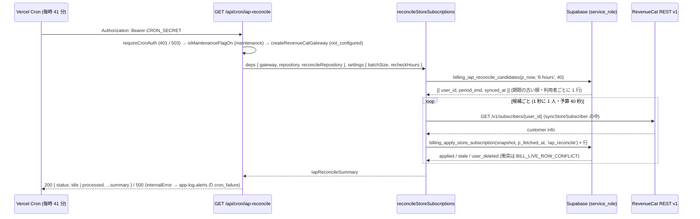

# billing/04 ストアの購読の定期の取り直し (reconcile) — 期限を過ぎたストアの行を RevenueCat から取り直して権利の表に写す

| | |
|---|---|
| 版 | v1.0 (2026-10-22) |
| Status | 設計ゲート審査中 (A 型。叩き台) |
| Issue | #1912 (有料プランの販売を始める: 価格・有料と無料の線引き・アプリ内課金)。本冊はその配線の残りの冊のうち「日次の reconcile」(billing/03 §0.5 Q-11・§18 の 4) に当たる。関連: billing/03 の整合ゲートの候補 (Webhook が落ちたまま期限を過ぎた購読が有料の権利を持ち続ける) |
| 範囲の正本 | Issue #1912 の本文。本冊の §0.4 に、前提とする Issue の記述を逐語で写す。本冊が決める範囲は §0.2 |
| 土台 | origin/main `0fb02e52` (#1931。billing/03 の段 D のマージ)。本冊の「現行」はこの版の事実 (§2.2) と、本番の読み取り (2026-10-22。§2.2 の F19) |
| 前提の冊 | `docs/design/billing/03-paid-plans-and-iap.md` (親。RevenueCat の口 = §8.1 `iap-core.ts`・§8.3 `revenuecat-gateway.ts` / `iap-repository.ts`・§8.4 `iap-service.ts`・§6.4 の写像 `billing_apply_store_subscription`・§7.3 の状態遷移表)・`01-billing-core.md` (核。§12 の「reconcile は写像を呼んで直す」の型)・`02-manual-plan-grant.md` (手動付与の日次の失効 = pg_cron の先例)・`docs/design/operator/08-cron-batches.md`・`11-ops-batches-non-billing.md` (cron の台帳と失敗の監視)。本冊は親の契約 (写しの入口は `billing_apply_store_subscription` の 1 つ・`p_fetched_at` で単調・TS の入口は `syncStoreSubscriber`) を壊さず、その上に定期の処理を 1 本足す |
| 実装者 | Sonnet 5.5 が本書だけを読んで手を止めずに実装できることを完成条件にする |

---

## 0. 分冊判定・範囲・読み方・前提・確認事項

### 0.1 分冊判定 (相 1 で実施)

| 目安 | 本冊 | 判定 |
|---|---|---|
| 設計書 800 行超 | 超える (正典コード・SQL・表 3 点・トレース・追随表を 1 冊に持つため) | 該当 |
| 消費先レーン 3 以上 | DB (候補の関数と索引)・サーバ (cron の route と facade) の 2 | 非該当 |
| 共有面 2 つ以上 | `vercel.json` (Vercel Cron の一覧。4 冊の設計書と 3 本のテストが本数を見張る)・`src/lib/env.ts` の一覧・AI の入口の一覧 (`tests/helpers/ai-consent-enforced-paths.ts`)・定期実行の入口の一覧 (`tests/ai-usage-contract.test.ts`)・`personal_subscriptions` (索引を 1 本足すだけ。列は足さない) | 該当 |

判定: **設計は 1 冊 (本書)。実装は 2 段 (A: DB 層 / B: サーバ層。§13.1) に分け、段ごとに 2 枚レビューを挟む**。理由: 核 (DB の候補の関数) と配線 (cron の route) は、候補の関数の引数と戻り値 (§6.2) を挟んで表裏で、冊を分けると配線の冊が未マージの関数を参照する指摘を自分で作る。書き込みの経路は親の `billing_apply_store_subscription` と `syncStoreSubscriber` をそのまま使い、本冊は新しい写像を作らない (§5.3)。段 A は単独でマージできる (関数と索引の新設だけ。既存の行は変えない)。

### 0.2 本冊の範囲と、対象外

| 本冊 | 対象外 (別の冊・別の Issue) |
|---|---|
| 期限 (`current_period_end`) を過ぎたままの live なストアの行 (`iap_store IS NOT NULL`) を、定期に RevenueCat から取り直して `personal_subscriptions` に写す処理 (Vercel Cron の route `GET /api/cron/iap-reconcile`。§8・§9) | Stripe (Web) の契約の reconcile (`stripe_integrity_check`。billing/01 §12・operator/08 §3.2 の未作成の行。本冊は触れない) |
| 候補の選び方 (status・期限・最後の同期の時刻) を DB の関数 1 本 (`billing_iap_reconcile_candidates`。§6.2) で確定し、1 回の件数の上限と RevenueCat への間隔を定数と環境変数で持つ (§8.1) | 手動付与 (M 行) の失効 (billing/02 の `expire-manual-plan-grants`)・Webhook の受け口と同期の API と遅延の再同期そのもの (billing/03。本冊は変えない) |
| 鍵が無いときの止め方・RevenueCat の失敗・率の制限 (429) のときの止め方と、失敗の監視 (既存の `app-log-alerts` の `cron_failure`) への乗せ方 (§8.3・§11) | 新しい運用アラートの種類 (取り直せない行の滞留の通知)。§16 の 3 |
| 期限の後も取り直せないときに有料を止める「猶予」の扱い (Q-2。推奨は「猶予を置かず、取り直せるまで権利を続ける」) | 権利の判定 (`get_effective_plan`・`consume_ai_usage_at`) の変更 (§5.1 の案 E で退ける) |
| 既存の番兵 (cron の本数・入口の一覧・環境変数の一覧) の追随 (§14) | 運営の画面 (Finance 画面での一覧) |

### 0.3 読み方

- §3 要件行列・§3.2 シナリオ → §4 構想とトレース → §5 構造裁定 → §6 以降が仕上げ (実装者は §6〜§14 だけ読めば手を止めない)。
- 正典の TS は §8 の ```ts ブロック。`import` が zod だけのブロック (§8.1 `iap-reconcile-core.ts`) は単独で型検査できる。1 行目に `// tsc:skip place=<パス>` / `insert=<パス>` の印があるブロックは、既存のモジュール (`@/lib/...`) を import するので単独の検査から外し、billing/01 §8.0 の手順 (印の付いたブロックを置き場所に置き、`npx tsc --noEmit` をリポジトリ全体に当てる) で検査する。印の無い `// tsc:skip` のブロックは説明用の断片だけ。SQL は §6。
- 既存の設計書との食い違いは本冊が正。親 (billing/03) の Q-11 と §18 の 4 の「日次の reconcile は配線の残りの冊」は、本冊が「毎時の取り直し (`GET /api/cron/iap-reconcile`)」として確定する (§14.2 で親に追随の行を書く)。
- main にマージ済みの事実 (billing/03 の実装 `src/lib/billing/iap-*.ts`・migration `20261021100000_billing_paid_plans_iap.sql`) が本冊の記述と食い違ったら、main が正で本冊が従う。

### 0.4 前提 (Issue #1912 の本文の逐語と、着手の前に origin/main で確かめた事実)

Issue #1912 の本文の「オーナーの選択」の表の行 (逐語): 「アプリ内課金 | RevenueCat を使う (App Store と Google Play の購入・更新・解約を 1 つの仕組みでまとめ、Web の Stripe と同じ権利の表に寄せる)」。本冊は、この「同じ権利の表に寄せる」が Webhook の再送が尽きたあとも保たれるように、定期の取り直しを足す。

着手の前に origin/main `0fb02e52` で確かめた問題 (事実。§2.2 の F 番号):

1. ストアの購読の状態は RevenueCat の Webhook で写る (F5)。再送は 5 回・約 80 分で止まる (billing/03 §2.3 P4・Q-11)。再送が尽きた更新・失効は、アプリの同期の API (F4) か `GET /api/billing/subscription` の遅延の再同期 (F3) が走るまで写らない。
2. 権利の判定 `get_effective_plan` は `status IN ('trialing','active','grace','past_due')` だけを見て `current_period_end` を見ない (F8)。`consume_ai_usage_at` はこれを呼ぶ (F8)。そのため、Webhook が落ちたまま期限を過ぎた購読は、利用者がアプリも課金の画面も開かない間、有料の上限と機能を持ち続ける。
3. 手動付与の期限切れの処理 (`billing_expire_manual_subscriptions`) は `iap_store IS NULL` の行だけを扱い、ストアの行を扱わない (F9)。
4. Stripe の reconcile (`stripe_integrity_check`) は設計だけで実装が無い (F17)。型として使えるのは billing/01 §12 の「写像を呼んで直す」の規則だけ。

### 0.5 発注者への確認事項 (Q-n。推奨つき。本冊は推奨の値で実装し、選択で変わる値は §8.1 の定数と `vercel.json` の予定だけ)

| # | 項目 | 推奨 | 根拠・代替案 |
|---|---|---|---|
| Q-1 | 取り直しの間隔 (Vercel Cron の予定) | **毎時 (`41 * * * *`)** | 親の Q-11 は「日次」と書いたが、期限を過ぎてから権利が止まるまでの窓は間隔そのもの (日次なら最長 24 時間、毎時なら最長 1 時間)。候補が 0 の回は DB の関数 1 回で終わり (RevenueCat は呼ばない)、Vercel Pro は毎分まで予定できる (§2.3 P2)。代替案: 日次 (`41 4 * * *` = JST 13:41) にすると `vercel.json` の 1 行と `IAP_RECONCILE_SCHEDULE_UTC`・`IAP_RECONCILE_CRON_INTERVAL_MINUTES` の 2 つの定数が変わるだけで、ほかは同じ。ただし 1 回の上限 40 人 (§8.1) では 1 日に 40 人しか取り直せないので、日次にするなら `IAP_RECONCILE_BATCH_SIZE` も上げる (予算 40 秒の中では RevenueCat への間隔を詰めることになり、§2.3 P1 の案内 (1 秒に 1 回) から外れる) |
| Q-2 | 取り直しも失敗し続けるとき、期限の後どれだけで有料を止めるか (猶予) | **猶予を置かない (取り直せるまで権利を続ける)。失敗は毎時の回ごとに 500 で失敗の監視 (運用メール) に乗せる** | 取り直せない原因は (a) 鍵の誤り・失効 (401) (b) RevenueCat の障害 (c) 当社の cron の停止、のどれかで、(a)(b) は毎時の 500 が `app-log-alerts` の `cron_failure` (1 件から・抑止つき) で運用メールになる (§2.2 F15)。期限の後 N 日で `expired` に書く案 (代替案 1) は、`expired` の行は候補から外れる (§6.2 の述語) ので、RevenueCat が戻っても本人の同期か Webhook が来るまで戻らず、支払っている利用者を切ったまま戻せない。権利の判定に期限を見せる案 (代替案 2) は核の関数 (`get_effective_plan`) と `plan_key_cached` の読み手 (運営の画面・機能フラグ) の食い違いを生む (§5.1 の案 E)。代替案 1 を採るなら、強制で終わらせた行を候補に戻す印 (列) が要り、本冊の範囲を超える (§16 の 2) |
| Q-3 | 「期限が近い」行 (期限の前) も取り直すか | **取り直さない (期限を過ぎた行だけ)** | 期限の前に取り直しても、更新 (RENEWAL) はストアが期限の時点で決めるので、見えるのは「まだ更新されていない」姿だけで、権利は変わらない。期限の後の最初の回 (≤ 1 時間) で更新か失効が見える。代替案: 期限の 24 時間前から候補にする (`p_now + interval '24 hours'` を述語に足す) と、1 つの更新につき取り直しが 2 回になる |

---

## 1. 目的・スコープ

- 解決すること: Webhook の再送 (5 回・約 80 分) が尽きて写らなかったストアの購読の失効・更新を、本人の操作が無くても、期限の後 1 時間以内に `personal_subscriptions` に写し、権利 (`plan_key_cached`・`get_effective_plan`・家族グループのプラン) を正しくする。
- やり方: 既存の写しの入口 (`syncStoreSubscriber` → `billing_apply_store_subscription`) を、期限を過ぎた live なストアの行の利用者について、Vercel Cron の route から 1 人ずつ呼ぶ。新しい写像・新しい列・新しい状態は作らない。
- 対象外: §0.2。

## 2. 関連要件と現行の事実

### 2.1 関連要件・既存設計

| 文書 | 本冊との関係 |
|---|---|
| billing/03 §0.5 Q-11・§3.2 S12・§18 の 4 | 「日次の reconcile は配線の残りの冊」。本冊がその冊。RevenueCat の全契約の列挙は API に無い (P5) ので、`personal_subscriptions` のストアの live 行を 1 人ずつ取り直す、と仮置きされている (§18 の 4)。本冊もその形 |
| billing/03 §8.4 `syncStoreSubscriber` / `lazyResyncStoreSubscription`・§8.1 `needsLazyResync` | 写しの入口と、遅延の再同期の判定 (期限を過ぎた行・5 分より古い取り直し)。本冊は入口をそのまま呼び、遅延の再同期は変えない (§7.2) |
| billing/03 §6.4 `billing_apply_store_subscription` | `p_fetched_at` で単調・advisory lock `billing-user:<uuid>` と `iap-subscription:<store>:<product>` で直列。Webhook・同期・遅延の再同期・本冊の取り直しが同時でも、新しい取り直しだけが写る (§4.2 S5・S6) |
| billing/03 §7.3 | ストアの行の状態遷移。本冊の取り直しは「取り直しの合図」の 1 つで、遷移先は取り直した姿 (`deriveStoreStatus`) で決まる (§7.3 (a)) |
| billing/03 §13.3 | `BILL_LIVE_ROW_CONFLICT`・`BILL_IAP_UNKNOWN_PRODUCT` のときの運営の処置。本冊はその利用者を飛ばして次の回も試す (§8.3) |
| billing/01 §12 | reconcile は写像を呼んで直す (自動修復 = 写像)。operator/08 §9 の「自動修復しない」は billing/01 が置き換えた。本冊も同じ型 |
| billing/02 §6.4 | 手動付与の日次の失効 (pg_cron の `CALL`)。SQL だけで済む処理の先例。本冊は RevenueCat を呼ぶので Vercel Cron (§5.1) |
| operator/08 §3.0・§3.2・§5・§9、operator/11 §4 | cron の台帳と、失敗の監視 (`cron_failure`: Vercel Cron の route の 500 = `internalError` の行を 1 件から通知)。本冊の route はこの型に乗る |
| operator/12 §0.5・§8.2・§14、operator/10 §2.1 | Vercel Cron の本数 (いま 6 本) を書いた行。本冊で 7 本になる (§14.2) |
| cross/04 | エラーコードの体系。本冊は利用者向けのコードを足さない (cron の応答は固定の語。§11) |

### 2.2 現行の事実 (origin/main `0fb02e52` と本番の読み取り。2026-10-22)

| # | 事実 | 場所 |
|---|---|---|
| F1 | 遅延の再同期の判定 `needsLazyResync(row, nowMs)`: 行あり・`iap_store` あり・`current_period_end` ≤ now・`iap_synced_at` が null か `IAP_LAZY_RESYNC_MIN_INTERVAL_MS` (5 分) 以上前。期限の前の行は取り直さない | `src/lib/billing/iap-core.ts:43-44`・`:478-488` |
| F2 | `syncStoreSubscriber(deps, userId, source)`: `now` を GET の前に取る → `gateway.getSubscriber` → `listStoreProducts` → `selectStoreSubscriptions` → `listStoreSubscriptions` → 1 つでも `reject` なら何も書かず `BILL_IAP_UNKNOWN_PRODUCT` → 取り直しに無い live 行を `expired` の snapshot で終わらせる → 1 件ずつ `applyStoreSubscription({ snapshot, fetchedAt: now, source })`。戻り値 `StoreSyncOutcome { user_id, applied, stale, no_subscription, ended, skipped_unknown }`。`BILL_LIVE_ROW_CONFLICT` (`BillingRpcError`) はそのまま投げる。`deps` は `IapDeps { gateway, repository, now? }` | `src/lib/billing/iap-service.ts:28-33`・`:55-98` |
| F3 | `GET /api/billing/subscription`: `findLiveSubscription` → `needsLazyResync` → 鍵があれば `lazyResyncStoreSubscription` (`source = 'iap_lazy_resync'`。失敗は `logger.warn` で飲み込む)。`findLiveSubscription` は live (`LIVE_SUBSCRIPTION_STATUSES` = trialing / active / paused / past_due / grace) の行のうち `created_at` が新しい 1 件だけ | `src/app/api/billing/subscription/route.ts:27-40`・`src/lib/billing/iap-service.ts:128-140`・`src/lib/billing/repository.ts:73-84`・`src/lib/billing/core.ts:97` |
| F4 | `POST /api/billing/iap/sync`: `requireUser` → `checkRateLimit('billing')` (10 回 / 分) → `syncStoreSubscriber(deps, user.id, 'iap_sync')`。`BILL_LIVE_ROW_CONFLICT` は 409 `BILL_IAP_SYNC_CONFLICT` | `src/app/api/billing/iap/sync/route.ts:21-41`・`src/lib/rate-limit.ts:142` |
| F5 | `POST /api/webhooks/revenuecat`: 大きさ → 署名 → 外形 → 鍵 (無ければ 503) → claim (`billing_claim_revenuecat_event`。`completed` は 200 duplicate・`in_progress` は 409) → `handleRevenueCatEvent` (`source = 'revenuecat:<event.id>'`) → finish。処理の失敗は 500 で RevenueCat が再送する | `src/app/api/webhooks/revenuecat/route.ts:46-125` |
| F6 | RevenueCat の gateway: `GET https://api.revenuecat.com/v1/subscribers/{app_user_id}`・`Authorization: Bearer <REVENUECAT_SECRET_API_KEY>`・`AbortSignal.timeout(REVENUECAT_REQUEST_TIMEOUT_MS = 10_000)`。2xx 以外・形の違い・時間切れ・接続の失敗は `RevenueCatApiError({ status })` (時間切れと接続の失敗は `status: null`)。再試行と率の制限の扱いは無い。鍵が無ければ `createRevenueCatGateway` が `RevenueCatNotConfiguredError` | `src/lib/billing/revenuecat-gateway.ts:18-54`・`src/lib/billing/iap-core.ts:40`・`:146-166` |
| F7 | 写像 `billing_apply_store_subscription(p_snapshot, p_fetched_at, p_source)`: advisory lock 2 本 (`billing-user:<uuid>`・`iap-subscription:<store>:<product>`) → 既存の行の `iap_synced_at >= p_fetched_at` なら `skipped: 'stale'` → 別の live 行があれば `BILL_LIVE_ROW_CONFLICT` → upsert (UPDATE で `iap_synced_at = p_fetched_at`) → `family_groups` と `plan_key_cached` → 状態が変わったときだけ監査 (`details.source = p_source`)。`p_source` は NOT NULL の text で、値の検査は無い | `supabase/migrations/20261021100000_billing_paid_plans_iap.sql:211-381` (ロック `:255-256`・stale `:267`・衝突 `:287-297`・UPDATE `:334`・監査 `:363-372`) |
| F8 | 権利の判定 `get_effective_plan`: `personal_subscriptions` で `status IN ('trialing','active','grace','past_due')` の行の `plan_key` を返す。`current_period_end` は見ない。`consume_ai_usage_at` はこれで `ai_daily_limits`・`ai_plan_feature_caps` を引く | `supabase/migrations/20261010140000_ai_usage_foundation.sql:94-125`・`20261021100000_billing_paid_plans_iap.sql` (`consume_ai_usage_at` の `v_plan := public.get_effective_plan(p_user_id)`) |
| F9 | 手動付与の日次の失効: プロシージャ `billing_expire_manual_subscriptions` (pg_cron `expire-manual-plan-grants`・毎日 15:11 UTC) は `stripe_subscription_id IS NULL AND iap_store IS NULL` の live 行だけを `expired` にする (billing/03 §6.7 の置き換え)。ストアの行は扱わない | `supabase/migrations/20261021100000_billing_paid_plans_iap.sql` (§6.7 の 3 関数)・`20261017230000_billing_manual_plan_grant.sql:261-315` |
| F10 | ストアの行の一意性と列: `idx_personal_subscriptions_iap_product (user_id, iap_store, iap_product_id) WHERE iap_store IS NOT NULL`・`iap_synced_at timestamptz` (NULL 可)・ストアの行の status は trialing / active / past_due / cancelled / expired の 5 値、live は前の 3 つ (`LIVE_STORE_SUBSCRIPTION_STATUSES`) | `20261021100000_billing_paid_plans_iap.sql:171-188`・`src/lib/billing/iap-core.ts:265-267` |
| F11 | Vercel Cron の既存の 6 本: `process-menu-queue` (`*/1`)・`app-log-alerts` (`*/15`)・`email-outbox` (`*/1`)・`push-outbox` (`*/1`)・`backup-freshness` (`37 5 * * *`)・`login-alerts` (`*/1`)。`/api/cron/stripe-reconcile` は無い | `vercel.json`・`git ls-tree origin/main src/app/api/cron/` |
| F12 | cron の認証: `requireCronAuth(req)` (`Authorization: Bearer <CRON_SECRET>`。`CRON_SECRET_PREVIOUS` も受理。未設定は 503 `cron_disabled`・不一致は 401)。`await` が必須。`tests/cron-secret-contract.test.ts` の CC-4 が `src/app/api/cron/**/route.ts` の全部を走査する | `src/lib/cron-auth.ts:29-52` |
| F13 | cron の route の型 (push-outbox): `runtime = 'nodejs'`・`dynamic = 'force-dynamic'`・`fetchCache = 'force-no-store'`・`maxDuration = 60`・`ROUTE_NAME = 'cron/push-outbox'`・`requireCronAuth` → `isMaintenanceFlagOn()` なら `{ status: 'maintenance' }` → 鍵が無ければ warn + `{ status: 'not_configured', … }` → 環境変数の値の解釈 (`resolvePushOutboxSettings`。範囲外は既定に戻し `ignored` を warn) → 本体 (予算 `PUSH_OUTBOX_RUN_BUDGET_MS = 40_000` で打ち切り) → `{ status: 'idle' \| 'processed', ...summary }`。例外は `internalError(ROUTE_NAME, err, { requestId })` で 500 | `src/app/api/cron/push-outbox/route.ts:33-109`・`src/lib/push/outbox.ts:19-28`・`:181-198` |
| F14 | cron の予定の定数と `vercel.json` の一致の型 (backup-freshness): `BACKUP_FRESHNESS_CRON_PATH`・`BACKUP_FRESHNESS_SCHEDULE_UTC` を `src/lib/backups/core.ts` に持ち、テスト O-1 が `vercel.json` の行と一致することを見る | `src/lib/backups/core.ts:29-31`・`src/__tests__/api/cron/backup-freshness.test.ts:659` |
| F15 | 失敗の監視: `GET /api/cron/app-log-alerts` (15 分おき) の `checkCronFailures` が、pg_cron の失敗と Vercel Cron の route の 500 (`internalError` が `app_logs` に書く `level = 'error'` の固定の文の行) を 1 件から数え、`OPS_ALERT_EMAIL` へ通知する (抑止 `OPS_ALERT_COOLDOWN_MINUTES`)。数えるのは `function_name` が `cron/%` か `% /api/cron/%` の行 | `src/app/api/cron/app-log-alerts/route.ts:456-520`・operator/11 §4・§2.1 |
| F16 | メンテナンス中: `isMaintenanceExemptPath` は `/api/cron` を通す (cron は動く)。push-outbox は自分で `isMaintenanceFlagOn()` を見て何もしない | `src/lib/maintenance-mode.ts:87-110`・`src/__tests__/lib/maintenance-mode.test.ts:111` (`/api/cronx` は止める = `/api/cron` は通す) |
| F17 | Stripe の reconcile: billing/01 §12 の契約 (`syncSubscription(…, 'wiring:reconcile')` を 1 件ずつ呼ぶ = 写像で直す) だけで、`src/app/api/cron/stripe-reconcile` は無い。operator/08 §9 は「不一致検出 → 自動修復しない」と書く (billing/01 §12 が置き換え済み) | `docs/design/billing/01-billing-core.md:3431`・`docs/design/operator/08-cron-batches.md:168`・`:651` |
| F18 | 環境変数の一覧: `REVENUECAT_SECRET_API_KEY`・`REVENUECAT_WEBHOOK_SECRET` は `required: false`。値を読む場所が 1 つの変数は `readOnlyBy` を書き、`src/__tests__/lib/env.test.ts` の `sealed` の一覧 (`toEqual`) と `typeOnly` の `@ts-expect-error` に行を持つ。cron の route が `process.env.X` を名前で読む先例: `PUSH_OUTBOX_*` (`readOnlyBy: 'src/app/api/cron/push-outbox/route.ts'`) | `src/lib/env.ts:248-258`・`src/__tests__/lib/env.test.ts:419-470`・`:479-520` |
| F19 | 本番 (2026-10-22 の読み取り): `personal_subscriptions` に `iap_store IS NOT NULL` の行は 0 件 (販売開始前)。`cron.job` は 20 本 (migration の 14 本 + ベースラインの `catalog-import-*` 5 本 + `handson-tour-sandbox-cleanup`) | Supabase の読み取り (SELECT のみ) |
| F20 | 本冊の新しい route・環境変数・migration に反応する既存の番兵 (行と直し方は §14.1): `tests/ai-usage-contract.test.ts:312-333` (`CRON_ENTRYPOINTS`。`vercel.json` の crons の全数を `toEqual`)・`tests/ai-consent-enforcement.test.ts:226-232` と `tests/helpers/ai-consent-enforced-paths.ts:207`・`:305-317` (`EXEMPT_ROUTES`。`@/lib/env` に届く route)・`tests/cron-failure-monitoring-contract.test.ts:236`・`:281` (it 名の「6 本」と既知の 6 本)・`tests/design-doc-vercel-cron-count.test.ts` (設計書 4 冊 + テスト 1 本の「6 本」の文 9 か所を `vercel.json` の数と突き合わせる)・`tests/env-setup-cron-secret-crons.test.ts` (`ENV_SETUP.md:94` の `CRON_SECRET` の行の path の集合)・`tests/log-cleanup-dau-snapshot-contract.test.ts:313-325` (operator/08 §3.0・§3.2 の注記・§5 の注記)・`tests/database-types-migrations-contract.test.ts` (migration の関数が両方の `database.types.ts` にある) | 各ファイル |
| F21 | `src/lib/billing/iap-service.ts` は `revenuecat-gateway`・`iap-repository`・`@/lib/env` を import しない (route が作って deps で渡す)。`iap-core.ts` は zod だけを import し `tests/billing-iap-core.test.ts` が見張る。本冊の新しいモジュールも同じ規則 (§8.0) | `src/lib/billing/iap-service.ts:1-3`・`iap-core.ts:1-5`・`tests/billing-iap-core.test.ts:64-74` |
| F22 | `tests/billing-iap-service.test.ts` の偽物は `IapRepository` の型で作る (`makeRepository(overrides: Partial<IapRepository>)`)。`IapRepository` にメソッドを足すと偽物が赤になる。本冊は `IapRepository` を変えず、候補の読み取りは別のポート (`IapReconcileRepository`。§8.1) にする | `tests/billing-iap-service.test.ts:75-94` |

### 2.3 一次情報 (RevenueCat・Vercel。2026-10-22 取得)

| # | 事実 | 出どころ |
|---|---|---|
| P1 | RevenueCat の REST v1 の率の制限は公式の数値が無い。RevenueCat のスタッフの回答 (2024-08-15): v2 は負荷で変わるがおよそ 60 回 / 分、v1 は「v2 より少し緩い」変動の制限で、**v1 は 1 秒に 1 回程度を勧める**。超えると 429 で、「止めて再試行」を勧める。v1 の応答に残りの枠のヘッダーは無い | RevenueCat Community「What are the current rate limits on the REST API」(community.revenuecat.com/general-questions-7/…-4946)。公式の API v1 のページ (revenuecat.com/docs/api-v1) には率の記述が無い |
| P2 | Vercel Cron: どのプランも 1 プロジェクト 100 本まで。Pro は最小の間隔 1 分・分の精度。Hobby は 1 日 1 回まで (`0 * * * *` はデプロイで失敗) で、時刻の精度は時間 (±59 分)。cron は Functions として動き、Functions の制限 (実行時間) が当たる | vercel.com/docs/cron-jobs/usage-and-pricing (last_updated 2026-07-15)。当社は `*/1` の cron を 4 本持つので Pro (F11) |
| P3 | RevenueCat の Webhook の再送は約 2.5 / 5 / 10 / 20 / 40 分で最大 5 回・約 80 分で止まる | billing/03 §2.3 P4 (本冊で再確認はしない) |

---

## 3. 相 1 外形固定

### 3.1 要件行列

| ID | 要件 | 出どころ | 本冊の答え |
|---|---|---|---|
| R1 | 期限を過ぎた live なストアの行を、本人の操作が無くても定期に RevenueCat から取り直して写す | #1912 (§0.4 の 1・2)・billing/03 Q-11 | Vercel Cron `GET /api/cron/iap-reconcile` (毎時 41 分) が候補の利用者を 1 人ずつ `syncStoreSubscriber(deps, userId, 'iap_reconcile')` で取り直す (§8.3・§9) |
| R2 | 定期の処理の置き場は既存の cron の型に合わせる | §0.4 | RevenueCat を呼ぶ TS の処理なので Vercel Cron (push-outbox・login-alerts と同じ型。§5.1)。認証は `requireCronAuth`、ログは `createLogger('cron/iap-reconcile')`、500 は `internalError` (失敗の監視に乗る。F15) |
| R3 | 対象の選び方 (status・期限・最後の同期の時刻) を確定する | §0.4 | DB の関数 `billing_iap_reconcile_candidates(p_now, p_recheck_after, p_limit)` (§6.2): `iap_store IS NOT NULL` ∧ `status IN ('trialing','active','past_due')` ∧ `current_period_end <= p_now` ∧ (`iap_synced_at IS NULL` ∨ `iap_synced_at < current_period_end` ∨ `iap_synced_at <= p_now - p_recheck_after`)。利用者ごとに 1 行、`current_period_end` の早い順、`p_limit` 件 |
| R4 | 1 回の件数の上限と RevenueCat の率の制限 | §0.4・P1 | 1 回 `IAP_RECONCILE_BATCH_SIZE` (既定 40 人。環境変数 `IAP_RECONCILE_BATCH_SIZE` で 1〜200)・取り直しの開始の間隔 `IAP_RECONCILE_REQUEST_INTERVAL_MS` (1 秒)・予算 `IAP_RECONCILE_RUN_BUDGET_MS` (40 秒) で打ち切り・429 はその回を止めて次の回 (§8.1・§8.3) |
| R5 | 取り直した結果の写し方は Webhook・同期と同じ関数を通し、書き込みの経路を 1 つにする | §0.4・billing/03 §0 | TS は `syncStoreSubscriber` (billing/03 §8.4)、DB は `billing_apply_store_subscription` (§6.4) だけ。本冊は新しい写像を作らない。`p_source = 'iap_reconcile'` で監査の `details.source` に残る |
| R6 | 同時に Webhook (同期・遅延の再同期) が来たときの順序 | §0.4 | 写像の advisory lock (`billing-user:<uuid>`) で直列、`p_fetched_at` (GET の前の時刻) の新しい方だけが写り、古い方は `stale` (F7)。取り直しの回が並行しても同じ (§4.2 S5・S6・S14) |
| R7 | 鍵が未設定のときに安全に止まる | §0.4 | `createRevenueCatGateway()` が投げる `RevenueCatNotConfiguredError` を受けて、DB に触れず 200 `{ status: 'not_configured' }` + warn 1 行 (push-outbox の R-12 と同じ型)。鍵の誤り (401 / 403) は失敗として 500 (§11) |
| R8 | 取り直しも失敗したときの猶予 | §0.4 | 猶予を置かない (Q-2)。失敗はその回を止めて 500 → 失敗の監視。候補は残り、次の回 (1 時間後) に再び取り直す |
| R9 | ログ・失敗時の運営アラートは既存の型 | §0.4 | ログは `app_logs` (`createLogger`)。500 は `internalError` の固定の文 → `app-log-alerts` の `cron_failure` (F15)。新しいアラートの種類は足さない (§16 の 3) |
| R10 | Stripe の側は触れない | §0.4 | 候補の述語は `iap_store IS NOT NULL`。Stripe の行 (`stripe_subscription_id`) と手動付与の行は本冊の処理に入らない |
| R11 | 新しい状態・列・利用者向けのエラーコードを作らない | billing/03 §7.3 (遷移表に無い遷移は作らない) | 遷移は billing/03 §7.3 の「取り直しの合図」の行のとおり。本冊が足す DB のものは関数 1 本と索引 1 本 (§6)。利用者向けの API は無い |
| R12 | migration の番号はマージ時に確定・`.down.sql` を対で | 設計の規約 | §6.1 |
| R13 | as any 禁止・マジックナンバー禁止・運用で変えうる値は環境変数で上書き | 設計の規約 | §8.1 の定数に根拠。上限と再確認の間隔は `IAP_RECONCILE_BATCH_SIZE`・`IAP_RECONCILE_RECHECK_HOURS` で上書き (範囲外は既定に戻して warn) |
| R14 | 監査ログ必須 | `docs/design/CLAUDE.md` | 状態の変化は写像が `admin_audit_logs` に書く (`system.billing.subscription_status_changed`・`details.source = 'iap_reconcile'`)。回の要約はログ (個人の情報を載せない) |
| R15 | 既存の番兵の追随と、共有面の台帳 | 設計の規約 | §14 |
| R16 | メンテナンス中は書かない | push-outbox の R-14 (operator/11) | `isMaintenanceFlagOn()` なら `{ status: 'maintenance' }` で何もしない (§8.4) |
| R17 | 本番の書き込み・外部の設定の変更はしない (設計) | #1912 の守ること | 本冊は読み取りだけ。環境変数の設定の手順は §15 |

### 3.2 ユーザーシナリオ (15 本)

| ID | シナリオ |
|---|---|
| S1 | 失効が届かない: App Store の購読 (個人 Pro) の自動更新を切った利用者の期限が来て、RevenueCat の `EXPIRATION` が当社の 500 (障害) で 5 回とも届かなかった。本人はアプリも Web も開かない。期限の次の毎時の回が取り直し、行は `expired`、`plan_key_cached` は NULL、AI の上限は無料の 3 回、究極モードの錠がかかる。期限から権利が止まるまで最長 1 時間 |
| S2 | 更新が届かない: 更新 (`RENEWAL`) が届かないまま期限を過ぎた (実はストアで更新済み)。取り直しで `current_period_end` が次の期限に進み、状態は `active` のまま (監査なし)。利用者は何も気づかない |
| S3 | ストアの猶予期間: 請求の失敗 (`BILLING_ISSUE`) で `past_due` の行が期限を過ぎた。取り直しは `grace_period_expires_date` が先なので `past_due` のまま (権利は続く。billing/03 P13)。行は期限を過ぎた live のままなので、6 時間ごと (`IAP_RECONCILE_RECHECK_HOURS`) に取り直し、猶予が尽きた取り直しで `expired` |
| S4 | 期限の直前に本人が同期した: 期限の 10 分前にアプリの「プランとお支払い」を開いて同期 (`iap_synced_at` が新しい) → 期限を過ぎた最初の回で取り直す (`iap_synced_at < current_period_end` = 期限の後の姿をまだ見ていない)。遅延の再同期の 5 分の規則とは独立 |
| S5 | 遅延の再同期と同時: 本人が Web の `/account/billing` を開き `GET /api/billing/subscription` の遅延の再同期が走るのと同じ分に、毎時の回も同じ利用者を取り直す。写像の advisory lock で直列になり、`p_fetched_at` の古い方は `stale`。結果は同じ姿 |
| S6 | Webhook と同時: 取り直しの GET の直後に `RENEWAL` の Webhook が届いて先に写した。本冊の `p_fetched_at` の方が古いので `stale` (何も壊さない)。逆の順なら Webhook の方が `stale` |
| S7 | 鍵が無い (販売開始前・本番に `REVENUECAT_SECRET_API_KEY` を入れる前): 回は DB に触れず 200 `{ status: 'not_configured' }`、warn ログ 1 行 (変数名はログにだけ)。失敗の監視には乗らない |
| S8 | RevenueCat が落ちている・鍵が無効 (401): 1 人目の取り直しが `RevenueCatApiError` → その回を止めて 500 → `app_logs` の error → `app-log-alerts` の `cron_failure` が運用メール。次の回 (1 時間後) に再び取り直す。候補の行はそのまま (権利は続く。Q-2) |
| S9 | 429 (率の制限): 途中の利用者で 429 → その回を止めて 200 `{ status: 'processed', stopped_early: 'rate_limited', … }` (warn)。残りは次の回。失敗の監視には乗らない |
| S10 | 候補が上限を超える: Webhook が丸 1 日止まり、期限を過ぎた行が 120 人分ある。回ごとに `current_period_end` の古い順に 40 人 (1 秒に 1 人) を取り直し、`stopped_early: null` で 40 人、残り 80 人は次の 2 回で終わる。回の予算 (40 秒) を超えたら `stopped_early: 'budget'` |
| S11 | 運営の処置が要る行: 別の live 行 (Stripe) がある利用者 (billing/03 S13) と、`plan_store_products` に無い商品の利用者 (S15) が候補にいる。それぞれ `BILL_LIVE_ROW_CONFLICT`・`BILL_IAP_UNKNOWN_PRODUCT` で写せないので、warn (利用者 ID とコード) を残して飛ばし、次の利用者へ。候補に残るので毎回の回で試み、運営の処置 (billing/03 §13.3) で解消する |
| S12 | メンテナンス中: `maintenance_mode` のフラグが ON の回は 200 `{ status: 'maintenance' }` で何もしない (DB に書かない) |
| S13 | 対象外の行: 手動付与 (M 行)・Stripe (S 行)・`expired` / `cancelled` のストアの行・期限 (`current_period_end`) が NULL のストアの行・期限の前の行は候補に出ない |
| S14 | 回の二重 (手動の再実行と毎時の回が重なった): 2 本が同じ候補を取り直す。片方は `stale` か同じ姿で、結果は変わらない。RevenueCat への回数は 2 倍になるが 1 秒に 1 回の間隔はそれぞれが守る |
| S15 | 退会: 候補の利用者が取り直しの最中に退会した。行は CASCADE で消え、写像は `skipped: 'user_deleted'` を返し、`StoreSyncOutcome` は何も数えない (`synced` には数える)。次の回の候補には出ない |

---

## 4. 相 2 構想

### 4.1 構造 (発明相の結論)

```
Vercel Cron (毎時 41 分)
  └ GET /api/cron/iap-reconcile ── requireCronAuth ── isMaintenanceFlagOn ── createRevenueCatGateway (無ければ not_configured)
        └ reconcileStoreSubscriptions(deps, settings)            ← 本冊の facade (src/lib/billing/iap-reconcile-service.ts)
              ├ reconcileRepository.listReconcileCandidates()    ← DB 関数 billing_iap_reconcile_candidates (候補の規則の唯一の置き場)
              └ 利用者ごとに (1 秒に 1 人・予算 40 秒・上限 40 人)
                    syncStoreSubscriber(deps, userId, 'iap_reconcile')   ← billing/03 §8.4 (写しの唯一の TS の入口。変えない)
                          └ gateway.getSubscriber → billing_apply_store_subscription (billing/03 §6.4。変えない)
```

1. **候補の規則は DB の関数 1 本に置く** (`billing_iap_reconcile_candidates`)。列と列の比較 (`iap_synced_at < current_period_end`) は PostgREST のフィルタで書けず、TS で絞ると `LIMIT` の後の絞り込みになって、絞られた行の裏で待つ行が永久に取り直されない。SQL なら 1 文で「利用者ごとに 1 行・期限の古い順・上限」まで閉じる。
2. **書き込みは親の入口をそのまま使う**。本冊は `syncStoreSubscriber` を `source = 'iap_reconcile'` で呼ぶだけで、snapshot も写像も作らない。順序・冪等・同時の規則は親の `p_fetched_at` と advisory lock がそのまま効く (R5・R6)。
3. **候補の述語**: `iap_store IS NOT NULL` ∧ live (trialing / active / past_due) ∧ `current_period_end <= p_now` ∧ (`iap_synced_at IS NULL` ∨ `iap_synced_at < current_period_end` ∨ `iap_synced_at <= p_now - p_recheck_after`)。読み方: 「期限の後の姿をまだ取り直していない行」(2 つ目) は何度でも候補、「期限の後に取り直しても live のままの行」(ストアの猶予期間) は `p_recheck_after` (6 時間) ごとに候補。取り直して `expired` / `cancelled` になれば live でなくなって候補から外れ、更新されていれば `current_period_end` が進んで外れる。候補の集合は取り直すたびに縮む。
4. **率と予算**: 1 回の処理は利用者を 1 人ずつ直列に、取り直しの開始の間隔を 1 秒空け (P1 の案内)、予算 40 秒で打ち切る (`maxDuration` 60 秒の中に最後の取り直しの時間切れ 10 秒 + RPC + 応答が収まる)。上限は既定 40 人 (= 40 秒 ÷ 1 秒)。429 はその回を止める (止めて再試行 = 次の回)。
5. **失敗の扱い**: 鍵が無い = 止まる (200 `not_configured`)。RevenueCat に届かない・拒まれる (401 / 403 / 5xx / 時間切れ)・DB の失敗 = その回を止めて 500 (失敗の監視に乗る。R9)。運営の処置が要る利用者 (`BillingRpcError` / `IapError`) = 飛ばして次へ (warn)。
6. **新しいものは最小**: DB の関数 1 本と部分索引 1 本、TS のモジュール 3 本 (純・repository・facade) と route 1 本、環境変数 2 つ、`vercel.json` の 1 行。列・状態・利用者向けのエラーコード・監査の action_type は足さない。



### 4.2 シナリオのトレース (上の構造で手で走らせたもの)

| ID | トレース |
|---|---|
| S1 | 期限 T に `EXPIRATION` が届かない → 行は `active`・`current_period_end = T`・`iap_synced_at` = 購入時の取り直し (< T) → T の次の 41 分の回: `billing_iap_reconcile_candidates` の述語 (`current_period_end <= p_now` ∧ `iap_synced_at < current_period_end`) に当たる → `syncStoreSubscriber(deps, user, 'iap_reconcile')`: GET → `deriveStoreStatus` が `expires_date ≤ now`・猶予なし → `expired` の snapshot → 写像の UPDATE (`status = 'expired'`・`iap_synced_at = p_fetched_at`) → `plan_key_cached` の再計算 (live 行が無く NULL)・家族グループは個人 Pro なので変わらない・監査 `system.billing.subscription_status_changed` (`from: 'active', to: 'expired', source: 'iap_reconcile'`) → 要約 `applied: 1` → 以後 `get_effective_plan` は free → `consume_ai_usage_at` の上限 3 回・究極モードは `plan_locked`。窓は T から次の回まで ≤ 60 分 + 回の中の順番 |
| S2 | `RENEWAL` が届かない → T の次の回で候補 → GET の `expires_date` は T + 1 か月 → `deriveStoreStatus` = `active` → 写像の UPDATE (`current_period_end` が進む・`status` は同じなので監査なし) → `applied: 1`。次の回は `current_period_end > p_now` なので候補に出ない |
| S3 | `BILLING_ISSUE` → `past_due` (billing/03 §7.3)。期限 T を過ぎた最初の回: 候補 (2 つ目の条件) → GET: `expires_date ≤ now` かつ `grace_period_expires_date > now` → `past_due` のまま → UPDATE (`iap_synced_at = now`。状態は同じで監査なし) → 次の回: `iap_synced_at > current_period_end` なので 2 つ目は偽、3 つ目 (`iap_synced_at <= p_now - 6 時間`) も偽 → 候補に出ない → 6 時間後の回で候補 → 猶予が尽きたあとの回の取り直しで `expired` (billing/03 §7.3 の `EXPIRATION` の行と同じ遷移) |
| S4 | T − 10 分の同期で `iap_synced_at = T − 10 分` → T の次の回: `iap_synced_at < current_period_end` → 候補 → 取り直し (S1 か S2 の姿) |
| S5 | 同じ分に、遅延の再同期 (`p_fetched_at = t1`) と本冊の回 (`p_fetched_at = t2`) が同じ利用者を取り直す → 写像は `billing-user:<uuid>` の advisory lock で直列 → 先に入った方が UPDATE し `iap_synced_at` を自分の `p_fetched_at` に → 後の方は `iap_synced_at >= p_fetched_at` なら `stale`、そうでなければ同じ姿で UPDATE (監査は状態が変わったときだけ) → どちらの順でも最終の行は新しい方の姿。本冊の要約は `applied` か `stale` |
| S6 | 本冊の GET が t2 に始まり、`RENEWAL` の Webhook が t3 (> t2) に GET して先に写した → 本冊の写像は `iap_synced_at (= t3) >= p_fetched_at (= t2)` で `stale` → `stale: 1`。逆の順なら Webhook が `stale` (Webhook は 200 で終わる) |
| S7 | `createRevenueCatGateway()` が `RevenueCatNotConfiguredError` → route は `logger.warn('REVENUECAT_SECRET_API_KEY が未設定のため、ストアの購読の取り直しを行いません')` → 200 `{ status: 'not_configured' }`。`reconcileRepository` も作らず DB に触れない。500 ではないので `cron_failure` に乗らない |
| S8 | 1 人目の `gateway.getSubscriber` が `RevenueCatApiError({ status: 401 })` (鍵の誤り) か `{ status: null }` (届かない) → `reconcileStoreSubscriptions` は 429 でないので warn (`processed: 0, candidates: n`) を残して投げる → route の `internalError('cron/iap-reconcile', err, { requestId })` → `app_logs` に `level = 'error'`・固定の文 → 15 分おきの `app-log-alerts` の `checkCronFailures` が `cron/iap-reconcile` を 1 件から数え、運用メール → 次の回で再試行 (候補は残る) |
| S9 | k 人目で `RevenueCatApiError({ status: 429 })` → `summary.stopped_early = 'rate_limited'` → ループを抜けて要約を返す (warn) → 200 `{ status: 'processed', synced: k − 1, stopped_early: 'rate_limited', … }`。残りは次の回 (候補の順は `current_period_end` なので同じ利用者から) |
| S10 | 候補 120 人 → `p_limit = 40` で 40 人 → 1 人ずつ: 間隔 1 秒 (前の取り直しの開始から 1 秒未満なら `sleep`) → 40 人で約 40 秒 → 予算を超えたら残りを置いて `stopped_early: 'budget'` (超えなければ `null`) → 次の回で次の 40 人。3 回 (3 時間) で全員 |
| S11 | 候補 A (Stripe の live 行あり) → `syncStoreSubscriber` の写像が `BILL_LIVE_ROW_CONFLICT` (`BillingRpcError`) → `rejected['BILL_LIVE_ROW_CONFLICT'] += 1`・warn (`user_id`・`code`) → 次の候補 B (対応の無い live な商品) → `syncStoreSubscriber` が書く前に `IapError('BILL_IAP_UNKNOWN_PRODUCT')` → `rejected['BILL_IAP_UNKNOWN_PRODUCT'] += 1` → 次へ。A・B は `iap_synced_at` が進まないので次の回も候補 (毎時 warn 1 行ずつ)。運営が billing/03 §13.3 の処置をすると、次の回で写る |
| S12 | `isMaintenanceFlagOn()` が true → 200 `{ status: 'maintenance' }`。gateway も候補も作らない |
| S13 | 述語: M 行・S 行は `iap_store IS NULL` で外れる。`expired` / `cancelled` は `status IN (...)` で外れる。`current_period_end IS NULL` は `IS NOT NULL` で外れる。期限の前は `<= p_now` で外れる |
| S14 | 回 X と回 Y が同じ 40 人を取り直す → 各利用者の写像は advisory lock で直列、後の方は `stale` か同じ姿 → 行は同じ。RevenueCat への回数は 2 倍 (各回は 1 秒に 1 回を守る) |
| S15 | 取り直しの GET の間に退会 → 行は `auth.users` の CASCADE で消える → 写像は `auth.users` に無いので `{ applied: false, skipped: 'user_deleted' }` → `StoreSyncOutcome` は `applied` も `stale` も増えない → 要約は `synced + 1` だけ → 次の回は行が無いので候補に出ない |

---

## 5. 相 3 構造裁定 (1 回だけ)

### 5.1 代替案の比較

| 案 | 構造 | 利点 | 欠点 | 裁定 |
|---|---|---|---|---|
| A (採用) | Vercel Cron の route → 本冊の facade → 親の `syncStoreSubscriber` → 親の写像。候補は DB の関数 | 書き込みの経路が親の 1 本のまま (R5)。TS の gateway・snapshot・`selectStoreSubscriptions` をそのまま使う。cron の認証・ログ・失敗の監視が既存の型に乗る (R2・R9)。実装は関数 1 本 + TS 4 ファイル | `vercel.json` の本数を見張る番兵 (4 冊 + 3 本) の追随が要る (§14)。Vercel の Functions の実行時間 (60 秒) の中で 1 回の件数が決まる (1 時間に 40 人) | 採用 |
| B | pg_cron → Edge Function (Deno) が RevenueCat を呼んで写像を呼ぶ | 当社の cron の数は増えない。pg_cron の失敗の監視に乗る | RevenueCat の取り直し (gateway・Zod・`selectStoreSubscriptions`・`projectStoreSubscription`) を Deno に写す = 書き込みの経路が 2 つになり、親の契約 (`iap-core.ts` の純関数が唯一) を破る。Vault の秘密と `verify_jwt = false` の設定も要る | 退ける (R5 に反する) |
| C | pg_cron → pg_net → Vercel の route を HTTP で呼ぶ | 時刻は DB が決める | pg_net から Vercel の route を呼ぶ先例が無く、`CRON_SECRET` を Vault にも置くことになる (ENV_SETUP の 3 か所の規則が 4 か所に)。得るものが無い | 退ける |
| D | 既存の `app-log-alerts` (15 分おき) の回に取り直しを相乗りさせる | cron を足さない | 運用アラートの route が課金の書き込みを持つ (関心の混在)。`app-log-alerts` の 500 が課金の失敗か通知の失敗か分からなくなる | 退ける |
| E | 権利の判定 (`get_effective_plan`) にストアの行の `current_period_end` を見せ、期限 + 猶予で権利を止める (取り直しはしない) | RevenueCat を呼ばない | 更新 (`RENEWAL`) が届かなかった支払い済みの利用者を止めてしまう。`plan_key_cached` (運営の画面・機能フラグの読み手) と判定が食い違う。核の関数の変更 = 共有面。親が「権利判定は変えない」(billing/03 R8) と決めている | 退ける (Q-2 の代替案 2 として記録) |

### 5.2 「縁の発生源を消すより単純な構造は無いか」

- 候補の規則を TS と SQL の 2 か所に持たない: TS に `needsStoreReconcile` のような純関数を作ると、SQL と二重になり、`LIMIT` の前後の違いで答えがずれる。規則は SQL の 1 か所 (§6.2) に置き、TS は結果を Zod で読むだけ (§8.1)。
- 「期限が近い」行を入れない (Q-3): 入れると 1 つの更新に取り直しが 2 回になり、述語に先読みの幅という新しい定数が増える。期限の後だけなら、候補の集合は取り直すたびに縮む。
- 強制の失効 (猶予 N 日で `expired` に書く) を入れない (Q-2): 入れると「取り直さずに書いた行」を候補に戻す印 (列) が要り、親の写像に「取り直した姿でない snapshot」を通すことになる。入れなければ、本冊が書くのは親の写像が取り直した姿だけ。
- `IapRepository` を広げない (F22): 候補の読み取りは別のポート `IapReconcileRepository` にし、親のポートと偽物を変えない。
- 回の中の並列を入れない: 直列 + 1 秒の間隔で率の制限 (P1) を守り、429 と予算は「止めて次の回」の 1 規則で受ける。

### 5.3 確定した構造

- 置き場: `src/lib/billing/iap-reconcile-core.ts` (純。定数・Zod・型・ポート)・`iap-reconcile-repository.ts` (RPC)・`iap-reconcile-service.ts` (facade)・`src/app/api/cron/iap-reconcile/route.ts`。DB は `billing_iap_reconcile_candidates` と部分索引 `idx_personal_subscriptions_iap_reconcile`。
- 変えないもの: `iap-core.ts`・`iap-service.ts`・`revenuecat-gateway.ts`・`iap-repository.ts`・`billing_apply_store_subscription`・`get_effective_plan`・遅延の再同期・同期の API・Webhook。
- 以後の蒸し返しを禁じる: 仕上げ (§6〜§14) の中で構造の疑義が出たら、blocking ではなく「裁定への差し戻し事由」として別に扱う。

---

## 6. データモデル (migration)

### 6.1 ファイル

| ファイル | 内容 |
|---|---|
| `supabase/migrations/<番号はマージ時に確定>_billing_iap_reconcile.sql` | 部分索引 1 本・関数 1 本 (§6.2)。番号はマージ直前に origin/main の `supabase/migrations` の最大 (2026-10-22 時点 `20261021110000_org_plan_ai_daily_limits.sql`) より大きい値で確定する。1 行目は `-- migration: <ファイル名>`、最初の文は `SET LOCAL lock_timeout = '10s';` (billing/03 段 A と同じ) |
| `supabase/rollbacks/<番号>_billing_iap_reconcile.down.sql` | §6.3。1 行目は `-- rollback: <ファイル名>` |

migration は `cron.schedule` を呼ばない (Vercel Cron は `vercel.json`。§8.5)。既存の行の UPDATE / DELETE・表・ポリシー・トリガーの変更は無い。`CREATE OR REPLACE` する既存の関数も無い。

### 6.2 候補の関数 `billing_iap_reconcile_candidates` と索引

```sql
-- migration: <番号はマージ時に確定>_billing_iap_reconcile.sql
-- billing/04 (Issue #1912 の配線の残りの冊): ストアの購読の定期の取り直しの候補を返す関数と、その索引。
-- 候補 = live (trialing / active / past_due) なストアの行 (iap_store IS NOT NULL) のうち、期限 (current_period_end) を過ぎていて、
--        期限の後の姿をまだ取り直していない (iap_synced_at が NULL か期限より前) か、取り直しても live のまま p_recheck_after より古いもの。
-- 利用者ごとに 1 行 (取り直しは利用者単位。billing/03 §8.4 syncStoreSubscriber)、期限の早い順、p_limit 件。
-- 書き込みは一切しない (写しの入口は billing_apply_store_subscription の 1 つだけ。billing/03 §6.4)。
-- 呼ぶのは GET /api/cron/iap-reconcile (service_role) だけ。
SET LOCAL lock_timeout = '10s';

-- (1) 候補を選ぶ部分索引 (live なストアの行だけ。期限の順に読む)
CREATE INDEX IF NOT EXISTS idx_personal_subscriptions_iap_reconcile
  ON public.personal_subscriptions (current_period_end)
  WHERE iap_store IS NOT NULL AND status IN ('trialing', 'active', 'past_due');
COMMENT ON INDEX public.idx_personal_subscriptions_iap_reconcile IS
  'billing/04 §6.2: 定期の取り直しの候補 (live なストアの行を current_period_end の順に読む)';

-- (2) 候補の関数。STABLE (読むだけ)。SECURITY DEFINER で service_role だけが呼ぶ
CREATE OR REPLACE FUNCTION public.billing_iap_reconcile_candidates(
  p_now           timestamptz,
  p_recheck_after interval,
  p_limit         integer
) RETURNS TABLE (user_id uuid, period_end timestamptz, synced_at timestamptz)
LANGUAGE plpgsql
STABLE
SECURITY DEFINER
SET search_path = ''
AS $$
DECLARE
  -- 1 回に返す上限の上限。TS の IAP_RECONCILE_BATCH_SIZE_MAX (billing/04 §8.1) と同じ値 (一致は契約テスト 29)
  c_max_limit CONSTANT integer := 200;
BEGIN
  IF p_now IS NULL OR p_recheck_after IS NULL OR p_limit IS NULL THEN
    RAISE EXCEPTION 'billing_iap_reconcile_candidates: p_now / p_recheck_after / p_limit are required' USING ERRCODE = '22023';
  END IF;
  IF p_recheck_after <= interval '0' THEN
    RAISE EXCEPTION 'billing_iap_reconcile_candidates: p_recheck_after must be positive' USING ERRCODE = '22023';
  END IF;
  IF p_limit < 1 OR p_limit > c_max_limit THEN
    RAISE EXCEPTION 'billing_iap_reconcile_candidates: p_limit must be between 1 and 200' USING ERRCODE = '22023';
  END IF;
  RETURN QUERY
    SELECT u.user_id, u.period_end, u.synced_at
      FROM (
        SELECT DISTINCT ON (s.user_id)
               s.user_id,
               s.current_period_end AS period_end,
               s.iap_synced_at      AS synced_at
          FROM public.personal_subscriptions AS s
         WHERE s.iap_store IS NOT NULL
           AND s.status IN ('trialing', 'active', 'past_due')
           AND s.current_period_end IS NOT NULL
           AND s.current_period_end <= p_now
           AND (s.iap_synced_at IS NULL
                OR s.iap_synced_at < s.current_period_end
                OR s.iap_synced_at <= p_now - p_recheck_after)
         ORDER BY s.user_id, s.current_period_end
      ) AS u
     ORDER BY u.period_end, u.user_id
     LIMIT p_limit;
END
$$;
REVOKE ALL ON FUNCTION public.billing_iap_reconcile_candidates(timestamptz, interval, integer) FROM PUBLIC, anon, authenticated;
GRANT EXECUTE ON FUNCTION public.billing_iap_reconcile_candidates(timestamptz, interval, integer) TO service_role;
COMMENT ON FUNCTION public.billing_iap_reconcile_candidates(timestamptz, interval, integer) IS
  'billing/04 §6.2: 定期の取り直しの候補 (期限を過ぎた live なストアの行の利用者。期限の後の姿をまだ取り直していないか、取り直しても live のまま p_recheck_after より古い)。利用者ごとに 1 行・期限の早い順・p_limit 件。読むだけ。service_role だけ';
```

述語の読み方 (§7.1 の表と同じ):

| 条件 | 意味 |
|---|---|
| `iap_store IS NOT NULL` | ストアの行だけ (Stripe・手動付与は対象外。R10) |
| `status IN ('trialing', 'active', 'past_due')` | live なストアの行 (`LIVE_STORE_SUBSCRIPTION_STATUSES`)。`expired` / `cancelled` は権利が無いので取り直さない (本人の同期か Webhook で戻る。billing/03 §7.3) |
| `current_period_end IS NOT NULL AND current_period_end <= p_now` | 期限を過ぎた行 (期限の無い行と期限の前の行は対象外。Q-3) |
| `iap_synced_at IS NULL OR iap_synced_at < current_period_end` | 期限の後の姿をまだ取り直していない (何度でも候補) |
| `iap_synced_at <= p_now - p_recheck_after` | 期限の後に取り直しても live のまま (ストアの猶予期間など) の行を、間隔を空けて再び取り直す |
| `DISTINCT ON (user_id)` … `ORDER BY period_end, user_id LIMIT p_limit` | 利用者ごとに 1 行 (その利用者の最も早い期限)、期限の古い順に上限まで。同じ期限は `user_id` で安定 |

### 6.3 ロールバック (`<番号>_billing_iap_reconcile.down.sql`)

```sql
-- rollback: <番号はマージ時に確定>_billing_iap_reconcile.sql
-- 先に vercel.json から /api/cron/iap-reconcile の行を外して Web のデプロイを戻すこと (新しい Web の cron の route はこの関数を呼ぶ。
-- 関数だけ消すと GET /api/cron/iap-reconcile が毎時 500 になり、失敗の監視の通知が出続ける)。
-- 消えるもの: 関数 1 本・索引 1 本。行は消さない・変えない。
-- 戻したあとは、Webhook が届かなかった期限切れの購読が、本人の同期か遅延の再同期まで写らない (billing/03 Q-11 の状態に戻る)。
-- 本番への適用: 本番への直接 SQL は禁止 (CLAUDE.md)。この内容を新しい migration として supabase/migrations に追加し、PR → main マージ → CI で適用する。
SET LOCAL lock_timeout = '10s';

DROP FUNCTION IF EXISTS public.billing_iap_reconcile_candidates(timestamptz, interval, integer);
DROP INDEX IF EXISTS public.idx_personal_subscriptions_iap_reconcile;
```

### 6.4 migration が触らないもの

`personal_subscriptions` の列・CHECK・既存の索引・RLS、`billing_apply_store_subscription`、`get_effective_plan`、`billing_expire_manual_subscriptions`、`revenuecat_webhook_events`、pg_cron のジョブ。`database.types.ts` (2 本) は再生成する (段 A。§13.1)。

---

## 7. 表 3 点

### 7.1 全パターン表 (行の由来 × 状態 × 期限 × 最後の取り直し → 候補か・取り直しの結果)

| 行の由来 | status | `current_period_end` | `iap_synced_at` | 候補 | 取り直しの結果 (`syncStoreSubscriber` → 写像) | 根拠 |
|---|---|---|---|---|---|---|
| S (Stripe) / M (手動付与) | 任意 | 任意 | — (`iap_synced_at` は NULL) | 出ない | — | `iap_store IS NULL`。R10・S13 |
| I (ストア) | `expired` / `cancelled` | 任意 | 任意 | 出ない | — (本人の同期・Webhook で戻る。billing/03 §7.3) | live でない。S13 |
| I | live | NULL | 任意 | 出ない | — | 期限なし。S13 |
| I | live | > now | 任意 | 出ない | — | 期限の前。Q-3 |
| I | live | ≤ now | NULL | 出る | 取り直した姿 (§7.3 (a)) | 取り直したことが無い行 (写像は `iap_synced_at = p_fetched_at` を必ず書くので実際には起きないが、述語は NULL を候補にする) |
| I | live | ≤ now | < `current_period_end` | 出る (毎回) | 取り直した姿: `expired` (S1) / `active` で期限が進む (S2) / `past_due` のまま (S3) / `cancelled` (返金) | 期限の後の姿をまだ見ていない。S1・S2・S4 |
| I | live | ≤ now | ≥ `current_period_end` かつ > now − 6 時間 | 出ない | — | 期限の後に取り直し済みで新しい (ストアの猶予期間の `past_due`)。S3 |
| I | live | ≤ now | ≥ `current_period_end` かつ ≤ now − 6 時間 | 出る | 取り直した姿 (猶予が尽きていれば `expired`) | S3 |
| I (候補) | live | ≤ now | 候補の条件 | 出る | 別の live 行あり → `BILL_LIVE_ROW_CONFLICT` (飛ばす。`rejected`) | S11・billing/03 §13.3 |
| I (候補) | live | ≤ now | 候補の条件 | 出る | live な商品が `plan_store_products` に無く利用者の行も無い → `BILL_IAP_UNKNOWN_PRODUCT` (何も書かずに飛ばす) | S11・billing/03 S15 |
| I (候補) | live | ≤ now | 候補の条件 | 出る | 取り直しに当社の商品が無い (`no_subscription`) → 行は `projectMissingSubscription` で `expired` (`ended`) | billing/03 §8.4 の 3 (TRANSFER で移った行) |
| I (候補) | live | ≤ now | 候補の条件 | 出る | 退会済み → `user_deleted` (何も書かない) | S15 |
| I (候補) | live | ≤ now | 候補の条件 | 出る | ほかの取り直しが先に写した → `stale` | S5・S6・S14 |
| 消費経路 (読む側) | | | | | | |
| `GET /api/billing/subscription` の遅延の再同期 | — | — | — | — | 変えない (`needsLazyResync` の 5 分の規則はそのまま。本冊の取り直しで `iap_synced_at` が進むと、その後 5 分は遅延の再同期も取り直さない) | F1・F3 |
| `POST /api/billing/iap/sync` | — | — | — | — | 変えない | F4 |
| `get_effective_plan` / `consume_ai_usage_at` / `plan_key_cached` / `family_groups` | — | — | — | — | 変えない。本冊の取り直しが写像を通すので、`expired` になった時点で free に戻る | F7・F8 |
| 監査 `admin_audit_logs` | — | — | — | — | 写像が状態の変化のときだけ書く (`details.source = 'iap_reconcile'`)。本冊は直接書かない | F7 |
| `app_logs` | — | — | — | — | route: `cron/iap-reconcile` の info (回の要約)・warn (鍵なし・環境変数・飛ばした利用者・429)・error (`internalError`)。service: `billing/iap-reconcile-service` の warn | §8.3・§8.4 |

### 7.2 状態比較表 (現行 vs 設計後)

| 面 | 現行 (origin/main `0fb02e52`) | 設計後 |
|---|---|---|
| Webhook の再送が尽きた失効 (本人が開かない) | `active` のまま有料の権利が続く (期限を見ない判定。F8) | 期限の後 ≤ 1 時間 (毎時の回) で `expired` に写り、権利が free に戻る (S1) |
| Webhook の再送が尽きた更新 | `current_period_end` が古いまま。本人が開いたときに遅延の再同期で進む | 期限の後 ≤ 1 時間で `current_period_end` が進む (S2)。本人が開いたときの遅延の再同期も変わらず動く |
| ストアの猶予期間の `past_due` | 本人が開くたび 5 分おきに取り直す (F1) | 本人が開かなくても 6 時間ごとに取り直す (S3)。開けば遅延の再同期も変わらず動く |
| 取り直しの入口 | Webhook (`revenuecat:<id>`)・同期 (`iap_sync`)・遅延の再同期 (`iap_lazy_resync`) の 3 つ | + 定期の取り直し (`iap_reconcile`)。4 つとも `syncStoreSubscriber` → `billing_apply_store_subscription` |
| RevenueCat の取り直しの失敗の見え方 | 同期の API は 502、Webhook は 500 (再送)、遅延の再同期は warn で飲み込む (billing/03 S30) | + 定期の取り直しは 500 → `cron_failure` の運用メール (S8)。429 は 200 で次の回 (S9) |
| Vercel Cron | 6 本 (F11) | 7 本 (`/api/cron/iap-reconcile`・`41 * * * *`) |
| `src/lib/env.ts` の一覧 | `REVENUECAT_SECRET_API_KEY`・`REVENUECAT_WEBHOOK_SECRET` | + `IAP_RECONCILE_BATCH_SIZE`・`IAP_RECONCILE_RECHECK_HOURS` (`readOnlyBy` = route) |
| DB | `personal_subscriptions` のストアの列と写像 (billing/03) | + 関数 `billing_iap_reconcile_candidates`・部分索引 `idx_personal_subscriptions_iap_reconcile` (列・状態は増えない) |
| 権利の判定 (`get_effective_plan`) | status だけ | 変えない (R11・案 E を退ける) |
| 手動付与の失効 (`expire-manual-plan-grants`) | ストアの行を扱わない | 変えない (ストアの行は本冊の cron) |
| operator/08 の台帳・operator/10・11・12 の本数の記述・`ENV_SETUP.md` の `CRON_SECRET` の行 | 6 本 | 7 本 (§14.2) |

### 7.3 状態遷移表

(a) 候補の行 × 取り直した姿 → 遷移先 (遷移の規則は billing/03 §7.3 の「取り直しの合図」の行と同じ。本冊は合図を足すだけで、遷移を足さない)

| 現在 (候補の行) | 取り直した姿 (`deriveStoreStatus` / `selectStoreSubscriptions`) | 遷移先 | ガード | 副作用 |
|---|---|---|---|---|
| `trialing` / `active` / `past_due` (期限 ≤ now) | `expires_date` ≤ now・猶予が無いか尽きた・`refunded_at` なし | `expired` | 取り直しが新しい (`iap_synced_at < p_fetched_at`)・`plan_store_products` の行か利用者の行がある | UPDATE・`plan_key_cached` 再計算 (NULL)・家族グループ `free` / 4 (家族プランのとき)・監査 `subscription_status_changed` (info・`source: 'iap_reconcile'`) |
| 同上 | `expires_date` > now (更新済み) | `active` (`trialing` からは `active`。`period_type` が trial のままなら `trialing`) | 同上 | UPDATE (`current_period_end` が進む)。状態が同じなら監査なし |
| 同上 | `expires_date` ≤ now かつ `grace_period_expires_date` > now | `past_due` | 同上 | UPDATE (`past_due_since` は保つ)。`active` → `past_due` のときだけ監査 (warn) |
| 同上 | `refunded_at` あり | `cancelled` | 同上 | `cancelled_at = refunded_at`・`plan_key_cached`・家族グループ・監査 |
| 同上 | 取り直しに当社の商品が無い | `expired` (`projectMissingSubscription`) | 同上 | `ended + 1`。`plan_key_cached`・家族グループ・監査 |
| 同上 | 同じ App Store のグループに 2 つ以上 live | 古い方 `expired` (`:superseded`)・新しい方は上の行 | billing/03 §7.3 S36 | 親の規則のとおり |
| 同上 | 別の live 行あり | 同じ | — | `BILL_LIVE_ROW_CONFLICT` → `rejected` に数えて飛ばす (warn)。候補に残る |
| 同上 | live な商品が `plan_store_products` に無く利用者の行も無い | 同じ | — | `BILL_IAP_UNKNOWN_PRODUCT` → `rejected` に数えて飛ばす (何も書かない) |
| 同上 | 取り直しが古い (`iap_synced_at >= p_fetched_at`) | 同じ | — | `stale + 1` |
| 同上 | 退会済み | 行なし | — | `user_deleted` (数えない) |
| 同上 | RevenueCat の失敗 (429 以外) | 同じ | — | その回を止める → 500 (S8) |
| 同上 | RevenueCat の 429 | 同じ | — | その回を止める → 200 `stopped_early: 'rate_limited'` (S9) |

(b) 1 回の処理 (route) の状態機械

| 状態 | 出来事 | 次 | 応答 / 副作用 |
|---|---|---|---|
| 開始 | `requireCronAuth` が 401 / 503 | 終わり | 401 `{ error: 'unauthorized' }` / 503 `{ error: 'cron_disabled' }` (既存の型。DB に触れない) |
| 認証済み | `isMaintenanceFlagOn()` = true | 終わり | 200 `{ status: 'maintenance' }` |
| 認証済み | `createRevenueCatGateway()` が `RevenueCatNotConfiguredError` | 終わり | 200 `{ status: 'not_configured' }`・warn 1 行 (変数名はログにだけ) |
| 設定の解釈 | `IAP_RECONCILE_*` が範囲外・整数でない | 処理へ | warn `{ ignored_env }`・既定値 |
| 処理 | 候補 0 | 終わり | 200 `{ status: 'idle', candidates: 0, …, stopped_early: null, oldest_period_end: null }` |
| 処理 | 候補 ≥ 1 を全部取り直した | 終わり | 200 `{ status: 'processed', …, stopped_early: null }`・info 1 行 (要約) |
| 処理 | 予算 (40 秒) を超えた | 終わり | 200 `{ status: 'processed', …, stopped_early: 'budget' }`・info |
| 処理 | 429 | 終わり | 200 `{ status: 'processed', …, stopped_early: 'rate_limited' }`・warn + info |
| 処理 | `BillingRpcError` / `IapError` (利用者 1 人) | 処理 (次の利用者) | `rejected[code] += 1`・warn (`user_id`・`code`) |
| 処理 | `RevenueCatApiError` (429 以外)・DB の失敗・想定外 | 終わり | service が warn (部分の要約) → route が `internalError` → 500 固定の本文・`app_logs` error → `cron_failure` |

---

## 8. 正典コード

### 8.0 置き場所と型検査

| ブロック | 置き場所 | 検査 |
|---|---|---|
| §8.1 `iap-reconcile-core.ts` | `src/lib/billing/iap-reconcile-core.ts` (新設) | 単独 (import は zod だけ。テスト 1 が見張る) |
| §8.2 `iap-reconcile-repository.ts` | `src/lib/billing/iap-reconcile-repository.ts` (新設) | `place=` |
| §8.3 `iap-reconcile-service.ts` | `src/lib/billing/iap-reconcile-service.ts` (新設) | `place=` |
| §8.4 route | `src/app/api/cron/iap-reconcile/route.ts` (新設) | `place=` |
| §8.5 既存ファイルの差分 | `src/lib/env.ts` (`insert=`)・`.env.example`・`vercel.json`・`ENV_SETUP.md` | `insert=` / 文面 |

手順は billing/01 §8.0 (印の付いたブロックを置き場所に置き、`npx tsc --noEmit` をリポジトリ全体に当てる)。段 B は段 A のマージ後 (`database.types.ts` に `billing_iap_reconcile_candidates` がある状態) に型検査する。

規則 (billing/03 §8.0 と同じ): `iap-reconcile-core.ts` は zod 以外を import しない。`iap-reconcile-service.ts` は `revenuecat-gateway`・`iap-repository`・`iap-reconcile-repository`・`@/lib/env` を import しない (route が作って deps で渡す)。親の `iap-core.ts`・`iap-service.ts`・`revenuecat-gateway.ts`・`iap-repository.ts` は変えない。

### 8.1 `src/lib/billing/iap-reconcile-core.ts` (正典。純)

```ts
/**
 * ストアの購読の定期の取り直し (billing/04) の定数・Zod・型・ポート・純関数。I/O を持たない (fetch / DB / env を読まない)。
 * import してよいのは zod だけ (tests/billing-iap-reconcile-core.test.ts のテスト 1 が見張る)。
 * 取り直しそのもの (RevenueCat の GET と写像) は billing/03 の iap-core.ts / iap-service.ts にあり、ここでは触らない。
 */
import { z } from 'zod';

// ─────────────────────────────────────────────────────────────────────────────
// 定数 (根拠つき)
// ─────────────────────────────────────────────────────────────────────────────

/**
 * 写像 billing_apply_store_subscription の p_source。監査 (system.billing.subscription_status_changed) の details.source で、
 * 定期の取り直しによる変化を見分ける (billing/03 の 'iap_sync' / 'iap_lazy_resync' / 'revenuecat:<event.id>' と並ぶ 4 つ目の出どころ)
 */
export const IAP_RECONCILE_SOURCE = 'iap_reconcile';

/**
 * Vercel Cron の path と予定 (vercel.json と同じ値。一致はテスト 24)。毎時 41 分 (UTC。JST も毎時 41 分)。
 * ほかの cron の分 (app-log-alerts の 0 / 15 / 30 / 45 分・backup-freshness の 37 分) と重ねない。毎分の cron とは関係ない
 */
export const IAP_RECONCILE_CRON_PATH = '/api/cron/iap-reconcile';
export const IAP_RECONCILE_SCHEDULE_UTC = '41 * * * *';
/** 回の間隔 (分)。予定が毎時なので 60。期限を過ぎてから権利が止まるまでの窓の上限 (billing/04 Q-1) */
export const IAP_RECONCILE_CRON_INTERVAL_MINUTES = 60;
/** route の最長実行時間 (秒。Vercel Pro の既定の上限の中)。route には同じ値をリテラルで書く (route segment config はリテラルだけ。一致はテスト 23) */
export const IAP_RECONCILE_MAX_DURATION_SECONDS = 60;
/**
 * 1 回の処理の予算 (ms)。maxDuration (60 秒) の中に、最後の 1 人の取り直しの時間切れ (REVENUECAT_REQUEST_TIMEOUT_MS = 10 秒) +
 * 写像の RPC + 応答が収まる値 (push-outbox の PUSH_OUTBOX_RUN_BUDGET_MS と同じ 40 秒)。超えたら残りを次の回に回す
 */
export const IAP_RECONCILE_RUN_BUDGET_MS = 40_000;
/** 取り直しの開始の間隔 (ms)。RevenueCat の案内 (REST v1 は 1 秒に 1 回程度。billing/04 §2.3 P1) に合わせる */
export const IAP_RECONCILE_REQUEST_INTERVAL_MS = 1_000;
/** 1 回の処理で取り直す利用者の上限 (既定) = 予算 ÷ 間隔 (= 40)。環境変数 IAP_RECONCILE_BATCH_SIZE で上書きできる */
export const IAP_RECONCILE_BATCH_SIZE = Math.floor(IAP_RECONCILE_RUN_BUDGET_MS / IAP_RECONCILE_REQUEST_INTERVAL_MS);
export const IAP_RECONCILE_BATCH_SIZE_MIN = 1;
/** DB 関数 billing_iap_reconcile_candidates の p_limit の上限 (c_max_limit) と同じ値 (一致は契約テスト 29) */
export const IAP_RECONCILE_BATCH_SIZE_MAX = 200;
/**
 * 期限の後に取り直しても live のままの行 (ストアの猶予期間の past_due など) を、次に取り直すまでの間隔 (時間。既定)。
 * 猶予期間は日の単位で続くので毎時は無駄が多く、6 時間なら 1 日 4 回。環境変数 IAP_RECONCILE_RECHECK_HOURS で上書きできる
 */
export const IAP_RECONCILE_RECHECK_HOURS = 6;
/** 下限は回の間隔 (1 時間)。上限は 7 日 (ストアの猶予期間より長くしない) */
export const IAP_RECONCILE_RECHECK_HOURS_MIN = 1;
const HOURS_PER_DAY = 24;
const IAP_RECONCILE_RECHECK_MAX_DAYS = 7;
export const IAP_RECONCILE_RECHECK_HOURS_MAX = IAP_RECONCILE_RECHECK_MAX_DAYS * HOURS_PER_DAY;
/** RevenueCat の率の制限の応答 (その回を止めて次の回に回す) */
export const HTTP_STATUS_TOO_MANY_REQUESTS = 429;

// ─────────────────────────────────────────────────────────────────────────────
// 環境変数の解釈 (値を読むのは route。ここは文字列を受けて解釈するだけ)
// ─────────────────────────────────────────────────────────────────────────────

export type IapReconcileSettingEnvName = 'IAP_RECONCILE_BATCH_SIZE' | 'IAP_RECONCILE_RECHECK_HOURS';
export interface IapReconcileSettingSources {
  batchSize: string | undefined;
  recheckHours: string | undefined;
}
export interface IapReconcileSettings {
  batchSize: number;
  recheckHours: number;
  /** 範囲外・整数でない値を既定に戻した変数の名前 (route が warn に書く。値は書かない) */
  ignored: IapReconcileSettingEnvName[];
}

function boundedInt(raw: string | undefined, fallback: number, min: number, max: number): { value: number; ignored: boolean } {
  if (raw === undefined || raw.trim() === '') return { value: fallback, ignored: false };
  const n = Number(raw);
  if (!Number.isInteger(n) || n < min || n > max) return { value: fallback, ignored: true };
  return { value: n, ignored: false };
}

/** 環境変数の値を解釈する。空は既定、範囲外・整数でない値は既定に戻して名前を ignored に入れる (push-outbox の resolvePushOutboxSettings と同じ規則) */
export function resolveIapReconcileSettings(sources: IapReconcileSettingSources): IapReconcileSettings {
  const batch = boundedInt(sources.batchSize, IAP_RECONCILE_BATCH_SIZE, IAP_RECONCILE_BATCH_SIZE_MIN, IAP_RECONCILE_BATCH_SIZE_MAX);
  const recheck = boundedInt(sources.recheckHours, IAP_RECONCILE_RECHECK_HOURS, IAP_RECONCILE_RECHECK_HOURS_MIN, IAP_RECONCILE_RECHECK_HOURS_MAX);
  const ignored: IapReconcileSettingEnvName[] = [];
  if (batch.ignored) ignored.push('IAP_RECONCILE_BATCH_SIZE');
  if (recheck.ignored) ignored.push('IAP_RECONCILE_RECHECK_HOURS');
  return { batchSize: batch.value, recheckHours: recheck.value, ignored };
}

// ─────────────────────────────────────────────────────────────────────────────
// 候補 (DB 関数 billing_iap_reconcile_candidates の行) とポート
// ─────────────────────────────────────────────────────────────────────────────

/** RETURNS TABLE (user_id uuid, period_end timestamptz, synced_at timestamptz) の 1 行 (PostgREST は timestamptz を ISO の文字列で返す) */
export const IapReconcileCandidateSchema = z.object({
  user_id: z.uuid(),
  period_end: z.string().min(1),
  synced_at: z.string().min(1).nullable(),
});
export type IapReconcileCandidate = z.infer<typeof IapReconcileCandidateSchema>;
export const IapReconcileCandidatesSchema = z.array(IapReconcileCandidateSchema);

export interface IapReconcileCandidateQuery {
  /** p_now (候補の判定の「いま」。取り直しの p_fetched_at とは別に、処理の開始に 1 回取る) */
  now: Date;
  /** p_recheck_after (時間) */
  recheckHours: number;
  /** p_limit (1〜IAP_RECONCILE_BATCH_SIZE_MAX) */
  limit: number;
}

/** 候補の読み取り (実装は iap-reconcile-repository.ts。テストは偽物を渡す)。billing/03 の IapRepository は変えない (別のポート) */
export interface IapReconcileRepository {
  listReconcileCandidates(query: IapReconcileCandidateQuery): Promise<IapReconcileCandidate[]>;
}

// ─────────────────────────────────────────────────────────────────────────────
// 1 回の処理の要約と、回の中の純関数
// ─────────────────────────────────────────────────────────────────────────────

/** 途中で止めた理由 (push-outbox の stopped_early と同じ 2 値) */
export const IAP_RECONCILE_STOP_REASONS = ['budget', 'rate_limited'] as const;
export type IapReconcileStopReason = (typeof IAP_RECONCILE_STOP_REASONS)[number];

/** route の応答の status */
export const IAP_RECONCILE_RUN_STATUSES = ['maintenance', 'not_configured', 'idle', 'processed'] as const;
export type IapReconcileRunStatus = (typeof IAP_RECONCILE_RUN_STATUSES)[number];

/** 1 回の処理の要約 (件数だけ。利用者 ID・RevenueCat の生の文は入れない)。応答とログにそのまま載せる */
export interface IapReconcileSummary {
  /** 取り出した候補の数 (≤ batchSize) */
  candidates: number;
  /** 取り直しが終わった利用者の数 (結果が applied / stale / ended / no_subscription / user_deleted のどれでも) */
  synced: number;
  /** StoreSyncOutcome の合計 (billing/03 §8.1) */
  applied: number;
  stale: number;
  ended: number;
  no_subscription: number;
  skipped_unknown: number;
  /** 業務エラー (BillingRpcError / IapError) で写せず飛ばした利用者の数 (コード別。運営の処置が要る。billing/03 §13.3) */
  rejected: Record<string, number>;
  stopped_early: IapReconcileStopReason | null;
  /** 最も古い候補の期限 (ISO)。候補が無ければ null。遅れの大きさを運営が見るため */
  oldest_period_end: string | null;
  /** 処理の開始から要約までの時間 (ms) */
  elapsed_ms: number;
}

export function emptyIapReconcileSummary(candidates: readonly IapReconcileCandidate[]): IapReconcileSummary {
  return {
    candidates: candidates.length,
    synced: 0,
    applied: 0,
    stale: 0,
    ended: 0,
    no_subscription: 0,
    skipped_unknown: 0,
    rejected: {},
    stopped_early: null,
    oldest_period_end: candidates[0]?.period_end ?? null,
    elapsed_ms: 0,
  };
}

/** 次の取り直しを始めるまでに待つ時間 (ms)。最初の 1 人は待たない。前の取り直しの開始から間隔がたっていれば 0 */
export function reconcileFetchDelayMs(lastFetchStartedAtMs: number | null, nowMs: number): number {
  if (lastFetchStartedAtMs === null) return 0;
  return Math.max(0, lastFetchStartedAtMs + IAP_RECONCILE_REQUEST_INTERVAL_MS - nowMs);
}

/** 処理の開始から予算を超えたか (ちょうど予算は超えていない。push-outbox の判定と同じ向き) */
export function isReconcileBudgetExhausted(startedAtMs: number, nowMs: number): boolean {
  return nowMs - startedAtMs > IAP_RECONCILE_RUN_BUDGET_MS;
}
```

### 8.2 `src/lib/billing/iap-reconcile-repository.ts` (`IapReconcileRepository` の実装)

```ts
// tsc:skip place=src/lib/billing/iap-reconcile-repository.ts
/**
 * IapReconcileRepository の実装 (billing/04 §8.2)。service_role の client で候補の RPC を呼ぶ (読むだけ。書き込みは billing/03 の
 * iap-repository.ts の applyStoreSubscription が唯一)。呼ぶ側は必ず cron の認証 (requireCronAuth) のあと
 */
import { getSupabaseAdmin } from '@/lib/supabase/server';
import { IapReconcileCandidatesSchema, type IapReconcileRepository } from '@/lib/billing/iap-reconcile-core';

type Admin = ReturnType<typeof getSupabaseAdmin>;

/** PostgreSQL の interval の入力 ('6 hours')。p_recheck_after に渡す */
const hoursInterval = (hours: number): string => `${hours} hours`;

export function createIapReconcileRepository(admin: Admin = getSupabaseAdmin()): IapReconcileRepository {
  return {
    async listReconcileCandidates({ now, recheckHours, limit }) {
      const { data, error } = await admin.rpc('billing_iap_reconcile_candidates', {
        p_now: now.toISOString(),
        p_recheck_after: hoursInterval(recheckHours),
        p_limit: limit,
      });
      if (error) throw error;
      const parsed = IapReconcileCandidatesSchema.safeParse(data);
      if (!parsed.success) throw new Error('billing_iap_reconcile_candidates が想定外の結果を返しました');
      return parsed.data;
    },
  };
}
```

### 8.3 `src/lib/billing/iap-reconcile-service.ts` (facade。route はこれだけを呼ぶ)

```ts
// tsc:skip place=src/lib/billing/iap-reconcile-service.ts
/**
 * ストアの購読の定期の取り直し (billing/04 §8.3)。候補の利用者を 1 人ずつ syncStoreSubscriber (billing/03 §8.4。写しの唯一の TS の入口) で
 * 取り直す。revenuecat-gateway・iap-repository・iap-reconcile-repository・@/lib/env を import しない (実装は route が作って deps で渡す)。
 *   - 1 人ずつ直列。取り直しの開始の間隔は IAP_RECONCILE_REQUEST_INTERVAL_MS (1 秒)。予算 IAP_RECONCILE_RUN_BUDGET_MS (40 秒) で打ち切る
 *   - 運営の処置が要る利用者 (BillingRpcError / IapError) は飛ばして次へ (warn。候補に残るので次の回も試す)
 *   - RevenueCat の 429 はその回を止めて要約を返す (stopped_early = 'rate_limited'。残りは次の回)
 *   - それ以外の RevenueCatApiError (届かない・鍵の誤り・5xx)・DB の失敗・想定外はその回を止めて投げる (route が 500 → 失敗の監視)
 */
import { createLogger } from '@/lib/db-logger';
import { BillingRpcError } from '@/lib/billing/repository';
import { IapError, RevenueCatApiError } from '@/lib/billing/iap-core';
import { syncStoreSubscriber, type IapDeps } from '@/lib/billing/iap-service';
import {
  HTTP_STATUS_TOO_MANY_REQUESTS,
  IAP_RECONCILE_SOURCE,
  emptyIapReconcileSummary,
  isReconcileBudgetExhausted,
  reconcileFetchDelayMs,
  type IapReconcileRepository,
  type IapReconcileSettings,
  type IapReconcileSummary,
} from '@/lib/billing/iap-reconcile-core';

const logger = createLogger('billing/iap-reconcile-service');

export interface IapReconcileDeps extends IapDeps {
  reconcileRepository: IapReconcileRepository;
  /** テストで差し替える (待ち)。既定は setTimeout */
  sleep?: (ms: number) => Promise<void>;
}
export type IapReconcileRunSettings = Pick<IapReconcileSettings, 'batchSize' | 'recheckHours'>;

const defaultSleep = (ms: number): Promise<void> =>
  new Promise((resolve) => {
    setTimeout(resolve, ms);
  });

/**
 * 1 回の処理。候補を読む → 1 人ずつ取り直す → 要約を返す。
 * 取り直しの p_fetched_at は syncStoreSubscriber が GET の前に取る (ここでは取らない)。候補の判定の p_now は処理の開始に 1 回取る
 */
export async function reconcileStoreSubscriptions(deps: IapReconcileDeps, settings: IapReconcileRunSettings): Promise<IapReconcileSummary> {
  const now = deps.now ?? (() => new Date());
  const sleep = deps.sleep ?? defaultSleep;
  const startedAtMs = now().getTime();
  const candidates = await deps.reconcileRepository.listReconcileCandidates({
    now: new Date(startedAtMs),
    recheckHours: settings.recheckHours,
    limit: settings.batchSize,
  });
  const summary = emptyIapReconcileSummary(candidates);
  let lastFetchStartedAtMs: number | null = null;
  for (const candidate of candidates) {
    if (isReconcileBudgetExhausted(startedAtMs, now().getTime())) {
      summary.stopped_early = 'budget';
      break;
    }
    const delay = reconcileFetchDelayMs(lastFetchStartedAtMs, now().getTime());
    if (delay > 0) await sleep(delay);
    lastFetchStartedAtMs = now().getTime();
    try {
      const outcome = await syncStoreSubscriber(deps, candidate.user_id, IAP_RECONCILE_SOURCE);
      summary.synced += 1;
      summary.applied += outcome.applied;
      summary.stale += outcome.stale;
      summary.ended += outcome.ended;
      summary.skipped_unknown += outcome.skipped_unknown;
      if (outcome.no_subscription) summary.no_subscription += 1;
    } catch (error) {
      if (error instanceof BillingRpcError || error instanceof IapError) {
        // 別の live 行との衝突・対応の無い商品 (billing/03 §13.3 の運営の処置)。この利用者は飛ばす (候補に残り、次の回も試す)
        summary.rejected[error.code] = (summary.rejected[error.code] ?? 0) + 1;
        logger.warn('ストアの購読の取り直しを写せませんでした (運営の処置が要ります)', { user_id: candidate.user_id, code: error.code });
        continue;
      }
      summary.elapsed_ms = now().getTime() - startedAtMs;
      if (error instanceof RevenueCatApiError && error.status === HTTP_STATUS_TOO_MANY_REQUESTS) {
        // 率の制限。止めて次の回に回す (RevenueCat の案内「止めて再試行」。billing/04 §2.3 P1)
        summary.stopped_early = 'rate_limited';
        logger.warn('RevenueCat の率の制限 (429) のため、この回の取り直しを止めました (残りは次の回)', { ...summary });
        break;
      }
      // RevenueCat に届かない・鍵の誤り・5xx・DB の失敗・想定外: この回を止めて route に投げる (500 → 失敗の監視)。途中までの件数は warn に残す
      logger.warn('ストアの購読の取り直しが失敗したため、この回を止めます', { user_id: candidate.user_id, ...summary });
      throw error;
    }
  }
  summary.elapsed_ms = now().getTime() - startedAtMs;
  return summary;
}
```

### 8.4 route `src/app/api/cron/iap-reconcile/route.ts`

```ts
// tsc:skip place=src/app/api/cron/iap-reconcile/route.ts
/**
 * GET /api/cron/iap-reconcile — 期限を過ぎた live なストアの購読の行を RevenueCat から取り直して写す (Vercel Cron。毎時 41 分。billing/04 §9)
 *
 * Webhook の再送 (5 回・約 80 分) が尽きて写らなかった失効・更新を、本人の操作が無くても期限の後 1 時間以内に personal_subscriptions に写す。
 * 本体は src/lib/billing/iap-reconcile-service.ts の reconcileStoreSubscriptions、候補は DB の関数 billing_iap_reconcile_candidates
 * (src/lib/billing/iap-reconcile-repository.ts)、取り直しと写像は billing/03 の syncStoreSubscriber → billing_apply_store_subscription。
 *
 * - 認証: Vercel Cron が付ける `Authorization: Bearer <CRON_SECRET>` (src/lib/cron-auth.ts の requireCronAuth)。
 * - メンテナンス中は何もせず次の回に回す (push-outbox と同じ)。
 * - REVENUECAT_SECRET_API_KEY が未設定なら何もしない (DB にも触れない。変数名は warn のログにだけ書き、応答には出さない)。
 * - IAP_RECONCILE_BATCH_SIZE / IAP_RECONCILE_RECHECK_HOURS で 1 回の件数と再確認の間隔を上書きできる (不正な値は既定値に戻して warn)。
 * - 応答 (JSON): { status: 'maintenance' } / { status: 'not_configured' } / { status: 'idle' | 'processed', ...summary }
 *   (件数だけ。利用者 ID・RevenueCat の生の文は出さない)。RevenueCat の失敗 (429 以外)・RPC の失敗は 500 (本文は汎用。詳細は app_logs)。
 * - AI を使わない (AI の SDK・Edge Function を import しない。tests/ai-usage-contract.test.ts の CRON_ENTRYPOINTS)。
 */
import { NextResponse } from 'next/server';
import { requireCronAuth } from '@/lib/cron-auth';
import { internalError } from '@/lib/api/errors';
import { createLogger, generateRequestId } from '@/lib/db-logger';
import { isMaintenanceFlagOn } from '@/lib/maintenance-mode';
import { RevenueCatNotConfiguredError, type RevenueCatGateway } from '@/lib/billing/iap-core';
import { createRevenueCatGateway } from '@/lib/billing/revenuecat-gateway';
import { createIapRepository } from '@/lib/billing/iap-repository';
import { createIapReconcileRepository } from '@/lib/billing/iap-reconcile-repository';
import { reconcileStoreSubscriptions } from '@/lib/billing/iap-reconcile-service';
import { resolveIapReconcileSettings } from '@/lib/billing/iap-reconcile-core';

// fetch (RevenueCat) と supabase-js を使うので Node.js ランタイムで動かす
export const runtime = 'nodejs';
export const dynamic = 'force-dynamic';
// supabase-js の RPC (POST) と RevenueCat への fetch を、同じ内容でも毎回送る (app-log-alerts の route と同じ理由で明示する)
export const fetchCache = 'force-no-store';
// 根拠は IAP_RECONCILE_MAX_DURATION_SECONDS (src/lib/billing/iap-reconcile-core.ts)。route segment config はリテラルだけ (一致はテスト 23)
export const maxDuration = 60;

/** 構造化ログ (app_logs.function_name) の名前。cron/push-outbox と同じ付け方 (失敗の監視の候補の LIKE 'cron/%' に当たる) */
const ROUTE_NAME = 'cron/iap-reconcile';

export async function GET(req: Request) {
  // 1. 認証 (401 / 503)
  const authError = await requireCronAuth(req);
  if (authError) return authError;
  const requestId = generateRequestId();
  const logger = createLogger(ROUTE_NAME, requestId);
  // 2. メンテナンス中は何もせず次の回へ (operator/11 の R-14 と同じ)
  if (await isMaintenanceFlagOn()) {
    return NextResponse.json({ status: 'maintenance' });
  }
  // 3. 鍵が無ければ何もしない (DB にも触れない。変数名は warn にだけ書く)
  let gateway: RevenueCatGateway;
  try {
    gateway = createRevenueCatGateway();
  } catch (error) {
    if (error instanceof RevenueCatNotConfiguredError) {
      logger.warn('REVENUECAT_SECRET_API_KEY が未設定のため、ストアの購読の取り直しを行いません');
      return NextResponse.json({ status: 'not_configured' });
    }
    return internalError(ROUTE_NAME, error, { requestId });
  }
  // 4. 環境変数の値の解釈 (不正な値は既定に戻して warn。値そのものは書かない)
  const settings = resolveIapReconcileSettings({
    batchSize: process.env.IAP_RECONCILE_BATCH_SIZE,
    recheckHours: process.env.IAP_RECONCILE_RECHECK_HOURS,
  });
  if (settings.ignored.length > 0) {
    logger.warn('ストアの購読の取り直しの環境変数の値が正しくないため、既定値を使います', { ignored_env: settings.ignored });
  }
  // 5. 候補を読む → 1 人ずつ取り直す
  try {
    const summary = await reconcileStoreSubscriptions(
      { gateway, repository: createIapRepository(), reconcileRepository: createIapReconcileRepository() },
      settings,
    );
    if (summary.candidates > 0) {
      logger.info('ストアの購読の取り直しを処理しました', { ...summary });
    }
    // ログの保存 (回の要約。待たずに進む) は、createLogger が 1 行ごとに保存が終わるまで関数を止めさせない (#1909)。route では延命しない
    return NextResponse.json({ status: summary.candidates === 0 ? 'idle' : 'processed', ...summary });
  } catch (err) {
    // 6. RevenueCat の失敗 (429 以外)・RPC の失敗・想定外は 500 (本文は汎用。app_logs の error → app-log-alerts の cron_failure)
    return internalError(ROUTE_NAME, err, { requestId });
  }
}
```

### 8.5 既存ファイルの差分

`src/lib/env.ts` の `SERVER_ENV_VARS` に、`REVENUECAT_WEBHOOK_SECRET` の項の直後に足す 2 項 (逐語):

```ts
// tsc:skip insert=src/lib/env.ts
  IAP_RECONCILE_BATCH_SIZE: {
    required: false,
    description:
      'ストアの購読の定期の取り直し (GET /api/cron/iap-reconcile。毎時) で、1 回に取り直す利用者の上限 (1〜200 の整数。billing/04 §8.1)',
    whenMissing: '既定の 40 人 (予算 40 秒 ÷ RevenueCat への間隔 1 秒)。範囲外・整数でない値も既定に戻る (warn ログに変数名だけが残る)',
    readOnlyBy: 'src/app/api/cron/iap-reconcile/route.ts',
  },
  IAP_RECONCILE_RECHECK_HOURS: {
    required: false,
    description:
      'ストアの購読の定期の取り直しで、期限の後に取り直しても live のままの行 (ストアの猶予期間など) を次に取り直すまでの間隔 (1〜168 の整数。時間。billing/04 §8.1)',
    whenMissing: '既定の 6 時間。範囲外・整数でない値も既定に戻る (warn ログに変数名だけが残る)',
    readOnlyBy: 'src/app/api/cron/iap-reconcile/route.ts',
  },
```

`.env.example` の `REVENUECAT_WEBHOOK_SECRET=` の行の直後に足す 5 行 (逐語):

```text
# ストアの購読の定期の取り直し (GET /api/cron/iap-reconcile。毎時 41 分。billing/04)。どちらも任意。
# 1 回に取り直す利用者の上限 (1〜200。空なら 40 人) と、期限の後に取り直しても live のままの行を次に取り直すまでの間隔 (1〜168 時間。空なら 6 時間)。
# 整数だけ。範囲外・整数でない値は既定値に戻る (warn ログに変数名だけが残る)。
IAP_RECONCILE_BATCH_SIZE=
IAP_RECONCILE_RECHECK_HOURS=
```

`vercel.json` の `crons` の末尾 (`login-alerts` の行の後) に足す 1 本 (逐語。`IAP_RECONCILE_CRON_PATH`・`IAP_RECONCILE_SCHEDULE_UTC` と同じ値):

```json
    {
      "path": "/api/cron/iap-reconcile",
      "schedule": "41 * * * *"
    }
```

`ENV_SETUP.md`: (1) 「3 つの保管場所」の表の `Vercel の環境変数 | CRON_SECRET` の行 (`:94`) の path の列挙 `…・`/api/cron/login-alerts`（どれも `vercel.json` の `crons`）` を `…・`/api/cron/login-alerts`・`/api/cron/iap-reconcile`（どれも `vercel.json` の `crons`）` にする (`tests/env-setup-cron-secret-crons.test.ts` が集合の一致を見る)。(2) Push 通知の環境変数の表 (`:423` の `PUSH_OUTBOX_BATCH_SIZE` の行がある表) の後に、同じ列の形で「ストアの購読の定期の取り直し（`GET /api/cron/iap-reconcile`。毎時 41 分。billing/04）」の小節を足し、`IAP_RECONCILE_BATCH_SIZE`（任意。1〜200。既定 40）と `IAP_RECONCILE_RECHECK_HOURS`（任意。1〜168。既定 6）の 2 行と、「`REVENUECAT_SECRET_API_KEY` が無い間は何もしない（200 `not_configured`）」の 1 文を書く。

---

## 9. API 仕様

### 9.1 `GET /api/cron/iap-reconcile` — ストアの購読の定期の取り直し

| 項目 | 内容 |
|---|---|
| 呼ぶ側 | Vercel Cron (`vercel.json`。`41 * * * *` = 毎時 41 分)。運営の手動の実行は operator/09 §5.3 と同じ (`curl -H "Authorization: Bearer $CRON_SECRET" https://<サイト>/api/cron/iap-reconcile`) |
| 認証 | `requireCronAuth` (`Authorization: Bearer <CRON_SECRET>`。`CRON_SECRET_PREVIOUS` も受理)。無い・不一致は 401 `{ error: 'unauthorized' }`、未設定は 503 `{ error: 'cron_disabled' }` (既存の型。DB に触れない) |
| 本文 | 読まない (GET。クエリも読まない) |
| 流れ | 認証 → `isMaintenanceFlagOn()` (ON なら `maintenance`) → `createRevenueCatGateway()` (鍵が無ければ `not_configured`) → `resolveIapReconcileSettings` (環境変数。不正な値は既定 + warn) → `reconcileStoreSubscriptions(deps, settings)` (§8.3) → 応答 |
| 応答 200 | `{ status: 'maintenance' }` / `{ status: 'not_configured' }` / `{ status: 'idle' \| 'processed', candidates, synced, applied, stale, ended, no_subscription, skipped_unknown, rejected: { [code]: n }, stopped_early: 'budget' \| 'rate_limited' \| null, oldest_period_end: string \| null, elapsed_ms }` (`idle` = 候補 0)。件数だけで、利用者 ID・RevenueCat の生の文・環境変数の値は載せない |
| 応答 500 | `internalError` の固定の本文 (`{ error: 'SYS_INTERNAL_ERROR', ... }` の既存の形)。RevenueCat の失敗 (429 以外。届かない・401 / 403・5xx・形の違い)・候補の RPC の失敗・写像の RPC の業務エラー以外の失敗・想定外。`app_logs` に `function_name = 'cron/iap-reconcile'`・`level = 'error'` の固定の文が残り、`app-log-alerts` の `cron_failure` が運用メールにする |
| キャッシュ | `dynamic = 'force-dynamic'`・`fetchCache = 'force-no-store'` |
| 実行時間 | `maxDuration = 60`。処理の予算は 40 秒 (`IAP_RECONCILE_RUN_BUDGET_MS`) |
| レート制限 | 当社側 (`checkRateLimit`) は使わない (cron の認証で足りる。既存の cron と同じ)。RevenueCat 側は 1 秒に 1 人の間隔と 429 で止める規則 (§8.3) |
| メンテナンス | `/api/cron` は middleware が通す (F16) ので、route が自分で `isMaintenanceFlagOn()` を見て何もしない |
| 凍結・同意 | 関係ない (利用者の操作ではない。写像は凍結を見ない。billing/03 §7.3) |

### 9.2 既存の API の差分

無し。`POST /api/webhooks/revenuecat`・`POST /api/billing/iap/sync`・`GET /api/billing/subscription` (遅延の再同期) は変えない。本冊の取り直しで `iap_synced_at` が進むと、その後 5 分は遅延の再同期も取り直さない (`needsLazyResync` の既存の規則)。

## 10. 画面

無し (Web・モバイルの画面は変えない。取り直しの結果は既存の画面 (`/account/billing`・アプリの「プランとお支払い」) が `GET /api/billing/subscription` で読む)。

---

## 11. エラー表

### 11.1 route の応答 (cron 向け。本文は固定の語)

| HTTP | 本文 | 意味 |
|---|---|---|
| 200 | `{ status: 'maintenance' }` | メンテナンス中。何もしない |
| 200 | `{ status: 'not_configured' }` | `REVENUECAT_SECRET_API_KEY` が無い。何もしない (DB にも触れない)。warn 1 行 |
| 200 | `{ status: 'idle', candidates: 0, ... }` | 候補なし |
| 200 | `{ status: 'processed', ..., stopped_early: null }` | 候補を全部取り直した |
| 200 | `{ status: 'processed', ..., stopped_early: 'budget' }` | 予算 (40 秒) で打ち切った。残りは次の回 |
| 200 | `{ status: 'processed', ..., stopped_early: 'rate_limited' }` | RevenueCat の 429 で止めた。残りは次の回 |
| 401 | `{ error: 'unauthorized' }` | `CRON_SECRET` が合わない・無い (`requireCronAuth`) |
| 503 | `{ error: 'cron_disabled' }` | `CRON_SECRET` が未設定 (`requireCronAuth`) |
| 500 | `internalError` の固定の本文 | RevenueCat の失敗 (429 以外)・RPC の失敗・想定外。失敗の監視に乗る |

利用者向けのエラーコード (cross/04) は足さない。

### 11.2 処理の中の例外の扱い (`reconcileStoreSubscriptions`)

| 例外 | 出どころ | 扱い |
|---|---|---|
| `BillingRpcError` (`BILL_LIVE_ROW_CONFLICT` / `BILL_UNKNOWN_PLAN` / `BILL_UNKNOWN_IAP_STATUS`) | 写像 (billing/03 §13.3) | その利用者を飛ばして次へ。`rejected[code] += 1`・warn (`user_id`・`code`)。候補に残る |
| `IapError` (`BILL_IAP_UNKNOWN_PRODUCT`) | `syncStoreSubscriber` (書く前) | 同上 |
| `RevenueCatApiError` (`status === 429`) | gateway | その回を止めて要約を返す (`stopped_early: 'rate_limited'`)。warn。200 |
| `RevenueCatApiError` (それ以外: 401 / 403 / 5xx / 形の違い / `status: null` = 時間切れ・接続の失敗) | gateway | warn (途中までの件数) → 投げる → route が 500 |
| 候補の RPC の失敗 (`PostgrestError`)・想定外の形 (`Error`) | `listReconcileCandidates` | 投げる → 500 |
| 写像の RPC の業務エラー以外の失敗 (`PostgrestError`) | `applyStoreSubscription` | 投げる → 500 |
| `RevenueCatNotConfiguredError` | `createRevenueCatGateway` (route) | ここには来ない (route が先に `not_configured` を返す) |

### 11.3 ログ (`app_logs`)

| level | `function_name` | 文 (固定) | metadata |
|---|---|---|---|
| warn | `cron/iap-reconcile` | `REVENUECAT_SECRET_API_KEY が未設定のため、ストアの購読の取り直しを行いません` | なし |
| warn | `cron/iap-reconcile` | `ストアの購読の取り直しの環境変数の値が正しくないため、既定値を使います` | `{ ignored_env }` (名前だけ) |
| info | `cron/iap-reconcile` | `ストアの購読の取り直しを処理しました` | 要約 (件数だけ)。候補 0 の回は書かない |
| error | `cron/iap-reconcile` | `internalError` の固定の文 | 既存の形 (`error_code`・`requestId`) |
| warn | `billing/iap-reconcile-service` | `ストアの購読の取り直しを写せませんでした (運営の処置が要ります)` | `{ user_id, code }` |
| warn | `billing/iap-reconcile-service` | `RevenueCat の率の制限 (429) のため、この回の取り直しを止めました (残りは次の回)` | 要約 |
| warn | `billing/iap-reconcile-service` | `ストアの購読の取り直しが失敗したため、この回を止めます` | `{ user_id, ...要約 }` |
| (写像) | — | 監査 `admin_audit_logs` の `system.billing.subscription_status_changed` (`details.source = 'iap_reconcile'`) は DB の関数が書く | — |

文は未完成や予定を示す語 (準備中・近日・予定・まだ・これから) を使わない (`tests/no-pending-wording-1911.test.ts` が `src/lib`・`src/app` の文の定数を走査する)。

---

## 12. テスト一覧 (it 名)

### 12.1 単体 (`npm test`。DB も RevenueCat も使わない)

`tests/billing-iap-reconcile-core.test.ts` (`iap-reconcile-core.ts` を本物で読む。1 は `tests/billing-iap-core.test.ts` の同名の検査と同じ作り):

1. `it('iap-reconcile-core imports only zod (no I/O, no @/lib)')`
2. `it('IAP_RECONCILE_BATCH_SIZE equals Math.floor(IAP_RECONCILE_RUN_BUDGET_MS / IAP_RECONCILE_REQUEST_INTERVAL_MS) (= 40) within [MIN 1, MAX 200], IAP_RECONCILE_RECHECK_HOURS (6) is within [MIN 1, MAX 168], and IAP_RECONCILE_RUN_BUDGET_MS + REVENUECAT_REQUEST_TIMEOUT_MS is below IAP_RECONCILE_MAX_DURATION_SECONDS * 1000')`
3. `it('IAP_RECONCILE_SOURCE is iap_reconcile, differs from IAP_SYNC_SOURCE and IAP_LAZY_RESYNC_SOURCE, and does not end with IAP_SUPERSEDED_SOURCE_SUFFIX')`
4. `it('resolveIapReconcileSettings returns the defaults for undefined / blank, keeps in-range integers, and falls back with the variable name in ignored for out-of-range (0, 201 / 0, 169), non-integer (1.5) and non-numeric values')`
5. `it('IapReconcileCandidatesSchema accepts RPC rows (uuid user_id, period_end, nullable synced_at) and rejects a non-uuid user_id, a missing period_end and a non-array')`
6. `it('reconcileFetchDelayMs is 0 before the first fetch, IAP_RECONCILE_REQUEST_INTERVAL_MS minus the elapsed time after a fetch started, and 0 once the interval has passed; isReconcileBudgetExhausted is false at exactly the budget and true 1 ms after')`
7. `it('emptyIapReconcileSummary sets candidates to the length, every count to 0, rejected to {}, stopped_early to null, oldest_period_end to the first candidate period_end (null for none) and elapsed_ms to 0')`

`tests/billing-iap-reconcile-service.test.ts` (`reconcileStoreSubscriptions` を本物で動かす。gateway・`IapRepository`・`IapReconcileRepository`・`sleep`・`now` は偽物。`@/lib/db-logger` は `vi.mock`。`syncStoreSubscriber` は本物を通す (`tests/billing-iap-service.test.ts` の `makeRepository` と同じ偽物の作り)):

8. `it('reconcileStoreSubscriptions lists candidates with now / recheckHours / limit = batchSize, syncs each user in the listed order with source iap_reconcile through the given gateway and repository, and sums the outcomes (synced / applied / stale / ended / no_subscription / skipped_unknown)')`
9. `it('reconcileStoreSubscriptions does not sleep before the first fetch and sleeps IAP_RECONCILE_REQUEST_INTERVAL_MS minus the elapsed time between the starts of consecutive fetches (a fetch slower than the interval gets no sleep)')`
10. `it('reconcileStoreSubscriptions stops with stopped_early = budget, leaving the remaining candidates untouched, once now() minus the start exceeds IAP_RECONCILE_RUN_BUDGET_MS, and sets elapsed_ms')`
11. `it('reconcileStoreSubscriptions skips a user whose sync throws BillingRpcError (BILL_LIVE_ROW_CONFLICT / BILL_UNKNOWN_PLAN) or IapError (BILL_IAP_UNKNOWN_PRODUCT), counts it in rejected by code, logs a warn with user_id and code, and continues with the next user')`
12. `it('reconcileStoreSubscriptions stops with stopped_early = rate_limited and returns the summary without throwing on RevenueCatApiError status 429, logging a warn')`
13. `it('reconcileStoreSubscriptions rethrows RevenueCatApiError with status 401, 500 and null and an unexpected error from the candidate RPC after logging a warn with the partial counts')`
14. `it('reconcileStoreSubscriptions with no candidates calls neither the gateway nor sleep and returns candidates 0 / stopped_early null / oldest_period_end null')`
15. `it('reconcileStoreSubscriptions counts a user_deleted outcome only in synced (applied / stale unchanged)')`

`tests/api/cron-iap-reconcile-route.test.ts` (route を本物で動かす。`@/lib/billing/iap-reconcile-service`・`@/lib/billing/revenuecat-gateway`・`@/lib/billing/iap-repository`・`@/lib/billing/iap-reconcile-repository`・`@/lib/maintenance-mode`・`@/lib/db-logger` は `vi.mock`。`requireCronAuth` は本物。route はファイルの一番外側で 1 回だけ読む (`tests/api/cron-login-alerts-route.test.ts` と同じ形。テスト・フックの中で import しない)。`CRON_SECRET` のダミーは `dummy-cron-secret-0123456789abcdef` (login-alerts・backup-freshness と同じ値。`.gitleaks.toml` の除外に載っている)):

16. `it('A-1: 401 without Authorization or with a wrong secret and 503 { error: cron_disabled } when CRON_SECRET is unset; the maintenance flag, the gateway, the repositories and the service are not touched')`
17. `it('M-1: returns 200 { status: maintenance } without creating the gateway, reading IAP_RECONCILE_* or calling the service while isMaintenanceFlagOn is true')`
18. `it('K-1: returns 200 { status: not_configured } with one warn (no RPC, no repository, no service) when createRevenueCatGateway throws RevenueCatNotConfiguredError')`
19. `it('E-1: passes valid IAP_RECONCILE_BATCH_SIZE / IAP_RECONCILE_RECHECK_HOURS to the service as batchSize / recheckHours and, for an invalid value, uses the default with a warn whose ignored_env names the variable (the value is not logged)')`
20. `it('R-1: returns 200 { status: idle, ...summary } with no info log for candidates 0, and { status: processed, ...summary } with an info log otherwise; the body has exactly the summary keys and no user ids')`
21. `it('R-2: returns 500 with the fixed internalError body and an app_logs error when the service throws RevenueCatApiError (401 / status null) or a PostgrestError; the raw RevenueCat text is not in the body')`
22. `it('R-3: builds deps from createRevenueCatGateway / createIapRepository / createIapReconcileRepository and passes them to reconcileStoreSubscriptions (no direct Supabase client)')`
23. `it('C-1: maxDuration literal equals IAP_RECONCILE_MAX_DURATION_SECONDS')`
24. `it('C-2: vercel.json has exactly one cron with path IAP_RECONCILE_CRON_PATH and schedule IAP_RECONCILE_SCHEDULE_UTC, and the 6 existing crons (process-menu-queue / app-log-alerts / email-outbox / push-outbox / backup-freshness / login-alerts) remain')`
25. `it('C-3: requireCronAuth is awaited before isMaintenanceFlagOn (an unauthenticated request never reads the flag)')`

### 12.2 契約 (DB を使わない。migration の文面)

`tests/billing-iap-reconcile-migration-contract.test.ts` (`tests/billing-manual-plan-grant-migration-contract.test.ts` と同じ作り):

26. `it('exactly one migration ends with _billing_iap_reconcile.sql, the same-numbered rollback exists, and the headers name each other (-- migration: / -- rollback:)')`
27. `it('the migration starts with SET LOCAL lock_timeout and contains only CREATE INDEX IF NOT EXISTS idx_personal_subscriptions_iap_reconcile and CREATE OR REPLACE FUNCTION billing_iap_reconcile_candidates (no CREATE TABLE / ALTER TABLE / POLICY / TRIGGER / cron.schedule / INSERT / UPDATE / DELETE)')`
28. `it('billing_iap_reconcile_candidates is STABLE SECURITY DEFINER with SET search_path = empty, references personal_subscriptions as public.personal_subscriptions, has no dynamic SQL, revokes PUBLIC / anon / authenticated and grants EXECUTE to service_role only')`
29. `it('the function c_max_limit equals IAP_RECONCILE_BATCH_SIZE_MAX, and the 22023 guards cover NULL arguments, a non-positive p_recheck_after and p_limit outside 1..c_max_limit')`
30. `it('the candidate predicate is verbatim (iap_store IS NOT NULL / status IN trialing, active, past_due / current_period_end IS NOT NULL / current_period_end <= p_now / iap_synced_at IS NULL OR iap_synced_at < current_period_end OR iap_synced_at <= p_now - p_recheck_after) with DISTINCT ON (user_id), ORDER BY period_end, user_id and LIMIT p_limit; the index predicate is iap_store IS NOT NULL AND status IN the same 3 values')`
31. `it('rollback drops the function with the same signature and the index, and contains no DELETE / UPDATE / TRUNCATE')`
32. `it('migration and rollback comments do not attribute decisions')`

### 12.3 結合 (ローカル Supabase。`tests/integration/rls` に置く)

`tests/integration/rls/billing-iap-reconcile-candidates-rpc.test.ts` (`tests/integration/rls/billing-apply-store-subscription-rpc.test.ts` と同じ前提と片付け。行は `service_role` で INSERT し、`p_now` を固定の時刻で渡す):

33. `it('returns one row per user for live store rows past current_period_end whose iap_synced_at is null or earlier than current_period_end, ordered by period_end then user_id, limited by p_limit')`
34. `it('excludes a row synced after its current_period_end within p_recheck_after and includes it once iap_synced_at <= p_now - p_recheck_after')`
35. `it('excludes Stripe rows, manual rows, expired / cancelled store rows, rows with current_period_end NULL and rows whose period has not ended')`
36. `it('a user with an expired store row and a live store row past its end appears once with the live row period_end')`
37. `it('raises 22023 for p_limit 0 and 201, for a zero or negative p_recheck_after and for NULL arguments; anon and authenticated cannot execute (42501)')`
38. `it('after billing_apply_store_subscription writes an expired snapshot with p_fetched_at after current_period_end, the user is no longer returned; after a renewed snapshot (expires_date in the future) it is no longer returned either')`

### 12.4 受け入れ (整合ゲート。実機)

39. 本番で `curl -H "Authorization: Bearer $CRON_SECRET" https://<サイト>/api/cron/iap-reconcile` が 200 を返し、`REVENUECAT_SECRET_API_KEY` の有無に応じて `not_configured` か `idle` であること。Vercel の Cron Jobs の画面に `/api/cron/iap-reconcile` が毎時の予定で載り、直近の実行が 200 であること。`app_logs` に `cron/iap-reconcile` の error が無いこと。

### 12.5 シナリオ ⇄ テスト

| シナリオ | テスト |
|---|---|
| S1 失効が届かない | 8・30・33・38 (遷移は billing/03 の結合テスト「transitions active → expired …」が担う) |
| S2 更新が届かない | 8・38 |
| S3 ストアの猶予期間 | 34・30 |
| S4 期限の直前の同期 | 33・30 |
| S5 遅延の再同期と同時 / S6 Webhook と同時 | 15 (stale の数え方)・billing/03 の結合テスト「is monotonic by p_fetched_at …」 |
| S7 鍵が無い | 18 |
| S8 RevenueCat の失敗・鍵の誤り | 13・21 |
| S9 429 | 12・20 |
| S10 候補が上限を超える | 9・10・33 (p_limit) |
| S11 運営の処置が要る行 | 11・20 |
| S12 メンテナンス中 | 17 |
| S13 対象外の行 | 35・30 |
| S14 回の二重 | 15・billing/03 の結合テスト (monotonic) |
| S15 退会 | 15 |

---

## 13. 段分け・触るファイルの母集合・新設一覧

### 13.1 段分け (1 つの B 型 WF の中で段ごとに 2 枚レビュー。段 A は単独でマージしてよい)

| 段 | 内容 | ファイル | テスト |
|---|---|---|---|
| A: DB 層 | migration + rollback (§6)・`database.types.ts` の再生成 (2 本)・契約テスト・結合テスト | §6・`src/types/database.types.ts`・`packages/shared/src/database.types.ts`・`tests/billing-iap-reconcile-migration-contract.test.ts`・`tests/integration/rls/billing-iap-reconcile-candidates-rpc.test.ts` | 26〜38 |
| B: サーバ層 | `iap-reconcile-core.ts`・`iap-reconcile-repository.ts`・`iap-reconcile-service.ts`・route・`env.ts`・`.env.example`・`ENV_SETUP.md`・`vercel.json`・単体テスト・既存の番兵の追随 (§14.1)・設計書の本数の追随 (§14.2 の「段 B と同じ PR」の行。オーケストレーターの専権 PATCH を段 B の PR に合流させる) | §8・§14 | 1〜25 と §14.1 の追随 |

段 B は段 A のマージ後 (型の再生成済み。`admin.rpc('billing_iap_reconcile_candidates', …)` が型で通る)。段 A の本番の適用 (追加だけの migration) はマージの前に行う (関数が無いまま新しい Web が出ると route が毎時 500 になるため。段 A のマージ → 本番の適用 → 段 B のマージの順)。段 A は 2 ファイル + 型 2 本 + テスト 2 本の 6 ファイルで 15 以内。段 B は 4 ファイル + 既存 4 ファイル + テスト 3 本 + 番兵 5 本 (§13.2) + 設計書 5 冊の 21 ファイルで 15 を超えるので、段 B のレビューは分割パネル (サーバ層 8 本・テストと番兵 8 本・設計書 5 冊の各担当 + 横断整合) で行う。

### 13.2 触るファイルの母集合 (閉じた一覧。これ以外を触ったら blocking。例外は §14.1 冒頭の「母集合の作り方」で新たに出た、同じ型の行がそのまま当てはまるファイルだけ)

新設:
- `supabase/migrations/<番号>_billing_iap_reconcile.sql`・`supabase/rollbacks/<番号>_billing_iap_reconcile.down.sql`
- `src/lib/billing/iap-reconcile-core.ts`・`iap-reconcile-repository.ts`・`iap-reconcile-service.ts`
- `src/app/api/cron/iap-reconcile/route.ts`
- テスト: `tests/billing-iap-reconcile-core.test.ts`・`tests/billing-iap-reconcile-service.test.ts`・`tests/api/cron-iap-reconcile-route.test.ts`・`tests/billing-iap-reconcile-migration-contract.test.ts`・`tests/integration/rls/billing-iap-reconcile-candidates-rpc.test.ts`

変更:
- `src/lib/env.ts`・`.env.example`・`ENV_SETUP.md`・`vercel.json`
- `src/types/database.types.ts`・`packages/shared/src/database.types.ts` (再生成)
- 既存の番兵 (§14.1): `tests/ai-usage-contract.test.ts` (`CRON_ENTRYPOINTS`)・`tests/helpers/ai-consent-enforced-paths.ts` (`EXEMPT_ROUTES`)・`tests/ai-consent-enforcement.test.ts` (Vercel の cron の it。`EXEMPT_ROUTES` も見る形に)・`tests/cron-failure-monitoring-contract.test.ts` (it 名と既知の一覧)・`src/__tests__/lib/env.test.ts` (`sealed` と `typeOnly`)
- docs (§14.2。段 B と同じ PR): `docs/design/operator/08-cron-batches.md`・`10-logs-and-mail-retry.md`・`11-ops-batches-non-billing.md`・`12-cron-secret-drift-monitor.md`・`docs/design/billing/04-iap-reconcile.md` (本書)。別の docs PR: `docs/design/billing/03-paid-plans-and-iap.md`・`docs/design/CLAUDE.md`・`docs/design/operator/09-runbook.md`

触らない (凍結): `src/lib/billing/iap-core.ts`・`iap-service.ts`・`revenuecat-gateway.ts`・`iap-repository.ts`・`repository.ts`・`service.ts`・`http.ts`・`core.ts`・`src/app/api/webhooks/revenuecat/route.ts`・`src/app/api/billing/**`・`src/lib/cron-auth.ts`・`src/lib/maintenance-mode.ts`・`src/lib/api/errors.ts`・`src/lib/ops-alerts/**`・`src/app/api/cron/app-log-alerts/route.ts`・既存の migration (`20261021100000_billing_paid_plans_iap.sql` ほか)・`supabase/baseline/**`・`tests/billing-iap-core.test.ts`・`tests/billing-iap-service.test.ts`・`tests/api/billing-iap-routes.test.ts`・`tests/webhooks-revenuecat-route.test.ts`・`tests/design-doc-vercel-cron-count.test.ts`・`tests/env-setup-cron-secret-crons.test.ts`・`tests/log-cleanup-dau-snapshot-contract.test.ts`・`src/__tests__/api/cron/cron-log-keepalive-1909.test.ts`・`tests/cron-secret-contract.test.ts`・pg_cron のジョブ。

### 13.3 新設一覧 (識別子)

| 種別 | 名前 |
|---|---|
| DB 関数 | `billing_iap_reconcile_candidates(timestamptz, interval, integer)` (STABLE・SECURITY DEFINER・EXECUTE は service_role だけ) |
| 索引 | `idx_personal_subscriptions_iap_reconcile` (部分索引。`(current_period_end) WHERE iap_store IS NOT NULL AND status IN ('trialing','active','past_due')`) |
| 列・表・RLS ポリシー・トリガー・状態・DB の業務エラー・監査 action_type | 無し |
| 写像の `p_source` の値 | `iap_reconcile` |
| route | `GET /api/cron/iap-reconcile` (Vercel Cron `41 * * * *`) |
| TS モジュール | `src/lib/billing/{iap-reconcile-core,iap-reconcile-repository,iap-reconcile-service}.ts`・`src/app/api/cron/iap-reconcile/route.ts` |
| TS の export (`iap-reconcile-core`) | `IAP_RECONCILE_SOURCE`・`IAP_RECONCILE_CRON_PATH`・`IAP_RECONCILE_SCHEDULE_UTC`・`IAP_RECONCILE_CRON_INTERVAL_MINUTES`・`IAP_RECONCILE_MAX_DURATION_SECONDS`・`IAP_RECONCILE_RUN_BUDGET_MS`・`IAP_RECONCILE_REQUEST_INTERVAL_MS`・`IAP_RECONCILE_BATCH_SIZE`・`IAP_RECONCILE_BATCH_SIZE_MIN`・`IAP_RECONCILE_BATCH_SIZE_MAX`・`IAP_RECONCILE_RECHECK_HOURS`・`IAP_RECONCILE_RECHECK_HOURS_MIN`・`IAP_RECONCILE_RECHECK_HOURS_MAX`・`HTTP_STATUS_TOO_MANY_REQUESTS`・`IapReconcileSettingEnvName`・`IapReconcileSettingSources`・`IapReconcileSettings`・`resolveIapReconcileSettings`・`IapReconcileCandidateSchema`・`IapReconcileCandidate`・`IapReconcileCandidatesSchema`・`IapReconcileCandidateQuery`・`IapReconcileRepository`・`IAP_RECONCILE_STOP_REASONS`・`IapReconcileStopReason`・`IAP_RECONCILE_RUN_STATUSES`・`IapReconcileRunStatus`・`IapReconcileSummary`・`emptyIapReconcileSummary`・`reconcileFetchDelayMs`・`isReconcileBudgetExhausted` (31) |
| TS の export (ほか) | `iap-reconcile-repository.ts`: `createIapReconcileRepository` / `iap-reconcile-service.ts`: `IapReconcileDeps`・`IapReconcileRunSettings`・`reconcileStoreSubscriptions` / route: `runtime`・`dynamic`・`fetchCache`・`maxDuration`・`GET` |
| 環境変数 | `IAP_RECONCILE_BATCH_SIZE`・`IAP_RECONCILE_RECHECK_HOURS` (どちらも任意。`readOnlyBy` = route) |
| ログの `function_name` | `cron/iap-reconcile`・`billing/iap-reconcile-service` |
| 応答の `status` の値 | `maintenance`・`not_configured`・`idle`・`processed` / `stopped_early` の値 `budget`・`rate_limited` |
| 定期実行の入口の名前 (`CRON_ENTRYPOINTS`) | `vercel:/api/cron/iap-reconcile` |

---

## 14. 追随表

### 14.1 既存の番兵 (契約テスト・走査テスト) の追随

grep の語 = 本冊が足す・変える名前: `api/cron`・`vercel.json`・`crons`・`CRON_ENTRYPOINTS`・`EXEMPT_ROUTES`・`readOnlyBy`・`IAP_RECONCILE`・`iap-reconcile`・`iap_reconcile`・`billing_iap_reconcile_candidates`・`personal_subscriptions`・`cron.schedule`・`6 本`・`REVENUECAT_SECRET_API_KEY`・`iap_synced_at`・`getSupabaseAdmin`・`requireCronAuth`・`internalError`・`createLogger`。

**母集合の作り方** (実装の各段の最初に origin/main で流し直す。表に無いファイルが出たら、同じ型の行の「直し方」がそのまま当てはまるときに限り直してよい。当てはまらなければ報告する):
1. `vercel.json` の crons の数・名前を読むテスト: `git grep -l "vercel.json" origin/main -- tests src scripts`。2026-10-22 の origin/main `0fb02e52` では 17 本 (テスト 13 本・コード 4 本。どれも下の行にある。全部の crons を読むのは 7 本、自分の path だけを絞るのは 4 本、残り 2 本とコード 4 本はコメントか別の値で触れるだけ)。
2. `src/app/api/cron/` の route を走査するテスト: `git grep -l "api/cron" origin/main -- tests src/__tests__`。43 本 (どれも下の行にある)。route 自体を読み込む固定の一覧 (`cron-log-keepalive-1909`) と、ディレクトリを `readdirSync` で走査するもの (`cron-failure-monitoring-contract`・`cron-secret-contract` と、`src` を走査する 6 本) と、特定の route の名前を書くだけのものを分けて下の行に。
3. 環境変数の一覧を読むテスト: `git grep -n "readOnlyBy" origin/main -- tests src/__tests__`。`src/__tests__/lib/env.test.ts` と `tests/env-source-scan.test.ts`。
4. migration の関数の名前を型と突き合わせるテスト: `tests/database-types-migrations-contract.test.ts`。
5. `@/lib/env` に届く route の一覧: `tests/helpers/ai-consent-enforced-paths.ts` と、それを読む `tests/ai-consent-enforcement.test.ts`・`tests/ai-usage-contract.test.ts`。本冊の route は `revenuecat-gateway.ts` を import するので届く (billing/03 §16.1 の母集合の作り方 1 と同じ)。
6. 設計書の「いま」の本数を読むテスト: `tests/design-doc-vercel-cron-count.test.ts`・`tests/log-cleanup-dau-snapshot-contract.test.ts`・`tests/env-setup-cron-secret-crons.test.ts` (直すのはテストでなく文書。§14.2)。

| テスト | 反応する語・理由 | 直し方 | 段 |
|---|---|---|---|
| `tests/ai-usage-contract.test.ts` (`:312-333` の `CRON_ENTRYPOINTS`。`scanCronEntrypoints()` が `vercel.json` の crons と migration の `functions/v1/` を集めて `toEqual`。`:412-420` は一覧に無い cron が AI に届かないことを見る) | `vercel:/api/cron/iap-reconcile` が増える。route は `revenuecat-gateway.ts` → `@/lib/env` に届く (`reachesAi` が真) ので、`EXEMPT_ROUTES` (次の行) に載せて `ALL_ROUTES` に入れる | `CRON_ENTRYPOINTS` の `'vercel:/api/cron/login-alerts'` の行の後に足す (逐語): `// #1912 billing/04 期限を過ぎたストアの購読の行を RevenueCat から取り直して写す。import は cron の認証・ログ・Supabase・RevenueCat への fetch だけ` / `'vercel:/api/cron/iap-reconcile': 'ストアの購読の期限切れ・更新を RevenueCat から取り直して写す (AI を使わない)',` | B |
| `tests/helpers/ai-consent-enforced-paths.ts` (`:207` の `EXEMPT_ROUTES`。`:305-317` に billing/03 の 3 行)・`tests/ai-consent-enforcement.test.ts` (`:164` の棚卸しと `:226-232` の「Vercel の cron は、判定を呼ぶ route か、AI へ送らない route だけ」。`reaching` に入る cron は `ENFORCED_ROUTES` に無いと赤) | 新しい route が `@/lib/env` に届く | `EXEMPT_ROUTES` の `'src/app/api/billing/subscription/route.ts'` の項の後に足す (逐語): `'src/app/api/cron/iap-reconcile/route.ts': { consent: 'cron: 期限を過ぎたストアの購読の行を RevenueCat から取り直して写す。AI へは送らない (鍵を読む env.ts の一覧に届くだけ)', handlers: { GET: { noAi: 'RevenueCat から契約を取り直して DB に写すだけ。送る先は RevenueCat と DB' } } },`。`:226-232` の it は `reaching` に入る cron を `ENFORCED_ROUTES` に求める形なので、`EXEMPT_ROUTES` に載せたうえで、この it が `ALL_ROUTES` (= `ENFORCED_ROUTES` と `EXEMPT_ROUTES`) を見る形に改める: `expect(ENFORCED_ROUTES, file).toHaveProperty([file])` を `expect({ ...ENFORCED_ROUTES, ...EXEMPT_ROUTES }, file).toHaveProperty([file])` にし、it 名を `'Vercel の cron は、判定を呼ぶ route か、理由つきで除外した route か、AI へ送らない route だけ'` にする (`EXEMPT_ROUTES` は `:21` で import 済み。import は変えない)。`tests/ai-usage-contract.test.ts:412-420` は `ALL_ROUTES` で見るので変更なし | B |
| `tests/cron-failure-monitoring-contract.test.ts` (`:236` の it 名「vercel.json の crons の 6 本 (backup-freshness・login-alerts を含む)」と `:281` の既知の 6 本の配列。`readdirSync` で全 route を走査し、`createLogger` / `internalError` の名前が `cron/<dir>` で終わることを見る) | 7 本になる。本冊の route は `ROUTE_NAME = 'cron/iap-reconcile'` を `createLogger` と `internalError` に渡す (走査に通る) | it 名を `'src/app/api/cron/*/route.ts が createLogger / internalError に渡す名前は cron/<名前> か <METHOD> /api/cron/<名前> の形 (候補の LIKE と一致する)。vercel.json の crons の 7 本 (backup-freshness・login-alerts・iap-reconcile を含む) のどれもこの走査に入る'` に、`:281` の配列に `'iap-reconcile'` を足す。operator/11 §11.1 (`:1407`) の同じ文も同時に直す (§14.2。`tests/design-doc-vercel-cron-count.test.ts` が両方を `vercel.json` の数と突き合わせる) | B |
| `tests/design-doc-vercel-cron-count.test.ts` (設計書 4 冊 + 上のテストの it 名の「6 本」の文 9 か所を `vercel.json` の crons の数と突き合わせ、operator/10 §2.1 の行が全部の名前を挙げることを見る) | `vercel.json` が 7 本になる | テストは変えない。文書 9 か所を §14.2 のとおり同じ PR で直す (文の形 (正規表現) を保つ) | B (文書) |
| `tests/env-setup-cron-secret-crons.test.ts` (`ENV_SETUP.md:94` の `CRON_SECRET` の行の `/api/cron/*` の集合 = `vercel.json` の path の集合) | 同上 | `ENV_SETUP.md:94` に `/api/cron/iap-reconcile` を足す (§8.5) | B |
| `tests/log-cleanup-dau-snapshot-contract.test.ts` (`:313-325`: operator/08 §3.0・§3.2 の注記・§5 の注記が `vercel.json` の名前を全部挙げ、§3.0・§3.2 の「の N 本」が実数と同じ。`:327-335`: §3.2 の「この表のほかの N 本」= 表の行数 − 実装済みの行。pg_cron: migration の `cron.schedule` の名前と §3.0・§3.1 の注記) | `vercel.json` が 7 本になる。本冊の migration は `cron.schedule` を呼ばないので pg_cron の数は変わらない | テストは変えない。operator/08 の §3.0・§3.2 の表と注記・§5 の注記を §14.2 のとおり同じ PR で直す | B (文書) |
| `tests/cron-secret-contract.test.ts` (CC-4: `src/app/api/cron/**/route.ts` の全部が `requireCronAuth` を `await` している) | 新しい route | 変更なし (route は `await requireCronAuth(req)` で始まる。走査が自動で拾う) | — |
| `tests/cron-secret-drift-monitor-contract.test.ts` (`readdirSync` は `supabase/migrations` だけ。cron の route は `:587` の `app-log-alerts/route.ts` を名指しで読むだけ)・`scripts/lib/cron-secret-drift.mjs` (`/api/cron/*` は所見の文 `:746` の中だけ。保管場所ごとの `CRON_SECRET` の一致を見て、route を走査しない) | 新しい route | 変更なし (どちらも route の一覧を持たない。本冊は `CRON_SECRET` の保管場所を増やさない) | — |
| `tests/integration/security/cron-failure-monitoring.test.ts` (結合。`app_logs` に試験用の名前 `cron/${TAG}-…` の行を入れて候補の関数を見る)・`src/__tests__/lib/ops-alerts/cron-failure.test.ts` (候補の行の写し方の単体。固定の名前) | 本冊の route の 500 が `cron/iap-reconcile` の名前で候補に入る | 変更なし (どちらも route の一覧を持たない。名前の形 `cron/<名前>` は `cron-failure-monitoring-contract` の走査が見る) | — |
| `src` を `readdirSync` で走査する 6 本: `tests/email-send-throttle-contract.test.ts` (メールを送るファイルに判定か理由つきの除外を求める。`:49-55` は除外の cron の route 2 本)・`tests/email-resend-boundary-scan.test.ts`・`tests/email-suppressed-log-level-scan.test.ts`・`src/__tests__/lib/ops-alerts/send-release.test.ts` (`claim_ops_alert` と `release_ops_alert` を呼ぶ route の固定の 2 本)・`tests/ai-queue-writes-contract.test.ts`・`tests/next16-proxy-convention.test.ts` | 新しい route と `src/lib/billing/iap-reconcile-*.ts` | 変更なし (本冊はメールを送らず (失敗の運用メールは `app-log-alerts` が送る)、`claim_ops_alert` を呼ばず、AI のキューに書かず、proxy / middleware を足さない) | — |
| `vercel.json` の `crons` を自分の path で絞るテスト 4 本: `src/__tests__/api/cron/app-log-alerts.test.ts` (`:1029-1040`)・`src/__tests__/api/cron/backup-freshness.test.ts` (`:659-672`)・`src/__tests__/api/cron/email-outbox.test.ts` (`:323-328`)・`tests/api/cron-login-alerts-route.test.ts` (`:118-124`) | `vercel.json` に 1 本増える | 変更なし (自分の path の行を `toEqual` するか、既存の path が残ることを見るだけで、全数を見ない) | — |
| `vercel.json` にコメントか別の値で触れるだけのもの: `tests/feature-flag-cache-ttl-wiring.test.ts` (`:67-68`。`vercel.json` に `FEATURE_FLAG_CACHE_TTL_MS` が無い)・`tests/e2e/.exploration/weekly-explore.spec.ts` (`:437`)・`scripts/lib/backup-db.mjs` (`:37`)・`src/lib/backups/core.ts` (`:29`)・`src/lib/ops-alerts/app-log-error-spike.ts` (`:8`・`:124-126`・`:402`)・`src/app/api/cron/app-log-alerts/route.ts` (`:49`) | `vercel.json` に 1 本増える | 変更なし (本冊は `vercel.json` に `crons` の 1 行だけを足し、環境変数の行を足さない。コードの 4 本は触らない) | — |
| 母集合 2 の残り 17 本 (既存の route を名指しするか、別のディレクトリを走査するだけ): `src/__tests__/api/cron/process-menu-queue.test.ts`・`push-outbox.test.ts`・`src/__tests__/api/webhooks/resend.test.ts`・`src/__tests__/lib/cron-auth.test.ts`・`src/__tests__/lib/emails/ops/cron-failure.test.ts`・`src/__tests__/lib/ops-alerts/app-log-error-spike.test.ts`・`src/__tests__/lib/ops-alerts/cron-secret-drift.test.ts`・`tests/ai-consent-enforcement-routes.test.ts`・`tests/cron-process-menu-queue-ai-consent.test.ts`・`tests/cron-secret-probe-edge.test.ts`・`tests/e2e/w5-3-menu-gen-adversarial.spec.ts`・`tests/email-suppression-log-docs-1577.test.ts`・`tests/health-middleware-exemption.test.ts`・`tests/integration/rls/ops-alert-state.test.ts`・`tests/legal-claims-1901.ts`・`tests/edge-function-cors.test.ts` (走査は `supabase/functions`)・`tests/security-workflow.test.ts` (走査は `.github/workflows`) | `api/cron` の語 | 変更なし (本冊の route を一覧に求めない) | — |
| `src/__tests__/lib/env.test.ts` (`:419-470` の `sealed` の一覧 (`toEqual`)・`:479-520` の `typeOnly`) | `IAP_RECONCILE_BATCH_SIZE`・`IAP_RECONCILE_RECHECK_HOURS` に `readOnlyBy` | `sealed` の `['FEATURE_FLAG_CACHE_TTL_MS', …]` の行の後 (並びは `.sort()` なので `F` と `L` の間) に 2 行 (逐語): `// #1912 billing/04 ストアの購読の定期の取り直しの 1 回の件数と再確認の間隔。不正な値の扱い (既定値に戻して warn) を cron の route 1 か所に置く` / `['IAP_RECONCILE_BATCH_SIZE', 'src/app/api/cron/iap-reconcile/route.ts'],` / `['IAP_RECONCILE_RECHECK_HOURS', 'src/app/api/cron/iap-reconcile/route.ts'],`。`typeOnly` に 2 行: `// @ts-expect-error IAP_RECONCILE_BATCH_SIZE の値を読むのは cron の route (src/app/api/cron/iap-reconcile/route.ts) だけ (#1912 billing/04)` / `getOptionalEnv('IAP_RECONCILE_BATCH_SIZE');` / `// @ts-expect-error IAP_RECONCILE_RECHECK_HOURS も同じ` / `getOptionalEnv('IAP_RECONCILE_RECHECK_HOURS');`。`:419` の it 名の列挙に `IAP_RECONCILE_*` を足す (`FEATURE_FLAG_CACHE_TTL_MS・` の後) | B |
| `tests/env-source-scan.test.ts` (一覧の全変数が `.env.example` にある・本番コードで値を読むのは `readOnlyBy` のファイルだけ・`process.env.X!` を書かない・`:614-640` の毎分の cron (`process-menu-queue`) が `env.ts` に届かない) | 2 つの環境変数・route が `process.env.IAP_RECONCILE_*` を名前で読む・route は `revenuecat-gateway.ts` 経由で `env.ts` に届く | 変更なし (`.env.example` に 2 行 (§8.5)、読むのは `readOnlyBy` の route だけ、`!` を使わない。`ENTRIES` は `process-menu-queue` だけで、毎時の route は対象外。billing/03 の Webhook の route と同じ) | — |
| `tests/database-types-migrations-contract.test.ts` (migration の `CREATE FUNCTION` の名前が両方の `database.types.ts` の `Functions` にある) | `billing_iap_reconcile_candidates` | 両方の `database.types.ts` を再生成する (operator/09 §3.3 の 5 の手順。270k / 256 で) | A |
| `src/__tests__/lib/maintenance-mode.test.ts` (`:111` の `/api/cronx` は止める = `/api/cron` は通す) | 新しい cron の route | 変更なし (`/api/cron` の prefix で通る。route が自分で `isMaintenanceFlagOn()` を見る。push-outbox と同じ) | — |
| `src/__tests__/api/null-character-routes.test.ts` (本文を読む POST / PUT / PATCH / DELETE の handler の一覧) | GET・本文を読まない | 変更なし | — |
| `tests/supabase-service-role-client-scan.test.ts` (`createClient` を自前で呼ぶファイルの一覧・`:378` の cron の route) | 新しい route と repository | 変更なし (`getSupabaseAdmin` 経由。`createClient` を呼ばない) | — |
| `tests/role-check-source-scan.test.ts`・`tests/api-raw-error-message-scan.test.ts` (`src/app/api` の全 route を走査) | 新しい route | 変更なし (ロールの手書きの判定なし。応答は固定の語と `internalError` だけ。`RevenueCatApiError.rawMessage` を本文に入れない) | — |
| `tests/heavy-unit-test-timeout.test.ts` (テスト・フックの中で route を読み込むファイルは時間切れを延ばす) | 新しい route のテスト | 変更なし (テスト 16〜25 は route をファイルの一番外側で 1 回読む (`tests/api/cron-login-alerts-route.test.ts` と同じ形) ので同じ型にならない) | — |
| `src/__tests__/api/cron/cron-log-keepalive-1909.test.ts` (`:69-74` の固定の 4 本。全数は求めない) | 新しい route | 変更なし (route は自分で延命しない (#1909 の規則)。一覧は固定で、足すのは任意) | — |
| `tests/no-pending-wording-1911.test.ts` (`src/lib`・`src/app` の文の定数に禁止の語が無い) | 新しいログの文 | 変更なし (§11.3 の文は禁止の語を使わない) | — |
| `tests/billing-iap-core.test.ts`・`tests/billing-iap-service.test.ts`・`tests/api/billing-iap-routes.test.ts`・`tests/webhooks-revenuecat-route.test.ts`・`tests/billing-revenuecat-gateway.test.ts` | 親のファイルは変えない | 変更なし | — |
| `tests/billing-paid-plans-migration-contract.test.ts`・`tests/billing-manual-plan-grant-migration-contract.test.ts`・`tests/billing-migration-contract.test.ts` (それぞれ自分の migration だけを見る) | 別ファイルの migration | 変更なし | — |
| `tests/cron-failure-monitoring-contract.test.ts` の 8 (`:213`。migration に 1 時間以内の間隔の pg_cron がある) | 本冊は pg_cron を足さない | 変更なし | — |
| `tests/admin-audit-logs-insert-policy-migration-contract.test.ts` (`admin_audit_logs` に直接 INSERT するファイルの一覧) | 本冊は監査を直接書かない | 変更なし | — |
| `tests/ai-consent-provider-inventory.test.ts` (`NON_AI_HOSTS`) | 新しい外部の host は無い (RevenueCat は billing/03 で登録済み) | 変更なし | — |
| `tests/design-doc-followup-owned-edits.test.ts` (`OWNED_EDITS` に載せた追随の行だけを見る) | 本冊の追随は本数と名前の追加で、`design-doc-vercel-cron-count`・`log-cleanup-dau-snapshot-contract`・`env-setup-cron-secret-crons` が機械で見張る | 変更なし (`OWNED_EDITS` に載せるかはオーケストレーターの docs PR の判断。載せなくても上の 3 本が同じ行を見張る) | — |

### 14.2 他の文書への追随 (専権 PATCH。「段 B と同じ PR」の行は `vercel.json` を変えた瞬間に番兵が赤になるので、段 B の PR に合流させる。ほかは設計ゲート PASS 後の docs PR)

| 文書 | 行 (origin/main `0fb02e52`) | 直し方 | 期日 |
|---|---|---|---|
| `docs/design/operator/08-cron-batches.md` §3.0 | `:17` 「…`login-alerts` (毎分。新しい端末・地域からのログインを本人にメールで知らせる worker。#1190・`cross/16-auth-history-sessions.md` §14.8) の 6 本である。」 | 「…§14.8)・`iap-reconcile` (毎時 41 分。期限を過ぎたストアの購読の行を RevenueCat から取り直して写す。#1912・`billing/04-iap-reconcile.md` §9) の 7 本である。」(`log-cleanup-dau-snapshot-contract` の正規表現「`vercel.json` に登録されている Vercel Cron は…の N 本」を保つ) | 段 B と同じ PR |
| 同 §3.2 の表 | `:176` の `login_alerts` の行の後 | 行を足す: `\| \`iap_reconcile\` (実装済み: #1912・billing/04) \| 毎時 41 分 \| 期限を過ぎたストアの購読の行を RevenueCat から取り直して写す (\`/api/cron/iap-reconcile\`。設計は billing/04 §9) \|` (「実装済み」を含めるので「この表のほかの 10 本」は変わらない) | 段 B と同じ PR |
| 同 §3.2 の注記 | `:178` 「…`login-alerts` (この表の `login_alerts`。#1190) の 6 本。この表のほかの 10 本は…」 | 「…(この表の `login_alerts`。#1190)・`iap-reconcile` (この表の `iap_reconcile`。#1912・billing/04) の 7 本。この表のほかの 10 本は…」 | 段 B と同じ PR |
| 同 §5 の注記 | `:332` 「…`login-alerts` (#1190・cross/16 §14.8) だけで、」 | 「…`login-alerts` (#1190・cross/16 §14.8)・`iap-reconcile` (#1912・billing/04 §9) だけで、」 | 段 B と同じ PR |
| 同 §9 の表 | `:651` の `stripe_integrity_check` の行の後 | 行を足す: `\| \`iap_reconcile\` \| RevenueCat の失敗 (429 以外)・RPC の失敗 → route が 500 → \`app-log-alerts\` の \`cron_failure\` (上の Vercel Cron 全般の行)。429 と予算は 200 で止めて次の回 (billing/04 §11) \|` | docs PR |
| `docs/design/operator/10-logs-and-mail-retry.md` §2.1 | `:59` 「  - Vercel Cron: `vercel.json` に …・`login-alerts` (毎分。#1190・#1720 段 B・cross/16 §14.8) の 6 本。」 | 「  - Vercel Cron: `vercel.json` に …・`login-alerts` (毎分。#1190・#1720 段 B・cross/16 §14.8)・`iap-reconcile` (毎時。#1912・billing/04 §9) の 7 本。」(行頭の 2 スペースと末尾の「の 7 本。」の形を保つ) | 段 B と同じ PR |
| `docs/design/operator/11-ops-batches-non-billing.md` §2.1 | `:97` 「いまは #1720 段 B の `cron/login-alerts` (`ROUTE_NAME`) を足した 6 本で、どれも 1 対 1」 | 「いまは #1720 段 B の `cron/login-alerts` (`ROUTE_NAME`) と #1912 billing/04 の `cron/iap-reconcile` (`ROUTE_NAME`) を足した 7 本で、どれも 1 対 1」 | 段 B と同じ PR |
| 同 §4.1 | `:188` 「V[Vercel Cron の route 6 本]」 | 「V[Vercel Cron の route 7 本]」 | 段 B と同じ PR |
| 同 §4.2 | `:223` 「既存の 6 本 (`backup-freshness`・`login-alerts` を含む) はどれも」 | 「既存の 7 本 (`backup-freshness`・`login-alerts`・`iap-reconcile` を含む) はどれも」 | 段 B と同じ PR |
| 同 §11.1 | `:1407` 「vercel.json の crons の 6 本 (backup-freshness・login-alerts を含む) のどれもこの走査に入る')`」 | 「vercel.json の crons の 7 本 (backup-freshness・login-alerts・iap-reconcile を含む) のどれもこの走査に入る')`」(テストの it 名と同じ文) | 段 B と同じ PR |
| `docs/design/operator/12-cron-secret-drift-monitor.md` §0.5 | `:63` 「いまの `vercel.json` の `crons` は 6 本 (上の 5 本と `login-alerts`)。」 | 「いまの `vercel.json` の `crons` は 7 本 (上の 5 本と `login-alerts`・`iap-reconcile` (#1912 billing/04))。」 | 段 B と同じ PR |
| 同 §8.2 | `:1411` 「\| `vercel.json` \| 6 本 \| 6 本 (変えない) \|」 | 「\| `vercel.json` \| 7 本 \| 7 本 (変えない) \|」(operator/12 は変えない、の意味はそのまま) | 段 B と同じ PR |
| 同 §14 | `:1747` 「`vercel.json` の crons の 6 本 (`backup-freshness`・`login-alerts` を含む) が走査に入ることも見る」 | 「`vercel.json` の crons の 7 本 (`backup-freshness`・`login-alerts`・`iap-reconcile` を含む) が走査に入ることも見る」 | 段 B と同じ PR |
| `ENV_SETUP.md` | `:94` と Push 通知の環境変数の表の後 | §8.5 のとおり | 段 B と同じ PR |
| `docs/design/billing/03-paid-plans-and-iap.md` §0.5 Q-11 | `:86` 「…日次の reconcile は配線の残りの冊**」 | 「…定期の取り直し (毎時) は `04-iap-reconcile.md`**」 | docs PR |
| 同 §3.2 S12 | `:270` 「…のどちらかで写る (Q-11)」 | 「…のどちらかで写る (Q-11)。本人が開かない契約は、`04-iap-reconcile.md` の毎時の取り直しが期限の後 1 時間以内に写す」 | docs PR |
| 同 §18 の 4 | `:5190` 「日次の reconcile (…) は配線の残りの冊」 | 「定期の取り直し (`personal_subscriptions` の期限を過ぎた live なストアの行の利用者を毎時 1 人ずつ取り直す) は `04-iap-reconcile.md` で確定」 | docs PR |
| `docs/design/CLAUDE.md` | `:16` 「…`02-manual-plan-grant.md` (運営者の手動のプラン付与) と、配線の残りの冊 (運用バッチ・運営の Finance 画面ほか。未作成))」 | 「…`02-manual-plan-grant.md` (運営者の手動のプラン付与)・`03-paid-plans-and-iap.md` (有料プランの販売とアプリ内課金)・`04-iap-reconcile.md` (ストアの購読の定期の取り直し) と、配線の残りの冊 (運営の Finance 画面ほか。未作成))」 | docs PR |
| `docs/design/operator/09-runbook.md` §5.3 | `:204-210` (Vercel Cron の手動実行) | 例に `/api/cron/iap-reconcile` を足し、応答の `status`・`stopped_early`・`oldest_period_end` の読み方 (§9.1) を 1 段落で書く (任意) | docs PR |

### 14.3 共有面の台帳 (2 つ以上の PR が触る面)

| 面 | 本冊の PR | 同時に触りうる PR | 直列化 |
|---|---|---|---|
| `vercel.json` の `crons` | 段 B で 1 本足す | ほかの cron を足す案件 (operator/08 §3.2 の未実装の行) | `vercel.json` に触る PR は 1 本ずつ。本数の文 (operator/08・10・11・12・テスト 2 本) も同じ PR で直す |
| `src/lib/env.ts` の `SERVER_ENV_VARS`・`.env.example`・`ENV_SETUP.md`・`src/__tests__/lib/env.test.ts` の `sealed` | 段 B で 2 つ足す | 環境変数を足す案件 | 並行できる (項の追加だけ)。衝突したら main を正に rebase |
| `tests/helpers/ai-consent-enforced-paths.ts` の `EXEMPT_ROUTES`・`tests/ai-usage-contract.test.ts` の `CRON_ENTRYPOINTS` | 段 B で 1 行ずつ | route を足す案件 | 同上 |
| `src/types/database.types.ts`・`packages/shared/src/database.types.ts` | 段 A で再生成 | migration を足す案件 | migration の番号はマージ直前に確定し、型は main の最新の migration の上で再生成する |
| `personal_subscriptions` | 段 A で部分索引 1 本 (列・CHECK・RLS は変えない) | billing/03 の整合の是正・手動付与 | 索引の追加だけなので並行できる |
| `docs/design/operator/08-cron-batches.md` の §3.0・§3.2・§5 | 段 B と同じ PR で本数と名前 | pg_cron / Vercel Cron を足す案件 | 本数の文を直す PR は 1 本ずつ |

---

## 15. 本番の準備と運用 (秘密の値は発注者の作業)

1. 段 A のマージ → 本番への migration の適用 (追加だけ。関数と索引) → 段 B のマージ (Vercel のデプロイで `vercel.json` の cron が登録される)。順を逆にしない (route が関数を呼べず毎時 500 になる)。
2. Vercel の環境変数: `CRON_SECRET` (既存)・`REVENUECAT_SECRET_API_KEY` (billing/03 §17.3。無い間は `not_configured` で何もしない)。`IAP_RECONCILE_BATCH_SIZE`・`IAP_RECONCILE_RECHECK_HOURS` は未設定でよい (既定 40 人・6 時間)。
3. 受け入れ (整合ゲート): §12.4 の 39。販売開始の後は、`app_logs` の `cron/iap-reconcile` の info の要約 (`candidates`・`oldest_period_end`・`stopped_early`) を週に 1 回見て、`stopped_early: 'budget'` / `'rate_limited'` が続くなら `IAP_RECONCILE_BATCH_SIZE` を下げる (率) か、予定を 30 分おきにする (件数。`vercel.json` と `IAP_RECONCILE_SCHEDULE_UTC`・`IAP_RECONCILE_CRON_INTERVAL_MINUTES` を同時に変える)。
4. 運営の処置が要る行 (`rejected` が続く利用者) は、`app_logs` の warn (`billing/iap-reconcile-service`。`user_id`・`code`) から billing/03 §13.3 の手順へ。
5. 戻すとき: `vercel.json` から行を外して Web を戻す → §6.3 のロールバックを新しい migration として適用 (順を守る)。

---

## 16. 未解決事項 (openQuestions)

| # | 項目 | 本冊の仮置き |
|---|---|---|
| 1 | Q-1 (間隔)・Q-2 (猶予)・Q-3 (期限の前の行) (§0.5) | 推奨の値 (毎時・猶予なし・期限の後だけ) で実装する。選択で変わるのは `vercel.json` の 1 行と §8.1 の定数だけ |
| 2 | 取り直せないまま期限から N 日たった行を強制で `expired` にする仕組み (Q-2 の代替案 1) | 作らない。作るなら、強制で終わらせた行を候補に戻す印 (`personal_subscriptions` の列) と、親の写像に「取り直した姿でない snapshot」を通す規則が要り、別の冊 |
| 3 | 取り直せない行の滞留 (`oldest_period_end` が古いまま) を運用メールで知らせる種類 | 足さない。RevenueCat の失敗は毎時の 500 で `cron_failure` に乗る。鍵が無い間 (`not_configured`) は販売開始前の正常な状態なので知らせない。滞留だけを知らせたくなったら operator/11 の型 (`claim_ops_alert` のキーを 1 つ足す) で別の冊 |
| 4 | RevenueCat の REST v1 の率の制限の公式の数値 | 無い (§2.3 P1 はスタッフの案内)。1 秒に 1 回の間隔と 429 で止める規則で受ける。本番で 429 が続いたら `IAP_RECONCILE_REQUEST_INTERVAL_MS` を上げる (定数) |
| 5 | operator/08 §9 の「`stripe_integrity_check` は自動修復しない」と billing/01 §12 の「写像で直す」の食い違い | 本冊は billing/01 に従う (写像が正本からの写しである以上、写すことが修復)。operator/08 §9 の Stripe の行の直しは Stripe の reconcile の冊の仕事で、本冊は §14.2 で自分の行を足すだけ |
| 6 | 遅延の再同期の 5 分 (`IAP_LAZY_RESYNC_MIN_INTERVAL_MS`) と本冊の 6 時間 (`IAP_RECONCILE_RECHECK_HOURS`) は別の定数 | 別のままにする (本人の操作に応える頻度と、定期の裏の頻度は目的が違う) |
| 7 | 本番のストアの行が 0 件 (F19) なので、1 回の件数の上限 (40 人) と間隔 (毎時) の妥当性は実測できない | 販売開始の後、§15 の 3 で見直す。更新は月額が月 1 回・年額が年 1 回なので、候補は 1 日に契約数の 1/30 程度 + 猶予期間の行。契約 1,000 件でも 1 日 ≈ 35 人で毎時 40 人の上限に届かない |
| 8 | Vercel の Cron の起動の精度 (Pro は分の精度。P2)。41 分ちょうどに動かない回があっても、候補は次の回に残る | 受け入れる。`IAP_RECONCILE_RECHECK_HOURS_MIN` = 1 時間は、回のぶれで 6 時間ちょうどの回が候補を取りこぼしても次の回で拾える |

---

## 改定履歴

| 版 | 日付 | 内容 |
|---|---|---|
| v1.0 | 2026-10-22 | 新設 (設計ゲート R1 の叩き台。4 相: 外形固定 §3 → 構想 §4 → 構造裁定 §5 → 仕上げ §6〜§15。Issue #1912 の配線の残りの冊「日次の reconcile」を、毎時の Vercel Cron `GET /api/cron/iap-reconcile` と DB の候補の関数 `billing_iap_reconcile_candidates` で確定) |
