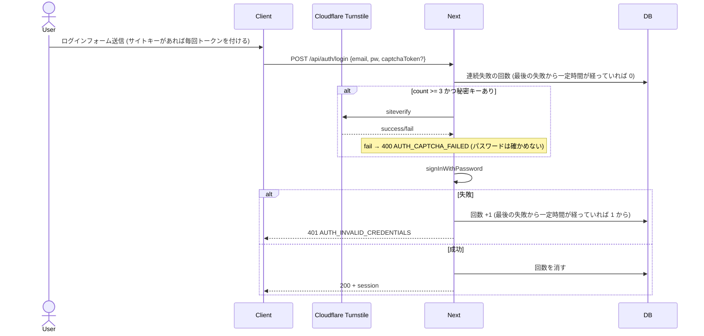

# 認証・セッション管理設計

## 1. 目的・スコープ

全ドメイン共通の認証フロー・セッション管理・2FA/MFA・SSO・パスワードポリシー・子供同意を定義する (impersonation は提供しない: §11)。  
各ドメイン (family / org / operator / mobile) は本ドキュメントを参照し、独自定義を禁止する。

**対象外**: Stripe Webhook 署名検証 (cross/04-api-conventions.md)、RLS ポリシー (cross/02-rls-patterns.md)

---

## 2. 関連要件

- 要件定義 03 §17.1-17.12 (認証・セッション管理)
- 要件定義 03 §17.10 (子供アカウント保護 COPPA / 日本)
- 要件定義 01 §15.4-15.7 (モバイル通知・a11y 周辺)

---

## 3. 認証フロー

### 3.1 対応認証方式

| 方式 | Phase | 備考 |
|------|-------|------|
| Email + Password | Phase 1 | Supabase Auth 標準 |
| Google OAuth | Phase 1 | 個人 + Org Workspace |
| Apple Sign In | Phase 1 | iOS App Store 必須 |
| SAML 2.0 (Azure AD / Google WS / Okta) | Phase 2 | org_enterprise のみ |
| 汎用 OIDC | Phase 2 | org_enterprise のみ |
| LINE Login | Phase 2 | 個人ユーザー向け |
| WebAuthn | Phase 2 | TOTP の代替 |
| SMS 認証 | 非対応 | SIM Swap 攻撃リスクのため禁止 |

### 3.2 Email + Password ログインシーケンス

```mermaid
sequenceDiagram
    actor User
    participant Client
    participant Next as Next.js (proxy・Node.js runtime)
    participant Supabase as Supabase Auth
    participant Redis as Upstash Redis

    User->>Client: email + password 入力
    Client->>Next: POST /api/auth/login
    Next->>Redis: rate_limit_check (10/min/IP)
    alt 超過
        Redis-->>Next: 429
        Next-->>Client: RATE_LIMIT_EXCEEDED
    end
    Note over Next: 3回失敗後 Cloudflare Turnstile 必須 (ロックはしない。§8)
    Next->>Supabase: signInWithPassword(email, password)
    alt 失敗
        Supabase-->>Next: invalid credentials
        Next->>Next: 連続失敗の回数 +1 (DB。最後の失敗から一定時間で 0 に戻る)
        Next-->>Client: AUTH_INVALID_CREDENTIALS
    end
    Supabase-->>Next: session (access_token, refresh_token)
    Note over Supabase: auth.sessions の INSERT のトリガーが user_sessions_metadata に記録 (cross/16 §11.3)
    Next->>Supabase: ログインの文脈 (IP・UA・国) を記録 (cross/16 §13.5)
    Note over Next: login は MFA の分岐を持たない。運営の入口で AAL2 を求める (cross/12 §18.2)
    Next-->>Client: Set-Cookie (Secure; HttpOnly; SameSite=Lax)
    Next-->>Client: 200 OK (user profile)
```

### 3.3 ソーシャルログイン統合方針

- 同一メールアドレスの既存アカウントとソーシャルアカウントは **確認メール送信後に自動統合**
- 退会時: ソーシャル連携トークン全削除 + Google/Apple ドキュメント準拠で IdP 側 revoke (Apple は mobile/08 §9.3 (退会の段階 `apple_revoke`)。Google の revoke は未実装 (mobile/08 Q-10))
- ソーシャルログイン経由の初回登録時は `user_profiles.terms_accepted = true` が入っていないため、利用規約同意モーダルを強制表示

---

## 4. セッション管理

### 4.1 タイムアウト設定

| ロール区分 | アイドルタイムアウト | 絶対タイムアウト |
|-----------|------------------|----------------|
| 個人ユーザー (`user` ロール) | 24 時間 | 30 日 |
| 組織メンバー (`org_member` 以上) | 8 時間 | 7 日 |
| 運営系 (`admin` / `finance` 等) | 1 時間 | 12 時間 |

### 4.2 Cookie 属性

```
Set-Cookie: sb-access-token=...; Path=/; Secure; HttpOnly; SameSite=Lax; Max-Age=86400
Set-Cookie: sb-refresh-token=...; Path=/; Secure; HttpOnly; SameSite=Lax; Max-Age=2592000
```

- `Secure`: HTTPS のみ
- `HttpOnly`: JavaScript からアクセス不可
- `SameSite=Lax`: CSRF 対策 (POST 系はオリジンチェックも追加)

### 4.3 同時ログイン上限

上限は設けない。一覧・個別失効・30 日の自動終了 (cross/16)。

ユーザーは Web の `/settings/security/sessions`・アプリの `settings/sessions` でログイン中の端末を一覧し、1 つずつ・または他の端末をすべてログアウトできる (`GET /api/auth/sessions`・`DELETE /api/auth/sessions/{id}`・`POST /api/auth/sessions/revoke-others`。cross/16 §14.1〜14.3・§15・§16)。

### 4.4 ログアウト時の Cookie 完全削除

個別の失効は RPC `auth_session_revoke` (cross/16 §11.4)。ログアウトは今までどおり `signOut()`。

---

## 5. 2FA / MFA

→ **`cross/12-operator-mfa.md` が正典** (運営ロールの TOTP と AAL2 の入口・バックアップコード・紛失時の回復と解除・猶予の環境変数・モバイルとアプリの WebView・DB を直接呼ぶ経路)。
対象 (必須) は super_admin / admin / finance / org_industrial_doctor (cross/12 §12.1 の `MFA_REQUIRED_ROLES`)。`org_admin` への強制と、そのほかのロールの任意の MFA は範囲外 (cross/12 §0.3・§27 Q-3)。
login (`POST /api/auth/login`) は MFA を見ない。必須ロールの運営は、運営の画面・API の入口 (`requireRole`) で、aal1 のセッションなら 6 桁の確認 (`/settings/security/mfa/verify?next=`) か登録 (`/settings/security/mfa/setup?next=`) へ回される (cross/12 §18)。

---

## 6. SSO Phase 2 (SAML / OIDC / SCIM / JIT)

### 6.1 対応 IdP (Phase 2)

| IdP | プロトコル |
|-----|---------|
| Azure AD (Entra ID) | SAML 2.0 |
| Google Workspace | SAML 2.0 |
| Okta | SAML 2.0 |
| 汎用 | OIDC |

### 6.2 機能

- IdP 主導 / SP 主導ログイン両対応
- JIT プロビジョニング: `user_profiles` 自動作成、`organization_id` 自動セット
- SCIM 2.0: ユーザー追加・属性更新・削除の双方向同期
- グループ → ロールマッピング: IdP の Group claim → `user_profiles.roles`

### 6.3 organizations テーブル追加列

// SSO 関連カラムの canonical 定義は org/01-data-model.md §3 (organizations テーブル) を参照。
// 以下は参照用の列名概要のみ記載する:
// - sso_enabled BOOLEAN
// - sso_provider VARCHAR(50)          -- 'azure_ad' | 'google_ws' | 'okta' | 'oidc'
// - sso_metadata_url TEXT             -- IdP メタデータ URL
// - sso_metadata_xml TEXT             -- IdP メタデータ XML (直接貼り付け)
// - scim_token_hash TEXT              -- SCIM API 用トークンハッシュ (Vault 暗号化)

---

## 7. パスワードポリシー

### 7.1 ロール別要件

| 項目 | 一般 (`user`) | 組織メンバー (`org_member`+) | 運営 (`admin`+) |
|------|------------|--------------------------|----------------|
| 最小長 | 10 文字 | 12 文字 | 14 文字 |
| 必須文字種 | 英大小英数 | 英大小英数記号 | 英大小英数記号 |
| 過去履歴禁止 | 直近 3 個 | 直近 5 個 | 直近 10 個 |
| 強制ローテーション | なし | なし (Enterprise オプションで 90 日) | 90 日必須 |
| ハッシュ方式 | bcrypt 12 rounds | 同左 | 同左 |
| HIBP 突合 | あり (警告) | あり (拒否) | あり (拒否) |

### 7.2 HIBP (Have I Been Pwned) チェック

```typescript
// src/lib/auth/hibp.ts
export async function checkPasswordBreached(password: string): Promise<boolean> {
  const hash = await crypto.subtle.digest('SHA-1', new TextEncoder().encode(password));
  const hashHex = Array.from(new Uint8Array(hash))
    .map(b => b.toString(16).padStart(2, '0'))
    .join('').toUpperCase();
  const prefix = hashHex.slice(0, 5);
  const suffix = hashHex.slice(5);
  const res = await fetch(`https://api.pwnedpasswords.com/range/${prefix}`);
  const text = await res.text();
  return text.split('\n').some(line => line.startsWith(suffix));
}
```

---

## 8. ログイン失敗時の扱い (アカウントはロックしない)

アカウントのロックアウトはしない (オーナーの選択 2026-10-10。他人のメールアドレスで失敗を繰り返すだけで本人を締め出せるため。失敗が続いたらボットの確認を求める)。

| 連続失敗の回数 | アクション |
|---------|---------|
| 0〜2 回 | なし |
| 3 回以上 | Cloudflare Turnstile のトークンをサーバーで確かめる (キーが設定されているとき)。何回失敗してもロックはしない |

- 何回失敗していても、正しいパスワード (と、求めたときはボットの確認) があればログインできる。ロック中の応答・ロックの通知 (本人へのメール・管理者への通知)・ロックの解除の手続きは無い。
- 回数はメールアドレス (小文字・前後の空白なし) ごとに DB (`auth_login_failures`。メールアドレスは SHA-256 のハッシュだけ) で数える。登録されていないメールアドレスも同じように数える。
- 回数が 0 に戻るのは、ログインに成功したときと、最後の失敗から一定の時間 (既定 24 時間。環境変数 `AUTH_LOGIN_FAILURE_RESET_MINUTES`) が経ったとき。
- IP アドレスごとの回数制限 (§3.2 の 10/min/IP) は残す。
- 実装: `src/lib/auth/guarded-login.ts`・`src/lib/auth/login-failures.ts`・`supabase/migrations/20261010160000_auth_login_failure_window.sql`。運用: `docs/operations/auth-protection.md` §2.1。

---

## 9. パスワードリセット

### 9.1 フロー

```
1. POST /api/auth/password-reset {email}
   → enumeration 対策: 存在しないメールでも「リセットメールを送信しました」を返す
   → rate limit: 1 メールあたり 3 回/h、IP あたり 10 回/h
2. Resend 経由でリセットリンク送信 (token = 32 byte random, 1 時間有効)
3. GET /api/auth/password-reset/confirm?token={token}
   → token 検証 (使用済み即無効化)
4. POST /api/auth/password/reset {new_password}  (cross/16-auth-history-sessions.md §14.7。再設定メールのリンク / コードで作ったセッション = amr に 60 分以内の recovery / otp があるものだけが呼べる)
   → password_history 照合 (直近 N 世代。RPC auth_password_check。cross/16 §11.5)
   → Supabase Auth パスワード更新 (GoTrue の PUT /auth/v1/user を本人の access token で。他の端末のセッションは GoTrue が同じトランザクションで消す)
   → 全セッション revoke (リセット後は再ログイン強制。ページが signOut({ scope: 'global' }) を呼ぶ)
   → 照合と再設定の認可が効くのはこの API の経路だけ。GoTrue の PUT /auth/v1/user を直接呼ぶ経路は通らない (cross/16 §24・S-33。履歴の記録はトリガーでどの経路でも残る)
```

### 9.2 レート制限実装

```typescript
// src/lib/ratelimit/auth.ts
import { Ratelimit } from '@upstash/ratelimit';
import { Redis } from '@upstash/redis';

export const passwordResetByEmail = new Ratelimit({
  redis: Redis.fromEnv(),
  limiter: Ratelimit.slidingWindow(3, '1 h'),
  prefix: 'pw_reset:email',
});

export const passwordResetByIP = new Ratelimit({
  redis: Redis.fromEnv(),
  limiter: Ratelimit.slidingWindow(10, '1 h'),
  prefix: 'pw_reset:ip',
});
```

---

## 10. メールアドレス変更

```
1. POST /account/email/change {new_email}
2. 新メールへ確認リンク送信 (24 時間有効)
3. 確認後: 旧メールへ変更通知 (詐取検知用)
4. 組織所属者の場合: HR Webhook へ変更通知 (organizations.hr_webhook_enabled=true 時)
5. admin_audit_logs 記録
```

### 10.1 両方の確認が要る設定 (Secure email change) の 1 通目 (#1187・#1574)

Supabase の「Secure email change」が有効だと、確認メールは現在と新しいメールアドレスの両方に届き、両方のリンクを開くと変更が終わる。
1 通目のリンクを開くと、Supabase Auth (GoTrue) はセッションの代わりに知らせ (`message` = "Confirmation link accepted. Please proceed to confirm link sent to the other email") だけを戻り先に付ける (戻り先 URL のハッシュ。GoTrue のソースでは PKCE のリンクのときクエリにも)。メールの雛形が token_hash の形なら、`verifyOtp({ type: 'email_change' })` がエラーもセッションも返さない。

| 経路 | 1 通目の受け取り方 | 出すもの |
|------|------------------|---------|
| Web (`emailRedirectTo` = `/auth/callback`) | `/auth/callback` はサーバーで動きハッシュを読めないので、認証の情報 (code・token_hash・token) が無いとき・1 通目と分かったとき (クエリの `message`・email_change でセッションなし) は、本来の遷移先を `next` に入れて `/auth/link-notice` へ移す。Location にハッシュを付けないので、ブラウザが元のハッシュを引き継ぎ、`/auth/link-notice` がブラウザで読む (`src/lib/auth/link-notice.ts`) | 「もう一方のメールアドレスに届いた確認メールのリンクも開いて」+「続ける」(next へ)。知らせが無ければそのまま next へ、ハッシュのエラーはログイン画面へ |
| モバイル (`homegohan://auth/verify`) | `apps/mobile/src/lib/authLink.ts` がハッシュの `message` を読む (`awaiting_other_confirmation`) | 同じ文。「アプリへ戻る」 |

1 通目の判定 (`isEmailChangeAwaitingOtherMessage`) と文 (`EMAIL_CHANGE_AWAITING_OTHER_NOTICE`) は Web とモバイルで共通 (`packages/shared/src/email-change-link.ts`)。クエリの `message`・token_hash の 1 通目でセッションが返らないことは GoTrue のソースに基づく。ローカルの Supabase では Secure email change が効いておらず 1 通目を再現できないため、結合テストでは固定していない (本番の設定の確認は #1574 のオーナー作業)。

---

## 11. impersonation (なりすまし支援) — 提供しない (#1124)

**提供しない** (オーナー判断 2026-10-08)。以前の設計 (`super_admin` が一時セッショントークンを発行して他ユーザーとしてログインする) は採用しない。

理由: 実装されていたのはトークンの発行だけだった。トークンは `admin_audit_logs.details` に平文で書かれるだけで、受け取って使う側
(セッションの切り替え・画面上部の赤バナー・なりすまし中の操作の記録) がどこにも無かった。使えない機能が使えるように見えていたため、
API・ヘルパー・エラー型・管理画面の表示をすべて削除した。

削除したもの:
- `POST /api/admin/users/{id}/impersonate` (旧設計の `POST /api/super-admin/impersonate/{userId}` も作らない)
- `src/lib/auth/helpers.ts` の `impersonate()` / `endImpersonation()` / `isImpersonating()`、`ImpersonationError`、`ImpersonationResult`
- `/admin/users/{id}` の「impersonate」表示 (押せない状態で出ていた)

方針:
- サポート対応は、本人として操作せず、読み取り専用のユーザー画面 (`/admin/users/{id}`、サポートコンソールの `/support/users`) で行う。
- 赤バナー・`/account/privacy` での「なりすまし拒否」設定は作らない。
- `admin_audit_logs.impersonated_by` 列は、過去に書かれた行の履歴として残す (列を消す migration は作らない。新しく書く処理は無い)。
  過去に `action_type = 'impersonate'` で書かれた行も、監査ログ (UPDATE / DELETE 不可) なので消さない。
- 復活させる場合は、トークンを検証する側 (セッションの分け方・Cookie の prefix・有効期限・赤バナー・対象ユーザーの拒否設定・
  全操作への `impersonated_by` 記録) を含めて、設計からやり直す。

---

## 12. 子供アカウント保護 (COPPA / 日本)

未成年の年齢確認と保護者の同意は、設計書 [`cross/14-parental-consent.md`](./14-parental-consent.md) に移した (同意の記録の表・RPC・同意ゲート・画面はそちら。実体は migration `20261017030000_parental_consent_and_birth_date.sql`)。要点:

- 生年月日は同意画面 (`/legal-consent`) で聞く。本人の生年月日は `user_profiles.birth_date` に 1 回だけ記録し、保護者の同意とのつながり (昇格の経路) が無い 18 歳未満の自己登録と、13 歳未満の自己登録は断る (`LEGAL_MINOR_SELF_SIGNUP_REFUSED`)。
- 保護者の同意は子供の追加と同時に記録する (`add_family_child` が子供の行と同じトランザクションで `parental_consents` に署名を 1 行入れる)。別の同意の API は無い。
- 同意の取り消しは、子供を家族から外すこと (トリガーが `revoked_at` を入れる)。

---

## 13. データモデル

### 13.1 password_history

<!-- DDL/RLS は operator/01-data-model.md §3.23 を参照 (canonical)。本ドキュメントは設計方針のみ記述 -->

→ 記録のトリガー (`on_auth_user_password_changed`。関数 `password_history_record`)・照合の RPC (`auth_password_check`) は cross/16 §11 が正典。

### 13.2 parental_consents

DDL・RLS は設計書 [`cross/14-parental-consent.md`](./14-parental-consent.md) §6.4 の 4 (実体は migration `20261017030000_parental_consent_and_birth_date.sql`)。

### 13.3 user_sessions_metadata

<!-- DDL は operator/01-data-model.md §3.25 を参照 (canonical) -->

→ 列・トリガー・RPC・保守のジョブは cross/16 §11 が正典 (記録は `auth.sessions` のトリガー)。

### 13.4 failed_invite_lookups

招待トークンの総当たり攻撃の検知・レート制限用イベントログテーブル。

<!-- DDL は operator/01-data-model.md §3.24 を参照 (canonical) -->

---

## 14. 認可ヘルパー関数仕様

### 14.1 requireRole

```typescript
// src/lib/auth/helpers.ts

/**
 * リクエストから認証済みユーザーを取得し、指定ロールのいずれかを持つか検証する。
 * 失敗時は NextResponse で 401 / 403 を返す準備が整った例外を throw する。
 *
 * @param roles - 許可するロールの配列 (例: ['admin', 'super_admin'])
 * @returns 認証済みユーザーの user_profiles 行
 * @throws AuthError (401) - 未認証の場合
 * @throws PermError (403) - ロール不足の場合
 */
export async function requireRole(
  roles: UserRole[]
): Promise<UserProfile> {
  const supabase = createServerClient();
  const { data: { user }, error } = await supabase.auth.getUser();
  if (error || !user) throw new AuthError('AUTH_UNAUTHENTICATED');

  const { data: profile } = await supabase
    .from('user_profiles')
    .select('roles')
    .eq('id', user.id)
    .single();

  if (!profile) throw new AuthError('AUTH_PROFILE_NOT_FOUND');
  const userRoles = (profile?.roles ?? []) as UserRole[];
  if (!userRoles.some(r => roles.includes(r))) {
    throw new PermError('PERM_DENIED', `Requires one of: ${roles.join(', ')}`);
  }
  return { ...user, roles: userRoles };
}
```

### 14.2 requireOrgRole

```typescript
/**
 * ユーザーが指定の organization に対して指定のロールを持つか検証する。
 * 組織とユーザーの所属一致も検証する。
 *
 * @param userId - 検証対象ユーザー ID
 * @param orgId  - 組織 ID
 * @param roles  - 許可する org ロールの配列 (例: ['org_admin', 'org_manager'])
 */
export async function requireOrgRole(
  userId: string,
  orgId: string,
  roles: OrgRole[]
): Promise<void> {
  const supabase = createServerClient();
  const { data: profile } = await supabase
    .from('user_profiles')
    .select('roles, organization_id')
    .eq('user_id', userId)
    .single();

  if (!profile) throw new AuthError('AUTH_PROFILE_NOT_FOUND');
  if (profile.organization_id !== orgId) {
    throw new PermError('PERM_ORG_MISMATCH');
  }
  if (!(profile.roles as OrgRole[]).some(r => roles.includes(r))) {
    throw new PermError('PERM_DENIED');
  }
}
```

### 14.3 resolveOrganizationId

```typescript
/**
 * リクエストパラメータまたは認証ユーザーのプロフィールから organization_id を解決する。
 * admin / super_admin はクエリパラメータ ?org_id= で任意の組織を指定可能。
 * それ以外は自身の organization_id を使用。
 *
 * @param user    - requireRole で取得した UserProfile
 * @param reqOrgId - URL パラメータまたはクエリから受け取った org_id (nullable)
 * @returns 解決済み organization_id
 */
export function resolveOrganizationId(
  user: UserProfile,
  reqOrgId?: string
): string {
  const isAdmin = (user.roles as string[]).some(r => ['admin', 'super_admin'].includes(r));
  if (isAdmin && reqOrgId) return reqOrgId;
  if (!user.organization_id) throw new PermError('PERM_NO_ORG');
  return user.organization_id;
}
```

### 14.4 型定義

```typescript
// src/types/domain/auth.ts
export type UserRole =
  | 'user'
  | 'support'
  | 'sales'
  | 'finance'
  | 'content_moderator'
  | 'org_member'
  | 'org_viewer'
  | 'org_manager'
  | 'org_admin'
  | 'org_industrial_doctor'
  | 'admin'
  | 'super_admin';

export type OrgRole = Extract<
  UserRole,
  'org_member' | 'org_viewer' | 'org_manager' | 'org_admin' | 'org_industrial_doctor'
>;

export class AuthError extends Error {
  constructor(public code: string, message?: string) {
    super(message ?? code);
    this.name = 'AuthError';
  }
}

export class PermError extends Error {
  constructor(public code: string, message?: string) {
    super(message ?? code);
    this.name = 'PermError';
  }
}
```

---

## 15. シーケンス: CAPTCHA + 失敗回数の統合フロー (ロックはしない)



---

## 16. テスト方針

| テスト種別 | 対象 | ツール |
|---------|------|------|
| Unit | `requireRole`, `requireOrgRole`, `resolveOrganizationId`, HIBP チェック | Vitest |
| Integration | ログイン失敗の回数 (何回失敗してもロックしない・時間で戻る)、ログインの記録・セッションの失効・通知の取り置き (`tests/integration/security/auth-history-sessions.test.ts`。cross/16 §20.3) | Vitest + Supabase Local |
| E2E | 正常ログイン → (必須ロールの運営は MFA の画面。cross/12 §21.5) → ダッシュボード到達、パスワードリセット全フロー | Playwright |
| Security | CAPTCHA バイパス試行、enumeration 対策、Cookie 属性 | Playwright + 手動 |

---

## 17. 既存実装との関連

| 資産 | 状態 | 対応 |
|------|------|------|
| Supabase Auth Email+Password | 保持 | そのまま利用 |
| `/api/auth/login`, `/api/auth/logout` 既存 | 要確認 | 本仕様に合わせてリファクタ |
| `user_profiles.roles` 列 | 保持・拡張 | 12 ロール体系へ migration |

---

## 18. 未解決事項

| 項目 | 状態 | 期限 |
|------|------|------|
| WebAuthn (Phase 2) の Supabase 対応状況確認 | TODO | Phase 2 着手前 |
| SCIM 2.0 エンドポイント詳細設計 | TODO | org/08-sso-saml.md で定義 |
| LINE Login の Supabase OAuth 設定手順 | TODO | Phase 2 |
| impersonation のセッション分離方式 (Cookie prefix 等) | 不要 (#1124: impersonation は提供しない。§11) | - |
| 管理者向け 90 日パスワードローテーション強制の実装方法 | TODO | Phase 1 リリース前 |
