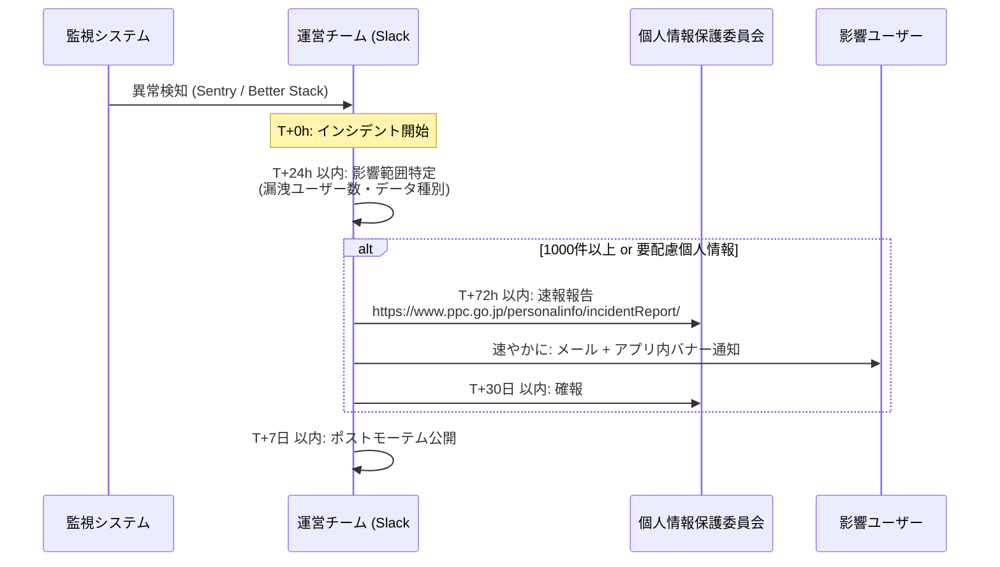
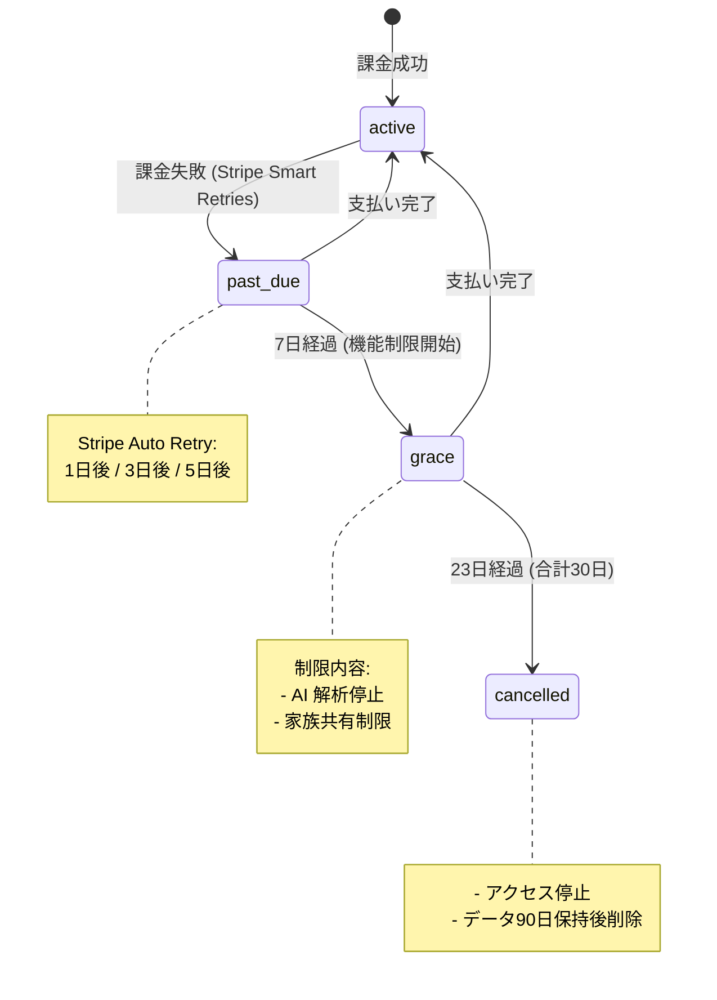

# 法務・コンプライアンス設計

## 1. 目的・スコープ

特商法・個人情報保護法・インボイス制度・GDPR・医療免責等の法的要件を実装レベルで具体化する。  
各ドメイン実装は本ドキュメントで定めた UI テキスト・フロー・テーブル設計に準拠する。

**対象外**: 利用規約・プライバシーポリシーの全文 (全文は `cross/20-terms-privacy-text.md` が正典)

---

## 2. 関連要件

- 要件定義 03 §18 全項 (法務・コンプライアンス)
- 要件定義 03 §18.1 (特商法)
- 要件定義 03 §18.5 (利用規約再同意)
- 要件定義 03 §18.10 (産業医記録保管)

---

## 3. 特定商取引法 (特商法)

### 3.1 最終確認画面の必須表示 (Stripe Checkout 直前)

**法的根拠**: 特定商取引に関する法律 第 11 条 (電子消費者契約)

必須表示項目:
1. プラン名 + 月額 (税込)
2. 自動更新であること、解約しなければ毎月課金される旨
3. 解約方法 (`/account/billing` から 1 タップで解約可能)
4. 解約予告期間 (個人: 翌日有効 / 組織: 月末まで)
5. 最低契約期間 (個人: なし / 組織: プラン依存)
6. 利用規約 / プライバシーポリシーへのリンク

注: 特商法のこの確認画面の表示は Web の Checkout (Stripe) だけの要件。アプリ内課金 (App Store / Google Play) の購入の画面は、ストアの要件に従う (billing/03 §10.6)。

**チェックボックス要件**:  
「上記内容を確認しました」チェックボックスを必須クリック → `申し込む` ボタンが活性化。

### 3.2 UI 実装

```tsx
// src/components/billing/checkout-confirmation.tsx

export function CheckoutConfirmation({
  plan,
  onConfirm,
}: {
  plan: SubscriptionPlan;
  onConfirm: () => void;
}) {
  const [confirmed, setConfirmed] = React.useState(false);

  return (
    <div className="space-y-6 p-6 border rounded-xl bg-white">
      <h2 className="text-xl font-bold">お申し込み内容の確認</h2>

      <table className="w-full text-sm">
        <tbody>
          <tr>
            <td className="py-2 text-text-secondary">プラン名</td>
            <td className="py-2 font-medium">{plan.display_name}</td>
          </tr>
          <tr>
            <td className="py-2 text-text-secondary">月額料金</td>
            <td className="py-2 font-medium">¥{(plan.monthly_price_jpy ?? 0).toLocaleString()} (税込)</td>
          </tr>
          <tr>
            <td className="py-2 text-text-secondary">更新</td>
            <td className="py-2">毎月自動更新。解約しない限り毎月課金されます。</td>
          </tr>
          <tr>
            <td className="py-2 text-text-secondary">解約方法</td>
            <td className="py-2">
              <a href="/account/billing" className="text-primary underline">
                お支払い設定
              </a>から 1 タップで解約できます。
            </td>
          </tr>
          <tr>
            <td className="py-2 text-text-secondary">解約予告期間</td>
            <td className="py-2">{plan.plan_type === 'personal' ? 'いつでも解約可能 (次回更新日まで利用可)' : '月末まで'}</td>
          </tr>
        </tbody>
      </table>

      <p className="text-sm text-text-secondary">
        <a href="/terms" className="underline">利用規約</a> および{' '}
        <a href="/privacy" className="underline">プライバシーポリシー</a>
        に同意の上でお申し込みください。
      </p>

      <label className="flex items-start gap-3 cursor-pointer">
        <input
          type="checkbox"
          checked={confirmed}
          onChange={e => setConfirmed(e.target.checked)}
          aria-required="true"
          className="mt-1"
        />
        <span className="text-sm">
          上記内容を確認し、利用規約・プライバシーポリシーに同意します{' '}
          <span aria-hidden="true" className="text-danger">*</span>
        </span>
      </label>

      <button
        onClick={onConfirm}
        disabled={!confirmed}
        className="w-full btn-primary disabled:opacity-50 disabled:cursor-not-allowed"
        aria-disabled={!confirmed}
      >
        申し込む
      </button>
    </div>
  );
}
```

---

## 4. 外国第三者提供同意 (個人情報保護法 24 条)

### 4.1 対象サービスと提供データ

| サービス | 事業者所在国 | 提供データ | GDPR 適合 |
|---------|-----------|---------|---------|
| xAI (Grok) | 米国カリフォルニア州 | 食事写真・栄養データ・献立リクエスト | 未取得 |
| Anthropic (Claude) | 米国カリフォルニア州 | 健康相談テキスト・産業医アドバイス | 未取得 |
| Google (Gemini) | 米国カリフォルニア州 | 食事写真・健診 PDF | GDPR 適合 |
| OpenAI | 米国カリフォルニア州 | (使用する場合) | GDPR 適合 |

### 4.2 同意モーダル (AI 機能初回利用時に必須表示)

```tsx
// src/components/consent/ai-data-consent-modal.tsx

const AI_PROVIDERS = [
  { name: 'xAI Inc.', country: '米国カリフォルニア州', gdpr: false },
  { name: 'Anthropic PBC', country: '米国カリフォルニア州', gdpr: false },
  { name: 'Google LLC', country: '米国カリフォルニア州', gdpr: true },
];

export function AiDataConsentModal({ onAccept, onDecline }: ConsentModalProps) {
  return (
    <Dialog open>
      <DialogContent aria-labelledby="ai-consent-title">
        <DialogTitle id="ai-consent-title">
          AI 機能利用に関する外国第三者提供の同意
        </DialogTitle>
        <div className="space-y-4 text-sm">
          <p>
            ほめゴハンは AI 解析のため、食事写真と栄養データを以下の事業者へ送信します:
          </p>
          <ul className="space-y-2">
            {AI_PROVIDERS.map(provider => (
              <li key={provider.name} className="flex items-start gap-2">
                <span className="font-medium">{provider.name}</span>
                <span className="text-text-secondary">({provider.country})</span>
                {!provider.gdpr && (
                  <span className="text-xs bg-warning-light text-warning px-1 rounded">
                    GDPR 適合審査未取得
                  </span>
                )}
              </li>
            ))}
          </ul>
          <p>
            詳細は{' '}
            <a href="/privacy#privacy-6" className="text-primary underline">
              プライバシーポリシー §5
            </a>{' '}
            をご参照ください。
          </p>
          <p className="text-warning-light bg-warning-light p-3 rounded-md text-xs">
            ⚠ 同意しない場合、AI 機能 (献立提案・食事写真解析・産業医アドバイス) は
            ご利用いただけません。
          </p>
        </div>
        <DialogFooter>
          <button onClick={onDecline} className="btn-secondary">
            同意しない (AI 機能を無効化)
          </button>
          <button onClick={onAccept} className="btn-primary">
            同意して AI 機能を利用する
          </button>
        </DialogFooter>
      </DialogContent>
    </Dialog>
  );
}
```

### 4.3 external_data_consents テーブル

```sql
CREATE TABLE external_data_consents (
  id           UUID        PRIMARY KEY DEFAULT gen_random_uuid(),
  user_id      UUID        NOT NULL REFERENCES auth.users(id) ON DELETE CASCADE,
  provider     VARCHAR(50) NOT NULL CHECK (provider IN ('xai', 'anthropic', 'google', 'openai')),
  consented    BOOLEAN     NOT NULL,
  consented_at TIMESTAMPTZ NOT NULL DEFAULT NOW(),
  ip_address   INET,
  user_agent   TEXT,
  revoked_at   TIMESTAMPTZ
);

CREATE UNIQUE INDEX ON external_data_consents (user_id, provider)
  WHERE revoked_at IS NULL;  -- 有効な同意は1件のみ

ALTER TABLE external_data_consents ENABLE ROW LEVEL SECURITY;

CREATE POLICY "ext_consent_self_read"
  ON external_data_consents FOR SELECT
  USING (auth.uid() = user_id);

CREATE POLICY "ext_consent_self_insert"
  ON external_data_consents FOR INSERT
  WITH CHECK (auth.uid() = user_id);

-- 取消: revoked_at を UPDATE (DELETE 禁止、監査目的で保持)
CREATE POLICY "ext_consent_no_delete"
  ON external_data_consents FOR DELETE USING (false);
```

> **実装メモ (2026-10、T15 / #1154 / #1133 / #1169。マイグレーション `20261010090000_ai_consent_policy_version.sql`)**
>
> 上の DDL と §4.1・§4.2 は設計時のもの。実装では次のとおり変えた。
>
> - **列を足した**: `policy_version text` (同意したときの文面の版。`supabase/functions/_shared/ai-consent.ts` の `AI_CONSENT_VERSION`)。
>   文面や事業者の一覧を改めたら版を上げる。古い版 (または版を記録する前) に同意した人は「未同意」に戻る。
> - **事業者は 5 社** (§4.1 の表を置き換える): `xai` / `google` / `openai` / `perplexity` / `aimlapi`。
>   コードの送信先から数えた、利用者のデータを実際に送っている事業者 (Perplexity は食事の写真の解析の栄養推定、
>   AI/ML API (AIMLAPI OÜ) は AI 相談・献立の作成で文章を検索用に数値化するのに使う)。`anthropic` は現在使っていないので同意の対象にしない。
>   `provider` の CHECK に `perplexity` / `aimlapi` を足した。送信先と一覧の食い違いは `tests/ai-consent-provider-inventory.test.ts` が検査する。
> - **書き込みはサーバーだけ**: 同意・撤回は `POST /api/ai/consent` / `POST /api/ai/consent/revoke` が service role で書く。
>   IP アドレスは `x-forwarded-for` の先頭の値、User-Agent はリクエストのヘッダーから取る (クライアントの申告は使わない)。
>   クライアントからの INSERT は閉じた (`ext_consent_self_insert` を削除し、`authenticated` には SELECT だけを残した)。
>   読めるのは自分の行だけ (`ext_consent_self_read`)。撤回は `revoked_at` を入れる。行は消さない。
> - **未同意なら AI へ送らない (§4.2 の「同意しない場合は AI 機能を使えない」)**: 全事業者について現行の版の有効な同意が無い利用者
>   (一度も同意していない・撤回した・古い版に同意した) のデータは、サーバーが外国の AI 事業者へ送る手前で止める。
>   判定は `supabase/functions/_shared/ai-consent.ts` (`runAiConsentCheck` / `decideAiConsent`) の 1 か所で、
>   Next.js は `src/lib/ai/consent-guard.ts`、Edge Functions は `supabase/functions/_shared/ai-consent-guard.ts` から呼ぶ。
>   止めたときは 403 `{ code: "AI_CONSENT_REQUIRED" }`、同意の状況を読めないときは 503 `{ code: "AI_CONSENT_CHECK_FAILED" }` (送らない。fail-closed)。
>   API Route だけでなく、利用者の JWT で直接呼べる Edge Function、cron (`/api/cron/process-menu-queue`)、
>   料理の画像の作成のジョブ (`process-meal-image-jobs`。献立の持ち主で判定) でも止める。送る経路の一覧は
>   `tests/ai-consent-enforcement.test.ts` にあり、判定を呼び忘れた経路があるとテストが落ちる。未同意なら送らないことは、
>   `tests/ai-consent-enforcement-routes.test.ts` が API Route ごとに実際に呼んで、`tests/ai-consent-enforcement-edge.test.ts` が
>   Edge Function ごとに (構文木と、代表の関数は実際のハンドラで) 確かめる。
>   記録の保存と AI のコメントが一緒になっている API (健康診断・血液検査の保存、ホームの栄養の集計、相談を閉じる) は、
>   保存・集計はして AI の部分だけを省き、応答の `aiSkipped` で知らせる。画面はそれを読み、AI の分析の代わりに
>   「記録は保存した。AI の分析は同意すると行える」旨の一文と同意の確認ページへの導線を出す (相談は、要約を作らなかった旨の一文)。
>   受け付けたあとに止めたとき (キューの献立生成・献立生成の続きの工程・買い物リストの作り直し) は、リクエストの行の失敗の欄
>   (`weekly_menu_requests.error_message` / `shopping_list_requests.result.error`) に、コードではなく応答の本文と同じ人向けの文を書く
>   (`aiConsentDeniedStoredMessage`。画面はこの欄をそのまま出すため)。続きの工程を呼ぶ側は、呼んだ先が止めたら再試行せず、
>   この文を内部の文で上書きしない (`invokeMenuContinuation`、Next.js 側は `generate-menu-v4-retry.ts` / `generate-menu-v5-retry.ts`)。
>   画面は失敗の文を `handleStoredAiConsentFailure` に通し、「同意が必要です」の文なら同意画面へ案内して、自分のエラー表示は出さない
>   (書く側は `tests/ai-consent-stored-failure.test.ts`、読む側は `tests/ai-consent-stored-failure-readers.test.ts` が検査する)。
> - **同意画面**: 押せるのは「同意する」と「同意しない」(Esc も同じ)。AI の操作の前に未同意なら出し、「同意しない」なら操作をやめる。
>   「同意しない」は行にしない (有効な行は (user_id, provider) ごとに 1 件の部分ユニーク索引があり、拒否の行があると後の同意が作れなくなる)。
>   次に AI の操作をしたときに、もう一度出す。サーバーに止められたとき (画面の状況が古いなど) は、全画面共通の同意画面
>   (`src/components/consent/AiConsentRequiredHost.tsx`) が出る。画面を開くと自動で AI に頼む処理 (栄養士のコメントなど) は、
>   同意画面を出さずに案内の一文だけを出す。アプリ (apps/mobile) は、止められたら同意画面 (`/settings/ai-consent` を WebView で開く) へ案内する。
>   アプリの同意画面は画面の遷移で開くので、案内の「同意画面を開く」を押した時点で開いているモーダル (シート) が残ると、
>   同意画面がその下に隠れる。モーダルの上に開いた部品は自分で案内を出さず、開いた側が自分のモーダルも閉じてから案内を出す。
>   画面そのものを modal (ルートの Stack で `presentation: "modal"` など) で開く画面は置かない。iOS では、そこから移った同意画面が
>   その画面の下に入るため。以前の食事の新規作成 (`meals/new`) がこの形だったが、通常の操作で届かないネイティブの画面として
>   2026-10-15 に消した (#1598。規則は `apps/mobile/src/lib/ai-consent.ts` の先頭。入れ子と、modal で開く画面が無いことは
>   `tests/ai-consent-mobile-modal-nesting.test.ts` が検査する)。
> - 同意画面の文面は、弁護士の確認が済むまで**仮**。画面は `src/components/consent/AiDataConsentModal.tsx`、
>   確認と撤回のページは `/settings/ai-consent`。Web の設定 (`/settings` の「データとプライバシー」) とアプリの設定タブに
>   「AI へのデータ提供の同意」の項目を置き、そこから開く (案内の一文が「設定の「AI へのデータ提供の同意」から」と指す先)。
>   既存の利用者は全員「未同意」から始まり、AI 機能を使おうとした時点で同意画面が出る。

---

## 5. 漏洩 72 時間報告義務

### 5.1 インシデント対応フロー



### 5.2 報告テンプレートの場所

```
docs/operations/incident-report-template.md  ← 運営チームが作成・管理
```

---

## 6. インボイス制度 (適格請求書)

### 6.1 要件

- 運営側適格請求書発行事業者番号: `T` + 13 桁 (取得後に設定)
- `org_invoices` に税率区分ごとの金額・消費税額を記録
- 法人顧客が「インボイス必須」設定をオンにした場合: PDF 生成 (A4 縦)
- 電子保存法準拠: タイムスタンプ付き、改ざん防止

### 6.2 organizations テーブル追加列

```sql
ALTER TABLE organizations
  ADD COLUMN qualified_invoice_number VARCHAR(14),  -- T + 13桁
  ADD COLUMN requires_invoice         BOOLEAN NOT NULL DEFAULT FALSE,
  ADD COLUMN contract_status          VARCHAR(20) DEFAULT 'active'
    CHECK (contract_status IN ('active', 'pending', 'expired', 'cancelled'));
```

### 6.3 org_invoices テーブル

DDL/RLS は **`org/01-data-model.md §3.x org_invoices`** を参照 (canonical)。

インボイス制度対応の必須列 (canonical 側に追記要):
- `issuer_invoice_number VARCHAR(14)` — 発行元 (運営側) の T 番号
- `subtotal_standard_jpy / tax_standard_jpy` — 標準税率 (10%) 対象額・税額
- `subtotal_reduced_jpy / tax_reduced_jpy` — 軽減税率 (8%) 対象額・税額
- `pdf_url`, `timestamp_token` — 電子保存法対応 (タイムスタンプ局トークン)

canonical 定義に上記列が無い場合は org/01 で ALTER TABLE 追加すること。

RLS (canonical = org/09-rls-policies.md):
- 同組織 `org_admin` / `org_manager` の SELECT 許可
- 運営 `admin` / `super_admin` / `finance` の SELECT 許可

---

## 7. 利用規約・プライバシーポリシー再同意

### 7.1 terms_acceptances テーブル

```sql
CREATE TABLE terms_acceptances (
  id              UUID        PRIMARY KEY DEFAULT gen_random_uuid(),
  user_id         UUID        NOT NULL REFERENCES auth.users(id) ON DELETE CASCADE,
  document_type   VARCHAR(50) NOT NULL
    CHECK (document_type IN (
      'terms_of_service',
      'privacy_policy',
      'parental_consent',
      'external_data_provision'
    )),
  document_version VARCHAR(20) NOT NULL,  -- 例: "v2026.1"
  accepted_at     TIMESTAMPTZ NOT NULL DEFAULT NOW(),
  ip_address      INET,
  user_agent      TEXT
);

CREATE INDEX ON terms_acceptances (user_id, document_type, document_version);

ALTER TABLE terms_acceptances ENABLE ROW LEVEL SECURITY;

CREATE POLICY "terms_self_read"
  ON terms_acceptances FOR SELECT
  USING (auth.uid() = user_id);

CREATE POLICY "terms_self_insert"
  ON terms_acceptances FOR INSERT
  WITH CHECK (auth.uid() = user_id);

-- UPDATE / DELETE 禁止 (同意記録は不可逆)
CREATE POLICY "terms_no_update"
  ON terms_acceptances FOR UPDATE USING (false);
CREATE POLICY "terms_no_delete"
  ON terms_acceptances FOR DELETE USING (false);
```

### 7.2 変更時の再同意フロー (実装済み: #1174)

「いま有効な版」と、利用者ごとの「同意済みの版」の食い違いを見て、再同意を求める。判定は、リクエストごとに `terms_acceptances` を数えるのではなく、すでに毎回読んでいる `user_profiles` の行の列で行う (クエリを増やさない)。`terms_acceptances` は、いつ・どの版に・どの IP と端末から同意したかの証跡として残す。

| 部品 | 場所 | 役割 |
|---|---|---|
| いま有効な版・施行日 | `packages/shared/src/legal-versions.ts` の `LEGAL_DOCUMENTS` | `{ terms_of_service, privacy_policy }` それぞれの `{ version, effectiveDate }`。`/terms`・`/privacy` の版・施行日の表示、同意の記録、ゲートが同じ値を見る。内容が変わる改定は `version` を上げる (上げると全員に再同意を求める)。版の形式は英数字・`.`・`_`・`-` の 1〜20 文字 (`terms_acceptances.document_version` が varchar(20) のため) |
| 同意済みの版 | `user_profiles.terms_version_accepted` / `privacy_version_accepted` / `legal_accepted_at`、生年月日 `user_profiles.birth_date` (設計書 14) | NULL = 未同意 (生年月日は未入力)。特権列ガード (`guard_user_profiles_privileged` と `_on_insert`) の対象で、本人は直接書き換えられない (生年月日を書くのは `accept_legal_documents` (1 回だけ) と、昇格の承諾 `accept_child_promotion` (子供の行の値を写す)) |
| 同意の記録 | DB 関数 `accept_legal_documents(p_terms_version, p_privacy_version, p_ip, p_user_agent, p_birth_date)` (SECURITY DEFINER、authenticated のみ) | `auth.uid()` 本人の行だけを書く。`user_profiles` の 3 列を更新し (行が無ければ既定値で作る)、生年月日が未記録なら `p_birth_date` を 1 回だけ記録し (13 歳未満と、保護者の同意とのつながりが無い 18 歳未満の自己登録は何も書かずに `LEGAL_MINOR_SELF_SIGNUP_REFUSED` で断る。設計書 14)、`terms_acceptances` に文書ごとに 1 行足す (同じ版は重複して足さない)。UPDATE / DELETE は RLS で禁止のまま |
| 記録の API | `POST /api/legal/accept` | body の版がいま有効な版と一致するときだけ関数を呼ぶ (違えば 409)。IP・user_agent は、body ではなくサーバーが受け取ったリクエストから取る |
| ゲート | `lib/supabase/middleware.ts` (判定は `lib/legal-consent.ts`) | 判定は `isLegalConsentComplete` (`packages/shared/src/parental-consent.ts`。版 + 生年月日 + 18 歳未満なら保護者の同意とのつながり。設計書 14。つながりは `lib/legal-consent-minor.ts` の `withMinorGuardianStatus` が DB に聞いて入れる)。これを満たさない、サインイン中の利用者を、環境変数 `LEGAL_CONSENT_ENFORCE=on` のときだけ `/legal-consent?next=<元のパス>` へ回す。強制していない間は、環境変数 `LEGAL_CONSENT_NOTICE=on` のときだけ `(main)` の画面の上に「同意のお願い」のお知らせ (同意画面へのリンク。戻り先は強制と同じ `buildLegalConsentPath` で作り、いまのクエリも残す) を出し、誰も止めない。どちらも未設定 (既定) なら何も出さず、誰も止めない。2 つのフラグの値の読み方は共通 (`isLegalConsentFlagOn`。`on` のときだけ有効、大文字小文字と前後の空白は区別しない)。どちらもサーバー側 (middleware) だけで読み、お知らせを出すかは `(main)` の layout から props で画面へ渡す。`/api/*` は middleware の `/api` の分岐で判定する (許可リストは `packages/shared/src/legal-consent-api.ts`。`LEGAL_CONSENT_ENFORCE=on` で `isLegalConsentComplete` を満たさなければ 403 `LEGAL_CONSENT_REQUIRED`。設計書 13a・14) |
| 同意画面 | `src/app/legal-consent/` | 必須チェック 2 つ (利用規約・プライバシーポリシー。それぞれ全文へのリンクつき。`required` と `aria-required="true"`。フォームは `noValidate` で、送れるかどうかは両方のチェックで「同意して続ける」が押せるようになるかで決まる)。「同意しない」はログアウトして、もう一度ログインすれば同意しなくても退会とデータの書き出しの画面 (`/legal-consent/account`。cross/20 Q-23) へ進めることと、お問い合わせを案内する (お問い合わせによる削除は約束しない)。フォームの下と未成年の案内にも、この画面へのリンクを出す。生年月日 (無いときだけ。文は `LEGAL_CONSENT_BIRTH_DATE_COPY`)・未成年の案内 (`LEGAL_MINOR_SELF_SIGNUP_REFUSED` のとき)・保護者の同意とのつながりが無い 18 歳未満の案内も出す (設計書 14)。フォームの下と「同意しない」の後の案内に、同意せずに開示・訂正・利用停止・消去を請求できる画面 (`/settings/data-requests`) へのリンクを出す (#1751) |
| サインアップ | `src/app/(auth)/signup/page.tsx` | 「続行することで同意したものとみなされます」をやめ、必須チェックボックスにした (チェックするまで Google 登録も登録ボタンも押せない)。このチェックは同意の記録を残さない。記録が残るのは同意画面で同意したときだけ。登録後は、`/auth/callback` が初期設定を始めていない未同意の人を `LEGAL_CONSENT_ENFORCE` の値に関わらず同意画面へ回す (下の「初回の作成」の行。#1435) |
| 初回の作成 | `src/app/(auth)/auth/callback/route.ts` (判定は `lib/legal-consent.ts` の `resolveFirstSignInDestination`) | 初期設定を始めていない (プロフィールの行が無い、または `onboarding_started_at` / `onboarding_completed_at` がどちらも NULL) のに、いま有効な版に同意していない人を、`LEGAL_CONSENT_ENFORCE` の値に関わらず `/legal-consent?next=<本来の遷移先>` へ回す。サインアップ画面の Google 登録・メール確認と、ログイン画面の「Googleで続ける」で初めて入った人 (サインアップ画面のチェックを通らない) が、どれもここを通る。ログイン画面には、初めての人には同意の画面が出ることを、規約・プライバシーポリシーへのリンクつきで出す (みなし同意の文面は出さない)。回さないもの: 管理者・プロフィールを読めなかったとき・遷移先がゲートの対象外のパス (`/auth/*` など)。初期設定を始めたあとの人を止めるかは、これまでどおりゲートの強制で決まる |

画面の判定の対象外のパス: `/terms` `/privacy` `/legal` `/legal-consent` `/contact` `/settings/data-requests` (開示・訂正・利用停止・消去の請求の画面と確認の画面。初期設定の差し戻しからも外す。#1751) `/frozen` `/auth/*` (ネイティブ認証ブリッジを含む) `/api/*` `/handson-tour` と静的ファイル (`/api/*` は画面の判定では対象外で、API は 13a のゲートが判定する)。リダイレクトは画面の取得 (GET / HEAD) だけに掛ける。凍結の判定のあと、初期設定の差し戻しの前に見る。

**重要変更時の対応**:
- 版は v2026.3 (#1912 の billing/03 §11 で有料プランの条文を足した版。v2026.1 は #1901、v2026.2 は #1917)、施行日は公開日 (`LEGAL_DOCUMENTS`。全文と版の上げ方は cross/20 §6・§7・§9)。公開は弁護士の確認を待たない (cross/20 P-12「予告なしで直し次第公開」)。確認を受けるかはオーナーの判断 (cross/20 Q-1)。確認で直しがあれば版を上げる (T30)
- 強制 (`LEGAL_CONSENT_ENFORCE=on`) を始める日はオーナーが決める。始める前に、お知らせだけの期間 (`LEGAL_CONSENT_NOTICE=on`) を置くかどうかも決める。お知らせも既定では出ない
  - 2026-10-10 のオーナー判断で、本番は `LEGAL_CONSENT_ENFORCE=on` にした (このときの版・施行日は v2025.1 の仮置きで、#1901 で v2026.1 に上げた。お知らせだけの期間は置いていない)。ゲートは Web の画面の取得に掛かり、13a で `/api/*` にも掛けた (403 `LEGAL_CONSENT_REQUIRED`)。13b でモバイルにも掛けた (同意が要る間は、ルートのゲートがアプリの画面を Web の `/legal-consent` の WebView 1 つにする。同意の後は入口から振り分け直す。「同意しない」の後の案内もアプリの同意画面に残る。設計書 13b。#1442)
- 全ユーザーへ 30 日前メール通知 (Resend 一斉送信): **未実装**。本番のメール配信は、送信ドメインの検証が済むまで動かない
- アプリ内強制再同意: 上のゲート (ダッシュボードアクセス時にインターセプト) として実装済み。効くのは `LEGAL_CONSENT_ENFORCE=on` のときだけ (既定は off)
- 旧バージョンを `docs/legal/archive/v{version}/` に永久保管: 改定のたびに手で行う (`docs/legal/archive/v2025.1/`・`v2026.1/`・`v2026.2/` に保管した)

**既知の残課題**:
- `terms_acceptances` の本人による直接 INSERT (RLS `terms_self_insert`) は開いたまま。直接入れた行は端末情報を偽れるので、証跡として確かなのは `accept_legal_documents` が書いた行。保護者の同意は `parental_consents` (関数経由) に記録する (設計書 14)。`terms_acceptances` の `parental_consent` は使わない。`terms_self_insert` を閉じる条件は、AI の同意 (`external_data_provision`) の書き込みが関数経由になることだけが残る
- アプリ (Expo) のネイティブのサインアップ画面には、まだ同意のチェックが無い (ゲートは WebView 側で効き、起動時のゲート (13b) で使う前に同意する)

---

## 8. 医療免責表示

### 8.1 必須表示箇所

```tsx
// src/components/legal/medical-disclaimer.tsx

export function MedicalDisclaimer({ variant = 'footer' }: { variant?: 'modal' | 'footer' }) {
  const text = 'ほめゴハンは食事管理を支援するアプリであり、医師の診察・診断・治療を代替するものではありません。';

  if (variant === 'modal') {
    return (
      <div role="alert" className="bg-info-light border border-info rounded-lg p-4">
        <div className="flex items-start gap-2">
          <Info className="text-info mt-0.5" size={16} aria-hidden="true" />
          <p className="text-sm text-text">{text}</p>
        </div>
      </div>
    );
  }

  return (
    <p className="text-xs text-text-secondary mt-4 border-t pt-2">
      {text}
    </p>
  );
}
```

必須表示画面:
1. アプリ初回起動時 (モーダル)
2. 健診結果アップロード画面 (フッター)
3. 産業医アドバイス画面 (フッター)
4. AI ヘルスインサイト画面 (フッター)
5. 利用規約第9条 (cross/20 §6)

急病時の表示 (特定キーワード検知時):
```tsx
// 「救急」「病院に行く」「急に具合が悪い」等のキーワード検知後
<div role="alert" className="bg-danger-light border-l-4 border-danger p-4">
  <p className="font-medium">緊急の症状がある場合は、すぐに救急 (119) または
  医療機関を受診してください。このアプリは医療行為を行いません。</p>
</div>
```

---

## 9. 課金失敗グレースペリオド

### 9.1 ステータス遷移



### 9.2 実装

> **実装との対応 (billing/01-billing-core.md)**: `invoice.payment_failed` は受け口 (`POST /api/webhooks/stripe`) が契約を Stripe から取り直し、
> 写像 (`billing_apply_stripe_subscription`) が `past_due`・`past_due_since` を写して、監査 `system.payment.failed` を書く (billing/01 §7.3・§9.6)。
> 下の `handlePaymentFailed` (アプリが直接 UPDATE してメールを送る) は使わない。支払失敗の案内は Stripe の顧客向けメール
> (Dashboard の Customer emails) に任せ、アプリはメールを送らない (billing/01 §5.3)。
> `past_due → grace → cancelled` の時間の経過で進める処理 (下の pg_cron `check_grace_period`) は配線の冊で作る (billing/01 §12。
> `grace → cancelled` は DB を直接 `cancelled` にせず、Stripe の契約を解約して届く `deleted` を写像が写す)。

```typescript
// src/lib/billing/grace-period.ts

// DDL CHECK 制約 (operator/01-data-model.md:343) と完全一致
// チャージバックは status='past_due' + notes で表現 (operator/05 §4.2)
export type SubscriptionStatus =
  | 'trialing'
  | 'active'
  | 'paused'
  | 'past_due'
  | 'grace'
  | 'cancelled'
  | 'expired';

/**
 * Stripe の `invoice.payment_failed` webhook 受信時に呼び出す。
 * past_due → grace → cancelled の遷移は pg_cron バッチで自動実行。
 */
export async function handlePaymentFailed(userId: string): Promise<void> {
  await supabaseAdmin
    .from('personal_subscriptions')
    .update({ status: 'past_due', past_due_since: new Date().toISOString() })
    .eq('user_id', userId)
    .eq('status', 'active');

  // 通知のメールはアプリから送らない: 支払失敗の案内は Stripe の顧客向けメール (billing/01-billing-core.md §5.3)
}
```

```sql
-- pg_cron: 毎時チェック
SELECT cron.schedule('check_grace_period', '0 * * * *', $$
  -- past_due → grace (7日経過)
  UPDATE personal_subscriptions
  SET status = 'grace',
      grace_started_at = NOW()
  WHERE status = 'past_due'
    AND past_due_since < NOW() - INTERVAL '7 days';

  -- grace → cancelled (grace_started_at から 23 日経過 = 合計 30 日)
  -- operator/08-cron-batches.md §5.7 Stage 2 と整合
  UPDATE personal_subscriptions
  SET status = 'cancelled',
      cancelled_at = NOW()
  WHERE status = 'grace'
    AND grace_started_at < NOW() - INTERVAL '23 days';
$$);
```

---

## 10. チャージバック対応

> **配線の冊で作る**: 受け口 `POST /api/webhooks/stripe` (billing/01-billing-core.md §9.6) は `charge.dispute.created` をまだ受け取らない
> (`src/lib/billing/core.ts` の `STRIPE_EVENT_ACTIONS` に無いイベントは何もしない)。チャージバックの処理は配線の冊が、
> billing/01 §12 の「イベントの追加」の型 (`STRIPE_EVENT_ACTIONS` に 1 行 + `service.ts` の分岐 + Dashboard の登録) で足す。下は見本。

```typescript
// src/app/api/webhooks/stripe/route.ts
// charge.dispute.created イベントの処理

async function handleDisputeCreated(event: Stripe.Event) {
  const dispute = event.data.object as Stripe.Dispute;
  const chargeId = dispute.charge as string;

  // Stripe から charge の customer を取得
  const charge = await stripe.charges.retrieve(chargeId);
  const customerId = charge.customer as string;

  // user_id を取得
  const { data: sub } = await supabaseAdmin
    .from('personal_subscriptions')
    .select('user_id')
    .eq('stripe_customer_id', customerId)
    .single();

  if (!sub) return;

  // ステータスを past_due (soft-suspend) に変更 + dispute メタ情報を notes に記録
  // CHECK 制約: ('trialing','active','paused','cancelled','expired','past_due','grace')
  // disputed という独立ステータスは設けず、past_due + notes で運用 (operator/05 §4.2 と整合)
  await supabaseAdmin
    .from('personal_subscriptions')
    .update({
      status: 'past_due',
      notes: `チャージバック発生 (dispute_id: ${dispute.id})`,
    })
    .eq('user_id', sub.user_id);

  // super_admin に Slack 通知
  await notifySlack(
    `⚠️ チャージバック発生: user=${sub.user_id} dispute=${dispute.id}`
  );

  // 監査ログ
  await supabaseAdmin.from('admin_audit_logs').insert({
    action: 'billing.dispute.created',
    target_user_id: sub.user_id,
    metadata: { dispute_id: dispute.id, amount: dispute.amount },
  });
}
```

---

## 11. 産業医記録の保管期間

### 11.1 保管要件

| テーブル | 保管期間 | 根拠 |
|---------|---------|------|
| `org_health_notes` | **5 年** | 労働安全衛生規則 |
| `org_health_access_logs` | **10 年** | 同上 + 独自規定 |

### 11.2 退職者データの匿名化

```sql
-- pg_cron: 日次実行 (退職後 5 年経過分を匿名化)
SELECT cron.schedule('anonymize_retired_health_notes', '0 3 * * *', $$
  UPDATE org_health_notes
  SET
    content = '[匿名化済み - 保管期間: ' || TO_CHAR(created_at + INTERVAL '5 years', 'YYYY-MM-DD') || ']',
    updated_at = NOW()
  WHERE user_id IN (
    SELECT up.id FROM user_profiles up
    JOIN org_license_assignments ola ON ola.user_id = up.id
    WHERE ola.revoked_at < NOW() - INTERVAL '5 years'
  )
  AND anonymized_at IS NULL;
$$);
```

---

## 12. Cookie 同意バナー (改正電気通信事業法)

> 広告・計測の Cookie を使っていないため、バナーは置かない (プライバシーポリシー第10条。cross/20 §7)。採用するときは本節を復活させ、プライバシーポリシーの版を上げる。

### 12.1 UI 要件 (2023 年 6 月施行対応)

```tsx
// src/components/legal/cookie-consent-banner.tsx

export function CookieConsentBanner() {
  const [visible, setVisible] = React.useState(false);
  const [preferences, setPreferences] = React.useState({
    analytics: false,
    advertising: false,
  });

  return visible ? (
    <div
      role="dialog"
      aria-labelledby="cookie-banner-title"
      className="fixed bottom-0 left-0 right-0 z-50 bg-bg-elevated shadow-xl p-4 md:p-6"
    >
      <h2 id="cookie-banner-title" className="font-bold mb-2">
        Cookie の使用について
      </h2>
      <p className="text-sm text-text-secondary mb-4">
        このサイトはアクセス解析・広告のため Cookie を使用します。
        詳細は
        <a href="/privacy#privacy-10" className="text-primary underline">
          プライバシーポリシー
        </a>
        をご参照ください。
      </p>
      <div className="flex flex-wrap gap-2">
        <button
          onClick={() => handleAcceptAll()}
          className="btn-primary"
        >
          すべて許可
        </button>
        <button
          onClick={() => handleEssentialOnly()}
          className="btn-secondary"
        >
          必須のみ
        </button>
        <button
          onClick={() => setShowSettings(true)}
          className="btn-ghost text-sm"
        >
          設定
        </button>
      </div>
    </div>
  ) : null;
}
```

### 12.2 cookie_consents テーブル

```sql
CREATE TABLE cookie_consents (
  id             UUID        PRIMARY KEY DEFAULT gen_random_uuid(),
  user_id        UUID        REFERENCES auth.users(id) ON DELETE CASCADE,  -- nullable (未ログイン時)
  session_id     VARCHAR(255),  -- ブラウザセッション識別子
  analytics      BOOLEAN     NOT NULL DEFAULT FALSE,
  advertising    BOOLEAN     NOT NULL DEFAULT FALSE,
  consented_at   TIMESTAMPTZ NOT NULL DEFAULT NOW(),
  ip_address     INET,
  user_agent     TEXT
);
```

計測 Cookie (GA4 / PostHog 等) は `analytics = TRUE` の同意後にのみ発火。

---

## 13. アナリティクス PII フィルタ

### 13.1 送信禁止データ

```typescript
// src/lib/analytics/schema.ts
// 全アナリティクスイベントはこのファイルで定義・管理

/**
 * 送信禁止フィールド (自動 REDACT)
 */
const PII_FIELDS = [
  'email', 'phone', 'name', 'full_name',
  'password', 'token', 'secret',
  'health_*', 'meal_content', 'birth_date',
] as const;

export function sanitizeEventProperties(
  props: Record<string, unknown>
): Record<string, unknown> {
  return Object.fromEntries(
    Object.entries(props).filter(([key]) =>
      !PII_FIELDS.some(pii => {
        if (pii.endsWith('*')) return key.startsWith(pii.slice(0, -1));
        return key === pii;
      })
    )
  );
}
```

- IP 匿名化: GA4 の匿名化 ON、PostHog の IP マスク設定
- PR レビューで analytics イベント追加時に PII フィールドを含まないかチェック必須

---

## 14. AI 生成コンテンツの著作権

> 利用規約第14条として実装した (cross/20 §6)。

利用規約への記載内容 (実装での表示箇所: 利用規約画面):

```
1. AI が生成した献立・レシピ・コメントの著作権はユーザーに帰属する (個人利用範囲)
2. 運営は集計・サービス改善目的でのみ、匿名化した形で利用できる
3. ユーザーが投稿した口コミ等は CC0 相当のライセンスで運営に提供される
```

---

## 15. SLA 違反の自動返金

詳細は cross/07-dr-backup.md §6.2 を参照。自動算出バッチの仕様:

```sql
-- pg_cron: 月次バッチ (月初 JST 09:00 = UTC 00:00)
SELECT cron.schedule('check_sla_violation', '0 0 1 * *', $$
  -- Better Stack の稼働率データを参照 (外部 API 呼び出し or インポート済みデータ)
  -- org_sla_logs テーブルから月次稼働率を算出
  -- 違反がある場合: Stripe Credit Note を自動発行
  -- admin_audit_logs に記録
$$);
```

---

## 16. 退会・GDPR 削除フロー (即時削除)

> **オーナー判断 (2026-10-08, #1130)**: 退会 (アカウント削除) は **即時削除が正式仕様**。
> 旧版の「30 日の cooling period (クーリングオフ) を置き、期間が過ぎたら pg_cron が削除する」方式は採用しない。
> 現行実装の `POST /api/account/delete` (`auth.admin.deleteUser` による即時削除) が正式仕様どおりの動きで、30 日待機のための仕組みは作らない。
> 要件定義 03 §15.7 / §18.13 にある「30 日 cooling period」は、この判断で置き換える。

### 16.1 方針

| 項目 | 正式仕様 |
|------|---------|
| 削除のタイミング | 本人が確認を済ませた時点で **即時**。待機期間 (cooling period) は設けない |
| 取り消し・復旧 | できない。確認画面にも「この操作は取り消せません」と明記する |
| ストアの購読 | 確認画面には、App Store / Google Play でお申し込みの有料プランは退会しても解約されないことも出す (`STORE_SUBSCRIPTION_DELETION_NOTICE`。退会の 4 つの入口。billing/03 §10.4) |
| ログイン制限・警告バナー | 設けない (待機期間がないため) |
| 遅延削除バッチ | 作らない。旧設計の pg_cron `execute_gdpr_deletions` と `/api/cron/gdpr-delete` は設計から外す |
| 削除の実行記録 (`gdpr_deletion_requests`) | 退会のたびに 1 行残す (#1562。§16.4)。個人を特定できない形 (利用者の id の HMAC) で、日時・理由・実行者 (本人 / 運営) を残す。削除要求の待機には使わない |
| 削除前の確認メール・削除完了メール | 退会が成功したときに、削除完了メールを本人へ 1 通だけ送る (#1152。実装は `src/lib/account-deletion-notification.ts`、文面は `src/lib/emails/account/account-deleted.ts`)。削除前の確認メール (退会の受付時のメール) は送らない。30 日の待機は設けない。本文には、App Store / Google Play の購読は退会で解約されないことの固定の文 `STORE_SUBSCRIPTION_DELETION_NOTICE` と、各ストアの定期購読の管理のページ (`IAP_STORE_LABELS`・`STORE_SUBSCRIPTION_MANAGEMENT_URL`。`@homegohan/shared`) を、購読の有無で出し分けずに載せる (第三者に退会させられた本人は退会の確認の文を見ていないため。#1912。billing/03 §10.4) |
| 削除処理の堅牢化 | 追加した (#1175、作業計画 T11)。範囲は §16.3 |

背景 (#1130): 旧設計の遅延削除バッチは実装されないままで、削除要求を記録しても実行されずに残りうる設計だった。実際の退会は最初から即時削除として動いている。

※ 本節の T11 / T20 は作業計画 (2026-10-08) の番号。§19 の「T番号」(適格請求書発行事業者番号) とは別物。

### 16.2 削除フロー

```
1. ユーザー: 設定画面の「アカウントを削除する」を押す (Web / モバイル)
   - Web: 確認モーダルに「削除します」と入力する
   - モバイル: 確認アラートで「削除」を選ぶ
   - 凍結 (BAN) 中の利用者 (#1445): 凍結の画面 (/frozen) の「退会・データの書き出し」から /frozen/account を開き、
     「削除します」と入力して押す (設定画面は凍結中には開けない)
2. クライアント: POST /api/account/delete { confirm: true }
   - 認証済みセッションが必須 (未認証は 401、confirm がなければ 400)
   - 凍結中の利用者も呼べる (#1445)。middleware は凍結中の利用者の /api を 403 AUTH_ACCOUNT_FROZEN で止めるが、
     退会 (POST /api/account/delete) と書き出し (GET /api/account/export) と、有料プランの解約の 3 本 (契約の要約・解約の予約・Billing Portal。
     billing/01 §9.8) は止めない
     (src/lib/auth/frozen.ts の FROZEN_ALLOWED_API_PATHS。完全一致。一覧は lib/supabase/__tests__/middleware-frozen-allowed-api.test.ts が固定する)。
     ほかに凍結中でも止めないのは、通知のトークンの claim (POST /api/push-tokens/claim。#1636) と、
     ネイティブ認証ブリッジのコードの発行 (POST /api/auth/native-bridge/code。#1861) と、
     お問い合わせの送信 (POST /api/contact。#1871) の 3 本だけ。
     claim は利用者の操作ではなく端末の後片付け (同じ端末の前の利用者の行を外す) のため。退会・書き出しの一覧には入れず、src/lib/push-tokens.ts の
     isPushTokenClaimApiPath で別に判定する (全 route で広がらないことは lib/supabase/__tests__/middleware-push-token-claim-exemption.test.ts)。
     ブリッジのコードは、モバイルの凍結の画面 (Web の /frozen を WebView で開く。apps/mobile/app/frozen.tsx) を本人のセッションで開くため
     (止めると WebView がログイン画面になり、凍結中でも許している退会・書き出しにたどり着けない)。コードで WebView に移るのは端末が
     すでに持っている本人のセッションだけで、WebView の中では middleware が画面を /frozen へ差し戻し、/api を上の一覧以外 403 で止める
     (Web でログインしたときと同じ)。これも退会・書き出しの一覧には入れず、src/lib/auth/frozen.ts の isNativeBridgeCodeApiPath で別に判定する
     (route も凍結を見ない。一覧と 4 つの判定で通るパスは lib/supabase/__tests__/middleware-frozen-allowed-api.test.ts が固定する)。
     お問い合わせの送信は、凍結の画面 (/frozen) の「サポートに問い合わせる」から /contact (画面は凍結中も開ける) へ進んだ本人が
     送れるようにするため (#1871 のオーナーの選択 (2026-10-18): 「凍結中も送れるようにする。/api/contact を凍結中も通す。今の回数の制限は、そのまま効かせる。」)。
     サービスから離れる操作ではないので退会・書き出しの一覧には入れず、src/lib/auth/frozen.ts の isFrozenContactSubmitRequest で
     メソッドまで見て別に判定する (POST だけ。同じパスの GET = 本人のお問い合わせの履歴は凍結中は 403 のまま)。
     回数の制限 (src/lib/rate-limit.ts の contact カテゴリ。クライアント IP 単位) は route が利用者の状態を見ずにかけるので、凍結中もそのまま効く。
     規約の同意ゲート (13a) も、退会・書き出し・有料プランの解約の 3 本・claim・お問い合わせ (/api/contact) を止めない (packages/shared の LEGAL_CONSENT_EXEMPT_API_PATHS に exact の行がある。
     ブリッジのコードは /api/auth の prefix の行 (auth_flow) で止めない。
     凍結中は同意の画面に進めないため。凍結の判定で通るパスがすべて同意の許可リストにあることは
     lib/supabase/__tests__/middleware-legal-consent-api.test.ts が全 route で確かめる)
3. 削除をブロックする条件 (409。判定の前に退会の印を付ける: RPC begin_account_deletion_guard。印のある人を運営がオーナーにして組織を作ろうとすると DB のトリガーが止める。supabase/migrations/20261023130000_account_deletion_owner_guard.sql。印のある人を家族の代表者にする作成・譲渡の承諾・運営の強制譲渡も DB のトリガーが REPRESENTATIVE_ACCOUNT_DELETING で止める。20261023150000_account_deletion_family_representative_guard.sql。#1917 の続き。オーナーの選択 (2026-10-24): 退会が止まったらその場で印を消す。auth.admin.deleteUser (手順 5) を呼ぶ前に止まったら (この 409・手順 4 の失敗)、返す前に RPC end_account_deletion_guard で印を消す (supabase/migrations/20261024120000_account_deletion_guard_release.sql。消すのに失敗しても応答は変えない)。deleteUser を呼んだあとに止まったときは消さない):
   - 組織の owner → ACCOUNT_DELETE_BLOCKED_ORG_OWNER
     (先に owner を譲渡するか、組織を解散する)
   - 家族グループの代表者 → ACCOUNT_DELETE_BLOCKED_FAMILY_REPRESENTATIVE
     (先に代表者を譲渡するか、家族グループを解散する)
4. 削除前の後始末 (service_role。実装は src/lib/account-deletion.ts。どの手順もやり直しても同じ結果になる):
   - Stripe の後始末 (段階 billing。billing/01 §11。実装は src/lib/billing/account-deletion.ts): 顧客の開いたままの Checkout Session を閉じ、
     Stripe の契約 (顧客の全契約と DB の行の和) のうち終端でないものを即時解約し、Stripe の顧客を匿名化する (まだなら)。
     顧客も契約の行も無ければ Stripe を呼ばない。失敗したら削除しない (まだ何も変えていないので、やり直せる)
   - 生のメールアドレスを残す記録を伏せ、本人の非公開レシピを消す: RPC prepare_account_deletion
     (メール配信ログ・問い合わせ・組織/家族の招待・家族の昇格リクエスト。pending の招待は revoked にする。失敗したら削除しない)
     送信待ち (email_outbox。#1193・docs/design/operator/10-logs-and-mail-retry.md §5.3 の 1b・1c): 本人の行 (user_id か宛先が本人) は
     宛先・件名・本文を伏せ、queued は dead (recipient_deleted) にする。他人宛の行は、件名・本文・返信先の中の本人のアドレスの部分だけを伏せ、状態は変えない
   - ライセンス席の解放: RPC release_user_membership (失敗しても削除は続ける。ただし IS_ORG_OWNER (直前にオーナーになっていた) は確認をやり直して 409 で止め (オーナーでなくなっていたら削除せず失敗にする)、CONFLICT_RETRY (所属の組織が途中で変わった) は削除せず失敗にする。src/lib/account-deletion.ts:349-365)
   - Storage のファイル削除: meal_photos / fridge-images / health-checkups の `<user_id>/` 以下、旧パス、
     DB の URL が指す本人のファイル (失敗したら削除しない)
   - 削除の実行記録を始める (#1562): RPC begin_account_deletion_record。`gdpr_deletion_requests` に、利用者の id の
     HMAC (`subject_hash`)・実行者 (`executor_type` = self)・理由のコード (`reason` = user_request)・`request_id` を書く。
     利用者の id もメールアドレスも書かない。1 人に 1 行 (途中で止まった記録は使い直す)。失敗したら削除しない
   - Stripe の後始末をもう一度 (段階 billing_recheck。billing/01 §11): 段階 billing と同じ処理を、deleteUser の直前にもう一度行う
     (段階 billing のあとに完了した Checkout の契約・作られた顧客を閉じる)。失敗したら削除しない (アカウントは残り、もう一度の退会で片付く)。
     退会のあとに Stripe に生まれた契約 (この段階のあと deleteUser までの間に完了したものなど) は、届いた Webhook の写像が
     「退会済み」と判定し、Stripe で即時解約する (billing/01 §8.6)
5. auth.users を削除 (auth.admin.deleteUser)
   - public 側のデータは FK の ON DELETE CASCADE / SET NULL で削除・匿名化される
     (auth.users を指す外部キーに NO ACTION は無い。20261010000100_auth_users_fk_on_delete.sql)
   - 削除が済んだら (すでに消えていたときも)、RPC complete_account_deletion_record で記録に `executed_at` を入れる。
     失敗しても応答は 200 のまま (アカウントはもう消えている)。失敗は app_logs に残す (記録は `executed_at` が空のまま残る)
6. 削除完了メールを本人へ 1 通送る (#1152。src/lib/account-deletion-notification.ts)。本文にはストアの購読が退会で解約されないことの固定の文と各ストアの管理のページを、購読の有無で出し分けずに載せる (§16.1 の表・src/lib/emails/account/account-deleted.ts)
   - 宛先は auth.users の登録アドレス。手順 3 の後・手順 4 の前に service_role の getUserById で控え、メモリ上だけで使う
     (app_logs・email_delivery_logs には生のアドレスを残さない。送信の失敗の記録は sendEmail がマスクした宛先で残す)
   - 完了メールは email_outbox に redact_after_send で登録し、送れたとき (sent)・届けられなかったとき (dead) に宛先・件名・本文を伏せる。
     宛先が停止リストに載っていれば行を作らない (#1193)
   - 送るのは手順 5 が実際に削除したときだけ。409・500・すでに消えていたユーザーのやり直し (deleteUser が 404) では送らない
   - 本文は退会日時 (日本時間) と問い合わせ先 (site-config の getSupportEmail)。送信元は site-config の getEmailFrom
   - best-effort: 送信の失敗・時間切れ (待つのは最長 5 秒) でも応答は 200 のまま。失敗は app_logs に残す (user_id を付けない)
7. 200 { success: true }
   - クライアントはサインアウトして、ログイン前の画面へ戻る
```

手順 4 と 5 は 1 つのトランザクションではなく、別々の呼び出し。手順 4 の各段階は何度流しても結果が変わらないので、
どこかで失敗したら 500 で止める (#1172 の internalError。本文は汎用メッセージと `INTERNAL_ERROR` だけで、生のエラー文・段階・`request_id` は返さない。原因は `app_logs` に残す)。アカウントは残るので、もう一度実行できる。

モバイルの削除画面 (`apps/mobile/app/settings/account.tsx`) へアプリ内から到達できない問題は #1037 で追う。アカウント削除の導線はアプリ内に必須なので、iOS 審査前の必須項目になる (MOBILE_TODO.md 参照)。

### 16.3 削除の範囲と現行実装

| 対象 | 正式仕様 | 現行実装 (2026-10-10) |
|------|---------|----------------------|
| アカウント (`auth.users`) と、FK でぶら下がる個人データ (食事・献立・健康記録・家族メンバー情報など) | 物理削除 (匿名化ではなく削除) | 実装済み (`auth.admin.deleteUser` と FK の CASCADE / SET NULL) |
| FK で消えない参照 (`invited_by` / `created_by` など) | FK の ON DELETE で処理 | 実装済み (#1175)。`auth.users` を指す NO ACTION の外部キーは 0 本。本人だけの記録 (`nps_surveys` / `csat_feedbacks` / `experiment_assignments` / `ai_content_logs`) は CASCADE、サポート・会計の記録 (`support_tickets` / `support_ticket_messages` / `coupon_redemptions` / `referral_rewards` / `email_delivery_logs`) と運営者・作成者・承認者の参照は行を残して SET NULL。テストが NO ACTION の再発を止める。`gdpr_deletion_requests.user_id` の外部キーは #1562 で外した (削除の実行記録は利用者の行を指さない。旧設計の行の `user_id` は begin_account_deletion_record が NULL にする) |
| 利用者が作ったレシピ (`recipes`) | 非公開は削除、公開は匿名化して残す | 実装済み (#1175)。`recipes.user_id` は `ON DELETE SET NULL` で、`user_id` が NULL の行は RLS (`Users can view public recipes`) で全員に見える。そのまま退会させると非公開のレシピまで公開されるので、RPC `prepare_account_deletion` が本人の非公開レシピを先に消す。公開レシピは `user_id` だけが外れて残る (他の利用者のコレクション・いいね・コメントが付いていることがあるため) |
| Storage の写真 (食事・冷蔵庫など) | 削除 | 実装済み (#1175)。3 バケットの `<user_id>/` 以下、旧パス (`meals/<user_id>/` など)、本人の行の URL が指す本人のファイル。持ち主がパスから分からない旧ファイル (バケット直下のタイムスタンプ名) は消さない |
| Stripe の顧客・サブスクリプション | サブスクリプションは即時に解約し、顧客は氏名・メールを消す匿名化をして残す (#1562) | 実装済み (billing/01 §11)。§16.2 の手順 4 の段階 billing (`prepare` の前) と billing_recheck (`deleteUser` の直前) が、開いたままの Checkout を閉じ、終端でない契約を即時解約し、顧客を匿名化する。退会のあとに Stripe に生まれた契約は、写像の入口 (`syncSubscription`) が即時解約する (billing/01 §8.6) |
| 法的保管義務のあるデータ (産業医記録 §11、監査ログ) | 削除せず、匿名化して保持 | 監査ログ (`admin_audit_logs`) は FK の `ON DELETE SET NULL` で操作者 ID が外れて残る。クーポンの償還記録 (`coupon_redemptions`) と紹介報酬 (`referral_rewards`) も、行を残して利用者との紐づけだけを外す (償還記録には匿名化した日時 `anonymized_at` が入る)。何年残すか (保存の期限) は未決で、決まるまでは「匿名化して残す」。期限を過ぎた記録を消すバッチは、期限が決まってから作る |
| 送信ログ中の生メールアドレス (`email_delivery_logs.email`) | 削除または匿名化 | 実装済み (#1175)。RPC `prepare_account_deletion` が `redacted@redacted.invalid` に置き換える (行は残す)。問い合わせ・招待も同様。宛先停止リスト (`email_blacklist`) は、苦情・バウンスのあったアドレスへ再送しないために伏せない。`membership_audit.metadata` の招待先アドレスは、退会に関係なく生のアドレスを持たない (#1562。migration 20261016190000)。トリガーが `email` を `email_hash` (正規化したアドレスの HMAC。鍵は Vault の `pii_hmac_key`) に置き換え、既存の行も置き換えた。#1163 の 24 時間の送信上限は `email_hash` 同士で比べるので、退会しても上限は戻らない |
| 送信待ちの宛先 (`email_outbox.to_email`) | 削除または匿名化 | 実装済み (#1193)。RPC `prepare_account_deletion` が本人の行の宛先・件名・本文を伏せ (queued は dead)、他人宛の行の件名・本文・返信先の中の本人のアドレスだけを伏せる。退会の完了メールは送れたあと・届けられなかったあとに伏せる |
| DB バックアップ (R2) の中の個人情報 | 復旧の目的でだけ、暗号化して保管する | 実装済み (cross/17-backup-automation.md §9.1)。daily 30 日・weekly 366 日・annual 2,557 日 (7 年) 残り、退会した利用者の行も取得の時点の分は含まれる。開けるのは age の秘密鍵を持つオーナーだけで、復元以外の目的で開かない。プライバシーポリシーに追記した (cross/20 §7 第12条) |
| 送信待ちの送信元 (`email_outbox.from_email`) | 伏せない | 送信元はアプリのアドレス (`EMAIL_FROM`・運用メールも同じ) で、利用者のものではない |
| 途中で失敗したとき | 半端な状態を残さず、やり直せる | 実装済み (#1175)。後始末 (手順 4) の失敗は 500 (internalError) で止めて `deleteUser` を呼ばない。ライセンス席の解放 (`release_user_membership`) だけは失敗しても続けるが、`IS_ORG_OWNER` (確認のあとにオーナーになっていた) は確認をやり直して 409 で止め (オーナーでなくなっていたら削除せず 500)、`CONFLICT_RETRY` (所属の組織が途中で変わった) は削除せず 500 にする (`src/lib/account-deletion.ts:399-419`)。確認 (手順 3) のあとに組織のオーナー・家族の代表者になって `deleteUser` が外部キー (ON DELETE RESTRICT) で失敗する経路は、手順 3 の退会の印と DB のトリガーが止める (`20261023130000`・`20261023150000`)。`deleteUser` を呼ぶ前に止まったとき (409・500) は、返す前に退会の印を消す (`20261024120000`。止まった退会の印で、本人の家族の作成・代表者の引き受けと、運営のその人をオーナーにした組織の作成を止めない) |

### 16.4 `gdpr_deletion_requests` テーブルの扱い (削除の実行記録)

#1562 で、このテーブルを「削除の実行記録」に当てた (migration 20261016190000_deletion_record_and_invite_email_hash.sql)。
旧設計の DDL は operator/01-data-model.md §3.21。列の追加・外部キーとポリシーの変更は migration が正。

| 列 | 中身 |
|----|------|
| `subject_hash` | 削除した利用者の id の HMAC-SHA256 (`pii_hmac_hex('account_deletion_subject', id)`。鍵は Vault の `pii_hmac_key`)。id そのものは残さない |
| `executor_type` | `self` (本人の退会) / `operator` (運営) |
| `executed_by` | 運営が実行したときの運営者の id (`ON DELETE SET NULL`)。本人の退会では NULL |
| `reason` | 理由のコード (`user_request` / `operator_action`)。自由な文は入れない (CHECK) |
| `request_id` | 削除を実行した処理の request_id (app_logs と同じ。調査用) |
| `requested_at` / `executed_at` | 削除を始めた日時 / 済んだ日時。`executed_at` が NULL = 途中で止まった |
| `user_id` | 新しい記録では書かない (NULL)。外部キーは外した |

- 書くのは RPC `begin_account_deletion_record` / `complete_account_deletion_record` だけ (service_role だけが実行できる)。手順は §16.2 の手順 4・5。
- 利用者の行を指す外部キーを持たないので、退会の CASCADE / SET NULL で記録が消えたり書き換わったりしない。
- 読み書きは service_role だけ (利用者向けのポリシーは外した。anon / authenticated は表の権限も無い)。
- 1 人の削除に記録は 1 行 (同じ `subject_hash` の記録を使い直す)。
- `cooling_until` (旧設計の 30 日の待機) と `cancelled_at` は使わない。`cooling_until` は NOT NULL なので、始めた日時と同じ値を入れる。
- super-admin の exports API (`/api/super-admin/exports`) は、以前はエクスポート依頼の記録先として流用していたが、#1126 で止めた。現状は全メソッドが 501 (`OP_NOT_SUPPORTED`) を返し、このテーブルには触れない (operator/02-api-spec.md §16)。

### 16.5 運営による代理削除

運営 (super_admin) が本人に代わって削除する画面・API は未実装。サポートから依頼を受けたときの扱いは operator/09-runbook.md §9.2 を参照。

個人情報の消去の請求 (`data_subject_requests` の `request_type = 'erasure'`。cross/15-data-subject-requests.md) との関係は cross/15 §4.4 を canonical とする: 消去の請求の完了は本人の退会 (§16 の即時削除) で行い、請求の行は退会後も `user_id` が NULL になって残る。代理削除を実装したら、消去の請求の運営側の完了操作として接続する (cross/15 §21)。

---

## 17. テスト方針

| テスト種別 | 対象 | ツール |
|---------|------|------|
| Unit | 特商法チェックボックス活性化ロジック、terms acceptance 確認 | Vitest |
| Integration | 課金失敗時の grace period 遷移 | Vitest + Supabase Local |
| E2E | Stripe Checkout 前の確認画面表示、Cookie 同意バナー | Playwright |
| Legal audit | 特商法必須項目の表示確認、医療免責表示の網羅 | 手動 (四半期) |
| Privacy | PII フィルタの動作確認 | Vitest + `analytics-schema.ts` |

---

## 18. 既存実装との関連

| 資産 | 状態 | 対応 |
|------|------|------|
| 既存 `/account/billing` (未実装) | 新規 | 特商法対応のチェックボックス含む Checkout フロー実装 |
| `terms_acceptances` (未作成) | 新規 | migration で作成 |
| Cookie バナー (未実装) | 新規 | `/app/layout.tsx` に `<CookieConsentBanner>` 追加 |
| 退会フロー (`POST /api/account/delete`) | 維持 | 即時削除が正式仕様 (§16、2026-10-08 オーナー判断 #1130)。削除完了メール (#1152) は追加済み (§16.2 の手順 6。削除前の確認メールは送らない)。堅牢化 (#1175、T11) は追加済み (§16.3)。Stripe の後始末 (段階 billing / billing_recheck) は追加済み (§16.2 の手順 4。billing/01 §11) |

---

## 19. 未解決事項

| 項目 | 状態 | 期限 |
|------|------|------|
| 運営側適格請求書発行事業者番号 (T番号) の取得状況確認 | TODO | 法人向け機能リリース前 |
| 弁護士レビュー: 特商法表示内容・利用規約第9条の医療免責文言 | cross/20 の全文を対象に含める。確認の有無はオーナーの判断 | Phase 1 リリース前 |
| GPG 鍵を使った署名者の体制 (誰が鍵を管理するか) | 済 (cross/17) | バックアップの暗号化は age (公開鍵。秘密鍵はオーナーが保管。CI・Vercel・Supabase・リポジトリには置かない)。GPG の署名は置かない (cross/17 §3.2・§4.4) |
| 退会 (即時削除) 時の Stripe 顧客・サブスクリプションの扱い | 済 (billing/01 §11) | 段階 billing / billing_recheck で即時解約と顧客の匿名化を行う (§16.2 の手順 4・§16.3) |
| 削除の実行記録 (誰がいつ消したか) を何で残すか | 済 (#1562) | `gdpr_deletion_requests` に個人を特定できない形で残す (§16.4) |
| `gdpr_deletion_requests` テーブルの廃止・用途変更 | 済 (#1562) | 削除の実行記録に当てた (§16.4) |
| 運営による代理削除と、消去の請求 (cross/15) の運営側の完了操作 | TODO | 代理削除 (§16.5) を実装するときに接続する (cross/15 §4.4・§21) |
| CloudSign API 連携の詳細設計 (法人電子締結) | TODO | operator/05-stripe-integration.md で定義 |
| 旧バージョン利用規約の `docs/legal/archive/` 保管場所設定 | 済 (`docs/legal/archive/v2025.1/`) | 初版リリース前 |
