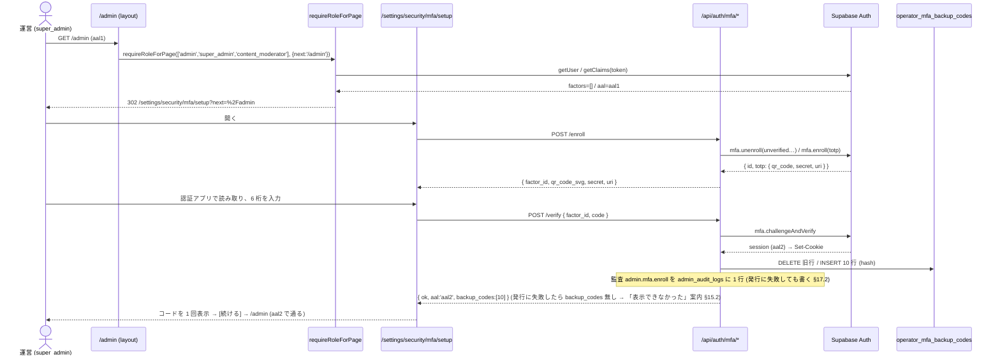
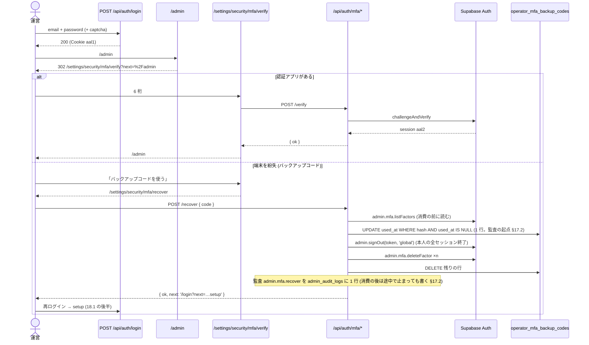
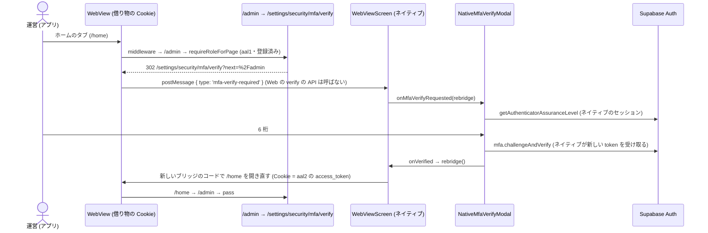
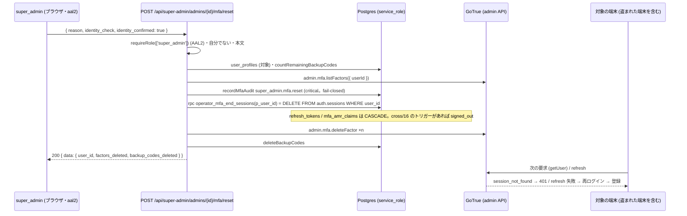

# 運営ロールの MFA (二段階認証) 設計 — Supabase Auth の TOTP と AAL2 の入口

> 版: v1.8 (2026-10-16 段 C の改定: 別の super_admin による解除が対象の全セッションを終える仕組み (§11.5・§12.6・§14.7) と、付録 A (段 E の母集合) の 56 本への取り直し。v1.7 = 段 D の縮小: ネイティブの運営の区画の削除 (#1598) の反映。段 A は #1715 (`d8e0223a`)・段 B は #1754 (`d17b7b41`)・段 C は #1783 (`91ddfef1`)・段 D は #1808 (`f5920c6a`)・段 E は #1815 (`eff674fa`) で main にマージ済み (段 E の migration は `20261017130000_operator_mfa_db_gate.sql`。触るポリシーは付録 A の 56 本と、付録 A の取得の後にできた 1 本の 57 本: 付録 A の末尾)。§3 の実測の基準は段 A のマージより前の origin/main で、マージ後の差は §3 の ⚠️ の段落 (段 A のマージの後の差)) / Issue: #1176 (`[セキュリティ] super_admin/admin/産業医ロールに必須と設計されたMFA/2FAが実装ゼロ`)
> 位置づけ: `cross/01-auth-session.md` §5 (2FA / MFA) の方針を、実装できる粒度に展開した正典。§5 と本書が食い違うときは本書が正 (§24 の追随表で §5 を本書へのポインタに改める)。
> ローンチまでに作る (オーナーの選択 2026-10-15・選択式)。
> 改定履歴: v1.0 2026-10-15 初版 (設計ゲート R0)。v1.1 2026-10-15 R1 の指摘を反映: (support) 区画 (Web・モバイル) とモバイルの比較の再計算を入口に加える (§3.2・§13.4・§16)・段 A を単独で型検査とテストが通る形に切り直す (§0.2)・走査の自動の取り込みを狭め除外を理由つきで持つ (§20)・DB を直接呼ぶ経路を範囲外として明記 (§0.3・Q-9)・アカウントの書き出しの分類に新しい表を足す (§23 N-24)。網羅性 (周 2) の反映: `requireRole([...])` の数を 104 に直す・産業医の入口が 0 件であることを明記 (§3.2・§20)・§10 に enroll / verify / reset の失敗 / U0 の自己サービス / 猶予の期限の行を足す・§24 に cross/01 §3.2・operator/01 §3.1・operator/03 §31・mobile / org の CLAUDE.md の行を足す (§0.3・Q-10)。 v1.2 2026-10-15 R2 の指摘を反映: 毎回の challenge の verify でも Supabase が同じ利用者の他の aal1 のセッションを終えることを §3.1・§10・§14.3・§16・§26.3 に明記し、シナリオ S-25・結合テスト M-9・Q-11 を足す・単体テストのモックに `getSession` と `getClaims` の両方を返す `aal2AuthMock` を定める (§22.4.2・N-13・N-14)・自前でサインインする結合テスト 5 本を `signInForIntegration` に寄せる (§22.4.1・N-16)・`resolveMfaEnforceFrom` が存在しない日時 (2026-02-30 など) と範囲外の時差を拒否する (§12.1)。 網羅性 (周 3) の反映: 前提の実測を origin/main `62eadfa4` に取り直す。#1673 (ネイティブの画面を消して WebView に一本化) で `apps/mobile/app/comparison/index.tsx` とそのテストが消え、「再計算」を呼ぶ画面が Web にもモバイルにも無くなったので、モバイルの入口を (super-admin)・(support) の 2 区画に絞り、S-23 を「API を直接呼ぶ」に改める (§3.2・§16・§20・§21.6・§22.3・§23 N-26・§25)・§22.2 に client.ts の関数・Zod スキーマ・interface・走査の関数を足す・§23 N-14 の `src/__tests__/api/org/**` を 7 本中の 5 本として除外の 2 本と理由を書く・S-13 / S-15 / S-18 / S-19 のテストを足す (§21)・運営の page を import する既存の単体テストの追随を §23 N-27 に足す。 v1.3 2026-10-15 R3 の指摘を反映: §12.1 の正典の正規表現を名前つきのグループから位置のグループに改める (tsconfig の target が ES2017 で TS1503 になるため)・アプリのホームのタブ (WebView の `/home` → middleware が admin / super_admin を `/admin` へ回す) の経路が実在するので、Q-8 の「経路は無い」を改め、WebView の中では 6 桁の確認をネイティブに頼み (ネイティブの確認画面 → WebView の読み込み直し)、登録・回復・設定はブラウザへ案内し、借り物のセッションでの verify / factor 削除を 409 `AUTH_2FA_NATIVE_SESSION` で断る (§16.4 新設・§3.2・§5 S-26〜S-28・§6.2・§7.1・§8・§9・§10・§14.3・§14.4・§15・§19・§21・§22・§23・§26・Q-8)・e2e の `injectSession` が利用者のロールを読んで自動で aal2 に上げる契約を定め (`{ assurance: 'aal1' }` で上げない)、`openUserContext` を母集合に入れる (§22.4.3・N-17)・本文を読む新しい route を `src/__tests__/api/null-character-routes.test.ts` の EXCLUDED に理由つきで載せ、reset の理由の NULL 文字を Zod で断る (§14.7・N-28)・ローカルの Supabase の TOTP は `supabase/config.toml` ではなく `scripts/supabase-local.sh` の組み立てに足す (verify_jwt の番兵が config.toml のほかの行を許さないため。§22.3・N-29)・単体テストのモックの `aal2AuthMock` を「同じモックの `getUser`」を受け取る形に改め、`tests/helpers/route-world.ts` の `makeClient` を直す先に入れ、N-14 を 1 本ずつの直し方の表にする (§22.4.2・N-13・N-14)。前提の実測を origin/main `8c682e42` に取り直す。 網羅性 (周 4) の反映: §10 に (U2, S2) × 運営の入口・(U1/U2, S2) × Web の `/support/*`・借り物の S2 × 運営の画面 (U2 / U1)・借り物の access_token の寿命の行を足す・§3.2 と §20 の定数の行番号 (`inquiries/[id]/route.ts:46,109`・`finance/exports/route.ts:103`・`NPS_EXPORT_ROLES` の定義 :32) を origin/main `8c682e42` の実測に直す。 v1.4 2026-10-15 R4 の指摘を反映: DB (PostgREST / RPC) を直接呼ぶ経路を範囲外にしていたのを改め、段 E (判定の関数 `public.operator_mfa_satisfied()`・SECURITY DEFINER の関数 7 本・RLS のポリシー 58 本の運営の枝・カタログの機械検査) として本書の範囲に入れる (§0.2・§0.3・§3.2・§5 S-24・S-29〜S-31・§6・§7.1・§8・§9・§10・§11.4・§13.6・§19.1・§20.1・§21.8・§22・§23 N-32〜N-35・§24・§25・§26.2・付録 A。Issue #1176 が名指しした「パスワードだけの super_admin が org / family の強制移譲・解散を行える」を DB の経路でも閉じるため)・自分の unverified な factor の `DELETE /factors/{id}` を 404 にする (verified な TOTP factor だけを解除の対象にする `isVerifiedTotpFactorId`。§10・§12.4・§14.4・§21)・`tests/e2e/helpers/totp.mjs` を段 A に移す (§22.1)・テストの道具の MFA の回数制限の扱い (ローカルの Supabase では効かないことの根拠・番兵 M-13・429 の文言) を §22.4.4 に足す・運営の layout 3 + page 11 の `next` / `forbiddenPath` / バナーの `next` をファイルごとに決める (§13.4.2。super-admin と (operator) の layout は現行の行き先を保つ)・結合テストの M-8 と M-11 の猶予の枝を外し、猶予の分岐を単体と route のテストで守る (§21.1・§21.4)。 網羅性 (周 5) の反映: §10 に借り物の S1 / S2 で enroll / recover / backup-codes / status を直接呼ぶ行を足し (借り物でないときと同じ応答。Web の側で token を発行し直さない)、§21.2 にその it を足す・§8 の消費経路と §9 にロールだけで行き先を決める経路 (`auth/callback/route.ts:143`・middleware の `resolveOnboardingRedirect`・ハンズオンツアーの `ADMIN_ROLES`) を足す・§8 の軸の列の「—」を「その行の判定がその軸を読まない」と定義し、P-4 の猶予の欄に明記する・§3.2 の `org_industrial_doctor` の列挙に `src/lib/auth/helpers.ts:124` (コメント) を足す・origin/main `5a48abc9` と突き合わせ、migration の最大の番号を `20261015170000` に直す (§3・§11.1)。 v1.5 2026-10-15 R5 の指摘を反映: super_admin の reset の手順を「対象の profile → `listFactors` → `countRemainingBackupCodes` (未使用の残数) → 監査 (fail-closed。details の `factors_before` / `backup_codes_before` をこの 2 つの読み取りで作る) → `deleteFactor` ×n → `deleteBackupCodes`」に改め、読み取りの失敗は監査を書かずに 500 にする (§6.2 S-7・§8・§10・§14.7・§14.8.2・§17・§21.2)・監査の facade `src/lib/auth/mfa/audit.ts` (`MFA_AUDIT_ACTIONS`・`MFA_AUDIT_SEVERITY`・`MfaAuditDetailsMap`・`recordMfaAudit` のシグネチャと戻り値の扱い) を §17.1 に逐語で置く・画面の通信の facade `src/lib/auth/mfa/client.ts` (`MFA_API_PATHS`・`MfaClientResult`・`requestMfaApi`・7 関数・`mfaErrorMessage`) を §15.1 に、enroll / verify / recover / backup-codes / 解除 / reset の応答の Zod を §14 に逐語で置き、画面ごとの結果の扱いを §15.2 の表に、Web の部品 (`TotpCodeForm`・`BackupCodesPanel`・`MfaGraceBanner`・`OperatorMfaResetSection`) の props と動きを §15.3 の表にする・バックアップコードの表の 4 関数の DB の失敗の扱い (例外にして route が 500) を §12.3・§13.6 で決める・結合テスト M-5 (reset) を段 C に移す (§21.4)・client と audit の単体テストと、ブラウザの画面の分岐のテストを足す (§21.1・§22)・設定画面を描く既存の単体テスト 8 本を §23 N-36 に足す。origin/main `c100ca9d`・`56189b63` と突き合わせ、migration の最大の番号を `20261015180000` に直し、#1687 で足された設計書の番兵 `tests/design-doc-removed-mobile-screens.test.ts` に合わせて、消えたモバイルの画面を名指しする行を「削除」の語で書く (§3・§3.2・§11.1・§23 N-37)。 網羅性 (周 6) の反映: §10 に aal1 のセッションのログアウトと token の refresh の行を足す・結合テストの M-9 を S-25 と §10 の「別の」セッションの行に結び、登録の verify で同じ利用者の他の aal1 のセッションが終わることを守る M-14 を足す (§21.4)・モバイルの運営の区画の `_layout` 2 つを描くテスト `operator-area-layouts.test.tsx` を足す (S-10・S-22。§21.6・§22.1)・§5 の 31 本のシナリオと守る it の対応表を §21.9 に置く。 v1.6 2026-10-16 R6 の指摘を反映: 監査の書き方の規則を §17.2 に置く (監査の起点 = 取り消せない操作が成功した後は、続く手順が失敗してもそこで止めて `failed_step` を持ち、監査を必ず 1 行書いてから応答する。起点より前の失敗は監査を書かない)。登録の verify はコードの発行に失敗しても 200 (`backup_codes` 無し) を返して監査を書き、setup の画面は `backup_codes` の無い成功 (発行の失敗・応答が届かず打ち直した) を「コードを表示できなかった」案内にする (§10・§14.3・§15.2)。回復は `listFactors` を消費の前に読み、factor・コードの削除の失敗を監査に残す (§14.5)。解除は refresh の失敗を 200 (`aal: 'aal2'`) にし、コードの削除の失敗は監査を書いて 500 (§14.4)。再発行の失敗も監査に残す (§14.6)。監査の details に `failed_step` を足し、数を `number | null` にする (§17・§17.1)。origin/main `44c471e4` と突き合わせ、#1571 の監査の見張り `tests/admin-mutation-audit-coverage-1571.test.ts` に段 C の reset の行を足すこと (§23 N-38・§22.3)・#1689 の /api の同意ゲートとの関係 (§3.3・§14.8.2・§23 N-39・§24) を書き、`lib/supabase/middleware.ts` と `src/app/api/operator/membership/family/[id]/dissolve/route.ts` の行番号を直す (§3・§3.2・§8)。 v1.7 2026-10-16 段 D の縮小: ネイティブの運営の区画 (super-admin)・(support) は、通常の操作で届かない画面として 2026-10-16 に区画ごと削除した (#1598) ので、段 D は区画のゲート (`OperatorMfaGate`・2 つの `_layout` の変更・走査 ⑩・`MOBILE_GATED_AREAS`) を作らず、アプリの WebView で開く Web の運営画面の確認 (§16.4) だけにした。シナリオ S-10・S-22・走査 ⑩・番兵 N-9 は欠番にし、番号は振り直さない (§0・§3.2・§4・§5・§6・§7・§8・§9・§10・§16・§20・§21・§22・§23・§24・§25・§26)。 網羅性 (周 1) の反映: 同じ PR で削除した組織の管理の区画 (org) を、運営の区画ではない (組織の中の役割で入り `/api/org/**` を呼ぶ) 行として §3.2 に足し、`/api/org/` を `MOBILE_OPERATOR_API_PREFIXES` に入れない理由を §20 に書く・#1598 で削除した画面のうち運営に関わるのが 2 区画だけであることを §16・§22.3・§23 N-37 に書く・R-1 の `org_industrial_doctor` がシナリオを持たない理由と守るテストを §21.9 に書き、§21.1 に it を 1 つ足す。 設計ゲート R1 の指摘を反映: 段 D に残していた、ネイティブの画面の運営の操作の見張り (走査 ⑨ と走査の定数 `MOBILE_OPERATOR_API_PREFIXES`・`MOBILE_SCAN_EXCLUSIONS`)・呼ぶ画面の無いゲート `resolveOperatorMfaGate`・ロールの写し `MOBILE_MFA_REQUIRED_ROLES` と `requiresOperatorMfa`・写しの一致のテスト `operator-mfa-mobile-roles-sync.test.ts` を外す (⑨ も欠番。番号は振り直さない)。ネイティブの確認画面の判定 `decideMobileOperatorGate` はロールを読まず AAL だけで決める (頼むのは Web のゲートで、ロールと猶予の判定は済んでいる)。アプリで運営が通る経路は WebView の Web の運営画面だけなので、猶予中の未登録の必須ロールは Web のゲートの `pass_grace` で通る (「モバイルは猶予を見ない」を改める §8・§10・§16・§24)。`src/lib/auth/mfa/policy.ts` の `MFA_REQUIRED_ROLES` の注記から `MOBILE_MFA_REQUIRED_ROLES` を外す (§12.1・§22.3。段 D) (§0・§1・§3.2・§4・§6・§7・§8・§10・§12.1・§16・§20・§21・§22・§24)。 網羅性 (周 2) の反映: origin/main `b675073e` (2026-10-16) と突き合わせ、段 A が #1715 (`d8e0223a`) でマージ済みであることを書く。§3 に `44c471e4` からの差の段落を足し、§3.1 の「MFA を参照する本番コードは 0 件」を段 A のマージ前の事実に改める・§3.2 の `requireRole(<定数>)` を 8 (7 ファイル。運営の入口 4 + 段 A の自己サービスの 4 route) に直す・§7.1 と §20 の数と当てはまりを合わせる・§0.2・§22.1・§22.3 の段 A の行に「済 (#1715)」を付け、段 A の実装が足した表に無いファイル (`src/lib/auth/mfa/route-support.ts` など) を §22.1・§22.3 に足す。段 E の母集合 (付録 A) が `44c471e4` の後の migration で動いたことを §3 と §27 Q-15 に書く (付録 A は取り直さない)。 設計ゲート R2 の指摘を反映: 実装の途中の段 B の枝 (`origin/feat/issue-1707-operator-mfa-gate`) が v1.6 の本書で書いた、v1.7 と食い違う 2 か所 (`docs/operations/auth-protection.md` §11 の「**モバイル**は猶予を見ず…モバイルの区画のゲートは段 D」の 1 行・`tests/operator-mfa-entry-points-scan.test.ts` の見出しの「段 D で ⑨⑩ を足す」) の置き換えの文と、直す PR (段 B が本書 v1.7 の後にマージするなら段 B・先なら段 D) を書く (§0.2 の段 B・段 D の行と ⚠️・§22.3・§24・§27 Q-16)。§19.3 に残っていた「モバイルの運営の区画は §16 のゲートで TOTP の入力になる」を直す。origin/main `2d90460e` と突き合わせ、#1737 (`email_outbox`)・#1743 (Next 16) が本書の数と `file:line` を変えないこと (変わるのは migration の最大の番号 `20261016234000` だけ。§3.1 の「Next 15.5」の行は段 B の枝が隣の行を改めているので変えず、§3 の段落に書く) を書く (§3)。 網羅性 (周 3) の反映: 本書と同じ設計の PR で直す `docs/design/mobile/06-push-send.md` (献立の通知の行き先を献立のタブの `/menus` に改める) の記録先を §24 の冒頭の段落に書き、06 の版と改定履歴の追随を §24 の行に足した (本文の改定は同じ PR に入るので、表にも §22.3 にも載せない)。#1598 で削除した画面を名指しする cross/16 の行は origin/main の #1740 が注記済みで、本書の PR は cross/16 を変えないことを §24 に書いた。 v1.8 2026-10-16 段 C の改定 (Issue #1707 の段 C): 別の super_admin による解除 (§14.7) が、対象の TOTP とバックアップコードを消す前に対象の全セッションを終える仕組みを決めた。GoTrue の管理 API には利用者 ID で全セッションを終える経路が無い (supabase/auth の `/admin` の経路の実読 §3.2) ので、service_role だけが呼べる SECURITY DEFINER の関数 `public.operator_mfa_end_sessions(uuid)` (`DELETE FROM auth.sessions WHERE user_id = $1`。GoTrue の `/logout?scope=global` の実体と同じ 1 文) を追加だけの migration で新設し (§11.5)、facade `endUserSessions` (§12.6) を reset の route が監査の後・factor の削除の前に呼ぶ (§14.7)。回復 (段 B・main) の `admin.signOut(token, 'global')` は変えない (cross/16 §5 の S-7 / S-9 と同じ使い分け §7.1)。cross/16 (#1720・PR #1757) の `on_auth_session_deleted` との関係 (`ended_reason` は `signed_out` のまま) を §11.5・§24 に書いた。要件 R-15・シナリオ S-32〜S-36 とトレース・§7.1 の 2 論点・§8〜§10 の行・§13.6・§14.8.2・§15.2・§17・§17.2・§18.4・§20.1・§21 (route・単体・契約・結合 M-5 / M-15 / M-16・§21.9)・§22・§23 (N-4・N-32・N-34)・§24・§25・§26・Q-17〜Q-20 を足した。付録 A を本番の `pg_policies` の 2026-10-16 の読み取り (Supabase MCP の SELECT だけ) で 56 本 (53 本が TO public・3 本が TO authenticated) に取り直し、§3 の ⚠️ の 4.・§3.2・§7.1・§8・§9・§11.4・§20.1・§21.8・§22.2・§25・Q-15 の数を揃え、指紋 (md5) の表 A.4 と「本番で確かめる」手順を足した。origin/main `d17b7b41` (2026-10-16。段 B のマージ #1754 を含む) と突き合わせた (§3)。 v1.8 R1: 付録 A.3・A.4 の SQL の正規表現リテラルの引用符の誤り (`'''::text'` → `''::text'`。42601 で流れなかった) を直し、直した A.4 の SQL を本番で読み取りだけで流して期待値 (n = 56・n_public = 53・n_authenticated = 3・digest・digest_full) との一致を確かめた。 網羅性 (周 2) の反映: §10 に対象が必須ロールでない (U0) 利用者への reset の成功の行を足し、reset の全セッションの終了の失敗と factor・コードの削除の失敗の行を U2 だけでなく全 U に広げた・§21.2 に U0 の対象の reset の it を足した・§14.7 の U0 の文を手順どおりに改め (ロールの剥奪の後に残った factor とコードも消える)、§14.7 の Zod のブロックの冒頭に置き場 (`src/lib/auth/mfa/schemas.ts` §22.3) を書いた。

---

## 0. 分冊判定・段分け・範囲 (相 1 の結果)

### 0.1 分冊判定

| 目安 | 本件 | 判定 |
|---|---|---|
| 設計書 800 行超 | 超える (ゲートの全列挙・表 3 点・追随表を 1 冊に持つため) | 当たる |
| 消費先レーン 3 以上 | Web の運営画面 (layout / page と (support) 区画)・Web の運営 API・自己サービスの API と画面・モバイル (アプリの WebView で開く Web の運営画面 §16.4。ネイティブの運営画面 (super-admin)・(support) は 2026-10-16 に削除した。#1598)・DB を本人の JWT で直接呼ぶ経路 (RLS のポリシーと SECURITY DEFINER の関数 §11.4) = 5 | 当たる |
| 共有面に 2 つ以上触る | `src/lib/auth/helpers.ts` (全運営 API の認可の入口)・`src/lib/rate-limit.ts` (カテゴリ)・`src/lib/env.ts` / `.env.example` (環境変数の一覧)・`admin_audit_logs` (書くだけ。列は変えない)・RLS のポリシー 56 本と SECURITY DEFINER の関数 7 本 (段 E。運営の枝に判定を足すだけで、ほかの枝・列は変えない)・`auth.sessions` (GoTrue の表。段 C の関数 `operator_mfa_end_sessions` が対象の行を消すだけで、列・索引・トリガーは触らない §11.5) | 当たる |

**判定: 設計書は 1 冊、実装は 5 段 (A〜E) に分け、段ごとに別の実装 WF (別ブランチ・別ゲート・別 PR) で積む。**
分冊 (核と配線で別の設計書) にしない理由: 核 (AAL2 の判定) は純関数 1 つと `requireRole` への 1 か所の差し込み (DB の側は判定の関数 1 つ `operator_mfa_satisfied()`) で、配線 (画面・API・モバイル・DB のポリシーと関数) はすべてその判定を消費するだけ。契約 (§11.4・§12〜§14・付録 A) を本書に逐語で置けば、各段の実装者は本書だけで手が止まらない。分けると「核のマージ待ちで配線の設計が止まる」コストが、分けない利点 (1 か所で全入口を見渡せる) を上回る。

### 0.2 段分け (実装 WF の単位と順序)

| 段 | 中身 | 依存 | デプロイ後の状態 |
|---|---|---|---|
| **A 自己サービス (AAL1 で使えるもの)** — 済: #1715 (`d8e0223a`) で main にマージした (§22.1・§22.3 の段 A の行) | バックアップコードの表 (migration)・`src/lib/auth/mfa/*` の核 (policy / backup-codes / factors / schemas / audit)・`src/lib/auth/mfa/assurance.ts` の読み取り部分 (`SessionClaimsSchema` / `bearerJwtOf` / `readSessionAssurance`。`assertOperatorAssurance` は段 B)・`/api/auth/mfa/{status, enroll, verify, recover}` の 4 route (`requireRole(MFA_REQUIRED_ROLES)` を **引数 1 つ** で呼ぶ。段 A の `requireRole` は今のまま)・`/settings/security/mfa/*` の 4 画面 (状態の画面は表示だけ。再発行と解除のボタンは段 B)・設定画面の入口・rate-limit のカテゴリ・環境変数の登録・アカウントの書き出しの分類 (§23 N-24)・アプリの WebView の中の 4 画面の扱い (`useInNativeWebView`・`NativeAppMfaNotice`・`src/lib/native-auth-bridge.ts` の `requestNativeMfaVerify` / `isNativeBridgedSession`。verify の route は借り物のセッションを 409 で断る §16.4)・本文を読む 2 route の NULL 文字の番兵の追随 (§23 N-28) | なし | 運営は **任意で** TOTP を登録・確認・回復できる。まだ何も強制しない (ゲートが無い)。再発行と解除はまだ無い (AAL2 を確かめる仕組みが段 B で入るため)。登録の直後にバックアップコードを表示できなかった運営 (コードの発行の失敗・verify の応答が届かず打ち直した §15.2) は、段 B の後に状態の画面の [バックアップコードを再発行] で受け取る (段 A は何も強制しないので、それまでも TOTP で作業は続く) |
| **B 入口のゲート** — 済: #1754 (`d17b7b41`) で main にマージした | `MfaRequiredError`・`UserProfile.assurance?`・`requireRole(allowedRoles, options)` の AAL2 判定・`assertOperatorAssurance`・`requireSuperAdmin` の委譲・`page-guard.ts` と運営の layout / page 14 ファイルの置き換え・Web の (support) 区画の server layout の新設 (§13.4)・猶予のバナー・段 A の 4 route に `{ assurance: 'session' }` を足す・AAL2 が要る自己サービスの 2 route (`DELETE /factors/{id}`・`POST /backup-codes`) と状態の画面のボタン・機械検査 (走査テスト ①〜⑧)・テストの道具 (結合・e2e の TOTP 昇格と、単体テストの Supabase のモック §22.4。ローカルの Supabase の TOTP を `scripts/supabase-local.sh` で有効にする)。実装の途中の段 B の枝は v1.6 の本書で書いているので、本書 v1.7 のマージの後にマージするときは、v1.7 と食い違う 2 か所 (`docs/operations/auth-protection.md` §11 の 1 行・`tests/operator-mfa-entry-points-scan.test.ts` の見出し) を同じ PR で直す (下の ⚠️ の段 B の枝の段落) | A | 必須ロールの運営は、登録済みなら challenge・未登録なら登録を **強制** される (猶予の環境変数で開始日時を後ろへずらせる) |
| **C 運営の別の人による解除** — 済: #1783 (`91ddfef1`) で main にマージした (migration は `20261017080000_operator_mfa_end_sessions.sql`) | migration `<番号はマージ時に確定>_operator_mfa_end_sessions.sql` と対の `.down.sql` (§11.5: service_role だけが呼べる関数 `public.operator_mfa_end_sessions(uuid)` = `DELETE FROM auth.sessions WHERE user_id = $1`)・型の再生成 (`Functions` に 1 本 §23 N-34)・facade `src/lib/auth/mfa/sessions.ts` の `endUserSessions` (§12.6)・`POST /api/super-admin/admins/{id}/mfa/reset` (監査 → **対象の全セッションを終える** → factor → コードの順 §14.7)・`/admin/users/{id}` の解除セクション・運営の変更系の監査の見張り (`tests/admin-mutation-audit-coverage-1571.test.ts`) の表に reset の 1 行 (§23 N-38)・`anon-definer-execute.test.ts` の `EXPECTED_ACL` に 1 行 (§23 N-32)・契約テスト (§21.3)・結合 M-5 / M-15 / M-16 (§21.4)。**本番には migration を当ててからデプロイする** (reset の route が RPC を呼ぶ。先にデプロイすると解除が 500 で止まるだけで何も消えない §26.2) | B | super_admin (AAL2) が他の運営の TOTP とバックアップコードを消せる。消す前に対象の全セッション (盗まれた端末に残る aal2 を含む) を終えるので、対象は次の要求で 401 → 再ログイン → 再登録 (S-7・S-32) |
| **D モバイル** — 済: #1808 (`f5920c6a`) で main にマージした | WebView からの確認の依頼 (`mfa-verify-required`) を受けるネイティブの確認画面 (`NativeMfaVerifyModal`) と読み込み直し (§16.4)・`src/lib/auth/mfa/policy.ts` の注記の直し (§22.3)。ネイティブの運営の区画 (super-admin)・(support) は、通常の操作で届かない画面として 2026-10-16 に区画ごと削除した (#1598) ので、区画のゲート (`OperatorMfaGate`・2 つの `_layout` の変更・走査 ⑩)・ネイティブの画面の運営の操作の見張り (走査 ⑨)・ロールの写し (`MOBILE_MFA_REQUIRED_ROLES`) は作らない (§16)。段 B が本書 v1.7 より先にマージしたときは、段 B の枝が v1.6 の文で書いた 2 か所 (`docs/operations/auth-protection.md` §11 の 1 行・`tests/operator-mfa-entry-points-scan.test.ts` の見出し) も直す (下の ⚠️ の段 B の枝の段落) | B | アプリのホームのタブ (WebView の `/admin`) は、ネイティブの確認画面で 6 桁を入れると読み込み直して開く。ロールと猶予の判定は WebView の中の Web のゲートが行う。登録はブラウザだけ |
| **E DB を直接呼ぶ経路** — 済: #1815 (`eff674fa`) で main にマージした (migration は `20261017130000_operator_mfa_db_gate.sql`) | migration `<番号はマージ時に確定>_operator_mfa_db_gate.sql` と対の `.down.sql` (§11.4・付録 A): 判定の関数 `public.operator_mfa_satisfied()`・SECURITY DEFINER の関数 7 本に判定を足す・運営ロールの条件を持つ RLS のポリシー 56 本 (2026-10-16 の本番。付録 A) と、付録 A の取得の後にできた 1 本 (`parental_consents_select_signer_family_adult_or_operator`。付録 A の末尾) の計 57 本の運営の枝に判定を足して `TO authenticated` にする (`subscription_plans_select_public` だけは運営の枝を新しいポリシー `subscription_plans_select_operator` に分ける)・型の再生成・カタログの機械検査と DB の結合テスト (§20.1・§21.8)・既存の番兵の追随 (§23 N-32〜N-35) | B | PostgREST / RPC を本人の JWT で直接呼んでも、TOTP を登録済みの必須ロールの運営は、aal2 のセッションでなければ運営の権限 (運営の枝のポリシー・7 本の関数) を使えない。本人の行の枝・公開の枝は今までどおり |

⚠️ **A → B の順を崩さない**。B を先に出すと、登録の導線が無いまま強制が始まり、運営が全員入れなくなる。C・D・E は B の後にマージする (C と D は B の `requireRole` の AAL2 判定と `MfaRequiredError` を前提にする。E は、B で Web の画面が登録済みの運営を verify へ回すようになってからでないと、任意で登録した運営の aal1 のセッションで Web の運営の画面が DB の 0 行・エラーに当たる。C・D・E どうしは並行に作れる)。
各段は単独で型検査とテストが通る: 段 A のコードは段 B の識別子 (`RequireRoleOptions`・`assertOperatorAssurance`・`MfaRequiredError`・`requireRoleForPage`) を参照しない。段 A の route テストに「aal1 → 403」の検査は無い (§21.2 の段の列)。段 E のテストは段 B のテストの道具 (`tests/integration/helpers/mfa.ts` の `promoteToAal2`) を使う (E は B の後にマージするので、E の PR の時点で道具はある)。

⚠️ **段 B の実装の枝 (まだ main に無い) との食い違い (設計ゲート R2 で `origin/feat/issue-1707-operator-mfa-gate` の `102794cc` (2026-10-16) と突き合わせた)**: 段 B の枝は v1.6 の本書で実装していて、v1.7 で改めた段 D の範囲と食い違う文を次の 2 か所に持つ (`docs/operations/auth-protection.md` の §11 と `tests/operator-mfa-entry-points-scan.test.ts` は段 B の枝で新設したもので、main にはまだ無い)。
1. `docs/operations/auth-protection.md` の §11 (段 B の枝で新設) の箇条「**モバイル**は猶予を見ず、未登録の必須ロールには Web (ブラウザ) での登録を求める (設計書 §16。モバイルの区画のゲートは段 D)。」— v1.7 の §16 では、アプリで運営が通る経路は WebView の Web の運営画面だけで、猶予の扱いは Web と同じ (猶予中の未登録の必須ロールは `pass_grace` で通る)。区画のゲートは作らない。置き換える文は §24 の `docs/operations/auth-protection.md` の 2 つ目の行。
2. `tests/operator-mfa-entry-points-scan.test.ts` (段 B の枝で新設) の 2 行目の見出しの「段 B で新設・段 D で ⑨⑩ を足す」— v1.7 の §20 では ⑨・⑩ は欠番。置き換える文は §22.3 の同じファイルの行。

直す PR: 段 B が本書 v1.7 のマージの **後** にマージするなら段 B の PR (段 B のレーンが v1.7 を取り込むときに 2 か所とも直す)。段 B が **先** にマージしたなら段 D の PR (D は B の後にマージする)。どちらでも、マージの後の main に 1・2 の旧い文が残らないこと。段 B の枝の、ほかのファイル (`src/`・`tests/`・`docs/operations/`・`CONTRIBUTING.md` と、段 B の枝が改めた本書以外の設計書 `cross/01-auth-session.md`・`operator/02-api-spec.md`・`operator/03-ui-spec.md`・`org/CLAUDE.md`) は v1.7 と食い違わない (「段 D」「`MOBILE_MFA_REQUIRED_ROLES`」「猶予を見」「`OperatorMfaGate`」「⑨」「⑩」「モバイルの区画」で grep し、4 つの設計書は段 B の枝が足した行を「モバイル」でも見た。設計書で当たるのは `cross/01-auth-session.md` §5 のポインタの「モバイルとアプリの WebView」(本書 §16 を指すので v1.7 でも正しい) だけ。設計書以外で当たるのは上の 2 か所のほかに、v1.7 でも正しい `docs/operations/auth-protection.md` の §11 の「アプリの確認画面は段 D の版から開く」の箇条と、main と同じ 3 行 = `src/lib/auth/mfa/policy.ts` の 15 行目の注記 (§22.3 の段 D の行で直す)・`src/lib/native-auth-bridge.ts` の 31 行目の「受けるのはアプリの段 D」(v1.7 でも正しい)・`tests/helpers/design-doc-pending-revisions-1598.ts` の 4 行目 (本書の改定の PR で一覧ごと空にする) だけ)。段 B の枝は本書そのものも改めている (回復の route が本人の全セッションを自分で終える `admin.auth.admin.signOut(token, 'global')`。§3.1・§5 S-6・§6.2 S-6・§10 の recover の行・§14.5・§15.2・§17.1・§17.2・§18.2・§21.4 M-4・§21.9 S-6・§26.3)。v1.7 はそれらの行を変えていない (行の衝突は無い) ので、後からマージする側が両方の改定を持つ。

### 0.3 本書が決めないもの (範囲外)

- WebAuthn / パスキー (cross/01 §3.1 のとおり Phase 2)・SMS (非対応)・`org_admin` への強制 (Enterprise オプション)。
- 運営系セッションのアイドル / 絶対タイムアウト (cross/01 §4.1)。AAL はセッションの属性であり、寿命は変えない。
- 身分証の画像の保管 (§7 の判断: 本人確認は運営が画面外で行い、確認した事実と方法だけを監査ログに残す。画像は預からない)。
- `support` / `sales` / `content_moderator` の任意の MFA (§27 Q-3)。本書の対象ロールだけが登録できる。
- 運営の一覧画面への 2FA の状態の表示。`operator/03-ui-spec.md` §31 (`/super-admin/admins`) の表の「2FA 状態」の列は、origin/main の画面・`/api/super-admin/admins` のどちらにも実装が無く、本書も値を供給しない (状態は本人の `/settings/security/mfa` で扱う §15)。列を実装するなら別の Issue で、一覧の API が対象ごとに factor を読む形を設計する (§24・§27 Q-10)。
- **終えたセッションの access token (JWT) が、PostgREST を直接呼ぶ経路 (段 E) で exp まで有効なこと**。PostgREST は JWT の署名と exp だけを見て GoTrue のセッションの表 (`auth.sessions`) を見ないので、回復 (§14.5)・解除 (他人 §14.7) で `auth.sessions` の行を消した後も、残った access token は exp (Supabase の JWT の寿命の設定。既定 1 時間) まで aal2 の claim で段 E の運営の枝を通る (refresh はできない)。Web の運営の入口 (Next.js の `requireRole` の `getUser()`) は GoTrue を通るので終えた直後から 401 (S-32)。寿命を縮めるのは Supabase の設定の運用判断で、本書は決めない (§27 Q-17)。
- **未登録の運営を DB で止めること** (§11.4)。段 E の判定 `operator_mfa_satisfied()` は、TOTP を登録済みの必須ロールの運営に aal2 を求め、**未登録の運営は通す** (Web の `pass_grace` と同じく、猶予中の運営の Web の運営 API が DB で落ちないようにするため)。猶予を過ぎた未登録の運営を DB でも止めることはしない: Supabase は verified な factor を持たない利用者に aal1 のまま factor の登録を許すので、パスワードだけを知る人は、その場で自分の TOTP を登録して aal2 になれる。DB で未登録を止めても守りは強くならない (守りが効くのは、本人が登録した後)。猶予の後は Web の運営の入口が未登録の運営を登録へ回す (`enrollment_required`) ので、運営の作業を続ける人は登録する。

---

## 1. 目的・スコープ

運営の権限 (super_admin / admin / finance / org_industrial_doctor) を持つアカウントは、パスワード (または Google ログイン) に加えて **認証アプリ (TOTP)** を持っていなければ運営の画面・API を使えないようにする。判定の軸は **Supabase Auth のセッションの AAL (Authenticator Assurance Level)**: `aal2` のセッションだけを運営の入口で通す。

- 入口 = `requireRole()` (`src/lib/auth/helpers.ts`) と、それに委ねる `requireSuperAdmin()` (`src/lib/auth/operator-permissions.ts`)。Next.js のサーバーの運営の全 API (`src/app/**/route.ts`) はこの 2 つ (と、`requireRole` を呼ぶ lib の認可ヘルパー `respondNotSupported`) を通っている (§3.2 の実測) ので、**判定を入口の中に 1 か所差し込む** ことで、API の入口を 1 つも取りこぼさない。
- 画面: Web の運営の区画は、Server Component の layout / page が `requireRoleForPage` (§13.4) を呼び、2FA が未完了なら MFA の画面へ回す。client component だけで役割を見ていた Web の (support) 区画には server layout を 1 つ足す (§13.4)。モバイルのネイティブの運営の区画 ((super-admin)・(support)) は 2026-10-16 に削除した (#1598) ので、端末の側の区画のゲートは作らない (§16)。アプリのホームのタブ (WebView で開く Web の `/admin`) は Web の画面のゲートを通り、6 桁の確認だけはネイティブの確認画面に頼む (WebView の Cookie のセッションはネイティブのセッションの借り物なので、Web の側で verify しない §16.4)。
- DB (PostgREST / RPC) を本人の JWT で直接呼ぶ経路: 運営ロールの条件を持つ RLS のポリシーの運営の枝と、運営ロールを確かめる SECURITY DEFINER の関数が、判定の関数 `public.operator_mfa_satisfied()` (JWT の `aal` と `auth.mfa_factors` を読む) を通す (段 E §11.4)。
- 別の super_admin による解除 (段 C): 対象の TOTP とバックアップコードを消す前に、service_role だけが呼べる SQL の関数 `public.operator_mfa_end_sessions(uuid)` で対象の全セッション (`auth.sessions` の行) を終える (§11.5・§14.7)。GoTrue の管理 API には利用者 ID で終える経路が無く (§3.2)、`admin.mfa.deleteFactor` だけでは対象のセッションが終わらない (§3.1) ため。回復 (本人) は本人の token で `admin.signOut(token, 'global')` のまま (§7.1)。
- 入口を取りこぼしていないことは、ソース走査の contract テスト (§20) と、DB のカタログの機械検査 (§20.1) が毎回確かめる (Web の route・Web の画面・RLS のポリシー・SECURITY DEFINER の関数)。アプリの運営画面は WebView で開く Web の画面なので、Web の画面の検査に入る。ネイティブの画面には運営の操作が 0 件で (§3.2)、走査しない (§20 ⑨ の欠番の理由)。

## 2. 関連要件・正典

| 文書 | 箇所 | 本書との関係 |
|---|---|---|
| `docs/requirements/03-operator-admin.md` | §17.2 | ロール別の必須・TOTP + バックアップコード 10 個・SHA-256・紛失時の手動解除 |
| `docs/design/cross/01-auth-session.md` | §5.1〜5.3 | 同上の設計方針。本書が展開する (§24 でポインタ化) |
| `docs/design/cross/02-rls-patterns.md` | §4・§8.3 | 運営ロールのポリシーの書き方。段 E で運営の枝に判定の関数を足す (§11.4。§24 で追記) |
| `docs/design/cross/04-api-conventions.md` | §4.2 | `AUTH_2FA_REQUIRED` / `AUTH_2FA_INVALID` の予約。HTTP の番号は本書 §19 で改める (§24) |
| `docs/design/operator/07-audit-monitoring.md` | §4 | 監査ログの action_type の命名 (`admin.<対象>.<操作>` / `super_admin.<対象>.<操作>`) |
| `docs/design/CLAUDE.md` | 横断ルール B / C / 監査 | ロール 12 種固定・`requireRole` の利用・監査ログ必須 |
| `docs/requirements/100-scenarios.md` | A11 / A12 | 2FA の有効化 UI が未定義 (本書 §15 で定義)・バックアップコードの利用 |

## 3. 前提の事実 (origin/main 2026-10-15 の実コード・実データ)

実測の基準は origin/main `8c682e42` (2026-10-15。R3 の修正で取り直し)。網羅性 (周 5) で origin/main `5a48abc9` (2026-10-15) と突き合わせた: `8c682e42` からの差 (#1679 バッジの期間の表 `user_badge_period_awards`・#1680 招待の承諾で表示名を写す `accept_family_invite` / `accept_child_promotion`) は、`requireRole([...])` 104・`requireSuperAdmin()` 9・route 26 / 27 / 9 / 3・§23 N-14 の 23 本・N-16 の母集合 39 本・付録 A の 58 本・§11.4 の 7 本 (新しいポリシー・関数に運営ロールの文字列は無い) を変えない。変わるのは `supabase/migrations` の最大の番号だけ (§11.1)。⚠️ 本書の `file:line` は origin/main のもの。設計のブランチ (`design/operator-mfa`) の作業ツリーは古い `e62b5d5f` の上にあるので、そこで開くと行がずれる (例: `src/app/api/admin/finance/exports/route.ts` の `requireRole(NPS_EXPORT_ROLES)` は origin/main で 103 行目・`e62b5d5f` で 99 行目。`src/app/api/admin/inquiries/[id]/route.ts` は origin/main で 46・109 行目・`e62b5d5f` で 45・108 行目)。突き合わせは `git show origin/main:<path>` で行う。`62eadfa4` からの差 (#1675 料理の写真のカバー・#1676 ツアーの文言) は本書の入口・テストの道具・番兵に触れない。それより前の `e62b5d5f` との差のうち本書に効くのは #1673 で `apps/mobile/app/comparison/index.tsx` (再計算のボタン) が削除されたことだけで、§3.2 の他の数 (`requireRole([...])` 104・route 26 / 27 / 9 / 3・`requireSuperAdmin()` 9・layout 3 / page 11) は変わらない。R5 の修正で origin/main `c100ca9d` (2026-10-15) と突き合わせた: `5a48abc9` からの差 (#1681 食事と冷蔵庫の写真の署名付き URL・#1677 料理画像のジョブを pg_cron で拾い直す) は本書の数を変えない (新しい route `src/app/api/storage/signed-urls/route.ts` は `requireRole` を呼ばない一般の route・新しい SECURITY DEFINER の関数 `requeue_stale_meal_image_jobs` / `invoke_process_meal_image_jobs` は運営ロールを見ない・`supabase/config.toml` に足された `[functions.process-meal-image-jobs]` は §23 N-29 の規則の中)。変わるのは `supabase/migrations` の最大の番号 (`20261015180000`) だけ (§11.1)。続けて origin/main `56189b63` (2026-10-15) と突き合わせた: `c100ca9d` からの差 (#1682 週間献立の進捗・#1683 仮置きの表示名・#1687 設計書と記録の追随・#1685 規約の同意ゲートの設計) は、運営の route では表示名の扱いの行だけが変わり、`requireRole([...])`・`requireSuperAdmin()` の数・本書の `file:line` (`src/lib/admin/inquiries.ts:30`・`src/app/api/operator/membership/family/[id]/dissolve/route.ts` の RPC の行など。RPC の行は次の `44c471e4` で動いた) と migration の最大の番号を変えない。#1687 が足した `tests/design-doc-removed-mobile-screens.test.ts` は、`docs/design/` の行が消えたモバイルの画面 (`apps/mobile/app/comparison/index.tsx` など) を名指しするなら同じ行に「削除」か「消した」を求めるので、本書の該当の行をその語で書く (§23 N-37)。R6 の修正 (v1.6) で origin/main `44c471e4` (2026-10-16) と突き合わせた: `56189b63` からの差は #1692 (#1571 運営の監査ログに利用者の IP を残し、記録の無い変更系に記録を足す)・#1684 (食事の区分の表示の対応表)・#1693 (関数のデプロイ)・#1691 (e2e の w5-3)・#1697 (#1689 規約の同意ゲートを /api にも掛ける)。本書に効くのは 2 つ: ① #1692 が足した `tests/admin-mutation-audit-coverage-1571.test.ts` は `src/app/api/{admin,super-admin,support,operator}` の変更系の handler を表 (`EXPECTED`) と完全一致で突き合わせるので、段 C の reset の route に 1 行が要る (§23 N-38)。`recordAdminAudit` の型 (`AdminAuditSeverity`・`RecordAdminAuditParams`・`RecordAdminAuditResult`) は変わらない (§17.1 が import する) ② #1697 で `lib/supabase/middleware.ts` の /api の分岐が、凍結・メンテナンスの後に規約の同意を判定する (未同意なら 403 `LEGAL_CONSENT_REQUIRED`)。止めない /api の一覧 (`packages/shared/src/legal-consent-api.ts` の `LEGAL_CONSENT_EXEMPT_API_PATHS`) の `/api/auth` (prefix) に本書の自己サービスの 6 route (`/api/auth/mfa/*`) が入り、reset (`/api/super-admin/...`) は入らない (§3.3・§14.8.2・§23 N-39)。この差で行が動いたのは `lib/supabase/middleware.ts` の `resolveOnboardingRedirect` の呼び出し (395 → 422 行目) と `src/app/api/operator/membership/family/[id]/dissolve/route.ts` の本人の client での RPC (61-64 → 63-66 行目) で、§3.2・§8 の行番号を直した。数 (`requireRole([...])` 104・定数の roles 4・`requireSuperAdmin()` 9・route 26 / 27 / 9 / 3・migration の最大 `20261015180000`) は変わらない。

⚠️ **段 A のマージの後の差 (v1.7 の網羅性 (周 2) で origin/main `b675073e` (2026-10-16) と突き合わせた)**: 上の段落と §3.1〜§3.4 の実測は `44c471e4` (段 A のマージの前) のもの。`44c471e4` から `b675073e` までの差のうち本書に効くのは次の 4 つで、それ以外の数 (`requireRole([...])` 104 とその内訳・`requireSuperAdmin()` 9・route 26 / 27 / 9 / 3・運営の layout 3 / page 11・§20 (a) に当たる `API_ROOTS` の外の route.ts 4 本・§11.4 の関数 7 本) は変わらない。
1. **段 A のマージ** (#1715・`d8e0223a`): `src/lib/auth/mfa/{policy, backup-codes, factors, schemas, audit, assurance, client, route-support}.ts`・`/api/auth/mfa/{status, enroll, verify, recover}` の 4 route・`/settings/security/mfa/*` の 4 画面・部品・テスト・migration `20261016230000_operator_mfa_backup_codes.sql` (対の `supabase/rollbacks/20261016230000_operator_mfa_backup_codes.down.sql`) が main にある (§0.2・§22.1・§22.3 の段 A の行は「済」)。よって §3.1 の「MFA を参照する本番コードは 0 件」は段 A のマージの前の事実で、§3.2 の `requireRole(<定数>)` は 8 (7 ファイル) になった (4 route の `requireRole(MFA_REQUIRED_ROLES)` が増えた分。運営の入口の 4 は変わらない)。`requireRole` (`src/lib/auth/helpers.ts`) にはまだ AAL の判定が無い (段 B)。段 A の 4 route は段 B の前なので引数 1 つで呼ぶ (§0.2)。
2. **#1598 のネイティブの画面の削除** (#1733・`1c726fbb`): §3.2 の (super-admin)・(support)・(org) の行のとおり。
3. **行の移動**: `lib/supabase/middleware.ts` の `resolveOnboardingRedirect` の呼び出しが 422 → 431 行目・`src/lib/native-auth-bridge.ts` の `NATIVE_BRIDGE_WEB_REFRESH_TOKEN_PLACEHOLDER` が 61 → 66 行目 (段 A が `requestNativeMfaVerify` / `isNativeBridgedSession` を足したため)。§3.2・§8 の行番号は直した。`supabase/migrations` の最大の番号は `20261016230000` (段 A の migration)。
4. **段 E の母集合 (付録 A の 58 本) が動いた**: `supabase/migrations` の実体で数えると、#1690 (`6baa2f33`) が `gdpr_select`・`gdpr_update` を消し (表を service_role 専用にした)、#1711 (`309dae0f`) が `personal_subscriptions_insert`・`personal_subscriptions_update` を消して運営だけの `personal_subscriptions_insert_admin`・`personal_subscriptions_update_admin` を作り、#1709 (`cd4d4f17`) が運営の `data_subject_requests_select_operator` を新設した (4 本が消え 3 本が増え、57 本。本番の `pg_policies` では確かめていない)。v1.7 ではこの動きを付録 A に反映せず Q-15 に置いたが、**v1.8 で本番の `pg_policies` を読み取り (2026-10-16)、#1736 (`20261016238000`。`"Admins can create audit logs"` を消し `audit_logs_insert_admins` を作り直した) の分も含めて 56 本に取り直した** (付録 A。指紋は A.4)。

設計ゲート R2 で origin/main `2d90460e` (2026-10-16) と突き合わせた: `b675073e` からの差は #1740 (#1598 で削除した画面への設計書の注記)・#1741 / #1742 (別の設計書)・#1737 (メールの送信待ち `email_outbox` の DB 層)・#1743 (Next を 15.5 から 16.4.1 へ。ESLint 9)。本書の数 (上の段落の数と 1.〜4.) と `file:line` (`lib/supabase/middleware.ts:431`・`src/lib/native-auth-bridge.ts:66`・`src/lib/auth/mfa/policy.ts:15` など) は変わらない: #1737 の新しいポリシー `email_outbox_deny_client_access` は anon / authenticated を拒むだけで運営ロールを見ず、新しい関数・再定義した `prepare_account_deletion` は service_role 専用で運営ロールを見ない (§11.4 の関数 7 本・付録 A に当たらない)。#1743 はその時点では middleware の名前を変えなかった (`src/middleware.ts`・`lib/supabase/middleware.ts` はそのまま。その後 #1744 (#1780) で `src/middleware.ts` は `src/proxy.ts` に改名し、Node.js の runtime に移った。`lib/supabase/middleware.ts` の名前は今も同じ)。§3.1 の「Next 15.5」は 16.4.1 になったが、本書が頼る規約 (route・page・layout の `params` を Promise で受ける §23 N-6・`next/navigation` の `redirect`) は Next 16 でも同じ。変わるのは `supabase/migrations` の最大の番号 (`20261016234000`) だけ。段 B の実装の枝との食い違いは §0.2 の ⚠️ の段 B の枝の段落。

v1.8 (段 C の改定) で origin/main `d17b7b41` (2026-10-16) と突き合わせた: `2d90460e` からの差のうち本書に効くのは #1754 (段 B のマージ・`d17b7b41`) だけで、#1766 (組織チャレンジの画面)・#1767 (依存の更新) は本書の数と `file:line` に触れない。段 B のマージで `requireRole` の AAL の判定・`requireRoleForPage`・`MfaRequiredError`・走査テスト `tests/operator-mfa-entry-points-scan.test.ts`・テストの道具 (`tests/integration/helpers/mfa.ts` の `signInForIntegration` / `promoteToAal2` など) が main にあり (§0.2 の段 B の行は「済」)、§0.2 の ⚠️ の段 B の枝の段落の 2 か所は段 B が本書 v1.7 の後にマージしたので段 B の PR で直し済み (`docs/operations/auth-protection.md` §11 (313 行目〜) の箇条は v1.7 の文・走査テストの 2 行目の見出しは「⑨・⑩ は欠番」。Q-16 は解決)。回復の route は §14.5 のとおり `readRequestAccessToken` の token で `admin.auth.admin.signOut(token, 'global')` を呼ぶ (`src/app/api/auth/mfa/recover/route.ts:109,130`)。`supabase/migrations` は 205 本・最大 `20261016241000` で、本番の台帳 (`supabase_migrations.schema_migrations`) も 205 本・最大 `20261016241000` (2026-10-16 の読み取り。段 C の migration はこれより大きい番号)。段 E の母集合は本番の `pg_policies` の読み取りで 56 本になり、付録 A を取り直した (§3 の ⚠️ の 4. と Q-15 は解決)。

### 3.1 実装の現状

- 段 A のマージ (#1715・`d8e0223a`) の前は、`mfa` / `totp` / `aal2` / `backup_codes` / `authenticator` / `getAuthenticatorAssuranceLevel` を参照する本番コードは 0 件だった。`b675073e` では段 A の自己サービス (`src/lib/auth/mfa/*` の 8 ファイル・`/api/auth/mfa/{status, enroll, verify, recover}` の 4 route・`/settings/security/mfa/*` の 4 画面・`src/components/auth/mfa/*`。§22.1 の段 A の行) がある。運営の入口のゲート (`requireRole` の AAL の判定・`requireRoleForPage`・`MfaRequiredError`) は段 B (#1754・`d17b7b41`) で main に入った。段 C の reset の route・`src/lib/auth/mfa/sessions.ts`・関数 `operator_mfa_end_sessions` はまだ無い (本書 v1.8 が設計する)。
- 段 B の前の `requireRole(allowedRoles)` = `auth.getUser()` → `user_profiles` の `roles / organization_id / frozen_at / unban_at` → 凍結判定 → ロールの交差。AAL も factor も見なかった (段 B で末尾に AAL の判定が付いた §13.1)。
- 段 B の前の `requireSuperAdmin()` = `auth.getUser()` → `user_profiles.roles` に `super_admin` があるかだけ (段 B で `requireRole(['super_admin'])` に委ねた §13.5)。
- `lib/supabase/middleware.ts` は凍結・メンテナンス・同意ゲートを扱い (#1689 から /api の分岐でも同意を判定する §3.3)、AAL は見ない。**本書は middleware を変えない** (§7 の裁定)。
- 本番の `auth.mfa_factors` は 0 行。`user_profiles.roles` の保有行数は admin 9・super_admin 2・support 3・sales 3。finance・org_industrial_doctor・content_moderator は 0 行 (行単位の数。1 人が複数ロールを持つと重複する)。
- ライブラリ: `@supabase/supabase-js` 2.117.3 (`@supabase/auth-js` 2.117.3)・`@supabase/ssr` 0.12.7・`zod` 4・Next 15.5。auth-js は `auth.getClaims(jwt?)`・`auth.mfa.{enroll, challenge, verify, challengeAndVerify, unenroll, listFactors, getAuthenticatorAssuranceLevel}`・`auth.admin.mfa.{listFactors, deleteFactor}` を持ち、`User.factors` に factor の一覧 (`status: 'verified' | 'unverified'`) が入る。JWT の claim に `aal: 'aal1' | 'aal2'` と `session_id` がある。
- auth-js の規定 (型定義のコメント): factor を verify すると **その他のセッションはログアウトされ**、現在のセッションが `aal2` に上がる (`mfa.verify` の JSDoc「Upon verifying a factor, all other sessions are logged out and the current session's authenticator level is promoted to `aal2`」)。**これは登録の verify だけでなく、毎回の challenge の verify (ログインごとの 6 桁) でも同じ**: 登録と challenge は同じ API (`challengeAndVerify` = challenge → verify) で、Supabase は verify のたびに同じ利用者の他のセッションを終える (少なくとも aal1 のものは必ず終わる。aal2 の他のセッションが残るかに、本書は依存しない)。運営側の結果は §26.3。`admin.mfa.deleteFactor` の JSDoc は「verified な factor を消すとその利用者の全セッションがログアウトされる」と書くが、**2026-10-16 の段 B の実測では、ローカルの GoTrue v2.183.0 の `admin.mfa.deleteFactor` は本人のセッションを終えなかった** (回復の前の aal1 のセッションが refresh も getUser も通った)。本書はこの挙動に依らない: 回復の route が `admin.auth.admin.signOut(token, 'global')` で本人の全セッションを自分で終える (§14.5)。別の super_admin による解除 (段 C) は対象の token を持たないので、`auth.sessions` の対象の行を消す SQL の関数で終える (§11.5・§14.7)。
- セッションの終了の実体 (supabase/auth (GoTrue) の master・2026-10-16 の実読。`internal/api/logout.go`・`internal/models/sessions.go`): 本人の `POST /logout?scope=global` は `models.Logout(tx, userId)` = `DELETE FROM auth.sessions WHERE user_id = ?` の 1 文。`scope=others` は `LogoutAllExceptMe` (`WHERE id != ? AND user_id = ?`)、`local` は `LogoutSession` (`WHERE id = ?`)。verify は `InvalidateSessionsWithAALLessThan` (`WHERE user_id = ? AND (aal IS NULL OR aal < 'aal2')`) で同じ利用者の aal1 のセッションを消す (上の「少なくとも aal1 のものは必ず終わる」の実体)。行の無い session_id の JWT は `FindSessionByID` が `SessionNotFoundError` を返し、`/user` など認証つきの経路が `session_not_found` で断る (auth-js の `getUser()` は `user: null` と error)。PostgREST はこの表を見ない (JWT の署名と exp だけ)。
- GoTrue の管理 API (`/auth/v1/admin/*`) に、利用者 ID でセッションを終える経路は無い (§3.2 の行)。auth-js の `admin.signOut(jwt, scope)` (2.117.3 でも同じ: `GoTrueAdminApi.js:67-78`) は `/logout?scope=` を渡された JWT で呼ぶ (対象の JWT が要る)。`admin.mfa` は `listFactors` / `deleteFactor` だけ。
- 本番 (2026-10-16 の読み取り。Supabase MCP の SELECT だけ): `auth.sessions` の所有者は `supabase_auth_admin`。`postgres` (migration が作る関数の所有者) は `auth.sessions` の SELECT / DELETE・`auth.refresh_tokens` の DELETE・`auth.mfa_factors` の SELECT を持ち、`service_role` と `authenticated` は `auth.sessions` に直接は触れない (SELECT / DELETE とも無し → 関数は SECURITY DEFINER が要る)。`auth.refresh_tokens.session_id`・`auth.mfa_amr_claims.session_id` は `auth.sessions(id)` への外部キーで `ON DELETE CASCADE`。`auth.sessions` の列は `id, user_id, created_at, updated_at, factor_id, aal, not_after, refreshed_at, user_agent, ip, tag, oauth_client_id, refresh_token_hmac_key, refresh_token_counter, scopes`。`auth.sessions` は 1,798 行・利用者のトリガーは 0 本 (cross/16 は未マージ)・verified な factor は 0 行・migration の台帳は 205 本で最大 `20261016241000`。

### 3.2 ロールと入口の対応 (実測)

| 入口 | 件数 | 内訳 |
|---|---|---|
| `requireRole([...])` の呼び出し (src/。テスト除く) | 104 | `['super_admin']` 55 / `['admin','super_admin']` 12 / `['support','admin','super_admin']` 11 / `['admin','super_admin','finance']` 8 / `['admin','super_admin','content_moderator']` 8 / `['sales','admin','super_admin']` 6 / `['admin','super_admin','support']` 4。テストの `src/lib/auth/__tests__/helpers.test.ts` の 9 件 (`['admin','super_admin']` 4・`['admin','super_admin','finance']` 1・`['admin']` 3・`['support','admin']` 1) は数えない |
| `requireRole(<定数>)` の呼び出し (roles が配列リテラルでない) | 8 (7 ファイル) = 運営の入口 4 (3 ファイル) + 段 A の自己サービス 4 (4 ファイル) | 運営の入口: `src/app/api/admin/inquiries/route.ts:45`・`src/app/api/admin/inquiries/[id]/route.ts:46,109` (`INQUIRY_ADMIN_ROLES` = `src/lib/admin/inquiries.ts:30` の `['admin','super_admin','support']`)・`src/app/api/admin/finance/exports/route.ts:103` (`NPS_EXPORT_ROLES` = 同ファイル:32 の `['admin','super_admin']`)。3 ファイルとも `API_ROOTS` (§20) の中。段 A の自己サービス (#1715 でマージ済み): `src/app/api/auth/mfa/enroll/route.ts:46`・`recover/route.ts:62`・`status/route.ts:32`・`verify/route.ts:64` の `requireRole(MFA_REQUIRED_ROLES)` (`src/lib/auth/mfa/policy.ts:17`。段 A は引数 1 つ。段 B で第 2 引数 `{ assurance: 'session' }` を足し、AAL2 を求めない §13.1・§20 ②)。4 ファイルとも `API_ROOTS` の外で、§20 の自動の取り込み (b) (`ROLE_CONSTANT_NAMES` に `MFA_REQUIRED_ROLES` が入る) で ① の母集合に入る。運営の権限を与える入口ではない (本人の登録・確認・回復だけ) |
| lib の認可ヘルパー経由 (route は `requireRole` を直接呼ばない) | 1 関数・2 route ファイル (10 handler) | `respondNotSupported` (`src/lib/admin/not-supported.ts:36` で `requireRole(options.roles)`) を、`src/app/api/super-admin/exports/route.ts`・`src/app/api/super-admin/exports/[id]/route.ts` の GET / POST / PUT / PATCH / DELETE が同一ファイルの arrow 関数 `respond` 経由で呼ぶ (`roles: ['super_admin']`)。⚠️ `src/app/api/admin/moderation/queue/route.ts`・`moderation/[type]/[id]/route.ts` は同じファイルから `notSupportedResponse` (認可を持たない 501 の組み立て) だけを import し、認可は自分で `requireRole([...])` を呼ぶ (上の 1 行目に数える) |
| `requireSuperAdmin()` の呼び出し | 9 | すべて `src/app/api/operator/membership/**/route.ts` |
| `requireOrgRole()` の呼び出し | 0 | 定義だけ残っている (産業医の専用入口は現状存在しない) |
| 産業医 (`org_industrial_doctor`) を要求する入口 | 0 | Next.js: `requireRole` の roles (配列リテラル・定数) に `org_industrial_doctor` を含む呼び出し 0 件・`requireOrgRole` 0 件・運営の layout / page も 0 件。DB: `supabase/baseline/prod_schema.sql` と `supabase/migrations/` の RLS のポリシー・関数の本体に `org_industrial_doctor` の文字列 0 件 (下の 56 本・7 本にも入っていない)。`src/` に出てくるのはロールの型 (`src/lib/auth/types.ts:15`)・ロールの一覧 (`src/lib/admin/users-schemas.ts:94`)・ハンズオンツアーの出し分けの `ADMIN_ROLES` 3 か所 (`src/app/api/handson-tour/complete/route.ts:5`・`src/lib/handson-tour/getStatus.ts:22`・`src/lib/handson-tour/sandbox-eligibility.ts:21`。運営の認可ではない)・`requireOrgRole` の JSDoc のコメント (`src/lib/auth/helpers.ts:124`。呼び出し 0 件の関数の説明で、判定のコードではない) だけ。よって R-1 で対象に入れても、今の時点で AAL2 が掛かる産業医の入口は Next.js にも DB にも無い (空集合)。対象に入れておくのは、将来 `requireRole(['org_industrial_doctor', ...])` で入口を作ったとき (§7.2 ③) に、その入口が既定でゲートを持つため。DB に産業医の条件を持つポリシー・関数を足すときは、段 E の規則 (§11.4。運営の枝に `(SELECT public.operator_mfa_satisfied())` を足し `TO authenticated` にする・関数は役割の判定の直後に判定を足す) に従う (§20.1 のカタログの検査が見張る) |
| 運営の layout (Server Component) | 3 | `src/app/admin/layout.tsx` (admin / super_admin / content_moderator)・`src/app/super-admin/layout.tsx` (super_admin)・`src/app/(operator)/operator/membership/layout.tsx` (super_admin) |
| layout の外で `requireRole` を直接呼ぶ page | 11 | `admin/page.tsx`・`admin/announcements`・`admin/moderation`・`admin/moderation/[type]/[id]`・`admin/organizations`・`admin/users`・`admin/users/[id]`・`admin/users/[id]/freeze`・`super-admin/coupons`・`super-admin/feature-packages`・`super-admin/plans` |
| client component だけで役割を見る Web の運営の区画 | 1 layout・3 page | `src/app/(support)/layout.tsx` (`"use client"`。`supabase.auth.getUser` と `user_profiles.roles` に `admin` / `super_admin` / `support` があるかを見るだけで、`requireRole` を通らない)。配下は `src/app/(support)/support/page.tsx` (`GET /api/support/stats`)・`support/inquiries/page.tsx` (`/api/admin/inquiries`・`/api/admin/inquiries/{id}`)・`support/users/page.tsx` (`GET /api/admin/users`・`/api/support/users/{id}`・`/notes`) の client component。本書は `src/app/(support)/support/layout.tsx` (Server Component) を新設して守る (§13.4) |
| DB を本人の JWT で直接呼ぶ入口 (PostgREST / RPC) | ポリシー 56・関数 7 | RLS のポリシー: `pg_policies` (public) のうち、`qual` / `with_check` に `roles` と運営ロールの文字列 (`'super_admin'::text` / `'admin'::text` / `'finance'::text` / `'org_industrial_doctor'::text`) を持つもの 56 本 (2026-10-16 の本番の `pg_policies` の読み取り。53 本が `TO public`・3 本 (`audit_logs_insert_admins`・`data_subject_requests_select_operator`・`tickets_insert_staff`) が `TO authenticated`。ベースライン `supabase/baseline/prod_schema.sql` の 58 本から、#1690 (`gdpr_select`・`gdpr_update`)・#1711 (`personal_subscriptions_insert`・`personal_subscriptions_update`)・#1736 (`"Admins can create audit logs"`) が 5 本を消し、#1711 (`personal_subscriptions_insert_admin`・`personal_subscriptions_update_admin`)・#1709 (`data_subject_requests_select_operator`) が 3 本を作り、#1736 が `audit_logs_insert_admins` を作り直した。指紋は付録 A.4)。一覧は付録 A。組織の中の役割 (`org_role` の `'admin'::org_role_enum`) だけを見るポリシー 6 本 (`membership_audit_select_admin`・`org_license_pools_update_admin`・`org_invites_insert_admin`・`org_invites_select_admin`・`org_invites_update_admin`・`organizations_update_admin`) は運営ロールの判定ではないので入らない。関数: public の SECURITY DEFINER で `authenticated` が EXECUTE できるもののうち、本体で `user_profiles.roles` の運営ロールを確かめる 7 本 (`admin_set_user_roles`・`list_families_with_inactive_representative`・`list_orgs_with_inactive_owner`・`operator_force_dissolve_org`・`operator_force_owner_transfer` は `supabase/baseline/prod_schema.sql`、`operator_force_dissolve_family`・`operator_force_representative_transfer` は `supabase/migrations/20261008090100_family_lock_order.sql` が最新の定義。これは設計の時点の実測で、いまの最新の定義は `admin_set_user_roles` が `20261023110000_admin_set_user_roles_previous_roles.sql`、`list_families_with_inactive_representative`・`list_orgs_with_inactive_owner` が `20261017130000_operator_mfa_db_gate.sql` (段 E)、`operator_force_dissolve_org` が `20261022140000_org_transfer_toctou.sql`、`operator_force_owner_transfer`・`operator_force_representative_transfer` が `20261023140000_operator_transfer_return_old_owner.sql` (`:43`・`:105`)、`operator_force_dissolve_family` が `20261019120000_self_dissolve.sql`)。Next.js の route がこの 7 本を呼ぶときは、本人の client (`createClient()`) で呼ぶ (例: `src/app/api/operator/membership/family/[id]/dissolve/route.ts:63-66`)。`apply_coupon` は `super_admin` の文字列を持つが `authenticated` / `anon` が EXECUTE できない (service_role 専用) ので入らない。扱いは段 E (§11.4) |
| GoTrue の管理 API (`/auth/v1/admin/*`) で、利用者 ID から全セッションを終える経路 | 0 | supabase/auth (GoTrue) の master (2026-10-16 の実読) の `internal/api/api.go` の `/admin` の経路: `audit` (GET)・`users` (GET / POST)・`users/{user_id}` (GET / PUT / DELETE)・`users/{user_id}/factors` (GET)・`users/{user_id}/factors/{factor_id}` (DELETE / PUT)・`users/{user_id}/passkeys` (GET / DELETE)・`generate_link` (POST)・`sso/providers`・`oauth/clients`・`custom-providers`。sessions / logout の経路は無い。`/logout` は本人の認証つき (`requireAuthentication`) の経路だけ。段 C は、GoTrue が `/logout?scope=global` で行う 1 文 (`DELETE FROM auth.sessions WHERE user_id = ?`) を service_role だけが呼べる関数にする (§11.5) |
| `auth.sessions` の行を消す既存の関数・トリガー (origin/main) | 0 / 0 | origin/main `d17b7b41` の `supabase/migrations`・`supabase/baseline/prod_schema.sql` に `auth.sessions` を DELETE する文は無く (読むのは `20261010150000` の DAU の集計だけ)、本番の `auth.sessions` に利用者のトリガーは 0 本 (2026-10-16 の読み取り)。cross/16 (#1720・PR #1757・未マージ) が `auth_session_revoke(uuid)` (本人の 1 セッション。SECURITY DEFINER・`search_path = ''`・`DELETE FROM auth.sessions`)・`expire_idle_auth_sessions()` (保守) で DELETE し、AFTER INSERT / UPDATE OF `refreshed_at` / DELETE のトリガー 3 本を `auth.sessions` に足す。段 C の関数との関係は §11.5 |
| 運営向けの route.ts | 26 + 27 + 9 + 3 + 2 | `src/app/api/admin/**` 26・`src/app/api/super-admin/**` 27・`src/app/api/operator/**` 9・`src/app/api/support/**` 3・運営ロールを要求するそれ以外 2 (`src/app/api/announcements/route.ts` の管理系 handler・`src/app/api/comparison/trigger/route.ts`) |
| 運営ロールの文字列を持つが運営の認可ではない route.ts | 2 | `src/app/(auth)/auth/callback/route.ts:143` (ログイン後の行き先を `/admin` にするかの振り分け)・`src/app/api/handson-tour/complete/route.ts:5` (`ADMIN_ROLES` でツアーの出し分け。`supabase.auth.getUser()` で止める一般の route。`requireRole` を通らない)。§20 の自動の取り込みの除外 (`AUTO_INCLUDE_EXCLUSIONS`) に理由つきで載せる |
| モバイルの運営画面 ((super-admin)) | 0 | 以前の `apps/mobile/app/(super-admin)/super-admin/{index, admins, settings, feature-flags, database}.tsx` の 5 画面と `_layout.tsx` は、通常の操作で届かないネイティブの画面として 2026-10-16 に区画ごと削除した (#1598)。削除の前は `hasRole('super_admin')` で入り、`index.tsx` (メニューだけ) を除く 4 画面が Bearer で `/api/super-admin/{admins, settings, flags, flags/{key}, db-stats}` と `PUT /api/admin/users/{id}/role` を呼んでいた。段 D は区画のゲートを作らない (§16) |
| モバイルの運営画面 ((support)) | 0 | 以前の `apps/mobile/app/(support)/support/{index, inquiries, inquiries/[id], users, users/[id]}.tsx` の 5 画面と `_layout.tsx` は、通常の操作で届かないネイティブの画面として 2026-10-16 に区画ごと削除した (#1598)。削除の前は `_layout.tsx` が `hasRole('support') \|\| hasRole('admin') \|\| hasRole('super_admin')` で入れ、Bearer で `GET /api/support/stats`・`/api/admin/inquiries`・`/api/admin/inquiries/{id}`・`GET /api/admin/users`・`/api/support/users/{id}`・`/notes` を呼んでいた。段 D は区画のゲートを作らない (§16) |
| モバイルの組織の管理の画面 ((org)。運営の区画ではない) | 0 | 以前の `apps/mobile/app/(org)/org/{challenges, dashboard, departments, invites, members, settings}.tsx` の 6 画面と `apps/mobile/app/(org)/_layout.tsx` も、通常の操作で届かないネイティブの画面として 2026-10-16 に区画ごと削除した (#1598。運営の 2 区画と同じ PR #1733)。削除の前は `_layout.tsx` が組織の中の役割 (`user_profiles.org_role` が owner / admin。#1235) で入れ、Bearer で `/api/org/{challenges, stats, departments, invites, members, settings}` を呼んでいた。`src/app/api/org/**` の route 18 本は、組織の管理者の操作を `requireOrgAdmin()` (`src/lib/auth/helpers.ts:192`。運営ロールの `user_profiles.roles` を見ず、組織の中の役割を見る) で、それ以外 (招待の承諾・脱退など) を本人のログインだけで守り、`requireRole` / `requireSuperAdmin` を呼ぶものは 0 本 (運営の認可ではない。`org_admin` への強制は範囲外 §0.3)。よって (org) の区画は運営の入口ではない。#1598 で削除した画面と部品のうち、運営の API (`/api/admin/`・`/api/super-admin/`・`/api/operator/`・`/api/support/`・`/api/comparison/trigger`) の文字列を持っていたのは (super-admin)・(support) の 2 区画の 9 画面だけで、(org) の区画・週間献立など他の削除した画面は持っていなかった (運営に関わる区画は上の 2 行だけ) |
| モバイルの一般の画面にある運営の操作 | 0 | #1673 で `apps/mobile/app/comparison/index.tsx` (super_admin にだけ「再計算」を出し `POST /api/comparison/trigger` を呼んでいた) が削除され、比較のタブは `apps/mobile/app/(tabs)/comparison.tsx` の WebView (`/comparison`) だけになった。Web の `/comparison` (`src/app/(main)/comparison/page.tsx`) も `/api/comparison/trigger` を呼ばない。よって `/api/comparison/trigger` を呼ぶ画面は Web にもモバイルにも無い (route は `EXTRA_OPERATOR_ROUTES` (§20) として `requireRole` のゲートで守る)。モバイルに残る文字列は `apps/mobile/src/lib/api.ts:41` (応答を待つ時間を延ばすパスの一覧) だけで、呼ぶ画面ではない。ネイティブの画面に運営の操作は無いので、段 D はネイティブの画面を走査しない (§20 ⑨ の欠番の理由) |
| アプリの WebView で開く Web の運営画面 | 1 経路 (ホームのタブ) | `apps/mobile/app/(tabs)/home.tsx:4` は `<WebViewScreen path="/home">`。ネイティブのログインは #1122 から admin / super_admin も他の人と同じ振り分けでホームのタブへ進む (`apps/mobile/app/(auth)/login.tsx:74` の注記「運営作業は Web に一本化」)。WebView の `/home` は middleware (`lib/supabase/middleware.ts:431` の `resolveOnboardingRedirect`) が、roles に admin / super_admin があれば `/admin` へ回す (`lib/onboarding-routing.ts:78-80`。アプリのモードで素通りさせる分岐は無い。`src/proxy.ts:58-69` は `is_native_app` の Cookie を付けるだけ)。よって運営のアプリのホームは Web の `/admin` で、段 B の後は `admin/layout.tsx` の `requireRoleForPage` が WebView の中で MFA の画面へ回す。WebView の Cookie のセッションは native-bridge (`src/app/(auth)/auth/native-bridge/route.ts:205-210`) が張る **ネイティブのセッションの借り物** で、refresh_token は使えない値 (`NATIVE_BRIDGE_WEB_REFRESH_TOKEN_PLACEHOLDER`。`src/lib/native-auth-bridge.ts:66`) にしてある (ネイティブと Web が同じ refresh_token を別々にローテーションしてセッションごと失効した #1038 F7-05 への対策。更新の持ち主はネイティブだけ)。扱いは §16.4 |

### 3.3 認可の順序 (現状。本書はこの末尾に AAL を足す)

`auth.getUser()` (未認証 → 401) → `user_profiles` (無い → 401 `AUTH_PROFILE_NOT_FOUND`) → 凍結 (→ 403 `AUTH_ACCOUNT_FROZEN`) → ロールの交差 (→ 403 `PERM_DENIED`) → **[本書] AAL の判定 (→ 403 `AUTH_2FA_REQUIRED` / `AUTH_2FA_ENROLLMENT_REQUIRED`)**。

/api の要求は、route の前に middleware (`lib/supabase/middleware.ts` の /api の分岐。本書は変えない) が、利用者とプロフィールを読めたときだけ 凍結 (403 `AUTH_ACCOUNT_FROZEN`) → メンテナンス (503。運営ロールは通す) → 規約の同意 (同意の列がある DB で `LEGAL_CONSENT_ENFORCE=on` のとき、未同意なら 403 `LEGAL_CONSENT_REQUIRED`。本文は平たい `{ error, code }`。#1689) を判定する (読めないときは素通りの fail-open。#348)。同意の判定は `packages/shared/src/legal-consent-api.ts` の `LEGAL_CONSENT_EXEMPT_API_PATHS` のパスを止めず、その `/api/auth` (prefix・`auth_flow`) に本書の自己サービスの 6 route (`/api/auth/mfa/*`) が入る (未同意でも登録・確認・回復・再発行・解除を止めない。画面の側は、未同意の運営を `/settings/security/mfa/*` より先に `/legal-consent` へ回す既存の画面のゲートが受け持つ)。reset (`/api/super-admin/admins/{id}/mfa/reset`) は既存の運営 API と同じく許可リストに無いので、未同意の super_admin は route と AAL の判定に来る前に 403 `LEGAL_CONSENT_REQUIRED` になる (本書は足さない・変えない)。

### 3.4 テストの道具 (運営のセッションの作り方)

- 結合テスト (`tests/integration/helpers/users.ts` の `createTestUserWithRoles`。`tests/integration/helpers/admin-test-utils.ts` の `TestUserPool` もこれを呼ぶ): `admin.createUser` → `user_profiles` に roles → 使い捨ての anon client で `signInWithPassword` → JWT (aal1)。これとは別に、テストのファイルの中の自前の関数で `signInWithPassword` して運営の API を呼ぶ結合テストが 5 本ある (§23 N-16 ②)。
- 単体テスト (`requireRole` を本物で通すもの。§23 N-13・N-14): `vi.mock('@/lib/supabase/server')` のモックの `auth` は `getUser` だけを持つ。
- e2e (`tests/e2e/fixtures/fresh-user.ts` の `adminUser` / `superAdminUser`): `createFreshUser` → roles → `injectSession` = `tests/e2e/helpers/test-session.mjs` の `createTestSession` (service_role の `generate_link` → `/auth/v1/verify`) → セッション (aal1)。`tests/e2e-test-session.test.ts` が「この補助関数以外が Supabase Auth の REST を直接呼ばない」ことを固定している。
- Maestro `apps/mobile/maestro/flows/auth/02-admin-login-normal-routing.yaml` は admin でログインしてホームに着くことだけを見る (運営画面は開かない)。

---

## 4. 要件行列

| # | 要件 | 根拠 | 本書の節 |
|---|---|---|---|
| R-1 | 対象ロール = `super_admin` / `admin` / `finance` / `org_industrial_doctor` に TOTP を必須にする | cross/01 §5.1 / 要件 §17.2 | §12.1 `MFA_REQUIRED_ROLES` / §21.9 の表の下 (ロールとシナリオの対応。`org_industrial_doctor` は入口が 0 件なのでシナリオを持たず、方針の単体テストと写しの一致で守る) |
| R-2 | 対象ロールの運営は、登録が済むまで運営の画面・API を使えない (初回の強制)。登録の画面だけは使える | 仕様ファイル「登録の導線 (初回の強制)」 | §10 / §13.2 / §15 |
| R-3 | ログインのたびに TOTP を入力しないと運営の画面・API を使えない (challenge) | cross/01 §5.3 | §10 / §15.3 |
| R-4 | 運営の **全ての** API と画面 (Web の route・Web の画面 (アプリの WebView で開くときを含む)・モバイルが Bearer で呼ぶ運営の API (サーバーの `requireRole` が Bearer の claim で判定する)・DB を本人の JWT で直接呼ぶ PostgREST / RPC) が AAL2 を要求する (DB は、TOTP を登録済みの運営に求める §0.3・§11.4)。AAL2 を見ない入口が残らないことを機械で検査する | 仕様ファイル・Issue #1176 の本文 (requireSuperAdmin を通る強制の移譲・解散) | §11.4 / §13.1 / §13.4 / §16 / §20 / §20.1 |
| R-5 | バックアップコード: 10 個・SHA-256 で保存・使い切り (1 回使うと無効)・再発行できる | cross/01 §5.2 / 要件 §17.2 | §11 / §12.3 / §14.6 |
| R-6 | 端末の紛失時: 本人はバックアップコードで回復できる。それも無ければ別の super_admin が解除できる (監査ログ + 本人確認) | cross/01 §5.2 / 仕様ファイル | §14.5 / §14.7 |
| R-7 | セッションの AAL の扱いを決める (持続・端末ごと・ログアウト) | 仕様ファイル | §9 / §10 / §26.3 |
| R-8 | モバイル: アプリの WebView で Web の運営画面を開く経路がある (§3.2) ので対象。ネイティブの (super-admin)・(support) の区画は 2026-10-16 に削除した (#1598) ので、区画のゲートは作らない。アプリのホームのタブ (WebView で開く Web の `/admin`) は Web のゲートで MFA の画面へ回り、6 桁の確認はネイティブの確認画面で行う (WebView の中で Web の verify を呼ばない)。登録・回復・設定はブラウザだけ | 仕様ファイル | §16 / §16.4 |
| R-9 | 監査: 登録・再発行・回復・解除・他人による解除を `admin_audit_logs` に残す | docs/design/CLAUDE.md §6 / operator/07 | §17 |
| R-10 | 既存の運営アカウントの移行: 猶予の開始日時を環境変数で決められる。未設定なら即時に強制 | 仕様ファイル「登録の猶予」 | §12.2 / §26.2 |
| R-11 | migration の番号は決めない (`<番号はマージ時に確定>_<名前>.sql`)。対の `.down.sql` も作る | 仕様ファイル | §11 |
| R-12 | `as any` を使わない。意味のある数値は名前付き定数 (根拠つき)。運用で変えうる値は環境変数で上書きできる | 共通規律 | §12 |
| R-13 | 既存のテストの道具 (結合・e2e・単体のモック) が、運営のセッションを AAL2 で作れる | §3.4 | §22.4 / §23 |
| R-14 | 既存の番兵 (走査テスト) に反応するものを列挙し、直し方と段を決める | 設計ゲートの要件 | §23 |
| R-15 | 別の super_admin による解除 (段 C) は、対象の TOTP とバックアップコードを消す前に対象の全セッションを終える (盗まれた端末などに残る対象の aal2 のセッションが、解除の後も運営の入口を通らない)。終えた後、対象の既存の access token / refresh token は運営の API で 401 になり refresh できない | Issue #1707 (段 C)。理由の事実: `admin.mfa.deleteFactor` だけでは対象のセッションが終わらない (§3.1 の 2026-10-16 の実測)・段 B の門は aal2 を factor の有無を見ずに通す (P-3)・回復 (本人) は自分の token で `admin.signOut` を呼べるが段 C は対象の token を持たない | §7.1 / §11.5 / §12.6 / §14.7 / §21.4 M-5 / §21.9 S-32 |

---

## 5. ユーザーシナリオ (36 本。うち S-10・S-22 は欠番で、使うのは 34 本)

| # | 誰が | 何をする | 期待 |
|---|---|---|---|
| S-1 | 既存の super_admin (未登録・猶予なし) | ログイン → `/admin` | 登録画面 `/settings/security/mfa/setup?next=/admin` へ回され、QR を読み、6 桁で確認 → バックアップコード 10 個が 1 回だけ表示 → `/admin` に戻れる |
| S-2 | 登録済みの admin | ログイン → `/admin` | `/settings/security/mfa/verify?next=/admin` で 6 桁を入れる → `/admin` |
| S-3 | 登録済みの admin | ログイン直後 (AAL1) に `GET /api/admin/users` を直接呼ぶ | 403。本文の code は route ごとの既存の 403 の code (§19.3)。画面経由なら S-2 で先に AAL2 になる |
| S-4 | support だけのロール | ログイン → `/admin/users` | 今までどおり (MFA は求めない。claims も読まない) |
| S-5 | 未登録の admin (猶予中 `OPERATOR_MFA_ENFORCE_FROM` が未来) | `/admin` | 通る。画面上部に「MM/DD HH:mm までに認証アプリを登録」のバナー。日時を過ぎたら S-1 と同じ |
| S-6 | 登録済みの admin (端末を紛失) | ログイン → verify 画面で「バックアップコードを使う」→ `/settings/security/mfa/recover` に 1 個入れる | コードが消費され、回復の route が全セッションを終了し、TOTP の factor と残りのコードが全部消える → `/login?next=/settings/security/mfa/setup` → 再ログイン → 登録 (S-1 の後半) |
| S-7 | バックアップコードも無い admin | 別の super_admin に依頼。super_admin は `/admin/users/{id}` の「二段階認証を解除」で理由と本人確認の方法を書いて実行 | 監査ログに `super_admin.mfa.reset` (critical) → 対象の全セッションが終わる (route が SQL の関数 `operator_mfa_end_sessions` で `auth.sessions` の対象の行を消す。盗まれた端末に残る aal2 のセッションも) → 対象の factor とコードが消える。対象は次の要求で 401 → 再ログイン → 登録 |
| S-8 | 登録済みの super_admin (AAL2) | `/settings/security/mfa` で「バックアップコードを再発行」 | 旧コードは全部無効、新しい 10 個が 1 回だけ表示。監査 `admin.mfa.backup_codes_regenerate` |
| S-9 | 登録済みの admin (AAL2) が認証アプリを変えたい | `/settings/security/mfa` で「認証アプリを解除」→ 続けて登録 | 解除で factor とコードが消え、セッションは aal1 に戻る (refresh) → 登録画面へ → 新しい factor で登録 |
| S-10 | (欠番) | — | モバイルの super_admin がネイティブの (super-admin) の区画を開く場面だった。ネイティブの運営の区画 (super-admin)・(support) は、通常の操作で届かない画面として 2026-10-16 に区画ごと削除した (#1598) ので、この場面は無い (アプリの運営画面は S-26・S-27 のホームのタブの WebView)。番号は振り直さない |
| S-11 | 攻撃者 (パスワードを知っている) | verify に 6 桁を総当たり | 5 回/分・20 回/時で 429。Supabase 側も 15 回/分/IP で 429 |
| S-12 | super_admin | 自分自身の MFA を reset API で消そうとする | 403 `OP_SELF_MODIFY` (本人はバックアップコードか、AAL2 での解除を使う) |
| S-13 | admin と finance を両方持つ人 | `GET /api/admin/finance/invoices` (AAL1) | admin が必須ロールなので 403 (AAL2 が要る)。片方だけでも同じ |
| S-14 | 結合テスト・e2e・単体テストの運営ユーザー | テストの道具がセッションを作る | 道具が TOTP を登録・確認して AAL2 のセッションにする (結合は `signInForIntegration`・e2e は `injectSession` が利用者のロールを読んで `promoteTestSessionToAal2` を通す・単体のモックは `aal2AuthMock`)。直すのはセッションの作り方 (道具と、自前でサインインする 5 本のサインインの行・単体テストのモックの `auth`) だけで、既存の運営のテストの検査 (it と assert) は変えずに通る (§23 N-13〜N-17) |
| S-15 | super_admin が一般利用者に admin を付与 | 付与された人の次のアクセス | 猶予中なら通る (バナー)。猶予が無ければ登録を強制 |
| S-16 | admin を外された人 (factor は残る) | 一般の画面・API | 影響なし (requireUser はゲートを持たない)。`/settings/security/mfa` は 403 `PERM_DENIED` (対象ロールでない) |
| S-17 | 凍結中の admin | `/admin` | 403 `AUTH_ACCOUNT_FROZEN` が先 (順序 §3.3)。MFA の画面にも行けない |
| S-18 | Google ログインの admin | `/auth/callback` → `/admin` | S-2 と同じ (factor は利用者単位。ログインの方式は問わない) |
| S-19 | verify 画面を開いたままセッションが切れた admin | 6 桁を送る | 401 `AUTH_UNAUTHENTICATED` → 画面は `/login?next=...` へ |
| S-20 | 登録を途中でやめた admin (unverified の factor が残る) | 次に setup を開く | enroll が unverified な TOTP factor を先に全部消してから新しく作る (factor が溜まらない) |
| S-21 | 登録済みの admin (AAL1) | Web で `/support/users` を開く | `/settings/security/mfa/verify?next=%2Fsupport` へ回され、6 桁で `/support` に着く。support だけのロールの人は今までどおり開ける |
| S-22 | (欠番) | — | 登録済みの admin がネイティブの (support) の区画を開く場面だった。ネイティブの運営の区画 (super-admin)・(support) は、通常の操作で届かない画面として 2026-10-16 に区画ごと削除した (#1598) ので、この場面は無い。番号は振り直さない |
| S-23 | 登録済みの super_admin (AAL1) | `POST /api/comparison/trigger` (比較の集計の再計算) を直接呼ぶ (呼ぶ画面は Web にもモバイルにも無い §3.2) | 403 (route 既存の `FORBIDDEN`。§19.3)。6 桁で aal2 にしたセッションなら再計算が走る |
| S-24 | パスワードだけを知る攻撃者 (TOTP を登録済みの super_admin のアカウント) | anon キーとログインで得た aal1 の token で、PostgREST / RPC を直接呼ぶ (`rpc/operator_force_dissolve_family`・`feature_flags` の更新など) | 段 E の後: RPC は `OPERATOR_MFA_REQUIRED` で失敗し何も変わらない。運営の枝のポリシーは偽になり、読み取りは 0 行・更新は 0 行・追加は 42501 (Issue #1176 の本文の脅威を DB の経路でも閉じる) |
| S-25 | 登録済みの admin (スマホのアプリに aal1 でログイン中) | Web で `/admin` を開き、verify 画面で 6 桁を入れる (逆に、アプリのネイティブの確認画面 (`NativeMfaVerifyModal` §16.4) で 6 桁を入れる) | Web は aal2 になり `/admin` に着く。同時に Supabase がアプリのセッション (と同じセッションの WebView) を終えるので、アプリは次の要求か refresh の時点で再ログインになる。逆向きなら Web のブラウザの aal1 のセッションが終わる (§26.3・Q-11) |
| S-26 | 登録済みの admin (スマホのアプリに aal1 でログイン中) | アプリのホームのタブを開く (WebView の `/home` → middleware が `/admin` へ回す §3.2) | WebView の中で `/settings/security/mfa/verify?next=%2Fadmin` へ回る → この画面は WebView の中では 6 桁の欄を出さず、ネイティブに確認を頼む → ネイティブの確認画面 (`NativeMfaVerifyModal`) で 6 桁 → ネイティブのセッションが aal2 → ホームのタブの WebView を読み込み直す (新しいブリッジのコード = aal2 の access_token) → `/admin` に着く。Web の verify の API は呼ばない (§16.4) |
| S-27 | 未登録の admin (アプリに aal1 でログイン中・猶予なし) | アプリのホームのタブを開く | WebView の中で setup へ回る → 「登録はブラウザで」の案内だけを出す (enroll / verify の API を呼ばない)。ブラウザで登録すると、ブラウザの verify で Supabase がアプリのセッションを終える (S-25) ので、アプリは再ログインになり、そのあとは S-26 |
| S-28 | アプリの WebView の中のページ (借り物のセッション) | `POST /api/auth/mfa/verify`・`DELETE /api/auth/mfa/factors/{id}` を直接呼ぶ (画面の判定を通らない呼び出し) | 409 `AUTH_2FA_NATIVE_SESSION`。Supabase を呼ばない (借り物のセッションの token を Web の側で発行し直させない §16.4) |
| S-29 | 登録済みの admin (aal1 のセッション・段 E の後) | 一般の利用者として、自分の問い合わせ (`inquiries` の自分の行) を本人の JWT で PostgREST から読む | 今までどおり読める (本人の行の枝 `user_id = auth.uid()` は判定を通さない)。運営の枝 (全員の問い合わせ) だけが aal2 まで閉じる |
| S-30 | 未登録の super_admin (猶予中・aal1・段 E の後) | Web の `/operator/membership/families/inactive` を開く (route が本人の client で `list_families_with_inactive_representative` を呼ぶ) | 通る (Web は `pass_grace`、DB の判定は未登録の枝で真 §11.4)。登録すると、次のログインからは aal2 でなければ DB の側でも止まる |
| S-31 | 未ログインの訪問者 (anon・段 E の後) | 料金の画面が `subscription_plans` を読む | 今までどおり公開・非公開 (`status` が `public` / `private`) のプランが読める (運営の枝は `subscription_plans_select_operator` に分けて `TO authenticated` にし、`subscription_plans_select_public` には判定の関数を入れない §11.4) |
| S-32 | 攻撃者 (対象の端末を盗み、対象の aal2 のセッションを持っている) | 別の super_admin が対象を reset (S-7) した後、盗んだ端末で `/admin` を開く・Bearer で運営の API を呼ぶ・refresh する | どれも通らない: 画面は `/login?next=`、API は 401、refresh は失敗 (GoTrue が `auth.sessions` にセッションを見つけない)。DB を直接呼ぶ経路 (段 E) だけは access token の exp まで aal2 の claim が残る (refresh はできない。§0.3・Q-17) |
| S-33 | super_admin | reset を実行したが、対象の全セッションの終了 (RPC) が失敗した | 500。監査行は残る (要求された事実と消す前の数)。factor もコードもセッションも消えていない。対象は U2 のままで、もう一度 reset できる |
| S-34 | 対象の運営 (スマホのアプリにログイン中) | 別の super_admin の reset の後にアプリを開く | アプリの次の要求か refresh で失効 → 既存のログアウトの処理 (S-25 と同じ) → 再ログイン → 登録はブラウザで (S-27) |
| S-35 | super_admin | ログイン中のセッションが 0 の対象 (factor は残っている) を reset | 200 (factor とコードは消える。終えたセッションは 0 で失敗ではない)。監査は 1 行 |
| S-36 | 攻撃者 (anon キーだけ、または運営でない / 運営の JWT) | `rpc/operator_mfa_end_sessions` を PostgREST から直接呼ぶ | 42501 (EXECUTE は service_role だけ)。誰のセッションも終わらない |

---

## 6. 構想 (相 2) — 構造と、全シナリオのトレース

### 6.1 構造

```
                     ┌──────────────────── Supabase Auth ────────────────────┐
                     │ auth.mfa_factors (TOTP)   JWT claim aal / session_id │
                     └───────────▲────────────────────▲──────────────────────┘
                                 │ enroll/verify       │ getClaims(token)
   ┌─────────────┐   ┌──────────┴──────────┐   ┌──────┴──────────────────────┐
   │ 自己サービス │   │ /api/auth/mfa/*     │   │ requireRole (helpers.ts)     │
   │ の画面 (Web) ├──▶│ (段 A)              │   │  = 既存の認可 + assertOperator│
   │ /settings/   │   │ status enroll verify│   │    Assurance (段 B)          │◀── 全運営 API・layout/page
   │ security/mfa │   │ factors/{id} backup │   │ requireSuperAdmin → requireRole│   (page は page-guard 経由)
   └─────────────┘   │ -codes recover      │   └──────┬───────────────────────┘
                     └──────────┬──────────┘          │ 判定だけ (純関数 decideOperatorAssurance)
                                │ service_role         ▼
                     ┌──────────▼──────────┐   pass / pass_grace / challenge_required / enrollment_required
                     │ operator_mfa_backup │
                     │ _codes (SHA-256)    │   super_admin の解除 (段 C): /api/super-admin/admins/{id}/mfa/reset → 監査 → rpc operator_mfa_end_sessions
                     │                     │     (DELETE FROM auth.sessions WHERE user_id = 対象) → admin.mfa.deleteFactor → コード削除
                     └─────────────────────┘   モバイル (段 D): WebView から頼まれた確認を NativeMfaVerifyModal が getAuthenticatorAssuranceLevel で判定
```

- **AAL の真は Supabase の JWT の `aal` claim だけ**。アプリは自分で「認証済み」の状態を持たない (バックアップコードも「AAL2 を与える」のではなく「TOTP を消して登録し直させる」。§7)。
- **判定は純関数 `decideOperatorAssurance`** に閉じ、入力は `roles / aal / hasVerifiedTotp / enforceFrom / now` の 5 つ。I/O (claims の読み取り・factor の一覧) は `assertOperatorAssurance` が集めて渡す。
- **入口は 1 か所**: `requireRole` の末尾。`requireSuperAdmin` は `requireRole(['super_admin'])` に委ねる (自前の判定を捨てる)。
- **画面は `requireRoleForPage`** (page-guard) に置き換え、`MfaRequiredError` を MFA の画面へのリダイレクトに変える (今の `redirect('/login')` のままだと、ログイン済みの運営がログイン画面と `/admin` の間を往復する)。client component だけの Web の (support) 区画には、`requireRoleForPage` を呼ぶ server layout (`src/app/(support)/support/layout.tsx`) を 1 つ足す。
- **自己サービスの API のうち AAL1 で使うもの (status / enroll / verify / recover) は `requireRole(MFA_REQUIRED_ROLES, { assurance: 'session' })`** で AAL の判定だけを外す (ロールは見る。段 A では引数 1 つで呼び、段 B で第 2 引数を足す)。この opt-out は走査テストの許可リストに載せたファイルだけに許す。
- **モバイル** は、WebView の中の Web の運営画面から確認を頼まれたとき (§16.4)、`NativeMfaVerifyModal` が端末の Supabase client の `mfa.getAuthenticatorAssuranceLevel()` で AAL を見て、AAL1 なら TOTP を求める (`resolveSessionMfaGate`。ロールと猶予は読まない: 頼んだ Web のゲートが判定済み)。ネイティブの運営の区画 (super-admin)・(support) は 2026-10-16 に削除した (#1598) ので、区画のゲートは作らない。ネイティブの画面に運営の操作は無い (§3.2) ので、ネイティブの側のロールの判定と走査は持たない。API 側のゲートは Web と同じ `requireRole` (Bearer の claim を読む) で、ネイティブの画面が運営の API を呼んでも aal1 なら 403 になる。
- **DB を本人の JWT で直接呼ぶ経路** (段 E) は、判定の関数 `public.operator_mfa_satisfied()` 1 つに閉じる (真 = 呼び出し元が必須ロールを持たない・JWT の `aal` が `aal2`・verified な TOTP factor が無い、のどれか)。運営ロールの条件を持つ RLS のポリシーは、その条件 (`roles` の比較) を `(<条件> AND (SELECT public.operator_mfa_satisfied()))` に置き換え、`TO authenticated` にする (本人の行・公開の枝は変えない)。運営ロールを確かめる SECURITY DEFINER の関数は、役割の判定の直後に `IF NOT public.operator_mfa_satisfied() THEN RAISE EXCEPTION 'OPERATOR_MFA_REQUIRED'` を足す。Web の運営 API は、ゲートを通った後 (aal2 か、未登録の `pass_grace`) にしか本人の client で DB に来ないので、Web の挙動は変わらない。
- **対象のセッションの終了 (段 C)** は、SQL の関数 `public.operator_mfa_end_sessions(uuid)` 1 つに閉じる (`DELETE FROM auth.sessions WHERE user_id = $1`。GoTrue の `/logout?scope=global` の実体と同じ 1 文。EXECUTE は service_role だけ §11.5)。route は監査の後・factor の削除の前に facade `endUserSessions` (§12.6) で呼ぶ (§14.7)。関数は「誰を終えてよいか」の判定を持たず、判定は route の `requireRole(['super_admin'])`・自分でない・対象の存在の検査に閉じる。回復 (段 B) は本人の token があるので GoTrue の `admin.signOut(token, 'global')` のまま (§7.1)。どちらも Supabase の側で `auth.sessions` の行が消えることで、GoTrue が以後の `getUser()` と refresh を断る (PostgREST の直接の経路は exp まで §0.3)。
- **アプリの WebView** (ホームのタブの `/admin` など) は Web の画面のゲート (`requireRoleForPage`) をそのまま通る。WebView の Cookie のセッションはネイティブのセッションの借り物 (§3.2) なので、Supabase のセッションの token を発行し直す操作 (verify・unenroll の後の refresh) を Web の側でしない: WebView の中の MFA の画面は 6 桁の欄を出さずにネイティブへ `{ type: 'mfa-verify-required' }` を送り、ネイティブが自分のセッションで verify してから WebView を読み込み直す。登録・回復・設定の画面は「ブラウザで」の案内だけ。サーバーも借り物のセッションでの verify / factor 削除を 409 で断る (§16.4)。

### 6.2 トレース (構造で手で走らせた結果)

| # | 経路 | 通る関数・判定 | 結果 |
|---|---|---|---|
| S-1 | `/admin` → `admin/layout.tsx` | `requireRoleForPage(['admin','super_admin','content_moderator'], { next: '/admin' })` → `requireRole` → roles=[super_admin] → required → `readSessionAssurance` = aal1 → `user.factors` に verified totp 無し → enforceFrom=null → `enrollment_required` → `MfaRequiredError('AUTH_2FA_ENROLLMENT_REQUIRED')` → page-guard が `redirect('/settings/security/mfa/setup?next=%2Fadmin')` | setup 画面: `GET /api/auth/mfa/status` (assurance:'session') → `enrolled:false` → `POST /api/auth/mfa/enroll` → QR → `POST /api/auth/mfa/verify {factor_id, code}` → `challengeAndVerify` → aal2 の Cookie → factor は unverified だったのでコード 10 個を発行 → 監査 `admin.mfa.enroll` (§17.2。発行に失敗しても書き、応答はコード無しの 200) → コードを返す → 画面が 1 回表示 → 「続ける」で `next` へ (コードが無い応答なら「表示できなかった」案内 §15.2)。`/admin` の layout を再評価 → aal2 → pass |
| S-2 | 同上 | required → aal1 → verified あり → `challenge_required` → `redirect('/settings/security/mfa/verify?next=%2Fadmin')` → verify 画面 → `POST /api/auth/mfa/verify` → aal2 → `/admin` | pass |
| S-3 | `GET /api/admin/users` (Cookie, aal1) | `requireRole(['admin','super_admin','support'])` → `MfaRequiredError` (ForbiddenError の派生) → route の既存の `catch (ForbiddenError)` → 403 | 403 (code は route 既存。§19.3) |
| S-4 | `/admin/users` | roles=[support] → required=false → `not_required` (claims を読まない) | 今までどおり |
| S-5 | `/admin` | required → aal1 → verified 無し → `now < enforceFrom` → `pass_grace` → `actor.assurance.decision='pass_grace'` → layout が `<MfaGraceBanner enforceFrom>` を描く | 通る + バナー |
| S-6 | verify 画面 → recover 画面 | `POST /api/auth/mfa/recover {code}` → `requireRole(REQUIRED, {assurance:'session'})` → rate limit → `admin.mfa.listFactors` (消費の前に読む。読めなければ 500 でコードを消費しない) → `consumeBackupCode` (UPDATE ... WHERE used_at IS NULL RETURNING = 1 行) → `admin.auth.admin.signOut(token, 'global')` (本人の全セッションを終える) → `admin.mfa.deleteFactor` ×全 factor → `deleteBackupCodes(user)` → 監査 `admin.mfa.recover` (warn。消費の後は途中で失敗しても書く §17.2) → 200 `{ ok:true, next:'/login?next=...' }`。route が全セッションを終えているので画面は `/login` へ | 再ログイン → S-1 の後半 |
| S-7 | `/admin/users/{id}` の解除 | `POST /api/super-admin/admins/{id}/mfa/reset {reason, identity_check, identity_confirmed}` → `requireRole(['super_admin'])` (AAL2 必須) → self なら 403 → 本文 (400) → 対象の profile を service_role で読む (無ければ 404) → 消す前の数を読む: `admin.auth.admin.mfa.listFactors({ userId: id })` (全 factor) と `countRemainingBackupCodes(admin, id)` (未使用の残数)。どちらかを読めなければ 500 で、監査も削除もしない → 監査 `super_admin.mfa.reset` (critical。details の `factors_before` = 読んだ factor の数・`backup_codes_before` = 未使用の残数) を削除より **先に** `recordMfaAudit` で書く (`ok` が false なら 500 で何もしない) → **対象の全セッションを終える** `endUserSessions(sessions, id)` (§12.6 → RPC `operator_mfa_end_sessions` = `DELETE FROM auth.sessions WHERE user_id = id` §11.5。失敗なら 500 で factor もコードも消さない) → 読んだ factor を `deleteFactor` ×n → `deleteBackupCodes` → 200 `{ data: { user_id, factors_deleted, backup_codes_deleted } }` | 対象は全セッション終了 (盗まれた端末の aal2 も) → 次の要求で 401 → 再ログイン → 登録 |
| S-8 | `/settings/security/mfa` | `POST /api/auth/mfa/backup-codes` → `requireRole(REQUIRED)` (既定 = AAL2) → `issueBackupCodes` (DELETE 全行 → INSERT 10) → 監査 (発行に失敗しても書いて 500 §17.2) → 200 `{ backup_codes: [...] }` | 1 回表示 |
| S-9 | 同上 | `DELETE /api/auth/mfa/factors/{id}` → `requireRole(REQUIRED)` (AAL2) → id が本人の verified な TOTP factor か (`isVerifiedTotpFactorId(user, id)`。違えば 404) → `mfa.unenroll` → `deleteBackupCodes` → `auth.refreshSession()` (aal1 の token に更新。失敗しても 200 で `aal: 'aal2'` §14.4) → 監査 `admin.mfa.unenroll` (warn。unenroll の後は途中で失敗しても書く §17.2) → 200。画面は setup へ | 新しい factor で登録 |
| S-10 | (欠番。§5) | — | — |
| S-11 | `POST /api/auth/mfa/verify` ×6 | `checkRateLimit(user.id, 'auth-mfa-verify')` が 6 回目で `success:false` → 429 `RATE_LIMITED` | 止まる |
| S-12 | reset API (自分の id) | `requireRole(['super_admin'])` → `id === actor.id` → 403 `OP_SELF_MODIFY` | 断る |
| S-13 | finance API | roles=[admin, finance] → required (admin ∈ REQUIRED。finance ∈ REQUIRED でもある) → aal1 → 403 | AAL2 が要る |
| S-14 | 結合テストの `createTestUserWithRoles` (と `TestUserPool`)・自前でサインインする 5 本 (§23 N-16) | どれも `signInForIntegration({ email, password, roles })` (§22.4.1) を通る → roles ∩ REQUIRED ≠ ∅ なら `promoteToAal2` (user client で `mfa.enroll` → `generateTotp(secret)` → `challengeAndVerify` → 返った session の access_token を `jwt` にする)。e2e は `injectSession` (§22.4.3) が `createTestSession` の後に `user_profiles.roles` を読み、必須ロールなら `promoteTestSessionToAal2` で aal2 の session にしてから Cookie に書く (`adminUser` / `superAdminUser` / `openUserContext` のどれも同じ入口)。単体テストのモックは `aal2AuthMock(getUser)` (§22.4.2) で `getSession` と `getClaims` を返す (claims の sub は同じモックの `getUser` が返す id) | 既存の運営テストが通る |
| S-15 | `PUT /api/admin/users/{id}/role` → 次のアクセス | 対象の roles が変わる → 次の `requireRole` で required → 未登録 → 猶予の有無で分岐 | S-1 または S-5 |
| S-16 | 一般の API | `requireUser()` はゲートを持たない → 影響なし。`GET /api/auth/mfa/status` → roles ∩ REQUIRED = ∅ → 403 `PERM_DENIED` | — |
| S-17 | `/admin` | `requireRole` → `assertNotFrozen` → `ForbiddenError('AUTH_ACCOUNT_FROZEN')` (AAL の前) → page-guard は MfaRequiredError でないので `/login` | 既存どおり |
| S-18 | `/auth/callback` → `/admin` | callback は AAL を見ない (変えない) → `/admin` の layout が S-2 の判定 | S-2 |
| S-19 | `POST /api/auth/mfa/verify` (セッション切れ) | `requireRole` → `getAuthUser` → `AuthError` → 401 `AUTH_UNAUTHENTICATED` → 画面は `/login?next=/settings/security/mfa/verify?...` | ログインへ |
| S-20 | `POST /api/auth/mfa/enroll` | `listUnverifiedTotpFactorIds(user)` の各 id を `mfa.unenroll` → `mfa.enroll({factorType:'totp', issuer, friendlyName})` | 新しい factor 1 つ |
| S-21 | `/support/users` → `(support)/layout.tsx` (client。変えない) の内側の `(support)/support/layout.tsx` (server) | `requireRoleForPage(SUPPORT_AREA_ROLES, { next: '/support', forbiddenPath: '/home' })` → `requireRole` → roles=[admin] → required → aal1 → verified あり → `challenge_required` → `redirect('/settings/security/mfa/verify?next=%2Fsupport')`。support だけなら `not_required` → 通る | verify → `/support` |
| S-22 | (欠番。§5) | — | — |
| S-23 | `POST /api/comparison/trigger` (Cookie か Bearer。aal1) | `rejectNullCharacterBody` → `requireRole(['super_admin'])` → required → aal1 → verified あり → `challenge_required` → `MfaRequiredError` (ForbiddenError の派生) → route の既存の `catch (ForbiddenError)` → 403 `{ error: { code: 'FORBIDDEN' } }`。aal2 のセッションなら `pass` → 集計の Edge Function を呼ぶ | 403 / aal2 なら再計算 |
| S-24 | `POST {SUPABASE_URL}/rest/v1/rpc/operator_force_dissolve_family` (登録済みの super_admin の aal1 の JWT) | 段 E の後の関数 (最新の定義 `supabase/migrations/20261008090100_family_lock_order.sql:188-222` を写し、195-198 行目の役割の判定の直後に判定を足したもの §11.4): `'super_admin' = ANY(v_caller_roles)` → 通る → `IF NOT public.operator_mfa_satisfied()`: JWT の `aal` = aal1・必須ロールあり・verified な TOTP あり → 偽 → `RAISE EXCEPTION 'OPERATOR_MFA_REQUIRED' USING ERRCODE = 'P0001'` → PostgREST が 400 `{ code: 'P0001', message: 'OPERATOR_MFA_REQUIRED' }`。関数の中の更新はまだ 1 つも走っていない (判定は家族の行のロックより前)。`PATCH /rest/v1/feature_flags?...` は `feature_flags_super_admin_all` の USING が偽で 0 行、`POST` は WITH CHECK が偽で 42501 | 何も変わらない |
| S-29 | `GET /rest/v1/inquiries?user_id=eq.<自分>` (登録済みの admin の aal1 の JWT) | `"Admins can view all inquiries"` の USING = `(user_id = auth.uid()) OR (EXISTS (... AND ((user_profiles.roles && ARRAY[...]) AND (SELECT public.operator_mfa_satisfied()))))` → 左の枝が真 | 自分の行が読める。他人の行は運営の枝が偽で見えない |
| S-30 | `/operator/membership/families/inactive` → `GET /api/operator/membership/families/inactive` (Cookie・未登録・aal1・猶予中) | `requireSuperAdmin` → `requireRole(['super_admin'])` → `pass_grace` → route が `createClient()` の client で `rpc('list_families_with_inactive_representative')` → 役割の判定 → `operator_mfa_satisfied()`: verified な TOTP が無い → 真 → 一覧 | 通る |
| S-31 | `GET /rest/v1/subscription_plans` (anon) | `subscription_plans_select_public` (TO PUBLIC。段 E で USING を `status` の枝だけにする) が真。`subscription_plans_select_operator` と `subscription_plans_mutate_super_admin` は `TO authenticated` で anon に効かない (anon が EXECUTE できない関数を呼ばないので 42501 にならない) | 公開・非公開のプランが読める |
| S-25 | Web `/admin` → verify 画面 (アプリのセッション A = aal1 が別にある) | `requireRoleForPage` → `challenge_required` → `/settings/security/mfa/verify` → `POST /api/auth/mfa/verify` → `challengeAndVerify` → Web のセッション B が aal2。Supabase が A を終える (§3.1) → アプリの次の `getSession()` の refresh か、A の token を Bearer にした `requireRole` / `requireUser` の `getUser()` で失敗 → アプリの既存のログアウトの処理。逆向き (モバイルの `MfaVerifyGate` で verify) は Web の Cookie のセッションが同じく終わり、次の画面の遷移で `/login?next=` | §10「別のセッション」の行。アプリも画面も追加の処理をしない (Q-11) |
| S-26 | アプリのホームのタブ (WebView `/home?mode=app`。Cookie は借り物のセッション = ネイティブと同じ session_id・aal1) | middleware → `/admin` → `admin/layout.tsx` の `requireRoleForPage` → `challenge_required` → `/settings/security/mfa/verify?next=%2Fadmin` → verify の page: `useInNativeWebView()` = `'in_app'` → `<NativeAppMfaNotice kind="verify">` が描画の後に `requestNativeMfaVerify()` (`{ type: 'mfa-verify-required' }` を postMessage) → ネイティブ `WebViewScreen` の `onMessage` → `useWebAuthMessages` の `handleWebAuthMessage` (自分の Web のオリジンか確かめる) → `requestMfaVerify` → `onMfaVerifyRequested(rebridge)` → `NativeMfaVerifyModal`: `resolveSessionMfaGate()` = `verify` → `MfaVerifyGate` → `challengeAndVerify` (ネイティブの client。ネイティブが新しい refresh_token を受け取る) → ネイティブのセッション aal2 → `onVerified` → `rebridge()` (`initialPath` に `_rb` を付けて新しいブリッジのコードを取り直す) → WebView の Cookie = aal2 の access_token → `/home` → `/admin` → `pass` | `/admin` が開く。Web の `/api/auth/mfa/verify` は呼ばれない |
| S-27 | 同上 (未登録・猶予なし) | `requireRoleForPage` → `enrollment_required` → `/settings/security/mfa/setup?next=%2Fadmin` → setup の page: `'in_app'` → `<NativeAppMfaNotice kind="browser_only">` (enroll を呼ばない) | 案内だけ。ブラウザで登録 → S-25 でアプリのセッションが終わる → 再ログイン → S-26 |
| S-28 | `POST /api/auth/mfa/verify` (Cookie = 借り物のセッション) | `requireRole(MFA_REQUIRED_ROLES, { assurance: 'session' })` → 本文の検証 → `supabase.auth.getSession()` の session が `isNativeBridgedSession` → 409 `AUTH_2FA_NATIVE_SESSION` (rate limit も `challengeAndVerify` も呼ばない)。`DELETE /factors/{id}` も `requireRole` の後に同じ判定で 409 (`unenroll` を呼ばない) | 409 |
| S-32 | 盗まれた端末 (対象の aal2 のセッション A) で、reset の後に `/admin` を開く・Bearer で `GET /api/admin/users`・refresh | `requireRoleForPage` / `requireRole` → `getAuthUser` → `supabase.auth.getUser()` → GoTrue の `/user` が `auth.sessions` に A の session_id の行を見つけず `session_not_found` → auth-js は `user: null` と error → `AuthError('AUTH_UNAUTHENTICATED')` → 画面は `/login?next=%2Fadmin`・API は 401。`refreshSession` は GoTrue の `/token?grant_type=refresh_token` が refresh_token の行 (外部キーの CASCADE で消えた) を見つけず失敗。PostgREST を A の access token で直接呼ぶと、署名と exp だけの検査で通り、`operator_mfa_satisfied()` は aal2 で真 (exp まで。§0.3・Q-17) | Web の入口と API は閉じる。DB の直接の経路は exp まで |
| S-33 | reset で `endUserSessions` が失敗 | 監査の記録 (§14.7 の 6) まで済む → RPC の `error` → `endUserSessions` が固定の文の `Error` を投げる → route の catch → `internalError` (nested) の 500 → `deleteFactor`・`deleteBackupCodes` に進まない | 何も消えない。監査行 1 行。もう一度実行できる |
| S-34 | 対象のスマホのアプリ (ネイティブのセッション = 借り物の WebView と同じ session_id) | reset の後の次の要求・refresh: ネイティブの `getUser()` / refresh が失効 → `AuthProvider` の既存のログアウトの処理 (S-25 と同じ) → 再ログイン → ホームのタブの WebView → `/admin` → `enrollment_required` → setup の案内 (ブラウザで登録 S-27) | アプリに追加の処理はしない |
| S-35 | ログイン中のセッションが 0 の対象に reset | 手順は S-7 と同じ。`endUserSessions` は 0 を返し (0 行の DELETE は失敗ではない) → factor・コードの削除 → 200 | 200 |
| S-36 | `POST /rest/v1/rpc/operator_mfa_end_sessions { p_user_id }` を anon キーだけ・本人 (super_admin の aal2 を含む) の JWT で直接 | EXECUTE が service_role にしか無いので PostgREST が 42501 (関数の本体は動かない)。対象のセッションは残る | 断る |

---

## 7. 構造裁定 (相 3・1 回だけ)

### 7.1 代替案の比較

| 論点 | 案 | 採否 | 理由 |
|---|---|---|---|
| **ゲートの置き場** | (a) `requireRole` の末尾に 1 か所 | **採用** | 104 + 4 (定数の roles の運営の入口。段 A の自己サービスの 4 route は `{ assurance: 'session' }` で外す §3.2) + 9 + ヘルパー経由 2 ファイルの入口を書き換えずに全部が対象になる (§3.2)。走査は「入口の関数を呼んでいるか」の 1 条件で済む。`requireRole` を通らない画面 (Web の (support) 区画) は、画面の側で同じ判定に回す (§13.4)。アプリの運営画面は WebView で開く Web の画面なので、同じ判定を通る (§16.4) |
| | (b) middleware のパス前方一致 (`/api/admin`, `/admin` …) | 不採用 | `/api/announcements` (管理系 handler)・`/api/comparison/trigger` のように前方一致の外にある入口が実在する (§3.2)。middleware は障害時 fail-open (#348) の思想で、fail-closed の MFA と相容れない |
| | (c) 各 route に `requireAal2()` を足す | 不採用 | 117 か所 (104 + 4 + 9) + ヘルパー経由の 10 handler の編集と「足し忘れ」の走査が要る。(a) の走査より条件が増える |
| **バックアップコードの意味** | (a) TOTP を消して登録し直させる (回復) | **採用** | AAL の真が JWT の claim 1 つのまま。ゲートが「Supabase の aal2 か、アプリの代替証明か」の 2 系統を見ずに済む (2 系統は、どちらか一方を見ない入口 = 縁の発生源) |
| | (b) アプリの表に「代替で AAL2 相当」を記録して通す | 不採用 | 上の 2 系統。有効期限・端末・セッションの対応づけが要り、walkthrough できない |
| | (c) Supabase の第 2 の factor にする | 不可 | Supabase にバックアップコードの factor 種別は無い (totp / phone / webauthn) |
| **登録状態の持ち方** | (a) Supabase の `user.factors` を見る | **採用** | `getUser()` の戻りに入っていて追加の I/O が無い。二重管理しない |
| | (b) 自前の `operator_mfa_settings` 表 | 不採用 | Supabase と食い違う状態 (表は登録済み・factor は消えている) が生まれる |
| **AAL の読み方 (サーバー)** | (a) `auth.getClaims(token)` | **採用** | 署名を確かめた claim。Bearer (モバイル) は token を明示して渡せる |
| | (b) `getSession()` の token を自分でデコード | 不採用 | 署名を見ない。Bearer では `getSession()` が null |
| | (c) `mfa.getAuthenticatorAssuranceLevel()` | 不採用 (サーバー) | セッションが無い Bearer で動かない。モバイル (クライアント) では採用 |
| **2FA 未完了の応答** | (a) `ForbiddenError` の派生 `MfaRequiredError` (403) | **採用** | 既存 route の `catch (ForbiddenError)` がそのまま 403 を返す (route を変えない)。401 にすると画面が「未ログイン」と解釈してログイン画面へ回し、往復する |
| | (b) `AuthError` (401。cross/04 の予約どおり) | 不採用 | 上の往復。cross/04 の HTTP 番号は本書で改める (§24) |
| **猶予** | (a) 環境変数の開始日時 (未設定 = 即時) | **採用** | 運用で変えうる値。安全側の既定 |
| | (b) 利用者ごとの期限列 | 不採用 | 表と UI が増える。11 行の移行には過剰 |
| **身分証** | (a) 画像を預からず、確認した事実と方法を監査ログに残す | **採用** | 個人情報の保管面を増やさない。要件の「アップロード」は Q-1 で問う |
| **アプリの WebView の中の 6 桁の確認** (R3 で足した論点。§3.2 の経路) | (a) WebView の中の MFA の画面がネイティブに確認を頼み、ネイティブが自分のセッションで verify してから WebView を読み込み直す。登録・回復・設定はブラウザへ案内 | **採用** | WebView の Cookie のセッションはネイティブのセッションの借り物で、更新の持ち主はネイティブだけ (#1038 F7-05 の作り)。verify は Supabase のセッションの token を発行し直す操作なので、持ち主 (ネイティブ) の側で行う。ネイティブには段 D の `MfaVerifyGate` があり、WebView の読み込み直し (`rebridge`) も既にある |
| | (b) WebView の中で Web の `/api/auth/mfa/verify` を呼ぶ | 不採用 | 借り物のセッションの token を Web の側で発行し直すことになり、F7-05 の「更新の持ち主はネイティブ 1 つ」に反する (ネイティブの持つ refresh_token が古くなり、ネイティブの次の更新で失敗しうる。Supabase の内部の細部には依存しない判断) |
| | (c) アプリのモードでは admin / super_admin を `/admin` へ回さない (middleware を変える) | 不採用 | 運営のアプリのホームの表示を変える (#1122 で運営作業を Web に一本化した結果、運営のアプリのホームは `/admin`)。仕様ファイルの範囲の外の挙動の変更で、本書は middleware を変えない (§7.1 のゲートの置き場) |
| | (d) WebView の中では MFA の画面を止めて「ブラウザで」とだけ案内する | 不採用 | 段 B の後、運営がアプリのホームで運営画面を一切使えなくなる (ネイティブの運営の区画は #1122 からアプリの中に入口が無く、2026-10-16 に区画ごと削除した。#1598) |
| **DB を本人の JWT で直接呼ぶ経路** (R4 で足した論点。§3.2 の 56 本・7 本。v1.4 の時点は 58 本) | (a) 判定の関数 `operator_mfa_satisfied()` を 1 つ作り、ポリシーは運営ロールの条件の項だけを `(<条件> AND (SELECT public.operator_mfa_satisfied()))` に置き換えて `TO authenticated` にし、関数は役割の判定の直後に判定を足す | **採用** | 判定が 1 か所 (Web の `decideOperatorAssurance` と同じ規則の DB 版)。本人の行・公開の枝に触れないので、運営が一般の利用者として使う経路は変わらない。置き換えは「運営ロールの条件の項」という機械的に決まる場所だけで、58 本のどれも同じ規則で書ける (付録 A)。`TO authenticated` にするのは、anon に効くポリシーが anon の EXECUTE できない関数を呼ぶと 0 行ではなく 42501 になるため (`tests/integration/security/anon-definer-execute.test.ts` の A2 と、そのファイルの規則「ポリシーを TO authenticated にする」) |
| | (b) テーブルごとに RESTRICTIVE のポリシーを 1 本足す | 不採用 | RESTRICTIVE はそのテーブルの全ての許可のポリシーに AND で掛かる。登録済みの運営が aal1 のとき、本人の行の枝・公開の枝 (`subscription_plans` の公開のプランなど) まで読めなくなる |
| | (c) PostgREST の `db_pre_request` で、必須ロールの aal1 の要求を全部断る | 不採用 | 運営が一般の利用者として使う要求 (自分の食事・問い合わせ) まで断る。アプリ (モバイル) は PostgREST を直接呼ぶので、登録済みの運営は 6 桁を入れるまでアプリの一般の画面も使えなくなる |
| | (d) 範囲外にする (v1.3 まで) | 不採用 | Issue #1176 の本文の脅威 (パスワードだけの super_admin が org / family の強制の移譲・解散を行える) が、`authenticated` に EXECUTE のある `operator_force_*` を PostgREST から直接呼ぶ経路で残る |
| | (e) 未登録の運営も DB で止める (猶予の日時を DB に持つ) | 不採用 | verified な factor を持たない利用者は aal1 のまま factor を登録できるので、パスワードだけを知る人はその場で aal2 になれる。止めても守りは強くならず、猶予の日時が環境変数と DB の 2 か所になる (§0.3) |
| **別の super_admin による解除 (段 C) で、対象の全セッションを終える手段** (v1.8 で足した論点。route は対象の token を持たない) | (a) service_role だけが呼べる SECURITY DEFINER の関数 `public.operator_mfa_end_sessions(uuid)` = `DELETE FROM auth.sessions WHERE user_id = $1` (GoTrue の `/logout?scope=global` の実体 `models.Logout` と同じ 1 文。外部キーの CASCADE で `refresh_tokens`・`mfa_amr_claims` も消える) を追加だけの migration で新設し、route が RPC で呼ぶ | **採用** | GoTrue の管理 API に利用者 ID で終える経路が無い (§3.2) ので、GoTrue 自身が行う 1 文をそのまま SQL にする。本番で `postgres` が `auth.sessions` を DELETE できることを確かめた (§3.1)。cross/16 の `auth_session_revoke` (本人の 1 セッション) と同じ作り (SECURITY DEFINER・`search_path = ''`・`auth.sessions` の DELETE)。終えた後の GoTrue の挙動 (`session_not_found`・refresh の失敗) は、回復の `admin.signOut` と同じ (同じ行が消える) |
| | (b) GoTrue の管理 API (`admin.signOut` / `/admin/users/{id}/...`) | 不可 | 利用者 ID でセッションを終える経路が無い (2026-10-16 の supabase/auth の `api.go`)。`admin.signOut(jwt, scope)` は対象の JWT が要る |
| | (c) `admin.generateLink` (magiclink) → `verifyOtp` で対象のセッションを作り、その JWT で `admin.signOut(jwt, 'global')` | 不採用 | 運営が対象になりすましてログインする操作になる (auth の監査と cross/16 の履歴に対象のログインが 1 行増え、cross/16 の通知の判定にも載る)。対象のメールアドレスが要る。e2e の道具 (`tests/e2e/helpers/test-session.mjs`) が同じ経路を持つが、本番の route に持ち込まない |
| | (d) `admin.updateUserById(id, { ban_duration })` で一時的に禁止する | 不採用 | 禁止は refresh を断るだけで既存の access token と `auth.sessions` の行は残り (GoTrue の版で挙動が変わりうる)、禁止の解除の時刻の管理と禁止の記録 (運営画面の凍結と紛らわしい) が要る |
| | (e) ゲート (P-3) を変え、aal2 でも verified な factor が無ければ `enrollment_required` にする | 不採用 | 盗まれた端末の生きたセッションで、攻撃者がパスワード無しに自分の TOTP を登録して aal2 に戻れる (登録は aal1 / aal2 を問わず本人のセッションでできる)。段 E の DB の判定も aal2 で真のまま。セッションを終えることの代わりにならない |
| **回復 (段 B・main) の `admin.signOut(token, 'global')` を (a) に揃えるか** | (a) 揃えない。回復は本人の token で GoTrue の `/logout?scope=global`、解除は service_role の RPC | **採用** | token があるときは GoTrue の API (署名を確かめた経路で、GoTrue の `auth.audit_log_entries` にログアウトが残る)、無いときだけ SQL — cross/16 §5 (S-7 の `auth_session_revoke` と S-9 の `/logout?scope=others`) と同じ使い分けで、main の段 B のコードとテスト (`tests/api/auth-mfa-routes.test.ts` の signOut の it・結合 M-4) を変えない。どちらも結果は `auth.sessions` の対象の行の DELETE で同じ (cross/16 のトリガーも同じ `signed_out`) |
| | (b) 揃える。回復も RPC にする | 不採用 | main の回復の route・`readRequestAccessToken`・`sign_out_sessions` の意味・2 つのテストのファイルを段 C で書き換え、回復が段 C の migration の適用に依存する (migration を当てる前のデプロイで回復が 500 になる)。利点 (終える手段が 1 つ) は、2 つの手段の結果が同じ 1 文 (DELETE) であることで薄い。GoTrue に利用者 ID の経路が入ったら、そのときに両方をそれへ寄せる (Q-20) |

### 7.2 F の問い — 縁の発生源を消すより単純な構造は無いか

- 「ゲートを `requireRole` の中に置く」より単純な構造は無い。入口の数を 1 に畳んでいる。
- 残る縁は 4 つで、いずれも走査テストで閉じる (§20): ① `requireRole` を呼ばない運営 route (今は 0 件。足されたら赤) ② `{ assurance: 'session' }` の opt-out を自己サービス以外で使う (許可リスト外は赤) ③ `requireOrgRole` の新しい呼び出し (ゲートを持たないので赤。産業医の入口は `requireRole(['org_industrial_doctor', ...])` + `profile.organization_id` の絞り込みで作る) ④ Server Component を持たない Web の運営の区画 ((support) は server layout を足して閉じる。`PAGE_ROOTS` の layout が `requireRoleForPage` を呼ぶ)。ネイティブの画面の縁 (⑨ 運営の API を呼ぶ画面・⑩ 区画の `_layout`) は無い: ネイティブの運営の区画を 2026-10-16 に削除し (#1598)、ネイティブの画面に運営の操作は 0 件 (§3.2)。ネイティブの画面が Bearer で運営の API を呼んでも、API の側の `requireRole` が aal1 を 403 にする (画面の確認の案内が無いだけで、守りの穴にはならない)。
- DB を直接呼ぶ経路の縁は 2 つで、DB のカタログの機械検査 (§20.1) で閉じる: ⑪ 運営ロールの条件を持つポリシーが判定の関数を呼ばない (足したポリシーに判定を付け忘れた) ⑫ 運営ロールを確かめる SECURITY DEFINER の関数が判定を呼ばない。
- アプリの WebView はゲートの縁を増やさない: WebView の運営画面は Web の `requireRoleForPage` をそのまま通り、確認の手段だけがネイティブに移る (§16.4)。借り物のセッションで Web の verify を呼ぶ縁は、画面の判定 (`useInNativeWebView`) とサーバーの 409 (`isNativeBridgedSession`) の 2 段で閉じ、テスト (§21.2・§21.3) が見張る。
- 段 C が足す縁は 1 つ: `operator_mfa_end_sessions` を service_role 以外が呼べること。migration の REVOKE / GRANT (§11.5) と、`anon-definer-execute.test.ts` の A1・`EXPECTED_ACL` の行 (§23 N-32)・結合 M-15 で閉じる。関数の本体は DELETE の 1 文で判定を持たない (持たせると「誰を終えてよいか」の判定が route と関数の 2 か所になる)。
- 「page が `requireRole` を直接呼んで `/login` へ回す」書き方は、MFA の応答で往復するので構造的に禁止し、`requireRoleForPage` に一本化する (走査 ④)。

**構造を確定する。以後の蒸し返しは裁定への差し戻し事由として別に扱う。** (v1.4 の「DB を本人の JWT で直接呼ぶ経路」の行は、R4 の指摘 (Issue #1176 の本文の脅威が DB の経路で残る) を差し戻し事由として扱い、この節に足したもの。ほかの行の裁定は変えない。)

---

## 8. ① 全パターン表 (入口の判定)

軸: 必須ロールの有無 × セッションの AAL × verified な TOTP factor × 猶予 × 入口の種類。`decideOperatorAssurance` の出力と、入口ごとの応答。

軸の列 (必須ロール・AAL・verified TOTP・猶予) の「—」は、その行の判定がその軸を **読まない** (どの値でも同じ結果になる) ことを表す。読む順は `decideOperatorAssurance` (§12.1) のとおり: 必須ロールが無ければ AAL 以降を読まない (P-1)・aal2 なら factor と猶予を読まない (P-2・P-3)・aal1 で verified な TOTP があれば猶予を読まない (P-4。猶予の期間中でも `challenge_required` で、`pass_grace` にならない)。猶予を読むのは aal1 で verified な TOTP が無いとき (P-5〜P-7) だけ。P-8〜P-10 は AAL の判定の前で止まる。

| # | 必須ロール | AAL | verified TOTP | 猶予 (`now < enforceFrom`) | decision | page (page-guard) | 既存の運営 API (Cookie / Bearer) | 自己サービス API (`assurance:'session'`) | ネイティブの確認画面の判定 (`decideMobileOperatorGate`。WebView から確認を頼まれたときだけ呼ぶ §16.4。ロールと猶予は読まず、ネイティブのセッションの AAL だけで決める §16。ネイティブの運営の区画は 2026-10-16 に削除した。#1598) | アプリの WebView の運営画面 (§16.4) | DB を本人の JWT で直接 (段 E §11.4。運営の枝・7 本の関数) |
|---|---|---|---|---|---|---|---|---|---|---|---|
| P-1 | 無し | — (読まない) | — | — | `not_required` | 通る | 通る | 403 `PERM_DENIED` | 頼まれない (Web のゲートが通す) | 通る | `operator_mfa_satisfied()` = 真 (必須ロールが無い) → ロールの条件のまま (support・sales などは今までどおり) |
| P-2 | 有り | aal2 | 有り | — | `pass` | 通る | 通る | 通る | `allow` (WebView の Cookie だけが古い aal1 の claim のときに頼まれる。6 桁を求めずに読み込み直す) | 通る | 真 (aal2) → 通る |
| P-3 | 有り | aal2 | 無し (unenroll 直後・refresh 前。refresh に失敗したときも) | — | `pass` | 通る (aal2 の token の寿命まで。unenroll の route は refresh で aal1 に戻す。refresh に失敗したとき・コードの削除に失敗して refresh をしなかったときは寿命まで §14.4) | 通る | 通る | `allow` (P-2 と同じ) | 通る | 真 (aal2) → 通る |
| P-4 | 有り | aal1 | 有り | — (読まない。猶予中でも同じ) | `challenge_required` | `/settings/security/mfa/verify?next=` | 403 (route 既存の code) | 通る | `verify` (TOTP の入力) | verify の画面がネイティブに確認を頼む → ネイティブで 6 桁 → 読み込み直し (Web の verify は呼ばない) | 偽 → 運営の枝のポリシーは偽 (読み取り 0 行・更新 0 行・追加 42501)・7 本の関数は `OPERATOR_MFA_REQUIRED`。本人の行・公開の枝は通る |
| P-5 | 有り | aal1 | 無し | 無し (未設定・過去・不正な値) | `enrollment_required` | `/settings/security/mfa/setup?next=` | 403 (route 既存の code) | 通る | 頼まれない (Web のゲートは setup へ回し、WebView の中の setup は案内だけ)。頼まれれば `enroll_on_web` (nextLevel が aal1) | setup の画面は「ブラウザで登録」の案内だけ | 真 (verified な TOTP が無い。未登録は DB で止めない §0.3) → 通る |
| P-6 | 有り | aal1 | 無し | 有り | `pass_grace` | 通る + バナー | 通る | 通る | 頼まれない (Web のゲートが通す。猶予の判定は Web のゲートだけが行う §16)。頼まれれば `enroll_on_web` | 通る + バナー (バナーから開く setup は案内だけ) | 真 (同上) → 通る |
| P-7 | 有り | aal1 | unverified だけ | (P-5 / P-6 と同じ) | 同上 (unverified は無登録と同じ) | 同上 | 同上 | 通る | P-5 / P-6 と同じ (頼まれれば `enroll_on_web`。nextLevel が aal1) | P-5 / P-6 と同じ | 真 (unverified は数えない) → 通る |
| P-8 | 有り | claims を読めない (getClaims の error / sub の不一致) | — | — | 例外 `AuthError('AUTH_UNAUTHENTICATED')` | `/login?next=` | 401 | 401 | AAL を読めない → 失敗の表示と再試行 (先へ進まない) | `/login?next=` (WebView の中のログイン画面は session-expired を送り、ネイティブが読み込み直す。既存) | (PostgREST が JWT の署名と期限を確かめる。無効なら 401 で、判定まで来ない。既存) |
| P-9 | 凍結中 | — | — | — | (AAL の前に `AUTH_ACCOUNT_FROZEN`) | `/login` (既存) | 403 | 403 | (既存のまま。API が 403) | `/login` (既存) | (DB は凍結を見ない。既存のまま。判定は P-1〜P-7 と同じ) |
| P-10 | 未認証 | — | — | — | (AAL の前に `AUTH_UNAUTHENTICATED`) | `/login?next=` | 401 | 401 | `/login` (既存) | `/login?next=` (既存) | (anon。段 E のポリシーは `TO authenticated` なので anon に効かない。7 本の関数は anon が EXECUTE できない。既存のまま) |

「自己サービス API」の列は、借り物でないセッション (ブラウザの Cookie・Bearer) のもの。アプリの WebView の借り物のセッションでは、`POST /verify` と `DELETE /factors/{id}` が 409 `AUTH_2FA_NATIVE_SESSION` になる (§14.3・§14.4・§16.4)。status / enroll / recover / backup-codes は借り物かどうかを見ない (WebView の中の画面がそもそも呼ばない §15)。直接呼ばれたときは、借り物でない同じ U・S の行と同じ応答になる (§10 の「借り物の S1 / S2 で enroll / recover / backup-codes を直接呼ぶ」の行。どれも Web の側で token を発行し直さないので、§16.4 の方針に触れない)。

回復 (§14.5)・解除 (他人 §14.7) で終えたセッションの access token は、Web の運営の入口・自己サービス API では `requireRole` の `getUser()` が GoTrue に `session_not_found` で断られ、P-10 (未認証) と同じ応答 (401 / `/login?next=`) になる。PostgREST を直接呼ぶ経路 (段 E) だけは JWT の署名と exp しか見ないので、exp まで P-2 (aal2) の行のまま通る (§0.3・Q-17)。

消費経路の網羅 (書く側・読む側・表示):

| 経路 | 読む | 書く |
|---|---|---|
| `requireRole` / `requireSuperAdmin` (lib の認可ヘルパー `respondNotSupported` 経由を含む §3.2) | `user.factors`・JWT claims | — |
| `/api/auth/mfa/status` | factors・`operator_mfa_backup_codes` の残数・claims・猶予 | — |
| `/api/auth/mfa/enroll` | factors | Supabase factor (作成)・unverified の削除 |
| `/api/auth/mfa/verify` | factors | Supabase (verify → セッション aal2)・`operator_mfa_backup_codes` (初回の verify で 10 行)・`admin_audit_logs` (初回の verify の成功の後は、コードの発行に失敗しても 1 行 §17.2) |
| `/api/auth/mfa/backup-codes` | — | `operator_mfa_backup_codes` (全削除 → 10 行)・`admin_audit_logs` (発行に失敗しても 1 行 §17.2) |
| `/api/auth/mfa/factors/{id}` DELETE | factors | Supabase (unenroll・refresh)・`operator_mfa_backup_codes` (全削除)・`admin_audit_logs` (unenroll の成功の後は、続く手順が失敗しても 1 行 §17.2) |
| `/api/auth/mfa/recover` | factors (`admin.mfa.listFactors`。消費の前)・`operator_mfa_backup_codes` | 同表 (1 行を消費 → 全削除)・Supabase (admin deleteFactor ×n)・`admin_audit_logs` (消費の後は、続く手順が失敗しても 1 行 §17.2) |
| `/api/super-admin/admins/{id}/mfa/reset` | 対象の profile・factors (`admin.mfa.listFactors`)・`operator_mfa_backup_codes` の未使用の行の数 (`countRemainingBackupCodes`)。どれも監査より前 | `admin_audit_logs` (読み取りの後・削除の前)・`auth.sessions` (RPC `operator_mfa_end_sessions` で対象の全行を削除。監査の後・deleteFactor の前 §11.5)・Supabase (admin deleteFactor ×n)・`operator_mfa_backup_codes` (使用済みを含む全削除) |
| 画面 `/settings/security/mfa*` | status API | 上の API 経由だけ (DB に直接触れない) |
| 設定 `/settings` の「セキュリティ (二段階認証)」の行 | status API (ブラウザのときだけ。アプリの WebView の中では呼ばない §15.2) | — |
| Web の (support) 区画 (`src/app/(support)/support/layout.tsx`) | `requireRoleForPage` 経由 (上の 1 行目と同じ) | — |
| ログイン後の行き先の振り分け (`src/app/(auth)/auth/callback/route.ts:143`) | `user_profiles.roles` だけ (admin / super_admin なら `/admin`)。AAL・factor を読まない (変えない §3.2) | — (行き先を決めるだけ。`/admin` に着いた後は `admin/layout.tsx` の `requireRoleForPage` が判定する) |
| middleware の行き先の振り分け (`lib/supabase/middleware.ts:431` の `resolveOnboardingRedirect` = `lib/onboarding-routing.ts:78-80`) | `roles` だけ (admin / super_admin の `/`・`/home`・オンボーディングのパスを `/admin` へ)。AAL・factor を読まない (middleware は変えない §3.1・§7) | — (同上。アプリの WebView の `/home` → `/admin` もここ §16.4) |
| ハンズオンツアーの出し分け (`ADMIN_ROLES` 3 か所 §3.2) | `roles` だけ (運営の認可ではない。変えない) | 既存どおり (`/api/handson-tour/complete` の完了の記録) |
| モバイルの `NativeMfaVerifyModal` (§16.4。ネイティブの運営の区画 (super-admin)・(support) は 2026-10-16 に削除した。#1598) | `getAuthenticatorAssuranceLevel`・`listFactors` | Supabase (challengeAndVerify) |
| アプリの WebView の中の MFA の画面 (`/settings/security/mfa*`) | `window.ReactNativeWebView` の有無 (`useInNativeWebView`) | ネイティブへの postMessage (`mfa-verify-required`) だけ。Web の MFA の API を呼ばない |
| ネイティブの確認画面 (`NativeMfaVerifyModal`。WebViewScreen が出す) | `getAuthenticatorAssuranceLevel`・`listFactors` | Supabase (challengeAndVerify。ネイティブのセッション)・WebView の読み込み直し (新しいブリッジのコード) |
| アカウントの書き出し (`src/lib/account-export-tables.ts`) | `operator_mfa_backup_codes` は出さない (`ACCOUNT_EXPORT_EXCLUDED`。§23 N-24) | 無し |
| CSV / 書き出し (運営) | 無し | 無し |
| PostgREST / RPC を本人の JWT で直接 (段 E) | 運営の枝のポリシー 56 本と 7 本の関数が `operator_mfa_satisfied()` で JWT の `aal` (`auth.jwt()`)・`user_profiles.roles`・`auth.mfa_factors` (verified な totp) を読む | 書き込みの許可も同じ判定に従う (運営の枝の WITH CHECK・7 本の関数の更新)。判定の関数は何も書かない |
| Web の運営 API が本人の client (`createClient()`) で DB を読み書きする (例: `operator_force_*` の RPC・`admin_set_user_roles`) | ゲートを通った後なので、JWT は aal2 か、未登録 (`pass_grace`) の aal1。どちらも判定は真 | 今までどおり |

---

## 9. ② 状態比較表 (現行 vs 設計後)

| 観点 | 現行 | 設計後 |
|---|---|---|
| 運営の認可 | ロールの交差だけ | ロールの交差 + 必須ロールなら AAL2 (§13.1) |
| `requireSuperAdmin` | 自前で `getUser` + roles | `requireRole(['super_admin'])` に委ねる (凍結判定も付く = 挙動の強化) |
| 運営の page の失敗時 | `redirect('/login')` (ロール不足も未認証も。super-admin と (operator) の layout は `/login?redirect=<パス>`) | `requireRoleForPage`: 未認証 → `/login?next=`・2FA 未完了 → MFA の画面・それ以外の 403 → 今の行き先のまま (`forbiddenPath`。ファイルごとの値は §13.4.2) |
| TOTP の登録 | 無し | `/settings/security/mfa/setup` (QR + 手入力の secret + 6 桁の確認) |
| ログイン時の challenge | 無し | `/settings/security/mfa/verify?next=` (運営の画面に入るときに回される) |
| バックアップコード | 無し | 10 個・`operator_mfa_backup_codes` に SHA-256・1 回で無効・AAL2 で再発行。登録の直後に表示できなかったとき (発行の失敗・応答が届かない) は、setup の画面の案内から状態の画面の再発行へ (§15.2) |
| 紛失時 | 無し | 本人: バックアップコードで TOTP を消して登録し直す。他人: super_admin の解除 API (対象の全セッションを終えてから factor とコードを消す §14.7) |
| 回復・解除 (他人) の後の、対象の既存のセッション | — (解除の API が無い。回復は段 B で `admin.signOut(token, 'global')`) | 回復は本人の token で GoTrue の `/logout?scope=global`、解除は service_role の RPC `operator_mfa_end_sessions` (§11.5)。どちらも `auth.sessions` の対象の全行が消え、Web の運営の入口・自己サービス API は 401・refresh は失敗。PostgREST の直接の経路 (段 E) は access token の exp まで aal2 の claim が残る (§0.3・Q-17) |
| /api の規約の同意ゲート (middleware。#1689) | 運営 API は未同意なら route の前に 403 `LEGAL_CONSENT_REQUIRED`。`/api/auth` (prefix) は止めない | 変えない。自己サービスの `/api/auth/mfa/*` は `/api/auth` の prefix に入って止まらず、reset は既存の運営 API と同じく止まる (§3.3) |
| 監査 | 無し | 5 種の action_type (§17)。書くのは `recordMfaAudit` (§17.1) だけ。reset は削除の前に fail-closed で書く。ほかの 4 種は、監査の起点 (取り消せない操作) が成功した後は、続く手順が失敗しても必ず 1 行書いてから応答する (`failed_step` §17.2) |
| ログイン後・`/`・`/home` の行き先 (`src/app/(auth)/auth/callback/route.ts:143`・middleware の `resolveOnboardingRedirect` = `lib/onboarding-routing.ts:78-80`) | roles に admin / super_admin があれば `/admin` (AAL を見ない) | 変えない (ロールだけで `/admin` へ振り分ける)。`/admin` に着いた後、`admin/layout.tsx` の `requireRoleForPage` が必須ロールの aal1 を MFA の画面へ回す (振り分けの側で AAL を見ないので、行き先が 2 段になる。U2 の aal1 は `/admin` → `/settings/security/mfa/verify?next=%2Fadmin`) |
| Web の (support) 区画 | client component がロールだけ見る (admin が AAL1 で開くと、移行後は API の 403 だらけになる) | server layout の `requireRoleForPage` が、必須ロールで AAL1 なら MFA の画面へ回す。support だけの人は今までどおり。ロールの無い人は `/home` (今の client の判定と同じ行き先) |
| モバイルのネイティブの運営の区画 ((super-admin)・(support)) | (2026-10-16 に区画ごと削除した。#1598) | 作らない (アプリの運営画面はホームのタブの WebView。下の行) |
| アプリのホームのタブ (WebView の `/home` → `/admin`) | Web の運営画面がロールだけで開く (Cookie は借り物のセッション) | 必須ロールで AAL1 なら、WebView の中の MFA の画面がネイティブに確認を頼み、ネイティブの確認画面で 6 桁 → WebView を読み込み直して開く。未登録は Web と同じく、猶予中は通り (バナー)、猶予を過ぎると「ブラウザで登録」の案内。WebView の中から Web の verify / factor 削除を呼ぶと 409 (§16.4) |
| DB を直接呼ぶ経路 (PostgREST / RPC) | roles だけ (運営の枝のポリシー 56 本のうち 53 本は `TO public`・3 本は `TO authenticated`) | 段 E: 運営の枝のポリシー 56 本と関数 7 本が、TOTP を登録済みの必須ロールの運営に aal2 を求める (未登録は通す §0.3)。56 本は `TO authenticated` (`subscription_plans` の公開の枝だけは `subscription_plans_select_public` に残し `TO public`。運営の枝は `subscription_plans_select_operator` に分ける) |
| 同じ運営の他の端末・ブラウザのセッション | 互いに影響しない | 必須ロールの運営がどこかで 6 桁を verify するたびに、他の aal1 のセッションが Supabase に終えられる (§26.3・S-25・Q-11) |
| 移行 | — | `OPERATOR_MFA_ENFORCE_FROM` 以前は未登録でも通る (バナー)。未設定なら即時 |
| テストの道具 | aal1 のセッション | 必須ロールなら TOTP を登録・確認して aal2 |
| エラーコード | `AUTH_2FA_REQUIRED` 401 (予約のみ) | `AUTH_2FA_REQUIRED` 403・`AUTH_2FA_ENROLLMENT_REQUIRED` 403・`AUTH_2FA_INVALID` 400・`AUTH_2FA_NOT_ENROLLED` 404 / 409・`AUTH_2FA_ALREADY_ENROLLED` 409・`AUTH_2FA_NATIVE_SESSION` 409・DB の関数の例外 `OPERATOR_MFA_REQUIRED` (段 E) (§19) |

---

## 10. ③ 状態遷移表

利用者の状態 U と、セッションの状態 S を分けて持つ (AAL はセッションの属性)。

- U0 = 必須ロールを持たない / U1 = 必須ロール・verified TOTP 無し / U2 = 必須ロール・verified TOTP 有り (バックアップコード 10 以下が残る)
- S1 = aal1 / S2 = aal2 / S0 = セッション無し
- 表は段 A〜E をすべてマージした後の状態。段 A だけのときは「運営の入口」の行が無く (どの状態でも今までどおり通る)、backup-codes 再発行・factor 削除・reset の route がまだ無い (§0.2)。段 E より前は「PostgREST / RPC を本人の JWT で直接呼ぶ」行が、どの状態でもロールの条件だけで通る。
- factor 削除の「本人の verified な TOTP factor」= `isVerifiedTotpFactorId(user, id)` が真の id (§12.4)。他人の factor・存在しない id・本人の unverified な factor・TOTP でない factor は、どれも 404 `AUTH_2FA_NOT_ENROLLED` (unverified な factor の掃除は enroll が受け持つ S-20)。
- 「運営の入口」= Web の運営 API・`requireRoleForPage` を呼ぶ画面 ((support) 区画を含む。アプリの WebView で開いたときも同じ判定)。モバイルのネイティブの運営の区画は 2026-10-16 に削除した (#1598) ので、下の「モバイルのネイティブの運営の区画を開く」の行は「この操作は無い」とだけ書く。アプリの運営画面は表の末尾の WebView の行。
- 「借り物の S1 / S2」= アプリの WebView の Cookie のセッション (native-bridge が張ったもの。ネイティブのセッションと同じ session_id で、refresh_token は使えない値 §3.2)。AAL はネイティブのセッションと共通で、WebView の Cookie の access_token は読み込み直し (新しいブリッジのコード) まで古い claim のまま。WebView の行は表の末尾に置く。

| 状態 | 操作 | ガード | 遷移先 | 副作用 |
|---|---|---|---|---|
| (U*, S0) | ログイン (パスワード / Google / ブリッジ) | 既存のログインの条件 | (U*, S1) | `user_sessions_metadata` 等は既存どおり。AAL は aal1 |
| (U1, S1) | 運営の入口 | 猶予中でない | 変化なし | `enrollment_required` → 403 / setup へ |
| (U1, S1) | 運営の入口 | 猶予中 | 変化なし | `pass_grace` → 通る + バナー |
| (U1, S1) | 時刻が `enforceFrom` に達する (操作ではなく時刻だけで起きる) | — | 変化なし (U も S も時刻では変わらない。セッションを切らない) | 次の入口の判定から `pass_grace` → `enrollment_required` (P-6 → P-5)。バナーを出していた画面も、次の画面の遷移で setup へ回り、API は 403 になる。アプリの WebView で開いた運営の画面も同じ (Web のゲートなので、次の画面の遷移で WebView の中の setup の案内へ回る §16.4) |
| (U1, S1) | enroll | 対象ロール | (U1, S1) + unverified factor | unverified の既存 factor を先に全部消す |
| (U1, S1) | verify (unverified factor に正しい 6 桁) | factor が本人のもの・rate limit 内 | **(U2, S2)** | Supabase が同じ利用者の他のセッション (他の端末・ブラウザの aal1 を含む) を終了 (§3.1・§26.3)。バックアップコード 10 個を発行 (旧行は全削除) → 監査 `admin.mfa.enroll` (details `{ factor_id, backup_codes_issued: 10, failed_step: null }`) → 200 で `backup_codes` (10 個) |
| (U1, S1/S2) | verify (unverified factor に正しい 6 桁)。verify は成功したが、コードの発行 (`issueBackupCodes`) が投げる | factor が本人のもの・rate limit 内 | **(U2, S2)** (コードの行は発行の前のまま (DELETE で失敗) か 0 行 (INSERT で失敗)) | 他のセッションの終了は上の行と同じ。失敗を app_logs に残し、監査 `admin.mfa.enroll` を details `{ factor_id, backup_codes_issued: null, failed_step: 'issue_backup_codes' }` で書いて、200 `{ ok: true, aal: 'aal2' }` (`backup_codes` 無し。500 にしない: factor はもう verified で、打ち直した verify はコードを返さないため §14.3・§17.2)。setup の画面は「コードを表示できなかった」案内を出す (§15.2)。コードは状態の画面の [バックアップコードを再発行] (段 B) で受け取る |
| (U2, S1) | setup の画面で、登録の verify の応答が届かず (通信の失敗)、6 桁を打ち直す | rate limit 内 | (U2, S2) | 1 回目の verify は成功していて、コード 10 個の発行と監査 `admin.mfa.enroll` は済んでいる (この表の (U1, S1) の verify の成功の行)。ブラウザの Cookie は 1 回目の応答が届かなかったので aal1 のまま。2 回目は verified な factor の verify (下の (U2, S1) の verify の行) なので、コードを返さず監査も残さない。setup の画面は `backup_codes` の無い成功を「コードを表示できなかった」案内にする (§15.2)。発行済みの 10 個は誰も見ていないので、状態の画面の再発行で入れ替える (再発行で古い 10 個は使えなくなる) |
| (U1, S1) | verify (誤った 6 桁) | — | 変化なし | 400 `AUTH_2FA_INVALID`。回数は rate limit が数える |
| (U2, S1) | 運営の入口 | — | 変化なし | `challenge_required` → 403 / verify へ |
| (U2, S2) | 運営の入口 | — | 変化なし | `pass` → 通る (P-2。Web の運営 API・`requireRoleForPage` を呼ぶ画面のどちらも、route・画面の既存の処理へ進む) |
| (U2, S1) | verify (正しい 6 桁) | rate limit 内 | (U2, S2) | Supabase が同じ利用者の他のセッション (他の端末・ブラウザの aal1 を含む。例: スマホのアプリのネイティブのセッションと、ネイティブのブリッジで同じセッションを使う WebView) を終了 (§3.1・§26.3・S-25)。監査は残さない (通常のログインの一部。Supabase の auth 監査に残る) |
| (U2, S2) | verify (verified な factor に正しい 6 桁) | factor が本人のもの・rate limit 内 | (U2, S2) (変化なし) | 200 `{ ok: true, aal: 'aal2' }`。factor が verified なので `wasUnverified` は偽 → バックアップコードを発行しない・返さない・監査を残さない (§14.3・§21.2「verified の verify はコードを返さない」)。Supabase が同じ利用者の他のセッション (他の端末・ブラウザの aal1 を含む) を終了するのは (U2, S1) の verify と同じ (§3.1・§26.3) |
| (U2, S1/S2) | verify (誤った 6 桁) | rate limit 内 | 変化なし | 400 `AUTH_2FA_INVALID`。回数は rate limit が数える |
| (U1/U2, S1) | verify (rate limit を超えた 6 回目 / 1 時間の 21 回目) | — | 変化なし | 429 `RATE_LIMITED` + `Retry-After` (Supabase を呼ばない) |
| (U1/U2, S1) | verify (本人のものでない `factor_id`) | rate limit 内 | 変化なし | 404 `AUTH_2FA_NOT_ENROLLED` |
| (U1/U2, S1) の **別の** セッション (他の端末・ブラウザ) | 同じ利用者が、別のセッション (Web・モバイルのどちらでも) で verify に成功する (このセッションでの操作ではない) | — | (U2, S0) | Supabase がこのセッションを終える (§3.1)。このセッションは refresh できなくなり、次の要求か refresh の時点で再ログインになる (アプリは既存のログアウトの処理のまま。追加の処理はしない)。aal2 の別のセッションが同じく終わるかは Supabase に依り、本書は依存しない (§26.3) |
| (U2, S1/S2) | recover (正しいバックアップコード) | 残っているコード・rate limit 内 | **(U1, S0)** | factor の一覧を読む (`admin.mfa.listFactors`。消費の前) → 1 行を消費 → 本人の全セッションを終える (`admin.auth.admin.signOut(token, 'global')`) → 全 factor 削除 → 残りのコード全削除 → 監査 `admin.mfa.recover` (warn。details `{ factors_deleted: 消した数, backup_codes_deleted: 消した行の数, failed_step: null }`) → 200。recover は `assurance:'session'` なので S1 / S2 で同じ |
| (U2, S1/S2) | recover (形の正しいコード)。factor の一覧 (`admin.mfa.listFactors`) を読めない・`consumeBackupCode` が投げる (DB の失敗) | rate limit 内 | 変化なし | 500 `INTERNAL_ERROR`。コードを消費せず、監査も書かない (監査の起点 = 消費の成功の前 §17.2) |
| (U2, S1/S2) | recover (正しいバックアップコード)。消費の後に全セッションの終了 (`admin.auth.admin.signOut(token, 'global')`) が error | rate limit 内 | (U2, S1/S2) のまま (factor もコードも消さない。コードは 1 個が消費済み) | `deleteFactor` と `deleteBackupCodes` をしない → 監査 `admin.mfa.recover` (details `{ factors_deleted: 0, backup_codes_deleted: null, failed_step: 'sign_out_sessions' }`) → 500 `INTERNAL_ERROR`。U2 のままなので、別のコードでもう一度回復できる |
| (U2, S1/S2) | recover (正しいバックアップコード)。消費の後に `deleteFactor` が失敗する | rate limit 内 | 消せた factor の分だけ変わる (verified な TOTP factor を消せていれば (U1, S0)、消せていなければ U2 のまま)。コードは 1 個が消費済み・残りのコードは消さない | 残りの `deleteFactor` と `deleteBackupCodes` をしない → 監査 `admin.mfa.recover` (details `{ factors_deleted: 消せた数, backup_codes_deleted: null, failed_step: 'delete_factor' }`) → 500 `INTERNAL_ERROR`。U2 のままなら、別のコードでもう一度回復できる。U1 になっていれば、残ったコードは回復 (409)・入口の判定のどちらにも使われず、次の登録の発行 (`issueBackupCodes`) が先に消す |
| (U2, S1/S2) | recover (正しいバックアップコード)。factor は全部消せたが `deleteBackupCodes` が投げる | rate limit 内 | **(U1, S0)** (残りのコードの行は残る。使われないことは 1 つ上の行と同じ) | 監査 `admin.mfa.recover` (details `{ factors_deleted: 消した数, backup_codes_deleted: null, failed_step: 'delete_backup_codes' }`) → 500 `INTERNAL_ERROR` |
| (U2, S1/S2) | recover (誤ったコード・形の違うコード・使用済み) | rate limit 内 | 変化なし | 400 `AUTH_2FA_INVALID` (形が違えば DB に触れない) |
| (U1, S1/S2) | recover (形の正しいコード) | rate limit 内 | 変化なし | 409 `AUTH_2FA_NOT_ENROLLED` (verified な factor が無い。形が違うコードなら 400 `AUTH_2FA_INVALID` が先 §14.5) |
| (U1/U2, S1/S2) | recover (rate limit を超えた 4 回目 / 1 時間の 11 回目) | — | 変化なし | 429 `RATE_LIMITED` + `Retry-After` |
| (U2, S1) | backup-codes 再発行 / factor 削除 | — | 変化なし | 403 `AUTH_2FA_REQUIRED` (AAL2 が要る) |
| (U1, S1) | backup-codes 再発行 / factor 削除 | 猶予中でない | 変化なし | 403 `AUTH_2FA_ENROLLMENT_REQUIRED` (既定の `requireRole` が投げる) |
| (U1, S1) | backup-codes 再発行 / factor 削除 | 猶予中 | 変化なし | `pass_grace` で認可は通り、再発行は 409 `AUTH_2FA_NOT_ENROLLED`・factor 削除は (U1 には verified な TOTP factor が無いので) どの id でも 404 `AUTH_2FA_NOT_ENROLLED` |
| (U1 + 本人の unverified な TOTP factor, S1 猶予中 / S2) | factor 削除 (その unverified な factor の id) | — | 変化なし (unverified な factor も残る) | 404 `AUTH_2FA_NOT_ENROLLED`。`mfa.unenroll`・`deleteBackupCodes`・`refreshSession`・監査 `admin.mfa.unenroll` を呼ばない (登録の取り消しを「解除」として監査に残さない。unverified な factor は次の enroll が先に消す S-20) |
| (U2, S2) | backup-codes 再発行 | — | (U2, S2) | 全削除 → 10 行 → 監査 `admin.mfa.backup_codes_regenerate` (details `{ backup_codes_issued: 10, failed_step: null }`) → 200 でコード |
| (U2, S2) | backup-codes 再発行。`issueBackupCodes` が投げる | — | (U2, S2) (コードの行は発行の前のまま (DELETE で失敗) か 0 行 (INSERT で失敗)) | 監査 `admin.mfa.backup_codes_regenerate` (details `{ backup_codes_issued: null, failed_step: 'issue_backup_codes' }`) → 500 `INTERNAL_ERROR`。状態の画面は文を出し、`getMfaStatus()` を呼び直して残りの数を出し直す (§15.2) |
| (U2, S2) | factor 削除 (unenroll) | id が本人の verified な TOTP factor (`isVerifiedTotpFactorId`) | **(U1, S1)** | `mfa.unenroll` → コード全削除 → `refreshSession` で aal1 の token → 監査 `admin.mfa.unenroll` (warn。details `{ factor_id, backup_codes_deleted: 消した行の数, failed_step: null }`) → 200 `{ ok: true, aal: 'aal1' }` |
| (U2, S2) | factor 削除 (unenroll)。`mfa.unenroll` が error | id が本人の verified な TOTP factor | 変化なし | 500 `INTERNAL_ERROR`。`deleteBackupCodes`・`refreshSession`・監査をしない (監査の起点 = unenroll の成功の前 §17.2) |
| (U2, S2) | factor 削除 (unenroll)。unenroll の後に `deleteBackupCodes` が投げる | 同上 | **(U1, S2)** (refresh をしないので Cookie は aal2 の token のまま (P-3)。コードの行は残る) | `refreshSession` をしない → 監査 `admin.mfa.unenroll` (details `{ factor_id, backup_codes_deleted: null, failed_step: 'delete_backup_codes' }`) → 500 `INTERNAL_ERROR`。状態の画面は文を出し、`getMfaStatus()` を呼び直す (未登録の表示になる §15.2)。残ったコードは U1 なので回復・入口の判定に使われず、次の登録の発行が先に消す |
| (U2, S2) | factor 削除 (unenroll)。コードは消せたが `refreshSession` が error | 同上 | **(U1, S2)** (Cookie は aal2 の token のまま。その寿命まで P-3) | 失敗を app_logs に残し、監査 `admin.mfa.unenroll` (details `{ factor_id, backup_codes_deleted: 消した行の数, failed_step: 'refresh_session' }`) → 200 `{ ok: true, aal: 'aal2' }` (解除は済んでいる。画面は成功と同じく setup へ §15.2) |
| (U2, S1/S2) | enroll | — | 変化なし | 409 `AUTH_2FA_ALREADY_ENROLLED` (先に unenroll)。enroll は `{ assurance: 'session' }` なので aal1 でも route に届き、verified な factor の有無だけで 409 を決める (AAL によらない §14.2) |
| (U1, S2) | (この状態に入る経路) | — | — | P-3。verified な factor が無いのに aal2 のセッション = unenroll の route が `refreshSession` で aal1 に戻すまでの間・unenroll の route の refresh が失敗したか、コードの削除に失敗して refresh をしなかったとき (上の解除の失敗の行。その token の寿命まで)・unenroll した時点で別の端末に残っていた aal2 の token (その寿命まで) だけ。アプリはこの状態を作りにいかない |
| (U1, S2) | 運営の入口 | — | 変化なし | `pass` (P-3。`decideOperatorAssurance` は aal2 なら factor を見ない) |
| (U1, S2) | status | 対象ロール | 変化なし | 200 `enrolled:false`・`aal:'aal2'` |
| (U1, S2) | enroll | 対象ロール | (U1, S2) + unverified factor | verified が無いので 409 にならない。unverified の既存 factor を先に全部消す (U1, S1 の enroll と同じ) |
| (U1, S2) | verify (unverified factor に正しい 6 桁) | factor が本人のもの・rate limit 内 | **(U2, S2)** | (U1, S1) の verify と同じ副作用 (他のセッション終了・コード 10 個・監査 `admin.mfa.enroll`。コードの発行に失敗したときは (U1, S1/S2) の発行の失敗の行と同じ) |
| (U1, S2) | backup-codes 再発行 | — | 変化なし | 409 `AUTH_2FA_NOT_ENROLLED` (AAL2 は満たすが factor が無い §14.6) |
| (U1, S2) | factor 削除 | — | 変化なし | U1 には verified な TOTP factor が無いので、どの id (本人の unverified な factor の id を含む) でも 404 `AUTH_2FA_NOT_ENROLLED` |
| (U2, S2) | factor 削除 (本人の verified な TOTP factor でない id: 他人・存在しない・本人の unverified) | — | 変化なし | 404 `AUTH_2FA_NOT_ENROLLED` (unenroll も監査もしない) |
| (U1, S2) | token の refresh | — | (U1, S1) または (U1, S2) | Supabase が返す token の `aal` に従う。アプリは追加の処理をしない (どちらになっても入口の判定は P-3 / P-5〜P-7 の行で決まる) |
| (U1, S2) | ログアウト | — | (U1, S0) | — |
| (U2, S*) | super_admin の reset (他人) | 実行者の `requireRole(['super_admin'])` が通る (実行者が `pass` = aal2、または未登録で猶予中の `pass_grace`)・自分でない・対象の `user_profiles` がある・対象の factor の一覧と未使用のコードの数を読めた・監査の記録に成功・全セッションの終了に成功 | **(U1, S0)** | factor の一覧 (`listFactors`) と未使用のコードの数 (`countRemainingBackupCodes`) を読む → 監査 `super_admin.mfa.reset` (critical。details の `factors_before` / `backup_codes_before` はこの 2 つ) → **対象の全セッションを終える** (`endUserSessions` → RPC `operator_mfa_end_sessions` が `auth.sessions` の対象の全行を消す §11.5。盗まれた端末の aal2 のセッションもここで終わる) → 読んだ全 factor を削除 → コード全削除 (使用済みを含む) → 200 (S-7) |
| (U1, S*) | super_admin の reset (他人) | 同上 | **(U1, S0)** | factor (unverified を含む) が 0 でも、全セッションを終え (0 行でも成功)、200 (削除数 0)。監査は読んだ数 (`factors_before: 0` を含む) で残る (S-35) |
| (U0, S*) | super_admin の reset (他人) | 同上 (route は対象のロールを見ない。対象の `user_profiles` があれば必須ロールでなくてよい) | **(U0, S0)** | 手順は U1 / U2 と同じで分岐を作らない (§14.7): 全セッションを終え (0 行でも成功)、読んだ factor を削除し (factor が 0 なら削除数 0。ロールの剥奪の後に残った factor とコード (Q-4) があればそれも消える)、コードを全削除 → 200。監査は読んだ数 (`factors_before`・`backup_codes_before`) で 1 行残る。ロールは変えない |
| (U*, S*) | super_admin の reset | 実行者が規約に未同意 (`LEGAL_CONSENT_ENFORCE=on`。いま有効な版に同意していない) | 変化なし | route の前に middleware が 403 `LEGAL_CONSENT_REQUIRED` (平たい本文 `{ error, code }`。§3.3・#1689。既存の運営 API と同じで、本書は足さない)。route・`requireRole`・AAL の判定に来ないので、監査も削除もしない。`OperatorMfaResetSection` は `mfaErrorMessage` の既定の文を出す (§15.2) |
| (U1/U2, S1/S2) | 自己サービス API (`/api/auth/mfa/*` の 6 route) を規約に未同意で呼ぶ (`LEGAL_CONSENT_ENFORCE=on`) | — | 同意した利用者の同じ U・S の行と同じ | middleware の同意ゲートの許可リスト (`/api/auth` の prefix) に入るので止めない (§3.3)。応答も副作用も、この表の同じ U・S・操作の行と同じ (画面からは、未同意の運営は先に `/legal-consent` へ回るので呼ばれない) |
| (U*, S*) | super_admin の reset | 実行者が super_admin でない (ロールの交差で落ちる) | 変化なし | 403 `FORBIDDEN` (例外は `ForbiddenError` の `PERM_DENIED`。本文に `err.code` を出さない §14.8.2)。監査も削除もしない |
| (U*, S*) | super_admin の reset | 実行者が super_admin・実行者のセッションが aal1 で、実行者が verified な factor を持つ / 未登録で猶予中でない | 変化なし | 403 `FORBIDDEN` (例外は `MfaRequiredError` の `AUTH_2FA_REQUIRED` / `AUTH_2FA_ENROLLMENT_REQUIRED`。本文に `err.code` を出さない §14.8.2)。監査も削除もしない |
| (U*, S*) | super_admin の reset (自分の id) | 実行者の `requireRole(['super_admin'])` が通る・`id === actor.id` | 変化なし | 403 `OP_SELF_MODIFY` (S-12・§6.2)。本文の検証より前に断る。監査も削除もしない |
| (U*, S*) | super_admin の reset (他人) | 本文の形が違う (`identity_confirmed: false`・`reason` の NULL 文字を含む) / 対象の `user_profiles` が無い | 変化なし | 400 `OP_INVALID_INPUT` / 404 `NOT_FOUND`。監査も削除もしない |
| (U*, S*) | super_admin の reset (他人) | 対象の `user_profiles` の読み取り (DB の error)・factor の一覧 (`listFactors` の error)・未使用のコードの数 (`countRemainingBackupCodes` が投げる) のどれかを読めない | 変化なし | 500 `INTERNAL_ERROR`。監査を書かず、factor もコードも消さない (§14.7) |
| (U*, S*) | super_admin の reset (他人) | 監査 `super_admin.mfa.reset` の記録に失敗 (`ok` が false) | 変化なし | 500 `INTERNAL_ERROR`。セッションも factor もコードも消さない (§14.7) |
| (U*, S*) | super_admin の reset (他人) | 監査は記録できたが、全セッションの終了 (`endUserSessions` の RPC) が失敗 | 変化なし (セッションも factor もコードも残る) | 500 `INTERNAL_ERROR`。監査行は「要求された事実と消す前の数」として残る。失敗は `internalError` が app_logs に残す。対象は同じ U のまま (U2 なら U2) で、もう一度実行できる (S-33) |
| (U*, S0) (全セッションは終えた後) | super_admin の reset (他人) | 全セッションは終えたが `deleteFactor` か `deleteBackupCodes` が失敗 | 消せたところまで変わる (失敗した所で止まる。セッションは終わっている) | 500 `INTERNAL_ERROR`。監査行は残る。失敗は `internalError` が app_logs に残す。もう一度実行すれば残りを消せる (監査はもう 1 行。セッションの終了は 0 行で成功する) |
| (U*, S1/S2) の対象のセッション | 別の super_admin の reset が対象の全セッションを終えた (この操作は対象のセッションでの操作ではない) | — | (U1, S0) (factor の削除まで進めば U1。終了の後に factor の削除で止まれば (U2, S0)) | GoTrue が `auth.sessions` に行の無い session_id の JWT を `session_not_found` で断る: Web の運営の入口 (`requireRole` の `getUser()`) は 401 (画面は `/login?next=`)・自己サービスの API も 401・refresh は失敗 (S-32)。アプリは `getUser()` の失効で既存のログアウトの処理 (S-34)。PostgREST / RPC を本人の JWT で直接呼ぶ経路 (段 E) だけは、access token の exp まで aal2 の claim で運営の枝を通る (§0.3・Q-17。refresh はできない) |
| (anon / U*, S1/S2) | `rpc/operator_mfa_end_sessions` を anon キー・本人の JWT で PostgREST から直接呼ぶ | — | 変化なし | 42501 (EXECUTE は service_role だけ §11.5。S-36) |
| (U0, S*) | ロールの付与 (必須ロール) | super_admin | (U1, S*) | 次の入口で上の U1 の行 |
| (U0, S1/S2) | 自己サービス API (status / enroll / verify / recover / backup-codes 再発行 / factor 削除) | — | 変化なし | 403 `PERM_DENIED` (対象ロールでない。P-1・§14.8.1。claims も factor も読まない) |
| (U0, S1/S2) | 運営の入口 | — | 変化なし | `not_required` (claims を読まない) → ロールの交差の結果のまま (support など必須でない運営ロールは今までどおり通る・運営ロールが無ければ既存の 403 / `/login`。P-1・§3.3) |
| (U1/U2, S*) | ロールの剥奪 (必須ロールが無くなる) | super_admin | (U0, S*) | factor とコードは残る (Q-4)。自己サービスの API は 403 |
| (U*, S1) | ログアウト | — | (U*, S0) | — (aal1 のセッションも既存のログアウトの処理のまま。本書は副作用を足さない) |
| (U*, S2) | ログアウト | — | (U*, S0) | — |
| (U*, S1) | token の refresh | セッションが終えられていない (同じ利用者の別のセッションの verify・recover・reset で終えられたセッションは、上の「別の」セッションの行・recover・reset の行のとおり refresh できず S0) | (同じ U, S1) | aal1 のまま (refresh では aal は上がらない。aal2 に上げるのは verify だけ)。アプリは追加の処理をしない |
| (U0/U2, S2) | token の refresh | — | (同じ U, S2) | aal2 は持続する ((U1, S2) の refresh は上の行) |
| (U*, S1/S2) | 凍結 | — | — | 入口は AAL の前に 403 `AUTH_ACCOUNT_FROZEN` |
| (U0, S1) | Web の `/support/*` を開く (support だけ) | — | 変化なし | `not_required` → 通る (今までどおり) |
| (U2, S1) | Web の `/support/*` を開く | — | 変化なし | `challenge_required` → `/settings/security/mfa/verify?next=%2Fsupport` |
| (U1, S1) | Web の `/support/*` を開く | 猶予中でない / 猶予中 | 変化なし | `enrollment_required` → setup へ / `pass_grace` → 通る + バナー |
| (U1/U2, S2) | Web の `/support/*` を開く | — | 変化なし | `pass` → 通る (U2 は P-2・U1 は P-3) |
| (U*, S*) | モバイルのネイティブの運営の区画を開く | — | — | この操作は無い (ネイティブの運営の区画 (super-admin)・(support) は、通常の操作で届かない画面として 2026-10-16 に区画ごと削除した (#1598)。アプリの運営画面は下の WebView の行。ネイティブの確認画面での 6 桁は `NativeMfaVerifyModal` の行) |
| (U2, S1) | PostgREST / RPC を本人の JWT で直接呼び、運営の枝を使う (段 E の後) | — | 変化なし | `operator_mfa_satisfied()` = 偽 → 運営の枝のポリシーは偽 (読み取り 0 行・更新 0 行・追加 42501)・7 本の関数は `OPERATOR_MFA_REQUIRED` (P0001 → PostgREST 400) で、関数の中の更新は 1 つも走らない (S-24) |
| (U2, S1) | PostgREST を本人の JWT で直接呼び、本人の行・公開の枝を使う (段 E の後) | — | 変化なし | 今までどおり通る (判定の関数を通さない枝。S-29) |
| (U1, S1) | PostgREST / RPC を本人の JWT で直接呼ぶ (段 E の後。猶予の有無によらない) | — | 変化なし | `operator_mfa_satisfied()` = 真 (verified な TOTP が無い) → ロールの条件のまま通る (§0.3。Web の運営 API が `pass_grace` で本人の client を使う経路もここ。S-30) |
| (U1/U2, S2) | PostgREST / RPC を本人の JWT で直接呼ぶ (段 E の後) | — | 変化なし | 真 (aal2) → ロールの条件のまま通る |
| (U0, S*) | PostgREST / RPC を本人の JWT で直接呼ぶ (段 E の後) | — | 変化なし | 真 (必須ロールが無い) → ロールの条件のまま (support・sales・content_moderator の運営の枝は今までどおり) |
| (anon) | PostgREST を anon キーだけで呼ぶ (段 E の後) | — | 変化なし | 段 E のポリシーは `TO authenticated` なので評価されない (0 行。42501 にならない)。`subscription_plans_select_public` (TO public・`status` の枝だけ) は今までどおり (S-31) |
| (U2, 借り物の S1) | WebView で運営の画面を開く (アプリのホームのタブ → `/admin`) | — | 変化なし | `challenge_required` → WebView の中の `/settings/security/mfa/verify?next=` → 画面が `requestNativeMfaVerify()` (`{ type: 'mfa-verify-required' }`) を送る。6 桁の欄は出さず、Web の verify の API を呼ばない (§16.4) |
| (U2, 借り物の S1) | ネイティブが `mfa-verify-required` を受ける (段 D 以降のアプリ) | 送り元が自分の Web のオリジン | 変化なし | `NativeMfaVerifyModal` を出す (回数制限にも、ネイティブのセッションの控えにも触れない) |
| (U2, ネイティブの S1 = 借り物の S1) | `NativeMfaVerifyModal` で正しい 6 桁 | factor が本人のもの・Supabase の回数制限内 | **(U2, ネイティブの S2)** (WebView の Cookie は読み込み直すまで借り物の S1 の claim のまま) | ネイティブの `challengeAndVerify` (ネイティブが新しい refresh_token を受け取る) → Supabase が同じ利用者の他の aal1 のセッション (ブラウザなど) を終える (§26.3) → モーダルを閉じて WebView を読み込み直す (回数制限を通さない `rebridge`) → **(U2, 借り物の S2)** → 運営の画面が `pass` |
| (U2, ネイティブの S2) | `NativeMfaVerifyModal` を開く (WebView の Cookie だけが古い aal1 の claim のとき) | `resolveSessionMfaGate()` = `allow` | 変化なし | 6 桁を求めずに、すぐ WebView を読み込み直す (§16.4) |
| (U2, 借り物の S2) | WebView で運営の画面を開く・WebView を読み込み直す (上の `rebridge` の後の画面の遷移、その後のタブの再表示・読み込み直し) | — | 変化なし | `pass` → 通る (P-2)。verify の画面へ回らないので `mfa-verify-required` を送らない |
| (U1, 借り物の S2) | WebView で運営の画面を開く | — | 変化なし | `pass` → 通る (P-3。(U1, S2) の行と同じく、ブラウザで unenroll した時点で残っていた aal2 の token の寿命の間だけ。アプリはこの状態を作りにいかない) |
| (U*, 借り物の S1/S2) | 借り物の access_token の寿命が切れる (refresh_token は使えない値なので Web の側では更新できない §3.2) | — | 既存どおり (P-8 の WebView の列: WebView の中のログイン画面が session-expired を送り、ネイティブが新しいブリッジのコードで読み込み直す) → ネイティブのセッションのいまの AAL の借り物 (ネイティブが aal2 なら借り物の S2) | 本書は足さない (aal2 の持続は (U0/U2, S2) の refresh の行) |
| (U2, 借り物の S1) | `NativeMfaVerifyModal` で誤った 6 桁 / 429 / 通信の失敗 | — | 変化なし | モーダルに文言 (§16.3 の `MfaVerifyGate` と同じ)。閉じると WebView の verify の画面のまま ([確認画面を開く] でもう一度開ける) |
| (U2, 借り物の S1) | `mfa-verify-required` を送る (段 D より前のアプリ) | — | 変化なし | アプリは知らない type を捨てる (`parseWebAuthMessage`)。画面の案内「確認画面が開かないときは、アプリを最新版に更新するか、ブラウザで開いてください」だけが残る |
| (U1, 借り物の S1) | WebView で運営の画面を開く | 猶予中でない / 猶予中 | 変化なし | `enrollment_required` → WebView の中の setup → 「ブラウザで登録」の案内だけ (enroll を呼ばない) / `pass_grace` → 通る + バナー (バナーの setup も案内だけ) |
| (U*, 借り物の S1/S2) | WebView で `/settings/security/mfa` (状態)・`/recover` を開く | — | 変化なし | 「ブラウザで」の案内だけ (status / recover / backup-codes / factor 削除の API を呼ばない) |
| (U*, 借り物の S1/S2) | WebView で `/settings` (設定) を開く | — | 変化なし | 「セキュリティ (二段階認証)」の行を出さず、`GET /api/auth/mfa/status` も呼ばない (§15.2) |
| (U0/U1/U2, S1/S2。借り物でない) | ブラウザで `/settings` (設定) を開く | — | 変化なし | `GET /api/auth/mfa/status` を 1 回。200 (U1 / U2 の対象ロール) なら行を出す。403 `PERM_DENIED` (U0)・401・500・通信の失敗なら行を出さず、画面も移らない (§15.2・§23 N-36) |
| (U1/U2, 借り物の S1/S2) | `POST /api/auth/mfa/verify` を直接呼ぶ | `requireRole` と本文の検証を通った後 | 変化なし | 409 `AUTH_2FA_NATIVE_SESSION` (`checkRateLimit`・`challengeAndVerify` を呼ばない) |
| (U2, 借り物の S2) | `DELETE /api/auth/mfa/factors/{id}` を直接呼ぶ | `requireRole` (aal2) を通った後 | 変化なし | 409 `AUTH_2FA_NATIVE_SESSION` (`unenroll`・`refreshSession` を呼ばない)。借り物の S1 では `requireRole` が先に 403 `AUTH_2FA_REQUIRED` |
| (U1, 借り物の S1/S2) | `POST /api/auth/mfa/enroll` を直接呼ぶ (WebView の中の setup の画面は呼ばない §15) | 対象ロール (`{ assurance: 'session' }`。借り物かどうかを見ない §8) | (U1, 借り物の同じ S) + unverified factor | 借り物でない (U1, S1) / (U1, S2) の enroll と同じ (unverified の既存 factor を先に全部消す → 200 で QR と secret)。Web の側で token を発行し直さない。WebView の中ではこの factor の verify が 409 `AUTH_2FA_NATIVE_SESSION` (上の行) なので登録を終えられず、ネイティブの確認画面は verified な factor しか使わない (§16.3 `MfaVerifyGate`) ので、unverified のまま残る。残った factor は入口の判定に数えず (P-7)、次の enroll (ブラウザ) が先に消す (S-20) |
| (U2, 借り物の S1/S2) | `POST /api/auth/mfa/enroll` を直接呼ぶ | — | 変化なし | 409 `AUTH_2FA_ALREADY_ENROLLED` ((U2, S1/S2) の enroll と同じ) |
| (U2, 借り物の S1/S2) | `POST /api/auth/mfa/recover` を直接呼ぶ (正しいバックアップコード。WebView の中の recover の画面は呼ばない §15) | 残っているコード・rate limit 内 (借り物かどうかを見ない §8) | **(U1, S0)** (ネイティブのセッションも S0) | 借り物でない (U2, S1/S2) の recover と同じ (factor の一覧を読む → 1 行を消費 → 全 factor 削除 → 残りのコード全削除 → 監査 `admin.mfa.recover` (warn)。途中の失敗も、借り物でない recover の失敗の行と同じ)。factor の削除は service_role の `admin.mfa.deleteFactor` で、Web の側で token を発行し直さない。route が借り物の token で本人の全セッションを終える (`admin.auth.admin.signOut(token, 'global')`) ので、借り物と同じ session_id のネイティブのセッションも終わり、アプリは次の要求か refresh で既存のログアウトの処理に入る (§3.1。追加の処理はしない) |
| (U1/U2, 借り物の S1/S2) | `POST /api/auth/mfa/recover` を直接呼ぶ (誤ったコード・形の違うコード・使用済み・U1・回数制限の超過) | — | 変化なし | 借り物でない同じ U・S の recover の行と同じ (400 `AUTH_2FA_INVALID`・U1 は 409 `AUTH_2FA_NOT_ENROLLED`・429 `RATE_LIMITED` + `Retry-After`) |
| (U2, 借り物の S2) | `POST /api/auth/mfa/backup-codes` を直接呼ぶ (WebView の中の状態の画面は呼ばない §15) | `requireRole` (aal2) を通る (借り物かどうかを見ない §8) | (U2, 借り物の S2) | (U2, S2) の再発行と同じ (全削除 → 10 行 → 監査 `admin.mfa.backup_codes_regenerate` → 200 でコード。発行の失敗も (U2, S2) の再発行の失敗の行と同じ)。Web の側で token を発行し直さない |
| (U2, 借り物の S1) / (U1, 借り物の S1) / (U1, 借り物の S2) | `POST /api/auth/mfa/backup-codes` を直接呼ぶ | — | 変化なし | 借り物でない同じ U・S の再発行の行と同じ (U2 の S1 は 403 `AUTH_2FA_REQUIRED`・U1 の S1 は猶予中でなければ 403 `AUTH_2FA_ENROLLMENT_REQUIRED`、猶予中なら 409 `AUTH_2FA_NOT_ENROLLED`・U1 の S2 は 409 `AUTH_2FA_NOT_ENROLLED`) |
| (U*, 借り物の S1/S2) | `GET /api/auth/mfa/status` を直接呼ぶ | 対象ロール | 変化なし | 借り物でないセッションと同じ 200 (`aal` は借り物の access_token の claim。読み込み直しまで古いまま §10 冒頭)。U0 は 403 `PERM_DENIED` |

表に無い遷移を作るコードは blocking。

---

## 11. データモデル

### 11.1 `operator_mfa_backup_codes` (新規)

ファイル: `supabase/migrations/<番号はマージ時に確定>_operator_mfa_backup_codes.sql` (番号は origin/main の `supabase/migrations` の最大より大きい値でマージ直前に確定。2026-10-15 時点 (origin/main `56189b63`) の最大は `20261015180000`)。

```sql
-- migration: <番号はマージ時に確定>_operator_mfa_backup_codes.sql
-- 運営ロールの MFA (二段階認証) のバックアップコード (#1176。docs/design/cross/12-operator-mfa.md §11)
--
-- 1 行 = 1 個のコード。値そのものは持たず、SHA-256 (hex 64 文字。前像は "<user_id>:<正規化したコード>") だけを持つ。
-- 使ったコードは used_at を書く (行は残す)。再発行・回復・解除ではその利用者の行を全部消す
-- (コードを使えるのは verified な TOTP factor があるときだけ。削除に失敗して残った行は、回復が verified な factor を
-- 先に確かめるので使われず、次の発行が先に消す。docs/design/cross/12-operator-mfa.md §10・§17.2)。
-- 読み書きは service_role だけ (RLS 有効・ポリシー無し。anon / authenticated は何もできない)。
-- 何度流しても同じ結果になる (IF NOT EXISTS)。既存の表・列・関数には触れない。
-- 戻し方: supabase/rollbacks/<番号はマージ時に確定>_operator_mfa_backup_codes.down.sql
-- 確かめるテスト: tests/operator-mfa-backup-codes-migration-contract.test.ts (文面)・tests/integration/security/operator-mfa.test.ts (実 DB)

CREATE TABLE IF NOT EXISTS public.operator_mfa_backup_codes (
  id          uuid        PRIMARY KEY DEFAULT gen_random_uuid(),
  user_id     uuid        NOT NULL REFERENCES auth.users(id) ON DELETE CASCADE,
  batch_id    uuid        NOT NULL,
  code_hash   text        NOT NULL,
  created_at  timestamptz NOT NULL DEFAULT now(),
  used_at     timestamptz,
  CONSTRAINT operator_mfa_backup_codes_user_hash_key UNIQUE (user_id, code_hash),
  CONSTRAINT operator_mfa_backup_codes_code_hash_check CHECK (code_hash ~ '^[0-9a-f]{64}$')
);

CREATE INDEX IF NOT EXISTS operator_mfa_backup_codes_user_unused_idx
  ON public.operator_mfa_backup_codes (user_id)
  WHERE used_at IS NULL;

ALTER TABLE public.operator_mfa_backup_codes ENABLE ROW LEVEL SECURITY;

REVOKE ALL ON TABLE public.operator_mfa_backup_codes FROM PUBLIC, anon, authenticated;
GRANT SELECT, INSERT, UPDATE, DELETE ON TABLE public.operator_mfa_backup_codes TO service_role;

COMMENT ON TABLE public.operator_mfa_backup_codes IS
  '運営ロールの MFA のバックアップコード (SHA-256 のみ)。service_role 専用。docs/design/cross/12-operator-mfa.md §11';
COMMENT ON COLUMN public.operator_mfa_backup_codes.code_hash IS 'sha256("<user_id>:<正規化したコード>") の hex';
COMMENT ON COLUMN public.operator_mfa_backup_codes.batch_id IS '同時に発行した 10 個を束ねる id';
COMMENT ON COLUMN public.operator_mfa_backup_codes.used_at IS '使った日時。NULL = 未使用';
```

ロールバック `supabase/rollbacks/<番号はマージ時に確定>_operator_mfa_backup_codes.down.sql`:

```sql
-- rollback: <番号はマージ時に確定>_operator_mfa_backup_codes.sql
-- 表ごと消す (値はハッシュだけで、消えても Supabase の factor は残る。戻したあとは回復の API が 500 になるので、
-- アプリ側 (段 A) も一緒に戻す)。本番に戻す必要があるときは、この内容を新しい migration として PR 経由で適用する。
DROP INDEX IF EXISTS public.operator_mfa_backup_codes_user_unused_idx;
DROP TABLE IF EXISTS public.operator_mfa_backup_codes;
```

### 11.2 既存の表

- `admin_audit_logs`: 列は変えない。書くだけ (§17)。
- `auth.mfa_factors` / `auth.mfa_challenges`: Supabase が管理。アプリは SDK 経由だけ (SQL で触らない)。
- `user_profiles`: 変えない。

### 11.3 型の生成物

`src/types/database.types.ts` と `packages/shared/src/database.types.ts` に `operator_mfa_backup_codes` を入れる (作り直し方は `tests/database-types-migrations-contract.test.ts` の冒頭)。

### 11.4 段 E — DB を本人の JWT で直接呼ぶ経路の判定

ファイル: `supabase/migrations/<番号はマージ時に確定>_operator_mfa_db_gate.sql` と、ロールバック `supabase/rollbacks/<番号はマージ時に確定>_operator_mfa_db_gate.down.sql` (番号は §11.1 と同じく、マージ直前に origin/main の `supabase/migrations` の最大より大きい値で確定する。段 A の `operator_mfa_backup_codes` の migration より後の番号)。migration の中身は次の 1〜4 をこの順に並べたもの。4 の全文は付録 A。

**1. 先頭** (ロックの待ちの上限は `supabase/migrations/20261008160000_revoke_anon_execute_on_definer_functions.sql:92` と同じ。ALTER POLICY は表に ACCESS EXCLUSIVE のロックを取り、migration の終わりまで持つ):

```sql
-- migration: <番号はマージ時に確定>_operator_mfa_db_gate.sql
-- 運営ロールの MFA (二段階認証) を、PostgREST / RPC を本人の JWT で直接呼ぶ経路にも効かせる (#1176。docs/design/cross/12-operator-mfa.md §11.4・付録 A)
--
-- 1. 判定の関数 public.operator_mfa_satisfied() を作る。真 = 呼び出し元が必須ロール (super_admin / admin / finance / org_industrial_doctor) を持たない、
--    または JWT の aal が aal2、または verified な TOTP factor を持たない (未登録の運営は通す: 未登録の人は aal1 のまま factor を登録できるので、
--    止めても守りは強くならない。Web の pass_grace の運営 API が本人の client で DB を呼ぶ経路も、ここで通る)。
-- 2. 運営ロールを確かめる SECURITY DEFINER の関数 7 本に、役割の判定の直後に判定を足す (本文のほかの文は変えない)。
-- 3. 運営ロールの条件を持つ RLS のポリシー 56 本の、その条件の項だけを (<条件> AND (SELECT public.operator_mfa_satisfied())) にし、TO authenticated にする
--    (anon に効くポリシーが anon の EXECUTE できない関数を呼ぶと、0 行ではなく 42501 になるため。tests/integration/security/anon-definer-execute.test.ts の A2)。
--    subscription_plans_select_public だけは公開の枝を anon が使うので、運営の枝を subscription_plans_select_operator (TO authenticated) に分ける。
-- 本人の行の枝・公開の枝・組織の役割 (org_role) の枝は変えない。既存のデータを書き換える文は無い。
-- 冪等: CREATE OR REPLACE / ALTER POLICY / REVOKE / GRANT は何度流しても同じ。CREATE POLICY の前に DROP POLICY IF EXISTS を置く。
-- 確かめるテスト: tests/operator-mfa-db-gate-migration-contract.test.ts (文面)・tests/integration/security/operator-mfa-db-gate.test.ts (実 DB)
-- ロールバック: supabase/rollbacks/<番号はマージ時に確定>_operator_mfa_db_gate.down.sql

SET LOCAL lock_timeout = '10s';
```

**2. 判定の関数** (逐語):

```sql
CREATE OR REPLACE FUNCTION public.operator_mfa_satisfied()
RETURNS boolean
LANGUAGE sql
STABLE
SECURITY DEFINER
SET search_path = ''
AS $$
  SELECT
    COALESCE(auth.jwt() ->> 'aal', 'aal1') = 'aal2'
    OR NOT EXISTS (
      SELECT 1
      FROM public.user_profiles up
      WHERE up.id = auth.uid()
        AND up.roles && ARRAY['super_admin', 'admin', 'finance', 'org_industrial_doctor']::text[]
    )
    OR NOT EXISTS (
      SELECT 1
      FROM auth.mfa_factors f
      WHERE f.user_id = auth.uid()
        AND f.factor_type = 'totp'
        AND f.status = 'verified'
    );
$$;

REVOKE ALL ON FUNCTION public.operator_mfa_satisfied() FROM PUBLIC, anon, authenticated, service_role;
GRANT EXECUTE ON FUNCTION public.operator_mfa_satisfied() TO authenticated, service_role;

COMMENT ON FUNCTION public.operator_mfa_satisfied() IS
  '運営ロールの MFA の DB の判定 (#1176)。真 = 必須ロールなし / aal2 / verified な TOTP なし。運営の枝のポリシーと運営の関数が呼ぶ。docs/design/cross/12-operator-mfa.md §11.4';
```

- 配列 `ARRAY['super_admin', 'admin', 'finance', 'org_industrial_doctor']` は `MFA_REQUIRED_ROLES` (§12.1) の写し。一致は `tests/operator-mfa-db-gate-migration-contract.test.ts` が確かめる (§21.8)。
- SECURITY DEFINER にするのは `auth.mfa_factors` を読むため (`authenticated` には SELECT が無い。所有者 `postgres` にはある。本番の `has_table_privilege` で確認)。`SET search_path = ''` にして、名前はすべてスキーマで書く。`auth.mfa_factors.factor_type` / `status` は enum (`auth.factor_type` / `auth.factor_status`) で、文字列の `'totp'` / `'verified'` との比較は enum として解釈される。
- 呼び出し元が JWT を持たない (service_role・pg_cron・SQL を直接) とき: `auth.jwt()` が NULL で `aal` は `'aal1'` 扱い、`auth.uid()` が NULL で必須ロールの行が見つからず、真。
- EXECUTE は `authenticated` と `service_role` だけ (anon は外す。ポリシーを `TO authenticated` にするので anon がこの関数を評価することは無い)。

**3. SECURITY DEFINER の関数 7 本** — それぞれ「最新の定義」を `CREATE OR REPLACE FUNCTION` の文ごとそのまま写し、「役割の判定の `END IF;`」の行の直後に、次の 4 行 (字下げは 2 つの空白) を足す。ほかの行は 1 文字も変えない (signature・戻り値・`LANGUAGE`・`SECURITY DEFINER`・`SET search_path TO 'public'` も写したまま。`CREATE OR REPLACE` は所有者と EXECUTE の権限を変えない)。

```sql
  -- #1176 (docs/design/cross/12-operator-mfa.md §11.4): TOTP を登録済みの必須ロールの呼び出し元は、aal2 のセッションでなければ止める
  IF NOT public.operator_mfa_satisfied() THEN
    RAISE EXCEPTION 'OPERATOR_MFA_REQUIRED' USING ERRCODE = 'P0001';
  END IF;
```

| 関数 | 最新の定義 (origin/main `8c682e42`) | 役割の判定の `END IF;` (この行の直後に足す) | 役割の判定のエラー |
|---|---|---|---|
| `admin_set_user_roles(uuid, text[])` | `supabase/baseline/prod_schema.sql:893-918` | `:904` | `FORBIDDEN` |
| `list_families_with_inactive_representative()` | `supabase/baseline/prod_schema.sql:2110-2141` | `:2121` | `INSUFFICIENT_PERMISSION` |
| `list_orgs_with_inactive_owner()` | `supabase/baseline/prod_schema.sql:2147-2177` | `:2158` | `INSUFFICIENT_PERMISSION` |
| `operator_force_dissolve_org(uuid, text)` | `supabase/baseline/prod_schema.sql:2241-2306` | `:2258` | `OPERATOR_PERMISSION_REQUIRED` |
| `operator_force_owner_transfer(uuid, uuid, text)` | `supabase/baseline/prod_schema.sql:2312-2348` | `:2324` | `NOT_OPERATOR` |
| `operator_force_dissolve_family(uuid, text)` | `supabase/migrations/20261008090100_family_lock_order.sql:188-222` | `:198` | `NOT_OPERATOR` |
| `operator_force_representative_transfer(uuid, uuid, text)` | `supabase/migrations/20261008090100_family_lock_order.sql:224-267` | `:235` | `NOT_OPERATOR` |

- 判定は役割の判定の直後で、どの関数でも最初の更新・ロック (`PERFORM ... FOR NO KEY UPDATE`・`UPDATE`・`RETURN QUERY`) より前。判定で止まると何も変わらない。`admin_set_user_roles` は自分の id の判定 (`CANNOT_MODIFY_OWN_ROLES`) より前に止まる。
- 呼び出し元のエラーの扱い: Next.js の route はゲート (aal2 か未登録の `pass_grace`) を通った後にしか呼ばないので、`OPERATOR_MFA_REQUIRED` は普段は返らない。ゲートと RPC の間でセッションの状態が変わって返った場合は、7 本の関数を呼ぶ route (運営の強制の譲渡・解散の 4 本・放置の一覧の 2 本・ロールの更新) が `operatorMfaRequiredNested` (`src/lib/api/error-responses.ts`) で、ゲートが二段階認証の確認 (`AUTH_2FA_REQUIRED`) で止めたときと同じ 403 (route の 403 の code・文は `API_MFA_REQUIRED_MESSAGE`) にする (汎用の 500 にしない。#1917。`tests/operator-mfa-db-gate-routes-403.test.ts` が呼ぶ route の一覧と応答を見張る)。PostgREST を直接呼んだときは HTTP 400 `{ code: 'P0001', message: 'OPERATOR_MFA_REQUIRED' }`。
- 最新の定義は、マージ直前に origin/main で `git grep -n "FUNCTION public.<名前>\|FUNCTION \"public\".\"<名前>\"" origin/main -- supabase/` を流し、上の表より新しい定義が無いことを確かめる (あれば、その最新のものを写す)。

**4. RLS のポリシー 56 本** — 付録 A の「up」の 55 文と、`subscription_plans_select_public` の分け方の 3 文を、そのまま並べる。55 文の作り方 (機械的に決まる): 本番 (2026-10-16 の `pg_policies` の読み取り。付録 A.4 の指紋) の `pg_policies` の `qual` / `with_check` を 1 行にした式の中で、運営ロールの条件の項 — `(<user_profiles か up>.roles && ARRAY[...])`・`(ARRAY[...] && <user_profiles か up>.roles)`・`('<ロール>'::text = ANY (<user_profiles か up>.roles))` のどれか — を `(<その項> AND (SELECT public.operator_mfa_satisfied()))` に置き換え、`TO authenticated` を付けた `ALTER POLICY`。項は 1 つの式に 1 つずつ (USING と WITH CHECK を両方持つ 5 本は、それぞれに 1 つ)。本人の行の枝 (`user_id = auth.uid()` など)・公開の枝・組織の役割の枝 (`up.org_role = ANY (...)`)・`audit_logs_insert_admins` の #1736 の 4 項 (`action_type !~~ 'system.%'` など) は置き換えない。付録 A.2 の 56 文の式は 2026-10-16 の本番の `pg_policies` の式と 1 文字も違わず (A.4 の指紋 `digest_full` が一致)、A.1 の 55 文はその式にこの規則を機械的に当てたもの。

ロールバック (`.down.sql`) は、先頭に同じ `SET LOCAL lock_timeout = '10s';` を置き、1〜4 を逆の順で戻す: (a) 付録 A の「down」の 56 文と `subscription_plans_select_operator` の DROP (b) 7 本の関数を上の表の「最新の定義」のまま (判定の 4 行を足さずに) `CREATE OR REPLACE` で写す (c) 最後に `DROP FUNCTION IF EXISTS public.operator_mfa_satisfied();` (ポリシーは判定の関数への依存が `pg_depend` に記録されるので、(a) の前に落とすと失敗する。7 本の関数は本文の中で呼ぶだけで依存は記録されないが、落とした関数を呼ぶ定義が残らないよう (b) を先にする)。冒頭のコメントに「本番に戻す必要があるときは、この内容を新しい migration として PR 経由で適用する」を §11.1 の down と同じく書く。

型の生成物: `src/types/database.types.ts` と `packages/shared/src/database.types.ts` の `Functions` に `operator_mfa_satisfied` (`Args: never`・`Returns: boolean`) が入るよう作り直す (`tests/database-types-migrations-contract.test.ts` の「migration が作った関数 (public・トリガー関数を除く) が Functions にある」§23 N-34)。

### 11.5 段 C — 別の super_admin による解除で、対象の全セッションを終える関数

ファイル: `supabase/migrations/<番号はマージ時に確定>_operator_mfa_end_sessions.sql` と、ロールバック `supabase/rollbacks/<番号はマージ時に確定>_operator_mfa_end_sessions.down.sql` (番号は §11.1 と同じく、マージ直前に origin/main の `supabase/migrations` の最大 (2026-10-16 は `20261016241000`) より大きい値で確定する)。**追加だけ** (関数の新設。表・列・ポリシー・トリガーは触らない。既存のデータを書き換える文は無い)。

**migration (逐語)**:

```sql
-- migration: <番号はマージ時に確定>_operator_mfa_end_sessions.sql
-- 運営ロールの MFA (二段階認証): 別の super_admin による解除 (段 C) が、対象の全セッションを終えるための関数
-- (#1707・#1176。docs/design/cross/12-operator-mfa.md §11.5・§14.7)
--
-- GoTrue の管理 API (/auth/v1/admin/*) には「利用者 ID で全セッションを終える」経路が無い (2026-10-16 の supabase/auth の api.go の実読。
-- admin.signOut(jwt, scope) は対象の JWT が要る)。本人の /logout?scope=global の実体は models.Logout = DELETE FROM auth.sessions WHERE user_id = ?
-- の 1 文なので、同じ 1 文を service_role だけが呼べる SECURITY DEFINER の関数にする。auth.refresh_tokens と auth.mfa_amr_claims は
-- session_id の外部キー (ON DELETE CASCADE) で一緒に消える。行の無い session_id の JWT は GoTrue が session_not_found で断る (getUser / refresh が失敗)。
-- auth.sessions の所有者は supabase_auth_admin。postgres (この関数の所有者) は DELETE でき、service_role と authenticated は直接は触れない
-- (2026-10-16 の本番の has_table_privilege)。
-- cross/16 (#1720) の AFTER DELETE のトリガー on_auth_session_deleted が入っていれば、消した行ごとに user_sessions_metadata の revoked_at と
-- ended_reason = 'signed_out' を刻む (本関数は ended_reason を書かない。GoTrue のログアウトと同じ扱い)。
-- 誰を終えてよいかの判定 (super_admin・自分でない・対象の存在) は route が済ませる。関数は判定を持たない。
-- 冪等: CREATE OR REPLACE / REVOKE / GRANT は何度流しても同じ。
-- 確かめるテスト: tests/operator-mfa-end-sessions-migration-contract.test.ts (文面)・tests/integration/security/operator-mfa.test.ts の M-5・M-15・M-16 (実 DB)・
--   tests/integration/security/anon-definer-execute.test.ts (EXECUTE の権限)
-- ロールバック: supabase/rollbacks/<番号はマージ時に確定>_operator_mfa_end_sessions.down.sql

CREATE OR REPLACE FUNCTION public.operator_mfa_end_sessions(p_user_id uuid)
RETURNS integer
LANGUAGE plpgsql
VOLATILE
SECURITY DEFINER
SET search_path = ''
AS $$
DECLARE
  v_deleted integer;
BEGIN
  IF p_user_id IS NULL THEN
    RAISE EXCEPTION 'operator_mfa_end_sessions: p_user_id is required' USING ERRCODE = '22023';
  END IF;
  -- GoTrue の /logout?scope=global (models.Logout) と同じ 1 文。refresh_tokens・mfa_amr_claims は外部キーの ON DELETE CASCADE で消える
  DELETE FROM auth.sessions s WHERE s.user_id = p_user_id;
  GET DIAGNOSTICS v_deleted = ROW_COUNT;
  RETURN v_deleted;
END;
$$;

REVOKE ALL ON FUNCTION public.operator_mfa_end_sessions(uuid) FROM PUBLIC, anon, authenticated, service_role;
GRANT EXECUTE ON FUNCTION public.operator_mfa_end_sessions(uuid) TO service_role;

COMMENT ON FUNCTION public.operator_mfa_end_sessions(uuid) IS
  '運営ロールの MFA の解除 (別の super_admin による) が、対象の全セッション (auth.sessions の user_id の行) を消す。消した行数を返す。service_role 専用。docs/design/cross/12-operator-mfa.md §11.5';
```

- 戻り値は消した行数 (0 はセッションが無かっただけで失敗ではない S-35)。`p_user_id` が NULL なら `22023` (呼び出し側の誤り。route は検証済みの `id` を渡すので起きない)。
- EXECUTE は `service_role` だけ (`REVOKE ALL ... FROM PUBLIC, anon, authenticated, service_role` → `GRANT ... TO service_role` は cross/16 の保守の関数と同じ形)。`anon-definer-execute.test.ts` の A1 (anon の EXECUTE が無い) と `EXPECTED_ACL` の 1 行 (§21.8 の段 C の行・§23 N-32) が見張る。PostgREST から anon / authenticated が呼ぶと 42501 (S-36)。
- `SET search_path = ''` で、名前はすべてスキーマつき。`VOLATILE` (DELETE する)。
- **cross/16 (#1720・PR #1757。本書の時点で未マージ) との関係**: cross/16 は `auth.sessions` に AFTER INSERT / UPDATE OF `refreshed_at` / DELETE のトリガーを足し、`on_auth_session_deleted` (`public.auth_session_deleted()`) が消えた行ごとに `user_sessions_metadata` の `revoked_at = now()`・`ended_reason = COALESCE(ended_reason, 'signed_out')` を書く (本体の失敗は握って DELETE を止めない)。`ended_reason` の CHECK は `signed_out` / `revoked_by_user` / `idle_expired` の 3 値なので、本関数は `ended_reason` を書かない (値を足すのは cross/16 の改定 §27 Q-18)。結果、解除で終えたセッションは履歴に「ログアウト」(`signed_out`) として残り、回復の `admin.signOut(token, 'global')` (GoTrue の DELETE → 同じトリガー → `signed_out`) と同じ扱いになる。cross/16 が先に main に入っても後に入っても、本関数の文と結果は変わらない (トリガーの有無で `user_sessions_metadata` の行が更新されるかだけが違う)。cross/16 の表 (§8 の行 16「MFA の verify (cross/12)」の並び) に回復・解除の行を足すのは §24。
- **本番で確かめる手順** (migration を当てた後。読み取りだけ):

```sql
-- 期待: prosecdef = true・provolatile = 'v'・proconfig = {search_path=}・sr = true・anon = false・authed = false・public_exec = false
SELECT p.prosecdef, p.provolatile, p.proconfig,
       has_function_privilege('service_role', p.oid, 'EXECUTE') AS sr,
       has_function_privilege('anon', p.oid, 'EXECUTE') AS anon,
       has_function_privilege('authenticated', p.oid, 'EXECUTE') AS authed,
       EXISTS (SELECT 1 FROM aclexplode(coalesce(p.proacl, acldefault('f', p.proowner))) a
                WHERE a.grantee = 0 AND a.privilege_type = 'EXECUTE') AS public_exec
FROM pg_proc p JOIN pg_namespace n ON n.oid = p.pronamespace
WHERE n.nspname = 'public' AND p.proname = 'operator_mfa_end_sessions';
-- 期待: 2 本とも 'c' (CASCADE)
SELECT conrelid::regclass::text, conname, confdeltype::text
FROM pg_constraint WHERE contype = 'f' AND confrelid = 'auth.sessions'::regclass;
```

**ロールバック (`.down.sql`。逐語)**:

```sql
-- rollback: <番号はマージ時に確定>_operator_mfa_end_sessions.sql
-- 関数を消す。戻したあとは reset の route (段 C) がセッションの終了 (§14.7 の手順 7) で 500 になり、factor もコードも消さない
-- ので、アプリ側 (段 C) も一緒に戻す。本番に戻す必要があるときは、この内容を新しい migration として PR 経由で適用する。
DROP FUNCTION IF EXISTS public.operator_mfa_end_sessions(uuid);
```

型の生成物: `src/types/database.types.ts` と `packages/shared/src/database.types.ts` の `Functions` に `operator_mfa_end_sessions` (`Args: { p_user_id: string }`・`Returns: number`) が入るよう作り直す (`tests/database-types-migrations-contract.test.ts` の「migration が作った関数 (public・トリガー関数を除く) が Functions にある」§23 N-34。冒頭の手順)。

---

## 12. 定数・環境変数・ポリシー (canonical)

### 12.1 ポリシー (純関数) — `src/lib/auth/mfa/policy.ts`

```ts
import type { RoleName } from '@/lib/auth/types';

/**
 * TOTP を必須にするロール (cross/01 §5.1 / 要件 §17.2)。この 4 つだけが登録できる (対象 = 必須)。
 * support / sales / content_moderator / org_admin は対象外 (任意の MFA は §27 Q-3)。
 * 写し: DB の public.operator_mfa_satisfied() の配列 (cross/12 §11.4)・e2e の E2E_MFA_REQUIRED_ROLES。一致はそれぞれのテストが確かめる。
 * apps/mobile は写しを持たない (アプリの運営画面は WebView の Web の画面で、ロールの判定は Web のゲートが行う cross/12 §16)
 */
export const MFA_REQUIRED_ROLES = ['super_admin', 'admin', 'finance', 'org_industrial_doctor'] as const satisfies ReadonlyArray<RoleName>;

export type MfaRequiredRole = (typeof MFA_REQUIRED_ROLES)[number];

/** 猶予の開始日時を上書きする環境変数の名前。値を読むのは src/lib/auth/mfa/policy.ts の readMfaEnforceFromEnv だけ (src/lib/env.ts の readOnlyBy) */
export const OPERATOR_MFA_ENFORCE_FROM_ENV_NAME = 'OPERATOR_MFA_ENFORCE_FROM';

/**
 * ISO 8601 の日時でタイムゾーンを必ず持つもの (例: 2026-11-01T00:00:00+09:00 / 2026-10-31T15:00:00Z)。日付だけ・TZ 無しは受け付けない (解釈が環境で変わるため)。
 * 時差は -23:59〜+23:59 の形だけ。年月日時分秒は位置のグループ (ENFORCE_FROM_GROUP の番号) で取り出し、isExistingWallClock で実在する日時かを確かめる
 * (Date.parse は 2026-02-30 を 3/2 として受け付けるので、形と Date.parse だけでは打ち間違いを見逃す)。
 * 名前つきのグループ ((?<year>…)) は使わない: tsconfig.json の target が ES2017 で、TS1503 になる
 */
const ENFORCE_FROM_PATTERN =
  /^(\d{4})-(\d{2})-(\d{2})T(\d{2}):(\d{2})(?::(\d{2})(?:\.\d{1,3})?)?(?:Z|[+-](?:[01]\d|2[0-3]):[0-5]\d)$/;

/** ENFORCE_FROM_PATTERN の位置のグループの番号 (match[0] は文字列の全体)。秒 (6) は省略できる */
const ENFORCE_FROM_GROUP = { year: 1, month: 2, day: 3, hour: 4, minute: 5, second: 6 } as const;

/** 秒を省いた文字列 (2026-11-01T00:00+09:00) の秒 */
const OMITTED_SECOND = 0;

/** Date の月は 0 始まり (文字列の月 = getUTCMonth() + 1) */
const MONTH_INDEX_OFFSET = 1;

/** 文字列に書かれた年月日時分秒 (時差を当てる前の壁時計) */
interface WallClockParts {
  readonly year: number;
  readonly month: number;
  readonly day: number;
  readonly hour: number;
  readonly minute: number;
  readonly second: number;
}

/** ENFORCE_FROM_PATTERN に合った結果から、年月日時分秒を数で取り出す */
function wallClockPartsOf(match: RegExpExecArray): WallClockParts {
  const secondText: string | undefined = match[ENFORCE_FROM_GROUP.second];
  return {
    year: Number(match[ENFORCE_FROM_GROUP.year]),
    month: Number(match[ENFORCE_FROM_GROUP.month]),
    day: Number(match[ENFORCE_FROM_GROUP.day]),
    hour: Number(match[ENFORCE_FROM_GROUP.hour]),
    minute: Number(match[ENFORCE_FROM_GROUP.minute]),
    second: secondText === undefined ? OMITTED_SECOND : Number(secondText),
  };
}

/**
 * 年月日時分秒 (時差を当てる前の壁時計) が実在するか。UTC で組み立てて読み戻し、全部が一致するかで見る。
 * 2026-02-30・2026-04-31・T24:00・秒の 60 は繰り上がって一致しないので false。うるう年の 2/29 は true
 */
function isExistingWallClock(parts: WallClockParts): boolean {
  const probe = new Date(
    Date.UTC(parts.year, parts.month - MONTH_INDEX_OFFSET, parts.day, parts.hour, parts.minute, parts.second),
  );
  return (
    probe.getUTCFullYear() === parts.year &&
    probe.getUTCMonth() + MONTH_INDEX_OFFSET === parts.month &&
    probe.getUTCDate() === parts.day &&
    probe.getUTCHours() === parts.hour &&
    probe.getUTCMinutes() === parts.minute &&
    probe.getUTCSeconds() === parts.second
  );
}

export type AuthenticatorAssuranceLevel = 'aal1' | 'aal2';

export interface MfaEnforceFromSetting {
  /** 強制の開始日時。null = 即時に強制 (既定) */
  readonly enforceFrom: Date | null;
  /** 値が不正で無視したか (ログで知らせる用。値そのものは返さない) */
  readonly ignored: boolean;
}

/**
 * OPERATOR_MFA_ENFORCE_FROM の文字列 (未設定は undefined) から、強制の開始日時を決める。
 * 未設定・空白だけ → null (即時に強制。安全側の既定)。形が違う・日付として無効 (存在しない日時を含む) → null + ignored (打ち間違いで強制が外れないように)。
 */
export function resolveMfaEnforceFrom(raw: string | undefined): MfaEnforceFromSetting {
  const text = raw?.trim();
  if (!text) return { enforceFrom: null, ignored: false };
  const match = ENFORCE_FROM_PATTERN.exec(text);
  if (!match) return { enforceFrom: null, ignored: true };
  const ms = Date.parse(text);
  if (!Number.isFinite(ms)) return { enforceFrom: null, ignored: true };
  if (!isExistingWallClock(wallClockPartsOf(match))) return { enforceFrom: null, ignored: true };
  return { enforceFrom: new Date(ms), ignored: false };
}

export function isMfaRequiredRoleSet(roles: ReadonlyArray<string>): boolean {
  return roles.some((role) => (MFA_REQUIRED_ROLES as ReadonlyArray<string>).includes(role));
}

export type OperatorAssuranceDecision =
  | 'not_required'
  | 'pass'
  | 'pass_grace'
  | 'challenge_required'
  | 'enrollment_required';

export interface DecideOperatorAssuranceInput {
  readonly roles: ReadonlyArray<string>;
  /** セッションの AAL。必須ロールでないときは読まないので null を渡してよい */
  readonly aal: AuthenticatorAssuranceLevel | null;
  /** verified な TOTP factor があるか (unverified は数えない) */
  readonly hasVerifiedTotp: boolean;
  /** 強制の開始日時 (resolveMfaEnforceFrom の結果)。null = 即時 */
  readonly enforceFrom: Date | null;
  readonly now: Date;
}

export interface OperatorAssuranceResult {
  readonly required: boolean;
  readonly decision: OperatorAssuranceDecision;
}

/**
 * 運営の入口で AAL2 を求めるかの判定。I/O を持たない (呼び出し側が claims と factors を集めて渡す)。
 *   必須ロールでない → not_required (claims を読む必要も無い)
 *   aal2 → pass (factor の有無は見ない。unenroll 直後の aal2 token は寿命まで通る。unenroll の route が refresh で aal1 に戻す)
 *   aal1 で verified TOTP あり → challenge_required
 *   aal1 で無し、猶予中 (now < enforceFrom) → pass_grace
 *   aal1 で無し、猶予なし → enrollment_required
 */
export function decideOperatorAssurance(input: DecideOperatorAssuranceInput): OperatorAssuranceResult {
  const required = isMfaRequiredRoleSet(input.roles);
  if (!required) return { required, decision: 'not_required' };
  if (input.aal === 'aal2') return { required, decision: 'pass' };
  if (input.hasVerifiedTotp) return { required, decision: 'challenge_required' };
  if (input.enforceFrom !== null && input.now.getTime() < input.enforceFrom.getTime()) {
    return { required, decision: 'pass_grace' };
  }
  return { required, decision: 'enrollment_required' };
}

/** requireRole が UserProfile.assurance に付ける要約 (画面のバナー・status API が読む) */
export interface OperatorAssuranceSummary {
  readonly required: boolean;
  readonly aal: AuthenticatorAssuranceLevel | null;
  readonly enrolled: boolean;
  readonly decision: Extract<OperatorAssuranceDecision, 'not_required' | 'pass' | 'pass_grace'>;
  /** ISO 8601 (UTC)。猶予が無ければ null */
  readonly enforce_from: string | null;
}
```

### 12.2 環境変数

| 名前 | 置き場 | 必須 | 既定 | 意味 |
|---|---|---|---|---|
| `OPERATOR_MFA_ENFORCE_FROM` | `src/lib/env.ts` の `SERVER_ENV_VARS` (任意・`readOnlyBy: 'src/lib/auth/mfa/policy.ts'`)・`.env.example` | 任意 | 未設定 = 即時に強制 | 必須ロールで **未登録** の運営を、この日時まで通す (バナー付き)。登録済みの運営には効かない (常に challenge)。ISO 8601 + タイムゾーン必須。不正な値 (形の違い・存在しない日時・範囲外の時差) は無視して即時 (warn ログをプロセスごとに 1 回) |

`whenMissing`: 「必須ロールの運営は、未登録なら次のアクセスから登録を求められる (猶予なし)」。

読み取り関数 (`src/lib/auth/mfa/policy.ts` に同居。env.ts の readOnlyBy はこのファイルを指す):

```ts
// tsc:skip (policy.ts の続き。process.env を名前で読むのはこのファイルだけ。値はログに出さない)
let enforceFromWarned = false;
export function readMfaEnforceFromEnv(): MfaEnforceFromSetting {
  const setting = resolveMfaEnforceFrom(process.env.OPERATOR_MFA_ENFORCE_FROM);
  if (setting.ignored && !enforceFromWarned) {
    enforceFromWarned = true;
    createLogger('auth/mfa/policy').warn('環境変数の値が正しくないため、猶予なし (即時) にします', {
      ignored_env: [OPERATOR_MFA_ENFORCE_FROM_ENV_NAME],
    });
  }
  return setting;
}
```

### 12.3 バックアップコード — `src/lib/auth/mfa/backup-codes.ts`

```ts
import { createHash, randomBytes } from 'node:crypto';

/** 発行する個数 (cross/01 §5.2 / 要件 §17.2 の 10 個) */
export const BACKUP_CODE_COUNT = 10;
/** 1 個の長さ (文字)。32 文字の字母で 10 文字 = 50 bit。レート制限 (§14.5) と合わせて総当たりを現実的でなくする */
export const BACKUP_CODE_LENGTH = 10;
/** 字母。読み間違えやすい I / O / 0 / 1 を除いた 32 文字 (2^5 なので乱数 1 byte の下位 5 bit で偏りなく選べる) */
export const BACKUP_CODE_ALPHABET = 'ABCDEFGHJKLMNPQRSTUVWXYZ23456789';
/** 表示のとき真ん中で区切る (5-5) */
const BACKUP_CODE_DISPLAY_GROUP = 5;
const ALPHABET_MASK = 0b11111;

/** 乱数で 1 個作る (正規化済みの 10 文字) */
export function generateBackupCode(): string {
  const bytes = randomBytes(BACKUP_CODE_LENGTH);
  let code = '';
  for (let i = 0; i < BACKUP_CODE_LENGTH; i += 1) {
    code += BACKUP_CODE_ALPHABET[bytes[i] & ALPHABET_MASK];
  }
  return code;
}

/** 10 個作る (重複は作り直す) */
export function generateBackupCodes(): string[] {
  const codes = new Set<string>();
  while (codes.size < BACKUP_CODE_COUNT) codes.add(generateBackupCode());
  return [...codes];
}

/** 利用者の入力を正規化する: 大文字にし、英数字以外 (区切りの - や空白) を除く */
export function normalizeBackupCode(input: string): string {
  return input.toUpperCase().replace(/[^A-Z0-9]/g, '');
}

/** 正規化済みのコードが形として正しいか (長さと字母) */
export function isWellFormedBackupCode(normalized: string): boolean {
  if (normalized.length !== BACKUP_CODE_LENGTH) return false;
  for (const ch of normalized) if (!BACKUP_CODE_ALPHABET.includes(ch)) return false;
  return true;
}

/** 保存するハッシュ。前像に user_id を入れ、利用者をまたいだ突き合わせをできなくする */
export function hashBackupCode(userId: string, normalized: string): string {
  return createHash('sha256').update(`${userId}:${normalized}`).digest('hex');
}

/** 画面に出す形 (XXXXX-XXXXX) */
export function formatBackupCode(normalized: string): string {
  return `${normalized.slice(0, BACKUP_CODE_DISPLAY_GROUP)}-${normalized.slice(BACKUP_CODE_DISPLAY_GROUP)}`;
}
```

表の読み書き (service_role の client。`getSupabaseAdmin()` で作る。自前で createClient しない):

```ts
// tsc:skip (backup-codes.ts の続き。型は database.types.ts の再生成後に Tables<'operator_mfa_backup_codes'> を使う)
// 下の 4 関数とも、PostgREST の error を受けたら throw new Error('operator_mfa_backup_codes の読み書きに失敗しました', { cause: error })
// (固定の文。PostgREST の文を message に入れない §23 N-5)。route の扱いは §17.2: 監査を書かない route (status の countRemainingBackupCodes) と
// 監査の起点より前の呼び出し (recover の consumeBackupCode) は catch で internalError(ROUTE_NAME, error, { userId }) にして 500 を返す。
// 起点の後の呼び出し (登録の verify と再発行の issueBackupCodes・解除と回復の deleteBackupCodes) は catch で手順を止め、failed_step を持って
// 監査を書いてから応答する (§14.3〜§14.6)。reset (fail-closed) の countRemainingBackupCodes / deleteBackupCodes は catch で 500 (§14.7)。
// 0 行は失敗ではない (consumeBackupCode は false・countRemainingBackupCodes は 0・deleteBackupCodes は 0 を返す) §13.6
export interface BackupCodeStoreClient { from(table: 'operator_mfa_backup_codes'): PostgrestQueryBuilder<...> }

/** 旧行を全部消して 10 個を発行し、画面に 1 回だけ出す正規化済みのコードを返す */
export async function issueBackupCodes(admin: BackupCodeStoreClient, userId: string): Promise<string[]>;
/** 1 個を消費する (UPDATE ... SET used_at = now() WHERE user_id = ? AND code_hash = ? AND used_at IS NULL RETURNING id)。消費できたら true。0 行 (無い・使用済み・同時に使われた) なら false */
export async function consumeBackupCode(admin: BackupCodeStoreClient, userId: string, normalized: string): Promise<boolean>;
/** 未使用 (used_at IS NULL) の残数。status の backup_codes_remaining と、reset の監査の backup_codes_before (§14.7・§17) */
export async function countRemainingBackupCodes(admin: BackupCodeStoreClient, userId: string): Promise<number>;
/** その利用者の行を使用済みも含めて全部消す (回復・解除・reset・再発行の前)。消した行数を返す */
export async function deleteBackupCodes(admin: BackupCodeStoreClient, userId: string): Promise<number>;
```

### 12.4 TOTP (Supabase の factor) の扱い — `src/lib/auth/mfa/factors.ts`

```ts
import type { Factor, User } from '@supabase/supabase-js';

/** QR の発行者名 (認証アプリに出る)。文字列は固定 (環境で変えない) */
export const MFA_TOTP_ISSUER = 'ほめゴハン 運営';
/** factor の表示名 (1 人 1 factor なので固定) */
export const MFA_TOTP_FRIENDLY_NAME = 'authenticator';

/**
 * 画面が素の SVG (enroll の応答の qr_code_svg) に 1 回だけ前置して  にする data URL の前置き (§15.2)。
 * auth-js の mfa.enroll も data.totp.qr_code にこの前置きを付けて返すので、route は toBareQrCodeSvg で外してから返す。
 */
export const MFA_QR_SVG_DATA_URL_PREFIX = 'data:image/svg+xml;utf-8,';

/**
 * auth-js の data.totp.qr_code を素の SVG にする (enroll の route の qr_code_svg §14.2)。
 * auth-js (@supabase/auth-js の GoTrueClient._enroll。2.105.3 も 2.117.3 も同じ: dist/main/GoTrueClient.js:4893-4895) は Supabase の応答の SVG に MFA_QR_SVG_DATA_URL_PREFIX を
 * 前置して返す。そのまま返すと画面の前置きと 2 重になり、QR の画像が壊れる (#1707)。
 * 前置きが無い値 (auth-js が前置きをやめたとき) はそのまま返す。外すのは先頭の 1 回だけ。
 */
export function toBareQrCodeSvg(qrCode: string): string {
  return qrCode.startsWith(MFA_QR_SVG_DATA_URL_PREFIX) ? qrCode.slice(MFA_QR_SVG_DATA_URL_PREFIX.length) : qrCode;
}

export type VerifiedTotpFactor = Factor<'totp', 'verified'>;

function isTotp(factor: Factor): boolean {
  return factor.factor_type === 'totp';
}

/** verified な TOTP factor (Phase 1 は 1 人 1 個。複数あれば created_at が最も古いもの) */
export function findVerifiedTotpFactor(user: Pick<User, 'factors'>): VerifiedTotpFactor | null {
  const verified = (user.factors ?? []).filter(
    (f): f is VerifiedTotpFactor => isTotp(f) && f.status === 'verified',
  );
  return [...verified].sort((a, b) => a.created_at.localeCompare(b.created_at))[0] ?? null;
}

/** unverified な TOTP factor の id (enroll の前に消す対象) */
export function listUnverifiedTotpFactorIds(user: Pick<User, 'factors'>): string[] {
  return (user.factors ?? []).filter((f) => isTotp(f) && f.status === 'unverified').map((f) => f.id);
}

/** factor id が本人のものか (verified / unverified を問わない。verify の route が使う: 他人の factor id を送られても verify しない) */
export function ownsFactor(user: Pick<User, 'factors'>, factorId: string): boolean {
  return (user.factors ?? []).some((f) => f.id === factorId);
}

/**
 * factor id が本人の verified な TOTP factor か (解除 DELETE /factors/{id} の対象。§14.4)。
 * 本人の unverified な factor・TOTP でない factor・他人の factor は false (unverified な factor の掃除は enroll が受け持つ)
 */
export function isVerifiedTotpFactorId(user: Pick<User, 'factors'>, factorId: string): boolean {
  return (user.factors ?? []).some((f) => f.id === factorId && isTotp(f) && f.status === 'verified');
}
```

### 12.5 レート制限 — `src/lib/rate-limit.ts` に足すカテゴリ

| カテゴリ | ルール | key | 根拠 |
|---|---|---|---|
| `'auth-mfa-verify'` | `{ name: 'auth-mfa-verify', max: 5, windowSec: MINUTE_SEC }`・`{ name: 'auth-mfa-verify-hourly', max: 20, windowSec: HOUR_SEC }` | `user.id` (認証済み) | 6 桁 = 100 万通り。1 時間 20 回なら 30 秒の窓でも当たる確率は無視できる。本人が打ち間違えても 1 分 5 回あれば足りる |
| `'auth-mfa-recover'` | `{ name: 'auth-mfa-recover', max: 3, windowSec: MINUTE_SEC }`・`{ name: 'auth-mfa-recover-hourly', max: 10, windowSec: HOUR_SEC }` | `user.id` | 50 bit のコード。1 時間 10 回で総当たりは不可能。本人は 10 個のうち 1 個を打てればよい |

`HOUR_SEC = 60 * MINUTE_SEC` を名前付き定数として足す (同ファイルの `MINUTE_SEC` / `DAY_SEC` の並び)。

### 12.6 対象のセッションの終了 — `src/lib/auth/mfa/sessions.ts` (段 C)

reset の route (§14.7) だけが呼ぶ。service_role の client の `rpc` だけを使い、client は route から受け取る (`getSupabaseAdmin()`。自前で作らない §23 N-4)。回復の route (§14.5) は本人の token で `admin.auth.admin.signOut(token, 'global')` を呼び、このファイルを使わない (§7.1)。

```ts
/** reset の route が呼ぶ RPC (段 C の migration が作る関数 §11.5)。sessions.ts はこの名前以外の RPC を呼ばない */
export const OPERATOR_MFA_END_SESSIONS_RPC = 'operator_mfa_end_sessions';
/** 投げる Error の固定の文 (PostgREST の文は cause にだけ持つ §23 N-5) */
export const OPERATOR_MFA_END_SESSIONS_ERROR_MESSAGE = '対象のセッションの終了に失敗しました';

/**
 * service_role の client の rpc だけを使う (src/lib/auth/login-failures.ts の LoginFailureRpcClient と同じ型。テストでは偽物を渡す)。
 * route は `const sessions: OperatorSessionRpcClient = { rpc: (fn, args) => admin.rpc(fn, args) };` で包む
 * (admin = getSupabaseAdmin()。型の生成物に operator_mfa_end_sessions が入っているので admin.rpc の引数が合う §11.5)
 */
export interface OperatorSessionRpcClient {
  rpc(
    fn: typeof OPERATOR_MFA_END_SESSIONS_RPC,
    args: { p_user_id: string },
  ): PromiseLike<{ data: unknown; error: unknown }>;
}

/**
 * 対象の全セッションを終える (auth.sessions の user_id の行を全部消す = GoTrue の /logout?scope=global と同じ結果 §11.5)。
 * 消した行数を返す (0 はセッションが無かっただけで失敗ではない S-35)。
 * RPC の error と、数でない戻り (型の生成物と食い違う応答) は、固定の文の Error を投げ、元の値を cause に持つ (§13.6)。
 */
export async function endUserSessions(admin: OperatorSessionRpcClient, userId: string): Promise<number> {
  const { data, error } = await admin.rpc(OPERATOR_MFA_END_SESSIONS_RPC, { p_user_id: userId });
  if (error) throw new Error(OPERATOR_MFA_END_SESSIONS_ERROR_MESSAGE, { cause: error });
  if (typeof data !== 'number' || !Number.isInteger(data) || data < 0) {
    throw new Error(OPERATOR_MFA_END_SESSIONS_ERROR_MESSAGE, { cause: data });
  }
  return data;
}
```

- サーバー専用 (`@/lib/supabase/server` の client を受け取る)。client component から import しない (§15.1 の注意と同じ)。
- 戻りの数は route が応答にも監査にも入れない (§14.7・Q-19)。単体テストは §21.1 の `mfa-sessions.test.ts`、名前の一致は §21.3 の契約テスト。

---

## 13. facade 契約 (公開関数のシグネチャとエラー表)

### 13.1 `src/lib/auth/helpers.ts` — `requireRole` (変更・段 B)

```ts
// tsc:skip (既存の関数の差分。全文は実装で)
export interface RequireRoleOptions {
  /**
   * 'aal2' (既定): 必須ロール (MFA_REQUIRED_ROLES) を持つ利用者には AAL2 を求める (§12.1 の判定)。
   * 'session': ロールだけ見て AAL は見ない。使ってよいのは自己サービスの /api/auth/mfa/* だけ
   *            (tests/operator-mfa-entry-points-scan.test.ts の MFA_SELF_SERVICE_ROUTES 以外は赤)。
   */
  assurance?: 'aal2' | 'session';
}

export async function requireRole(
  allowedRoles: ReadonlyArray<RoleName>,
  options: RequireRoleOptions = {},
): Promise<UserProfile> {
  const user = await getAuthUser();
  const { roles, organization_id, frozen_at, unban_at } = await getUserProfile(user.id);
  assertNotFrozen(frozen_at, unban_at);
  if (!roles.some((r) => allowedRoles.includes(r))) {
    throw new ForbiddenError('PERM_DENIED', `Requires one of: ${allowedRoles.join(', ')}`);
  }
  // [#1176] ここから先が本書の追加。ロールの交差の後・戻り値の前に 1 か所。
  // Authorization ヘッダは assurance.ts が「Cookie のセッションが無いときだけ」next/headers から読む
  // (ここで無条件に headers() を呼ぶと、要求の外で動く既存の単体テストが落ちる)
  const assurance = options.assurance === 'session' ? undefined : await assertOperatorAssurance({ user, roles });
  return { id: user.id, email: user.email, roles, organization_id, assurance };
}
```

- `UserProfile` (`src/lib/auth/types.ts`) に `assurance?: OperatorAssuranceSummary` を足す (任意。`assurance: 'session'` のときと、テストで作るリテラルは undefined のまま)。
- `requireOrgRole` は変えない。ゲートを持たないので **新しい呼び出しを走査が禁止する** (§20 ③)。
- `respondNotSupported` (`src/lib/admin/not-supported.ts`) はゲートの点では変えない (#1917 で 401 / 403 の本文だけ `authFailureNested` の日本語の固定の文にした)。`requireRole(options.roles)` を既定 (`assurance` 無し = aal2) で呼ぶので、経由する 2 route にもゲートが付く。`MfaRequiredError` は catch の `authFailureNested` (`src/lib/api/error-responses.ts`。#1917) で 403 `{ error: { code: 'FORBIDDEN', message: '二段階認証の確認が必要です' } }` になる (§19.3。登録が要るときは「二段階認証の登録が必要です」。例外の文面は入れない)。走査では `GATED_HELPER_FUNCTIONS` (§20) に登録した入口として扱う。
- `requireUser` は変えない (一般の API はゲートの対象でない)。

### 13.2 `src/lib/auth/mfa/assurance.ts` — claims の読み取りと判定の結合

段 A で新設するのは 1 つ目のコードブロック (`SessionClaimsSchema`・`bearerJwtOf`・`readSessionAssurance`。status の route が使う)。2 つ目のブロック (`assertOperatorAssurance`) は段 B で同じファイルに足す。

```ts
import { headers } from 'next/headers';
import type { SupabaseClient, User } from '@supabase/supabase-js';
import { z } from 'zod';
import { AuthError } from '@/lib/auth/errors';

export type AuthenticatorAssuranceLevel = 'aal1' | 'aal2';

/** JWT の claim のうち使うもの。aal が無い (想定外の発行者) ときは aal1 として扱う */
export const SessionClaimsSchema = z.object({
  sub: z.string().min(1),
  aal: z.enum(['aal1', 'aal2']).catch('aal1'),
  session_id: z.string().optional(),
});

export interface SessionAssurance {
  readonly aal: AuthenticatorAssuranceLevel;
  readonly sessionId: string | null;
}

/** Authorization: Bearer <JWT> (3 セグメント) なら token を返す。それ以外 (CRON_SECRET 等) は null (lib/supabase/middleware.ts の isJwtBearerHeader と同じ規則) */
export function bearerJwtOf(authorizationHeader: string | null): string | null {
  if (!authorizationHeader) return null;
  const token = /^Bearer\s+(.+)$/i.exec(authorizationHeader)?.[1];
  if (!token) return null;
  return token.split('.').length === 3 ? token : null;
}

/**
 * いまの要求のセッションの AAL を、署名を確かめた claim から読む。token の探し方は getUser() と同じ優先順:
 *   1. Cookie のセッション (getSession の access_token)
 *   2. 無ければ Authorization: Bearer <JWT> (モバイル。getSession は Cookie を見るので null になる)。
 *      ヘッダは next/headers から、この経路でだけ読む (要求の外で動く単体テストが Cookie の経路で落ちないように)
 * 読めない (token が無い・署名が無効・sub が getUser の利用者と違う) ときは AuthError('AUTH_UNAUTHENTICATED') (fail-closed)。
 * getClaims は、対称鍵 (HS256) のプロジェクトでは Auth サーバーへ 1 回問い合わせる (getUser と同程度)。非対称鍵なら手元で検証する。
 */
export async function readSessionAssurance(supabase: SupabaseClient, user: Pick<User, 'id'>): Promise<SessionAssurance> {
  const { data: sessionData } = await supabase.auth.getSession();
  let token: string | null = sessionData.session?.access_token ?? null;
  if (!token) token = bearerJwtOf((await headers()).get('authorization'));
  if (!token) throw new AuthError('AUTH_UNAUTHENTICATED');

  const { data, error } = await supabase.auth.getClaims(token);
  if (error || !data) throw new AuthError('AUTH_UNAUTHENTICATED');
  const parsed = SessionClaimsSchema.safeParse(data.claims);
  if (!parsed.success || parsed.data.sub !== user.id) throw new AuthError('AUTH_UNAUTHENTICATED');
  return { aal: parsed.data.aal, sessionId: parsed.data.session_id ?? null };
}
```

```ts
// tsc:skip (assurance.ts の続き。policy / factors / errors を結合する)
export interface AssertOperatorAssuranceInput {
  user: User;                 // getAuthUser() の戻り (factors を含む)
  roles: ReadonlyArray<RoleName>;
  now?: Date;                 // テストで固定する
}

/**
 * 必須ロールの利用者に AAL2 を求める。通るときは要約を返し、通らないときは MfaRequiredError を投げる。
 * 必須ロールでなければ claims を読まずに { decision: 'not_required' } を返す (support などの要求を遅くしない)。
 */
export async function assertOperatorAssurance(input: AssertOperatorAssuranceInput): Promise<OperatorAssuranceSummary> {
  const required = isMfaRequiredRoleSet(input.roles);
  const enrolled = findVerifiedTotpFactor(input.user) !== null;
  const { enforceFrom } = readMfaEnforceFromEnv();
  const enforceFromIso = enforceFrom ? enforceFrom.toISOString() : null;
  if (!required) return { required, aal: null, enrolled, decision: 'not_required', enforce_from: enforceFromIso };

  const supabase = await createClient();
  const session = await readSessionAssurance(supabase, input.user);
  const result = decideOperatorAssurance({
    roles: input.roles, aal: session.aal, hasVerifiedTotp: enrolled, enforceFrom, now: input.now ?? new Date(),
  });
  switch (result.decision) {
    case 'challenge_required':  throw new MfaRequiredError('AUTH_2FA_REQUIRED', '二段階認証の確認が必要です');
    case 'enrollment_required': throw new MfaRequiredError('AUTH_2FA_ENROLLMENT_REQUIRED', '二段階認証の登録が必要です');
    default:
      return { required, aal: session.aal, enrolled, decision: result.decision, enforce_from: enforceFromIso };
  }
}
```

### 13.3 `src/lib/auth/errors.ts` — `MfaRequiredError` (追加・段 B)

```ts
import { ForbiddenError } from '@/lib/auth/errors';

export type MfaRequiredCode = 'AUTH_2FA_REQUIRED' | 'AUTH_2FA_ENROLLMENT_REQUIRED';

/**
 * 二段階認証が未完了 (challenge か登録が要る)。HTTP 403 相当。
 * ForbiddenError の派生にしてあるので、既存の route の `catch (err instanceof ForbiddenError)` はそのまま 403 を返す。
 * 画面 (page-guard) だけが code を見て MFA の画面へ回す。401 にしない理由: 画面が未ログインと解釈してログイン画面と往復する。
 */
export class MfaRequiredError extends ForbiddenError {
  constructor(code: MfaRequiredCode, message?: string) {
    super(code, message);
    this.name = 'MfaRequiredError';
  }
}
```

### 13.4 `src/lib/auth/page-guard.ts` — 運営の layout / page 用 (新規・段 B)

```ts
import { redirect } from 'next/navigation';
import { AuthError, ForbiddenError } from '@/lib/auth/errors';
import { requireRole, type RoleName, type UserProfile } from '@/lib/auth/helpers';

/** 自己サービスの画面 (Web)。next を付けて回す */
export const MFA_PAGE_PATHS = {
  status: '/settings/security/mfa',
  setup: '/settings/security/mfa/setup',
  verify: '/settings/security/mfa/verify',
  recover: '/settings/security/mfa/recover',
} as const;

/** 2FA 未完了の code → 回す先。それ以外は null */
export function mfaRedirectPathFor(code: string, next: string): string | null {
  const query = `?next=${encodeURIComponent(next)}`;
  if (code === 'AUTH_2FA_REQUIRED') return `${MFA_PAGE_PATHS.verify}${query}`;
  if (code === 'AUTH_2FA_ENROLLMENT_REQUIRED') return `${MFA_PAGE_PATHS.setup}${query}`;
  return null;
}

/** ロール不足・凍結 (2FA 以外の 403) のときの既定の行き先 (運営の layout / page の現行の挙動) */
export const PAGE_FORBIDDEN_DEFAULT_PATH = '/login';

export interface RequireRoleForPageOptions {
  /** 認証・2FA の画面から戻る先 (この画面のパス。同一オリジンの相対パスだけ) */
  next: string;
  /** 2FA 以外の 403 (ロール不足・凍結) のときの行き先。省略時は PAGE_FORBIDDEN_DEFAULT_PATH。(support) 区画は今の client の判定と同じ '/home' を渡す */
  forbiddenPath?: string;
}

/**
 * Server Component (layout / page) の入口。requireRole と同じ判定をし、失敗したら redirect() する (戻らない)。
 *   未認証 (AuthError)            → /login?next=<next>
 *   2FA 未完了 (MfaRequiredError) → /settings/security/mfa/{verify|setup}?next=<next>
 *   それ以外の 403 (ForbiddenError) → forbiddenPath (既定 /login。現行の挙動を保つ。super-admin と (operator) の layout は今の行き先を渡す: cross/12 §13.4.2)
 * 運営の layout / page は requireRole を直接呼ばず、必ずこれを呼ぶ (走査 ④)。
 */
export async function requireRoleForPage(
  allowedRoles: ReadonlyArray<RoleName>,
  options: RequireRoleForPageOptions,
): Promise<UserProfile> {
  try {
    return await requireRole(allowedRoles);
  } catch (err) {
    if (err instanceof AuthError) redirect(`/login?next=${encodeURIComponent(options.next)}`);
    if (err instanceof ForbiddenError) {
      redirect(mfaRedirectPathFor(err.code, options.next) ?? options.forbiddenPath ?? PAGE_FORBIDDEN_DEFAULT_PATH);
    }
    throw err;
  }
}
```

#### 13.4.1 Web の (support) 区画の server layout — `src/app/(support)/support/layout.tsx` (新規・段 B)

今の `src/app/(support)/layout.tsx` は `"use client"` で、`user_profiles.roles` を client から読んで判定するだけ (`requireRole` を通らない)。**この client layout は変えず** (`tests/profile-name-display-wiring-1649.test.ts` の `DISPLAY_SCREENS` がこのファイルの名前の表示を見ている)、その内側の `support/` の階層に Server Component の layout を 1 つ足す。Next は入れ子の layout を外から順に描くが、Server Component の `redirect()` はサーバーの描画の時点で効くので、client layout の `useEffect` より先に回る。`(support)` の画面はすべて `/support` の下 (`support/page.tsx`・`support/inquiries/page.tsx`・`support/users/page.tsx`) なので、この 1 つで区画の全画面を覆う。

```tsx
// tsc:skip (Server Component。JSX を含むので型検査は実装の tsc で行う)
import type { ReactNode } from 'react';
import { MfaGraceBanner } from '@/components/admin/MfaGraceBanner';
import { requireRoleForPage } from '@/lib/auth/page-guard';
import type { RoleName } from '@/lib/auth/types';

/** この区画に入れるロール (外側の client layout の判定 src/app/(support)/layout.tsx:42 と同じ 3 つ) */
const SUPPORT_AREA_ROLES: ReadonlyArray<RoleName> = ['support', 'admin', 'super_admin'];
/** 2FA の画面から戻る先 (区画のトップ) */
const SUPPORT_AREA_NEXT = '/support';
/** ロールが無い人の行き先 (外側の client layout と同じ) */
const SUPPORT_AREA_FORBIDDEN_PATH = '/home';

/** Cookie のセッションで毎回判定する (src/app/admin/layout.tsx:11 と同じ) */
export const dynamic = 'force-dynamic';

export default async function SupportAreaGuardLayout({ children }: { children: ReactNode }) {
  const actor = await requireRoleForPage(SUPPORT_AREA_ROLES, {
    next: SUPPORT_AREA_NEXT,
    forbiddenPath: SUPPORT_AREA_FORBIDDEN_PATH,
  });
  const grace = actor.assurance?.decision === 'pass_grace' ? actor.assurance.enforce_from : null;
  return (
    <>
      {grace ? <MfaGraceBanner enforceFrom={grace} next={SUPPORT_AREA_NEXT} /> : null}
      {children}
    </>
  );
}
```

- `export const dynamic = 'force-dynamic'` は `src/app/admin/layout.tsx:11` に揃える (静的な描画に回らないことを明示する)。
- 外側の client layout のロールの判定 (`roles.some(...)`・`alert` → `/home`) は変えない。サーバーの判定が先に走るので、client の判定に来るのはサーバーを通った人だけになる。
- `tests/route-error-boundaries.test.tsx` の「layout には同じ階層か上の階層に error.tsx」の規則は、上の `(support)/error.tsx` (layout も持つ階層) が満たす (§23 N-22)。

#### 13.4.2 運営の layout 3 + page 11 の置き換え (段 B) — ファイルごとの値

origin/main (`8c682e42`) の 14 ファイルは、どれも `try { await requireRole(<roles>) } catch (err) { if (err instanceof AuthError || err instanceof ForbiddenError) redirect(<行き先>); throw err; }` の形 (super-admin の layout だけは AuthError と ForbiddenError を別の `if` に分けているが、行き先は同じ)。これを `await requireRoleForPage(<roles>, { next, forbiddenPath? })` 1 行に置き換える (`actor` を使うファイルは `const actor = await requireRoleForPage(...)`)。import は `import { requireRoleForPage } from '@/lib/auth/page-guard';` (barrel の `@/lib/auth` からは取らない §23 N-27)。`requireRole`・`AuthError`・`ForbiddenError`・`redirect` の import は、ほかで使っていなければ消す。roles は今の値のまま。

| ファイル | roles (今のまま) | 今の行き先 (2FA 以外の失敗) | `next` | `forbiddenPath` | `MfaGraceBanner` の `next` |
|---|---|---|---|---|---|
| `src/app/admin/layout.tsx` | `['admin','super_admin','content_moderator']` | `/login` (25 行目) | `ADMIN_AREA_NEXT` = `'/admin'` (ファイルの中の定数) | 渡さない (既定 `PAGE_FORBIDDEN_DEFAULT_PATH` = `/login`。今と同じ) | `ADMIN_AREA_NEXT` |
| `src/app/super-admin/layout.tsx` | `['super_admin']` | `/login?redirect=/super-admin/plans` (33・36 行目。未認証もロール不足も) | `SUPER_ADMIN_AREA_NEXT` = `'/super-admin/plans'` (`/super-admin` の page は `/super-admin/plans` へ回すだけ) | `SUPER_ADMIN_AREA_FORBIDDEN_PATH` = `'/login?redirect=/super-admin/plans'` (今の行き先の文字列のまま) | `SUPER_ADMIN_AREA_NEXT` |
| `src/app/(operator)/operator/membership/layout.tsx` | `['super_admin']` | `/login?redirect=/operator/membership/orgs/inactive` (42 行目) | `OPERATOR_MEMBERSHIP_AREA_NEXT` = `'/operator/membership/orgs/inactive'` (`/operator/membership` には page.tsx が無いので、区画のトップではなく今の行き先の画面にする) | `OPERATOR_MEMBERSHIP_AREA_FORBIDDEN_PATH` = `'/login?redirect=/operator/membership/orgs/inactive'` (今のまま) | `OPERATOR_MEMBERSHIP_AREA_NEXT` |
| `src/app/admin/page.tsx` | `['admin','super_admin','content_moderator']` | `/login` | `'/admin'` | 渡さない | (page にバナーは無い。layout が出す) |
| `src/app/admin/announcements/page.tsx` | `['admin','super_admin']` | `/login` | `'/admin/announcements'` | 渡さない | — |
| `src/app/admin/moderation/page.tsx` | `['admin','super_admin','content_moderator']` | `/login` | `'/admin/moderation'` (検索条件の query は付けない) | 渡さない | — |
| `src/app/admin/moderation/[type]/[id]/page.tsx` | `['admin','super_admin','content_moderator']` | `/login` | `` `/admin/moderation/${encodeURIComponent(type)}/${encodeURIComponent(id)}` `` (59 行目の `const { type, id } = params;` を、48 行目の `const params = await props.params;` の直後・requireRoleForPage の前へ移す) | 渡さない | — |
| `src/app/admin/organizations/page.tsx` | `['admin','super_admin']` | `/login` | `'/admin/organizations'` | 渡さない | — |
| `src/app/admin/users/page.tsx` | `['admin','super_admin','support']` | `/login` | `'/admin/users'` (検索条件の query は付けない) | 渡さない | — |
| `src/app/admin/users/[id]/page.tsx` | `['admin','super_admin','support']` | `/login` | `` `/admin/users/${encodeURIComponent(id)}` `` (68 行目の `const { id } = params;` を requireRoleForPage の前へ移す) | 渡さない | — |
| `src/app/admin/users/[id]/freeze/page.tsx` | `['admin','super_admin']` | `/login` | `` `/admin/users/${encodeURIComponent(id)}/freeze` `` (45 行目の `const { id } = params;` を requireRoleForPage の前へ移す) | 渡さない | — |
| `src/app/super-admin/coupons/page.tsx` | `['super_admin']` | `/login` (page は layout と違い `/login` だけ) | `'/super-admin/coupons'` | 渡さない (今の page の行き先 `/login` のまま) | — |
| `src/app/super-admin/feature-packages/page.tsx` | `['super_admin']` | `/login` | `'/super-admin/feature-packages'` | 渡さない | — |
| `src/app/super-admin/plans/page.tsx` | `['super_admin']` | `/login` | `'/super-admin/plans'` | 渡さない | — |

- 未認証 (`AuthError`) の行き先は、どのファイルも `/login?next=<encodeURIComponent(next)>` になる。super-admin と (operator) の layout は、今の `/login?redirect=<パス>` から `/login?next=<同じパス>` に変わるが、ログイン画面は `searchParams.get('next') ?? searchParams.get('redirect')` (`src/app/(auth)/login/page.tsx:47`) で両方を同じに扱うので、ログイン後の行き先は変わらない。
- 動的なセグメントは `encodeURIComponent` してからパスに入れる (`requireRoleForPage` は `next` 全体をもう一度 `encodeURIComponent` して query に入れる。MFA の画面は `getSafeRedirectPath` で 1 段だけ戻すので、セグメントの中の `/` や `?` がパスを壊さない)。
- layout と page は同じ要求で並んで描かれ (Next の App Router)、先に `redirect()` した方の `next` が使われる。区画のトップ (layout の `next`) に戻るか、開こうとした画面 (page の `next`) に戻るかのどちらかで、どちらも正しい行き先として扱う。
- `MfaGraceBanner` を描くのは layout 3 つと (support) の server layout (§13.4.1) だけ。`actor.assurance?.decision === 'pass_grace'` のとき `<MfaGraceBanner enforceFrom={actor.assurance.enforce_from} next={上の表の値} />` を置く。置き場: `admin/layout.tsx` はメインコンテンツの `<header>` の直前、super-admin と (operator) の layout は `<main>` の中の `<div className="p-8 max-w-7xl mx-auto">` の最初の子。super-admin と (operator) の layout は今 `requireRole` の戻り値を受けていないので、`const actor = await requireRoleForPage(...)` にする。
- 確かめるテスト: §21.1 の `tests/operator-page-guard-wiring.test.ts` (14 ファイルの値をこの表と突き合わせる)。

### 13.5 `src/lib/auth/operator-permissions.ts` — `requireSuperAdmin` (変更・段 B)

```ts
// tsc:skip
export async function requireSuperAdmin(): Promise<{ userId: string }> {
  const profile = await requireRole(['super_admin']);   // 凍結判定と AAL2 の判定が付く。例外の型は従来どおり AuthError / ForbiddenError
  return { userId: profile.id };
}
```

`isSuperAdmin(userId)` は変えない (判定だけの関数で、入口ではない)。

### 13.6 facade のエラー表 (lib)

| 関数 | 例外 | code | 条件 |
|---|---|---|---|
| `requireRole` | `AuthError` | `AUTH_UNAUTHENTICATED` | 未認証・claims を読めない・sub の不一致 |
| | `AuthError` | `AUTH_PROFILE_NOT_FOUND` | profile 無し |
| | `ForbiddenError` | `AUTH_ACCOUNT_FROZEN` | 凍結中 |
| | `ForbiddenError` | `PERM_DENIED` | ロール不足 |
| | `MfaRequiredError` | `AUTH_2FA_REQUIRED` | 必須ロール・aal1・verified あり |
| | `MfaRequiredError` | `AUTH_2FA_ENROLLMENT_REQUIRED` | 必須ロール・aal1・verified 無し・猶予なし |
| `requireSuperAdmin` | 上と同じ (委ねる) | | |
| `requireRoleForPage` | 投げない (redirect) | | 上の例外を回す先に変える (2FA 以外の 403 は `forbiddenPath`、既定 `PAGE_FORBIDDEN_DEFAULT_PATH`)。NEXT_REDIRECT 以外の例外はそのまま投げる |
| `readSessionAssurance` | `AuthError` | `AUTH_UNAUTHENTICATED` | token 無し・署名無効・sub 不一致 |
| `issueBackupCodes`・`consumeBackupCode`・`countRemainingBackupCodes`・`deleteBackupCodes` (§12.3) | `Error` (固定の文。`cause` に PostgREST の error) | | DB の失敗のときだけ。`consumeBackupCode` の 0 行 (無い・使用済み・同時に使われた) は例外にせず false。route の扱いは §17.2 (監査の起点より前なら catch で `internalError` の 500。起点の後なら手順を止めて `failed_step` を持ち、監査を書いてから応答する) |
| `endUserSessions` (§12.6・段 C) | `Error` (固定の文 `OPERATOR_MFA_END_SESSIONS_ERROR_MESSAGE`。`cause` に RPC の error か、数でない戻り) | | RPC の失敗・数でない戻りのときだけ。0 (セッションが無い) は例外にせず 0 を返す。reset (監査の後・fail-closed) は catch で 500 にし、factor もコードも消さない (§14.7) |
| `recordMfaAudit` (§17.1) | 投げない | | 戻り値は `recordAdminAudit` の `RecordAdminAuditResult` のまま。記録できなければ `{ ok: false, error }` (`error` は本文に入れない §23 N-5)。`ok` を読むのは fail-closed の reset だけ |
| `src/lib/auth/mfa/client.ts` の `requestMfaApi` と 7 関数 (§15.1) | 投げない | | 通信の失敗・4xx / 5xx・契約の形でない 2xx は `MfaClientFailure` (`{ ok: false, status, code, retryAfterSec }`)。画面は §15.2 の表で分ける |
| `public.operator_mfa_satisfied()` (SQL・段 E) | 投げない | | `boolean`。真 = 必須ロールなし・aal2・verified な TOTP なし (§11.4) |
| SQL の 7 本の関数 (§11.4 の表・段 E) | `RAISE EXCEPTION` (P0001) | `OPERATOR_MFA_REQUIRED` | 役割の判定を通った後で `operator_mfa_satisfied()` が偽 (PostgREST は HTTP 400) |

---

## 14. API 仕様

共通: `runtime = 'nodejs'`・`dynamic = 'force-dynamic'`・応答に `Cache-Control: private, no-store`・本文は `/api/auth/login` と同じ flat の形 `{ error: string, code: string, ... }` (成功は `{ ok: true, ... }`)。POST / DELETE は `/api/auth/login` と同じ `isCrossOrigin` の判定で別オリジンを 403 `FORBIDDEN_ORIGIN` にする (Cookie を持つ要求のため)。500 は `internalError(ROUTE_NAME, error, { userId })`。DB・Supabase の生のエラー文は本文に入れない。監査を書く route (verify の登録・解除・回復・再発行・reset) で、監査の起点 (取り消せない操作) の後に手順が失敗したときの扱い (どこで止めるか・監査を書いてから 500 か 200 か) は §17.2 の表が正。

### 14.1 `GET /api/auth/mfa/status`

- 段: A。認可: `requireRole(MFA_REQUIRED_ROLES, { assurance: 'session' })` (段 A では `requireRole(MFA_REQUIRED_ROLES)` と引数 1 つで呼ぶ。段 B で第 2 引数 `{ assurance: 'session' }` を足す。§0.2) → 対象外は 403 `PERM_DENIED`。
- 応答 200:

```ts
import { z } from 'zod';

export const MfaStatusResponseSchema = z.object({
  ok: z.literal(true),
  required: z.literal(true),
  enrolled: z.boolean(),
  aal: z.enum(['aal1', 'aal2']),
  factor: z.object({ id: z.string(), friendly_name: z.string().nullable(), created_at: z.string() }).nullable(),
  backup_codes_remaining: z.number().int().nonnegative(),
  enforce_from: z.string().nullable(),
  grace: z.boolean(),
});
export type MfaStatusResponse = z.infer<typeof MfaStatusResponseSchema>;
```

- route は `requireRole` の後に `await createClient()` → `auth.getUser()` で `user.factors` を読み (`findVerifiedTotpFactor` / `ownsFactor`)、`readSessionAssurance(supabase, user)` で `aal` を読む。`backup_codes_remaining` は `countRemainingBackupCodes(getSupabaseAdmin(), user.id)`。`grace` = `enforce_from !== null && now < enforce_from`。`enrolled` = `findVerifiedTotpFactor(user) !== null`、`factor` = その factor の `{ id, friendly_name, created_at }` (無ければ null) で、`enrolled` が true のときだけ `factor` が null でない (画面は `data.factor === null` を未登録として扱えばよい §15.2)。

### 14.2 `POST /api/auth/mfa/enroll`

- 段: A。認可: `requireRole(MFA_REQUIRED_ROLES, { assurance: 'session' })` (段 A では `requireRole(MFA_REQUIRED_ROLES)` と引数 1 つで呼ぶ。段 B で第 2 引数 `{ assurance: 'session' }` を足す。§0.2)。
- 手順: verified な TOTP factor があれば 409 `AUTH_2FA_ALREADY_ENROLLED` (先に `DELETE /factors/{id}`)。unverified な TOTP factor を全部 `mfa.unenroll` (S-20)。`mfa.enroll({ factorType: 'totp', issuer: MFA_TOTP_ISSUER, friendlyName: MFA_TOTP_FRIENDLY_NAME })`。
- 応答 200 = 下の `MfaEnrollResponseSchema` (`{ ok: true, factor_id, qr_code_svg, secret, uri }`。`factor_id` = auth-js の `data.id`・`qr_code_svg` = `toBareQrCodeSvg(data.totp.qr_code)` (素の SVG。auth-js の `mfa.enroll` (2.105.3 も 2.117.3 も同じ: `dist/main/GoTrueClient.js:4893-4895`) は `data.totp.qr_code` に `data:image/svg+xml;utf-8,` を前置して返すので、route が外す §12.4)・`secret` = `data.totp.secret`・`uri` = `data.totp.uri`。画面は `qr_code_svg` に `MFA_QR_SVG_DATA_URL_PREFIX` (`data:image/svg+xml;utf-8,`) を 1 回だけ前置する)。これらをログに出さない。

§14 の応答の Zod は `src/lib/auth/mfa/schemas.ts` に置く (route は返す値をこの型で作り、`src/lib/auth/mfa/client.ts` §15.1 が 2xx の本文をこれで読む)。schemas.ts は client component からも import されるので、zod と `@/lib/api/null-character` (§14.7) 以外を import しない (`node:crypto` を持つ `backup-codes.ts` も import しない。バックアップコードの個数 `BACKUP_CODE_COUNT` は応答の Zod では見ず、route の単体テストで見る §21.2)。

```ts
import { z } from 'zod';

/** POST /api/auth/mfa/enroll の 200 (段 A) */
export const MfaEnrollResponseSchema = z.object({
  ok: z.literal(true),
  factor_id: z.string().min(1),
  qr_code_svg: z.string().min(1),
  secret: z.string().min(1),
  uri: z.string().min(1),
});
export type MfaEnrollResponse = z.infer<typeof MfaEnrollResponseSchema>;
```

### 14.3 `POST /api/auth/mfa/verify`

```ts
import { z } from 'zod';

/** 認証アプリの 6 桁 */
export const TOTP_CODE_PATTERN = /^\d{6}$/;

export const MfaVerifyBodySchema = z.object({
  factor_id: z.uuid(),
  code: z.string().regex(TOTP_CODE_PATTERN),
});
export type MfaVerifyBody = z.infer<typeof MfaVerifyBodySchema>;

/**
 * POST /api/auth/mfa/verify の 200 (段 A)。backup_codes は登録 (unverified の factor の verify) で、コードの発行に成功したときだけ・
 * formatBackupCode 済み (XXXXX-XXXXX)。発行に失敗した登録は backup_codes の無い 200 (cross/12 §14.3・§17.2)
 */
export const MfaVerifyResponseSchema = z.object({
  ok: z.literal(true),
  aal: z.literal('aal2'),
  backup_codes: z.array(z.string().min(1)).optional(),
});
export type MfaVerifyResponse = z.infer<typeof MfaVerifyResponseSchema>;
```

- 段: A。認可: `requireRole(MFA_REQUIRED_ROLES, { assurance: 'session' })` (段 A では `requireRole(MFA_REQUIRED_ROLES)` と引数 1 つで呼ぶ。段 B で第 2 引数 `{ assurance: 'session' }` を足す。§0.2)。
- 手順: 本文を検証 (400 `VALIDATION_ERROR`) → `const { data: { session } } = await supabase.auth.getSession()` が `isNativeBridgedSession(session)` (`src/lib/native-auth-bridge.ts`。アプリの WebView の借り物のセッション §16.4) なら 409 `AUTH_2FA_NATIVE_SESSION` (rate limit を数えず Supabase も呼ばない) → `checkRateLimit(user.id, 'auth-mfa-verify')` (429 `RATE_LIMITED` + `Retry-After`) → `ownsFactor(user, factor_id)` でなければ 404 `AUTH_2FA_NOT_ENROLLED` → `wasUnverified = (その factor の status === 'unverified')` → `supabase.auth.mfa.challengeAndVerify({ factorId, code })` → error: 6 桁の不一致 (`error.code === 'mfa_verification_failed'` または status 400/422) → 400 `AUTH_2FA_INVALID`・429 → `RATE_LIMITED`・それ以外 → 500 (ここまでは何も変わっていないので監査を書かない) → 成功: ssr client がセッション (aal2) を Cookie に書く → `wasUnverified` でなければ 200 `{ ok: true, aal: 'aal2' }` (監査を書かない) → `wasUnverified` なら、ここが監査の起点 (§17.2):
  1. `const admin = getSupabaseAdmin()`。`let codes: string[] | null = null; let failedStep: 'issue_backup_codes' | null = null;`
  2. `try { codes = await issueBackupCodes(admin, user.id); } catch (error) { failedStep = 'issue_backup_codes'; createLogger(ROUTE_NAME).withUser(user.id).error('バックアップコードの発行に失敗しました', error); }` (例外で抜けない。失敗は app_logs に残す)
  3. `await recordMfaAudit({ admin, actorId: user.id, targetUserId: user.id, action: MFA_AUDIT_ACTIONS.enroll, details: { factor_id, backup_codes_issued: codes === null ? null : codes.length, failed_step: failedStep }, request, routeName: ROUTE_NAME })` (fail-open。戻り値を読まない)
  4. 200 `{ ok: true, aal: 'aal2', backup_codes: codes.map(formatBackupCode) }`。`codes` が null (発行に失敗) なら `backup_codes` を付けない 200 `{ ok: true, aal: 'aal2' }`。
- 発行に失敗しても 500 にしない理由: verify はもう成功していて (factor は verified・セッションは aal2・他のセッションは終わっている)、取り消せない。500 にすると画面は打ち直しを促すが、打ち直した verify は verified な factor の verify なのでコードを返さず、同じ「コードの無い登録」に行き着く。200 で返し、画面がコードの無い成功を「表示できなかった」案内にする (§15.2)。コードは段 B の再発行 (§14.6) で受け取る。
- 応答 200 = `MfaVerifyResponseSchema` (`{ ok: true, aal: 'aal2', backup_codes?: string[] }`。`backup_codes` は `wasUnverified` で、発行に成功したときだけで、`issueBackupCodes` の戻り (正規化済みの 10 個) を `formatBackupCode` したもの)。画面は `backup_codes` の有無で分ける (登録の画面で無ければ、発行の失敗か、応答が届かず打ち直した 2 回目の verify。§15.2)。
- 成功すると、登録 (`wasUnverified`) でも毎回の challenge でも、Supabase が同じ利用者の他のセッション (他の端末・ブラウザの aal1 を含む) を終える (§3.1・§26.3)。route はこれに対して何もしない。
- 本文の NULL 文字: `rejectNullCharacterBody` を呼ばない (`src/__tests__/api/null-character-routes.test.ts` の EXCLUDED に理由つきで載せる §23 N-28)。`factor_id` は `z.uuid()`、`code` は `/^\d{6}$/` で、NULL 文字を含む値は 400 `VALIDATION_ERROR` になり DB にも Supabase にも届かない。

### 14.4 `DELETE /api/auth/mfa/factors/{id}` (解除)

- 段: B (AAL2 を確かめる仕組みが段 B で入るため)。認可: `requireRole(MFA_REQUIRED_ROLES)` (既定 = AAL2 が要る)。
- 手順: `supabase.auth.getSession()` の session が `isNativeBridgedSession` なら 409 `AUTH_2FA_NATIVE_SESSION` (`unenroll` も `refreshSession` も呼ばない。借り物のセッションは refresh できず、unenroll だけが済んで 500 になるのを防ぐ §16.4) → `isVerifiedTotpFactorId(user, id)` でなければ 404 `AUTH_2FA_NOT_ENROLLED` (他人の factor・存在しない id・本人の unverified な factor・TOTP でない factor。`unenroll`・`deleteBackupCodes`・`refreshSession`・監査のどれも呼ばない。§10) → `supabase.auth.mfa.unenroll({ factorId })` (`error` なら 500。何も変わっていないので監査を書かない) → ここが監査の起点 (§17.2):
  1. `const admin = getSupabaseAdmin(); let backupCodesDeleted: number | null = null; let failedStep: 'delete_backup_codes' | 'refresh_session' | null = null; let codeDeleteError: unknown = null;`
  2. `try { backupCodesDeleted = await deleteBackupCodes(admin, user.id); } catch (error) { failedStep = 'delete_backup_codes'; codeDeleteError = error; }`
  3. `failedStep` が null のときだけ `const { error: refreshError } = await supabase.auth.refreshSession()` (新しい token は aal1。Cookie を更新)。`refreshError` が null でなければ `failedStep = 'refresh_session'` にし、`createLogger(ROUTE_NAME).withUser(user.id).error('解除の後のセッションの更新に失敗しました', refreshError)` (例外で抜けない)
  4. `await recordMfaAudit({ ..., action: MFA_AUDIT_ACTIONS.unenroll, details: { factor_id: id, backup_codes_deleted: backupCodesDeleted, failed_step: failedStep }, ... })` (fail-open。戻り値を読まない)
  5. `failedStep === 'delete_backup_codes'` → `internalError(ROUTE_NAME, codeDeleteError, { userId: user.id })` の 500。`'refresh_session'` → 200 `{ ok: true, aal: 'aal2' }`。null → 200 `{ ok: true, aal: 'aal1' }`。
- refresh の失敗を 200 にする理由: 解除 (factor の削除) とコードの削除は済んでいて、残るのは Cookie の access_token の claim が aal2 のまま (P-3。その寿命まで) ということだけ。500 にすると画面がもう一度 [解除] を押させ、2 回目は factor が無いので 404 になる。応答の `aal` は、この応答の後の Cookie の access_token の claim (refresh できれば `'aal1'`・できなければ `'aal2'`)。
- コードの削除の失敗で refresh をしないのは、§17.2 の「止まった手順の後ろはしない」に揃えるため (Cookie は aal2 のまま。P-3)。画面は 500 の文を出して `getMfaStatus()` を呼び直す (§15.2)。
- 解除が済めば (refresh できたとき)、この直後から運営の入口は `enrollment_required` になる (画面は setup へ続ける)。refresh できなかったときは、Cookie の aal2 の token の寿命まで `pass` (P-3)。
- 応答 200 = 下の `MfaUnenrollResponseSchema` (段 B で schemas.ts に足す)。

```ts
import { z } from 'zod';

/**
 * DELETE /api/auth/mfa/factors/{id} の 200 (段 B)。aal はこの応答の後の Cookie の access_token の claim:
 * refresh できれば aal1・refresh に失敗したら aal2 のまま (解除は済んでいる。§14.4・§17.2)。画面はどちらでも setup へ進む
 */
export const MfaUnenrollResponseSchema = z.object({
  ok: z.literal(true),
  aal: z.enum(['aal1', 'aal2']),
});
export type MfaUnenrollResponse = z.infer<typeof MfaUnenrollResponseSchema>;
```

### 14.5 `POST /api/auth/mfa/recover` (バックアップコードで回復)

```ts
import { z } from 'zod';

/** 入力は区切り・小文字を許す (正規化は normalizeBackupCode)。長さの上限は打ち間違いの余地 (区切り 2 つ分) */
export const BACKUP_CODE_INPUT_MAX_LENGTH = 12;

export const MfaRecoverBodySchema = z.object({
  code: z.string().min(1).max(BACKUP_CODE_INPUT_MAX_LENGTH),
});
export type MfaRecoverBody = z.infer<typeof MfaRecoverBodySchema>;

/** 回復の後に画面が移る先 (回復の route が本人の全セッションを終えているので、ログインからやり直して登録へ) */
export const MFA_RECOVER_NEXT_PATH = '/login?next=%2Fsettings%2Fsecurity%2Fmfa%2Fsetup';

/** POST /api/auth/mfa/recover の 200 (段 A)。route は next に MFA_RECOVER_NEXT_PATH を入れる */
export const MfaRecoverResponseSchema = z.object({
  ok: z.literal(true),
  next: z.string().min(1),
});
export type MfaRecoverResponse = z.infer<typeof MfaRecoverResponseSchema>;
```

- 段: A。認可: `requireRole(MFA_REQUIRED_ROLES, { assurance: 'session' })` (AAL1 で呼ぶ) (段 A では `requireRole(MFA_REQUIRED_ROLES)` と引数 1 つで呼ぶ。段 B で第 2 引数 `{ assurance: 'session' }` を足す。§0.2)。
- 手順: 本文 (400) → `checkRateLimit(user.id, 'auth-mfa-recover')` (429) → `normalizeBackupCode` → `isWellFormedBackupCode` でなければ 400 `AUTH_2FA_INVALID` (形が違うコードは DB に触れない) → verified factor が無ければ (`findVerifiedTotpFactor(user)` が null) 409 `AUTH_2FA_NOT_ENROLLED` → 本人の token を読む (`readRequestAccessToken(supabase)`: Cookie のセッションの access_token、無ければ Bearer の JWT (`src/lib/auth/mfa/assurance.ts`。`readSessionAssurance` と同じ探し方)。無ければ 401 で、コードを消費しない) → `const admin = getSupabaseAdmin()` → **消費の前に** `admin.auth.admin.mfa.listFactors({ userId: user.id })` の `data.factors` を `factors` として持つ (状態・種類を問わない全 factor。`error` なら 500 で、コードを消費しない) → `consumeBackupCode(admin, user.id, normalized)` (投げれば 500・false なら 400 `AUTH_2FA_INVALID`。どちらも何も変わっていないので監査を書かない) → true ならここが監査の起点 (§17.2):
  1. `let factorsDeleted = 0; let backupCodesDeleted: number | null = null; let failedStep: 'sign_out_sessions' | 'delete_factor' | 'delete_backup_codes' | null = null; let stepError: unknown = null;`
  1a. `const { error: signOutError } = await admin.auth.admin.signOut(accessToken, 'global')` (本人の全セッション = この要求のセッション・他の端末の aal1 / aal2 を終える)。`error` なら `failedStep = 'sign_out_sessions'`・`stepError = error` にして、2 も 3 も行わない
  2. `failedStep` が null のときだけ、`factors` を順に `admin.auth.admin.mfa.deleteFactor({ id: factor.id, userId: user.id })`。`error` が出たら `failedStep = 'delete_factor'`・`stepError = error` にして、残りの factor も 3 も行わない。成功するたびに `factorsDeleted += 1`
  3. `failedStep` が null のときだけ `try { backupCodesDeleted = await deleteBackupCodes(admin, user.id); } catch (error) { failedStep = 'delete_backup_codes'; stepError = error; }`
  4. `await recordMfaAudit({ ..., action: MFA_AUDIT_ACTIONS.recover, details: { factors_deleted: factorsDeleted, backup_codes_deleted: backupCodesDeleted, failed_step: failedStep }, ... })` (warn・fail-open。戻り値を読まない)
  5. `failedStep` が null → 200 `{ ok: true, next: MFA_RECOVER_NEXT_PATH }` (= `'/login?next=%2Fsettings%2Fsecurity%2Fmfa%2Fsetup'`)。null でなければ `internalError(ROUTE_NAME, stepError, { userId: user.id })` の 500。
- `listFactors` を消費の前に読むのは、読み取りの失敗でコードを 1 個失わせないため (読み取りは何も変えない)。読んだ後・削除の前に本人が factor を足す余地は reset (§14.7) と同じで、足された factor は消えない (verified な factor を足すには 6 桁の verify が要る)。
- `deleteFactor` が途中で失敗したら、コードの削除をしない: verified な TOTP factor が残っていれば本人は U2 のままで、残りのコードで回復をやり直せる (ここでコードまで消すと、端末を失くした本人が回復に使えるコードの無い U2 になる)。verified な factor を消せた後の失敗なら U1 で、残ったコードの行は回復 (409)・入口の判定のどちらにも使われず、次の登録の発行 (`issueBackupCodes`) が先に消す (§10)。
- 全セッションの終了は route が factor の削除より **先に** 自分で行う (`admin.mfa.deleteFactor` だけでは本人のセッションが終わらない。§3.1 の 2026-10-16 の実測)。段 B のゲートは aal2 のセッションを factor の有無を見ずに通す (P-3) ので、ここで終えないと、盗まれた端末などに残る aal2 のセッションが回復の後も運営の入口を通る。先に終えるので、verified な factor が消えた時点で本人のセッションは必ず全部終わっている。終了が失敗したら factor もコードも消さない (本人は U2 のままで、残りのコードで回復をやり直せる)。画面は成功なら応答の `next` へ移る。500 なら文を出す (`sign_out_sessions` 以外の 500 ならセッションは終わっているので、次の操作が 401 でログインへ回る §15.2)。
- 本文の NULL 文字: `rejectNullCharacterBody` を呼ばない (EXCLUDED に理由つき §23 N-28)。`normalizeBackupCode` が英数字以外 (NULL 文字を含む) を取り除き、DB に届くのは `user_id` と SHA-256 の hex だけ。監査の details も数だけ。
- 攻撃面: パスワードを知る攻撃者がコードを総当たりする → 50 bit × 1 時間 10 回で不可能。コードを知る攻撃者 → 本人の TOTP を消して自分のを登録できる (バックアップコードの性質そのもの。監査 `admin.mfa.recover` が warn で残り (コードを消費した後は、factor・コードの削除が途中で失敗しても 1 行残る §17.2)、本人は全セッション終了で気づく)。

### 14.6 `POST /api/auth/mfa/backup-codes` (再発行)

- 段: B。認可: `requireRole(MFA_REQUIRED_ROLES)` (AAL2)。verified factor が無ければ 409 `AUTH_2FA_NOT_ENROLLED`。
- 手順: `issueBackupCodes` の呼び出しが監査の起点 (§17.2。中の DELETE が走ると、旧コードは戻せない): `const admin = getSupabaseAdmin(); let codes: string[] | null = null; let stepError: unknown = null; try { codes = await issueBackupCodes(admin, user.id); } catch (error) { stepError = error; }` → 監査 `admin.mfa.backup_codes_regenerate` (info・fail-open。details `{ backup_codes_issued: codes === null ? null : codes.length, failed_step: codes === null ? 'issue_backup_codes' : null }`) → `codes` があれば 200 `{ ok: true, backup_codes: string[] }` (`issueBackupCodes` の戻りを `formatBackupCode` したもの)、null なら `internalError(ROUTE_NAME, stepError, { userId: user.id })` の 500。
- 発行の失敗は 500 (登録の verify と違い、ここは同じ操作をやり直せる: 押し直せばもう一度 DELETE → INSERT する)。コードの行は発行の前のまま (DELETE で失敗) か 0 行 (INSERT で失敗) で、画面は文を出して `getMfaStatus()` を呼び直し、残りの数を出し直す (§15.2)。
- 応答 200 = 下の `MfaBackupCodesResponseSchema` (段 B で schemas.ts に足す)。

```ts
import { z } from 'zod';

/** POST /api/auth/mfa/backup-codes の 200 (段 B)。backup_codes は formatBackupCode 済み (XXXXX-XXXXX) */
export const MfaBackupCodesResponseSchema = z.object({
  ok: z.literal(true),
  backup_codes: z.array(z.string().min(1)),
});
export type MfaBackupCodesResponse = z.infer<typeof MfaBackupCodesResponseSchema>;
```

### 14.7 `POST /api/super-admin/admins/{id}/mfa/reset` (運営の別の人による解除・段 C)

```ts
// 置き場: このブロックの定数・Zod・型はすべて src/lib/auth/mfa/schemas.ts に段 C で足す (§22.3。§14 の Zod の置き場と同じ。route と OperatorMfaResetSection はここから import する)
import { z } from 'zod';
import { containsNullCharacter, NULL_CHARACTER_ERROR_MESSAGE } from '@/lib/api/null-character';

// route が import する段 C の facade: endUserSessions・OperatorSessionRpcClient は '@/lib/auth/mfa/sessions' (§12.6)

/** 理由の長さの上限 (監査ログの details に入る自由記述。巨大な本文で行を膨らませない) */
export const MFA_RESET_REASON_MAX_LENGTH = 500;

/** 本人確認の方法。画像は預からない (§0.3)。運営が画面外で確認した方法を 1 つ選ぶ */
export const MFA_RESET_IDENTITY_CHECKS = ['video_call', 'in_person', 'id_document_shown', 'other'] as const;

export const MfaResetBodySchema = z.object({
  /** 監査ログの details (jsonb) に入る。jsonb は U+0000 を受け付けず、監査は fail-closed なので、NULL 文字は 400 で断る (§23 N-28) */
  reason: z
    .string()
    .trim()
    .min(1)
    .max(MFA_RESET_REASON_MAX_LENGTH)
    .refine((value) => !containsNullCharacter(value), { message: NULL_CHARACTER_ERROR_MESSAGE }),
  identity_check: z.enum(MFA_RESET_IDENTITY_CHECKS),
  /** 確認を行ったことの明示 (false は受け付けない) */
  identity_confirmed: z.literal(true),
});
export type MfaResetBody = z.infer<typeof MfaResetBodySchema>;

/** POST /api/super-admin/admins/{id}/mfa/reset の 200 (段 C。運営 API の nested の形) */
export const MfaResetResponseSchema = z.object({
  data: z.object({
    user_id: z.string().min(1),
    factors_deleted: z.number().int().nonnegative(),
    backup_codes_deleted: z.number().int().nonnegative(),
  }),
});
export type MfaResetResponse = z.infer<typeof MfaResetResponseSchema>;
```

- 本文の形は運営 API (nested): `{ error: { code, message, details? } }` / `{ data: {...} }`。
- 本文の NULL 文字: `rejectNullCharacterBody` を呼ばない (`src/__tests__/api/null-character-routes.test.ts` の EXCLUDED に理由つきで載せる §23 N-28。入口で呼ぶと「最初の文」の規則で `requireRole` と自分の id の判定より前に本文を読むことになり、下の手順の順序と食い違うため)。`reason` の NULL 文字は `MfaResetBodySchema` の refine が 400 `OP_INVALID_INPUT` にする (`src/app/api/admin/finance/refunds/route.ts` の理由の扱いと同じ型)。`identity_check` は列挙、`identity_confirmed` は `true` だけで、ほかの文字列は DB に届かない。
- 段: C (段 B の後にマージ)。認可: `requireRole(['super_admin'])` (AAL2)。`id === actor.id` → 403 `OP_SELF_MODIFY` (パスの `id` は UUID の形なら `normalizeUuid` (`src/lib/http-params.ts`) で小文字にそろえてから比べ、以後の手順もそろえた値だけを使う。#1707)。
- 手順 (この順。どこかで止まったら後ろは何もしない。応答の code は §14.8.2):
  1. `isCrossOrigin` なら 403 `FORBIDDEN_ORIGIN` (§14 冒頭の共通)。
  2. `const actor = await requireRole(['super_admin'])` (AAL2)。`const id = normalizeUuid(rawId)` (UUID の形なら小文字。Postgres の uuid 比較は大文字小文字を区別しないので、大文字にした自分の UUID が判定をすり抜けないように。#1707)。`id === normalizeUuid(actor.id)` なら 403 `OP_SELF_MODIFY`。手順 4〜10 の `id` (DB・`listFactors`・監査の `targetUserId`・`endUserSessions`・`deleteFactor`・`deleteBackupCodes`・応答の `user_id`) はすべてこの値。
  3. 本文 (400 `OP_INVALID_INPUT`。`readJsonBody` と `src/lib/super-admin/validation-errors.ts` の形)。
  4. `const admin = getSupabaseAdmin()`。対象の `user_profiles` を読む (無ければ 404 `NOT_FOUND`・読み取りの失敗は 500)。`id` が UUID の形でなければ、該当する利用者はいないので DB に問い合わせずに 404 `NOT_FOUND` (PostgREST の uuid の型の誤りを 500 にしない)。
  5. **消す前の数を読む (監査の details の材料)**: `admin.auth.admin.mfa.listFactors({ userId: id })` の `data.factors` を `factors` として持つ (状態・種類を問わない全 factor。`error` なら 500)。`const backupCodesBefore = await countRemainingBackupCodes(admin, id)` (未使用 = `used_at IS NULL` の行の数。DB の失敗で投げれば 500 §13.6)。**どちらの失敗でも監査を書かず、何も消さない** (まだ何もしていないので「要求された」行も残さない。失敗は `internalError` が app_logs に残す)。
  6. **監査 `super_admin.mfa.reset` (critical) を削除より先に書く**: `const audit = await recordMfaAudit({ admin, actorId: actor.id, targetUserId: id, action: MFA_AUDIT_ACTIONS.reset, details: { reason: body.reason, identity_check: body.identity_check, factors_before: factors.length, backup_codes_before: backupCodesBefore }, request, routeName: ROUTE_NAME })` (§17.1)。`audit.ok` が false なら 500 `INTERNAL_ERROR` で何も消さない (fail-closed)。
  7. **対象の全セッションを終える (factor の削除より先)**: `const sessions: OperatorSessionRpcClient = { rpc: (fn, args) => admin.rpc(fn, args) }; try { await endUserSessions(sessions, id); } catch (error) { return internalError(ROUTE_NAME, error, { userId: actor.id, targetId: id }, { shape: 'nested' }); }` (§12.6。RPC `operator_mfa_end_sessions` が `auth.sessions` の対象の行を全部消す §11.5。失敗なら 500 で、factor もコードも消さない。6 の監査行は「要求された事実と消す前の数」として残る)。戻りの数 (終えたセッションの数) は応答にも監査にも入れない (Q-19)。
  8. 5 で読んだ `factors` を 1 つずつ `admin.auth.admin.mfa.deleteFactor({ id: factor.id, userId: id })` (`error` が 1 つでもあれば 500)。
  9. `const backupCodesDeleted = await deleteBackupCodes(admin, id)` (使用済みを含む全行。DB の失敗で投げれば 500)。
  10. 200 `{ data: { user_id: id, factors_deleted: factors.length, backup_codes_deleted: backupCodesDeleted } }` (`MfaResetResponseSchema`)。
- 7 の後 (セッションが無い) に対象が新しくログインして作ったセッションは終えない (パスワードを知っている本人のログイン。解除の目的は「古いセッションを残さない」ことで、以後のログインを止めることではない)。
- 5 の後に対象が新しく作った factor (監査と削除の間の数 ms) は消えない。unverified なら対象が次に登録するときに enroll が先に消す (S-20)。verified な factor を作るには対象が 6 桁の verify まで済ませる必要があり、そのときは対象自身が登録し直したことになる。
- 7 を factor の削除より先にする理由は回復 (§14.5) と同じ: 段 B のゲートは aal2 のセッションを factor の有無を見ずに通す (P-3) ので、先に終えないと、盗まれた端末などに残る対象の aal2 のセッションが解除の後も運営の入口を通る (S-32)。route は対象の token を持たないので `admin.signOut` は使えず、`auth.sessions` の対象の行を消す SQL の関数にした (§7.1・§11.5)。終えた後の対象: Web の運営の入口・自己サービスの API は `requireRole` の `getUser()` が GoTrue に `session_not_found` で断られて 401 (画面は `/login?next=`)、refresh は失敗。PostgREST を直接呼ぶ経路 (段 E) だけは access token の exp まで aal2 の claim が残る (回復と同じ。§0.3・Q-17)。
- 7 で失敗したら 500 で何も消えていない (対象は U2 のまま。もう一度実行できる S-33)。8・9 で失敗したら 500 (セッションは終わっている。監査行は「要求された」事実と消す前の数として残る。消せたところまで変わった状態で止まる。もう一度実行すれば残りを消せる (監査はもう 1 行。セッションの終了は 0 行で成功する)。失敗は `internalError` が app_logs に残す)。
- 7 は対象の factor が 0 でも行う (S-35。分岐を作らない。終えるセッションが無ければ 0 行で成功)。
- 対象が必須ロールでなくても (U0) 同じ手順で 200 (route は対象のロールを見ない。§10 の (U0, S*) の行)。factor が無ければ削除数 0 で、監査は `factors_before: 0` で残る。ロールの剥奪の後に残った factor とコード (Q-4) があれば、それも消える。
- `backup_codes_before` (未使用の残数) と `backup_codes_deleted` (使用済みを含む全行) は数え方が違うので、使用済みの行があれば一致しない (§17)。

### 14.8 エラーの対応

2 つの表に分ける。自己サービスの 6 route (§14.1〜14.6) は flat の本文 `{ error, code }`、reset (§14.7) は運営 API の nested の本文 `{ error: { code, message } }`。

#### 14.8.1 自己サービス API (§14.1〜14.6) 共通

`requireRole` の例外は `AuthError` → 401・`ForbiddenError` (派生の `MfaRequiredError` を含む) → 403 とし、どちらも本文の `code` に **例外の `err.code` をそのまま** 出す。

| 状況 | HTTP | code |
|---|---|---|
| 未認証・claims を読めない・sub の不一致 | 401 | `AUTH_UNAUTHENTICATED` |
| `user_profiles` の行が無い | 401 | `AUTH_PROFILE_NOT_FOUND` |
| 凍結中 | 403 | `AUTH_ACCOUNT_FROZEN` |
| 対象ロールでない | 403 | `PERM_DENIED` |
| AAL2 が要る API (§14.4 / §14.6) を aal1・verified あり で | 403 | `AUTH_2FA_REQUIRED` |
| AAL2 が要る API (§14.4 / §14.6) を aal1・未登録・猶予なし で | 403 | `AUTH_2FA_ENROLLMENT_REQUIRED` |
| 本文の形 | 400 | `VALIDATION_ERROR` |
| 6 桁 / バックアップコードの不一致 | 400 | `AUTH_2FA_INVALID` |
| factor が無い / 本人のものでない | 404 または 409 | `AUTH_2FA_NOT_ENROLLED` (id 指定は 404・状態の問題は 409) |
| 登録済みで enroll | 409 | `AUTH_2FA_ALREADY_ENROLLED` |
| アプリの WebView の借り物のセッションで verify (§14.3) / factor 削除 (§14.4) | 409 | `AUTH_2FA_NATIVE_SESSION` |
| 回数制限 | 429 | `RATE_LIMITED` (+ `Retry-After`) |
| 別オリジン | 403 | `FORBIDDEN_ORIGIN` |
| Supabase / DB の失敗 | 500 | `INTERNAL_ERROR` (監査の起点の後の失敗は、監査を 1 行書いてから 500。ただし登録の verify のコードの発行の失敗と、解除の refresh の失敗は 200 §17.2) |

規約の同意ゲート (middleware の /api の分岐 §3.3) は、この 6 route を止めない (`/api/auth` の prefix が許可リストにある)。この表に `LEGAL_CONSENT_REQUIRED` の行は無い。

#### 14.8.2 `POST /api/super-admin/admins/{id}/mfa/reset` (§14.7)

`requireRole` の例外は、既存の `src/app/api/super-admin/admins/route.ts:28-29` と同じ形 (`AuthError` → 401 `UNAUTHORIZED`・`ForbiddenError` → 403 `FORBIDDEN`。#1917 から `message` は `authFailureNested` の日本語の固定の文で、`err.message` は入れない) で返す。`err.code` は本文に出さない (§19.3 の既存の運営 route と同じ扱い)。

| 状況 | HTTP | code |
|---|---|---|
| 未認証・claims を読めない・`user_profiles` の行が無い (`AuthError`: `AUTH_UNAUTHENTICATED` / `AUTH_PROFILE_NOT_FOUND`) | 401 | `UNAUTHORIZED` |
| 凍結中・super_admin でない・aal1 (`ForbiddenError`: `AUTH_ACCOUNT_FROZEN` / `PERM_DENIED` / `AUTH_2FA_REQUIRED` / `AUTH_2FA_ENROLLMENT_REQUIRED`) | 403 | `FORBIDDEN` |
| 自分自身 (`id === actor.id`) | 403 | `OP_SELF_MODIFY` |
| 本文の形 (`identity_confirmed: false`・`reason` の NULL 文字を含む)・JSON として読めない | 400 | `OP_INVALID_INPUT` (`src/lib/super-admin/validation-errors.ts` の形) |
| 対象の `user_profiles` が無い | 404 | `NOT_FOUND` |
| 別オリジン (§14 冒頭の共通) | 403 | `FORBIDDEN_ORIGIN` |
| 実行者が規約に未同意 (`LEGAL_CONSENT_ENFORCE=on`)。route の前に middleware が返す (§3.3。既存の運営 API と同じで、route は変えない) | 403 | `LEGAL_CONSENT_REQUIRED` (本文は平たい `{ error, code }`。`src/lib/auth/mfa/client.ts` の `failureCodeOf` は平たい形を先に読むので code を取れる) |
| 対象の profile・factor の一覧・未使用のコードの数を読めない (監査を書かず何もしない)・監査の記録に失敗 (何もしない)・全セッションの終了 (RPC `operator_mfa_end_sessions`) に失敗 (監査行だけ残り、何も消さない)・factor / コードの削除に失敗 (セッションは終わっている) | 500 | `INTERNAL_ERROR` |

---

## 15. 画面 (Web)

すべて `src/app/(main)/settings/security/mfa/` の下の **client component** (`"use client"`。`src/app/(main)/settings/account/page.tsx` と同じ作り)。DB に直接触れず、§14 の API だけを `src/lib/auth/mfa/client.ts` (React に依存しない fetch の包み) 経由で呼ぶ。`next` は `getSafeRedirectPath` で検証し、無ければ `/admin`。

**4 画面とも、最初に `useInNativeWebView()` (§16.4) を呼び、その値で描き分ける** (段 A から):
- `'undecided'` (サーバーの描画・ブラウザの最初の描画): 何も描かない (API も呼ばない。ハイドレーションの食い違いを作らない)。
- `'in_app'` (アプリの WebView の中): verify の画面は `<NativeAppMfaNotice kind="verify" />`、状態・setup・recover の画面は `<NativeAppMfaNotice kind="browser_only" />` だけを描き、下の表の API を **1 つも呼ばない** (借り物のセッションで Supabase の token を発行し直さない §16.4)。
- `'browser'`: 下の表のとおり。

| パス | 役割 | 主な要素 |
|---|---|---|
| `/settings/security/mfa` | 状態と管理 | 段 A: `GET status` → 登録済み: factor の登録日・残りのバックアップコード数 / 未登録: [登録する] → `setup?next=%2Fsettings%2Fsecurity%2Fmfa`。403 `PERM_DENIED` は「この画面は運営ロールの人だけ」。段 B で足す: 登録済みのとき [バックアップコードを再発行]・[認証アプリを解除] (どちらも AAL2 が無いと 403 → verify へ `next=/settings/security/mfa` で回す) |
| `/settings/security/mfa/setup?next=` | 登録 | ① `POST enroll` → QR (``) と手入力用の secret (password 型の欄 + 表示切替) ② `TotpCodeForm` (6 桁。`inputMode="numeric"` `autoComplete="one-time-code"`) → `POST verify` ③ `BackupCodesPanel` (10 個を 1 回表示・コピー・テキストで保存・「保存した」チェックで [続ける] が有効) → `next` へ `router.push` + `router.refresh()`。verify の成功にコードが無ければ (発行の失敗・応答が届かず打ち直した) ③ の代わりに「表示できなかった」案内 (`MFA_BACKUP_CODES_NOT_SHOWN_MESSAGE`・[二段階認証の設定へ]・[続ける] §15.2)。409 `AUTH_2FA_ALREADY_ENROLLED` は状態画面へ |
| `/settings/security/mfa/verify?next=` | challenge | `GET status` で factor id を得て `TotpCodeForm` → `POST verify` → `next`。リンク「認証アプリが使えない (バックアップコード)」→ recover。401 は `/login?next=` |
| `/settings/security/mfa/recover` | 回復 | 説明 (TOTP と残りのコードが全部消え、全端末でログアウトされ、再ログイン後に登録し直す) → コード 1 個 (`XXXXX-XXXXX`) → `POST recover` → 応答の `next` へ `window.location.assign` (セッションは終了している) |
| `/settings` (既存・変更) | 入口 | 「セキュリティ (二段階認証)」の行。ブラウザで `GET status` が 200 のときだけ出す (403 は出さない。アプリの WebView の中では status を呼ばず行も出さない §15.2) |
| `/admin/layout.tsx` 他 2 つ (変更)・`(support)/support/layout.tsx` (新規 §13.4.1) | 猶予のバナー (段 B) | `actor.assurance?.decision === 'pass_grace'` のとき `<MfaGraceBanner enforceFrom={actor.assurance.enforce_from} next={§13.4.2 の表の値 ((support) は SUPPORT_AREA_NEXT)}>` (「MM/DD HH:mm までに認証アプリを登録してください」(JST で表示) + `setup?next=` へのリンク)。props は `{ enforceFrom: string (ISO 8601) ; next: string }` |
| `/admin/users/{id}` (変更・段 C) | 解除 | 実行者が super_admin で、対象が `MFA_REQUIRED_ROLES` のどれかを持つときだけ `<OperatorMfaResetSection userId>`: 理由 (必須)・本人確認の方法 (選択)・「本人確認を行った」チェック → 確認ダイアログ → `POST reset` → 結果 (削除した factor とコードの数) |

上の表は画面の要素の一覧。各画面が `src/lib/auth/mfa/client.ts` の結果 (成功・`status`・`code`) でどう動くかは §15.2 の表が正。

部品: `src/components/auth/mfa/TotpCodeForm.tsx` (6 桁入力 + 送信 + エラー文言)・`src/components/auth/mfa/BackupCodesPanel.tsx` (一覧・コピー・保存・確認チェック)・`src/components/auth/mfa/NativeAppMfaNotice.tsx` と `src/components/auth/mfa/useInNativeWebView.ts` (アプリの WebView の中の案内 §16.4)・`src/components/admin/MfaGraceBanner.tsx`・`src/components/admin/OperatorMfaResetSection.tsx`。props と動きは §15.3。

画面の文言 (code → 文。`src/lib/auth/mfa/client.ts` の `mfaErrorMessage`。実装は §15.1 の `MFA_ERROR_MESSAGES` で、この表と同じ文。下の 5 行 (`UNAUTHORIZED` 〜 `NOT_FOUND`) は reset (§14.7・段 C) の nested の本文の code):

| code | 文言 |
|---|---|
| `AUTH_2FA_INVALID` | 確認コードが正しくありません。認証アプリの最新のコードを入力してください。 |
| `RATE_LIMITED` | 試行回数が多すぎます。しばらくしてから再度お試しください。 |
| `AUTH_2FA_NOT_ENROLLED` | 認証アプリが登録されていません。先に登録してください。 |
| `AUTH_2FA_ALREADY_ENROLLED` | 認証アプリはすでに登録されています。変更するには先に解除してください。 |
| `AUTH_2FA_REQUIRED` | この操作には二段階認証の確認が必要です。 |
| `PERM_DENIED` | この画面は運営ロールの方だけが使えます。 |
| `AUTH_UNAUTHENTICATED` | ログインが切れました。もう一度ログインしてください。 |
| `AUTH_2FA_NATIVE_SESSION` | アプリの中では、この画面で二段階認証の確認や解除ができません。アプリの確認画面か、ブラウザで行ってください。 |
| `UNAUTHORIZED` | ログインが切れました。もう一度ログインしてください。 |
| `FORBIDDEN` | この操作にはスーパー管理者 (super_admin) の権限と、二段階認証の確認が必要です。 |
| `OP_SELF_MODIFY` | 自分自身の二段階認証は、ここでは解除できません。バックアップコードか、二段階認証の設定の画面で解除してください。 |
| `OP_INVALID_INPUT` | 入力内容を確認してください (理由・本人確認の方法・確認のチェックが必要です)。 |
| `NOT_FOUND` | 対象の利用者が見つかりません。 |
| それ以外 | 処理中にエラーが発生しました。しばらくしてからお試しください。 |

### 15.1 `src/lib/auth/mfa/client.ts` — 画面の通信の facade (段 A。段 B・C で関数を足す)

React に依存しない。fetch を 1 回呼び、結果を判別共用体 `MfaClientResult<T>` で返す (**例外を投げない**。`src/lib/account-self-service.ts` の `AccountExportResult` と同じ考え方)。画面は `result.ok` で分け、失敗は `status` と `code` で分ける (§15.2)。2xx の本文は §14 の応答の Zod で読み、形が違えば失敗 (`MFA_CLIENT_NO_STATUS`) として扱う。失敗の本文は自己サービス (§14.1〜14.6) の flat の `{ error, code }` と、reset (§14.7) の nested の `{ error: { code, message } }` の両方から `code` だけを読む (文面は読まない。画面の文は `mfaErrorMessage`)。

⚠️ client component (`"use client"`) が import するので、client.ts と import 先の `src/lib/auth/mfa/schemas.ts` はサーバー専用のもの (`next/headers`・`@/lib/supabase/server`・`node:crypto` を持つ `backup-codes.ts`・`@/lib/auth/helpers` を持つ `page-guard.ts`) を import しない。画面が回す先のパス (`/settings/security/mfa/...`) は §13.4 の `MFA_PAGE_PATHS` と同じ文字列を画面に書く (`MFA_PAGE_PATHS` を持つ `page-guard.ts` は client component から import できない)。行き先の文字列は §15.2 の表のとおりで、`tests/mfa-pages-browser.test.tsx` (§21.1) が見張る。

1 つ目のブロック (段 C までの最終形。段 A ではこのうち `MFA_API_PATHS` の `backupCodes`・`factors` と `mfaFactorPath` (段 B で足す)、`superAdminAdmins` と `mfaResetPath` (段 C で足す) を除いた全部を置く。`MFA_ERROR_MESSAGES` は reset の code の行も段 A から持つ):

```ts
import { z } from 'zod';

/** §14 の API のパス。画面はこれ以外の API の URL を組み立てない */
export const MFA_API_PATHS = {
  status: '/api/auth/mfa/status',
  enroll: '/api/auth/mfa/enroll',
  verify: '/api/auth/mfa/verify',
  recover: '/api/auth/mfa/recover',
  /** 段 B (§14.6) */
  backupCodes: '/api/auth/mfa/backup-codes',
  /** 段 B (§14.4)。DELETE の URL は mfaFactorPath(id) */
  factors: '/api/auth/mfa/factors',
  /** 段 C (§14.7)。POST の URL は mfaResetPath(userId) */
  superAdminAdmins: '/api/super-admin/admins',
} as const;

/** DELETE /api/auth/mfa/factors/{id} の URL (段 B) */
export function mfaFactorPath(factorId: string): string {
  return `${MFA_API_PATHS.factors}/${encodeURIComponent(factorId)}`;
}

/** POST /api/super-admin/admins/{id}/mfa/reset の URL (段 C) */
export function mfaResetPath(userId: string): string {
  return `${MFA_API_PATHS.superAdminAdmins}/${encodeURIComponent(userId)}/mfa/reset`;
}

/** HTTP の応答として扱えなかった (fetch が例外を投げた・2xx なのに本文が §14 の形でない) ときの status。HTTP のステータスに 0 は無い */
export const MFA_CLIENT_NO_STATUS = 0;
/** 本文から code を読めないときの code (mfaErrorMessage は既定の文を返す) */
export const MFA_CLIENT_UNKNOWN_CODE = 'UNKNOWN';
/** JSON の本文を送るときのヘッダ (verify / recover / reset) */
export const MFA_JSON_HEADERS: Readonly<Record<string, string>> = { 'Content-Type': 'application/json' };

export interface MfaClientSuccess<T> {
  readonly ok: true;
  readonly data: T;
}

export interface MfaClientFailure {
  readonly ok: false;
  /** HTTP のステータス (401 / 403 / 404 / 409 / 429 / 500 など)。応答として扱えなかったときは MFA_CLIENT_NO_STATUS */
  readonly status: number;
  /** 本文の code (§14.8)。読めなければ MFA_CLIENT_UNKNOWN_CODE */
  readonly code: string;
  /** Retry-After ヘッダの秒 (429)。無い・正の有限の数でないときは null */
  readonly retryAfterSec: number | null;
}

/** client.ts の関数の戻り値 */
export type MfaClientResult<T> = MfaClientSuccess<T> | MfaClientFailure;

/** 自己サービス API の失敗の本文 (§14 冒頭の flat の形) */
const FlatErrorBodySchema = z.object({ code: z.string().min(1) });
/** reset の失敗の本文 (運営 API の nested の形 §14.8.2) */
const NestedErrorBodySchema = z.object({ error: z.object({ code: z.string().min(1) }) });

function failureCodeOf(body: unknown): string {
  const flat = FlatErrorBodySchema.safeParse(body);
  if (flat.success) return flat.data.code;
  const nested = NestedErrorBodySchema.safeParse(body);
  return nested.success ? nested.data.error.code : MFA_CLIENT_UNKNOWN_CODE;
}

function retryAfterSecOf(responseHeaders: Headers): number | null {
  const raw = responseHeaders.get('Retry-After');
  if (raw === null) return null;
  const seconds = Number(raw);
  return Number.isFinite(seconds) && seconds > 0 ? seconds : null;
}

const NO_RESPONSE_FAILURE: MfaClientFailure = {
  ok: false,
  status: MFA_CLIENT_NO_STATUS,
  code: MFA_CLIENT_UNKNOWN_CODE,
  retryAfterSec: null,
};

/**
 * API を 1 回呼び、2xx の本文を schema で読む。例外は投げない (fetch の例外も、応答の読み取りの例外も NO_RESPONSE_FAILURE にする)。
 * Cookie のセッションで呼ぶので credentials は same-origin、応答は本人だけのものなので cache は no-store。
 */
export async function requestMfaApi<T>(
  path: string,
  init: Pick<RequestInit, 'method' | 'headers' | 'body'>,
  schema: z.ZodType<T>,
): Promise<MfaClientResult<T>> {
  try {
    const response = await fetch(path, { ...init, credentials: 'same-origin', cache: 'no-store' });
    /** JSON でない本文 (空・HTML のエラー画面) は null として読む */
    const body: unknown = await response.json().catch(() => null);
    if (response.ok) {
      const parsed = schema.safeParse(body);
      return parsed.success ? { ok: true, data: parsed.data } : NO_RESPONSE_FAILURE;
    }
    return {
      ok: false,
      status: response.status,
      code: failureCodeOf(body),
      retryAfterSec: retryAfterSecOf(response.headers),
    };
  } catch {
    return NO_RESPONSE_FAILURE;
  }
}

/** 画面の文言 (§15 の表と同じ文)。Map にして、constructor などの Object の名前の code を拾わない */
const MFA_ERROR_MESSAGES: ReadonlyMap<string, string> = new Map<string, string>([
  ['AUTH_2FA_INVALID', '確認コードが正しくありません。認証アプリの最新のコードを入力してください。'],
  ['RATE_LIMITED', '試行回数が多すぎます。しばらくしてから再度お試しください。'],
  ['AUTH_2FA_NOT_ENROLLED', '認証アプリが登録されていません。先に登録してください。'],
  ['AUTH_2FA_ALREADY_ENROLLED', '認証アプリはすでに登録されています。変更するには先に解除してください。'],
  ['AUTH_2FA_REQUIRED', 'この操作には二段階認証の確認が必要です。'],
  ['PERM_DENIED', 'この画面は運営ロールの方だけが使えます。'],
  ['AUTH_UNAUTHENTICATED', 'ログインが切れました。もう一度ログインしてください。'],
  ['AUTH_2FA_NATIVE_SESSION', 'アプリの中では、この画面で二段階認証の確認や解除ができません。アプリの確認画面か、ブラウザで行ってください。'],
  ['UNAUTHORIZED', 'ログインが切れました。もう一度ログインしてください。'],
  ['FORBIDDEN', 'この操作にはスーパー管理者 (super_admin) の権限と、二段階認証の確認が必要です。'],
  ['OP_SELF_MODIFY', '自分自身の二段階認証は、ここでは解除できません。バックアップコードか、二段階認証の設定の画面で解除してください。'],
  ['OP_INVALID_INPUT', '入力内容を確認してください (理由・本人確認の方法・確認のチェックが必要です)。'],
  ['NOT_FOUND', '対象の利用者が見つかりません。'],
]);

/** 表に無い code (MFA_CLIENT_UNKNOWN_CODE・INTERNAL_ERROR・VALIDATION_ERROR など) の文 */
export const MFA_FALLBACK_ERROR_MESSAGE = '処理中にエラーが発生しました。しばらくしてからお試しください。';

export function mfaErrorMessage(code: string): string {
  return MFA_ERROR_MESSAGES.get(code) ?? MFA_FALLBACK_ERROR_MESSAGE;
}

/**
 * 登録の verify が成功したのに backup_codes が無いとき (§14.3 のコードの発行の失敗・応答が届かず打ち直した 2 回目の verify) に、
 * setup の画面が BackupCodesPanel の代わりに出す文 (§15.2)。page.tsx は名前つきの export を持てないので、ここに置く
 */
export const MFA_BACKUP_CODES_NOT_SHOWN_MESSAGE =
  '認証アプリの登録は完了しましたが、バックアップコードを表示できませんでした。認証アプリでの確認はこのまま使えます。二段階認証の設定の画面で、バックアップコードを発行し直してください (表示できなかったコードは、発行し直すと使えなくなります)。';
```

2 つ目のブロック (同じファイルの続き。段 A は上の 4 関数、段 B で 2 関数、段 C で 1 関数を足す):

```ts
// tsc:skip (client.ts の続き。上のブロックの識別子と、schemas.ts (段 A で新設) の Zod を使うので、型検査は実装の tsc で行う。§14 の Zod は各節のブロックで型検査している)
import {
  MfaEnrollResponseSchema,
  MfaRecoverResponseSchema,
  MfaStatusResponseSchema,
  MfaVerifyResponseSchema,
  type MfaEnrollResponse,
  type MfaRecoverBody,
  type MfaRecoverResponse,
  type MfaStatusResponse,
  type MfaVerifyBody,
  type MfaVerifyResponse,
  // 段 B
  MfaBackupCodesResponseSchema,
  MfaUnenrollResponseSchema,
  type MfaBackupCodesResponse,
  type MfaUnenrollResponse,
  // 段 C
  MfaResetResponseSchema,
  type MfaResetBody,
  type MfaResetResponse,
} from '@/lib/auth/mfa/schemas';

/** GET /api/auth/mfa/status (§14.1。段 A) */
export function getMfaStatus(): Promise<MfaClientResult<MfaStatusResponse>> {
  return requestMfaApi<MfaStatusResponse>(MFA_API_PATHS.status, { method: 'GET' }, MfaStatusResponseSchema);
}

/** POST /api/auth/mfa/enroll (§14.2。段 A)。本文なし */
export function startMfaEnrollment(): Promise<MfaClientResult<MfaEnrollResponse>> {
  return requestMfaApi<MfaEnrollResponse>(MFA_API_PATHS.enroll, { method: 'POST' }, MfaEnrollResponseSchema);
}

/** POST /api/auth/mfa/verify (§14.3。段 A) */
export function verifyMfaCode(body: MfaVerifyBody): Promise<MfaClientResult<MfaVerifyResponse>> {
  return requestMfaApi<MfaVerifyResponse>(
    MFA_API_PATHS.verify,
    { method: 'POST', headers: MFA_JSON_HEADERS, body: JSON.stringify(body) },
    MfaVerifyResponseSchema,
  );
}

/** POST /api/auth/mfa/recover (§14.5。段 A) */
export function recoverWithBackupCode(body: MfaRecoverBody): Promise<MfaClientResult<MfaRecoverResponse>> {
  return requestMfaApi<MfaRecoverResponse>(
    MFA_API_PATHS.recover,
    { method: 'POST', headers: MFA_JSON_HEADERS, body: JSON.stringify(body) },
    MfaRecoverResponseSchema,
  );
}

/** POST /api/auth/mfa/backup-codes (§14.6。段 B)。本文なし */
export function regenerateBackupCodes(): Promise<MfaClientResult<MfaBackupCodesResponse>> {
  return requestMfaApi<MfaBackupCodesResponse>(MFA_API_PATHS.backupCodes, { method: 'POST' }, MfaBackupCodesResponseSchema);
}

/** DELETE /api/auth/mfa/factors/{id} (§14.4。段 B)。本文なし */
export function unenrollMfaFactor(factorId: string): Promise<MfaClientResult<MfaUnenrollResponse>> {
  return requestMfaApi<MfaUnenrollResponse>(mfaFactorPath(factorId), { method: 'DELETE' }, MfaUnenrollResponseSchema);
}

/** POST /api/super-admin/admins/{id}/mfa/reset (§14.7。段 C。OperatorMfaResetSection が呼ぶ) */
export function resetOperatorMfa(userId: string, body: MfaResetBody): Promise<MfaClientResult<MfaResetResponse>> {
  return requestMfaApi<MfaResetResponse>(
    mfaResetPath(userId),
    { method: 'POST', headers: MFA_JSON_HEADERS, body: JSON.stringify(body) },
    MfaResetResponseSchema,
  );
}
```

### 15.2 画面ごとの結果の扱い (client.ts の結果 → 画面の動き)

共通:
- MFA の 4 画面 (状態・setup・verify・recover) は、`useInNativeWebView()` が `'browser'` になってから (§15 冒頭) 関数を呼ぶ。
- MFA の 4 画面では、どの関数の失敗でも `status === 401` なら `window.location.assign('/login?next=' + encodeURIComponent(window.location.pathname + window.location.search))` (セッション切れ。S-19・T-MFA-5)。下の表の「失敗」の列は 401 以外。
- `MFA_CLIENT_NO_STATUS` (通信の失敗・契約の形でない 2xx) と 500 は `mfaErrorMessage(code)` (既定の文) を出し、同じ操作をもう一度押せるようにする。
- `next` は `getSafeRedirectPath(searchParams.get('next'))` で、null なら `/admin` (§15 冒頭)。下の表の `next` はこの値。

| 画面・部品 | 呼ぶ関数 (いつ) | 成功 (`result.ok`) | 失敗 (401 以外) |
|---|---|---|---|
| 状態 `/settings/security/mfa` | `getMfaStatus()` (最初の描画の後に 1 回) | `data.factor` が null でない (= `enrolled` が true §14.1): 登録日 (`data.factor.created_at` を JST)・残り `data.backup_codes_remaining` 個・(段 B) [バックアップコードを再発行]・[認証アプリを解除]。null: [登録する] → `router.push('/settings/security/mfa/setup?next=%2Fsettings%2Fsecurity%2Fmfa')` | `mfaErrorMessage(code)` を出す (403 `PERM_DENIED` は「この画面は運営ロールの方だけが使えます。」) |
| 状態の [バックアップコードを再発行] (段 B) | `regenerateBackupCodes()` (確認ダイアログの後) | `BackupCodesPanel` に `data.backup_codes` を出し、「保存した」で閉じて `getMfaStatus()` を呼び直す | 403 `AUTH_2FA_REQUIRED` → `router.push('/settings/security/mfa/verify?next=%2Fsettings%2Fsecurity%2Fmfa')`。それ以外は `mfaErrorMessage(code)` を出し、`getMfaStatus()` を呼び直して表示を今の状態にする (500 のとき、コードが 0 個になっていることがある §14.6) |
| 状態の [認証アプリを解除] (段 B) | `unenrollMfaFactor(data.factor.id)` (確認ダイアログの後) | `data.aal` によらず (refresh に失敗すると `'aal2'` §14.4) `router.push('/settings/security/mfa/setup?next=%2Fsettings%2Fsecurity%2Fmfa')` → `router.refresh()` (S-9) | 403 `AUTH_2FA_REQUIRED` → 1 つ上の行と同じ verify へ。それ以外は `mfaErrorMessage(code)` を出し、`getMfaStatus()` を呼び直して表示を今の状態にする (500 のとき、解除そのものは済んでいて未登録の表示になることがある §14.4) |
| 登録 `/settings/security/mfa/setup?next=` | `getMfaStatus()` → `data.enrolled` が false なら続けて `startMfaEnrollment()` (最初の描画の後に 1 回だけ。`useRef` の印で 2 回目を止める: React の開発時の effect の 2 回の実行で factor を作り直さない) | status の `enrolled` が true → `router.replace('/settings/security/mfa')` (enroll を呼ばない)。enroll の成功 → QR (`MFA_QR_SVG_DATA_URL_PREFIX` (`data:image/svg+xml;utf-8,`) + 素の SVG の `data.qr_code_svg`。前置きは 1 回だけ)・手入力用の `data.secret`・`TotpCodeForm` | enroll の 409 `AUTH_2FA_ALREADY_ENROLLED` → `router.replace('/settings/security/mfa')`。それ以外は `mfaErrorMessage(code)` |
| 登録の 6 桁 (setup の `TotpCodeForm`) | `verifyMfaCode({ factor_id: <enroll の data.factor_id>, code })` | `data.backup_codes` が 1 個以上あれば `BackupCodesPanel` に出し、「保存した」のチェックの後の [続ける] で `router.push(next)` → `router.refresh()`。無ければ (§14.3 のコードの発行の失敗か、1 回目の verify の応答が届かず打ち直した 2 回目の verify。どちらも本人はコードを見ていない §10) `BackupCodesPanel` を出さず、`MFA_BACKUP_CODES_NOT_SHOWN_MESSAGE` (§15.1。testID `backup-codes-not-shown`) と 2 つのボタンを出す: [二段階認証の設定へ] (testID `backup-codes-not-shown-settings`) → `router.push('/settings/security/mfa')` → `router.refresh()`・[続ける] (testID `backup-codes-not-shown-continue`) → `router.push(next)` → `router.refresh()`。状態の画面の [バックアップコードを再発行] (段 B) で受け取り直す (段 A ではまだボタンが無い §0.2)。応答が届かなかった後に打ち直さずに画面を読み込み直したときは、setup が status の `enrolled: true` で状態の画面へ回すだけで、この案内は出ない (状態の画面の再発行はいつでも使える) | `TotpCodeForm` の中に `mfaErrorMessage(code)` (400 `AUTH_2FA_INVALID`・429 `RATE_LIMITED`・通信の失敗の `MFA_CLIENT_NO_STATUS` など)。欄を空にして打ち直せるようにする |
| 確認 `/settings/security/mfa/verify?next=` | `getMfaStatus()` (最初の描画の後に 1 回) | `data.aal === 'aal2'` → `router.replace(next)`。`data.factor` が null (= `enrolled` が false §14.1) → `router.replace('/settings/security/mfa/setup?next=' + encodeURIComponent(next))`。それ以外 → `TotpCodeForm` (`data.factor.id` を持つ) とリンク「認証アプリが使えない (バックアップコード)」→ `/settings/security/mfa/recover` | `mfaErrorMessage(code)` を出す |
| 確認の 6 桁 (verify の `TotpCodeForm`) | `verifyMfaCode({ factor_id: <status の data.factor.id>, code })` | `router.push(next)` → `router.refresh()` | `TotpCodeForm` の中に `mfaErrorMessage(code)` |
| 回復 `/settings/security/mfa/recover` | `recoverWithBackupCode({ code })` ([回復する] で) | `window.location.assign(getSafeRedirectPath(data.next) ?? '/login')` (回復の route が全セッションを終えているので、ページごと移る) | `mfaErrorMessage(code)` (400 `AUTH_2FA_INVALID`・409 `AUTH_2FA_NOT_ENROLLED`・429 `RATE_LIMITED` など)。500 は、コードを消費した後の全セッションの終了・factor・コードの削除の失敗のことがあり (§14.5)、終了が済んでいれば (factor・コードの削除の失敗) 全セッションが終わっているので、次の操作の 401 で共通の規則どおりログインへ回る。終了の失敗 (`sign_out_sessions`) なら何も消えておらず、画面のまま別のコードでやり直せる |
| 設定 `/settings` の「セキュリティ (二段階認証)」の行 (段 A) | `useInNativeWebView()` が `'browser'` になったら `getMfaStatus()` を 1 回 (`'undecided'` と `'in_app'` では呼ばず、行も出さない。MFA の設定はブラウザだけ §16) | 行を出す (押すと `router.push('/settings/security/mfa')`) | 行を出さない。401 でも画面を移らない (設定の画面は運営でない利用者も開く。§23 N-36) |
| `OperatorMfaResetSection` (`/admin/users/{id}`。段 C) | `resetOperatorMfa(userId, { reason, identity_check, identity_confirmed: true })` (確認ダイアログの後) | 「認証アプリ `result.data.data.factors_deleted` 件・バックアップコード `result.data.data.backup_codes_deleted` 件を消しました」 | `mfaErrorMessage(code)` (500 は、監査の後のセッションの終了・factor・コードの削除の失敗のことがある §14.7。何が済んだかは監査と app_logs で見る。もう一度 [解除する] を押してよい (残りを消す)。401 の `UNAUTHORIZED` も文を出すだけ。運営の画面の移動は layout の `requireRoleForPage` が受け持つ。middleware の同意ゲートの 403 `LEGAL_CONSENT_REQUIRED` (§14.8.2) は表に無い code なので既定の文) |

### 15.3 Web の部品の props と動き

`MfaGraceBanner` 以外は `"use client"` (`MfaGraceBanner` は API も状態も持たないので、server layout がそのまま描く)。API は §15.1 の関数だけを呼ぶ (`window.confirm` の文は `src/app/super-admin/plans/[id]/page.tsx` などの既存の確認と同じ作り)。文は `mfaErrorMessage` (§15.1) か、この表に書いた文。

| 部品 (段) | props | 動き |
|---|---|---|
| `TotpCodeForm` (`src/components/auth/mfa/TotpCodeForm.tsx`・A) | `{ factorId: string; onVerified: (data: MfaVerifyResponse) => void }` | 6 桁の欄 (`inputMode="numeric"`・`autoComplete="one-time-code"`・`maxLength` 6。testID `totp-code-input`)。値が `TOTP_CODE_PATTERN` (§14.3) に合うまで [確認] (testID `totp-code-submit`) を無効にする。押すと `verifyMfaCode({ factor_id: factorId, code })` を 1 回 (結果が返るまで [確認] を無効にして二重に送らない)。成功 → `onVerified(result.data)`。401 → §15.2 の共通の規則 (ログインへ)。それ以外の失敗 → 欄を空にして `mfaErrorMessage(code)` を欄の下に出す (testID `totp-code-error`) |
| `BackupCodesPanel` (`src/components/auth/mfa/BackupCodesPanel.tsx`・A) | `{ codes: ReadonlyArray<string>; onDone: () => void }` | `codes` (`formatBackupCode` 済み) を 1 行 1 個で出す (testID `backup-codes-list`)。[コピー] → `navigator.clipboard.writeText(codes.join('\n'))`。[テキストで保存] → `codes.join('\n')` を `text/plain` の Blob にして、ファイル名 `BACKUP_CODES_DOWNLOAD_FILENAME` (このファイルで export する定数 = `'homegohan-mfa-backup-codes.txt'`) で保存する。チェック「コードを安全な場所に保存した」(testID `backup-codes-saved`) を入れるまで [続ける] (testID `backup-codes-done`) を無効にし、押すと `onDone()`。コードは state にだけ持ち、localStorage などに書かない |
| `MfaGraceBanner` (`src/components/admin/MfaGraceBanner.tsx`・B) | `{ enforceFrom: string; next: string }` (§15 の表) | 「MM/DD HH:mm までに認証アプリを登録してください」(`enforceFrom` を JST で `MM/DD HH:mm`) と、`/settings/security/mfa/setup?next=` + `encodeURIComponent(next)` へのリンク [今すぐ登録する]。API を呼ばない |
| `OperatorMfaResetSection` (`src/components/admin/OperatorMfaResetSection.tsx`・C) | `{ userId: string }` | 見出し「二段階認証を解除」。理由 (`textarea`・必須・`maxLength` = `MFA_RESET_REASON_MAX_LENGTH`)・本人確認の方法 (`select`。値は `MFA_RESET_IDENTITY_CHECKS`、表示は `MFA_RESET_IDENTITY_CHECK_LABELS` = `{ video_call: 'ビデオ通話で確認', in_person: '対面で確認', id_document_shown: '身分証を見せてもらい確認 (画像は預からない)', other: 'その他' }`。このファイルで export する定数)・チェック「本人確認を行った」。3 つがそろうまで [解除する] を無効にする。押すと `window.confirm('この利用者の認証アプリとバックアップコードを消します。対象はすべての端末でログアウトされます。続けますか?')` → OK なら `resetOperatorMfa(userId, { reason, identity_check, identity_confirmed: true })` を 1 回 (送信中は無効) → §15.2 の表の最後の行 |

---

## 16. モバイル (段 D)

対象 = アプリの WebView で開く Web の運営画面 (ホームのタブ → `/admin`。§16.4) の 6 桁の確認だけ。ネイティブの運営の区画 `apps/mobile/app/(super-admin)/**` (5 画面)・`apps/mobile/app/(support)/**` (5 画面) は、通常の操作で届かない画面として 2026-10-16 に区画ごと削除した (#1598) ので、区画のゲート (`OperatorMfaGate` と 2 つの `_layout` の変更・走査 ⑩) は作らない。同じ PR で削除した組織の管理の区画 `apps/mobile/app/(org)/**` (6 画面と `_layout.tsx`) は、組織の中の役割 (`org_role`) で入り `/api/org/**` (運営の認可ではない) を呼ぶ区画で、運営の区画ではない (§3.2)。#1598 で削除した画面のうち運営に関わるのは (super-admin)・(support) の 2 区画だけ。一般の画面にある運営の操作は 0 件 (#1673 で比較の画面の「再計算」が消えた §3.2) なので、ネイティブの画面の運営の操作のゲート・その見張り (走査 ⑨)・ロールの写しは作らない (将来ネイティブの画面に運営の操作を置くなら、その画面の設計で確認の手段を決める。それまでも、ネイティブの画面が Bearer で運営の API を呼べば、サーバーの `requireRole` が aal1 を 403 にする)。登録・バックアップコード・回復・解除はブラウザ (アプリの外) だけ。それ以外の画面は変えない。

方針:
- AAL は端末の Supabase client の `auth.mfa.getAuthenticatorAssuranceLevel()` で読む (`currentLevel` = いまのセッション・`nextLevel` = verified な factor があれば `aal2`)。サーバーの判定 (Bearer の claim を読む `requireRole`) と同じ値を見る。
- **ロールと猶予 (`OPERATOR_MFA_ENFORCE_FROM`) はネイティブでは読まない**。ネイティブの確認画面を開くのは、WebView の中の Web のゲートが `challenge_required` (必須ロール・verified な TOTP 有り・aal1。P-4) と判定して verify の画面へ回したときだけで、ロールと猶予の判定はもう済んでいる。アプリで運営が通る経路は WebView の Web の運営画面だけなので、猶予の扱いは Web と同じ: 猶予中の未登録の必須ロールは Web のゲートの `pass_grace` で通る (バナーつき。§10 の (U1, 借り物の S1) の行)。猶予を過ぎた未登録の必須ロールは、WebView の中の setup の「ブラウザで登録」の案内で止まる (§16.4)。よって、apps/mobile は Web の `MFA_REQUIRED_ROLES` の写しを持たない (`apps/mobile` は `src/lib` を import できないので、持てば一致のテストが要るが、読む所が無い)。

### 16.1 `apps/mobile/src/lib/mfa-gate.ts` (純関数・新規)

```ts
export type MobileAal = 'aal1' | 'aal2';

export type MobileOperatorGate = 'allow' | 'verify' | 'enroll_on_web';

/** ネイティブのセッションの AAL (auth.mfa.getAuthenticatorAssuranceLevel の値を toMobileAal で直したもの)。ロールは持たない (§16) */
export interface MobileOperatorGateInput {
  readonly currentLevel: MobileAal | null;
  readonly nextLevel: MobileAal | null;
}

/**
 * 未登録のときの案内 (MfaVerifyGate・NativeMfaVerifyModal が出す文)。
 * 登録はアプリの中 (WebView を含む) ではできない (§16.4) ので、アプリの外のブラウザへ案内する
 */
export const MOBILE_MFA_ENROLL_ON_WEB_MESSAGE =
  '二段階認証の登録は、ブラウザ (Safari・Chrome・パソコンなど。アプリの中では登録できません) で、ほめゴハンの「設定 → セキュリティ (二段階認証)」から行ってください。登録すると、この画面も使えるようになります。';

/** 認証アプリの 6 桁 (Web の TOTP_CODE_PATTERN と同じ) */
export const MOBILE_TOTP_CODE_PATTERN = /^\d{6}$/;

/** auth-js の AAL の値を、このファイルの型にする (aal1 / aal2 以外と null は null) */
export function toMobileAal(level: string | null | undefined): MobileAal | null {
  if (level === 'aal1' || level === 'aal2') return level;
  return null;
}

/**
 * WebView から頼まれた確認 (§16.4) をどう扱うか。ロールと猶予は読まない (頼んだ Web のゲートが判定済み §16)。
 *   currentLevel が aal2    → allow (ネイティブのセッションは既に aal2。WebView の Cookie だけが古い)
 *   nextLevel が aal2       → verify (verified な factor がある)
 *   それ以外                → enroll_on_web (verified な factor が無い)
 */
export function decideMobileOperatorGate(input: MobileOperatorGateInput): MobileOperatorGate {
  if (input.currentLevel === 'aal2') return 'allow';
  if (input.nextLevel === 'aal2') return 'verify';
  return 'enroll_on_web';
}
```

### 16.2 `apps/mobile/src/lib/operator-mfa.ts` (I/O・新規)

```ts
// tsc:skip (apps/mobile の tsconfig で型検査する。supabase は apps/mobile/src/lib/supabase.ts の client)
import { supabase } from './supabase';
import { decideMobileOperatorGate, toMobileAal, type MobileOperatorGate } from './mfa-gate';

/** AAL を読めなかった (通信の失敗など)。呼び出し側 (NativeMfaVerifyModal など) は先へ進まず、再試行を出す */
export class OperatorMfaGateError extends Error {
  constructor() {
    super('二段階認証の状態を確認できませんでした。');
    this.name = 'OperatorMfaGateError';
  }
}

/**
 * いまのネイティブのセッションの AAL で判定する (ロールは読まない)。
 * WebView から確認を頼まれたとき (NativeMfaVerifyModal §16.4) に使う: 頼んだのは Web のゲートなので、ロールと猶予の判定はもう済んでいる。
 * 読めなければ OperatorMfaGateError
 */
export async function resolveSessionMfaGate(): Promise<MobileOperatorGate> {
  const { data, error } = await supabase.auth.mfa.getAuthenticatorAssuranceLevel();
  if (error || !data) throw new OperatorMfaGateError();
  return decideMobileOperatorGate({
    currentLevel: toMobileAal(data.currentLevel),
    nextLevel: toMobileAal(data.nextLevel),
  });
}
```

### 16.3 部品と画面

| ファイル | 変更 | 中身 |
|---|---|---|
| `apps/mobile/src/components/MfaVerifyGate.tsx` | 新規 | props `{ onVerified: () => void \| Promise<void> }` (使うのは `NativeMfaVerifyModal` (§16.4) だけ。取り消しのボタンは持たない: モーダルを閉じるのはモーダルの [閉じる])。表示時に `supabase.auth.mfa.listFactors()` の `data.totp` (verified な TOTP だけが入る) の先頭を使う (無ければ `MOBILE_MFA_ENROLL_ON_WEB_MESSAGE`)。6 桁 (`MOBILE_TOTP_CODE_PATTERN` に合うまで送信ボタンを無効) → `supabase.auth.mfa.challengeAndVerify({ factorId, code })` → 成功で `onVerified()`。送信中は二重に送らない。失敗の文言: `error.code === 'mfa_verification_failed'` または status 400 / 422 → 「確認コードが正しくありません。認証アプリの最新のコードを入力してください。」・status 429 → 「試行回数が多すぎます。しばらくしてから再度お試しください。」・それ以外 → 「通信に失敗しました。再度お試しください。」。testID: `mfa-verify-code-input`・`mfa-verify-submit`・`mfa-verify-error` |
| `apps/mobile/src/components/OperatorMfaGate.tsx` | 作らない | 区画を包むゲートの部品と、それで包む 2 つの `_layout` (`(super-admin)/_layout.tsx`・`(support)/_layout.tsx`) の変更だった。ネイティブの運営の区画 (super-admin)・(support) は、通常の操作で届かない画面として 2026-10-16 に区画ごと削除した (#1598) ので、使う所が無い |

- `apps/mobile/src/lib/api.ts` は毎回 `getSession()` の token を使う (§3.1) ので、verify の後の Bearer は aal2。
- 端末で 6 桁を verify すると、Supabase が同じ利用者の他のセッション (Web のブラウザの aal1 を含む) を終える。逆に Web で verify すると、端末のセッション (とネイティブのブリッジで同じセッションを使う WebView) が終わる (§3.1・§26.3・S-25)。モバイルのコードはこれに対して何もしない (終わったセッションは既存のログアウトの処理になる)。受け入れるかは Q-11。
- アプリの WebView で Web の運営画面を開く経路は **ある** (ホームのタブ → `/admin`。#1122 で消えたのはネイティブの側の運営画面への振り分けだけ §3.2)。扱いは §16.4。

### 16.4 アプリの WebView で開く Web の運営画面 (段 A・段 D)

経路 (§3.2): アプリのホームのタブの WebView `/home` → middleware が admin / super_admin を `/admin` へ回す → 段 B の後は `admin/layout.tsx` の `requireRoleForPage` が WebView の中で `/settings/security/mfa/{verify|setup}?next=` へ回す。どのタブの WebView でも、Web の運営の画面 (`/admin/**`・`/super-admin/**`・`/operator/**`・`/support/**`) を開けば同じ。

方針:
- **WebView の中では、Supabase のセッションの token を発行し直す操作 (6 桁の verify・解除の後の refresh) を Web の側でしない**。WebView の Cookie のセッションはネイティブのセッションの借り物で、更新の持ち主はネイティブだけ (#1038 F7-05 の作り。§3.2)。Web の側で verify すると、Supabase がそのセッションの token を発行し直して Web の Cookie にだけ書き、持ち主 (ネイティブ) の token と食い違う。Supabase の内部の細部 (どの token が無効になるか) には依存しない判断。
- 6 桁の確認 (challenge) は **ネイティブに頼む**: WebView の中の verify の画面が `{ type: 'mfa-verify-required' }` を送り、ネイティブが確認画面 (`NativeMfaVerifyModal`) を出して自分のセッションで verify し、WebView を読み込み直す (既存の再ブリッジ。新しいブリッジのコードは aal2 の access_token を運ぶ)。
- 登録 (setup)・回復 (recover)・状態と設定 (再発行・解除) は **ブラウザ (アプリの外) だけ**。WebView の中の 3 画面は案内だけを出す。
- サーバーも、借り物のセッションでの `POST /verify` と `DELETE /factors/{id}` を 409 `AUTH_2FA_NATIVE_SESSION` で断る (画面の判定を通らない呼び出しへの備え)。判定は Cookie の session の refresh_token が `NATIVE_BRIDGE_WEB_REFRESH_TOKEN_PLACEHOLDER` かどうか。⚠️ 限界: native-bridge を以前の動き (実際の refresh_token を Web に入れる) に戻す環境変数 `NATIVE_BRIDGE_SHARE_REFRESH_TOKEN=on` のときは、サーバーの判定が効かない (画面の判定 `useInNativeWebView` は効く)。その切り替えは #1038 F7-05 の食い違いを承知で戻すためのもので、本書は別の判定を足さない。

#### 16.4.1 Web (段 A) — `src/lib/native-auth-bridge.ts` に足すもの

```ts
// tsc:skip (既存のファイルへの差分。getBridge / post / NATIVE_BRIDGE_WEB_REFRESH_TOKEN_PLACEHOLDER は同じファイルの既存の識別子)
/** ネイティブへのメッセージ。mfa-verify-required を足す (旧バージョンのアプリは知らない type を捨てるので、先に Web だけ出しても壊れない) */
export type NativeAuthMessage = { type: 'sign-out' } | { type: 'session-expired' } | { type: 'mfa-verify-required' };

/**
 * WebView の中の MFA の確認画面 (/settings/security/mfa/verify) が、ネイティブの確認画面 (cross/12 §16.4) を開くよう頼む。
 * 送ったら true。普通のブラウザ (window.ReactNativeWebView が無い) では何もせず false。回数は絞らない (利用者が押したときと描画の後の 1 回だけ)
 */
export function requestNativeMfaVerify(): boolean {
  const bridge = getBridge();
  return bridge ? post(bridge, { type: 'mfa-verify-required' }) : false;
}

/** Cookie のセッションが、native-bridge が張った借り物 (refresh_token が使えない値) か。サーバーの route が使う (cross/12 §14.3・§14.4) */
export function isNativeBridgedSession(session: { refresh_token?: string | null } | null | undefined): boolean {
  return session?.refresh_token === NATIVE_BRIDGE_WEB_REFRESH_TOKEN_PLACEHOLDER;
}
```

#### 16.4.2 Web (段 A) — `src/components/auth/mfa/useInNativeWebView.ts` (新規)

```ts
'use client';
import { useEffect, useState } from 'react';
import { isInNativeWebView } from '@/lib/native-auth-bridge';

/**
 * MFA の画面を、アプリの WebView の中で開いているか。
 *   'undecided' : サーバーの描画とブラウザの最初の描画 (window を読めない)。画面は何も描かず、API も呼ばない
 *   'in_app'    : window.ReactNativeWebView がある (アプリの WebView の中)
 *   'browser'   : それ以外
 * is_native_app の Cookie や ?mode=app は見ない (Cookie は 30 日残り、パソコンのブラウザで一度アプリのモードを開いた人が、
 * そのブラウザで 6 桁を入れられなくなるため)。WebView の中なら window.ReactNativeWebView は最初の useEffect の時点で必ずある
 * (src/hooks/useAccountActionsPlacement.ts の注記と同じ)
 */
export type InNativeWebViewState = 'undecided' | 'in_app' | 'browser';

export function useInNativeWebView(): InNativeWebViewState {
  const [state, setState] = useState<InNativeWebViewState>('undecided');
  useEffect(() => {
    setState(isInNativeWebView() ? 'in_app' : 'browser');
  }, []);
  return state;
}
```

#### 16.4.3 Web (段 A) — `src/components/auth/mfa/NativeAppMfaNotice.tsx` (新規)

`"use client"`。props `{ kind: 'verify' | 'browser_only' }`。§15 の 4 画面が `useInNativeWebView() === 'in_app'` のときだけ描く。Web の MFA の API を 1 つも呼ばない。

| kind | 描画の後にすること | 文 (このファイルから export する定数) | ボタン | testID (`data-testid`) |
|---|---|---|---|---|
| `verify` | `useEffect` で `requestNativeMfaVerify()` を 1 回 | `NATIVE_APP_MFA_VERIFY_NOTICE` = 「アプリの中では、この画面で確認コードを入力できません。開いた確認画面で、認証アプリの 6 桁を入力してください。」と、その下に `NATIVE_APP_MFA_FALLBACK_NOTICE` = 「確認画面が開かないときは、アプリを最新版に更新するか、ブラウザ (Safari・Chrome・パソコンなど) で開いてください。」 | [確認画面を開く] → `requestNativeMfaVerify()` | 外枠 `native-app-mfa-notice`・ボタン `native-app-mfa-open-verify` |
| `browser_only` | 何もしない | `NATIVE_APP_MFA_BROWSER_ONLY_NOTICE` = 「二段階認証の登録・回復・設定は、アプリの中ではできません。ブラウザ (Safari・Chrome・パソコンなど) で、ほめゴハンの「設定 → セキュリティ (二段階認証)」を開いてください。」 | 無し | 外枠 `native-app-mfa-notice` |

#### 16.4.4 ネイティブ (段 D) — `apps/mobile/src/lib/webViewAuthMessages.ts` の変更

```ts
// tsc:skip (apps/mobile の既存のファイルへの差分。apps/mobile の tsconfig で型検査する)
export type WebAuthMessage = { type: "sign-out" } | { type: "session-expired" } | { type: "mfa-verify-required" };

/** 足す結果: 確認画面を出すよう WebViewScreen に頼んだ */
export type WebAuthResult = /* 既存の 5 つ */ | "mfa-verify-requested";

/** parseWebAuthMessage は 3 つの type を受け付ける (ほかは今までどおり null) */

export type WebAuthHandlerDeps = {
  rebridge: () => void;
  goToWelcome: () => void;
  limiter: RebridgeLimiter;
  /** 足す。省略できる (既存のテストの deps を変えない)。無ければ mfa-verify-required は "ignored" */
  requestMfaVerify?: () => void;
};

// handleWebAuthMessage: parseWebAuthMessage → isFromWebOrigin の後、セッションの控え (messagesInFlight) に入る前に
//   if (message.type === "mfa-verify-required") {
//     if (!deps.requestMfaVerify) return "ignored";
//     deps.requestMfaVerify();
//     return "mfa-verify-requested";   // 回数制限 (limiter) にも getSession / getUser にも触れない
//   }

export type WebAuthMessagesOptions = {
  /**
   * Web が二段階認証の確認を頼んだ (mfa-verify-required)。rebridge は、確認が済んだあとに WebView を読み込み直す関数
   * (いま開いているパス effectivePath に _rb を付け直す。session-expired の rebridge と同じ組み立てで、回数制限 limiter を通さない:
   * 利用者が 6 桁を入れた後に 1 回だけ呼ぶもので、制限に当たると aal2 になったのに WebView が古いままになるため)
   */
  onMfaVerifyRequested?: (rebridge: () => void) => void;
};

/** 第 2 引数を足す (省略できる。既存の呼び出しは変わらない)。options は ref で持ち、返す関数の identity を変えない */
export function useWebAuthMessages(currentPath: string, options?: WebAuthMessagesOptions): (data: unknown, senderUrl: unknown) => void;
```

#### 16.4.5 ネイティブ (段 D) — `apps/mobile/src/components/NativeMfaVerifyModal.tsx` (新規) と `WebViewScreen.tsx` の変更

| ファイル | 変更 | 中身 |
|---|---|---|
| `apps/mobile/src/components/NativeMfaVerifyModal.tsx` | 新規 | props `{ onVerified: () => void; onClose: () => void }`。React Native の `Modal` (`visible`・`animationType="slide"`・`onRequestClose={onClose}`) の中に、見出し「二段階認証の確認」と [閉じる] (testID `native-mfa-verify-close` → `onClose`)。描画の後に `resolveSessionMfaGate()` (§16.2) を呼び、状態 `'loading' \| 'verify' \| 'enroll_on_web' \| 'error'` で描き分ける: `allow` (ネイティブのセッションが既に aal2。WebView の Cookie だけが古い) → 6 桁を求めずにすぐ `onVerified()`・`verify` → `<MfaVerifyGate onVerified={onVerified} />`・`enroll_on_web` → `MOBILE_MFA_ENROLL_ON_WEB_MESSAGE` (testID `native-mfa-verify-enroll-on-web`)・loading → `ActivityIndicator` (testID `native-mfa-verify-loading`)・`OperatorMfaGateError` → 「二段階認証の状態を確認できませんでした。」+ [再試行] (testID `native-mfa-verify-error`・`native-mfa-verify-retry`)。外枠の testID `native-mfa-verify-modal` |
| `apps/mobile/src/components/web/WebViewScreen.tsx` | 変更 | ① `WebViewScreenBody` に状態 `const [mfaVerifyRequest, setMfaVerifyRequest] = useState<{ rebridge: () => void } \| null>(null)` (関数をそのまま state に入れない: `setState(fn)` は更新関数として呼ばれるため object で包む) ② `useWebAuthMessages(effectivePath, { onMfaVerifyRequested: (rebridge) => setMfaVerifyRequest({ rebridge }) })` ③ `onMessage` の振り分け `else if (data.type === 'sign-out' \|\| data.type === 'session-expired')` に `\|\| data.type === 'mfa-verify-required'` を足す (送り元の検証は今までどおり `isOwnOrigin` と `useWebAuthMessages` の `isFromWebOrigin`) ④ WebView の兄弟の最後に `{mfaVerifyRequest ? <NativeMfaVerifyModal onClose={() => setMfaVerifyRequest(null)} onVerified={() => { const { rebridge } = mfaVerifyRequest; setMfaVerifyRequest(null); rebridge(); }} /> : null}` (要求が無いときは何も描かない)。`as any` を使わない (`apps/mobile/__tests__/components/WebViewScreen.no-any-cast.test.ts` の対象) |

- 読み込み直しの先は verify の画面の `next` ではなく、そのタブのいまのパス (`effectivePath`。session-expired の読み込み直しと同じ)。ホームのタブなら `/home` → middleware が `/admin` へ回す。ほかのタブで運営の画面を開いていたときは、そのタブのいまのパス (`effectivePath`) を開き直す (運営の画面へはそこからもう一度進む)。WebView の中の `next` をネイティブへ渡す仕組みは足さない。
- 段 B から段 D までの間 (と、段 D より前のアプリ): アプリは `mfa-verify-required` を知らないので捨てる (`parseWebAuthMessage` が null)。WebView の中の verify の画面は案内 (アプリの更新・ブラウザ) だけが残る。§26.2 の 5 のとおり、段 D は段 B の直後に出す。
- 送り元: `mfa-verify-required` は自分の Web のオリジンのページからだけ受ける (`isOwnOrigin` と `isFromWebOrigin`)。古い Android の WebView では、自分のページの中の Turnstile の iframe からのメッセージもこの関門を通りうる (WebViewScreen の既存の注記) が、出るのはネイティブの確認画面だけで、本人の認証アプリの 6 桁が無ければ何も起きない。
- ネイティブで verify すると、Supabase が同じ利用者の他の aal1 のセッション (ブラウザなど) を終える (§26.3)。WebView の借り物のセッションはネイティブと同じセッションなので終わらない (aal2 になる)。

## 17. 監査

`admin_audit_logs` に `recordAdminAudit` (`src/lib/admin/audit.ts`) で書く。**client は `getSupabaseAdmin()` (service_role)** — `org_industrial_doctor` は `audit_logs_insert_admins` の RLS の一覧に無く、本人の client では INSERT できないため。必ず認可 (`requireRole`) の後に書く。`src/lib/auth/mfa/audit.ts` の `recordMfaAudit` がこれを包む。

| action_type | severity | actor | target | details | 失敗時 |
|---|---|---|---|---|---|
| `admin.mfa.enroll` | info | 本人 | 本人 (`user`) | `{ factor_id, backup_codes_issued, failed_step }` | fail-open (ログ)。起点 (verify の成功) の後は必ず書く §17.2 |
| `admin.mfa.backup_codes_regenerate` | info | 本人 | 本人 | `{ backup_codes_issued, failed_step }` | fail-open。起点 (発行の呼び出し) の後は必ず書く §17.2 |
| `admin.mfa.unenroll` | warn | 本人 | 本人 | `{ factor_id, backup_codes_deleted, failed_step }` | fail-open。起点 (unenroll の成功) の後は必ず書く §17.2 |
| `admin.mfa.recover` | warn | 本人 | 本人 | `{ factors_deleted, backup_codes_deleted, failed_step }` | fail-open。起点 (コードの消費) の後は必ず書く §17.2 |
| `super_admin.mfa.reset` | critical | super_admin | 対象 (`user`) | `{ reason, identity_check, factors_before, backup_codes_before }` | **fail-closed (書けなければ実行しない)** |

- 秘密 (secret・QR・コードの値・ハッシュ) は details に入れない。`ip_address` / `user_agent` は `recordAdminAudit` が付ける。
- verify (通常の challenge) は記録しない (ログインの一部。Supabase の `auth.audit_log_entries` に残る)。
- details の値の出どころ (どれも route がその時点で持っている値。監査のためだけに別の読み取りをしない。reset の 2 つは削除の前に読む §14.7):

| details の欄 | action | 値 |
|---|---|---|
| `factor_id` | enroll / unenroll | verify した factor の id (§14.3 の `factor_id`) / 解除した factor の id (§14.4 の `{id}`) |
| `backup_codes_issued` | enroll / backup_codes_regenerate | `issueBackupCodes` の戻りの配列の長さ (= `BACKUP_CODE_COUNT`。10)。発行に失敗したら null |
| `backup_codes_deleted` | unenroll / recover | `deleteBackupCodes` の戻り (使用済みを含めて消した行の数)。その手順に届かなかった (前の手順で止まった)・失敗したら null |
| `factors_deleted` | recover | `deleteFactor` が成功した数 (§14.5 の `listFactors` で読んだ factor の数まで。途中で止まれば、そこまでの数) |
| `failed_step` | enroll / backup_codes_regenerate / unenroll / recover | 監査の起点の後で止まった手順の名前 (§17.2 の表の値。`MFA_AUDIT_FAILED_STEPS`)。最後まで進めば null |
| `reason` / `identity_check` | reset | `MfaResetBodySchema` で検証した本文の値 (`reason` は trim 済み・`identity_check` は `MFA_RESET_IDENTITY_CHECKS` の 1 つ) |
| `factors_before` | reset | 削除の前に `admin.auth.admin.mfa.listFactors({ userId: id })` が返した factor の数 (状態・種類を問わない。この後に消す数) |
| `backup_codes_before` | reset | 削除の前の `countRemainingBackupCodes(admin, id)` (未使用 = `used_at IS NULL` の残数。使用済みの行は数えない。応答の `backup_codes_deleted` は使用済みを含む全行なので、一致しないことがある) |

reset は削除の前に書く (fail-closed) ので、監査の後の手順 (全セッションの終了・factor・コードの削除) の結果は details に持たない (終えたセッションの数も入れない Q-19)。何が済んだかは応答 (200 / 500) と app_logs で見る。

### 17.1 `src/lib/auth/mfa/audit.ts` — 監査の facade (段 A。reset の action と details の型も段 A で置く)

```ts
import {
  recordAdminAudit,
  type AdminAuditSeverity,
  type RecordAdminAuditParams,
  type RecordAdminAuditResult,
} from '@/lib/admin/audit';

/** §17 の action_type (operator/07 §4 の命名) */
export const MFA_AUDIT_ACTIONS = {
  enroll: 'admin.mfa.enroll',
  backupCodesRegenerate: 'admin.mfa.backup_codes_regenerate',
  unenroll: 'admin.mfa.unenroll',
  recover: 'admin.mfa.recover',
  reset: 'super_admin.mfa.reset',
} as const;

export type MfaAuditAction = (typeof MFA_AUDIT_ACTIONS)[keyof typeof MFA_AUDIT_ACTIONS];

/** action ごとの severity (§17 の表) */
export const MFA_AUDIT_SEVERITY: Readonly<Record<MfaAuditAction, AdminAuditSeverity>> = {
  'admin.mfa.enroll': 'info',
  'admin.mfa.backup_codes_regenerate': 'info',
  'admin.mfa.unenroll': 'warn',
  'admin.mfa.recover': 'warn',
  'super_admin.mfa.reset': 'critical',
};

/** target_type (本人・対象のどちらも利用者。varchar(30)) */
export const MFA_AUDIT_TARGET_TYPE = 'user';

/**
 * 監査の起点の後で止まった手順の名前 (§17.2)。details の failed_step に入れる (最後まで進めば null)。
 * signOutSessions は回復の「本人の全セッションを終える」(admin.signOut の scope 'global')。admin の deleteFactor だけでは
 * セッションが終わらない (2026-10-16 のローカルの GoTrue v2.183.0 の実測) ので、回復の route が自分で終える
 */
export const MFA_AUDIT_FAILED_STEPS = {
  issueBackupCodes: 'issue_backup_codes',
  signOutSessions: 'sign_out_sessions',
  deleteFactor: 'delete_factor',
  deleteBackupCodes: 'delete_backup_codes',
  refreshSession: 'refresh_session',
} as const;

export type MfaAuditFailedStep = (typeof MFA_AUDIT_FAILED_STEPS)[keyof typeof MFA_AUDIT_FAILED_STEPS];

/**
 * action ごとの details の形 (§17 の表と、値の出どころの表)。秘密 (secret・QR・コードの値・ハッシュ) の欄は持たない。
 * 数の欄の null は「その手順に届かなかった・失敗した」(§17.2)。failed_step は action ごとに起こりうる手順だけを許す
 */
export interface MfaAuditDetailsMap {
  'admin.mfa.enroll': {
    factor_id: string;
    backup_codes_issued: number | null;
    failed_step: Extract<MfaAuditFailedStep, 'issue_backup_codes'> | null;
  };
  'admin.mfa.backup_codes_regenerate': {
    backup_codes_issued: number | null;
    failed_step: Extract<MfaAuditFailedStep, 'issue_backup_codes'> | null;
  };
  'admin.mfa.unenroll': {
    factor_id: string;
    backup_codes_deleted: number | null;
    failed_step: Extract<MfaAuditFailedStep, 'delete_backup_codes' | 'refresh_session'> | null;
  };
  'admin.mfa.recover': {
    factors_deleted: number;
    backup_codes_deleted: number | null;
    failed_step: Extract<MfaAuditFailedStep, 'sign_out_sessions' | 'delete_factor' | 'delete_backup_codes'> | null;
  };
  /** identity_check は MfaResetBodySchema で検証済みの MFA_RESET_IDENTITY_CHECKS の 1 つ (schemas.ts の段 C の定数に依らないよう string で持つ) */
  'super_admin.mfa.reset': { reason: string; identity_check: string; factors_before: number; backup_codes_before: number };
}

export interface RecordMfaAuditInput<A extends MfaAuditAction> {
  /** service_role の client (getSupabaseAdmin())。§17: org_industrial_doctor は本人の client で INSERT できない */
  admin: RecordAdminAuditParams['supabase'];
  /** 操作した人 (自己サービスは本人・reset は実行した super_admin) */
  actorId: string;
  /** 対象の利用者 (自己サービスは actorId と同じ・reset は対象) */
  targetUserId: string;
  action: A;
  details: MfaAuditDetailsMap[A];
  /** ip_address / user_agent を取り出す要求 (route の request) */
  request: Pick<Request, 'headers'>;
  /** 失敗を app_logs に出すときの名前 (その route の ROUTE_NAME) */
  routeName: string;
}

/**
 * MFA の監査を admin_audit_logs に 1 行書く (recordAdminAudit を包む)。例外は投げない。
 * 戻り値は recordAdminAudit のまま返す: fail-closed の reset は ok を読み、false なら 500 で何もしない。
 * fail-open の 4 種 (enroll / backup_codes_regenerate / unenroll / recover) は await するが戻り値を読まない
 * (失敗は recordAdminAudit が app_logs に残す)。4 種をいつ呼ぶか (起点の後は途中で失敗しても必ず 1 回) は cross/12 §17.2。
 * recordAdminAudit の呼び出しは request を渡すオブジェクトのリテラルで書く (tests/admin-mutation-audit-coverage-1571.test.ts の (b))
 */
export async function recordMfaAudit<A extends MfaAuditAction>(input: RecordMfaAuditInput<A>): Promise<RecordAdminAuditResult> {
  return recordAdminAudit({
    supabase: input.admin,
    actorId: input.actorId,
    actionType: input.action,
    targetId: input.targetUserId,
    targetType: MFA_AUDIT_TARGET_TYPE,
    details: input.details,
    severity: MFA_AUDIT_SEVERITY[input.action],
    request: input.request,
    routeName: input.routeName,
  });
}
```

呼ぶ場所 (5 か所。どれも `admin` = `getSupabaseAdmin()`・`request` = その route の要求・`routeName` = その route の `ROUTE_NAME`):

| action | route | 呼ぶ時点 | `actorId` / `targetUserId` | 戻り値 |
|---|---|---|---|---|
| `MFA_AUDIT_ACTIONS.enroll` | `POST /api/auth/mfa/verify` (§14.3) | `wasUnverified` のとき、`issueBackupCodes` を終えた (成功・失敗のどちらでも) 後・応答の前 | 本人 / 本人 | 読まない (fail-open) |
| `MFA_AUDIT_ACTIONS.backupCodesRegenerate` | `POST /api/auth/mfa/backup-codes` (§14.6) | `issueBackupCodes` を終えた (成功・失敗のどちらでも) 後・応答の前 | 本人 / 本人 | 読まない |
| `MFA_AUDIT_ACTIONS.unenroll` | `DELETE /api/auth/mfa/factors/{id}` (§14.4) | `mfa.unenroll` が成功した後の手順 (`deleteBackupCodes` → `refreshSession`) を、最後まで進めたか止めた後・応答の前 | 本人 / 本人 | 読まない |
| `MFA_AUDIT_ACTIONS.recover` | `POST /api/auth/mfa/recover` (§14.5) | `consumeBackupCode` が true の後の手順 (`deleteFactor` ×n → `deleteBackupCodes`) を、最後まで進めたか止めた後・応答の前 | 本人 / 本人 | 読まない |
| `MFA_AUDIT_ACTIONS.reset` | `POST /api/super-admin/admins/{id}/mfa/reset` (§14.7) | `listFactors` と `countRemainingBackupCodes` の後・`endUserSessions` (対象の全セッションの終了) と `deleteFactor` の前 | 実行した super_admin / 対象 | `ok` が false なら 500 `INTERNAL_ERROR` で何も消さない |

### 17.2 監査を書く時点の規則 (監査の起点と、起点の後の失敗)

**監査の起点** = その操作で、最初の取り消せない変更が起きた時点。起点より前の失敗 (認可・本文・回数制限・読み取り・起点の操作そのものの失敗) は何も変わっていないので、監査を書かずに今までどおりの 4xx / 500 を返す。起点の後は、次の 3 つをこの順に行う:

1. 起点の後の手順を表の順に行い、どれかが失敗したらそこで止める (後ろの手順はしない)。例外で route を抜けない (`try` / `catch` か、Supabase の `{ error }` の値で受ける)。
2. 止まった手順の名前を `failed_step` に入れ (最後まで進めば null)、その時点までの数を details に入れて、監査を必ず 1 行書く (`recordMfaAudit`。fail-open なので戻り値を読まない)。
3. それから表の「応答」を返す。

| action | route | 監査の起点 | 起点の後の手順 (この順) | `failed_step` の値 | 応答 |
|---|---|---|---|---|---|
| enroll | `POST /api/auth/mfa/verify` (§14.3) | `wasUnverified` で `challengeAndVerify` が成功した (factor が verified になり、セッションが aal2 になり、同じ利用者の他のセッションが終わる) | `issueBackupCodes` | `'issue_backup_codes'` | どちらも 200 `{ ok: true, aal: 'aal2' }`。発行できたときだけ `backup_codes` (失敗を 500 にしない理由は §14.3) |
| backup_codes_regenerate | `POST /api/auth/mfa/backup-codes` (§14.6) | `issueBackupCodes` を呼んだ (中で DELETE → INSERT と進み、1 回の呼び出しの中で途中まで進みうるので、呼んだ時点を起点にする) | (起点の呼び出しそのもの) | `'issue_backup_codes'` | 成功は 200 でコード・失敗は 500 |
| unenroll | `DELETE /api/auth/mfa/factors/{id}` (§14.4) | `mfa.unenroll` が成功した (verified な factor が消えた) | `deleteBackupCodes` → `refreshSession` | `'delete_backup_codes'` / `'refresh_session'` | null は 200 `{ ok: true, aal: 'aal1' }`・`'refresh_session'` は 200 `{ ok: true, aal: 'aal2' }`・`'delete_backup_codes'` は 500 |
| recover | `POST /api/auth/mfa/recover` (§14.5) | `consumeBackupCode` が true (コードを 1 個使った) | `admin.signOut(token, 'global')` (本人の全セッションを終える) → `deleteFactor` ×n → `deleteBackupCodes` | `'sign_out_sessions'` / `'delete_factor'` / `'delete_backup_codes'` | null は 200 `{ ok: true, next }`・それ以外は 500 |
| reset | `POST /api/super-admin/admins/{id}/mfa/reset` (§14.7) | この規則の外 (fail-closed): 監査を削除より先に書き、書けなければ何も消さない | `endUserSessions` (対象の全セッションを終える §11.5・§12.6) → `deleteFactor` ×n → `deleteBackupCodes` | 持たない (監査は削除の前の 1 行。終了・削除の失敗は 500 で、監査行が「要求された事実と消す前の数」として残る) | 成功は 200・終了・削除の失敗は 500 |

- この規則が守ること: 取り消せない変更 (factor の verify・削除、コードの消費・削除、回復・解除 (他人) の全セッションの終了) が起きたのに `admin_audit_logs` に 1 行も残らない、ということが無い (§14.5 の攻撃面の「監査 `admin.mfa.recover` で気づく」はこれに依る)。監査があるのに一部しか変わっていないときは、`failed_step` がどこで止まったかを示す。
- 失敗の中身 (例外・Supabase の error) は app_logs に残す: 500 で返すものは `internalError(ROUTE_NAME, error, { userId })`、200 で返すもの (登録のコードの発行・解除の refresh) は `createLogger(ROUTE_NAME).withUser(userId).error(<固定の文>, error)`。details と応答の本文には例外の文を入れない (§23 N-5)。
- 監査の記録そのものが失敗しても (`recordAdminAudit` の `ok: false`)、4 種の応答は変えない (fail-open。失敗は `recordAdminAudit` が app_logs に残す)。
- route の中の `failed_step` の値は `MFA_AUDIT_FAILED_STEPS` (§17.1) から取る (§14 の手順の文字列と同じ値)。
- 監査を書く手順を新しく足すときは、この表に行を足し、起点と止め方を決めてから書く。

---

## 18. シーケンス

### 18.1 登録 (S-1)



### 18.2 ログイン時の challenge (S-2) と回復 (S-6)



### 18.3 アプリのホームのタブ (WebView) の challenge (S-26)



### 18.4 別の super_admin による解除 (S-7・S-32。段 C)



---

## 19. エラー表 (全コード)

### 19.1 新設・変更する code

| code | HTTP | 新旧 | 意味 | どこで |
|---|---|---|---|---|
| `AUTH_2FA_REQUIRED` | **403** (cross/04 は 401 → 改める §24) | 既存の予約 | 登録済みの必須ロールが aal1 | `MfaRequiredError`。既存の運営 route は自分の 403 の code で返す (§19.3)。自己サービス API はこの code |
| `AUTH_2FA_ENROLLMENT_REQUIRED` | 403 | **[NEW]** | 未登録の必須ロールが aal1 (猶予なし) | 同上 |
| `AUTH_2FA_INVALID` | **400** (cross/04 は 401 → 改める) | 既存の予約 | 6 桁 / バックアップコードの不一致・形の誤り | `/verify` `/recover` |
| `AUTH_2FA_NOT_ENROLLED` | 404 / 409 | **[NEW]** | factor が無い・本人のものでない (解除は、本人の verified な TOTP factor でない id) | `/verify` `/factors/{id}` `/recover` `/backup-codes` |
| `AUTH_2FA_ALREADY_ENROLLED` | 409 | **[NEW]** | 登録済みで enroll | `/enroll` |
| `OPERATOR_MFA_REQUIRED` | (SQL の例外。PostgREST は 400) | **[NEW]** | TOTP を登録済みの必須ロールの呼び出し元が、aal1 のセッションで運営の関数 7 本を直接呼んだ | §11.4 の 7 本の関数 (段 E)。Next.js の route はゲートの後にしか呼ばないので普段は返らない。返ったら route は 403 (ゲートの `AUTH_2FA_REQUIRED` と同じ文。§11.4 の 3 の「呼び出し元のエラーの扱い」) |
| `AUTH_2FA_NATIVE_SESSION` | 409 | **[NEW]** | アプリの WebView の借り物のセッション (refresh_token が使えない値) で、セッションの token を発行し直す操作をしようとした | `/verify` `/factors/{id}` (§16.4) |

### 19.2 既存のまま使う code

`AUTH_UNAUTHENTICATED` 401・`AUTH_PROFILE_NOT_FOUND` 401・`AUTH_ACCOUNT_FROZEN` 403・`PERM_DENIED` 403・`VALIDATION_ERROR` 400・`RATE_LIMITED` 429・`FORBIDDEN_ORIGIN` 403・`INTERNAL_ERROR` 500・`OP_PERMISSION_DENIED` 403・`OP_SELF_MODIFY` 403・`OP_INVALID_INPUT` 400・`NOT_FOUND` 404・`UNAUTHORIZED` 401・`FORBIDDEN` 403 (この 2 つは nested の形の運営 API の既存の code。reset §14.8.2 と `respondNotSupported` §19.3 が返す)。ほかに、本書の route ではなく middleware の /api の同意ゲート (#1689) が route の前に返す `LEGAL_CONSENT_REQUIRED` 403 (平たい `{ error, code }`) が reset に届きうる (§3.3・§14.8.2。自己サービスの 6 route は許可リストの中で届かない)。段 C の RPC `operator_mfa_end_sessions` の失敗は `INTERNAL_ERROR` 500 で、新しい code は無い。anon / authenticated が RPC を直接呼んだときの 42501 は PostgREST の応答で、本書の route の code ではない (S-36)。

### 19.3 既存の運営 route の 403 (変えない)

運営の route は `catch (err instanceof ForbiddenError)` などで 403 を返す。`MfaRequiredError` は `ForbiddenError` の派生なので、**route を変えずに** 403 になる。本文の文は route の catch の形で 3 通りになる (#1917 で直した route は (a) か (b))。(a) 共通の関数 `authFailureNested` (`src/lib/api/error-responses.ts`) を通す route と、lib の認可ヘルパー `respondNotSupported` (`src/lib/admin/not-supported.ts`。経由するのは `src/app/api/super-admin/exports/route.ts`・`exports/[id]/route.ts` の 2 route。ゲートの点ではヘルパーは変えない §13.1・§22.3) は、route の既存の code (`FORBIDDEN` など) のまま、`ForbiddenError` の code ごとの表の日本語の固定の文を返す (`MfaRequiredError` なら「二段階認証の確認が必要です」、登録が要るなら「二段階認証の登録が必要です」)。(b) 403 を route の固定の code (`OP_PERMISSION_DENIED` など) で返す運営の route (`/api/admin/**` の多く・`/api/super-admin` の `coupons/**`・`plans/**`・`feature-packages/**`・`users/[id]/manual-plan`・`/api/comparison/trigger`、問い合わせ / 本人の権利の請求の route が通す `authFailureResponse` (`src/lib/admin/inquiries.ts`) など) は、文を `operatorForbiddenMessageOf` (`src/lib/api/error-responses.ts`) で決める: `MfaRequiredError` なら (a) と同じ二段階認証の日本語の固定の文、それ以外は従来の「権限がありません」(code は従来のまま。固定の「権限がありません」を `ForbiddenError` の分岐に直に書くと `tests/admin-operator-forbidden-mfa-1917.test.ts` の見張りが赤にする)。(c) 例外の文面 `err.message` をそのまま返す route は、#1917 で運営の route (`/api/admin`・`/api/super-admin`・`/api/operator`) から無くなった (最後の強制の譲渡の 2 route `/api/operator/membership/{org,family}/[id]/transfer` も (a) に直した)。運営の route の本文の `error` / `message` に `err.message` を入れる形を足すと `tests/api-error-japanese-scan.test.ts` の見張りが赤にし、`/api/super-admin`・`/api/operator` の route でエラーの `.message` をログと `new Error` の引数のほかで読む形 (本文を作る関数の引数に渡すなど、走査の見張りが見ない形。RPC のエラーのコードの判定は `src/lib/errors/db-raised-code.ts` の関数で行う) を足すと `tests/super-admin-operator-api-error-japanese-1917.test.ts` の見張りが赤にする。どの形かは route の catch で決まる。code まで揃えるのは本書の範囲外 (§27 Q-5)。画面経由の利用者は先に TOTP を求められる (Web の運営の区画は page-guard で MFA の画面へ回る。(support) 区画も §13.4.1 の server layout で同じ。アプリの WebView で開いた運営画面も同じ page-guard で回り、6 桁はネイティブの確認画面で入れる §16.4。ネイティブの運営の区画は 2026-10-16 に削除したので、アプリの運営画面はこの WebView だけ §16) ので、この 403 を見るのは、画面のゲートを通らずに API を直接呼ぶ経路 (テスト・curl など) だけ。

---

## 20. 機械検査 — `tests/operator-mfa-entry-points-scan.test.ts` (段 B で新設。⑨・⑩ は欠番)

TypeScript の構文木で読む (コメント・文字列の中は見ない。ただし (a) は文字列リテラルそのものを見る)。`tests/role-check-source-scan.test.ts` の `analyzeSource` と同じ作り (handler の抽出・同一ファイル内の関数呼び出しの追跡は `tests/next15-async-request-api-scan.test.ts` の辿り方)。

```ts
// tsc:skip (テストの規則。実装は走査テストの既存 2 本から写す)
/** 走査の母集合 */
const API_ROOTS = ['src/app/api/admin', 'src/app/api/super-admin', 'src/app/api/operator', 'src/app/api/support'];
/** Server Component の layout / page で守る Web の運営の区画 ((support) は §13.4.1 の server layout の階層) */
const PAGE_ROOTS = ['src/app/admin', 'src/app/super-admin', 'src/app/(operator)', 'src/app/(support)/support'];
/**
 * 母集合の外にあるが運営ロールを要求する route。番兵として明記する (⑦ で自動の取り込みに入っていることも確かめる)。
 * API_ROOTS の外の src/app/**\/route.ts は、次のどれかに当たれば自動で母集合に入れる:
 *   (a) MFA_REQUIRED_ROLES のどれかと同じ文字列リテラル ('super_admin' など) を持つ。ただし AUTO_INCLUDE_EXCLUSIONS に載せたファイルは (a) では入れない
 *   (b) ROLE_CONSTANT_NAMES のどれかを参照する (定数経由の roles。下の定義)
 *   (c) GATED_ENTRY_FUNCTIONS・requireOrgRole のどれかを呼ぶ (引数の書き方によらない。除外は効かない)
 */
const EXTRA_OPERATOR_ROUTES = ['src/app/api/announcements/route.ts', 'src/app/api/comparison/trigger/route.ts'];
/**
 * (a) の除外: 運営ロールの文字列を持つが、運営の権限を与える認可ではない route。理由を書く (⑧ が理由の長さと、今も当たることを確かめる)
 */
const AUTO_INCLUDE_EXCLUSIONS: Readonly<Record<string, string>> = {
  'src/app/(auth)/auth/callback/route.ts':
    'OAuth のコールバック。roles はログイン後の行き先 (/admin か /home か) の振り分けにだけ使い、権限を与えない。運営の画面側の requireRoleForPage が判定する',
  'src/app/api/handson-tour/complete/route.ts':
    '一般の利用者の route (supabase.auth.getUser() で止める)。ADMIN_ROLES はハンズオンツアーの出し分けにだけ使い、運営の権限を与えない',
};
/**
 * 定数経由の roles。src/ (テスト除く) で、requireRole( / requireRoleForPage( の第 1 引数に識別子として渡されている名前を構文木から集める
 * (配列リテラルの中身や変数名の付け方では選ばない。org_role の値の ORG_ADMIN_ROLES = ['owner','admin'] や、
 * ツアーの出し分けの ADMIN_ROLES のような、requireRole に渡らない定数は入らない)。
 * 2026-10-15 の実測で INQUIRY_ADMIN_ROLES (src/lib/admin/inquiries.ts:30)・NPS_EXPORT_ROLES (src/app/api/admin/finance/exports/route.ts:32)、
 * 段 A (#1715 でマージ済み) から MFA_REQUIRED_ROLES (src/lib/auth/mfa/policy.ts:17)、段 B から SUPPORT_AREA_ROLES が入る。手で列挙しない (集めた結果に上の 2 つが入ることを ⑦ が確かめる)
 */
const ROLE_CONSTANT_NAMES: ReadonlySet<string> = collectRequireRoleArgumentIdentifiers(['src']);
/**
 * lib の認可ヘルパー (route が requireRole の代わりに呼ぶ入口)。名前 → 定義のファイル。
 * ここに載せた関数は ① で requireRole と同じ「入口の呼び出し」として数え、⑤ で本体がゲートを外していないことを確かめる
 */
const GATED_HELPER_FUNCTIONS = { respondNotSupported: 'src/lib/admin/not-supported.ts' } as const;
/** requireRole に { assurance: 'session' } を渡してよいファイル (自己サービスのうち AAL1 で使うものだけ) */
const MFA_SELF_SERVICE_ROUTES = [
  'src/app/api/auth/mfa/status/route.ts',
  'src/app/api/auth/mfa/enroll/route.ts',
  'src/app/api/auth/mfa/verify/route.ts',
  'src/app/api/auth/mfa/recover/route.ts',
];
/** AAL2 のゲートを持つ入口の関数 */
const GATED_ENTRY_FUNCTIONS = ['requireRole', 'requireSuperAdmin', ...Object.keys(GATED_HELPER_FUNCTIONS)];
```

| # | 規則 | 赤になる例 |
|---|---|---|
| ① | 母集合の全 `route.ts` の、export された全 HTTP handler (`GET/POST/PUT/PATCH/DELETE`) は、自分の本体か、同一ファイル内で呼ぶ関数 (関数宣言と `const x = (…) => …` / `const x = function …` の両方。推移的) の中で `GATED_ENTRY_FUNCTIONS` のどれか (`requireRole(` / `requireSuperAdmin(` / `respondNotSupported(`) を呼ぶ。roles の引数が配列リテラルか定数か (`INQUIRY_ADMIN_ROLES` 等) は問わない。**例外は無い** (`/api/announcements` の GET は条件付きで呼んでいるので通る。`src/app/api/super-admin/exports/**` は `GATED_HELPER_FUNCTIONS` 経由で通る。運営の認可でない route は母集合の取り込みの段階で `AUTO_INCLUDE_EXCLUSIONS` が外す) | 運営 route を足して認可を忘れた・API_ROOTS の外で roles を手書きで判定した |
| ② | `src/` 全体 (テスト除く) で、`requireRole(` の第 2 引数に `assurance: 'session'` を書いてよいのは `MFA_SELF_SERVICE_ROUTES` だけ (lib の認可ヘルパーの中も不可)。逆に、その 4 ファイルは必ず書く (ゲートを掛けると自己サービスが循環する) | 他の route・ヘルパーで AAL を外した |
| ③ | `src/app/**` に `requireOrgRole(` の呼び出しが 0 件 (ゲートを持たない) | 産業医の入口を requireOrgRole で作った |
| ④ | `PAGE_ROOTS` の全 `layout.tsx` は `requireRoleForPage(` を呼ぶ。`PAGE_ROOTS` の `page.tsx` / `layout.tsx` / `*.ts(x)` に素の `requireRole(` が無い (ログイン画面との往復を防ぐ)。`PAGE_ROOTS` の各ディレクトリに `layout.tsx` が 1 つ以上ある | page が `requireRole` を直接呼んで `/login` へ回した・(support) の server layout を消した |
| ⑤ | `src/lib/auth/helpers.ts` の `requireRole` の本体に `assertOperatorAssurance(` の呼び出しがある。`src/lib/auth/operator-permissions.ts` の `requireSuperAdmin` の本体に `requireRole(` がある。`GATED_HELPER_FUNCTIONS` の各関数が、載せたファイルに export されていて、その本体に第 2 引数の無い (= 既定の aal2) `requireRole(` がある | ゲートを外した・ヘルパーが別の認可に変わった |
| ⑥ | `@/lib/auth/mfa/assurance` を import してよいのは `src/lib/auth/helpers.ts`・`src/app/api/auth/mfa/**`・テストだけ (手製のゲートを作らせない) | route が自分で getClaims を読んだ |
| ⑦ | 番兵: 母集合の route.ts が 60 本以上・page/layout が 20 本以上・`requireRole` を呼ぶ route が 40 本以上・`EXTRA_OPERATOR_ROUTES` と `MFA_SELF_SERVICE_ROUTES` の全ファイルが存在し、`EXTRA_OPERATOR_ROUTES` の全ファイルが自動の取り込み (a)〜(c) に入っている・`ROLE_CONSTANT_NAMES` に `INQUIRY_ADMIN_ROLES` と `NPS_EXPORT_ROLES` が入っている・`GATED_HELPER_FUNCTIONS` 経由で通る route が 2 本以上ある・`src/app/(support)/support/layout.tsx` が母集合の layout に入っている | 走査が空振りしている |
| ⑧ | `AUTO_INCLUDE_EXCLUSIONS` の各行は、ファイルが存在し、理由が 10 文字以上で、今も除外が要る (そのファイルが (a) の文字列に当たる)。`AUTO_INCLUDE_EXCLUSIONS` のファイルは (c) に当たらない (入口の関数を呼ぶなら除外は要らない) | 除外の一覧が古い・除外したファイルが運営の入口に変わった |
| ⑨ | 欠番 (段 D のモバイルの画面の見張りだった: 運営の API の文字列を持つネイティブの画面が、ネイティブのゲート `resolveOperatorMfaGate` を呼ぶこと。ネイティブの運営の区画 (super-admin)・(support) は、通常の操作で届かない画面として 2026-10-16 に区画ごと削除した (#1598) ので、運営の API を呼ぶネイティブの画面は 0 件 (§3.2) で、ゲートの受け口も作らない。ネイティブの画面が Bearer で運営の API を呼んでも、① の母集合の route の `requireRole` が aal1 を 403 にする。番号は振り直さない) | — |
| ⑩ | 欠番 (段 D の区画の `_layout` が `OperatorMfaGate` を描くことの検査だった。ネイティブの運営の区画 (super-admin)・(support) は、通常の操作で届かない画面として 2026-10-16 に区画ごと削除した (#1598) ので作らない。番号は振り直さない) | — |

2026-10-15 の origin/main での当てはまり (実装者の確認用。2026-10-16 の `b675073e` でも同じ): (a) に当たる API_ROOTS の外の route.ts は `src/app/(auth)/auth/callback/route.ts`・`src/app/api/announcements/route.ts`・`src/app/api/comparison/trigger/route.ts`・`src/app/api/handson-tour/complete/route.ts` の 4 本 (除外 2 本 + `EXTRA_OPERATOR_ROUTES` 2 本)。(b) に当たる API_ROOTS の外の route.ts は、段 A (#1715) の `src/app/api/auth/mfa/{status, enroll, verify, recover}/route.ts` の 4 本 (`MFA_REQUIRED_ROLES`。`MFA_SELF_SERVICE_ROUTES` と同じ 4 本で、どれも `requireRole(` を呼ぶので ① を通る)。モバイル (`apps/mobile`) で運営の API のパスの文字列を持つのは、2026-10-16 の時点で `apps/mobile/src/lib/api.ts:41` (応答を待つ時間を延ばすパスの一覧。画面ではない) だけ (以前は運営の 2 つの区画の 9 画面も持っていたが、2026-10-16 に区画ごと削除した。#1598)。産業医 (`org_industrial_doctor`) を roles に含む入口は Next.js にも DB にも 0 件 (§3.2) なので、①〜⑤ の母集合に産業医の入口は今は無い。将来 `requireRole(['org_industrial_doctor', ...])` で入口を足せば、置き場が `API_ROOTS` の中なら ① に、外なら (a) の自動の取り込みで ① に入る (`requireOrgRole` で作れば ③ が赤)。

限界 (見張りであって証明ではない): `GATED_HELPER_FUNCTIONS` に載っていない別ファイルの関数へ委ねた中で `requireRole` を呼ぶ書き方は①で「呼んでいない」と出る (その場合は route 側で呼ぶように直すか、ヘルパーを `GATED_HELPER_FUNCTIONS` に足して ⑤ の検査に入れる)。`requireUser()` で止めている一般の route は母集合に入らない。モバイルのネイティブの画面は走査しない (⑨ の欠番の理由)。DB (PostgREST / RPC) を直接呼ぶ経路は、このソースの走査ではなく、§20.1 の DB のカタログの検査が見る。

### 20.1 DB のカタログの機械検査 — `tests/integration/security/operator-mfa-db-gate.test.ts` の DB-1・DB-2 (段 E)

ローカルの Supabase (`scripts/supabase-local.sh`。ベースライン + 全 migration) のカタログを、`tests/integration/security/anon-definer-execute.test.ts` の `pgQuery` と同じ方法 (postgres-meta の `/pg/query`・service_role キー・読み取りだけ) で読む。

```ts
// tsc:skip (テストのファイルの中の定数。実装はこの形で書く)
/** 運営ロールの条件を持つポリシーの見つけ方 (付録 A.3 と同じ)。qual / with_check をつないだ文字列に両方が当たるもの */
const POLICY_ROLES_COLUMN_PATTERN = /\broles\b/;
const POLICY_OPERATOR_ROLE_LITERAL_PATTERN = /'(super_admin|admin|finance|org_industrial_doctor)'::text/;
/** 番兵: 2026-10-16 の本番の母集合の数 (付録 A。58 から 56 に動いた)。見つけ方が空振りしていないこと */
const DB_GATED_POLICY_MIN_COUNT = 56;
/** 運営ロールを確かめる関数の見つけ方: public の SECURITY DEFINER で authenticated か anon が EXECUTE でき、本体 (prosrc) に両方が当たるもの */
const FUNCTION_ROLES_PATTERN = /\broles\b/;
const FUNCTION_OPERATOR_ROLE_LITERAL_PATTERN = /'(super_admin|admin|finance|org_industrial_doctor)'/;
/** 番兵: §11.4 の表の 7 本 */
const DB_GATED_FUNCTION_MIN_COUNT = 7;
/** 見つけ方に当たるが、運営ロールの判定ではない関数。キーは `名前(引数の型)` (regprocedure から public. を外した形)。理由を書く */
const DB_FUNCTION_SCAN_EXCLUSIONS: Readonly<Record<string, string>> = {
  'operator_mfa_satisfied()': '判定の関数そのもの (必須ロールの配列を持つ)',
  'remove_org_member(uuid,uuid)':
    "'admin' は組織の中の役割 (user_profiles.org_role) の値。roles は 'org_admin' を外す更新 (array_remove) に出るだけで、運営ロールの判定ではない",
};
```

| # | 規則 | 赤になる例 |
|---|---|---|
| ⑪ (DB-1) | 上の見つけ方に当たる public のポリシーは、どれも式 (qual か with_check) に `operator_mfa_satisfied()` を持ち、ロールが `TO public` / `TO anon` でない (`authenticated` だけ)。当たる数が `DB_GATED_POLICY_MIN_COUNT` 以上 | 運営の枝を持つポリシーを足して判定を付け忘れた・`TO public` のまま判定を付けた (anon の問い合わせが 42501 になる) |
| ⑫ (DB-2) | 上の見つけ方に当たる関数は、`DB_FUNCTION_SCAN_EXCLUSIONS` に載っているものを除き、本体に `operator_mfa_satisfied()` の呼び出しを持つ。当たる数 (除外を除く) が `DB_GATED_FUNCTION_MIN_COUNT` 以上。除外の各行は、関数が存在し、理由が 10 文字以上で、今も見つけ方に当たる (⑧ と同じ考え方) | 運営ロールを確かめる RPC を足して判定を付け忘れた・除外の一覧が古い |

限界 (見張りであって証明ではない): 運営ロールを `roles` 以外の列や別の関数経由で確かめる書き方 (例: `public.is_admin()` のような関数をポリシーから呼ぶ) は見つけ方に当たらない。2026-10-16 の時点でそういうポリシー・関数は無い (付録 A.3 の 56 本と §11.4 の 7 本が全部)。足すときは、`roles` を直接見る形にするか、見つけ方を広げる。段 C の `operator_mfa_end_sessions(uuid)` (§11.5) は本体に `roles` も運営ロールの文字列も無いので ⑫ に当たらず、判定も呼ばない (service_role 専用で、運営の権限の判定は route の `requireRole` が済ませている §7.2)。

## 21. テスト一覧 (it 名)

### 21.1 単体 (`src/lib/auth/__tests__/`)

ファイル名の後の (段) は、そのファイルを作る段。1 つのファイルに段 B で it を足すものは it の頭に (B) と書く。

`mfa-policy.test.ts` (A)
- `MFA_REQUIRED_ROLES は super_admin / admin / finance / org_industrial_doctor の 4 つ`
- `resolveMfaEnforceFrom: 未設定・空白は null (ignored=false)`
- `resolveMfaEnforceFrom: TZ 付きの ISO 8601 を Date にする (Z / +09:00 / 秒とミリ秒の有無)`
- `resolveMfaEnforceFrom: 日付だけ・TZ 無し・文字列・月 13 は null (ignored=true)`
- `resolveMfaEnforceFrom: 存在しない日時 (2026-02-30T00:00:00Z・2026-04-31T00:00:00+09:00・2026-01-01T24:00:00Z) は Date.parse が数を返しても null (ignored=true)。うるう年の 2028-02-29T00:00:00Z は受け付ける`
- `resolveMfaEnforceFrom: 時差が範囲外 (+24:00・+09:60) は null (ignored=true)`
- `decideOperatorAssurance: 必須ロールでなければ not_required (aal は見ない)`
- `decideOperatorAssurance: aal2 は factor の有無によらず pass`
- `decideOperatorAssurance: aal1 で verified あり は challenge_required (猶予中でも)`
- `decideOperatorAssurance: aal1 で無し、now < enforceFrom は pass_grace`
- `decideOperatorAssurance: aal1 で無し、enforceFrom が null / 過去 / ちょうど now は enrollment_required`
- `decideOperatorAssurance: 複数ロール (admin + finance / support + admin) は必須側に倒れる`
- `decideOperatorAssurance: org_industrial_doctor だけのロールも必須側 (aal1 で verified あり は challenge_required・aal1 で無し、enforceFrom が null は enrollment_required・aal2 は pass)`

`mfa-backup-codes.test.ts` (A)
- `generateBackupCodes は 10 個・10 文字・字母だけ・重複なし`
- `normalizeBackupCode は小文字と区切り (- 空白) を取り除く`
- `isWellFormedBackupCode は長さと字母を見る (I / O / 0 / 1 は不可)`
- `hashBackupCode は user_id を前像に含む (同じコードでも利用者が違えば別のハッシュ)。hex 64 文字`
- `formatBackupCode は 5-5 で区切る`
- `consumeBackupCode は UPDATE … used_at IS NULL の 1 文で、0 行なら false`
- `issueBackupCodes は旧行を全部消してから 10 行を入れる`
- `countRemainingBackupCodes は used_at IS NULL の行だけを数え、deleteBackupCodes は使用済みを含む全行を消して消した数を返す`
- `4 関数は PostgREST の error で固定の文の Error を投げ (message に PostgREST の文を入れず cause に持つ)、consumeBackupCode の 0 行は投げずに false (§13.6)`

`mfa-factors.test.ts` (A)
- `findVerifiedTotpFactor は verified な totp だけを返す (unverified / phone は無視。複数なら最古)`
- `listUnverifiedTotpFactorIds / ownsFactor`
- `isVerifiedTotpFactorId は本人の verified な totp の id だけ true (本人の unverified な totp・phone・他人の id・存在しない id は false)`
- `toBareQrCodeSvg は auth-js が付けた data URL の前置きを先頭から 1 回だけ外す (前置きの無い値はそのまま #1707)`

`mfa-audit.test.ts` (A。`@/lib/admin/audit` の `recordAdminAudit` を差し替え)
- `MFA_AUDIT_ACTIONS は §17 の 5 つの action_type (admin.mfa.enroll / admin.mfa.backup_codes_regenerate / admin.mfa.unenroll / admin.mfa.recover / super_admin.mfa.reset)`
- `MFA_AUDIT_SEVERITY は enroll と backup_codes_regenerate が info・unenroll と recover が warn・reset が critical`
- `recordMfaAudit は recordAdminAudit に supabase = admin・actorId・actionType = action・targetId = targetUserId・targetType = 'user'・severity = MFA_AUDIT_SEVERITY[action]・details・request・routeName をそのまま渡す`
- `recordMfaAudit は recordAdminAudit の戻り ({ ok: true } と { ok: false, error } のどちらも) をそのまま返す`
- `MFA_AUDIT_FAILED_STEPS は §17.2 の 4 つの手順の名前 (issue_backup_codes / delete_factor / delete_backup_codes / refresh_session) で、recordMfaAudit は details の failed_step と null の数 (backup_codes_issued: null など) もそのまま渡す`

`mfa-client.test.ts` (A。B と C で it を足す。`fetch` を `vi.stubGlobal` で差し替え)
- `requestMfaApi: 2xx で本文が schema に合えば { ok: true, data }`
- `requestMfaApi: 2xx でも本文が JSON でない・schema に合わなければ { ok: false, status: MFA_CLIENT_NO_STATUS, code: MFA_CLIENT_UNKNOWN_CODE, retryAfterSec: null }`
- `requestMfaApi: 4xx / 5xx は status と本文の code を返す (flat の { error, code } と nested の { error: { code, message } } の両方)。code が読めなければ MFA_CLIENT_UNKNOWN_CODE`
- `requestMfaApi: Retry-After ヘッダの秒を retryAfterSec に入れる (無い・0・負・数でないなら null)`
- `requestMfaApi: fetch が例外を投げても、fetch の戻りが Response でなくても (テストの差し替えの漏れ)、例外にせず MFA_CLIENT_NO_STATUS の失敗を返す`
- `requestMfaApi: fetch に credentials: same-origin と cache: no-store を渡す`
- `getMfaStatus / startMfaEnrollment / verifyMfaCode / recoverWithBackupCode は MFA_API_PATHS の status / enroll / verify / recover を GET / POST / POST / POST で呼び、verify と recover だけが JSON の本文 (Content-Type: application/json) を送る`
- (B) `regenerateBackupCodes は POST /api/auth/mfa/backup-codes、unenrollMfaFactor は DELETE /api/auth/mfa/factors/<encodeURIComponent(id)> を本文なしで呼ぶ`
- (C) `resetOperatorMfa は POST /api/super-admin/admins/<encodeURIComponent(userId)>/mfa/reset を JSON の本文で呼び、成功は data.data の 3 つの値、失敗は nested の本文の code (OP_SELF_MODIFY など)`
- `mfaErrorMessage は §15 の文言の表の code の文を返し、表に無い code (UNKNOWN・INTERNAL_ERROR・constructor・toString を含む) は MFA_FALLBACK_ERROR_MESSAGE`

`mfa-sessions.test.ts` (C。rpc を偽物で渡す)
- `endUserSessions は rpc('operator_mfa_end_sessions', { p_user_id: userId }) を 1 回呼び、数の data (0 を含む) をそのまま返す`
- `endUserSessions は rpc の error と、数でない data (null・文字列・負・小数) で固定の文 (OPERATOR_MFA_END_SESSIONS_ERROR_MESSAGE) の Error を投げ、cause に元の値を持つ (message に PostgREST の文を入れない §23 N-5)`

`mfa-assurance.test.ts` (A。supabase を差し替え)
- `bearerJwtOf: 3 セグメントの Bearer だけ token にする (CRON_SECRET 形式は null)`
- `readSessionAssurance: Cookie のセッションがあればその access_token を getClaims に渡し、next/headers は読まない`
- `readSessionAssurance: セッションが無ければ Authorization ヘッダの Bearer JWT を getClaims に渡す (next/headers をモック)`
- `readSessionAssurance: token 無し / getClaims の error / sub の不一致は AuthError(AUTH_UNAUTHENTICATED)`
- `readSessionAssurance: aal が無い claim は aal1 として読む`
- `readSessionAssurance: claims に amr (method が oauth / password のどちら) があっても読むのは aal と session_id だけ。Google ログインの aal1 は aal1 (S-18: 判定はログインの方式を入力に持たない)`
- (B) `assertOperatorAssurance: 必須ロールでなければ getClaims を呼ばない`
- (B) `assertOperatorAssurance: challenge_required は MfaRequiredError(AUTH_2FA_REQUIRED)、enrollment_required は AUTH_2FA_ENROLLMENT_REQUIRED (どちらも instanceof ForbiddenError)`
- (B) `assertOperatorAssurance: pass / pass_grace は要約 (required / aal / enrolled / decision / enforce_from) を返す`

`mfa-gate.test.ts` (B。helpers.ts の本物を使い、Supabase を差し替え)
- `requireRole: admin + aal1 + verified は AUTH_2FA_REQUIRED を投げる`
- `requireRole: admin + aal1 + factor 無し + 猶予なし は AUTH_2FA_ENROLLMENT_REQUIRED`
- `requireRole: admin + aal1 + factor 無し + OPERATOR_MFA_ENFORCE_FROM が未来 (vi.stubEnv。readMfaEnforceFromEnv は呼ぶたびに process.env を読む) は投げず、assurance.decision = pass_grace・enforce_from = その日時の ISO 文字列 (S-5・S-15 の猶予の枝。結合テストでは試さない §21.4)`
- `requireRole: admin + aal1 + verified + OPERATOR_MFA_ENFORCE_FROM が未来 でも AUTH_2FA_REQUIRED (猶予は未登録にだけ効く)`
- `requireRole([admin, super_admin, finance]): roles [admin, finance] と [finance] だけ、どちらも aal1 + verified は AUTH_2FA_REQUIRED (S-13)`
- `requireRole: admin + aal2 は UserProfile.assurance.decision = pass`
- `requireRole: support だけなら getClaims を呼ばず assurance.decision = not_required`
- `requireRole: { assurance: 'session' } は AAL を見ない (assurance は undefined)`
- `requireRole: 凍結中は AAL の前に AUTH_ACCOUNT_FROZEN`
- `requireRole: ロール不足は AAL の前に PERM_DENIED (getClaims を呼ばない)`
- `requireSuperAdmin: requireRole(['super_admin']) に委ね、aal1 なら AUTH_2FA_REQUIRED、non-super_admin なら ForbiddenError、未認証なら AuthError`

`page-guard.test.ts` (B。`next/navigation` の redirect を差し替え)
- `mfaRedirectPathFor: AUTH_2FA_REQUIRED → verify、AUTH_2FA_ENROLLMENT_REQUIRED → setup、他は null。next は encodeURIComponent`
- `requireRoleForPage: AuthError → /login?next=、MfaRequiredError → MFA の画面、PERM_DENIED → /login、通れば UserProfile`
- `requireRoleForPage: forbiddenPath を渡すと PERM_DENIED / AUTH_ACCOUNT_FROZEN はそこへ回し、MfaRequiredError と AuthError の行き先は変わらない`

`tests/support-area-guard-layout.test.tsx` (B。`@/lib/auth/page-guard` を差し替え)
- `(support)/support/layout は requireRoleForPage を SUPPORT_AREA_ROLES (support / admin / super_admin)・next /support・forbiddenPath /home で呼ぶ`
- `assurance.decision が pass_grace なら MfaGraceBanner を enforce_from と next=/support で描き、それ以外は描かない`

`tests/operator-page-guard-wiring.test.ts` (B。ソースを TypeScript の構文木で読む。`tests/role-check-source-scan.test.ts` の `analyzeSource` と同じ作り)
- `EXPECTED_PAGE_GUARDS (§13.4.2 の表の 14 行。ファイル → roles・next・forbiddenPath) の各ファイルに requireRoleForPage の呼び出しが 1 つあり、第 1 引数の配列リテラルが roles と同じ要素で、第 2 引数の next と forbiddenPath が表と同じ (同じファイルの const の文字列は値に解き、テンプレート文字列はソースの文字列で比べる。forbiddenPath を渡さない行はプロパティが無いこと)`
- `layout 3 つは MfaGraceBanner を JSX で描き、その next 属性が表の「バナーの next」と同じ`
- `14 ファイルのどれにも素の requireRole( が無く、redirect('/login') の文字列も残っていない`
- `表の 14 ファイルが全部存在し、§20 の PAGE_ROOTS の中で requireRoleForPage を呼ぶファイルの集合 ((support) の server layout を除く) と表のファイルの集合が同じ (表の漏れ・余りを見張る)`

`tests/mfa-pages-browser.test.tsx` (A。B と C で it を足す。`@/lib/auth/mfa/client` の通信の関数を差し替え (`vi.mock` の factory で `importOriginal` の元のモジュールを広げ、`getMfaStatus` などの通信の関数だけを `vi.fn` にする。`mfaErrorMessage`・`MFA_BACKUP_CODES_NOT_SHOWN_MESSAGE`・定数は本物を使う)、`window.ReactNativeWebView` の無いブラウザで描く。§15.2 の表を見張る)
- `4 画面とも、関数の 401 の失敗で window.location.assign('/login?next=' + encodeURIComponent(この画面の pathname + search)) へ移る`
- `状態: 未登録なら [登録する] が /settings/security/mfa/setup?next=%2Fsettings%2Fsecurity%2Fmfa へ移る。403 PERM_DENIED は運営ロールだけの文言`
- `登録: status の enrolled が true なら /settings/security/mfa へ戻し startMfaEnrollment を呼ばない。enroll の 409 AUTH_2FA_ALREADY_ENROLLED も /settings/security/mfa へ。effect が 2 回動いても startMfaEnrollment は 1 回`
- `登録: verify の成功の backup_codes を BackupCodesPanel に出し、「保存した」の後の [続ける] で next へ`
- `登録: verify の成功に backup_codes が無ければ (コードの発行の失敗・応答が届かず打ち直した 2 回目)、BackupCodesPanel を出さず MFA_BACKUP_CODES_NOT_SHOWN_MESSAGE を出し、[二段階認証の設定へ] で /settings/security/mfa へ・[続ける] で next へ移る`
- `登録: 1 回目の verifyMfaCode が通信の失敗 (MFA_CLIENT_NO_STATUS) なら TotpCodeForm に文言を出して欄を空にし、打ち直した 2 回目の成功が backup_codes 無しなら上の案内になる`
- `確認: status の aal が aal2 なら next へ・enrolled が false なら setup?next= へ。verify の 400 は TotpCodeForm に AUTH_2FA_INVALID の文言`
- `回復: 成功で応答の next (getSafeRedirectPath を通した値) へ window.location.assign`
- `TotpCodeForm: 値が TOTP_CODE_PATTERN に合うまで [確認] が押せず、送信中は 2 回目を送らない。失敗で欄を空にして文言を出す`
- `BackupCodesPanel: 「保存した」のチェックを入れるまで [続ける] が押せない。[コピー] は codes を改行でつないで clipboard に書く`
- `設定 /settings の入口の行: ブラウザでは getMfaStatus の成功のときだけ出し、401 / 403 でも画面を移らない。window.ReactNativeWebView があれば getMfaStatus を呼ばず行も出さない`
- (B) `状態の [再発行] と [解除] は 403 AUTH_2FA_REQUIRED で /settings/security/mfa/verify?next=%2Fsettings%2Fsecurity%2Fmfa へ。[解除] の成功で /settings/security/mfa/setup?next=%2Fsettings%2Fsecurity%2Fmfa へ (応答の aal が aal1 でも aal2 でも同じ)`
- (B) `状態の [再発行] と [解除] の 500 は mfaErrorMessage の文を出し、getMfaStatus をもう 1 回呼んで表示を出し直す (解除の 500 の後の status が未登録なら [登録する] を出す)`
- (C) `OperatorMfaResetSection: 理由・本人確認の方法・チェックがそろうまで [解除する] が押せず、window.confirm の後に resetOperatorMfa を 1 回呼び、成功で消した数を、失敗で mfaErrorMessage(code) を出す (confirm で取り消すと呼ばない)`

### 21.2 route

`tests/api/auth-mfa-routes.test.ts` (A。段 A の 4 route。段 A の `requireRole` はゲートを持たないので、AAL の 403 の検査は入れない)
- `GET /status: 対象ロールでない → 403 PERM_DENIED / 未認証 → 401 / 登録済み aal1 → enrolled:true aal:'aal1' / 猶予中 → grace:true`
- `POST /enroll: verified あり → 409 / unverified を先に unenroll してから enroll / 応答に secret と qr_code_svg`
- `POST /enroll: qr_code_svg は素の SVG (auth-js が付けた data URL の前置きを外す。画面の前置きと 2 重にしない #1707)`
- `POST /verify: 未認証 (セッション切れ) → 401 AUTH_UNAUTHENTICATED で、mfa.challengeAndVerify も checkRateLimit も呼ばない (S-19)`
- `POST /verify: アプリの WebView の借り物のセッション (getSession の refresh_token が NATIVE_BRIDGE_WEB_REFRESH_TOKEN_PLACEHOLDER) → 409 AUTH_2FA_NATIVE_SESSION で、checkRateLimit も mfa.challengeAndVerify も呼ばない (S-28)`
- `POST /verify: 本文の形 → 400 VALIDATION_ERROR / 他人の factor_id → 404 / 不一致 → 400 AUTH_2FA_INVALID / 6 回目 → 429 + Retry-After / unverified の verify はコード 10 個を返し監査 admin.mfa.enroll / verified の verify はコードを返さない`
- `POST /verify: unverified の verify の成功は issueBackupCodes → 監査 admin.mfa.enroll (details { factor_id, backup_codes_issued: 10, failed_step: null }) の順で、監査は 1 回。challengeAndVerify の不一致・429・それ以外の error では issueBackupCodes も監査も呼ばない`
- `POST /verify: unverified の verify で issueBackupCodes が投げても 200 { ok: true, aal: 'aal2' } (backup_codes が無い) で、監査 admin.mfa.enroll を details { factor_id, backup_codes_issued: null, failed_step: 'issue_backup_codes' } で 1 回書き、失敗を app_logs に残す (本文に例外の文が無い)`
- `POST /recover: 形の違うコードは DB に触れず 400 / 無いコード → 400 / verified な factor が無い → 409 / 消費できたら全 factor を admin で消し、残りの行を消し、監査 warn (details { factors_deleted: 消した数, backup_codes_deleted: 消した行の数, failed_step: null })、next を返す / 4 回目 → 429`
- `POST /recover: listFactors は consumeBackupCode より先に呼び、listFactors の error と consumeBackupCode の例外は 500 で、consumeBackupCode (listFactors の error のとき)・deleteFactor・deleteBackupCodes・監査を呼ばない`
- `POST /recover: 消費の後に deleteFactor が error なら残りの deleteFactor と deleteBackupCodes を呼ばず、監査を details { factors_deleted: それまでに消せた数, backup_codes_deleted: null, failed_step: 'delete_factor' } で 1 回書いて 500。deleteBackupCodes が投げたら監査を { factors_deleted: 消した数, backup_codes_deleted: null, failed_step: 'delete_backup_codes' } で書いて 500`
- `POST /enroll・/recover: アプリの WebView の借り物のセッション (getSession の refresh_token が NATIVE_BRIDGE_WEB_REFRESH_TOKEN_PLACEHOLDER) でも 409 AUTH_2FA_NATIVE_SESSION にせず、借り物でないときと同じ応答 (enroll は unverified を消して 200・recover は消費できたら全 factor を admin で消す。§10 の借り物の enroll / recover の行)`
- `POST は別オリジンを 403 FORBIDDEN_ORIGIN`
- `500 の本文に Supabase / DB の生のエラー文が無い (internalError 経由)`

`tests/api/auth-mfa-aal2-routes.test.ts` (B。AAL2 が要る 2 route と、段 A の 4 route が段 B の後も AAL1 で使えること)
- `DELETE /factors/{id}: aal1 + verified → 403 AUTH_2FA_REQUIRED / aal1 + 未登録 + 猶予なし → 403 AUTH_2FA_ENROLLMENT_REQUIRED / 本人でない → 404 / 成功で unenroll → deleteBackupCodes → refreshSession → 監査 admin.mfa.unenroll (details { factor_id, backup_codes_deleted: 消した行の数, failed_step: null }) → 200 { ok: true, aal: 'aal1' }`
- `DELETE /factors/{id}: mfa.unenroll の error は 500 で、deleteBackupCodes・refreshSession・監査を呼ばない`
- `DELETE /factors/{id}: unenroll の後に deleteBackupCodes が投げたら refreshSession を呼ばず、監査を details { factor_id, backup_codes_deleted: null, failed_step: 'delete_backup_codes' } で 1 回書いて 500`
- `DELETE /factors/{id}: refreshSession が error を返したら 200 { ok: true, aal: 'aal2' } で、監査を details { factor_id, backup_codes_deleted: 消した行の数, failed_step: 'refresh_session' } で 1 回書き、失敗を app_logs に残す`
- `DELETE /factors/{id}: 本人の unverified な TOTP factor の id (猶予中の aal1 と、aal2 の両方) → 404 AUTH_2FA_NOT_ENROLLED で、mfa.unenroll も deleteBackupCodes も refreshSession も監査も呼ばない`
- `DELETE /factors/{id}: アプリの WebView の借り物のセッション (aal2) → 409 AUTH_2FA_NATIVE_SESSION で、mfa.unenroll も refreshSession も呼ばない (S-28)`
- `POST /backup-codes: aal1 → 403 AUTH_2FA_REQUIRED / aal2 で factor 無し → 409 / 成功で旧行削除 + 10 個 + 監査 (details { backup_codes_issued: 10, failed_step: null })`
- `POST /backup-codes: issueBackupCodes が投げたら監査 admin.mfa.backup_codes_regenerate を details { backup_codes_issued: null, failed_step: 'issue_backup_codes' } で 1 回書いて 500 (本文に例外の文が無い)`
- `POST /backup-codes: アプリの WebView の借り物のセッション (aal2・verified あり) でも 409 AUTH_2FA_NATIVE_SESSION にせず、成功で旧行削除 + 10 個 + 監査 (§10 の借り物の backup-codes の行)`
- `status / enroll / verify / recover は aal1 の登録済み・未登録 (猶予なし) でも 403 にならない ({ assurance: 'session' })`
- `DELETE / POST は別オリジンを 403 FORBIDDEN_ORIGIN`

`tests/super-admin-mfa-reset-route.test.ts` (C)
- `reset: super_admin 以外 → 403 / aal1 → 403 / 自分 → 403 OP_SELF_MODIFY / 対象無し → 404 / 本文 → 400 OP_INVALID_INPUT (identity_confirmed:false も) / 監査の記録に失敗 → 500 で endUserSessions も factor の削除も呼ばない`
- `reset: 成功は listFactors → countRemainingBackupCodes → 監査 (critical・details = { reason, identity_check, factors_before: 読んだ factor の数, backup_codes_before: 未使用の残数}) → endUserSessions (rpc('operator_mfa_end_sessions', { p_user_id: 対象の id }) を 1 回) → 読んだ factor ごとに deleteFactor → deleteBackupCodes の順で、200 の data は { user_id, factors_deleted, backup_codes_deleted } (使用済みの行があれば backup_codes_before と backup_codes_deleted は違う値。終えたセッションの数は本文に無い)`
- `reset: listFactors の error・countRemainingBackupCodes の例外 → 500 で、監査を書かず endUserSessions も deleteFactor も deleteBackupCodes も呼ばない`
- `reset: endUserSessions が投げる (rpc の error) → 500 で、監査は 1 行書いた後、deleteFactor も deleteBackupCodes も呼ばない (本文に生のエラー文が無い。S-33)`
- `reset: deleteFactor の error → 500 で、endUserSessions と監査は済んだ後 (要求の記録は残る)`
- `reset: 対象の factor が 0 でも endUserSessions を呼び、200 { factors_deleted: 0 } (S-35)`
- `reset: 対象が必須ロールでない (U0。user_profiles の roles に MFA_REQUIRED_ROLES のどれも無い) でも 403 にせず同じ手順で、endUserSessions を 1 回呼び、factor とコードが 0 なら 200 { factors_deleted: 0, backup_codes_deleted: 0 }。factor とコードが残っていれば (ロールの剥奪の後 Q-4) deleteFactor と deleteBackupCodes で消して、その数を返す (§10 の (U0, S*) の reset の行・§14.7)`
- `reset: reason に NULL 文字 (U+0000) → 400 OP_INVALID_INPUT で、監査も factor の削除もしない (§14.7。jsonb に U+0000 を渡さない)`

### 21.3 走査・契約 (`tests/`)

- `operator-mfa-entry-points-scan.test.ts` (B): §20 の ①〜⑧ (⑨・⑩ は欠番) を各 1 つの it + 合成ソースで検出 / 非検出の確認 (role-check-source-scan と同じ型)。①の合成ソースには「定数の roles で `requireRole(ROLES)`」「`const respond = () => respondNotSupported({...})` を handler が呼ぶ」「別ファイルの未登録ヘルパーへ委ねる (赤)」「API_ROOTS の外で `roles.includes('admin')` だけで判定する route (赤)」「`AUTO_INCLUDE_EXCLUSIONS` に載せたファイルは (a) で入らない」の 5 つを含める。(b) の合成ソースには「`requireRole(X_ROLES)` に渡した名前は集まり、渡していない `ORG_ADMIN_ROLES = ['owner','admin']` は集まらない」を含める。⑤の合成ソースには「ヘルパーの本体が `requireRole(roles, { assurance: 'session' })` を呼ぶ (赤)」を含める
- `operator-mfa-backup-codes-migration-contract.test.ts` (A): migration と down の文面 — `CREATE TABLE IF NOT EXISTS public.operator_mfa_backup_codes`・UNIQUE (user_id, code_hash)・hex 64 の CHECK・部分 index・`ENABLE ROW LEVEL SECURITY`・ポリシーが 1 つも無い・REVOKE / GRANT の行・down が DROP TABLE / DROP INDEX だけ・冒頭のコメントの参照先が実在する
- `operator-mfa-end-sessions-migration-contract.test.ts` (C。文面。`supabase/migrations/*_operator_mfa_end_sessions.sql` がちょうど 1 本あり、対の `supabase/rollbacks/<同じ名前>.down.sql` がある): `CREATE OR REPLACE FUNCTION public.operator_mfa_end_sessions(p_user_id uuid)` が `RETURNS integer`・`LANGUAGE plpgsql`・`VOLATILE`・`SECURITY DEFINER`・`SET search_path = ''` / 本体の DELETE は `DELETE FROM auth.sessions s WHERE s.user_id = p_user_id` の 1 文だけで、`UPDATE`・`INSERT`・`ended_reason`・`user_sessions_metadata` の語が無い (判定も記録も持たない §11.5) / `GET DIAGNOSTICS v_deleted = ROW_COUNT` と `RETURN v_deleted` / `REVOKE ALL ON FUNCTION public.operator_mfa_end_sessions(uuid) FROM PUBLIC, anon, authenticated, service_role` と `GRANT EXECUTE ON FUNCTION public.operator_mfa_end_sessions(uuid) TO service_role` がある / down は `DROP FUNCTION IF EXISTS public.operator_mfa_end_sessions(uuid)` だけ / `OPERATOR_MFA_END_SESSIONS_RPC` (`src/lib/auth/mfa/sessions.ts`) と関数の名前が同じ / 型の生成物 2 ファイルの `Functions` に `operator_mfa_end_sessions` (Args `p_user_id: string`・Returns `number`) がある / 冒頭のコメントの参照先が実在する (`operator-mfa-backup-codes-migration-contract.test.ts` と同じ型)
- `totp-helper.test.ts` (A): `tests/helpers/totp.ts` と `tests/e2e/helpers/totp.mjs` が RFC 6238 Appendix B (SHA-1・秘密 "12345678901234567890"・T=59 → 6 桁 "287082"・T=1111111109 → "081804") で同じ値を出す。base32 の復号
- `e2e-test-session.test.ts` (変更・B): `promoteTestSessionToAal2 は anon key と Bearer access_token で POST /auth/v1/factors → /factors/{id}/challenge → /factors/{id}/verify の 3 つだけを呼び、aal2 の session と factorId / secret を返す`・`promoteTestSessionToAal2 の失敗は段 (mfa-enroll / mfa-challenge / mfa-verify) とステータスを返し、鍵・トークン・secret の値を説明に含めない`・`コメントを除いたコードで /auth/v1/factors を直接呼ぶのは tests/e2e/helpers/test-session.mjs だけ`・`E2E_MFA_REQUIRED_ROLES は src/lib/auth/mfa/policy.ts の MFA_REQUIRED_ROLES と同じ集合`
- `local-ci-slot.test.ts` (変更・B。`scripts/supabase-local.sh` が組み立てる config.toml を既に読んでいる describe に足す): `枠 0 と枠 1 以上の config.toml は [auth.mfa.totp] の enroll_enabled と verify_enabled が true (運営の MFA の結合テストの前提。cross/12 §22.3)`
- `src/__tests__/api/null-character-routes.test.ts` (変更・A と C): 新しい it は足さない。EXCLUDED に 3 行を足す (§23 N-28) と、既存の「本文を読む handler は、表か EXCLUDED のどちらかにちょうど 1 回載っている」が新しい route を数えて緑のまま
- `admin-mutation-audit-coverage-1571.test.ts` (変更・C): 新しい it は足さない。`EXPECTED` に reset の 1 行を足す (§23 N-38) と、既存の (a)「変更系の handler の一覧が表 (EXPECTED) と一致し、「audited」はすべて recordAdminAudit に届く」(と、その中の「外したものが実は記録している」の検査)・「外したものには理由がある」と (b)「src のすべての呼び出しが request を渡している」が緑のまま。自己サービスの `/api/auth/mfa/*` は走査の 4 つのディレクトリの外なので、表に行は要らない
- `lib/supabase/__tests__/middleware-legal-consent-api.test.ts` (変えない・A・B・C で走らせて確認): `src/app/api` の全 route を列挙して未同意で通す `it.each` が、新しい route を自動で数える (`/api/auth/mfa/*` の 6 本は許可リストの `/api/auth` の prefix で 200、reset は 403 `LEGAL_CONSENT_REQUIRED`)。許可リストのスナップショットと「各行は実在する route に当たる」は変わらない (§23 N-39)
- (`operator-mfa-mobile-roles-sync.test.ts` は作らない: apps/mobile はロールの写し `MOBILE_MFA_REQUIRED_ROLES` を持たない §16。6 桁の形 `MOBILE_TOTP_CODE_PATTERN` は §21.6 の `mfa-gate.test.ts` が守る)

### 21.4 結合 (`tests/integration/security/operator-mfa.test.ts`。B。ローカル Supabase + Next)

結合テストが叩く Next は 1 つ (`scripts/local-ci.sh:581` の `INTEGRATION_BASE_URL`・`tests/integration/helpers/api.ts:7` の `BASE_URL`。CI の `.github/workflows/security-regression.yml` も `next dev` 1 つ) で、`OPERATOR_MFA_ENFORCE_FROM` を設定しない (= 猶予なし・即時)。猶予の枝 (`pass_grace`) は、サーバーの環境変数を変える必要があるので結合テストでは試さず、単体の `mfa-gate.test.ts` (`requireRole` の猶予の it) と route の `auth-mfa-routes.test.ts` (`GET /status` の `grace:true`) で守る (§21.1・§21.2)。


- `M-1: admin (aal1) は GET /api/admin/users が 403、GET /api/auth/mfa/status は 200 enrolled:false`
- `M-2: enroll → verify (helpers/totp で 6 桁) → aal2 → GET /api/admin/users が 200、backup_codes が 10 個`
- `M-3: 新しいログイン (aal1) は 403 → verify → 200 (ログインごとに challenge)`
- `M-4: recover: コードを 1 個使うと factor が消え (admin.mfa.listFactors が 0)、同じコードは 2 回目 400、旧セッションの token は 401 (回復に使った aal1 のセッションも、M-3 の aal2 のセッションも、refresh もできない)` (旧セッションを終えるのは回復の route の `admin.signOut` (§14.5)。`admin.mfa.deleteFactor` だけではローカルの GoTrue v2.183.0 はセッションを終えないので、route の終了が無いと赤になる。「同じコードは 2 回目 400」は、回復の後に登録し直して新しい 10 個に入れ替わった後に古いコードを送って確かめる (回復の直後は verified な factor が無く 409 が先 §14.5))
- (C) `M-5: super_admin の reset で対象の factor と行が消え、admin_audit_logs に super_admin.mfa.reset (critical) が 1 行で、details の factors_before と backup_codes_before が、reset の前にテストが数えた対象の factor の数 (admin.mfa.listFactors) と operator_mfa_backup_codes の未使用の行の数に等しい。reset の前に作った対象の 2 つのセッション (別々の anon client でサインインした aal1 のものと、verify で aal2 にしたもの) の access token は、reset の後 GET /api/auth/mfa/status と GET /api/admin/users が 401、refresh token での refreshSession が失敗し、pgQuery で読む auth.sessions にその user_id の行が無い (S-7・S-32。route の endUserSessions が無いと赤になる: admin.mfa.deleteFactor だけではセッションが終わらない §3.1)。自分自身は 403` (reset の route は段 C で入るので、この it は段 C の PR でこのファイルに足す §22.3)
- (C) `M-15: operator_mfa_end_sessions は anon キーと、本人の JWT (一般の利用者・super_admin の aal2) からの rpc が 42501 で、対象の auth.sessions の行は残る。service_role の rpc は対象の auth.sessions の行数 (2) を返し、呼んだ後は auth.sessions と auth.refresh_tokens (pgQuery。anon-definer-execute.test.ts と同じ口) にその user_id の行が無い (S-36・§11.5)`
- (C) `M-16: operator_mfa_end_sessions は、サインインしていない利用者 (admin.createUser の直後) で 0 を返し error が null。p_user_id が null なら code 22023 のエラー (S-35)`
- `M-6: operator_mfa_backup_codes は anon / authenticated から読めない (42501)`
- `M-7: support だけのユーザーは aal1 のまま /api/support/stats が 200`
- (M-8 は欠番。v1.3 までの「OPERATOR_MFA_ENFORCE_FROM を未来にした Next の枠」は結合テストの基盤に無いので外し、§21.1 の `mfa-gate.test.ts` の猶予の it に移した。番号は振り直さない)
- `M-9: 登録済み admin の 2 つの aal1 のセッション (A と B。別々の anon client でログイン) のうち B で challenge の verify (登録ではない) に成功すると、A の refresh token での refreshSession が失敗する (S-25・§10 の「別の」セッションの行の U2 の枝。§26.3 の前提を固定する。Supabase の挙動が変わったらここが赤になる)`
- `M-14: 未登録 admin の 2 つの aal1 のセッション (A と B。別々の anon client でログイン) のうち B で enroll → verify (登録) に成功すると、A の refresh token での refreshSession が失敗する (S-25・§10 の「別の」セッションの行の U1 の枝。§26.3「登録のときも」の前提を固定する)`
- M-9・M-14 は Web とモバイルを区別しない: どちらのセッションも Supabase のセッションで、Web の verify (§14.3 の route が呼ぶ `challengeAndVerify`) とモバイルの verify (端末の `challengeAndVerify`) は同じ Supabase の verify なので、S-25 の両向き (Web で入れてアプリが終わる・アプリで入れて Web が終わる) をこの 2 本で守る。2 つのブラウザの context の e2e は足さない (同じ Supabase の挙動を Playwright で重ねて見るだけで、e2e の画面の動きは T-MFA-2 が見る)
- `M-10: admin と finance を両方持つ利用者・finance だけの利用者 (どちらも登録済み・aal1) は GET /api/admin/finance/invoices が 403、同じ利用者が verify で aal2 にすると 200 (S-13)`
- `M-11: support だけの利用者 (aal1) は GET /api/admin/users が 200 → super_admin (aal2) が PUT /api/admin/users/{id}/role で roles を [support, admin] にする → 同じ aal1 の token の次の GET /api/admin/users は 403 (猶予なし)、GET /api/auth/mfa/status は 200 enrolled:false (登録へ回る。S-15 の猶予なしの枝。猶予ありの枝は §21.1 の mfa-gate.test.ts で守る)`
- `M-12: 登録済み super_admin (aal1) の POST /api/comparison/trigger は 403 { error: { code: 'FORBIDDEN' } } で、集計の Edge Function を呼ばない (S-23)`
- `M-13: ローカルの Supabase では MFA の回数制限が効かない: 必須ロールを持たない利用者を作って mfa.enroll した直後の factor に、mfa.challenge を SUPABASE_MFA_BURST_LIMIT + 1 回 (31 回) 続けて呼び、429 が 1 回も無い (§22.4.4 の前提を固定する。テストのファイルの中の定数 SUPABASE_MFA_BURST_LIMIT = 30 は Supabase の公式の rate-limits の表のバースト。赤になったら、テストの道具の昇格が 429 に当たりうる)`

### 21.5 e2e (`tests/e2e/operator/03-mfa.spec.ts`。B)

利用者の作り方: `createRoleUser({ roles: ['admin'] })` (persona-api.ts) → `openUserContext(browser, email, options)` (§22.4.3)。MFA の画面そのものを試すので、最初のセッションは `{ assurance: 'aal1' }` で入れる (自動の昇格をさせない)。6 桁は `tests/e2e/helpers/totp.mjs` の `generateTotp(secret)`。1 回目が「確認コードが正しくありません」なら、次の窓 (`TOTP_STEP_SECONDS` 後の時刻) の 6 桁で 1 回だけ打ち直す (結合テストの `TOTP_RETRY_ONCE` と同じ扱い)。

- `T-MFA-1: 未登録の admin ({ assurance: 'aal1' }) は /admin で setup へ回され、登録すると /admin に着く (QR の代わりに画面の secret を読み、totp.mjs で 6 桁)`
- `T-MFA-2: 登録済み admin の新しいセッションは verify へ回され、6 桁で /admin に着く (1 つ目は openUserContext の自動の昇格で登録し、返った session.totpSecret を使う。2 つ目を { assurance: 'aal1' } で開く)`
- `T-MFA-3: T-MFA-1 の手順で画面から登録して受け取ったバックアップコードで、新しいセッション ({ assurance: 'aal1' }) の verify 画面から回復すると /login へ戻り、再ログイン後に setup へ回される (自動の昇格は REST で登録するのでバックアップコードを発行しない。回復は画面で登録した利用者で試す)`
- `T-MFA-4: 登録済み admin の新しいセッション ({ assurance: 'aal1' }) で /support を開くと verify へ回され、6 桁で /support に着く。support だけのユーザーは verify を経ずに /support が開く`
- `T-MFA-5: verify 画面を開いたまま Cookie を消して (context.clearCookies) 6 桁を送ると、/login に着き、next が /settings/security/mfa/verify を指す (S-19)`
- S-18 (Google ログイン) を e2e・結合で通す道具は無い (既存の e2e・結合に OAuth でログインするものは 0 件)。S-18 は、判定がログインの方式を入力に持たないこと (§21.1 の `readSessionAssurance` の amr の it と `decideOperatorAssurance` の入力 5 つ §6.1) と、`/auth/callback` を変えないこと (既存の `tests/auth-callback-legal-consent.test.ts`。§23 N-14) で守る
- アプリの WebView (S-26〜S-28) は Playwright のブラウザでは再現できない (`window.ReactNativeWebView` もネイティブの確認画面も無い)。§21.7 の単体テスト (画面・route・ネイティブ) で守る
- 既存の運営 spec (`operator/01`・`02`・`admin/*`・`w5-12`・`membership/11`) は変えない: `adminUser` / `superAdminUser` の fixture も、`operator/01` の T14-A6 の `createRoleUser({ roles: ['super_admin'] })` → `openUserContext(browser, email)` も、`injectSession` が `user_profiles.roles` を読んで自動で aal2 に上げる (§22.4.3・N-17)

### 21.6 モバイル (`apps/mobile/__tests__/operator-mfa/`。D)

- `mfa-gate.test.ts`: `decideMobileOperatorGate` の 3 分岐 (currentLevel aal2 → allow / nextLevel aal2 → verify / それ以外 → enroll_on_web) と null の組み合わせ (currentLevel null・nextLevel aal2 → verify / 両方 null → enroll_on_web)・`toMobileAal` (aal3・null・undefined は null)・`MOBILE_TOTP_CODE_PATTERN は 6 桁の数字だけに合う (12345・1234567・12345a・前後の空白は合わない)`
- `operator-mfa.test.ts` (`../../src/lib/supabase` を差し替え): `resolveSessionMfaGate: getAuthenticatorAssuranceLevel の値で判定する (aal2 → allow / nextLevel aal2 → verify / それ以外 → enroll_on_web)`・`resolveSessionMfaGate: error か data が null なら OperatorMfaGateError`
- `MfaVerifyGate.test.tsx`: `listFactors の totp の先頭に challengeAndVerify を呼び、成功で onVerified / 不一致・429・それ以外で文言 / 6 桁になるまで送信できない / 送信中は二重に送らない / totp が空ならブラウザで登録の案内`
- (`OperatorMfaGate.test.tsx` と `operator-area-layouts.test.tsx` は作らない: ネイティブの運営の区画 (super-admin)・(support) は、通常の操作で届かない画面として 2026-10-16 に区画ごと削除した (#1598) ので、区画のゲートも対象の `_layout` も無い)
- `NativeMfaVerifyModal.test.tsx` (`../../src/lib/operator-mfa` を差し替え): `resolveSessionMfaGate が allow なら 6 桁を求めずに onVerified を 1 回 / verify なら MfaVerifyGate を出し、その onVerified で onVerified / enroll_on_web なら案内 / OperatorMfaGateError なら再試行で判定し直す / [閉じる] で onClose`

### 21.7 アプリの WebView (§16.4)

段 A (Web):
- `src/__tests__/lib/native-auth-bridge.test.ts` (変更): `requestNativeMfaVerify: { type: "mfa-verify-required" } を JSON 文字列でネイティブに送り true / 普通のブラウザでは何も送らず false / postMessage が例外を投げても例外にしない`・`isNativeBridgedSession: refresh_token が NATIVE_BRIDGE_WEB_REFRESH_TOKEN_PLACEHOLDER のときだけ true (実際の値・null・undefined・session が null は false)`
- `tests/native-app-mfa-notice.test.tsx` (新規): `kind=verify は描画の後に mfa-verify-required を 1 回送り、[確認画面を開く] でもう 1 回送る`・`kind=browser_only は何も送らない`・`どちらも fetch を呼ばない`
- `tests/mfa-pages-native-webview.test.tsx` (新規。4 画面の page を描く): `window.ReactNativeWebView がある (WebView) と、verify は NativeAppMfaNotice kind=verify、状態・setup・recover は kind=browser_only だけを描き、fetch (MFA の API) を 1 回も呼ばない`・`window.ReactNativeWebView が無い (ブラウザ) と今までの画面を描く (verify は GET /api/auth/mfa/status を呼ぶ)`・`useEffect の前の最初の描画は何も描かず、API も呼ばない`

段 D (ネイティブ):
- `apps/mobile/__tests__/lib/web-view-auth-messages.test.ts` (変更): `parseWebAuthMessage は mfa-verify-required も受け付ける (既存の it の名前「sign-out / session-expired だけを受け付ける」を 3 つの type に改める)`・`自分の Web のオリジンからの mfa-verify-required は requestMfaVerify を 1 回呼び "mfa-verify-requested" を返し、getSession / getUser / limiter に触れない`・`外部のオリジンからの mfa-verify-required は "ignored" で requestMfaVerify を呼ばない`・`requestMfaVerify の無い deps では "ignored"`
- `apps/mobile/__tests__/components/WebViewScreen.auth-messages.test.tsx` (変更): `mfa-verify-required で NativeMfaVerifyModal を出し、onVerified で閉じて _rb を付けた initialPath で開き直す (直前に session-expired で開き直していても、回数制限を通さずに開き直す)`・`[閉じる] で閉じ、開き直さない`・`外部ページからの mfa-verify-required は何も出さない`

### 21.8 DB を直接呼ぶ経路 (段 E)

`tests/operator-mfa-db-gate-migration-contract.test.ts` (E。文面。`supabase/migrations/*_operator_mfa_db_gate.sql` がちょうど 1 本あり、対の `supabase/rollbacks/<同じ名前>.down.sql` がある)
- `operator_mfa_satisfied: CREATE OR REPLACE FUNCTION public.operator_mfa_satisfied() が LANGUAGE sql・STABLE・SECURITY DEFINER・SET search_path = '' で、REVOKE ALL ... FROM PUBLIC, anon, authenticated, service_role と GRANT EXECUTE ... TO authenticated, service_role の 2 行がある`
- `operator_mfa_satisfied の ARRAY[...]::text[] の要素が src/lib/auth/mfa/policy.ts の MFA_REQUIRED_ROLES と同じ集合 (import して比べる)`
- `7 本の関数: §11.4 の表の各関数に CREATE OR REPLACE FUNCTION がちょうど 1 つあり、IF NOT public.operator_mfa_satisfied() THEN がちょうど 1 回、役割の判定のエラー (表の 4 列目の文字列) の RAISE より後・最初の PERFORM / UPDATE / RETURN QUERY / INSERT より前にある`
- `7 本の関数: migration の CREATE OR REPLACE から判定の 4 行 (コメント 1 行 + IF 〜 END IF) を取り除いた文が、.down.sql の同じ関数の CREATE OR REPLACE と、空白をまとめたうえで一致する (判定のほかに本文を変えていない。.down.sql の 7 本は §11.4 の表の「最新の定義」の写しで、写しが最新かはマージ直前の git grep で確かめる §11.4)`
- `ポリシー: 付録 A.1 の 55 文が migration にそのまま 1 回ずつあり (EXPECTED_DB_GATE_POLICY_STATEMENTS。付録 A.1 の文をこのテストのファイルに写した配列)、どれも TO authenticated と (SELECT public.operator_mfa_satisfied()) を含む。subscription_plans の 3 文がある`
- `down の 56 文の式 (USING / WITH CHECK) と TO の役割から、付録 A.4 と同じ形 (表|ポリシー|roles|md5(qual)|md5(with_check) を表・ポリシーのバイト順に改行でつないで md5) の指紋を作ると、付録 A.4 の digest と一致する (設計書から写した文が本番の式のままであること。DB 無し)`
- `down: 付録 A.2 の 56 文と DROP POLICY IF EXISTS subscription_plans_select_operator があり、7 本の関数の CREATE OR REPLACE に operator_mfa_satisfied が出てこず、最後の文が DROP FUNCTION IF EXISTS public.operator_mfa_satisfied(); である`

`tests/integration/security/operator-mfa-db-gate.test.ts` (E。ローカル Supabase。Next は要らない。利用者の作り方は `tests/integration/security/anon-definer-execute.test.ts` の `createUser` (service_role で作り、使い捨ての anon client でサインイン)。登録は `tests/integration/helpers/mfa.ts` の `promoteToAal2` (段 B) で行い、aal1 の token が要るときは、登録の後にもう一度 `signInWithPassword` する)
- `DB-1 (⑪): 運営ロールの条件を持つ public のポリシーは、どれも operator_mfa_satisfied() を呼び、TO public / anon でない。数は DB_GATED_POLICY_MIN_COUNT 以上 (§20.1)`
- `DB-2 (⑫): 運営ロールを確かめる SECURITY DEFINER の関数は、除外を除いてどれも operator_mfa_satisfied() を呼ぶ。数は DB_GATED_FUNCTION_MIN_COUNT 以上。除外の各行は今も当たり、理由が 10 文字以上 (§20.1)`
- `DB-3: operator_mfa_satisfied() の EXECUTE は authenticated と service_role だけ (anon・PUBLIC に無い)`
- `DB-4: 登録済み super_admin の aal1 の token で rpc('list_orgs_with_inactive_owner') は message 'OPERATOR_MFA_REQUIRED' のエラー、同じ利用者の aal2 の token (promoteToAal2 の戻り) では error が null (S-24)`
- `DB-5: 登録済み super_admin の aal1 の token で rpc('operator_force_dissolve_family', { p_family_id, p_reason }) は 'OPERATOR_MFA_REQUIRED' のエラーで、家族の status は 'active' のまま (家族は代表者の rpc('create_family_group') で作る。tests/integration/security/family-member-status-guard.test.ts:136-140 と同じ形)`
- `DB-6: 登録済み super_admin の aal1 の token で feature_flags を select すると 0 行、aal2 の token では 1 行以上 (feature_flags_super_admin_all の運営の枝)`
- `DB-7: 登録済み admin の aal1 の token で admin_user_notes に insert ({ user_id, admin_id, note }。tests/integration/security/support-routes.test.ts:159-160 の形) すると code 42501、aal2 の token では成功 (WITH CHECK の運営の枝。作った行は afterAll で service_role が消す)`
- `DB-8: 登録済み admin の aal1 の token で inquiries を select すると、自分の行 (service_role で入れる。support-routes.test.ts:151-154 の形) だけが読め、他人の行は読めない (S-29。本人の行の枝は判定を通さない)`
- `DB-9: 未登録の super_admin の aal1 の token で rpc('list_orgs_with_inactive_owner') は error が null (S-30。未登録は DB で止めない §0.3)`
- `DB-10: support だけの利用者 (aal1) は support_tickets の他人の行を読める (必須ロールでないので判定は真。今までどおり)`
- `DB-11: anon は subscription_plans の status が public / private の行を読め、error が null (S-31。subscription_plans_select_public に判定の関数が無い)。未登録・登録済みのどちらの admin の aal1 でも同じ行が読める`

既存のテストの変更 (段 E):
- `tests/integration/security/anon-definer-execute.test.ts`: `EXPECTED_ACL` に `{ sig: 'operator_mfa_satisfied()', anon: false, authenticated: true, serviceRole: true, why: '運営の枝のポリシー (TO authenticated) と運営の関数 7 本が呼ぶ判定。anon は呼ばない (cross/12 §11.4)' }` を足す。A1・A2 は変えずに緑 (anon の EXECUTE が無く、判定を呼ぶポリシーは TO authenticated) (§23 N-32)

既存のテストの変更 (段 C):
- `tests/integration/security/anon-definer-execute.test.ts`: `EXPECTED_ACL` に `{ sig: 'operator_mfa_end_sessions(uuid)', anon: false, authenticated: false, serviceRole: true, why: '別の super_admin による MFA の解除 (段 C) が service_role で呼び、対象の auth.sessions の行を消す。anon / authenticated は呼べない (cross/12 §11.5)' }` を足す。A1 は変えずに緑 (§23 N-32)
- `tests/integration/rls/subscription-plans-yearly-price-id.test.ts:141-144`: 期待するポリシーの一覧に `{ policyname: 'subscription_plans_select_operator', cmd: 'SELECT' }` を足す (名前の順で 2 番目。§23 N-33)

### 21.9 シナリオ ⇄ テストの対応 (§5 の 36 本。S-10・S-22 は欠番)

§5 のシナリオごとに、それを守る it を名指しする (it は §21.1〜21.8 の名前の頭で引く)。どのシナリオにも 1 つ以上の it がある。it の名前に S-番号を書くかは実装に任せる (この表が対応の正本)。シナリオを足したら、この表に行を足し、守る it が無ければ §21 に it を足す。

| # | 守る it (ファイル: it の名前の頭) |
|---|---|
| S-1 | e2e `T-MFA-1`・結合 `M-1`・`M-2`・route `auth-mfa-routes.test.ts`: `POST /verify: 本文の形 → 400 …` (unverified の verify はコード 10 個を返し監査 admin.mfa.enroll)・`page-guard.test.ts`: `mfaRedirectPathFor: …` (AUTH_2FA_ENROLLMENT_REQUIRED → setup)・`mfa-pages-browser.test.tsx`: `登録: verify の成功の backup_codes を BackupCodesPanel に出し …`。コードを表示できなかった枝 (§10 の発行の失敗・応答が届かず打ち直す行): route `POST /verify: unverified の verify の成功は issueBackupCodes → 監査 …`・`POST /verify: unverified の verify で issueBackupCodes が投げても 200 …`・`mfa-pages-browser.test.tsx`: `登録: verify の成功に backup_codes が無ければ …`・`登録: 1 回目の verifyMfaCode が通信の失敗 …` |
| S-2 | e2e `T-MFA-2`・結合 `M-3`・`page-guard.test.ts`: `requireRoleForPage: AuthError → /login?next=、MfaRequiredError → MFA の画面 …`・`mfa-pages-browser.test.tsx`: `確認: status の aal が aal2 なら next へ …` |
| S-3 | 結合 `M-1`・`M-3`・`mfa-gate.test.ts`: `requireRole: admin + aal1 + verified は AUTH_2FA_REQUIRED を投げる`・走査 `operator-mfa-entry-points-scan.test.ts` の ① (運営 route が `requireRole` を呼ぶ) |
| S-4 | 結合 `M-7`・`mfa-gate.test.ts`: `requireRole: support だけなら getClaims を呼ばず assurance.decision = not_required`・`mfa-policy.test.ts`: `decideOperatorAssurance: 必須ロールでなければ not_required (aal は見ない)` |
| S-5 | `mfa-gate.test.ts`: `requireRole: admin + aal1 + factor 無し + OPERATOR_MFA_ENFORCE_FROM が未来 …`・`mfa-policy.test.ts`: `decideOperatorAssurance: aal1 で無し、now < enforceFrom は pass_grace` と `… enforceFrom が null / 過去 / ちょうど now は enrollment_required`・route `auth-mfa-routes.test.ts`: `GET /status: …` (猶予中 → grace:true)・`operator-page-guard-wiring.test.ts`: `layout 3 つは MfaGraceBanner を JSX で描き …`・`support-area-guard-layout.test.tsx`: `assurance.decision が pass_grace なら MfaGraceBanner を …` |
| S-6 | e2e `T-MFA-3`・結合 `M-4`・route `auth-mfa-routes.test.ts`: `POST /recover: 形の違うコードは …`・`POST /recover: listFactors は consumeBackupCode より先に呼び …`・`POST /recover: 消費の後に deleteFactor が error なら …`・`POST /recover: 全セッションを終える admin.signOut が error なら …`・`POST /recover: Cookie のセッションが無くモバイルの Bearer JWT で呼ばれたら …`・`mfa-pages-browser.test.tsx`: `回復: 成功で応答の next …` |
| S-7 | 結合 `M-5` (C。対象の factor・コードが消え、旧セッションの token が 401・refresh が失敗)・route `super-admin-mfa-reset-route.test.ts`: `reset: 成功は listFactors → countRemainingBackupCodes → 監査 → endUserSessions → …`・`mfa-pages-browser.test.tsx`: (C) `OperatorMfaResetSection: …`・`admin-mutation-audit-coverage-1571.test.ts` の (a) (reset の行が `EXPECTED` にある §23 N-38)・`operator-mfa-end-sessions-migration-contract.test.ts` (§21.3) |
| S-8 | route `auth-mfa-aal2-routes.test.ts`: `POST /backup-codes: aal1 → 403 AUTH_2FA_REQUIRED / aal2 で factor 無し → 409 / 成功で旧行削除 + 10 個 + 監査 …`・`POST /backup-codes: issueBackupCodes が投げたら …`・`mfa-backup-codes.test.ts`: `issueBackupCodes は旧行を全部消してから 10 行を入れる`・`mfa-pages-browser.test.tsx`: (B) `状態の [再発行] と [解除] は …`・(B) `状態の [再発行] と [解除] の 500 は …` |
| S-9 | route `auth-mfa-aal2-routes.test.ts`: `DELETE /factors/{id}: aal1 + verified → 403 AUTH_2FA_REQUIRED / … / 成功で unenroll → deleteBackupCodes → refreshSession → 監査 admin.mfa.unenroll …`・`DELETE /factors/{id}: mfa.unenroll の error は 500 …`・`DELETE /factors/{id}: unenroll の後に deleteBackupCodes が投げたら …`・`DELETE /factors/{id}: refreshSession が error を返したら …`・`mfa-pages-browser.test.tsx`: (B) `状態の [再発行] と [解除] は …` ([解除] の成功で setup へ)・(B) `状態の [再発行] と [解除] の 500 は …` |
| S-10 | (欠番。§5) |
| S-11 | route `auth-mfa-routes.test.ts`: `POST /verify: 本文の形 → 400 … / 6 回目 → 429 + Retry-After …`。Supabase の側の回数制限 (15 回/分/IP) はローカルでは効かない (`M-13`・§22.4.4) ので試さない |
| S-12 | route `super-admin-mfa-reset-route.test.ts`: `reset: super_admin 以外 → 403 / aal1 → 403 / 自分 → 403 OP_SELF_MODIFY …`・結合 `M-5` (自分自身は 403) |
| S-13 | 結合 `M-10`・`mfa-gate.test.ts`: `requireRole([admin, super_admin, finance]): roles [admin, finance] と [finance] だけ …`・`mfa-policy.test.ts`: `decideOperatorAssurance: 複数ロール …` |
| S-14 | `e2e-test-session.test.ts`: `promoteTestSessionToAal2 は anon key と Bearer access_token で …`・`totp-helper.test.ts`・結合 `M-13`・既存の運営のテスト (§23 N-13〜N-17) が it と assert を変えずに緑 |
| S-15 | 結合 `M-11` (猶予なしの枝)・`mfa-gate.test.ts`: `requireRole: admin + aal1 + factor 無し + OPERATOR_MFA_ENFORCE_FROM が未来 …` (猶予ありの枝) |
| S-16 | route `auth-mfa-routes.test.ts`: `GET /status: 対象ロールでない → 403 PERM_DENIED …`・`mfa-gate.test.ts`: `requireRole: support だけなら …` (必須ロールが無い人の入口は AAL を見ない) |
| S-17 | `mfa-gate.test.ts`: `requireRole: 凍結中は AAL の前に AUTH_ACCOUNT_FROZEN`・`page-guard.test.ts`: `requireRoleForPage: forbiddenPath を渡すと PERM_DENIED / AUTH_ACCOUNT_FROZEN はそこへ回し …` |
| S-18 | `mfa-assurance.test.ts`: `readSessionAssurance: claims に amr … (S-18 …)`・既存の `tests/auth-callback-legal-consent.test.ts` (§21.5 の注・§23 N-14) |
| S-19 | e2e `T-MFA-5`・route `auth-mfa-routes.test.ts`: `POST /verify: 未認証 (セッション切れ) → 401 AUTH_UNAUTHENTICATED …`・`mfa-pages-browser.test.tsx`: `4 画面とも、関数の 401 の失敗で …` |
| S-20 | route `auth-mfa-routes.test.ts`: `POST /enroll: verified あり → 409 / unverified を先に unenroll してから enroll …`・`mfa-factors.test.ts`: `listUnverifiedTotpFactorIds / ownsFactor` |
| S-21 | e2e `T-MFA-4`・`support-area-guard-layout.test.tsx`: `(support)/support/layout は requireRoleForPage を SUPPORT_AREA_ROLES …`・`page-guard.test.ts`: `requireRoleForPage: …` |
| S-22 | (欠番。§5) |
| S-23 | 結合 `M-12`・走査 `operator-mfa-entry-points-scan.test.ts` の ① (`EXTRA_OPERATOR_ROUTES` の `/api/comparison/trigger`) |
| S-24 | 結合 `DB-4`・`DB-5`・`DB-6`・`DB-7`・`DB-1`・`DB-2`・`operator-mfa-db-gate-migration-contract.test.ts` の 6 つの it |
| S-25 | 結合 `M-9` (登録済み・challenge の verify)・`M-14` (未登録・登録の verify)。Web とモバイルの両向きをこの 2 本で守る理由は §21.4 の M-14 の下の注 |
| S-26 | `native-app-mfa-notice.test.tsx`: `kind=verify は描画の後に mfa-verify-required を 1 回送り …`・`mfa-pages-native-webview.test.tsx`: `window.ReactNativeWebView がある (WebView) と …`・`web-view-auth-messages.test.ts`: `自分の Web のオリジンからの mfa-verify-required は requestMfaVerify を 1 回呼び …`・`WebViewScreen.auth-messages.test.tsx`: `mfa-verify-required で NativeMfaVerifyModal を出し …`・`NativeMfaVerifyModal.test.tsx` |
| S-27 | `mfa-pages-native-webview.test.tsx`: `window.ReactNativeWebView がある (WebView) と、verify は … setup・recover は kind=browser_only だけを描き、fetch (MFA の API) を 1 回も呼ばない`・`native-app-mfa-notice.test.tsx`: `kind=browser_only は何も送らない`・結合 `M-14` (ブラウザで登録するとアプリのセッションが終わる) |
| S-28 | route `auth-mfa-routes.test.ts`: `POST /verify: アプリの WebView の借り物のセッション … → 409 AUTH_2FA_NATIVE_SESSION …`・`auth-mfa-aal2-routes.test.ts`: `DELETE /factors/{id}: アプリの WebView の借り物のセッション (aal2) → 409 …`・`native-auth-bridge.test.ts`: `isNativeBridgedSession: …` |
| S-29 | 結合 `DB-8` |
| S-30 | 結合 `DB-9`・`mfa-gate.test.ts`: `requireRole: admin + aal1 + factor 無し + OPERATOR_MFA_ENFORCE_FROM が未来 …` (Web の `pass_grace`) |
| S-31 | 結合 `DB-11`・`operator-mfa-db-gate-migration-contract.test.ts`: `ポリシー: … subscription_plans の 3 文がある` |
| S-32 | 結合 `M-5` (reset の後の対象の aal1 / aal2 の token が 401、refresh が失敗、`auth.sessions` に行が無い)・`mfa-sessions.test.ts`: `endUserSessions は rpc('operator_mfa_end_sessions', …`。DB の直接の経路が exp まで残ること (§0.3) は Supabase の JWT の性質で、試さない (Q-17) |
| S-33 | route `super-admin-mfa-reset-route.test.ts`: `reset: endUserSessions が投げる (rpc の error) → 500 …`・`mfa-sessions.test.ts`: `endUserSessions は rpc の error と、数でない data …` |
| S-34 | 結合 `M-5` (refresh token での refreshSession の失敗 = アプリの `getUser()` / refresh の失効と同じ Supabase の挙動)。アプリの側の処理は既存 (`apps/mobile/src/providers/AuthProvider.tsx` の失効の扱い。S-25 と同じ) で、本書は変えない |
| S-35 | route `super-admin-mfa-reset-route.test.ts`: `reset: 対象の factor が 0 でも endUserSessions を呼び …`・結合 `M-16` (セッションの無い利用者で 0) |
| S-36 | 結合 `M-15`・既存の `anon-definer-execute.test.ts` の A1 と `EXPECTED_ACL` の段 C の行 (§21.8・§23 N-32) |

R-1 の 4 ロールとシナリオの対応: `super_admin` (S-1・S-7・S-8・S-12・S-23・S-24・S-30 など)・`admin` (S-2・S-3・S-5・S-6 など)・`finance` (S-13) はシナリオを持つ。`org_industrial_doctor` はシナリオを持たない: 産業医を要求する入口は Next.js にも DB にも 0 件 (§3.2) で、産業医が運営の画面・API・DB の運営の枝を使う場面が今は無いため。対象に入っていることは方針で守る: 単体 `mfa-policy.test.ts` の `MFA_REQUIRED_ROLES は super_admin / admin / finance / org_industrial_doctor の 4 つ` と `decideOperatorAssurance: org_industrial_doctor だけのロールも必須側 …`、写しの一致 (DB の判定の関数の配列 = `operator-mfa-db-gate-migration-contract.test.ts` §21.8・e2e の `E2E_MFA_REQUIRED_ROLES` = `e2e-test-session.test.ts` §21.3。モバイルは写しを持たない §16)。産業医の入口を `requireRole(['org_industrial_doctor', ...])` で足すとき (§7.2 ③) は、その入口のシナリオを §5 に、守る it をこの表に足す (入口が走査 ① の母集合に入ることは §20 の当てはまりの段落のとおり)。

## 22. 触るファイルの母集合・新設一覧・段

### 22.1 新設 (ファイル)

段 A の行は #1715 (`d8e0223a`) で main にマージ済み (2026-10-16 の `b675073e` で実在を確かめた)。段 B〜E の行も main にマージ済み (#1754・#1783・#1808・#1815。2026-10-17 の `ecb9aca5` で実在を確かめた)。段 A の実装は、表の初版に無かった `src/lib/auth/mfa/route-support.ts` も足した (下の行。段 A の実装ゲートを通っている)。

| 段 | ファイル | 中身 |
|---|---|---|
| A (済 #1715) | `supabase/migrations/<番号はマージ時に確定>_operator_mfa_backup_codes.sql` / `supabase/rollbacks/<番号はマージ時に確定>_operator_mfa_backup_codes.down.sql` (マージで `20261016230000` に確定) | §11 |
| A (済 #1715) | `src/lib/auth/mfa/policy.ts` | §12.1 / §12.2 |
| A (済 #1715) | `src/lib/auth/mfa/backup-codes.ts` | §12.3 |
| A (済 #1715) | `src/lib/auth/mfa/factors.ts` | §12.4 |
| A (済 #1715) | `src/lib/auth/mfa/schemas.ts` | §14 の Zod と型 (`MfaStatusResponseSchema` / `MfaEnrollResponseSchema` / `MfaVerifyBodySchema` / `MfaVerifyResponseSchema` / `MfaRecoverBodySchema` / `MfaRecoverResponseSchema` / `TOTP_CODE_PATTERN` / `BACKUP_CODE_INPUT_MAX_LENGTH` / `MFA_RECOVER_NEXT_PATH`)。段 B で `MfaUnenrollResponseSchema` / `MfaBackupCodesResponseSchema`、段 C で `MfaResetBodySchema` / `MfaResetResponseSchema` などを足す (§22.3)。import は zod と `@/lib/api/null-character` だけ (client からも読むため §14.2) |
| A (済 #1715) | `src/lib/auth/mfa/assurance.ts` (段 A は §13.2 の 1 つ目のブロックだけ。段 B で `assertOperatorAssurance` を足す) | §13.2 |
| A (済 #1715) | `src/lib/auth/mfa/audit.ts` | §17.1 の全部 (`MFA_AUDIT_ACTIONS`・`MfaAuditAction`・`MFA_AUDIT_SEVERITY`・`MFA_AUDIT_TARGET_TYPE`・`MFA_AUDIT_FAILED_STEPS`・`MfaAuditFailedStep`・`MfaAuditDetailsMap`・`RecordMfaAuditInput`・`recordMfaAudit`。reset の action と details の型も段 A で置く) |
| A (済 #1715) | `src/lib/auth/mfa/route-support.ts` (段 A の実装で足した。サーバー専用で、client component から import しない) | 自己サービス API (`/api/auth/mfa/*`) の応答の共通部品: `MFA_NO_STORE_HEADERS` (`Cache-Control: private, no-store`)・`mfaJson`・`isCrossOriginRequest`・`mfaForbiddenOrigin` (別オリジンの POST / DELETE → 403 `FORBIDDEN_ORIGIN`)・`mfaRateLimited` (429)・`mfaInternalError` (500)・`mfaAuthFailure` (`AuthError` → 401・`ForbiddenError` → 403)。§14 冒頭と §14.8.1 の約束を形にしたもの。段 B で足す 2 route (`factors/[id]`・`backup-codes` §14.4・§14.6) も同じ部品で応答を作る |
| A (済 #1715) | `src/lib/auth/mfa/client.ts` (段 A は §15.1 の 1 つ目のブロックのうち `MFA_API_PATHS` の 4 つのパス (status / enroll / verify / recover) とそれ以外の全部 (`MFA_CLIENT_NO_STATUS`・`MFA_CLIENT_UNKNOWN_CODE`・`MFA_JSON_HEADERS`・`MfaClientSuccess`・`MfaClientFailure`・`MfaClientResult`・`requestMfaApi`・`MFA_FALLBACK_ERROR_MESSAGE`・`mfaErrorMessage`・`MFA_BACKUP_CODES_NOT_SHOWN_MESSAGE`) と、2 つ目のブロックの `getMfaStatus` / `startMfaEnrollment` / `verifyMfaCode` / `recoverWithBackupCode`。段 B・C で足すものは §22.3) | §15.1 |
| A (済 #1715) | `src/app/api/auth/mfa/status/route.ts`・`enroll/route.ts`・`verify/route.ts`・`recover/route.ts` | §14.1・14.2・14.3・14.5 |
| A (済 #1715) | `src/app/(main)/settings/security/mfa/page.tsx`・`setup/page.tsx`・`verify/page.tsx`・`recover/page.tsx` | §15 (状態の画面のボタン 2 つは段 B) |
| A (済 #1715) | `src/components/auth/mfa/TotpCodeForm.tsx`・`BackupCodesPanel.tsx` | §15.3 |
| A (済 #1715) | `src/components/auth/mfa/useInNativeWebView.ts`・`src/components/auth/mfa/NativeAppMfaNotice.tsx` | §16.4.2・§16.4.3 |
| A (済 #1715) | テスト: `src/lib/auth/__tests__/mfa-policy.test.ts`・`mfa-backup-codes.test.ts`・`mfa-factors.test.ts`・`mfa-audit.test.ts`・`mfa-client.test.ts`・`mfa-assurance.test.ts`・`tests/mfa-pages-browser.test.tsx`・`tests/api/auth-mfa-routes.test.ts`・`tests/operator-mfa-backup-codes-migration-contract.test.ts`・`tests/helpers/totp.ts`・`tests/e2e/helpers/totp.mjs` (段 A で作る。`tests/totp-helper.test.ts` が 2 つを突き合わせるため。使うのは段 B の `test-session.mjs`)・`tests/totp-helper.test.ts`・`tests/native-app-mfa-notice.test.tsx`・`tests/mfa-pages-native-webview.test.tsx` | §21 |
| B (済 #1754) | `src/app/api/auth/mfa/factors/[id]/route.ts`・`backup-codes/route.ts` | §14.4・14.6 |
| B (済 #1754) | `src/lib/auth/page-guard.ts` | §13.4 |
| B (済 #1754) | `src/app/(support)/support/layout.tsx` | §13.4.1 |
| B (済 #1754) | `src/components/admin/MfaGraceBanner.tsx` | §15.3 |
| B (済 #1754) | テスト: `src/lib/auth/__tests__/mfa-gate.test.ts`・`page-guard.test.ts`・`tests/support-area-guard-layout.test.tsx`・`tests/operator-page-guard-wiring.test.ts`・`tests/api/auth-mfa-aal2-routes.test.ts`・`tests/operator-mfa-entry-points-scan.test.ts`・`tests/integration/security/operator-mfa.test.ts`・`tests/integration/helpers/mfa.ts`・`tests/helpers/mfa-claims.ts`・`tests/e2e/operator/03-mfa.spec.ts` | §20 / §21 / §22.4 |
| C (済 #1783) | `supabase/migrations/<番号はマージ時に確定>_operator_mfa_end_sessions.sql` / `supabase/rollbacks/<番号はマージ時に確定>_operator_mfa_end_sessions.down.sql` (マージで `20261017080000` に確定) | §11.5 |
| C (済 #1783) | `src/lib/auth/mfa/sessions.ts` | §12.6 |
| C (済 #1783) | `src/app/api/super-admin/admins/[id]/mfa/reset/route.ts`・`src/components/admin/OperatorMfaResetSection.tsx`・`tests/super-admin-mfa-reset-route.test.ts` | §14.7・§15.3 |
| C (済 #1783) | テスト: `src/lib/auth/__tests__/mfa-sessions.test.ts`・`tests/operator-mfa-end-sessions-migration-contract.test.ts` | §21.1・§21.3 |
| D (済 #1808) | `apps/mobile/src/lib/mfa-gate.ts`・`apps/mobile/src/lib/operator-mfa.ts`・`apps/mobile/src/components/MfaVerifyGate.tsx`・`apps/mobile/src/components/NativeMfaVerifyModal.tsx` | §16・§16.4.5 |
| D (済 #1808) | テスト: `apps/mobile/__tests__/operator-mfa/mfa-gate.test.ts`・`operator-mfa.test.ts`・`MfaVerifyGate.test.tsx`・`NativeMfaVerifyModal.test.tsx` | §21.6 |
| E (済 #1815) | `supabase/migrations/<番号はマージ時に確定>_operator_mfa_db_gate.sql` / `supabase/rollbacks/<番号はマージ時に確定>_operator_mfa_db_gate.down.sql` (マージで `20261017130000` に確定) | §11.4・付録 A |
| E (済 #1815) | テスト: `tests/operator-mfa-db-gate-migration-contract.test.ts`・`tests/integration/security/operator-mfa-db-gate.test.ts` | §20.1・§21.8 |

### 22.2 新設 (識別子)

| 種類 | 名前 |
|---|---|
| 定数 | `MFA_REQUIRED_ROLES`・`OPERATOR_MFA_ENFORCE_FROM_ENV_NAME`・`BACKUP_CODE_COUNT`・`BACKUP_CODE_LENGTH`・`BACKUP_CODE_ALPHABET`・`BACKUP_CODE_INPUT_MAX_LENGTH`・`TOTP_CODE_PATTERN`・`MFA_TOTP_ISSUER`・`MFA_TOTP_FRIENDLY_NAME`・`MFA_QR_SVG_DATA_URL_PREFIX` (`src/lib/auth/mfa/factors.ts`)・`MFA_RESET_REASON_MAX_LENGTH`・`MFA_RESET_IDENTITY_CHECKS`・`OPERATOR_MFA_END_SESSIONS_RPC`・`OPERATOR_MFA_END_SESSIONS_ERROR_MESSAGE` (`src/lib/auth/mfa/sessions.ts`。段 C)・`MFA_PAGE_PATHS`・`PAGE_FORBIDDEN_DEFAULT_PATH`・`MFA_API_PATHS`・`MFA_CLIENT_NO_STATUS`・`MFA_CLIENT_UNKNOWN_CODE`・`MFA_JSON_HEADERS`・`MFA_FALLBACK_ERROR_MESSAGE`・`MFA_BACKUP_CODES_NOT_SHOWN_MESSAGE` (`src/lib/auth/mfa/client.ts`)・`MFA_ERROR_MESSAGES`・`NO_RESPONSE_FAILURE` (client.ts の中。export しない)・`MFA_RECOVER_NEXT_PATH` (`src/lib/auth/mfa/schemas.ts`)・`BACKUP_CODES_DOWNLOAD_FILENAME` (`src/components/auth/mfa/BackupCodesPanel.tsx`)・`MFA_RESET_IDENTITY_CHECK_LABELS` (`src/components/admin/OperatorMfaResetSection.tsx`。段 C)・`MFA_AUDIT_ACTIONS`・`MFA_AUDIT_SEVERITY`・`MFA_AUDIT_TARGET_TYPE`・`MFA_AUDIT_FAILED_STEPS` (`src/lib/auth/mfa/audit.ts`)・`HOUR_SEC` (rate-limit.ts)・`SUPPORT_AREA_ROLES`・`SUPPORT_AREA_NEXT`・`SUPPORT_AREA_FORBIDDEN_PATH` (`src/app/(support)/support/layout.tsx` の中)・`ADMIN_AREA_NEXT` (`src/app/admin/layout.tsx` の中)・`SUPER_ADMIN_AREA_NEXT`・`SUPER_ADMIN_AREA_FORBIDDEN_PATH` (`src/app/super-admin/layout.tsx` の中)・`OPERATOR_MEMBERSHIP_AREA_NEXT`・`OPERATOR_MEMBERSHIP_AREA_FORBIDDEN_PATH` (`src/app/(operator)/operator/membership/layout.tsx` の中)・`MOBILE_MFA_ENROLL_ON_WEB_MESSAGE`・`MOBILE_TOTP_CODE_PATTERN` (モバイル)・`ENFORCE_FROM_PATTERN`・`ENFORCE_FROM_GROUP`・`OMITTED_SECOND`・`MONTH_INDEX_OFFSET` (`src/lib/auth/mfa/policy.ts` の中。export しない)・`NATIVE_APP_MFA_VERIFY_NOTICE`・`NATIVE_APP_MFA_BROWSER_ONLY_NOTICE`・`NATIVE_APP_MFA_FALLBACK_NOTICE` (`src/components/auth/mfa/NativeAppMfaNotice.tsx`)・`BACKUP_CODE_DISPLAY_GROUP`・`ALPHABET_MASK` (`src/lib/auth/mfa/backup-codes.ts` の中。export しない) |
| 定数 (テストの道具) | `TOTP_STEP_SECONDS`・`TOTP_DIGITS` (`tests/helpers/totp.ts`)・`TOTP_RETRY_ONCE` (`tests/integration/helpers/mfa.ts`)・`TEST_AAL2_ACCESS_TOKEN`・`TEST_AAL2_SESSION_ID`・`TEST_CLAIMS_NO_USER_MESSAGE` (`tests/helpers/mfa-claims.ts`)・`E2E_MFA_REQUIRED_ROLES`・`E2E_TOTP_FRIENDLY_NAME`・`E2E_MFA_PROMOTION_RATE_LIMITED_MESSAGE` (`tests/e2e/helpers/test-session.mjs`)・`MFA_PROMOTION_RATE_LIMITED_MESSAGE` (`tests/integration/helpers/mfa.ts`)・`SUPABASE_MFA_BURST_LIMIT` (`tests/integration/security/operator-mfa.test.ts` の中。M-13)・`EXPECTED_PAGE_GUARDS` (`tests/operator-page-guard-wiring.test.ts` の中)・`POLICY_ROLES_COLUMN_PATTERN`・`POLICY_OPERATOR_ROLE_LITERAL_PATTERN`・`DB_GATED_POLICY_MIN_COUNT`・`FUNCTION_ROLES_PATTERN`・`FUNCTION_OPERATOR_ROLE_LITERAL_PATTERN`・`DB_GATED_FUNCTION_MIN_COUNT`・`DB_FUNCTION_SCAN_EXCLUSIONS` (`tests/integration/security/operator-mfa-db-gate.test.ts` の中 §20.1)・`EXPECTED_DB_GATE_POLICY_STATEMENTS` (`tests/operator-mfa-db-gate-migration-contract.test.ts` の中) |
| Zod スキーマ | `SessionClaimsSchema` (`src/lib/auth/mfa/assurance.ts`。段 A)・`MfaStatusResponseSchema`・`MfaEnrollResponseSchema`・`MfaVerifyBodySchema`・`MfaVerifyResponseSchema`・`MfaRecoverBodySchema`・`MfaRecoverResponseSchema` (`src/lib/auth/mfa/schemas.ts`。段 A)・`MfaUnenrollResponseSchema`・`MfaBackupCodesResponseSchema` (段 B で schemas.ts に足す)・`MfaResetBodySchema`・`MfaResetResponseSchema` (段 C で `MFA_RESET_REASON_MAX_LENGTH`・`MFA_RESET_IDENTITY_CHECKS` と一緒に `src/lib/auth/mfa/schemas.ts` に足す §22.3)・`FlatErrorBodySchema`・`NestedErrorBodySchema` (`src/lib/auth/mfa/client.ts` の中。export しない) |
| 型 | `MfaRequiredRole`・`AuthenticatorAssuranceLevel`・`MfaEnforceFromSetting`・`OperatorAssuranceDecision`・`DecideOperatorAssuranceInput`・`OperatorAssuranceResult`・`OperatorAssuranceSummary`・`SessionAssurance`・`VerifiedTotpFactor`・`RequireRoleOptions`・`RequireRoleForPageOptions`・`MfaRequiredCode`・`MfaStatusResponse`・`MfaEnrollResponse`・`MfaVerifyBody`・`MfaVerifyResponse`・`MfaRecoverBody`・`MfaRecoverResponse`・`MfaUnenrollResponse`・`MfaBackupCodesResponse`・`MfaResetBody`・`MfaResetResponse` (`src/lib/auth/mfa/schemas.ts`)・`MfaClientSuccess`・`MfaClientFailure`・`MfaClientResult` (`src/lib/auth/mfa/client.ts`)・`MfaAuditAction`・`MfaAuditFailedStep`・`MfaAuditDetailsMap`・`RecordMfaAuditInput` (`src/lib/auth/mfa/audit.ts`)・`MobileAal`・`MobileOperatorGate`・`MobileOperatorGateInput`・`TestSessionClaims`・`TestGetUser`・`TestGetClaimsResult`・`Aal2AuthMock`・`InjectSessionAssurance`・`InjectSessionOptions`・`InjectedSession` (テストの道具)・`WallClockParts` (policy.ts の中。export しない)・`InNativeWebViewState` (Web)・`WebAuthMessagesOptions` (モバイル。`apps/mobile/src/lib/webViewAuthMessages.ts`)・interface `AssertOperatorAssuranceInput` (`src/lib/auth/mfa/assurance.ts`。段 B)・interface `BackupCodeStoreClient` (`src/lib/auth/mfa/backup-codes.ts`。段 A)・interface `OperatorSessionRpcClient` (`src/lib/auth/mfa/sessions.ts`。段 C) |
| クラス | `MfaRequiredError`・`OperatorMfaGateError` (モバイル) |
| 関数 | `resolveMfaEnforceFrom`・`isExistingWallClock`・`wallClockPartsOf` (policy.ts の中。export しない)・`readMfaEnforceFromEnv`・`isMfaRequiredRoleSet`・`decideOperatorAssurance`・`generateBackupCode(s)`・`normalizeBackupCode`・`isWellFormedBackupCode`・`hashBackupCode`・`formatBackupCode`・`issueBackupCodes`・`consumeBackupCode`・`countRemainingBackupCodes`・`deleteBackupCodes`・`findVerifiedTotpFactor`・`listUnverifiedTotpFactorIds`・`ownsFactor`・`isVerifiedTotpFactorId`・`toBareQrCodeSvg`・`isTotp` (`src/lib/auth/mfa/factors.ts` の中。export しない)・`bearerJwtOf`・`readSessionAssurance`・`assertOperatorAssurance`・`mfaRedirectPathFor`・`requireRoleForPage`・`recordMfaAudit`・`endUserSessions` (`src/lib/auth/mfa/sessions.ts`。段 C)・`toMobileAal`・`decideMobileOperatorGate`・`resolveSessionMfaGate` (モバイル)・`requestNativeMfaVerify`・`isNativeBridgedSession` (`src/lib/native-auth-bridge.ts`)・`useInNativeWebView` (Web の hook)・`promoteTestSessionToAal2` (e2e)・`readE2eUserRoles` (e2e。`tests/e2e/fixtures/fresh-user.ts` の中。export しない)・`promoteToAal2`・`signInForIntegration` (結合)・`generateTotp`・`decodeBase32`・`aal2Claims`・`aal2AuthMock` (テスト)・`collectRequireRoleArgumentIdentifiers` (`tests/operator-mfa-entry-points-scan.test.ts` の中の走査の関数。§20 の `ROLE_CONSTANT_NAMES` を集める) |
| 関数 (Web の画面の通信。`src/lib/auth/mfa/client.ts` §15.1) | `requestMfaApi`・`getMfaStatus`・`startMfaEnrollment`・`verifyMfaCode`・`recoverWithBackupCode`・`mfaErrorMessage` (段 A。`mfaErrorMessage` は §15 の文言の表)・`mfaFactorPath`・`regenerateBackupCodes`・`unenrollMfaFactor` (段 B)・`mfaResetPath`・`resetOperatorMfa` (段 C)・`failureCodeOf`・`retryAfterSecOf` (client.ts の中。export しない) |
| React の部品 | `TotpCodeForm`・`BackupCodesPanel`・`MfaGraceBanner`・`OperatorMfaResetSection`・`NativeAppMfaNotice` (Web)・`MfaVerifyGate`・`NativeMfaVerifyModal` (モバイル)・`SupportAreaGuardLayout` (`src/app/(support)/support/layout.tsx` の既定の export) |
| route | `GET /api/auth/mfa/status`・`POST /api/auth/mfa/enroll`・`POST /api/auth/mfa/verify`・`DELETE /api/auth/mfa/factors/{id}`・`POST /api/auth/mfa/recover`・`POST /api/auth/mfa/backup-codes`・`POST /api/super-admin/admins/{id}/mfa/reset` |
| 画面 | `/settings/security/mfa`・`/setup`・`/verify`・`/recover` |
| テーブル | `public.operator_mfa_backup_codes` (列 `id` `user_id` `batch_id` `code_hash` `created_at` `used_at`) |
| DB の関数・ポリシー (段 C・段 E) | 段 C: 関数 `public.operator_mfa_end_sessions(uuid)` (新規。service_role 専用 §11.5)。段 E: 関数 `public.operator_mfa_satisfied()` (新規)・ポリシー `subscription_plans_select_operator` (新規)・既存のポリシー 56 本と関数 7 本の変更 (§11.4・付録 A) |
| rate-limit カテゴリ | `'auth-mfa-verify'`・`'auth-mfa-recover'` |
| 環境変数 | `OPERATOR_MFA_ENFORCE_FROM` |
| エラーコード | `AUTH_2FA_ENROLLMENT_REQUIRED`・`AUTH_2FA_NOT_ENROLLED`・`AUTH_2FA_ALREADY_ENROLLED`・`AUTH_2FA_NATIVE_SESSION` (新)・`AUTH_2FA_REQUIRED`・`AUTH_2FA_INVALID` (HTTP を改める)・`OPERATOR_MFA_REQUIRED` (新。SQL の例外の message。段 E) |
| WebView とネイティブの間のメッセージ | `{ type: 'mfa-verify-required' }` (Web → ネイティブ)・`WebAuthResult` の `'mfa-verify-requested'` (モバイル) |
| 監査 action_type | `admin.mfa.enroll`・`admin.mfa.backup_codes_regenerate`・`admin.mfa.unenroll`・`admin.mfa.recover`・`super_admin.mfa.reset` |
| 走査の定数 (テスト) | `API_ROOTS`・`PAGE_ROOTS`・`EXTRA_OPERATOR_ROUTES`・`AUTO_INCLUDE_EXCLUSIONS`・`ROLE_CONSTANT_NAMES`・`GATED_HELPER_FUNCTIONS`・`MFA_SELF_SERVICE_ROUTES`・`GATED_ENTRY_FUNCTIONS` |

### 22.3 変更 (既存ファイル)

段 A の行は #1715 (`d8e0223a`) で main にマージ済み。段 A の PR は、表の初版に無かった 4 ファイル (下の `.gitleaks.toml`・`tests/security-workflow.test.ts`・`src/__tests__/lib/env.test.ts`・`tests/integration/security/auth-users-fk-on-delete.test.ts` の行) と、§24 の段 A の文書 (cross/04・cross/13a・mobile/05・operator/01・operator/07・requirements/100) も直した。

段 D は、#1598 (PR #1733) で削除したモバイルの画面 (運営の 2 区画 (super-admin)・(support)、組織の管理の区画 (org)、週間献立など) のどれも作り直さない。削除した画面のうち運営の API を呼んでいたのは運営の 2 区画の 9 画面だけ (§3.2)。

| 段 | ファイル | 変更 |
|---|---|---|
| A (済 #1715) | `src/lib/rate-limit.ts` | `HOUR_SEC`・2 カテゴリ (§12.5) |
| A (済 #1715) | `src/lib/env.ts`・`.env.example` | `OPERATOR_MFA_ENFORCE_FROM` (§12.2) |
| A (済 #1715) | `src/types/database.types.ts`・`packages/shared/src/database.types.ts` | 表の型 (再生成) |
| A (済 #1715) | `src/lib/account-export-tables.ts` | `ACCOUNT_EXPORT_EXCLUDED` の「認証情報・セキュリティ」の並びに `operator_mfa_backup_codes: '二段階認証のバックアップコードのハッシュ (認証情報)'` を足す (§23 N-24) |
| A (済 #1715) | `src/app/(main)/settings/page.tsx` | 入口の行 |
| A (済 #1715) | `src/lib/native-auth-bridge.ts` | `NativeAuthMessage` に `{ type: 'mfa-verify-required' }`・`requestNativeMfaVerify`・`isNativeBridgedSession` を足す (§16.4.1) |
| A (済 #1715) | `src/__tests__/lib/native-auth-bridge.test.ts` | `requestNativeMfaVerify` / `isNativeBridgedSession` の it を足す (§21.7) |
| A (済 #1715) | `src/__tests__/api/null-character-routes.test.ts` | `EXCLUDED` に `POST auth/mfa/verify/route.ts`・`POST auth/mfa/recover/route.ts` の 2 行を理由つきで足す (§23 N-28) |
| A (済 #1715) | `.gitleaks.toml`・`tests/security-workflow.test.ts` | 段 A の実装で足した: TOTP のテストの道具 (`tests/helpers/totp.ts`・`tests/e2e/helpers/totp.mjs`) が使う RFC 6238 のテスト用の秘密を、完全一致の許可で 1 行足し、その回帰テストを足した |
| A (済 #1715) | `src/__tests__/lib/env.test.ts` | 段 A の実装で足した: `OPERATOR_MFA_ENFORCE_FROM` (§12.2) の登録に合わせた追随 |
| A (済 #1715) | `tests/integration/security/auth-users-fk-on-delete.test.ts` | 段 A の実装で足した: 退会の外部キーの一覧に `operator_mfa_backup_codes.user_id` (CASCADE。§11.1) を足した |
| — | `supabase/config.toml` | **変えない** (`tests/edge-function-verify-jwt.test.ts` が、空行・コメント・`[functions.<name>]`・`verify_jwt` 以外の行を許さない。ローカルの TOTP は `scripts/supabase-local.sh` で足す §23 N-29) |
| B | `src/lib/auth/errors.ts` | `MfaRequiredError` |
| B | `src/lib/auth/types.ts` | `UserProfile.assurance?` |
| B | `src/lib/auth/helpers.ts` | `requireRole(allowedRoles, options)` + ゲート (§13.1) |
| B | `src/lib/auth/mfa/assurance.ts` | `assertOperatorAssurance` を足す (§13.2 の 2 つ目のブロック) |
| B | `src/lib/auth/operator-permissions.ts` | `requireSuperAdmin` の委譲 (§13.5) |
| B | `src/lib/auth/index.ts` | `requireRoleForPage`・`MfaRequiredError`・`MFA_PAGE_PATHS` を公開 |
| B | `src/app/api/auth/mfa/status/route.ts`・`enroll/route.ts`・`verify/route.ts`・`recover/route.ts` (段 A で新設) | `requireRole(MFA_REQUIRED_ROLES)` に第 2 引数 `{ assurance: 'session' }` を足す (§20 ②) |
| B | `src/lib/auth/mfa/client.ts`・`src/app/(main)/settings/security/mfa/page.tsx` (段 A で新設) | client.ts に `MFA_API_PATHS` の `backupCodes`・`factors` と `mfaFactorPath`・`regenerateBackupCodes`・`unenrollMfaFactor` (§15.1)。状態の画面に再発行と解除のボタン (§15.2 の表の段 B の 2 行)。WebView の中では段 A の案内のまま (ボタンも出さない) |
| B | `src/lib/auth/mfa/schemas.ts` (段 A で新設) | `MfaUnenrollResponseSchema`・`MfaUnenrollResponse` (§14.4)・`MfaBackupCodesResponseSchema`・`MfaBackupCodesResponse` (§14.6) |
| B | `src/lib/auth/__tests__/mfa-client.test.ts`・`tests/mfa-pages-browser.test.tsx` (段 A で新設) | §21.1 の (B) の it を足す |
| B | `scripts/supabase-local.sh` | `prepare()` が組み立てる config.toml の「ローカル専用」の並び (`[auth.rate_limit]` の後) に、`echo '[auth.mfa.totp]'`・`echo 'enroll_enabled = true'`・`echo 'verify_enabled = true'` の 3 行と、その前に理由のコメントの `echo` を 1 行 (「ローカル専用: 運営の MFA (docs/design/cross/12-operator-mfa.md) の結合テストが TOTP の登録と確認を使う。CLI の既定に依らないよう明示する」) を足す (枠 0 でも枠 1 以上でも足す。`slot_config` の外) |
| B | `tests/local-ci-slot.test.ts` | §21.3 の it を 1 つ足す (§23 N-29) |
| — | `src/lib/admin/not-supported.ts` (`respondNotSupported`) | **変えない** (ゲートの点。#1917 で 401 / 403 の本文だけ `authFailureNested` にした)。既定 (aal2) の `requireRole` を呼ぶのでゲートが付き、`MfaRequiredError` は catch の `authFailureNested` で 403 `FORBIDDEN` + 二段階認証の日本語の固定の文になる (§19.3。例外の文面は入れない)。§20 の `GATED_HELPER_FUNCTIONS` に登録して ①⑤ で見張る |
| — | `src/app/(support)/layout.tsx` (client) | **変えない** (§13.4.1。内側に server layout を足す) |
| B | 運営の layout 3 + page 11 (§3.2 の一覧) | `requireRole` + try/catch → `requireRoleForPage(roles, { next, forbiddenPath? })`。ファイルごとの `next`・`forbiddenPath`・バナーの `next` と、動的なページの `params` の分割代入の移し方は §13.4.2 の表 (import は `@/lib/auth/page-guard` から。barrel の `@/lib/auth` からは取らない §23 N-27)。layout 3 つに `MfaGraceBanner` |
| B | `tests/integration/helpers/users.ts` | `createTestUserWithRoles` のサインインを `signInForIntegration` (§22.4.1) に置き換える (必須ロールなら aal2 の JWT。`TestUserPool` も一緒に直る) |
| B | `tests/integration/security/admin-inquiries-api.test.ts`・`support-routes.test.ts`・`admin-pii-view-audit.test.ts`・`finance-refund-audit.test.ts`・`tests/integration/rls/support-tickets-staff-insert.test.ts` | 自前の `createUser` / `createRlsTestUser` のサインインを `signInForIntegration({ email, password, roles })` に置き換える (§23 N-16 ②。失敗時の後片付けは保つ) |
| B | `tests/e2e/helpers/test-session.mjs` | `promoteTestSessionToAal2`・`E2E_MFA_REQUIRED_ROLES`・`E2E_TOTP_FRIENDLY_NAME`・`E2E_MFA_PROMOTION_RATE_LIMITED_MESSAGE` を足す (§22.4.3・§22.4.4) |
| B | `tests/e2e/fixtures/fresh-user.ts` | `injectSession(page, email, options?)` が利用者の roles を読んで自動で aal2 に上げ、`InjectedSession` を返す (§22.4.3)。`adminUser` / `superAdminUser` の fixture の呼び出しは変えない |
| B | `tests/e2e/helpers/persona-api.ts` | `openUserContext(browser, email, options?)` に第 3 引数を足して `injectSession` へ渡し、戻り値に `session: InjectedSession` を足す (§22.4.3)。`createRoleUser` は変えない |
| — | `tests/e2e/helpers/seed-roles.ts` | **変えない** (`grantRoles` / `createUserWithRoles` / `getSessionToken` を呼ぶ spec・fixture は 2026-10-15 の origin/main で 0 件) |
| B | `tests/e2e-test-session.test.ts` | §21.3 の it を足す (`/auth/v1/factors` を直接呼ぶのは補助関数だけ・`E2E_MFA_REQUIRED_ROLES` の一致) |
| B | `src/lib/auth/__tests__/helpers.test.ts` (§23 N-13)・`tests/helpers/route-world.ts` の `makeClient` と、`createClient` を差し替えて `requireRole` を本物で通す単体テスト 4 本 (§23 N-14 の表の「直す」行) | Supabase のモックの `auth` に `...aal2AuthMock(<同じモックの getUser>)` (§22.4.2。`getSession` と `getClaims` の両方) を足す。`user.factors` は足さない。直し方はファイルごとに §23 N-14 の表 |
| B (段 B が本書 v1.7 より先にマージしたときは D。§0.2 の ⚠️ の段 B の枝の段落) | `tests/operator-mfa-entry-points-scan.test.ts` (段 B の枝で新設。v1.6 の本書で書いた) | 2 行目の見出し ` * 運営ロールの MFA (AAL2) の入口の走査 (#1176。docs/design/cross/12-operator-mfa.md §20。段 B で新設・段 D で ⑨⑩ を足す)` を ` * 運営ロールの MFA (AAL2) の入口の走査 (#1176。docs/design/cross/12-operator-mfa.md §20。段 B で新設。⑨・⑩ は欠番)` に置き換える (§20 の ⑨・⑩ は欠番で、段 D は走査を足さない)。見出しの ①〜⑧ の並び・定数・it は変えない |
| C | `src/app/admin/users/[id]/page.tsx` | 解除セクション |
| C | `src/lib/auth/mfa/schemas.ts` (段 A で新設) | `MFA_RESET_REASON_MAX_LENGTH`・`MFA_RESET_IDENTITY_CHECKS`・`MfaResetBodySchema`・`MfaResetBody`・`MfaResetResponseSchema`・`MfaResetResponse` を足す (§14.7。reason の NULL 文字の refine を含む) |
| C | `src/lib/auth/mfa/client.ts` (段 A で新設) | `MFA_API_PATHS` の `superAdminAdmins` と `mfaResetPath`・`resetOperatorMfa` (§15.1。`OperatorMfaResetSection` が呼ぶ) |
| C | `src/types/database.types.ts`・`packages/shared/src/database.types.ts` | `Functions` に `operator_mfa_end_sessions` (再生成。§11.5・§23 N-34) |
| C | `tests/integration/security/anon-definer-execute.test.ts` | `EXPECTED_ACL` に `operator_mfa_end_sessions(uuid)` の 1 行 (§21.8 の段 C の行・§23 N-32) |
| C | `tests/integration/security/operator-mfa.test.ts` (段 B で新設) | M-5 (reset。旧セッションの 401 を含む)・M-15・M-16 (`operator_mfa_end_sessions`) を足す (§21.4) |
| C | `src/lib/auth/__tests__/mfa-client.test.ts`・`tests/mfa-pages-browser.test.tsx` (段 A で新設) | §21.1 の (C) の it を足す |
| C | `src/__tests__/api/null-character-routes.test.ts` | `EXCLUDED` に `POST super-admin/admins/[id]/mfa/reset/route.ts` の 1 行を理由つきで足す (§23 N-28) |
| C | `tests/admin-mutation-audit-coverage-1571.test.ts` | `EXPECTED` に reset の 1 行 (`{ exempt: <理由> }`。キーと理由の文は §23 N-38 の逐語) を足す。ほかの行・走査の関数・it は変えない |
| D | `src/lib/auth/mfa/policy.ts` (段 A で新設) | `MFA_REQUIRED_ROLES` の注記 (origin/main の 15 行目「写し: … apps/mobile の MOBILE_MFA_REQUIRED_ROLES …」) を §12.1 の注記に改める (apps/mobile は写しを持たない §16)。コードは変えない |
| D | `apps/mobile/src/lib/webViewAuthMessages.ts` | `mfa-verify-required` の受け取り・`requestMfaVerify`・`useWebAuthMessages` の第 2 引数 (§16.4.4) |
| D | `apps/mobile/src/components/web/WebViewScreen.tsx` | `NativeMfaVerifyModal` を出す状態・`onMessage` の振り分けに `mfa-verify-required` (§16.4.5) |
| D | `apps/mobile/__tests__/lib/web-view-auth-messages.test.ts`・`apps/mobile/__tests__/components/WebViewScreen.auth-messages.test.tsx` | §21.7 の it を足す (§23 N-30) |
| E | `src/types/database.types.ts`・`packages/shared/src/database.types.ts` | `Functions` に `operator_mfa_satisfied` (再生成。§11.4・§23 N-34) |
| E | `tests/integration/security/anon-definer-execute.test.ts` | `EXPECTED_ACL` に 1 行 (§21.8・§23 N-32) |
| E | `tests/integration/rls/subscription-plans-yearly-price-id.test.ts` | 141-144 行目の期待するポリシーの一覧に `subscription_plans_select_operator` (§21.8・§23 N-33) |

### 22.4 テストの道具の契約 (段 B。ただし下の TOTP の 2 ファイル `tests/helpers/totp.ts`・`tests/e2e/helpers/totp.mjs` は段 A で作る §22.1)

```ts
// tsc:skip (tests/helpers/totp.ts。RFC 6238 / SHA-1 / 30 秒 / 6 桁。依存なし。tests/e2e/helpers/totp.mjs は同じ内容の素の JavaScript。どちらも段 A)
export const TOTP_STEP_SECONDS = 30;
export const TOTP_DIGITS = 6;
export function decodeBase32(secret: string): Buffer;
export function generateTotp(secret: string, atUnixSeconds?: number): string;  // 6 桁の文字列 (先頭 0 を保つ)
```

#### 22.4.1 結合テスト — `tests/integration/helpers/mfa.ts` (新規)

結合テストで運営の JWT を作る経路は 2 つに割れている (2026-10-15 の origin/main の実測。§23 N-16): ① `tests/integration/helpers/users.ts` の `createTestUserWithRoles` (`tests/integration/helpers/admin-test-utils.ts` の `TestUserPool` もこれを呼ぶ) ② テストのファイルの中の自前の関数が `signInWithPassword` を直接呼ぶもの。どちらも同じ 1 つの関数 `signInForIntegration` に寄せ、昇格の手順を 1 か所に置く。

```ts
// tsc:skip (シグネチャだけ。本体は実装で。tests/integration は '@/' の別名で src を import できる)
import type { SupabaseClient } from '@supabase/supabase-js';

/** TOTP の時計のずれで 1 回目の verify が外れたとき、次の窓 (TOTP_STEP_SECONDS 後の時刻の 6 桁) で試し直す回数 */
export const TOTP_RETRY_ONCE = 1;

/**
 * challenge / verify が 429 (Supabase の MFA の回数制限) を返したときの Error のメッセージの頭。やり直さない (§22.4.4: ローカルの Supabase では
 * MFA の回数制限が効かないことが前提で、それが崩れたら M-13 が赤になる。待って試し直すと、崩れたことが「ときどき遅い」に隠れる)
 */
export const MFA_PROMOTION_RATE_LIMITED_MESSAGE =
  'Supabase の MFA の回数制限 (429) に当たりました。ローカルの Supabase では MFA の回数制限が効かない前提です (docs/design/cross/12-operator-mfa.md §22.4.4。結合テスト M-13 を確かめてください)';

/**
 * サインイン済みの client のセッションを aal2 にし、aal2 の access_token を返す:
 *   mfa.enroll({ factorType: 'totp' }) → generateTotp(data.totp.secret) (tests/helpers/totp.ts)
 *   → mfa.challengeAndVerify({ factorId, code }) → data.access_token
 * verify は同じ利用者の他のセッションを終える (§26.3) ので、1 利用者につき 1 つのセッションだけを昇格させる。
 * challengeAndVerify の error が status 429 (または code 'over_request_rate_limit') なら、やり直さずに
 * `${MFA_PROMOTION_RATE_LIMITED_MESSAGE} (段: verify)` の Error を投げる。6 桁の不一致 (mfa_verification_failed / 400 / 422) だけを TOTP_RETRY_ONCE 回やり直す。
 */
export async function promoteToAal2(userClient: SupabaseClient): Promise<string>;

/**
 * 使い捨ての anon client (auth: { autoRefreshToken: false, persistSession: false }。users.ts の今のサインインと同じ作り) で
 * email + password のサインインをし、roles が必須ロール (isMfaRequiredRoleSet。src/lib/auth/mfa/policy.ts) を含めば
 * promoteToAal2 で aal2 にしたうえで、その JWT を返す。含まなければ aal1 の JWT をそのまま返す。
 * 失敗は Error を投げる (メッセージに password・token を入れない。email と段 (sign-in / enroll / verify) だけ)。
 */
export async function signInForIntegration(params: {
  email: string;
  password: string;
  roles: ReadonlyArray<string>;
}): Promise<string>;
```

- `tests/integration/helpers/users.ts` の `createTestUserWithRoles`: 今の「使い捨ての client で `signInWithPassword`」の部分 (`signInClient` を作る行から `signInResult.data.session.access_token` まで) を `jwt: await signInForIntegration({ email: params.email, password, roles: params.roles })` に置き換える。`TestUserPool` はこの関数を呼ぶので変えない。
- 自前でサインインする 5 本 (§23 N-16 の表) も同じ置き換え。サインインに失敗したときの既存の後片付け (`deleteUser` など) は `try { ... } catch` で保つ。
- `tests/integration/helpers/supabase.ts` の `createTestUser` は変えない: `roles: ['admin']` で呼ぶのは `tests/integration/handson-tour/**` だけで、呼ぶ API (`/api/handson-tour/complete`・`/api/handson-tour/status`・`/api/menu-plans/add`・`/api/meal-plans/add-from-photo`) は `supabase.auth.getUser()` で止める一般の route で、`requireRole` を通らない (ゲートの対象外 §3.2)。運営の API を呼ばない。

#### 22.4.2 単体テストの Supabase のモック — `tests/helpers/mfa-claims.ts` (新規)

`requireRole` を本物で通す単体テスト (§23 N-13・N-14) のモックは、今は `auth.getUser` しか持たない。段 B の `requireRole` は必須ロールのとき `readSessionAssurance` (§13.2) を通り、**最初に `supabase.auth.getSession()` を呼び、その `access_token` を `supabase.auth.getClaims(token)` に渡す**。だからモックには **`getSession` と `getClaims` の両方** が要る (`getClaims` だけを足すと `supabase.auth.getSession is not a function` で赤のまま)。`getSession` が session を返さないと `next/headers` の `headers()` に落ち、要求の外で動く単体テストはそこで落ちる。`user.factors` は要らない (aal2 なら判定は factor を見ない §12.1。`assurance.enrolled` を確かめる it だけが getUser のモックの user に `factors` を足す)。

```ts
/** モックの access_token (3 セグメント。中身は検証されない。getClaims のモックが claims を返す) */
export const TEST_AAL2_ACCESS_TOKEN = 'test-header.test-payload.test-signature';

/** モックの claims の session_id */
export const TEST_AAL2_SESSION_ID = 'test-session-aal2';

export interface TestSessionClaims {
  readonly sub: string;
  readonly aal: 'aal1' | 'aal2';
  readonly session_id: string;
}

/** getUser のモックが利用者を返さないとき、getClaims のモックが返す error の文 (requireRole は getUser の段で先に止まるので、ふつうは届かない) */
export const TEST_CLAIMS_NO_USER_MESSAGE = 'aal2AuthMock: getUser のモックが利用者を返していません';

/** getUser のモックが返す user.id と同じ sub の aal2 の claims (sub が違うと AUTH_UNAUTHENTICATED §13.2) */
export function aal2Claims(userId: string): TestSessionClaims {
  return { sub: userId, aal: 'aal2', session_id: TEST_AAL2_SESSION_ID };
}

/**
 * 同じモックの getUser (vi.fn でも素の関数でもよい)。getClaims は、呼ばれた時点で getUser が返す user.id を sub にする
 * (テストごとに getUser の戻りを差し替えるモックでも、どの id を渡すかを実装者が決めずに済む)
 */
export type TestGetUser = () => Promise<{ data: { user: { id: string } | null } }>;

export type TestGetClaimsResult =
  | { data: { claims: TestSessionClaims }; error: null }
  | { data: null; error: Error };

export interface Aal2AuthMock {
  getSession: () => Promise<{ data: { session: { access_token: string } }; error: null }>;
  getClaims: (jwt?: string) => Promise<TestGetClaimsResult>;
}

/**
 * モックの client の auth に広げる 2 つ: `auth: { getUser, ...aal2AuthMock(getUser) }` (getUser は同じ auth の getUser そのもの)。
 * getSession はいつも TEST_AAL2_ACCESS_TOKEN の session を返し (next/headers に落ちない)、
 * getClaims は getUser をもう 1 回呼んで、その user.id の aal2 の claims を返す。
 */
export function aal2AuthMock(getUser: TestGetUser): Aal2AuthMock {
  return {
    getSession: async () => ({ data: { session: { access_token: TEST_AAL2_ACCESS_TOKEN } }, error: null }),
    getClaims: async () => {
      const { data } = await getUser();
      if (!data.user) return { data: null, error: new Error(TEST_CLAIMS_NO_USER_MESSAGE) };
      return { data: { claims: aal2Claims(data.user.id) }, error: null };
    },
  };
}
```

- 渡すもの: **同じ `auth` の `getUser` そのもの** (id の文字列は渡さない)。`getUser` がモジュールの先頭の名前つきの `vi.fn` (`mockGetUser`・`h.getUser`・`mocks.getUser` など) なら、その名前を渡す。`createClient` の factory の中で `getUser: async () => ...` と直に書いているモックは、その関数を `const getUser = async () => ...` として `createClient` の本体の先頭に出し、`auth: { getUser, ...aal2AuthMock(getUser) }` にする (§23 N-14 の表の「形 ②」)。
- 置き場の規則: `vi.mock('@/lib/supabase/server', () => ({ createClient: () => ({ auth: {...} }) }))` のように **factory の中で client を作るモック** は、`aal2AuthMock(...)` を `createClient` の本体 (テストの実行時に評価される位置) で呼ぶ。factory の直下で呼ぶと、import より先に評価されて未初期化の参照になることがある。モジュールの先頭で client を作るモック (`src/lib/auth/__tests__/helpers.test.ts` の `supabaseClient`) は、その object に広げてよい (`mockGetUser` は `supabaseClient` より前の 12 行目で宣言済みなので、宣言前の参照 (TDZ) にならない)。
- `getClaims` が `getUser` をもう 1 回呼ぶので、`mockResolvedValueOnce` / `mockImplementationOnce` で 1 回だけ差し替えた `getUser` は 2 回目に別の値を返す。§23 N-14 の 23 本のうち、運営ロールで `requireRole` に届く it に Once の差し替えは 0 件 (2026-10-15 の実測。Once があるのは `tests/api/add-from-photo-sandbox-route.test.ts`・`tests/api/menu-plans-add-sandbox-route.test.ts` の未ログインの it だけで、`requireRole` を通らない)。新しく Once で書く it は、同じ値を 2 回積む。
- aal1 を確かめる it (`mfa-gate.test.ts` など) は、`getClaims` を自前で `{ data: { claims: { sub, aal: 'aal1', session_id } }, error: null }` を返すものに差し替える (`getSession` は同じでよい)。
- このファイルは vitest を import しない (素の関数)。呼び出しを数えたい it は `vi.fn(aal2AuthMock(getUser).getClaims)` のように包む。

#### 22.4.3 e2e — `tests/e2e/helpers/test-session.mjs` と `tests/e2e/fixtures/fresh-user.ts`

e2e で運営のセッションを作る入口は `injectSession` 1 つ (`adminUser` / `superAdminUser` の fixture・`persona-api.ts` の `openUserContext`・spec が直に呼ぶもの)。**`injectSession` の中で、利用者の `user_profiles.roles` を読んで、必須ロールなら aal2 に上げてから Cookie に書く** (呼び出し側を変えずに、母集合を 1 か所で閉じる)。roles は `injectSession` を呼ぶ前に書いておく (今の運営の fixture・`createRoleUser` はどれもそうなっている)。

```ts
// tsc:skip (tests/e2e/fixtures/fresh-user.ts の変更。シグネチャと手順)
/** 'auto' (既定) = 利用者の roles に必須ロールがあれば aal2 に上げる。'aal1' = 上げない (MFA の画面そのものを試す spec 用) */
export type InjectSessionAssurance = 'auto' | 'aal1';

export interface InjectSessionOptions {
  readonly assurance?: InjectSessionAssurance;
}

export interface InjectedSession {
  readonly userId: string;
  readonly aal: 'aal1' | 'aal2';
  /** aal2 に上げたときの TOTP の秘密 (tests/e2e/helpers/totp.mjs の generateTotp に渡す)。上げなければ null */
  readonly totpSecret: string | null;
}

/**
 * 1. createTestSession (今の 429 のやり直しのまま)
 * 2. assurance が 'aal1' でなければ readE2eUserRoles(session.user.id)。E2E_MFA_REQUIRED_ROLES と交われば:
 *    - session.user.factors に verified な totp があれば、例外 (2 つ目のセッションは自動で上げられない。
 *      その spec は { assurance: 'aal1' } で入れ、画面で 6 桁を入れる。メッセージに email を入れ、鍵・トークンを入れない)
 *    - promoteTestSessionToAal2(session) → 失敗なら describeTestSessionFailure を添えて例外 → 成功の session を使う
 * 3. 今の Cookie の書き込み (clearCookies → addCookies) を、手順 2 の後の session で行う
 * 4. { userId, aal, totpSecret } を返す (今までの呼び出し側は戻り値を使わないので、そのまま動く)
 */
export async function injectSession(page: Page, email: string, options?: InjectSessionOptions): Promise<InjectedSession>;

/** service_role の PostgREST で `user_profiles?id=eq.<id>&select=roles` を読む (行が無ければ [])。upsertUserProfile と同じ鍵・同じ失敗の扱い */
async function readE2eUserRoles(userId: string): Promise<string[]>;
```

```ts
// tsc:skip (tests/e2e/helpers/test-session.mjs に足すもの。素の JavaScript + JSDoc。シグネチャと手順)
/** 必須ロール。src/lib/auth/mfa/policy.ts の MFA_REQUIRED_ROLES の写し (.mjs は TypeScript を import できない。一致は tests/e2e-test-session.test.ts) */
export const E2E_MFA_REQUIRED_ROLES = Object.freeze(['super_admin', 'admin', 'finance', 'org_industrial_doctor']);
/** 昇格で登録する factor の表示名 (1 利用者 1 個) */
export const E2E_TOTP_FRIENDLY_NAME = 'e2e-authenticator';

/**
 * createTestSession の session (aal1) を aal2 にする。anon key (apikey) と Authorization: Bearer <session.access_token> で
 *   POST /auth/v1/factors { factor_type: 'totp', friendly_name: E2E_TOTP_FRIENDLY_NAME } → { id, totp: { secret } }
 *   POST /auth/v1/factors/{id}/challenge → { id: challengeId }
 *   POST /auth/v1/factors/{id}/verify { challenge_id, code: generateTotp(secret) } (tests/e2e/helpers/totp.mjs) → 新しい session (aal2)
 * 戻り: { ok: true, session, factorId, secret } か、createTestSession と同じ形の失敗 ({ ok: false, step: 'mfa-enroll' | 'mfa-challenge' | 'mfa-verify' | 'config', status, ... })。
 * 失敗の説明に鍵・トークン・secret の値を入れない。options.env / options.fetchImpl は createTestSession と同じ (テストで差し替える)
 * challenge / verify の 429 はやり直さず { ok: false, step: 'mfa-challenge' | 'mfa-verify', status: 429 } を返す。injectSession は、この失敗の例外の
 * メッセージの頭に E2E_MFA_PROMOTION_RATE_LIMITED_MESSAGE を付ける (§22.4.4)。createTestSession の generate_link の 429 のやり直しは今のまま (MFA の回数制限とは別)
 */
export async function promoteTestSessionToAal2(session, options = {});

/** promoteTestSessionToAal2 の 429 を injectSession が例外にするときの頭 (結合の MFA_PROMOTION_RATE_LIMITED_MESSAGE と同じ文) */
export const E2E_MFA_PROMOTION_RATE_LIMITED_MESSAGE =
  'Supabase の MFA の回数制限 (429) に当たりました。ローカルの Supabase では MFA の回数制限が効かない前提です (docs/design/cross/12-operator-mfa.md §22.4.4。結合テスト M-13 を確かめてください)';
```

- verify は同じ利用者の他の aal1 のセッションを終える (§26.3) ので、自動の昇格は 1 利用者につき 1 回 (最初のセッション) だけ。運営の fixture (`adminUser` / `superAdminUser`) と `createRoleUser` は毎回新しい利用者を作るので当たらない。
- 自動の昇格は Supabase の REST で登録するので、アプリのバックアップコード (`operator_mfa_backup_codes`) は発行されない。バックアップコードを使う spec (T-MFA-3) は画面で登録する。
- `persona-api.ts` の `openUserContext(browser, email, options?: InjectSessionOptions)` は `injectSession(page, email, options)` を呼び、`{ context, page, session }` (`session: InjectedSession`) を返す。今の呼び出し側 (`operator/01` の T14-A6・`family/01-invite-accept-share.spec.ts`) は `context` と `page` だけを使うので変えない。

#### 22.4.4 Supabase の MFA の回数制限とテストの道具

昇格 1 回 = 回数制限の対象の呼び出し 2 回 (challenge 1 + verify 1。enroll は対象でない)。運営ユーザーを作る箇所の数 (2026-10-15 の origin/main の実測): 結合テストの `createTestUserWithRoles(` の呼び出し 72 か所 (`tests/integration/helpers` を除く。必須ロールを持たない support / sales などを含む)・`TestUserPool` の取り出し 10 か所・自前でサインインする 5 本 (§23 N-16 ②)。e2e の `adminUser` / `superAdminUser` の参照 139 か所 (`tests/e2e/fixtures` を除く)。結合テストは 1 つずつ (`vitest.integration.config.ts` の `pool: 'forks'`・`maxWorkers: 1`)。

| 環境 | MFA の challenge / verify の回数制限 | テストの道具が動くか |
|---|---|---|
| 本番の Supabase (hosted) | 15 回/分/IP・バースト 30。設定で変えられない (Supabase の公式の rate-limits の表。§26.1) | 動かさない: 道具は `SUPABASE_SERVICE_ROLE_KEY` で利用者を作るが、本番の URL へ e2e を流す `.github/workflows/e2e.yml` はこの鍵を渡さない (`tests/e2e/fixtures/fresh-user.ts:51-55` が鍵の無いときに例外にする。今と同じ)。結合テストは本番に接続しない |
| ローカルの Supabase (`scripts/supabase-local.sh`。`scripts/local-ci.sh`・`.github/workflows/security-regression.yml`・`.github/workflows/e2e-local.yml` が起動する) | **効かない**。GoTrue (`supabase/.temp/gotrue-version` = v2.183.0) は `/factors/{id}/challenge`・`/verify` に `limitHandler` を掛けるが、その中の判定 (`internal/api/middleware.go` の `performRateLimiting`) は `GOTRUE_RATE_LIMIT_HEADER` が空なら何もしない。Supabase CLI 2.62.10 (`scripts/supabase-local.sh:36` の既定) の `internal/start/start.go` は auth のコンテナにこの環境変数を渡さない。`supabase/config.toml` の `[auth.rate_limit]` にも MFA のキーは無い | 動く (昇格の数によらず 429 にならない) |

- 前提を機械で固定する: 結合テスト M-13 (§21.4) が、ローカルの Supabase で同じ利用者の challenge をバースト (30) より 1 回多く続けて呼び、429 が 1 回も無いことを確かめる。CLI の版を上げるなどで回数制限が効くようになったら M-13 が赤になり、道具の 429 は `MFA_PROMOTION_RATE_LIMITED_MESSAGE` / `E2E_MFA_PROMOTION_RATE_LIMITED_MESSAGE` で M-13 を指す。
- 429 はやり直さない (上の 2 つの定数のとおり): 待って試し直すと、前提が崩れたことが「ときどき遅い・ときどき落ちる」に隠れる。前提が崩れたときの直し方 (昇格を 1 か所で絞る・道具が昇格をやめる) は、その時点で設計を改める (§27 Q-12)。

---

## 23. 既存の番兵 (契約テスト・走査テスト) の追随表

grep の語 = 本設計が足す・変える名前。反応するテストと直し方。

| # | 番兵 | grep の語 | 反応する理由 | 直し方 | 段 |
|---|---|---|---|---|---|
| N-1 | `tests/database-types-migrations-contract.test.ts` | `operator_mfa_backup_codes` | migration の CREATE TABLE が型ファイルに無い | ローカルで `gen types` を取り直し 2 ファイルに写す (冒頭の手順) | A |
| N-2 | `tests/env-source-scan.test.ts`・`src/__tests__/lib/env.test.ts`・`tests/check-env-script.test.ts` | `OPERATOR_MFA_ENFORCE_FROM`・`process.env.OPERATOR_MFA_ENFORCE_FROM` | 一覧に無い変数を読む / `.env.example` に無い / readOnlyBy 以外が読む | `SERVER_ENV_VARS` に `readOnlyBy: 'src/lib/auth/mfa/policy.ts'` で登録・`.env.example` に説明つきで追加・値を読むのは policy.ts だけ | A |
| N-3 | `tests/rate-limit-single-implementation.test.ts` | `@upstash/ratelimit` | 新 route が自前の制限を持つと赤 | `checkRateLimit(user.id, 'auth-mfa-verify')`・`checkRateLimit(user.id, 'auth-mfa-recover')` だけを使う | A/B |
| N-4 | `tests/supabase-service-role-client-scan.test.ts` | `createClient` (`@supabase/supabase-js`)・`SUPABASE_SERVICE_ROLE_KEY` | 自前で service_role の client を作ると赤 | `getSupabaseAdmin()` だけを使う (`src/lib/auth/mfa/backup-codes.ts`・`src/lib/auth/mfa/sessions.ts` (段 C) も route から受け取る) | A/B/C |
| N-5 | `tests/api-raw-error-message-scan.test.ts`・`tests/lib-raw-error-message-scan.test.ts` | `error.message`・`internalError` | 本文に Supabase の生の文を入れると赤 | 4xx は固定の文、5xx は `internalError`。`AuthError` / `ForbiddenError` の message だけ本文に出してよい。src/lib の新しいファイルも結果のオブジェクトに `.message` / `.details` / `.hint` を入れない: `backup-codes.ts` の 4 関数は固定の文の `Error` を投げて PostgREST の error は `cause` に入れる (§12.3)・`recordMfaAudit` は `recordAdminAudit` の戻りをそのまま返す (新しいオブジェクトを作らない §17.1)・`client.ts` は本文の `code` だけを読む (§15.1)。`lib-raw-error-message-scan` の `ALLOWED` は増やさない | A/B/C |
| N-6 | `tests/next15-async-request-api-scan.test.ts` | `createClient()`・`headers()`・`params` | await 無し / `params` が Promise でないと赤 | `await createClient()`・`(await headers()).get('authorization')`・`factors/[id]` と `admins/[id]` は `params: Promise<{ id: string }>` | A/B/C |
| N-7 | `tests/role-check-source-scan.test.ts` | `requireRole(`・`roles?.` | route で roles を手書き判定すると赤。`usingRequireRole > 40` の番兵 | 新 route は `requireRole(MFA_REQUIRED_ROLES, …)` を呼ぶ (配列リテラルでないので ROLE_GATED_ROUTES には入れない) | A |
| N-8 | `tests/admin-view-audit-1326.test.ts` | `admin_audit_logs`・`x-forwarded-for` | `src/app/api/super-admin/**` で直接 INSERT / 直読みすると赤 | reset route は `recordMfaAudit` (→ `recordAdminAudit`) 経由 | C |
| N-9 | (欠番。`tests/mobile-super-admin-api-contract.test.ts` は、ネイティブの (super-admin) の画面と一緒に 2026-10-16 に削除した。#1598) | — | — | 対象が無い | — |
| N-10 | `tests/e2e-api-paths.test.ts` | `/api/auth/mfa/`・`/api/super-admin/admins/` | e2e spec が存在しないパスを叩くと赤 | `tests/e2e/operator/03-mfa.spec.ts` を `SPEC_FILES` に足す (minRefs を実数で) | B |
| N-11 | `tests/e2e-test-session.test.ts` | `/auth/v1/factors`・`generate_link`・`/auth/v1/verify`・`E2E_MFA_REQUIRED_ROLES` | 補助関数以外が Auth の REST を直接呼ぶと赤 (今の走査の `SESSION_ROUTE` は `/auth/v1/factors/{id}/verify` に当たらない: `/auth/v1/` の直後が `factors`) | `promoteTestSessionToAal2` と `E2E_MFA_REQUIRED_ROLES` を `test-session.mjs` に置き、§21.3 の it を足す (`/auth/v1/factors` の走査は `SESSION_ROUTE` と別の正規表現 `/\/auth\/v1\/factors\b/` で、許すのは `tests/e2e/helpers/test-session.mjs` だけ。走査の範囲は今の `["tests/e2e", "scripts", "apps/mobile/maestro"]`) | B |
| N-12 | `tests/auth/no-login-lockout.test.ts` | `AUTH_ACCOUNT_LOCKED`・`423`・文書の「N 分ロック」等 | 本書・運用文書に「ロック」を前提にした文を書くと赤 | 本書は「ログアウト」「止める」で書く。`/api/auth/mfa/*` は 423 を返さない | A/B |
| N-13 | `src/lib/auth/__tests__/helpers.test.ts` | `requireRole`・`mockGetUser` | モックの client の `auth` は `getUser` だけ (origin/main の 22〜28 行目の `supabaseClient`)。段 B の `requireRole` は必須ロールのとき `readSessionAssurance` が `auth.getSession()` → `auth.getClaims(token)` の順に呼ぶので、admin・finance のケース (144〜151・181〜187 行目の it など) で `supabase.auth.getSession is not a function` の TypeError | 22〜28 行目を `const supabaseClient = { auth: { getUser: mockGetUser, ...aal2AuthMock(mockGetUser) }, from: vi.fn() };` にする (§22.4.2。`mockGetUser` は 12 行目で宣言済み。48 行目の `fakeUser` は参照しないので宣言前の参照 (TDZ) にならない)。import は `import { aal2AuthMock } from '../../../../tests/helpers/mfa-claims';`。`requireRole` の既存の it は aal2 で通る。`user.factors` は足さない | B |
| N-14 | `createClient` を差し替えて `requireRole` を本物で通しうる単体テスト 22 本 (N-13 と合わせて 23 本。出し方: `vi.mock('@/lib/supabase/server'` を持ち、運営ロールの文字列 (`'admin'` / `'super_admin'` / `'finance'` / `'org_industrial_doctor'`) を持ち、`@/lib/auth` / `@/lib/auth/helpers` / `@/lib/auth/operator-permissions` を差し替えていない。2026-10-15 の origin/main で 23 本。1 本ずつの扱いは §23.1) | `vi.mock('@/lib/supabase/server'`・運営ロールの文字列 | 運営ロールの利用者が `requireRole` (と、それに委ねる `requireSuperAdmin`・`requireRoleForPage`) に届く it で、段 B の `requireRole` が `getSession` → `getClaims` を呼び、モックに無いので TypeError | §23.1 の表のとおり: 直すのは 4 本 (N-13 を除く) と共有のヘルパー `tests/helpers/route-world.ts` の 1 か所 (これを使う 5 本はヘルパーだけで済む)。残りの 13 本は運営ロールで `requireRole` に届かないので変えない (理由は表)。段 B の PR で単体テストを全部流して、`getSession is not a function` / `getClaims is not a function` が 0 件であることを確かめる | B |
| N-15 | `src/__tests__/api/operator/membership/*.test.ts` (6 本)・`tests/audit-log-date-range-routes.test.ts` | `requireSuperAdmin` | モックしているので反応しない。委譲後も `{ userId }` の形は同じ | 変更なし (走らせて確認) | B |
| N-16 | 結合テストで運営ロールの JWT を作って運営の API (`/api/admin/**`・`/api/super-admin/**`・`/api/operator/**`・`/api/support/**`・`/api/announcements`・`/api/comparison/trigger`) を呼ぶもの。母集合は 2 つに割れる: ① `createTestUserWithRoles` (`tests/integration/helpers/users.ts`) 経由 — 直接呼ぶ 23 本 (`tests/integration/operator/**` 17 本・`tests/integration/security/{admin-finance-nps-route, admin-users-email, feature-flags-runtime, plan-deprecate-subscribers, super-admin-columns, super-admin-logs}.test.ts` 6 本) と `TestUserPool` (`tests/integration/helpers/admin-test-utils.ts`) 経由の 5 本 (`tests/integration/operator/{admin-finance-detail, admin-moderation-detail, admin-sales-lead-detail, admin-support-ticket-detail, super-admin-input-validation}.test.ts`) ② **自前で `signInWithPassword` する 5 本**: `tests/integration/security/admin-inquiries-api.test.ts` (113〜127 行目の `createUser`)・`tests/integration/security/support-routes.test.ts` (60〜81 行目の `createUser`)・`tests/integration/security/admin-pii-view-audit.test.ts` (54〜75 行目の `createUser`)・`tests/integration/security/finance-refund-audit.test.ts` (80〜96 行目の `createUser`)・`tests/integration/rls/support-tickets-staff-insert.test.ts` (76〜120 行目の `createRlsTestUser`。`POST /api/admin/support/tickets` を admin で呼ぶ)。出し方: `tests/integration` の `*.test.ts` (helpers を除く) で、上の運営の API のパスの文字列を持つもの (2026-10-15 の origin/main で 39 本。残りの 6 本はパスを説明のコメントに持つだけか、RPC / PostgREST だけを呼ぶ) を、JWT の作り方で分ける | `createTestUserWithRoles`・`TestUserPool`・`signInWithPassword` | 運営の JWT が aal1 のままで、段 B のマージ後に 403 になる | ① `users.ts` の `createTestUserWithRoles` のサインインを `signInForIntegration` (§22.4.1) に置き換える (`TestUserPool` はこれを呼ぶので一緒に直る) ② 5 本の自前の関数のサインインも `signInForIntegration({ email, password, roles })` に置き換える (失敗時の既存の後片付けは保つ)。**変えないもの**: 自前でサインインしても運営の API を呼ばず RPC / PostgREST だけを使う `tests/integration/rls/csat-nps-summary-rpc.test.ts`・`tests/integration/security/log-cleanup-and-dau-snapshot.test.ts` など (段 B では変えない。段 E の後も、自前でサインインした利用者は TOTP を登録していないので `operator_mfa_satisfied()` の未登録の枝で通る §11.4・§23 N-35)・`tests/integration/helpers/supabase.ts` の `createTestUser` (§22.4.1)。段 B の PR で結合のスイートを全部流して、403 が残らないことを確かめる (昇格の数によらず、ローカルの Supabase では MFA の回数制限の 429 は出ない §22.4.4。M-13 が前提を固定する) | B |
| N-17 | e2e の運営 spec (`operator/01`・`02`・`admin/*`・`w5-12`・`membership/11`) と、運営ロールの利用者のセッションを作る道具の全部: `tests/e2e/fixtures/fresh-user.ts` の `adminUser` / `superAdminUser`・`tests/e2e/helpers/persona-api.ts` の `openUserContext` (`operator/01-admin-flow.spec.ts:130-160` の T14-A6 が `createRoleUser({ roles: ['super_admin'] })` → `openUserContext` → `GET /api/super-admin/audit-logs` を 200 で待つ)。出し方: `tests/e2e` で運営の必須ロールを roles に書く箇所 (2026-10-15 の origin/main で `fresh-user.ts:606`・`:650`・`operator/01-admin-flow.spec.ts:133` の 3 か所。ほかに `tour/01-eligibility.spec.ts:87` の `['user', 'admin']` があるが、一般の route `/api/handson-tour/status` を Bearer で呼ぶだけで運営の入口を通らない。`w5-12-admin-adversarial.spec.ts:341,358` の `['user', 'super_admin']` は役割を変える API の本文で、セッションを作らない) と、セッションを作る入口 (`injectSession` を呼ぶ箇所。`tests/e2e/helpers/seed-roles.ts` の `getSessionToken` / `grantRoles` を呼ぶ spec は 0 件) | `adminUser`・`superAdminUser`・`openUserContext`・`createRoleUser`・`injectSession` | 注入したセッションが aal1 で、段 B の後は運営の画面が MFA の画面へ回り、運営の API が 403 | `injectSession` の中で roles を読んで自動で aal2 に上げる (§22.4.3)。呼び出し側 (fixture・`openUserContext`・spec) は変えない。昇格は 1 利用者 = 1 セッション (verify が他の aal1 のセッションを終える §26.3。fixture も `createRoleUser` も毎回新しい利用者を作るので当たらない)。2 つ目のセッションが要る spec は `{ assurance: 'aal1' }` で入れる (§21.5)。fixture の数が多くても、ローカルの Supabase では MFA の回数制限の 429 は出ない (§22.4.4) | B |
| N-18 | `tests/helpers/ai-consent-enforced-paths.ts`・`tests/ai-consent-enforcement-routes.test.ts` | `src/app/api/auth/mfa/` | AI へ届く route の一覧に未分類の route があると赤になる型の検査 | 新 route は AI に触れない。走らせて赤なら `EXEMPT_ROUTES` に `noAi` で足す (`/api/auth/login` の行と同じ形) | A/B |
| N-19 | `tests/role-check-source-scan.test.ts` の `ROLE_GATED_ROUTES` | `requireRoleForPage` | page は対象外 (src/app/api だけ)。反応しない | 変更なし | B |
| N-20 | `tests/health-middleware-exemption.test.ts` | `middleware` | middleware を変えないので反応しない | 変更なし | — |
| N-21 | `tests/e2e-tour-contract.test.ts`・Maestro `02-admin-login-normal-routing.yaml` | admin のログイン | Maestro のフローは admin でログインし、`home-screen` の id と「Admin Console」の文字が無いことを見る。段 B の後、admin のホームのタブの WebView の中身は MFA の画面になる (§16.4) が、フローが見る id / 文字には触れない (`home-screen` の id は 2026-10-15 の origin/main の `apps/mobile` と `src` のどこにも無い。本書の前からの状態で、本書は直さない) | 変更なし | — |
| N-22 | `tests/route-error-boundaries.test.tsx` | `layout.tsx`・`error.tsx` (`src/app` を `readdirSync` で歩く) | 段 A が足すのは `src/app/(main)/settings/security/mfa/{,setup,verify,recover}/page.tsx` の page 4 本だけ (上の階層の `(main)/settings/layout.tsx` は既存で、`(main)/error.tsx` が受ける)。段 B が足す `src/app/(support)/support/layout.tsx` は、上の階層 `(support)` が `error.tsx` と `layout.tsx` を両方持つので「layout には同じ階層か、layout を持つ上の階層に error.tsx」の規則を満たす。`error.tsx` は足さないので `ERROR_FILES` の表も変わらない。反応しない | **変更なし** (上の 5 ファイル以外の `layout.tsx` / `error.tsx` を足さないこと。足すなら同じ PR で `ERROR_FILES` の表と境界の規則に従う) | A/B |
| N-23 | `src/__tests__/app/route-uniqueness.test.ts` | `page.tsx`・`route.ts` の URL | ルートグループを外した URL の重複を見る。`/settings/security/mfa{,/setup,/verify,/recover}`・`/api/auth/mfa/*`・`/api/super-admin/admins/{id}/mfa/reset` は origin/main (2026-10-15) のどのファイルとも重ならない (実測: `src/app` に `settings/security` / `api/auth/mfa` / `super-admin/admins/[` の既存ファイル無し)。反応しない | **変更なし** (走らせて確認) | A/B/C |
| N-24 | `tests/account-export-tables.test.ts` (`分類されていない表が無い`) | `operator_mfa_backup_codes`・`user_id` | migration まで読み込んだ表の模型 (`tests/helpers/schema-snapshot.ts` の `loadSchemaModel`) で、`user_id` (`DATA_SUBJECT_COLUMNS`) を持つ public の表は `ACCOUNT_EXPORT_TABLES` か `ACCOUNT_EXPORT_EXCLUDED` に分類が要る。新しい表は分類されていないので段 A の migration で赤 | `src/lib/account-export-tables.ts` の `ACCOUNT_EXPORT_EXCLUDED` の「認証情報・セキュリティ」の並び (`password_history` の近く) に `operator_mfa_backup_codes: '二段階認証のバックアップコードのハッシュ (認証情報)'` を足す (本人にも出さない。ハッシュを出す意味が無く、出すと総当たりの手がかりになる) | A |
| N-25 | `apps/mobile/__tests__/app/error-boundaries.test.tsx` | `_layout.tsx` | 全ての `_layout.tsx` を import して `ErrorBoundary` を確かめる。段 D は `_layout` を変えない (ネイティブの (super-admin)・(support) の区画とその `_layout` は 2026-10-16 に削除した。#1598) | 変えない (走らせて確認) | D |
| N-26 | (欠番) | — | v1.2 までの `apps/mobile/__tests__/comparison/comparison.test.tsx` は #1673 で画面ごと消えた (§3.2)。番号は振り直さない | — | — |
| N-27 | 運営の layout / page を import して描く既存の単体テスト: `tests/admin-console-entry.test.tsx` (`admin/page`・`admin/layout`・`admin/announcements/page`・`admin/organizations/page`)・`tests/admin-preparing-pages.test.tsx` (`admin/moderation/page`・`admin/moderation/[type]/[id]/page`)。出し方: `@/app/admin/**`・`@/app/super-admin/**`・`@/app/(operator)/**` の `page` / `layout` を import するテストのうち、§3.2 の layout 3 + page 11 を import するもの (2026-10-15 の origin/main で 2 本。ほかの `super-admin-*-page` などは `requireRole` を呼ばない page だけを import する) | `requireRoleForPage`・`@/lib/auth/helpers` | page が `requireRole` の代わりに `requireRoleForPage` (`@/lib/auth/page-guard`) を呼ぶようになる | **変更なし (走らせて確認)**。理由: ① `page-guard.ts` は `@/lib/auth/helpers` から値として `requireRole` だけを import する (§13.4) ので、`vi.mock('@/lib/auth/helpers', () => ({ requireRole }))` の部分モック (admin-preparing-pages) でもそのまま差し替わる。page の import は `@/lib/auth/page-guard` からにする (§22.3。barrel の `@/lib/auth` から取ると、部分モックに無い名前の読み出しで赤になる) ② 未認証・ロール不足の検査は `rejects.toThrow('NEXT_REDIRECT:/login')` で、`toThrow` の文字列は部分一致なので `/login?next=%2Fadmin` でも通る ③ admin-console-entry は `requireRole` を本物で通すので、モックに `aal2AuthMock(getUser)` が要る (N-14 の 1 本として §23.1 の書き方で直す) | B |
| N-28 | `src/__tests__/api/null-character-routes.test.ts` | `request.json()`・`readJsonBody(`・`rejectNullCharacterBody` | `src/app/api` の全 `route.ts` を歩き、本文を読む handler は `ENTRIES` か `EXCLUDED` のどちらかにちょうど 1 回載っていないと赤 (「本文を読む handler は、表か EXCLUDED のどちらかに…」)。新しく本文を読む handler は `POST /api/auth/mfa/verify`・`POST /api/auth/mfa/recover` (段 A)・`POST /api/super-admin/admins/{id}/mfa/reset` (段 C) の 3 つ (status・enroll・backup-codes・factors 削除は本文を読まない) | 3 つとも `rejectNullCharacterBody` を呼ばず、`EXCLUDED` に足す (`ENTRIES` に入れると「最初の文で本文を確かめる」の規則で、`requireRole` と別オリジンの判定より前に本文を読むことになる)。キーと理由: `'POST auth/mfa/verify/route.ts': 'factor_id は z.uuid()、code は 6 桁の数字 (TOTP_CODE_PATTERN) の検査を通ったものだけが Supabase に届く。NULL 文字を含む値は 400 VALIDATION_ERROR で、DB に書かない'`・`'POST auth/mfa/recover/route.ts': 'code は normalizeBackupCode で英数字以外 (NULL 文字を含む) を取り除き、DB には user_id と SHA-256 の hex だけが届く。監査の details も数だけ'`・`'POST super-admin/admins/[id]/mfa/reset/route.ts': 'reason の NULL 文字は MfaResetBodySchema (src/lib/auth/mfa/schemas.ts) の refine で 400 OP_INVALID_INPUT にする (tests/super-admin-mfa-reset-route.test.ts が確かめる)。identity_check は列挙、identity_confirmed は true だけ'` | A (verify・recover)・C (reset) |
| N-29 | `tests/edge-function-verify-jwt.test.ts`・`src/__tests__/config/turnstile-config.test.ts`・`tests/local-ci-slot.test.ts` | `supabase/config.toml`・`scripts/supabase-local.sh`・`[auth.mfa.totp]` | `edge-function-verify-jwt` は `supabase/config.toml` に空行・行全体のコメント・`[functions.<name>]`・`verify_jwt = true / false` 以外の行が 1 行でもあれば、読み込みの時点で例外 (ファイル全体が赤)。`turnstile-config` は `scripts/supabase-local.sh` に `auth.captcha` / `GOTRUE_SECURITY_CAPTCHA` が無いことを見る。`local-ci-slot` は組み立てた config.toml の表を読む (枠 0 に `[auth]` の表が無いこと・枠 1 以上の `[auth]` の値) | `supabase/config.toml` は変えない (`edge-function-verify-jwt` は反応しない)。TOTP は `scripts/supabase-local.sh` の `prepare()` の「ローカル専用」の並びに `[auth.mfa.totp]` の 3 行を足す (§22.3)。`turnstile-config` は反応しない (CAPTCHA の語を足さない)。`local-ci-slot` の既存の検査は `[auth]` と `[auth.rate_limit]` の表を見るだけで、`[auth.mfa.totp]` は別の表なので反応しない。§21.3 の it を 1 つ足す | B |
| N-30 | `apps/mobile/__tests__/lib/web-view-auth-messages.test.ts`・`apps/mobile/__tests__/components/WebViewScreen.auth-messages.test.tsx`・`src/__tests__/lib/native-auth-bridge.test.ts` | `parseWebAuthMessage`・`NativeAuthMessage`・`onMessage` | メッセージの type を 1 つ足す。既存の it (「sign-out / session-expired だけを受け付ける」・「知らない type や壊れた JSON は何も起こさない」・`{ type: 'download' }` などの null の列挙) は `mfa-verify-required` を使わないので緑のまま | 既存の it は変えない (it の名前「sign-out / session-expired だけを受け付ける」だけ 3 つの type に改める)。§21.7 の it を足す | A (native-auth-bridge)・D (モバイル) |
| N-31 | `apps/mobile/__tests__/components/WebViewScreen.no-any-cast.test.ts` と、`WebViewScreen` を描く既存のテスト 6 本 (`WebViewScreen.test.tsx`・`.bridge`・`.download`・`.error-cleanup-tabs`・`.auth-messages`・`home/home.test.tsx`) | `WebViewScreen.tsx`・`webViewAuthMessages.ts` | `no-any-cast` は 2 ファイルに `as any` が無いことを見る。描くテストは `../../src/lib/supabase` を差し替え済み (6 本とも) で、`NativeMfaVerifyModal` は要求が無ければ描かれない | `as any` を書かない (§16.4.5)。描くテストは変えない (新しい import の先 `operator-mfa.ts`・`MfaVerifyGate.tsx` が読む `supabase` は差し替え済み)。`profile-tab-settings-entry.test.tsx` は `WebViewScreen` そのものを差し替えるので反応しない | D |
| N-32 | `tests/integration/security/anon-definer-execute.test.ts` (A1・A2・B) | `operator_mfa_satisfied`・`TO public` | A1: anon が EXECUTE できる SECURITY DEFINER は許可リストの 2 本だけ。A2: anon に効くポリシーは anon の EXECUTE できない関数を呼ばない。B: 決定表 | 段 C の `operator_mfa_end_sessions(uuid)` (§11.5) と段 E の判定の関数は、どちらも anon の EXECUTE を外す (REVOKE / GRANT) ので A1 は緑。判定を呼ぶポリシーは全部 `TO authenticated` にする (付録 A) ので A2 は緑 (`subscription_plans_select_public` は判定を呼ばない)。B の `EXPECTED_ACL` に段 C で 1 行 (`anon: false, authenticated: false, serviceRole: true`)・段 E で 1 行足す (§21.8) | C / E |
| N-33 | `tests/integration/rls/subscription-plans-yearly-price-id.test.ts:135-144` | `pg_policies`・`subscription_plans` | subscription_plans のポリシーの一覧を `[mutate_super_admin, select_public]` の 2 本で固定している。段 E で `subscription_plans_select_operator` が増える | 期待する一覧に `{ policyname: 'subscription_plans_select_operator', cmd: 'SELECT' }` を足す (名前の順で 2 番目) | E |
| N-34 | `tests/database-types-migrations-contract.test.ts` | `CREATE OR REPLACE FUNCTION`・`operator_mfa_satisfied` | migration が作った public の関数 (トリガー関数を除く) が型ファイルの `Functions` に無いと赤。7 本の関数の `CREATE OR REPLACE` は既に型にある | 段 C: 2 つの型ファイルを作り直して `operator_mfa_end_sessions` (Args `p_user_id`・Returns number) を入れる (§11.5)。段 E: 同じく `operator_mfa_satisfied` を入れる (§11.4・§22.3) | C / E |
| N-35 | 運営ロールの JWT で PostgREST / RPC を直接呼ぶ既存の結合テスト (例: `tests/integration/security/family-lock-order-race.test.ts`・`org-admin-residual-cleanup.test.ts`・`tests/integration/rls/is-inactive-user-rpc.test.ts`・`tests/integration/rls/csat-nps-summary-rpc.test.ts`・`tests/integration/security/account-export-scope.test.ts`) | `rpc(`・`from(`・`super_admin`・`admin` | 段 E で運営の枝と 7 本の関数が判定を通す | 変えない: 自前で `signInWithPassword` した運営は TOTP を登録していないので判定は真 (未登録の枝)。`createTestUserWithRoles` / `signInForIntegration` で作った運営は段 B から aal2 の JWT なので真。段 E の PR で結合のスイートを全部流し、`OPERATOR_MFA_REQUIRED` と運営の枝の 0 行の失敗が残らないことを確かめる (残ったら、その it が登録済みの運営の aal1 の token で運営の枝を使っているので、aal2 の token に直し、PR の本文に書く) | E |
| N-36 | 設定画面 `src/app/(main)/settings/page.tsx` を描く既存の単体テスト 8 本: `src/__tests__/app/main-layout-signed-out.test.tsx`・`src/__tests__/app/native-account-actions.test.ts`・`src/__tests__/app/settings/account-link.test.ts`・`src/__tests__/app/settings/data-export.test.ts`・`src/__tests__/app/settings/support-link.test.ts`・`src/__tests__/app/settings/trainer-share-removed.test.ts`・`tests/account-deletion-blocked-message.test.ts`・`tests/ai-consent-settings-entry.test.ts` (origin/main `c100ca9d` の実測。ソースを文字列で読むだけの `src/__tests__/app/faq/account-answers.test.ts`・`src/__tests__/lib/auth/logout-guidance.test.ts` は描かない) | `fetch`・`/api/auth/mfa/status` | 段 A で設定画面が、ブラウザ (`window.ReactNativeWebView` が無い) なら最初の描画の後に `getMfaStatus()` を呼ぶ (§15.2)。8 本とも `fetch` を `vi.stubGlobal` で差し替えていて、知らない URL には 500 を返すか (7 本) 例外を投げる (`data-export.test.ts` の `unexpected fetch`) | 変更なし (走らせて確認)。`requestMfaApi` は 500 も例外も `MfaClientFailure` にして投げない (§15.1) ので、入口の行は出ず画面も移らない (`main-layout-signed-out` の `hrefSetter` は呼ばれない)。`data-export` の `/api/account/export` の回数の検査は URL で絞っているので数が変わらない | A |
| N-37 | `tests/design-doc-removed-mobile-screens.test.ts` (origin/main `56189b63`。#1687) | `apps/mobile/app/comparison/index.tsx` などの消えたモバイルの画面 (`REMOVED_MOBILE_SCREENS`) | `docs/design/` の `.md` の行が消えた画面を `apps/mobile/app/<パス>` か `app/<パス>` で名指しするなら、同じ行に「削除」か「消した」が要る (無いと赤) | 本書で消えた画面を名指しする行 (冒頭の改定履歴・§3・§3.2 の表・§16・§16.3・この行など) は「削除」の語を持つ (v1.5 で §3・§3.2 の「消え」を「削除され」に改めた)。#1598 で、消した区画を指すコードの文字列 (`MOBILE_GATED_AREAS`) と消したテストの名指しも赤になる見張りになったので、v1.7 で §20 の定数を外し、N-9 を欠番にした。#1598 で削除した画面のうち本書が名指しするのは、運営の 2 区画 (super-admin)・(support) と、運営の区画ではないことを示すために挙げる組織の管理の区画 (org) (§3.2・§16) で、どの行も「削除」の語を持つ。同じ PR #1733 で削除した他の画面 (週間献立など) は運営に関わらないので本書は名指ししない (#1673 で削除した比較の画面 `apps/mobile/app/comparison/index.tsx` は、運営の操作 (再計算) を持っていたので §3.2 で名指しする)。§24 の追随で他の文書に書く行も同じ書き方にする | 本書 |
| N-38 | `tests/admin-mutation-audit-coverage-1571.test.ts` (origin/main `44c471e4`。#1692 / #1571) | `recordAdminAudit`・`src/app/api/super-admin`・変更系の handler (`POST` / `PUT` / `PATCH` / `DELETE`) | (a) `src/app/api/{admin,super-admin,support,operator}` の全 `route.ts` の変更系の handler を構文木で数え、`expect(Object.keys(actual).sort()).toEqual(Object.keys(EXPECTED).sort())` で表 `EXPECTED` と完全一致を求める。段 C の `src/app/api/super-admin/admins/[id]/mfa/reset/route.ts` の `POST` は表に無いので赤。表の値は `'audited'` (handler の本体が、同じファイルの中の `recordAdminAudit(` の直接の呼び出しに届く。同じファイルの関数の中は辿る) か `{ exempt: <理由> }`。reset の route は監査を別のファイルの `recordMfaAudit` (§17.1) で書くので、走査の `reachesAudit` は false になり、`'audited'` にすると `notAudited` で赤。(b) `src` の `recordAdminAudit(` の呼び出しは、すべて `request` をオブジェクトのリテラルで渡すこと | 段 C で `EXPECTED` に次の 1 行を足す (並びは `'src/app/api/operator/membership/org/[id]/transfer/route.ts POST'` の行の次。比べるのは並べ替えたキーなので位置は読みやすさのため): `'src/app/api/super-admin/admins/[id]/mfa/reset/route.ts POST': { exempt: '監査 super_admin.mfa.reset は recordMfaAudit (src/lib/auth/mfa/audit.ts) の中の recordAdminAudit で、削除より先に fail-closed で書く (docs/design/cross/12-operator-mfa.md §14.7・§17.1)。別のファイルの関数なので、この走査では audited と判定できない' },`。reset の route の中で `recordAdminAudit` を直接呼ばない (§17.1 の「書くのは `recordMfaAudit` だけ」。直接呼ぶと同じテストの「外したものが実は記録している」(`exemptButAudited`) で赤になる)。(b) は `recordMfaAudit` の中の呼び出しが `request: input.request` を持つ (§17.1) ので緑のまま。自己サービスの `/api/auth/mfa/*` は走査の 4 つのディレクトリの外 (`src/app/api/auth`) なので行を足さない | C |
| N-39 | `lib/supabase/__tests__/middleware-legal-consent-api.test.ts`・`packages/shared/src/legal-consent-api.test.ts` (origin/main `44c471e4`。#1697 / #1689) | `src/app/api` の route の列挙・`LEGAL_CONSENT_EXEMPT_API_PATHS`・`/api/auth` | middleware の test は `src/app/api` の全 `route.ts` を列挙し、未同意 × `LEGAL_CONSENT_ENFORCE=on` で通して、許可リストの route は 200・それ以外は 403 `LEGAL_CONSENT_REQUIRED` を求める (`it.each`)。本書の新しい 7 route (段 A の 4・段 B の 2・段 C の 1) も自動で数えに入る | **変更なし** (走らせて確認)。`/api/auth/mfa/{status, enroll, verify, recover, backup-codes, factors/[id]}` は許可リストの `/api/auth` (prefix・`auth_flow`) に当たって 200、reset (`/api/super-admin/admins/[id]/mfa/reset`) は許可リストに無く 403 で、どちらも test の期待どおり (§3.3)。許可リストのスナップショット (「設計書 13a §6.4 のとおり」) と「許可リストの各行は実在する route に当たる」は変わらない。`packages/shared` の test は path の文字列の判定だけで route を数えない。本書は許可リストに行を足さない (13a の `/api/auth` の行の説明への追記は §24) | A/B/C |


### 23.1 N-14 の 23 本の 1 本ずつの扱い (段 B)

「形」= Supabase のモックの `auth.getUser` の書き方。① モジュールの先頭の名前つきの `vi.fn` を `auth` に入れている ② `createClient` の factory の中で `getUser: async () => ...` と直に書いている ③ ヘルパー関数が client を作る。直し方はどれも `auth: { getUser, ...aal2AuthMock(getUser) }` (§22.4.2)。import は `tests/helpers/mfa-claims.ts` から (テストのファイルからの相対パス)。

| # | ファイル | 運営ロールで `requireRole` に届くか | 形 | 扱い |
|---|---|---|---|---|
| 1 | `src/lib/auth/__tests__/helpers.test.ts` | 届く (admin・finance の it) | ① (`mockGetUser`) | **直す** (N-13) |
| 2 | `tests/super-admin-flags-route.test.ts` | 届く (`/api/super-admin/flags` は `requireRole(['super_admin'])`) | ② (111 行目からの `vi.mock`) | **直す**: `createClient: () => { const getUser = async () => (state.user ? … : …); return { auth: { getUser, ...aal2AuthMock(getUser) }, from: … }; }` |
| 3 | `tests/super-admin-logs-route.test.ts` | 届く (`requireRole(['super_admin'])`) | ② (41 行目からの `vi.mock`) | **直す**: 2 と同じ書き方 |
| 4 | `tests/admin-console-entry.test.tsx` | 届く (admin の layout / page → `requireRoleForPage` → `requireRole`) | ② (53 行目からの `vi.mock`。`getUser` が `session.failure` を投げることがある) | **直す**: 2 と同じ書き方。投げる `getUser` は `requireRole` の最初の `getAuthUser` で先に投げるので、`getClaims` まで届かない |
| 5 | `tests/admin-inquiries-route.test.ts` | 届く (`INQUIRY_ADMIN_ROLES`) | ③ (195 行目の `createClientFake`) | **直す**: `createClientFake` の中で `const getUser = async () => …` と出し、`auth: { getUser, ...aal2AuthMock(getUser) }`。`getSupabaseAdmin` も同じ関数で作るが、route は admin の client の `getSession` / `getClaims` を呼ばないので害は無い |
| 6 | `tests/support-routes.test.ts` | 届く (`/api/support/*` は `requireRole(['support','admin','super_admin'])`。admin の it) | ③ (`tests/helpers/route-world.ts` の `makeClient`) | **ヘルパーで直す**: `tests/helpers/route-world.ts` の 18〜29 行目の `makeClient` の中で `const getUser = async () => (user ? … : …);` と出し、`auth: { getUser, ...aal2AuthMock(getUser) }`。import は `import { aal2AuthMock } from './mfa-claims';`。テストのファイルは変えない |
| 7 | `tests/announcements-route.test.ts` | 届く (管理系 handler に admin) | ③ (`makeClient`) | 6 のヘルパーで直る。テストのファイルは変えない |
| 8 | `tests/org-admin-routes.test.ts` | 届かない (組織の route は `requireOrgAdmin` / `requireOrgMember` で、ゲートを持たない §25) | ③ (`makeClient`) | 変えない (6 のヘルパーの変更が及ぶが、`getSession` / `getClaims` を呼ばないので挙動は変わらない) |
| 9 | `tests/org-challenge-member-routes.test.ts` | 届かない (同上) | ③ (`makeClient`) | 8 と同じ |
| 10 | `tests/org-member-auth.test.ts` | 届かない (同上) | ③ (`makeClient`) | 8 と同じ |
| 11 | `src/__tests__/api/org/invites/create.test.ts` | 届かない (`requireOrgAdmin`) | ① | 変えない |
| 12 | `src/__tests__/api/org/members/create.test.ts` | 届かない (同上) | ① | 変えない |
| 13 | `src/__tests__/api/org/members/remove.test.ts` | 届かない (同上) | ① (`mocks.getUser`) | 変えない |
| 14 | `src/__tests__/api/org/owner-transfer/propose.test.ts` | 届かない (同上) | ① | 変えない |
| 15 | `src/__tests__/api/org/stats/refresh.test.ts` | 届かない (同上) | ① | 変えない |
| 16 | `src/lib/auth/__tests__/require-org-admin.test.ts` | 届かない (`requireOrgAdmin` そのものの単体テスト) | ① | 変えない |
| 17 | `src/__tests__/api/feature-flags.test.ts` | 届かない (`GET /api/feature-flags` は `user_profiles.roles` を自分で読む。`requireRole` を通らない) | ① (`h.getUser`) | 変えない |
| 18 | `src/__tests__/lib/feature-flags.test.ts` | 届かない (`createClient` を差し替えていない。`getSupabaseAdmin` だけ) | — | 変えない |
| 19 | `tests/auth-callback-legal-consent.test.ts` | 届かない (`/auth/callback` は roles を行き先の振り分けにだけ使い、`requireRole` を呼ばない §3.2) | ① (`mocks.getUser`) | 変えない |
| 20 | `tests/ai-chat-flag-edge.test.ts` | 届かない (`@/lib/supabase/server` の `createClient` は `vi.fn()` で auth を持たない。auth を持つのは 237 行目の `@supabase/supabase-js` の差し替えで、`requireRole` を通らない) | — | 変えない |
| 21 | `tests/handson-tour-unit/getStatus.test.ts` | 届かない (一般の処理。`requireRole` を通らない) | ③ (`mockSupabaseClient`) | 変えない |
| 22 | `tests/api/add-from-photo-sandbox-route.test.ts` | 届かない (一般の route `/api/meal-plans/add-from-photo`) | ③ (`currentClient`) | 変えない |
| 23 | `tests/api/menu-plans-add-sandbox-route.test.ts` | 届かない (一般の route `/api/menu-plans/add`) | ③ (`currentClient`) | 変えない |

直すファイルは 1〜5 と `tests/helpers/route-world.ts` の 6 つ。「届かない」と判断した 13 本 (8〜10 はヘルパーの変更が及ぶだけ) が段 B の全件で赤になったら、その it が運営ロールで `requireRole` に届いているので、同じ書き方で直し、PR の本文に書く。

---

## 24. 他の文書への追随表 (本書の PR では変えない。実装の段で同じ PR か後続 PR で直す)

本書 v1.7 と同じ設計の PR (#1598 の設計の改定) は、本書のほかに `docs/design/mobile/06-push-send.md` の本文を直接直す: 献立の通知の行き先を、#1598 で削除したネイティブの週の画面の `/menus/weekly` から、アプリが実際に開く献立のタブの `/menus` (`MENUS_TAB_PATH`。`apps/mobile/src/lib/notificationRoute.ts` の `resolveNotificationHref` が同じ `/menus` に解決する) に改める (06 の §3.2 の種類の表と `data` の `path`・§3.3 の S-01 / S-02 / S-22・§4.2 のトレース・§6.2 の正典コードの定数 `MENUS_TAB_PATH` と注記・§12 の新設一覧・§13.1 の番兵の行・§14 の文)。あわせて、#1598 で削除した画面 (健康記録の設定・組織とサポートの画面) を名指しする 06 の §2・§3.2.1 の行に削除の注記を足す。これらは本書の段の追随ではなく同じ PR で入るので、下の表にも §22.3 (実装の段が変える既存のコード) にも載せない。06 の改定の記録は 06 自身の版と改定履歴に置く (本書の PR の差分は 06 の版の行を v1.3 のままにしているので、下の表の 06 の行で足す)。
#1598 で削除した画面を名指しする本書以外の設計書の行 (`docs/design/cross/16-auth-history-sessions.md` の §3・§21.4・§25 Q-22 の、support の利用者の一覧と詳細の行など) は、origin/main の #1740 (`2e953a56`) が同じ行に削除の注記を足し済みで、`tests/helpers/design-doc-pending-notes-1598.ts` の一覧も origin/main で空になっている。本書の枝は #1740 より前の `b675073e` から分かれており、枝の上の cross/16 は注記の無い古い版だが、本書の PR は cross/16 を変えないので、マージの後の main は #1740 の版になる。下の表には載せない。

| 文書 | 箇所 | 直し方 | 期日 |
|---|---|---|---|
| `docs/design/cross/01-auth-session.md` | §3.2 ログインのシーケンス (61〜63 行目の `alt MFA required` → `AUTH_2FA_REQUIRED` → `POST /api/auth/mfa/verify`) | login はこの分岐を持たない (本書は login を変えず、運営の入口で `/settings/security/mfa/verify?next=` へ回す §18.2)。alt を消し、「運営の入口で AAL2 を求める (cross/12 §18.2)」の Note に置き換える | 段 B と同じ PR |
| `docs/design/cross/01-auth-session.md` | §5.1〜5.3 | 本文を「→ `cross/12-operator-mfa.md` が正典」のポインタにし、§5.3 の `AUTH_2FA_REQUIRED` のシーケンス (login が `mfa_required` を返す形) を消す (本書は login を変えず、運営の入口で回す)。§16 の E2E 行・§17 の表は本書の値に合わせる | 段 B と同じ PR |
| `docs/design/cross/04-api-conventions.md` | §4.2 AUTH 系 | `AUTH_2FA_REQUIRED` 403 (理由: 401 だと未ログインと解釈され往復)・`AUTH_2FA_INVALID` 400・`AUTH_2FA_ENROLLMENT_REQUIRED` 403・`AUTH_2FA_NOT_ENROLLED` 404/409・`AUTH_2FA_ALREADY_ENROLLED` 409・`AUTH_2FA_NATIVE_SESSION` 409 (アプリの WebView の借り物のセッションで verify / 解除。cross/12 §16.4) を `[NEW]` で追記 | 段 A と同じ PR |
| `docs/design/cross/CLAUDE.md` | ファイル一覧 | `12-operator-mfa.md` の行 (担当範囲: 運営ロールの MFA / AAL2 の入口。要件 03 §17.2) を足す。`01` の担当範囲の「2FA」を「2FA (方針。詳細は 12)」にする | 設計のマージと同じ PR (オーケストレーターが行う) |
| `docs/design/operator/07-audit-monitoring.md` | §4.1 / §4.2 | §17 の 5 つの action_type を足す (details (`failed_step` を含む) と severity・fail-closed の注記・§17.2 の「監査の起点の後は途中で失敗しても 1 行書く」)。段 C で、§4 の「変更系を記録する範囲 (#1571)」の段落に、reset (`/api/super-admin/admins/{id}/mfa/reset`) は `tests/admin-mutation-audit-coverage-1571.test.ts` の表に `recordMfaAudit` 経由 (`exempt` に理由) で載ること (§23 N-38) と、自己サービスの `/api/auth/mfa/*` は走査の外でも 4 種を記録することを 1 行ずつ足す | 段 A (4 つ)・段 C (reset) |
| `docs/design/cross/13a-legal-consent-api-server.md` | §6.4 の許可リストの表の `/api/auth` の行 (279 行目。「ログイン・Cookie の同期・ネイティブ認証ブリッジのコード」) | 説明に「運営の MFA の自己サービス (`auth/mfa/*`。cross/12 §14.1〜14.6。登録・確認・回復は認証の途中)」を足す。許可リスト (`LEGAL_CONSENT_EXEMPT_API_PATHS`) の値は変えない (prefix が既に覆う §3.3・§23 N-39) | 段 A |
| `docs/design/operator/02-api-spec.md` | §3.1 認証 | 「必須ロールは AAL2 (cross/12)」の 1 行と、`POST /api/super-admin/admins/{id}/mfa/reset` の節 (監査 → 対象の全セッションの終了 (SQL の関数 `operator_mfa_end_sessions`) → factor → コードの順と、500 のときに何が済んでいるか。cross/12 §14.7) | 段 B / 段 C |
| `docs/design/cross/16-auth-history-sessions.md` (#1720・PR #1757。本書の時点で未マージ) | §8 の表 (行 16「MFA の verify (cross/12)」の並び)・§5 の cross/12 との関係の行 | 行を 2 つ足す: 「MFA の回復 (cross/12 §14.5): 本人の access token で `admin.signOut(token, 'global')` → DELETE × 全部 (GoTrue) → `signed_out`」「運営による MFA の解除 (cross/12 §14.7・§11.5): service_role の RPC `operator_mfa_end_sessions` → DELETE × 全部 (SQL) → トリガーが `signed_out`」。`ended_reason` の値は増やさない (CHECK は 3 値。増やすなら cross/16 の改定 Q-18) | cross/16 が main に入っている方が後の PR (段 C が後なら段 C の PR、cross/16 が後なら cross/16 の PR か後続の docs PR) |
| `docs/operations/auth-protection.md` | §11 (313 行目〜。段 B で新設済み) | 箇条を 1 つ足す: 「別の super_admin の解除 (`/admin/users/{id}` の「二段階認証を解除」) は、対象の認証アプリとバックアップコードを消す前に、対象のすべての端末のログインを終える (SQL の関数 `operator_mfa_end_sessions`。cross/12 §11.5・§14.7)。対象はすべての端末で再ログインになる。DB (PostgREST) を直接呼ぶ経路だけは access token の期限 (Supabase の JWT の寿命の設定。既定 1 時間) まで残る (§0.3)」 | 段 C |
| `docs/design/operator/03-ui-spec.md` | §6 ユーザー詳細 | 「二段階認証を解除」ボタン (super_admin・対象が必須ロールのとき) | 段 C |
| `docs/design/operator/03-ui-spec.md` | §31 `/super-admin/admins` の表の「2FA 状態」列 (631 行目付近) | 本書は値を供給しない (§0.3)。列に「(未実装。cross/12 §0.3 の範囲外・§27 Q-10)」と注記する | 段 B |
| `docs/design/operator/01-data-model.md` | §3.1 マイグレーション適用順序 (§11.0 再掲)・表の節 | 一覧の末尾に `operator_mfa_backup_codes` (cross/12 §11.1。`auth.users` への FK だけで、他の運営の表に依存しない) を足し、表の節に「→ cross/12 §11.1 が正典」のポインタの節を足す。番号は migration と同じくマージ時に確定した値を書く (docs/design/CLAUDE.md の「マイグレーション順序」の採番の衝突の注意に従う) | 段 A |
| `docs/operations/auth-protection.md` | §3.1 の MFA の行 (「このアプリは MFA を使っていない」)・新 §11 | 行を「運営ロールは TOTP を使う (cross/12)」に改め、§11「運営の MFA の運用」を足す: ダッシュボードで TOTP が有効なこと (Authentication → Multi-Factor)・`OPERATOR_MFA_ENFORCE_FROM` の決め方・super_admin が 2 人とも使えなくなったときの最後の手段 (Supabase のダッシュボードの Users → MFA factors の削除) ・対称鍵 (HS256) のプロジェクトでは `getClaims` が Auth へ 1 回問い合わせること・アプリ (ホームのタブの WebView で開く運営画面) の猶予の扱いは Web と同じで、猶予中は未登録の運営も通り (バナー)、猶予を過ぎると「ブラウザで登録」の案内で止まること (§16)・**6 桁を入れるたびに (登録のときだけでなく毎回)、同じ人の他の端末・ブラウザの aal1 のセッションがログアウトされること** (例: Web で 6 桁を入れるとスマホのアプリが再ログインになる。§26.3・S-25。Q-11 の答えに合わせて書く)・段 E の後は DB (PostgREST / RPC) を直接呼ぶ経路も、TOTP を登録済みの運営に aal2 を求めること (未登録の運営は DB で止めない。猶予を過ぎても登録しない運営は、Web の運営の画面が登録へ回す §0.3)・**アプリのホームのタブ (WebView の `/admin`) では 6 桁をアプリの確認画面で入れ、登録・回復・設定はブラウザで行うこと** (cross/12 §16.4。段 D より前のアプリでは確認画面が開かないので、アプリの更新かブラウザ)。段 B の枝はこの行の v1.6 の版で §11 を書いたので、v1.7 で改めた 1 行は次の行で置き換える | 段 B |
| `docs/operations/auth-protection.md` | §11 の箇条のうち、段 B の枝 (`origin/feat/issue-1707-operator-mfa-gate`) が v1.6 の本書のまま書いた 1 行: `- **モバイル**は猶予を見ず、未登録の必須ロールには Web (ブラウザ) での登録を求める (設計書 §16。モバイルの区画のゲートは段 D)。` (main にはまだ無い。§0.2 の ⚠️ の段 B の枝の段落) | この 1 行を `- **アプリ (ホームのタブの WebView で開く運営画面)** の猶予の扱いは Web と同じ。猶予中は未登録の必須ロールも通り (画面の上に期日のバナー)、猶予を過ぎると WebView の中の「ブラウザで登録」の案内で止まる (設計書 §16。アプリのネイティブの運営の区画は 2026-10-16 に削除したので、区画のゲートは無い)。` に置き換える。§11 のほかの箇条は変えない | 段 B (段 B が本書 v1.7 より先にマージしたときは段 D) |
| `CONTRIBUTING.md` | §「Vitest — インテグレーションテスト」 | ローカル Supabase で TOTP が有効であること (`scripts/supabase-local.sh` が組み立てる config.toml の `[auth.mfa.totp]`。`supabase/config.toml` には書かない: verify_jwt の番兵が許さない)・`tests/helpers/totp.ts` で 6 桁を作ること・運営ロールの JWT は `tests/integration/helpers/mfa.ts` の `signInForIntegration` で作ること (自前で `signInWithPassword` すると aal1 で 403 になる §22.4.1) | 段 B |
| `docs/design/mobile/CLAUDE.md` | 85 行目 (依存先 `cross/01-auth-session.md` の用途「セッション同期 / 2FA / 子供同意」) | 用途の「2FA」を「2FA (方針。運営の MFA は cross/12。WebView の運営画面の確認は cross/12 §16.4)」にする | 段 D |
| `docs/design/mobile/05-auth-session.md` | 6 章 (WebView とネイティブの間の認証のメッセージ `sign-out` / `session-expired`) | 3 つ目のメッセージ `{ type: 'mfa-verify-required' }` (Web → ネイティブ。ネイティブの確認画面で verify してから読み込み直す。回数制限を通さない) を足す。「WebView の借り物のセッションでは token を発行し直す操作をしない」を F7-05 の作りの帰結として 1 行足す (cross/12 §16.4) | 段 D (Web の送る側は段 A なので、段 A の PR で「段 D で受ける」と注記) |
| `docs/design/mobile/06-push-send.md` | 3 行目の版・4 行目の改定履歴 | 本書と同じ設計の PR で直した 06 の本文 (上の段落) を、06 の版 v1.4 として版の行と改定履歴に 1 項目足す: 「v1.4 2026-10-16 #1598 でネイティブの週の画面を削除したので、献立の通知の行き先を `/menus/weekly` から献立のタブの `/menus` (`MENUS_TAB_PATH`) に改め、`resolveNotificationHref` が同じ値に解決することを番兵の行 (§13.1) に書いた (§3.2・§3.3・§4.2・§6.2・§12・§13.1・§14)。削除した画面を名指しする行に削除の注記を足した (§2・§3.2.1)」。本文は変えない | 本書の設計の PR と同じ (本書の設計ゲートのレーンは 06 を書き換えないので、オーケストレーターが行う) |
| `docs/design/org/CLAUDE.md` | 103 行目 (依存先 `cross/01-auth-session.md` の用途「`requireOrgRole` / SSO / 2FA」) | 用途の「2FA」を「2FA (方針。運営ロールの MFA は cross/12。`org_admin` への強制は範囲外)」にする | 段 B |
| `docs/design/cross/02-rls-patterns.md` | §8.3 Operator ドメイン (と §4 のテンプレート集) | 「運営ロール (`user_profiles.roles` の super_admin / admin / finance / org_industrial_doctor) の条件の項は `(<条件> AND (SELECT public.operator_mfa_satisfied()))` にし、そのポリシーは `TO authenticated` にする。運営ロールを確かめる SECURITY DEFINER の関数は、役割の判定の直後に `IF NOT public.operator_mfa_satisfied() THEN RAISE EXCEPTION 'OPERATOR_MFA_REQUIRED'` を足す (cross/12 §11.4。`tests/integration/security/operator-mfa-db-gate.test.ts` の DB-1・DB-2 が見張る)」を足す | 段 E (済: #1815) |
| `docs/requirements/100-scenarios.md` | A11 | 「⚠️ UI 未定義」→ 「✅ cross/12 §15」 | 段 A |
| `docs/requirements/03-operator-admin.md` | §19.5 エラーコード体系統一 (2959 行目の `AUTH_*` の例示に `AUTH_2FA_REQUIRED`) | **変えない**。接頭辞ごとの名前の例示だけで HTTP の番号も意味も持たないので、本書 (§19.1 で 403) と食い違わない。HTTP の番号を改めるのは cross/04 の行だけ | — |
| `src/lib/env.ts` / `.env.example` | 一覧 | §12.2 | 段 A (コード。追随表に書くのは N-2 と同じ) |
| `src/lib/auth/mfa/policy.ts` | 15 行目の `MFA_REQUIRED_ROLES` の注記 (写しの一覧に、作らない `apps/mobile` の `MOBILE_MFA_REQUIRED_ROLES` を挙げている) | §12.1 の注記に改める (§22.3。注記だけで、コードは変えない) | 段 D (コード) |

---

## 25. 既存実装との関連

| 資産 | 状態 | 対応 |
|---|---|---|
| `src/lib/auth/helpers.ts` `requireRole` | 変更 | 末尾にゲート (§13.1)。戻り値に `assurance?` |
| `src/lib/auth/operator-permissions.ts` `requireSuperAdmin` | 変更 | `requireRole` に委譲 (凍結判定が付く = 強化) |
| `src/lib/auth/helpers.ts` `requireOrgRole` / `requireUser` / `requireOrgAdmin` / `requireOrgMember` | 保持 | 変えない。`requireOrgRole` の新規呼び出しは走査が禁止 |
| `lib/supabase/middleware.ts` / `src/proxy.ts` (#1744 で `src/middleware.ts` から改名) | 保持 | 変えない (§7) |
| `packages/shared/src/legal-consent-api.ts` (`LEGAL_CONSENT_EXEMPT_API_PATHS`。#1689) | 保持 | 変えない。既存の `/api/auth` (prefix) の行が自己サービスの 6 route を覆い、reset は覆わない (§3.3・§23 N-39・§27 Q-13) |
| `tests/admin-mutation-audit-coverage-1571.test.ts` の `EXPECTED` (#1571) | 変更 (段 C) | reset の 1 行 (§23 N-38) |
| `src/app/api/auth/login/route.ts`・`src/app/(auth)/login/page.tsx`・`/auth/callback` | 保持 | 変えない。MFA は運営の入口で回す |
| 運営の layout 3 / page 11 | 変更 | `requireRoleForPage` |
| `src/lib/admin/audit.ts` | 保持 | `recordMfaAudit` が包む |
| `src/lib/admin/not-supported.ts` `respondNotSupported` | 保持 | 変えない (ゲートの点。#1917 で 401 / 403 の本文だけ `authFailureNested` にした)。既定の `requireRole` を呼ぶのでゲートが付く (§13.1・§22.3) |
| `src/lib/rate-limit.ts` | 変更 | カテゴリ 2 つ |
| `admin_audit_logs` | 保持 | 書くだけ |
| `src/app/(support)/layout.tsx` (client) | 保持 | 変えない。内側に server layout `src/app/(support)/support/layout.tsx` を足す (§13.4.1) |
| `src/lib/account-export-tables.ts` | 変更 | `ACCOUNT_EXPORT_EXCLUDED` に 1 行 (§23 N-24) |
| `src/lib/native-auth-bridge.ts` | 変更 | メッセージ `mfa-verify-required`・`requestNativeMfaVerify`・`isNativeBridgedSession` を足す (§16.4.1) |
| `apps/mobile/src/lib/webViewAuthMessages.ts`・`apps/mobile/src/components/web/WebViewScreen.tsx` | 変更 | `mfa-verify-required` を受けてネイティブの確認画面を出し、確認の後に読み込み直す (§16.4.4・§16.4.5) |
| `src/app/(auth)/auth/native-bridge/route.ts`・`lib/onboarding-routing.ts` | 保持 | 変えない (借り物のセッションの作り・運営の `/home` → `/admin` の振り分けはそのまま §7.1) |
| `scripts/supabase-local.sh` | 変更 | ローカル専用の `[auth.mfa.totp]` (§22.3) |
| `supabase/config.toml` | 保持 | 変えない (§23 N-29) |
| `auth.sessions` (GoTrue の表。所有者 `supabase_auth_admin`) | 保持 (行を消すだけ) | 段 C の `operator_mfa_end_sessions` が対象の行を DELETE する (列・索引・トリガーは触らない。外部キーの CASCADE で `auth.refresh_tokens`・`auth.mfa_amr_claims` の行も消える。cross/16 のトリガーがあれば発火する §11.5) |
| RLS のポリシー 56 本・SECURITY DEFINER の関数 7 本 (§3.2) | 変更 (段 E) | 運営の枝に判定の関数を足す・ポリシーは `TO authenticated`・`subscription_plans_select_public` の運営の枝を `subscription_plans_select_operator` に分ける (§11.4・付録 A) |
| `docs/operations/auth-protection.md` の「MFA を使っていない」 | 変更 | §24 |

---

## 26. 運用・ロールアウト

### 26.1 Supabase の前提 (マージ前にオーナーが確かめる。§27 Q-2)

- ダッシュボード Authentication → Multi-Factor → **TOTP の Enroll / Verify が有効**であること (Supabase の既定は有効。本番で未確認)。
- JWT の署名鍵が対称 (HS256) か非対称か。対称なら `getClaims` が運営の要求ごとに Auth へ 1 回問い合わせる (p95 への影響は getUser 1 回分と同程度)。非対称に移すとサーバー内で検証できる。
- MFA の challenge / verify の回数制限 (15 回/分/IP・バースト 30) は変えられない。アプリ側の制限 (§12.5) はこれより低い。この制限は本番 (hosted) のもので、ローカルの Supabase (テストの道具が動く場所) では効かない (§22.4.4)。

### 26.2 移行の手順 (既存の運営 11 行)

1. 段 A をデプロイ (任意の登録ができる)。運営に `/settings/security/mfa` の案内を出す。
2. `OPERATOR_MFA_ENFORCE_FROM` を決める (例: 1 週間後。未設定 = 段 B のデプロイで即時)。
3. 段 B をデプロイ。猶予中の未登録の運営は、運営の画面の上にバナーが出る。登録済みの運営はこの瞬間から challenge。
4. 期日を過ぎたら、未登録の運営は setup へ回される。期日の前に全員が登録できたら、環境変数を消す。
5. 段 C・D (どちらも段 B の後)。**段 C は migration (§11.5) を本番に当て、§11.5 の「本番で確かめる手順」を通してからデプロイする** (reset の route が RPC を呼ぶ。先にデプロイすると解除が手順 7 の 500 で止まるだけで、何も消えない)。**段 D は段 B の直後に出す**: 段 B から段 D までの間、アプリのホームのタブ (WebView の `/admin`) は MFA の画面の案内で止まる (段 D より前のアプリは確認画面を開けない §16.4)。モバイルの運営は、その間はブラウザを使う。段 D はアプリの新しい版で届くので、古い版のアプリでは段 D の後も案内で止まる (案内の文が「アプリを最新版に」と書く)。
6. 段 E (段 B の後)。本番に migration を当てる前に、ローカルの Supabase で §21.8 の結合テストと結合のスイート全部が緑であることを確かめる。当てた後は、DB を本人の JWT で直接呼ぶ経路も、TOTP を登録済みの運営は aal2 でなければ運営の枝を使えない。Web の運営の画面・API はゲートの後にしか DB に来ないので、利用者から見える変化は無い (S-30)。戻すときは `.down.sql` の内容を新しい migration として出す (§11.4)。

### 26.3 セッションの AAL の扱い (R-7 の答え)

- AAL は **Supabase のセッション単位**。ログイン (パスワード・Google・ネイティブのブリッジ) のたびに aal1 から始まり、6 桁の確認で aal2 に上がる。端末・ブラウザごとに確認する。
- aal2 は token の refresh をまたいで持続し、ログアウト・セッションの失効・factor の削除・**同じ利用者の別のセッションでの verify** で終わる。アプリは「最後に確認した時刻」で再確認を求めない (step-up は範囲外)。
- factor を verify すると、**登録のときも、毎回の challenge (ログインごとの 6 桁) のときも**、Supabase が同じ利用者の **他のセッションを終了する** (§3.1)。**他の端末・ブラウザの aal1 のセッションは、6 桁を入れるたびに毎回ログアウトされる** (aal2 の他のセッションが残るかは Supabase に依り、本書は依存しない)。運営が受ける結果:
  - スマホのアプリにふつう (aal1) でログインしている運営が、Web の `/admin` などで 6 桁を入れると、アプリのネイティブのセッションが終わる (ネイティブのブリッジで同じセッションを使う WebView も一緒に終わる)。アプリは次の要求か refresh の時点で再ログインになる (S-25)。
  - アプリのネイティブの確認画面 (§16.4) で 6 桁を入れると、同じ人の Web のブラウザの aal1 のセッションが終わる。
  - アプリの側で防ぐ手段は無い (Supabase の verify の挙動。§7.1 で factor を Supabase に持つと裁定したことの帰結)。受け入れるかは Q-11。運用の注意として `docs/operations/auth-protection.md` の新 §11 に載せる (§24)。
- 回復・解除 (他人による) では **全セッションを終了する**。画面はこれを前提に `/login` へ戻す (回復)。回復は route が factor の削除より先に `admin.auth.admin.signOut(token, 'global')` で終える (§14.5。`admin.mfa.deleteFactor` だけでは終わらない §3.1 の実測)。解除 (他人) は対象の token を持たないので、route が service_role の RPC `operator_mfa_end_sessions` (`auth.sessions` の対象の行を消す。GoTrue のログアウトと同じ 1 文 §11.5) で factor の削除より先に終える (§14.7)。どちらも、終えたセッションの access token は GoTrue が `session_not_found` で断る (Web の運営の入口・自己サービス API は 401・refresh は失敗) が、PostgREST を直接呼ぶ経路 (段 E) では exp まで aal2 の claim が残る (§0.3・Q-17)。
- モバイルも同じ (Bearer の token の claim)。
- アプリの WebView の Cookie のセッションは、ネイティブのセッションの借り物 (同じ session_id)。AAL もネイティブと共通で、ネイティブの確認画面で 6 桁を入れると両方が aal2 になる (WebView の Cookie の access_token は読み込み直しで新しくなる §16.4)。WebView の中で Web の verify はしない (token を発行し直す持ち主はネイティブだけ)。

---

## 27. 未解決事項 (オーケストレーターへの問い)

| # | 問い | 本書の仮の扱い |
|---|---|---|
| Q-1 | 要件 §17.2 / cross/01 §5.2 の「本人確認 (身分証アップロード)」を、画像を預からずに「運営が画面外で確認した方法と理由を監査ログに残す」(§14.7) に置き換えてよいか | 置き換える (個人情報の保管面を増やさない)。要件側の文言は Q-1 の答えで直す |
| Q-2 | 本番の Supabase で TOTP の Enroll / Verify が有効か、JWT の署名鍵が対称か非対称か (§26.1) | 有効・対称と仮定して設計。マージ前にオーナーが確認 |
| Q-3 | `support` / `sales` / `content_moderator` / `org_admin` に任意の MFA を開くか | 開かない (対象 = 必須の 4 ロール)。開くなら `MFA_ELIGIBLE_ROLES` を `MFA_REQUIRED_ROLES` と分け、「登録済みなら challenge」を判定に足す (§12.1 の 1 行) |
| Q-4 | 必須ロールを外された人の factor とバックアップコードを消すか (S-16) | 残す (再付与で使える。一般の画面には影響しない)。消すなら `PUT /api/admin/users/{id}/role` に段 C の削除を足す |
| Q-5 | 既存の運営 route の 403 の code を `MfaRequiredError` の code に揃えるか (§19.3。60 本超の catch の書き換え) | 揃えない (画面経由では見えない)。揃えるなら別案件 |
| Q-6 | `OPERATOR_MFA_ENFORCE_FROM` の上限 (遠い未来で事実上無効化できる) を設けるか | 設けない (値を変えられる人は環境を握っている) |
| Q-7 | cross/04 の `AUTH_2FA_REQUIRED` 401 → 403・`AUTH_2FA_INVALID` 401 → 400 の変更 (予約だけで未使用) を認めるか | 認めるとして設計 (§7.1 の理由) |
| Q-8 | (R3 で改めた) アプリのホームのタブ (WebView) で開く Web の運営画面 (§3.2 の実在する経路) について、6 桁の確認はネイティブの確認画面で行い、登録・回復・設定 (再発行・解除) はブラウザ (アプリの外) だけにする扱いでよいか (§16.4) | その扱いで設計する (§7.1 の比較。WebView の中で Web の verify を呼ぶとネイティブのセッションの token の持ち主が 2 つになる #1038 F7-05)。アプリの中で登録までさせたいなら、ネイティブに登録の画面 (QR の表示と secret のコピー) を足す別の設計になる |
| Q-9 | (v1.4 で解決) DB を直接呼ぶ経路 (PostgREST / RPC) にも AAL2 を求めるか | 求める。段 E として本書の範囲に入れた (§0.2・§11.4・§20.1・付録 A)。未登録の運営は DB で止めない (§0.3・§7.1 の (e))。v1.3 までの「範囲外」は R4 の指摘 (Issue #1176 の本文の脅威が DB の経路で残る) で改めた |
| Q-10 | `operator/03-ui-spec.md` §31 (`/super-admin/admins`) の表の「2FA 状態」の列を実装するか (§0.3)。今は画面にも API にも無い | 本書では実装しない (登録・challenge・回復・解除の範囲に閉じる)。実装するなら別の Issue で、一覧の API が対象ごとに factor を読む形 (呼び出しの数・失敗時の表示) を設計する |
| Q-11 | 6 桁を verify するたびに、同じ運営の他の端末・ブラウザの aal1 のセッションが終わる (§26.3・S-25。Web で 6 桁を入れるとスマホのアプリが再ログインになり、モバイルで入れると Web が再ログインになる) ことを、このまま受け入れるか | 受け入れる (Supabase の verify の挙動で、アプリから変えられない。避けるには factor を Supabase に持たない構造が要り、§7.1 の裁定 (AAL の真を JWT の claim 1 つにする) に反する)。運用の注意として `docs/operations/auth-protection.md` の新 §11 に書く (§24)。受け入れないなら、§7.1 の構造裁定への差し戻しになる |
| Q-12 | テストの道具 (結合の `signInForIntegration`・e2e の `injectSession`) が運営ユーザーを TOTP で aal2 に上げる作りのままでよいか (§22.4)。R3 (e2e の道具の契約) と R4 (MFA の回数制限) で、道具が環境の制約に当たる指摘が 2 周続いた | このままにする (ローカルの Supabase では MFA の回数制限が効かないことを §22.4.4 で示し、M-13 で固定した)。発生源を消す構造の案: 結合・e2e の Next を `OPERATOR_MFA_ENFORCE_FROM` = 未来 で起動し、未登録の運営は Web の `pass_grace` と DB の未登録の枝で通す。昇格の道具 (`signInForIntegration`・自前でサインインする 5 本の書き換え・`injectSession` の自動の昇格) が要らなくなり、MFA の結合・e2e (M-*・T-MFA-*) だけが画面・API で登録する。代わりに、結合・e2e の運営の画面に猶予のバナーが出る・猶予なしの枝 (`enrollment_required`) は単体と route のテストだけで守る・`scripts/local-ci.sh` と CI の Next の起動に環境変数を足す。M-13 が赤になった (回数制限が効くようになった) ときは、この案に切り替える |
| Q-13 | (v1.6) 自己サービスの 6 route (`/api/auth/mfa/*`) が、#1689 の /api の同意ゲートの許可リストの `/api/auth` (prefix・`auth_flow`) に入り、未同意の運営も API を直接呼べば登録・確認・回復・再発行・解除ができる (§3.3)。これを受け入れるか | 受け入れる (MFA は認証の一部で、利用者のデータを読み書きしない。画面からは、未同意の運営は先に画面の同意ゲートで `/legal-consent` へ回る)。止めたいなら、`LEGAL_CONSENT_EXEMPT_API_PATHS` の `/api/auth` を細かく分けるか route を `/api/auth` の外に置く別の設計になる (13a の正典の変更を伴う) |
| Q-14 | (v1.6) 登録の verify の後にバックアップコードを表示できなかったとき (コードの発行の失敗・応答が届かず打ち直した §10・§15.2)、setup の画面は案内だけを出し、受け取り直しは状態の画面の [バックアップコードを再発行] (段 B) に任せる。段 A だけの間は再発行のボタンが無い (§0.2)。この扱いでよいか | この扱いで設計する (段 A は何も強制せず、§26.2 で段 B が続く。再発行の API を段 A に前倒しすると、AAL2 を確かめる仕組みの無い段 A で、パスワードだけの人がコードを作れてしまう)。setup の画面が自動で再発行を呼ぶ案は、段 A と段 B で画面の作りが変わり、確認の無い状態の変更を足すので採らない |
| Q-15 | (v1.7 網羅性 (周 2)) 段 E の母集合 (付録 A の 58 本) が、`44c471e4` の後の migration で動いた (§3 の ⚠️ の段落の 4.: `gdpr_select`・`gdpr_update`・`personal_subscriptions_insert`・`personal_subscriptions_update` が消え、`personal_subscriptions_insert_admin`・`personal_subscriptions_update_admin`・`data_subject_requests_select_operator` が増えた。migration の実体で 57 本。#1736 (`20261016238000`) が `"Admins can create audit logs"` を消したので、さらに 1 本減り 56 本の見込み (付録 A の冒頭の注)。本番の `pg_policies` は未確認)。付録 A・§3.2・§11.4・§20.1 の数をいつ取り直すか | **v1.8 で取り直した**: 付録 A は 2026-10-16 の本番の `pg_policies` の読み取りで 56 本 (A.4 の指紋)。段 E の実装者は、migration を書く直前に A.4 の手順で本番の指紋を取り直し、一致しなければ本書を改定してから書く (Q-20) |
| Q-17 | (v1.8) 回復・解除 (他人) で `auth.sessions` の行を消しても、残った access token は PostgREST を直接呼ぶ経路 (段 E) で exp まで aal2 の claim を持つ (§0.3・S-32)。Supabase の JWT の寿命 (ダッシュボード Authentication → Sessions の access token の期限。既定 3600 秒) を縮めるか | 縮めない (本書の範囲外の運用の設定。Web の運営の入口と API は終えた直後から 401 で、残るのは段 E の経路の exp までの間だけ)。縮めるなら、運営の体感 (refresh の頻度) と合わせてオーナーが決める |
| Q-18 | (v1.8) cross/16 の `user_sessions_metadata.ended_reason` に `mfa_reset` / `mfa_recovered` を足し、履歴で「運営による解除」「回復」を区別するか (§11.5) | 足さない (CHECK の 3 値 `signed_out` / `revoked_by_user` / `idle_expired` を増やすのは cross/16 の改定。GoTrue のログアウトと同じ `signed_out` のままで、何が起きたかは `admin_audit_logs` の `super_admin.mfa.reset` / `admin.mfa.recover` が持つ) |
| Q-19 | (v1.8) 終えたセッションの数を reset の 200 の本文 (`MfaResetResponseSchema`) や監査の details に入れるか (§14.7・§17) | 入れない (監査は削除の前に書く fail-closed なので結果を持てない。応答の schema は 3 つの値のまま。facade は数を返すので、入れるなら本文に `sessions_ended` を足す小さな改定) |
| Q-20 | (v1.8) 本番の `pg_policies`・`auth` の権限・台帳を Supabase MCP の SELECT で読み取り、付録 A と §3.1 の事実にした (仕様では「本番の pg_policies は読めない」前提だった)。段 E の実装の直前と、段 C の migration の後に、同じ読み取り (A.4・§11.5 の手順) をもう一度行うか。GoTrue に利用者 ID でセッションを終える管理 API が入ったら、回復と解除の両方をそれへ寄せるか | 行う (手順は本書に残した。読み取りだけで本番を変えない)。GoTrue の管理 API が入ったら、§7.1 の 2 論点を裁定し直す (両方を API に寄せ、関数を消す migration を出す) |
| Q-16 | (v1.7 設計ゲート R2) 実装の途中の段 B の枝は v1.6 の本書で書いていて、v1.7 と食い違う 2 か所 (`docs/operations/auth-protection.md` §11 の「**モバイル**は猶予を見ず…」の 1 行・`tests/operator-mfa-entry-points-scan.test.ts` の見出しの「段 D で ⑨⑩ を足す」) を持つ (§0.2 の ⚠️ の段 B の枝の段落)。どの PR で直すか | 段 B が本書 v1.7 の後にマージするなら段 B の PR、先にマージしたなら段 D の PR (§22.3・§24 の行の期日)。どちらにするかはマージの順を決めるオーケストレーターが選ぶ。どちらでも、後の PR のマージの後の main に旧い文が残らないことを、その PR のレビューで確かめる。**v1.8 で解決**: 段 B (#1754) が v1.7 の後にマージし、2 か所とも段 B の PR で直っている (§3 の v1.8 の段落) |

---

## 付録 A. 段 E の RLS のポリシー 56 本 (canonical)

§11.4 の 4 と、ロールバックの (a) の全文。どちらも、本番の `pg_policies` の式 (2026-10-16 の読み取り。origin/main `d17b7b41` の migration 205 本 = 本番の台帳 205 本・最大 `20261016241000` の時点) を、空白を 1 つにまとめて 1 行にしたもの。表の名前の並び (表・ポリシーの名前の順。バイト順 = `COLLATE "C"`)。1 行 = 1 文。式の中の `user_profiles`・`support_tickets`・`org_role_enum` はスキーマを書いていないが、migration の既定の search_path (`"$user", public, extensions`) で public に解決される (本番の `pg_policies` がこの形で返す式そのもの)。

**v1.7 までの 58 本 (ベースライン `supabase/baseline/prod_schema.sql` の時点) との差**: #1690 (`20261016190000`) が `gdpr_select`・`gdpr_update` を消し、#1711 (`20261016210000`) が `personal_subscriptions_insert`・`personal_subscriptions_update` を消して `personal_subscriptions_insert_admin`・`personal_subscriptions_update_admin` (運営の枝だけ。本人の枝は無い) を作り、#1709 (`20261016220000`) が `data_subject_requests_select_operator` (TO authenticated。`up` の別名と `( SELECT auth.uid() AS uid)` の形) を新設し、#1736 (`20261016238000`) が `"Admins can create audit logs"` を消して `audit_logs_insert_admins` を TO authenticated で作り直した (WITH CHECK に `action_type !~~ 'system.%'`・`actor_email_snapshot IS NULL`・`actor_role_snapshot IS NULL`・`impersonated_by IS NULL` の 4 項が増えた。§11.4 の規則で置き換えるのは運営ロールの項だけで、この 4 項は残す)。58 − 5 + 3 = 56 本。53 本が `TO public`、3 本 (`audit_logs_insert_admins`・`data_subject_requests_select_operator`・`tickets_insert_staff`) が `TO authenticated`。USING と WITH CHECK を両方持つのは 5 本 (`feature_flags_super_admin_all`・`moderation_flags_admin_all`・`personal_subscriptions_update_admin`・`sport_presets_mutate_super_admin`・`subscription_plans_mutate_super_admin`)。ほかの 52 本の式は v1.7 の付録 A と 1 文字も違わない。

段 E の実装者は、migration を書く直前に A.4 の手順で本番の指紋を取り直し、A.4 の値と一致することを確かめる (一致しなければ、動いたポリシーをこの付録に取り直してから書く = 本書の改定。Q-20)。

**付録 A の取得 (2026-10-16・最大 `20261016241000`) の後にできた運営の枝のポリシー (段 E の実装で `supabase/migrations` の実体から数え直した)**: #1173 (`20261017030000_parental_consent_and_birth_date.sql`) が `parental_consents_select_signer_family_adult_or_operator` (TO authenticated。`up.roles && ARRAY['admin', 'super_admin']::text[]` の運営の枝) を新設した。A.3 の見つけ方に当たるので、§11.4 の規則で運営の枝に判定を足す (段 E の migration の 4 の後に 1 文。ロールバックは (a) の後に元の式へ戻す 1 文)。段 E の migration が触るポリシーは 56 + 1 = 57 本 (本番に当てる直前の A.4 の読み取りでは、この 1 本は A.4 の指紋の母集合に入らないので、`n` は 57・`digest` は A.2 の 56 本と一致しなくなる。A.4 の SQL に `AND policyname <> 'parental_consents_select_signer_family_adult_or_operator'` を足して 56 本の指紋を比べる)。

```sql
-- up (A.1 の後)
ALTER POLICY parental_consents_select_signer_family_adult_or_operator ON public.parental_consents TO authenticated USING (((parent_user_id = ( SELECT auth.uid() AS uid)) OR public.is_active_family_adult(family_id) OR (EXISTS ( SELECT 1 FROM public.user_profiles up WHERE ((up.id = auth.uid()) AND ((up.roles && ARRAY['admin'::text, 'super_admin'::text]) AND (SELECT public.operator_mfa_satisfied())))))));
-- down (A.2 の後)
ALTER POLICY parental_consents_select_signer_family_adult_or_operator ON public.parental_consents TO authenticated USING (((parent_user_id = ( SELECT auth.uid() AS uid)) OR public.is_active_family_adult(family_id) OR (EXISTS ( SELECT 1 FROM public.user_profiles up WHERE ((up.id = auth.uid()) AND (up.roles && ARRAY['admin'::text, 'super_admin'::text]))))));
```

### A.1 up (migration の 4。55 文 + subscription_plans の 3 文)

```sql
ALTER POLICY "Admins can view audit logs" ON public.admin_audit_logs TO authenticated USING ((EXISTS ( SELECT 1 FROM user_profiles WHERE ((user_profiles.id = auth.uid()) AND ((user_profiles.roles && ARRAY['admin'::text, 'super_admin'::text]) AND (SELECT public.operator_mfa_satisfied()))))));
ALTER POLICY audit_logs_insert_admins ON public.admin_audit_logs TO authenticated WITH CHECK (((actor_id = auth.uid()) AND (action_type !~~ 'system.%'::text) AND (actor_email_snapshot IS NULL) AND (actor_role_snapshot IS NULL) AND (impersonated_by IS NULL) AND (EXISTS ( SELECT 1 FROM user_profiles WHERE ((user_profiles.id = auth.uid()) AND ((ARRAY['admin'::text, 'super_admin'::text, 'support'::text, 'sales'::text, 'finance'::text, 'content_moderator'::text] && user_profiles.roles) AND (SELECT public.operator_mfa_satisfied())))))));
ALTER POLICY audit_logs_select_super_admin ON public.admin_audit_logs TO authenticated USING ((EXISTS ( SELECT 1 FROM user_profiles WHERE ((user_profiles.id = auth.uid()) AND (('super_admin'::text = ANY (user_profiles.roles)) AND (SELECT public.operator_mfa_satisfied()))))));
ALTER POLICY "Admins can manage user notes" ON public.admin_user_notes TO authenticated USING ((EXISTS ( SELECT 1 FROM user_profiles WHERE ((user_profiles.id = auth.uid()) AND ((user_profiles.roles && ARRAY['admin'::text, 'super_admin'::text, 'support'::text]) AND (SELECT public.operator_mfa_satisfied()))))));
ALTER POLICY "Users and admins can view ai logs" ON public.ai_content_logs TO authenticated USING (((user_id = auth.uid()) OR (EXISTS ( SELECT 1 FROM user_profiles WHERE ((user_profiles.id = auth.uid()) AND ((user_profiles.roles && ARRAY['admin'::text, 'super_admin'::text]) AND (SELECT public.operator_mfa_satisfied())))))));
ALTER POLICY "Admins can manage announcements" ON public.announcements TO authenticated USING ((EXISTS ( SELECT 1 FROM user_profiles WHERE ((user_profiles.id = auth.uid()) AND ((user_profiles.roles && ARRAY['admin'::text, 'super_admin'::text]) AND (SELECT public.operator_mfa_satisfied()))))));
ALTER POLICY coupon_redemptions_select ON public.coupon_redemptions TO authenticated USING (((user_id = auth.uid()) OR (EXISTS ( SELECT 1 FROM user_profiles WHERE ((user_profiles.id = auth.uid()) AND ((ARRAY['finance'::text, 'admin'::text, 'super_admin'::text] && user_profiles.roles) AND (SELECT public.operator_mfa_satisfied())))))));
ALTER POLICY coupons_mutate_sales_or_above ON public.coupons TO authenticated USING ((EXISTS ( SELECT 1 FROM user_profiles WHERE ((user_profiles.id = auth.uid()) AND ((ARRAY['sales'::text, 'admin'::text, 'super_admin'::text] && user_profiles.roles) AND (SELECT public.operator_mfa_satisfied()))))));
ALTER POLICY coupons_select_sales_or_above ON public.coupons TO authenticated USING ((EXISTS ( SELECT 1 FROM user_profiles WHERE ((user_profiles.id = auth.uid()) AND ((ARRAY['sales'::text, 'finance'::text, 'admin'::text, 'super_admin'::text] && user_profiles.roles) AND (SELECT public.operator_mfa_satisfied()))))));
ALTER POLICY csat_access ON public.csat_feedbacks TO authenticated USING (((user_id = auth.uid()) OR (EXISTS ( SELECT 1 FROM user_profiles WHERE ((user_profiles.id = auth.uid()) AND ((ARRAY['support'::text, 'admin'::text, 'super_admin'::text] && user_profiles.roles) AND (SELECT public.operator_mfa_satisfied())))))));
ALTER POLICY dau_select_admin ON public.daily_active_users TO authenticated USING ((EXISTS ( SELECT 1 FROM user_profiles WHERE ((user_profiles.id = auth.uid()) AND ((ARRAY['admin'::text, 'super_admin'::text, 'finance'::text] && user_profiles.roles) AND (SELECT public.operator_mfa_satisfied()))))));
ALTER POLICY data_subject_requests_select_operator ON public.data_subject_requests TO authenticated USING ((EXISTS ( SELECT 1 FROM user_profiles up WHERE ((up.id = ( SELECT auth.uid() AS uid)) AND ((ARRAY['admin'::text, 'super_admin'::text] && up.roles) AND (SELECT public.operator_mfa_satisfied()))))));
ALTER POLICY "Org admins can manage departments" ON public.departments TO authenticated USING ((EXISTS ( SELECT 1 FROM user_profiles up WHERE ((up.id = auth.uid()) AND (up.organization_id = departments.organization_id) AND ((up.org_role = ANY (ARRAY['owner'::org_role_enum, 'admin'::org_role_enum])) OR ((up.roles && ARRAY['admin'::text, 'super_admin'::text]) AND (SELECT public.operator_mfa_satisfied())))))));
ALTER POLICY email_blacklist_admin ON public.email_blacklist TO authenticated USING ((EXISTS ( SELECT 1 FROM user_profiles WHERE ((user_profiles.id = auth.uid()) AND ((ARRAY['admin'::text, 'super_admin'::text] && user_profiles.roles) AND (SELECT public.operator_mfa_satisfied()))))));
ALTER POLICY email_logs_admin ON public.email_delivery_logs TO authenticated USING ((EXISTS ( SELECT 1 FROM user_profiles WHERE ((user_profiles.id = auth.uid()) AND ((ARRAY['support'::text, 'admin'::text, 'super_admin'::text] && user_profiles.roles) AND (SELECT public.operator_mfa_satisfied()))))));
ALTER POLICY "Super admin can view" ON public.embedding_jobs TO authenticated USING ((EXISTS ( SELECT 1 FROM user_profiles WHERE ((user_profiles.id = auth.uid()) AND (('super_admin'::text = ANY (user_profiles.roles)) AND (SELECT public.operator_mfa_satisfied()))))));
ALTER POLICY experiment_assignments_delete_super_admin ON public.experiment_assignments TO authenticated USING ((EXISTS ( SELECT 1 FROM user_profiles WHERE ((user_profiles.id = auth.uid()) AND (('super_admin'::text = ANY (user_profiles.roles)) AND (SELECT public.operator_mfa_satisfied()))))));
ALTER POLICY experiment_assignments_select_super_admin ON public.experiment_assignments TO authenticated USING ((EXISTS ( SELECT 1 FROM user_profiles WHERE ((user_profiles.id = auth.uid()) AND (('super_admin'::text = ANY (user_profiles.roles)) AND (SELECT public.operator_mfa_satisfied()))))));
ALTER POLICY experiments_select_super_admin ON public.experiments TO authenticated USING ((EXISTS ( SELECT 1 FROM user_profiles WHERE ((user_profiles.id = auth.uid()) AND (('super_admin'::text = ANY (user_profiles.roles)) AND (SELECT public.operator_mfa_satisfied()))))));
ALTER POLICY feature_flags_super_admin_all ON public.feature_flags TO authenticated USING ((EXISTS ( SELECT 1 FROM user_profiles WHERE ((user_profiles.id = auth.uid()) AND (('super_admin'::text = ANY (user_profiles.roles)) AND (SELECT public.operator_mfa_satisfied())))))) WITH CHECK ((EXISTS ( SELECT 1 FROM user_profiles WHERE ((user_profiles.id = auth.uid()) AND (('super_admin'::text = ANY (user_profiles.roles)) AND (SELECT public.operator_mfa_satisfied()))))));
ALTER POLICY feature_packages_mutate_super_admin ON public.feature_packages TO authenticated USING ((EXISTS ( SELECT 1 FROM user_profiles WHERE ((user_profiles.id = auth.uid()) AND (('super_admin'::text = ANY (user_profiles.roles)) AND (SELECT public.operator_mfa_satisfied()))))));
ALTER POLICY help_articles_manage ON public.help_articles TO authenticated USING ((EXISTS ( SELECT 1 FROM user_profiles WHERE ((user_profiles.id = auth.uid()) AND ((ARRAY['admin'::text, 'super_admin'::text, 'support'::text] && user_profiles.roles) AND (SELECT public.operator_mfa_satisfied()))))));
ALTER POLICY infra_alerts_access ON public.infra_alerts TO authenticated USING ((EXISTS ( SELECT 1 FROM user_profiles WHERE ((user_profiles.id = auth.uid()) AND ((ARRAY['admin'::text, 'super_admin'::text] && user_profiles.roles) AND (SELECT public.operator_mfa_satisfied()))))));
ALTER POLICY infra_select_super_admin ON public.infra_metrics TO authenticated USING ((EXISTS ( SELECT 1 FROM user_profiles WHERE ((user_profiles.id = auth.uid()) AND (('super_admin'::text = ANY (user_profiles.roles)) AND (SELECT public.operator_mfa_satisfied()))))));
ALTER POLICY "Admins can update inquiries" ON public.inquiries TO authenticated USING ((EXISTS ( SELECT 1 FROM user_profiles WHERE ((user_profiles.id = auth.uid()) AND ((user_profiles.roles && ARRAY['admin'::text, 'super_admin'::text, 'support'::text]) AND (SELECT public.operator_mfa_satisfied()))))));
ALTER POLICY "Admins can view all inquiries" ON public.inquiries TO authenticated USING (((user_id = auth.uid()) OR (EXISTS ( SELECT 1 FROM user_profiles WHERE ((user_profiles.id = auth.uid()) AND ((user_profiles.roles && ARRAY['admin'::text, 'super_admin'::text, 'support'::text]) AND (SELECT public.operator_mfa_satisfied())))))));
ALTER POLICY llm_usage_logs_select_super_admin ON public.llm_usage_logs TO authenticated USING ((EXISTS ( SELECT 1 FROM user_profiles WHERE ((user_profiles.id = auth.uid()) AND (('super_admin'::text = ANY (user_profiles.roles)) AND (SELECT public.operator_mfa_satisfied()))))));
ALTER POLICY membership_audit_select_operator ON public.membership_audit TO authenticated USING ((EXISTS ( SELECT 1 FROM user_profiles WHERE ((user_profiles.id = auth.uid()) AND (('super_admin'::text = ANY (user_profiles.roles)) AND (SELECT public.operator_mfa_satisfied()))))));
ALTER POLICY moderation_flags_admin_all ON public.moderation_flags TO authenticated USING ((EXISTS ( SELECT 1 FROM user_profiles WHERE ((user_profiles.id = auth.uid()) AND ((ARRAY['admin'::text, 'super_admin'::text] && user_profiles.roles) AND (SELECT public.operator_mfa_satisfied())))))) WITH CHECK ((EXISTS ( SELECT 1 FROM user_profiles WHERE ((user_profiles.id = auth.uid()) AND ((ARRAY['admin'::text, 'super_admin'::text] && user_profiles.roles) AND (SELECT public.operator_mfa_satisfied()))))));
ALTER POLICY nps_select_admin ON public.nps_surveys TO authenticated USING ((EXISTS ( SELECT 1 FROM user_profiles WHERE ((user_profiles.id = auth.uid()) AND ((ARRAY['admin'::text, 'super_admin'::text, 'support'::text] && user_profiles.roles) AND (SELECT public.operator_mfa_satisfied()))))));
ALTER POLICY "Org admins can view own stats" ON public.org_daily_stats TO authenticated USING ((EXISTS ( SELECT 1 FROM user_profiles up WHERE ((up.id = auth.uid()) AND (up.organization_id = org_daily_stats.organization_id) AND ((up.org_role = ANY (ARRAY['owner'::org_role_enum, 'admin'::org_role_enum])) OR ((up.roles && ARRAY['admin'::text, 'super_admin'::text]) AND (SELECT public.operator_mfa_satisfied())))))));
ALTER POLICY "Org admins can manage challenges" ON public.organization_challenges TO authenticated USING ((EXISTS ( SELECT 1 FROM user_profiles up WHERE ((up.id = auth.uid()) AND (up.organization_id = organization_challenges.organization_id) AND ((up.org_role = ANY (ARRAY['owner'::org_role_enum, 'admin'::org_role_enum])) OR ((up.roles && ARRAY['admin'::text, 'super_admin'::text]) AND (SELECT public.operator_mfa_satisfied())))))));
ALTER POLICY "Org admins can manage invites" ON public.organization_invites TO authenticated USING ((EXISTS ( SELECT 1 FROM user_profiles up WHERE ((up.id = auth.uid()) AND (up.organization_id = organization_invites.organization_id) AND ((up.org_role = ANY (ARRAY['owner'::org_role_enum, 'admin'::org_role_enum])) OR ((up.roles && ARRAY['admin'::text, 'super_admin'::text]) AND (SELECT public.operator_mfa_satisfied())))))));
ALTER POLICY "Org admins can manage reports" ON public.organization_reports TO authenticated USING ((EXISTS ( SELECT 1 FROM user_profiles up WHERE ((up.id = auth.uid()) AND (up.organization_id = organization_reports.organization_id) AND ((up.org_role = ANY (ARRAY['owner'::org_role_enum, 'admin'::org_role_enum])) OR ((up.roles && ARRAY['admin'::text, 'super_admin'::text]) AND (SELECT public.operator_mfa_satisfied())))))));
ALTER POLICY organizations_delete_super_admin ON public.organizations TO authenticated USING ((EXISTS ( SELECT 1 FROM user_profiles WHERE ((user_profiles.id = auth.uid()) AND (('super_admin'::text = ANY (user_profiles.roles)) AND (SELECT public.operator_mfa_satisfied()))))));
ALTER POLICY personal_subscriptions_insert_admin ON public.personal_subscriptions TO authenticated WITH CHECK ((EXISTS ( SELECT 1 FROM user_profiles WHERE ((user_profiles.id = auth.uid()) AND ((ARRAY['admin'::text, 'super_admin'::text] && user_profiles.roles) AND (SELECT public.operator_mfa_satisfied()))))));
ALTER POLICY personal_subscriptions_select ON public.personal_subscriptions TO authenticated USING (((user_id = auth.uid()) OR (EXISTS ( SELECT 1 FROM user_profiles WHERE ((user_profiles.id = auth.uid()) AND ((ARRAY['admin'::text, 'super_admin'::text, 'finance'::text, 'support'::text] && user_profiles.roles) AND (SELECT public.operator_mfa_satisfied())))))));
ALTER POLICY personal_subscriptions_update_admin ON public.personal_subscriptions TO authenticated USING ((EXISTS ( SELECT 1 FROM user_profiles WHERE ((user_profiles.id = auth.uid()) AND ((ARRAY['admin'::text, 'super_admin'::text] && user_profiles.roles) AND (SELECT public.operator_mfa_satisfied())))))) WITH CHECK ((EXISTS ( SELECT 1 FROM user_profiles WHERE ((user_profiles.id = auth.uid()) AND ((ARRAY['admin'::text, 'super_admin'::text] && user_profiles.roles) AND (SELECT public.operator_mfa_satisfied()))))));
ALTER POLICY plan_price_history_select ON public.plan_price_history TO authenticated USING ((EXISTS ( SELECT 1 FROM user_profiles WHERE ((user_profiles.id = auth.uid()) AND ((ARRAY['admin'::text, 'super_admin'::text, 'finance'::text] && user_profiles.roles) AND (SELECT public.operator_mfa_satisfied()))))));
ALTER POLICY "Admins can update recipe flags" ON public.recipe_flags TO authenticated USING ((EXISTS ( SELECT 1 FROM user_profiles WHERE ((user_profiles.id = auth.uid()) AND ((user_profiles.roles && ARRAY['admin'::text, 'super_admin'::text]) AND (SELECT public.operator_mfa_satisfied()))))));
ALTER POLICY "Users and admins can view recipe flags" ON public.recipe_flags TO authenticated USING (((reporter_id = auth.uid()) OR (EXISTS ( SELECT 1 FROM user_profiles WHERE ((user_profiles.id = auth.uid()) AND ((user_profiles.roles && ARRAY['admin'::text, 'super_admin'::text]) AND (SELECT public.operator_mfa_satisfied())))))));
ALTER POLICY referral_rewards_select ON public.referral_rewards TO authenticated USING (((referrer_id = auth.uid()) OR (referred_id = auth.uid()) OR (EXISTS ( SELECT 1 FROM user_profiles WHERE ((user_profiles.id = auth.uid()) AND ((ARRAY['admin'::text, 'super_admin'::text] && user_profiles.roles) AND (SELECT public.operator_mfa_satisfied())))))));
ALTER POLICY revenue_snapshots_select ON public.revenue_snapshots TO authenticated USING ((EXISTS ( SELECT 1 FROM user_profiles WHERE ((user_profiles.id = auth.uid()) AND ((ARRAY['finance'::text, 'admin'::text, 'super_admin'::text] && user_profiles.roles) AND (SELECT public.operator_mfa_satisfied()))))));
ALTER POLICY sales_activities_access ON public.sales_lead_activities TO authenticated USING ((EXISTS ( SELECT 1 FROM user_profiles WHERE ((user_profiles.id = auth.uid()) AND ((ARRAY['sales'::text, 'admin'::text, 'super_admin'::text] && user_profiles.roles) AND (SELECT public.operator_mfa_satisfied()))))));
ALTER POLICY sales_leads_access ON public.sales_leads TO authenticated USING ((EXISTS ( SELECT 1 FROM user_profiles WHERE ((user_profiles.id = auth.uid()) AND ((ARRAY['sales'::text, 'admin'::text, 'super_admin'::text] && user_profiles.roles) AND (SELECT public.operator_mfa_satisfied()))))));
ALTER POLICY sport_presets_mutate_super_admin ON public.sport_presets TO authenticated USING ((EXISTS ( SELECT 1 FROM user_profiles WHERE ((user_profiles.id = auth.uid()) AND (('super_admin'::text = ANY (user_profiles.roles)) AND (SELECT public.operator_mfa_satisfied())))))) WITH CHECK ((EXISTS ( SELECT 1 FROM user_profiles WHERE ((user_profiles.id = auth.uid()) AND (('super_admin'::text = ANY (user_profiles.roles)) AND (SELECT public.operator_mfa_satisfied()))))));
ALTER POLICY subscription_plans_mutate_super_admin ON public.subscription_plans TO authenticated USING ((EXISTS ( SELECT 1 FROM user_profiles WHERE ((user_profiles.id = auth.uid()) AND (('super_admin'::text = ANY (user_profiles.roles)) AND (SELECT public.operator_mfa_satisfied())))))) WITH CHECK ((EXISTS ( SELECT 1 FROM user_profiles WHERE ((user_profiles.id = auth.uid()) AND (('super_admin'::text = ANY (user_profiles.roles)) AND (SELECT public.operator_mfa_satisfied()))))));
ALTER POLICY ticket_messages_insert ON public.support_ticket_messages TO authenticated WITH CHECK (((sender_id = auth.uid()) AND (((NOT is_internal) AND (EXISTS ( SELECT 1 FROM support_tickets t WHERE ((t.id = support_ticket_messages.ticket_id) AND (t.user_id = auth.uid()))))) OR (EXISTS ( SELECT 1 FROM user_profiles WHERE ((user_profiles.id = auth.uid()) AND ((ARRAY['support'::text, 'admin'::text, 'super_admin'::text] && user_profiles.roles) AND (SELECT public.operator_mfa_satisfied()))))))));
ALTER POLICY ticket_messages_select ON public.support_ticket_messages TO authenticated USING ((((NOT is_internal) AND (EXISTS ( SELECT 1 FROM support_tickets t WHERE ((t.id = support_ticket_messages.ticket_id) AND (t.user_id = auth.uid()))))) OR (EXISTS ( SELECT 1 FROM user_profiles WHERE ((user_profiles.id = auth.uid()) AND ((ARRAY['support'::text, 'admin'::text, 'super_admin'::text] && user_profiles.roles) AND (SELECT public.operator_mfa_satisfied())))))));
ALTER POLICY tickets_insert_staff ON public.support_tickets TO authenticated WITH CHECK ((EXISTS ( SELECT 1 FROM user_profiles WHERE ((user_profiles.id = auth.uid()) AND ((ARRAY['support'::text, 'admin'::text, 'super_admin'::text] && user_profiles.roles) AND (SELECT public.operator_mfa_satisfied()))))));
ALTER POLICY tickets_select ON public.support_tickets TO authenticated USING (((user_id = auth.uid()) OR (EXISTS ( SELECT 1 FROM user_profiles WHERE ((user_profiles.id = auth.uid()) AND ((ARRAY['support'::text, 'admin'::text, 'super_admin'::text] && user_profiles.roles) AND (SELECT public.operator_mfa_satisfied())))))));
ALTER POLICY tickets_update_support ON public.support_tickets TO authenticated USING ((EXISTS ( SELECT 1 FROM user_profiles WHERE ((user_profiles.id = auth.uid()) AND ((ARRAY['support'::text, 'admin'::text, 'super_admin'::text] && user_profiles.roles) AND (SELECT public.operator_mfa_satisfied()))))));
ALTER POLICY "Admins can view system stats" ON public.system_daily_stats TO authenticated USING ((EXISTS ( SELECT 1 FROM user_profiles WHERE ((user_profiles.id = auth.uid()) AND ((user_profiles.roles && ARRAY['admin'::text, 'super_admin'::text]) AND (SELECT public.operator_mfa_satisfied()))))));
ALTER POLICY "Admins can view system settings" ON public.system_settings TO authenticated USING ((EXISTS ( SELECT 1 FROM user_profiles WHERE ((user_profiles.id = auth.uid()) AND ((user_profiles.roles && ARRAY['admin'::text, 'super_admin'::text]) AND (SELECT public.operator_mfa_satisfied()))))));
ALTER POLICY "Super admins can update system settings" ON public.system_settings TO authenticated USING ((EXISTS ( SELECT 1 FROM user_profiles WHERE ((user_profiles.id = auth.uid()) AND (('super_admin'::text = ANY (user_profiles.roles)) AND (SELECT public.operator_mfa_satisfied()))))));
ALTER POLICY subscription_plans_select_public ON public.subscription_plans TO PUBLIC USING (((status)::text = ANY ((ARRAY['public'::character varying, 'private'::character varying])::text[])));
DROP POLICY IF EXISTS subscription_plans_select_operator ON public.subscription_plans;
CREATE POLICY subscription_plans_select_operator ON public.subscription_plans FOR SELECT TO authenticated USING ((EXISTS ( SELECT 1 FROM public.user_profiles WHERE ((user_profiles.id = auth.uid()) AND ((ARRAY['admin'::text, 'super_admin'::text] && user_profiles.roles) AND (SELECT public.operator_mfa_satisfied()))))));
```

- `subscription_plans_select_public` は公開の枝 (`status` が `public` / `private`) だけにし、`TO PUBLIC` のまま (未ログインの料金の画面が読む S-31)。運営の枝 (admin / super_admin は全ての状態のプランを読める) は `subscription_plans_select_operator` に移し、判定を付けて `TO authenticated` にする。`subscription_plans_mutate_super_admin` (上の 55 文の 1 つ) は今までどおり super_admin の読み書きを持つ。
- 既に `TO authenticated` の 3 本 (`audit_logs_insert_admins`・`data_subject_requests_select_operator`・`tickets_insert_staff`) も同じ形で書く (`ALTER POLICY ... TO authenticated` は何度流しても同じ)。

### A.2 down (ロールバックの (a)。56 文 + 1 文)

```sql
ALTER POLICY "Admins can view audit logs" ON public.admin_audit_logs TO PUBLIC USING ((EXISTS ( SELECT 1 FROM user_profiles WHERE ((user_profiles.id = auth.uid()) AND (user_profiles.roles && ARRAY['admin'::text, 'super_admin'::text])))));
ALTER POLICY audit_logs_insert_admins ON public.admin_audit_logs TO authenticated WITH CHECK (((actor_id = auth.uid()) AND (action_type !~~ 'system.%'::text) AND (actor_email_snapshot IS NULL) AND (actor_role_snapshot IS NULL) AND (impersonated_by IS NULL) AND (EXISTS ( SELECT 1 FROM user_profiles WHERE ((user_profiles.id = auth.uid()) AND (ARRAY['admin'::text, 'super_admin'::text, 'support'::text, 'sales'::text, 'finance'::text, 'content_moderator'::text] && user_profiles.roles))))));
ALTER POLICY audit_logs_select_super_admin ON public.admin_audit_logs TO PUBLIC USING ((EXISTS ( SELECT 1 FROM user_profiles WHERE ((user_profiles.id = auth.uid()) AND ('super_admin'::text = ANY (user_profiles.roles))))));
ALTER POLICY "Admins can manage user notes" ON public.admin_user_notes TO PUBLIC USING ((EXISTS ( SELECT 1 FROM user_profiles WHERE ((user_profiles.id = auth.uid()) AND (user_profiles.roles && ARRAY['admin'::text, 'super_admin'::text, 'support'::text])))));
ALTER POLICY "Users and admins can view ai logs" ON public.ai_content_logs TO PUBLIC USING (((user_id = auth.uid()) OR (EXISTS ( SELECT 1 FROM user_profiles WHERE ((user_profiles.id = auth.uid()) AND (user_profiles.roles && ARRAY['admin'::text, 'super_admin'::text]))))));
ALTER POLICY "Admins can manage announcements" ON public.announcements TO PUBLIC USING ((EXISTS ( SELECT 1 FROM user_profiles WHERE ((user_profiles.id = auth.uid()) AND (user_profiles.roles && ARRAY['admin'::text, 'super_admin'::text])))));
ALTER POLICY coupon_redemptions_select ON public.coupon_redemptions TO PUBLIC USING (((user_id = auth.uid()) OR (EXISTS ( SELECT 1 FROM user_profiles WHERE ((user_profiles.id = auth.uid()) AND (ARRAY['finance'::text, 'admin'::text, 'super_admin'::text] && user_profiles.roles))))));
ALTER POLICY coupons_mutate_sales_or_above ON public.coupons TO PUBLIC USING ((EXISTS ( SELECT 1 FROM user_profiles WHERE ((user_profiles.id = auth.uid()) AND (ARRAY['sales'::text, 'admin'::text, 'super_admin'::text] && user_profiles.roles)))));
ALTER POLICY coupons_select_sales_or_above ON public.coupons TO PUBLIC USING ((EXISTS ( SELECT 1 FROM user_profiles WHERE ((user_profiles.id = auth.uid()) AND (ARRAY['sales'::text, 'finance'::text, 'admin'::text, 'super_admin'::text] && user_profiles.roles)))));
ALTER POLICY csat_access ON public.csat_feedbacks TO PUBLIC USING (((user_id = auth.uid()) OR (EXISTS ( SELECT 1 FROM user_profiles WHERE ((user_profiles.id = auth.uid()) AND (ARRAY['support'::text, 'admin'::text, 'super_admin'::text] && user_profiles.roles))))));
ALTER POLICY dau_select_admin ON public.daily_active_users TO PUBLIC USING ((EXISTS ( SELECT 1 FROM user_profiles WHERE ((user_profiles.id = auth.uid()) AND (ARRAY['admin'::text, 'super_admin'::text, 'finance'::text] && user_profiles.roles)))));
ALTER POLICY data_subject_requests_select_operator ON public.data_subject_requests TO authenticated USING ((EXISTS ( SELECT 1 FROM user_profiles up WHERE ((up.id = ( SELECT auth.uid() AS uid)) AND (ARRAY['admin'::text, 'super_admin'::text] && up.roles)))));
ALTER POLICY "Org admins can manage departments" ON public.departments TO PUBLIC USING ((EXISTS ( SELECT 1 FROM user_profiles up WHERE ((up.id = auth.uid()) AND (up.organization_id = departments.organization_id) AND ((up.org_role = ANY (ARRAY['owner'::org_role_enum, 'admin'::org_role_enum])) OR (up.roles && ARRAY['admin'::text, 'super_admin'::text]))))));
ALTER POLICY email_blacklist_admin ON public.email_blacklist TO PUBLIC USING ((EXISTS ( SELECT 1 FROM user_profiles WHERE ((user_profiles.id = auth.uid()) AND (ARRAY['admin'::text, 'super_admin'::text] && user_profiles.roles)))));
ALTER POLICY email_logs_admin ON public.email_delivery_logs TO PUBLIC USING ((EXISTS ( SELECT 1 FROM user_profiles WHERE ((user_profiles.id = auth.uid()) AND (ARRAY['support'::text, 'admin'::text, 'super_admin'::text] && user_profiles.roles)))));
ALTER POLICY "Super admin can view" ON public.embedding_jobs TO PUBLIC USING ((EXISTS ( SELECT 1 FROM user_profiles WHERE ((user_profiles.id = auth.uid()) AND ('super_admin'::text = ANY (user_profiles.roles))))));
ALTER POLICY experiment_assignments_delete_super_admin ON public.experiment_assignments TO PUBLIC USING ((EXISTS ( SELECT 1 FROM user_profiles WHERE ((user_profiles.id = auth.uid()) AND ('super_admin'::text = ANY (user_profiles.roles))))));
ALTER POLICY experiment_assignments_select_super_admin ON public.experiment_assignments TO PUBLIC USING ((EXISTS ( SELECT 1 FROM user_profiles WHERE ((user_profiles.id = auth.uid()) AND ('super_admin'::text = ANY (user_profiles.roles))))));
ALTER POLICY experiments_select_super_admin ON public.experiments TO PUBLIC USING ((EXISTS ( SELECT 1 FROM user_profiles WHERE ((user_profiles.id = auth.uid()) AND ('super_admin'::text = ANY (user_profiles.roles))))));
ALTER POLICY feature_flags_super_admin_all ON public.feature_flags TO PUBLIC USING ((EXISTS ( SELECT 1 FROM user_profiles WHERE ((user_profiles.id = auth.uid()) AND ('super_admin'::text = ANY (user_profiles.roles)))))) WITH CHECK ((EXISTS ( SELECT 1 FROM user_profiles WHERE ((user_profiles.id = auth.uid()) AND ('super_admin'::text = ANY (user_profiles.roles))))));
ALTER POLICY feature_packages_mutate_super_admin ON public.feature_packages TO PUBLIC USING ((EXISTS ( SELECT 1 FROM user_profiles WHERE ((user_profiles.id = auth.uid()) AND ('super_admin'::text = ANY (user_profiles.roles))))));
ALTER POLICY help_articles_manage ON public.help_articles TO PUBLIC USING ((EXISTS ( SELECT 1 FROM user_profiles WHERE ((user_profiles.id = auth.uid()) AND (ARRAY['admin'::text, 'super_admin'::text, 'support'::text] && user_profiles.roles)))));
ALTER POLICY infra_alerts_access ON public.infra_alerts TO PUBLIC USING ((EXISTS ( SELECT 1 FROM user_profiles WHERE ((user_profiles.id = auth.uid()) AND (ARRAY['admin'::text, 'super_admin'::text] && user_profiles.roles)))));
ALTER POLICY infra_select_super_admin ON public.infra_metrics TO PUBLIC USING ((EXISTS ( SELECT 1 FROM user_profiles WHERE ((user_profiles.id = auth.uid()) AND ('super_admin'::text = ANY (user_profiles.roles))))));
ALTER POLICY "Admins can update inquiries" ON public.inquiries TO PUBLIC USING ((EXISTS ( SELECT 1 FROM user_profiles WHERE ((user_profiles.id = auth.uid()) AND (user_profiles.roles && ARRAY['admin'::text, 'super_admin'::text, 'support'::text])))));
ALTER POLICY "Admins can view all inquiries" ON public.inquiries TO PUBLIC USING (((user_id = auth.uid()) OR (EXISTS ( SELECT 1 FROM user_profiles WHERE ((user_profiles.id = auth.uid()) AND (user_profiles.roles && ARRAY['admin'::text, 'super_admin'::text, 'support'::text]))))));
ALTER POLICY llm_usage_logs_select_super_admin ON public.llm_usage_logs TO PUBLIC USING ((EXISTS ( SELECT 1 FROM user_profiles WHERE ((user_profiles.id = auth.uid()) AND ('super_admin'::text = ANY (user_profiles.roles))))));
ALTER POLICY membership_audit_select_operator ON public.membership_audit TO PUBLIC USING ((EXISTS ( SELECT 1 FROM user_profiles WHERE ((user_profiles.id = auth.uid()) AND ('super_admin'::text = ANY (user_profiles.roles))))));
ALTER POLICY moderation_flags_admin_all ON public.moderation_flags TO PUBLIC USING ((EXISTS ( SELECT 1 FROM user_profiles WHERE ((user_profiles.id = auth.uid()) AND (ARRAY['admin'::text, 'super_admin'::text] && user_profiles.roles))))) WITH CHECK ((EXISTS ( SELECT 1 FROM user_profiles WHERE ((user_profiles.id = auth.uid()) AND (ARRAY['admin'::text, 'super_admin'::text] && user_profiles.roles)))));
ALTER POLICY nps_select_admin ON public.nps_surveys TO PUBLIC USING ((EXISTS ( SELECT 1 FROM user_profiles WHERE ((user_profiles.id = auth.uid()) AND (ARRAY['admin'::text, 'super_admin'::text, 'support'::text] && user_profiles.roles)))));
ALTER POLICY "Org admins can view own stats" ON public.org_daily_stats TO PUBLIC USING ((EXISTS ( SELECT 1 FROM user_profiles up WHERE ((up.id = auth.uid()) AND (up.organization_id = org_daily_stats.organization_id) AND ((up.org_role = ANY (ARRAY['owner'::org_role_enum, 'admin'::org_role_enum])) OR (up.roles && ARRAY['admin'::text, 'super_admin'::text]))))));
ALTER POLICY "Org admins can manage challenges" ON public.organization_challenges TO PUBLIC USING ((EXISTS ( SELECT 1 FROM user_profiles up WHERE ((up.id = auth.uid()) AND (up.organization_id = organization_challenges.organization_id) AND ((up.org_role = ANY (ARRAY['owner'::org_role_enum, 'admin'::org_role_enum])) OR (up.roles && ARRAY['admin'::text, 'super_admin'::text]))))));
ALTER POLICY "Org admins can manage invites" ON public.organization_invites TO PUBLIC USING ((EXISTS ( SELECT 1 FROM user_profiles up WHERE ((up.id = auth.uid()) AND (up.organization_id = organization_invites.organization_id) AND ((up.org_role = ANY (ARRAY['owner'::org_role_enum, 'admin'::org_role_enum])) OR (up.roles && ARRAY['admin'::text, 'super_admin'::text]))))));
ALTER POLICY "Org admins can manage reports" ON public.organization_reports TO PUBLIC USING ((EXISTS ( SELECT 1 FROM user_profiles up WHERE ((up.id = auth.uid()) AND (up.organization_id = organization_reports.organization_id) AND ((up.org_role = ANY (ARRAY['owner'::org_role_enum, 'admin'::org_role_enum])) OR (up.roles && ARRAY['admin'::text, 'super_admin'::text]))))));
ALTER POLICY organizations_delete_super_admin ON public.organizations TO PUBLIC USING ((EXISTS ( SELECT 1 FROM user_profiles WHERE ((user_profiles.id = auth.uid()) AND ('super_admin'::text = ANY (user_profiles.roles))))));
ALTER POLICY personal_subscriptions_insert_admin ON public.personal_subscriptions TO PUBLIC WITH CHECK ((EXISTS ( SELECT 1 FROM user_profiles WHERE ((user_profiles.id = auth.uid()) AND (ARRAY['admin'::text, 'super_admin'::text] && user_profiles.roles)))));
ALTER POLICY personal_subscriptions_select ON public.personal_subscriptions TO PUBLIC USING (((user_id = auth.uid()) OR (EXISTS ( SELECT 1 FROM user_profiles WHERE ((user_profiles.id = auth.uid()) AND (ARRAY['admin'::text, 'super_admin'::text, 'finance'::text, 'support'::text] && user_profiles.roles))))));
ALTER POLICY personal_subscriptions_update_admin ON public.personal_subscriptions TO PUBLIC USING ((EXISTS ( SELECT 1 FROM user_profiles WHERE ((user_profiles.id = auth.uid()) AND (ARRAY['admin'::text, 'super_admin'::text] && user_profiles.roles))))) WITH CHECK ((EXISTS ( SELECT 1 FROM user_profiles WHERE ((user_profiles.id = auth.uid()) AND (ARRAY['admin'::text, 'super_admin'::text] && user_profiles.roles)))));
ALTER POLICY plan_price_history_select ON public.plan_price_history TO PUBLIC USING ((EXISTS ( SELECT 1 FROM user_profiles WHERE ((user_profiles.id = auth.uid()) AND (ARRAY['admin'::text, 'super_admin'::text, 'finance'::text] && user_profiles.roles)))));
ALTER POLICY "Admins can update recipe flags" ON public.recipe_flags TO PUBLIC USING ((EXISTS ( SELECT 1 FROM user_profiles WHERE ((user_profiles.id = auth.uid()) AND (user_profiles.roles && ARRAY['admin'::text, 'super_admin'::text])))));
ALTER POLICY "Users and admins can view recipe flags" ON public.recipe_flags TO PUBLIC USING (((reporter_id = auth.uid()) OR (EXISTS ( SELECT 1 FROM user_profiles WHERE ((user_profiles.id = auth.uid()) AND (user_profiles.roles && ARRAY['admin'::text, 'super_admin'::text]))))));
ALTER POLICY referral_rewards_select ON public.referral_rewards TO PUBLIC USING (((referrer_id = auth.uid()) OR (referred_id = auth.uid()) OR (EXISTS ( SELECT 1 FROM user_profiles WHERE ((user_profiles.id = auth.uid()) AND (ARRAY['admin'::text, 'super_admin'::text] && user_profiles.roles))))));
ALTER POLICY revenue_snapshots_select ON public.revenue_snapshots TO PUBLIC USING ((EXISTS ( SELECT 1 FROM user_profiles WHERE ((user_profiles.id = auth.uid()) AND (ARRAY['finance'::text, 'admin'::text, 'super_admin'::text] && user_profiles.roles)))));
ALTER POLICY sales_activities_access ON public.sales_lead_activities TO PUBLIC USING ((EXISTS ( SELECT 1 FROM user_profiles WHERE ((user_profiles.id = auth.uid()) AND (ARRAY['sales'::text, 'admin'::text, 'super_admin'::text] && user_profiles.roles)))));
ALTER POLICY sales_leads_access ON public.sales_leads TO PUBLIC USING ((EXISTS ( SELECT 1 FROM user_profiles WHERE ((user_profiles.id = auth.uid()) AND (ARRAY['sales'::text, 'admin'::text, 'super_admin'::text] && user_profiles.roles)))));
ALTER POLICY sport_presets_mutate_super_admin ON public.sport_presets TO PUBLIC USING ((EXISTS ( SELECT 1 FROM user_profiles WHERE ((user_profiles.id = auth.uid()) AND ('super_admin'::text = ANY (user_profiles.roles)))))) WITH CHECK ((EXISTS ( SELECT 1 FROM user_profiles WHERE ((user_profiles.id = auth.uid()) AND ('super_admin'::text = ANY (user_profiles.roles))))));
ALTER POLICY subscription_plans_mutate_super_admin ON public.subscription_plans TO PUBLIC USING ((EXISTS ( SELECT 1 FROM user_profiles WHERE ((user_profiles.id = auth.uid()) AND ('super_admin'::text = ANY (user_profiles.roles)))))) WITH CHECK ((EXISTS ( SELECT 1 FROM user_profiles WHERE ((user_profiles.id = auth.uid()) AND ('super_admin'::text = ANY (user_profiles.roles))))));
ALTER POLICY subscription_plans_select_public ON public.subscription_plans TO PUBLIC USING ((((status)::text = ANY ((ARRAY['public'::character varying, 'private'::character varying])::text[])) OR (EXISTS ( SELECT 1 FROM user_profiles WHERE ((user_profiles.id = auth.uid()) AND (ARRAY['admin'::text, 'super_admin'::text] && user_profiles.roles))))));
ALTER POLICY ticket_messages_insert ON public.support_ticket_messages TO PUBLIC WITH CHECK (((sender_id = auth.uid()) AND (((NOT is_internal) AND (EXISTS ( SELECT 1 FROM support_tickets t WHERE ((t.id = support_ticket_messages.ticket_id) AND (t.user_id = auth.uid()))))) OR (EXISTS ( SELECT 1 FROM user_profiles WHERE ((user_profiles.id = auth.uid()) AND (ARRAY['support'::text, 'admin'::text, 'super_admin'::text] && user_profiles.roles)))))));
ALTER POLICY ticket_messages_select ON public.support_ticket_messages TO PUBLIC USING ((((NOT is_internal) AND (EXISTS ( SELECT 1 FROM support_tickets t WHERE ((t.id = support_ticket_messages.ticket_id) AND (t.user_id = auth.uid()))))) OR (EXISTS ( SELECT 1 FROM user_profiles WHERE ((user_profiles.id = auth.uid()) AND (ARRAY['support'::text, 'admin'::text, 'super_admin'::text] && user_profiles.roles))))));
ALTER POLICY tickets_insert_staff ON public.support_tickets TO authenticated WITH CHECK ((EXISTS ( SELECT 1 FROM user_profiles WHERE ((user_profiles.id = auth.uid()) AND (ARRAY['support'::text, 'admin'::text, 'super_admin'::text] && user_profiles.roles)))));
ALTER POLICY tickets_select ON public.support_tickets TO PUBLIC USING (((user_id = auth.uid()) OR (EXISTS ( SELECT 1 FROM user_profiles WHERE ((user_profiles.id = auth.uid()) AND (ARRAY['support'::text, 'admin'::text, 'super_admin'::text] && user_profiles.roles))))));
ALTER POLICY tickets_update_support ON public.support_tickets TO PUBLIC USING ((EXISTS ( SELECT 1 FROM user_profiles WHERE ((user_profiles.id = auth.uid()) AND (ARRAY['support'::text, 'admin'::text, 'super_admin'::text] && user_profiles.roles)))));
ALTER POLICY "Admins can view system stats" ON public.system_daily_stats TO PUBLIC USING ((EXISTS ( SELECT 1 FROM user_profiles WHERE ((user_profiles.id = auth.uid()) AND (user_profiles.roles && ARRAY['admin'::text, 'super_admin'::text])))));
ALTER POLICY "Admins can view system settings" ON public.system_settings TO PUBLIC USING ((EXISTS ( SELECT 1 FROM user_profiles WHERE ((user_profiles.id = auth.uid()) AND (user_profiles.roles && ARRAY['admin'::text, 'super_admin'::text])))));
ALTER POLICY "Super admins can update system settings" ON public.system_settings TO PUBLIC USING ((EXISTS ( SELECT 1 FROM user_profiles WHERE ((user_profiles.id = auth.uid()) AND ('super_admin'::text = ANY (user_profiles.roles))))));
DROP POLICY IF EXISTS subscription_plans_select_operator ON public.subscription_plans;
```

- `TO` の役割は本番の今の値に戻す (53 本は `PUBLIC`・3 本は `authenticated`)。

### A.3 56 本の母集合の出し方 (検査 ⑪ §20.1 と同じ条件)

```sql
-- public の pg_policies のうち、式に roles と運営ロールの文字列 ('super_admin' / 'admin' / 'finance' / 'org_industrial_doctor' の ::text) を持つもの。
-- 組織の役割 ('admin'::org_role_enum) だけを見るポリシーは ::text でないので当たらない。2026-10-16 の本番で 56 本 (53 本が TO public・3 本が TO authenticated)
SELECT tablename, policyname, cmd, roles
FROM pg_policies
WHERE schemaname = 'public'
  AND (coalesce(qual, '') || ' ' || coalesce(with_check, '')) ~ '\mroles\M'
  AND (coalesce(qual, '') || ' ' || coalesce(with_check, '')) ~ '''(super_admin|admin|finance|org_industrial_doctor)''::text'
ORDER BY tablename COLLATE "C", policyname COLLATE "C";
```

### A.4 本番の指紋 (2026-10-16) と「本番で確かめる」手順

A.2 の 56 文の式 (空白を 1 つにまとめたもの) と `TO` の役割から作った指紋。段 E の migration を書く直前と、本番に当てる直前に、本番で下の SQL を読み取りだけで流し、`n` / `n_public` / `n_authenticated` / `digest` / `digest_full` が一致することを確かめる (一致しなければ母集合が動いている。動いたポリシーを A.1 / A.2 に取り直してから書く)。契約テスト (§21.8) は、設計書から写した A.2 の文から同じ `digest` を DB 無しで作って比べる。

```sql
-- 期待: n = 56・n_public = 53・n_authenticated = 3・digest = c5c09b156d8a3c552d9c139ec66d9f99・digest_full = 7a5d88795aeff336494a5e066bf9ca1c
WITH p AS (
  SELECT tablename, policyname, roles::text AS roles,
         regexp_replace(coalesce(qual, ''), '\s+', ' ', 'g') AS qual,
         regexp_replace(coalesce(with_check, ''), '\s+', ' ', 'g') AS with_check
  FROM pg_policies
  WHERE schemaname = 'public'
    AND (coalesce(qual, '') || ' ' || coalesce(with_check, '')) ~ '\mroles\M'
    AND (coalesce(qual, '') || ' ' || coalesce(with_check, '')) ~ '''(super_admin|admin|finance|org_industrial_doctor)''::text'
)
SELECT count(*) AS n,
       count(*) FILTER (WHERE roles = '{public}') AS n_public,
       count(*) FILTER (WHERE roles = '{authenticated}') AS n_authenticated,
       md5(string_agg(tablename || '|' || policyname || '|' || roles || '|' || md5(qual) || '|' || md5(with_check), E'\n' ORDER BY tablename COLLATE "C", policyname COLLATE "C")) AS digest,
       md5(string_agg(tablename || '|' || policyname || '|' || roles || '|' || qual || '|' || with_check, E'\n' ORDER BY tablename COLLATE "C", policyname COLLATE "C")) AS digest_full
FROM p;
```

1 本ずつの指紋 (`md5('')` = `d41d8cd98f00b204e9800998ecf8427e` は、その側の式が無いこと):

| 表 | ポリシー | roles | md5(qual) | md5(with_check) |
|---|---|---|---|---|
| admin_audit_logs | Admins can view audit logs | {public} | `6c43c35d2fc01960d6f8feb23f4b10f8` | `d41d8cd98f00b204e9800998ecf8427e` |
| admin_audit_logs | audit_logs_insert_admins | {authenticated} | `d41d8cd98f00b204e9800998ecf8427e` | `fc94196fc17a7addc1b342774fbfb968` |
| admin_audit_logs | audit_logs_select_super_admin | {public} | `6567097f0a3587bf98f47dcb52ae4603` | `d41d8cd98f00b204e9800998ecf8427e` |
| admin_user_notes | Admins can manage user notes | {public} | `83b00d1a7b70758b093a6e934148dce9` | `d41d8cd98f00b204e9800998ecf8427e` |
| ai_content_logs | Users and admins can view ai logs | {public} | `f2fd5075e1dc4503135570a14803bece` | `d41d8cd98f00b204e9800998ecf8427e` |
| announcements | Admins can manage announcements | {public} | `6c43c35d2fc01960d6f8feb23f4b10f8` | `d41d8cd98f00b204e9800998ecf8427e` |
| coupon_redemptions | coupon_redemptions_select | {public} | `856cfb9fe4280300c949364c45969326` | `d41d8cd98f00b204e9800998ecf8427e` |
| coupons | coupons_mutate_sales_or_above | {public} | `0b9d70073e5592474d86f859419c122f` | `d41d8cd98f00b204e9800998ecf8427e` |
| coupons | coupons_select_sales_or_above | {public} | `0b2b14a3045faf70c6e39e95db9f6f8f` | `d41d8cd98f00b204e9800998ecf8427e` |
| csat_feedbacks | csat_access | {public} | `a86e2293beecf5e3a02508b03619edba` | `d41d8cd98f00b204e9800998ecf8427e` |
| daily_active_users | dau_select_admin | {public} | `d96919adaf470cd01972da3fe788cf80` | `d41d8cd98f00b204e9800998ecf8427e` |
| data_subject_requests | data_subject_requests_select_operator | {authenticated} | `6d63fe2a5c4a39eee3a7ef8eb3a5ed16` | `d41d8cd98f00b204e9800998ecf8427e` |
| departments | Org admins can manage departments | {public} | `5d5727c675bbd11a363684777cb43ba5` | `d41d8cd98f00b204e9800998ecf8427e` |
| email_blacklist | email_blacklist_admin | {public} | `cd5207c5db4b44751a1cebce103eaf59` | `d41d8cd98f00b204e9800998ecf8427e` |
| email_delivery_logs | email_logs_admin | {public} | `932a0aca609d8bb6b80321bea78ff32d` | `d41d8cd98f00b204e9800998ecf8427e` |
| embedding_jobs | Super admin can view | {public} | `6567097f0a3587bf98f47dcb52ae4603` | `d41d8cd98f00b204e9800998ecf8427e` |
| experiment_assignments | experiment_assignments_delete_super_admin | {public} | `6567097f0a3587bf98f47dcb52ae4603` | `d41d8cd98f00b204e9800998ecf8427e` |
| experiment_assignments | experiment_assignments_select_super_admin | {public} | `6567097f0a3587bf98f47dcb52ae4603` | `d41d8cd98f00b204e9800998ecf8427e` |
| experiments | experiments_select_super_admin | {public} | `6567097f0a3587bf98f47dcb52ae4603` | `d41d8cd98f00b204e9800998ecf8427e` |
| feature_flags | feature_flags_super_admin_all | {public} | `6567097f0a3587bf98f47dcb52ae4603` | `6567097f0a3587bf98f47dcb52ae4603` |
| feature_packages | feature_packages_mutate_super_admin | {public} | `6567097f0a3587bf98f47dcb52ae4603` | `d41d8cd98f00b204e9800998ecf8427e` |
| help_articles | help_articles_manage | {public} | `0dd4f3159e4a36c6a4a71a7f7bfdc779` | `d41d8cd98f00b204e9800998ecf8427e` |
| infra_alerts | infra_alerts_access | {public} | `cd5207c5db4b44751a1cebce103eaf59` | `d41d8cd98f00b204e9800998ecf8427e` |
| infra_metrics | infra_select_super_admin | {public} | `6567097f0a3587bf98f47dcb52ae4603` | `d41d8cd98f00b204e9800998ecf8427e` |
| inquiries | Admins can update inquiries | {public} | `83b00d1a7b70758b093a6e934148dce9` | `d41d8cd98f00b204e9800998ecf8427e` |
| inquiries | Admins can view all inquiries | {public} | `c9f823022c8dc807c5ef375f34a12d7e` | `d41d8cd98f00b204e9800998ecf8427e` |
| llm_usage_logs | llm_usage_logs_select_super_admin | {public} | `6567097f0a3587bf98f47dcb52ae4603` | `d41d8cd98f00b204e9800998ecf8427e` |
| membership_audit | membership_audit_select_operator | {public} | `6567097f0a3587bf98f47dcb52ae4603` | `d41d8cd98f00b204e9800998ecf8427e` |
| moderation_flags | moderation_flags_admin_all | {public} | `cd5207c5db4b44751a1cebce103eaf59` | `cd5207c5db4b44751a1cebce103eaf59` |
| nps_surveys | nps_select_admin | {public} | `0dd4f3159e4a36c6a4a71a7f7bfdc779` | `d41d8cd98f00b204e9800998ecf8427e` |
| org_daily_stats | Org admins can view own stats | {public} | `e30544bb1ac816e4df0833c3676b252e` | `d41d8cd98f00b204e9800998ecf8427e` |
| organization_challenges | Org admins can manage challenges | {public} | `0367fef75464ade18f55c4061ae64aad` | `d41d8cd98f00b204e9800998ecf8427e` |
| organization_invites | Org admins can manage invites | {public} | `bf6e15d4fc52bc9cfb04409fd6e875b8` | `d41d8cd98f00b204e9800998ecf8427e` |
| organization_reports | Org admins can manage reports | {public} | `5f71c50503595271e5c963ce076c00da` | `d41d8cd98f00b204e9800998ecf8427e` |
| organizations | organizations_delete_super_admin | {public} | `6567097f0a3587bf98f47dcb52ae4603` | `d41d8cd98f00b204e9800998ecf8427e` |
| personal_subscriptions | personal_subscriptions_insert_admin | {public} | `d41d8cd98f00b204e9800998ecf8427e` | `cd5207c5db4b44751a1cebce103eaf59` |
| personal_subscriptions | personal_subscriptions_select | {public} | `5eb460eaf1b94959caad20ff12033d57` | `d41d8cd98f00b204e9800998ecf8427e` |
| personal_subscriptions | personal_subscriptions_update_admin | {public} | `cd5207c5db4b44751a1cebce103eaf59` | `cd5207c5db4b44751a1cebce103eaf59` |
| plan_price_history | plan_price_history_select | {public} | `d96919adaf470cd01972da3fe788cf80` | `d41d8cd98f00b204e9800998ecf8427e` |
| recipe_flags | Admins can update recipe flags | {public} | `6c43c35d2fc01960d6f8feb23f4b10f8` | `d41d8cd98f00b204e9800998ecf8427e` |
| recipe_flags | Users and admins can view recipe flags | {public} | `f66f82484da295f25fbed173292769a7` | `d41d8cd98f00b204e9800998ecf8427e` |
| referral_rewards | referral_rewards_select | {public} | `7638077083170f53d19d5f7a0f61c2ab` | `d41d8cd98f00b204e9800998ecf8427e` |
| revenue_snapshots | revenue_snapshots_select | {public} | `cd064255902a4383bcd9579feb336d9d` | `d41d8cd98f00b204e9800998ecf8427e` |
| sales_lead_activities | sales_activities_access | {public} | `0b9d70073e5592474d86f859419c122f` | `d41d8cd98f00b204e9800998ecf8427e` |
| sales_leads | sales_leads_access | {public} | `0b9d70073e5592474d86f859419c122f` | `d41d8cd98f00b204e9800998ecf8427e` |
| sport_presets | sport_presets_mutate_super_admin | {public} | `6567097f0a3587bf98f47dcb52ae4603` | `6567097f0a3587bf98f47dcb52ae4603` |
| subscription_plans | subscription_plans_mutate_super_admin | {public} | `6567097f0a3587bf98f47dcb52ae4603` | `6567097f0a3587bf98f47dcb52ae4603` |
| subscription_plans | subscription_plans_select_public | {public} | `e0aa85926e62ad980b9a468a7ed27b70` | `d41d8cd98f00b204e9800998ecf8427e` |
| support_ticket_messages | ticket_messages_insert | {public} | `d41d8cd98f00b204e9800998ecf8427e` | `b15ac3a01a4050b267059dabed1abbb5` |
| support_ticket_messages | ticket_messages_select | {public} | `a50d68ff763f93d25a8348e280bdd6e4` | `d41d8cd98f00b204e9800998ecf8427e` |
| support_tickets | tickets_insert_staff | {authenticated} | `d41d8cd98f00b204e9800998ecf8427e` | `932a0aca609d8bb6b80321bea78ff32d` |
| support_tickets | tickets_select | {public} | `a86e2293beecf5e3a02508b03619edba` | `d41d8cd98f00b204e9800998ecf8427e` |
| support_tickets | tickets_update_support | {public} | `932a0aca609d8bb6b80321bea78ff32d` | `d41d8cd98f00b204e9800998ecf8427e` |
| system_daily_stats | Admins can view system stats | {public} | `6c43c35d2fc01960d6f8feb23f4b10f8` | `d41d8cd98f00b204e9800998ecf8427e` |
| system_settings | Admins can view system settings | {public} | `6c43c35d2fc01960d6f8feb23f4b10f8` | `d41d8cd98f00b204e9800998ecf8427e` |
| system_settings | Super admins can update system settings | {public} | `6567097f0a3587bf98f47dcb52ae4603` | `d41d8cd98f00b204e9800998ecf8427e` |
