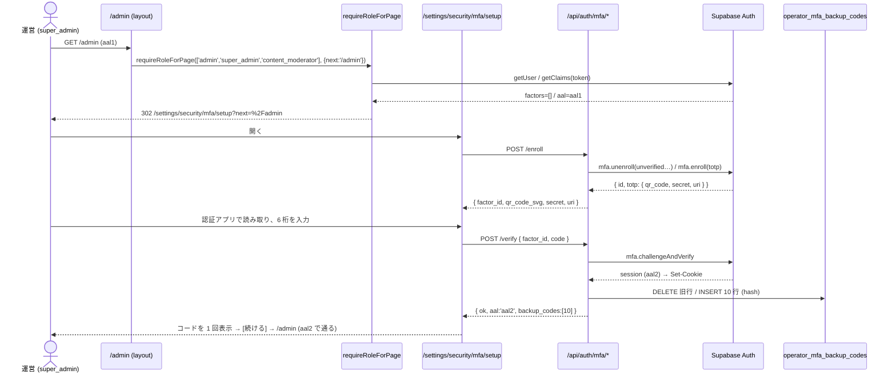
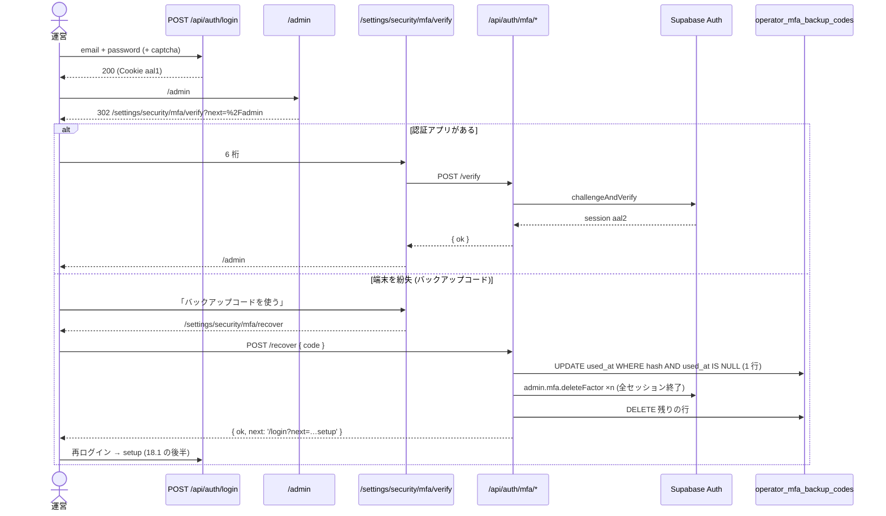

# 運営ロールの MFA (二段階認証) 設計 — Supabase Auth の TOTP と AAL2 の入口

> 版: v1.0 (2026-10-15 初版) / Issue: #1176 (`[セキュリティ] super_admin/admin/産業医ロールに必須と設計されたMFA/2FAが実装ゼロ`)
> 位置づけ: `cross/01-auth-session.md` §5 (2FA / MFA) の方針を、実装できる粒度に展開した正典。§5 と本書が食い違うときは本書が正 (§24 の追随表で §5 を本書へのポインタに改める)。
> ローンチまでに作る (オーナーの選択 2026-10-15・選択式)。
> 改定履歴: v1.0 2026-10-15 初版 (設計ゲート R0)。

---

## 0. 分冊判定・段分け・範囲 (相 1 の結果)

### 0.1 分冊判定

| 目安 | 本件 | 判定 |
|---|---|---|
| 設計書 800 行超 | 超える (ゲートの全列挙・表 3 点・追随表を 1 冊に持つため) | 当たる |
| 消費先レーン 3 以上 | Web の運営画面 (layout / page)・Web の運営 API・自己サービスの API と画面・モバイルの super_admin 画面 = 4 | 当たる |
| 共有面に 2 つ以上触る | `src/lib/auth/helpers.ts` (全運営 API の認可の入口)・`src/lib/rate-limit.ts` (カテゴリ)・`src/lib/env.ts` / `.env.example` (環境変数の一覧)・`admin_audit_logs` (書くだけ。列は変えない) | 当たる |

**判定: 設計書は 1 冊、実装は 4 段 (A〜D) に分け、段ごとに別の実装 WF (別ブランチ・別ゲート・別 PR) で積む。**
分冊 (核と配線で別の設計書) にしない理由: 核 (AAL2 の判定) は純関数 1 つと `requireRole` への 1 か所の差し込みで、配線 (画面・API・モバイル) はすべてその 1 つの判定を消費するだけ。契約 (§12〜§14) を本書に逐語で置けば、各段の実装者は本書だけで手が止まらない。分けると「核のマージ待ちで配線の設計が止まる」コストが、分けない利点 (1 か所で全入口を見渡せる) を上回る。

### 0.2 段分け (実装 WF の単位と順序)

| 段 | 中身 | 依存 | デプロイ後の状態 |
|---|---|---|---|
| **A 自己サービス** | バックアップコードの表 (migration)・`src/lib/auth/mfa/*` の核 (policy / backup-codes / factors / schemas / audit)・`/api/auth/mfa/*` の 6 route・`/settings/security/mfa/*` の 4 画面・設定画面の入口・rate-limit のカテゴリ・環境変数の登録 | なし | 運営は **任意で** TOTP を登録できる。まだ何も強制しない (ゲートが無い) |
| **B 入口のゲート** | `MfaRequiredError`・`assurance.ts`・`requireRole` / `requireSuperAdmin` の AAL2 判定・`page-guard.ts` と運営の layout / page 14 ファイルの置き換え・猶予のバナー・機械検査 (走査テスト)・テストの道具 (結合・e2e の TOTP 昇格) | A | 必須ロールの運営は、登録済みなら challenge・未登録なら登録を **強制** される (猶予の環境変数で開始日時を後ろへずらせる) |
| **C 運営の別の人による解除** | `POST /api/super-admin/admins/{id}/mfa/reset`・`/admin/users/{id}` の解除セクション | A | super_admin が他の運営の TOTP とバックアップコードを消せる (本人は再ログイン → 再登録) |
| **D モバイル** | `apps/mobile/app/(super-admin)/_layout.tsx` の AAL 判定と TOTP 入力画面 | B | モバイルの super_admin 画面が、AAL1 のセッションでは TOTP を求める。登録は Web だけ |

⚠️ **A → B の順を崩さない**。B を先に出すと、登録の導線が無いまま強制が始まり、運営が全員入れなくなる。C と D は B と並行に作れるが、マージは A の後 (C)・B の後 (D)。

### 0.3 本書が決めないもの (範囲外)

- WebAuthn / パスキー (cross/01 §3.1 のとおり Phase 2)・SMS (非対応)・`org_admin` への強制 (Enterprise オプション)。
- 運営系セッションのアイドル / 絶対タイムアウト (cross/01 §4.1)。AAL はセッションの属性であり、寿命は変えない。
- 身分証の画像の保管 (§7 の判断: 本人確認は運営が画面外で行い、確認した事実と方法だけを監査ログに残す。画像は預からない)。
- `support` / `sales` / `content_moderator` の任意の MFA (§27 Q-3)。本書の対象ロールだけが登録できる。

---

## 1. 目的・スコープ

運営の権限 (super_admin / admin / finance / org_industrial_doctor) を持つアカウントは、パスワード (または Google ログイン) に加えて **認証アプリ (TOTP)** を持っていなければ運営の画面・API を使えないようにする。判定の軸は **Supabase Auth のセッションの AAL (Authenticator Assurance Level)**: `aal2` のセッションだけを運営の入口で通す。

- 入口 = `requireRole()` (`src/lib/auth/helpers.ts`) と、それに委ねる `requireSuperAdmin()` (`src/lib/auth/operator-permissions.ts`)。運営の全 API と全画面はこの 2 つを通っている (§3.3 の実測) ので、**判定を入口の中に 1 か所差し込む** ことで、入口を 1 つも取りこぼさない。
- 入口を取りこぼしていないことは、ソース走査の contract テスト (§20) が毎回確かめる。

## 2. 関連要件・正典

| 文書 | 箇所 | 本書との関係 |
|---|---|---|
| `docs/requirements/03-operator-admin.md` | §17.2 | ロール別の必須・TOTP + バックアップコード 10 個・SHA-256・紛失時の手動解除 |
| `docs/design/cross/01-auth-session.md` | §5.1〜5.3 | 同上の設計方針。本書が展開する (§24 でポインタ化) |
| `docs/design/cross/04-api-conventions.md` | §4.2 | `AUTH_2FA_REQUIRED` / `AUTH_2FA_INVALID` の予約。HTTP の番号は本書 §19 で改める (§24) |
| `docs/design/operator/07-audit-monitoring.md` | §4 | 監査ログの action_type の命名 (`admin.<対象>.<操作>` / `super_admin.<対象>.<操作>`) |
| `docs/design/CLAUDE.md` | 横断ルール B / C / 監査 | ロール 12 種固定・`requireRole` の利用・監査ログ必須 |
| `docs/requirements/100-scenarios.md` | A11 / A12 | 2FA の有効化 UI が未定義 (本書 §15 で定義)・バックアップコードの利用 |

## 3. 前提の事実 (origin/main 2026-10-15 の実コード・実データ)

### 3.1 実装の現状

- `mfa` / `totp` / `aal2` / `backup_codes` / `authenticator` / `getAuthenticatorAssuranceLevel` を参照する本番コードは 0 件。`docs/operations/auth-protection.md:95` は「このアプリは MFA を使っていない」と記す。
- `requireRole(allowedRoles)` = `auth.getUser()` → `user_profiles` の `roles / organization_id / frozen_at / unban_at` → 凍結判定 → ロールの交差。AAL も factor も見ない。
- `requireSuperAdmin()` = `auth.getUser()` → `user_profiles.roles` に `super_admin` があるかだけ。
- `lib/supabase/middleware.ts` は凍結・メンテナンス・同意ゲートを扱い、AAL は見ない。**本書は middleware を変えない** (§7 の裁定)。
- 本番の `auth.mfa_factors` は 0 行。`user_profiles.roles` の保有行数は admin 9・super_admin 2・support 3・sales 3。finance・org_industrial_doctor・content_moderator は 0 行 (行単位の数。1 人が複数ロールを持つと重複する)。
- ライブラリ: `@supabase/supabase-js` 2.105.3 (`@supabase/auth-js` 2.105.3)・`@supabase/ssr` 0.1.0・`zod` 4・Next 15.5。auth-js は `auth.getClaims(jwt?)`・`auth.mfa.{enroll, challenge, verify, challengeAndVerify, unenroll, listFactors, getAuthenticatorAssuranceLevel}`・`auth.admin.mfa.{listFactors, deleteFactor}` を持ち、`User.factors` に factor の一覧 (`status: 'verified' | 'unverified'`) が入る。JWT の claim に `aal: 'aal1' | 'aal2'` と `session_id` がある。
- auth-js の規定 (型定義のコメント): factor を verify すると **その他のセッションはログアウトされ**、現在のセッションが `aal2` に上がる。`admin.mfa.deleteFactor` で verified な factor を消すと **その利用者の全セッションがログアウトされる**。

### 3.2 ロールと入口の対応 (実測)

| 入口 | 件数 | 内訳 |
|---|---|---|
| `requireRole([...])` の呼び出し (src/。テスト除く) | 113 | `['super_admin']` 55 / `['admin','super_admin']` 16 / `['support','admin','super_admin']` 11 / `['admin','super_admin','finance']` 9 / `['admin','super_admin','content_moderator']` 8 / `['sales','admin','super_admin']` 6 / `['admin','super_admin','support']` 4 / `['admin']` 3 / `['support','admin']` 1 |
| `requireSuperAdmin()` の呼び出し | 9 | すべて `src/app/api/operator/membership/**/route.ts` |
| `requireOrgRole()` の呼び出し | 0 | 定義だけ残っている (産業医の専用入口は現状存在しない) |
| 運営の layout (Server Component) | 3 | `src/app/admin/layout.tsx` (admin / super_admin / content_moderator)・`src/app/super-admin/layout.tsx` (super_admin)・`src/app/(operator)/operator/membership/layout.tsx` (super_admin) |
| layout の外で `requireRole` を直接呼ぶ page | 11 | `admin/page.tsx`・`admin/announcements`・`admin/moderation`・`admin/moderation/[type]/[id]`・`admin/organizations`・`admin/users`・`admin/users/[id]`・`admin/users/[id]/freeze`・`super-admin/coupons`・`super-admin/feature-packages`・`super-admin/plans` |
| 運営向けの route.ts | 26 + 27 + 9 + 3 + 2 | `src/app/api/admin/**` 26・`src/app/api/super-admin/**` 27・`src/app/api/operator/**` 9・`src/app/api/support/**` 3・運営ロールを要求するそれ以外 2 (`src/app/api/announcements/route.ts` の管理系 handler・`src/app/api/comparison/trigger/route.ts`) |
| モバイルの運営画面 | 5 | `apps/mobile/app/(super-admin)/super-admin/{index, admins, settings, feature-flags, database}.tsx`。`hasRole('super_admin')` で入り、Bearer で `/api/super-admin/{admins, settings, flags, flags/{key}, db-stats}` と `PUT /api/admin/users/{id}/role` を呼ぶ |

### 3.3 認可の順序 (現状。本書はこの末尾に AAL を足す)

`auth.getUser()` (未認証 → 401) → `user_profiles` (無い → 401 `AUTH_PROFILE_NOT_FOUND`) → 凍結 (→ 403 `AUTH_ACCOUNT_FROZEN`) → ロールの交差 (→ 403 `PERM_DENIED`) → **[本書] AAL の判定 (→ 403 `AUTH_2FA_REQUIRED` / `AUTH_2FA_ENROLLMENT_REQUIRED`)**。

### 3.4 テストの道具 (運営のセッションの作り方)

- 結合テスト (`tests/integration/helpers/users.ts` の `createTestUserWithRoles`): `admin.createUser` → `user_profiles` に roles → 使い捨ての anon client で `signInWithPassword` → JWT (aal1)。
- e2e (`tests/e2e/fixtures/fresh-user.ts` の `adminUser` / `superAdminUser`): `createFreshUser` → roles → `injectSession` = `tests/e2e/helpers/test-session.mjs` の `createTestSession` (service_role の `generate_link` → `/auth/v1/verify`) → セッション (aal1)。`tests/e2e-test-session.test.ts` が「この補助関数以外が Supabase Auth の REST を直接呼ばない」ことを固定している。
- Maestro `apps/mobile/maestro/flows/auth/02-admin-login-normal-routing.yaml` は admin でログインしてホームに着くことだけを見る (運営画面は開かない)。

---

## 4. 要件行列

| # | 要件 | 根拠 | 本書の節 |
|---|---|---|---|
| R-1 | 対象ロール = `super_admin` / `admin` / `finance` / `org_industrial_doctor` に TOTP を必須にする | cross/01 §5.1 / 要件 §17.2 | §12.1 `MFA_REQUIRED_ROLES` |
| R-2 | 対象ロールの運営は、登録が済むまで運営の画面・API を使えない (初回の強制)。登録の画面だけは使える | 仕様ファイル「登録の導線 (初回の強制)」 | §10 / §13.2 / §15 |
| R-3 | ログインのたびに TOTP を入力しないと運営の画面・API を使えない (challenge) | cross/01 §5.3 | §10 / §15.3 |
| R-4 | 運営の **全ての** API と画面が AAL2 を要求する。AAL2 を見ない入口が残らないことを機械で検査する | 仕様ファイル | §13.1 / §20 |
| R-5 | バックアップコード: 10 個・SHA-256 で保存・使い切り (1 回使うと無効)・再発行できる | cross/01 §5.2 / 要件 §17.2 | §11 / §12.3 / §14.6 |
| R-6 | 端末の紛失時: 本人はバックアップコードで回復できる。それも無ければ別の super_admin が解除できる (監査ログ + 本人確認) | cross/01 §5.2 / 仕様ファイル | §14.5 / §14.7 |
| R-7 | セッションの AAL の扱いを決める (持続・端末ごと・ログアウト) | 仕様ファイル | §9 / §10 / §26.3 |
| R-8 | モバイル: 運営の画面がある (§3.2) ので対象。モバイルの super_admin 画面は AAL1 で止め、TOTP を求める。登録は Web だけ | 仕様ファイル | §16 |
| R-9 | 監査: 登録・再発行・回復・解除・他人による解除を `admin_audit_logs` に残す | docs/design/CLAUDE.md §6 / operator/07 | §17 |
| R-10 | 既存の運営アカウントの移行: 猶予の開始日時を環境変数で決められる。未設定なら即時に強制 | 仕様ファイル「登録の猶予」 | §12.2 / §26.2 |
| R-11 | migration の番号は決めない (`<番号はマージ時に確定>_<名前>.sql`)。対の `.down.sql` も作る | 仕様ファイル | §11 |
| R-12 | `as any` を使わない。意味のある数値は名前付き定数 (根拠つき)。運用で変えうる値は環境変数で上書きできる | 共通規律 | §12 |
| R-13 | 既存のテストの道具 (結合・e2e) が、運営のセッションを AAL2 で作れる | §3.4 | §22.4 / §23 |
| R-14 | 既存の番兵 (走査テスト) に反応するものを列挙し、直し方と段を決める | 設計ゲートの要件 | §23 |

---

## 5. ユーザーシナリオ (20 本)

| # | 誰が | 何をする | 期待 |
|---|---|---|---|
| S-1 | 既存の super_admin (未登録・猶予なし) | ログイン → `/admin` | 登録画面 `/settings/security/mfa/setup?next=/admin` へ回され、QR を読み、6 桁で確認 → バックアップコード 10 個が 1 回だけ表示 → `/admin` に戻れる |
| S-2 | 登録済みの admin | ログイン → `/admin` | `/settings/security/mfa/verify?next=/admin` で 6 桁を入れる → `/admin` |
| S-3 | 登録済みの admin | ログイン直後 (AAL1) に `GET /api/admin/users` を直接呼ぶ | 403。本文の code は route ごとの既存の 403 の code (§19.3)。画面経由なら S-2 で先に AAL2 になる |
| S-4 | support だけのロール | ログイン → `/admin/users` | 今までどおり (MFA は求めない。claims も読まない) |
| S-5 | 未登録の admin (猶予中 `OPERATOR_MFA_ENFORCE_FROM` が未来) | `/admin` | 通る。画面上部に「MM/DD HH:mm までに認証アプリを登録」のバナー。日時を過ぎたら S-1 と同じ |
| S-6 | 登録済みの admin (端末を紛失) | ログイン → verify 画面で「バックアップコードを使う」→ `/settings/security/mfa/recover` に 1 個入れる | コードが消費され、TOTP の factor と残りのコードが全部消える → Supabase が全セッションを終了 → `/login?next=/settings/security/mfa/setup` → 再ログイン → 登録 (S-1 の後半) |
| S-7 | バックアップコードも無い admin | 別の super_admin に依頼。super_admin は `/admin/users/{id}` の「二段階認証を解除」で理由と本人確認の方法を書いて実行 | 対象の factor とコードが消え、監査ログに `super_admin.mfa.reset` (critical)。対象は全セッション終了 → 再ログイン → 登録 |
| S-8 | 登録済みの super_admin (AAL2) | `/settings/security/mfa` で「バックアップコードを再発行」 | 旧コードは全部無効、新しい 10 個が 1 回だけ表示。監査 `admin.mfa.backup_codes_regenerate` |
| S-9 | 登録済みの admin (AAL2) が認証アプリを変えたい | `/settings/security/mfa` で「認証アプリを解除」→ 続けて登録 | 解除で factor とコードが消え、セッションは aal1 に戻る (refresh) → 登録画面へ → 新しい factor で登録 |
| S-10 | モバイルの super_admin (AAL1) | `(super-admin)` の画面を開く | 6 桁の入力画面 → 正しければ画面が開く (Bearer は aal2 の token になる)。未登録なら「Web で登録してください」 |
| S-11 | 攻撃者 (パスワードを知っている) | verify に 6 桁を総当たり | 5 回/分・20 回/時で 429。Supabase 側も 15 回/分/IP で 429 |
| S-12 | super_admin | 自分自身の MFA を reset API で消そうとする | 403 `OP_SELF_MODIFY` (本人はバックアップコードか、AAL2 での解除を使う) |
| S-13 | admin と finance を両方持つ人 | `GET /api/admin/finance/invoices` (AAL1) | admin が必須ロールなので 403 (AAL2 が要る)。片方だけでも同じ |
| S-14 | 結合テスト・e2e の運営ユーザー | テストの道具がセッションを作る | 道具が TOTP を登録・確認して AAL2 のセッションにするので、既存の運営のテストは変えずに通る |
| S-15 | super_admin が一般利用者に admin を付与 | 付与された人の次のアクセス | 猶予中なら通る (バナー)。猶予が無ければ登録を強制 |
| S-16 | admin を外された人 (factor は残る) | 一般の画面・API | 影響なし (requireUser はゲートを持たない)。`/settings/security/mfa` は 403 `PERM_DENIED` (対象ロールでない) |
| S-17 | 凍結中の admin | `/admin` | 403 `AUTH_ACCOUNT_FROZEN` が先 (順序 §3.3)。MFA の画面にも行けない |
| S-18 | Google ログインの admin | `/auth/callback` → `/admin` | S-2 と同じ (factor は利用者単位。ログインの方式は問わない) |
| S-19 | verify 画面を開いたままセッションが切れた admin | 6 桁を送る | 401 `AUTH_UNAUTHENTICATED` → 画面は `/login?next=...` へ |
| S-20 | 登録を途中でやめた admin (unverified の factor が残る) | 次に setup を開く | enroll が unverified な TOTP factor を先に全部消してから新しく作る (factor が溜まらない) |

---

## 6. 構想 (相 2) — 構造と、全シナリオのトレース

### 6.1 構造

```
                     ┌──────────────────── Supabase Auth ────────────────────┐
                     │ auth.mfa_factors (TOTP)   JWT claim aal / session_id │
                     └───────────▲────────────────────▲──────────────────────┘
                                 │ enroll/verify       │ getClaims(token)
   ┌─────────────┐   ┌──────────┴──────────┐   ┌──────┴──────────────────────┐
   │ 自己サービス │   │ /api/auth/mfa/*     │   │ requireRole (helpers.ts)     │
   │ の画面 (Web) ├──▶│ (段 A)              │   │  = 既存の認可 + assertOperator│
   │ /settings/   │   │ status enroll verify│   │    Assurance (段 B)          │◀── 全運営 API・layout/page
   │ security/mfa │   │ factors/{id} backup │   │ requireSuperAdmin → requireRole│   (page は page-guard 経由)
   └─────────────┘   │ -codes recover      │   └──────┬───────────────────────┘
                     └──────────┬──────────┘          │ 判定だけ (純関数 decideOperatorAssurance)
                                │ service_role         ▼
                     ┌──────────▼──────────┐   pass / pass_grace / challenge_required / enrollment_required
                     │ operator_mfa_backup │
                     │ _codes (SHA-256)    │   super_admin の解除 (段 C): /api/super-admin/admins/{id}/mfa/reset
                     └─────────────────────┘   モバイル (段 D): (super-admin)/_layout が getAuthenticatorAssuranceLevel
```

- **AAL の真は Supabase の JWT の `aal` claim だけ**。アプリは自分で「認証済み」の状態を持たない (バックアップコードも「AAL2 を与える」のではなく「TOTP を消して登録し直させる」。§7)。
- **判定は純関数 `decideOperatorAssurance`** に閉じ、入力は `roles / aal / hasVerifiedTotp / enforceFrom / now` の 5 つ。I/O (claims の読み取り・factor の一覧) は `assertOperatorAssurance` が集めて渡す。
- **入口は 1 か所**: `requireRole` の末尾。`requireSuperAdmin` は `requireRole(['super_admin'])` に委ねる (自前の判定を捨てる)。
- **画面は `requireRoleForPage`** (page-guard) に置き換え、`MfaRequiredError` を MFA の画面へのリダイレクトに変える (今の `redirect('/login')` のままだと、ログイン済みの運営がログイン画面と `/admin` の間を往復する)。
- **自己サービスの API は `requireRole(MFA_REQUIRED_ROLES, { assurance: 'session' })`** で AAL の判定だけを外す (ロールは見る)。この opt-out は走査テストの許可リストに載せたファイルだけに許す。

### 6.2 トレース (構造で手で走らせた結果)

| # | 経路 | 通る関数・判定 | 結果 |
|---|---|---|---|
| S-1 | `/admin` → `admin/layout.tsx` | `requireRoleForPage(['admin','super_admin','content_moderator'], { next: '/admin' })` → `requireRole` → roles=[super_admin] → required → `readSessionAssurance` = aal1 → `user.factors` に verified totp 無し → enforceFrom=null → `enrollment_required` → `MfaRequiredError('AUTH_2FA_ENROLLMENT_REQUIRED')` → page-guard が `redirect('/settings/security/mfa/setup?next=%2Fadmin')` | setup 画面: `GET /api/auth/mfa/status` (assurance:'session') → `enrolled:false` → `POST /api/auth/mfa/enroll` → QR → `POST /api/auth/mfa/verify {factor_id, code}` → `challengeAndVerify` → aal2 の Cookie → factor は unverified だったのでコード 10 個を発行して返す → 画面が 1 回表示 → 「続ける」で `next` へ。`/admin` の layout を再評価 → aal2 → pass |
| S-2 | 同上 | required → aal1 → verified あり → `challenge_required` → `redirect('/settings/security/mfa/verify?next=%2Fadmin')` → verify 画面 → `POST /api/auth/mfa/verify` → aal2 → `/admin` | pass |
| S-3 | `GET /api/admin/users` (Cookie, aal1) | `requireRole(['admin','super_admin','support'])` → `MfaRequiredError` (ForbiddenError の派生) → route の既存の `catch (ForbiddenError)` → 403 | 403 (code は route 既存。§19.3) |
| S-4 | `/admin/users` | roles=[support] → required=false → `not_required` (claims を読まない) | 今までどおり |
| S-5 | `/admin` | required → aal1 → verified 無し → `now < enforceFrom` → `pass_grace` → `actor.assurance.decision='pass_grace'` → layout が `<MfaGraceBanner enforceFrom>` を描く | 通る + バナー |
| S-6 | verify 画面 → recover 画面 | `POST /api/auth/mfa/recover {code}` → `requireRole(REQUIRED, {assurance:'session'})` → rate limit → `consumeBackupCode` (UPDATE ... WHERE used_at IS NULL RETURNING = 1 行) → `admin.mfa.deleteFactor` ×全 factor → `deleteBackupCodes(user)` → 監査 `admin.mfa.recover` (warn) → 200 `{ ok:true, next:'/login?next=...' }`。Supabase が全セッションを終了しているので画面は `/login` へ | 再ログイン → S-1 の後半 |
| S-7 | `/admin/users/{id}` の解除 | `POST /api/super-admin/admins/{id}/mfa/reset {reason, identity_check}` → `requireRole(['super_admin'])` (AAL2 必須) → self なら 403 → 対象の profile を service_role で読む (無ければ 404) → 監査 `super_admin.mfa.reset` を **先に** 書く (失敗なら 500 で何もしない) → `admin.mfa.listFactors` → `deleteFactor` ×n → `deleteBackupCodes` → 200 `{ data: { factors_deleted, backup_codes_deleted } }` | 対象は全セッション終了 → 再ログイン → 登録 |
| S-8 | `/settings/security/mfa` | `POST /api/auth/mfa/backup-codes` → `requireRole(REQUIRED)` (既定 = AAL2) → `issueBackupCodes` (DELETE 全行 → INSERT 10) → 監査 → 200 `{ backup_codes: [...] }` | 1 回表示 |
| S-9 | 同上 | `DELETE /api/auth/mfa/factors/{id}` → `requireRole(REQUIRED)` (AAL2) → factor が本人のものか (`user.factors` に id がある) → `mfa.unenroll` → `deleteBackupCodes` → `auth.refreshSession()` (aal1 の token に更新) → 監査 `admin.mfa.unenroll` (warn) → 200。画面は setup へ | 新しい factor で登録 |
| S-10 | モバイル `(super-admin)/_layout.tsx` | `hasRole('super_admin')` → `supabase.auth.mfa.getAuthenticatorAssuranceLevel()` → `decideMobileSuperAdminGate` → `verify` → `MfaVerifyGate`: `listFactors().totp[0]` → `challengeAndVerify({factorId, code})` → セッションが aal2 → 再判定 → `allow` | 画面が開く。`api.ts` は毎回 `getSession()` の token を使うので Bearer も aal2 |
| S-11 | `POST /api/auth/mfa/verify` ×6 | `checkRateLimit(user.id, 'auth-mfa-verify')` が 6 回目で `success:false` → 429 `RATE_LIMITED` | 止まる |
| S-12 | reset API (自分の id) | `requireRole(['super_admin'])` → `id === actor.id` → 403 `OP_SELF_MODIFY` | 断る |
| S-13 | finance API | roles=[admin, finance] → required (admin ∈ REQUIRED。finance ∈ REQUIRED でもある) → aal1 → 403 | AAL2 が要る |
| S-14 | 結合テストの `createTestUserWithRoles` | roles ∩ REQUIRED ≠ ∅ なら `promoteToAal2` (user client で `mfa.enroll` → `generateTotp(secret)` → `challengeAndVerify` → 返った session の access_token を `jwt` にする) | 既存の運営テストが通る |
| S-15 | `PUT /api/admin/users/{id}/role` → 次のアクセス | 対象の roles が変わる → 次の `requireRole` で required → 未登録 → 猶予の有無で分岐 | S-1 または S-5 |
| S-16 | 一般の API | `requireUser()` はゲートを持たない → 影響なし。`GET /api/auth/mfa/status` → roles ∩ REQUIRED = ∅ → 403 `PERM_DENIED` | — |
| S-17 | `/admin` | `requireRole` → `assertNotFrozen` → `ForbiddenError('AUTH_ACCOUNT_FROZEN')` (AAL の前) → page-guard は MfaRequiredError でないので `/login` | 既存どおり |
| S-18 | `/auth/callback` → `/admin` | callback は AAL を見ない (変えない) → `/admin` の layout が S-2 の判定 | S-2 |
| S-19 | `POST /api/auth/mfa/verify` (セッション切れ) | `requireRole` → `getAuthUser` → `AuthError` → 401 `AUTH_UNAUTHENTICATED` → 画面は `/login?next=/settings/security/mfa/verify?...` | ログインへ |
| S-20 | `POST /api/auth/mfa/enroll` | `removeUnverifiedTotpFactors` (`user.factors` の `status==='unverified' && factor_type==='totp'` を `mfa.unenroll`) → `mfa.enroll({factorType:'totp', issuer, friendlyName})` | 新しい factor 1 つ |

---

## 7. 構造裁定 (相 3・1 回だけ)

### 7.1 代替案の比較

| 論点 | 案 | 採否 | 理由 |
|---|---|---|---|
| **ゲートの置き場** | (a) `requireRole` の末尾に 1 か所 | **採用** | 113 + 9 の入口を書き換えずに全部が対象になる。走査は「入口の関数を呼んでいるか」の 1 条件で済む |
| | (b) middleware のパス前方一致 (`/api/admin`, `/admin` …) | 不採用 | `/api/announcements` (管理系 handler)・`/api/comparison/trigger` のように前方一致の外にある入口が実在する (§3.2)。middleware は障害時 fail-open (#348) の思想で、fail-closed の MFA と相容れない |
| | (c) 各 route に `requireAal2()` を足す | 不採用 | 122 か所の編集と「足し忘れ」の走査が要る。(a) の走査より条件が増える |
| **バックアップコードの意味** | (a) TOTP を消して登録し直させる (回復) | **採用** | AAL の真が JWT の claim 1 つのまま。ゲートが「Supabase の aal2 か、アプリの代替証明か」の 2 系統を見ずに済む (2 系統は、どちらか一方を見ない入口 = 縁の発生源) |
| | (b) アプリの表に「代替で AAL2 相当」を記録して通す | 不採用 | 上の 2 系統。有効期限・端末・セッションの対応づけが要り、walkthrough できない |
| | (c) Supabase の第 2 の factor にする | 不可 | Supabase にバックアップコードの factor 種別は無い (totp / phone / webauthn) |
| **登録状態の持ち方** | (a) Supabase の `user.factors` を見る | **採用** | `getUser()` の戻りに入っていて追加の I/O が無い。二重管理しない |
| | (b) 自前の `operator_mfa_settings` 表 | 不採用 | Supabase と食い違う状態 (表は登録済み・factor は消えている) が生まれる |
| **AAL の読み方 (サーバー)** | (a) `auth.getClaims(token)` | **採用** | 署名を確かめた claim。Bearer (モバイル) は token を明示して渡せる |
| | (b) `getSession()` の token を自分でデコード | 不採用 | 署名を見ない。Bearer では `getSession()` が null |
| | (c) `mfa.getAuthenticatorAssuranceLevel()` | 不採用 (サーバー) | セッションが無い Bearer で動かない。モバイル (クライアント) では採用 |
| **2FA 未完了の応答** | (a) `ForbiddenError` の派生 `MfaRequiredError` (403) | **採用** | 既存 route の `catch (ForbiddenError)` がそのまま 403 を返す (route を変えない)。401 にすると画面が「未ログイン」と解釈してログイン画面へ回し、往復する |
| | (b) `AuthError` (401。cross/04 の予約どおり) | 不採用 | 上の往復。cross/04 の HTTP 番号は本書で改める (§24) |
| **猶予** | (a) 環境変数の開始日時 (未設定 = 即時) | **採用** | 運用で変えうる値。安全側の既定 |
| | (b) 利用者ごとの期限列 | 不採用 | 表と UI が増える。11 行の移行には過剰 |
| **身分証** | (a) 画像を預からず、確認した事実と方法を監査ログに残す | **採用** | 個人情報の保管面を増やさない。要件の「アップロード」は Q-1 で問う |

### 7.2 F の問い — 縁の発生源を消すより単純な構造は無いか

- 「ゲートを `requireRole` の中に置く」より単純な構造は無い。入口の数を 1 に畳んでいる。
- 残る縁は 3 つで、いずれも走査テストで閉じる (§20): ① `requireRole` を呼ばない運営 route (今は 0 件。足されたら赤) ② `{ assurance: 'session' }` の opt-out を自己サービス以外で使う (許可リスト外は赤) ③ `requireOrgRole` の新しい呼び出し (ゲートを持たないので赤。産業医の入口は `requireRole(['org_industrial_doctor', ...])` + `profile.organization_id` の絞り込みで作る)。
- 「page が `requireRole` を直接呼んで `/login` へ回す」書き方は、MFA の応答で往復するので構造的に禁止し、`requireRoleForPage` に一本化する (走査 ④)。

**構造を確定する。以後の蒸し返しは裁定への差し戻し事由として別に扱う。**

---

## 8. ① 全パターン表 (入口の判定)

軸: 必須ロールの有無 × セッションの AAL × verified な TOTP factor × 猶予 × 入口の種類。`decideOperatorAssurance` の出力と、入口ごとの応答。

| # | 必須ロール | AAL | verified TOTP | 猶予 (`now < enforceFrom`) | decision | page (page-guard) | 既存の運営 API (Cookie / Bearer) | 自己サービス API (`assurance:'session'`) |
|---|---|---|---|---|---|---|---|---|
| P-1 | 無し | — (読まない) | — | — | `not_required` | 通る | 通る | 403 `PERM_DENIED` |
| P-2 | 有り | aal2 | 有り | — | `pass` | 通る | 通る | 通る |
| P-3 | 有り | aal2 | 無し (unenroll 直後・refresh 前) | — | `pass` | 通る (aal2 の token の寿命まで。unenroll の route は refresh で aal1 に戻す §14.4) | 通る | 通る |
| P-4 | 有り | aal1 | 有り | — | `challenge_required` | `/settings/security/mfa/verify?next=` | 403 (route 既存の code) | 通る |
| P-5 | 有り | aal1 | 無し | 無し (未設定・過去・不正な値) | `enrollment_required` | `/settings/security/mfa/setup?next=` | 403 (route 既存の code) | 通る |
| P-6 | 有り | aal1 | 無し | 有り | `pass_grace` | 通る + バナー | 通る | 通る |
| P-7 | 有り | aal1 | unverified だけ | (P-5 / P-6 と同じ) | 同上 (unverified は無登録と同じ) | 同上 | 同上 | 通る |
| P-8 | 有り | claims を読めない (getClaims の error / sub の不一致) | — | — | 例外 `AuthError('AUTH_UNAUTHENTICATED')` | `/login?next=` | 401 | 401 |
| P-9 | 凍結中 | — | — | — | (AAL の前に `AUTH_ACCOUNT_FROZEN`) | `/login` (既存) | 403 | 403 |
| P-10 | 未認証 | — | — | — | (AAL の前に `AUTH_UNAUTHENTICATED`) | `/login?next=` | 401 | 401 |

消費経路の網羅 (書く側・読む側・表示):

| 経路 | 読む | 書く |
|---|---|---|
| `requireRole` / `requireSuperAdmin` | `user.factors`・JWT claims | — |
| `/api/auth/mfa/status` | factors・`operator_mfa_backup_codes` の残数・claims・猶予 | — |
| `/api/auth/mfa/enroll` | factors | Supabase factor (作成)・unverified の削除 |
| `/api/auth/mfa/verify` | factors | Supabase (verify → セッション aal2)・`operator_mfa_backup_codes` (初回の verify で 10 行)・`admin_audit_logs` |
| `/api/auth/mfa/backup-codes` | — | `operator_mfa_backup_codes` (全削除 → 10 行)・`admin_audit_logs` |
| `/api/auth/mfa/factors/{id}` DELETE | factors | Supabase (unenroll・refresh)・`operator_mfa_backup_codes` (全削除)・`admin_audit_logs` |
| `/api/auth/mfa/recover` | `operator_mfa_backup_codes` | 同表 (1 行を消費 → 全削除)・Supabase (admin deleteFactor ×n)・`admin_audit_logs` |
| `/api/super-admin/admins/{id}/mfa/reset` | 対象の profile・factors | `admin_audit_logs` (先)・Supabase (admin deleteFactor ×n)・`operator_mfa_backup_codes` (全削除) |
| 画面 `/settings/security/mfa*` | status API | 上の API 経由だけ (DB に直接触れない) |
| モバイル `(super-admin)/_layout` | `getAuthenticatorAssuranceLevel`・`listFactors` | Supabase (challengeAndVerify) |
| CSV / 書き出し | 無し | 無し |

---

## 9. ② 状態比較表 (現行 vs 設計後)

| 観点 | 現行 | 設計後 |
|---|---|---|
| 運営の認可 | ロールの交差だけ | ロールの交差 + 必須ロールなら AAL2 (§13.1) |
| `requireSuperAdmin` | 自前で `getUser` + roles | `requireRole(['super_admin'])` に委ねる (凍結判定も付く = 挙動の強化) |
| 運営の page の失敗時 | `redirect('/login')` (ロール不足も未認証も) | `requireRoleForPage`: 未認証 → `/login?next=`・2FA 未完了 → MFA の画面・それ以外の 403 → `/login` (現行維持) |
| TOTP の登録 | 無し | `/settings/security/mfa/setup` (QR + 手入力の secret + 6 桁の確認) |
| ログイン時の challenge | 無し | `/settings/security/mfa/verify?next=` (運営の画面に入るときに回される) |
| バックアップコード | 無し | 10 個・`operator_mfa_backup_codes` に SHA-256・1 回で無効・AAL2 で再発行 |
| 紛失時 | 無し | 本人: バックアップコードで TOTP を消して登録し直す。他人: super_admin の解除 API |
| 監査 | 無し | 5 種の action_type (§17) |
| モバイルの super_admin 画面 | roles だけ | roles + AAL2 (TOTP 入力)。未登録は Web へ案内 |
| 移行 | — | `OPERATOR_MFA_ENFORCE_FROM` 以前は未登録でも通る (バナー)。未設定なら即時 |
| テストの道具 | aal1 のセッション | 必須ロールなら TOTP を登録・確認して aal2 |
| エラーコード | `AUTH_2FA_REQUIRED` 401 (予約のみ) | `AUTH_2FA_REQUIRED` 403・`AUTH_2FA_ENROLLMENT_REQUIRED` 403・`AUTH_2FA_INVALID` 400・`AUTH_2FA_NOT_ENROLLED` 409・`AUTH_2FA_ALREADY_ENROLLED` 409 (§19) |

---

## 10. ③ 状態遷移表

利用者の状態 U と、セッションの状態 S を分けて持つ (AAL はセッションの属性)。

- U0 = 必須ロールを持たない / U1 = 必須ロール・verified TOTP 無し / U2 = 必須ロール・verified TOTP 有り (バックアップコード 10 以下が残る)
- S1 = aal1 / S2 = aal2 / S0 = セッション無し

| 状態 | 操作 | ガード | 遷移先 | 副作用 |
|---|---|---|---|---|
| (U*, S0) | ログイン (パスワード / Google / ブリッジ) | 既存のログインの条件 | (U*, S1) | `user_sessions_metadata` 等は既存どおり。AAL は aal1 |
| (U1, S1) | 運営の入口 | 猶予中でない | 変化なし | `enrollment_required` → 403 / setup へ |
| (U1, S1) | 運営の入口 | 猶予中 | 変化なし | `pass_grace` → 通る + バナー |
| (U1, S1) | enroll | 対象ロール | (U1, S1) + unverified factor | unverified の既存 factor を先に全部消す |
| (U1, S1) | verify (unverified factor に正しい 6 桁) | factor が本人のもの・rate limit 内 | **(U2, S2)** | Supabase が他のセッションを終了。バックアップコード 10 個を発行 (旧行は全削除)。監査 `admin.mfa.enroll` |
| (U1, S1) | verify (誤った 6 桁) | — | 変化なし | 400 `AUTH_2FA_INVALID`。回数は rate limit が数える |
| (U2, S1) | 運営の入口 | — | 変化なし | `challenge_required` → 403 / verify へ |
| (U2, S1) | verify (正しい 6 桁) | rate limit 内 | (U2, S2) | 監査は残さない (通常のログインの一部。Supabase の auth 監査に残る) |
| (U2, S1) | recover (正しいバックアップコード) | 残っているコード・rate limit 内 | **(U1, S0)** | 1 行を消費 → 全 factor 削除 (Supabase が全セッション終了) → 残りのコード全削除 → 監査 `admin.mfa.recover` (warn) |
| (U2, S1) | recover (誤ったコード) | — | 変化なし | 400 `AUTH_2FA_INVALID` |
| (U2, S1) | backup-codes 再発行 / factor 削除 | — | 変化なし | 403 `AUTH_2FA_REQUIRED` (AAL2 が要る) |
| (U2, S2) | backup-codes 再発行 | — | (U2, S2) | 全削除 → 10 行。監査 `admin.mfa.backup_codes_regenerate` |
| (U2, S2) | factor 削除 (unenroll) | factor が本人のもの | **(U1, S1)** | コード全削除 → `refreshSession` で aal1 の token → 監査 `admin.mfa.unenroll` (warn) |
| (U2, S2) | enroll | — | 変化なし | 409 `AUTH_2FA_ALREADY_ENROLLED` (先に unenroll) |
| (U2, S*) | super_admin の reset (他人) | 実行者 super_admin・AAL2・自分でない | **(U1, S0)** | 監査 `super_admin.mfa.reset` (critical) を先に → 全 factor 削除 (全セッション終了) → コード全削除 |
| (U1, S*) | super_admin の reset (他人) | 同上 | (U1, S0 または S* のまま) | factor が 0 でも 200 (削除数 0)。コードも 0 |
| (U0, S*) | ロールの付与 (必須ロール) | super_admin | (U1, S*) | 次の入口で上の U1 の行 |
| (U1/U2, S*) | ロールの剥奪 (必須ロールが無くなる) | super_admin | (U0, S*) | factor とコードは残る (Q-4)。自己サービスの API は 403 |
| (U*, S2) | ログアウト | — | (U*, S0) | — |
| (U*, S2) | token の refresh | — | (U*, S2) | aal2 は持続する |
| (U*, S1/S2) | 凍結 | — | — | 入口は AAL の前に 403 `AUTH_ACCOUNT_FROZEN` |

表に無い遷移を作るコードは blocking。

---

## 11. データモデル

### 11.1 `operator_mfa_backup_codes` (新規)

ファイル: `supabase/migrations/<番号はマージ時に確定>_operator_mfa_backup_codes.sql` (番号は origin/main の `supabase/migrations` の最大より大きい値でマージ直前に確定。2026-10-15 時点の最大は `20261015110000`)。

```sql
-- migration: <番号はマージ時に確定>_operator_mfa_backup_codes.sql
-- 運営ロールの MFA (二段階認証) のバックアップコード (#1176。docs/design/cross/12-operator-mfa.md §11)
--
-- 1 行 = 1 個のコード。値そのものは持たず、SHA-256 (hex 64 文字。前像は "<user_id>:<正規化したコード>") だけを持つ。
-- 使ったコードは used_at を書く (行は残す)。再発行・回復・解除ではその利用者の行を全部消す
-- (コードが存在するのは verified な TOTP factor があるときだけ、という不変条件を保つ)。
-- 読み書きは service_role だけ (RLS 有効・ポリシー無し。anon / authenticated は何もできない)。
-- 何度流しても同じ結果になる (IF NOT EXISTS)。既存の表・列・関数には触れない。
-- 戻し方: supabase/rollbacks/<番号はマージ時に確定>_operator_mfa_backup_codes.down.sql
-- 確かめるテスト: tests/operator-mfa-backup-codes-migration-contract.test.ts (文面)・tests/integration/security/operator-mfa.test.ts (実 DB)

CREATE TABLE IF NOT EXISTS public.operator_mfa_backup_codes (
  id          uuid        PRIMARY KEY DEFAULT gen_random_uuid(),
  user_id     uuid        NOT NULL REFERENCES auth.users(id) ON DELETE CASCADE,
  batch_id    uuid        NOT NULL,
  code_hash   text        NOT NULL,
  created_at  timestamptz NOT NULL DEFAULT now(),
  used_at     timestamptz,
  CONSTRAINT operator_mfa_backup_codes_user_hash_key UNIQUE (user_id, code_hash),
  CONSTRAINT operator_mfa_backup_codes_code_hash_check CHECK (code_hash ~ '^[0-9a-f]{64}$')
);

CREATE INDEX IF NOT EXISTS operator_mfa_backup_codes_user_unused_idx
  ON public.operator_mfa_backup_codes (user_id)
  WHERE used_at IS NULL;

ALTER TABLE public.operator_mfa_backup_codes ENABLE ROW LEVEL SECURITY;

REVOKE ALL ON TABLE public.operator_mfa_backup_codes FROM PUBLIC, anon, authenticated;
GRANT SELECT, INSERT, UPDATE, DELETE ON TABLE public.operator_mfa_backup_codes TO service_role;

COMMENT ON TABLE public.operator_mfa_backup_codes IS
  '運営ロールの MFA のバックアップコード (SHA-256 のみ)。service_role 専用。docs/design/cross/12-operator-mfa.md §11';
COMMENT ON COLUMN public.operator_mfa_backup_codes.code_hash IS 'sha256("<user_id>:<正規化したコード>") の hex';
COMMENT ON COLUMN public.operator_mfa_backup_codes.batch_id IS '同時に発行した 10 個を束ねる id';
COMMENT ON COLUMN public.operator_mfa_backup_codes.used_at IS '使った日時。NULL = 未使用';
```

ロールバック `supabase/rollbacks/<番号はマージ時に確定>_operator_mfa_backup_codes.down.sql`:

```sql
-- rollback: <番号はマージ時に確定>_operator_mfa_backup_codes.sql
-- 表ごと消す (値はハッシュだけで、消えても Supabase の factor は残る。戻したあとは回復の API が 500 になるので、
-- アプリ側 (段 A) も一緒に戻す)。本番に戻す必要があるときは、この内容を新しい migration として PR 経由で適用する。
DROP INDEX IF EXISTS public.operator_mfa_backup_codes_user_unused_idx;
DROP TABLE IF EXISTS public.operator_mfa_backup_codes;
```

### 11.2 既存の表

- `admin_audit_logs`: 列は変えない。書くだけ (§17)。
- `auth.mfa_factors` / `auth.mfa_challenges`: Supabase が管理。アプリは SDK 経由だけ (SQL で触らない)。
- `user_profiles`: 変えない。

### 11.3 型の生成物

`src/types/database.types.ts` と `packages/shared/src/database.types.ts` に `operator_mfa_backup_codes` を入れる (作り直し方は `tests/database-types-migrations-contract.test.ts` の冒頭)。

---

## 12. 定数・環境変数・ポリシー (canonical)

### 12.1 ポリシー (純関数) — `src/lib/auth/mfa/policy.ts`

```ts
import type { RoleName } from '@/lib/auth/types';

/**
 * TOTP を必須にするロール (cross/01 §5.1 / 要件 §17.2)。この 4 つだけが登録できる (対象 = 必須)。
 * support / sales / content_moderator / org_admin は対象外 (任意の MFA は §27 Q-3)。
 */
export const MFA_REQUIRED_ROLES = ['super_admin', 'admin', 'finance', 'org_industrial_doctor'] as const satisfies ReadonlyArray<RoleName>;

export type MfaRequiredRole = (typeof MFA_REQUIRED_ROLES)[number];

/** 猶予の開始日時を上書きする環境変数の名前。値を読むのは src/lib/auth/mfa/policy.ts の readMfaEnforceFromEnv だけ (src/lib/env.ts の readOnlyBy) */
export const OPERATOR_MFA_ENFORCE_FROM_ENV_NAME = 'OPERATOR_MFA_ENFORCE_FROM';

/** ISO 8601 の日時でタイムゾーンを必ず持つもの (例: 2026-11-01T00:00:00+09:00 / 2026-10-31T15:00:00Z)。日付だけ・TZ 無しは受け付けない (解釈が環境で変わるため) */
const ENFORCE_FROM_PATTERN = /^\d{4}-\d{2}-\d{2}T\d{2}:\d{2}(?::\d{2}(?:\.\d{1,3})?)?(?:Z|[+-]\d{2}:\d{2})$/;

export type AuthenticatorAssuranceLevel = 'aal1' | 'aal2';

export interface MfaEnforceFromSetting {
  /** 強制の開始日時。null = 即時に強制 (既定) */
  readonly enforceFrom: Date | null;
  /** 値が不正で無視したか (ログで知らせる用。値そのものは返さない) */
  readonly ignored: boolean;
}

/**
 * OPERATOR_MFA_ENFORCE_FROM の文字列 (未設定は undefined) から、強制の開始日時を決める。
 * 未設定・空白だけ → null (即時に強制。安全側の既定)。形が違う・日付として無効 → null + ignored (打ち間違いで強制が外れないように)。
 */
export function resolveMfaEnforceFrom(raw: string | undefined): MfaEnforceFromSetting {
  const text = raw?.trim();
  if (!text) return { enforceFrom: null, ignored: false };
  if (!ENFORCE_FROM_PATTERN.test(text)) return { enforceFrom: null, ignored: true };
  const ms = Date.parse(text);
  if (!Number.isFinite(ms)) return { enforceFrom: null, ignored: true };
  return { enforceFrom: new Date(ms), ignored: false };
}

export function isMfaRequiredRoleSet(roles: ReadonlyArray<string>): boolean {
  return roles.some((role) => (MFA_REQUIRED_ROLES as ReadonlyArray<string>).includes(role));
}

export type OperatorAssuranceDecision =
  | 'not_required'
  | 'pass'
  | 'pass_grace'
  | 'challenge_required'
  | 'enrollment_required';

export interface DecideOperatorAssuranceInput {
  readonly roles: ReadonlyArray<string>;
  /** セッションの AAL。必須ロールでないときは読まないので null を渡してよい */
  readonly aal: AuthenticatorAssuranceLevel | null;
  /** verified な TOTP factor があるか (unverified は数えない) */
  readonly hasVerifiedTotp: boolean;
  /** 強制の開始日時 (resolveMfaEnforceFrom の結果)。null = 即時 */
  readonly enforceFrom: Date | null;
  readonly now: Date;
}

export interface OperatorAssuranceResult {
  readonly required: boolean;
  readonly decision: OperatorAssuranceDecision;
}

/**
 * 運営の入口で AAL2 を求めるかの判定。I/O を持たない (呼び出し側が claims と factors を集めて渡す)。
 *   必須ロールでない → not_required (claims を読む必要も無い)
 *   aal2 → pass (factor の有無は見ない。unenroll 直後の aal2 token は寿命まで通る。unenroll の route が refresh で aal1 に戻す)
 *   aal1 で verified TOTP あり → challenge_required
 *   aal1 で無し、猶予中 (now < enforceFrom) → pass_grace
 *   aal1 で無し、猶予なし → enrollment_required
 */
export function decideOperatorAssurance(input: DecideOperatorAssuranceInput): OperatorAssuranceResult {
  const required = isMfaRequiredRoleSet(input.roles);
  if (!required) return { required, decision: 'not_required' };
  if (input.aal === 'aal2') return { required, decision: 'pass' };
  if (input.hasVerifiedTotp) return { required, decision: 'challenge_required' };
  if (input.enforceFrom !== null && input.now.getTime() < input.enforceFrom.getTime()) {
    return { required, decision: 'pass_grace' };
  }
  return { required, decision: 'enrollment_required' };
}

/** requireRole が UserProfile.assurance に付ける要約 (画面のバナー・status API が読む) */
export interface OperatorAssuranceSummary {
  readonly required: boolean;
  readonly aal: AuthenticatorAssuranceLevel | null;
  readonly enrolled: boolean;
  readonly decision: Extract<OperatorAssuranceDecision, 'not_required' | 'pass' | 'pass_grace'>;
  /** ISO 8601 (UTC)。猶予が無ければ null */
  readonly enforce_from: string | null;
}
```

### 12.2 環境変数

| 名前 | 置き場 | 必須 | 既定 | 意味 |
|---|---|---|---|---|
| `OPERATOR_MFA_ENFORCE_FROM` | `src/lib/env.ts` の `SERVER_ENV_VARS` (任意・`readOnlyBy: 'src/lib/auth/mfa/policy.ts'`)・`.env.example` | 任意 | 未設定 = 即時に強制 | 必須ロールで **未登録** の運営を、この日時まで通す (バナー付き)。登録済みの運営には効かない (常に challenge)。ISO 8601 + タイムゾーン必須。不正な値は無視して即時 (warn ログをプロセスごとに 1 回) |

`whenMissing`: 「必須ロールの運営は、未登録なら次のアクセスから登録を求められる (猶予なし)」。

読み取り関数 (`src/lib/auth/mfa/policy.ts` に同居。env.ts の readOnlyBy はこのファイルを指す):

```ts
// tsc:skip (policy.ts の続き。process.env を名前で読むのはこのファイルだけ。値はログに出さない)
let enforceFromWarned = false;
export function readMfaEnforceFromEnv(): MfaEnforceFromSetting {
  const setting = resolveMfaEnforceFrom(process.env.OPERATOR_MFA_ENFORCE_FROM);
  if (setting.ignored && !enforceFromWarned) {
    enforceFromWarned = true;
    createLogger('auth/mfa/policy').warn('環境変数の値が正しくないため、猶予なし (即時) にします', {
      ignored_env: [OPERATOR_MFA_ENFORCE_FROM_ENV_NAME],
    });
  }
  return setting;
}
```

### 12.3 バックアップコード — `src/lib/auth/mfa/backup-codes.ts`

```ts
import { createHash, randomBytes } from 'node:crypto';

/** 発行する個数 (cross/01 §5.2 / 要件 §17.2 の 10 個) */
export const BACKUP_CODE_COUNT = 10;
/** 1 個の長さ (文字)。32 文字の字母で 10 文字 = 50 bit。レート制限 (§14.5) と合わせて総当たりを現実的でなくする */
export const BACKUP_CODE_LENGTH = 10;
/** 字母。読み間違えやすい I / O / 0 / 1 を除いた 32 文字 (2^5 なので乱数 1 byte の下位 5 bit で偏りなく選べる) */
export const BACKUP_CODE_ALPHABET = 'ABCDEFGHJKLMNPQRSTUVWXYZ23456789';
/** 表示のとき真ん中で区切る (5-5) */
const BACKUP_CODE_DISPLAY_GROUP = 5;
const ALPHABET_MASK = 0b11111;

/** 乱数で 1 個作る (正規化済みの 10 文字) */
export function generateBackupCode(): string {
  const bytes = randomBytes(BACKUP_CODE_LENGTH);
  let code = '';
  for (let i = 0; i < BACKUP_CODE_LENGTH; i += 1) {
    code += BACKUP_CODE_ALPHABET[bytes[i] & ALPHABET_MASK];
  }
  return code;
}

/** 10 個作る (重複は作り直す) */
export function generateBackupCodes(): string[] {
  const codes = new Set<string>();
  while (codes.size < BACKUP_CODE_COUNT) codes.add(generateBackupCode());
  return [...codes];
}

/** 利用者の入力を正規化する: 大文字にし、英数字以外 (区切りの - や空白) を除く */
export function normalizeBackupCode(input: string): string {
  return input.toUpperCase().replace(/[^A-Z0-9]/g, '');
}

/** 正規化済みのコードが形として正しいか (長さと字母) */
export function isWellFormedBackupCode(normalized: string): boolean {
  if (normalized.length !== BACKUP_CODE_LENGTH) return false;
  for (const ch of normalized) if (!BACKUP_CODE_ALPHABET.includes(ch)) return false;
  return true;
}

/** 保存するハッシュ。前像に user_id を入れ、利用者をまたいだ突き合わせをできなくする */
export function hashBackupCode(userId: string, normalized: string): string {
  return createHash('sha256').update(`${userId}:${normalized}`).digest('hex');
}

/** 画面に出す形 (XXXXX-XXXXX) */
export function formatBackupCode(normalized: string): string {
  return `${normalized.slice(0, BACKUP_CODE_DISPLAY_GROUP)}-${normalized.slice(BACKUP_CODE_DISPLAY_GROUP)}`;
}
```

表の読み書き (service_role の client。`getSupabaseAdmin()` で作る。自前で createClient しない):

```ts
// tsc:skip (backup-codes.ts の続き。型は database.types.ts の再生成後に Tables<'operator_mfa_backup_codes'> を使う)
export interface BackupCodeStoreClient { from(table: 'operator_mfa_backup_codes'): PostgrestQueryBuilder<...> }

/** 旧行を全部消して 10 個を発行し、画面に 1 回だけ出す正規化済みのコードを返す */
export async function issueBackupCodes(admin: BackupCodeStoreClient, userId: string): Promise<string[]>;
/** 1 個を消費する (UPDATE ... SET used_at = now() WHERE user_id = ? AND code_hash = ? AND used_at IS NULL RETURNING id)。消費できたら true。0 行 (無い・使用済み・同時に使われた) なら false */
export async function consumeBackupCode(admin: BackupCodeStoreClient, userId: string, normalized: string): Promise<boolean>;
/** 未使用の残数 */
export async function countRemainingBackupCodes(admin: BackupCodeStoreClient, userId: string): Promise<number>;
/** その利用者の行を全部消す (回復・解除・再発行の前)。消した行数を返す */
export async function deleteBackupCodes(admin: BackupCodeStoreClient, userId: string): Promise<number>;
```

### 12.4 TOTP (Supabase の factor) の扱い — `src/lib/auth/mfa/factors.ts`

```ts
import type { Factor, User } from '@supabase/supabase-js';

/** QR の発行者名 (認証アプリに出る)。文字列は固定 (環境で変えない) */
export const MFA_TOTP_ISSUER = 'ほめゴハン 運営';
/** factor の表示名 (1 人 1 factor なので固定) */
export const MFA_TOTP_FRIENDLY_NAME = 'authenticator';

export type VerifiedTotpFactor = Factor<'totp', 'verified'>;

function isTotp(factor: Factor): boolean {
  return factor.factor_type === 'totp';
}

/** verified な TOTP factor (Phase 1 は 1 人 1 個。複数あれば created_at が最も古いもの) */
export function findVerifiedTotpFactor(user: Pick<User, 'factors'>): VerifiedTotpFactor | null {
  const verified = (user.factors ?? []).filter(
    (f): f is VerifiedTotpFactor => isTotp(f) && f.status === 'verified',
  );
  return [...verified].sort((a, b) => a.created_at.localeCompare(b.created_at))[0] ?? null;
}

/** unverified な TOTP factor の id (enroll の前に消す対象) */
export function listUnverifiedTotpFactorIds(user: Pick<User, 'factors'>): string[] {
  return (user.factors ?? []).filter((f) => isTotp(f) && f.status === 'unverified').map((f) => f.id);
}

/** factor id が本人のものか (他人の factor id を送られても verify / unenroll しない) */
export function ownsFactor(user: Pick<User, 'factors'>, factorId: string): boolean {
  return (user.factors ?? []).some((f) => f.id === factorId);
}
```

### 12.5 レート制限 — `src/lib/rate-limit.ts` に足すカテゴリ

| カテゴリ | ルール | key | 根拠 |
|---|---|---|---|
| `'auth-mfa-verify'` | `{ name: 'auth-mfa-verify', max: 5, windowSec: MINUTE_SEC }`・`{ name: 'auth-mfa-verify-hourly', max: 20, windowSec: HOUR_SEC }` | `user.id` (認証済み) | 6 桁 = 100 万通り。1 時間 20 回なら 30 秒の窓でも当たる確率は無視できる。本人が打ち間違えても 1 分 5 回あれば足りる |
| `'auth-mfa-recover'` | `{ name: 'auth-mfa-recover', max: 3, windowSec: MINUTE_SEC }`・`{ name: 'auth-mfa-recover-hourly', max: 10, windowSec: HOUR_SEC }` | `user.id` | 50 bit のコード。1 時間 10 回で総当たりは不可能。本人は 10 個のうち 1 個を打てればよい |

`HOUR_SEC = 60 * MINUTE_SEC` を名前付き定数として足す (同ファイルの `MINUTE_SEC` / `DAY_SEC` の並び)。

---

## 13. facade 契約 (公開関数のシグネチャとエラー表)

### 13.1 `src/lib/auth/helpers.ts` — `requireRole` (変更)

```ts
// tsc:skip (既存の関数の差分。全文は実装で)
export interface RequireRoleOptions {
  /**
   * 'aal2' (既定): 必須ロール (MFA_REQUIRED_ROLES) を持つ利用者には AAL2 を求める (§12.1 の判定)。
   * 'session': ロールだけ見て AAL は見ない。使ってよいのは自己サービスの /api/auth/mfa/* だけ
   *            (tests/operator-mfa-entry-points-scan.test.ts の MFA_SELF_SERVICE_ROUTES 以外は赤)。
   */
  assurance?: 'aal2' | 'session';
}

export async function requireRole(
  allowedRoles: ReadonlyArray<RoleName>,
  options: RequireRoleOptions = {},
): Promise<UserProfile> {
  const user = await getAuthUser();
  const { roles, organization_id, frozen_at, unban_at } = await getUserProfile(user.id);
  assertNotFrozen(frozen_at, unban_at);
  if (!roles.some((r) => allowedRoles.includes(r))) {
    throw new ForbiddenError('PERM_DENIED', `Requires one of: ${allowedRoles.join(', ')}`);
  }
  // [#1176] ここから先が本書の追加。ロールの交差の後・戻り値の前に 1 か所。
  // Authorization ヘッダは assurance.ts が「Cookie のセッションが無いときだけ」next/headers から読む
  // (ここで無条件に headers() を呼ぶと、要求の外で動く既存の単体テストが落ちる)
  const assurance = options.assurance === 'session' ? undefined : await assertOperatorAssurance({ user, roles });
  return { id: user.id, email: user.email, roles, organization_id, assurance };
}
```

- `UserProfile` (`src/lib/auth/types.ts`) に `assurance?: OperatorAssuranceSummary` を足す (任意。`assurance: 'session'` のときと、テストで作るリテラルは undefined のまま)。
- `requireOrgRole` は変えない。ゲートを持たないので **新しい呼び出しを走査が禁止する** (§20 ③)。
- `requireUser` は変えない (一般の API はゲートの対象でない)。

### 13.2 `src/lib/auth/mfa/assurance.ts` — claims の読み取りと判定の結合

```ts
import { headers } from 'next/headers';
import type { SupabaseClient, User } from '@supabase/supabase-js';
import { z } from 'zod';
import { AuthError } from '@/lib/auth/errors';

export type AuthenticatorAssuranceLevel = 'aal1' | 'aal2';

/** JWT の claim のうち使うもの。aal が無い (想定外の発行者) ときは aal1 として扱う */
export const SessionClaimsSchema = z.object({
  sub: z.string().min(1),
  aal: z.enum(['aal1', 'aal2']).catch('aal1'),
  session_id: z.string().optional(),
});

export interface SessionAssurance {
  readonly aal: AuthenticatorAssuranceLevel;
  readonly sessionId: string | null;
}

/** Authorization: Bearer <JWT> (3 セグメント) なら token を返す。それ以外 (CRON_SECRET 等) は null (lib/supabase/middleware.ts の isJwtBearerHeader と同じ規則) */
export function bearerJwtOf(authorizationHeader: string | null): string | null {
  if (!authorizationHeader) return null;
  const token = /^Bearer\s+(.+)$/i.exec(authorizationHeader)?.[1];
  if (!token) return null;
  return token.split('.').length === 3 ? token : null;
}

/**
 * いまの要求のセッションの AAL を、署名を確かめた claim から読む。token の探し方は getUser() と同じ優先順:
 *   1. Cookie のセッション (getSession の access_token)
 *   2. 無ければ Authorization: Bearer <JWT> (モバイル。getSession は Cookie を見るので null になる)。
 *      ヘッダは next/headers から、この経路でだけ読む (要求の外で動く単体テストが Cookie の経路で落ちないように)
 * 読めない (token が無い・署名が無効・sub が getUser の利用者と違う) ときは AuthError('AUTH_UNAUTHENTICATED') (fail-closed)。
 * getClaims は、対称鍵 (HS256) のプロジェクトでは Auth サーバーへ 1 回問い合わせる (getUser と同程度)。非対称鍵なら手元で検証する。
 */
export async function readSessionAssurance(supabase: SupabaseClient, user: Pick<User, 'id'>): Promise<SessionAssurance> {
  const { data: sessionData } = await supabase.auth.getSession();
  let token: string | null = sessionData.session?.access_token ?? null;
  if (!token) token = bearerJwtOf((await headers()).get('authorization'));
  if (!token) throw new AuthError('AUTH_UNAUTHENTICATED');

  const { data, error } = await supabase.auth.getClaims(token);
  if (error || !data) throw new AuthError('AUTH_UNAUTHENTICATED');
  const parsed = SessionClaimsSchema.safeParse(data.claims);
  if (!parsed.success || parsed.data.sub !== user.id) throw new AuthError('AUTH_UNAUTHENTICATED');
  return { aal: parsed.data.aal, sessionId: parsed.data.session_id ?? null };
}
```

```ts
// tsc:skip (assurance.ts の続き。policy / factors / errors を結合する)
export interface AssertOperatorAssuranceInput {
  user: User;                 // getAuthUser() の戻り (factors を含む)
  roles: ReadonlyArray<RoleName>;
  now?: Date;                 // テストで固定する
}

/**
 * 必須ロールの利用者に AAL2 を求める。通るときは要約を返し、通らないときは MfaRequiredError を投げる。
 * 必須ロールでなければ claims を読まずに { decision: 'not_required' } を返す (support などの要求を遅くしない)。
 */
export async function assertOperatorAssurance(input: AssertOperatorAssuranceInput): Promise<OperatorAssuranceSummary> {
  const required = isMfaRequiredRoleSet(input.roles);
  const enrolled = findVerifiedTotpFactor(input.user) !== null;
  const { enforceFrom } = readMfaEnforceFromEnv();
  const enforceFromIso = enforceFrom ? enforceFrom.toISOString() : null;
  if (!required) return { required, aal: null, enrolled, decision: 'not_required', enforce_from: enforceFromIso };

  const supabase = await createClient();
  const session = await readSessionAssurance(supabase, input.user);
  const result = decideOperatorAssurance({
    roles: input.roles, aal: session.aal, hasVerifiedTotp: enrolled, enforceFrom, now: input.now ?? new Date(),
  });
  switch (result.decision) {
    case 'challenge_required':  throw new MfaRequiredError('AUTH_2FA_REQUIRED', '二段階認証の確認が必要です');
    case 'enrollment_required': throw new MfaRequiredError('AUTH_2FA_ENROLLMENT_REQUIRED', '二段階認証の登録が必要です');
    default:
      return { required, aal: session.aal, enrolled, decision: result.decision, enforce_from: enforceFromIso };
  }
}
```

### 13.3 `src/lib/auth/errors.ts` — `MfaRequiredError` (追加)

```ts
import { ForbiddenError } from '@/lib/auth/errors';

export type MfaRequiredCode = 'AUTH_2FA_REQUIRED' | 'AUTH_2FA_ENROLLMENT_REQUIRED';

/**
 * 二段階認証が未完了 (challenge か登録が要る)。HTTP 403 相当。
 * ForbiddenError の派生にしてあるので、既存の route の `catch (err instanceof ForbiddenError)` はそのまま 403 を返す。
 * 画面 (page-guard) だけが code を見て MFA の画面へ回す。401 にしない理由: 画面が未ログインと解釈してログイン画面と往復する。
 */
export class MfaRequiredError extends ForbiddenError {
  constructor(code: MfaRequiredCode, message?: string) {
    super(code, message);
    this.name = 'MfaRequiredError';
  }
}
```

### 13.4 `src/lib/auth/page-guard.ts` — 運営の layout / page 用 (新規)

```ts
import { redirect } from 'next/navigation';
import { AuthError, ForbiddenError } from '@/lib/auth/errors';
import { requireRole, type RoleName, type UserProfile } from '@/lib/auth/helpers';

/** 自己サービスの画面 (Web)。next を付けて回す */
export const MFA_PAGE_PATHS = {
  status: '/settings/security/mfa',
  setup: '/settings/security/mfa/setup',
  verify: '/settings/security/mfa/verify',
  recover: '/settings/security/mfa/recover',
} as const;

/** 2FA 未完了の code → 回す先。それ以外は null */
export function mfaRedirectPathFor(code: string, next: string): string | null {
  const query = `?next=${encodeURIComponent(next)}`;
  if (code === 'AUTH_2FA_REQUIRED') return `${MFA_PAGE_PATHS.verify}${query}`;
  if (code === 'AUTH_2FA_ENROLLMENT_REQUIRED') return `${MFA_PAGE_PATHS.setup}${query}`;
  return null;
}

export interface RequireRoleForPageOptions {
  /** 認証・2FA の画面から戻る先 (この画面のパス。同一オリジンの相対パスだけ) */
  next: string;
}

/**
 * Server Component (layout / page) の入口。requireRole と同じ判定をし、失敗したら redirect() する (戻らない)。
 *   未認証 (AuthError)            → /login?next=<next>
 *   2FA 未完了 (MfaRequiredError) → /settings/security/mfa/{verify|setup}?next=<next>
 *   それ以外の 403 (ForbiddenError) → /login (現行の挙動を保つ)
 * 運営の layout / page は requireRole を直接呼ばず、必ずこれを呼ぶ (走査 ④)。
 */
export async function requireRoleForPage(
  allowedRoles: ReadonlyArray<RoleName>,
  options: RequireRoleForPageOptions,
): Promise<UserProfile> {
  try {
    return await requireRole(allowedRoles);
  } catch (err) {
    if (err instanceof AuthError) redirect(`/login?next=${encodeURIComponent(options.next)}`);
    if (err instanceof ForbiddenError) redirect(mfaRedirectPathFor(err.code, options.next) ?? '/login');
    throw err;
  }
}
```

### 13.5 `src/lib/auth/operator-permissions.ts` — `requireSuperAdmin` (変更)

```ts
// tsc:skip
export async function requireSuperAdmin(): Promise<{ userId: string }> {
  const profile = await requireRole(['super_admin']);   // 凍結判定と AAL2 の判定が付く。例外の型は従来どおり AuthError / ForbiddenError
  return { userId: profile.id };
}
```

`isSuperAdmin(userId)` は変えない (判定だけの関数で、入口ではない)。

### 13.6 facade のエラー表 (lib)

| 関数 | 例外 | code | 条件 |
|---|---|---|---|
| `requireRole` | `AuthError` | `AUTH_UNAUTHENTICATED` | 未認証・claims を読めない・sub の不一致 |
| | `AuthError` | `AUTH_PROFILE_NOT_FOUND` | profile 無し |
| | `ForbiddenError` | `AUTH_ACCOUNT_FROZEN` | 凍結中 |
| | `ForbiddenError` | `PERM_DENIED` | ロール不足 |
| | `MfaRequiredError` | `AUTH_2FA_REQUIRED` | 必須ロール・aal1・verified あり |
| | `MfaRequiredError` | `AUTH_2FA_ENROLLMENT_REQUIRED` | 必須ロール・aal1・verified 無し・猶予なし |
| `requireSuperAdmin` | 上と同じ (委ねる) | | |
| `requireRoleForPage` | 投げない (redirect) | | 上の例外を回す先に変える。NEXT_REDIRECT 以外の例外はそのまま投げる |
| `readSessionAssurance` | `AuthError` | `AUTH_UNAUTHENTICATED` | token 無し・署名無効・sub 不一致 |
| `consumeBackupCode` | 投げない | | 0 行は false。DB の失敗は呼び出し側が `internalError` |

---

## 14. API 仕様

共通: `runtime = 'nodejs'`・`dynamic = 'force-dynamic'`・応答に `Cache-Control: private, no-store`・本文は `/api/auth/login` と同じ flat の形 `{ error: string, code: string, ... }` (成功は `{ ok: true, ... }`)。POST / DELETE は `/api/auth/login` と同じ `isCrossOrigin` の判定で別オリジンを 403 `FORBIDDEN_ORIGIN` にする (Cookie を持つ要求のため)。500 は `internalError(ROUTE_NAME, error, { userId })`。DB・Supabase の生のエラー文は本文に入れない。

### 14.1 `GET /api/auth/mfa/status`

- 認可: `requireRole(MFA_REQUIRED_ROLES, { assurance: 'session' })` → 対象外は 403 `PERM_DENIED`。
- 応答 200:

```ts
import { z } from 'zod';

export const MfaStatusResponseSchema = z.object({
  ok: z.literal(true),
  required: z.literal(true),
  enrolled: z.boolean(),
  aal: z.enum(['aal1', 'aal2']),
  factor: z.object({ id: z.string(), friendly_name: z.string().nullable(), created_at: z.string() }).nullable(),
  backup_codes_remaining: z.number().int().nonnegative(),
  enforce_from: z.string().nullable(),
  grace: z.boolean(),
});
export type MfaStatusResponse = z.infer<typeof MfaStatusResponseSchema>;
```

- route は `requireRole(..., { assurance: 'session' })` の後に `await createClient()` → `auth.getUser()` で `user.factors` を読み (`findVerifiedTotpFactor` / `ownsFactor`)、`readSessionAssurance(supabase, user)` で `aal` を読む。`backup_codes_remaining` は `countRemainingBackupCodes(getSupabaseAdmin(), user.id)`。`grace` = `enforce_from !== null && now < enforce_from`。

### 14.2 `POST /api/auth/mfa/enroll`

- 認可: `requireRole(MFA_REQUIRED_ROLES, { assurance: 'session' })`。
- 手順: verified な TOTP factor があれば 409 `AUTH_2FA_ALREADY_ENROLLED` (先に `DELETE /factors/{id}`)。unverified な TOTP factor を全部 `mfa.unenroll` (S-20)。`mfa.enroll({ factorType: 'totp', issuer: MFA_TOTP_ISSUER, friendlyName: MFA_TOTP_FRIENDLY_NAME })`。
- 応答 200 `{ ok: true, factor_id, qr_code_svg, secret, uri }` (`qr_code_svg` = auth-js の `totp.qr_code`。画面は `data:image/svg+xml;utf-8,` を前置する)。これらをログに出さない。

### 14.3 `POST /api/auth/mfa/verify`

```ts
import { z } from 'zod';

/** 認証アプリの 6 桁 */
export const TOTP_CODE_PATTERN = /^\d{6}$/;

export const MfaVerifyBodySchema = z.object({
  factor_id: z.uuid(),
  code: z.string().regex(TOTP_CODE_PATTERN),
});
export type MfaVerifyBody = z.infer<typeof MfaVerifyBodySchema>;
```

- 認可: `requireRole(MFA_REQUIRED_ROLES, { assurance: 'session' })`。
- 手順: 本文を検証 (400 `VALIDATION_ERROR`) → `checkRateLimit(user.id, 'auth-mfa-verify')` (429 `RATE_LIMITED` + `Retry-After`) → `ownsFactor(user, factor_id)` でなければ 404 `AUTH_2FA_NOT_ENROLLED` → `wasUnverified = (その factor の status === 'unverified')` → `supabase.auth.mfa.challengeAndVerify({ factorId, code })` → error: 6 桁の不一致 (`error.code === 'mfa_verification_failed'` または status 400/422) → 400 `AUTH_2FA_INVALID`・429 → `RATE_LIMITED`・それ以外 → 500 → 成功: ssr client がセッション (aal2) を Cookie に書く → `wasUnverified` なら `issueBackupCodes(admin, user.id)` + 監査 `admin.mfa.enroll` (fail-open) → 応答。
- 応答 200 `{ ok: true, aal: 'aal2', backup_codes?: string[] }` (`backup_codes` は `wasUnverified` のときだけ。表示用に `formatBackupCode` 済み)。

### 14.4 `DELETE /api/auth/mfa/factors/{id}` (解除)

- 認可: `requireRole(MFA_REQUIRED_ROLES)` (既定 = AAL2 が要る)。
- 手順: `ownsFactor` でなければ 404 `AUTH_2FA_NOT_ENROLLED` → `mfa.unenroll({ factorId })` → `deleteBackupCodes(admin, user.id)` → `supabase.auth.refreshSession()` (新しい token は aal1。Cookie を更新) → 監査 `admin.mfa.unenroll` (warn・fail-open) → 200 `{ ok: true, aal: 'aal1' }`。
- 必須ロールなので、この直後から運営の入口は `enrollment_required` になる (画面は setup へ続ける)。

### 14.5 `POST /api/auth/mfa/recover` (バックアップコードで回復)

```ts
import { z } from 'zod';

/** 入力は区切り・小文字を許す (正規化は normalizeBackupCode)。長さの上限は打ち間違いの余地 (区切り 2 つ分) */
export const BACKUP_CODE_INPUT_MAX_LENGTH = 12;

export const MfaRecoverBodySchema = z.object({
  code: z.string().min(1).max(BACKUP_CODE_INPUT_MAX_LENGTH),
});
export type MfaRecoverBody = z.infer<typeof MfaRecoverBodySchema>;
```

- 認可: `requireRole(MFA_REQUIRED_ROLES, { assurance: 'session' })` (AAL1 で呼ぶ)。
- 手順: 本文 (400) → `checkRateLimit(user.id, 'auth-mfa-recover')` (429) → `normalizeBackupCode` → `isWellFormedBackupCode` でなければ 400 `AUTH_2FA_INVALID` (形が違うコードは DB に触れない) → verified factor が無ければ 409 `AUTH_2FA_NOT_ENROLLED` → `consumeBackupCode(admin, user.id, normalized)` が false なら 400 `AUTH_2FA_INVALID` → `admin.auth.admin.mfa.listFactors({ userId })` → 各 factor を `deleteFactor({ id, userId })` → `deleteBackupCodes(admin, user.id)` → 監査 `admin.mfa.recover` (warn・fail-open。details: `{ factors_deleted, backup_codes_deleted }`) → 200 `{ ok: true, next: '/login?next=%2Fsettings%2Fsecurity%2Fmfa%2Fsetup' }`。
- verified な factor を消した時点で Supabase が本人の全セッションを終了する (§3.1)。画面は応答の `next` へ移る。
- 攻撃面: パスワードを知る攻撃者がコードを総当たりする → 50 bit × 1 時間 10 回で不可能。コードを知る攻撃者 → 本人の TOTP を消して自分のを登録できる (バックアップコードの性質そのもの。監査 `admin.mfa.recover` が warn で残り、本人は全セッション終了で気づく)。

### 14.6 `POST /api/auth/mfa/backup-codes` (再発行)

- 認可: `requireRole(MFA_REQUIRED_ROLES)` (AAL2)。verified factor が無ければ 409 `AUTH_2FA_NOT_ENROLLED`。
- 手順: `issueBackupCodes` → 監査 `admin.mfa.backup_codes_regenerate` (info・fail-open) → 200 `{ ok: true, backup_codes: string[] }`。

### 14.7 `POST /api/super-admin/admins/{id}/mfa/reset` (運営の別の人による解除・段 C)

```ts
import { z } from 'zod';

/** 理由の長さの上限 (監査ログの details に入る自由記述。巨大な本文で行を膨らませない) */
export const MFA_RESET_REASON_MAX_LENGTH = 500;

/** 本人確認の方法。画像は預からない (§0.3)。運営が画面外で確認した方法を 1 つ選ぶ */
export const MFA_RESET_IDENTITY_CHECKS = ['video_call', 'in_person', 'id_document_shown', 'other'] as const;

export const MfaResetBodySchema = z.object({
  reason: z.string().trim().min(1).max(MFA_RESET_REASON_MAX_LENGTH),
  identity_check: z.enum(MFA_RESET_IDENTITY_CHECKS),
  /** 確認を行ったことの明示 (false は受け付けない) */
  identity_confirmed: z.literal(true),
});
export type MfaResetBody = z.infer<typeof MfaResetBodySchema>;
```

- 本文の形は運営 API (nested): `{ error: { code, message, details? } }` / `{ data: {...} }`。
- 認可: `requireRole(['super_admin'])` (AAL2)。`id === actor.id` → 403 `OP_SELF_MODIFY`。
- 手順: 本文 (400 `OP_INVALID_INPUT`。`readJsonBody` と `src/lib/super-admin/validation-errors.ts` の形) → 対象の `user_profiles` を service_role で読む (無ければ 404 `NOT_FOUND`) → **監査 `super_admin.mfa.reset` (critical) を先に書く。`recordAdminAudit` の `ok` が false なら 500 `INTERNAL_ERROR` で何もしない** → `admin.auth.admin.mfa.listFactors({ userId: id })` → 各 `deleteFactor` → `deleteBackupCodes(admin, id)` → 200 `{ data: { user_id, factors_deleted, backup_codes_deleted } }`。
- 削除に失敗したら 500 (監査行は「要求された」事実として残る。失敗は `internalError` が app_logs に残す)。
- 対象が必須ロールでなくても (factor が無くても) 200 (削除数 0)。

### 14.8 エラーの対応 (自己サービス API 共通)

| 状況 | HTTP | code |
|---|---|---|
| 未認証 | 401 | `AUTH_UNAUTHENTICATED` |
| 凍結中 | 403 | `AUTH_ACCOUNT_FROZEN` |
| 対象ロールでない | 403 | `PERM_DENIED` |
| AAL2 が要る API を aal1 で (§14.4 / §14.6) | 403 | `AUTH_2FA_REQUIRED` (この route は `MfaRequiredError` の code をそのまま本文に出す) |
| 本文の形 | 400 | `VALIDATION_ERROR` |
| 6 桁 / バックアップコードの不一致 | 400 | `AUTH_2FA_INVALID` |
| factor が無い / 本人のものでない | 404 または 409 | `AUTH_2FA_NOT_ENROLLED` (id 指定は 404・状態の問題は 409) |
| 登録済みで enroll | 409 | `AUTH_2FA_ALREADY_ENROLLED` |
| 回数制限 | 429 | `RATE_LIMITED` (+ `Retry-After`) |
| 別オリジン | 403 | `FORBIDDEN_ORIGIN` |
| Supabase / DB の失敗 | 500 | `INTERNAL_ERROR` |

---

## 15. 画面 (Web)

すべて `src/app/(main)/settings/security/mfa/` の下の **client component** (`"use client"`。`src/app/(main)/settings/account/page.tsx` と同じ作り)。DB に直接触れず、§14 の API だけを `src/lib/auth/mfa/client.ts` (React に依存しない fetch の包み) 経由で呼ぶ。`next` は `getSafeRedirectPath` で検証し、無ければ `/admin`。

| パス | 役割 | 主な要素 |
|---|---|---|
| `/settings/security/mfa` | 状態と管理 | `GET status` → 登録済み: factor の登録日・残りのバックアップコード数・[バックアップコードを再発行]・[認証アプリを解除] (どちらも AAL2 が無いと 403 → verify へ `next=` で回す) / 未登録: [登録する] → setup。403 `PERM_DENIED` は「この画面は運営ロールの人だけ」 |
| `/settings/security/mfa/setup?next=` | 登録 | ① `POST enroll` → QR (``) と手入力用の secret (password 型の欄 + 表示切替) ② `TotpCodeForm` (6 桁。`inputMode="numeric"` `autoComplete="one-time-code"`) → `POST verify` ③ `BackupCodesPanel` (10 個を 1 回表示・コピー・テキストで保存・「保存した」チェックで [続ける] が有効) → `next` へ `router.push` + `router.refresh()`。409 `AUTH_2FA_ALREADY_ENROLLED` は状態画面へ |
| `/settings/security/mfa/verify?next=` | challenge | `GET status` で factor id を得て `TotpCodeForm` → `POST verify` → `next`。リンク「認証アプリが使えない (バックアップコード)」→ recover。401 は `/login?next=` |
| `/settings/security/mfa/recover` | 回復 | 説明 (TOTP と残りのコードが全部消え、全端末でログアウトされ、再ログイン後に登録し直す) → コード 1 個 (`XXXXX-XXXXX`) → `POST recover` → 応答の `next` へ `window.location.assign` (セッションは終了している) |
| `/settings` (既存・変更) | 入口 | 「セキュリティ (二段階認証)」の行。`GET status` が 200 のときだけ出す (403 は出さない) |
| `/admin/layout.tsx` 他 2 つ (変更) | 猶予のバナー | `actor.assurance?.decision === 'pass_grace'` のとき `<MfaGraceBanner enforceFrom next>` (「MM/DD HH:mm までに認証アプリを登録してください」+ setup へのリンク) |
| `/admin/users/{id}` (変更・段 C) | 解除 | 実行者が super_admin で、対象が `MFA_REQUIRED_ROLES` のどれかを持つときだけ `<OperatorMfaResetSection userId>`: 理由 (必須)・本人確認の方法 (選択)・「本人確認を行った」チェック → 確認ダイアログ → `POST reset` → 結果 (削除した factor とコードの数) |

部品: `src/components/auth/mfa/TotpCodeForm.tsx` (6 桁入力 + 送信 + エラー文言)・`src/components/auth/mfa/BackupCodesPanel.tsx` (一覧・コピー・保存・確認チェック)・`src/components/admin/MfaGraceBanner.tsx`・`src/components/admin/OperatorMfaResetSection.tsx`。

画面の文言 (code → 文。`src/lib/auth/mfa/client.ts` の `mfaErrorMessage`):

| code | 文言 |
|---|---|
| `AUTH_2FA_INVALID` | 確認コードが正しくありません。認証アプリの最新のコードを入力してください。 |
| `RATE_LIMITED` | 試行回数が多すぎます。しばらくしてから再度お試しください。 |
| `AUTH_2FA_NOT_ENROLLED` | 認証アプリが登録されていません。先に登録してください。 |
| `AUTH_2FA_ALREADY_ENROLLED` | 認証アプリはすでに登録されています。変更するには先に解除してください。 |
| `AUTH_2FA_REQUIRED` | この操作には二段階認証の確認が必要です。 |
| `PERM_DENIED` | この画面は運営ロールの方だけが使えます。 |
| `AUTH_UNAUTHENTICATED` | ログインが切れました。もう一度ログインしてください。 |
| それ以外 | 処理中にエラーが発生しました。しばらくしてからお試しください。 |

---

## 16. モバイル (段 D)

対象 = `apps/mobile/app/(super-admin)/**` だけ (一般の画面は変えない)。登録・バックアップコード・回復は Web だけ。

- `apps/mobile/src/lib/mfa-gate.ts` (純関数):

```ts
export type MobileSuperAdminGate = 'allow' | 'verify' | 'enroll_on_web';

export interface MobileAssuranceInput {
  currentLevel: 'aal1' | 'aal2' | null;
  nextLevel: 'aal1' | 'aal2' | null;
}

/**
 * supabase.auth.mfa.getAuthenticatorAssuranceLevel() の結果から、super_admin 画面をどう扱うか。
 *   aal2            → allow
 *   next が aal2    → verify (verified な factor がある)
 *   それ以外 (aal1) → enroll_on_web (factor が無い。登録は Web)
 */
export function decideMobileSuperAdminGate(input: MobileAssuranceInput): MobileSuperAdminGate {
  if (input.currentLevel === 'aal2') return 'allow';
  if (input.nextLevel === 'aal2') return 'verify';
  return 'enroll_on_web';
}
```

- `apps/mobile/app/(super-admin)/_layout.tsx` (変更): `hasRole('super_admin')` の後に `getAuthenticatorAssuranceLevel()` を呼び、`verify` なら `<MfaVerifyGate onVerified={再判定}>`、`enroll_on_web` なら案内 (「二段階認証の登録は Web の 設定 → セキュリティ から行ってください」)、`allow` なら `<Stack>`。
- `apps/mobile/src/components/MfaVerifyGate.tsx` (新規): `listFactors()` の `totp[0]` に `challengeAndVerify({ factorId, code })`。成功で `onVerified()`。失敗は文言 (不一致・通信・429)。Supabase の 15 回/分/IP の制限に従う。
- `apps/mobile/src/lib/api.ts` は毎回 `getSession()` の token を使う (§3.1) ので、verify 後の Bearer は aal2。
- Web の `(super-admin)` 以外のモバイル画面 (WebView で Web の運営画面を開く経路は無い。`#1122` で廃止) は変えない。

---

## 17. 監査

`admin_audit_logs` に `recordAdminAudit` (`src/lib/admin/audit.ts`) で書く。**client は `getSupabaseAdmin()` (service_role)** — `org_industrial_doctor` は `audit_logs_insert_admins` の RLS の一覧に無く、本人の client では INSERT できないため。必ず認可 (`requireRole`) の後に書く。`src/lib/auth/mfa/audit.ts` の `recordMfaAudit` がこれを包む。

| action_type | severity | actor | target | details | 失敗時 |
|---|---|---|---|---|---|
| `admin.mfa.enroll` | info | 本人 | 本人 (`user`) | `{ factor_id, backup_codes_issued: 10 }` | fail-open (ログ) |
| `admin.mfa.backup_codes_regenerate` | info | 本人 | 本人 | `{ backup_codes_issued: 10 }` | fail-open |
| `admin.mfa.unenroll` | warn | 本人 | 本人 | `{ factor_id, backup_codes_deleted }` | fail-open |
| `admin.mfa.recover` | warn | 本人 | 本人 | `{ factors_deleted, backup_codes_deleted }` | fail-open |
| `super_admin.mfa.reset` | critical | super_admin | 対象 (`user`) | `{ reason, identity_check, factors_before, backup_codes_before }` | **fail-closed (書けなければ実行しない)** |

- 秘密 (secret・QR・コードの値・ハッシュ) は details に入れない。`ip_address` / `user_agent` は `recordAdminAudit` が付ける。
- verify (通常の challenge) は記録しない (ログインの一部。Supabase の `auth.audit_log_entries` に残る)。

---

## 18. シーケンス

### 18.1 登録 (S-1)



### 18.2 ログイン時の challenge (S-2) と回復 (S-6)



---

## 19. エラー表 (全コード)

### 19.1 新設・変更する code

| code | HTTP | 新旧 | 意味 | どこで |
|---|---|---|---|---|
| `AUTH_2FA_REQUIRED` | **403** (cross/04 は 401 → 改める §24) | 既存の予約 | 登録済みの必須ロールが aal1 | `MfaRequiredError`。既存の運営 route は自分の 403 の code で返す (§19.3)。自己サービス API はこの code |
| `AUTH_2FA_ENROLLMENT_REQUIRED` | 403 | **[NEW]** | 未登録の必須ロールが aal1 (猶予なし) | 同上 |
| `AUTH_2FA_INVALID` | **400** (cross/04 は 401 → 改める) | 既存の予約 | 6 桁 / バックアップコードの不一致・形の誤り | `/verify` `/recover` |
| `AUTH_2FA_NOT_ENROLLED` | 404 / 409 | **[NEW]** | factor が無い・本人のものでない | `/verify` `/factors/{id}` `/recover` `/backup-codes` |
| `AUTH_2FA_ALREADY_ENROLLED` | 409 | **[NEW]** | 登録済みで enroll | `/enroll` |

### 19.2 既存のまま使う code

`AUTH_UNAUTHENTICATED` 401・`AUTH_PROFILE_NOT_FOUND` 401・`AUTH_ACCOUNT_FROZEN` 403・`PERM_DENIED` 403・`VALIDATION_ERROR` 400・`RATE_LIMITED` 429・`FORBIDDEN_ORIGIN` 403・`INTERNAL_ERROR` 500・`OP_PERMISSION_DENIED` 403・`OP_SELF_MODIFY` 403・`OP_INVALID_INPUT` 400・`NOT_FOUND` 404。

### 19.3 既存の運営 route の 403 (変えない)

既存の route は `catch (err instanceof ForbiddenError)` で自分の code (`PERM_DENIED` / `OP_PERMISSION_DENIED` / `FORBIDDEN`) と `err.message` を返している。`MfaRequiredError` は `ForbiddenError` の派生なので、**route を変えずに** 403 になる。`err.message` を本文に出す route では「二段階認証の確認が必要です」が見える。code まで揃えるのは本書の範囲外 (§27 Q-5)。画面経由の利用者は page-guard で先に MFA の画面へ回るので、この 403 を見るのは API を直接呼ぶ経路 (モバイル・テスト・curl) だけ。

---

## 20. 機械検査 — `tests/operator-mfa-entry-points-scan.test.ts` (段 B)

TypeScript の構文木で読む (コメント・文字列の中は見ない)。`tests/role-check-source-scan.test.ts` の `analyzeSource` と同じ作り (handler の抽出・同一ファイル内の関数呼び出しの追跡は `tests/next15-async-request-api-scan.test.ts` の辿り方)。

```ts
// tsc:skip (テストの規則。実装は走査テストの既存 2 本から写す)
/** 走査の母集合 */
const API_ROOTS = ['src/app/api/admin', 'src/app/api/super-admin', 'src/app/api/operator', 'src/app/api/support'];
const PAGE_ROOTS = ['src/app/admin', 'src/app/super-admin', 'src/app/(operator)'];
/** 母集合の外にあるが運営ロールを要求する route (MFA_REQUIRED_ROLES のどれかを文字列リテラルで持つ route.ts は自動で母集合に入れる) */
const EXTRA_OPERATOR_ROUTES = ['src/app/api/announcements/route.ts', 'src/app/api/comparison/trigger/route.ts'];
/** requireRole に { assurance: 'session' } を渡してよいファイル (自己サービスだけ) */
const MFA_SELF_SERVICE_ROUTES = [
  'src/app/api/auth/mfa/status/route.ts',
  'src/app/api/auth/mfa/enroll/route.ts',
  'src/app/api/auth/mfa/verify/route.ts',
  'src/app/api/auth/mfa/recover/route.ts',
];
/** AAL2 のゲートを持つ入口の関数 */
const GATED_ENTRY_FUNCTIONS = ['requireRole', 'requireSuperAdmin'];
```

| # | 規則 | 赤になる例 |
|---|---|---|
| ① | 母集合の全 `route.ts` の、export された全 HTTP handler (`GET/POST/PUT/PATCH/DELETE`) は、自分の本体か、同一ファイル内で呼ぶ関数 (推移的) の中で `requireRole(` または `requireSuperAdmin(` を呼ぶ。例外は理由つきの `ALLOW_LIST` (今は空。`/api/announcements` の GET は条件付きで呼んでいるので通る) | 運営 route を足して認可を忘れた |
| ② | `requireRole(` の第 2 引数に `assurance: 'session'` を書いてよいのは `MFA_SELF_SERVICE_ROUTES` だけ。逆に、その 4 ファイルは必ず書く (ゲートを掛けると自己サービスが循環する) | 他の route で AAL を外した |
| ③ | `src/app/**` に `requireOrgRole(` の呼び出しが 0 件 (ゲートを持たない) | 産業医の入口を requireOrgRole で作った |
| ④ | `PAGE_ROOTS` の全 `layout.tsx` は `requireRoleForPage(` を呼ぶ。`PAGE_ROOTS` の `page.tsx` / `layout.tsx` / `*.ts(x)` に素の `requireRole(` が無い (ログイン画面との往復を防ぐ) | page が `requireRole` を直接呼んで `/login` へ回した |
| ⑤ | `src/lib/auth/helpers.ts` の `requireRole` の本体に `assertOperatorAssurance(` の呼び出しがある。`src/lib/auth/operator-permissions.ts` の `requireSuperAdmin` の本体に `requireRole(` がある | ゲートを外した |
| ⑥ | `@/lib/auth/mfa/assurance` を import してよいのは `src/lib/auth/helpers.ts`・`src/app/api/auth/mfa/**`・テストだけ (手製のゲートを作らせない) | route が自分で getClaims を読んだ |
| ⑦ | 番兵: 母集合の route.ts が 60 本以上・page/layout が 20 本以上・`requireRole` を呼ぶ route が 40 本以上・`EXTRA_OPERATOR_ROUTES` と `MFA_SELF_SERVICE_ROUTES` の全ファイルが存在する | 走査が空振りしている |
| ⑧ | `ALLOW_LIST` の各行は存在し、理由が 10 文字以上で、今もその例外を含む | 許可リストが古い |

限界 (見張りであって証明ではない): 別ファイルの関数へ委ねた中で `requireRole` を呼ぶ書き方は①で「呼んでいない」と出る (その場合は route 側で呼ぶように直す)。`requireUser()` で止めている一般の route は母集合に入らない。

---

## 21. テスト一覧 (it 名)

### 21.1 単体 (`src/lib/auth/__tests__/`)

`mfa-policy.test.ts`
- `MFA_REQUIRED_ROLES は super_admin / admin / finance / org_industrial_doctor の 4 つ`
- `resolveMfaEnforceFrom: 未設定・空白は null (ignored=false)`
- `resolveMfaEnforceFrom: TZ 付きの ISO 8601 を Date にする (Z / +09:00 / 秒とミリ秒の有無)`
- `resolveMfaEnforceFrom: 日付だけ・TZ 無し・存在しない日時・文字列は null (ignored=true)`
- `decideOperatorAssurance: 必須ロールでなければ not_required (aal は見ない)`
- `decideOperatorAssurance: aal2 は factor の有無によらず pass`
- `decideOperatorAssurance: aal1 で verified あり は challenge_required (猶予中でも)`
- `decideOperatorAssurance: aal1 で無し、now < enforceFrom は pass_grace`
- `decideOperatorAssurance: aal1 で無し、enforceFrom が null / 過去 / ちょうど now は enrollment_required`
- `decideOperatorAssurance: 複数ロール (admin + finance / support + admin) は必須側に倒れる`

`mfa-backup-codes.test.ts`
- `generateBackupCodes は 10 個・10 文字・字母だけ・重複なし`
- `normalizeBackupCode は小文字と区切り (- 空白) を取り除く`
- `isWellFormedBackupCode は長さと字母を見る (I / O / 0 / 1 は不可)`
- `hashBackupCode は user_id を前像に含む (同じコードでも利用者が違えば別のハッシュ)。hex 64 文字`
- `formatBackupCode は 5-5 で区切る`
- `consumeBackupCode は UPDATE … used_at IS NULL の 1 文で、0 行なら false`
- `issueBackupCodes は旧行を全部消してから 10 行を入れる`

`mfa-factors.test.ts`
- `findVerifiedTotpFactor は verified な totp だけを返す (unverified / phone は無視。複数なら最古)`
- `listUnverifiedTotpFactorIds / ownsFactor`

`mfa-assurance.test.ts` (supabase を差し替え)
- `bearerJwtOf: 3 セグメントの Bearer だけ token にする (CRON_SECRET 形式は null)`
- `readSessionAssurance: Cookie のセッションがあればその access_token を getClaims に渡し、next/headers は読まない`
- `readSessionAssurance: セッションが無ければ Authorization ヘッダの Bearer JWT を getClaims に渡す (next/headers をモック)`
- `readSessionAssurance: token 無し / getClaims の error / sub の不一致は AuthError(AUTH_UNAUTHENTICATED)`
- `readSessionAssurance: aal が無い claim は aal1 として読む`
- `assertOperatorAssurance: 必須ロールでなければ getClaims を呼ばない`
- `assertOperatorAssurance: challenge_required は MfaRequiredError(AUTH_2FA_REQUIRED)、enrollment_required は AUTH_2FA_ENROLLMENT_REQUIRED (どちらも instanceof ForbiddenError)`
- `assertOperatorAssurance: pass / pass_grace は要約 (required / aal / enrolled / decision / enforce_from) を返す`

`mfa-gate.test.ts` (helpers.ts の本物を使い、Supabase を差し替え)
- `requireRole: admin + aal1 + verified は AUTH_2FA_REQUIRED を投げる`
- `requireRole: admin + aal1 + factor 無し + 猶予なし は AUTH_2FA_ENROLLMENT_REQUIRED`
- `requireRole: admin + aal2 は UserProfile.assurance.decision = pass`
- `requireRole: support だけなら getClaims を呼ばず assurance.decision = not_required`
- `requireRole: { assurance: 'session' } は AAL を見ない (assurance は undefined)`
- `requireRole: 凍結中は AAL の前に AUTH_ACCOUNT_FROZEN`
- `requireRole: ロール不足は AAL の前に PERM_DENIED (getClaims を呼ばない)`
- `requireSuperAdmin: requireRole(['super_admin']) に委ね、aal1 なら AUTH_2FA_REQUIRED、non-super_admin なら ForbiddenError、未認証なら AuthError`

`page-guard.test.ts` (`next/navigation` の redirect を差し替え)
- `mfaRedirectPathFor: AUTH_2FA_REQUIRED → verify、AUTH_2FA_ENROLLMENT_REQUIRED → setup、他は null。next は encodeURIComponent`
- `requireRoleForPage: AuthError → /login?next=、MfaRequiredError → MFA の画面、PERM_DENIED → /login、通れば UserProfile`

### 21.2 route (`tests/api/auth-mfa-routes.test.ts`・`tests/super-admin-mfa-reset-route.test.ts`)

- `GET /status: 対象ロールでない → 403 PERM_DENIED / 未認証 → 401 / 登録済み aal1 → enrolled:true aal:'aal1' / 猶予中 → grace:true`
- `POST /enroll: verified あり → 409 / unverified を先に unenroll してから enroll / 応答に secret と qr_code_svg`
- `POST /verify: 本文の形 → 400 VALIDATION_ERROR / 他人の factor_id → 404 / 不一致 → 400 AUTH_2FA_INVALID / 6 回目 → 429 + Retry-After / unverified の verify はコード 10 個を返し監査 admin.mfa.enroll / verified の verify はコードを返さない`
- `DELETE /factors/{id}: aal1 → 403 AUTH_2FA_REQUIRED / 本人でない → 404 / 成功で unenroll → deleteBackupCodes → refreshSession → 監査 admin.mfa.unenroll`
- `POST /recover: 形の違うコードは DB に触れず 400 / 無いコード → 400 / 消費できたら全 factor を admin で消し、残りの行を消し、監査 warn、next を返す / 4 回目 → 429`
- `POST /backup-codes: aal1 → 403 / factor 無し → 409 / 成功で旧行削除 + 10 個 + 監査`
- `POST/DELETE は別オリジンを 403 FORBIDDEN_ORIGIN`
- `500 の本文に Supabase / DB の生のエラー文が無い (internalError 経由)`
- `reset: super_admin 以外 → 403 / aal1 → 403 / 自分 → 403 OP_SELF_MODIFY / 対象無し → 404 / 本文 → 400 OP_INVALID_INPUT (identity_confirmed:false も) / 監査の記録に失敗 → 500 で factor を消さない / 成功で監査 critical → deleteFactor ×n → deleteBackupCodes → data の数`

### 21.3 走査・契約 (`tests/`)

- `operator-mfa-entry-points-scan.test.ts`: §20 の ①〜⑧ を各 1 つの it + 合成ソースで検出 / 非検出の確認 (role-check-source-scan と同じ型)
- `operator-mfa-backup-codes-migration-contract.test.ts`: migration と down の文面 — `CREATE TABLE IF NOT EXISTS public.operator_mfa_backup_codes`・UNIQUE (user_id, code_hash)・hex 64 の CHECK・部分 index・`ENABLE ROW LEVEL SECURITY`・ポリシーが 1 つも無い・REVOKE / GRANT の行・down が DROP TABLE / DROP INDEX だけ・冒頭のコメントの参照先が実在する
- `totp-helper.test.ts`: `tests/helpers/totp.ts` と `tests/e2e/helpers/totp.mjs` が RFC 6238 Appendix B (SHA-1・秘密 "12345678901234567890"・T=59 → 6 桁 "287082"・T=1111111109 → "081804") で同じ値を出す。base32 の復号
- `e2e-test-session.test.ts` (変更): `promoteTestSessionToAal2` が呼ぶのは `POST /auth/v1/factors`・`POST /auth/v1/factors/{id}/challenge`・`POST /auth/v1/factors/{id}/verify` の 3 つだけで、ほかのファイルが直接呼ばない

### 21.4 結合 (`tests/integration/security/operator-mfa.test.ts`。ローカル Supabase + Next)

- `M-1: admin (aal1) は GET /api/admin/users が 403、GET /api/auth/mfa/status は 200 enrolled:false`
- `M-2: enroll → verify (helpers/totp で 6 桁) → aal2 → GET /api/admin/users が 200、backup_codes が 10 個`
- `M-3: 新しいログイン (aal1) は 403 → verify → 200 (ログインごとに challenge)`
- `M-4: recover: コードを 1 個使うと factor が消え (admin.mfa.listFactors が 0)、同じコードは 2 回目 400、旧セッションの token は 401`
- `M-5: super_admin の reset で対象の factor と行が消え、admin_audit_logs に super_admin.mfa.reset (critical) が 1 行。自分自身は 403`
- `M-6: operator_mfa_backup_codes は anon / authenticated から読めない (42501)`
- `M-7: support だけのユーザーは aal1 のまま /api/support/stats が 200`
- `M-8: OPERATOR_MFA_ENFORCE_FROM を未来にすると、未登録 admin は 200 + status.grace:true (Next を環境変数つきで起動した枠)`

### 21.5 e2e (`tests/e2e/operator/03-mfa.spec.ts`)

- `T-MFA-1: 未登録の admin は /admin で setup へ回され、登録すると /admin に着く (QR の代わりに secret を読み、totp.mjs で 6 桁)`
- `T-MFA-2: 登録済み admin の新しいセッションは verify へ回され、6 桁で /admin に着く`
- `T-MFA-3: バックアップコードで回復すると /login へ戻り、再ログイン後に setup へ回される`
- 既存の運営 spec (`operator/01`・`02`・`admin/*`・`w5-12`・`membership/11`) は fixture が AAL2 にするので変えない

### 21.6 モバイル (`apps/mobile/__tests__/super-admin/`)

- `mfa-gate.test.ts`: `decideMobileSuperAdminGate` の 3 分岐 + null の組み合わせ
- `MfaVerifyGate.test.tsx`: 6 桁で challengeAndVerify を呼び、成功で onVerified / 失敗で文言 / 二重送信しない
- `_layout`: `enroll_on_web` の案内が出て Stack が描かれない

---

## 22. 触るファイルの母集合・新設一覧・段

### 22.1 新設 (ファイル)

| 段 | ファイル | 中身 |
|---|---|---|
| A | `supabase/migrations/<番号はマージ時に確定>_operator_mfa_backup_codes.sql` / `supabase/rollbacks/<番号はマージ時に確定>_operator_mfa_backup_codes.down.sql` | §11 |
| A | `src/lib/auth/mfa/policy.ts` | §12.1 / §12.2 |
| A | `src/lib/auth/mfa/backup-codes.ts` | §12.3 |
| A | `src/lib/auth/mfa/factors.ts` | §12.4 |
| A | `src/lib/auth/mfa/schemas.ts` | §14 の Zod (`MfaStatusResponseSchema` / `MfaVerifyBodySchema` / `MfaRecoverBodySchema` / `TOTP_CODE_PATTERN` / `BACKUP_CODE_INPUT_MAX_LENGTH`) |
| A | `src/lib/auth/mfa/audit.ts` | `MFA_AUDIT_ACTIONS`・`recordMfaAudit` (§17) |
| A | `src/lib/auth/mfa/client.ts` | `MFA_API_PATHS`・`getMfaStatus` / `startMfaEnrollment` / `verifyMfaCode` / `recoverWithBackupCode` / `regenerateBackupCodes` / `unenrollMfaFactor`・`mfaErrorMessage` (§15) |
| A | `src/app/api/auth/mfa/status/route.ts`・`enroll/route.ts`・`verify/route.ts`・`factors/[id]/route.ts`・`recover/route.ts`・`backup-codes/route.ts` | §14.1〜14.6 |
| A | `src/app/(main)/settings/security/mfa/page.tsx`・`setup/page.tsx`・`verify/page.tsx`・`recover/page.tsx` | §15 |
| A | `src/components/auth/mfa/TotpCodeForm.tsx`・`BackupCodesPanel.tsx` | §15 |
| A | テスト: `src/lib/auth/__tests__/mfa-policy.test.ts`・`mfa-backup-codes.test.ts`・`mfa-factors.test.ts`・`tests/api/auth-mfa-routes.test.ts`・`tests/operator-mfa-backup-codes-migration-contract.test.ts`・`tests/helpers/totp.ts`・`tests/totp-helper.test.ts` | §21 |
| B | `src/lib/auth/mfa/assurance.ts` | §13.2 |
| B | `src/lib/auth/page-guard.ts` | §13.4 |
| B | `src/components/admin/MfaGraceBanner.tsx` | §15 |
| B | テスト: `src/lib/auth/__tests__/mfa-assurance.test.ts`・`mfa-gate.test.ts`・`page-guard.test.ts`・`tests/operator-mfa-entry-points-scan.test.ts`・`tests/integration/security/operator-mfa.test.ts`・`tests/e2e/helpers/totp.mjs`・`tests/e2e/operator/03-mfa.spec.ts` | §20 / §21 |
| C | `src/app/api/super-admin/admins/[id]/mfa/reset/route.ts`・`src/components/admin/OperatorMfaResetSection.tsx`・`tests/super-admin-mfa-reset-route.test.ts` | §14.7 |
| D | `apps/mobile/src/lib/mfa-gate.ts`・`apps/mobile/src/components/MfaVerifyGate.tsx`・`apps/mobile/__tests__/super-admin/mfa-gate.test.ts`・`MfaVerifyGate.test.tsx` | §16 |

### 22.2 新設 (識別子)

| 種類 | 名前 |
|---|---|
| 定数 | `MFA_REQUIRED_ROLES`・`OPERATOR_MFA_ENFORCE_FROM_ENV_NAME`・`BACKUP_CODE_COUNT`・`BACKUP_CODE_LENGTH`・`BACKUP_CODE_ALPHABET`・`BACKUP_CODE_INPUT_MAX_LENGTH`・`TOTP_CODE_PATTERN`・`MFA_TOTP_ISSUER`・`MFA_TOTP_FRIENDLY_NAME`・`MFA_RESET_REASON_MAX_LENGTH`・`MFA_RESET_IDENTITY_CHECKS`・`MFA_PAGE_PATHS`・`MFA_API_PATHS`・`MFA_AUDIT_ACTIONS`・`HOUR_SEC` (rate-limit.ts) |
| 型 | `MfaRequiredRole`・`AuthenticatorAssuranceLevel`・`MfaEnforceFromSetting`・`OperatorAssuranceDecision`・`DecideOperatorAssuranceInput`・`OperatorAssuranceResult`・`OperatorAssuranceSummary`・`SessionAssurance`・`VerifiedTotpFactor`・`RequireRoleOptions`・`RequireRoleForPageOptions`・`MfaRequiredCode`・`MfaStatusResponse`・`MfaVerifyBody`・`MfaRecoverBody`・`MfaResetBody`・`MobileSuperAdminGate`・`MobileAssuranceInput` |
| クラス | `MfaRequiredError` |
| 関数 | `resolveMfaEnforceFrom`・`readMfaEnforceFromEnv`・`isMfaRequiredRoleSet`・`decideOperatorAssurance`・`generateBackupCode(s)`・`normalizeBackupCode`・`isWellFormedBackupCode`・`hashBackupCode`・`formatBackupCode`・`issueBackupCodes`・`consumeBackupCode`・`countRemainingBackupCodes`・`deleteBackupCodes`・`findVerifiedTotpFactor`・`listUnverifiedTotpFactorIds`・`ownsFactor`・`bearerJwtOf`・`readSessionAssurance`・`assertOperatorAssurance`・`mfaRedirectPathFor`・`requireRoleForPage`・`recordMfaAudit`・`decideMobileSuperAdminGate`・`promoteTestSessionToAal2` (e2e)・`promoteToAal2` (結合)・`generateTotp` (テスト) |
| route | `GET /api/auth/mfa/status`・`POST /api/auth/mfa/enroll`・`POST /api/auth/mfa/verify`・`DELETE /api/auth/mfa/factors/{id}`・`POST /api/auth/mfa/recover`・`POST /api/auth/mfa/backup-codes`・`POST /api/super-admin/admins/{id}/mfa/reset` |
| 画面 | `/settings/security/mfa`・`/setup`・`/verify`・`/recover` |
| テーブル | `public.operator_mfa_backup_codes` (列 `id` `user_id` `batch_id` `code_hash` `created_at` `used_at`) |
| rate-limit カテゴリ | `'auth-mfa-verify'`・`'auth-mfa-recover'` |
| 環境変数 | `OPERATOR_MFA_ENFORCE_FROM` |
| エラーコード | `AUTH_2FA_ENROLLMENT_REQUIRED`・`AUTH_2FA_NOT_ENROLLED`・`AUTH_2FA_ALREADY_ENROLLED` (新)・`AUTH_2FA_REQUIRED`・`AUTH_2FA_INVALID` (HTTP を改める) |
| 監査 action_type | `admin.mfa.enroll`・`admin.mfa.backup_codes_regenerate`・`admin.mfa.unenroll`・`admin.mfa.recover`・`super_admin.mfa.reset` |

### 22.3 変更 (既存ファイル)

| 段 | ファイル | 変更 |
|---|---|---|
| A | `src/lib/rate-limit.ts` | `HOUR_SEC`・2 カテゴリ (§12.5) |
| A | `src/lib/env.ts`・`.env.example` | `OPERATOR_MFA_ENFORCE_FROM` (§12.2) |
| A | `src/types/database.types.ts`・`packages/shared/src/database.types.ts` | 表の型 (再生成) |
| A | `src/app/(main)/settings/page.tsx` | 入口の行 |
| A | `supabase/config.toml` | `[auth.mfa.totp] enroll_enabled = true / verify_enabled = true` を明示 (ローカルの結合テスト用。CLI の既定と同じ値を書いて、既定が変わっても動くようにする) |
| B | `src/lib/auth/errors.ts` | `MfaRequiredError` |
| B | `src/lib/auth/types.ts` | `UserProfile.assurance?` |
| B | `src/lib/auth/helpers.ts` | `requireRole(allowedRoles, options)` + ゲート (§13.1) |
| B | `src/lib/auth/operator-permissions.ts` | `requireSuperAdmin` の委譲 (§13.5) |
| B | `src/lib/auth/index.ts` | `requireRoleForPage`・`MfaRequiredError`・`MFA_PAGE_PATHS` を公開 |
| B | 運営の layout 3 + page 11 (§3.2 の一覧) | `requireRole` + try/catch → `requireRoleForPage(roles, { next })`。layout 3 つに `MfaGraceBanner` |
| B | `tests/integration/helpers/users.ts` | `createTestUserWithRoles`: 必須ロールなら `promoteToAal2` (user client で `mfa.enroll` → `generateTotp(secret)` → `challengeAndVerify` → 返った session の `access_token` を `jwt` に) |
| B | `tests/e2e/helpers/test-session.mjs`・`tests/e2e/fixtures/fresh-user.ts`・`tests/e2e/helpers/seed-roles.ts` | `promoteTestSessionToAal2(session)` (REST で factors → challenge → verify。anon key + access_token) を `adminUser` / `superAdminUser` の `injectSession` の後に通す。`grantRoles` で必須ロールを付けた共有ユーザーも同じ |
| B | `tests/e2e-test-session.test.ts` | 新しい 3 つの REST を補助関数にだけ許す |
| B | `src/lib/auth/__tests__/helpers.test.ts` と、`createClient` を差し替えて `requireRole` を本物で通す route テスト (§23 の候補 23 本) | Supabase のモックに `auth.getClaims` (aal2 を返す) と `user.factors` を足す |
| C | `src/app/admin/users/[id]/page.tsx` | 解除セクション |
| D | `apps/mobile/app/(super-admin)/_layout.tsx` | AAL の判定 |

### 22.4 テストの道具の契約 (段 B)

```ts
// tsc:skip (tests/helpers/totp.ts。RFC 6238 / SHA-1 / 30 秒 / 6 桁。依存なし。tests/e2e/helpers/totp.mjs は同じ内容の素の JavaScript)
export const TOTP_STEP_SECONDS = 30;
export const TOTP_DIGITS = 6;
export function decodeBase32(secret: string): Buffer;
export function generateTotp(secret: string, atUnixSeconds?: number): string;  // 6 桁の文字列 (先頭 0 を保つ)
```

結合 (`tests/integration/helpers/users.ts`): `promoteToAal2(userClient)` = `mfa.enroll({factorType:'totp'})` → `generateTotp(data.totp.secret)` → `mfa.challengeAndVerify({factorId, code})` → `data.access_token`。TOTP の時計のずれで失敗したら 1 回だけ次の窓で再試行する (定数 `TOTP_RETRY_ONCE = 1`)。

e2e (`tests/e2e/helpers/test-session.mjs`): `promoteTestSessionToAal2(session, { supabaseUrl, anonKey })` = `POST /auth/v1/factors {factor_type:'totp', issuer, friendly_name}` (Authorization: Bearer access_token) → `POST /auth/v1/factors/{id}/challenge` → `POST /auth/v1/factors/{id}/verify {challenge_id, code}` → 新しい session (aal2)。`createTestSession` と同じ失敗の報告の形 (段・status・鍵を出さない)。

---

## 23. 既存の番兵 (契約テスト・走査テスト) の追随表

grep の語 = 本設計が足す・変える名前。反応するテストと直し方。

| # | 番兵 | grep の語 | 反応する理由 | 直し方 | 段 |
|---|---|---|---|---|---|
| N-1 | `tests/database-types-migrations-contract.test.ts` | `operator_mfa_backup_codes` | migration の CREATE TABLE が型ファイルに無い | ローカルで `gen types` を取り直し 2 ファイルに写す (冒頭の手順) | A |
| N-2 | `tests/env-source-scan.test.ts`・`src/__tests__/lib/env.test.ts`・`tests/check-env-script.test.ts` | `OPERATOR_MFA_ENFORCE_FROM`・`process.env.OPERATOR_MFA_ENFORCE_FROM` | 一覧に無い変数を読む / `.env.example` に無い / readOnlyBy 以外が読む | `SERVER_ENV_VARS` に `readOnlyBy: 'src/lib/auth/mfa/policy.ts'` で登録・`.env.example` に説明つきで追加・値を読むのは policy.ts だけ | A |
| N-3 | `tests/rate-limit-single-implementation.test.ts` | `@upstash/ratelimit` | 新 route が自前の制限を持つと赤 | `checkRateLimit(user.id, 'auth-mfa-verify' | 'auth-mfa-recover')` だけを使う | A |
| N-4 | `tests/supabase-service-role-client-scan.test.ts` | `createClient` (`@supabase/supabase-js`)・`SUPABASE_SERVICE_ROLE_KEY` | 自前で service_role の client を作ると赤 | `getSupabaseAdmin()` だけを使う (`src/lib/auth/mfa/backup-codes.ts` も route から受け取る) | A/C |
| N-5 | `tests/api-raw-error-message-scan.test.ts`・`tests/lib-raw-error-message-scan.test.ts` | `error.message`・`internalError` | 本文に Supabase の生の文を入れると赤 | 4xx は固定の文、5xx は `internalError`。`AuthError` / `ForbiddenError` の message だけ本文に出してよい | A/C |
| N-6 | `tests/next15-async-request-api-scan.test.ts` | `createClient()`・`headers()`・`params` | await 無し / `params` が Promise でないと赤 | `await createClient()`・`(await headers()).get('authorization')`・`factors/[id]` と `admins/[id]` は `params: Promise<{ id: string }>` | A/B/C |
| N-7 | `tests/role-check-source-scan.test.ts` | `requireRole(`・`roles?.` | route で roles を手書き判定すると赤。`usingRequireRole > 40` の番兵 | 新 route は `requireRole(MFA_REQUIRED_ROLES, …)` を呼ぶ (配列リテラルでないので ROLE_GATED_ROUTES には入れない) | A |
| N-8 | `tests/admin-view-audit-1326.test.ts` | `admin_audit_logs`・`x-forwarded-for` | `src/app/api/super-admin/**` で直接 INSERT / 直読みすると赤 | reset route は `recordMfaAudit` (→ `recordAdminAudit`) 経由 | C |
| N-9 | `tests/mobile-super-admin-api-contract.test.ts` | `api.get(`・`api.patch(` (apps/mobile の (super-admin)) | 画面が呼ぶ API が無いと赤 | モバイルは新しい API を呼ばない (Supabase を直接)。変更なし。走らせて確認 | D |
| N-10 | `tests/e2e-api-paths.test.ts` | `/api/auth/mfa/`・`/api/super-admin/admins/` | e2e spec が存在しないパスを叩くと赤 | `tests/e2e/operator/03-mfa.spec.ts` を `SPEC_FILES` に足す (minRefs を実数で) | B |
| N-11 | `tests/e2e-test-session.test.ts` | `/auth/v1/factors`・`generate_link`・`/auth/v1/verify` | 補助関数以外が Auth の REST を直接呼ぶと赤 | `promoteTestSessionToAal2` を `test-session.mjs` に置き、テストの許可一覧に 3 つの REST を足す | B |
| N-12 | `tests/auth/no-login-lockout.test.ts` | `AUTH_ACCOUNT_LOCKED`・`423`・文書の「N 分ロック」等 | 本書・運用文書に「ロック」を前提にした文を書くと赤 | 本書は「ログアウト」「止める」で書く。`/api/auth/mfa/*` は 423 を返さない | A/B |
| N-13 | `src/lib/auth/__tests__/helpers.test.ts` | `requireRole`・`mockGetUser` | モックの client に `auth.getClaims` が無く、admin ロールのケースで TypeError | モックに `getClaims: vi.fn().mockResolvedValue({ data: { claims: { sub, aal: 'aal2' } }, error: null })` と `user.factors` を足す。`requireRole` の既存の it は aal2 で通す | B |
| N-14 | `createClient` を差し替えて `requireRole` を本物で通す route テスト (候補 23 本: `tests/super-admin-flags-route.test.ts`・`super-admin-logs-route.test.ts`・`support-routes.test.ts`・`announcements-route.test.ts`・`admin-inquiries-route.test.ts`・`admin-console-entry.test.tsx`・`auth-callback-legal-consent.test.ts`・`ai-chat-flag-edge.test.ts`・`org-admin-routes.test.ts`・`org-challenge-member-routes.test.ts`・`org-member-auth.test.ts`・`handson-tour-unit/getStatus.test.ts`・`api/add-from-photo-sandbox-route.test.ts`・`api/menu-plans-add-sandbox-route.test.ts`・`src/__tests__/api/feature-flags.test.ts`・`src/__tests__/lib/feature-flags.test.ts`・`src/__tests__/api/org/**` 5 本・`src/lib/auth/__tests__/require-org-admin.test.ts`) | `vi.mock('@/lib/supabase/server'` かつ `'admin'` / `'super_admin'` のロール | 同上 (admin ロールのケースだけ) | 共通の `tests/helpers/mfa-claims.ts` (`aal2Claims(userId)`) を作り、各モックの `auth` に `getClaims` を足す。実際に赤になるものだけ直す (org 系・handson は admin ロールを `requireRole` に通さないものが多い) | B |
| N-15 | `src/__tests__/api/operator/membership/*.test.ts` (6 本)・`tests/audit-log-date-range-routes.test.ts` | `requireSuperAdmin` | モックしているので反応しない。委譲後も `{ userId }` の形は同じ | 変更なし (走らせて確認) | B |
| N-16 | `tests/integration/operator/**` (20 本)・`tests/integration/security/**`・`tests/integration/rls/**` の運営ロール | `createTestUserWithRoles` | 運営の JWT が aal1 で 403 になる | `users.ts` の `promoteToAal2` (§22.4) で一括 | B |
| N-17 | e2e の運営 spec (`operator/01`・`02`・`admin/*`・`w5-12`・`membership/11`) | `adminUser`・`superAdminUser`・`grantRoles` | 注入したセッションが aal1 | fixture で `promoteTestSessionToAal2` | B |
| N-18 | `tests/helpers/ai-consent-enforced-paths.ts`・`tests/ai-consent-enforcement-routes.test.ts` | `src/app/api/auth/mfa/` | AI へ届く route の一覧に未分類の route があると赤になる型の検査 | 新 route は AI に触れない。走らせて赤なら `EXEMPT_ROUTES` に `noAi` で足す (`/api/auth/login` の行と同じ形) | A |
| N-19 | `tests/role-check-source-scan.test.ts` の `ROLE_GATED_ROUTES` | `requireRoleForPage` | page は対象外 (src/app/api だけ)。反応しない | 変更なし | B |
| N-20 | `tests/health-middleware-exemption.test.ts` | `middleware` | middleware を変えないので反応しない | 変更なし | — |
| N-21 | `tests/e2e-tour-contract.test.ts`・Maestro `02-admin-login-normal-routing.yaml` | admin のログイン | 一般の画面はゲートの外。反応しない | 変更なし | — |

---

## 24. 他の文書への追随表 (本書の PR では変えない。実装の段で同じ PR か後続 PR で直す)

| 文書 | 箇所 | 直し方 | 期日 |
|---|---|---|---|
| `docs/design/cross/01-auth-session.md` | §5.1〜5.3 | 本文を「→ `cross/12-operator-mfa.md` が正典」のポインタにし、§5.3 の `AUTH_2FA_REQUIRED` のシーケンス (login が `mfa_required` を返す形) を消す (本書は login を変えず、運営の入口で回す)。§16 の E2E 行・§17 の表は本書の値に合わせる | 段 B と同じ PR |
| `docs/design/cross/04-api-conventions.md` | §4.2 AUTH 系 | `AUTH_2FA_REQUIRED` 403 (理由: 401 だと未ログインと解釈され往復)・`AUTH_2FA_INVALID` 400・`AUTH_2FA_ENROLLMENT_REQUIRED` 403・`AUTH_2FA_NOT_ENROLLED` 404/409・`AUTH_2FA_ALREADY_ENROLLED` 409 を `[NEW]` で追記 | 段 A と同じ PR |
| `docs/design/cross/CLAUDE.md` | ファイル一覧 | `12-operator-mfa.md` の行 (担当範囲: 運営ロールの MFA / AAL2 の入口。要件 03 §17.2) を足す。`01` の担当範囲の「2FA」を「2FA (方針。詳細は 12)」にする | 設計のマージと同じ PR (オーケストレーターが行う) |
| `docs/design/operator/07-audit-monitoring.md` | §4.1 / §4.2 | §17 の 5 つの action_type を足す (details と severity・fail-closed の注記) | 段 A (4 つ)・段 C (reset) |
| `docs/design/operator/02-api-spec.md` | §3.1 認証 | 「必須ロールは AAL2 (cross/12)」の 1 行と、`POST /api/super-admin/admins/{id}/mfa/reset` の節 | 段 B / 段 C |
| `docs/design/operator/03-ui-spec.md` | §6 ユーザー詳細 | 「二段階認証を解除」ボタン (super_admin・対象が必須ロールのとき) | 段 C |
| `docs/operations/auth-protection.md` | §3.1 の MFA の行 (「このアプリは MFA を使っていない」)・新 §11 | 行を「運営ロールは TOTP を使う (cross/12)」に改め、§11「運営の MFA の運用」を足す: ダッシュボードで TOTP が有効なこと (Authentication → Multi-Factor)・`OPERATOR_MFA_ENFORCE_FROM` の決め方・super_admin が 2 人とも使えなくなったときの最後の手段 (Supabase のダッシュボードの Users → MFA factors の削除) ・対称鍵 (HS256) のプロジェクトでは `getClaims` が Auth へ 1 回問い合わせること | 段 B |
| `CONTRIBUTING.md` | §「Vitest — インテグレーションテスト」 | ローカル Supabase で TOTP が有効であること (`supabase/config.toml` の `[auth.mfa.totp]`)・`tests/helpers/totp.ts` で 6 桁を作ること | 段 B |
| `docs/requirements/100-scenarios.md` | A11 | 「⚠️ UI 未定義」→ 「✅ cross/12 §15」 | 段 A |
| `src/lib/env.ts` / `.env.example` | 一覧 | §12.2 | 段 A (コード。追随表に書くのは N-2 と同じ) |

---

## 25. 既存実装との関連

| 資産 | 状態 | 対応 |
|---|---|---|
| `src/lib/auth/helpers.ts` `requireRole` | 変更 | 末尾にゲート (§13.1)。戻り値に `assurance?` |
| `src/lib/auth/operator-permissions.ts` `requireSuperAdmin` | 変更 | `requireRole` に委譲 (凍結判定が付く = 強化) |
| `src/lib/auth/helpers.ts` `requireOrgRole` / `requireUser` / `requireOrgAdmin` / `requireOrgMember` | 保持 | 変えない。`requireOrgRole` の新規呼び出しは走査が禁止 |
| `lib/supabase/middleware.ts` / `src/middleware.ts` | 保持 | 変えない (§7) |
| `src/app/api/auth/login/route.ts`・`src/app/(auth)/login/page.tsx`・`/auth/callback` | 保持 | 変えない。MFA は運営の入口で回す |
| 運営の layout 3 / page 11 | 変更 | `requireRoleForPage` |
| `src/lib/admin/audit.ts` | 保持 | `recordMfaAudit` が包む |
| `src/lib/rate-limit.ts` | 変更 | カテゴリ 2 つ |
| `admin_audit_logs` | 保持 | 書くだけ |
| `apps/mobile/app/(super-admin)/_layout.tsx` | 変更 | AAL の判定 |
| `docs/operations/auth-protection.md` の「MFA を使っていない」 | 変更 | §24 |

---

## 26. 運用・ロールアウト

### 26.1 Supabase の前提 (マージ前にオーナーが確かめる。§27 Q-2)

- ダッシュボード Authentication → Multi-Factor → **TOTP の Enroll / Verify が有効**であること (Supabase の既定は有効。本番で未確認)。
- JWT の署名鍵が対称 (HS256) か非対称か。対称なら `getClaims` が運営の要求ごとに Auth へ 1 回問い合わせる (p95 への影響は getUser 1 回分と同程度)。非対称に移すとサーバー内で検証できる。
- MFA の challenge / verify の回数制限 (15 回/分/IP) は変えられない。アプリ側の制限 (§12.5) はこれより低い。

### 26.2 移行の手順 (既存の運営 11 行)

1. 段 A をデプロイ (任意の登録ができる)。運営に `/settings/security/mfa` の案内を出す。
2. `OPERATOR_MFA_ENFORCE_FROM` を決める (例: 1 週間後。未設定 = 段 B のデプロイで即時)。
3. 段 B をデプロイ。猶予中の未登録の運営は、運営の画面の上にバナーが出る。登録済みの運営はこの瞬間から challenge。
4. 期日を過ぎたら、未登録の運営は setup へ回される。期日の前に全員が登録できたら、環境変数を消す。
5. 段 C・D。

### 26.3 セッションの AAL の扱い (R-7 の答え)

- AAL は **Supabase のセッション単位**。ログイン (パスワード・Google・ネイティブのブリッジ) のたびに aal1 から始まり、6 桁の確認で aal2 に上がる。端末・ブラウザごとに確認する。
- aal2 は token の refresh をまたいで持続し、ログアウト・セッションの失効・factor の削除で終わる。アプリは「最後に確認した時刻」で再確認を求めない (step-up は範囲外)。
- factor を verify (登録) すると、Supabase が **他のセッションを終了する**。回復・解除 (他人による) では **全セッションを終了する**。画面はこれを前提に `/login` へ戻す。
- モバイルも同じ (Bearer の token の claim)。

---

## 27. 未解決事項 (オーケストレーターへの問い)

| # | 問い | 本書の仮の扱い |
|---|---|---|
| Q-1 | 要件 §17.2 / cross/01 §5.2 の「本人確認 (身分証アップロード)」を、画像を預からずに「運営が画面外で確認した方法と理由を監査ログに残す」(§14.7) に置き換えてよいか | 置き換える (個人情報の保管面を増やさない)。要件側の文言は Q-1 の答えで直す |
| Q-2 | 本番の Supabase で TOTP の Enroll / Verify が有効か、JWT の署名鍵が対称か非対称か (§26.1) | 有効・対称と仮定して設計。マージ前にオーナーが確認 |
| Q-3 | `support` / `sales` / `content_moderator` / `org_admin` に任意の MFA を開くか | 開かない (対象 = 必須の 4 ロール)。開くなら `MFA_ELIGIBLE_ROLES` を `MFA_REQUIRED_ROLES` と分け、「登録済みなら challenge」を判定に足す (§12.1 の 1 行) |
| Q-4 | 必須ロールを外された人の factor とバックアップコードを消すか (S-16) | 残す (再付与で使える。一般の画面には影響しない)。消すなら `PUT /api/admin/users/{id}/role` に段 C の削除を足す |
| Q-5 | 既存の運営 route の 403 の code を `MfaRequiredError` の code に揃えるか (§19.3。60 本超の catch の書き換え) | 揃えない (画面経由では見えない)。揃えるなら別案件 |
| Q-6 | `OPERATOR_MFA_ENFORCE_FROM` の上限 (遠い未来で事実上無効化できる) を設けるか | 設けない (値を変えられる人は環境を握っている) |
| Q-7 | cross/04 の `AUTH_2FA_REQUIRED` 401 → 403・`AUTH_2FA_INVALID` 401 → 400 の変更 (予約だけで未使用) を認めるか | 認めるとして設計 (§7.1 の理由) |
| Q-8 | WebView からの Web の運営画面 (モバイルの `(super-admin)` 以外に運営へ入る経路) が無いことの確認 | #1122 で廃止済みとして設計。残っていれば page-guard が verify へ回すので壊れはしない |
