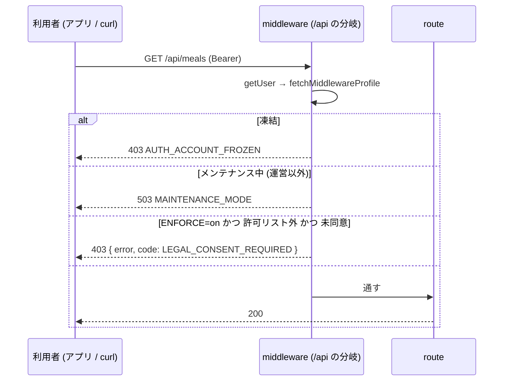
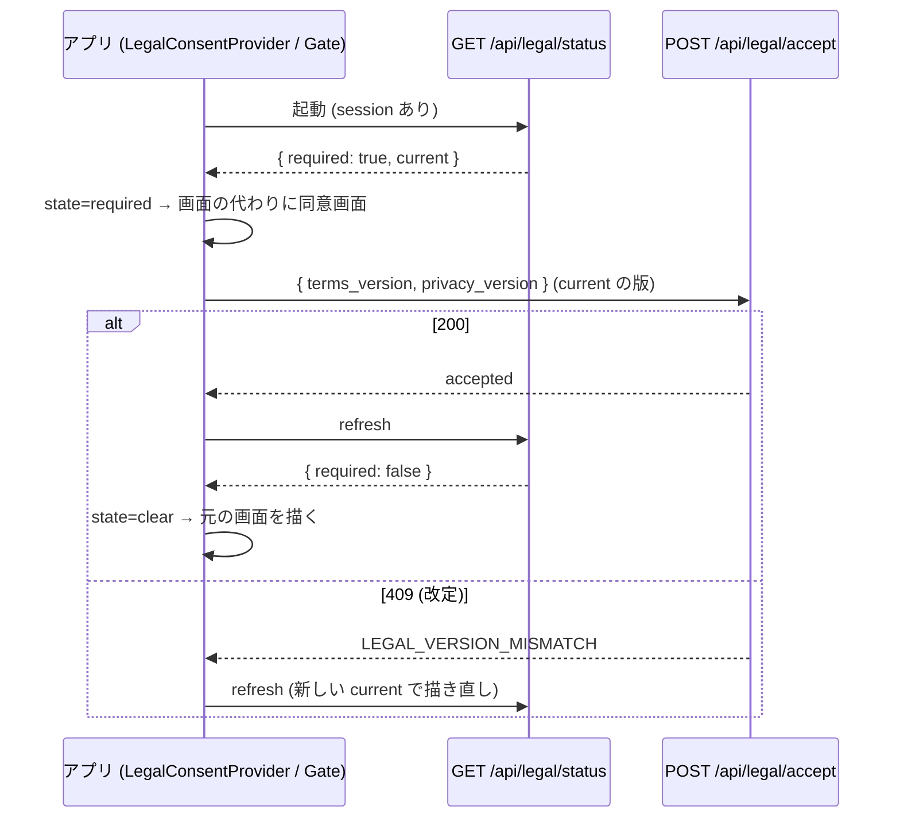

# 13. 規約の同意ゲートを /api とモバイルのネイティブの画面にも掛ける (#1442)

| 項目 | 値 |
|---|---|
| Status | 設計ゲート審査中 (v1.0) |
| Issue | #1442 (親: #1174 の同意ゲート。先例: #1154 の AI 同意の 403・#1030 / #1445 の凍結の API ゲート) |
| 正典の関係 | 本書は `08-legal-compliance.md` §7.2 (同意ゲート) の**配線を /api とモバイルへ広げる**冊。§7.2 の「対象外に `/api/*`」「モバイルのネイティブの画面は対象外」の記述は、本書のマージで現在形に直す (§6.19) |
| 範囲の正本 | 仕様ファイル `scratch/homegohan/specs/spec-d-consent.md` と Issue #1442 の本文 |
| 読み手 | 実装 (Sonnet 5.5) と敵対レビュー。実装は §6 だけを読んで手を止めずに書けることを完成条件にする |

---

## 0. 範囲・分冊判定・本書の読み方

### 0.1 一言でいうと

- サーバー: `lib/supabase/middleware.ts` の `/api/*` の分岐 (いま凍結とメンテナンスを見ている所) に、同じプロフィールの行で**同意の判定を足す**。未同意 (かつ `LEGAL_CONSENT_ENFORCE=on`) なら **403 `{ error, code: 'LEGAL_CONSENT_REQUIRED' }`** (#1154 の AI 同意と同じ平たい形)。止めないのは**許可リスト** (§6.4) だけ。判定とリストは `packages/shared` の純関数 1 ファイルに置く。
- 新設 API: **`GET /api/legal/status`** (本人の同意の状況 + 強制中か)。モバイルが起動時と再同意の判定に使う。
- モバイル: ルートの `Stack` の **`screenLayout`** に 1 枚のゲートを置き、サインイン中で「同意が要る」状態なら、**どの画面の代わりにもネイティブの同意画面**を描く (初期設定より先)。API の 403 を受けたら同じ状態に落とす (改定の再同意)。同意画面はネイティブ (WebView を使わない)。

### 0.2 分冊判定 (相 1 で実施)

| 目安 | 本書 | 判定 |
|---|---|---|
| 設計書 800 行超 | 超える (表・トレース・正典コードを 1 冊に持つため) | トリガー |
| 消費先レーン 3 以上 | Web (middleware・route)・shared・モバイルの 3 レーン | トリガー |
| 共有面 2 つ以上 | `packages/shared` (index の export) と `lib/supabase/middleware.ts` (全リクエストが通る) の 2 つ | トリガー |

**判定: 1 冊・2 段 (核 → 配線) にする。分冊しない。** 理由: 核 (shared の純関数 1 ファイル + middleware の 10 行 + status route) と配線 (モバイル) の間の契約は「1 本の API (`/api/legal/status`) と 1 つのエラーコード (`LEGAL_CONSENT_REQUIRED`) と shared の定数」だけで、表 3 点を 2 冊に割ると同じ表を 2 回書くことになる。段 A (サーバー + shared) を先に実装・レビューし、段 B (モバイル) は段 A の実コード (shared の export) を参照して書く (§6.15)。実装 WF は同じ worktree で段ごとにレビューを挟む。

### 0.3 一次情報 (origin/main。行番号は 2026-10-15 時点)

| 事実 | 場所 |
|---|---|
| `/api/*` の分岐は `getSession → getUser → user_profiles(roles, frozen_at, unban_at)` を読み、凍結なら 403 `{ error: { code: 'AUTH_ACCOUNT_FROZEN', message } }`、メンテナンス中なら 503 を返して `return` する。同意の判定は無い | `lib/supabase/middleware.ts:183-241` |
| 画面の同意ゲートは凍結の後・初期設定の差し戻しの前。`legalColumnsAvailable` が false (列が無い DB) と `profileError` のときは素通り。リダイレクトは GET / HEAD だけ | `lib/supabase/middleware.ts:325-393` |
| プロフィールの読み方 (列が無い DB の 42703 でやり直す) | `lib/supabase/middleware.ts:48-77` (`fetchMiddlewareProfile`) |
| 判定の純関数と対象外のパス (`/api` を含む) | `lib/legal-consent.ts:78-122` |
| 凍結中でも通す API (完全一致 2 本) | `src/lib/auth/frozen.ts:49-60` |
| AI 同意の 403 の形 `{ error: <固定の文>, code: 'AI_CONSENT_REQUIRED' }` / 判定不能は 503 `AI_CONSENT_CHECK_FAILED` | `supabase/functions/_shared/ai-consent.ts:50-64, 216-229`、`src/lib/ai/consent-guard.ts:1-15` |
| 同意の記録 API (版が違えば 409。Bearer と Cookie の両方で使う) | `src/app/api/legal/accept/route.ts:42-130` |
| 同意画面 (Web) と、同意後は `window.location.assign(next)` | `src/app/legal-consent/page.tsx`、`src/app/legal-consent/LegalConsentForm.tsx:53-92` |
| いま有効な版・判定 | `packages/shared/src/legal-versions.ts:39-94` |
| モバイルの入口: session あり & 初期設定未完了 → `/onboarding`、完了 → `/(tabs)/home`。同意の確認は無い | `apps/mobile/app/index.tsx:21-22`、`apps/mobile/app/onboarding/index.tsx:17-25`、`apps/mobile/app/(tabs)/_layout.tsx:35-41` |
| ルートの Stack は index・(public)・(auth)・(tabs)・(org)・(support)・(super-admin) を並べ、app 直下の画面 (health/* ・ai/* など) は自動で登録される | `apps/mobile/app/_layout.tsx:99-107` |
| API クライアントのエラーの置き換え (429・503) | `apps/mobile/src/lib/api.ts:72-78`、`apps/mobile/src/lib/failed-response.ts:52-55` |
| AI 同意の 403 をアプリが見分ける形 (`HTTP 403 …: {json}`) | `apps/mobile/src/lib/ai-consent.ts:79-99` |
| 利用規約・プライバシーポリシーの画面 (アプリ) は PublicPage (本文は Web 版へのリンク) | `apps/mobile/app/(public)/terms.tsx`、`apps/mobile/src/components/PublicPage.tsx` |
| expo-router 5.1.11 / @react-navigation/core 7.17.2 / native-stack 7.14.12 | `package-lock.json` |
| ミドルウェアの matcher が `/api` で外すのは `api/health$` だけ | `src/middleware.ts:44`、`tests/health-middleware-exemption.test.ts` |
| `/api` の route.ts は 202 本 | `src/app/api/**/route.ts` (一覧は本書 §6.4 の許可リスト以外が対象) |

---

## 1. 目的・スコープ

### 1.1 解決すること (Issue #1442)

`LEGAL_CONSENT_ENFORCE=on` でも、次の経路は同意の前に使える。

1. モバイルのネイティブの画面 (health / settings / favorites のタブ、AI 相談、レシピ、パントリーなど) は WebView を通らないので、未同意のまま使える。
2. 新規の人は、ネイティブの初期設定 (健康情報の入力) を同意より先に済ませられる。
3. `/api/*` は直接呼べば同意なしで動く。

### 1.2 前提 (仕様ファイルの逐語)

- 今の同意ゲートは、middleware で Web の画面の取得 (GET/HEAD) にだけ掛かる。
- 本番は `LEGAL_CONSENT_ENFORCE=on`。
- ローンチ前で利用者はゼロ。正しい形で作る。

### 1.3 対象外

- 規約の文面・版・施行日 (弁護士の確認。`08` §7.2)。
- 同意の記録の仕組み (`accept_legal_documents`・`terms_acceptances`) は変えない。DB の変更 (migration・RLS) は無い。
- `LEGAL_CONSENT_NOTICE` (お知らせ) は Web の `(main)` の画面だけのまま。ネイティブにはお知らせを出さない (WebView のタブでは Web のお知らせが見える)。
- アプリ (Expo) のネイティブのサインアップ画面に同意のチェックを足すこと (`08` §7.2 の残課題のまま。本書のゲートで、登録直後の起動時に同意画面へ回るので、使う前には必ず同意する)。
- アプリが Supabase (PostgREST) を直接読む経路 (`apps/mobile/src/hooks/useHomeData.ts`・`src/lib/recipeCollections.ts`・`src/lib/pushNotifications.ts`・`app/onboarding/questions.tsx` の `supabase.from(...)`) は、Next の middleware を通らないので本書のゲートの外 (§6.13 の限界・§8)。

---

## 2. 関連要件

- `docs/design/cross/08-legal-compliance.md` §7.2 (再同意フロー)。
- `docs/design/cross/04-api-conventions.md` §4 (エラーコード体系。`LEGAL_` の接頭辞は `src/app/api/legal/accept/route.ts` が既に使う)・§5.2 (本文の形: 平たい `{ error, code }`)。
- `docs/design/mobile/01-architecture.md` §3 (ネイティブ画面の一覧・WebView ハイブリッド)。
- `docs/design/cross/01-auth-session.md` §14 (認可ヘルパー)。

---

## 3. 相 1 外形固定: 要件行列・ユーザーシナリオ・現行の画面

### 3.1 要件行列

| ID | 要件 | 出どころ | 検証 (§6.14 の it) |
|---|---|---|---|
| R-1 | ログイン済みの利用者のデータを読み書きする `/api` は、未同意 (未同意・旧版に同意) なら 403 の専用コードで断る | 仕様 1 | T-M1〜T-M4 |
| R-2 | 403 の形は #1154 の AI 同意に合わせる: 平たい `{ error: <固定の文>, code }`、キーはその 2 つだけ、内部の語を出さない | 仕様 1 | T-M9, T-S1 |
| R-3 | 断らない API は理由つきの許可リストで固定し、テストが一覧を固定する | 仕様 1 | T-M2, T-M3, T-SH4 |
| R-4 | 判定の置き場所は漏れが出ない形 (route ごとに呼び忘れない) | 仕様 1 | T-M1 (全 route の表) |
| R-5 | 漏れを見張るテスト (全 route の表と実コードの照合) を含め、見張りの限界を明記する | 仕様 1 | §6.13 |
| R-6 | モバイルは、ログイン後、初期設定より先に同意の状態を確かめ、未同意なら同意画面へ回す | 仕様 2 | T-G1〜T-G5 |
| R-7 | 今の main のネイティブの画面を実コードで列挙して表にする | 仕様 2 | §3.3 |
| R-8 | 改定 (版が上がった) の再同意は、既存の版の判定 (`hasAcceptedCurrentLegalDocuments`) に合わせる。API も モバイルも同じ | 仕様 3 | T-M4, T-P3 |
| R-9 | `ENFORCE` が off のとき・同意の状態を読めないとき (DB 障害) の挙動を理由つきで決める | 仕様 4 | §6.11, T-M5〜T-M8 |
| R-10 | 既存のテスト・e2e への影響を洗い、結合テストで 403 の専用コードを確かめる | 仕様 5 | §6.14, §6.18 |
| R-11 | Zod のスキーマ (403 の本文)・ヘルパーの関数のシグネチャ・エラー表・状態遷移表を書く | 仕様 成果物 | §6.1〜§6.8 |
| R-12 | モバイルのネイティブの同意画面は、Web の同意画面と同じ要件 (必須チェック 2 つ・全文へのリンク・同意しない = ログアウト + 削除の依頼先の案内) | `08` §7.2 同意画面の行 | T-SC1〜T-SC6 |
| R-13 | `as any`・マジックナンバーを使わない。意味のある数値は名前付き定数 | 共通ガード | lint |
| R-14 | 凍結 (403 AUTH_ACCOUNT_FROZEN) とメンテナンス (503) の判定の順は変えない。同意はその後 | `middleware.ts:183-241` の既存の順 | T-M10, T-M11 |

### 3.2 ユーザーシナリオ (18 本)

| ID | シナリオ |
|---|---|
| S1 | 新規登録 (アプリのネイティブのサインアップ) → ログイン → 初期設定の前に同意画面 → 同意 → 初期設定へ |
| S2 | 既存の利用者 (同意済み) がアプリを起動 → 今までどおりホーム (余計な画面は出ない) |
| S3 | 既存の利用者 (未同意・ENFORCE=on) がアプリを起動 → 同意画面 → 同意 → 元の入口 (ホーム) |
| S4 | アプリの同意画面で「同意しない」→ 確認 → ログアウト → ウェルカム画面 (削除の依頼先 = お問い合わせのメール) |
| S5 | 規約の改定 (版を上げてデプロイ)。アプリを開いたままの利用者が次に API を呼ぶ → 403 → 同意画面 → 再同意 → さっきの画面に戻る |
| S6 | 未同意の利用者が curl + Bearer で `GET /api/meals` を叩く → 403 `LEGAL_CONSENT_REQUIRED` |
| S7 | 未同意の利用者が退会 (`POST /api/account/delete`) / 書き出し (`GET /api/account/export`) → 通る (同意を取り下げる権利) |
| S8 | `LEGAL_CONSENT_ENFORCE` が off (または未設定) → API は未同意でも通る。アプリも止めない (status の `required` が false) |
| S9 | DB 障害で `user_profiles` を読めない → API は素通り (route 側の認可へ)。アプリは status を取れず `unknown` → 止めない。DB が戻れば次の API 呼び出しの 403 で同意画面へ |
| S10 | 凍結中かつ未同意 → 403 `AUTH_ACCOUNT_FROZEN` (凍結が先。同意の 403 は出ない) |
| S11 | メンテナンス中かつ未同意 (運営ではない) → 503 `MAINTENANCE_MODE` (メンテナンスが先) |
| S12 | 未同意のセッションが残る端末で、パスワード再設定のリンクを開く → `/auth/reset-password` はゲートの対象外 → 再設定できる → ホームへ移ろうとして同意画面 |
| S13 | 同意画面 (アプリ) を開いたまま改定 → 同意を送ると 409 → 状況を取り直し、新しい版で画面を描き直す。「更新されました」の案内 |
| S14 | Web の画面 (SPA) を開いたまま改定 → 画面の中の API 呼び出しが 403 → 画面は本文の固定の文を出す → 次の画面の取得 (GET) で middleware が同意画面へ回す (既存のゲート) |
| S15 | 同意の列がまだ無い DB (migration の反映前) → 42703 でやり直し、同意ゲートだけ素通り (API も画面も同じ) |
| S16 | cron (`CRON_SECRET`) / Resend の webhook → 利用者のセッションが無い → 同意の判定に掛からない (許可リストにも載せ、理由を固定する) |
| S17 | 運営 (admin) が未同意で `/api/admin/users` を呼ぶ → 403 (規約はスタッフにも適用される。Web の画面のゲートと同じ) → 同意後に通る |
| S18 | 機内モードでアプリを起動 (保存済みのセッション) → status を取れず `unknown` → ネイティブの画面は開く (通信できない案内は今までどおり) → 通信が戻った最初の API 呼び出しが 403 なら同意画面 |

### 3.3 今の main に残るネイティブの画面 (実コードで列挙。R-7)

`apps/mobile/app/` の画面ファイル全部 (2026-10-15 の origin/main。`_layout.tsx` と `+` で始まるものは除く)。WebView = `WebViewScreen` を使う (Web の同意ゲートが WebView の中で効く)。公開 = `PublicPage` (本文は Web 版へのリンク)。**ゲート = 本書のモバイルのゲート (§6.5) の対象か。**

| 区画 | 画面ファイル | パス | 種別 | ゲート | 根拠 |
|---|---|---|---|---|---|
| 入口 | `index.tsx` | `/` | ネイティブ (ウェルカム / 振り分け) | 対象 (session があるときだけ描かれ、振り分けの前に同意画面を出す) | `index.tsx:21-22` |
| (auth) | `(auth)/login.tsx`, `(auth)/signup.tsx` | `/login`, `/signup` | ネイティブ | 対象外 (未ログインの画面。session があれば `(auth)/_layout.tsx:29` がホームへ回す) | `(auth)/_layout.tsx` |
| (auth) | `(auth)/auth/forgot-password.tsx`, `reset-password.tsx`, `verify.tsx` | `/auth/forgot-password`, `/auth/reset-password`, `/auth/verify` | ネイティブ | 対象外 (認証の途中。Web の `/auth/*` と同じ理由) | `(auth)/_layout.tsx:25-27` |
| (public) | `(public)/about.tsx`, `pricing.tsx`, `privacy.tsx`, `terms.tsx` | `/about`, `/pricing`, `/privacy`, `/terms` | 公開 (PublicPage) | 対象外 (同意の根拠になる文面と公開の案内。Web の `/terms` `/privacy` と同じ理由) | `PublicPage.tsx` |
| (tabs) | `(tabs)/home.tsx`, `menus.tsx`, `meals.tsx`, `comparison.tsx`, `profile.tsx` | `/home`, `/menus`, `/meals`, `/comparison`, `/profile` | WebView | 対象 (ネイティブのゲートが先に止める。通っても WebView の中で Web のゲートが効く) | `WebViewScreen` を使う 5 本 |
| (tabs) | `(tabs)/favorites.tsx`, `health.tsx`, `settings.tsx` | `/favorites`, `/health`, `/settings` | ネイティブ | 対象 | `(tabs)/_layout.tsx:93-115` (タブバーに出さない) |
| onboarding | `onboarding/index.tsx`, `welcome.tsx`, `questions.tsx`, `resume.tsx`, `complete/index.tsx` | `/onboarding`, `/onboarding/welcome`, `/onboarding/questions`, `/onboarding/resume`, `/onboarding/complete` | ネイティブ (初期設定) | 対象 (R-6: 初期設定より先に同意) | `onboarding/_layout.tsx` |
| health | `health/blood-tests.tsx`, `challenges.tsx`, `checkups/index.tsx`, `checkups/new.tsx`, `checkups/[id].tsx`, `goals.tsx`, `graphs.tsx`, `insights.tsx`, `record/index.tsx`, `record/quick.tsx`, `record/[date].tsx`, `settings.tsx`, `streaks.tsx` | `/health/...` | ネイティブ | 対象 | app 直下 (group の layout は無い) |
| ai | `ai/index.tsx`, `ai/[sessionId].tsx`, `ai/important.tsx` | `/ai`, `/ai/[sessionId]`, `/ai/important` | ネイティブ (AI 相談) | 対象 | 同上 |
| meals | `meals/[id].tsx`, `meals/[id]/edit.tsx` | `/meals/[id]`, `/meals/[id]/edit` | ネイティブ | 対象 | 同上 |
| recipes | `recipes/index.tsx`, `new.tsx`, `[id].tsx`, `[id]/edit.tsx`, `collections/index.tsx`, `collections/select.tsx`, `collections/[collectionId].tsx` | `/recipes/...` | ネイティブ | 対象 | 同上 |
| menus | `menus/weekly/index.tsx`, `menus/weekly/request/index.tsx` | `/menus/weekly`, `/menus/weekly/request` | ネイティブ | 対象 | 同上 |
| その他 | `pantry/index.tsx`, `shopping-list/index.tsx`, `badges/index.tsx`, `profile/nutrition-targets.tsx`, `settings/account.tsx` | `/pantry`, `/shopping-list`, `/badges`, `/profile/nutrition-targets`, `/settings/account` | ネイティブ | 対象 | 同上 |
| settings | `settings/ai-consent.tsx` | `/settings/ai-consent` | WebView (Web の `/settings/ai-consent`) | 対象 | `settings/ai-consent.tsx` |
| handson-tour | `handson-tour/index.tsx`, `photo.tsx`, `menu.tsx`, `badges.tsx`, `graduate.tsx` | `/handson-tour/...` | ネイティブ (ツアー) | 対象 (Web は `/handson-tour` を対象外にするが、ネイティブのゲートは画面の代わりに同意画面を描き、同意後に同じ画面へ戻るので、流れが切れる問題が無い) | `handson-tour/_layout.tsx` |
| (org) | `(org)/org/challenges.tsx`, `dashboard.tsx`, `departments.tsx`, `invites.tsx`, `members.tsx`, `settings.tsx` | `/org/...` | ネイティブ (組織管理) | 対象 | `(org)/_layout.tsx` |
| (support) | `(support)/support/index.tsx`, `inquiries.tsx`, `inquiries/[id].tsx`, `users.tsx`, `users/[id].tsx` | `/support/...` | ネイティブ (サポート) | 対象 | `(support)/_layout.tsx` |
| (super-admin) | `(super-admin)/super-admin/index.tsx`, `admins.tsx`, `database.tsx`, `feature-flags.tsx`, `settings.tsx` | `/super-admin/...` | ネイティブ (運営) | 対象 | `(super-admin)/_layout.tsx` |

対象外のパスの一覧 (`MOBILE_LEGAL_CONSENT_EXEMPT_PATHS`。§6.7) は、この表の「対象外」の行 = `(auth)` と `(public)` の画面と一致する。一致はテスト T-ML3 が `apps/mobile/app/(auth)` と `(public)` のファイル名から確かめる。

---

## 4. 相 2 構想とトレース

### 4.1 構造

```
サーバー (段 A)
  packages/shared/src/legal-consent-api.ts   ← 核。純関数と定数だけ (Edge・Node・RN で同じ)
    ├ LEGAL_CONSENT_EXEMPT_API_PATHS (許可リスト・理由つき)・isLegalConsentExemptApiPath
    ├ resolveLegalConsentApiDecision({ pathname, accepted, enforce }) → 'allow' | 'deny'
    ├ LEGAL_CONSENT_REQUIRED_{CODE,STATUS,MESSAGE}・legalConsentRequiredBody()・isLegalConsentRequiredBody()
    └ resolveLegalConsentStatus({ accepted, enforced }) → LegalConsentStatus・isLegalConsentStatus()
  lib/supabase/middleware.ts (/api の分岐)   ← 凍結 → メンテナンス → 同意 の順で判定。deny なら 403 を返す
  src/app/api/legal/status/route.ts          ← GET。本人の行を読んで resolveLegalConsentStatus を返す
  src/lib/legal-consent-api.ts               ← Zod (403 の本文・status の応答)。route とテストが使う

モバイル (段 B)
  apps/mobile/src/lib/legal-consent.ts        ← 403 の見分け・LegalConsentRequiredError・「要同意」の通知・対象外のパス
  apps/mobile/src/providers/LegalConsentProvider.tsx ← GET /api/legal/status を user ごとに取り、state を持つ
  apps/mobile/src/components/legal/LegalConsentGate.tsx   ← ルートの Stack の screenLayout。要同意なら画面の代わりに同意画面
  apps/mobile/src/components/legal/LegalConsentScreen.tsx ← ネイティブの同意画面 (チェック 2 つ・全文へのリンク・同意しない)
  apps/mobile/src/lib/api.ts / failed-response.ts         ← 403 LEGAL_CONSENT_REQUIRED → 通知 + 固定の文の例外
```

判定の規則 (サーバー・モバイル共通):

- **同意済み** = `hasAcceptedCurrentLegalDocuments(user_profiles の 2 列)` (旧版・NULL・行なしは未同意)。改定 = 版の値が変わること。これは `#1174` の既存の判定そのもの。
- **強制中** = `isLegalConsentEnforced()` (`LEGAL_CONSENT_ENFORCE=on`)。off なら API は allow・status は `required: false`。
- **API の判定** = `enforce && !exempt(pathname) && !accepted` → deny (403)。
- **モバイルの判定** = `session && !exempt(pathname) && status.required` → 同意画面。`required = enforced && !accepted` はサーバーが計算する (モバイルはフラグを読めないので、必ずサーバーに聞く)。

### 4.2 トレース (全シナリオを構造で手で走らせる)

| ID | 走らせた結果 |
|---|---|
| S1 | サインアップ → `AuthProvider` が session を持つ → `LegalConsentProvider` が `GET /api/legal/status` (許可リスト → 200) → 行が無いので `accepted: false`、本番は `enforced: true` → `required: true` → state `required` → ルートの Stack の `screenLayout` = `LegalConsentGate` が `index` の代わりに `LegalConsentScreen` を描く (`index.tsx:21` の `/onboarding` への Redirect は描かれない = 初期設定より先) → チェック 2 つ → `POST /api/legal/accept` (許可リスト → 200。`accept_legal_documents` が既定の行を作る) → `refresh()` → `required: false` → state `clear` → Gate が `index` を描く → `profile.onboardingCompletedAt` 無し → `/onboarding` → welcome (`POST /api/onboarding/complete` は同意済みなので通る) |
| S2 | 起動 → status 200 `required: false` → `clear` → `index` → `/(tabs)/home`。同意画面は出ない。status の 1 回の往復は ProfileProvider の読み取りと並行なので、起動が目に見えて遅くならない |
| S3 | 起動 → `required: true` → `index` の代わりに同意画面 → 同意 → `clear` → `index` → `/(tabs)/home` |
| S4 | 同意画面の「同意しない」→ Alert (ご利用いただけない旨・削除の依頼先はお問い合わせのメール) →「ログアウト」→ `signOutOnDevice(user.id, { clearSession, accessToken })` → session null → Gate は session 無しなので children = `index` → ウェルカム画面。provider は user null で state を `clear` に戻す |
| S5 | 版を上げてデプロイ → アプリの次の `getApi().get('/api/health/records')` → middleware: `hasAcceptedCurrentLegalDocuments` が false → 403 `LEGAL_CONSENT_REQUIRED` → `withFriendlyErrors` が `legalConsentRequiredErrorOf(e)` で見分け、`notifyLegalConsentRequired()` → provider が state を `required` にして `refresh()` → Gate が**いま表示中の画面の代わりに**同意画面 (Stack はそのまま) → 再同意 → `clear` → さっきの画面がそのまま描かれる (Stack の状態を捨てていないので「戻る」も残る)。画面側の catch は `LegalConsentRequiredError` (message = 固定の文) を受けるが、`Alert` を出す画面でも出るのは固定の文だけ |
| S6 | curl `Authorization: Bearer <JWT>` → middleware は JWT 形式の Bearer を転送 (`middleware.ts:129-130`) → `getUser` → 本人 → `fetchMiddlewareProfile` → 未同意 → `resolveLegalConsentApiDecision` deny → 403 `{ error, code }` + `Cache-Control: private, no-store`。route には届かない |
| S7 | `/api/account/delete` `/api/account/export` は許可リスト (`leave_service`) → allow → route へ (凍結中も同じ 2 本が通る) |
| S8 | `isLegalConsentEnforced()` false → `resolveLegalConsentApiDecision` は最初の分岐で allow → 既存の挙動。status は `enforced: false, required: false` → モバイルは `clear` |
| S9 | `fetchMiddlewareProfile` が `profileError` → 同意の判定を含むブロックを飛ばす (凍結と同じ #348 の fail-open) → route へ (route 自身の `getUser`/DB 失敗は route の 500)。status route は 500 (`internalError`) → モバイルは `unknown` → children を描く。DB が戻った後の API 呼び出しが 403 → S5 の経路で同意画面 |
| S10 | 既存の凍結判定が先に `return` (403 AUTH_ACCOUNT_FROZEN)。同意の判定には来ない |
| S11 | 既存のメンテナンス判定 (`maintenanceApiResponse`) が先に `return`。同意の判定には来ない。運営ロールはメンテナンスを通った後に同意の判定を受ける |
| S12 | pathname `/auth/reset-password` は `MOBILE_LEGAL_CONSENT_EXEMPT_PATHS` の `/auth` (前方一致) → Gate は children を描く → 再設定の画面がそのまま使える (`(auth)/_layout.tsx:27` の allowWithSession と同じ画面) → 終わってホームへ `router.replace` → `/home` は対象 → 同意画面 |
| S13 | 同意画面が持つ版は status の `current` (端末のバンドルの定数ではない) → 開いたまま改定 → `POST /api/legal/accept` が 409 → `httpStatusOfError(e) === 409` → `refresh()` → `current` が新しい版 → 画面は新しい版と施行日で描き直し、`LEGAL_CONSENT_COPY.versionMismatch` を出す → チェックし直して同意 |
| S14 | Web の画面の `fetch('/api/...')` が 403 (平たい形。`error` は固定の文) → 画面は `data.error` をそのまま出す (`internalError` と同じ理由で文字列) → 次の画面の取得 (GET) で既存の画面のゲートが `/legal-consent?next=...` へ回す。Web の画面に新しい処理は足さない (§8 候補) |
| S15 | `fetchMiddlewareProfile` が 42703 → 列を除いてやり直し → `legalColumnsAvailable: false` → 同意の判定を飛ばす (凍結・メンテナンスは効く)。status route は select が失敗 → 500 → モバイル `unknown` |
| S16 | `Bearer <CRON_SECRET>` は JWT 形式ではないので転送されず `getUser` は user null (`middleware.ts:122-130`) → 判定に来ない。許可リストに `/api/cron` (prefix) と `/api/webhooks` (prefix) を `no_user_session` の理由で載せ、テストが固定する |
| S17 | 運営でも `resolveLegalConsentApiDecision` に役割の分岐は無い → 403 → 運営は同意画面で同意 (Web の画面のゲートも管理者を回す。`middleware-legal-consent.test.ts:529`) → 以後通る |
| S18 | 起動 → status の fetch が通信失敗 → `unknown` → children → 画面の API 呼び出しも失敗 (今までどおり「通信できません」) → 通信が戻る → 最初の API 呼び出しが 403 → S5 |

---

## 5. 相 3 構造裁定 (1 回だけ)

### 5.1 サーバー側の代替案

| 案 | 中身 | 判定 |
|---|---|---|
| A (採用) | middleware の `/api` の分岐で既定 deny + 許可リスト。判定は shared の純関数 | 全 route が構造的に対象 (route を足しても漏れない)。既に同じ場所で凍結・メンテナンスを判定していて、プロフィールの行も読み済み (クエリを増やさない)。見張るのは許可リスト 1 つ |
| B | route ごとに `requireLegalConsent()` を呼ぶ (#1154 の AI 同意と同じ opt-in) | 202 本の route を触り、呼び忘れが漏れになる。AI 同意は「AI に送る route だけ」なので opt-in が合ったが、本件は「ほぼ全部」なので既定 deny が合う。却下 |
| C | DB (RLS ポリシー / 関数) で同意を見る | アプリの PostgREST 直読みまで止められる唯一の形だが、全ポリシーと service_role の経路に波及し、本書の範囲 (`/api` とネイティブの画面) を超える。却下 (§8 に残す) |

### 5.2 モバイル側の代替案

| 案 | 中身 | 判定 |
|---|---|---|
| A' (採用) | ルートの `Stack` の `screenLayout` に 1 枚のゲート。要同意なら画面の代わりに同意画面 (部品) を描く。同意画面は route ではない | 1 か所で全画面 (group の無い app 直下の画面も) を覆う。Stack を外さないので遷移の状態・deep link・通知からの遷移が残り、同意後は同じ画面に戻る。`usePathname()` が使えるので対象外 (認証の途中・公開ページ) を Web と同じ基準で決められる |
| B' | `index.tsx`・`(tabs)/_layout`・`onboarding/_layout` などの各 layout で `<Redirect href="/legal-consent" />` | app 直下の画面 (health/* など 40 本) には layout が無く、通知や deep link で直接開けるので漏れる。置き場が増えるほど漏れる。却下 |
| C' | 同意画面を WebView の `/legal-consent` で開く (AI 同意の `/settings/ai-consent` と同じ) | 同意が済んだことをネイティブに知らせる新しい postMessage と、`next` の扱い、bridge の失敗の経路が増える。同意画面は「チェック 2 つ + 全文へのリンク + 2 つのボタン」で、文面は shared に置けば 2 か所に持たない。却下 |
| D' | expo-router 5 の `Stack.Protected` | 保護する画面を全部列挙する必要があり (app 直下の画面は自動登録)、B' と同じ漏れ方をする。却下 |

### 5.3 F の問い「縁の発生源を消すより単純な構造は無いか」

縁の発生源は「どの入口に判定を置くか」が route / 画面ごとに決まること。採用した 2 つの構造は、どちらも**判定を各側の唯一の関門 (全 API が通る middleware の分岐・全画面が通るルートの Stack の `screenLayout`) に 1 回だけ置き**、残る自由度を**理由つきの許可リスト 2 つ** (API の許可リスト・モバイルの対象外のパス) に閉じ込める。許可リストはどちらもテストが実コード (route の実在・画面ファイル名) と突き合わせて固定する。これより単純な構造 (許可リストも無くす) は、同意そのものの API と退会・書き出しを止めてしまうので取れない。**構造はここで確定し、以後の周で蒸し返さない。**

---

## 6. 相 4 仕上げ

### 6.1 ① 全パターン表 (主体 × 経路 × ENFORCE → 結果)

主体: 未ログイン / 未同意 (行なし) / 未同意 (NULL) / 旧版に同意 / 同意済み。経路: Web 画面 GET / Web 画面 POST / `/api` 対象 / `/api` 許可リスト / モバイル ネイティブ画面 (対象) / モバイル 対象外の画面 / 初期設定 (Web) / 初期設定 (モバイル)。現行の列は変えない部分の確認。

| 主体 | 経路 | ENFORCE=on | ENFORCE=off | 変更 |
|---|---|---|---|---|
| 未ログイン | Web 画面 GET | `/login` へ (既存) | 同左 | なし |
| 未ログイン | `/api` (対象・許可リストとも) | 判定に来ない (user 無し) → route の 401 など | 同左 | なし |
| 未ログイン | モバイルの画面 | Gate は children (ウェルカム) | 同左 | なし |
| 未同意 (行なし / NULL / 旧版) | Web 画面 GET | `/legal-consent?next=` (既存) | 通す (NOTICE=on ならお知らせ) | なし |
| 未同意 | Web 画面 POST | 通す (既存。307 で回さない) | 通す | なし |
| 未同意 | `/api` 対象 | **403 LEGAL_CONSENT_REQUIRED** | 通す | **新** |
| 未同意 | `/api` 許可リスト | 通す | 通す | 新 (一覧の固定) |
| 未同意 | モバイル ネイティブの画面 (対象) | **同意画面 (画面の代わり)** | 通す (`required: false`) | **新** |
| 未同意 | モバイル 対象外の画面 (`/login` `/signup` `/auth/*` `/terms` `/privacy` `/about` `/pricing`) | 通す | 通す | 新 (一覧の固定) |
| 未同意 | 初期設定 (Web `/onboarding/*`) | 同意が先 (既存) | 差し戻しだけ | なし |
| 未同意 | 初期設定 (モバイル `/onboarding/*` + `POST /api/onboarding/*`) | **同意画面が先。API も 403** | 通す | **新** |
| 同意済み | すべて | 通す | 通す | なし |
| 列が無い DB (42703) | `/api` 対象 | 通す (同意だけ素通り) | 通す | 新 (画面と同じ) |
| profile 読めない (DB 障害) | `/api` 対象 | 通す (fail-open。凍結と同じ) | 通す | 新 (方針の明記) |
| profile 読めない | モバイル | status 500 → `unknown` → 通す | 同左 | 新 |
| 凍結 + 未同意 | `/api` 対象 | 403 AUTH_ACCOUNT_FROZEN | 同左 | なし (順) |
| メンテナンス + 未同意 (運営以外) | `/api` 対象 | 503 MAINTENANCE_MODE | 同左 | なし (順) |
| 運営 (admin) 未同意 | `/api/admin/*` `/api/super-admin/*` | 403 LEGAL_CONSENT_REQUIRED | 通す | 新 (役割の例外は作らない) |

### 6.2 ② 状態比較表 (現行 vs 設計後)

| 面 | 現行 | 設計後 |
|---|---|---|
| middleware `/api` の分岐が読む列 | `roles, frozen_at, unban_at` (`middleware.ts:207`) | `fetchMiddlewareProfile` (画面と同じ `PROFILE_COLUMNS_WITH_LEGAL`。42703 なら列を除いてやり直す)。クエリは 1 回のまま |
| `/api` の判定の順 | 凍結 → メンテナンス → 通す | 凍結 → メンテナンス → **同意** → 通す |
| 未同意の `/api` 呼び出し | 通る | 403 `{ error, code: 'LEGAL_CONSENT_REQUIRED' }` (許可リスト以外) |
| 同意の状況を知る API | 無し (画面の HTML か、`GET /api/profile` の列) | `GET /api/legal/status` |
| `lib/legal-consent.ts` の `EXEMPT_PREFIXES` の `/api` | 画面の判定で対象外 (コメント「各 route が自分で認可する」) | 変えない (画面の判定の対象外のまま。コメントだけ本書のゲートを指すように直す) |
| モバイルの起動 | session → 初期設定 or ホーム | session → **status を取り、要同意なら同意画面** → 初期設定 or ホーム |
| モバイルの改定の再同意 | WebView のタブを開いたときだけ Web のゲート | API の 403 で同意画面 (どの画面からでも) |
| モバイルの 403 の扱い | AI 同意の 403 だけ見分ける | `LEGAL_CONSENT_REQUIRED` も見分け、固定の文の例外にする |
| 同意画面の文面 | Web の `LegalConsentForm.tsx` のリテラル | `packages/shared/src/legal-consent-copy.ts` (Web とモバイルが同じ値を使う) |
| 許可リスト (凍結) | `FROZEN_ALLOWED_API_PATHS` 2 本 | 変えない。同意の許可リストはこれを含む (テストで固定) |

### 6.3 ③ 状態遷移表 (状態 × 操作 → 遷移先・ガード・副作用)

状態 (利用者ごと): `anon` (未ログイン) / `none` (未同意: 行なし・NULL) / `old` (旧版に同意) / `ok` (同意済み) / `unreadable` (読めない: DB 障害・列なし)。

| 状態 | 操作 | 遷移先 | ガード | 副作用 (サーバー / モバイル) |
|---|---|---|---|---|
| anon | ログイン (アプリ) | none / old / ok のどれか (行の中身で決まる) | — | モバイル: `LegalConsentProvider` が status を取る |
| none / old | `/api` 対象を呼ぶ | 同じ | `enforce` かつ 許可リスト外 | 403 を返す。モバイルは state を `required` にし status を取り直す |
| none / old | `/api` 許可リストを呼ぶ | 同じ | — | route へ |
| none / old | `GET /api/legal/status` | 同じ | — | `required: enforced` |
| none / old | `POST /api/legal/accept` (いまの版) | **ok** | 版が一致 | `accept_legal_documents` (行が無ければ作る)。モバイル: `refresh()` → `clear` → 画面に戻る |
| none / old | `POST /api/legal/accept` (古い版の値) | 同じ | 版が不一致 | 409。モバイル: `refresh()` → 新しい版で描き直し |
| none / old | 同意しない (アプリ) | anon | — | `signOutOnDevice`。Web は signOut + 案内 (既存) |
| none / old | 画面を開く (モバイル・対象) | 同じ | `required` | 同意画面 (画面の代わり) |
| none / old | 画面を開く (モバイル・対象外) | 同じ | — | 通す |
| ok | 版が上がる (デプロイ) | **old** | — | 何も起きない。次の API 呼び出しで 403 (モバイル) / 次の画面の取得で同意画面 (Web) |
| ok | `/api` を呼ぶ | 同じ | — | 通す |
| none / old / ok | 凍結される | 同じ (同意の状態は変わらない) | — | `/api` は 403 AUTH_ACCOUNT_FROZEN が先 |
| none / old | `ENFORCE` を off にする (再デプロイ) | 同じ | — | `/api` 通す。status `required: false` → モバイル `clear` |
| unreadable | `/api` 対象を呼ぶ | 同じ | — | 素通り (route の判断へ) |
| unreadable | status | 同じ | — | 500 → モバイル `unknown` (止めない) |
| unreadable | DB が戻る | none / old / ok | — | 次の判定から効く |

### 6.4 `/api` の許可リスト (止めない API。理由つき。R-3)

対象 = `src/app/api/**/route.ts` 202 本のうち、ここに無いもの全部 (既定 deny)。`match` は `exact` (完全一致) か `prefix` (そのものか `path/` 以下)。似た名前 (`/api/logx`) は通さない。

| path | match | reason | 理由・根拠 |
|---|---|---|---|
| `/api/legal/accept` | exact | `consent_itself` | 同意の記録そのもの。止めると同意できない (`accept/route.ts`) |
| `/api/legal/status` | exact | `consent_itself` | 同意の状況 (本書で新設)。止めるとモバイルが状態を知れない |
| `/api/auth` | prefix | `auth_flow` | ログイン (`auth/login`)・Cookie の同期 (`auth/session-sync`)・ネイティブ認証ブリッジのコード (`auth/native-bridge/code`)。認証の途中。bridge を止めると WebView で Web の同意画面も開けない。Web の `/auth/*` の対象外と同じ |
| `/api/account/delete` | exact | `leave_service` | 退会。同意を取り下げる権利。凍結中も通す 2 本と同じ (`frozen.ts:49-52`) |
| `/api/account/export` | exact | `leave_service` | 個人データの書き出し。同上 |
| `/api/contact` | exact | `contact` | 同意しない人の連絡の窓口 (データの削除の依頼もここから)。Web の同意画面の「同意しない」が案内する先。POST は未ログインでも送れる route |
| `/api/log` | exact | `telemetry` | 画面・端末の失敗の報告の受け口 (`error-report.ts` → `POST /api/log`)。利用者のデータの利用ではなく運用のログ。未同意の人の失敗も残す |
| `/api/feature-flags` | exact | `client_status` | 画面が前もって状態を知る窓口 (メンテナンス中も通す `isMaintenanceExemptPath` と同じ扱い)。未ログインでも答える |
| `/api/health` | exact | `no_user_session` | 死活監視。matcher の外 (`src/middleware.ts:44`) なので判定に来ないが、一覧で「来ないこと」を固定する |
| `/api/cron` | prefix | `no_user_session` | `CRON_SECRET` (JWT ではない Bearer)。利用者のセッションが無く `getUser` は null |
| `/api/webhooks` | prefix | `no_user_session` | 外部 (Resend) からの通知。署名で認証。利用者のセッションが無い |
| `/api/e2e` | prefix | `test_only` | テスト基盤 (`e2e/reset-onboarding`。本番は `NODE_ENV` で 403)。e2e の共通ユーザーの初期化を同意に左右させない |

載せない (= 止める) ことを決めたもの:

| 候補 | 止める理由 |
|---|---|
| `/api/admin/*` `/api/super-admin/*` `/api/support/*` `/api/operator/*` (運営) | 規約はスタッフにも適用される (Web の画面のゲートが管理者も回す。`middleware-legal-consent.test.ts:529`)。役割の例外を作らないほうが一覧が短く漏れない。運営は 1 回同意すれば済む |
| `/api/onboarding/*` | 初期設定は同意の後 (R-6)。Web の画面のゲートも初期設定の差し戻しより先に同意を見る |
| `/api/handson-tour/*` と、ツアーが使うサンドボックスの API | Web は `/handson-tour` の画面を対象外にするが、ツアーが呼ぶほかの API (献立の追加など) は止まるので、ツアーの API だけ通しても流れは守れない。ツアーに入る前に同意している (モバイルは画面の代わりに同意画面を描き、同意後に同じ画面へ戻る) |
| `/api/push-tokens/claim` | 端末の通知トークンの登録。同意前の起動で 403 になるので、`PushTokenRegistrar` の effect に同意の状態を足し、同意が済んだら登録し直す (§6.6.10) |
| `/api/performance/sports` `/api/catalog/products` (公開・準公開のデータ) | 未ログインなら判定に来ない。ログイン済みの未同意の人は同意が先。個別の例外を作らない |
| `/api/family/invites/[id]/reject` `/api/org/invites/[id]/reject` (認証任意) | 未ログインなら判定に来ない。ログイン済みなら Web の `/invite/*` の画面のゲートが先に同意を取る |

### 6.5 判定の置き場所と順序

**サーバー** (`lib/supabase/middleware.ts` の `if (isApiRoute)` ブロック): `getSession` → `getUser` → `fetchMiddlewareProfile` (1 クエリ) → ①凍結 (`isAccountFrozen` && !`isFrozenAllowedApiPath`) → 403 → ②メンテナンス → 503 → **③同意** (`legalColumnsAvailable` && `!profileError` && `resolveLegalConsentApiDecision(...) === 'deny'`) → 403 → `supabaseResponse`。③は `try` の外 (①と同じく、プロフィールを読めたときだけ) に置く。

**モバイル** (`apps/mobile/app/_layout.tsx`): `AuthProvider` → `LegalConsentProvider` → `ProfileProvider` → `PushTokenRegistrar` → `NotificationRouter` → `<Stack screenLayout={renderLegalConsentScreenLayout}>`。`LegalConsentGate` は `session` 無し / 対象外のパス / state `clear` `unknown` なら children、`loading` なら `LoadingState`、`required` なら `LegalConsentScreen`。

### 6.6 正典コード

検査の範囲: ```ts のブロックのうち、**既存の export だけを import するもの** (6.6.1・6.6.2) は設計書の独立の型検査 (ルートの tsconfig) を通る。**本書で新設する export を import するもの** (6.6.3 以降) は独立には解決できないので `// tsc:skip` にしてある (実装では tsc の対象。理由はブロックの 1 行目)。差分の形のブロックも `// tsc:skip`。

#### 6.6.1 `packages/shared/src/legal-consent-api.ts` (新設。核)

```ts
/**
 * 利用規約・プライバシーポリシーの同意ゲートを /api とモバイルのネイティブの画面にも掛ける (#1442)。
 * サーバー (Edge の middleware・API Route)・Web・モバイルで同じ値と判定を使うための、純粋な定数と関数だけのファイル。
 * Node / Deno / RN 固有の API は使わない。副作用は無い。
 *
 *   - LEGAL_CONSENT_EXEMPT_API_PATHS / isLegalConsentExemptApiPath: 未同意でも止めない /api (理由つき)
 *   - resolveLegalConsentApiDecision: middleware の /api の分岐が呼ぶ判定 (allow / deny)
 *   - LEGAL_CONSENT_REQUIRED_*: 止めたときの 403 (平たい { error, code }。#1154 の AI 同意と同じ形)
 *   - resolveLegalConsentStatus / isLegalConsentStatus: GET /api/legal/status の応答 (サーバーが作り、モバイルが読む)
 *
 * 同意済みかどうかの判定そのもの (hasAcceptedCurrentLegalDocuments) は legal-versions.ts にあり、ここはそれを呼ぶだけ。
 *
 * ⚠ 実装ファイルでは下の import を './legal-versions' からの相対 import にする (packages/shared の中から自分のパッケージ名で
 *   import しない。Metro / Jest は exports の "." しか解決しない)。設計書の独立の型検査 (ルートの tsconfig の paths) で
 *   解決できるよう、ここだけパス別名で書いている。
 */
import {
  LEGAL_DOCUMENTS,
  LEGAL_DOCUMENT_TYPES,
  getOutdatedLegalDocuments,
  hasAcceptedCurrentLegalDocuments,
  type AcceptedLegalVersions,
  type LegalDocumentType,
} from '@homegohan/shared/legal-versions';

/** 本人の同意の状況を返す API (本書で新設) */
export const LEGAL_CONSENT_STATUS_API_PATH = '/api/legal/status';
/** 同意を記録する API (#1174。既存) */
export const LEGAL_CONSENT_ACCEPT_API_PATH = '/api/legal/accept';

/** 未同意で止めたときのエラーコード。Web の画面とアプリは、このコードを見て同意画面へ案内する */
export const LEGAL_CONSENT_REQUIRED_CODE = 'LEGAL_CONSENT_REQUIRED';
/** 未同意で止めたときの HTTP ステータス (403 Forbidden: 本人だが、この操作の前提 (同意) を満たしていない。AI 同意と同じ) */
export const LEGAL_CONSENT_REQUIRED_STATUS = 403;
/** 未同意で止めたときの本文 (#1172: 変数名・内部の詳細を出さない) */
export const LEGAL_CONSENT_REQUIRED_MESSAGE =
  '利用規約・プライバシーポリシーへの同意が必要です。同意の画面から内容をご確認ください。';

/** 403 の本文。キーはこの 2 つだけ */
export interface LegalConsentRequiredBody {
  error: typeof LEGAL_CONSENT_REQUIRED_MESSAGE;
  code: typeof LEGAL_CONSENT_REQUIRED_CODE;
}

export function legalConsentRequiredBody(): LegalConsentRequiredBody {
  return { error: LEGAL_CONSENT_REQUIRED_MESSAGE, code: LEGAL_CONSENT_REQUIRED_CODE };
}

/** 本文の code を読む。平たい { code } を先に見て、入れ子 { error: { code } } も受ける (AI 同意の isAiConsentRequiredBody と同じ読み方) */
function codeOfBody(body: unknown): string | null {
  if (!body || typeof body !== 'object') return null;
  const { code, error } = body as { code?: unknown; error?: unknown };
  if (typeof code === 'string') return code;
  if (error && typeof error === 'object') {
    const nested = (error as { code?: unknown }).code;
    if (typeof nested === 'string') return nested;
  }
  return null;
}

/** 応答の本文 (JSON を読んだもの) が「同意が必要です」(LEGAL_CONSENT_REQUIRED) か */
export function isLegalConsentRequiredBody(body: unknown): boolean {
  return codeOfBody(body) === LEGAL_CONSENT_REQUIRED_CODE;
}

/** 止めない理由の種類 (一覧の各行が必ず 1 つ持つ。テストが種類と実在する route を突き合わせる) */
export type LegalConsentExemptApiReason =
  | 'consent_itself'
  | 'auth_flow'
  | 'leave_service'
  | 'contact'
  | 'telemetry'
  | 'client_status'
  | 'no_user_session'
  | 'test_only';

export interface LegalConsentExemptApiEntry {
  readonly path: string;
  /** exact = 完全一致 / prefix = そのものか `${path}/` 以下 (似た名前を通さない) */
  readonly match: 'exact' | 'prefix';
  readonly reason: LegalConsentExemptApiReason;
  /** 人が読む理由 (設計書 13 §6.4 と同じ文) */
  readonly note: string;
}

/**
 * 未同意でも止めない /api の一覧 (#1442)。ここに無い /api はすべて、LEGAL_CONSENT_ENFORCE=on のとき未同意なら 403。
 * 足すのは「同意そのもの・認証の途中・サービスから離れる操作・連絡の窓口・運用のログ・状態の窓口・利用者のセッションを持たない経路」だけ
 * (利用者のデータを読み書きする API を足さない)。一覧は tests が固定する (lib/supabase/__tests__/middleware-legal-consent-api.test.ts)。
 */
export const LEGAL_CONSENT_EXEMPT_API_PATHS: readonly LegalConsentExemptApiEntry[] = [
  { path: LEGAL_CONSENT_ACCEPT_API_PATH, match: 'exact', reason: 'consent_itself', note: '同意の記録そのもの。止めると同意できない' },
  { path: LEGAL_CONSENT_STATUS_API_PATH, match: 'exact', reason: 'consent_itself', note: '同意の状況。止めるとアプリが状態を知れない' },
  { path: '/api/auth', match: 'prefix', reason: 'auth_flow', note: 'ログイン・Cookie の同期・ネイティブ認証ブリッジのコード。認証の途中' },
  { path: '/api/account/delete', match: 'exact', reason: 'leave_service', note: '退会。同意を取り下げる権利 (凍結中も通す 2 本と同じ)' },
  { path: '/api/account/export', match: 'exact', reason: 'leave_service', note: '個人データの書き出し。同上' },
  { path: '/api/contact', match: 'exact', reason: 'contact', note: '同意しない人の連絡の窓口 (データの削除の依頼もここから)' },
  { path: '/api/log', match: 'exact', reason: 'telemetry', note: '画面・端末の失敗の報告の受け口。運用のログ' },
  { path: '/api/feature-flags', match: 'exact', reason: 'client_status', note: '画面が前もって状態を知る窓口 (メンテナンス中も通す)' },
  { path: '/api/health', match: 'exact', reason: 'no_user_session', note: '死活監視。matcher の外で判定に来ないことを固定する' },
  { path: '/api/cron', match: 'prefix', reason: 'no_user_session', note: 'CRON_SECRET。利用者のセッションを持たない' },
  { path: '/api/webhooks', match: 'prefix', reason: 'no_user_session', note: '外部からの通知 (署名で認証)。利用者のセッションを持たない' },
  { path: '/api/e2e', match: 'prefix', reason: 'test_only', note: 'テスト基盤 (本番は NODE_ENV で 403)' },
];

function matchesExemptEntry(pathname: string, entry: LegalConsentExemptApiEntry): boolean {
  if (pathname === entry.path) return true;
  return entry.match === 'prefix' && pathname.startsWith(`${entry.path}/`);
}

/** 未同意でも止めない /api のパスか。pathname は URL の path の部分 (クエリを含まない) */
export function isLegalConsentExemptApiPath(pathname: string): boolean {
  return LEGAL_CONSENT_EXEMPT_API_PATHS.some((entry) => matchesExemptEntry(pathname, entry));
}

export type LegalConsentApiDecision = 'allow' | 'deny';

export interface ResolveLegalConsentApiInput {
  /** リクエストの path (クエリを含まない) */
  pathname: string;
  /** user_profiles の行の同意済みの版。行が無いときは null / undefined (= 未同意) */
  accepted: AcceptedLegalVersions | null | undefined;
  /** LEGAL_CONSENT_ENFORCE=on か (lib/legal-consent.ts の isLegalConsentEnforced の結果) */
  enforce: boolean;
}

/**
 * middleware の /api の分岐が呼ぶ判定。凍結・メンテナンスの判定の後に呼ぶ (順は middleware が決める)。
 *   - 強制していない (enforce = false) → allow (既存の挙動のまま)
 *   - 許可リストのパス → allow
 *   - それ以外で、いま有効な版に同意していない (未同意・旧版・行なし) → deny (403 LEGAL_CONSENT_REQUIRED)
 * 役割 (admin / super_admin) による例外は作らない (規約はスタッフにも適用される)。
 */
export function resolveLegalConsentApiDecision(input: ResolveLegalConsentApiInput): LegalConsentApiDecision {
  if (!input.enforce) return 'allow';
  if (isLegalConsentExemptApiPath(input.pathname)) return 'allow';
  return hasAcceptedCurrentLegalDocuments(input.accepted) ? 'allow' : 'deny';
}

/** いま有効な文書の版と施行日 (status の応答。snake_case) */
export interface LegalConsentCurrentDocument {
  version: string;
  /** 施行日 (日本時間) YYYY-MM-DD。画面は formatLegalEffectiveDate で「2025年1月1日」の形にする */
  effective_date: string;
}

export interface LegalConsentAcceptedVersions {
  terms_version: string | null;
  privacy_version: string | null;
}

/** GET /api/legal/status の応答 */
export interface LegalConsentStatus {
  /** LEGAL_CONSENT_ENFORCE=on か */
  enforced: boolean;
  /** いま有効な版に (両方) 同意済みか */
  accepted: boolean;
  /** 同意画面を出す必要があるか = enforced && !accepted。アプリのゲートはこの値だけを見る */
  required: boolean;
  /** いま有効な版に同意していない文書 (未同意・旧版) */
  outdated: LegalDocumentType[];
  /** いま有効な版と施行日。同意画面はこの値を表示し、同意の記録 (POST /api/legal/accept) にもこの版を送る (端末のバンドルの定数は使わない) */
  current: Record<LegalDocumentType, LegalConsentCurrentDocument>;
  /** 本人の同意済みの版 (NULL = 未同意) */
  accepted_versions: LegalConsentAcceptedVersions;
}

export interface ResolveLegalConsentStatusInput {
  accepted: AcceptedLegalVersions | null | undefined;
  enforced: boolean;
}

/** status route が呼ぶ。判定は resolveLegalConsentApiDecision と同じ関数 (hasAccepted…) に基づく */
export function resolveLegalConsentStatus(input: ResolveLegalConsentStatusInput): LegalConsentStatus {
  const outdated = getOutdatedLegalDocuments(input.accepted);
  const accepted = outdated.length === 0;
  return {
    enforced: input.enforced,
    accepted,
    required: input.enforced && !accepted,
    outdated,
    current: {
      terms_of_service: {
        version: LEGAL_DOCUMENTS.terms_of_service.version,
        effective_date: LEGAL_DOCUMENTS.terms_of_service.effectiveDate,
      },
      privacy_policy: {
        version: LEGAL_DOCUMENTS.privacy_policy.version,
        effective_date: LEGAL_DOCUMENTS.privacy_policy.effectiveDate,
      },
    },
    accepted_versions: {
      terms_version: input.accepted?.terms_version_accepted ?? null,
      privacy_version: input.accepted?.privacy_version_accepted ?? null,
    },
  };
}

function isNullableString(value: unknown): value is string | null {
  return value === null || typeof value === 'string';
}

function isCurrentDocument(value: unknown): value is LegalConsentCurrentDocument {
  if (!value || typeof value !== 'object') return false;
  const { version, effective_date } = value as { version?: unknown; effective_date?: unknown };
  return typeof version === 'string' && version !== '' && typeof effective_date === 'string';
}

/** アプリが status の応答の形を確かめる (zod を packages/shared に持ち込まないための手書きの検査) */
export function isLegalConsentStatus(body: unknown): body is LegalConsentStatus {
  if (!body || typeof body !== 'object') return false;
  const b = body as Record<string, unknown>;
  if (typeof b.enforced !== 'boolean' || typeof b.accepted !== 'boolean' || typeof b.required !== 'boolean') return false;
  const documentTypes: readonly string[] = LEGAL_DOCUMENT_TYPES;
  if (!Array.isArray(b.outdated) || !b.outdated.every((v) => typeof v === 'string' && documentTypes.includes(v))) return false;
  const current = b.current;
  if (!current || typeof current !== 'object') return false;
  if (!LEGAL_DOCUMENT_TYPES.every((type) => isCurrentDocument((current as Record<string, unknown>)[type]))) return false;
  const versions = b.accepted_versions;
  if (!versions || typeof versions !== 'object') return false;
  const { terms_version, privacy_version } = versions as { terms_version?: unknown; privacy_version?: unknown };
  return isNullableString(terms_version) && isNullableString(privacy_version);
}
```

`packages/shared/src/index.ts` に `export * from './legal-consent-api';` と `export * from './legal-consent-copy';` を足す (既存の `export * from './legal-versions';` の直後)。

#### 6.6.2 `packages/shared/src/legal-consent-copy.ts` (新設。同意画面の文面。Web とモバイルで共用)

```ts
/**
 * 利用規約・プライバシーポリシーの同意画面の文面 (#1174 の Web の同意画面 src/app/legal-consent/LegalConsentForm.tsx と、
 * #1442 のアプリのネイティブの同意画面 apps/mobile/src/components/legal/LegalConsentScreen.tsx が同じ値を使う。文面を 2 か所に持たない)。
 * 値は #1174 の Web の文面そのまま (tests/e2e/legal-consent-gate.spec.ts と tests/legal-consent-page.test.tsx がこの文で画面を探す)。
 * 文書の名前 (利用規約 / プライバシーポリシー) は legal-versions.ts の LEGAL_DOCUMENT_LABELS。
 */
export const LEGAL_CONSENT_COPY = {
  heading: '利用規約・プライバシーポリシーへの同意',
  introFirst: 'ほめゴハンをご利用いただくには、利用規約とプライバシーポリシーへの同意が必要です。内容をご確認ください。',
  introReconsent:
    '利用規約・プライバシーポリシーが改定されました。引き続きご利用いただくには、内容をご確認のうえ、同意をお願いします。',
  revisedBadge: '改定あり',
  acceptButton: '同意して続ける',
  declineButton: '同意しない',
  /** 同意を送ったら版が変わっていた (409) ときの案内 (POST /api/legal/accept の 409 の本文と同じ文) */
  versionMismatch: '利用規約・プライバシーポリシーが更新されました。画面を読み込み直して、内容をご確認ください。',
  /** 同意しない人への案内 (Web は「同意しない」の後の画面、アプリは確認の Alert に出す) */
  declineUnavailable: '利用規約・プライバシーポリシーに同意いただけない場合、ほめゴハンはご利用いただけません。',
  /** 同意の記録に失敗したとき (409 以外) */
  acceptFailed: '同意の記録に失敗しました。時間をおいて、もう一度お試しください。',
} as const;

/** チェックボックスの文。documentLabel は LEGAL_DOCUMENT_LABELS の値 */
export function legalConsentAgreeLabel(documentLabel: string): string {
  return `${documentLabel}の内容を確認し、同意します`;
}

/** 全文へのリンクの文 */
export function legalConsentReadFullTextLabel(documentLabel: string): string {
  return `${documentLabel}の全文を読む`;
}

/** 版と施行日の 1 行。effectiveDateLabel は formatLegalEffectiveDate の結果 */
export function legalConsentVersionLine(version: string, effectiveDateLabel: string): string {
  return `版: ${version} ／ 施行日: ${effectiveDateLabel}`;
}
```

#### 6.6.3 `src/lib/legal-consent-api.ts` (新設。Zod の正本: 403 の本文と status の応答)

```ts
// tsc:skip — 本書で新設する @homegohan/shared の export (6.6.1) を import するため、設計書の独立の型検査では解決できない。実装では tsc の対象
/**
 * 同意ゲート (#1442) の API の本文の Zod スキーマ (正本)。
 * 値の定義は packages/shared/src/legal-consent-api.ts (サーバー・Web・モバイル共用) にあり、ここはその形を Zod で固定するだけ。
 * GET /api/legal/status の route が応答を作ったあとに parse し、テスト (tests/legal-consent-api-schema.test.ts・middleware の表) が
 * middleware の 403 の本文と status の応答をこれで確かめる。zod を packages/shared に持ち込まない (モバイルのバンドルに入れない) ので、ここに置く。
 */
import { z } from 'zod';
import {
  LEGAL_CONSENT_REQUIRED_CODE,
  LEGAL_CONSENT_REQUIRED_MESSAGE,
  LEGAL_DOCUMENT_TYPES,
  LEGAL_VERSION_PATTERN,
} from '@homegohan/shared';

/** 施行日 (YYYY-MM-DD)。legal-versions.ts の effectiveDate の形式 */
const EFFECTIVE_DATE_PATTERN = /^\d{4}-\d{2}-\d{2}$/;

/** 403 LEGAL_CONSENT_REQUIRED の本文。キーは error と code の 2 つだけ (strict) */
export const LegalConsentRequiredBodySchema = z
  .object({
    error: z.literal(LEGAL_CONSENT_REQUIRED_MESSAGE),
    code: z.literal(LEGAL_CONSENT_REQUIRED_CODE),
  })
  .strict();

export type LegalConsentRequiredBodyShape = z.infer<typeof LegalConsentRequiredBodySchema>;

const LegalConsentCurrentDocumentSchema = z
  .object({
    version: z.string().regex(LEGAL_VERSION_PATTERN),
    effective_date: z.string().regex(EFFECTIVE_DATE_PATTERN),
  })
  .strict();

/** GET /api/legal/status の応答 */
export const LegalConsentStatusSchema = z
  .object({
    enforced: z.boolean(),
    accepted: z.boolean(),
    required: z.boolean(),
    outdated: z.array(z.enum(LEGAL_DOCUMENT_TYPES)),
    current: z
      .object({
        terms_of_service: LegalConsentCurrentDocumentSchema,
        privacy_policy: LegalConsentCurrentDocumentSchema,
      })
      .strict(),
    accepted_versions: z
      .object({
        terms_version: z.string().nullable(),
        privacy_version: z.string().nullable(),
      })
      .strict(),
  })
  .strict()
  // required は enforced と accepted から決まる値。食い違う応答を正本として通さない
  .refine((value) => value.required === (value.enforced && !value.accepted), {
    message: 'required は enforced && !accepted と一致すること',
  });

export type LegalConsentStatusShape = z.infer<typeof LegalConsentStatusSchema>;
```

#### 6.6.4 `lib/supabase/middleware.ts` の差分 (`/api` の分岐)

```ts
// tsc:skip — 既存ファイルへの差分 (新設の shared の export を import する)。行は origin/main 2026-10-15 の lib/supabase/middleware.ts
// --- import に足す (19 行目の '@/lib/legal-consent' の import の後) ---
import { legalConsentRequiredBody, LEGAL_CONSENT_REQUIRED_STATUS, resolveLegalConsentApiDecision } from '@homegohan/shared'

// --- 183 行目からの if (isApiRoute) ブロックを、次の形に直す (凍結・メンテナンスの判定と応答の中身は変えない) ---
  if (isApiRoute) {
    await supabase.auth.getSession()

    // #1030 round-2 / #1445 / #1148 の説明は現状のまま残す (省略)。
    // #1442: 同意ゲートも、ここで読んだ同じプロフィールの行で判定する (クエリは増やさない)。
    //   順は 凍結 (403 AUTH_ACCOUNT_FROZEN) → メンテナンス (503) → 同意 (403 LEGAL_CONSENT_REQUIRED)。
    //   止めないのは packages/shared の LEGAL_CONSENT_EXEMPT_API_PATHS (同意そのもの・認証の途中・退会と書き出し・問い合わせ・ログ・
    //   状態の窓口・利用者のセッションを持たない経路) だけ。役割による例外は無い。
    //   プロフィールを読めなかったとき (profileError) と同意の列が無い DB (legalColumnsAvailable = false) は、凍結と同じく素通り (#348 の fail-open)。
    //   画面の分岐と同じ fetchMiddlewareProfile を使い、列が無い DB では列を除いた select でやり直す。
    let apiUserId: string | undefined
    let apiRoles: string[] | null = null
    let apiProfile: MiddlewareProfile | null = null
    let apiProfileReadable = false
    let apiLegalColumnsAvailable = false
    try {
      const { data: { user: apiUser }, error: apiUserError } = await supabase.auth.getUser()

      if (!apiUserError && apiUser) {
        apiUserId = apiUser.id
        const { profile, profileError, legalColumnsAvailable } = await fetchMiddlewareProfile(supabase, apiUser.id)

        if (!profileError) {
          apiProfile = profile
          apiProfileReadable = true
          apiLegalColumnsAvailable = legalColumnsAvailable
          apiRoles = Array.isArray(profile?.roles) ? profile.roles : []
          const apiFrozen = isAccountFrozen({
            frozenAt: profile?.frozen_at ?? null,
            unbanAt: profile?.unban_at ?? null,
          })

          if (apiFrozen && !isFrozenAllowedApiPath(request.nextUrl.pathname)) {
            return NextResponse.json(
              { error: { code: 'AUTH_ACCOUNT_FROZEN', message: 'アカウントが凍結されています' } },
              { status: 403, headers: { 'Cache-Control': 'private, no-store' } },
            )
          }
        }
      }
    } catch {
      // 認証基盤の一時障害時は各 route 側の getUser()/requireUser() チェックに委ねる
    }

    if (!maintenanceExempt && !isOperatorRoles(apiRoles) && (await isMaintenanceFlagOn(apiUserId, apiRoles))) {
      return withSessionCookies(supabaseResponse, maintenanceApiResponse())
    }

    // #1442: 同意の判定 (凍結・メンテナンスの後)。利用者が確定し、プロフィールを読め、同意の列がある DB のときだけ
    if (apiUserId && apiProfileReadable && apiLegalColumnsAvailable) {
      const legalDecision = resolveLegalConsentApiDecision({
        pathname: request.nextUrl.pathname,
        accepted: apiProfile,
        enforce: isLegalConsentEnforced(),
      })
      if (legalDecision === 'deny') {
        return withSessionCookies(
          supabaseResponse,
          NextResponse.json(legalConsentRequiredBody(), {
            status: LEGAL_CONSENT_REQUIRED_STATUS,
            headers: { 'Cache-Control': 'private, no-store' },
          }),
        )
      }
    }

    return supabaseResponse
  }
```

変更点の要約: (1) `select('roles, frozen_at, unban_at')` を `fetchMiddlewareProfile` に置き換える (列は `PROFILE_COLUMNS_WITH_LEGAL`。42703 の列落ちのやり直しを画面と共有)。(2) 凍結・メンテナンスの後に同意の判定を足す。(3) 403 は `withSessionCookies` で、この呼び出しで更新されたセッション Cookie を引き継ぐ (メンテナンスの 503 と同じ理由 #1148)。`MiddlewareProfile` は既存の interface (52 行目)。

#### 6.6.5 `src/app/api/legal/status/route.ts` (新設)

```ts
// tsc:skip — 本書で新設する shared / src/lib の export を import するため。実装では tsc の対象
// src/app/api/legal/status/route.ts
// #1442: ログイン中の本人の、利用規約・プライバシーポリシーへの同意の状況と、いま強制中かを返す。
//
//   GET /api/legal/status → 200 LegalConsentStatus (packages/shared/src/legal-consent-api.ts)
//   アプリ (apps/mobile) が起動時・再同意の判定・同意画面の表示 (いまの版と施行日) に使う。
//   Web (Cookie) とアプリ (Authorization: Bearer) が同じ契約で使う。
//
// この API は同意ゲートの許可リスト (LEGAL_CONSENT_EXEMPT_API_PATHS) にある (未同意でも 200)。
// 凍結中のアカウントは middleware が /api/* で 403 にする (この API は FROZEN_ALLOWED_API_PATHS には無い)。
// 環境変数 LEGAL_CONSENT_ENFORCE は lib/legal-consent.ts の isLegalConsentEnforced だけが読む (tests/env-source-scan.test.ts)。
import { NextResponse } from 'next/server';
import { resolveLegalConsentStatus } from '@homegohan/shared';
import { createClient } from '@/lib/supabase/server';
import { isLegalConsentEnforced } from '@/lib/legal-consent';
import { LegalConsentStatusSchema } from '@/lib/legal-consent-api';
import { internalError } from '@/lib/api/errors';

// 同意の状況は利用者ごとに違い、同意した直後に変わる。キャッシュさせない
export const dynamic = 'force-dynamic';

const NO_STORE = { 'Cache-Control': 'no-store' } as const;

/** 同意ゲートが読むのと同じ 2 列 (lib/supabase/middleware.ts の PROFILE_COLUMNS_WITH_LEGAL の末尾 2 列) */
const LEGAL_COLUMNS = 'terms_version_accepted, privacy_version_accepted';

export async function GET() {
  try {
    const supabase = await createClient();
    const {
      data: { user },
      error: authError,
    } = await supabase.auth.getUser();
    if (authError || !user) {
      return NextResponse.json({ error: '認証が必要です', code: 'AUTH_UNAUTHENTICATED' }, { status: 401, headers: NO_STORE });
    }

    // 本人のセッションのクライアントで読む (RLS により自分の行だけが見える)。行が無い (新規登録の直後) ときは null = 未同意
    const { data: profile, error } = await supabase.from('user_profiles').select(LEGAL_COLUMNS).eq('id', user.id).maybeSingle();
    if (error) {
      // 列が無い DB (42703) も含め、読めなければ汎用の 500 (本文に DB の文は出さない)。アプリは「分からない」として止めない
      return internalError('GET /api/legal/status', error, { userId: user.id, table: 'user_profiles' });
    }

    const status = resolveLegalConsentStatus({ accepted: profile, enforced: isLegalConsentEnforced() });
    // 正本の形から外れた応答を返さない (外れていればこちらの不具合なので 500)
    const parsed = LegalConsentStatusSchema.safeParse(status);
    if (!parsed.success) {
      return internalError('GET /api/legal/status', parsed.error, { userId: user.id });
    }
    return NextResponse.json(parsed.data, { status: 200, headers: NO_STORE });
  } catch (error) {
    return internalError('GET /api/legal/status', error);
  }
}
```

#### 6.6.6 既存ファイルのコメントだけの修正 (挙動は変えない)

| ファイル | 直す所 |
|---|---|
| `lib/legal-consent.ts:84-85` | `EXEMPT_PREFIXES` の `'/api'` のコメント「API は画面ではない。各 route が自分で認可する…」→「API は画面ではない。API の同意ゲートは middleware の /api の分岐 (判定は packages/shared の resolveLegalConsentApiDecision。#1442)」 |
| `src/app/api/legal/accept/route.ts:13` | 「凍結中のアカウントは middleware が /api/* で 403 にする。」の後に「同意ゲート (#1442) は、この API を許可リスト (LEGAL_CONSENT_EXEMPT_API_PATHS) で通す。」 |

#### 6.6.7 `src/app/legal-consent/LegalConsentForm.tsx` の差分 (文面を shared から取る)

```ts
// tsc:skip — 既存ファイルへの差分 (JSX)。値は変えない (LEGAL_CONSENT_COPY の値は現在のリテラルと同じ)
// import に足す
import { LEGAL_CONSENT_COPY, legalConsentAgreeLabel, legalConsentReadFullTextLabel, legalConsentVersionLine } from '@homegohan/shared';
// 39 行目:  const GENERIC_ERROR = '同意の記録に失敗しました。…'  →  const GENERIC_ERROR = LEGAL_CONSENT_COPY.acceptFailed;
// 84 行目:  setError('利用規約・プライバシーポリシーが更新されました。…')  →  setError(LEGAL_CONSENT_COPY.versionMismatch)
// 155 行目: <h1 …>利用規約・プライバシーポリシーへの同意</h1>  →  <h1 …>{LEGAL_CONSENT_COPY.heading}</h1>
// 157-159 行目: isReconsent ? '…改定されました。…' : 'ほめゴハンを…'  →  isReconsent ? LEGAL_CONSENT_COPY.introReconsent : LEGAL_CONSENT_COPY.introFirst
// 173 行目: 改定あり  →  {LEGAL_CONSENT_COPY.revisedBadge}
// 177 行目: 版: {version} ／ 施行日: {formatLegalEffectiveDate(effectiveDate)}  →  {legalConsentVersionLine(version, formatLegalEffectiveDate(effectiveDate))}
// 183 行目: {label}の全文を読む  →  {legalConsentReadFullTextLabel(label)}
// 198 行目: {label}の内容を確認し、同意します  →  {legalConsentAgreeLabel(label)}
// 「同意して続ける」「同意しない」のボタンの文字  →  LEGAL_CONSENT_COPY.acceptButton / LEGAL_CONSENT_COPY.declineButton
// 「同意しない」の後の画面の 1 文「利用規約・プライバシーポリシーに同意いただけない場合、ほめゴハンはご利用いただけません。」
//   →  LEGAL_CONSENT_COPY.declineUnavailable (その後の「ログアウトしました。」は Web だけの文なのでリテラルのまま)
```

#### 6.6.8 `apps/mobile/src/lib/legal-consent.ts` (新設。段 B)

```ts
// tsc:skip — 本書で新設する @homegohan/shared の export を import する RN のモジュール。実装では apps/mobile の tsc の対象
/**
 * 利用規約・プライバシーポリシーの同意 (#1442): アプリ側の共通の部品。
 *
 *   - サーバーに「同意が必要です」(403 LEGAL_CONSENT_REQUIRED。lib/supabase/middleware.ts の /api の分岐) で止められたことを見分け、
 *     固定の文の例外 (LegalConsentRequiredError) に置き換える。getApi() (src/lib/api.ts の withFriendlyErrors) と
 *     生の fetch (src/lib/failed-response.ts の errorOfFailedResponse) の両方がここを通る
 *   - 止められたことを LegalConsentProvider に知らせる (notify / subscribe)。Provider は state を required にして、
 *     ルートのゲート (LegalConsentGate) が画面の代わりに同意画面を描く
 *   - ゲートの対象外のパス (認証の途中・公開ページ。Web の isLegalConsentExemptPath と同じ基準)
 *
 * AI 同意 (src/lib/ai-consent.ts) と違い、各画面に呼び出しを足さない。止められたら画面の代わりに同意画面が出るので、
 * 画面は自分のエラー表示をそのままにしてよい (出るのは固定の文だけ)。
 */
import {
  LEGAL_CONSENT_REQUIRED_MESSAGE,
  LEGAL_CONSENT_REQUIRED_STATUS,
  isLegalConsentRequiredBody,
} from "@homegohan/shared";

// "HTTP 403 Forbidden: {...}" / HTTP/2 で statusText が空の "HTTP 403 : {...}" / 生の fetch の "HTTP 403: {...}" (api-error.ts と同じ形)
const HTTP_ERROR_PATTERN = /^HTTP (\d{3})[^:]*:\s*([\s\S]+)$/;

/** API クライアントの Error の message から HTTP の状態を読む (読めなければ null)。同意画面が 409 を見分けるのにも使う */
export function httpStatusOfError(error: unknown): number | null {
  const message = (error as { message?: unknown } | null | undefined)?.message;
  if (typeof message !== "string") return null;
  const match = HTTP_ERROR_PATTERN.exec(message);
  return match ? Number(match[1]) : null;
}

/** サーバーに「同意が必要です」で止められたことを表す例外。message は画面にそのまま出せる固定の文 */
export class LegalConsentRequiredError extends Error {
  constructor() {
    super(LEGAL_CONSENT_REQUIRED_MESSAGE);
    this.name = "LegalConsentRequiredError";
  }
}

export function isLegalConsentRequiredError(error: unknown): error is LegalConsentRequiredError {
  return error instanceof LegalConsentRequiredError;
}

type Listener = () => void;
const listeners = new Set<Listener>();

/** 「同意が必要です」で止められたことを Provider に知らせる。購読者が居なければ何もしない */
export function notifyLegalConsentRequired(): void {
  for (const listener of listeners) listener();
}

/** Provider が購読する。戻り値で解除する */
export function subscribeLegalConsentRequired(listener: Listener): () => void {
  listeners.add(listener);
  return () => {
    listeners.delete(listener);
  };
}

/** テスト用: 購読を全部外す */
export function resetLegalConsentListenersForTests(): void {
  listeners.clear();
}

/**
 * API クライアントが投げた Error が 403 LEGAL_CONSENT_REQUIRED なら、Provider に知らせて LegalConsentRequiredError を返す。
 * それ以外 (ほかの 403・JSON でない本文・通信の失敗) は null。例外は投げない
 */
export function legalConsentRequiredErrorOf(error: unknown): LegalConsentRequiredError | null {
  if (isLegalConsentRequiredError(error)) return error;
  if (httpStatusOfError(error) !== LEGAL_CONSENT_REQUIRED_STATUS) return null;
  const message = (error as { message: string }).message;
  const match = HTTP_ERROR_PATTERN.exec(message);
  if (!match) return null;
  try {
    if (!isLegalConsentRequiredBody(JSON.parse(match[2]))) return null;
  } catch {
    return null;
  }
  notifyLegalConsentRequired();
  return new LegalConsentRequiredError();
}

/**
 * ゲートの対象外のパス (apps/mobile/app の (auth) と (public) の画面)。そのものか `${path}/` 以下。
 * Web の isLegalConsentExemptPath (認証の途中 /auth/*・規約 /terms・/privacy) と同じ基準。
 * 一覧が画面のファイルと一致することは __tests__/lib/legal-consent.test.ts が確かめる
 */
export const MOBILE_LEGAL_CONSENT_EXEMPT_PATHS: readonly string[] = [
  "/login",
  "/signup",
  "/auth",
  "/terms",
  "/privacy",
  "/about",
  "/pricing",
];

export function isMobileLegalConsentExemptPath(pathname: string): boolean {
  return MOBILE_LEGAL_CONSENT_EXEMPT_PATHS.some((prefix) => pathname === prefix || pathname.startsWith(`${prefix}/`));
}
```

#### 6.6.9 `apps/mobile/src/providers/LegalConsentProvider.tsx` (新設。段 B)

```ts
// tsc:skip — JSX と新設の export を含む RN のモジュール。実装では apps/mobile の tsc の対象
import React, { createContext, useCallback, useContext, useEffect, useMemo, useRef, useState } from "react";
import { LEGAL_CONSENT_STATUS_API_PATH, isLegalConsentStatus, type LegalConsentStatus } from "@homegohan/shared";

import { getApi } from "../lib/api";
import { subscribeLegalConsentRequired } from "../lib/legal-consent";
import { useAuth } from "./AuthProvider";

/**
 * 同意の状態 (#1442)。
 *   loading  サインイン中で、status をまだ取れていない (ゲートは画面を描かず読み込み中を出す)
 *   clear    同意画面を出す必要が無い (同意済み、または強制していない)
 *   required 同意画面を出す (未同意・旧版で、強制中)
 *   unknown  status を取れなかった (通信の失敗・サーバーの 500)。止めない。次の API 呼び出しの 403 で required になる
 */
export type LegalConsentState = "loading" | "clear" | "required" | "unknown";

type LegalConsentContextValue = {
  state: LegalConsentState;
  /** 直近に取れた status (required のときの同意画面が版・施行日を読む) */
  status: LegalConsentStatus | null;
  /** status を取り直す。失敗しても例外を投げない (前の状態を保つ。loading のときだけ unknown にする) */
  refresh: () => Promise<void>;
};

const LegalConsentContext = createContext<LegalConsentContextValue | null>(null);

export function LegalConsentProvider({ children }: { children: React.ReactNode }) {
  const { user } = useAuth();
  const [state, setState] = useState<LegalConsentState>("loading");
  const [status, setStatus] = useState<LegalConsentStatus | null>(null);
  const requestSeq = useRef(0);

  const refresh = useCallback(async () => {
    if (!user) {
      setStatus(null);
      setState("clear");
      return;
    }
    const seq = ++requestSeq.current;
    try {
      const body = await getApi().get<unknown>(LEGAL_CONSENT_STATUS_API_PATH);
      if (seq !== requestSeq.current) return; // 古い応答は捨てる (利用者が切り替わった後など)
      if (!isLegalConsentStatus(body)) {
        setState((current) => (current === "loading" ? "unknown" : current));
        return;
      }
      setStatus(body);
      setState(body.required ? "required" : "clear");
    } catch {
      if (seq !== requestSeq.current) return;
      // 通信の失敗・500: 止めない。required のまま (403 の知らせの後の取り直しが失敗したとき) なら required を保つ
      setState((current) => (current === "loading" ? "unknown" : current));
    }
  }, [user?.id]);

  // 利用者が変わるたびに取り直す (ログイン・ログアウト・アカウントの切り替え)
  useEffect(() => {
    if (user) setState("loading");
    void refresh();
  }, [refresh, user?.id]);

  // API が 403 LEGAL_CONSENT_REQUIRED を返したら、すぐ required にして (ゲートが同意画面を描く)、版の情報を取り直す
  useEffect(() => {
    return subscribeLegalConsentRequired(() => {
      setState("required");
      void refresh();
    });
  }, [refresh]);

  const value = useMemo<LegalConsentContextValue>(() => ({ state, status, refresh }), [state, status, refresh]);
  return <LegalConsentContext.Provider value={value}>{children}</LegalConsentContext.Provider>;
}

export function useLegalConsent(): LegalConsentContextValue {
  const ctx = useContext(LegalConsentContext);
  if (!ctx) throw new Error("useLegalConsent must be used within <LegalConsentProvider>");
  return ctx;
}
```

#### 6.6.10 `apps/mobile/app/_layout.tsx` の差分 (段 B)

```ts
// tsc:skip — 既存ファイルへの差分 (JSX)
// import に足す
import type { ComponentProps } from "react";
import { LegalConsentGate } from "../src/components/legal/LegalConsentGate";
import { LegalConsentProvider, useLegalConsent } from "../src/providers/LegalConsentProvider";

// #1442: ルートの Stack の全画面を同意のゲートで包む。関数の同一性を保つため module のスコープに置く
// (描画のたびに新しい関数を渡すと、画面が作り直されることがある)
const renderLegalConsentScreenLayout: NonNullable<ComponentProps<typeof Stack>["screenLayout"]> = ({ children }) => (
  <LegalConsentGate>{children}</LegalConsentGate>
);

// PushTokenRegistrar: 同意が済んでから登録する (同意前の起動では POST /api/push-tokens/claim が 403 で登録できないため、
// 同意が済んだ (state が required → clear) ときにもう一度通す。#1442)
function PushTokenRegistrar() {
  const { user } = useAuth();
  const { state: legalConsentState } = useLegalConsent();

  useEffect(() => {
    if (!user) return;
    if (legalConsentState === "loading" || legalConsentState === "required") return;
    (async () => {
      try {
        await ensurePushTokenRegistered();
      } catch {
        // silent — (既存のコメントのまま)
      }
    })();
  }, [user?.id, legalConsentState]);

  return null;
}

// RootLayout の return: Provider の順と Stack の screenLayout
//   <AuthProvider>
//     <LegalConsentProvider>
//       <ProfileProvider>
//         <PushTokenRegistrar />
//         <NotificationRouter />
//         <Stack screenOptions={{ headerShown: false }} screenLayout={renderLegalConsentScreenLayout}>
//           (Stack.Screen の並びは現状のまま)
//         </Stack>
//       </ProfileProvider>
//     </LegalConsentProvider>
//   </AuthProvider>
```

`screenLayout` は React Navigation 7 の navigator の prop (`@react-navigation/core` 7.17.2・`native-stack` 7.14.12 を lockfile で確認)。expo-router の `Stack` は props をそのまま navigator に渡す。段 B の tsc が通らなければ §8 の Q-1 の代替へ。

#### 6.6.11 `apps/mobile/src/components/legal/LegalConsentGate.tsx` (新設。段 B)

```ts
// tsc:skip — JSX を含む RN のモジュール
import { usePathname } from "expo-router";
import React from "react";

import { isMobileLegalConsentExemptPath } from "../../lib/legal-consent";
import { useAuth } from "../../providers/AuthProvider";
import { useLegalConsent } from "../../providers/LegalConsentProvider";
import { colors } from "../../theme";
import { LoadingState } from "../ui";
import { LegalConsentScreen } from "./LegalConsentScreen";

/**
 * ルートの Stack の screenLayout (#1442)。全画面の描画をここで受け、サインイン中で同意が要るときは、
 * その画面の代わりに同意画面を描く (Stack も遷移の状態も残るので、同意が済めば同じ画面がそのまま描かれる)。
 *   - session 無し (未ログイン)                 → 画面をそのまま
 *   - 対象外のパス (認証の途中・公開ページ)       → 画面をそのまま
 *   - loading (status をまだ取れていない)        → 読み込み中 (画面を一瞬出してから同意画面に変わるのを避ける)
 *   - required                                  → 同意画面
 *   - clear / unknown                           → 画面をそのまま (unknown は止めない。次の API の 403 で required になる)
 */
export function LegalConsentGate({ children }: { children: React.ReactNode }) {
  const { session } = useAuth();
  const { state } = useLegalConsent();
  const pathname = usePathname();

  if (!session) return <>{children}</>;
  if (isMobileLegalConsentExemptPath(pathname)) return <>{children}</>;
  if (state === "loading") return <LoadingState testID="legal-consent-loading" style={{ backgroundColor: colors.bg }} />;
  if (state === "required") return <LegalConsentScreen />;
  return <>{children}</>;
}
```

#### 6.6.12 `apps/mobile/src/components/legal/LegalConsentScreen.tsx` (新設。段 B。ネイティブの同意画面)

```ts
// tsc:skip — JSX を含む RN のモジュール
import * as Linking from "expo-linking";
import React, { useState } from "react";
import { Alert, Pressable, ScrollView, Switch, Text, View } from "react-native";
import { useSafeAreaInsets } from "react-native-safe-area-context";
import {
  LEGAL_CONSENT_ACCEPT_API_PATH,
  LEGAL_CONSENT_COPY,
  LEGAL_DOCUMENT_LABELS,
  LEGAL_DOCUMENT_TYPES,
  formatLegalEffectiveDate,
  legalConsentAgreeLabel,
  legalConsentReadFullTextLabel,
  legalConsentVersionLine,
  type LegalDocumentType,
} from "@homegohan/shared";

import { getApi } from "../../lib/api";
import { getApiErrorMessage } from "../../lib/api-error";
import { httpStatusOfError } from "../../lib/legal-consent";
import { signOutOnDevice } from "../../lib/signOut";
import { getPrivacyUrl, getSupportMailtoUrl, getTermsUrl } from "../../lib/siteConfig";
import { useAuth } from "../../providers/AuthProvider";
import { useLegalConsent } from "../../providers/LegalConsentProvider";
import { colors, radius, spacing } from "../../theme";
import { Button } from "../ui";

/** 同意を送ったら版が変わっていた (POST /api/legal/accept の 409) */
const VERSION_MISMATCH_STATUS = 409;

/** 文書ごとの全文の URL (Web 版を OS のブラウザで開く。PublicPage の「Web版を開く」と同じ取り方) */
const DOCUMENT_URL: Record<LegalDocumentType, () => string> = {
  terms_of_service: getTermsUrl,
  privacy_policy: getPrivacyUrl,
};

/**
 * 利用規約・プライバシーポリシーへの同意画面 (アプリ。#1442)。LegalConsentGate が required のときに画面の代わりに描く。
 * 要件は Web の同意画面 (08 §7.2) と同じ: 必須のチェック 2 つ (両方入れるまで「同意して続ける」は押せない)・全文へのリンク・
 * 「同意しない」= ログアウトして、削除の依頼先 (お問い合わせ) を案内する。
 * 版と施行日は status (サーバーのいまの値) から出し、同意の記録にもその版を送る (端末のバンドルの定数は使わない。改定の直後に古い版を記録しない)。
 */
export function LegalConsentScreen() {
  const insets = useSafeAreaInsets();
  const { user, session, clearSession } = useAuth();
  const { status, refresh } = useLegalConsent();
  const [agreed, setAgreed] = useState<Record<LegalDocumentType, boolean>>({ terms_of_service: false, privacy_policy: false });
  const [busy, setBusy] = useState(false);
  const [error, setError] = useState<string | null>(null);

  const allAgreed = LEGAL_DOCUMENT_TYPES.every((type) => agreed[type]);
  const isReconsent = Boolean(status?.accepted_versions.terms_version || status?.accepted_versions.privacy_version);

  const handleAccept = async () => {
    if (!allAgreed || busy || !status) return;
    setBusy(true);
    setError(null);
    try {
      await getApi().post(LEGAL_CONSENT_ACCEPT_API_PATH, {
        terms_version: status.current.terms_of_service.version,
        privacy_version: status.current.privacy_policy.version,
      });
      await refresh(); // clear になればゲートが元の画面を描く
    } catch (e) {
      if (httpStatusOfError(e) === VERSION_MISMATCH_STATUS) {
        // 画面を開いたまま改定された。いまの版を取り直して描き直す (チェックは外す)
        setAgreed({ terms_of_service: false, privacy_policy: false });
        setError(LEGAL_CONSENT_COPY.versionMismatch);
        await refresh();
      } else {
        setError(getApiErrorMessage(e, LEGAL_CONSENT_COPY.acceptFailed));
      }
    } finally {
      setBusy(false);
    }
  };

  const handleDecline = () => {
    Alert.alert(LEGAL_CONSENT_COPY.declineButton, `${LEGAL_CONSENT_COPY.declineUnavailable}\n保存されているデータの削除は、お問い合わせ (${getSupportMailtoUrl()}) からご依頼ください。`, [
      { text: "キャンセル", style: "cancel" },
      {
        text: "ログアウト",
        style: "destructive",
        onPress: () => {
          void signOutOnDevice(user?.id, { clearSession, accessToken: session?.access_token ?? null });
        },
      },
    ]);
  };

  if (!status) {
    // required の知らせの直後で status をまだ取り直せていない (通信の失敗など)。取り直しを促すだけの最小の画面
    return (
      <View testID="legal-consent-screen" style={{ flex: 1, backgroundColor: colors.bg, paddingTop: insets.top + spacing.xl, padding: spacing.xl, gap: spacing.lg }}>
        <Text style={{ fontSize: 22, fontWeight: "800", color: colors.text }}>{LEGAL_CONSENT_COPY.heading}</Text>
        <Button title="再読み込み" onPress={() => void refresh()} />
      </View>
    );
  }

  return (
    <ScrollView
      testID="legal-consent-screen"
      style={{ flex: 1, backgroundColor: colors.bg }}
      contentContainerStyle={{ paddingTop: insets.top + spacing.xl, padding: spacing.xl, gap: spacing.lg }}
    >
      <Text style={{ fontSize: 22, fontWeight: "800", color: colors.text }}>{LEGAL_CONSENT_COPY.heading}</Text>
      <Text style={{ fontSize: 14, color: colors.textLight, lineHeight: 22 }}>
        {isReconsent ? LEGAL_CONSENT_COPY.introReconsent : LEGAL_CONSENT_COPY.introFirst}
      </Text>

      {LEGAL_DOCUMENT_TYPES.map((type) => {
        const label = LEGAL_DOCUMENT_LABELS[type];
        const current = status.current[type];
        const revised = isReconsent && status.outdated.includes(type);
        return (
          <View key={type} testID={`legal-doc-${type}`} style={{ borderWidth: 1, borderColor: colors.border, borderRadius: radius.lg, padding: spacing.lg, gap: spacing.sm }}>
            <View style={{ flexDirection: "row", justifyContent: "space-between", alignItems: "center" }}>
              <Text style={{ fontSize: 16, fontWeight: "700", color: colors.text }}>{label}</Text>
              {revised ? <Text style={{ fontSize: 12, fontWeight: "700", color: colors.accent }}>{LEGAL_CONSENT_COPY.revisedBadge}</Text> : null}
            </View>
            <Text style={{ fontSize: 12, color: colors.textMuted }}>
              {legalConsentVersionLine(current.version, formatLegalEffectiveDate(current.effective_date))}
            </Text>
            <Pressable testID={`legal-doc-${type}-link`} onPress={() => void Linking.openURL(DOCUMENT_URL[type]())}>
              <Text style={{ fontSize: 14, fontWeight: "700", color: colors.accent, textDecorationLine: "underline" }}>
                {legalConsentReadFullTextLabel(label)}
              </Text>
            </Pressable>
            <View style={{ flexDirection: "row", alignItems: "center", gap: spacing.md }}>
              <Switch
                testID={`legal-doc-${type}-agree`}
                accessibilityLabel={legalConsentAgreeLabel(label)}
                value={agreed[type]}
                disabled={busy}
                onValueChange={(value) => setAgreed((prev) => ({ ...prev, [type]: value }))}
              />
              <Text style={{ flex: 1, fontSize: 14, color: colors.text }}>{legalConsentAgreeLabel(label)}</Text>
            </View>
          </View>
        );
      })}

      {error ? <Text testID="legal-consent-error" style={{ color: colors.danger, fontSize: 14 }}>{error}</Text> : null}

      <Button testID="legal-consent-accept" title={LEGAL_CONSENT_COPY.acceptButton} onPress={() => void handleAccept()} disabled={!allAgreed || busy} />
      <Pressable testID="legal-consent-decline" onPress={handleDecline} disabled={busy} style={{ alignItems: "center", padding: spacing.md }}>
        <Text style={{ fontSize: 14, color: colors.textMuted, textDecorationLine: "underline" }}>{LEGAL_CONSENT_COPY.declineButton}</Text>
      </Pressable>
    </ScrollView>
  );
}
```

`Button` (`src/components/ui/Button.tsx`) の props が `title / onPress / disabled / testID` と違うときは、その部品の実際の props に合わせる (部品は変えない)。`Switch` はチェックボックスの代わり (RN 標準にチェックボックスが無い)。

#### 6.6.13 `apps/mobile/src/lib/api.ts` と `failed-response.ts` の差分 (段 B)

```ts
// tsc:skip — 既存ファイルへの差分
// --- src/lib/api.ts ---
import { legalConsentRequiredErrorOf } from "./legal-consent";
// withFriendlyErrors の catch (76 行目) を次にする。順は 429 → 503 → 403 (同意) → そのまま
//   throw aiDailyLimitErrorOf(error) ?? serviceUnavailableErrorOf(error) ?? legalConsentRequiredErrorOf(error) ?? error;
// 先頭のコメント (62-70 行目) に「403 LEGAL_CONSENT_REQUIRED (規約への同意が必要。#1442): LegalConsentRequiredError (src/lib/legal-consent.ts)。
// 置き換えるときに LegalConsentProvider へ知らせ、ゲートが同意画面を描く」を足す

// --- src/lib/failed-response.ts ---
import { isLegalConsentRequiredError, legalConsentRequiredErrorOf, type LegalConsentRequiredError } from "./legal-consent";
// StoppedByServerError の union に LegalConsentRequiredError を足す
//   export type StoppedByServerError = AiDailyLimitError | ServiceUnavailableError | LegalConsentRequiredError;
//   isStoppedByServerError: || isLegalConsentRequiredError(error)
// stoppedByServerAlertTitleOf: 同意は "同意が必要です" (定数 LEGAL_CONSENT_ALERT_TITLE) を返す分岐を足す
// errorOfFailedResponse (52-55 行目):
//   return aiDailyLimitErrorOf(raw) ?? serviceUnavailableErrorOf(raw) ?? legalConsentRequiredErrorOf(raw) ?? raw;
```

### 6.7 定数 (新設。すべて名前付き・根拠つき)

| 定数 | 値 | 置き場 | 根拠 |
|---|---|---|---|
| `LEGAL_CONSENT_STATUS_API_PATH` | `'/api/legal/status'` | shared | 新設 API のパス。許可リストとモバイルが同じ値を使う |
| `LEGAL_CONSENT_ACCEPT_API_PATH` | `'/api/legal/accept'` | shared | 既存 API のパス (#1174)。許可リストとモバイルが使う |
| `LEGAL_CONSENT_REQUIRED_CODE` | `'LEGAL_CONSENT_REQUIRED'` | shared | `LEGAL_` の接頭辞は accept route の既存のコードに合わせる |
| `LEGAL_CONSENT_REQUIRED_STATUS` | `403` | shared | HTTP の状態。AI 同意と同じ (本人だが前提を満たさない) |
| `LEGAL_CONSENT_REQUIRED_MESSAGE` | 固定の文 (6.6.1) | shared | #1172 (内部の語を出さない) |
| `LEGAL_CONSENT_EXEMPT_API_PATHS` | §6.4 の 12 行 | shared | 許可リスト。テストが固定 |
| `LEGAL_CONSENT_COPY` ほか 3 関数 | 6.6.2 | shared | 文面を 2 か所に持たない |
| `EFFECTIVE_DATE_PATTERN` | `/^\d{4}-\d{2}-\d{2}$/` | `src/lib/legal-consent-api.ts` | `legal-versions.ts` の effectiveDate の形式 |
| `LEGAL_COLUMNS` | `'terms_version_accepted, privacy_version_accepted'` | status route | middleware の `PROFILE_COLUMNS_WITH_LEGAL` の末尾 2 列と同じ |
| `MOBILE_LEGAL_CONSENT_EXEMPT_PATHS` | 7 本 (6.6.8) | mobile | `(auth)` `(public)` の画面。テストがファイル名と突き合わせる |
| `VERSION_MISMATCH_STATUS` | `409` | mobile 同意画面 | accept route の 409 |
| `LEGAL_CONSENT_ALERT_TITLE` | `'同意が必要です'` | mobile failed-response | Alert の見出し (AI 同意の案内と同じ語) |

運用で変えうる値は無い (しきい値・時間・回数を足していない)。環境変数も足さない (`LEGAL_CONSENT_ENFORCE` を読むのは今までどおり `lib/legal-consent.ts` だけ)。

### 6.8 エラー表

| 状況 | 経路 | status | 本文 | 形 | ヘッダー |
|---|---|---|---|---|---|
| 未同意・旧版・行なし (ENFORCE=on、許可リスト外) | middleware `/api` | 403 | `{ error: LEGAL_CONSENT_REQUIRED_MESSAGE, code: 'LEGAL_CONSENT_REQUIRED' }` | 平たい (AI 同意と同じ) | `Cache-Control: private, no-store` |
| 凍結 (許可 2 本以外) | middleware `/api` | 403 | `{ error: { code: 'AUTH_ACCOUNT_FROZEN', message } }` | 入れ子 (既存) | 同上 |
| メンテナンス中 (運営以外) | middleware `/api` | 503 | `{ error, code: 'MAINTENANCE_MODE', retryAfter }` | 平たい (既存) | `Retry-After` |
| 未ログイン | `GET /api/legal/status` | 401 | `{ error: '認証が必要です', code: 'AUTH_UNAUTHENTICATED' }` | 平たい | `no-store` |
| プロフィールを読めない | `GET /api/legal/status` | 500 | `{ error: '処理中にエラーが発生しました', code: 'INTERNAL_ERROR' }` (`internalError`) | 平たい | — |
| 版が不一致 | `POST /api/legal/accept` | 409 | 既存 (`LEGAL_VERSION_MISMATCH` + `current`) | 入れ子 (既存) | `no-store` |
| 同意の判定 (モバイル) | `getApi()` / 生の fetch | — | `LegalConsentRequiredError` (message = `LEGAL_CONSENT_REQUIRED_MESSAGE`) | 例外 | — |

判定不能 (DB 障害) に 503 を返さない理由は §6.11。

### 6.9 API 仕様

#### `GET /api/legal/status` (新設)

| 項目 | 値 |
|---|---|
| 認証 | 本人 (Cookie / Bearer)。`supabase.auth.getUser()` |
| 入力 | 無し (クエリ・本文を受け取らない) |
| 200 | `LegalConsentStatus` (6.6.1)。`Cache-Control: no-store` |
| 401 / 500 | §6.8 |
| 同意ゲート | 許可リスト (`consent_itself`) |
| 凍結 | middleware が 403 (`FROZEN_ALLOWED_API_PATHS` には入れない) |
| 読む列 | `user_profiles.terms_version_accepted, privacy_version_accepted` (本人の行。RLS) |
| 監査ログ | 無し (読むだけ) |

#### `POST /api/legal/accept` (既存。変更なし)

契約は `08` §7.2 のまま。モバイルは status の `current` の版を本文に送る。

### 6.10 シーケンス





### 6.11 `ENFORCE` が off のとき・同意の状態を読めないとき (R-9)

| 場面 | 決定 | 理由 |
|---|---|---|
| `LEGAL_CONSENT_ENFORCE` が off / 未設定 | **開く** (API は allow、status は `required: false`、モバイルは止めない) | 強制のスイッチは 1 つ (`08` §7.2「強制を始める日はオーナーが決める」)。画面が開いているのに API だけ閉じる状態を作らない。既定 off で誰も止めないのは既存の取り決め |
| `#1435` の初回の作成 (ENFORCE に関わらず新規の人を同意画面へ) | API・モバイルには**写さない** | それは `/auth/callback` の 1 回の案内で、強制ではない (回された人が別のパスへ行けば止まらない)。本番は on なので実害が無い。モバイルで off のときに新規の人が同意画面を見ないことは §8 Q-3 |
| middleware でプロフィールを読めない (`profileError`) | **開く** (素通り。route の判断へ) | (a) 同じブロックの凍結が #348 の理由で fail-open であり、凍結より弱い同意だけを閉じるのは筋が通らない。(b) AI 同意が fail-closed なのは「送ったデータは取り戻せない」からで、同意ゲートは DB の中の操作を止めるだけ (DB が落ちていれば route 側も失敗する)。(c) 一時的な DB の不調で全 API を止めない |
| 同意の列が無い DB (42703) | 開く (同意だけ素通り) | 画面の分岐と同じ (`middleware.ts:43-47` の理由) |
| モバイルで status を取れない (通信の失敗・500) | **止めない** (`unknown`) | オフラインでは API も使えない。オンラインに戻れば最初の 403 で同意画面に回る (S18)。止めると、サーバーの不調のたびに全員が同意画面に閉じ込められる |
| モバイルが 403 を受けた後の取り直しに失敗 | `required` を保つ | 403 は一次情報 (サーバーが未同意と言った)。版の情報が無い間は「再読み込み」だけの画面 (6.6.12) |

### 6.12 改定 (版が上がる) の扱い (R-8)

- 判定は `hasAcceptedCurrentLegalDocuments` の 1 つ (旧版 = 未同意)。API もモバイルも、Web の画面と同じ関数で決まる。
- Web: 既存どおり、次の画面の取得で `/legal-consent` へ。画面の中の API は 403 (本文の固定の文が出る)。
- モバイル: 次の API の 403 で `required` → 画面の代わりに同意画面 → 再同意 → 同じ画面に戻る (S5)。同意画面は status の `current` を表示・送信するので、端末のバンドルが古くても新しい版に同意する (S13 の 409 は、画面を開いている間に改定されたときだけ)。
- 版を変えない文面の直しは、今までどおり再同意を求めない (`legal-versions.ts:11`)。

### 6.13 漏れの見張り (R-4・R-5) と、その限界

**見張り** (`lib/supabase/__tests__/middleware-legal-consent-api.test.ts`):

1. `src/app/api/**/route.ts` を全部列挙し (`tests/helpers/ai-reach.ts` の `listRouteFiles` を `src/app/api` に絞って使う)、動的な区間 (`[id]` など) を固定の値に置き換えた path を作り、**未同意 × ENFORCE=on で `updateSession` を 1 本ずつ通す**。期待 = 許可リストに当たる route だけ 403 でない、それ以外は全部 403 `LEGAL_CONSENT_REQUIRED`。route を足せば自動で表に入る (載せ忘れは無い)。
2. 許可リストの各行は、実在する route (route.ts のディレクトリ) に当たる (prefix の行は 1 本以上)。消えた route が一覧に残らない。
3. 許可リストの中身 (path・match・reason) をそのまま固定する (スナップショット)。足すときは、このテストと §6.4 の表を一緒に直す。
4. 許可リストは `FROZEN_ALLOWED_API_PATHS` の 2 本を含む。
5. `src/middleware.ts` の matcher が `/api` で外すのは `api/health$` だけ (`tests/health-middleware-exemption.test.ts` と同じ読み方)。

**限界** (見張りが見ないもの。明記する):

| 見ないもの | 理由 | 代わり |
|---|---|---|
| アプリが Supabase (PostgREST / Storage) を直接読む経路 (`useHomeData.ts`・`recipeCollections.ts`・`pushNotifications.ts`・`onboarding/questions.tsx`) | Next の middleware を通らない | 本書の範囲外 (§8 Q-2。塞ぐなら DB 側の判定) |
| Edge Functions を利用者の JWT で直接呼ぶ経路 | 同上。2026-10-15 の origin/main のアプリには `functions.invoke` / `functions/v1` の呼び出しが無い (grep 0 件) | 足すときは Edge Function 側で判定 (AI 同意の `_shared/ai-consent-guard.ts` の形) |
| `src/app` の `/api` の外の route handler (`(auth)/auth/callback`・`(auth)/auth/native-bridge`・`handson-tour/replay`) | 画面の分岐を通る (認証の途中は対象外。replay は GET の画面のゲートが掛かる) | 既存の画面のゲート |
| 動的な区間を固定の値で置き換えること | route の中の分岐 (ID の存在など) は見ない。見るのは middleware が 403 を返すかだけ | middleware は path だけで決めるので十分 |
| `profileError` のときの素通り | 方針 (§6.11) | — |
| 本番の `LEGAL_CONSENT_ENFORCE` の実値 | テストは `vi.stubEnv` で両方を流す | 整合ゲートで本番の API を未同意の捨てユーザーで 1 回叩く (§6.14 の E2E-A5 を本番でも) |

### 6.14 テスト一覧 (it 名)

既存のテストの直し (追随) は §6.18。ここは足すもの。`vi.stubEnv` で `LEGAL_CONSENT_ENFORCE` を入れる (`tests/legal-consent-env-stub-style.test.ts` の規律)。

**A. shared (段 A) `packages/shared/src/legal-consent-api.test.ts`**

| ID | it |
|---|---|
| T-SH1 | `isLegalConsentRequiredBody: 平たい { code } と入れ子 { error: { code } } の両方を見分け、ほかのコード・文字列・null は見分けない` |
| T-SH2 | `resolveLegalConsentApiDecision: enforce が false なら、未同意でも許可リスト外でも allow` |
| T-SH3 | `resolveLegalConsentApiDecision: 許可リストの path (完全一致と prefix) は未同意でも allow、似た名前 (/api/logx /api/authx /api/cronx) は deny` |
| T-SH4 | `resolveLegalConsentApiDecision: 未同意 (行なし / NULL / 片方だけ / 旧版) は deny、現行の版に両方同意していれば allow` |
| T-SH5 | `resolveLegalConsentStatus: required = enforced && !accepted。current は LEGAL_DOCUMENTS の版と施行日 (effective_date)、outdated は同意していない文書だけ、accepted_versions は行の値 (行が無ければ null)` |
| T-SH6 | `isLegalConsentStatus: resolveLegalConsentStatus の結果は通り、キーの欠け・型違い・知らない文書名は通さない` |
| T-SH7 | `legalConsentRequiredBody: キーは error と code の 2 つだけで、error に内部の語 (user_profiles / terms_version / supabase / SQL) を含まない` |

**B. Zod `tests/legal-consent-api-schema.test.ts`**

| ID | it |
|---|---|
| T-S1 | `LegalConsentRequiredBodySchema: legalConsentRequiredBody() を通し、余分なキー・別の文・別のコードは通さない (strict)` |
| T-S2 | `LegalConsentStatusSchema: resolveLegalConsentStatus の結果 (未同意 / 旧版 / 同意済み × enforced の 2 値) を通す` |
| T-S3 | `LegalConsentStatusSchema: required が enforced && !accepted と食い違う応答は通さない` |

**C. middleware (段 A) `lib/supabase/__tests__/middleware-legal-consent-api.test.ts`** (モックは `middleware-legal-consent.test.ts` と同型)

| ID | it |
|---|---|
| T-M1 | `src/app/api の全 route (N 本) を 未同意 × ENFORCE=on で通すと、許可リストの route だけが 403 にならず、それ以外は 403 LEGAL_CONSENT_REQUIRED` (it.each) |
| T-M2 | `許可リストの各行は実在する route に当たる (prefix の行は 1 本以上)` |
| T-M3 | `許可リストの中身 (path / match / reason) は設計書 13 §6.4 のとおり (スナップショット)` |
| T-M4 | `旧版に同意 / 片方だけ同意 / 行なし も 403。現行の版に両方同意していれば 200` |
| T-M5 | `ENFORCE が off / 未設定 / on 以外の値 なら、未同意でも 200 (許可リスト外でも)` |
| T-M6 | `user_profiles の読み取りが失敗したら、未同意相当でも素通り (凍結と同じ fail-open)` |
| T-M7 | `列が無い DB (42703) では列を除いた select でやり直し、同意ゲートだけ素通り (凍結・メンテナンスは効く)` |
| T-M8 | `未ログイン (user null) と getUser の失敗は判定に来ない (route の 401 に委ねる)` |
| T-M9 | `403 の本文は { error, code } の 2 キーだけで LegalConsentRequiredBodySchema を通り、Cache-Control は private, no-store。トークン更新で溜まったセッション Cookie を引き継ぐ` |
| T-M10 | `凍結が先: 凍結中かつ未同意は 403 AUTH_ACCOUNT_FROZEN (同意の 403 ではない)。凍結中でも通す 2 本は未同意でも通る` |
| T-M11 | `メンテナンス中が先: 運営以外の未同意は 503 MAINTENANCE_MODE。運営はメンテナンスを通った後に同意の判定を受ける` |
| T-M12 | `Bearer (JWT 形式) のモバイルのセッションでも同じ判定。非 JWT の Bearer (CRON_SECRET) は判定に来ない` |
| T-M13 | `GET / HEAD / POST / PUT / PATCH / DELETE のどのメソッドでも 403 (API は画面と違って POST も止める)` |
| T-M14 | `許可リストは FROZEN_ALLOWED_API_PATHS の 2 本を含む` |
| T-M15 | `src/middleware.ts の matcher が /api で外すのは api/health$ だけ` |
| T-M16 | `/api の分岐の select は PROFILE_COLUMNS_WITH_LEGAL の 1 回だけ (クエリを増やさない)` |

**D. status route `tests/api/legal-status-route.test.ts`** (モックは `tests/api/onboarding-status-route.test.ts` と同型)

| ID | it |
|---|---|
| T-R1 | `未ログインは 401 { error, code: AUTH_UNAUTHENTICATED }` |
| T-R2 | `未同意 × ENFORCE=on → required: true、outdated は 2 件、accepted_versions は null` |
| T-R3 | `旧版に同意 × on → required: true、outdated は旧版の文書だけ` |
| T-R4 | `同意済み → required: false、accepted: true、outdated は空` |
| T-R5 | `ENFORCE が off → enforced: false、required: false (未同意でも)` |
| T-R6 | `行が無い新規登録者 → accepted: false` |
| T-R7 | `user_profiles の読み取りが失敗したら 500 (internalError の固定の文。DB の文は本文に出ない)` |
| T-R8 | `応答は LegalConsentStatusSchema を通り、Cache-Control は no-store。版と施行日は LEGAL_DOCUMENTS の値` |
| T-R9 | `本人のセッションのクライアントで本人の行だけを読む (service role を使わない。select の列は 2 列)` |

**E. Web の文面 `tests/legal-consent-copy.test.ts`**

| ID | it |
|---|---|
| T-C1 | `Web の同意フォーム (LegalConsentForm.tsx) は共有の文面 (LEGAL_CONSENT_COPY) を使い、見出し・導入・ボタンのリテラルを持たない` |
| T-C2 | `LEGAL_CONSENT_COPY の値は e2e が探す文 (見出し・チェックの文・ボタンの文) と同じ` |

**F. E2E `tests/e2e/legal-consent-gate.spec.ts` に足す (API の結合。`page.request` でセッション Cookie を使う)**

| ID | test |
|---|---|
| E2E-A1 | `[強制あり] API: 未同意の人の GET /api/profile は 403 で code が LEGAL_CONSENT_REQUIRED` |
| E2E-A2 | `[強制あり] API: GET /api/legal/status は未同意でも 200 で required が true` |
| E2E-A3 | `[強制あり] API: 同意 (POST /api/legal/accept) のあとは GET /api/profile が 200、status の required が false` |
| E2E-A4 | `[強制あり] API: 未同意でも GET /api/account/export は 403 LEGAL_CONSENT_REQUIRED にならない` |
| E2E-A5 | `[既定 / お知らせあり] API: 未同意でも GET /api/profile は 200、status の required は false` |

`local-ci.sh` と `e2e-local.yml` は既に 3 つのサーバー (既定 / ENFORCE=on / NOTICE=on) でこの spec を流すので、設定の変更は無い。

**G. モバイル (段 B) jest `apps/mobile/__tests__/...`**

| ID | ファイル | it |
|---|---|---|
| T-ML1 | `lib/legal-consent.test.ts` | `legalConsentRequiredErrorOf: getApi() のエラー ("HTTP 403 Forbidden: {…}") と生の fetch ("HTTP 403: {…}") の両方を見分け、Provider に知らせる` |
| T-ML2 | 同 | `ほかの 403・503・通信エラー・JSON でない本文は見分けず、知らせない` |
| T-ML3 | 同 | `MOBILE_LEGAL_CONSENT_EXEMPT_PATHS は apps/mobile/app の (auth) と (public) の画面のパスと一致し、似た名前 (/loginx /authx) は対象外にしない` |
| T-ML4 | 同 | `httpStatusOfError: 3 つの形の message から状態を読み、読めなければ null` |
| T-P1 | `providers/legal-consent-provider.test.tsx` | `user が居れば GET /api/legal/status を取り、required に応じて required / clear になる` |
| T-P2 | 同 | `status の取得に失敗 (通信・500・形の違い) したら unknown (止めない)` |
| T-P3 | 同 | `notifyLegalConsentRequired を受けたら即 required にし、status を取り直す。取り直しに失敗しても required を保つ` |
| T-P4 | 同 | `user が null なら clear、user が替わったら取り直し、古い応答は捨てる` |
| T-G1 | `components/legal-consent-gate.test.tsx` | `session が無ければ画面をそのまま描く` |
| T-G2 | 同 | `required なら画面の代わりに同意画面を描く (対象のパス /home /onboarding/welcome /health/graphs /org/dashboard /handson-tour)` |
| T-G3 | 同 | `対象外のパス (/login /signup /auth/reset-password /terms /privacy /about /pricing) は required でも画面をそのまま` |
| T-G4 | 同 | `loading は読み込み中を描き、画面も同意画面も描かない` |
| T-G5 | 同 | `clear と unknown は画面をそのまま` |
| T-SC1 | `components/legal-consent-screen.test.tsx` | `2 つのスイッチは最初オフで、両方オンにするまで「同意して続ける」は押せない` |
| T-SC2 | 同 | `同意は status の current の版を POST /api/legal/accept に送り、成功したら refresh を呼ぶ` |
| T-SC3 | 同 | `409 なら「更新されました」を出し、スイッチを外して refresh を呼ぶ` |
| T-SC4 | 同 | `「同意しない」は確認の Alert を出し、ログアウトを選ぶと signOutOnDevice を呼ぶ (キャンセルは呼ばない)` |
| T-SC5 | 同 | `全文のリンクは getTermsUrl / getPrivacyUrl を OS のブラウザで開く` |
| T-SC6 | 同 | `再同意 (accepted_versions がある) は改定の導入文と「改定あり」を出し、初回は出さない。版と施行日は status の値` |
| T-RL1 | `app/root-layout-config.test.tsx` (追記) | `Stack に screenLayout が渡され、LegalConsentProvider が AuthProvider の中・ProfileProvider の外にある` |
| T-API1 | `lib/api-client.test.ts` (追記) | `withFriendlyErrors: 403 LEGAL_CONSENT_REQUIRED は LegalConsentRequiredError に置き換わり、Provider に知らせる` |
| T-FR1 | `lib/failed-response.test.ts` (追記) | `errorOfFailedResponse: 403 LEGAL_CONSENT_REQUIRED は LegalConsentRequiredError。isStoppedByServerError が true で見出しは「同意が必要です」` |
| T-PT1 | `app/root-layout-config.test.tsx` (追記) | `PushTokenRegistrar は同意の状態が loading / required の間は登録せず、clear になったら登録する` |

### 6.15 段分け (同じ WF・同じ worktree。段ごとに 2 枚レビュー)

| 段 | 内容 | 触るファイル | 検証 |
|---|---|---|---|
| A (核: サーバー + shared) | 6.6.1〜6.6.7、テスト A〜F、§6.19 の実装 PR 側の追随 (`.env.example`・`ENV_SETUP.md`・コメント) | §6.16 の「段 A」 | `offload -- npx tsc --noEmit` / `npm run lint` / `npx vitest run` (全件) / e2e は local-ci の 3 サーバー |
| B (配線: モバイル) | 6.6.8〜6.6.13、テスト G | §6.16 の「段 B」 | `offload -- npx tsc --noEmit -p apps/mobile` / `cd apps/mobile && npx jest` / ルートの全件 |
| 横断 | 段 A と B の契約 (shared の export・status の形・403 の形) を通しで読む | — | 全件 |

段 B は段 A の実コード (merge 済みか同じ枝の HEAD) の `@homegohan/shared` の export を参照して書く。

### 6.16 触るファイルの母集合 (これ以外は触らない)

| 段 | 種別 | ファイル |
|---|---|---|
| A | 新設 | `packages/shared/src/legal-consent-api.ts`, `packages/shared/src/legal-consent-copy.ts`, `packages/shared/src/legal-consent-api.test.ts`, `src/lib/legal-consent-api.ts`, `src/app/api/legal/status/route.ts`, `tests/legal-consent-api-schema.test.ts`, `tests/api/legal-status-route.test.ts`, `tests/legal-consent-copy.test.ts`, `lib/supabase/__tests__/middleware-legal-consent-api.test.ts` |
| A | 変更 | `packages/shared/src/index.ts` (export 2 行), `lib/supabase/middleware.ts` (`/api` の分岐), `src/app/legal-consent/LegalConsentForm.tsx` (文面を shared から), `lib/legal-consent.ts` (コメント), `src/app/api/legal/accept/route.ts` (コメント), `lib/supabase/__tests__/middleware-legal-consent.test.ts` (§6.18), `tests/e2e/legal-consent-gate.spec.ts` (E2E-A1〜A5), `.env.example` (§6.19), `ENV_SETUP.md` (§6.19) |
| B | 新設 | `apps/mobile/src/lib/legal-consent.ts`, `apps/mobile/src/providers/LegalConsentProvider.tsx`, `apps/mobile/src/components/legal/LegalConsentGate.tsx`, `apps/mobile/src/components/legal/LegalConsentScreen.tsx`, `apps/mobile/__tests__/lib/legal-consent.test.ts`, `apps/mobile/__tests__/providers/legal-consent-provider.test.tsx`, `apps/mobile/__tests__/components/legal-consent-gate.test.tsx`, `apps/mobile/__tests__/components/legal-consent-screen.test.tsx` |
| B | 変更 | `apps/mobile/app/_layout.tsx`, `apps/mobile/src/lib/api.ts`, `apps/mobile/src/lib/failed-response.ts`, `apps/mobile/__tests__/app/root-layout-config.test.tsx`, `apps/mobile/__tests__/lib/api-client.test.ts`, `apps/mobile/__tests__/lib/failed-response.test.ts` |
| 専権 (オーケストレーター) | 変更 | `docs/design/cross/08-legal-compliance.md`, `docs/design/cross/04-api-conventions.md`, `docs/design/cross/CLAUDE.md`, `docs/design/mobile/01-architecture.md`, `CLAUDE.md` (§6.19) |

### 6.17 新設一覧

| 種別 | 名前 | 場所 |
|---|---|---|
| ファイル | `packages/shared/src/legal-consent-api.ts` | shared |
| ファイル | `packages/shared/src/legal-consent-copy.ts` | shared |
| ファイル | `src/lib/legal-consent-api.ts` | Web |
| ファイル | `src/app/api/legal/status/route.ts` | Web |
| ファイル | `apps/mobile/src/lib/legal-consent.ts`, `apps/mobile/src/providers/LegalConsentProvider.tsx`, `apps/mobile/src/components/legal/LegalConsentGate.tsx`, `apps/mobile/src/components/legal/LegalConsentScreen.tsx` | mobile |
| route | `GET /api/legal/status` | Web |
| エラーコード | `LEGAL_CONSENT_REQUIRED` (403) | 共通 |
| 定数 | `LEGAL_CONSENT_STATUS_API_PATH`, `LEGAL_CONSENT_ACCEPT_API_PATH`, `LEGAL_CONSENT_REQUIRED_CODE`, `LEGAL_CONSENT_REQUIRED_STATUS`, `LEGAL_CONSENT_REQUIRED_MESSAGE`, `LEGAL_CONSENT_EXEMPT_API_PATHS`, `LEGAL_CONSENT_COPY`, `MOBILE_LEGAL_CONSENT_EXEMPT_PATHS`, `EFFECTIVE_DATE_PATTERN`, `LEGAL_COLUMNS`, `VERSION_MISMATCH_STATUS`, `LEGAL_CONSENT_ALERT_TITLE` | §6.7 |
| 関数 | `legalConsentRequiredBody`, `isLegalConsentRequiredBody`, `isLegalConsentExemptApiPath`, `resolveLegalConsentApiDecision`, `resolveLegalConsentStatus`, `isLegalConsentStatus`, `legalConsentAgreeLabel`, `legalConsentReadFullTextLabel`, `legalConsentVersionLine` | shared |
| 関数 (mobile) | `httpStatusOfError`, `legalConsentRequiredErrorOf`, `isLegalConsentRequiredError`, `notifyLegalConsentRequired`, `subscribeLegalConsentRequired`, `resetLegalConsentListenersForTests`, `isMobileLegalConsentExemptPath`, `useLegalConsent` | mobile |
| 型 | `LegalConsentRequiredBody`, `LegalConsentExemptApiReason`, `LegalConsentExemptApiEntry`, `LegalConsentApiDecision`, `ResolveLegalConsentApiInput`, `LegalConsentCurrentDocument`, `LegalConsentAcceptedVersions`, `LegalConsentStatus`, `ResolveLegalConsentStatusInput`, `LegalConsentRequiredBodyShape`, `LegalConsentStatusShape`, `LegalConsentState`, `LegalConsentRequiredError` (class) | 各所 |
| 部品 | `LegalConsentProvider`, `LegalConsentGate`, `LegalConsentScreen`, `renderLegalConsentScreenLayout` | mobile |
| Zod | `LegalConsentRequiredBodySchema`, `LegalConsentStatusSchema` | `src/lib/legal-consent-api.ts` |
| テーブル・列・RLS・Storage・migration・環境変数 | **無し** | — |

### 6.18 既存の番兵 (契約テスト・走査テスト) の追随表

grep の語 = 本設計が足す・変える・移すものの名前。反応する既存テスト = `tests/` `lib/supabase/__tests__/` `src/__tests__/` `apps/mobile/__tests__/` `packages/*/src/*.test.ts` を origin/main で grep した結果 (2026-10-15)。

| grep の語 | 反応する既存の番兵 | 直し方 | 段 |
|---|---|---|---|
| `'roles, frozen_at, unban_at'` (`/api` の分岐の select) | `lib/supabase/__tests__/middleware-legal-consent.test.ts:395-408` の it `★API (%s) は、未同意でも回さない。API の分岐は user_profiles の凍結の列とロール (メンテナンスモードの判定 #1148) だけを読み、同意済みの版の列は読まない` | **書き換える**: 「API の分岐は画面と同じ列 (`PROFILE_COLUMNS_WITH_LEGAL`) を 1 回読む。強制 on で未同意なら `/api/pantry` は 403 `LEGAL_CONSENT_REQUIRED`、`/api/legal/accept` `/api/account/export` は許可リストで 200」に。ファイル冒頭の説明 (15 行目「/api/* … の素通り」) も直す | A |
| `apiRequest(` + `fail-open` | `lib/supabase/__tests__/middleware.test.ts:147-153` (`user_profiles 取得がエラーの場合は fail-open でブロックしない (#348 と同様の方針)`) ほか `/api` の分岐の凍結のテスト 9 本 | **確認のみ** (期待は変わらない。`fetchMiddlewareProfile` 経由でも `mockMaybeSingle` の返り値をそのまま読む。`ENFORCE` を stub していないので判定は off)。壊れたら `setUp` で `vi.stubEnv('LEGAL_CONSENT_ENFORCE', undefined)` を足す | A |
| `apiRequest('/api/pantry')` | `lib/supabase/__tests__/middleware-maintenance.test.ts` の API の行 | 確認のみ (同上。メンテナンスの判定は同意より先) | A |
| `PROFILE_COLUMNS_WITH_LEGAL` の文字列 | `lib/supabase/__tests__/middleware-legal-consent.test.ts:626-637` (`列があるときの select は、同意済みの版の 2 列を含む 1 回だけ`) | 確認のみ (画面の分岐は変えない) | A |
| `'/api/legal/accept'` `'/api/account/export'` (画面の判定の対象外) | `tests/legal-consent-gate.test.ts:58-59` (`EXEMPT_PATHS`) | 確認のみ (`isLegalConsentExemptPath` は変えない。`/api` は画面の判定では対象外のまま) | A |
| `FROZEN_ALLOWED_API_PATHS` | `lib/supabase/__tests__/middleware-frozen-allowed-api.test.ts` | 確認のみ (一覧は変えない)。新しい T-M14 が同意の許可リストとの包含を足す | A |
| `api/health$` (matcher) | `tests/health-middleware-exemption.test.ts` | 確認のみ。T-M15 が同じ読み方で再確認 | A |
| `src/app/api/legal/status/route.ts` (新 route の走査) | `tests/api-raw-error-message-scan.test.ts` (本文に生のエラー文を入れない)、`tests/ai-consent-enforcement.test.ts` (AI に届く route の棚卸し)、`tests/supabase-service-role-client-scan.test.ts`、`tests/env-source-scan.test.ts` | 確認のみ: route は `internalError` と固定の文だけを返す / import は accept route と同じ構成 (`@/lib/supabase/server`・`@/lib/api/errors`・`@/lib/legal-consent`・`@homegohan/shared`・zod の schema) で AI の印に届かない / service role を使わない / `process.env` を直接読まない | A |
| `LEGAL_CONSENT_ENFORCE` (読む場所) | `tests/env-source-scan.test.ts` (読むのは `lib/legal-consent.ts` だけ)、`tests/legal-consent-env-stub-style.test.ts` (テストは `vi.stubEnv`) | 確認のみ: status route と middleware は `isLegalConsentEnforced()` を呼ぶだけ。新しいテストは `vi.stubEnv` | A |
| `LegalConsentForm.tsx` の文面 (`利用規約・プライバシーポリシーへの同意` `改定されました` `改定あり` `同意して続ける` `同意しない`) | `tests/legal-consent-page.test.tsx:153-181, 228-254`、`tests/e2e/legal-consent-gate.spec.ts:162-165`、`tests/e2e/helpers/legal-consent.ts`、`tests/native-sign-out-order-source-scan.test.ts` (signOut の順) | 確認のみ (値は同じ。sign-out の順も触らない)。T-C2 が同じ文であることを固定 | A |
| `export * from` (shared の index) | `packages/shared/src/*.test.ts` に index の export を固定するものは無い | — | A |
| `apps/mobile/app/_layout.tsx` (`Stack` の props・Provider の並び) | `apps/mobile/__tests__/app/root-layout-config.test.tsx:17-40` (expo-router の `Stack` と Provider のモック) | **直す**: `LegalConsentProvider` のモック (`({ children }) => children`、`useLegalConsent: () => ({ state: 'clear', status: null, refresh })`) を足し、`Stack` のモックで `screenLayout` を受け取ったことを確かめる (T-RL1)。`PushTokenRegistrar` の変更で `useLegalConsent` を使うので、モックが無いと落ちる | B |
| `withFriendlyErrors` | `apps/mobile/__tests__/lib/api-client.test.ts` | **足す** (T-API1)。既存の期待は変えない | B |
| `errorOfFailedResponse` / `isStoppedByServerError` / `stoppedByServerAlertTitleOf` | `apps/mobile/__tests__/lib/failed-response.test.ts`、`tests/ai-daily-limit-mobile-raw-fetch.test.ts` (生の fetch が `errorOfFailedResponse` を通る) | **足す** (T-FR1)。走査テストは確認のみ (通す場所は変えない) | B |
| `router.push(` `href=` の行き先 | `apps/mobile/__tests__/app/route-targets-exist.test.ts` | 確認のみ: 同意画面は route ではなく、`router.push` も `href` も足さない (全文は `Linking.openURL`) | B |
| `<Modal` / `presentation` | `tests/ai-consent-mobile-modal-nesting.test.ts` | 確認のみ: 同意画面は `Modal` を使わず、modal の画面も足さない | B |
| `supabase.from(` (アプリの直読み) | 無し (番兵は無い) | §6.13 の限界として明記 | — |
| `apps/mobile/maestro/flows/_shared/login-as-new-user.yaml` ほか新規ユーザーの flow | maestro (CI では流れない) | §8 Q-4 (サーバーが ENFORCE=on なら同意画面のステップが要る) | B |

### 6.19 他の文書への追随表 (設計正典・リポジトリの案内。担当 = オーケストレーター (専権 PATCH)。期日 = 実装 PR と同時)

| 文書 | 直す所 | 直し方 |
|---|---|---|
| `docs/design/cross/08-legal-compliance.md` §7.2 | ゲートの行 (391 行目)、対象外のパスの段落 (396 行目)、2026-10-10 の行 (401 行目)、残課題 (406-408 行目) | ゲートの行に「`/api/*` は middleware の `/api` の分岐で判定 (許可リストは `packages/shared/src/legal-consent-api.ts`。403 `LEGAL_CONSENT_REQUIRED`。設計書 13)」を足す。「`/api/*` は対象外」を「画面の判定では対象外。API は 13 のゲート」に。401 行目の「モバイルのネイティブの画面と `/api/*` は対象外 (#1442)」を「13 で /api とモバイルにも掛けた」に現在形化。残課題の「ネイティブのサインアップ画面には同意のチェックが無い」はそのまま (本書の対象外) で、「起動時のゲート (13) で使う前に同意する」を添える |
| `docs/design/cross/04-api-conventions.md` §4.2 | エラーコード一覧 | 「#### LEGAL 系」を足し `LEGAL_CONSENT_REQUIRED` (403・規約への同意が必要)、既存で未記載の `LEGAL_VERSION_MISMATCH` (409)・`LEGAL_BAD_REQUEST` (400)・`LEGAL_UNSUPPORTED_MEDIA_TYPE` (415) も載せる。§5.2 の平たい形の例に 403 の行を足す |
| `docs/design/cross/CLAUDE.md` | ファイル一覧 | `13-legal-consent-api-mobile.md` の行を足す (10〜12 は欠番であることを注記) |
| `docs/design/mobile/01-architecture.md` §3 | ネイティブ画面の表 | `LegalConsentScreen` (route ではなく、ルートの Stack の `screenLayout` のゲートが描く部品) と `LegalConsentProvider` の行を足す |
| `CLAUDE.md` (リポジトリ) 138 行目 | 「ゲートが掛かるのは Web の画面の取得だけで、モバイルのネイティブの画面と `/api/*` は通らない (#1442)」 | 「`/api/*` は middleware の `/api` の分岐 (403 `LEGAL_CONSENT_REQUIRED`。許可リストは `packages/shared/src/legal-consent-api.ts`)、モバイルはルートの Stack のゲート (`GET /api/legal/status`) で止める (#1442・設計書 cross/13)」に |
| `.env.example` 170 行目 (実装 PR 側) | 「on: 同意が済むまで、画面 (API・規約・…を除く) を開くと同意画面へ回す」 | 「画面を開くと同意画面へ回し、`/api/*` (同意そのもの・認証・退会と書き出し・問い合わせ・ログなどの許可リストを除く) は 403 で止める。アプリも起動時に同意画面を出す」に |
| `ENV_SETUP.md` 450-461 行目 (実装 PR 側) | `LEGAL_CONSENT_ENFORCE` の説明 | 同上 |

### 6.20 検証コマンド (実装レーン。M2 では打たない)

```bash
cd /Volumes/DevSSD/wt/<worktree>
OFFLOAD=/Users/horidaisuke/claude-work/dev-infra/bin/offload
$OFFLOAD --host auto -e TZ=UTC -- npx tsc --noEmit
$OFFLOAD --host auto -e TZ=UTC -- npx tsc --noEmit -p apps/mobile          # 段 B
$OFFLOAD --host auto -e TZ=UTC -- npm run lint
$OFFLOAD --host auto -e TZ=UTC -- npx vitest run --reporter=json             # 全件 (passed / failed の実数で判定)
$OFFLOAD --host auto -e TZ=UTC -- sh -c 'cd apps/mobile && npx jest'        # 段 B
git diff origin/main...HEAD | grep -n 'as any'                               # 0 件
```

E2E (3 サーバー) は `scripts/local-ci.sh` が流す。

---

## 7. 既存実装との関連

| 区分 | 対象 |
|---|---|
| 保持 (変えない) | `accept_legal_documents`・`terms_acceptances`・`user_profiles` の列と特権列ガード、`POST /api/legal/accept` の契約、画面のゲート (`middleware.ts:325-393`) と `lib/legal-consent.ts` の判定、`/auth/callback` の初回の案内 (#1435)、`FROZEN_ALLOWED_API_PATHS`、メンテナンスの判定、AI 同意の部品 |
| 変更 | `lib/supabase/middleware.ts` の `/api` の分岐 (select の共通化 + 同意の判定)、`LegalConsentForm.tsx` (文面の出どころ)、`apps/mobile/app/_layout.tsx` (Provider と screenLayout)、`api.ts` / `failed-response.ts` (403 の置き換え) |
| 新規 | §6.17 |
| 削除 | 無し |

---

## 8. 未解決事項 (openQuestions)

| ID | 事項 | 本書の仮定 |
|---|---|---|
| Q-1 | expo-router 5.1.11 の `Stack` が `screenLayout` を navigator に透過すること (React Navigation 7 の prop) は lockfile の版から読んだもので、型検査で未確認 (M2 に node_modules が無い)。段 B の `tsc -p apps/mobile` が通らなければ、代替 = `Stack.Screen` ごとの `layout` ではなく、`app/_layout.tsx` の `Stack` を `<Slot>` + 自前のゲートに置き換える案を段 B の最初に試し、設計の改定として戻す | 透過する |
| Q-2 | アプリが Supabase を直接読む 4 か所 (§1.3) は本書のゲートの外。塞ぐなら DB 側 (RLS / 関数) の判定で、別の設計 (§5.1 の C) | 本書では塞がない (Issue の範囲は `/api` とネイティブの画面) |
| Q-3 | `LEGAL_CONSENT_ENFORCE` が off のとき、アプリのネイティブのサインアップで作った新規の人は同意画面を見ない (Web は `/auth/callback` が 1 回だけ回す #1435)。本番は on なので実害は無い | off のときは写さない (§6.11) |
| Q-4 | maestro の新規ユーザーの flow (`login-as-new-user.yaml` など) は、サーバーが ENFORCE=on なら同意画面のステップ (`legal-consent-accept` を押す) が要る。maestro は CI で流れないので、本書は flow の追随を段 B の候補に置く | 段 B で `_shared/accept-legal-consent-if-shown.yaml` を足す (任意) |
| Q-5 | Web の画面 (SPA) の中の API 呼び出しが 403 を受けたときに、画面側で同意画面へ送る共通の処理 (fetch の wrapper) は足していない (次の画面の取得で既存のゲートが回す) | 足さない (候補) |
| Q-6 | 未同意で止めたことをログ (`app_logs`) に残すか。AI 同意は「利用者の選択なので残さない」 | 残さない (AI 同意と同じ) |

---

## 改定履歴

| 版 | 日付 | 内容 |
|---|---|---|
| v1.0 | 2026-10-15 | 初版 (設計ゲート審査中) |
