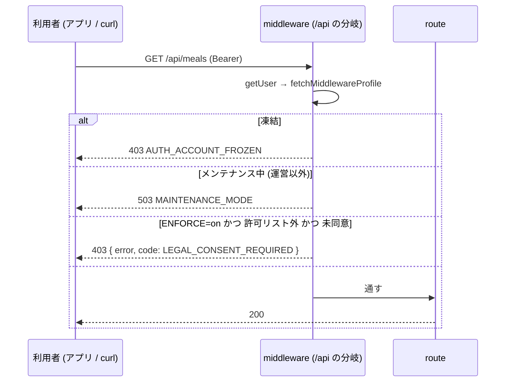

# 13a. 規約の同意ゲートを /api にも掛ける — 核 (サーバー + shared) (#1442)

| 項目 | 値 |
|---|---|
| Status | 設計ゲート通過・実装は #1689 |
| Issue | #1442 (親: #1174 の同意ゲート。先例: #1154 の AI 同意の 403・#1030 / #1445 の凍結の API ゲート) |
| 分冊 | 本冊 = 核 (段 A: サーバー + `packages/shared`)。配線 (段 B: モバイル) は `13b-legal-consent-mobile.md`。13b は本冊がマージされた後に、本冊の実コードを正として実装する |
| 正典の関係 | 本冊と 13b は `08-legal-compliance.md` §7.2 (同意ゲート) の**配線を /api とモバイルへ広げる**冊。§7.2 の「対象外に `/api/*`」の記述は本冊のマージで、「モバイルのネイティブの画面は対象外」の記述は 13b のマージで現在形に直す (各冊の §6.19) |
| 範囲の正本 | Issue #1442 の本文とコメント (オーナーの選択 2026-10-15「運営の API も止める」は #1442 のコメントに記録) |
| 読み手 | 実装 (Sonnet 5.5) と敵対レビュー。実装は §6 だけを読んで手を止めずに書けることを完成条件にする |
| 節番号 | 分冊前の 13 と同じ番号を使う。本冊に無い節 (§3.3・§5.2・§6.6.8〜§6.6.13 など) は 13b にある。両冊にある節番号は、それぞれの冊に関わる行だけを持つ。両方に関わる行は本冊に置く |

---

## 0. 範囲・分冊判定・本書の読み方

### 0.1 一言でいうと

- サーバー: `lib/supabase/middleware.ts` の `/api/*` の分岐 (いま凍結とメンテナンスを見ている所) に、同じプロフィールの行で**同意の判定を足す**。未同意 (かつ `LEGAL_CONSENT_ENFORCE=on`) なら **403 `{ error, code: 'LEGAL_CONSENT_REQUIRED' }`** (#1154 の AI 同意と同じ平たい形)。止めないのは**許可リスト** (§6.4) だけ。判定とリストは `packages/shared` の純関数 1 ファイルに置く。
- 新設 API: **`GET /api/legal/status`** (本人の同意の状況 + 強制中か)。モバイルが起動時と再同意の判定に使う。
- モバイル (13b の範囲): ルートの `Stack` の **`screenLayout`** に 1 枚のゲートを置き、サインイン中で「同意が要る」状態なら、**どの画面の代わりにもネイティブの同意画面**を描く (初期設定より先)。API の 403 を受けたら同じ状態に落とす (改定の再同意)。同意画面はネイティブ (WebView を使わない)。

### 0.2 分冊判定 (相 1 で実施)

| 目安 | 本書 | 判定 |
|---|---|---|
| 設計書 800 行超 | 超える (表・トレース・正典コードを 1 冊に持つため) | トリガー |
| 消費先レーン 3 以上 | Web (middleware・route)・shared・モバイルの 3 レーン | トリガー |
| 共有面 2 つ以上 | `packages/shared` (index の export) と `lib/supabase/middleware.ts` (全リクエストが通る) の 2 つ | トリガー |

**判定: 2 冊 (核 → 配線) に分ける。** 相 1 では「1 冊・2 段 (核 → 配線)」と判定したが、叩き台が 1,669 行になり、叩き台の大きさの関門 (1,500 行) を超えたので、設計書自身の段の境目 (段 A = サーバー + shared / 段 B = モバイル) で 2 冊に分けた (中身の判断・決定・コードは分冊前と同じ)。

- 本冊 (13a) = 核: middleware の `/api` の分岐・判定と許可リスト・403 の本文・`GET /api/legal/status`・`packages/shared` の純関数と文面・Zod の正本・見張りのテスト。
- 13b = 配線: モバイルの `LegalConsentGate` / `LegalConsentProvider` / `LegalConsentScreen`・起動と初期設定の順・403 での再同意。
- 2 冊の間の契約は「1 本の API (`/api/legal/status`) と 1 つのエラーコード (`LEGAL_CONSENT_REQUIRED`) と shared の定数・関数」だけ。13b は本冊の実装がマージされた後に、マージ済みの実コード (shared の export) を参照して実装する (§6.15)。
- 要件行列・シナリオ・トレース・状態表は、両方に関わる行を本冊に置き、13b から参照する。

### 0.3 一次情報 (origin/main。行番号は 2026-10-15 時点)

| 事実 | 場所 |
|---|---|
| `/api/*` の分岐は `getSession → getUser → user_profiles(roles, frozen_at, unban_at)` を読み、凍結なら 403 `{ error: { code: 'AUTH_ACCOUNT_FROZEN', message } }`、メンテナンス中なら 503 を返して `return` する。同意の判定は無い | `lib/supabase/middleware.ts:183-241` |
| 画面の同意ゲートは凍結の後・初期設定の差し戻しの前。`legalColumnsAvailable` が false (列が無い DB) と `profileError` のときは素通り。リダイレクトは GET / HEAD だけ | `lib/supabase/middleware.ts:325-393` |
| プロフィールの読み方 (列が無い DB の 42703 でやり直す) | `lib/supabase/middleware.ts:48-77` (`fetchMiddlewareProfile`) |
| 判定の純関数と対象外のパス (`/api` を含む) | `lib/legal-consent.ts:87-138` |
| 凍結中でも通す API (完全一致 5 本: 退会・書き出しと、有料プランの解約の 3 本 (billing/01 §9.8)) | `src/lib/auth/frozen.ts:60-66` |
| AI 同意の 403 の形 `{ error: <固定の文>, code: 'AI_CONSENT_REQUIRED' }` / 判定不能は 503 `AI_CONSENT_CHECK_FAILED` | `supabase/functions/_shared/ai-consent.ts:50-64, 216-229`、`src/lib/ai/consent-guard.ts:1-15` |
| 同意の記録 API (版が違えば 409。Bearer と Cookie の両方で使う) | `src/app/api/legal/accept/route.ts:42-130` |
| 同意画面 (Web) と、同意後は `window.location.assign(next)` | `src/app/legal-consent/page.tsx`、`src/app/legal-consent/LegalConsentForm.tsx` の `handleAccept` (同意を記録できたら `window.location.assign(next)`) |
| いま有効な版・判定 | `packages/shared/src/legal-versions.ts:39-94` |
| ミドルウェアの matcher が `/api` で外すのは `api/health$` だけ | `src/proxy.ts:94`、`tests/health-middleware-exemption.test.ts` |
| `/api` の route.ts は 202 本 | `src/app/api/**/route.ts` (一覧は本書 §6.4 の許可リスト以外が対象) |

モバイルの一次情報 (入口・ルートの Stack・API クライアント・公開ページ・expo-router の版) は 13b §0.3。

---

## 1. 目的・スコープ

### 1.1 解決すること (Issue #1442)

`LEGAL_CONSENT_ENFORCE=on` でも、次の経路は同意の前に使える。

1. モバイルのネイティブの画面 (health / settings / favorites のタブ、AI 相談、レシピ、パントリーなど) は WebView を通らないので、未同意のまま使える。
2. 新規の人は、ネイティブの初期設定 (健康情報の入力) を同意より先に済ませられる。
3. `/api/*` は直接呼べば同意なしで動く。

1〜2 は 13b、3 は本冊が解決する。

### 1.2 前提 (仕様ファイルの逐語)

- 今の同意ゲートは、middleware で Web の画面の取得 (GET/HEAD) にだけ掛かる。
- 本番は `LEGAL_CONSENT_ENFORCE=on`。
- ローンチ前で利用者はゼロ。正しい形で作る。

### 1.3 対象外

- 規約の文面・版・施行日 (弁護士の確認。`08` §7.2)。
- 同意の記録の仕組み (`accept_legal_documents`・`terms_acceptances`) は変えない。DB の変更 (migration・RLS) は無い。
- アプリが Supabase (PostgREST) を直接読む経路 (`apps/mobile/src/hooks/useHomeData.ts`・`apps/mobile/src/lib/recipeCollections.ts` (2026-10-16 に削除した。#1598)・`apps/mobile/src/lib/pushNotifications.ts`・`apps/mobile/app/onboarding/questions.tsx` の `supabase.from(...)`) は、Next の middleware を通らないので本書のゲートの外 (§6.13 の限界・§8)。
- モバイルだけに関わる対象外 (`LEGAL_CONSENT_NOTICE` をネイティブに出さないこと・ネイティブのサインアップ画面の同意のチェック) は 13b §1.3。

---

## 2. 関連要件

- `docs/design/cross/08-legal-compliance.md` §7.2 (再同意フロー)。
- `docs/design/cross/04-api-conventions.md` §4 (エラーコード体系。`LEGAL_` の接頭辞は `src/app/api/legal/accept/route.ts` が既に使う)・§5.2 (本文の形: 平たい `{ error, code }`)。
- `docs/design/cross/01-auth-session.md` §14 (認可ヘルパー)。
- モバイル側の関連要件 (`docs/design/mobile/01-architecture.md` §3) は 13b §2。

---

## 3. 相 1 外形固定: 要件行列・ユーザーシナリオ・現行の画面

### 3.1 要件行列

| ID | 要件 | 出どころ | 検証 (§6.14 の it) |
|---|---|---|---|
| R-1 | ログイン済みの利用者のデータを読み書きする `/api` は、未同意 (未同意・旧版に同意) なら 403 の専用コードで断る | 仕様 1 | T-SH4, T-M1〜T-M4 |
| R-2 | 403 の形は #1154 の AI 同意に合わせる: 平たい `{ error: <固定の文>, code }`、キーはその 2 つだけ、内部の語を出さない | 仕様 1 | T-M9, T-S1 |
| R-3 | 断らない API は理由つきの許可リストで固定し、テストが一覧を固定する | 仕様 1 | T-SH3, T-M2, T-M3, T-M14, T-M18 |
| R-4 | 判定の置き場所は漏れが出ない形 (route ごとに呼び忘れない) | 仕様 1 | T-M1 (全 route の表) |
| R-5 | 漏れを見張るテスト (全 route の表と実コードの照合) を含め、見張りの限界を明記する | 仕様 1 | §6.13 |
| R-8 | 改定 (版が上がった) の再同意は、同意ゲートの判定 (`isLegalConsentComplete`。版 + 生年月日 + 18 歳未満なら保護者の同意とのつながり。設計書 14 §6.5.2) に合わせる。API も モバイルも同じ | 仕様 3 | T-M4, T-M17, E2E-A6, T-P3 |
| R-9 | `ENFORCE` が off のとき・同意の状態を読めないとき (DB 障害) の挙動を理由つきで決める | 仕様 4 | §6.11, T-M5〜T-M8 |
| R-10 | 既存のテスト・e2e への影響を洗い、結合テストで 403 の専用コードを確かめる | 仕様 5 | §6.14, §6.18 |
| R-11 | Zod のスキーマ (403 の本文)・ヘルパーの関数のシグネチャ・エラー表・状態遷移表を書く | 仕様 成果物 | §6.1〜§6.8 |
| R-13 | `as any`・マジックナンバーを使わない。意味のある数値は名前付き定数 | 共通ガード | lint |
| R-14 | 凍結 (403 AUTH_ACCOUNT_FROZEN) とメンテナンス (503) の判定の順は変えない。同意はその後 | `middleware.ts:183-241` の既存の順 | T-M10, T-M11, T-M19, T-M20 |

R-6・R-7・R-12 (モバイルだけ) は 13b §3.1。R-8〜R-11・R-13 はサーバーとモバイルの両方に関わるので本冊に置く。検証の列の T-ML*・T-P*・T-G*・T-SC*・T-RL1・T-API1・T-FR1・T-PT1 は 13b §6.14 の it。

### 3.2 ユーザーシナリオ (18 本のうち、サーバーに関わる 11 本)

モバイルだけで結果が決まる S1〜S4・S12・S13・S18 は 13b §3.2。サーバーとモバイルの両方に関わる S5・S8・S9・S15 は本冊に置く。

| ID | シナリオ | 検証 (§6.14 の it。13b の it は 13b §6.14) |
|---|---|---|
| S5 | 規約の改定 (版を上げてデプロイ)。アプリを開いたままの利用者が次に API を呼ぶ → 403 → 同意画面 → 再同意 → さっきの画面に戻る | サーバー: T-M4・T-M17・E2E-A6 (旧版で 403 → 再同意 → 200)。モバイル (13b): T-API1 (403 を例外に置き換えて知らせる)・T-P3 (`required` にして取り直す)・T-G2 (画面の代わりに同意画面)・T-SC2 (同意して `refresh`) |
| S6 | 未同意の利用者が curl + Bearer で `GET /api/meals` を叩く → 403 `LEGAL_CONSENT_REQUIRED` | T-M1・T-M9・T-M12 |
| S7 | 未同意の利用者が退会 (`POST /api/account/delete`) / 書き出し (`GET /api/account/export`) → 通る (同意を取り下げる権利) | T-M1・T-M3・E2E-A4 |
| S8 | `LEGAL_CONSENT_ENFORCE` が off (または未設定) → API は未同意でも通る。アプリも止めない (status の `required` が false) | T-M5・T-R5・E2E-A5。モバイル (13b): T-P1 |
| S9 | DB 障害で `user_profiles` を読めない → API は素通り (route 側の認可へ)。アプリは status を取れず `unknown` → 止めない。DB が戻れば次の API 呼び出しの 403 で同意画面へ | T-M6・T-R7。モバイル (13b): T-P2・T-G5 |
| S10 | 凍結中かつ未同意 → 403 `AUTH_ACCOUNT_FROZEN` (凍結が先。同意の 403 は出ない) | T-M10 |
| S11 | メンテナンス中かつ未同意 (運営ではない) → 503 `MAINTENANCE_MODE` (メンテナンスが先) | T-M11 |
| S14 | Web の画面 (SPA) を開いたまま改定 → 画面の中の API 呼び出しが 403 → 画面は本文の固定の文を出す → 次の画面の取得 (GET) で middleware が同意画面へ回す (既存のゲート) | T-M9 (本文の `error` は固定の文)・T-M17 (同じ人の `/api` は 403、画面の GET は同意画面へ 307)・E2E-A6 |
| S15 | 同意の列がまだ無い DB (migration の反映前) → 42703 でやり直し、同意ゲートだけ素通り (API も画面も同じ) | T-M7 |
| S16 | cron (`CRON_SECRET`) / Resend の webhook → 利用者のセッションが無い → 同意の判定に掛からない (許可リストにも載せ、理由を固定する) | T-M2・T-M3・T-M12 |
| S17 | 運営 (admin) が未同意で `/api/admin/users` を呼ぶ → 403 (規約はスタッフにも適用される。Web の画面のゲートと同じ) → 同意後に通る | T-M1・T-M11 |

ネイティブの画面の一覧 (§3.3。R-7) は 13b §3.3。

---

## 4. 相 2 構想とトレース

### 4.1 構造

```
サーバー (段 A)
  packages/shared/src/legal-consent-api.ts   ← 核。純関数と定数だけ (Node / Deno / RN 固有の API を使わない。呼ぶのは proxy と API Route で、どちらも Node.js の runtime)
    ├ LEGAL_CONSENT_EXEMPT_API_PATHS (許可リスト・理由つき)・isLegalConsentExemptApiPath
    ├ resolveLegalConsentApiDecision({ pathname, accepted, enforce }) → 'allow' | 'deny'
    ├ LEGAL_CONSENT_REQUIRED_{CODE,STATUS,MESSAGE}・legalConsentRequiredBody()・isLegalConsentRequiredBody()
    └ resolveLegalConsentStatus({ accepted, enforced }) → LegalConsentStatus・isLegalConsentStatus()
  lib/supabase/middleware.ts (/api の分岐)   ← 凍結 → メンテナンス → 同意 の順で判定。deny なら 403 を返す
  src/app/api/legal/status/route.ts          ← GET。本人の行を読んで resolveLegalConsentStatus を返す
  src/lib/legal-consent-api.ts               ← Zod (403 の本文・status の応答)。route とテストが使う
```

モバイル (段 B) の構造は 13b §4.1。

判定の規則 (サーバー・モバイル共通):

- **同意済み** = `isLegalConsentComplete(user_profiles の行)` = `getLegalConsentGaps` が空 (旧版・NULL・行なし・生年月日なし・保護者の同意とのつながりの無い 18 歳未満は未同意。設計書 14 §6.5.2)。判定に渡す行は、middleware の `/api` の分岐と status の route で `withMinorGuardianStatus` (`lib/legal-consent-minor.ts`。設計書 14 §6.5.8) に通す。改定 = 版の値が変わること。
- **強制中** = `isLegalConsentEnforced()` (`LEGAL_CONSENT_ENFORCE=on`)。off なら API は allow・status は `required: false`。
- **API の判定** = `enforce && !exempt(pathname) && !isLegalConsentComplete(accepted)` → deny (403)。
- **モバイルの判定** = `session && !exempt(pathname) && status.required` → 同意画面。`required = enforced && !accepted` (`accepted` = `gaps` が空) はサーバーが計算する (モバイルはフラグを読めないので、必ずサーバーに聞く)。

### 4.2 トレース (全シナリオを構造で手で走らせる)

| ID | 走らせた結果 |
|---|---|
| S5 | 版を上げてデプロイ → アプリの次の `getApi().get('/api/health/records')` → middleware: `isLegalConsentComplete` が false → 403 `LEGAL_CONSENT_REQUIRED` → `withFriendlyErrors` が `legalConsentRequiredErrorOf(e)` で見分け、`notifyLegalConsentRequired()` → provider が state を `required` にして `refresh()` → Gate が**いま表示中の画面の代わりに**同意画面 (Stack はそのまま) → 再同意 → `clear` → さっきの画面がそのまま描かれる (Stack の状態を捨てていないので「戻る」も残る)。画面側の catch は `LegalConsentRequiredError` (message = 固定の文) を受けるが、`Alert` を出す画面でも出るのは固定の文だけ |
| S6 | curl `Authorization: Bearer <JWT>` → middleware は JWT 形式の Bearer を転送 (`middleware.ts:129-130`) → `getUser` → 本人 → `fetchMiddlewareProfile` → 未同意 → `resolveLegalConsentApiDecision` deny → 403 `{ error, code }` + `Cache-Control: private, no-store`。route には届かない |
| S7 | `/api/account/delete` `/api/account/export` は許可リスト (`leave_service`) → allow → route へ (凍結中もこの 2 本は通る。凍結中に通る API は、課金の 3 本を含めて `FROZEN_ALLOWED_API_PATHS` の 5 本と、それとは別に判定する通知のトークンの claim (`isPushTokenClaimApiPath`。#1636)・ネイティブ認証ブリッジのコード (`isNativeBridgeCodeApiPath`。#1861。cross/08 §16.2)・お問い合わせの送信 (`isFrozenContactSubmitRequest`。`POST /api/contact` だけ。#1871。cross/08 §16.2)) |
| S8 | `isLegalConsentEnforced()` false → `resolveLegalConsentApiDecision` は最初の分岐で allow → 既存の挙動。status は `enforced: false, required: false` → モバイルは `clear` |
| S9 | `fetchMiddlewareProfile` が `profileError` → 同意の判定を含むブロックを飛ばす (凍結と同じ #348 の fail-open) → route へ (route 自身の `getUser`/DB 失敗は route の 500)。status route は 500 (`internalError`) → モバイルは `unknown` → children を描く。DB が戻った後の API 呼び出しが 403 → S5 の経路で同意画面 |
| S10 | 既存の凍結判定が先に `return` (403 AUTH_ACCOUNT_FROZEN)。同意の判定には来ない |
| S11 | 既存のメンテナンス判定 (`maintenanceApiResponse`) が先に `return`。同意の判定には来ない。運営ロールはメンテナンスを通った後に同意の判定を受ける |
| S14 | Web の画面の `fetch('/api/...')` が 403 (平たい形。`error` は固定の文) → 画面は `data.error` をそのまま出す (`internalError` と同じ理由で文字列) → 次の画面の取得 (GET) で既存の画面のゲートが `/legal-consent?next=...` へ回す。Web の画面に新しい処理は足さない (§8 候補) |
| S15 | `fetchMiddlewareProfile` が 42703 → 列を除いてやり直し → `legalColumnsAvailable: false` → 同意の判定を飛ばす (凍結・メンテナンスは効く)。status route は select が失敗 → 500 → モバイル `unknown` |
| S16 | `Bearer <CRON_SECRET>` は JWT 形式ではないので転送されず `getUser` は user null (`middleware.ts:122-130`) → 判定に来ない。許可リストに `/api/cron` (prefix) と `/api/webhooks` (prefix) を `no_user_session` の理由で載せ、テストが固定する |
| S17 | 運営でも `resolveLegalConsentApiDecision` に役割の分岐は無い → 403 → 運営は同意画面で同意 (Web の画面のゲートも管理者を回す。`middleware-legal-consent.test.ts:529`) → 以後通る |

S1〜S4・S12・S13・S18 のトレースは 13b §4.2。

---

## 5. 相 3 構造裁定 (1 回だけ)

### 5.1 サーバー側の代替案

| 案 | 中身 | 判定 |
|---|---|---|
| A (採用) | middleware の `/api` の分岐で既定 deny + 許可リスト。判定は shared の純関数 | 全 route が構造的に対象 (route を足しても漏れない)。既に同じ場所で凍結・メンテナンスを判定していて、プロフィールの行も読み済み (クエリを増やさない)。見張るのは許可リスト 1 つ |
| B | route ごとに `requireLegalConsent()` を呼ぶ (#1154 の AI 同意と同じ opt-in) | 202 本の route を触り、呼び忘れが漏れになる。AI 同意は「AI に送る route だけ」なので opt-in が合ったが、本件は「ほぼ全部」なので既定 deny が合う。却下 |
| C | DB (RLS ポリシー / 関数) で同意を見る | アプリの PostgREST 直読みまで止められる唯一の形だが、全ポリシーと service_role の経路に波及し、本書の範囲 (`/api` とネイティブの画面) を超える。却下 (§8 に残す) |

モバイル側の代替案は 13b §5.2。

### 5.3 F の問い「縁の発生源を消すより単純な構造は無いか」

縁の発生源は「どの入口に判定を置くか」が route / 画面ごとに決まること。採用した 2 つの構造は、どちらも**判定を各側の唯一の関門 (全 API が通る middleware の分岐・全画面が通るルートの Stack の `screenLayout`) に 1 回だけ置き**、残る自由度を**理由つきの許可リスト 2 つ** (API の許可リスト・モバイルの対象外のパス) に閉じ込める。許可リストはどちらもテストが実コード (route の実在・画面ファイル名) と突き合わせて固定する。これより単純な構造 (許可リストも無くす) は、同意そのものの API と退会・書き出しを止めてしまうので取れない。**構造はここで確定し、以後の周で蒸し返さない。**

---

## 6. 相 4 仕上げ

### 6.1 ① 全パターン表 (主体 × 経路 × ENFORCE → 結果)

主体: 未ログイン / 未同意 (行なし) / 未同意 (NULL) / 旧版に同意 / 同意済み。経路: Web 画面 GET / Web 画面 POST / `/api` 対象 / `/api` 許可リスト / モバイル ネイティブ画面 (対象) / モバイル 対象外の画面 / 初期設定 (Web) / 初期設定 (モバイル)。現行の列は変えない部分の確認。

| 主体 | 経路 | ENFORCE=on | ENFORCE=off | 変更 |
|---|---|---|---|---|
| 未ログイン | Web 画面 GET | `/login` へ (既存) | 同左 | なし |
| 未ログイン | `/api` (対象・許可リストとも) | 判定に来ない (user 無し) → route の 401 など | 同左 | なし |
| 未同意 (行なし / NULL / 旧版) | Web 画面 GET | `/legal-consent?next=` (既存) | 通す (NOTICE=on ならお知らせ) | なし |
| 未同意 | Web 画面 POST | 通す (既存。307 で回さない) | 通す | なし |
| 未同意 | `/api` 対象 | **403 LEGAL_CONSENT_REQUIRED** | 通す | **新** |
| 未同意 | `/api` 許可リスト | 通す | 通す | 新 (一覧の固定) |
| 未同意 | 初期設定 (Web `/onboarding/*`) | 同意が先 (既存) | 差し戻しだけ | なし |
| 未同意 | 初期設定 (モバイル `/onboarding/*` + `POST /api/onboarding/*`) | **同意画面が先。API も 403** | 通す | **新** |
| 同意済み | すべて | 通す | 通す | なし |
| 列が無い DB (42703) | `/api` 対象 | 通す (同意だけ素通り) | 通す | 新 (画面と同じ) |
| profile 読めない (DB 障害) | `/api` 対象 | 通す (fail-open。凍結と同じ) | 通す | 新 (方針の明記) |
| profile 読めない | モバイル | status 500 → `unknown` → 通す | 同左 | 新 |
| 凍結 + 未同意 | `/api` 対象 | 403 AUTH_ACCOUNT_FROZEN | 同左 | なし (順) |
| メンテナンス + 未同意 (運営以外) | `/api` 対象 | 503 MAINTENANCE_MODE | 同左 | なし (順) |
| 運営 (admin) 未同意 | `/api/admin/*` `/api/super-admin/*` | 403 LEGAL_CONSENT_REQUIRED | 通す | 新 (役割の例外は作らない) |

モバイルだけの行 (未ログインのモバイルの画面・未同意のネイティブの画面 (対象)・対象外の画面) は 13b §6.1。

### 6.2 ② 状態比較表 (現行 vs 設計後)

| 面 | 現行 | 設計後 |
|---|---|---|
| middleware `/api` の分岐が読む列 | `roles, frozen_at, unban_at` (`middleware.ts:207`) | `fetchMiddlewareProfile` (画面と同じ `PROFILE_COLUMNS_WITH_LEGAL`。42703 なら列を除いてやり直す)。クエリは 1 回のまま |
| `/api` の判定の順 | 凍結 → メンテナンス → 通す | 凍結 → メンテナンス → **同意** → 通す |
| 未同意の `/api` 呼び出し | 通る | 403 `{ error, code: 'LEGAL_CONSENT_REQUIRED' }` (許可リスト以外) |
| 同意の状況を知る API | 無し (画面の HTML か、`GET /api/profile` の列) | `GET /api/legal/status` |
| `lib/legal-consent.ts` の `EXEMPT_PREFIXES` の `/api` | 画面の判定で対象外 (コメント「各 route が自分で認可する」) | 変えない (画面の判定の対象外のまま。コメントだけ本書のゲートを指すように直す) |
| 同意画面の文面 | Web の `LegalConsentForm.tsx` のリテラル | `packages/shared/src/legal-consent-copy.ts` (Web とモバイルが同じ値を使う)。Web の画面に出る文は変わらない (「同意しない」のボタンは `declineAndSignOutButton` = 現行と同じ「同意しない（ログアウトする）」。押している間の文はリテラルのまま) |
| 許可リスト (凍結) | `FROZEN_ALLOWED_API_PATHS` の全部 (billing/01 §9.8 のあとは 5 本) | 変えない。同意の許可リストは、凍結・メンテナンスの判定で通るパス (`FROZEN_ALLOWED_API_PATHS`・通知のトークンの claim (`src/lib/push-tokens.ts` の `isPushTokenClaimApiPath`。#1636)・ネイティブ認証ブリッジのコード (`src/lib/auth/frozen.ts` の `isNativeBridgeCodeApiPath`。#1861。`/api/auth` の prefix の行 (`auth_flow`) で含む)・お問い合わせの送信 (`src/lib/auth/frozen.ts` の `isFrozenContactSubmitRequest`。`POST /api/contact`。#1871。`/api/contact` の exact の行 (`contact`) で含む)・`isMaintenanceExemptPath` の `/api`) をすべて含む (テストで固定。凍結中・メンテナンス中は同意の画面に進めないので、ここで通したパスを同意で止めると例外が意味を失う)。逆は求めない (`/api/account/data-requests` は同意の許可リストにあるが、凍結中は通さない。#1751・cross/15 S-13) |

モバイルの行 (起動・改定の再同意・403 の扱い) は 13b §6.2。

### 6.3 ③ 状態遷移表 (状態 × 操作 → 遷移先・ガード・副作用)

状態 (利用者ごと): `anon` (未ログイン) / `none` (未同意: 行なし・NULL) / `old` (旧版に同意) / `ok` (同意済み) / `unreadable` (読めない: DB 障害・列なし)。

| 状態 | 操作 | 遷移先 | ガード | 副作用 (サーバー / モバイル) |
|---|---|---|---|---|
| anon | `/api` 対象を呼ぶ | 同じ | user 無し (`getUser` が null。非 JWT の Bearer も同じ) | 同意の判定に来ない → route の認可 (401 など)。既存のまま |
| anon | `/api` 許可リストを呼ぶ | 同じ | user 無し | 同意の判定に来ない → route へ (`/api/contact` `/api/feature-flags` は未ログインでも答える) |
| anon | `GET /api/legal/status` | 同じ | user 無し | 401 `{ error, code: AUTH_UNAUTHENTICATED }` (T-R1) |
| anon | Web 画面 GET | 同じ | — | `/login` へ (既存) |
| anon | ログイン (Web `/login` → `/api/auth/*`) | none / old / ok / unreadable のどれか (行の中身で決まる) | `/api/auth` は許可リスト | 次の画面の取得で既存の画面のゲート / 次の `/api` 呼び出しで本書のゲート |
| none / old | `/api` 対象を呼ぶ | 同じ | `enforce` かつ 許可リスト外 | 403 を返す。モバイルは state を `required` にし status を取り直す |
| none / old | `/api` 許可リストを呼ぶ | 同じ | — | route へ |
| none / old | `GET /api/legal/status` | 同じ | — | `required: enforced` |
| none / old | Web 画面 GET / HEAD (画面の判定の対象。`isLegalConsentExemptPath` が false) | 同じ | `enforce` (off なら通す。`LEGAL_CONSENT_NOTICE=on` ならお知らせのヘッダーだけ) | `/legal-consent?next=<パス+クエリ>` へ 307 (既存。`middleware.ts:372-393`)。本書で変えない |
| none / old | Web 画面 GET / HEAD (画面の判定の対象外: `/legal-consent`・`/terms`・`/privacy`・`/legal`・`/contact`・`/settings/data-requests` (#1751)・`/frozen`・`/auth/*`・`/handson-tour`) | 同じ | — | 通す (既存。`lib/legal-consent.ts:87-121`)。`/settings/data-requests` (確認の画面を含む) は初期設定の差し戻しからも外す (`lib/onboarding-routing.ts` の `isDataSubjectRequestsPath`。初期設定の前の人も開ける。#1751) |
| none / old | Web 画面 POST など (GET / HEAD 以外) | 同じ | — | 回さない (既存。307 で同意画面へ回しても受け取れないため)。その画面が中で呼ぶ `/api` は上の「`/api` 対象を呼ぶ」の行で 403 (S14) |
| none / old | Web の初期設定 (`/onboarding/*` の GET) | 同じ | `enforce` | 同意画面が先 (既存。同意の判定は初期設定の差し戻しより先)。off なら初期設定の差し戻しだけ。初期設定の API (`/api/onboarding/*`) は「`/api` 対象を呼ぶ」の行で 403 (§6.4) |
| none / old | `POST /api/legal/accept` (いまの版) | **ok** | 版が一致 | `accept_legal_documents` (行が無ければ作る)。Web: `window.location.assign(next)` で元の画面へ (既存。`LegalConsentForm.tsx` の `handleAccept` (同意を記録できたら `window.location.assign(next)`))。モバイル: `refresh()` → `clear` → 画面に戻る |
| none / old | `POST /api/legal/accept` (古い版の値) | 同じ | 版が不一致 | 409。モバイル: `refresh()` → 新しい版で描き直し |
| ok | 版が上がる (デプロイ) | **old** | — | 何も起きない。次の API 呼び出しで 403 (モバイル) / 次の画面の取得で同意画面 (Web) |
| ok | `/api` を呼ぶ | 同じ | — | 通す |
| ok | Web 画面 GET / HEAD / POST | 同じ | — | 同意の判定は `'none'` で通す (既存)。初期設定が済んでいなければ既存の初期設定の差し戻し |
| ok | Web の初期設定 (`/onboarding/*` の画面と `/api/onboarding/*`) | 同じ | — | 通す (既存の初期設定の流れ。同意の判定は掛からない) |
| none / old / ok | 凍結される | 同じ (同意の状態は変わらない) | — | `/api` は 403 AUTH_ACCOUNT_FROZEN が先 |
| none / old | `ENFORCE` を off にする (再デプロイ) | 同じ | — | `/api` 通す。status `required: false` → モバイル `clear` |
| unreadable | `/api` 対象を呼ぶ | 同じ | — | 素通り (route の判断へ) |
| unreadable | status | 同じ | — | 500 → モバイル `unknown` (止めない) |
| unreadable | DB が戻る | none / old / ok | — | 次の判定から効く |

モバイルだけの行 (anon のアプリのログイン・同意しない・モバイルの画面を開く) は 13b §6.3。

### 6.4 `/api` の許可リスト (止めない API。理由つき。R-3)

対象 = `src/app/api/**/route.ts` 202 本のうち、ここに無いもの全部 (既定 deny)。`match` は `exact` (完全一致) か `prefix` (そのものか `path/` 以下)。似た名前 (`/api/logx`) は通さない。

| path | match | reason | 理由・根拠 |
|---|---|---|---|
| `/api/legal/accept` | exact | `consent_itself` | 同意の記録そのもの。止めると同意できない (`accept/route.ts`) |
| `/api/legal/status` | exact | `consent_itself` | 同意の状況 (本書で新設)。止めるとモバイルが状態を知れない |
| `/api/auth` | prefix | `auth_flow` | ログイン (`auth/login`)・Cookie の同期 (`auth/session-sync`)・ネイティブ認証ブリッジのコード (`auth/native-bridge/code`)・運営の MFA の自己サービス (`auth/mfa/*`。cross/12 §14.1〜14.6。登録・確認・回復は認証の途中)。認証の途中。bridge を止めると WebView で Web の同意画面も開けない。Web の `/auth/*` の対象外と同じ |
| `/api/account/delete` | exact | `leave_service` | 退会。同意を取り下げる権利。凍結中も通す API (`FROZEN_ALLOWED_API_PATHS`) と同じ |
| `/api/account/export` | exact | `leave_service` | 個人データの書き出し。同上 |
| `/api/billing/subscription` | exact | `leave_service` | 有料プランの契約の要約。凍結中も通す (billing/01 §9.8)。凍結中は同意の画面に進めないので、ここにも入れる |
| `/api/billing/subscription/cancel` | exact | `leave_service` | 有料プランの解約の予約 (期間末)。サービスから離れる操作。凍結中も通す (billing/01 §9.8)。解約の予約は新しい版への同意を求めない |
| `/api/billing/portal` | exact | `leave_service` | Stripe の Billing Portal (支払い方法・請求書・解約)。解約の前提。凍結中も通す (billing/01 §9.8) |
| `/api/family/dissolve` | exact | `leave_service` | 家族グループの解散 (本人)。退会の前提 (凍結中も通す)。family/11 §13.5 |
| `/api/org/dissolve` | exact | `leave_service` | 組織の解散 (本人)。退会の前提 (凍結中も通す)。family/11 §13.5 |
| `/api/account/data-requests` | prefix | `data_subject_rights` | 開示・訂正・利用停止・消去の請求 (#1702・cross/15)。規約への同意を条件にできない本人の権利 (#1751)。一覧・作成・詳細・本人確認 (`[id]/verify`)・確認のメールの再送 (`[id]/resend-verification`)・取り下げ (`[id]/withdraw`) の 6 route。凍結中は通さない (`FROZEN_ALLOWED_API_PATHS` に入れない。cross/15 S-13)。呼ぶ画面 `/settings/data-requests` (確認の画面 `/settings/data-requests/verify` を含む) も画面の判定の対象外 (`lib/legal-consent.ts`) |
| `/api/push-tokens/claim` | exact | `device_cleanup` | 通知のトークンの claim (#1636)。利用者のデータの読み書きではなく端末の後片付け (同じ端末の前の利用者の行を外す)。凍結中・メンテナンス中も middleware が通す (`src/lib/push-tokens.ts` の `isPushTokenClaimApiPath`) のと同じ理由。凍結中・メンテナンス中は同意できないので、ここで止めると前の利用者の行が外れず、前の利用者宛ての通知がこの端末に届き続ける。release (`/api/push-tokens/release`) は載せない (セッション無しで route が端末の秘密の値で認可するので、同意の判定に来ない) |
| `/api/contact` | exact | `contact` | 同意しない人の連絡の窓口 (同意の前の退会と書き出しは、本人が `/legal-consent/account` で行う。cross/20 Q-23)。Web の同意画面の「同意しない」が案内する先。POST は未ログインでも送れる route。POST は凍結中も middleware が通す (`isFrozenContactSubmitRequest`。#1871。cross/08 §16.2) |
| `/api/log` | exact | `telemetry` | 画面・端末の失敗の報告の受け口 (`error-report.ts` → `POST /api/log`)。利用者のデータの利用ではなく運用のログ。未同意の人の失敗も残す |
| `/api/csp-report` | exact | `telemetry` | ブラウザが送る CSP の違反の報告の受け口 (cross/18 §9.10)。利用者のデータではなく運用のログ。未同意の人の画面の違反も残す |
| `/api/feature-flags` | exact | `client_status` | 画面が前もって状態を知る窓口 (メンテナンス中も通す `isMaintenanceExemptPath` と同じ扱い)。未ログインでも答える |
| `/api/health` | exact | `no_user_session` | 死活監視。matcher の外 (`src/proxy.ts:94`) なので判定に来ないが、一覧で「来ないこと」を固定する |
| `/api/cron` | prefix | `no_user_session` | `CRON_SECRET` (JWT ではない Bearer)。利用者のセッションが無く `getUser` は null |
| `/api/webhooks` | prefix | `no_user_session` | 外部 (Resend) からの通知。署名で認証。利用者のセッションが無い |
| `/api/e2e` | prefix | `test_only` | テスト基盤 (`e2e/reset-onboarding`。本番は `NODE_ENV` で 403)。e2e の共通ユーザーの初期化を同意に左右させない |

注 (billing/03): アプリ内課金の `/api/billing/iap/catalog`・`/api/billing/iap/sync` は許可リストに入れない (同意の前は購入の画面を開かない。凍結中も通さない)。RevenueCat の Webhook `/api/webhooks/revenuecat` はセッションを持たない受け口で、上の `/api/webhooks` (prefix・`no_user_session`) が通す (Stripe の受け口と同じ形)。

載せない (= 止める) ことを決めたもの (既定 deny なので、この表に無い route もすべて止まる。この表は、止めるか通すかの判断が分かれうる候補と、その判断の理由を書いたもの):

| 候補 | 止める理由 |
|---|---|
| `/api/admin/*` `/api/super-admin/*` `/api/support/*` `/api/operator/*` (運営) | 規約はスタッフにも適用される (Web の画面のゲートが管理者も回す。`middleware-legal-consent.test.ts:529`)。役割の例外を作らないほうが一覧が短く漏れない。運営は 1 回同意すれば済む |
| `/api/onboarding/*` | 初期設定は同意の後 (R-6)。Web の画面のゲートも初期設定の差し戻しより先に同意を見る |
| `/api/handson-tour/*` と、ツアーが使うサンドボックスの API | Web は `/handson-tour` の画面を対象外にするが、ツアーが呼ぶほかの API (献立の追加など) は止まるので、ツアーの API だけ通しても流れは守れない。ツアーに入る前に同意している (モバイルは画面の代わりに同意画面を描き、同意後に同じ画面へ戻る) |
| `/api/performance/sports` `/api/catalog/products` (公開・準公開のデータ) | 未ログインなら判定に来ない。ログイン済みの未同意の人は同意が先。個別の例外を作らない |
| `/api/family/invites/[id]/reject` `/api/org/invites/[id]/reject` (認証任意) | 未ログインなら判定に来ない。ログイン済みなら Web の `/invite/*` の画面のゲートが先に同意を取る |
| `/api/family/invites/[id]/accept` `/api/org/invites/[id]/accept` (招待を受ける) | ログイン済みの本人の操作 (route が `getUser` で確かめ、未ログインは 401。`family/invites/[id]/accept/route.ts`・`org/invites/[id]/accept/route.ts` の `supabase.auth.getUser()`)。受けると家族・組織とのデータの共有が始まるので、利用者のデータの利用そのもの。呼ぶ画面は Web の `/invite/[token]` (`src/app/invite/[token]/page.tsx` の `handleOrgAccept` と、そこが描く `src/components/membership/FamilyInviteAcceptModal.tsx` の `handleAccept`) で、`/invite` は画面の判定の対象外に無い (`lib/legal-consent.ts:87-121`) ので、ログイン済みの未同意の人は画面のゲートで先に同意画面へ回る |
| `/api/family/invites` `/api/org/invites` (招待の一覧・作成) と `/api/family/invites/[id]/revoke` `/api/org/invites/[id]/revoke` (取り消し) | 招待する側 (家族の代表・組織の管理者。`org` は `requireOrgAdmin`) の操作で、相手のメールアドレスなど利用者のデータを扱う。運営と同じく役割の例外を作らない。呼ぶ画面 (Web `src/app/(main)/family/members/invite/page.tsx` の `readInvites` (GET)・`handleSubmit` (POST)・`src/app/(org)/org/invites/page.tsx` の `fetchInvites`・`handleCreateInvite`・`handleRevokeInvite`、モバイル `apps/mobile/app/(org)/org/invites.tsx:40, 59, 82` (2026-10-16 に削除した。#1598)) は、どれも同意の後にしか開けない (Web は画面のゲート、モバイルは 13b のゲート) |
| `/api/export/meals` (献立の CSV。Web の設定画面 `src/app/(main)/settings/page.tsx:176` とモバイルの設定タブ `apps/mobile/app/(tabs)/settings.tsx:210` が呼ぶ) | 書き出しの権利 (S7) は `/api/account/export` が受け持つ。そちらは本人の全データを出し、献立 (`user_daily_meals`・`planned_meals`) も含む (`src/lib/account-export-tables.ts:154-155`)。CSV は設定画面の便利機能で、呼ぶ画面はどちらも同意の後にしか開けない (Web は画面のゲート、モバイルは 13b のゲート)。凍結中に通す API (`FROZEN_ALLOWED_API_PATHS`) にも入っていない。許可リストの `leave_service` を、退会・書き出しの 2 本と、凍結中も通す有料プランの解約の 3 本 (billing/01 §9.8) に絞って揃える |

### 6.5 判定の置き場所と順序

**サーバー** (`lib/supabase/middleware.ts` の `if (isApiRoute)` ブロック): `getSession` → `getUser` → `fetchMiddlewareProfile` (1 クエリ) → ①凍結 (`isAccountFrozen` && !`isFrozenAllowedApiPath`) → 403 → ②メンテナンス → 503 → **③同意** (`legalColumnsAvailable` && `!profileError` && `resolveLegalConsentApiDecision(...) === 'deny'`) → 403 → `supabaseResponse`。③は `try` の外 (①と同じく、プロフィールを読めたときだけ) に置く。

**モバイル** の置き場所と順序は 13b §6.5。

### 6.6 正典コード

検査の範囲: ```ts のブロックのうち、**既存の export だけを import するもの** (6.6.1・6.6.2) は設計書の独立の型検査 (ルートの tsconfig) を通る。**本書で新設する export を import するもの** (6.6.3 以降) は独立には解決できないので `// tsc:skip` にしてある (実装では tsc の対象。理由はブロックの 1 行目)。差分の形のブロックも `// tsc:skip`。

#### 6.6.1 `packages/shared/src/legal-consent-api.ts` (新設。核)

```ts
/**
 * 利用規約・プライバシーポリシーの同意ゲートを /api とモバイルのネイティブの画面にも掛ける (#1442)。
 * サーバー (proxy (旧 middleware)・API Route)・Web・モバイルで同じ値と判定を使うための、純粋な定数と関数だけのファイル。
 * Node / Deno / RN 固有の API は使わない。副作用は無い。
 *
 *   - LEGAL_CONSENT_EXEMPT_API_PATHS / isLegalConsentExemptApiPath: 未同意でも止めない /api (理由つき)
 *   - resolveLegalConsentApiDecision: middleware の /api の分岐が呼ぶ判定 (allow / deny)
 *   - LEGAL_CONSENT_REQUIRED_*: 止めたときの 403 (平たい { error, code }。#1154 の AI 同意と同じ形)
 *   - resolveLegalConsentStatus / isLegalConsentStatus: GET /api/legal/status の応答 (サーバーが作り、モバイルが読む)
 *
 * 同意ゲートを通れるかの判定 (isLegalConsentComplete / getLegalConsentGaps。版 + 生年月日 + 18 歳未満なら保護者の同意とのつながり。#1173) は parental-consent.ts にあり、ここはそれを呼ぶだけ。
 *
 * ⚠ 実装ファイルでは下の import を './legal-versions' からの相対 import にする (packages/shared の中から自分のパッケージ名で
 *   import しない。Metro / Jest は exports の "." しか解決しない)。設計書の独立の型検査 (ルートの tsconfig の paths) で
 *   解決できるよう、ここだけパス別名で書いている。
 */
import {
  LEGAL_DOCUMENTS,
  LEGAL_DOCUMENT_TYPES,
  getOutdatedLegalDocuments,
  type LegalDocumentType,
} from '@homegohan/shared/legal-versions';
import {
  LEGAL_CONSENT_GAP_VALUES,
  getLegalConsentGaps,
  isLegalConsentComplete,
  type LegalConsentGap,
  type LegalConsentProfile,
} from '@homegohan/shared/parental-consent';
import { PUSH_TOKEN_CLAIM_API_PATH } from '@homegohan/shared/push-token-claim';

/** 本人の同意の状況を返す API (本書で新設) */
export const LEGAL_CONSENT_STATUS_API_PATH = '/api/legal/status';
/** 同意を記録する API (#1174。既存) */
export const LEGAL_CONSENT_ACCEPT_API_PATH = '/api/legal/accept';

/** 未同意で止めたときのエラーコード。Web の画面とアプリは、このコードを見て同意画面へ案内する */
export const LEGAL_CONSENT_REQUIRED_CODE = 'LEGAL_CONSENT_REQUIRED';
/** 未同意で止めたときの HTTP ステータス (403 Forbidden: 本人だが、この操作の前提 (同意) を満たしていない。AI 同意と同じ) */
export const LEGAL_CONSENT_REQUIRED_STATUS = 403;
/** 未同意で止めたときの本文 (#1172: 変数名・内部の詳細を出さない) */
export const LEGAL_CONSENT_REQUIRED_MESSAGE =
  '利用規約・プライバシーポリシーへの同意が必要です。同意の画面から内容をご確認ください。';

/** 403 の本文。キーはこの 2 つだけ */
export interface LegalConsentRequiredBody {
  error: typeof LEGAL_CONSENT_REQUIRED_MESSAGE;
  code: typeof LEGAL_CONSENT_REQUIRED_CODE;
}

export function legalConsentRequiredBody(): LegalConsentRequiredBody {
  return { error: LEGAL_CONSENT_REQUIRED_MESSAGE, code: LEGAL_CONSENT_REQUIRED_CODE };
}

/** 本文の code を読む。平たい { code } を先に見て、入れ子 { error: { code } } も受ける (AI 同意の isAiConsentRequiredBody と同じ読み方) */
function codeOfBody(body: unknown): string | null {
  if (!body || typeof body !== 'object') return null;
  const { code, error } = body as { code?: unknown; error?: unknown };
  if (typeof code === 'string') return code;
  if (error && typeof error === 'object') {
    const nested = (error as { code?: unknown }).code;
    if (typeof nested === 'string') return nested;
  }
  return null;
}

/** 応答の本文 (JSON を読んだもの) が「同意が必要です」(LEGAL_CONSENT_REQUIRED) か */
export function isLegalConsentRequiredBody(body: unknown): boolean {
  return codeOfBody(body) === LEGAL_CONSENT_REQUIRED_CODE;
}

/** 止めない理由の種類 (一覧の各行が必ず 1 つ持つ。テストが種類と実在する route を突き合わせる) */
export type LegalConsentExemptApiReason =
  | 'consent_itself'
  | 'auth_flow'
  | 'leave_service'
  | 'data_subject_rights'
  | 'contact'
  | 'telemetry'
  | 'client_status'
  | 'device_cleanup'
  | 'no_user_session'
  | 'test_only';

export interface LegalConsentExemptApiEntry {
  readonly path: string;
  /** exact = 完全一致 / prefix = そのものか `${path}/` 以下 (似た名前を通さない) */
  readonly match: 'exact' | 'prefix';
  readonly reason: LegalConsentExemptApiReason;
  /** 人が読む理由 (設計書 13a §6.4 と同じ文) */
  readonly note: string;
}

/**
 * 未同意でも止めない /api の一覧 (#1442)。ここに無い /api はすべて、LEGAL_CONSENT_ENFORCE=on のとき未同意なら 403。
 * 足すのは「同意そのもの・認証の途中・サービスから離れる操作・本人の権利の請求 (開示・訂正・利用停止・消去)・連絡の窓口・運用のログ・
 * 状態の窓口・端末の後片付け・利用者のセッションを持たない経路」だけ
 * (利用者のデータを読み書きする API を足さない)。一覧は tests が固定する (lib/supabase/__tests__/middleware-legal-consent-api.test.ts)。
 * 凍結中・メンテナンス中に middleware が通す /api は、すべてこの一覧にも入れる (凍結中・メンテナンス中は同意の画面に進めないので、
 * 同意ゲートで止めると、その例外が意味を失う)。これも同じテストが全 route で確かめる。
 * 逆は求めない: この一覧にあっても、凍結中は通さないものがある (例: 本人の権利の請求 /api/account/data-requests は未同意でも通すが、
 * 凍結中は FROZEN_ALLOWED_API_PATHS に入れず 403 AUTH_ACCOUNT_FROZEN のまま。凍結中の請求は /contact で受ける。cross/15 S-13)。
 */
export const LEGAL_CONSENT_EXEMPT_API_PATHS: readonly LegalConsentExemptApiEntry[] = [
  { path: LEGAL_CONSENT_ACCEPT_API_PATH, match: 'exact', reason: 'consent_itself', note: '同意の記録そのもの。止めると同意できない' },
  { path: LEGAL_CONSENT_STATUS_API_PATH, match: 'exact', reason: 'consent_itself', note: '同意の状況。止めるとアプリが状態を知れない' },
  { path: '/api/auth', match: 'prefix', reason: 'auth_flow', note: 'ログイン・Cookie の同期・ネイティブ認証ブリッジのコード。認証の途中' },
  { path: '/api/account/delete', match: 'exact', reason: 'leave_service', note: '退会。同意を取り下げる権利。同意の前でも本人が自分で行える (同意画面の下の退会と書き出しの画面。#1901 cross/20 Q-23。凍結中も通す API と同じ)' },
  { path: '/api/account/export', match: 'exact', reason: 'leave_service', note: '個人データの書き出し。同上 (同意の前でも本人が自分で行える)' },
  // billing/01 §9.8: 凍結中も通す有料プランの解約の 3 本 (凍結中は同意の画面に進めないので、ここにも入れる。解約の予約は新しい版への同意を求めない)
  { path: '/api/billing/subscription', match: 'exact', reason: 'leave_service', note: '有料プランの契約の要約。解約できる契約か・解約の予約の日付を読む (凍結中も通す)' },
  { path: '/api/billing/subscription/cancel', match: 'exact', reason: 'leave_service', note: '有料プランの解約の予約 (期間末)。サービスから離れる操作 (凍結中も通す)' },
  { path: '/api/billing/portal', match: 'exact', reason: 'leave_service', note: 'Stripe の Billing Portal (支払い方法・請求書・解約)。解約の前提 (凍結中も通す)' },
  {
    path: '/api/account/data-requests',
    match: 'prefix',
    reason: 'data_subject_rights',
    note: '開示・訂正・利用停止・消去の請求 (#1702)。規約への同意を条件にできない本人の権利。凍結中は通さない (cross/15 S-13)',
  },
  {
    path: PUSH_TOKEN_CLAIM_API_PATH,
    match: 'exact',
    reason: 'device_cleanup',
    note: '通知のトークンの claim。利用者のデータの読み書きではなく端末の後片付け (同じ端末の前の利用者の行を外す)。止めると前の利用者宛ての通知がこの端末に届き続ける (凍結中・メンテナンス中も通すのと同じ理由)',
  },
  { path: '/api/contact', match: 'exact', reason: 'contact', note: '同意しない人の連絡の窓口' },
  { path: '/api/log', match: 'exact', reason: 'telemetry', note: '画面・端末の失敗の報告の受け口。運用のログ' },
  { path: '/api/csp-report', match: 'exact', reason: 'telemetry', note: 'ブラウザが送る CSP の違反の報告の受け口。利用者のデータではなく運用のログ。未同意の人の画面の違反も残す' },
  { path: '/api/feature-flags', match: 'exact', reason: 'client_status', note: '画面が前もって状態を知る窓口 (メンテナンス中も通す)' },
  { path: '/api/health', match: 'exact', reason: 'no_user_session', note: '死活監視。matcher の外で判定に来ないことを固定する' },
  { path: '/api/cron', match: 'prefix', reason: 'no_user_session', note: 'CRON_SECRET。利用者のセッションを持たない' },
  { path: '/api/webhooks', match: 'prefix', reason: 'no_user_session', note: '外部からの通知 (署名で認証)。利用者のセッションを持たない' },
  { path: '/api/e2e', match: 'prefix', reason: 'test_only', note: 'テスト基盤 (本番は NODE_ENV で 403)' },
];

function matchesExemptEntry(pathname: string, entry: LegalConsentExemptApiEntry): boolean {
  if (pathname === entry.path) return true;
  return entry.match === 'prefix' && pathname.startsWith(`${entry.path}/`);
}

/** 未同意でも止めない /api のパスか。pathname は URL の path の部分 (クエリを含まない) */
export function isLegalConsentExemptApiPath(pathname: string): boolean {
  return LEGAL_CONSENT_EXEMPT_API_PATHS.some((entry) => matchesExemptEntry(pathname, entry));
}

export type LegalConsentApiDecision = 'allow' | 'deny';

export interface ResolveLegalConsentApiInput {
  /** リクエストの path (クエリを含まない) */
  pathname: string;
  /**
   * user_profiles の行の同意済みの版と生年月日。18 歳未満なら withMinorGuardianStatus が入れた minor_guardian_ok を含む。
   * 行が無いときは null / undefined (= 未同意)
   */
  accepted: LegalConsentProfile | null | undefined;
  /** LEGAL_CONSENT_ENFORCE=on か (lib/legal-consent.ts の isLegalConsentEnforced の結果) */
  enforce: boolean;
  /** JST の今日 (YYYY-MM-DD)。省くと todayLocal()。テストが日を固定するため */
  today?: string;
}

/**
 * middleware の /api の分岐が呼ぶ判定。凍結・メンテナンスの判定の後に呼ぶ (順は middleware が決める)。
 *   - 強制していない (enforce = false) → allow (既存の挙動のまま)
 *   - 許可リストのパス → allow
 *   - それ以外で、同意ゲートを満たしていない (未同意・旧版・行なし・生年月日なし・保護者の同意とのつながりの無い 18 歳未満) → deny (403 LEGAL_CONSENT_REQUIRED)
 * 役割 (admin / super_admin) による例外は作らない (規約はスタッフにも適用される)。
 */
export function resolveLegalConsentApiDecision(input: ResolveLegalConsentApiInput): LegalConsentApiDecision {
  if (!input.enforce) return 'allow';
  if (isLegalConsentExemptApiPath(input.pathname)) return 'allow';
  return isLegalConsentComplete(input.accepted, input.today) ? 'allow' : 'deny';
}

/** いま有効な文書の版と施行日 (status の応答。snake_case) */
export interface LegalConsentCurrentDocument {
  version: string;
  /** 施行日 (日本時間) YYYY-MM-DD。画面は formatLegalEffectiveDate で「2025年1月1日」の形にする */
  effective_date: string;
}

export interface LegalConsentAcceptedVersions {
  terms_version: string | null;
  privacy_version: string | null;
}

/** GET /api/legal/status の応答 */
export interface LegalConsentStatus {
  /** LEGAL_CONSENT_ENFORCE=on か */
  enforced: boolean;
  /** 同意ゲートを満たしているか (= gaps が空。#1173 から版だけでなく生年月日と、18 歳未満なら保護者の同意とのつながりも含む) */
  accepted: boolean;
  /** 同意画面を出す必要があるか = enforced && !accepted。アプリのゲートはこの値だけを見る */
  required: boolean;
  /** いま有効な版に同意していない文書 (未同意・旧版) */
  outdated: LegalDocumentType[];
  /**
   * 同意画面で埋めるもの (getLegalConsentGaps の答え。順は 文書 → 'birth_date' → 'guardian_consent')。
   * アプリは 'birth_date' で生年月日の欄を、'guardian_consent' で退会の案内を出す
   */
  gaps: LegalConsentGap[];
  /** いま有効な版と施行日。同意画面はこの値を表示し、同意の記録 (POST /api/legal/accept) にもこの版を送る (端末のバンドルの定数は使わない) */
  current: Record<LegalDocumentType, LegalConsentCurrentDocument>;
  /** 本人の同意済みの版 (NULL = 未同意) */
  accepted_versions: LegalConsentAcceptedVersions;
}

export interface ResolveLegalConsentStatusInput {
  accepted: LegalConsentProfile | null | undefined;
  enforced: boolean;
  /** JST の今日 (YYYY-MM-DD)。省くと todayLocal()。テストが日を固定するため */
  today?: string;
}

/** status route が呼ぶ。判定は resolveLegalConsentApiDecision と同じ述語 (isLegalConsentComplete = gaps が空) に基づく */
export function resolveLegalConsentStatus(input: ResolveLegalConsentStatusInput): LegalConsentStatus {
  const outdated = getOutdatedLegalDocuments(input.accepted);
  const gaps = getLegalConsentGaps(input.accepted, input.today);
  const accepted = gaps.length === 0;
  return {
    enforced: input.enforced,
    accepted,
    required: input.enforced && !accepted,
    outdated,
    gaps,
    current: {
      terms_of_service: {
        version: LEGAL_DOCUMENTS.terms_of_service.version,
        effective_date: LEGAL_DOCUMENTS.terms_of_service.effectiveDate,
      },
      privacy_policy: {
        version: LEGAL_DOCUMENTS.privacy_policy.version,
        effective_date: LEGAL_DOCUMENTS.privacy_policy.effectiveDate,
      },
    },
    accepted_versions: {
      terms_version: input.accepted?.terms_version_accepted ?? null,
      privacy_version: input.accepted?.privacy_version_accepted ?? null,
    },
  };
}

function isNullableString(value: unknown): value is string | null {
  return value === null || typeof value === 'string';
}

function isCurrentDocument(value: unknown): value is LegalConsentCurrentDocument {
  if (!value || typeof value !== 'object') return false;
  const { version, effective_date } = value as { version?: unknown; effective_date?: unknown };
  return typeof version === 'string' && version !== '' && typeof effective_date === 'string';
}

/** アプリが status の応答の形を確かめる (zod を packages/shared に持ち込まないための手書きの検査) */
export function isLegalConsentStatus(body: unknown): body is LegalConsentStatus {
  if (!body || typeof body !== 'object') return false;
  const b = body as Record<string, unknown>;
  if (typeof b.enforced !== 'boolean' || typeof b.accepted !== 'boolean' || typeof b.required !== 'boolean') return false;
  const documentTypes: readonly string[] = LEGAL_DOCUMENT_TYPES;
  if (!Array.isArray(b.outdated) || !b.outdated.every((v) => typeof v === 'string' && documentTypes.includes(v))) return false;
  const gapValues: readonly string[] = LEGAL_CONSENT_GAP_VALUES;
  if (!Array.isArray(b.gaps) || !b.gaps.every((v) => typeof v === 'string' && gapValues.includes(v))) return false;
  const current = b.current;
  if (!current || typeof current !== 'object') return false;
  if (!LEGAL_DOCUMENT_TYPES.every((type) => isCurrentDocument((current as Record<string, unknown>)[type]))) return false;
  const versions = b.accepted_versions;
  if (!versions || typeof versions !== 'object') return false;
  const { terms_version, privacy_version } = versions as { terms_version?: unknown; privacy_version?: unknown };
  return isNullableString(terms_version) && isNullableString(privacy_version);
}
```

`packages/shared/src/index.ts` に `export * from './legal-consent-api';` と `export * from './legal-consent-copy';` を足す (既存の `export * from './legal-versions';` の直後)。

#### 6.6.2 `packages/shared/src/legal-consent-copy.ts` (新設。同意画面の文面。Web とモバイルで共用)

```ts
/**
 * 利用規約・プライバシーポリシーの同意画面の文面 (#1174 の Web の同意画面 src/app/legal-consent/LegalConsentForm.tsx と、
 * #1442 のアプリのネイティブの同意画面 apps/mobile/src/components/legal/LegalConsentScreen.tsx が同じ値を使う。文面を 2 か所に持たない)。
 * declineButton 以外の値は #1174 の Web の文面そのまま (tests/e2e/legal-consent-gate.spec.ts と tests/legal-consent-page.test.tsx がこの文で画面を探す)。
 * declineButton だけは Web で使わない (Web のボタンは declineAndSignOutButton)。
 * 文書の名前 (利用規約 / プライバシーポリシー) は legal-versions.ts の LEGAL_DOCUMENT_LABELS。
 */
export const LEGAL_CONSENT_COPY = {
  heading: '利用規約・プライバシーポリシーへの同意',
  introFirst: 'ほめゴハンをご利用いただくには、利用規約とプライバシーポリシーへの同意が必要です。内容をご確認ください。',
  introReconsent:
    '利用規約・プライバシーポリシーが改定されました。引き続きご利用いただくには、内容をご確認のうえ、同意をお願いします。',
  revisedBadge: '改定あり',
  acceptButton: '同意して続ける',
  /**
   * アプリの「同意しない」のボタンと、その後の確認の Alert の見出し (13b §6.6)。アプリはこのボタンでは
   * ログアウトせず、Alert の「ログアウト」で初めてログアウトするので、「（ログアウトする）」を付けない。
   * Web のボタンの文 (declineAndSignOutButton) はこの文で始まる (テストが /同意しない/ の部分一致で探すため。T-C2 が固定)。
   */
  declineButton: '同意しない',
  /** Web の「同意しない」のボタン (押すとすぐログアウトする)。#1174 の LegalConsentForm.tsx の「同意しない」のボタンの文そのまま。全角の括弧 */
  declineAndSignOutButton: '同意しない（ログアウトする）',
  /** 同意を送ったら版が変わっていた (409) ときの案内 (POST /api/legal/accept の 409 の本文と同じ文) */
  versionMismatch: '利用規約・プライバシーポリシーが更新されました。画面を読み込み直して、内容をご確認ください。',
  /** 同意しない人への案内 (Web は「同意しない」の後の画面、アプリは確認の Alert に出す) */
  declineUnavailable: '利用規約・プライバシーポリシーに同意いただけない場合、ほめゴハンはご利用いただけません。',
  /** 同意の記録に失敗したとき (409 以外) */
  acceptFailed: '同意の記録に失敗しました。時間をおいて、もう一度お試しください。',
} as const;

/** チェックボックスの文。documentLabel は LEGAL_DOCUMENT_LABELS の値 */
export function legalConsentAgreeLabel(documentLabel: string): string {
  return `${documentLabel}の内容を確認し、同意します`;
}

/** 全文へのリンクの文 */
export function legalConsentReadFullTextLabel(documentLabel: string): string {
  return `${documentLabel}の全文を読む`;
}

/** 版と施行日の 1 行。effectiveDateLabel は formatLegalEffectiveDate の結果 */
export function legalConsentVersionLine(version: string, effectiveDateLabel: string): string {
  return `版: ${version} ／ 施行日: ${effectiveDateLabel}`;
}
```

#### 6.6.3 `src/lib/legal-consent-api.ts` (新設。Zod の正本: 403 の本文と status の応答)

```ts
// tsc:skip — 本書で新設する @homegohan/shared の export (6.6.1) を import するため、設計書の独立の型検査では解決できない。実装では tsc の対象
/**
 * 同意ゲート (#1442) の API の本文の Zod スキーマ (正本)。
 * 値の定義は packages/shared/src/legal-consent-api.ts (サーバー・Web・モバイル共用) にあり、ここはその形を Zod で固定するだけ。
 * GET /api/legal/status の route が応答を作ったあとに parse し、テスト (tests/legal-consent-api-schema.test.ts・middleware の表) が
 * middleware の 403 の本文と status の応答をこれで確かめる。zod を packages/shared に持ち込まない (モバイルのバンドルに入れない) ので、ここに置く。
 */
import { z } from 'zod';
import {
  LEGAL_CONSENT_GAP_VALUES,
  LEGAL_CONSENT_REQUIRED_CODE,
  LEGAL_CONSENT_REQUIRED_MESSAGE,
  LEGAL_DOCUMENT_TYPES,
  LEGAL_VERSION_PATTERN,
} from '@homegohan/shared';

/** 施行日 (YYYY-MM-DD)。legal-versions.ts の effectiveDate の形式 */
const EFFECTIVE_DATE_PATTERN = /^\d{4}-\d{2}-\d{2}$/;

/** 403 LEGAL_CONSENT_REQUIRED の本文。キーは error と code の 2 つだけ (strict) */
export const LegalConsentRequiredBodySchema = z
  .object({
    error: z.literal(LEGAL_CONSENT_REQUIRED_MESSAGE),
    code: z.literal(LEGAL_CONSENT_REQUIRED_CODE),
  })
  .strict();

export type LegalConsentRequiredBodyShape = z.infer<typeof LegalConsentRequiredBodySchema>;

const LegalConsentCurrentDocumentSchema = z
  .object({
    version: z.string().regex(LEGAL_VERSION_PATTERN),
    effective_date: z.string().regex(EFFECTIVE_DATE_PATTERN),
  })
  .strict();

/** GET /api/legal/status の応答 */
export const LegalConsentStatusSchema = z
  .object({
    enforced: z.boolean(),
    accepted: z.boolean(),
    required: z.boolean(),
    outdated: z.array(z.enum(LEGAL_DOCUMENT_TYPES)),
    gaps: z.array(z.enum(LEGAL_CONSENT_GAP_VALUES)),
    current: z
      .object({
        terms_of_service: LegalConsentCurrentDocumentSchema,
        privacy_policy: LegalConsentCurrentDocumentSchema,
      })
      .strict(),
    accepted_versions: z
      .object({
        terms_version: z.string().nullable(),
        privacy_version: z.string().nullable(),
      })
      .strict(),
  })
  .strict()
  // required は enforced と accepted から決まる値。食い違う応答を正本として通さない
  .refine((value) => value.required === (value.enforced && !value.accepted), {
    message: 'required は enforced && !accepted と一致すること',
  })
  // accepted は gaps が空であることと同じ (#1173)。食い違う応答を正本として通さない
  .refine((value) => value.accepted === (value.gaps.length === 0), {
    message: 'accepted は gaps が空であることと一致すること',
  });

export type LegalConsentStatusShape = z.infer<typeof LegalConsentStatusSchema>;
```

#### 6.6.4 `lib/supabase/middleware.ts` の差分 (`/api` の分岐)

```ts
// tsc:skip — 既存ファイルへの差分 (新設の shared の export を import する)。行は origin/main 2026-10-15 の lib/supabase/middleware.ts
// --- import に足す (19 行目の '@/lib/legal-consent' の import の後) ---
import { withMinorGuardianStatus } from '@/lib/legal-consent-minor'
import { legalConsentRequiredBody, LEGAL_CONSENT_REQUIRED_STATUS, resolveLegalConsentApiDecision } from '@homegohan/shared'

// --- 183 行目からの if (isApiRoute) ブロックを、次の形に直す (凍結・メンテナンスの判定と応答の中身は変えない) ---
  if (isApiRoute) {
    await supabase.auth.getSession()

    // #1030 round-2 / #1445 / #1148 の説明は現状のまま残す (省略)。
    // #1442: 同意ゲートも、ここで読んだ同じプロフィールの行で判定する (クエリは増やさない)。
    //   順は 凍結 (403 AUTH_ACCOUNT_FROZEN) → メンテナンス (503) → 同意 (403 LEGAL_CONSENT_REQUIRED)。
    //   止めないのは packages/shared の LEGAL_CONSENT_EXEMPT_API_PATHS (同意そのもの・認証の途中・退会と書き出し・問い合わせ・ログ・
    //   状態の窓口・利用者のセッションを持たない経路) だけ。役割による例外は無い。
    //   プロフィールを読めなかったとき (profileError) と同意の列が無い DB (legalColumnsAvailable = false) は、凍結と同じく素通り (#348 の fail-open)。
    //   画面の分岐と同じ fetchMiddlewareProfile を使い、列が無い DB では列を除いた select でやり直す。
    let apiUserId: string | undefined
    let apiRoles: string[] | null = null
    let apiProfile: MiddlewareProfile | null = null
    let apiProfileReadable = false
    let apiLegalColumnsAvailable = false
    try {
      const { data: { user: apiUser }, error: apiUserError } = await supabase.auth.getUser()

      if (!apiUserError && apiUser) {
        apiUserId = apiUser.id
        const { profile, profileError, legalColumnsAvailable } = await fetchMiddlewareProfile(supabase, apiUser.id)

        if (!profileError) {
          apiProfile = profile
          apiProfileReadable = true
          apiLegalColumnsAvailable = legalColumnsAvailable
          apiRoles = Array.isArray(profile?.roles) ? profile.roles : []
          const apiFrozen = isAccountFrozen({
            frozenAt: profile?.frozen_at ?? null,
            unbanAt: profile?.unban_at ?? null,
          })

          if (apiFrozen && !isFrozenAllowedApiPath(request.nextUrl.pathname)) {
            return NextResponse.json(
              { error: { code: 'AUTH_ACCOUNT_FROZEN', message: 'アカウントが凍結されています' } },
              { status: 403, headers: { 'Cache-Control': 'private, no-store' } },
            )
          }
        }
      }
    } catch {
      // 認証基盤の一時障害時は各 route 側の getUser()/requireUser() チェックに委ねる
    }

    if (!maintenanceExempt && !isOperatorRoles(apiRoles) && (await isMaintenanceFlagOn(apiUserId, apiRoles))) {
      return withSessionCookies(supabaseResponse, maintenanceApiResponse())
    }

    // #1442: 同意の判定 (凍結・メンテナンスの後)。利用者が確定し、プロフィールを読め、同意の列がある DB のときだけ
    if (apiUserId && apiProfileReadable && apiLegalColumnsAvailable) {
      const legalDecision = resolveLegalConsentApiDecision({
        pathname: request.nextUrl.pathname,
        // #1173: 18 歳未満のときだけ、保護者の同意とのつながりを DB に聞く (rpc を 1 回。失敗は素通り)
        accepted: await withMinorGuardianStatus(supabase, apiProfile),
        enforce: isLegalConsentEnforced(),
      })
      if (legalDecision === 'deny') {
        return withSessionCookies(
          supabaseResponse,
          NextResponse.json(legalConsentRequiredBody(), {
            status: LEGAL_CONSENT_REQUIRED_STATUS,
            headers: { 'Cache-Control': 'private, no-store' },
          }),
        )
      }
    }

    return supabaseResponse
  }
```

変更点の要約: (1) `select('roles, frozen_at, unban_at')` を `fetchMiddlewareProfile` に置き換える (列は `PROFILE_COLUMNS_WITH_LEGAL`。42703 の列落ちのやり直しを画面と共有)。(2) 凍結・メンテナンスの後に同意の判定を足す。(3) 403 は `withSessionCookies` で、この呼び出しで更新されたセッション Cookie を引き継ぐ (メンテナンスの 503 と同じ理由 #1148)。`MiddlewareProfile` は既存の interface (52 行目)。

#### 6.6.5 `src/app/api/legal/status/route.ts` (新設)

```ts
// tsc:skip — 本書で新設する shared / src/lib の export を import するため。実装では tsc の対象
// src/app/api/legal/status/route.ts
// #1442: ログイン中の本人の、利用規約・プライバシーポリシーへの同意の状況と、いま強制中かを返す。
//
//   GET /api/legal/status → 200 LegalConsentStatus (packages/shared/src/legal-consent-api.ts)
//   アプリ (apps/mobile) が起動時・再同意の判定・同意画面の表示 (いまの版と施行日) に使う。
//   Web (Cookie) とアプリ (Authorization: Bearer) が同じ契約で使う。
//
// この API は同意ゲートの許可リスト (LEGAL_CONSENT_EXEMPT_API_PATHS) にある (未同意でも 200)。
// 凍結中のアカウントは middleware が /api/* で 403 にする (この API は FROZEN_ALLOWED_API_PATHS には無い)。
// 環境変数 LEGAL_CONSENT_ENFORCE は lib/legal-consent.ts の isLegalConsentEnforced だけが読む (tests/env-source-scan.test.ts)。
import { NextResponse } from 'next/server';
import { resolveLegalConsentStatus } from '@homegohan/shared';
import { createClient } from '@/lib/supabase/server';
import { isLegalConsentEnforced } from '@/lib/legal-consent';
import { withMinorGuardianStatus } from '@/lib/legal-consent-minor';
import { LegalConsentStatusSchema } from '@/lib/legal-consent-api';
import { internalError } from '@/lib/api/errors';

// 同意の状況は利用者ごとに違い、同意した直後に変わる。キャッシュさせない
export const dynamic = 'force-dynamic';

const NO_STORE = { 'Cache-Control': 'no-store' } as const;

/** 同意ゲートが読むのと同じ 3 列 (lib/supabase/middleware.ts の PROFILE_COLUMNS_WITH_LEGAL の末尾 3 列) */
const LEGAL_COLUMNS = 'terms_version_accepted, privacy_version_accepted, birth_date';

export async function GET() {
  try {
    const supabase = await createClient();
    const {
      data: { user },
      error: authError,
    } = await supabase.auth.getUser();
    if (authError || !user) {
      return NextResponse.json({ error: '認証が必要です', code: 'AUTH_UNAUTHENTICATED' }, { status: 401, headers: NO_STORE });
    }

    // 本人のセッションのクライアントで読む (RLS により自分の行だけが見える)。行が無い (新規登録の直後) ときは null = 未同意
    const { data: profile, error } = await supabase.from('user_profiles').select(LEGAL_COLUMNS).eq('id', user.id).maybeSingle();
    if (error) {
      // 列が無い DB (42703) も含め、読めなければ汎用の 500 (本文に DB の文は出さない)。アプリは「分からない」として止めない
      return internalError('GET /api/legal/status', error, { userId: user.id, table: 'user_profiles' });
    }

    // #1173: 18 歳未満のときだけ、保護者の同意とのつながりを DB に聞く (設計書 14 §6.5.8)
    const gateProfile = await withMinorGuardianStatus(supabase, profile);
    const status = resolveLegalConsentStatus({ accepted: gateProfile, enforced: isLegalConsentEnforced() });
    // 正本の形から外れた応答を返さない (外れていればこちらの不具合なので 500)
    const parsed = LegalConsentStatusSchema.safeParse(status);
    if (!parsed.success) {
      return internalError('GET /api/legal/status', parsed.error, { userId: user.id });
    }
    return NextResponse.json(parsed.data, { status: 200, headers: NO_STORE });
  } catch (error) {
    return internalError('GET /api/legal/status', error);
  }
}
```

#### 6.6.6 既存ファイルのコメントだけの修正 (挙動は変えない)

| ファイル | 直す所 |
|---|---|
| `lib/legal-consent.ts:93-94` | `EXEMPT_PREFIXES` の `'/api'` のコメント「API は画面ではない。各 route が自分で認可する…」→「API は画面ではない。API の同意ゲートは middleware の /api の分岐 (判定は packages/shared の resolveLegalConsentApiDecision。#1442)」 |
| `src/app/api/legal/accept/route.ts:13` | 「凍結中のアカウントは middleware が /api/* で 403 にする。」の後に「同意ゲート (#1442) は、この API を許可リスト (LEGAL_CONSENT_EXEMPT_API_PATHS) で通す。」 |

#### 6.6.7 `src/app/legal-consent/LegalConsentForm.tsx` の差分 (文面を shared から取る)

```ts
// tsc:skip — 既存ファイルへの差分 (JSX)。画面に出る文は 1 文字も変えない (使う LEGAL_CONSENT_COPY の値は、置き換える現在のリテラルと同じ。
// declineButton は Web では使わない)
// import に足す
import { LEGAL_CONSENT_COPY, legalConsentAgreeLabel, legalConsentReadFullTextLabel, legalConsentVersionLine } from '@homegohan/shared';
// 39 行目:  const GENERIC_ERROR = '同意の記録に失敗しました。…'  →  const GENERIC_ERROR = LEGAL_CONSENT_COPY.acceptFailed;
// 84 行目:  setError('利用規約・プライバシーポリシーが更新されました。…')  →  setError(LEGAL_CONSENT_COPY.versionMismatch)
// 155 行目: <h1 …>利用規約・プライバシーポリシーへの同意</h1>  →  <h1 …>{LEGAL_CONSENT_COPY.heading}</h1>
// 157-159 行目: isReconsent ? '…改定されました。…' : 'ほめゴハンを…'  →  isReconsent ? LEGAL_CONSENT_COPY.introReconsent : LEGAL_CONSENT_COPY.introFirst
// 173 行目: 改定あり  →  {LEGAL_CONSENT_COPY.revisedBadge}
// 177 行目: 版: {version} ／ 施行日: {formatLegalEffectiveDate(effectiveDate)}  →  {legalConsentVersionLine(version, formatLegalEffectiveDate(effectiveDate))}
// 183 行目: {label}の全文を読む  →  {legalConsentReadFullTextLabel(label)}
// 198 行目: {label}の内容を確認し、同意します  →  {legalConsentAgreeLabel(label)}
// 226 行目: {phase === 'submitting' ? '記録しています...' : '同意して続ける'}
//   →  {phase === 'submitting' ? '記録しています...' : LEGAL_CONSENT_COPY.acceptButton}
// 234 行目: {phase === 'declining' ? 'ログアウトしています...' : '同意しない（ログアウトする）'}
//   →  {phase === 'declining' ? 'ログアウトしています...' : LEGAL_CONSENT_COPY.declineAndSignOutButton}
//   (押している間の文「記録しています...」「ログアウトしています...」は Web だけの文なのでリテラルのまま。LEGAL_CONSENT_COPY に足さない)
//   ⛔ LEGAL_CONSENT_COPY.declineButton (「同意しない」) を Web のボタンに使わない・文字列の連結で「（ログアウトする）」を足さない
// 「同意しない」の後の画面の 1 文「利用規約・プライバシーポリシーに同意いただけない場合、ほめゴハンはご利用いただけません。」
//   →  LEGAL_CONSENT_COPY.declineUnavailable (その後の「ログアウトしました。」は Web だけの文なのでリテラルのまま)
```

正典コードのうち 6.6.8〜6.6.13 (モバイル) は 13b §6.6。

### 6.7 定数 (新設。すべて名前付き・根拠つき)

| 定数 | 値 | 置き場 | 根拠 |
|---|---|---|---|
| `LEGAL_CONSENT_STATUS_API_PATH` | `'/api/legal/status'` | shared | 新設 API のパス。許可リストとモバイルが同じ値を使う |
| `LEGAL_CONSENT_ACCEPT_API_PATH` | `'/api/legal/accept'` | shared | 既存 API のパス (#1174)。許可リストとモバイルが使う |
| `LEGAL_CONSENT_REQUIRED_CODE` | `'LEGAL_CONSENT_REQUIRED'` | shared | `LEGAL_` の接頭辞は accept route の既存のコードに合わせる |
| `LEGAL_CONSENT_REQUIRED_STATUS` | `403` | shared | HTTP の状態。AI 同意と同じ (本人だが前提を満たさない) |
| `LEGAL_CONSENT_REQUIRED_MESSAGE` | 固定の文 (6.6.1) | shared | #1172 (内部の語を出さない) |
| `LEGAL_CONSENT_EXEMPT_API_PATHS` | §6.4 の表の行 (#1751 の後は 18 行) | shared | 許可リスト。テストが固定 |
| `LEGAL_CONSENT_COPY` ほか 3 関数 | 6.6.2 | shared | 文面を 2 か所に持たない |
| `EFFECTIVE_DATE_PATTERN` | `/^\d{4}-\d{2}-\d{2}$/` | `src/lib/legal-consent-api.ts` | `legal-versions.ts` の effectiveDate の形式 |
| `LEGAL_COLUMNS` | `'terms_version_accepted, privacy_version_accepted, birth_date'` | status route | middleware の `PROFILE_COLUMNS_WITH_LEGAL` の末尾 3 列と同じ (`birth_date` は設計書 14) |

モバイルの定数 (`MOBILE_LEGAL_CONSENT_EXEMPT_PATHS`・`VERSION_MISMATCH_STATUS`・`LEGAL_CONSENT_ALERT_TITLE`) は 13b §6.7。

運用で変えうる値は無い (しきい値・時間・回数を足していない)。環境変数も足さない (`LEGAL_CONSENT_ENFORCE` を読むのは今までどおり `lib/legal-consent.ts` だけ)。

### 6.8 エラー表

| 状況 | 経路 | status | 本文 | 形 | ヘッダー |
|---|---|---|---|---|---|
| 未同意・旧版・行なし・生年月日なし・保護者の同意とのつながりの無い 18 歳未満 (ENFORCE=on、許可リスト外) | middleware `/api` | 403 | `{ error: LEGAL_CONSENT_REQUIRED_MESSAGE, code: 'LEGAL_CONSENT_REQUIRED' }` | 平たい (AI 同意と同じ) | `Cache-Control: private, no-store` |
| 凍結 (`FROZEN_ALLOWED_API_PATHS` の 5 本・通知のトークンの claim・ネイティブ認証ブリッジのコード (#1861)・お問い合わせの送信 (`POST /api/contact`。#1871) 以外) | middleware `/api` | 403 | `{ error: { code: 'AUTH_ACCOUNT_FROZEN', message } }` | 入れ子 (既存) | 同上 |
| メンテナンス中 (運営以外) | middleware `/api` | 503 | `{ error, code: 'MAINTENANCE_MODE', retryAfter }` | 平たい (既存) | `Retry-After` |
| 未ログイン | `GET /api/legal/status` | 401 | `{ error: '認証が必要です', code: 'AUTH_UNAUTHENTICATED' }` | 平たい | `no-store` |
| プロフィールを読めない | `GET /api/legal/status` | 500 | `{ error: '処理中にエラーが発生しました', code: 'INTERNAL_ERROR' }` (`internalError`) | 平たい | — |
| 版が不一致 | `POST /api/legal/accept` | 409 | 既存 (`LEGAL_VERSION_MISMATCH` + `current`) | 入れ子 (既存) | `no-store` |

モバイルの行 (同意の判定を例外に置き換える) は 13b §6.8。

判定不能 (DB 障害) に 503 を返さない理由は §6.11。

### 6.9 API 仕様

#### `GET /api/legal/status` (新設)

| 項目 | 値 |
|---|---|
| 認証 | 本人 (Cookie / Bearer)。`supabase.auth.getUser()` |
| 入力 | 無し (クエリ・本文を受け取らない) |
| 200 | `LegalConsentStatus` (6.6.1。キーは `enforced`・`accepted` (= `gaps` が空)・`required`・`outdated`・`gaps` (`LegalConsentGap[]`。`'birth_date'` / `'guardian_consent'` を含みうる。設計書 14)・`current`・`accepted_versions`)。`Cache-Control: no-store` |
| 401 / 500 | §6.8 |
| 同意ゲート | 許可リスト (`consent_itself`) |
| 凍結 | middleware が 403 (`FROZEN_ALLOWED_API_PATHS` には入れない) |
| 読む列 | `user_profiles.terms_version_accepted, privacy_version_accepted, birth_date` (本人の行。RLS)。18 歳未満なら `withMinorGuardianStatus` が保護者の同意とのつながりを DB に聞く (設計書 14 §6.5.8) |
| 監査ログ | 無し (読むだけ) |

#### `POST /api/legal/accept` (既存。変更なし)

契約は `08` §7.2 のまま。モバイルは status の `current` の版を本文に送る。

### 6.10 シーケンス



アプリの起動と同意のシーケンスは 13b §6.10。

### 6.11 `ENFORCE` が off のとき・同意の状態を読めないとき (R-9)

| 場面 | 決定 | 理由 |
|---|---|---|
| `LEGAL_CONSENT_ENFORCE` が off / 未設定 | **開く** (API は allow、status は `required: false`、モバイルは止めない) | 強制のスイッチは 1 つ (`08` §7.2「強制を始める日はオーナーが決める」)。画面が開いているのに API だけ閉じる状態を作らない。既定 off で誰も止めないのは既存の取り決め |
| `#1435` の初回の作成 (ENFORCE に関わらず新規の人を同意画面へ) | API・モバイルには**写さない** | それは `/auth/callback` の 1 回の案内で、強制ではない (回された人が別のパスへ行けば止まらない)。本番は on なので実害が無い。モバイルで off のときに新規の人が同意画面を見ないことは §8 Q-3 |
| middleware でプロフィールを読めない (`profileError`) | **開く** (素通り。route の判断へ) | (a) 同じブロックの凍結が #348 の理由で fail-open であり、凍結より弱い同意だけを閉じるのは筋が通らない。(b) AI 同意が fail-closed なのは「送ったデータは取り戻せない」からで、同意ゲートは DB の中の操作を止めるだけ (DB が落ちていれば route 側も失敗する)。(c) 一時的な DB の不調で全 API を止めない |
| 同意の列が無い DB (42703) | 開く (同意だけ素通り) | 画面の分岐と同じ (`middleware.ts:43-47` の理由) |

モバイルの 2 行 (status を取れない・403 の後の取り直しに失敗) は 13b §6.11。

### 6.12 改定 (版が上がる) の扱い (R-8)

- 判定は `isLegalConsentComplete` の 1 つ (= `getLegalConsentGaps` が空。旧版・NULL・行なし・生年月日なし・保護者の同意とのつながりの無い 18 歳未満が未同意。cross/14)。API もモバイルも、Web の画面と同じ関数で決まる。
- Web: 既存どおり、次の画面の取得で `/legal-consent` へ。画面の中の API は 403 (本文の固定の文が出る)。
- 版を変えない文面の直しは、今までどおり再同意を求めない (`legal-versions.ts:11`)。
- モバイル: 13b §6.12。

### 6.13 漏れの見張り (R-4・R-5) と、その限界

**見張り** (`lib/supabase/__tests__/middleware-legal-consent-api.test.ts`):

1. `src/app/api/**/route.ts` を全部列挙し (`tests/helpers/ai-reach.ts` の `listRouteFiles` を `src/app/api` に絞って使う)、動的な区間 (`[id]` など) を固定の値に置き換えた path を作り、**未同意 × ENFORCE=on で `updateSession` を 1 本ずつ通す**。期待 = 許可リストに当たる route だけ 403 でない、それ以外は全部 403 `LEGAL_CONSENT_REQUIRED`。route を足せば自動で表に入る (載せ忘れは無い)。本数は書き込まない (2026-10-15 の origin/main で 202 本 = §0.3)。列挙が 0 本なら (走査の道が変わった) 失敗にする (空の it.each で緑にしない)。
2. 許可リストの各行は、実在する route (route.ts のディレクトリ) に当たる (prefix の行は 1 本以上)。消えた route が一覧に残らない。
3. 許可リストの中身 (path・match・reason) をそのまま固定する (スナップショット)。足すときは、このテストと §6.4 の表を一緒に直す。
4. 許可リストは、凍結・メンテナンスの判定で通る `/api` をすべて含む: 判定の関数での包含 (`FROZEN_ALLOWED_API_PATHS` + `isPushTokenClaimApiPath` + `isFrozenContactSubmitRequest` (#1871) は exact の行で。`isMaintenanceExemptPath` が通す route も全部) と、全 route を未同意 × ENFORCE=on × 凍結中 / メンテナンス中 (運営ではない) で `updateSession` に通して同意の 403 が 1 本も出ないこと (T-M14・T-M18〜T-M20)。
5. `src/proxy.ts` の matcher が `/api` で外すのは `api/health$` だけ (`tests/health-middleware-exemption.test.ts` と同じ読み方)。

**限界** (見張りが見ないもの。明記する):

| 見ないもの | 理由 | 代わり |
|---|---|---|
| アプリが Supabase (PostgREST / Storage) を直接読む経路 (`useHomeData.ts`・`recipeCollections.ts`・`pushNotifications.ts`・`onboarding/questions.tsx`) | Next の middleware を通らない | 本書の範囲外 (§8 Q-2。塞ぐなら DB 側の判定) |
| Edge Functions を利用者の JWT で直接呼ぶ経路 | 同上。2026-10-15 の origin/main のアプリには `functions.invoke` / `functions/v1` の呼び出しが無い (grep 0 件) | 足すときは Edge Function 側で判定 (AI 同意の `_shared/ai-consent-guard.ts` の形) |
| `src/app` の `/api` の外の route handler (`(auth)/auth/callback`・`(auth)/auth/native-bridge`・`handson-tour/replay`) | 画面の分岐を通る (認証の途中は対象外。replay は GET の画面のゲートが掛かる) | 既存の画面のゲート |
| 動的な区間を固定の値で置き換えること | route の中の分岐 (ID の存在など) は見ない。見るのは middleware が 403 を返すかだけ | middleware は path だけで決めるので十分 |
| `profileError` のときの素通り | 方針 (§6.11) | — |
| 本番の `LEGAL_CONSENT_ENFORCE` の実値 | テストは `vi.stubEnv` で両方を流す | 整合ゲートで本番の API を未同意の捨てユーザーで 1 回叩く (§6.14 の E2E-A5 を本番でも) |

### 6.14 テスト一覧 (it 名)

既存のテストの直し (追随) は §6.18。ここは足すもの。`vi.stubEnv` で `LEGAL_CONSENT_ENFORCE` を入れる (`tests/legal-consent-env-stub-style.test.ts` の規律)。

**A. shared (段 A) `packages/shared/src/legal-consent-api.test.ts`**

| ID | it |
|---|---|
| T-SH1 | `isLegalConsentRequiredBody: 平たい { code } と入れ子 { error: { code } } の両方を見分け、ほかのコード・文字列・null は見分けない` |
| T-SH2 | `resolveLegalConsentApiDecision: enforce が false なら、未同意でも許可リスト外でも allow` |
| T-SH3 | `resolveLegalConsentApiDecision: 許可リストの path (完全一致と prefix) は未同意でも allow、似た名前 (/api/logx /api/authx /api/cronx) は deny` |
| T-SH4 | `resolveLegalConsentApiDecision: 未同意 (行なし / NULL / 片方だけ / 旧版) は deny、現行の版に両方同意していれば allow` |
| T-SH5 | `resolveLegalConsentStatus: required = enforced && !accepted。current は LEGAL_DOCUMENTS の版と施行日 (effective_date)、outdated は同意していない文書だけ、accepted_versions は行の値 (行が無ければ null)` |
| T-SH6 | `isLegalConsentStatus: resolveLegalConsentStatus の結果は通り、キーの欠け・型違い・知らない文書名は通さない` |
| T-SH7 | `legalConsentRequiredBody: キーは error と code の 2 つだけで、error に内部の語 (user_profiles / terms_version / supabase / SQL) を含まない` |

**B. Zod `tests/legal-consent-api-schema.test.ts`**

| ID | it |
|---|---|
| T-S1 | `LegalConsentRequiredBodySchema: legalConsentRequiredBody() を通し、余分なキー・別の文・別のコードは通さない (strict)` |
| T-S2 | `LegalConsentStatusSchema: resolveLegalConsentStatus の結果 (未同意 / 旧版 / 同意済み × enforced の 2 値) を通す` |
| T-S3 | `LegalConsentStatusSchema: required が enforced && !accepted と食い違う応答は通さない` |

**C. middleware (段 A) `lib/supabase/__tests__/middleware-legal-consent-api.test.ts`** (モックは `middleware-legal-consent.test.ts` と同型)

| ID | it |
|---|---|
| T-M1 | `src/app/api の全 route (${routes.length} 本) を 未同意 × ENFORCE=on で通すと、許可リストの route だけが 403 にならず、それ以外は 403 LEGAL_CONSENT_REQUIRED` (it.each。本数は実行時に列挙した数を it 名に出す。2026-10-15 の origin/main では 202 本 = §0.3・§6.4 の母集合と同じ。テストは 202 を書き込まない (§6.13 の 1)) |
| T-M2 | `許可リストの各行は実在する route に当たる (prefix の行は 1 本以上)` |
| T-M3 | `許可リストの中身 (path / match / reason) は設計書 13a §6.4 のとおり (スナップショット)` |
| T-M4 | `旧版に同意 / 片方だけ同意 / 行なし も 403。現行の版に両方同意していれば 200` |
| T-M5 | `ENFORCE が off / 未設定 / on 以外の値 なら、未同意でも 200 (許可リスト外でも)` |
| T-M6 | `user_profiles の読み取りが失敗したら、未同意相当でも素通り (凍結と同じ fail-open)` |
| T-M7 | `列が無い DB (42703) では列を除いた select でやり直し、同意ゲートだけ素通り (凍結・メンテナンスは効く)` |
| T-M8 | `未ログイン (user null) と getUser の失敗は判定に来ない (route の 401 に委ねる)` |
| T-M9 | `403 の本文は { error, code } の 2 キーだけで LegalConsentRequiredBodySchema を通り、Cache-Control は private, no-store。トークン更新で溜まったセッション Cookie を引き継ぐ` |
| T-M10 | `凍結が先: 凍結中かつ未同意は 403 AUTH_ACCOUNT_FROZEN (同意の 403 ではない)。凍結中でも通す API と claim とブリッジのコードとお問い合わせの送信は未同意でも通る` (凍結中でも通す API = `FROZEN_ALLOWED_API_PATHS` の 5 本。ブリッジのコードは #1861。お問い合わせの送信 (`POST /api/contact`) は #1871 で、同じパスの GET は凍結の 403 のまま) |
| T-M11 | `メンテナンス中が先: 運営以外の未同意は 503 MAINTENANCE_MODE。運営はメンテナンスを通った後に同意の判定を受ける` |
| T-M12 | `Bearer (JWT 形式) のモバイルのセッションでも同じ判定。非 JWT の Bearer (CRON_SECRET) は判定に来ない` |
| T-M13 | `GET / HEAD / POST / PUT / PATCH / DELETE のどのメソッドでも 403 (API は画面と違って POST も止める)` |
| T-M14 | `許可リストは、凍結の判定で通るパス (FROZEN_ALLOWED_API_PATHS + 通知のトークンの claim + ネイティブ認証ブリッジのコード + お問い合わせの送信) をすべて含む` (ブリッジのコードは `/api/auth` の prefix の行で、ほかは exact の行で。お問い合わせの送信は #1871) |
| T-M15 | `src/proxy.ts の matcher が /api で外すのは api/health$ だけ` |
| T-M16 | `/api の分岐の select は PROFILE_COLUMNS_WITH_LEGAL の 1 回だけ (クエリを増やさない)` |
| T-M17 | `改定の後 (旧版に同意) × ENFORCE=on: 同じ人の /api/meals は 403 LEGAL_CONSENT_REQUIRED (本文の error は LEGAL_CONSENT_REQUIRED_MESSAGE)、画面の GET /home は /legal-consent?next=%2Fhome へ 307、画面の POST /home は回さない (S5・S14 の Web の流れ)` |
| T-M18 | `許可リストは、メンテナンス中に通す /api (isMaintenanceExemptPath) をすべて含む (全 route)` |
| T-M19 | `全 route を 未同意 × ENFORCE=on × 凍結中 で通すと、同意の 403 は 1 本も出ない (凍結の 403 か、通すかのどちらか)。claim と退会・書き出しは通る` |
| T-M20 | `全 route を 未同意 × ENFORCE=on × メンテナンス中 (一般の利用者) で通すと、同意の 403 は 1 本も出ない (503 か、通すかのどちらか)。claim は通る` |
| T-M21 | `通知のトークンの claim は 未同意 × ENFORCE=on でも止めない (端末の後片付け #1636)。release と似た名前は止める` |

**D. status route `tests/api/legal-status-route.test.ts`** (モックは `tests/api/onboarding-status-route.test.ts` と同型)

| ID | it |
|---|---|
| T-R1 | `未ログインは 401 { error, code: AUTH_UNAUTHENTICATED }` |
| T-R2 | `未同意 × ENFORCE=on → required: true、outdated は 2 件、accepted_versions は null` |
| T-R3 | `旧版に同意 × on → required: true、outdated は旧版の文書だけ` |
| T-R4 | `同意済み → required: false、accepted: true、outdated は空` |
| T-R5 | `ENFORCE が off → enforced: false、required: false (未同意でも)` |
| T-R6 | `行が無い新規登録者 → accepted: false` |
| T-R7 | `user_profiles の読み取りが失敗したら 500 (internalError の固定の文。DB の文は本文に出ない)` |
| T-R8 | `応答は LegalConsentStatusSchema を通り、Cache-Control は no-store。版と施行日は LEGAL_DOCUMENTS の値` |
| T-R9 | `本人のセッションのクライアントで本人の行だけを読む (service role を使わない。select の列は 3 列)` |

**E. Web の文面 `tests/legal-consent-copy.test.ts`**

| ID | it |
|---|---|
| T-C1 | `Web の同意フォーム (LegalConsentForm.tsx) は共有の文面 (LEGAL_CONSENT_COPY) を使い、見出し・導入・ボタンのリテラルを持たない` |
| T-C2 | `LEGAL_CONSENT_COPY の値は e2e が探す文 (見出し・チェックの文・ボタンの文) と同じ` |
| T-C3 | `Web の「同意しない」のボタンは declineAndSignOutButton を使い、declineButton を使わない` |

T-C1 と T-C3 の検査の仕方 (コメントを拾わない): `LegalConsentForm.tsx` を `ts.createSourceFile(file, text, ts.ScriptTarget.Latest, true, ts.ScriptKind.TSX)` で読み (既存の `tests/admin-console-links.test.ts:117` と同じ形)、`StringLiteral`・`NoSubstitutionTemplateLiteral`・テンプレートの各部分・`JsxText` のノードの文を集める (コメントは AST のノードにならないので入らない。ファイル冒頭のコメント 4・7〜9 行目、102・190 行目の「同意して続ける」「同意しない」は対象外になる)。
- T-C1: 集めた文のどれも、`Object.values(LEGAL_CONSENT_COPY)` のどの値も含まない (部分一致)。押している間の文「記録しています...」「ログアウトしています...」と「ログアウトしました。」は LEGAL_CONSENT_COPY の値を含まないので、リテラルのままで緑。
- T-C3: 同じ AST に `LEGAL_CONSENT_COPY.declineAndSignOutButton` の参照 (PropertyAccessExpression) が 1 つ以上あり、`LEGAL_CONSENT_COPY.declineButton` の参照が 0 個。
- T-C2 は値を逐語で固定する: `heading` = `'利用規約・プライバシーポリシーへの同意'`、`acceptButton` = `'同意して続ける'` (e2e `legal-consent-gate.spec.ts:165` の `name: "同意して続ける"` と unit `legal-consent-page.test.tsx:254` の `toBe('同意して続ける')`)、`declineAndSignOutButton` = `'同意しない（ログアウトする）'` (#1174 の `LegalConsentForm.tsx` の「同意しない」のボタンの文)、`declineAndSignOutButton.startsWith(declineButton)` が真 (e2e `:412` の `/同意しない/` と unit `:228` の `includes('同意しない')` が Web のボタンを見つけられる)、`legalConsentAgreeLabel('利用規約')` = `'利用規約の内容を確認し、同意します'`。

**F. E2E `tests/e2e/legal-consent-gate.spec.ts` に足す (API の結合。`page.request` でセッション Cookie を使う)**

| ID | test |
|---|---|
| E2E-A1 | `[強制あり] API: 未同意の人の GET /api/profile は 403 で code が LEGAL_CONSENT_REQUIRED` |
| E2E-A2 | `[強制あり] API: GET /api/legal/status は未同意でも 200 で required が true` |
| E2E-A3 | `[強制あり] API: 同意 (POST /api/legal/accept) のあとは GET /api/profile が 200、status の required が false` |
| E2E-A4 | `[強制あり] API: 未同意でも GET /api/account/export は 403 LEGAL_CONSENT_REQUIRED にならない` |
| E2E-A5 | `[既定 / お知らせあり] API: 未同意でも GET /api/profile は 200、status の required は false` |
| E2E-A6 | `[強制あり] API: 古い版に同意済みの人 (改定のあと) は GET /api/profile が 403 LEGAL_CONSENT_REQUIRED。/home を開くと同意画面 (「改定あり」) へ回り、再同意すると GET /api/profile が 200 (S5・S14)` (古い版の人は既存の `★規約が改定されたとき` の test (`legal-consent-gate.spec.ts:378-379`) と同じく `signInAsNewUser(page, { profile: true, legal: { terms: "v0-old", privacy: CURRENT_PRIVACY } })` で作る) |

`local-ci.sh` と `e2e-local.yml` は既に 3 つのサーバー (既定 / ENFORCE=on / NOTICE=on) でこの spec を流すので、設定の変更は無い。

**G. モバイル (段 B) jest** は 13b §6.14。

### 6.15 段分け (本冊 = 段 A。段 B は 13b)

| 段 | 内容 | 触るファイル | 検証 |
|---|---|---|---|
| A (核: サーバー + shared) | 6.6.1〜6.6.7、テスト A〜F、§6.19 の実装 PR 側の追随 (`.env.example`・`ENV_SETUP.md`・コメント) | §6.16 の「段 A」 | `offload -- npx tsc --noEmit` / `npm run lint` / `npx vitest run` (全件) / e2e は local-ci の 3 サーバー |

段 B (モバイル) は 13b。本冊の実装がマージされた後に、マージ済みの実コードの `@homegohan/shared` の export を参照して実装する。段 A と B の契約 (shared の export・status の形・403 の形) を通しで読む横断の確認は 13b の実装のときに行う (13b §6.15)。

### 6.16 触るファイルの母集合 (これ以外は触らない)

| 段 | 種別 | ファイル |
|---|---|---|
| A | 新設 | `packages/shared/src/legal-consent-api.ts`, `packages/shared/src/legal-consent-copy.ts`, `packages/shared/src/legal-consent-api.test.ts`, `src/lib/legal-consent-api.ts`, `src/app/api/legal/status/route.ts`, `tests/legal-consent-api-schema.test.ts`, `tests/api/legal-status-route.test.ts`, `tests/legal-consent-copy.test.ts`, `lib/supabase/__tests__/middleware-legal-consent-api.test.ts` |
| A | 変更 | `packages/shared/src/index.ts` (export 2 行), `lib/supabase/middleware.ts` (`/api` の分岐), `src/app/legal-consent/LegalConsentForm.tsx` (文面を shared から), `lib/legal-consent.ts` (コメント), `src/app/api/legal/accept/route.ts` (コメント), `lib/supabase/__tests__/middleware-legal-consent.test.ts` (§6.18), `tests/e2e/legal-consent-gate.spec.ts` (E2E-A1〜A6), `.env.example` (§6.19), `ENV_SETUP.md` (§6.19) |
| 専権 (オーケストレーター) | 変更 | `docs/design/cross/08-legal-compliance.md`, `docs/design/cross/04-api-conventions.md`, `docs/design/cross/CLAUDE.md`, `CLAUDE.md` (§6.19) |

段 B の触るファイルは 13b §6.16。

### 6.17 新設一覧

| 種別 | 名前 | 場所 |
|---|---|---|
| ファイル | `packages/shared/src/legal-consent-api.ts` | shared |
| ファイル | `packages/shared/src/legal-consent-copy.ts` | shared |
| ファイル | `src/lib/legal-consent-api.ts` | Web |
| ファイル | `src/app/api/legal/status/route.ts` | Web |
| route | `GET /api/legal/status` | Web |
| エラーコード | `LEGAL_CONSENT_REQUIRED` (403) | 共通 |
| 定数 | `LEGAL_CONSENT_STATUS_API_PATH`, `LEGAL_CONSENT_ACCEPT_API_PATH`, `LEGAL_CONSENT_REQUIRED_CODE`, `LEGAL_CONSENT_REQUIRED_STATUS`, `LEGAL_CONSENT_REQUIRED_MESSAGE`, `LEGAL_CONSENT_EXEMPT_API_PATHS`, `LEGAL_CONSENT_COPY`, `EFFECTIVE_DATE_PATTERN`, `LEGAL_COLUMNS` | §6.7 |
| 関数 | `legalConsentRequiredBody`, `isLegalConsentRequiredBody`, `isLegalConsentExemptApiPath`, `resolveLegalConsentApiDecision`, `resolveLegalConsentStatus`, `isLegalConsentStatus`, `legalConsentAgreeLabel`, `legalConsentReadFullTextLabel`, `legalConsentVersionLine` | shared |
| 型 | `LegalConsentRequiredBody`, `LegalConsentExemptApiReason`, `LegalConsentExemptApiEntry`, `LegalConsentApiDecision`, `ResolveLegalConsentApiInput`, `LegalConsentCurrentDocument`, `LegalConsentAcceptedVersions`, `LegalConsentStatus`, `ResolveLegalConsentStatusInput`, `LegalConsentRequiredBodyShape`, `LegalConsentStatusShape` | 各所 |
| Zod | `LegalConsentRequiredBodySchema`, `LegalConsentStatusSchema` | `src/lib/legal-consent-api.ts` |
| テーブル・列・RLS・Storage・migration・環境変数 | **無し** | — |

モバイルの新設 (ファイル・関数・型・部品) は 13b §6.17。

### 6.18 既存の番兵 (契約テスト・走査テスト) の追随表

grep の語 = 本設計が足す・変える・移すものの名前。反応する既存テスト = `tests/` `lib/supabase/__tests__/` `src/__tests__/` `apps/mobile/__tests__/` `packages/*/src/*.test.ts` を origin/main で grep した結果 (2026-10-15)。

| grep の語 | 反応する既存の番兵 | 直し方 | 段 |
|---|---|---|---|
| `'roles, frozen_at, unban_at'` (`/api` の分岐の select) | `lib/supabase/__tests__/middleware-legal-consent.test.ts:395-408` の it `★API (%s) は、未同意でも回さない。API の分岐は user_profiles の凍結の列とロール (メンテナンスモードの判定 #1148) だけを読み、同意済みの版の列は読まない` | **書き換える**: 「API の分岐は画面と同じ列 (`PROFILE_COLUMNS_WITH_LEGAL`) を 1 回読む。強制 on で未同意なら `/api/pantry` は 403 `LEGAL_CONSENT_REQUIRED`、`/api/legal/accept` `/api/account/export` は許可リストで 200」に。ファイル冒頭の説明 (15 行目「/api/* … の素通り」) も直す | A |
| `apiRequest(` + `fail-open` | `lib/supabase/__tests__/middleware.test.ts:147-153` (`user_profiles 取得がエラーの場合は fail-open でブロックしない (#348 と同様の方針)`) ほか `/api` の分岐の凍結のテスト 9 本 | **確認のみ** (期待は変わらない。`fetchMiddlewareProfile` 経由でも `mockMaybeSingle` の返り値をそのまま読む。`ENFORCE` を stub していないので判定は off)。壊れたら `setUp` で `vi.stubEnv('LEGAL_CONSENT_ENFORCE', undefined)` を足す | A |
| `apiRequest('/api/pantry')` | `lib/supabase/__tests__/middleware-maintenance.test.ts` の API の行 | 確認のみ (同上。メンテナンスの判定は同意より先) | A |
| `PROFILE_COLUMNS_WITH_LEGAL` の文字列 | `lib/supabase/__tests__/middleware-legal-consent.test.ts:657-667` (`列があるときの select は、同意済みの版と生年月日の 3 列を含む 1 回だけ (追加のクエリを増やさない)`) | 確認のみ (画面の分岐は変えない) | A |
| `'/api/legal/accept'` `'/api/account/export'` (画面の判定の対象外) | `tests/legal-consent-gate.test.ts:58-59` (`EXEMPT_PATHS`) | 確認のみ (`isLegalConsentExemptPath` は変えない。`/api` は画面の判定では対象外のまま) | A |
| `FROZEN_ALLOWED_API_PATHS` | `lib/supabase/__tests__/middleware-frozen-allowed-api.test.ts` | 確認のみ (本冊は一覧を変えない。のちに billing/01 §9.8 が有料プランの解約の 3 本を足し、本冊の許可リストとスナップショット (T-M3) にも同じ 3 本が入った。T-M14 は一覧を import して包含を見るので、本数に依存しない)。新しい T-M14 が同意の許可リストとの包含を足す (通知のトークンの claim (#1636) も含めて。T-M18〜T-M20 がメンテナンスの例外と全 route の挙動で同じ包含を確かめる) | A |
| `api/health$` (matcher) | `tests/health-middleware-exemption.test.ts` | 確認のみ。T-M15 が同じ読み方で再確認 | A |
| `src/app/api/legal/status/route.ts` (新 route の走査) | `tests/api-raw-error-message-scan.test.ts` (本文に生のエラー文を入れない)、`tests/ai-consent-enforcement.test.ts` (AI に届く route の棚卸し)、`tests/supabase-service-role-client-scan.test.ts`、`tests/env-source-scan.test.ts` | 確認のみ: route は `internalError` と固定の文だけを返す / import は accept route と同じ構成 (`@/lib/supabase/server`・`@/lib/api/errors`・`@/lib/legal-consent`・`@homegohan/shared`・zod の schema) で AI の印に届かない / service role を使わない / `process.env` を直接読まない | A |
| `LEGAL_CONSENT_ENFORCE` (読む場所) | `tests/env-source-scan.test.ts` (読むのは `lib/legal-consent.ts` だけ)、`tests/legal-consent-env-stub-style.test.ts` (テストは `vi.stubEnv`) | 確認のみ: status route と middleware は `isLegalConsentEnforced()` を呼ぶだけ。新しいテストは `vi.stubEnv` | A |
| `LegalConsentForm.tsx` の文面 (`利用規約・プライバシーポリシーへの同意` `改定されました` `改定あり` `同意して続ける` `同意しない（ログアウトする）`) | `tests/legal-consent-page.test.tsx:153-181, 228-254`、`tests/e2e/legal-consent-gate.spec.ts:162-165, 412`、`tests/e2e/helpers/legal-consent.ts:19-21`、`tests/native-sign-out-order-source-scan.test.ts` (signOut の順) | 確認のみ (画面に出る文は同じ。Web の「同意しない」のボタンは `declineAndSignOutButton` = 現行の文。sign-out の順も触らない)。T-C2 が同じ文であることを、T-C3 が Web で `declineButton` を使わないことを固定 | A |
| `listRouteFiles` (`src/app/api` の全 route の走査) | `src/__tests__/api/null-character-routes.test.ts` (本文を読む handler は表か `EXCLUDED` にちょうど 1 回載る。`bodyReadingHandlers` が `BODY_READ_PATTERN` (`request.json()` などの `.json()` / `.text()` / `.formData()` と `readJsonBody(`) を含む handler を集める。`:269-319`) | 確認のみ: 新設の `GET /api/legal/status` は `export async function GET()` で引数を取らず本文を読まない (§6.6.5・§6.9 の入力「無し」) ので、表にも `EXCLUDED` にも載せない。⛔ 実装で `GET(request)` にして本文を読むと赤になる (そのときは入力を足した設計の誤り) | A |
| 同上 (`src/app/api` を読む走査) | `tests/role-check-source-scan.test.ts` (roles の手書きの判定・組織 / サポート / お知らせの route の共通ヘルパー)、`tests/ai-consent-mobile-entry-points.test.ts` (`requireAiConsent` を呼ぶ route)、`tests/mobile-super-admin-api-contract.test.ts` (`(super-admin)` の画面が呼ぶ route の実在。ネイティブの (super-admin) の画面と一緒に 2026-10-16 に削除した。#1598) | 確認のみ: status route は roles を読まず、`legal/` は組織・サポート・お知らせの route ではない / `requireAiConsent` を呼ばない / `(super-admin)` の画面からは呼ばれない | A |
| `tests/e2e-api-paths.test.ts` の `SPEC_FILES` | `legal-consent-gate.spec.ts` は `SPEC_FILES` に入っていない | 確認のみ (E2E-A1〜A6 が叩くパスはこの検査の対象外。叩くパスは `/api/profile`・`/api/legal/status`・`/api/legal/accept`・`/api/account/export` で、どれも実在する route (status は本冊で新設)) | A |
| `page.request.get("/api/legal/accept"` (未同意の人の `/api` が 307 にならない) | `tests/e2e/legal-consent-gate.spec.ts:427-441` の test `ゲートの対象外 (…) は、未同意でも回されない。API も回されない` (期待 405) | 確認のみ: `/api/legal/accept` は許可リスト (`consent_itself`) なので middleware を通り、route が GET に 405 を返すまま。説明のコメント (439 行目「/api/* はゲートの対象外」) は「画面の判定の対象外。`/api/legal/accept` は API の同意ゲートの許可リスト」に直す (同じ PR で触るファイル) | A |
| `export * from` (shared の index) | `packages/shared/src/*.test.ts` に index の export を固定するものは無い | — | A |
| `supabase.from(` (アプリの直読み) | 無し (番兵は無い) | §6.13 の限界として明記 | — |

段 B の行は 13b §6.18。

### 6.19 他の文書への追随表 (サーバー側。設計正典・リポジトリの案内。担当 = オーケストレーター (専権 PATCH)。期日 = 本冊の実装 PR と同時)

モバイル側の追随 (13b の実装 PR と同時) は 13b §6.19。

| 文書 | 直す所 | 直し方 |
|---|---|---|
| `docs/design/cross/08-legal-compliance.md` §7.2 | ゲートの行 (391 行目)、対象外のパスの段落 (396 行目)、2026-10-10 の行 (401 行目) | ゲートの行に「`/api/*` は middleware の `/api` の分岐で判定 (許可リストは `packages/shared/src/legal-consent-api.ts`。403 `LEGAL_CONSENT_REQUIRED`。設計書 13a)」を足す。「`/api/*` は対象外」を「画面の判定では対象外。API は 13a のゲート」に。401 行目の「モバイルのネイティブの画面と `/api/*` は対象外 (#1442)」の `/api/*` の部分を「13a で /api にも掛けた」に現在形化 (モバイルの部分は 13b §6.19) |
| `docs/design/cross/04-api-conventions.md` §4.2 | エラーコード一覧 | 「#### LEGAL 系」を足し `LEGAL_CONSENT_REQUIRED` (403・規約への同意が必要)、既存で未記載の `LEGAL_VERSION_MISMATCH` (409)・`LEGAL_BAD_REQUEST` (400)・`LEGAL_UNSUPPORTED_MEDIA_TYPE` (415) も載せる。§5.2 の平たい形の例に 403 の行を足す |
| `docs/design/cross/CLAUDE.md` | ファイル一覧 | `13a-legal-consent-api-server.md` の行を足す (10〜12 は欠番であることを注記) |
| `CLAUDE.md` (リポジトリ) 138 行目 | 「ゲートが掛かるのは Web の画面の取得だけで、モバイルのネイティブの画面と `/api/*` は通らない (#1442)」 | `/api/*` の部分を「`/api/*` は middleware の `/api` の分岐 (403 `LEGAL_CONSENT_REQUIRED`。許可リストは `packages/shared/src/legal-consent-api.ts`) で止める (#1442・設計書 cross/13a)」に (モバイルの部分は 13b §6.19) |
| `.env.example` 170 行目 (実装 PR 側) | 「on: 同意が済むまで、画面 (API・規約・…を除く) を開くと同意画面へ回す」 | 「画面を開くと同意画面へ回し、`/api/*` (同意そのもの・認証・退会と書き出し・問い合わせ・ログなどの許可リストを除く) は 403 で止める」に (アプリの 1 文は 13b §6.19) |
| `ENV_SETUP.md` 450-461 行目 (実装 PR 側) | `LEGAL_CONSENT_ENFORCE` の説明 | 同上 |

### 6.20 検証コマンド (実装レーン。M2 では打たない)

```bash
cd /Volumes/DevSSD/wt/<worktree>
OFFLOAD=/Users/horidaisuke/claude-work/dev-infra/bin/offload
$OFFLOAD --host auto -e TZ=UTC -- npx tsc --noEmit
$OFFLOAD --host auto -e TZ=UTC -- npm run lint
$OFFLOAD --host auto -e TZ=UTC --fetch offload-vitest.json -- npx vitest run --reporter=json --outputFile=offload-vitest.json   # 全件 (passed / failed の実数で判定。vitest 5 の json reporter は出力先を書かないと標準出力でなく .vitest/json/ に書く)
git diff origin/main...HEAD | grep -n 'as any'                               # 0 件
```

E2E (3 サーバー) は `scripts/local-ci.sh` が流す。

---

## 7. 既存実装との関連

| 区分 | 対象 |
|---|---|
| 保持 (変えない) | `accept_legal_documents`・`terms_acceptances`・`user_profiles` の列と特権列ガード、`POST /api/legal/accept` の契約、画面のゲート (`middleware.ts:325-393`) と `lib/legal-consent.ts` の判定、`/auth/callback` の初回の案内 (#1435)、`FROZEN_ALLOWED_API_PATHS`、メンテナンスの判定、AI 同意の部品 |
| 変更 | `lib/supabase/middleware.ts` の `/api` の分岐 (select の共通化 + 同意の判定)、`LegalConsentForm.tsx` (文面の出どころ) |
| 新規 | §6.17 |
| 削除 | 無し |

---

## 8. 未解決事項 (openQuestions)

| ID | 事項 | 本書の仮定 |
|---|---|---|
| Q-2 | アプリが Supabase を直接読む 4 か所 (§1.3) は本書のゲートの外。塞ぐなら DB 側 (RLS / 関数) の判定で、別の設計 (§5.1 の C) | 本書では塞がない (Issue の範囲は `/api` とネイティブの画面) |
| Q-3 | `LEGAL_CONSENT_ENFORCE` が off のとき、アプリのネイティブのサインアップで作った新規の人は同意画面を見ない (Web は `/auth/callback` が 1 回だけ回す #1435)。本番は on なので実害は無い | off のときは写さない (§6.11) |
| Q-5 | Web の画面 (SPA) の中の API 呼び出しが 403 を受けたときに、画面側で同意画面へ送る共通の処理 (fetch の wrapper) は足していない (次の画面の取得で既存のゲートが回す) | 足さない (候補) |
| Q-6 | 未同意で止めたことをログ (`app_logs`) に残すか。AI 同意は「利用者の選択なので残さない」 | 残さない (AI 同意と同じ) |

Q-1・Q-4 (モバイル) は 13b §8。

---

## 改定履歴

| 版 | 日付 | 内容 |
|---|---|---|
| v1.0 | 2026-10-15 | 初版 (設計ゲート審査中。分冊前の `13-legal-consent-api-mobile.md`) |
| v1.1 | 2026-10-15 | 13 を 13a (核: サーバー + shared) と 13b (配線: モバイル) に分冊。中身の判断・決定・コードは変えていない (変えたのは、冊名の参照の付け替えと、他の文書への追随 (§6.19) の文を 13a / 13b の実装 PR ごとに割り振り直したことだけ) |
