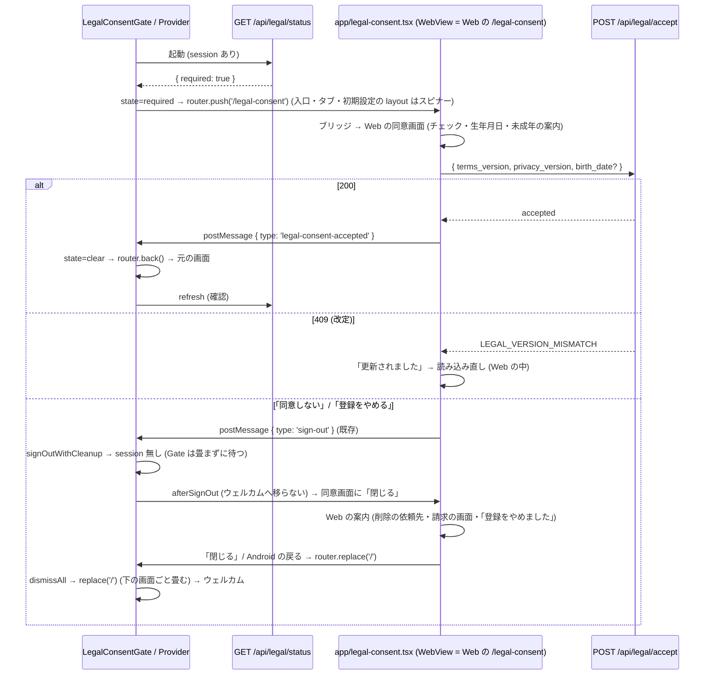

# 13b. 規約の同意ゲートをモバイルのネイティブの画面にも掛ける — 配線 (モバイル) (#1442)

> **13a (`13a-legal-consent-api-server.md`) は設計書も実装 (#1689・PR #1697) も main に着地済み。本冊は 13a の実コードを正として使う側。** 本冊が参照する 13a の公開名 (`@homegohan/shared` の関数・定数・型と `GET /api/legal/status` の応答。§0.4) が実コードと食い違ったら、実コードに合わせる。13a の設計書は本冊で変えない。食い違いに気付いた箇所は §6.22 に書く。

| 項目 | 値 |
|---|---|
| Status | 設計ゲート審査中 (v2.5) |
| Issue | #1442 (親: #1174 の同意ゲート。先例: #1154 の AI 同意の 403・#1030 / #1445 の凍結の API ゲート。前提: #1598 の WebView への一本化と PR #1733) |
| 分冊 | 本冊 = 配線 (段 B: モバイル + Web → ネイティブの合図 1 本)。核 (段 A: サーバー + `packages/shared`) は `13a-legal-consent-api-server.md` (着地済み) |
| 正典の関係 | 13a とともに `08-legal-compliance.md` §7.2 (同意ゲート) の配線を広げる冊。§7.2 の「モバイルのネイティブの画面は対象外」の記述は本冊のマージで現在形に直す (§6.19)。`cross/14-parental-consent.md` §0.5 が 13b に求める「生年月日の欄・未成年の案内」は、本冊では Web の同意画面をそのまま使うことで満たす (§6.19・§6.22) |
| 範囲の正本 | Issue #1442 の本文とコメント (コメントの記録: 運営の API も 403 で止める範囲に入れる・役割の例外を作らない) |
| 前提 (本冊が書かれた時点) | #1598 のコメント (2026-10-15) の記録「タブから行けないネイティブの画面は消して、WebView の画面に一本化します」と、PR #1733 (main `1c726fbb`。届かないネイティブの画面 60 本の削除) の後の main。file:line は origin/main `564c1c25` (2026-10-17。運営の MFA の段 D モバイル #1808 = `f5920c6a` が、本冊が直す `WebViewScreen.tsx`・`webViewAuthMessages.ts` を変えた後) で取った。`origin/design/legal-consent-mobile` の 13b (v1.1) は、#1598 と PR #1733 より前に書かれたので、消えた画面に依存する部分を落とし、残す部分の file:line を取り直した (§0.5) |
| 読み手 | 実装 (Sonnet 5.5) と敵対レビュー。実装は §6 だけを読んで手を止めずに書けることを完成条件にする |
| 節番号 | 分冊前の 13 と同じ番号を使う。本冊に無い節 (§3.3 以外の §3 の多く・§6.4・§6.6.1〜§6.6.7・§6.9・§6.13 など) は 13a にある。両冊にある節番号は、それぞれの冊に関わる行だけを持つ。両方に関わる行は 13a に置く |

---

## 0. 範囲・分冊判定・本書の読み方

### 0.1 一言でいうと

- モバイル: **1 枚のゲート (`LegalConsentGate`。ルートの layout に 1 つ)** が、サインイン中で「同意が要る」(`GET /api/legal/status` の `required`、または `/api` の 403 `LEGAL_CONSENT_REQUIRED`) なら、**同意画面の route (`app/legal-consent.tsx` = Web の `/legal-consent` を `WebViewScreen` で開く画面) をいまの画面の上に push する**。同意が済むと (Web の同意画面がネイティブへ `{ type: 'legal-consent-accepted' }` を送る) ゲートがその route を閉じ、元の画面にそのまま戻る (画面の入力も残る)。ログインの直後に着く 3 か所 (入口 `app/index.tsx`・タブ `app/(tabs)/_layout.tsx`・初期設定 `app/onboarding/_layout.tsx`) は、同意の状態が分かるまで・同意が要る間は中身を描かない (初期設定より先に同意)。ただし初期設定の layout は、このログインで中身を一度描いた後に同意が要るようになったときは中身を描いたままにし、同意の後に同じ画面へ入力が残ったまま戻す。「同意しない」「登録をやめる」でログアウトしたら、同意画面は Web の案内 (削除の依頼先・請求の画面) を出したまま残り、上に「閉じる」を出す。閉じると、ゲートが同意画面の下に残った画面ごと畳んでウェルカムへ戻す。同意を待つ間は、下に残ったハンズオンツアーの段が端末の戻るを受けない (ツアーを抜けない)。
- 同意画面そのもの (チェック 2 つ・全文へのリンク・同意しない・生年月日・未成年の案内・409 の読み込み直し) は **Web の `/legal-consent` が持つものをそのまま使う**。ネイティブに同意の画面を作らない。AI 同意の画面 (`app/settings/ai-consent.tsx` = Web の `/settings/ai-consent`) と同じ形。
- サーバー側 (`/api` の 403・`GET /api/legal/status`・shared の判定と文面) は 13a (着地済み)。本冊はそれを使う側。

### 0.2 分冊判定 (相 1)

| 目安 | 本冊 | 判定 |
|---|---|---|
| 設計書 800 行超 | 超える (表・トレース・正典コードを持つため) | トリガー |
| 消費先レーン 3 以上 | モバイル (apps/mobile) 1 つ + Web の合図 2 ファイル (`src/lib/native-auth-bridge.ts`・`src/app/legal-consent/LegalConsentForm.tsx`) | 2 |
| 共有面 2 つ以上 | `WebViewScreen.tsx` とそれが使う `useWebAuthMessages` (`webViewAuthMessages.ts`) (全 WebView の画面が通る 1 つの面。運営の MFA の確認 (#1808) も同じ面を通る。本冊はその配線を保つ。6.6.15)。`packages/shared` はコメントの現在形化だけ (`legal-consent-copy.ts`・`parental-consent.ts`。export・値は変えない。§6.19) | 1 |

**判定: 1 冊・2 段 (B1 = Web の合図 → B2 = モバイル)。** 核 (13a) と配線 (本冊) の分冊は済んでいる。本冊の中をさらに分けない理由: 本冊の契約は 13a の実コード (shared の export・status の形・403 の形) と、Web → ネイティブの合図 1 本だけで、冊をまたぐ契約が増えない。段 B1 (Web の 2 ファイル) を先に閉じるのは、旧版のアプリが知らない type のメッセージを捨てる (`src/lib/native-auth-bridge.ts:22`) ので、Web だけ先に出しても壊れないため。

### 0.3 一次情報 (origin/main `564c1c25`。行番号は 2026-10-17 時点)

`88b803f5` (本冊の v2.0〜v2.4 の基準) から `564c1c25` までに、本冊が触る・読むファイルのうち変わったのは次だけ (`git diff --name-only 88b803f5 564c1c25`)。(1) #1808 (運営の MFA の段 D モバイル。`f5920c6a`): `apps/mobile/src/components/web/WebViewScreen.tsx`・`apps/mobile/src/lib/webViewAuthMessages.ts` とそのテスト 2 本 (`WebViewScreen.auth-messages.test.tsx`・`web-view-auth-messages.test.ts`)、新しい `NativeMfaVerifyModal.tsx`・`MfaVerifyGate.tsx`・`operator-mfa.ts`・`mfa-gate.ts` とそのテスト、`docs/design/mobile/05-auth-session.md` §6。(2) 設計書の追随と現在形化 (#1810・#1811): `CLAUDE.md`・`docs/design/cross/13a-legal-consent-api-server.md`・`docs/design/mobile/01-architecture.md`・`05-auth-session.md` は 1 行の書き換えだけで行はずれない。`docs/design/cross/14-parental-consent.md` は 1222 行目の後に 2 行が入った (§6.19 の 14 の行のうち 1431・1779・1830 行目は取り直した)。`docs/design/mobile/03-push-notification.md` は書き直された (§6.19 の行を取り直した)。新しい番兵 `tests/design-doc-followup-owned-edits.test.ts` (§6.18)。ほかのファイルの行番号は `88b803f5` と同じ。

| 事実 | 場所 |
|---|---|
| ルートの `Stack` は `index`・`(public)`・`(auth)`・`(tabs)` を並べ、app 直下の画面 (`onboarding/*`・`handson-tour/*`・`health/blood-tests`・`profile/nutrition-targets`・`settings/*`) は自動で登録される。`screenLayout` は使っていない。Provider の順は `AuthProvider` > `ProfileProvider` > `PushTokenRegistrar` + `NotificationRouter` + `Stack` | `apps/mobile/app/_layout.tsx:92-108` |
| 入口: session あり & 初期設定未完了 → `/onboarding`、完了 → `/(tabs)/home`。auth と profile の読み込み中はスピナー。同意の確認は無い | `apps/mobile/app/index.tsx:13-22` |
| タブの layout: session 無し → `/`、読み込み中はスピナー、初期設定未完了 → `/onboarding/resume` か `/onboarding/welcome`。`settings` はタブバーに出さない画面。AI の FAB が全タブに出る | `apps/mobile/app/(tabs)/_layout.tsx:21-41, 110, 112` |
| `(auth)` の layout: session があれば `/(tabs)/home` へ (reset-password と verify だけは session があっても開ける) | `apps/mobile/app/(auth)/_layout.tsx:25-29` |
| ログインの後の振り分け `routeAfterSignIn`: profile を PostgREST で読み、`?next=` があればそこへ、無ければ初期設定の完了 → `/(tabs)/home`・開始済み → `/onboarding/resume`・未開始 → `/onboarding/welcome` へ `router.replace` (入口を通らない)。メールとパスワード (`:220`) と Google (`:124`) の両方 | `apps/mobile/app/(auth)/login.tsx:75-99` |
| サインアップはアプリの中でセッションを作らない (確認メールの Alert の後に `/(auth)/login` へ)。確認メールのリンクは `/auth/verify` で session を作り `/(tabs)/home` へ | `apps/mobile/app/(auth)/signup.tsx:100, 117-118`、`apps/mobile/app/(auth)/auth/verify.tsx:76-84` |
| 初期設定の layout: auth の読み込み中はスピナー、session 無し → `/login`、それ以外は `Stack` を描く (同意も profile も見ない)。振り分け: 完了 → home、開始済み → resume、未開始 → welcome | `apps/mobile/app/onboarding/_layout.tsx:15-24`、`apps/mobile/app/onboarding/index.tsx:17-25` |
| 初期設定の質問の画面は、答え (`answers`)・いまの質問 (`currentStep`)・戻る履歴 (`stepHistory`) を画面の state に持つ (答えはその都度 `user_profiles` にも PostgREST で保存)。最後の答えで `POST /api/onboarding/complete` が失敗すると、計算中の表示をやめて Alert を出し、最後の質問に戻る (入力欄は答えの先頭で空にしている)。完了の画面は計算の結果 (`targets`) を画面の state に持ち、保存の失敗は Alert | `apps/mobile/app/onboarding/questions.tsx:758-905, 911-951`、`apps/mobile/app/onboarding/complete/index.tsx:76-101, 123-180` |
| ハンズオンツアーの layout: 未ログインになると **effect の中で** `router.replace('/login')` (`Redirect` と違い、前面かどうかを見ない。前面の route を置き換える)。`GET /api/handson-tour/status` を取り、失敗したらツアーを出す | `apps/mobile/app/handson-tour/_layout.tsx:30-61` |
| ツアーの献立の段は RN の `<Modal>` を 2 つ常に開く (`V4GenerateModal` のサンドボックス = `visible={true}`、吹き出し `TourOverlay` を包む `<Modal visible={true}>`)。2.9 で Step 3 へ `router.push` (effect の依存は `[subStep]`)。Step 3 へ移った後も献立の段は Stack の下にマウントされたまま (`subStep` は 2.9 のまま)。サンドボックスの `POST /api/menu-plans/add` の失敗は握りつぶして先へ進む | `apps/mobile/app/handson-tour/menu.tsx:108-135, 199-233`、`apps/mobile/app/handson-tour/_layout.tsx:74-83`、`apps/mobile/src/components/menu/V4GenerateModal.tsx:267-293` |
| ツアーを抜ける `leaveTour`: skip の API の後に `router.replace('/home')` | `apps/mobile/src/handson-tour/useLeaveTour.ts:42-62` |
| ツアーの段の端末の戻る (Android): 吹き出しの `TourOverlay` は描かれている間ずっと `BackHandler` の受け手を張り、`onSkip` があれば呼んで true を返す (無ければ false)。写真・バッジの段は、吹き出しを出さない画面 (写真の保存の失敗・バッジの読み込み中と失敗) で `useTourHardBack` を張る。献立の段の吹き出しは RN の Modal の中で、Modal の `onRequestClose` も `handleHardBack`。どの段も `handleHardBack` = `leaveTour('hard_back')`。Stack の下に残った段の受け手も張られたまま | `apps/mobile/src/handson-tour/TourOverlay.tsx:66-80`、`apps/mobile/src/handson-tour/useLeaveTour.ts:69-82`、`apps/mobile/app/handson-tour/photo.tsx:328-338, 455-468`、`apps/mobile/app/handson-tour/badges.tsx:101-108, 162-182`、`apps/mobile/app/handson-tour/menu.tsx:137-141, 214-231` |
| RN の `BackHandler` は後から張った受け手から順に呼び、true を返したところで止める。react-navigation の戻る (`GO_BACK` を流す受け手) はナビゲーションのコンテナの mount で先に張られるので、画面が張った受け手が先に受ける。同意画面を上に push しても、下の段の受け手は外れない | `apps/mobile/__tests__/app/handson-tour-hard-back-step2-3.test.tsx:152-158` (`pressHardwareBack` が同じ順を再現する) |
| RN の `<Modal>` は push した route より上に出る (開いたままだと、push した同意画面を隠す)。app と src で `<Modal>` を描くのは `(tabs)/settings.tsx:453`・`AIAdvisorSheet.tsx:600`・`AIDayMenuModal.tsx:101`・`V4GenerateModal.tsx:287, 703` (`703` の通常版は main のどこからも使われない)・`handson-tour/menu.tsx:215`・`NativeMfaVerifyModal.tsx:67` (#1808。`WebViewScreen` が描く。下の運営の MFA の行) | `tests/ai-consent-mobile-modal-nesting.test.ts:1-35`、`git grep -n "<Modal\b" -- apps/mobile/app apps/mobile/src` |
| API クライアント: `withFriendlyErrors` は 429 と 503 だけを固定の文の例外に置き換え、403 はそのまま投げる | `apps/mobile/src/lib/api.ts:72-78` |
| 生の fetch の失敗の応答から Error を作る `errorOfFailedResponse` (同じ 2 つの判定)。`StoppedByServerError` の union と Alert の見出し | `apps/mobile/src/lib/failed-response.ts:26-35, 44-47` |
| AI 同意の 403 をアプリが見分ける形 (`HTTP 403 …: {json}`)。案内は `router.push('/settings/ai-consent')` | `apps/mobile/src/lib/ai-consent.ts:76-77, 86-97, 120` |
| Error の message から本文の文を取り出す `getApiErrorMessage` (平たい `{ error: '文' }` の文字列も読む) | `apps/mobile/src/lib/api-error.ts:38-68` |
| `WebViewScreen`: props は `path`・`testID`・`header` (WebView の上 (上端の安全領域の内側) に置くネイティブの部品)。外側の `WebViewScreen` は props を全部 `WebViewScreenBody` に渡す (`{...props}`)。認証ブリッジ (`POST /api/auth/native-bridge/code` → `/auth/native-bridge?code&next`) を自分で行い、`onMessage` は送り元が自オリジンのとき (`:342` の `isOwnOrigin`) だけ `tab-navigate`・`navigate-back`・`download` と、`sign-out`・`session-expired`・`mfa-verify-required` (`:379-387` の 1 つの分岐で `handleAuthMessage` に渡す) を処理する。注入スクリプトは `<a>` のクリックと `history.pushState` だけを捕まえる (`window.location.assign` による全体の読み込みでは `tab-navigate` を送らない) | `apps/mobile/src/components/web/WebViewScreen.tsx:38-44, 55-126, 142, 199-255, 328-391, 432-435` |
| Web からの `sign-out` / `session-expired` / `mfa-verify-required` の処理。`sign-out` は `signOutWithCleanup` → `deps.goToWelcome()`。`goToWelcome` は `useWebAuthMessages` の中で `router.replace('/')` に決まっていて、使う画面からは変えられない。`useWebAuthMessages(currentPath, options?)` の第 2 引数の型 `WebAuthMessagesOptions` は #1808 で入り、`onMfaVerifyRequested?` だけを持つ。`options` の最新の値は `optionsRef` に持ち、返す関数の identity は変えない。ログアウトは同時に 1 つだけ (`signOutInFlight`)。送り元の検査 `isFromWebOrigin` | `apps/mobile/src/lib/webViewAuthMessages.ts:56, 72-76, 85-99, 167-181, 218-238, 304-311, 322-358`、`apps/mobile/src/components/web/WebViewScreen.tsx:165-175` |
| 運営の MFA の確認 (#1808): Web が `mfa-verify-required` を送ると、`handleWebAuthMessage` は `deps.requestMfaVerify` があればそれを呼び (無ければ捨てる)、`WebViewScreen` は `useWebAuthMessages` の `options.onMfaVerifyRequested` で `mfaVerifyRequest` の state を立て、RN の `<Modal visible>` の `NativeMfaVerifyModal` を WebView の上に描く (どの `WebViewScreen` でも)。確認画面は `/api` を呼ばない (Supabase の auth を端末のセッションで直接)。「閉じる」と端末の戻る (`onRequestClose`) で閉じる。Web がこの合図を送るのは運営の MFA の確認画面 (`/settings/security/mfa/verify` の `NativeAppMfaNotice` kind=verify) だけで、この画面は Web の同意ゲートの対象外の一覧に無い (未同意なら middleware が先に `/legal-consent` へ回す) | `apps/mobile/src/lib/webViewAuthMessages.ts:284-290, 342-357`、`apps/mobile/src/components/web/WebViewScreen.tsx:172-175, 410-420`、`apps/mobile/src/components/NativeMfaVerifyModal.tsx:46-67, 82`、`apps/mobile/src/lib/operator-mfa.ts:23-35`、`apps/mobile/src/components/MfaVerifyGate.tsx:74, 100`、`src/components/auth/mfa/NativeAppMfaNotice.tsx:21-24`、`lib/legal-consent.ts:91-125`、`lib/supabase/middleware.ts:405-432` |
| Web → ネイティブのメッセージの型は `sign-out`・`session-expired`・`mfa-verify-required` の 3 つ。旧版のアプリは知らない type を捨てる。`postMessage` の送り方 `post()` | `src/lib/native-auth-bridge.ts:22, 33, 86-108, 126-132, 151-154` |
| Web の同意画面: 同意済みなら `next` へ redirect、生年月日の欄 (`needsBirthDate`)・保護者の同意の案内 (`guardianMissing`) を出す。同意が記録できたら `window.location.assign(next)`。「同意しない」は `notifyNativeSignOut()` (ネイティブへ `sign-out`) → `signOut()` を待つ → `broadcastSignOut()` → 案内の画面 (`phase === 'declined'`: 「ご利用を終了しました」・データの削除の依頼先 = お問い合わせ `/contact`・請求の画面 `/settings/data-requests`・ログイン `/login` へのリンク)。案内はネイティブへ `sign-out` を送った**後**に描かれる。「登録をやめる」は退会 → `signOutAfterAccountDeletion` (ネイティブへ `sign-out` を送る) → 「登録をやめました」(`/signup` へのリンク) | `src/app/legal-consent/page.tsx:41-79`、`src/app/legal-consent/LegalConsentForm.tsx:41, 126-171, 173-194, 198-214, 216-228, 280-325`、`src/lib/account-self-service.ts:18` |
| Web の画面の同意ゲートの対象外 (`/legal-consent` 自身・`/auth/*`・`/terms`・`/privacy` など)。`next` は `/api` と同意画面自身なら `/home` | `lib/legal-consent.ts:91-125, 210-216`、`lib/onboarding-routing.ts:67-70` |
| middleware の `/api` の分岐の同意の判定 (凍結 → メンテナンス → 同意) と、画面の判定 | `lib/supabase/middleware.ts:264-281, 405-425` |
| 通知のトークンの claim (`POST /api/push-tokens/claim`) は 13a の許可リストにある (`device_cleanup`)。登録そのものは PostgREST の upsert (middleware を通らない) | `packages/shared/src/legal-consent-api.ts:119-124`、`apps/mobile/src/lib/pushNotifications.ts:295-302, 324` |
| `AuthProvider` の公開値 (`isLoading`・`session`・`user`・`clearSession`)。`ProfileProvider` は `user_profiles` を PostgREST で直接読む | `apps/mobile/src/providers/AuthProvider.tsx:14-28`、`apps/mobile/src/providers/ProfileProvider.tsx:41-53` |
| 通知のタップの遷移は、ログインと今の利用者のプロフィールが分かってから `router.push` | `apps/mobile/src/components/NotificationRouter.tsx:90-107` |
| `SIGNED_OUT` の購読は `setSession(null)` を呼ぶだけで、掃除は待たない。Web からの `sign-out` は `signOutWithCleanup` の後に `goToWelcome` = `router.replace('/')` | `apps/mobile/src/providers/AuthProvider.tsx:240-259`、`apps/mobile/src/lib/webViewAuthMessages.ts:218-238, 352-354`、`apps/mobile/src/lib/signOut.ts:120-129` |
| expo-router 5.1.11 の `router.push` / `replace` / `back` / `dismissAll` は、その場で遷移しない。`routingQueue` に積み、`ImperativeApiEmitter` の effect (次の描画の後) で積んだ順に `dispatch` する。`router.back()` は `GO_BACK`、`dismiss()` は `POP`、`dismissAll()` は `POP_TO_TOP`、`replace` は `REPLACE`、`push` は `PUSH`。`Redirect` は `useFocusEffect` の中で `router.replace` を呼ぶ。`canDismiss()` は今の state の stack に 2 つ以上の route があるか | `node_modules/expo-router/build/global-state/routing.js` (`routingQueue`・`dismiss`・`dismissAll`・`goBack`・`canDismiss`)、`node_modules/expo-router/build/imperative-api.js` (`ImperativeApiEmitter`)、`node_modules/expo-router/build/link/Redirect.js` |
| `router.replace` の `REPLACE` の行き先: 積んだ時点の state で、行き先と今の前面の route を root から比べ、最初に食い違った navigator を `target` にする (`getNavigateAction`)。前面が同意画面で、行き先がそれと別の名前 (`(tabs)`・`onboarding`・`health/blood-tests` など) なら `target` は root の stack で、`source` は付けない。StackRouter の `REPLACE` は、`target` がその stack で `source` があれば `source` の route を、無ければ前面の route (`state.index`) を新しい route に置き換え、ほかの route (下の route) は残す (同じ名前の route が下にあっても重ねて作る)。expo-router の Stack の router は `REPLACE` をそのまま StackRouter に渡す | `node_modules/expo-router/build/global-state/routing.js:119-121, 209, 211-304`、`node_modules/@react-navigation/routers/lib/module/StackRouter.js:155-184` (7.5.3)、`node_modules/expo-router/build/layouts/StackClient.js:29-36, 204-205` |
| react-navigation の `beforeRemove` は `event.data.action` (取り除く操作の action。`type`・`payload`・`target` を持つ) と `event.target` (取り除かれる route の key) を渡し、`preventDefault()` で止められる。止めた action では navigator の state を変えない (`useOnAction` は `shouldPreventRemove` が true なら `setState` しない)。止めた後に、その画面の `navigation.dispatch` で別の action を流せる (その action の state の変化だけが入る) | `node_modules/@react-navigation/core/lib/typescript/src/types.d.ts` (`EventMapCore` の `beforeRemove`)、`node_modules/@react-navigation/core/lib/module/useOnPreventRemove.js:7-43`、`node_modules/@react-navigation/core/lib/module/useOnAction.js:37-60` (7.17.2) |
| expo-router 5.1.11 / @react-navigation/core 7.17.2 / @react-navigation/native 7.2.2 / native-stack 7.14.12 / @react-navigation/routers 7.5.3 | `package-lock.json` |

サーバー側の一次情報は 13a §0.3。

### 0.4 13a の実コードから使う公開名

| 名前 | 種別 | 場所 (origin/main) | 本冊で使う所 |
|---|---|---|---|
| `LEGAL_CONSENT_REQUIRED_MESSAGE`, `LEGAL_CONSENT_REQUIRED_STATUS`, `isLegalConsentRequiredBody` | shared の定数・関数 | `packages/shared/src/legal-consent-api.ts:39-42, 67-69` | 6.6.8 (403 の見分け) |
| `LEGAL_CONSENT_STATUS_API_PATH`, `isLegalConsentStatus`, `LegalConsentStatus` | shared の定数・関数・型 | `packages/shared/src/legal-consent-api.ts:32, 187-205, 253-268` | 6.6.9 (status の取得) |
| `GET /api/legal/status` の応答 (`required` = `enforced && !accepted`、`accepted` = `gaps` が空) | API | 13a §6.9、`packages/shared/src/legal-consent-api.ts:214-240` | 6.6.9 (ゲートは `required` だけを見る) |
| 403 `{ error, code: 'LEGAL_CONSENT_REQUIRED' }` | API の本文 | 13a §6.8、`lib/supabase/middleware.ts:272-280` | 6.6.8・6.6.14 |

本冊は `LEGAL_CONSENT_ACCEPT_API_PATH`・`LEGAL_CONSENT_COPY`・`legalConsentAgreeLabel` などの文面を**使わない** (同意の記録と文面は Web の同意画面が WebView の中で担う。§6.22 の 5)。

### 0.5 土台 (origin/design/legal-consent-mobile の 13b v1.1) から落としたもの・残したもの

| 土台の部分 | 扱い | 理由 |
|---|---|---|
| §3.3 の画面表 (ネイティブの健康・AI・レシピ・食材・買い物リスト・運営・組織・サポートの画面) | **落とす** (§3.3 を今の main の 29 画面 (`apps/mobile/app/` の `_layout.tsx` 以外の画面ファイル) で書き直す) | PR #1733 で消えた (今の main に無い) |
| ネイティブの同意画面 `LegalConsentScreen.tsx` (6.6.12) と、その文面 (`LEGAL_CONSENT_COPY` の利用)・`VERSION_MISMATCH_STATUS`・`httpStatusOfError` | **落とす** | #1598 の WebView への一本化。土台の画面には生年月日の欄・未成年の案内・「登録をやめる」(cross/14 が 13b に求めるもの) が無く、作ると Web の同意画面の写しになる (§5.2) |
| ルートの `Stack` の `screenLayout` に置くゲート (6.6.10・6.6.11) | **落とし、route を push するゲートに置き換える** (§5.2 の A'' と C'') | 画面の代わりに描くと、その画面の入力 (血液検査の入力など) が同意の後に消える。route なら元の画面がそのまま残る |
| `PushTokenRegistrar` を同意の後まで待たせる差分 (6.6.10 の一部) | **落とす** | claim は 13a の許可リストにある (`packages/shared/src/legal-consent-api.ts:119-124`)。登録は PostgREST で middleware を通らない |
| `MOBILE_LEGAL_CONSENT_EXEMPT_PATHS` の `/pricing` | **落とす** | `(public)/pricing` の画面は billing/01 §10.4 で消えた (今の `(public)` は about・privacy・terms の 3 本) |
| 403 の見分けと Provider への知らせ (6.6.8)・Provider の状態 (6.6.9)・`api.ts` / `failed-response.ts` の差分 (6.6.13)・対象外のパスの考え方・ENFORCE off と読めないときの決定 (§6.11)・テストの骨格 | **残す** (file:line を取り直し、名前を本冊の構造に合わせた) | 今の main と食い違わない |

---

## 1. 目的・スコープ

### 1.1 解決すること (Issue #1442 のうち本冊の分)

Issue の全体 (3 つの経路) は 13a §1.1。本冊が解決するのは次の 2 つ (3 の `/api/*` は 13a で解決済み)。

1. モバイルのネイティブの画面 (今の main では、初期設定・ハンズオンツアー・設定タブとそこから開く画面・AI 相談のシート。§3.3) は WebView を通らないので、未同意のまま使える。
2. 新規の人は、ネイティブの初期設定 (健康情報の入力) を同意より先に済ませられる。

13a の後、1 と 2 の画面が呼ぶ `/api` は 403 で止まる (初期設定の完了・ツアーの status・AI 相談など) が、画面そのものは開け、403 の文が各画面のエラーとして出るだけで同意画面へ辿り着けない。本冊はこれを「同意画面へ回す」に直す。

### 1.2 前提

- 13a §1.2 (本番は `LEGAL_CONSENT_ENFORCE=on`。ローンチ前で利用者はゼロ)。
- #1598 のコメント (2026-10-15) の記録「タブから行けないネイティブの画面は消して、WebView の画面に一本化します」。PR #1733 で、届かないネイティブの画面 60 本を消した。
- 配布 (#1115) の前なので、13b より前のビルドは利用者に届いていない (§6.21)。

### 1.3 対象外

13a §1.3 (規約の文面・同意の記録の仕組み・アプリの Supabase の直読み) に加えて、本冊に関わるもの:

- `LEGAL_CONSENT_NOTICE` (お知らせ) は Web の `(main)` の画面だけのまま。ネイティブにはお知らせを出さない (WebView のタブでは Web のお知らせが見える)。
- アプリ (Expo) のネイティブのサインアップ画面に同意のチェックを足すこと (`08` §7.2 の残課題のまま。本冊のゲートで、登録直後の起動時に同意画面へ回るので、使う前には必ず同意する)。
- 同意画面の中身 (チェック・生年月日・未成年の案内・「登録をやめる」・本人の権利の請求の案内) を変えること。Web の `/legal-consent` の責務 (cross/08・cross/14・cross/15)。
- アプリが Supabase (PostgREST) を直接読み書きする経路 (`apps/mobile/app/onboarding/questions.tsx:905` の `user_profiles` の upsert・`apps/mobile/src/lib/pushNotifications.ts:295` の `user_push_tokens` の upsert・`ProfileProvider` の select) は、Next の middleware を通らないので本冊のゲートの外 (13a §6.13 の限界・§8 Q-2)。
- 強制アップデート (`/api/app/version-check`。mobile/01 §8) は main に route が無く、本冊でも作らない (§6.21)。

---

## 2. 関連要件

- `docs/design/cross/08-legal-compliance.md` §7.2 (再同意フロー)。
- `docs/design/cross/13a-legal-consent-api-server.md` (核。shared の export・status の応答・403 の形)。
- `docs/design/cross/14-parental-consent.md` §0.5 (13a / 13b との契約: `gaps` の `'birth_date'` / `'guardian_consent'`。本冊は Web の同意画面で満たす)。
- `docs/design/mobile/01-architecture.md` §3.2 (WebView ハイブリッド・`WebViewScreen` の役割)・§6 (ファイル構成)。
- `docs/design/mobile/05-auth-session.md` §6 (WebView とネイティブのログアウト・セッション失効の同期。`sign-out` / `session-expired` の合図)。

---

## 3. 相 1 外形固定: 要件行列・ユーザーシナリオ・現行の画面

### 3.1 要件行列 (本冊の行)

| ID | 要件 | 出どころ | 検証 (§6.14 の it) |
|---|---|---|---|
| R-6 | モバイルは、ログイン後、初期設定より先に同意の状態を確かめ、未同意なら同意画面へ回す | Issue 本文「起動時・初期設定の前に同意の状態を確かめて同意画面へ回す」 | T-G1, T-IDX1, T-TL1, T-OB1, T-ML6, T-ML11, T-SC2, T-P1, T-P7 |
| R-7 | 今の main のネイティブの画面と起動の流れを実コードで列挙し、同意の前に使えてしまう経路を表にする。WebView の中の画面は Web の同意ゲートが受け持つ | Issue 本文 | §3.3 |
| R-12 | 同意画面は Web の `/legal-consent` を WebView で開き、Web と同じ要件 (必須チェック 2 つ・全文へのリンク・同意しない = ログアウト + 削除の依頼先の案内・生年月日・未成年の案内) をそのまま使う。ネイティブに同意の画面を作らない。アプリでも「同意しない」「登録をやめる」の後の Web の案内 (削除の依頼先・請求の画面) が見える | #1598 のコメントの記録 (WebView への一本化)・cross/14 §0.5・cross/08 §7.2 (同意画面の行) | T-SC1, T-SC3, T-ML6, T-ML10, T-G7, T-WV2, T-W2, E2E (既存の `legal-consent-gate.spec.ts`) |
| R-15 | ネイティブの側が `/api` を呼んで 403 `LEGAL_CONSENT_REQUIRED` を受けたら、どの画面からでも同意画面へ回し、同意が済んだら元の画面に戻る (画面の入力を失わない。タブの区画は §8 Q-6) | Issue 本文「API の 403 の専用コード」 | T-API1, T-FR1, T-P3, T-P8, T-P9, T-G1, T-G3, T-TL1, T-OB1, T-ML9, T-ML11, T-TM1, T-TM2, T-TM3, T-TP1, T-TB1 |
| R-16 | 同意が済んだことをネイティブが知る合図は Web の同意画面が送る (`legal-consent-accepted`)。旧版のアプリはこの合図を捨てても壊れない | `src/lib/native-auth-bridge.ts:22` の既存の規則 | T-W1, T-W3, T-WV1, T-P4 |
| R-17 | 配布 (#1115) の前の旧版のアプリの扱い (旧版も `/api` の 403 で止まる) を書く | Issue 本文「どこまで止めるか…設計で決める」と 13a の着地 | §6.21 |
| R-18 | 13a の設計書・実コード (`packages/shared`・middleware・status route) を変えない。食い違いは本冊で指摘する | 本冊の前提 | §6.22 |

R-1〜R-5・R-14 (サーバー) と、両方に関わる R-8〜R-11・R-13 は 13a §3.1。

### 3.2 ユーザーシナリオ (20 本)

サーバーだけで結果が決まる S6・S7・S10・S11・S14・S16・S17 と、両方に関わる S5・S8・S9・S15 は 13a §3.2 (S5・S8・S9 のモバイル側の走らせ方は本冊 §4.2 に重ねて書く)。

| ID | シナリオ |
|---|---|
| S1 | 新規登録 (アプリのネイティブのサインアップ) → 確認メール → ログイン (メールとパスワード、または確認メールのリンク) → 初期設定の前に同意画面 (WebView) → 同意 → 初期設定へ |
| S2 | 既存の利用者 (同意済み) がアプリを起動 → 今までどおりホーム (余計な画面は出ない) |
| S3 | 既存の利用者 (未同意・ENFORCE=on) がアプリを起動 → 同意画面 → 同意 → 元の入口 (ホーム) |
| S4 | アプリの同意画面で「同意しない」→ Web がログアウトし、ネイティブもログアウト → 同意画面に Web の案内 (「ご利用を終了しました」・削除の依頼先 = お問い合わせ・請求の画面) が出たまま、上に「閉じる」が出る → 「閉じる」→ ウェルカム画面 |
| S5 (モバイル側) | 規約の改定の後、血液検査の画面で入力の途中に保存 → `/api` が 403 → 同意画面がその上に開く → 同意 → 同じ画面に入力が残ったまま戻る → もう一度保存 |
| S12 | 未同意のセッションが残る端末で、パスワード再設定のリンクを開く → `/auth/reset-password` はゲートの対象外 → 再設定できる → ログアウトしてログイン画面へ (既存の流れ。起動の直後に開いた同意画面が下に残っていたときはウェルカムへ) → ログイン後に同意画面 |
| S13 | 同意画面 (WebView) を開いたまま改定 → Web の同意画面が 409 を受けて「更新されました」と読み込み直しを促す → 読み込み直して新しい版で同意 |
| S18 | 機内モードでアプリを起動 (保存済みのセッション) → status を取れず `unknown` → 画面は開く (通信できない案内は今までどおり) → 通信が戻った最初の API 呼び出しが 403 なら同意画面 |
| S19 | 生年月日がプロフィールに無い人 (cross/14。`gaps` に `'birth_date'`) がアプリを起動 → `required` → 同意画面 (WebView) に生年月日の欄が出る → 入力して同意 → 元の画面へ |
| S20 | 18 歳未満の本人が自分で登録 → 同意画面で生年月日を入れる → Web が 403 `LEGAL_MINOR_SELF_SIGNUP_REFUSED` → 案内 →「登録をやめる」→ 退会 → Web がネイティブへ `sign-out` → 同意画面に「登録をやめました」が出たまま「閉じる」→ ウェルカム画面 |
| S21 | 未同意の人が通知をタップしてアプリを開く → 同意画面が先 → 同意 → 通知の行き先 (血液検査の画面) へ |
| S22 | 13b より前のビルド (配布前の開発機) で、未同意の人が初期設定の完了を押す → `/api/onboarding/complete` が 403 → 画面に固定の文「利用規約・プライバシーポリシーへの同意が必要です…」が出る → ホームのタブ (WebView) を開くと Web の同意画面 → 同意すると以後の API が通る (§6.21) |
| S23 | 未同意の人が deep link で `homegohan://health/blood-tests` を開く → 画面が 1 往復ぶん見えてから同意画面が上に開く (その間の API は 403) → 同意 → 血液検査の画面 |
| S24 | `LEGAL_CONSENT_ENFORCE` が off → status は `required: false` → 同意画面は出ない (13a の S8 と同じ) |
| S25 | ハンズオンツアーの途中で改定 → 次の API (写真の保存) が 403 → 同意画面がツアーの上に開く (Android の戻るボタンを押してもツアーを抜けない) → 同意 → ツアーの同じ段に戻る |
| S26 | ハンズオンツアーの献立の段 (RN の Modal を出している段) で改定 → 献立の追加 (サンドボックス) の API が 403 → 段の Modal が閉じ、同意画面が見える → 同意 → Modal が戻り、ツアーの続き (Step 3) へ |
| S27 | タブの AI の FAB から AI 相談のシート (RN の Modal) を開いたまま改定 → 送信の API が 403 → シートが閉じ (タブの layout がスピナーになり FAB ごと外れる)、同意画面が見える → 同意 → タブ (ホーム) に戻る。シートは閉じたまま (もう一度 FAB から開く) |
| S28 | 初期設定の途中で同意が要るようになる (S18 の `unknown` のまま初期設定へ進んだ・初期設定の途中で改定が入った) → 最後の質問に答えると `POST /api/onboarding/complete` が 403 → 初期設定の画面の上に同意画面が開く (初期設定の画面は外れない) → 同意 → 同じ質問の画面に、それまでの答えが残ったまま戻る → 最後の質問にもう一度答えて完了 |
| S29 | ハンズオンツアーの卒業の段 (献立の段・バッジの段は Stack の下に残っている) で改定 → 完了の API が 403 → 同意画面が上に開く (下の献立の段の Modal は開き直さず、Step 3 も積み直さない。Android の戻るボタンを押してもツアーを抜けない) → 同意 → 卒業の段のエラーの画面に戻る →「もう一度」で完了 |
| S30 | 初期設定を済ませた未同意の人 (改定の後) が、ログアウトの後にアプリでログインし直す → ホームのタブの上に同意画面 (ログインの後の振り分けがホームへの置き換えを同意画面の後に流しても、同意画面は前面に残る) → 同意 → ホーム (Stack はタブ 1 つ。Android の戻るボタンでアプリを閉じられる) |

### 3.3 今の main に残るネイティブの画面と起動の流れ (実コードで列挙。R-7)

`apps/mobile/app/` の画面ファイル全部 (origin/main `564c1c25`。`_layout.tsx` は区画の行に畳む)。種別の WebView = `WebViewScreen` を使う (Web の同意ゲートが WebView の中で効く)。公開 = `PublicPage` (本文は Web 版へのリンク)。**「同意の前」= 今の main で、未同意のまま使えるか (API を呼ぶなら 13a の 403 で止まるが、画面は開ける)。「本冊」= 本冊のゲートの扱い (対象 = `required` なら同意画面を上に開く)。**

| 区画 | 画面ファイル (`apps/mobile/app/`) | パス | 種別 | 呼ぶ `/api` (file:line) | 同意の前 | 本冊 |
|---|---|---|---|---|---|---|
| 入口 | `index.tsx` | `/` | ネイティブ (ウェルカム / 振り分け) | 無し (`index.tsx:13-22`) | 開ける。session があれば `/onboarding` か `/(tabs)/home` へ回す | 対象。同意の状態が分かるまで振り分けない (6.6.13) |
| (auth) | `(auth)/login.tsx`, `(auth)/signup.tsx` | `/login`, `/signup` | ネイティブ | 無し (Supabase の auth を直接。`login.tsx:106, 163`・`signup.tsx:39, 100`) | 開ける (未ログイン)。ログイン後は `login.tsx:88-99` が `?next=` / `/(tabs)/home` / `/onboarding/resume` / `/onboarding/welcome` へ直接回す (入口を通らない) | 対象外 (未ログインの画面。session があれば `(auth)/_layout.tsx:29` がホームへ回す)。回った先のタブと初期設定の layout が同意の状態を待つ (6.6.13)。`?next=` で app 直下の画面へ回ったときは §8 Q-4 |
| (auth) | `(auth)/auth/forgot-password.tsx`, `reset-password.tsx`, `verify.tsx` | `/auth/forgot-password`, `/auth/reset-password`, `/auth/verify` | ネイティブ | 無し (`reset-password.tsx:90-96` は updateUser → `signOutWithCleanup` → `/login`。`verify.tsx:84` は session ができたら home へ) | 開ける (認証の途中) | 対象外 (Web の `/auth/*` と同じ理由) |
| (public) | `(public)/about.tsx`, `privacy.tsx`, `terms.tsx` | `/about`, `/privacy`, `/terms` | 公開 (PublicPage) | 無し | 開ける | 対象外 (同意の根拠になる文面と公開の案内。Web の `/terms` `/privacy` と同じ理由) |
| (tabs) | `(tabs)/home.tsx`, `menus.tsx`, `meals.tsx`, `comparison.tsx`, `profile.tsx` | `/home`, `/menus`, `/meals`, `/comparison`, `/profile` | WebView (`/home`・`/menus/weekly`・`/meals/new`・`/comparison`・`/profile`) | WebView の中の API は Web のゲートが受け持つ | 開ける。WebView の中で Web の同意ゲートが `/legal-consent` へ回す (Web の同意画面がタブの中に出る) | 対象。`required` の間はタブを描かない (6.6.13)。同意の後に描き直す |
| (tabs) | `(tabs)/settings.tsx` (タブバーに出さない。`(tabs)/profile.tsx:33` の歯車から開く) | `/settings` | ネイティブ (設定) | `GET`/`PATCH /api/notification-preferences` (`settings.tsx:81, 124`)、`GET /api/account/export` (`:165`。許可リスト)、`GET /api/export/meals` (`:210`) | 開ける (ホームのタブで同意画面に回された後でも、歯車はマイページのタブの上なので、同意の前には届かない) | 対象 |
| 設定から開く | `health/blood-tests.tsx` (`settings.tsx:331`) | `/health/blood-tests` | ネイティブ | `GET /api/health/blood-tests` (`:223-225`)、`POST /api/ai/analyze-health-checkup` (`:274-275`)、`POST /api/health/blood-tests` (`:358-360`) | 通知の行き先 (`notificationRoute.ts:39`) と deep link からは、同意の前でも開ける | 対象 |
| 設定から開く | `profile/nutrition-targets.tsx` (`settings.tsx:339`) | `/profile/nutrition-targets` | ネイティブ | `POST /api/nutrition-targets/calculate` (`:107-108`) | 設定からだけ | 対象 |
| 設定から開く | `settings/account.tsx` (`settings.tsx:436`) | `/settings/account` | ネイティブ | `POST /api/account/delete` (`:66`。許可リスト) | 設定からだけ | 対象 (退会の API は未同意でも通る。画面自体は同意の後) |
| 設定から開く | `settings/ai-consent.tsx` (`settings.tsx:374`・`ai-consent.ts:120`) | `/settings/ai-consent` | WebView (`/settings/ai-consent`) | WebView の中 | 設定からと、AI の 403 の案内から | 対象 |
| 初期設定 | `onboarding/index.tsx`, `welcome.tsx`, `questions.tsx`, `resume.tsx`, `complete/index.tsx` | `/onboarding`, `/onboarding/welcome`, `/onboarding/questions`, `/onboarding/resume`, `/onboarding/complete` | ネイティブ | `POST /api/onboarding/complete` (`welcome.tsx:20-21`、`questions.tsx:943-944`)、`POST /api/nutrition-targets/calculate`・`PUT /api/nutrition/targets` (`complete/index.tsx:127-140`)。`questions.tsx:905` は `user_profiles` を PostgREST で upsert (ゲートの外。§1.3) | **開ける。Issue の 2 の経路** (入口が同意を見ずに `/onboarding` へ回す。ログインの `routeAfterSignIn` は入口を通らずに `/onboarding/welcome` か `/onboarding/resume` へ直接回す) | 対象 (R-6: 入口と初期設定の layout が同意の状態を待ち、`required` なら同意画面が先)。初期設定の layout は、このログインで `Stack` を一度描いた後に `required` になったときは `Stack` を描いたままにし、同意画面をその上に開く (質問の途中の答え・計算の結果を残す。6.6.13・S28) |
| ツアー | `handson-tour/index.tsx`, `photo.tsx`, `menu.tsx`, `badges.tsx`, `graduate.tsx` | `/handson-tour`, `/handson-tour/photo`, `/handson-tour/menu`, `/handson-tour/badges`, `/handson-tour/graduate` | ネイティブ | layout: `GET /api/handson-tour/status` (`_layout.tsx:43-44`)。`POST /api/handson-tour/skip` (`index.tsx:114`、`src/handson-tour/useLeaveTour.ts:57`)、`POST /api/meal-plans/add-from-photo` (`photo.tsx:282`)、`POST /api/menu-plans/add` (`menu.tsx` が描く `src/components/menu/V4GenerateModal.tsx:272-273`)、`GET /api/badges` (`badges.tsx:69`)、`POST /api/handson-tour/complete` (`graduate.tsx:88, 198-199`) | 開ける (初期設定の完了 `complete/index.tsx:374` と、設定の「ツアーをもう一度」`settings.tsx:392` から) | 対象 (Web は `/handson-tour` の画面を対象外にするが、ネイティブは同意画面をツアーの上に開き、同意の後に同じ段へ戻るので流れが切れない)。同意を待つ間は、写真・献立・バッジの段 (Stack の下に残った段も) が端末の戻るを受けない (`TourOverlay` の `onSkip`・`useTourHardBack`・献立の段の Modal の `onRequestClose` を外す。戻るは同意画面が受ける。6.6.17)。献立の段 (`menu.tsx`) は RN の Modal を常に開くので、待ちがこの段が前面の間に始まったときだけ Modal を閉じ、待つ間は Step 3 へ進まない。Step 3 への push は 1 回だけ (6.6.17・S26・S29) |
| 部品 (全タブ) | `src/components/ai/AIFloatingFab.tsx` → `AIAdvisorSheet.tsx` → `AIDayMenuModal.tsx` | (タブの上) | ネイティブのシート | `/api/ai/consultation/...` (`AIAdvisorSheet.tsx:196-308, 426-430`。生の fetch は `:331, 446`)、`POST /api/ai/menu/v4/generate` (`src/hooks/useV4MenuGeneration.ts:86-87`) | タブが描かれていれば開ける | 対象 (`required` の間はタブを描かないので FAB も出ない。FAB は `(tabs)/_layout.tsx:112` が `Tabs` の隣に描くので、シートを開いたままの 403 でもタブの layout のスピナーでシートの RN の Modal ごと外れ、同意画面が上に開く。S27) |
| 起動時の処理 | `app/_layout.tsx:38-57` の `PushTokenRegistrar`、`src/components/NotificationRouter.tsx` | — | — | claim `POST /api/push-tokens/claim` (`pushNotifications.ts:324`。許可リスト)、失敗の報告 `POST /api/log` (`:150-151`。許可リスト) | 同意の前でも通る (許可リスト) | 変えない (claim)。通知の行き先への遷移は同意の後に延ばす (6.6.13) |

RN の `<Modal>` (push した同意画面より上に出る。§0.3) を描く所の扱い: `(tabs)/settings.tsx` のログアウトの確認・`AIAdvisorSheet` と `AIDayMenuModal` (タブの AI の FAB から) は、どれもタブの中なので、`required` の間タブの layout がスピナーになると一緒に外れる (6.6.13)。`V4GenerateModal` の通常版は使われていない。残る `handson-tour/menu.tsx` の 2 つ (常に開く) は、献立の段が前面の間に同意の待ちが始まったときだけ、待ちが明けるまで閉じる (6.6.17)。献立の段が Step 3 以降の段の下に残っている間に始まった待ちでは閉じない (閉じると、待ちが明けたときに背面の Modal が開き直して前面の段を覆う。S29)。

`WebViewScreen` が描く運営の MFA の確認画面 `NativeMfaVerifyModal` (#1808。RN の `<Modal visible>`。Web から `mfa-verify-required` が届いた後だけ描く。§0.3) は変えない。理由: (1) Web がこの合図を送るのは運営の MFA の確認画面 (`/settings/security/mfa/verify`) だけで、この画面は Web の同意ゲートの対象 (`lib/legal-consent.ts:91-125` の対象外に無い)。サーバーが未同意と見ている間は、どの WebView (同意画面の route を含む) でも middleware が先に `/legal-consent` へ回すので、確認画面は開かない。(2) 開いた後に `required` になったとき (確認画面は `/api` を呼ばないので、ほかの部品の `/api` の 403 か status の取り直しによる): タブの WebView の上なら、タブの layout のスピナーで一緒に外れる (AI のシートと同じ。6.6.13)。タブでない WebView の画面 (`settings/ai-consent.tsx`) の上では残り、push した同意画面を隠すが、確認画面は「閉じる」(`NativeMfaVerifyModal.tsx:82`) と端末の戻る (`onRequestClose`。`:67`) で閉じられ、閉じると下に同意画面が見える (待ちの間に閉じ込めない。閉じても WebView は開き直さない)。(3) 同意画面の route の `WebViewScreen` にも、今までどおり `onMfaVerifyRequested` を渡す (6.6.15。同意画面だけ MFA の配線を外す分岐を作らない)。

対象外のパスの一覧 (`MOBILE_LEGAL_CONSENT_EXEMPT_PATHS`。§6.7) は、この表の「対象外」の行 = `(auth)` と `(public)` の画面と、同意画面そのもの (`/legal-consent`) に一致する。一致はテスト T-ML3 が `apps/mobile/app/(auth)` と `(public)` のファイル名から確かめる。

PR #1733 で消えた画面 (運営・組織・サポートの区画、AI 相談の全画面、健康の記録、レシピ、食材、買い物リスト、お気に入り、食事の詳細、週の献立のネイティブ版など 60 本) は、この表に無い。土台の 13b (v1.1) の §3.3 はこれらを対象の行として持っていた (§0.5)。

---

## 4. 相 2 構想とトレース

### 4.1 構造

```
モバイル (段 B2)
  apps/mobile/src/lib/legal-consent.ts                 ← 403 の見分け・LegalConsentRequiredError・合図 (required / accepted) の購読・対象外のパス・同意画面と入口のパスとメッセージの type・状態の型と利用者ごとの記録の純粋な関数・同意画面の扱い (同意を待つ / ログアウトの後の案内 / それ以外) と取り除く操作の決定・Modal を閉じる間と初期設定の layout が待つ間の判定
  apps/mobile/src/providers/LegalConsentProvider.tsx   ← GET /api/legal/status を user ごとに取り、利用者ごとの記録から state (loading / clear / required / unknown) を描画のその場で決める。合図で state を動かす。待つ間と Modal を閉じる間のフック (ツアーの段が使う)
  apps/mobile/src/components/legal/LegalConsentGate.tsx ← ルートの layout に 1 つ。required なら同意画面の route を push、済んだら閉じる。同意を待っていた同意画面の上でログアウトしたら畳まずに待ち、同意画面が入口へ移った後に下に残った画面ごと畳む (描くものは無い)
  apps/mobile/app/legal-consent.tsx                    ← 同意画面の route = WebViewScreen path="/legal-consent"。同意が要る間は「戻る」の操作 (GO_BACK / POP / POP_TO_TOP) で閉じない。自分を置き換える REPLACE (ログインの直後の routeAfterSignIn など) は、同じ置き換えを自分のすぐ下の route に向け直す (自分は前面に残る)。ログアウトの後はウェルカムへ移らず Web の案内を残し、上に「閉じる」を出す
  apps/mobile/app/_layout.tsx                          ← Provider と Gate を置く。legal-consent の Stack.Screen (gestureEnabled: false)
  apps/mobile/app/index.tsx, app/(tabs)/_layout.tsx, app/onboarding/_layout.tsx ← 同意の状態が分かる (clear / unknown) まで・required の間は中身を描かない (ログインの直後に着く 3 か所)。初期設定の layout は、このログインで一度描いた後は required でも描いたまま
  apps/mobile/src/components/NotificationRouter.tsx    ← 同意の状態が分かるまで・required の間・同意画面と入口 ('/') にいる間は通知の行き先へ移らない
  apps/mobile/app/handson-tour/menu.tsx, photo.tsx, badges.tsx ← 同意を待つ間は端末の戻るを受けない。献立の段は、待ちが前面の間に始まったときだけ RN の Modal 2 つを閉じ、待つ間は Step 3 へ進まない (push は 1 回だけ)
  apps/mobile/src/lib/api.ts, failed-response.ts       ← 403 LEGAL_CONSENT_REQUIRED → Provider へ知らせ + 固定の文の例外
  apps/mobile/src/components/web/WebViewScreen.tsx     ← onMessage に legal-consent-accepted の分岐 1 つ。props に afterSignOut (Web からのログアウトの後の移り先を、使う画面が決める)。useWebAuthMessages へは onMfaVerifyRequested (#1808) と並べて渡す
  apps/mobile/src/lib/webViewAuthMessages.ts           ← 既存の WebAuthMessagesOptions (#1808) に afterSignOut を足し、goToWelcome がそれを呼ぶ (渡さなければ今までどおりウェルカムへ)
Web (段 B1)
  src/lib/native-auth-bridge.ts                         ← notifyNativeLegalConsentAccepted (type: 'legal-consent-accepted')
  src/app/legal-consent/LegalConsentForm.tsx            ← 同意を記録できたら、next へ移る前にネイティブへ知らせる
```

判定の規則 (13a §4.1 の「モバイルの判定」をそのまま使う): **`session && !exempt(pathname) && state === 'required'` → 同意画面を上に開く**。`required` は `GET /api/legal/status` (サーバーが `enforced && !accepted` を計算) か、`/api` の 403 `LEGAL_CONSENT_REQUIRED` で決まる。モバイルはフラグも版も読まない。

同意画面の route を「上に開く」理由 (画面の代わりに描かない・ルートの外に重ねない): 元の画面のコンポーネントが残るので入力が消えない (R-15)。だから中身を描かずに待つのは、まだ一度も描いていない layout (ログインの直後・起動の直後) と、描くと WebView の中で Web の同意画面が別に開くタブの layout だけにする (§8 Q-6)。ただし RN の `<Modal>` は push した route より上に出るので、Modal を開いたままの画面は、前面の間に同意の待ちが始まったら Modal を閉じる (§3.3 の Modal の段落)。同じく、下に残った画面が張った端末の戻るの受け手は同意画面より先に受けるので、同意を待つ間は受け手を外す (§0.3・6.6.17)。`WebViewScreen` は `useNavigation` / `useLocalSearchParams` / `useRouter` を使うので、ナビゲーターの中 (route) に置く必要がある。AI 同意の画面を `router.push('/settings/ai-consent')` で開く既存の形 (`ai-consent.ts:120`) と同じ。

### 4.2 トレース (全シナリオを構造で手で走らせる)

| ID | 走らせた結果 |
|---|---|
| S1 | サインアップ (`signup.tsx:100`) → 確認メールの Alert → `/(auth)/login` (`:117-118`。アプリの中ではセッションを作らない) → 経路は 2 つ。(A) 確認メールのリンク → `/auth/verify` (対象外) → session → `verify.tsx:84` の `Redirect` で `/(tabs)/home`。(B) ログイン (`login.tsx:163`) → SIGNED_IN → session → `(auth)/_layout.tsx:29` の `Redirect` で `/(tabs)/home`、続いて `routeAfterSignIn` (`login.tsx:75-99`) が profile を読み、初期設定が未開始なので `router.replace('/onboarding/welcome')`。どちらも、user が入った描画から同意の状態は `loading` (記録が今の利用者のものでない。6.6.9) → タブの layout も初期設定の layout (このログインでまだ `Stack` を描いていない) も (6.6.13) スピナーで中身を描かない → `LegalConsentProvider` が `GET /api/legal/status` (許可リスト → 200) → 行が無いので `accepted: false`、本番は `enforced: true` → `required: true` → state `required` → `LegalConsentGate` が前面の pathname (`/home` か `/onboarding/welcome`。どちらも対象) の上に `router.push('/legal-consent')`。(B) で `routeAfterSignIn` の `replace('/onboarding/welcome')` が push の後に流れたとき (`routeAfterSignIn` の getUser と profile の 2 往復は status の 1 往復と同じ頃に終わるので、ふつうに起きる): その `REPLACE` は積んだ時点の前面 (同意画面) と行き先の名前が root で食い違うので target が root の stack・`source` 無し (§0.3) で、前面の同意画面を置き換えようとする → 同意画面の `beforeRemove` (扱いは `awaiting-consent`。下にタブの route がある) が止め (`replace-below`。6.6.8)、同じ `payload` の `REPLACE` を `source` = 同意画面のすぐ下の route (タブ) で dispatch し直す (6.6.11) → Stack は [初期設定, 同意画面] (同意画面は前面のまま。pathname は `/legal-consent` のままなので Gate は何もしない。初期設定の layout は同意画面の下で新しく mount され、このログインでまだ `Stack` を描いていないので `required` の間スピナー)。`replace` が push より先に流れたときは [タブ] → [初期設定] → Gate が push して [初期設定, 同意画面]。どちらの順でも同意画面は 1 枚、その下は行き先の route 1 つだけ → `app/legal-consent.tsx` = `WebViewScreen path="/legal-consent"` → ブリッジ (`/api/auth/native-bridge/code` は許可リスト、`/auth/native-bridge` は画面の判定の対象外) → Web の `/legal-consent` (画面の判定の対象外。`page.tsx` が profile を読み、未同意なので form を出す) → チェック 2 つ → `POST /api/legal/accept` (許可リスト → 200) → form が `notifyNativeLegalConsentAccepted()` → `window.location.assign('/home')` → ネイティブ: `WebViewScreen.onMessage` (送り元は自オリジン) → `notifyLegalConsentAccepted()` → Provider が state を `clear` にして `refresh()` → Gate: pathname `/legal-consent` で `required` でないので `router.back()` → (A) タブの layout が `clear` で描き、`profile.onboardingCompletedAt` 無しなので `(tabs)/_layout.tsx:35-41` が `/onboarding/welcome` へ。(B) Stack は [初期設定] (下にタブは残らない。今の main と同じ形) → 初期設定の layout が `clear` で `Stack` を描き、welcome → 初期設定 (`POST /api/onboarding/complete` は同意済みなので通る)。初期設定の画面は同意の前に一度も描かれない (R-6) |
| S2 | 起動 → `index.tsx` は auth / profile / 同意の状態の読み込み中スピナー → status 200 `required: false` → `clear` → `/(tabs)/home` → `(tabs)/_layout` が描く。同意画面は出ない。status の 1 往復は ProfileProvider の読み取りと並行なので、起動が目に見えて遅くならない |
| S3 | 起動 → `index.tsx` スピナー → `required` → `index.tsx` はスピナーのまま (振り分けない) → Gate が `/` の上に同意画面を push → 同意 → `accepted` の合図 → `clear` → Gate が `back()` → `index.tsx` が `/(tabs)/home` へ |
| S4 | 同意画面 (WebView) の「同意しない」→ Web が `clearUserScopedLocalStorage()` → `notifyNativeSignOut()` → `signOut()` を待つ → `broadcastSignOut()` → `setPhase('declined')` (`LegalConsentForm.tsx:173-190`) で、同意画面の WebView に「ご利用を終了しました」・データの削除の依頼先 (お問い合わせ `/contact`)・請求の画面 (`/settings/data-requests`)・ログインへのリンクを描く (`:280-325`) → ネイティブ: `useWebAuthMessages` が `sign-out` を受けて `performNativeSignOut` → `signOutWithCleanup` の最後の `supabase.auth.signOut()` → SIGNED_OUT → `AuthProvider` が `setSession(null)` → session null の描画: Provider の state は `clear` (user 無し)。同意画面の route はサインイン中に `required` を見ていた (`legalConsentScreenSawRequired`) ので扱いが `signed-out-notice` になり (6.6.8)、`WebViewScreen` の `header` に「閉じる」(testID `legal-consent-close`) を出す (WebView は作り直さないので Web の案内はそのまま)。Gate: session 無し・同意画面が前面・`openedRef` (同意画面が前面で `required` のときに立てた) なので何もしない (畳まない。6.6.10) → `performNativeSignOut` が呼ぶ `goToWelcome` (`useWebAuthMessages` が作る) が、ウェルカムへ移る代わりに同意画面が渡した `options.afterSignOut` を呼ぶ (6.6.15) → `supabase.auth.getSession()` が null なので移らない (ウェルカムへの `replace('/')` をしない) → 利用者は案内を読み、リンクを WebView の中で開ける (§8 Q-9)。この間に下の画面のコードが別の画面へ移そうとしても (ツアーが下にあれば、その layout の effect の `router.replace('/login')`。`handson-tour/_layout.tsx:35-37`)、同意画面の `beforeRemove` が `REPLACE` を止める (`signed-out-notice` は別の画面へ移る操作を止める。6.6.8) →「閉じる」(または Android の戻るボタン = `GO_BACK` を止めて同じ処理) → 同意画面が `closingRef` を立てて `router.replace('/')` (以後の取り除く操作は止めない) → 同意画面が入口 `/` に置き換わる → Gate: session 無し・前面は同意画面でない・`openedRef` なので、`router.canDismiss()` なら `router.dismissAll()` → `router.replace('/')` (同意画面の下に残った画面 (S5 なら血液検査の画面) ごと畳み、Stack は入口だけ)・`openedRef` を外す → ウェルカム画面。ネイティブのログアウトが通信の失敗で済まなかったとき (端末にセッションが残る) は §6.8 の行 |
| S5 (モバイル側) | 血液検査の画面で入力の途中に保存 → `getApi().post('/api/health/blood-tests')` → middleware が 403 `LEGAL_CONSENT_REQUIRED` → `withFriendlyErrors` が `legalConsentRequiredErrorOf(e)` で見分け、`notifyLegalConsentRequired()` → Provider が state を `required` にして `refresh()` → Gate が pathname `/health/blood-tests` の上に同意画面を push (血液検査の画面は Stack に残る。入力も残る) → 画面側の catch は `LegalConsentRequiredError` (message = 固定の文) を受けて `Alert.alert("失敗", 固定の文)` を出す (`blood-tests.tsx:371-372`。OS のダイアログは同意画面より上に出るので、OK で閉じると下に同意画面が見える) → 同意 → `accepted` → `clear` → Gate が `back()` → 血液検査の画面に入力が残ったまま戻る → もう一度保存 → 200 |
| S8 (モバイル側) | status `enforced: false, required: false` → `clear` → 今までどおり |
| S9 (モバイル側) | status が 500 → `isLegalConsentStatus` を通らない or 例外 → `loading` から `unknown` → 止めない → DB が戻った後の API 呼び出しが 403 → S5 の経路 |
| S12 | pathname `/auth/reset-password` は `MOBILE_LEGAL_CONSENT_EXEMPT_PATHS` の `/auth` (前方一致) → Gate は push しない (`openedRef` も立てない) → 再設定 (`reset-password.tsx:90-96`: updateUser → `signOutWithCleanup` → `router.replace('/login')`) → ログアウトで Provider は `clear`。ゲートが開いた同意画面が無ければ Gate は何もせず、ログイン画面。起動の直後にゲートが開いた同意画面の上に deep link で再設定の画面が重なっていた (`openedRef` が立ったまま) ときは、Gate が session 無し・前面は同意画面でない・`openedRef` で `dismissAll` → `replace('/')` を積む。再設定の画面の `replace('/login')` と同じ描画の前後で流れ、どちらの順でも下に残った同意画面は畳まれ、最後はウェルカムかログイン画面 (どちらも未ログインの画面) → ログインし直すと S3 |
| S13 | 同意画面 (WebView) を開いたまま改定 → Web の form が `POST /api/legal/accept` で 409 → `setNeedsReload(true)` と「更新されました」(`LegalConsentForm.tsx:160-163`) → 読み込み直す (Web の画面の中) → `page.tsx` が新しい版で form を出す → 同意 → S1 の後半。ネイティブに 409 の分岐は要らない |
| S18 | 起動 → status の fetch が通信失敗 → `unknown` → `index.tsx` は振り分ける (`unknown` は待たない) → 画面の API も失敗 (今までどおり「通信できません」) → 通信が戻る → 最初の API 呼び出しが 403 → S5 の経路 (初期設定へ進んでいたら S28)。ホームのタブを先に開き直した場合は、WebView の中で Web のゲートが同意画面へ回し、そこで同意すると Web の form が `accepted` の合図を送る → Provider が `clear` (元が `unknown` でも同じ) |
| S19 | `gaps` に `'birth_date'` → `accepted: false` → `required: true` → 同意画面 (WebView) → `page.tsx:77` が `needsBirthDate` を form に渡し、生年月日の欄が出る → `POST /api/legal/accept` に `birth_date` が付く (`LegalConsentForm.tsx:134`) → 200 → `accepted` の合図 → S1 の後半。ネイティブは `required` を見るだけ (cross/14 §0.5 の契約のとおり) |
| S20 | 生年月日を入れて同意 → Web が 403 `LEGAL_MINOR_SELF_SIGNUP_REFUSED` → form が `minor_refused` の案内 (`:150-153`) →「登録をやめる」→ `deleteOwnAccount()` → `signOutAfterAccountDeletion` (Web。ネイティブへ `sign-out`) → `setPhase('withdrawn')` で「登録をやめました」(`/signup` へのリンク。`LegalConsentForm.tsx:198-228`) → ネイティブは S4 と同じ経路で、案内を残したまま「閉じる」を出す →「閉じる」→ ウェルカム画面 |
| S21 | 通知をタップして起動 → `NotificationRouter` が行き先 `/health/blood-tests` を保留 → 同意の状態が `loading` / `required` の間は `pendingHref` を消化しない (6.6.13) → `index.tsx` スピナーの上に同意画面 → 同意 → `clear` → 同じ描画の effect で、`NotificationRouter` は pathname がまだ `/legal-consent` なので保留のまま、Gate が `router.back()` → 入口 `/` に戻る → 入口が `clear` で `Redirect` (`/(tabs)/home`)。`NotificationRouter` は pathname が入口 `/` の間も保留 (入口の `Redirect` の `replace` と同じ描画で push すると、`routingQueue` で push の後に流れる `replace` が移った先を置き換える) → `replace` が流れて pathname `/home` → `NotificationRouter` が `router.push('/health/blood-tests')` → Gate は `clear` なので何もしない → Stack は [ホーム, 血液検査] |
| S22 | 旧版 (13b 無し): `POST /api/onboarding/complete` → 403 → `withFriendlyErrors` は 403 を素通し → 画面の catch → `getApiErrorMessage(e, …)` が本文の `error` (固定の文) を返す → Alert に固定の文。ホームのタブ (WebView) → Web のゲートが `/legal-consent` へ → 同意 → form が `accepted` の合図を送るが旧版は知らない type を捨てる (害は無い) → `window.location.assign('/home')` → 以後の `/api` が通る (§6.21) |
| S23 | deep link `homegohan://health/blood-tests` → expo-router が直接その画面を開く → Provider が status を取るまで (1 往復) 画面が見える。その間に押した保存は 403 で S5 の経路 → `required` → Gate が同意画面を上に開く → 同意 → `back()` → 血液検査の画面 |
| S24 | `enforced: false` → `required: false` → `clear` → 同意画面は出ない。403 も来ない (13a の S8) |
| S25 | ツアーの写真の保存 (`photo.tsx:282`) が 403 → `required` → 写真の段は保存の失敗のエラー画面 (`tourPhotoSaveErrorOutcomeOf`) になり、ふつうなら `useTourHardBack(saveError, …)` を張るが、同意を待つ間 (`useNavigationHeldForLegalConsent` が true) は張らない (6.6.17) → Gate が同意画面をツアーの上に開く (`handson-tour/_layout` の `TourProvider` と段の状態は残る) → 同意画面の上で Android の戻るボタンを押すと、下の段 (写真の段と、その下の Step 0) の受け手は張られていないか `onSkip` が無いので false を返し、react-navigation の `GO_BACK` が同意画面の `beforeRemove` に止められる (画面はそのまま。ツアーを抜けず、skip の API も計測も送らない) → 同意 → `clear` → Gate が `back()` → pathname `/handson-tour/photo` → 待ちが明け、エラー画面の `useTourHardBack` が張られる →「もう一度」で保存 → Step 2 |
| S26 | ツアーの献立の段: サンドボックスの作成のタイマー (`V4GenerateModal.tsx:270-283`) が `POST /api/menu-plans/add` → 403 → `withFriendlyErrors` が `notifyLegalConsentRequired()` → 例外はサンドボックスの catch が握り、`onSandboxComplete` → 2.8 → 500 ms 後に 2.9 → 描画: `required`、前面は `/handson-tour/menu` → `menu.tsx` の `legalConsentHeld` (`useNavigationHeldForLegalConsent`) が true、`modalHold` (`useModalHoldForLegalConsent(HANDSON_TOUR_ROUTES.step2)`) も待ちが前面の間に始まったので true → `V4GenerateModal` と吹き出しの `<Modal>` が `visible={false}` (吹き出しの `TourOverlay` も外れる。`onSkip` と Modal の `onRequestClose` も待つ間は外す) → Gate が pathname `/handson-tour/menu` の上に同意画面を push → 同意画面が見える (`modalHold` は pathname が `/legal-consent` に変わっても true のまま) → 2.9 の effect は `legalConsentHeld` の間 Step 3 へ push しない → 同意 → `clear` → 同じ描画の effect で Gate が `back()` を積む。献立の段は pathname がまだ `/legal-consent` なので `legalConsentHeld` も `modalHold` も true のまま (Modal は閉じたまま・push しない。同じ描画で push すると、`routingQueue` で `back()` の後に流れ、閉じた同意画面の位置からツアーの区画をもう 1 つ積んでしまう) → `back()` が流れて pathname `/handson-tour/menu` → 両方 false → Modal が `visible={true}` に戻り、2.9 の effect が走り直して Step 3 (`/handson-tour/badges`) へ push し、`step3PushedRef` を立てる |
| S27 | タブ (pathname `/home`) の AI の FAB (`(tabs)/_layout.tsx:112` の `AIFloatingFab`) → `AIAdvisorSheet` (RN の `<Modal visible>`。`AIAdvisorSheet.tsx:600-602`) を開いたまま送信 → 生の fetch (`:446`) が 403 → `errorOfFailedResponse` (`:462`) が `legalConsentRequiredErrorOf` で見分け、`notifyLegalConsentRequired()` → Provider が `required` → 送信の catch (`:553`) は `isStoppedByServerError` が true なので `Alert.alert("同意が必要です", 固定の文)` (`:566-569`) → 描画: タブの layout (6.6.13) が `required` でスピナーを返し、`Tabs` と `AIFloatingFab` が外れる → シートと、その上の `AIDayMenuModal` (`:834` の `visible && …`) の RN の Modal も一緒に外れる (push した同意画面を隠さない) → Gate: pathname は `/home` のまま (タブの layout が中身を描かなくても、ナビゲーションの state は変わらない) で対象 → `router.push('/legal-consent')` → OS の Alert を OK で閉じると同意画面が見える → 同意 → `accepted` → `clear` → Gate が `back()` → タブの layout が描き直し、ホームのタブ (Q-6)。FAB は描き直しで新しく mount されるのでシートは閉じたまま、送信の途中の入力は残らない (Q-6)。外れた後に送信の catch や finally が呼ぶ `setState` は、外れた部品への更新として React が捨てる |
| S28 | `unknown` (S18) のまま、または同意の後に改定が入ったまま初期設定を進める → 初期設定の layout は `clear` / `unknown` で `Stack` を描き、`shownRef` を立てる (6.6.13) → 最後の質問の答え (`questions.tsx:911-951`) で `POST /api/onboarding/complete` が 403 → `withFriendlyErrors` が `notifyLegalConsentRequired()` → Provider が `required` → 初期設定の layout は `shouldHoldOnboardingForLegalConsent(required, true)` が false なので `Stack` を描いたまま (質問の画面の `answers`・`currentStep`・`stepHistory` が残る) → 質問の画面の catch が計算中の表示をやめて `Alert.alert("保存失敗", 固定の文)` → Gate が pathname `/onboarding/questions` の上に同意画面を push (初期設定の画面は RN の Modal も WebView も持たないので同意画面を隠さない) → 同意 → `clear` → Gate が `back()` → 最後の質問の画面 (それまでの答えは残る。最後の質問の入力欄は答えの先頭で空にしてあるので、もう一度選ぶ) → `POST /api/onboarding/complete` が通り、完了の画面へ。完了の画面で保存 (`complete/index.tsx:123-180`) が 403 になったときも同じで、計算の結果を残したまま戻る |
| S29 | ツアーの Stack は [Step 0, 写真, 献立, バッジ, 卒業] (献立の段は 2.9 で `step3PushedRef` を立てたまま下に残り、Modal は `visible={true}` のまま) → 卒業の段の完了の API (`graduate.tsx:88`) が 403 → エラーの画面 → Provider が `required`。描画: 前面は `/handson-tour/graduate` なので、献立の段の `modalHold` は false のまま (`nextModalHoldForLegalConsent(false, true, false)`)。Modal を閉じず、待ちが明けても開き直さない。`legalConsentHeld` は true なので、献立の段の 2.9 の effect は走り直すが push しない。待ちが明けて走り直しても `step3PushedRef` が立っているので push しない。写真・献立・バッジの段の `TourOverlay` の `onSkip` は待つ間 `undefined`、バッジの段の `useTourHardBack` も張らない → Gate が同意画面を push → Android の戻るボタンは下の段のどれにも受けられず、同意画面の `beforeRemove` が `GO_BACK` を止める → 同意 → Gate が `back()` → 卒業の段のエラーの画面 →「もう一度」(`graduate.tsx:198-199`) で完了 → ホーム |
| S30 | ログイン (`login.tsx:163`) → SIGNED_IN → `(auth)/_layout.tsx:29` の `Redirect` で Stack は [タブ] → user が入った描画から `loading` → タブの layout はスピナー → status が `required: true` → Gate がタブのパス (`/home`) の上に push → [タブ, 同意画面]。続いて `routeAfterSignIn` (`login.tsx:75-99`) が profile を読み、初期設定が済んでいるので `router.replace('/(tabs)/home')`。積んだ時点の前面が同意画面なら、`REPLACE` は target = root の stack・`source` 無し (§0.3) → 同意画面の `beforeRemove` (`awaiting-consent`・下にタブ) が止めて `replace-below` → 同じ `payload` の `REPLACE` を `source` = 下のタブの route で dispatch → Stack は [タブ (新しい route), 同意画面] (下のタブは作り直されるが、`required` の間はスピナーで何も描かない。同意画面は前面のまま、Gate は何もしない)。`REPLACE` が push より先に流れたときは、まだ同意画面が無いので、前面のタブを新しいタブの route に置き換えるか、タブの中を切り替えるだけ (どちらでもタブの route は 1 つ) で、その後に Gate が push して [タブ, 同意画面] → 同意 → `clear` → Gate が `back()` → Stack は [タブ] の 1 つ → タブの layout が描き、ホーム。Android の戻るボタンは今の main と同じくアプリを閉じる (タブの route が 2 つ並ばない) |

---

## 5. 相 3 構造裁定 (1 回だけ)

### 5.2 モバイル側の代替案

| 案 | 中身 | 判定 |
|---|---|---|
| A'' (採用) | ルートの layout に置いた 1 つのゲートが、`required` なら同意画面の route (`app/legal-consent.tsx` = Web の `/legal-consent` の WebView) を `router.push` し、済んだら `router.back()`。ログインの直後に着く 3 か所 (入口・タブ・初期設定の layout) は同意の状態が分かるまで待つ | 同意の画面は Web の 1 か所だけ (チェック・生年月日・未成年・「登録をやめる」・請求の案内・409 を全部そのまま使う。cross/14 §0.5 を追加の実装なしに満たす)。元の画面は Stack に残るので入力が消えない。AI 同意の画面と同じ形 (`ai-consent.ts:120`)。置き場所は 1 つ (ルートの layout) で、app 直下の画面も deep link も通知も漏れない (pathname の変化で毎回判定する) |
| B'' (土台 v1.1) | ネイティブの同意画面 (`LegalConsentScreen.tsx`) を作り、shared の文面を使う | 土台の画面には生年月日の欄・未成年の案内・「登録をやめる」(cross/14 §0.5) が無く、足すと Web の `LegalConsentForm.tsx` (約 300 行) の写しになる。#1598 のコメントの記録 (WebView への一本化) に逆行する。却下 |
| C'' (土台 v1.1) | ルートの `Stack` の `screenLayout` で、画面の代わりに同意画面を描く | 画面の代わりに描くと、その画面のコンポーネントが外れ、同意の後に入力が消える (血液検査・初期設定の質問)。`(tabs)` を丸ごと置き換えるので選んでいたタブも戻らない。expo-router が `screenLayout` を透過するかも未確認 (土台の Q-1)。却下 |
| D'' | ルートの layout で `Stack` の外に、絶対配置の View で同意画面を重ねる | `WebViewScreen` が `useNavigation` / `useLocalSearchParams` を使うので、ナビゲーターの外では動く保証が無い。下の画面が描かれ続け、タブの WebView が Web の同意画面を別に開く (同意の後に古い form が残る)。却下 |
| E'' | `index.tsx`・`(tabs)/_layout`・`onboarding/_layout` などの各 layout で `<Redirect href="/legal-consent" />` | app 直下の画面 (`health/blood-tests` など) は layout が無く、通知や deep link で直接開けるので漏れる。置き場が増えるほど漏れる。却下 |
| F'' | expo-router 5 の `Stack.Protected` | 保護する画面を全部列挙する必要があり (app 直下の画面は自動登録)、E'' と同じ漏れ方をする。却下 |

### 5.3 F の問い「縁の発生源を消すより単純な構造は無いか」

本冊の縁の発生源は「同意の UI が Web とネイティブの 2 か所にあること」だった (土台 v1.1 は、ネイティブの同意画面を持つために、文面を shared に置き、409・生年月日・未成年の分岐をネイティブにも写す必要があった)。A'' は同意の UI を Web の 1 か所にして、この発生源を消す。残る縁は 2 つだけ: ①Web → ネイティブの合図 1 本 (`legal-consent-accepted`。既存の `sign-out` / `session-expired` / `mfa-verify-required` と同じ仕組み) ②同意画面の route の出入りの規則 (`required` で対象のパスなら開く・同意画面にいて `required` でなければ閉じる・ゲートが開いた後にログアウトしたら下の画面ごと畳む。同意画面が止めるのは「戻る」の操作だけで、自分を置き換える `REPLACE` は同じ置き換えを下の route に向け直す)。これより単純な構造 (合図を無くして、WebView の URL の変化で済ませる) は、`WebViewScreen` にナビゲーションの口を足す改造になり、合図より広い共有面に触る。サーバー側の裁定 (13a §5.3) はそのまま。**構造はここで確定し、以後の周で蒸し返さない。**

---

## 6. 相 4 仕上げ

### 6.1 ① 全パターン表 (モバイルだけの行)

主体と経路の定義は 13a §6.1。モバイルと API の両方に関わる行 (初期設定 (モバイル)・同意済み・profile 読めない (モバイル)) は 13a §6.1。

| 主体 | 経路 | ENFORCE=on | ENFORCE=off | 変更 |
|---|---|---|---|---|
| 未ログイン | モバイルの画面 | Gate は何もしない (入口はウェルカム) | 同左 | なし |
| 未同意 (行なし / NULL / 旧版 / 生年月日なし / 保護者の同意のつながりの無い 18 歳未満) | モバイル ネイティブの画面 (対象) | **同意画面 (WebView) をその画面の上に開く。入口・タブ・初期設定の layout は同意の状態が分かるまで・`required` の間は中身を描かない (初期設定の layout は、このログインで一度描いた後は描いたまま)** | 通す (`required: false`) | **新** |
| 未同意 | モバイル 対象外の画面 (`/login` `/signup` `/auth/*` `/about` `/privacy` `/terms` `/legal-consent`) | 通す | 通す | 新 (一覧の固定) |
| 未同意 | モバイル WebView のタブの中の画面 | Web の画面の判定が WebView の中で `/legal-consent` へ回す (既存)。本冊は `required` の間タブを描かないので、ふつうはネイティブの同意画面の route が先に出る | 通す | なし (Web) / 新 (描く順) |
| 未同意 | ネイティブの画面が呼ぶ `/api` (許可リスト外) | 403 (13a) → **同意画面を上に開く** | 通す | **新** (モバイルの扱い) |
| 未同意 | 通知のタップ・deep link | 同意画面が先。通知の行き先は同意の後 (同意画面が閉じ、入口の振り分けが済んでから) | 通す | **新** |
| 未同意 | ログインの直後 (`(auth)/_layout` の `Redirect`・`login.tsx` の `routeAfterSignIn`・`/auth/verify` の `Redirect`) | 着く先 (タブ・初期設定の layout) は同意の状態が分かるまで・`required` の間は中身を描かない。同意画面がその上に開く。`routeAfterSignIn` の置き換えが同意画面の後に流れても、置き換えは同意画面の下で起き (同意画面は前面に残る)、同意の後の Stack は行き先の route 1 つだけ (S1・S30)。`?next=` で app 直下の画面に着いたときは status の 1 往復だけ見える (§8 Q-4) | 通す | **新** |
| 未同意 | RN の Modal を常に開く画面 (ツアーの献立の段) | 前面の間に待ち (`loading` / `required` / 同意画面が前面) が始まったら、待ちが明けるまで Modal を閉じる。Stack の下に残っている間に始まった待ちでは閉じない。待つ間は Step 3 へ進まない (push は 1 回だけ。S26・S29) | 通す | **新** |
| 未同意 | 端末の戻るを受ける画面 (ツアーの写真・献立・バッジの段。Stack の下に残った段も) | 待つ間は受けない (ツアーを抜けない)。戻るは同意画面の `beforeRemove` が止める (S25・S29) | 通す | **新** |
| 未同意 (改定の後) | 初期設定の途中 (このログインで初期設定の `Stack` を描いた後) で `/api` が 403 | 初期設定の layout は `Stack` を描いたまま、同意画面を上に開く。同意の後は同じ画面に、答え・計算の結果が残ったまま戻る (S28) | 通す | **新** |
| 未同意 (改定の後) | タブの AI のシート (RN の Modal) を開いたまま `/api` が 403 | タブの layout がスピナーになり、FAB とシートの Modal が外れる → 同意画面を上に開く。同意の後はタブに戻り、シートは閉じたまま (S27) | 通す | **新** |
| 未同意 | 同意画面で「同意しない」「登録をやめる」 | ログアウト → 同意画面は Web の案内 (削除の依頼先・請求の画面・「登録をやめました」) を出したまま残り、上に「閉じる」を出す (下の画面のコードの移動は止める) →「閉じる」か Android の戻る → 入口 → ゲートが同意画面の下に残った画面ごと畳み、ウェルカムへ (S4・S20) | 同左 (ENFORCE=off では同意画面が出ない) | **新** |
| 同意済み | すべて | 通す (同意画面は出ない) | 通す | なし |
| 同じ端末で利用者が替わった (ログアウトして別の人がログイン) | モバイル | 前の利用者の記録・応答は使わない。user が入った描画から `loading` (記録の user が違う) → 新しい利用者の status を取り直し、入口・タブ・初期設定の layout はそれまで待つ。取得中だった前の利用者の応答は `requestSeq` で捨てる (§6.3 の Provider の表の「user が替わった」・T-ML7) | 同左 (取り直した status が `required: false` → `clear`) | **新** |
| status を取れない (通信の失敗・500) | モバイル | `unknown` → 止めない。次の 403 で `required` | 同左 | 新 (方針の明記) |

### 6.2 ② 状態比較表 (現行 vs 設計後。モバイルの行)

サーバーの行は 13a §6.2。

| 面 | 現行 (main `564c1c25`) | 設計後 |
|---|---|---|
| モバイルの起動 | session → 初期設定 or ホーム (`index.tsx:21-22`) | session → **status を取り、`required` なら同意画面 (WebView) を上に開き、済んでから** 初期設定 or ホーム |
| ログインの直後の着地 1: `(auth)/_layout` の `Redirect` | session ができたら `<Redirect href="/(tabs)/home" />` (`(auth)/_layout.tsx:29`)。着いたタブはすぐ描く | `(auth)/_layout` は変えない (§7 の保持)。着いた先のタブの layout が同意の状態が `loading` / `required` の間スピナー。`required` なら Gate がタブのパスの上に同意画面を開く (S1 の (B)) |
| ログインの直後の着地 2: `login.tsx` の `routeAfterSignIn` | profile を読み、`?next=` / `/(tabs)/home` / `/onboarding/resume` / `/onboarding/welcome` へ `router.replace` (`login.tsx:75-99`)。入口を通らないので、同意を見ずに初期設定へ着く (Issue の 2 の経路) | `routeAfterSignIn` は変えない (§7 の保持)。着いた先のタブ・初期設定の layout (このログインでまだ `Stack` を描いていない) が待つ。同意画面を push した後に `replace` が流れたときは、同意画面が `REPLACE` を止めて、同じ置き換えを同意画面のすぐ下の route (タブ) に向け直す (同意画面は前面のまま。同意の後の Stack は行き先の route 1 つだけで、今の main と同じ形。S1 の (B)・S30)。`?next=` で app 直下の画面に着いたときは status の 1 往復だけ見える (§8 Q-4) |
| ログインの直後の着地 3: `/auth/verify` の `Redirect` | 確認メールのリンクで session ができたら `<Redirect href="/(tabs)/home" />` (`verify.tsx:84`) | `verify.tsx` は変えない (`/auth/*` は対象外)。着いた先のタブの layout が待ち、`required` なら Gate が同意画面を上に開く (S1 の (A)) |
| タブ | session があれば描く (`(tabs)/_layout.tsx:43-113`) | 同意の状態が `loading` / `required` の間はスピナー (WebView を描かない) |
| 改定の再同意 | WebView のタブを開いたときだけ Web のゲート | `/api` の 403 で同意画面 (どのネイティブの画面からでも)。同意の後は同じ画面に入力が残ったまま戻る |
| 403 `LEGAL_CONSENT_REQUIRED` の扱い | `withFriendlyErrors` が素通し。画面は本文の固定の文を出すだけ (`api-error.ts:38-68`) | `LegalConsentRequiredError` (固定の文) に置き換え、Provider へ知らせる |
| 同意画面 | 無し (ネイティブ)。Web の `/legal-consent` はタブの WebView の中でだけ | `app/legal-consent.tsx` (Web の `/legal-consent` の WebView) を route として持つ |
| Web → ネイティブのメッセージ | `sign-out`・`session-expired`・`mfa-verify-required` | + `legal-consent-accepted` (同意を記録できた直後) |
| 通知のタップの遷移 | ログインと今の利用者のプロフィールが分かってから | + 同意の状態が `clear` / `unknown` になり、前面が同意画面でも入口 (`/`) でもなくなってから |
| 初期設定の layout | session があれば `Stack` を描く (`onboarding/_layout.tsx:15-24`) | このログインでまだ `Stack` を描いていない間は、同意の状態が `loading` / `required` ならスピナー (`Stack` を描かない)。一度描いた後は `required` になっても描いたまま (同意画面が上に開く) |
| ツアーの献立の段の Modal 2 つ | 常に開く (`menu.tsx:202-232`) | 献立の段が前面の間に待ち (`loading` / `required` / 前面が同意画面) が始まったら、待ちが明けるまで閉じる。Stack の下に残っている間に始まった待ちでは変えない |
| ツアーの献立の段の Step 3 への push | 2.9 で push (effect の依存は `[subStep]`) | 待つ間は push しない。push は 1 回だけ (`step3PushedRef`。待ちの開け閉めで effect が走り直しても積み直さない) |
| ツアーの段の端末の戻る (Android) | 写真・献立・バッジの段が (Stack の下に残っても) 受けてツアーを抜ける (`leaveTour('hard_back')`) | 待つ間は受けない (`TourOverlay` の `onSkip`・`useTourHardBack`・献立の段の Modal の `onRequestClose` を外す)。戻るは同意画面が受ける |
| 同意画面から抜ける操作 | (同意画面が無い) | 同意が要る間は「戻る」(`GO_BACK` / `POP` / `POP_TO_TOP`) を止める。同意画面を置き換える `REPLACE` は止めて、同じ置き換えを同意画面のすぐ下の route に向け直す (下に route が無ければ止めず、移った先が対象ならゲートがもう一度開く)。ほかの別の画面へ移る操作 (`NAVIGATE` / `RESET`) は止めず、移った先が対象ならゲートがもう一度開く。ログアウトの後 (案内を出している間) は `GO_BACK` / `POP` を入口への移動に置き換え、ゲートの `dismissAll` (`POP_TO_TOP`) は通し、別の画面へ移る操作は止める |
| 同意画面の上でのログアウト (「同意しない」「登録をやめる」) | (同意画面が無い。タブの WebView の中の Web の同意画面で押すと、ネイティブは `goToWelcome` でウェルカムへ移り、Web の案内は見えない) | 同意画面は Web の案内を出したまま残り、上に「閉じる」を出す。閉じると入口へ移り、ゲートが `dismissAll` → `replace('/')` で下の画面ごと畳む (Stack は入口だけ) |
| Web からのログアウトの後の移り先 (`useWebAuthMessages`) | どの WebView でも `router.replace('/')` (`webViewAuthMessages.ts:352-354`)。第 2 引数 `options` (`WebAuthMessagesOptions`) は `onMfaVerifyRequested` だけを持つ (#1808) | 既定は同じ。`WebViewScreen` の `afterSignOut` を渡した画面 (同意画面だけ) はそれを呼ぶ。`afterSignOut` は既存の `WebAuthMessagesOptions` の field に足し、`WebViewScreen` は `onMfaVerifyRequested` と並べて渡す (運営の MFA の確認はどの WebView でも今までどおり) |
| 運営の MFA の確認 (`mfa-verify-required` → `NativeMfaVerifyModal`) | どの WebView の画面でも、Web から頼まれたら RN の Modal で出す (#1808。`WebViewScreen.tsx:172-175, 410-420`) | 変えない (同意画面の route でも出せる)。サーバーが未同意と見ている間は Web が確認画面へ進ませないので出ない。出ている間に `required` になったときの扱いは §3.3 の Modal の段落 |
| 同意画面の文面 (`LEGAL_CONSENT_COPY`) | Web の form が使う | 変えない (ネイティブは使わない) |

### 6.3 ③ 状態遷移表

サーバーとモバイルの両方に関わる行 (`/api` の呼び出し・status・同意の記録・改定・凍結・ENFORCE・読めない) は 13a §6.3。

**利用者の状態** (`anon` / `none` / `old` / `ok` / `unreadable`) のモバイルだけの行:

| 状態 | 操作 | 遷移先 | ガード | 副作用 (モバイル) |
|---|---|---|---|---|
| anon | サインアップ (アプリのネイティブの画面。`signup.tsx:100`) | anon | — | 確認メールの Alert → `/(auth)/login` (`signup.tsx:117-118`)。アプリの中では session を作らないので Provider は `clear` のまま、Gate は何もしない (S1 の前半) |
| anon | 確認メールのリンク (`/auth/verify`。対象外) | none (新規の人は行が無い) / old / ok / unreadable | — | `/auth/verify` は対象外なので Gate は push しない。session ができた描画から `loading` (6.6.9) → status を取る → `verify.tsx:84` の `Redirect` でタブへ → タブの layout は `loading` / `required` の間スピナー → `required` なら Gate がタブのパスの上に同意画面を開く。同意の後はタブの layout が `(tabs)/_layout.tsx:35-41` で初期設定へ回す (S1 の (A)) |
| anon | ログイン (アプリ。メールとパスワード・Google) | none / old / ok / unreadable のどれか (行の中身で決まる) | — | user が入った描画から `loading` (6.6.9) → `LegalConsentProvider` が status を取る (`required` / `clear` / `unknown`)。着く先 (`(auth)/_layout` の `Redirect` = タブ、`routeAfterSignIn` = 初期設定かタブ、`?next=` の画面) のうち、タブと初期設定の layout は `loading` / `required` の間スピナー。`required` なら Gate が着いた画面の上に同意画面を開く。`routeAfterSignIn` の置き換えが同意画面の後に流れたときは、同意画面の下で置き換わる (下の「同意画面の下の画面のコードが…置き換える」の行。S1 の (B)・S30) |
| none / old | アプリを起動 (保存済みのセッション) | 同じ | — | `loading` → status 200 `required: true` → `required` → 入口は振り分けず、Gate が同意画面を上に開く (S3) |
| none / old | 同意しない・登録をやめる (アプリの同意画面 = Web の form) | anon (同意画面に案内) | — | Web が `sign-out` を送る → ネイティブは `signOutWithCleanup` → session 無し → 同意画面の扱いが `signed-out-notice` になり「閉じる」を出す。Gate は畳まない。`goToWelcome` がウェルカムへ移る代わりに同意画面の `afterSignOut` (`options.afterSignOut`) を呼び、端末にセッションが無いので移らない。Web は同じ WebView に案内 (削除の依頼先・請求の画面・「登録をやめました」) を描く (S4・S20) |
| anon (同意画面に案内) | 「閉じる」・Android の戻るボタン (`GO_BACK`) | anon | — | 同意画面が `closingRef` を立てて `router.replace('/')` (戻るは止めて同じ処理) → 前面が入口になる → Gate が `dismissAll` (`canDismiss` のとき) → `replace('/')` で下の画面ごと畳む → ウェルカム (S4) |
| anon (同意画面に案内) | 下の画面のコードが別の画面へ移す (ツアーの layout の未ログインの `replace('/login')`・下の WebView の `goToWelcome` の `replace('/')`) | 同じ | — | 同意画面の `beforeRemove` が止める (`signed-out-notice` は別の画面へ移る操作を止める)。案内を残す |
| anon (同意画面に案内) | 案内のリンク (お問い合わせ・請求の画面・ログイン・新規登録) | 同じ | — | WebView の中で Web の画面を開く (ネイティブは何もしない。§8 Q-9) |
| none / old | 同意画面で Android の戻るボタン | 同じ | `required` | 下にツアーの段 (写真・献立・バッジ) があっても、その受け手は待つ間は外れている (6.6.17) ので、戻るは react-navigation の `GO_BACK` になり、同意画面の `beforeRemove` が止める (画面はそのまま。ツアーを抜けない。S25・S29) |
| none / old | 同意画面の下の画面のコードが、前面 (同意画面) を置き換える (`REPLACE`。例: ログインの直後の `routeAfterSignIn` の `replace('/onboarding/welcome')`・`replace('/(tabs)/home')`) | 同じ | `required`・同意画面のすぐ下に route がある | 同意画面の `beforeRemove` が止め (`replace-below`)、同じ `payload` の `REPLACE` を `source` = すぐ下の route・`target` = その stack で dispatch し直す → 置き換わるのは下の route で、同意画面は前面のまま (pathname は `/legal-consent` のままなので Gate は何もしない)。同意の後の `back()` で、Stack は行き先の route 1 つだけになる (タブの route が 2 つ並ばない・置き換えられた下の route が残らない。S1 の (B)・S30) |
| none / old | 同上 (`REPLACE`) | 同じ | `required`・同意画面の下に route が無い (同意画面が Stack に 1 つだけ) | 止めない (置き換える下が無い) → 移った先が対象なら Gate がもう一度同意画面を開く (下に残る route は無い) |
| none / old | 同意画面の下の画面のコードが別の画面へ移す (`NAVIGATE` / `RESET`) | 同じ | `required` | 同意画面は止めない → 移った先が対象なら Gate がもう一度同意画面を開く。`NAVIGATE` が上に新しい route を積んだときは、古い同意画面が下に残る (§8 Q-7) |
| none / old | 画面を開く (対象) | 同じ | `required` | 同意画面の route をその上に開く |
| none / old | 通知をタップしてアプリを開く (行き先 = 対象の画面。例 `/health/blood-tests`) | 同じ | — | `NotificationRouter` が行き先を保留し、同意の状態が `loading` / `required` の間・前面が同意画面か入口 (`/`) の間は消化しない (6.6.13) → 入口のスピナーの上に Gate が同意画面を開く → 同意 → `clear` → Gate の `back()` で入口へ → 入口の `Redirect` (`/(tabs)/home`) が流れて pathname が変わった次の描画で、行き先へ `router.push` (S21) |
| none / old | deep link (`homegohan://health/blood-tests`) で app 直下の対象の画面を開く | 同じ | — | expo-router がその画面を直接開く。status の 1 往復のあいだ画面が見え (§8 Q-4)、その間の保存は 403 → `required` (Provider の表の loading × 403)。status が届いても `required` → Gate がその画面の上に同意画面を開く → 同意 → `back()` → 同じ画面 (S23) |
| none / old | ツアーの写真の段の保存 (`photo.tsx:282` の `POST /api/meal-plans/add-from-photo`) が 403 | 同じ | — | Provider が `required` → 写真の段は保存の失敗のエラー画面になるが、待つ間は `useTourHardBack` を張らない (`TourOverlay` の `onSkip` も外す。6.6.17) → Gate がツアーの上に同意画面を開く (ツアーの layout と段の状態は残る) → 同意画面の上の Android の戻るは同意画面の `beforeRemove` が止める (ツアーを抜けない) → 同意 → `back()` → 写真の段のエラー画面 (待ちが明けて受け手が張られる) →「もう一度」(S25) |
| none / old | ツアーの献立の段 (前面) のサンドボックスの作成 (`V4GenerateModal.tsx:270-283` の `POST /api/menu-plans/add`) が 403 | 同じ | — | Provider が `required` → 献立の段の `modalHold` が立ち (待ちが前面の間に始まった)、`V4GenerateModal` と吹き出しの RN の Modal を閉じる。`onSkip`・Modal の `onRequestClose` も外す。待つ間は 2.9 の effect が Step 3 へ push しない → Gate が同意画面を開く → 同意 → `back()` が流れて pathname が `/handson-tour/menu` に戻った描画で Modal が開き直し、Step 3 へ 1 回だけ push (`step3PushedRef`。S26) |
| none / old | タブの AI のシート (RN の Modal) を開いたまま、シートの `/api` が 403 | 同じ | — | Provider が `required` → タブの layout がスピナー (`AIFloatingFab` とシート・`AIDayMenuModal` の Modal が外れる) → Gate がタブのパスの上に同意画面を開く → 同意 → タブに戻り、シートは閉じたまま (S27) |
| none / old | 初期設定の画面 (このログインで初期設定の `Stack` を描いた後) で `/api` が 403 | 同じ | — | Provider が `required` → 初期設定の layout は `Stack` を描いたまま → Gate が初期設定の画面の上に同意画面を開く → 同意 → 同じ画面 (答え・計算の結果が残る。S28) |
| none / old | ツアーの卒業の段 (献立の段が Stack の下に残る) で `/api` が 403 | 同じ | — | 献立の段は Modal を閉じず (待ちが前面の間に始まっていない)、Step 3 を積み直さない (`step3PushedRef`)。下の段の端末の戻るの受け手は外れる → Gate が同意画面を開く → 同意 → 卒業の段 (S29) |
| none / old | 画面を開く (対象外) | 同じ | — | 通す |
| none / old | パスワード再設定のリンク (`/auth/reset-password`。対象外) を開き、再設定する | anon | — | Gate は push しない (`openedRef` も立てない) → `reset-password.tsx:90-96` が updateUser → `signOutWithCleanup` → `router.replace('/login')` → session 無しで Provider は `clear`。起動の直後に Gate が開いた同意画面が下に残っていた (`openedRef` が立ったまま) ときは、Gate の規則の「session 無し・前面は同意画面でない・`openedRef` あり」で `dismissAll` → `replace('/')` を積み、下の同意画面を畳む (最後はウェルカムかログイン画面)。ログインし直すと「anon × ログイン」の行 (S12) |
| none / old | 同意する (Web の form) | ok | 版が一致 | Web が `legal-consent-accepted` を送る → `clear` → 同意画面の route を閉じる |
| ok | アプリを起動 (保存済みのセッション) | 同じ | — | `loading` → status 200 `required: false` → `clear` → 入口が初期設定かホームへ振り分ける。同意画面は出ない (S2) |
| ok | 画面を開く (対象・対象外とも) | 同じ | — | 通す (Gate は何もしない) |
| unreadable | アプリを起動 (保存済みのセッション) | 同じ | — | `loading` → status 500 (13a §6.3 の unreadable × status) → `unknown` → 止めない。入口は振り分け、タブも描く (§6.11) |
| unreadable | 画面を開く (対象・対象外とも) | 同じ | — | 通す (`unknown` では Gate は何もしない)。画面が呼ぶ `/api` も 13a で素通り |
| unreadable | DB が戻る | none / old / ok | — | Provider は `unknown` のまま (前面に戻っても取り直さない。下の Provider の表)。none / old なら次の `/api` の 403 で `required` → 同意画面 (S5 の経路)。ok なら何も起きない |

**Provider の状態** (`LegalConsentState`。端末の利用者ごとに 1 つ):

| 状態 | 事象 | 遷移先 | ガード | 副作用 |
|---|---|---|---|---|
| (初期) | user あり | loading | — | 利用者ごとの記録 (`LegalConsentEntry`) が今の user のものでなければ、その描画から `loading` (effect を待たない。`legalConsentStateOf`)。`GET /api/legal/status` を取る |
| (初期) / any | user 無し (ログアウト・未ログイン) | clear | — | その描画から `clear`。effect で記録を捨てる (同じ利用者がログインし直したとき、前の記録を使わない) |
| loading | status 200・`required: true` | required | 応答が最新 (古い応答は捨てる) | Gate が同意画面を開く |
| loading | status 200・`required: false` | clear | 同上 | — |
| loading | 通信の失敗・500・形が違う | unknown | 同上 | 止めない |
| loading | `/api` の 403 (`notifyLegalConsentRequired`。status を取る 1 往復の間に、deep link や `?next=` で開いた画面の API が止められた。S23) | required | — | `legalConsentEntryAfterEvent` が今の利用者の記録を `required` で作る (status は null)。Gate が同意画面を開く。`refresh()` が `requestSeq` を進めるので、取得中だった最初の status の応答は捨て、取り直しの応答で確かめる (取り直しの失敗は `required` を保つ) |
| loading | `legal-consent-accepted` (`notifyLegalConsentAccepted`) | clear | — | 記録を `clear` で作り、`refresh()` で確かめる (取得中の最初の応答は捨てる。取り直しが `required: true` なら `required` に戻る)。`loading` の間はゲートが同意画面を開かずタブも描かないので、ふつうは起きない (合図は Web の同意画面だけが送る) |
| clear / unknown | `/api` の 403 (`notifyLegalConsentRequired`) | required | — | 同意画面を開く。status を取り直す (版・施行日は Web の画面が読むので、ネイティブは `required` の確認だけ) |
| required | 取り直しが失敗 | required | — | 保つ (403 は一次情報) |
| required | 取り直しが `required: false` (別の端末で同意した・ENFORCE を off にした) | clear | — | 同意画面を閉じる |
| required | `legal-consent-accepted` (`notifyLegalConsentAccepted`) | clear | — | 同意画面を閉じる。status を取り直す (確認) |
| required | アプリが前面に戻った (AppState `active`) | required / clear | — | status を取り直す (合図を取りこぼしたときの保険) |
| loading / clear / unknown | アプリが前面に戻った (AppState `active`) | 同じ | — | 取り直さない。loading は取得中。clear と unknown は止めない状態で、未同意ならどの `/api` 呼び出しも 403 で `required` にする (unknown を抜ける道は 403・`legal-consent-accepted`・user の替わり・起動し直しの 4 つ。§6.11) |
| unknown | アプリを起動し直した (プロセスの終了の後) | loading | user あり | 状態は端末に残さない (React の state だけ) ので (初期) から始まり、status を取り直す |
| clear / unknown | `legal-consent-accepted` (タブの WebView の中の Web の同意画面で同意した。S18) | clear | — | status を取り直す |
| any | user が替わった | loading | — | その描画から `loading` (記録の user が違う)。取り直す。前の利用者の応答は捨てる (`requestSeq`) |

**Gate の規則** (状態の組 × pathname → 操作):

| session | state | pathname | 操作 |
|---|---|---|---|
| 無し | any | 同意画面で、`openedRef` あり (同意を待っていた同意画面の上でログアウトした) | 何もしない (畳まない。同意画面が Web の案内と「閉じる」を出す。閉じると前面が入口になり、次の行で畳む) |
| 無し | any | 同意画面で `openedRef` 無し (未ログインのまま deep link で開いた)、または同意画面でなく `openedRef` あり (案内から入口へ移った後) | `router.canDismiss()` なら `router.dismissAll()`、続けて `router.replace('/')` (下に残った画面ごと畳む)。`openedRef` を外す |
| 無し | any | 同意画面でなく、`openedRef` も無し | 何もしない (ふつうのログアウトは今までどおり) |
| あり | required | 対象外 (`/login` `/signup` `/auth/*` `/about` `/privacy` `/terms`) | 何もしない |
| あり | required | 同意画面 | 遷移しない (開いている)。`openedRef` を立てる (deep link で開いた同意画面でも、この後のログアウトで案内を残す) |
| あり | required | 対象 | `router.push('/legal-consent')`。`openedRef` を立てる |
| あり | loading / clear / unknown | 同意画面 | `router.back()` (戻れなければ `router.replace('/')`)。`openedRef` を外す |
| あり | loading / clear / unknown | それ以外 | 遷移しない。`openedRef` を外す (このあとのふつうのログアウトでは畳まない) |

**同意画面の route の扱い** (`LegalConsentScreenMode`。`app/legal-consent.tsx` が描画のたびに `legalConsentScreenModeOf` で決める。`sawRequired` = この同意画面がサインイン中に `required` を見た。Gate の `openedRef` と同じ条件で立て、同じ条件で外す) と、取り除く操作 (`beforeRemove` の `action.type` と、同意画面のすぐ下に route があるか) の決定 (`legalConsentScreenRemovalDecision`):

| session | state | `sawRequired` | 扱い | 「戻る」(`GO_BACK` / `POP` / `POP_TO_TOP`) | 同意画面を置き換える操作 (`REPLACE`) | ほかの別の画面へ移る操作 (`NAVIGATE` / `RESET` など) | 画面 |
|---|---|---|---|---|---|---|---|
| あり | required | (立てる) | `awaiting-consent` | 止める (block) | 下に route があれば止めて、同じ置き換えを下の route に向け直す (replace-below: `source` = すぐ下の route の key・`target` = その stack の key で dispatch。同意画面は前面に残る)。下に route が無ければ通す (allow。移った先が対象なら Gate が開き直す) | 通す (allow。移った先が対象なら Gate が開き直す) | Web の同意画面 |
| あり | loading / clear / unknown | (外す) | `free` | 通す | 通す | 通す | Web の同意画面 (Gate が `back()` で閉じる) |
| 無し | any | 立っている | `signed-out-notice` | `GO_BACK` / `POP` は止めて入口へ移す (close: `closingRef` を立てて `router.replace('/')`)。`POP_TO_TOP` (ゲートが下の画面ごと畳む `dismissAll`) は通す | 止める (block。案内を残す。下に route があっても向け直さない) | 止める (block。案内を残す) | Web の案内 + 上に「閉じる」 |
| 無し | any | 立っていない | `free` | 通す | 通す | 通す | (Gate が畳む) |

`closingRef` が立った後 (「閉じる」・戻る・ログアウトに失敗したときの入口への移動) は、どの操作も止めない (同意画面が自分で入口へ移る途中)。

タブの上の部品 (AI の FAB とシート) は route ではないので pathname に出ない (pathname はタブのパスのまま)。表の「あり・required・対象」の行で同意画面を開き、シートの RN の Modal はタブの layout のスピナーで外れる (S27)。

同意画面の route が、サインイン中に `beforeRemove` を止めるのは、`required` の間の「戻る」の操作 (`GO_BACK` / `POP` / `POP_TO_TOP`。`LEGAL_CONSENT_SCREEN_BACK_ACTION_TYPES`) と、自分を置き換える `REPLACE` (下に route があるとき) だけ (6.6.11)。`REPLACE` は取り消さずに、同じ置き換えを同意画面のすぐ下の route に向け直す。理由: 取り消すと、ログインの直後の `routeAfterSignIn` の行き先 (初期設定・`?next=`) が失われる。そのまま通すと、StackRouter の `REPLACE` は前面の同意画面だけを置き換えて下の route (ログインの直後ならタブ) を残すので、同意の後にタブの route が 2 つ並ぶ (完了済みの人) か、下に残ったタブが後の `replace('/home')` (`welcome.tsx:28`・`handson-tour/_layout.tsx:49`・`useLeaveTour.ts:61`) で 2 つ目のタブになる (初期設定の人)。今の main ではどちらの経路も route は 1 つで、Android の戻るでアプリを閉じられる。向け直すと、置き換わるのは下の route で、同意の後の Stack は今の main と同じ形になる。下に route が無い (同意画面が Stack に 1 つだけ) ときは置き換える下が無いので通し、移った先が対象なら Gate が pathname の変化でもう一度同意画面を開く。ほかの別の画面へ移る操作 (`NAVIGATE` / `RESET`) は止めない (移った先が対象なら Gate が開き直す)。`required` でなくなった後は Gate の `back()` で閉じる。ログアウトの後 (`signed-out-notice`) は、同意画面に出口 (「閉じる」と、入口への移動に置き換えた「戻る」) があるので、別の画面へ移る操作を止めて案内を残す。プログラムの遷移 (Redirect・通知) で同意画面の下や上に別の画面が積まれても、同意画面に戻って来たときに同じ規則で閉じるので、古い同意画面が残らない。

**同じ描画で積む遷移の順** (expo-router の `routingQueue` は、同じ描画の effect が積んだ遷移を積んだ順に流す。§0.3): Gate が同意画面を閉じる `back()` と同じ描画で、別の部品が `push` を積むと、`back()` の後に流れた `push` の行き先が狂う (または `push` の後に流れた `back()` がそれを閉じる)。そこで、同意の後に自分から移る部品 (`NotificationRouter`・ツアーの献立の段) は、前面が同意画面の間は移らず (`isNavigationHeldForLegalConsent`)、Gate の `back()` が流れて pathname が変わった次の描画で移る。ツアーの献立の段は、待ちの開け閉めで effect が走り直すので、Step 3 への push を `step3PushedRef` で 1 回に限る (Stack の下に残った献立の段が、Step 3 以降の段の上の同意画面の開け閉めで Step 3 を積み直さない。S29)。`Redirect` は `useFocusEffect` の中で移るので、同意画面の下にある間は移らない (対象外)。ツアーの layout の未ログインの `router.replace('/login')` は effect の中なので下にあっても流れ、前面の同意画面を置き換えようとする (§0.3)。案内を出している間 (`signed-out-notice`) は同意画面がそれを止める。

### 6.5 判定の置き場所と順序

**サーバー** は 13a §6.5。

**モバイル** (`apps/mobile/app/_layout.tsx`): `AuthProvider` → `LegalConsentProvider` → `ProfileProvider` → `PushTokenRegistrar` + `NotificationRouter` + `LegalConsentGate` → `<Stack>` (`legal-consent` の `Stack.Screen` に `gestureEnabled: false`)。順序: ①`AuthProvider` が session を決める ②`LegalConsentProvider` が user ごとに status を取る (ProfileProvider と並行) ③`index.tsx` / `(tabs)/_layout` / `onboarding/_layout` は auth (と、入口とタブは profile)・同意の状態がそろうまで待つ (`required` の間は中身を描かない。初期設定の layout は、このログインで一度描いた後は描いたまま) ④`LegalConsentGate` が pathname と state で同意画面の route を開け閉めする。同意を待っていた同意画面の上でログアウトしたら、同意画面 (`app/legal-consent.tsx`) が Web の案内と「閉じる」を出し、入口へ移った後にゲートが下の画面ごと畳む ⑤`NotificationRouter` は同意の状態が `clear` / `unknown` になり、前面が同意画面でも入口 (`/`) でもなくなってから行き先へ移る。`NotificationRouter` と `LegalConsentGate` の並び (兄弟の順) には頼らない (⑤の待ちで、同じ描画に `back()` と `push` が並ばない。§6.3 の「同じ描画で積む遷移の順」)。⑥ツアーの段 (写真・献立・バッジ) は同意を待つ間、端末の戻るの受け手を外し、献立の段は前面の間に始まった待ちでだけ Modal を閉じる (6.6.17)。

### 6.6 正典コード

検査の範囲: 6.6.8 は `@homegohan/shared` の既存の export だけを import する純粋なモジュールなので、設計書の独立の型検査 (ルートの tsconfig の paths) を通る。6.6.9 以降は JSX か、相対 import (本冊で新設するファイル) か、既存ファイルへの差分なので `// tsc:skip` にしてある (実装では apps/mobile の tsc と、Web の tsc の対象。理由はブロックの 1 行目)。6.6.1〜6.6.7 (shared・Zod・middleware・status route・Web の文面) は 13a §6.6。

#### 6.6.8 `apps/mobile/src/lib/legal-consent.ts` (新設。段 B2)

```ts
/**
 * 利用規約・プライバシーポリシーの同意 (#1442): アプリ側の共通の部品 (純粋な関数と定数だけ。RN の API は使わない)。
 *
 *   - サーバーに「同意が必要です」(403 LEGAL_CONSENT_REQUIRED。lib/supabase/middleware.ts の /api の分岐) で止められたことを見分け、
 *     固定の文の例外 (LegalConsentRequiredError) に置き換える。getApi() (src/lib/api.ts の withFriendlyErrors) と
 *     生の fetch (src/lib/failed-response.ts の errorOfFailedResponse) の両方がここを通る
 *   - 止められたこと (required) と、Web の同意画面で同意が記録できたこと (accepted) を LegalConsentProvider に知らせる (notify / subscribe)。
 *     Provider は state を動かし、ルートのゲート (LegalConsentGate) が同意画面の route を開け閉めする
 *   - 同意画面の route のパス (app/legal-consent.tsx = Web の /legal-consent を WebViewScreen で開く画面)・入口のパスと、
 *     Web の同意画面がネイティブへ送るメッセージの type
 *   - ゲートの対象外のパス (認証の途中・公開ページ・同意画面そのもの。Web の isLegalConsentExemptPath と同じ基準)
 *   - 同意の状態の型と、利用者ごとの記録から状態を決める純粋な関数 (LegalConsentProvider が使う)
 *   - 同意画面の route の扱い (同意を待つ / ログアウトの後の案内 / それ以外) と、取り除く操作 (beforeRemove) をどうするか
 *   - 同意の後に自分から移る部品・端末の戻るを受ける部品が待つ条件、RN の Modal を出す画面が Modal を閉じる条件、
 *     初期設定の layout が中身を描かずに待つ条件
 *
 * AI 同意 (src/lib/ai-consent.ts) と違い、各画面に呼び出しを足さない。止められたら同意画面が上に開くので、
 * 画面は自分のエラー表示をそのままにしてよい (出るのは固定の文だけ)。
 */
import {
  LEGAL_CONSENT_REQUIRED_MESSAGE,
  LEGAL_CONSENT_REQUIRED_STATUS,
  isLegalConsentRequiredBody,
  type LegalConsentStatus,
} from "@homegohan/shared";

/**
 * アプリの同意画面 (Web の /legal-consent を WebView で開く route。app/legal-consent.tsx) のパス。
 * Web の同意画面のパス LEGAL_CONSENT_PATH (lib/onboarding-routing.ts) と同じ値 (tests/legal-consent-mobile-contract.test.ts が固定する)
 */
export const LEGAL_CONSENT_SCREEN_PATH = "/legal-consent";

/**
 * Web の同意画面 (src/app/legal-consent/LegalConsentForm.tsx) が、同意を記録できた直後にネイティブへ送るメッセージの type
 * (src/lib/native-auth-bridge.ts の notifyNativeLegalConsentAccepted と同じ値。同じテストが固定する)
 */
export const LEGAL_CONSENT_ACCEPTED_MESSAGE_TYPE = "legal-consent-accepted";

/**
 * 入口 (app/index.tsx) のパス。未ログインならウェルカム、サインイン中なら初期設定かホームへ Redirect する。
 * ログアウトの後にゲートと同意画面が移る先。通知の行き先へ移るのを、入口の Redirect が流れるまで待つ (NotificationRouter) のにも使う
 */
export const ENTRY_SCREEN_PATH = "/";

// "HTTP 403 Forbidden: {...}" / HTTP/2 で statusText が空の "HTTP 403 : {...}" / 生の fetch の "HTTP 403: {...}"
// (src/lib/ai-consent.ts・src/lib/api-error.ts と同じ形)
const HTTP_ERROR_PATTERN = /^HTTP (\d{3})[^:]*:\s*([\s\S]+)$/;

/** サーバーに「同意が必要です」で止められたことを表す例外。message は画面にそのまま出せる固定の文 */
export class LegalConsentRequiredError extends Error {
  constructor() {
    super(LEGAL_CONSENT_REQUIRED_MESSAGE);
    this.name = "LegalConsentRequiredError";
  }
}

export function isLegalConsentRequiredError(error: unknown): error is LegalConsentRequiredError {
  return error instanceof LegalConsentRequiredError;
}

/** Provider に知らせる事象。required = /api の 403 で止められた / accepted = Web の同意画面で同意が記録できた */
export type LegalConsentEvent = "required" | "accepted";

type LegalConsentListener = (event: LegalConsentEvent) => void;
const listeners = new Set<LegalConsentListener>();

/** Provider が購読する。戻り値で解除する */
export function subscribeLegalConsentEvents(listener: LegalConsentListener): () => void {
  listeners.add(listener);
  return () => {
    listeners.delete(listener);
  };
}

function emit(event: LegalConsentEvent): void {
  for (const listener of listeners) listener(event);
}

/** 「同意が必要です」で止められたことを知らせる。購読者が居なければ何もしない */
export function notifyLegalConsentRequired(): void {
  emit("required");
}

/** Web の同意画面で同意が記録できたことを知らせる */
export function notifyLegalConsentAccepted(): void {
  emit("accepted");
}

/** テスト用: 購読を全部外す */
export function resetLegalConsentListenersForTests(): void {
  listeners.clear();
}

/**
 * API クライアントが投げた Error が 403 LEGAL_CONSENT_REQUIRED なら、Provider に知らせて LegalConsentRequiredError を返す。
 * それ以外 (ほかの 403 (AI 同意を含む)・JSON でない本文・通信の失敗) は null。例外は投げない
 */
export function legalConsentRequiredErrorOf(error: unknown): LegalConsentRequiredError | null {
  if (isLegalConsentRequiredError(error)) return error;
  const message = (error as { message?: unknown } | null | undefined)?.message;
  if (typeof message !== "string") return null;
  const match = HTTP_ERROR_PATTERN.exec(message);
  if (!match || Number(match[1]) !== LEGAL_CONSENT_REQUIRED_STATUS) return null;
  try {
    if (!isLegalConsentRequiredBody(JSON.parse(match[2]))) return null;
  } catch {
    return null;
  }
  notifyLegalConsentRequired();
  return new LegalConsentRequiredError();
}

/** WebView の onMessage に届いた JSON が、同意が記録できたことの合図か (送り元の検査は WebViewScreen の onMessage の先頭で済んでいる) */
export function parseLegalConsentMessage(data: unknown): { type: typeof LEGAL_CONSENT_ACCEPTED_MESSAGE_TYPE } | null {
  if (!data || typeof data !== "object") return null;
  const type = (data as { type?: unknown }).type;
  return type === LEGAL_CONSENT_ACCEPTED_MESSAGE_TYPE ? { type } : null;
}

/**
 * ゲートの対象外のパス (apps/mobile/app の (auth) と (public) の画面と、同意画面そのもの)。そのものか `${path}/` 以下。
 * Web の isLegalConsentExemptPath (認証の途中 /auth/*・規約 /terms・/privacy・同意画面 /legal-consent) と同じ基準。
 * 一覧が画面のファイルと一致することは __tests__/lib/legal-consent.test.ts が確かめる
 */
export const MOBILE_LEGAL_CONSENT_EXEMPT_PATHS: readonly string[] = [
  "/login",
  "/signup",
  "/auth",
  "/about",
  "/privacy",
  "/terms",
  LEGAL_CONSENT_SCREEN_PATH,
];

export function isMobileLegalConsentExemptPath(pathname: string): boolean {
  return MOBILE_LEGAL_CONSENT_EXEMPT_PATHS.some((prefix) => pathname === prefix || pathname.startsWith(`${prefix}/`));
}

/**
 * 同意の状態 (#1442)。
 *   loading  サインイン中で、今の利用者の status をまだ取れていない (入口・タブ・初期設定は中身を描かずに待つ)
 *   clear    同意画面を出す必要が無い (同意済み、強制していない、または未ログイン)
 *   required 同意画面を出す (未同意・旧版・生年月日なし・保護者の同意のつながりの無い 18 歳未満で、強制中)
 *   unknown  status を取れなかった (通信の失敗・サーバーの 500)。止めない。次の API 呼び出しの 403 で required になる
 */
export type LegalConsentState = "loading" | "clear" | "required" | "unknown";

/** 利用者ごとの記録 (LegalConsentProvider の state)。loading は「今の利用者の記録が無い」ことで表すので、記録には持たない */
export type LegalConsentEntry = {
  userId: string;
  state: Exclude<LegalConsentState, "loading">;
  status: LegalConsentStatus | null;
};

/**
 * 今の利用者 (userId) と記録から、描画のその場で状態を決める。記録が別の利用者のもの・まだ無いなら loading
 * (ログインの直後や利用者の切り替えの直後の描画で、effect を待たずに loading にする。clear の描画を 1 回も挟まない)
 */
export function legalConsentStateOf(userId: string | null, entry: LegalConsentEntry | null): LegalConsentState {
  if (userId === null) return "clear";
  if (entry === null || entry.userId !== userId) return "loading";
  return entry.state;
}

/** status を取れなかった (通信の失敗・500・形が違う) ときの記録: 今の利用者の記録があれば保ち (required を保つ)、無ければ (loading だった) unknown */
export function legalConsentEntryAfterFailure(prev: LegalConsentEntry | null, userId: string): LegalConsentEntry {
  if (prev !== null && prev.userId === userId) return prev;
  return { userId, state: "unknown", status: null };
}

/** 合図 (required = /api の 403 / accepted = Web の同意画面で同意できた) を受けたときの記録。status は今の利用者のものだけ残す */
export function legalConsentEntryAfterEvent(
  prev: LegalConsentEntry | null,
  userId: string,
  event: LegalConsentEvent,
): LegalConsentEntry {
  return {
    userId,
    state: event === "required" ? "required" : "clear",
    status: prev !== null && prev.userId === userId ? prev.status : null,
  };
}

/** router.dismissAll() の action の type (@react-navigation の StackActions.popToTop)。ゲートが下の画面ごと畳むときに使う */
const DISMISS_ALL_ACTION_TYPE = "POP_TO_TOP";

/**
 * 同意画面の route から「戻る」で抜ける操作の action の type (@react-navigation: GO_BACK = Android の戻るボタンと router.back()、
 * POP = router.dismiss()、POP_TO_TOP = router.dismissAll())。それ以外 (REPLACE・NAVIGATE・RESET など) は「別の画面へ移る操作」
 */
export const LEGAL_CONSENT_SCREEN_BACK_ACTION_TYPES: readonly string[] = ["GO_BACK", "POP", DISMISS_ALL_ACTION_TYPE];

/**
 * router.replace() の action の type (@react-navigation の StackActions.replace)。
 * 同意を待つ同意画面は、自分を置き換える REPLACE を、同じ置き換えを自分のすぐ下の route に向け直して流す
 * (StackRouter の REPLACE は source の route を置き換える。source が無ければ前面の route だけを置き換え、下の route を残す)
 */
const REPLACE_ACTION_TYPE = "REPLACE";

/**
 * 同意画面の route (app/legal-consent.tsx) の今の扱い。
 *   awaiting-consent   サインイン中で同意が要る (required)。「戻る」で閉じさせない
 *   signed-out-notice  同意を待っていた間にログアウトした (Web の「同意しない」「登録をやめる」の後)。Web の案内 (削除の依頼先・
 *                      請求の画面・「登録をやめました」) を出したまま残し、「閉じる」か「戻る」で入口へ移る
 *   free               それ以外 (同意が済んだ・required でない・未ログインのまま開いた)。何も止めない (ゲートが閉じる・畳む)
 */
export type LegalConsentScreenMode = "awaiting-consent" | "signed-out-notice" | "free";

/**
 * 同意画面の route が、サインイン中に required を見たか (sawRequired)。描画のたびに前の値から次の値を作る。
 * サインイン中は required の間だけ立て (同意が済んだら外す)、ログアウトの後は前の値を保つ。
 * LegalConsentGate の openedRef (同意画面が前面で required のときに立て、サインイン中に required でなくなったら外す) と同じ条件
 */
export function legalConsentScreenSawRequired(prev: boolean, signedIn: boolean, state: LegalConsentState): boolean {
  if (!signedIn) return prev;
  return state === "required";
}

export function legalConsentScreenModeOf(
  signedIn: boolean,
  state: LegalConsentState,
  sawRequired: boolean,
): LegalConsentScreenMode {
  if (signedIn) return state === "required" ? "awaiting-consent" : "free";
  return sawRequired ? "signed-out-notice" : "free";
}

/**
 * 同意画面の route を取り除く操作 (beforeRemove) をどうするか。
 *   allow = 通す / block = 止める / close = 止めて入口へ移す /
 *   replace-below = 止めて、同じ REPLACE を同意画面のすぐ下の route に向け直して流す (同意画面は前面に残る)
 */
export type LegalConsentScreenRemovalDecision = "allow" | "block" | "close" | "replace-below";

/**
 * hasRouteBelow = 同じ stack で、同意画面のすぐ下に route がある (同意画面が stack の最初の route でない)。
 * awaiting-consent: 「戻る」を止める。自分を置き換える REPLACE (例: ログインの直後の routeAfterSignIn の router.replace) は、
 *   下に route があれば replace-below (取り消すと行き先が失われ、通すと下の route (タブ) が残って、同意の後にタブの route が
 *   2 つ並ぶ)。下に route が無ければ通す (移った先が対象ならゲートがもう一度開く)。ほかの別の画面へ移る操作 (NAVIGATE・RESET) は通す。
 * signed-out-notice: 端末の戻る・dismiss (GO_BACK・POP) は止めて入口へ移す (下に残った画面は未ログインで開いてはいけないので
 *   1 度も見せない。入口へ移った後にゲートが畳む)。dismissAll (POP_TO_TOP) は通す: ゲートが下の画面ごと畳む操作で、
 *   この画面が前面でないとき (deep link で上に別の画面が重なった後のログアウト) も、この画面を含めて畳む。
 *   別の画面へ移る操作 (下の画面のコードの router.replace。例: ツアーの layout の未ログインの replace('/login')) は止めて案内を残す。
 *   同意画面が自分で入口へ移るとき (「閉じる」など) は、この判定の前に通す (app/legal-consent.tsx の closingRef)。
 * free: 何も止めない
 */
export function legalConsentScreenRemovalDecision(
  mode: LegalConsentScreenMode,
  actionType: string,
  hasRouteBelow: boolean,
): LegalConsentScreenRemovalDecision {
  const isBack = LEGAL_CONSENT_SCREEN_BACK_ACTION_TYPES.includes(actionType);
  if (mode === "awaiting-consent") {
    if (isBack) return "block";
    return actionType === REPLACE_ACTION_TYPE && hasRouteBelow ? "replace-below" : "allow";
  }
  if (mode === "signed-out-notice") {
    if (actionType === DISMISS_ALL_ACTION_TYPE) return "allow";
    return isBack ? "close" : "block";
  }
  return "allow";
}

/**
 * 同意の後に自分から画面を移す部品 (NotificationRouter・ツアーの献立の段) と、端末の戻るを受ける部品 (ツアーの写真・献立・バッジの段) が
 * 待つ間か。状態が分かるまで・同意が要る間に加えて、前面が同意画面の間 (同意の直後で、ゲートの router.back() がまだ流れていない・
 * ログアウトの後の案内を出している) も待つ。
 * 同じ描画で back() と push が積まれると、expo-router の routingQueue が積んだ順に流し、行き先が狂うため。
 * 端末の戻るは、下の画面が張った受け手が同意画面より先に受ける (RN の BackHandler は後から張ったものから呼ぶ) ため
 */
export function isNavigationHeldForLegalConsent(state: LegalConsentState, pathname: string): boolean {
  return state === "loading" || state === "required" || pathname === LEGAL_CONSENT_SCREEN_PATH;
}

/**
 * RN の Modal を出す画面 (ツアーの献立の段) が、Modal を閉じて待つか。描画のたびに前の値から次の値を作る。
 * 待つ間 (isNavigationHeldForLegalConsent) が、その画面が前面の間に始まったときだけ閉じ、待ちが明けるまで閉じたままにする
 * (同意画面がその画面の上に開くので、RN の Modal が開いたままだと同意画面を隠す)。
 * その画面が背面 (Stack の下) にいる間に始まった待ちでは閉じない。閉じると、待ちが明けたときに背面の画面の Modal が開き直し、
 * 前面の画面を覆うため
 */
export function nextModalHoldForLegalConsent(prevHold: boolean, held: boolean, screenIsFront: boolean): boolean {
  if (!held) return false;
  return prevHold || screenIsFront;
}

/**
 * 初期設定の layout (app/onboarding/_layout.tsx) が中身 (Stack) を描かずに待つか。
 * shownInThisLogin = この layout がこのログインの間に Stack を一度描いた。
 *   まだ描いていない (ログインの直後・起動の直後): 状態が分かるまで (loading) と required の間は描かない (初期設定より先に同意。R-6)
 *   描いた後 (clear / unknown で初期設定を進めていた): required になっても描いたままにする。同意画面はゲートが上に開き、
 *   同意の後に同じ画面へ、画面の state (質問の途中の答え・計算の結果) が残ったまま戻る (R-15)。
 *   初期設定の画面は RN の Modal も WebView も持たないので、上に開いた同意画面を隠さない
 */
export function shouldHoldOnboardingForLegalConsent(state: LegalConsentState, shownInThisLogin: boolean): boolean {
  if (shownInThisLogin) return false;
  return state === "loading" || state === "required";
}
```

#### 6.6.9 `apps/mobile/src/providers/LegalConsentProvider.tsx` (新設。段 B2)

```ts
// tsc:skip — JSX と本冊で新設する ../lib/legal-consent の相対 import を含む RN のモジュール。実装では apps/mobile の tsc の対象
import { usePathname } from "expo-router";
import React, { createContext, useCallback, useContext, useEffect, useMemo, useRef, useState } from "react";
import { AppState } from "react-native";
import { LEGAL_CONSENT_STATUS_API_PATH, isLegalConsentStatus, type LegalConsentStatus } from "@homegohan/shared";

import { getApi } from "../lib/api";
import {
  isNavigationHeldForLegalConsent,
  legalConsentEntryAfterEvent,
  legalConsentEntryAfterFailure,
  legalConsentStateOf,
  nextModalHoldForLegalConsent,
  subscribeLegalConsentEvents,
  type LegalConsentEntry,
  type LegalConsentState,
} from "../lib/legal-consent";
import { useAuth } from "./AuthProvider";

export type { LegalConsentState } from "../lib/legal-consent";

type LegalConsentContextValue = {
  /** 今の利用者の同意の状態 (描画のその場で legalConsentStateOf が決める。ログインの直後の描画から loading) */
  state: LegalConsentState;
  /** 今の利用者について直近に取れた status (画面が版・施行日を読む必要は無い。テストと将来の表示のために残す) */
  status: LegalConsentStatus | null;
  /** status を取り直す。失敗しても例外を投げない (今の利用者の記録があれば保つ。無ければ unknown にする) */
  refresh: () => Promise<void>;
};

const LegalConsentContext = createContext<LegalConsentContextValue | null>(null);

/**
 * 利用規約・プライバシーポリシーの同意の状態 (#1442)。app/_layout.tsx が AuthProvider の内側・ProfileProvider の外側に置く。
 * 記録は利用者ごと (LegalConsentEntry.userId)。今の利用者の記録が無ければ、その描画から loading にする
 * (effect で loading にすると、ログインの直後の 1 回の描画が clear になり、入口・タブ・初期設定が中身を描いてしまう)。
 */
export function LegalConsentProvider({ children }: { children: React.ReactNode }) {
  const { user } = useAuth();
  const userId = user?.id ?? null;
  const [entry, setEntry] = useState<LegalConsentEntry | null>(null);
  const state = legalConsentStateOf(userId, entry);
  const status = userId !== null && entry !== null && entry.userId === userId ? entry.status : null;
  const requestSeq = useRef(0);
  const stateRef = useRef<LegalConsentState>(state);
  stateRef.current = state;

  const refresh = useCallback(async () => {
    const seq = ++requestSeq.current;
    if (userId === null) return; // 未ログイン: 取らない (取得中の応答は seq で捨てる)
    try {
      const body = await getApi().get<unknown>(LEGAL_CONSENT_STATUS_API_PATH);
      if (seq !== requestSeq.current) return; // 古い応答は捨てる (利用者が切り替わった後・後から取り直した後)
      if (!isLegalConsentStatus(body)) {
        setEntry((prev) => legalConsentEntryAfterFailure(prev, userId));
        return;
      }
      setEntry({ userId, state: body.required ? "required" : "clear", status: body });
    } catch {
      if (seq !== requestSeq.current) return;
      // 通信の失敗・500: 止めない。今の利用者の記録 (required を含む) があれば保ち、無ければ unknown
      setEntry((prev) => legalConsentEntryAfterFailure(prev, userId));
    }
  }, [userId]);

  // 利用者が変わるたびに取り直す (ログイン・ログアウト・アカウントの切り替え)。
  // ログアウトしたら記録を捨てる (同じ利用者がログインし直したとき、前の記録を使わずに loading から始める)
  useEffect(() => {
    if (userId === null) setEntry(null);
    void refresh();
  }, [refresh, userId]);

  // /api の 403 → すぐ required (ゲートが同意画面を開く)。Web の同意画面の合図 → すぐ clear (ゲートが閉じる)。どちらも status を取り直して確かめる
  useEffect(() => {
    if (userId === null) return undefined;
    return subscribeLegalConsentEvents((event) => {
      setEntry((prev) => legalConsentEntryAfterEvent(prev, userId, event));
      void refresh();
    });
  }, [refresh, userId]);

  // 合図を取りこぼしたときの保険: required のまま前面に戻ったら取り直す (別の端末で同意した・ENFORCE を off にしたときもこれで閉じる)
  useEffect(() => {
    const subscription = AppState.addEventListener("change", (next) => {
      if (next === "active" && stateRef.current === "required") void refresh();
    });
    return () => subscription.remove();
  }, [refresh]);

  const value = useMemo<LegalConsentContextValue>(() => ({ state, status, refresh }), [state, status, refresh]);
  return <LegalConsentContext.Provider value={value}>{children}</LegalConsentContext.Provider>;
}

export function useLegalConsent(): LegalConsentContextValue {
  const ctx = useContext(LegalConsentContext);
  if (!ctx) throw new Error("useLegalConsent must be used within <LegalConsentProvider>");
  return ctx;
}

/**
 * 同意の後に自分から移る部品・端末の戻るを受ける部品が待つ間か (isNavigationHeldForLegalConsent を今の状態と前面のパスで)。
 * ツアーの写真・献立・バッジの段が使う (Stack の下に残った段も、前面のパスで同じ値になる)
 */
export function useNavigationHeldForLegalConsent(): boolean {
  const { state } = useLegalConsent();
  const pathname = usePathname();
  return isNavigationHeldForLegalConsent(state, pathname);
}

/**
 * RN の Modal を出す画面が、Modal を閉じて待つ間か (nextModalHoldForLegalConsent)。screenPath = その画面のパス
 * (ツアーの献立の段は HANDSON_TOUR_ROUTES.step2)。待ちがその画面が前面の間に始まったときだけ true になり、待ちが明けるまで保つ。
 * 前の描画の値は ref に持ち、描画のたびに今の値に合わせる (同じ入力なら同じ値になるので、描き直しが 2 回あっても変わらない)
 */
export function useModalHoldForLegalConsent(screenPath: string): boolean {
  const { state } = useLegalConsent();
  const pathname = usePathname();
  const holdRef = useRef(false);
  holdRef.current = nextModalHoldForLegalConsent(
    holdRef.current,
    isNavigationHeldForLegalConsent(state, pathname),
    pathname === screenPath,
  );
  return holdRef.current;
}
```

#### 6.6.10 `apps/mobile/src/components/legal/LegalConsentGate.tsx` (新設。段 B2)

```ts
// tsc:skip — 本冊で新設する相対 import を含む RN のモジュール。実装では apps/mobile の tsc の対象
import { router, usePathname, useRootNavigationState } from "expo-router";
import { useEffect, useRef } from "react";

import { ENTRY_SCREEN_PATH, LEGAL_CONSENT_SCREEN_PATH, isMobileLegalConsentExemptPath } from "../../lib/legal-consent";
import { useAuth } from "../../providers/AuthProvider";
import { useLegalConsent } from "../../providers/LegalConsentProvider";

/**
 * 同意画面の route の開け閉め (#1442)。ルートの layout (app/_layout.tsx) が Provider の内側・Stack の隣に 1 つだけ置く。描くものは無い。
 *   - サインイン中で required、いまの画面が対象 (対象外のパスでも同意画面でもない) → 同意画面を上に開く (router.push)。
 *     下の画面は Stack に残るので、同意の後に入力が残ったまま戻れる
 *   - サインイン中で、同意画面にいて required でない (同意が済んだ・取り直しで required でなくなった) → 閉じる (router.back)
 *   - session が無くなった (「同意しない」「登録をやめる」の後のログアウトなど) とき:
 *       同意を待っていた同意画面 (openedRef) が前面なら、何もしない。同意画面 (app/legal-consent.tsx) が Web の案内を出したまま
 *       「閉じる」を出し、閉じる (か戻る) と入口へ移る
 *       同意画面が前面で openedRef が無い (未ログインのまま deep link で開いた)、または前面が同意画面でなく openedRef がある
 *       (案内から入口へ移った後) なら → 下に残った画面ごと畳んで入口へ (router.dismissAll → router.replace('/'))。
 *       同意画面の下には未ログインで開いてはいけない画面 (血液検査の入力の途中など) が残っているため
 *   - それ以外は何もしない。pathname が変わるたびに判定するので、通知・deep link・Redirect・下の画面のコードが別の画面へ移しても、
 *     required なら必ず同意画面が上に来る。古い同意画面が下に残っても、戻って来たときに同じ規則で閉じる
 * ナビゲーターの準備 (useRootNavigationState の key) が済むまでは何もしない (起動の直後に push しても届かないため)。
 * router の操作は expo-router の routingQueue に積まれ、次の描画の後に積んだ順に流れる (§0.3)。
 */
export function LegalConsentGate() {
  const { session } = useAuth();
  const { state } = useLegalConsent();
  const pathname = usePathname();
  const navigationReady = Boolean(useRootNavigationState()?.key);
  /**
   * このログインの間に、同意画面が required のまま前面にあった (ゲートが開いた・deep link で開いた) まま、同意で閉じていない。
   * ログアウトのときに、案内を残して待つか・下の画面ごと畳むかを決める (同意画面の sawRequired と同じ条件で立て、同じ条件で外す)
   */
  const openedRef = useRef(false);

  useEffect(() => {
    if (!navigationReady) return;
    const onConsentScreen = pathname === LEGAL_CONSENT_SCREEN_PATH;
    try {
      if (!session) {
        // 同意を待っていた同意画面の上でログアウトした: 畳まずに待つ (同意画面が入口へ移ると、次の描画で下の分岐が畳む)
        if (onConsentScreen && openedRef.current) return;
        if (onConsentScreen || openedRef.current) {
          openedRef.current = false;
          if (router.canDismiss()) router.dismissAll();
          router.replace(ENTRY_SCREEN_PATH);
        }
        return;
      }
      if (state === "required") {
        if (onConsentScreen) {
          // 開いている (重ねて push しない)。この後にログアウトしたら案内を残す
          openedRef.current = true;
        } else if (!isMobileLegalConsentExemptPath(pathname)) {
          openedRef.current = true;
          router.push(LEGAL_CONSENT_SCREEN_PATH);
        }
        return;
      }
      // required でない: 同意画面はもう要らない (同意が済んだ・取り直しで required でなくなった)
      openedRef.current = false;
      if (onConsentScreen) {
        if (router.canGoBack()) router.back();
        else router.replace(ENTRY_SCREEN_PATH);
      }
    } catch (error) {
      // 遷移の失敗でアプリを落とさない (NotificationRouter と同じ)。pathname か state か session が変わればもう一度試みる
      console.warn("[LegalConsentGate] navigation failed", error);
    }
  }, [navigationReady, session, state, pathname]);

  return null;
}
```

`isMobileLegalConsentExemptPath` は同意画面のパスも対象外に含むので、同意画面にいる間は重ねて push しない (同意画面の分岐を先に見る)。対象外のパス (`/auth/reset-password` など) では `openedRef` を立てない (S12 のパスワード再設定の後のログアウトは、今までどおり再設定の画面の `replace('/login')` に任せる)。session 無しの分岐で `router.back()` を使わないのは、戻った先 (同意画面の下の画面) が未ログインのまま見えるため。畳む操作は同意画面の `beforeRemove` に止められない (6.6.8・6.6.11): 同意画面が前面で畳むのは扱いが `free` (未ログインのまま開いた) のときだけ。案内を出している同意画面 (`signed-out-notice`) が Stack の下に残っているとき (deep link で上に再設定の画面などが重なった後のログアウト。S12) も、`dismissAll` (`POP_TO_TOP`) は通す。案内から入口へ移るときは、同意画面が `closingRef` を立ててから自分で `replace('/')` するので、その後のゲートの `dismissAll` の時点で同意画面はもう Stack に無い。`dismissAll` の後の `replace('/')` は、残った最初の route を入口に置き換える。

#### 6.6.11 `apps/mobile/app/legal-consent.tsx` (新設。段 B2。同意画面の route)

```ts
// tsc:skip — JSX と本冊で新設する相対 import を含む RN の画面。実装では apps/mobile の tsc の対象
import { router, useNavigation } from "expo-router";
import { useCallback, useEffect, useRef } from "react";
import { View } from "react-native";

import { Button } from "../src/components/ui";
import { WebViewScreen } from "../src/components/web/WebViewScreen";
import {
  ENTRY_SCREEN_PATH,
  LEGAL_CONSENT_SCREEN_PATH,
  legalConsentScreenModeOf,
  legalConsentScreenRemovalDecision,
  legalConsentScreenSawRequired,
} from "../src/lib/legal-consent";
import { supabase } from "../src/lib/supabase";
import { useAuth } from "../src/providers/AuthProvider";
import { useLegalConsent } from "../src/providers/LegalConsentProvider";
import { colors, spacing } from "../src/theme";

/** ログアウトの後 (Web の案内を出している間) に、WebView の上に出すボタンの文 */
const LEGAL_CONSENT_CLOSE_LABEL = "閉じる";

/**
 * 利用規約・プライバシーポリシーへの同意画面 (#1442)。Web の /legal-consent を WebView で開く
 * (文面・チェック・生年月日 (cross/14)・未成年の案内・「登録をやめる」・409 の読み込み直し・「同意しない」の後の案内は Web の画面のまま。
 * 2 か所に持たない)。AI 同意の画面 (settings/ai-consent.tsx) と同じ形。開け閉めは LegalConsentGate が行う。
 * Web の画面は、同意を記録できたら { type: 'legal-consent-accepted' } を、「同意しない」「登録をやめる」では { type: 'sign-out' } を
 * ネイティブへ送る (WebViewScreen の onMessage が受ける)。
 * 扱い (LegalConsentScreenMode。src/lib/legal-consent.ts) ごとの振る舞い:
 *   awaiting-consent   「戻る」の操作 (Android の戻るボタン = GO_BACK・dismiss = POP・dismissAll = POP_TO_TOP) でこの画面を閉じさせない
 *                      (iOS のスワイプは app/_layout.tsx の gestureEnabled: false)。この画面を置き換える REPLACE (ログインの直後の
 *                      routeAfterSignIn の replace など) は、下に route があれば止めて、同じ置き換えをこの画面のすぐ下の route に
 *                      向け直して流す (この画面は前面に残る。取り消すと行き先が失われ、通すと下の route (タブ) が残り、同意の後に
 *                      タブの route が 2 つ並ぶ)。下に route が無ければ止めない。ほかの別の画面へ移る操作 (NAVIGATE など) は止めない
 *                      (移った先が対象なら LegalConsentGate がもう一度開く)
 *   signed-out-notice  Web からの sign-out でネイティブもログアウトした後。ウェルカムへ移らず (WebViewScreen の afterSignOut)、
 *                      Web の案内 (削除の依頼先・請求の画面・「登録をやめました」) を残し、WebView の上に「閉じる」を出す。
 *                      「閉じる」と端末の戻る・dismiss は入口へ移す。下の画面のコードが別の画面へ移そうとしても止める (案内を残す)。
 *                      ゲートの dismissAll (下の画面ごと畳む) は止めない
 *                      入口へ移った後、LegalConsentGate が下に残った画面ごと畳む
 *   free               何も止めない (LegalConsentGate が閉じる・畳む)
 * modeRef は描画のたびに今の扱いに合わせる (router の操作は次の描画の後に流れるので、beforeRemove はその時点の扱いを見る)。
 */
export default function LegalConsentScreen() {
  const navigation = useNavigation();
  const { session } = useAuth();
  const { state } = useLegalConsent();
  const signedIn = session !== null;
  /** この同意画面がサインイン中に required を見たか (LegalConsentGate の openedRef と同じ条件) */
  const sawRequiredRef = useRef(false);
  sawRequiredRef.current = legalConsentScreenSawRequired(sawRequiredRef.current, signedIn, state);
  const mode = legalConsentScreenModeOf(signedIn, state, sawRequiredRef.current);
  const modeRef = useRef(mode);
  modeRef.current = mode;
  /** この画面が自分で入口へ移る途中 (「閉じる」・戻る・ログアウトに失敗したときの入口への移動)。以後の取り除く操作は止めない */
  const closingRef = useRef(false);

  const close = useCallback(() => {
    closingRef.current = true;
    router.replace(ENTRY_SCREEN_PATH);
  }, []);

  useEffect(() => {
    return navigation.addListener("beforeRemove", (event) => {
      if (closingRef.current) return;
      const action = event.data.action;
      // この画面が居る stack (ルートの Stack) の今の state。止めた action ではまだ変わっていない
      const stackState = navigation.getState();
      const index = stackState.routes.findIndex((route) => route.key === event.target);
      const routeBelow = index > 0 ? stackState.routes[index - 1] : undefined;
      const decision = legalConsentScreenRemovalDecision(modeRef.current, action.type, routeBelow !== undefined);
      if (decision === "allow") return;
      event.preventDefault();
      if (decision === "close") {
        close();
        return;
      }
      if (decision === "replace-below" && routeBelow !== undefined) {
        // 同じ置き換えを、この画面のすぐ下の route に向け直す (StackRouter の REPLACE は source の route を置き換える。
        // この画面は前面に残り、pathname は /legal-consent のまま)。止めた action は state を変えないので、ここで流すものだけが入る
        navigation.dispatch({ type: action.type, payload: action.payload, target: stackState.key, source: routeBelow.key });
      }
    });
  }, [navigation, close]);

  // Web からの sign-out (「同意しない」「登録をやめる」) と、失効の session-expired で、ネイティブのログアウトが済んだ後に呼ばれる
  // (webViewAuthMessages.ts の goToWelcome が、ウェルカムへ移る代わりに options.afterSignOut として呼ぶ)。ウェルカムへ移らず、Web の案内を残す。
  // ネイティブのログアウトが通信の失敗で済まず、端末にセッションが残ったとき (signOutWithCleanup は失敗のときに端末のセッションを消さない。
  // §6.8) は、今までどおり入口へ移す (入口は required でスピナー → LegalConsentGate が同意画面を開き直す)
  const afterSignOut = useCallback(() => {
    void supabase.auth.getSession().then(
      ({ data }) => {
        if (data.session) close();
      },
      () => close(),
    );
  }, [close]);

  return (
    <WebViewScreen
      path={LEGAL_CONSENT_SCREEN_PATH}
      testID="webview-legal-consent"
      afterSignOut={afterSignOut}
      header={
        mode === "signed-out-notice" ? (
          <View
            style={{
              flexDirection: "row",
              justifyContent: "flex-end",
              paddingHorizontal: spacing.lg,
              paddingVertical: spacing.sm,
              backgroundColor: colors.card,
              borderBottomWidth: 1,
              borderBottomColor: colors.border,
            }}
          >
            <Button variant="ghost" size="sm" onPress={close} testID="legal-consent-close">
              {LEGAL_CONSENT_CLOSE_LABEL}
            </Button>
          </View>
        ) : undefined
      }
    />
  );
}
```

`WebViewScreen` は `path` に `?mode=app` を足してブリッジの `next` にする (`webViewBridge.ts:306-317, 323-326`)。Web の `/legal-consent` は `next` クエリが無いので、同意の後の移動先は `/home` (`lib/legal-consent.ts:210-216`)。その移動は全体の読み込み (`window.location.assign`) なので `tab-navigate` は送られず、ネイティブは `legal-consent-accepted` の合図で先に route を閉じる。

`header` は `WebViewScreen` の既存の props (WebView の上の安全領域の内側に置く。§0.3)。`header` が変わっても `WebViewScreen` は作り直さない (WebView の `key` は「再読み込み」の回数だけ) ので、ログアウトの後に「閉じる」が出ても Web の案内は消えない。見た目の数値は `src/theme` の `spacing`・`colors` と、`PageHeader` (`src/components/ui/PageHeader.tsx`) と同じ下線 1 px だけを使う。

`replace-below` の向け直し: 同意画面はルートの `Stack` の直下の route (`app/legal-consent.tsx`) なので、`useNavigation()` が返す `navigation` の `getState()` はルートの `Stack` の state で、`dispatch` はその stack に届く (`target` = その stack の `key`)。`event.target` は取り除かれようとしている route (この同意画面) の key で、`index > 0` ならすぐ下の route がある。流す action は、止めた action の `type` (`'REPLACE'`) と `payload` (行き先の `name`・`params`。expo-router の `getNavigateAction` が作ったもの) をそのまま使い、`target` と `source` だけを足す (`beforeRemove` が action に付ける内部の印は持ち越さない)。止めた action は state を変えない (`useOnAction` は止められたら `setState` しない。§0.3) ので、流した `REPLACE` の変化 (下の route の置き換え) だけが入る。下の route が置き換わるときは、その route に `beforeRemove` が届く (止める部品は無い。今の main の `apps/mobile/app` と `apps/mobile/src` に `beforeRemove`・`usePreventRemove` を使う所は無い。本冊で足すのはこの同意画面だけ)。同意画面は前面のままなので pathname は変わらず、Gate も同意画面も次の操作をしない。

#### 6.6.12 `apps/mobile/app/_layout.tsx` の差分 (段 B2)

```ts
// tsc:skip — 既存ファイルへの差分 (JSX)。行は origin/main 564c1c25 の apps/mobile/app/_layout.tsx
// --- import に足す (20 行目の ProfileProvider の import の後) ---
import { LegalConsentGate } from "../src/components/legal/LegalConsentGate";
import { LegalConsentProvider } from "../src/providers/LegalConsentProvider";

// --- 92-108 行目の return を次にする (Provider の順と Gate の置き場所。PushTokenRegistrar と NotificationRouter は現状のまま) ---
//   <SafeAreaProvider>
//     <AuthProvider>
//       <LegalConsentProvider>
//         <ProfileProvider>
//           <PushTokenRegistrar />
//           {/* フォアグラウンドの通知の表示と、通知のタップでの遷移 (#1049 F7-11)。外されたら解除する */}
//           <NotificationRouter />
//           {/* #1442: 同意が要る間は同意画面 (Web の /legal-consent の WebView) をいまの画面の上に開く。描くものは無い */}
//           <LegalConsentGate />
//           <Stack screenOptions={{ headerShown: false }}>
//             <Stack.Screen name="index" />
//             <Stack.Screen name="(public)" />
//             <Stack.Screen name="(auth)" />
//             <Stack.Screen name="(tabs)" />
//             {/* #1442: 同意画面。同意が要る間はスワイプで閉じさせない (戻るボタンは画面の beforeRemove が止める) */}
//             <Stack.Screen name="legal-consent" options={{ gestureEnabled: false }} />
//           </Stack>
//         </ProfileProvider>
//       </LegalConsentProvider>
//     </AuthProvider>
//   </SafeAreaProvider>
```

`PushTokenRegistrar` (38-57 行目) は変えない (claim は許可リスト。§0.5)。`NotificationRouter` と `LegalConsentGate` の兄弟の順には頼らない (同意画面の上では `NotificationRouter` が移らないので、同じ描画に Gate の `back()` と通知の `push` が並ばない。6.6.13)。`options` に `presentation` を書かないのは `tests/ai-consent-mobile-modal-nesting.test.ts` の読み方 (指定なし = card) に合わせるため (スプレッドも書かない)。

#### 6.6.13 `apps/mobile/app/index.tsx`・`apps/mobile/app/(tabs)/_layout.tsx`・`apps/mobile/app/onboarding/_layout.tsx`・`apps/mobile/src/components/NotificationRouter.tsx` の差分 (段 B2)

入口とタブの layout は、`required` の間はずっと中身を描かない (入口は入力を持たない。タブは描くと WebView の中で Web の同意画面が別に開く。§8 Q-6)。初期設定の layout だけは、このログインで `Stack` を一度描いた後は `required` でも描いたままにする (下の 2 つ目のブロック。S28)。

```ts
// tsc:skip — 既存ファイルへの差分 (JSX)。行は origin/main 564c1c25
// --- app/index.tsx ---
import { useLegalConsent } from "../src/providers/LegalConsentProvider";   // 7 行目の useProfile の import の後
//   10-11 行目の後:
//   const { state: legalConsentState } = useLegalConsent();
//   13 行目の条件を次にする (同意の状態が分かるまで振り分けない。required の間もスピナー = 同意画面がこの上に開く。unknown は待たない):
//   if (authLoading || (session && (profileLoading || legalConsentState === "loading" || legalConsentState === "required"))) {

// --- app/(tabs)/_layout.tsx ---
import { useLegalConsent } from "../../src/providers/LegalConsentProvider";   // 8 行目の useProfile の import の後
//   22 行目の後:
//   const { state: legalConsentState } = useLegalConsent();
//   26 行目の条件を次にする (#1442: 同意の状態が分かるまで・同意が要る間は、タブ (WebView) を描かない。
//   描くと WebView の中で Web の同意画面が別に開き、ネイティブの同意画面の後に古い form が残る):
//   if (isLoading || profileLoading || legalConsentState === "loading" || legalConsentState === "required") {

// --- src/components/NotificationRouter.tsx ---
// 25 行目の import を次にする:
//   import { router, usePathname } from "expo-router";
import { ENTRY_SCREEN_PATH, isNavigationHeldForLegalConsent } from "../lib/legal-consent";   // 28 行目の resolveNotificationHref の import の後
import { useLegalConsent } from "../providers/LegalConsentProvider";   // 30 行目の useProfile の import の後
//   (ENTRY_SCREEN_PATH = 入口 (app/index.tsx) のパス。session があれば初期設定かホームへ Redirect する途中なので、ここでは移らない)
//   42 行目の後:
//   const { state: legalConsentState } = useLegalConsent();
//   const pathname = usePathname();
//   98 行目の後 (setPendingHref(null) の前) に足す。#1442: 同意の状態が決まるまで・同意が要る間・前面が同意画面の間 (同意の直後で、
//   ゲートの router.back() がまだ流れていない) と、前面が入口の間 (入口の Redirect の router.replace がまだ流れていない) は行き先を保留する。
//   同じ描画で push すると、expo-router の routingQueue で push の後に流れる back() / replace が、移った先の画面を閉じる・置き換える:
//   if (isNavigationHeldForLegalConsent(legalConsentState, pathname) || pathname === ENTRY_SCREEN_PATH) return;
//   107 行目の依存の配列に legalConsentState と pathname を足す
//   先頭の説明 (15-21 行目) に「同意の状態が決まり (#1442)、前面が同意画面でも入口でもなくなってから移る」を足す
```

`app/onboarding/_layout.tsx` は全体 (origin/main `564c1c25` の 24 行) を次に置き換える (`ErrorBoundary` は今のまま):

```ts
// tsc:skip — JSX と本冊で新設する相対 import を含む RN の layout。実装では apps/mobile の tsc の対象
import { Redirect, Stack } from "expo-router";
import type { ErrorBoundaryProps } from "expo-router";
import { useEffect, useRef } from "react";

import { ErrorFallback } from "../../src/components/ErrorFallback";
import { LoadingState } from "../../src/components/ui";
import { shouldHoldOnboardingForLegalConsent } from "../../src/lib/legal-consent";
import { useAuth } from "../../src/providers/AuthProvider";
import { useLegalConsent } from "../../src/providers/LegalConsentProvider";
import { colors } from "../../src/theme";

// この区画 (初期設定) の画面で描画の例外が起きたとき、アプリ全体をクラッシュさせずに再試行を出す (#1207)。
// 回答はその都度サーバーへ保存されるので、「最初の画面へ戻る」(/ → 初期設定の入口) からやり直せる。
export function ErrorBoundary(props: ErrorBoundaryProps) {
  return <ErrorFallback {...props} boundary="onboarding" homeHref="/" homeLabel="最初の画面へ戻る" />;
}

/**
 * #1442: ログインの直後 (login.tsx の routeAfterSignIn が /onboarding/welcome・/onboarding/resume へ入口を通らずに移る) も、
 * 同意の状態が分かるまで・同意が要る間は初期設定の画面を描かない (同意画面はゲートがこの上に開く。unknown は待たない)。
 * このログインで Stack を一度描いた後に同意が要るようになった (unknown のまま進めた・途中で改定が入った) ときは Stack を描いたままにし、
 * 同意画面を上に開かせる。外すと、質問の途中の答えや計算の結果 (画面の state) が同意の後に消える (shouldHoldOnboardingForLegalConsent)
 */
export default function OnboardingLayout() {
  const { session, isLoading } = useAuth();
  const { state: legalConsentState } = useLegalConsent();
  /** このログインの間に Stack を一度描いたか (描いたら立て、ログアウトしたら外す) */
  const shownRef = useRef(false);
  const hold = session !== null && shouldHoldOnboardingForLegalConsent(legalConsentState, shownRef.current);
  const showStack = !isLoading && session !== null && !hold;

  useEffect(() => {
    if (showStack) shownRef.current = true;
    else if (session === null) shownRef.current = false;
  }, [showStack, session]);

  if (isLoading || hold) {
    return <LoadingState style={{ backgroundColor: colors.bg }} />;
  }

  if (!session) return <Redirect href="/login" />;

  return <Stack screenOptions={{ headerShown: false }} />;
}
```

`shownRef` は描いた描画の後 (effect) に立つので、`clear` / `unknown` で `Stack` を描いた次の描画からは、`required` になっても `hold` が false になる。`session` 無しの描画 (ログアウト) で外すので、次のログインはまた待つ (ログアウトの後はふつう `Redirect` でこの layout ごと外れる)。初期設定の画面は RN の Modal も WebView も持たない (§0.3 の `<Modal>` の一覧) ので、`Stack` を描いたままでも、上に開いた同意画面を隠さない。

#### 6.6.14 `apps/mobile/src/lib/api.ts` と `failed-response.ts` の差分 (段 B2)

```ts
// tsc:skip — 既存ファイルへの差分。行は origin/main 564c1c25
// --- src/lib/api.ts ---
import { legalConsentRequiredErrorOf } from "./legal-consent";
// withFriendlyErrors の catch (76 行目) を次にする。順は 429 → 503 → 403 (規約の同意) → そのまま
//   throw aiDailyLimitErrorOf(error) ?? serviceUnavailableErrorOf(error) ?? legalConsentRequiredErrorOf(error) ?? error;
// 先頭のコメント (62-70 行目) に「403 LEGAL_CONSENT_REQUIRED (規約への同意が必要。#1442): LegalConsentRequiredError (src/lib/legal-consent.ts)。
// 置き換えるときに LegalConsentProvider へ知らせ、ゲートが同意画面を上に開く」を足す

// --- src/lib/failed-response.ts ---
import { isLegalConsentRequiredError, legalConsentRequiredErrorOf, type LegalConsentRequiredError } from "./legal-consent";
/** 規約への同意が必要 (403 LEGAL_CONSENT_REQUIRED) を Alert で出すときの見出し (AI 同意の案内 promptAiConsentRequired と同じ語) */
const LEGAL_CONSENT_ALERT_TITLE = "同意が必要です";
// 26 行目: export type StoppedByServerError = AiDailyLimitError | ServiceUnavailableError | LegalConsentRequiredError;
// 28-30 行目: isStoppedByServerError に || isLegalConsentRequiredError(error) を足す
// 33-35 行目: stoppedByServerAlertTitleOf: isLegalConsentRequiredError(error) なら LEGAL_CONSENT_ALERT_TITLE を返す分岐を先頭に足す
// 44-47 行目: return aiDailyLimitErrorOf(raw) ?? serviceUnavailableErrorOf(raw) ?? legalConsentRequiredErrorOf(raw) ?? raw;
// 先頭のコメント (1-13 行目) に 403 LEGAL_CONSENT_REQUIRED の行を足す。41-42 行目の「同意の 403 の見分け… 形を変えない」は AI 同意の話なのでそのまま
```

#### 6.6.15 `apps/mobile/src/components/web/WebViewScreen.tsx`・`apps/mobile/src/lib/webViewAuthMessages.ts` の差分 (段 B2)

土台は #1808 (運営の MFA の段 D モバイル) の後の origin/main `564c1c25`。#1808 で `useWebAuthMessages` は第 2 引数 `options?: WebAuthMessagesOptions` (`onMfaVerifyRequested?` だけを持つ型) と、その最新の値を持つ `optionsRef` を持ち、`WebViewScreen` は `{ onMfaVerifyRequested }` を渡している。本冊は**型も第 2 引数も ref も新設しない**: 既存の `WebAuthMessagesOptions` に field `afterSignOut?` を 1 つ足し、既存の `optionsRef` から読む。`WebViewScreen` は `onMfaVerifyRequested` を残したまま `afterSignOut` を並べて渡す (片方だけにすると、`handleWebAuthMessage` は `deps.requestMfaVerify` が無い `mfa-verify-required` を捨てる (`webViewAuthMessages.ts:286-287`) ので、運営の MFA の確認が全 WebView で出なくなる)。

```ts
// tsc:skip — 既存ファイルへの差分 (JSX)。行は origin/main 564c1c25
// --- src/components/web/WebViewScreen.tsx ---
import { notifyLegalConsentAccepted, parseLegalConsentMessage } from '../../lib/legal-consent';   // 14 行目の useWebAuthMessages の import の後
// 38-44 行目の Props に足す (43 行目の header の後):
//   // Web からのログアウト (sign-out・失効の session-expired) でネイティブもログアウトした後に呼ぶ。渡さなければ今までどおり
//   // ウェルカム画面へ (router.replace('/'))。規約の同意画面 (app/legal-consent.tsx) だけが渡し、ウェルカムへ移らずに
//   // Web の「同意しない」「登録をやめる」の後の案内を残す (#1442)
//   afterSignOut?: () => void;
// 142 行目の分割代入に afterSignOut を足す:
//   const WebViewScreenBody: React.FC<WebViewScreenBodyProps> = ({ path, testID, header, afterSignOut, onRetry }) => {
// 173-175 行目を次にする (onMfaVerifyRequested は今のまま残す):
//   const handleAuthMessage = useWebAuthMessages(effectivePath, {
//     onMfaVerifyRequested: (rebridge) => setMfaVerifyRequest({ rebridge }),
//     // Web からのログアウトの後の移り先。渡した画面 (規約の同意画面だけ) はウェルカムへ移らずにこれを呼ぶ (#1442)
//     afterSignOut,
//   });
// onMessage (328-391 行目) の sign-out / session-expired / mfa-verify-required の分岐 (379-387 行目) の閉じ括弧 (387 行目の `}`) を
// 次にする (download の分岐と認証の分岐の後ろに、else if を 1 つ足す)。送り元が自オリジンであることは 342 行目 (isOwnOrigin) で確かめ済み:
//   } else if (parseLegalConsentMessage(data)) {
//     // #1442: Web の同意画面 (/legal-consent) で同意が記録できた。LegalConsentProvider が clear にし、ゲートが同意画面を閉じる
//     notifyLegalConsentAccepted();
//   }
// 330 行目のコメントの列挙 (tab-navigate / download 等) に legal-consent-accepted を足す
// 410-420 行目 (NativeMfaVerifyModal) は変えない

// --- src/lib/webViewAuthMessages.ts ---
// 304-311 行目の既存の型 WebAuthMessagesOptions に field を足す (310 行目の onMfaVerifyRequested の後。型を新しく作らない):
//   export type WebAuthMessagesOptions = {
//     /** (既存の説明のまま) */
//     onMfaVerifyRequested?: (rebridge: () => void) => void;
//     /**
//      * ネイティブのログアウトが済んだ後 (sign-out・失効の session-expired) に、ウェルカム画面へ移る代わりに呼ぶ。
//      * 渡さなければ router.replace('/')。規約の同意画面 (app/legal-consent.tsx) だけが渡す (#1442)
//      */
//     afterSignOut?: () => void;
//   };
// 319 行目 (@param options) を次にする:
//   * @param options     省略できる。onMfaVerifyRequested を渡すと mfa-verify-required を受ける (cross/12 §16.4.4)。
//   *   afterSignOut を渡すと、ネイティブのログアウトの後にウェルカム画面へ移る代わりにそれを呼ぶ (#1442)
// 322-325 行目のシグネチャ (options?: WebAuthMessagesOptions) と、339-340 行目の optionsRef は変えない (afterSignOut もここから読む)
// 352-354 行目 (goToWelcome) を次にする (呼ばれる時点の最新の options を読む):
//   goToWelcome: () => {
//     const afterSignOut = optionsRef.current?.afterSignOut;
//     if (afterSignOut) afterSignOut();
//     else routerRef.current.replace("/");
//   },
// WebAuthHandlerDeps の goToWelcome の説明 (170 行目) を「ログアウト後に移る (既定はウェルカム画面。useWebAuthMessages の options.afterSignOut で変えられる)」にする
// 61 行目 (WebAuthResult の "signed-out" の説明) を「ログアウトした (ウェルカム画面へ戻した。options.afterSignOut を渡した画面ではそれを呼んだ)」にする
// 先頭の説明の sign-out の項 (10 行目) の末尾に「useWebAuthMessages の options.afterSignOut を渡した画面 (規約の同意画面) は、ウェルカム画面へ戻る代わりにそれを呼ぶ (#1442)」を足す
```

`handleWebAuthMessage`・`performNativeSignOut`・`WebAuthHandlerDeps` の形 (deps を受ける側) と、`mfa-verify-required` の処理 (`:284-290`)・`rebridge` の組み立て・`requestMfaVerify` の渡し方 (`:342-357`) は変えない。移り先を決めるのは `useWebAuthMessages` が作る `goToWelcome` だけで、`afterSignOut` を渡さない画面 (タブ・AI 同意の画面) は今までどおり `router.replace('/')`。同意画面の route の `WebViewScreen` も `onMfaVerifyRequested` を受け取るので、運営の MFA の確認はどの WebView でも今までどおり出る (同意を待つ間は Web が確認画面へ進ませないので出ない。§3.3 の Modal の段落)。

#### 6.6.16 Web の差分 (段 B1): `src/lib/native-auth-bridge.ts`・`src/app/legal-consent/LegalConsentForm.tsx`

```ts
// tsc:skip — 既存ファイルへの差分。行は origin/main 564c1c25
// --- src/lib/native-auth-bridge.ts ---
// 33 行目の union に足す (先頭の説明 (28-32 行目) に 1 行足す):
//   export type NativeAuthMessage =
//     | { type: 'sign-out' }
//     | { type: 'session-expired' }
//     | { type: 'mfa-verify-required' }
//     | { type: 'legal-consent-accepted' }
// 154 行目 (requestNativeMfaVerify) の後に足す:
/**
 * WebView の中の同意画面 (/legal-consent) が、利用規約・プライバシーポリシーへの同意を記録できた (POST /api/legal/accept が 200) ことを
 * ネイティブに知らせる (#1442。apps/mobile/src/lib/legal-consent.ts の LEGAL_CONSENT_ACCEPTED_MESSAGE_TYPE と同じ値)。
 * ネイティブは同意画面の route を閉じ、元の画面へ戻す。送ったら true。普通のブラウザ (window.ReactNativeWebView が無い) では何もせず false。
 * 旧バージョンのアプリは知らない type を捨てるので、Web だけ先に出しても壊れない (先頭の説明)。回数は絞らない (記録できた 1 回だけ送る)
 */
export function notifyNativeLegalConsentAccepted(): boolean {
  const bridge = getBridge()
  return bridge ? post(bridge, { type: 'legal-consent-accepted' }) : false
}

// --- src/app/legal-consent/LegalConsentForm.tsx ---
// 41 行目: import { notifyNativeLegalConsentAccepted, notifyNativeSignOut } from '@/lib/native-auth-bridge';
// 96 行目のコメント「文面は packages/shared の LEGAL_CONSENT_COPY (アプリのネイティブの同意画面と共用。#1442)」を次にする
// (アプリはネイティブの同意画面を持たず、この画面を WebView で開く。13b):
//   // 文面は packages/shared の LEGAL_CONSENT_COPY (アプリもこの画面を WebView で開く。#1442 / 設計書 cross/13b)
// 138-141 行目 (res.ok の分岐) を次にする:
//   if (res.ok) {
//     // アプリ (WebView) なら、同意画面の route を閉じてもらう (#1442。普通のブラウザでは何もしない)。次の読み込み直しより先に送る
//     notifyNativeLegalConsentAccepted();
//     // 画面遷移ではなく読み込み直しで戻る: middleware の判定とサーバー側の画面を、同意後の状態で最初から作らせる
//     window.location.assign(next);
//     return;
//   }
```

同意の記録が失敗した分岐 (401・403 `LEGAL_MINOR_SELF_SIGNUP_REFUSED`・400・409・その他) では送らない。「同意しない」「登録をやめる」は既存の `sign-out` の合図のまま。

#### 6.6.17 ハンズオンツアーの段 `apps/mobile/app/handson-tour/menu.tsx`・`photo.tsx`・`badges.tsx` の差分 (段 B2)

同意を待つ間 (`useNavigationHeldForLegalConsent`) は、どの段も端末の戻るを受けない (受け手が Stack の下に残っていても先に受けるため。§0.3)。戻るは react-navigation の `GO_BACK` になり、同意画面の `beforeRemove` が扱う (6.6.11)。献立の段の RN の Modal は、待ちが献立の段が前面の間に始まったときだけ閉じる (`useModalHoldForLegalConsent`)。

```ts
// tsc:skip — 既存ファイルへの差分 (JSX)。行は origin/main 564c1c25
// --- app/handson-tour/menu.tsx ---
// 7 行目の import は変えない (前面のパスは Provider のフックが読む)
import { useModalHoldForLegalConsent, useNavigationHeldForLegalConsent } from '../../src/providers/LegalConsentProvider';   // 33 行目の safeNickname の import の後
// 74 行目 (useLeaveTour) の後に足す:
//   // #1442: 同意を待つ間 (状態が決まるまで・同意が要る間・同意画面が前面の間) は、Step 3 へ進まず、端末の戻るでツアーを抜けない
//   // (戻るは同意画面が受ける)。RN の Modal 2 つは、待ちがこの段が前面の間に始まったときだけ閉じる (同意画面を隠さないため。
//   // この段が Step 3 以降の段の下に残っている間に始まった待ちでは閉じない: 閉じると、待ちが明けたときに Modal が開き直して前面の段を覆う)
//   const legalConsentHeld = useNavigationHeldForLegalConsent();
//   const modalHold = useModalHoldForLegalConsent(HANDSON_TOUR_ROUTES.step2);
//   /** Step 3 へ push した (待ちの開け閉めで下の effect が走り直しても、もう一度 push しない) */
//   const step3PushedRef = React.useRef(false);
// 124-127 行目 (case '2.9') を次にする:
//   case '2.9':
//     // Step 3 へ遷移 (ツアーを抜けたあと・同意を待つ間・もう push したあとは進めない。同意の後は legalConsentHeld の変化でこの effect が走り直す)
//     if (!leftTourRef.current && !legalConsentHeld && !step3PushedRef.current) {
//       step3PushedRef.current = true;
//       router.push(HANDSON_TOUR_ROUTES.step3 as never);
//     }
//     break;
// 135 行目の依存の配列を [subStep, legalConsentHeld] にする
// 201 行目のコメントを「V4GenerateModal は内部で React Native <Modal> を使う。この段が前面の間に始まった同意の待ちの間だけ閉じる (#1442)」に、
// 204 行目 (V4GenerateModal の visible) を visible={!modalHold} にする
// 216 行目 (吹き出しを包む <Modal> の visible) を visible={!modalHold} にする
// 220 行目 (onRequestClose) を onRequestClose={legalConsentHeld ? undefined : handleHardBack} にする
// 229 行目 (TourOverlay の onSkip) を onSkip={legalConsentHeld ? undefined : handleHardBack} にする

// --- app/handson-tour/photo.tsx ---
import { useNavigationHeldForLegalConsent } from '../../src/providers/LegalConsentProvider';   // 34 行目の useProfile の import の後
// 207 行目 (useLeaveTour) の後に足す:
//   // #1442: 同意を待つ間は端末の戻るを受けない (同意画面の下に残っても、受け手は同意画面より先に受けるため。戻るは同意画面が受ける)
//   const legalConsentHeld = useNavigationHeldForLegalConsent();
// 338 行目を次にする:
//   useTourHardBack(saveError && !legalConsentHeld, handleHardBack);
// 464 行目 (overlay の onSkip) を次にする:
//   onSkip: legalConsentHeld ? undefined : handleHardBack,

// --- app/handson-tour/badges.tsx ---
import { useNavigationHeldForLegalConsent } from '../../src/providers/LegalConsentProvider';   // 24 行目の useProfile の import の後
// 46 行目 (useLeaveTour) の後に足す (photo.tsx と同じコメント):
//   const legalConsentHeld = useNavigationHeldForLegalConsent();
// 108 行目を次にする:
//   useTourHardBack((isLoading || error) && !legalConsentHeld, handleHardBack);
// 180 行目 (TourOverlay の onSkip) を次にする:
//   onSkip={legalConsentHeld ? undefined : handleHardBack}
```

- `TourOverlay` は `onSkip` が無いとき、端末の戻るの受け手で false を返す (`TourOverlay.tsx:72-79`)。張ったままでも次の受け手へ渡すので、`TourOverlay` と `useLeaveTour.ts` は変えない。`onSkip` の型は省略可 (`packages/handson-tour-shared/src/types.ts:116`)。
- `useTourHardBack(false, …)` は受け手を張らない (`useLeaveTour.ts:75`)。待ちが明けると張り直すので、同意の後は今までどおりエラー画面・読み込み中の画面の端末の戻るでツアーを抜けられる。
- 献立の段の `legalConsentHeld` が切り替わると、2.1 と 2.5 の段のタイマーは張り直される (effect が走り直すため。同意の後にその段の待ちを最初からやり直すだけ)。2.9 では `step3PushedRef` が push を 1 回に限る。
- `V4GenerateModal` (サンドボックス) は `visible` が戻ると作成前の表示に戻る (`V4GenerateModal.tsx:257-265` の既存の effect)。ツアーの段の進み (`subStep`) は `menu.tsx` が持つので、段は戻らない。`modalHold` が false のまま (背面で待ちが始まった) なら `visible` は変わらないので、この effect も走らない。
- `visible={false}` の RN の `<Modal>` は中身を描かないので、その間は吹き出しの `TourOverlay` も外れる。`modalHold` が false のまま (背面) でも、`onSkip` と `onRequestClose` は `legalConsentHeld` で外しているので、同意画面の上の端末の戻るでツアーを抜けない。
- `index` (Step 0) と `graduate` (Step 4) は端末の戻るの受け手も RN の `<Modal>` も持たない (§0.3) ので変えない。

### 6.7 定数 (新設。すべて名前付き・根拠つき)

| 定数 | 値 | 置き場 | 根拠 |
|---|---|---|---|
| `LEGAL_CONSENT_SCREEN_PATH` | `'/legal-consent'` | `apps/mobile/src/lib/legal-consent.ts` | 同意画面の route のパス。Web の `LEGAL_CONSENT_PATH` (`lib/onboarding-routing.ts:67`) と同じ値 (T-W3 が固定) |
| `LEGAL_CONSENT_ACCEPTED_MESSAGE_TYPE` | `'legal-consent-accepted'` | 同上 (Web は `native-auth-bridge.ts` のリテラル) | Web → ネイティブの合図の type。既存の 3 つと同じ命名 (kebab-case)。T-W3 が両側の一致を固定 |
| `MOBILE_LEGAL_CONSENT_EXEMPT_PATHS` | 7 本 (6.6.8) | 同上 | `(auth)` `(public)` の画面と同意画面。T-ML3 がファイル名と突き合わせる |
| `LEGAL_CONSENT_ALERT_TITLE` | `'同意が必要です'` | `apps/mobile/src/lib/failed-response.ts` | Alert の見出し (AI 同意の案内 `ai-consent.ts:114` と同じ語) |
| `LEGAL_CONSENT_SCREEN_BACK_ACTION_TYPES` | `['GO_BACK', 'POP', 'POP_TO_TOP']` | `apps/mobile/src/lib/legal-consent.ts` | 同意画面の「戻る」の action の type (@react-navigation の action の名前。§0.3)。`awaiting-consent` で止め、`signed-out-notice` で入口への移動に置き換える。T-ML6 が固定 |
| `DISMISS_ALL_ACTION_TYPE` | `'POP_TO_TOP'` | `apps/mobile/src/lib/legal-consent.ts` (モジュールの中だけ) | `router.dismissAll()` の action の type。`signed-out-notice` の同意画面がゲートの畳む操作だけは通すのに使う (6.6.8)。T-ML6 が固定 |
| `REPLACE_ACTION_TYPE` | `'REPLACE'` | `apps/mobile/src/lib/legal-consent.ts` (モジュールの中だけ) | `router.replace()` の action の type (@react-navigation の action の名前。§0.3)。`awaiting-consent` の同意画面が、自分を置き換える操作を下の route に向け直す (`replace-below`) のに使う (6.6.8・6.6.11)。T-ML6 が固定 |
| `ENTRY_SCREEN_PATH` | `'/'` | `apps/mobile/src/lib/legal-consent.ts` (export) | 入口 (`app/index.tsx`) のパス。ログアウトの後にゲートと同意画面が移る先 (6.6.10・6.6.11)。通知の行き先へ移るのを、入口の `Redirect` が流れるまで待つ (6.6.13)。T-G4・T-SC3・T-NR2 が固定 |
| `LEGAL_CONSENT_CLOSE_LABEL` | `'閉じる'` | `apps/mobile/app/legal-consent.tsx` (モジュールの中だけ) | ログアウトの後 (Web の案内を出している間) に WebView の上に出すボタンの文。T-SC3 が固定 |

shared・Web の定数と、方針 (運用で変えうる値・環境変数を足さない) は 13a §6.7。本冊も運用で変えうる値 (しきい値・時間・回数) と環境変数を足さない。Zod は足さない (status の形の正本は 13a §6.6.3。モバイルは `isLegalConsentStatus` で確かめる)。

### 6.8 エラー表 (モバイルの行)

サーバーの応答 (403・401・500・409) は 13a §6.8。Web の同意画面の中の応答 (403 `LEGAL_MINOR_SELF_SIGNUP_REFUSED`・400 `LEGAL_BIRTH_DATE_INVALID`・409) は Web の form が扱う (`LegalConsentForm.tsx:143-169`)。

| 状況 | 経路 | 形 | 画面に出るもの | 続き |
|---|---|---|---|---|
| `/api` が 403 `LEGAL_CONSENT_REQUIRED` | `getApi()` / 生の fetch | `LegalConsentRequiredError` (message = `LEGAL_CONSENT_REQUIRED_MESSAGE`。`isStoppedByServerError` が true・見出しは `LEGAL_CONSENT_ALERT_TITLE`) | 画面の catch が出す固定の文 (多くの画面は `Alert.alert`。OS のダイアログは同意画面より上に出るので、OK で閉じるまで残る) | Provider が `required` → 同意画面が上に開く |
| status を取れない (通信・500・形が違う) | `LegalConsentProvider` | 例外は投げない | 何も出ない | `unknown` (止めない)。`required` のときは保つ |
| 同意画面の WebView の読み込みに失敗 (オフライン・5xx) | `WebViewScreen` | 既存の `WebViewErrorView` (「再読み込み」) | 日本語の案内 | 再読み込みでブリッジからやり直す (既存) |
| `legal-consent-accepted` の合図が届かない (WebView のプロセスの落ち・通信) | — | — | 同意画面に Web の `/home` が出る | 前面に戻ったとき・次の起動で status を取り直す (`required: false` → 閉じる)。手で閉じる口は無い (§8 Q-2) |
| 「同意しない」の後のネイティブの `signOut` が通信の失敗で `{ error }` を返す (`signOutWithCleanup` は端末のセッションを消さない。`AuthProvider.tsx:39` の表の既存の限界) | `webViewAuthMessages.ts` → 同意画面の `afterSignOut` | 例外は投げない | 同意画面の `afterSignOut` が `getSession()` で端末のセッションの残りを見て、入口へ移す (`closingRef` を立てて `replace('/')`)。session が残るので入口はスピナー (`required`) | Gate が入口の上に同意画面をもう一度開く (ブリッジで Web にもログインし直し、同意画面が出る)。ログアウトしたい人は通信が戻ってから「同意しない」をもう一度押す (§8 Q-8) |
| 「同意しない」の後、Web の `signOut` だけが通信の失敗で終わる (ネイティブはログアウトできた) | Web の form | Web が「ログアウトに失敗しました…」を出し、form に戻る | 同意画面は `signed-out-notice` で「閉じる」を出す。Web は form のまま | 「閉じる」でウェルカムへ (ネイティブはログアウト済み)。Web で「同意しない」をもう一度押してもよい (ネイティブはセッションが無いので何もしない) |

### 6.10 シーケンス (アプリの起動と同意)

`/api` の分岐のシーケンスは 13a §6.10。



### 6.11 `ENFORCE` が off のとき・同意の状態を読めないとき (R-9。モバイルの行)

ENFORCE が off・#1435・middleware で読めない・列が無い DB の行は 13a §6.11。

| 場面 | 決定 | 理由 |
|---|---|---|
| モバイルで status を取れない (通信の失敗・500) | **止めない** (`unknown`) | オフラインでは API も使えない。オンラインに戻れば最初の 403 で同意画面に回る (S18)。止めると、サーバーの不調のたびに全員が同意画面に閉じ込められる |
| `unknown` のままアプリが前面に戻った | **取り直さない** (`unknown` のまま) | `unknown` は止めない状態で、未同意なら最初の `/api` の 403 で `required` になる (S18)。アプリを起動し直せば (初期) から status を取り直す。前面に戻るたびに取り直すと、オフラインの間は失敗の往復が増えるだけで、状態は変わらない |
| モバイルが 403 を受けた後の取り直しに失敗 | `required` を保つ | 403 は一次情報 (サーバーが未同意と言った)。同意画面 (WebView) は自分でサーバーから版を読むので、ネイティブに版の情報は要らない |
| `legal-consent-accepted` の合図の後の取り直しが `required: true` を返す | `required` に戻す | 合図は `POST /api/legal/accept` が 200 のときだけ送られるので、ふつうは起きない。起きたなら (改定が同時に入った) 同意画面を開き直すのが正しい |

### 6.12 改定 (版が上がる) の扱い (R-8。モバイル)

判定・Web・版を変えない文面の直しは 13a §6.12。

- モバイル: 次の API の 403 で `required` → 同意画面がいまの画面の上に開く → 再同意 → 同じ画面に戻る (S5)。版・施行日・「改定あり」の印は Web の同意画面が出す (端末のバンドルは何も持たない)。画面を開いたままの改定 (409) も Web の form が読み込み直しを促す (S13)。

漏れの見張りとその限界 (§6.13) は 13a。本冊の見張り: 対象外のパスの一覧は T-ML3 が画面のファイルと突き合わせる。画面を足しても、ゲートは pathname で判定するので対象に自動で入る (対象外にしたいときだけ一覧に足す)。

### 6.14 テスト一覧 (it 名)

既存のテストの直し (追随) は §6.18。ここは足すもの。13a のテスト (A〜F) は 13a §6.14。

**G. モバイル (段 B2) jest `apps/mobile/__tests__/...`**

| ID | ファイル | it |
|---|---|---|
| T-ML1 | `lib/legal-consent.test.ts` | `legalConsentRequiredErrorOf: getApi() のエラー ("HTTP 403 Forbidden: {…}" / "HTTP 403 : {…}") と生の fetch ("HTTP 403: {…}") の両方を見分け、LegalConsentRequiredError (固定の文) を返し、購読者に required を知らせる` |
| T-ML2 | 同 | `ほかの 403 (AI_CONSENT_REQUIRED)・503・通信エラー・JSON でない本文・文字列でない message は見分けず、知らせない` |
| T-ML3 | 同 | `MOBILE_LEGAL_CONSENT_EXEMPT_PATHS は apps/mobile/app の (auth) と (public) の画面のパスと同意画面 (/legal-consent) に一致し、似た名前 (/loginx /authx /legal-consentx) は対象外にしない` |
| T-ML4 | 同 | `parseLegalConsentMessage: { type: 'legal-consent-accepted' } だけを受け、ほかの type・文字列・null は null` |
| T-ML5 | 同 | `subscribeLegalConsentEvents: required / accepted を購読者に配り、解除した購読者には配らない。resetLegalConsentListenersForTests で全部外れる` |
| T-ML6 | 同 | `legalConsentScreenRemovalDecision: awaiting-consent は GO_BACK・POP・POP_TO_TOP を block、REPLACE を下に route があれば replace-below・無ければ allow、NAVIGATE・PUSH・RESET を (下の route の有無によらず) allow。signed-out-notice は (下の route の有無によらず) GO_BACK・POP を close、POP_TO_TOP を allow、REPLACE・NAVIGATE・PUSH・RESET を block。free は (下の route の有無によらず) 全部 allow (LEGAL_CONSENT_SCREEN_BACK_ACTION_TYPES は 3 つ)` |
| T-ML7 | 同 | `legalConsentStateOf: 未ログインは clear、記録が無い・別の利用者の記録なら loading、今の利用者の記録ならその状態。legalConsentEntryAfterFailure は今の利用者の記録を保ち、無ければ unknown。legalConsentEntryAfterEvent は required / clear にし、status は今の利用者のものだけ残す` |
| T-ML8 | 同 | `isNavigationHeldForLegalConsent: loading・required、または pathname が /legal-consent なら true。clear・unknown で同意画面以外なら false` |
| T-ML9 | 同 | `nextModalHoldForLegalConsent: 待ちが無ければ false。待ちが前面で始まれば true になり、前面でなくなっても (pathname が同意画面) 待ちの間は true を保つ。背面で始まった待ちでは false のまま (待ちの間に前面にならない限り)` |
| T-ML10 | 同 | `legalConsentScreenSawRequired / legalConsentScreenModeOf: サインイン中の required で立ち awaiting-consent、サインイン中の loading・clear・unknown で外れ free。ログアウトの後は前の値を保ち、立っていれば signed-out-notice、立っていなければ free。ENTRY_SCREEN_PATH は '/'` |
| T-ML11 | 同 | `shouldHoldOnboardingForLegalConsent: まだ描いていなければ loading・required で true、clear・unknown で false。一度描いた後はどの状態でも false` |
| T-P1 | `providers/legal-consent-provider.test.tsx` | `user が居れば GET /api/legal/status を取り、required に応じて required / clear になる (status も持つ)` |
| T-P2 | 同 | `status の取得に失敗 (通信・500・形の違い) したら unknown (止めない)。clear / required のときの取り直しの失敗は前の状態を保つ` |
| T-P3 | 同 | `required の合図を受けたら即 required にし、status を取り直す。取り直しに失敗しても required を保つ` |
| T-P4 | 同 | `accepted の合図を受けたら即 clear にし、status を取り直す (取り直しが required: true なら required に戻る)` |
| T-P5 | 同 | `user が null なら clear、user が替わったら loading から取り直し、古い応答は捨てる` |
| T-P7 | 同 | `user が入った最初の描画から loading (clear の描画を挟まない。描画ごとの state を記録して確かめる)。同じ user がログアウトしてログインし直したら、前の記録を使わず loading から取り直す` |
| T-P6 | 同 | `required のままアプリが前面に戻ったら (AppState active) status を取り直す。loading / clear / unknown のときは取り直さない` |
| T-P8 | 同 | `loading の間 (最初の status の応答を保留したまま) に required の合図を受けたら即 required にし、保留していた最初の応答 (required: false) が後から返っても捨てる (取り直しの応答で決まる)。accepted の合図なら即 clear にし、同じく最初の応答は捨てる` |
| T-P9 | 同 (expo-router の `usePathname` をモックする) | `useNavigationHeldForLegalConsent は今の状態と前面のパスで isNavigationHeldForLegalConsent と同じ値。useModalHoldForLegalConsent('/handson-tour/menu') は、前面が /handson-tour/menu のまま required になると true、pathname が /legal-consent に変わっても true、clear になり pathname が /handson-tour/menu に戻ると false。前面が /handson-tour/graduate のまま required になったときは、pathname が /legal-consent に変わっても false のまま` |
| T-G1 | `components/legal-consent-gate.test.tsx` | `session あり & required & 対象のパス (/ /home /onboarding/welcome /health/blood-tests /handson-tour /settings) なら router.push('/legal-consent') を 1 回呼ぶ (同じ pathname の再描画で重ねて呼ばない)` |
| T-G2 | 同 | `対象外のパス (/login /signup /auth/reset-password /about /privacy /terms /legal-consent) は required でも push しない` |
| T-G3 | 同 | `同意画面 (/legal-consent) にいて clear / unknown なら router.back() (canGoBack が false なら router.replace('/'))` |
| T-G4 | 同 | `session が無ければ push しない。ゲートが同意画面を開いた後に session が無くなり、pathname が入口 (/) に移ったら router.dismissAll() (canDismiss が true のとき) と router.replace('/') をこの順に 1 回ずつ呼び、back() は呼ばない。未ログインのまま同意画面にいる (ゲートが開いていない) ときも同じく畳む。開いていない・同意で閉じた後・state が required でなくなった後 (ふつうのログアウト) は何もしない。対象外のパス (/auth/reset-password) で required のままログアウトしても何もしない` |
| T-G5 | 同 | `loading / unknown / clear で対象のパスにいても push しない` |
| T-G6 | 同 | `ナビゲーターの準備 (useRootNavigationState の key) が済むまでは何もせず、済んだら判定する。router が例外を投げても落ちない` |
| T-G7 | 同 | `required で同意画面が前面 (ゲートが開いた・同意画面に直接いた) のまま session が無くなったら、pathname が /legal-consent の間は dismissAll も replace も back も呼ばない。そのあと pathname が / に変わった描画で dismissAll と replace('/') を 1 回ずつ呼ぶ` |
| T-SC1 | `app/legal-consent-screen.test.tsx` (expo-router の `useNavigation` は `addListener` (beforeRemove の受け手を記録)・`getState` (テストが決めるルートの Stack の state。`key`・`routes`)・`dispatch` (`jest.fn`) を持つモック。`router.replace` も `jest.fn`) | `WebViewScreen を path='/legal-consent'・testID='webview-legal-consent' で描く` |
| T-SC2 | 同 | `サインイン中で required の間は beforeRemove の GO_BACK・POP・POP_TO_TOP を preventDefault で止め、NAVIGATE・RESET は止めない。REPLACE は、getState の routes で同意画面 (event.target) のすぐ下に route があれば preventDefault し、navigation.dispatch に { type: 'REPLACE', payload: 止めた action の payload, target: stack の key, source: すぐ下の route の key } を 1 回渡す (router.replace は呼ばない)。同意画面が routes の先頭なら REPLACE を止めず dispatch もしない。clear になったら何も止めない。「閉じる」(testID legal-consent-close) は出さない` |
| T-SC3 | 同 (`AuthProvider`・`LegalConsentProvider`・`../src/lib/supabase`・`WebViewScreen` をモックし、`WebViewScreen` が受けた `header` と `afterSignOut` を記録する) | `required を見た後に session が無くなると header に「閉じる」(testID legal-consent-close) を出し、押すと router.replace('/') を 1 回呼ぶ。その間の beforeRemove は GO_BACK を preventDefault して router.replace('/') を呼び、REPLACE を preventDefault し (同意画面の下に route があっても navigation.dispatch は呼ばない)、POP_TO_TOP は止めない。「閉じる」の後は REPLACE も止めない。required を見ないまま session が無い (未ログインで開いた) ときは「閉じる」を出さず何も止めない。afterSignOut は getSession が null なら移らず、session が残っていれば router.replace('/') を呼ぶ` |
| T-RL1 | `app/root-layout-config.test.tsx` (追記) | `LegalConsentProvider が AuthProvider の中・ProfileProvider の外にあり、LegalConsentGate が描かれ、Stack.Screen 'legal-consent' が gestureEnabled: false で宣言されている` |
| T-IDX1 | `app/index-legal-consent.test.tsx` (新設) | `session あり: 同意の状態が loading / required ならスピナー (Redirect を描かない)、clear / unknown なら今までどおり onboarding / home へ Redirect。session 無しはウェルカム` |
| T-TL1 | `home/tab-layout.test.tsx` (追記) | `同意の状態が loading / required ならスピナーで Tabs も AI の FAB (testID ai-floating-fab) も描かず、clear / unknown なら Tabs (6 本) と FAB を描く。clear で描いた後に required へ変わると FAB が外れる (シートの Modal ごと外れる。S27)` |
| T-OB1 | `app/onboarding-layout-legal-consent.test.tsx` (新設) | `session あり: まだ Stack を描いていない間は、同意の状態が loading / required なら LoadingState を描き Stack を描かない。clear / unknown なら Stack を描く。clear で Stack を描いた後に required へ変わっても Stack を描いたまま (LoadingState にしない)。session 無しは /login へ Redirect し、その後に session が戻ったら loading / required の間また LoadingState` |
| T-TM1 | `app/handson-tour-menu-legal-consent.test.tsx` (新設。`handson-tour-menu-bubble.test.tsx` と同じモック。`LegalConsentProvider` のモックの `useNavigationHeldForLegalConsent` と `useModalHoldForLegalConsent` の値をテストから変える。`V4GenerateModal` のモックは受け取った visible を記録する) | `modalHold が true の間は V4GenerateModal と吹き出しの Modal を visible=false で描き、legalConsentHeld が true の間は 2.9 でも Step 3 へ push しない。両方 false に戻ると visible=true に戻り、2.9 なら Step 3 へ 1 回 push する` |
| T-TM2 | 同 | `Step 3 へ push した後 (2.9) に legalConsentHeld が true → false と変わっても (背面のまま modalHold は false)、Step 3 へもう一度 push せず、V4GenerateModal と吹き出しの Modal の visible は true のまま変わらない。legalConsentHeld が true の間、TourOverlay の onSkip と Modal の onRequestClose は undefined` |
| T-NR1 | `components/NotificationRouter.test.tsx` (追記) | `同意の状態が loading / required の間は行き先を保留し、clear になったら router.push する (unknown も移る)` |
| T-NR2 | 同 | `clear でも pathname が /legal-consent か入口 (/) の間は行き先を保留し、pathname が /home に変わった描画で 1 回 router.push する (同意画面の上・入口の上では push しない)` |
| T-API1 | `lib/api-client.test.ts` (追記) | `withFriendlyErrors: 403 LEGAL_CONSENT_REQUIRED は LegalConsentRequiredError に置き換わり、購読者に required を知らせる。AI 同意の 403 は今までどおりそのまま` |
| T-FR1 | `lib/failed-response.test.ts` (追記) | `errorOfFailedResponse: 403 LEGAL_CONSENT_REQUIRED は LegalConsentRequiredError。isStoppedByServerError が true で見出しは「同意が必要です」。AI 同意の 403 は今までどおり HTTP 403: … のまま` |
| T-WV1 | `components/WebViewScreen.legal-consent.test.tsx` (新設。`WebViewScreen.auth-messages.test.tsx` と同じモック (#1808 の `../../src/components/NativeMfaVerifyModal` の差し替え (testID `native-mfa-verify-modal`) を含む)) | `onMessage に自オリジンから { type: 'legal-consent-accepted' } が届いたら購読者に accepted を知らせる。他オリジンからは知らせない。知らない type は何もしない` |
| T-WV2 | 同 | `afterSignOut を渡した WebViewScreen に自オリジンから sign-out が届くと、signOutWithCleanup の後に afterSignOut を 1 回呼び、router.replace('/') を呼ばない。渡さなければ今までどおり router.replace('/')` |
| T-WV3 | 同 | `afterSignOut を渡した WebViewScreen でも、自オリジンから mfa-verify-required が届くと NativeMfaVerifyModal (testID native-mfa-verify-modal) を描き、onVerified で閉じて _rb を付けた initialPath で開き直す (onMfaVerifyRequested を落とさない。#1808 の配線を保つ)。afterSignOut は呼ばない` |
| T-TM3 | `app/handson-tour-hard-back-step2-3.test.tsx` (追記。`LegalConsentProvider` のモックの値をテストから変える) | `献立の段: legalConsentHeld が true の間は端末の戻る (pressHardwareBack) が false を返し (受け手が受けない)、吹き出しを包む Modal の onRequestClose は undefined。skip の API も handson_tour_skipped も送らない。false に戻ると今までどおり hard_back で抜ける` |
| T-TB1 | 同 | `バッジの段: 吹き出しの画面・読み込み中・取得の失敗の画面のどれでも、legalConsentHeld が true の間は端末の戻るが false を返し、skip を送らない。false に戻ると今までどおり hard_back で抜ける` |
| T-TP1 | `app/handson-tour-photo-save.test.tsx` (追記。`LegalConsentProvider` のモックの値をテストから変える) | `写真の段: 吹き出しの画面と保存の失敗のエラー画面で、legalConsentHeld が true の間は端末の戻るが false を返し、skip を送らない。false に戻るとエラー画面の端末の戻るは今までどおり hard_back で抜ける` |

**H. Web (段 B1) vitest**

| ID | ファイル | it |
|---|---|---|
| T-W1 | `src/__tests__/lib/native-auth-bridge.test.ts` (追記) | `notifyNativeLegalConsentAccepted: { type: "legal-consent-accepted" } を JSON 文字列でネイティブに送り true / 普通のブラウザでは何も送らず false / postMessage が例外を投げても例外にしない` |
| T-W2 | `tests/legal-consent-page.test.tsx` (追記) | `同意を記録できたら notifyNativeLegalConsentAccepted を window.location.assign(next) より先に 1 回呼ぶ。401 / 403 LEGAL_MINOR_SELF_SIGNUP_REFUSED / 400 / 409 / 500 では呼ばない` |
| T-W3 | `tests/legal-consent-mobile-contract.test.ts` (新設。`tests/design-doc-push-paths-resolve.test.ts` と同じく `apps/mobile/src` を直接 import する) | `アプリの LEGAL_CONSENT_SCREEN_PATH は Web の LEGAL_CONSENT_PATH と同じ値。アプリの LEGAL_CONSENT_ACCEPTED_MESSAGE_TYPE は notifyNativeLegalConsentAccepted が送る type と同じ値 (postMessage を差し替えて実測)` |

**欠番**: T-PT1 (土台 v1.1 の「`PushTokenRegistrar` を同意の後まで待たせる」のテスト)。本冊はその差分を落とした (§0.5。claim は 13a の許可リストにある) ので、T-PT1 は無い。13a の 112 行目が T-PT1 を「13b §6.14 の it」と挙げているのは古い記述 (§6.22 の 9)。

E2E (`tests/e2e/legal-consent-gate.spec.ts`) は Web の同意画面の挙動を既に固定している (チェック・生年月日・改定あり・同意しない)。WebView の中でも同じページなので足さない。maestro の flow は §8 Q-1。

### 6.15 段分け (本冊 = 段 B。13a のマージの後)

| 段 | 内容 | 触るファイル | 検証 |
|---|---|---|---|
| B1 (Web の合図) | 6.6.16、テスト T-W1・T-W2 | §6.16 の「B1」 | `offload -- npx tsc --noEmit` / `npm run lint` / ルートの全件 (`vitest`) |
| B2 (モバイル) | 6.6.8〜6.6.15・6.6.17、テスト G と T-W3、§6.19 の実装 PR 側の追随 (`.env.example`・`ENV_SETUP.md`・shared のコメント) | §6.16 の「B2」 | `offload -- npx tsc --noEmit -p apps/mobile` / `cd apps/mobile && npx jest` / ルートの全件 |
| 横断 | B1 と B2 の契約 (合図の type・同意画面のパス) と 13a の実コード (shared の export・status の形・403 の形) を通しで読む | — | 全件 |

B1 → B2 の順 (B1 は旧版のアプリと両立する。§0.2)。段ごとに 2 枚のレビューを挟む。B2 は 13a の実コード (`@homegohan/shared` の export) を参照して書く。

### 6.16 触るファイルの母集合 (これ以外は触らない)

| 段 | 種別 | ファイル |
|---|---|---|
| B1 | 変更 | `src/lib/native-auth-bridge.ts`, `src/app/legal-consent/LegalConsentForm.tsx`, `src/__tests__/lib/native-auth-bridge.test.ts`, `tests/legal-consent-page.test.tsx` |
| B2 | 新設 | `apps/mobile/src/lib/legal-consent.ts`, `apps/mobile/src/providers/LegalConsentProvider.tsx`, `apps/mobile/src/components/legal/LegalConsentGate.tsx`, `apps/mobile/app/legal-consent.tsx`, `apps/mobile/__tests__/lib/legal-consent.test.ts`, `apps/mobile/__tests__/providers/legal-consent-provider.test.tsx`, `apps/mobile/__tests__/components/legal-consent-gate.test.tsx`, `apps/mobile/__tests__/app/legal-consent-screen.test.tsx`, `apps/mobile/__tests__/app/index-legal-consent.test.tsx`, `apps/mobile/__tests__/app/onboarding-layout-legal-consent.test.tsx`, `apps/mobile/__tests__/app/handson-tour-menu-legal-consent.test.tsx`, `apps/mobile/__tests__/components/WebViewScreen.legal-consent.test.tsx`, `tests/legal-consent-mobile-contract.test.ts` |
| B2 | 変更 | `apps/mobile/app/_layout.tsx`, `apps/mobile/app/index.tsx`, `apps/mobile/app/(tabs)/_layout.tsx`, `apps/mobile/app/onboarding/_layout.tsx`, `apps/mobile/app/handson-tour/menu.tsx`, `apps/mobile/app/handson-tour/photo.tsx`, `apps/mobile/app/handson-tour/badges.tsx`, `apps/mobile/src/components/NotificationRouter.tsx`, `apps/mobile/src/lib/api.ts`, `apps/mobile/src/lib/failed-response.ts`, `apps/mobile/src/components/web/WebViewScreen.tsx`, `apps/mobile/src/lib/webViewAuthMessages.ts`, `apps/mobile/__tests__/app/root-layout-config.test.tsx`, `apps/mobile/__tests__/home/tab-layout.test.tsx`, `apps/mobile/__tests__/components/NotificationRouter.test.tsx`, `apps/mobile/__tests__/lib/api-client.test.ts`, `apps/mobile/__tests__/lib/failed-response.test.ts`, `apps/mobile/__tests__/app/handson-tour-menu-bubble.test.tsx`, `apps/mobile/__tests__/app/handson-tour-hard-back-step2-3.test.tsx`, `apps/mobile/__tests__/app/handson-tour-photo-save.test.tsx`, `packages/shared/src/legal-consent-copy.ts` (コメントだけ。§6.19), `packages/shared/src/parental-consent.ts` (124 行目のコメントだけ。§6.19), `.env.example` (§6.19), `ENV_SETUP.md` (§6.19) |
| 専権 (オーケストレーター) | 変更 | `docs/design/cross/08-legal-compliance.md`, `docs/design/cross/CLAUDE.md`, `docs/design/cross/13a-legal-consent-api-server.md` (§6.22 の現在形化。オーケストレーター判断), `docs/design/cross/14-parental-consent.md`, `docs/design/mobile/01-architecture.md`, `docs/design/mobile/05-auth-session.md`, `docs/design/family/09-onboarding-handson-tour/01-trigger-flow.md` (§2.2 のハードバックの表の下に 1 文), `CLAUDE.md` (§6.19) |

段 A の触るファイルは 13a §6.16。

### 6.17 新設一覧

| 種別 | 名前 | 場所 |
|---|---|---|
| ファイル | `apps/mobile/src/lib/legal-consent.ts`, `apps/mobile/src/providers/LegalConsentProvider.tsx`, `apps/mobile/src/components/legal/LegalConsentGate.tsx`, `apps/mobile/app/legal-consent.tsx` | mobile |
| route (アプリ) | `/legal-consent` (`app/legal-consent.tsx`。Web の `/legal-consent` の WebView) | mobile |
| 定数 | `LEGAL_CONSENT_SCREEN_PATH`, `LEGAL_CONSENT_ACCEPTED_MESSAGE_TYPE`, `MOBILE_LEGAL_CONSENT_EXEMPT_PATHS`, `LEGAL_CONSENT_ALERT_TITLE`, `LEGAL_CONSENT_SCREEN_BACK_ACTION_TYPES`, `DISMISS_ALL_ACTION_TYPE`・`REPLACE_ACTION_TYPE` (`src/lib/legal-consent.ts` の中だけ), `ENTRY_SCREEN_PATH`, `LEGAL_CONSENT_CLOSE_LABEL` (`app/legal-consent.tsx` の中だけ) | §6.7 |
| 関数 (mobile) | `legalConsentRequiredErrorOf`, `isLegalConsentRequiredError`, `subscribeLegalConsentEvents`, `notifyLegalConsentRequired`, `notifyLegalConsentAccepted`, `resetLegalConsentListenersForTests`, `parseLegalConsentMessage`, `isMobileLegalConsentExemptPath`, `legalConsentStateOf`, `legalConsentEntryAfterFailure`, `legalConsentEntryAfterEvent`, `legalConsentScreenSawRequired`, `legalConsentScreenModeOf`, `legalConsentScreenRemovalDecision`, `isNavigationHeldForLegalConsent`, `nextModalHoldForLegalConsent`, `shouldHoldOnboardingForLegalConsent` (以上 `src/lib/legal-consent.ts`), `useLegalConsent`, `useNavigationHeldForLegalConsent`, `useModalHoldForLegalConsent` (以上 `src/providers/LegalConsentProvider.tsx`) | mobile |
| 関数 (Web) | `notifyNativeLegalConsentAccepted` | `src/lib/native-auth-bridge.ts` |
| 型 | `LegalConsentState`, `LegalConsentEntry`, `LegalConsentEvent`, `LegalConsentRequiredError` (class), `LegalConsentScreenMode`, `LegalConsentScreenRemovalDecision` (以上 `src/lib/legal-consent.ts`。`LegalConsentState` は `LegalConsentProvider.tsx` からも re-export。`LegalConsentScreenRemovalDecision` の値は `allow`・`block`・`close`・`replace-below` の 4 つ)。`NativeAuthMessage` の union に `{ type: 'legal-consent-accepted' }`。既存の型 `WebAuthMessagesOptions` (`src/lib/webViewAuthMessages.ts`。#1808 で入った) は新設しない (下の行の field を足すだけ) | 各所 |
| props・引数・field | `WebViewScreen` の props `afterSignOut?: () => void`、既存の `WebAuthMessagesOptions` の field `afterSignOut?: () => void` (`useWebAuthMessages` の第 2 引数 `options?: WebAuthMessagesOptions` のシグネチャは変えない)、`legalConsentScreenRemovalDecision` の第 3 引数 `hasRouteBelow: boolean` | mobile |
| testID | `webview-legal-consent` (同意画面の WebView)、`legal-consent-close` (ログアウトの後の「閉じる」) | mobile |
| 部品 | `LegalConsentProvider`, `LegalConsentGate`, `LegalConsentScreen` (route の default export) | mobile |
| メッセージ (Web → ネイティブ) | `legal-consent-accepted` | 両側 |
| テーブル・列・RLS・Storage・migration・環境変数・Zod・shared の export | **無し** | — |

shared・Web の新設 (ファイル・route・エラーコード・定数・関数・型・Zod) は 13a §6.17。

### 6.18 既存の番兵 (契約テスト・走査テスト) の追随表

grep の語 = 本設計が足す・変える・移すものの名前。反応する既存テスト = `tests/` `src/__tests__/` `apps/mobile/__tests__/` `packages/*/src/*.test.ts` を origin/main `564c1c25` で grep した結果 (2026-10-17)。

| grep の語 | 反応する既存の番兵 | 直し方 | 段 |
|---|---|---|---|
| `native-auth-bridge` (`NativeAuthMessage`・新しい export) | `src/__tests__/lib/native-auth-bridge.test.ts` (3 つの type の送信を固定)、`tests/legal-consent-page.test.tsx:90-93` (`@/lib/native-auth-bridge` を `notifyNativeSignOut` だけのモックに差し替えている)、`src/__tests__/app/login-native-notify.test.tsx`・`main-layout-signed-out.test.tsx`・`frozen-page-logout.test.tsx`・`src/__tests__/components/native-session-watcher.test.tsx`・`tests/api/auth-mfa-*.test.ts` (同じモジュールをモック) | **直す**: `legal-consent-page.test.tsx` のモックに `notifyNativeLegalConsentAccepted: vi.fn()` を足す (足さないと、同意を記録できた分岐で「関数ではない」で赤になる)。T-W1・T-W2 を足す。ほかのモックは form を描かないので変えない (確認のみ) | B1 |
| `LegalConsentForm.tsx` の文面 | `tests/legal-consent-copy.test.ts:62-87` (T-C1: 文字列リテラル・JSX のテキストが `LEGAL_CONSENT_COPY` の値を含まない)、`tests/e2e/legal-consent-gate.spec.ts`、`tests/native-sign-out-order-source-scan.test.ts` (`notifyNativeSignOut` → `signOut` → `broadcastSignOut` の並び) | 確認のみ: 足すのは関数の呼び出し 1 行 (リテラル無し)。sign-out の並びは触らない。走査は `notifyNativeLegalConsentAccepted` を数えない (語が違う) | B1 |
| `apps/mobile/app/_layout.tsx` (Provider の並び・`Stack.Screen`) | `apps/mobile/__tests__/app/root-layout-config.test.tsx:17-27, 31-40, 49-51` (expo-router の `Stack` と Provider のモック)、`tests/ai-consent-mobile-modal-nesting.test.ts:386-500` (`Stack.Screen` の `presentation` を読む。指定なし = card)、`tests/eslint-next16-config.test.ts:40`、`tests/posthog-not-adopted-contract.test.ts:185` | **直す**: `root-layout-config.test.tsx` に `LegalConsentProvider` のモック (`({ children }) => children`、`useLegalConsent: () => ({ state: 'clear', status: null, refresh })`) と `LegalConsentGate` のモック (`() => null`) を足す (T-RL1)。Gate と `NotificationRouter` (`:51`) はモックなので、expo-router のモック (`:17-27`) は変えない。`options={{ gestureEnabled: false }}` は `presentation` もスプレッドも持たないので modal の検査は card と読む (確認のみ) | B2 |
| `apps/mobile/app/index.tsx` | 直接のテストは無い (`apps/mobile/__tests__/settings/logout.test.tsx:174` はコメントで触れるだけ) | **足す** (T-IDX1) | B2 |
| `apps/mobile/app/(tabs)/_layout.tsx` | `apps/mobile/__tests__/home/tab-layout.test.tsx:52-70, 205-210` (`useAuth` / `useProfile` のモック。`Tabs.Screen` 6 本) | **直す**: `useLegalConsent` のモックを足す (既定 `clear`)。T-TL1 を足す。6 本の宣言は変えない | B2 |
| `apps/mobile/app/(tabs)/_layout.tsx` の source (タブの名前) | `tests/native-app-tabs-contract.test.ts:34-47` (`(tabs)/_layout.tsx` の source を読み、`NATIVE_APP_TABS` の各タブの `name="<タブ>"` が在ることと `route` が `/(tabs)/<タブ>` であることを見る) | 確認のみ: 本冊の差分 (6.6.13) は `Tabs` の前にスピナーを返す分岐を足すだけで、`Tabs.Screen` の `name="…"` は変えない。タブの画面のファイルと `path="…"` も変えない | B2 |
| `NotificationRouter.tsx` | `apps/mobile/__tests__/components/NotificationRouter.test.tsx:33-43` (expo-router のモックは `router.push` だけ。`useAuth` / `useProfile` のモック) | **直す**: `useLegalConsent` のモックを足す (既定 `clear`)。expo-router のモックに `usePathname: () => mockPathname` を足す (既定 `'/home'`。入口 `'/'` や同意画面を既定にすると既存の it が保留で赤になる)。T-NR1・T-NR2 を足す | B2 |
| `apps/mobile/app/onboarding/_layout.tsx` (と、同じく `useLegalConsent` を読む `(tabs)/_layout.tsx`・`LegalConsentProvider` と `LegalConsentGate` を import するルートの `_layout.tsx`) | `apps/mobile/__tests__/app/error-boundaries.test.tsx:29-92, 110-117, 156` (全 `_layout.tsx` を `require` し、`ErrorBoundary` だけを描く。`../../src/lib/api` と `AuthProvider` はモック済み) | 確認のみ: `_layout.tsx` は増えない (`app/legal-consent.tsx` は layout でない)。default export を描かないので `useLegalConsent` は呼ばれず、`LegalConsentProvider` のモジュールの読み込み (`../lib/api` はモック・`@homegohan/shared`・`react-native` の `AppState`・`expo-router` の `usePathname` (読み込むだけで呼ばない)) と、初期設定の layout が読む `../../src/lib/legal-consent` (純粋な関数) も通る。T-OB1 を新設で足す | B2 |
| `apps/mobile/app/handson-tour/menu.tsx`・`badges.tsx` | `apps/mobile/__tests__/app/handson-tour-menu-bubble.test.tsx:17-84`・`apps/mobile/__tests__/app/handson-tour-hard-back-step2-3.test.tsx:30-115` (menu と badges を描く。expo-router のモックは `useRouter` だけ)、`tests/ai-consent-mobile-modal-nesting.test.ts` (`<Modal>` の入れ子と `visible` の書き方を構文木で読む)、`tests/e2e/tour/04-step2-menu.spec.ts`・`05-step3-badges.spec.ts` (Web) | **直す**: 2 つの jest のテストに `jest.mock('../../src/providers/LegalConsentProvider', () => ({ useNavigationHeldForLegalConsent: () => mockLegalConsentHeld, useModalHoldForLegalConsent: () => mockModalHold }))` を足す (`let mockLegalConsentHeld = false; let mockModalHold = false;` を `beforeEach` で false に戻す。足さないと `useLegalConsent` が Provider の外で例外で赤)。段は `usePathname` を直接使わない (Provider のフックが読む) ので、expo-router のモックは変えない。modal-nesting は確認のみ: `visible={!modalHold}` は `props の visible で開く` (`visible={visible}`) にも `visible && …` にも当たらず、menu は自分で AI 同意の案内を出す部品を置かない (今の検査の対象の組は変わらない)。E2E は Web の画面なので変わらない。T-TM1・T-TM2 を新設で、T-TM3・T-TB1 を hard-back のテストに足す | B2 |
| `apps/mobile/app/handson-tour/photo.tsx` | `apps/mobile/__tests__/app/handson-tour-photo-save.test.tsx:30-111` (photo を描く。expo-router のモックは `useRouter` だけ。`TourSandboxWrapper` のモックが `overlay.onSkip` で端末の戻るの受け手を張る)、`tests/e2e/tour/03-step1-photo.spec.ts` (Web) | **直す**: 上と同じ `LegalConsentProvider` のモック (`useNavigationHeldForLegalConsent: () => mockLegalConsentHeld`) を足す (既定 false で既存の it は変わらない)。T-TP1 を足す | B2 |
| `useWebAuthMessages` (`webViewAuthMessages.ts`)・`WebAuthMessagesOptions` と `WebViewScreen` の props | `apps/mobile/__tests__/lib/web-view-auth-messages.test.ts` (`handleWebAuthMessage` に `goToWelcome` の `jest.fn` を直接渡す。#1808 の `mfa-verify-required` の群 `:222-291` は `requestMfaVerify` を deps に渡す)・`web-view-auth-messages.real-auth.test.ts`、`apps/mobile/__tests__/components/WebViewScreen.auth-messages.test.tsx` (`afterSignOut` を渡さずに sign-out → `router.replace('/')` を期待 `:131-139`。#1808 の `mfa-verify-required` の群 `:270-370` は `NativeMfaVerifyModal` を差し替え `:85-101`、確認画面を出す・閉じる・開き直すを見る)、`WebViewScreen.no-any-cast.test.ts` (`webViewAuthMessages.ts` も対象)、`apps/mobile/__tests__/app/profile-tab-settings-entry.test.tsx:21-33` (`WebViewScreen` をモックし、受けた props を記録する)、`apps/mobile/__tests__/operator-mfa/NativeMfaVerifyModal.test.tsx` (確認画面だけを描く)、`tests/integration/security/push-issue-log-after-session-revoked.test.ts` (コメントで触れるだけ) | 確認のみ: `handleWebAuthMessage`・`WebAuthHandlerDeps` の形と `goToWelcome` の名前、`mfa-verify-required` の処理と `requestMfaVerify` の渡し方は変えない。`afterSignOut` を渡さない既定は今までどおり `router.replace('/')`。`WebViewScreen` は `onMfaVerifyRequested` を今までどおり渡すので、mfa の群は変わらない。マイページのタブは `afterSignOut` を渡さない (props の記録は変わらない)。`as` の追加無し。T-WV2・T-WV3 を足す | B2 |
| `withFriendlyErrors` | `apps/mobile/__tests__/lib/api-client.test.ts`、`apps/mobile/__tests__/lib/failed-response.test.ts:172-176` (AI 同意の 403 は同じ例外をそのまま投げる) | **足す** (T-API1)。既存の期待は変えない (`legalConsentRequiredErrorOf` は AI 同意の 403 に null を返す) | B2 |
| `errorOfFailedResponse` / `isStoppedByServerError` / `stoppedByServerAlertTitleOf` | `apps/mobile/__tests__/lib/failed-response.test.ts:94-104` (AI 同意の 403 は `HTTP 403: …` のまま)、`tests/ai-daily-limit-mobile-raw-fetch.test.ts` (生の fetch が `errorOfFailedResponse` を通る)、`tests/mobile-service-unavailable-raw-fetch.test.ts` | **足す** (T-FR1)。走査テストは確認のみ (通す場所は変えない。本冊は生の fetch を足さない) | B2 |
| `errorOfFailedResponse` / `withFriendlyErrors` の 403 の分岐 (AI の部品のテスト) | `apps/mobile/__tests__/ai/stopped-by-server-raw-fetch.test.tsx` (`getApi()` は本物・`@homegohan/core` の `createHttpClient` だけ差し替え。生の fetch の 429・503 を `errorOfFailedResponse` で固定の文にする)、`apps/mobile/__tests__/ai/advisor-sheet-consent.test.tsx:24-27` (`../../src/lib/api` をモック。生の fetch の 403 `AI_CONSENT_REQUIRED` で Alert の見出し「同意が必要です」と AI 同意の文 `:164`)、`apps/mobile/__tests__/ai/day-menu-consent.test.tsx:17-19` (`../../src/lib/api` をモックし、`HTTP 403 Forbidden: {AI_CONSENT_REQUIRED}` を投げる) | 確認のみ: 3 本とも流す応答は 429・503・403 `AI_CONSENT_REQUIRED` で、`legalConsentRequiredErrorOf` は null を返す (T-ML2) ので、置き換えも `notifyLegalConsentRequired` も起きず、今の期待は変わらない。`failed-response.ts` と `api.ts` が新しく読む `src/lib/legal-consent.ts` は `@homegohan/shared` だけを import する純粋なモジュールで、jest の `@homegohan/shared` の写像 (`apps/mobile/jest.config.js:33`) で読める。`LEGAL_CONSENT_ALERT_TITLE` は AI 同意の見出しと同じ語「同意が必要です」だが、文 (2 つ目の引数) が違うので `advisor-sheet-consent` の `toHaveBeenCalledWith` は取り違えない | B2 |
| `WebViewScreen.tsx` の `onMessage` | `apps/mobile/__tests__/components/WebViewScreen.auth-messages.test.tsx:22-56, 85-101, 112-115` (expo-router・WebView・`NativeMfaVerifyModal` のモックと `postFromWeb`)、`WebViewScreen.bridge.test.tsx`、`WebViewScreen.test.tsx`、`WebViewScreen.no-any-cast.test.ts` | 確認のみ (既存の分岐は変えない。足す `else if` は `sign-out` / `session-expired` / `mfa-verify-required` の分岐の後ろ。`as` の追加無し)。T-WV1〜T-WV3 を同じモックで足す | B2 |
| `WebViewScreen.tsx` (`onMessage` の分岐の追加と、`src/lib/legal-consent.ts` の import) | `apps/mobile/__tests__/components/WebViewScreen.download.test.tsx` (`onMessage` に `{ type: 'download' }` を流し、保存と共有を見る)、`apps/mobile/__tests__/components/WebViewScreen.error-cleanup-tabs.test.tsx` (`renderError`・`onHttpError`・`onLoadEnd`・タブを離れたときの `initialPath` の消去・ログアウトの後の Cookie の掃除)。どちらも `../../src/lib/legal-consent` をモックしない | 確認のみ: 足す分岐は `sign-out` / `session-expired` / `mfa-verify-required` の分岐の後の `else if (parseLegalConsentMessage(data))` で、`download` の分岐より後ろにあり、`type` が `legal-consent-accepted` でなければ何もしない (T-ML4)。`download` の経路と読み込みの失敗・5xx・タブの消去・Cookie の掃除の経路は変えない。`src/lib/legal-consent.ts` は `@homegohan/shared` だけを import するので、両テストのモックの組のまま読める | B2 |
| `WebViewScreen.tsx` の source (タブの一覧) | `tests/native-app-tabs-contract.test.ts:75-83` (`WebViewScreen.tsx` のコメントを除いた source が `NATIVE_APP_TABS`・`findNativeAppTabByPathPrefix(` を使い、`TAB_ROUTES` や `pathPrefix: '/…'` や `'/(tabs)/menus'` などの直書きを持たない) | 確認のみ: 本冊の差分 (6.6.15) はタブのパスの文字列を足さない (足すのは `parseLegalConsentMessage`・`notifyLegalConsentAccepted` の呼び出しと `afterSignOut` の受け渡し) | B2 |
| `router.push(` `href=` の行き先 | `apps/mobile/__tests__/app/route-targets-exist.test.ts:35-37, 202-207, 224-232` (行き先が実在する画面に当たる・同じ URL の画面は 1 つ) | 確認のみ: `router.push('/legal-consent')` は `app/legal-consent.tsx` に当たる。同じ URL の画面は無い。画面の数の下限 (25) は超えたまま | B2 |
| `app/legal-consent.tsx` (新しい画面) | `apps/mobile/__tests__/lib/notification-route.test.ts` (`NOTIFICATION_ROUTES` が実在する画面に当たる)、`tests/ai-consent-mobile-modal-nesting.test.ts` (`<Modal>` と `presentation`)、`tests/mobile-ui-parts-used.test.ts`、`tests/native-app-tabs-contract.test.ts` | 確認のみ: 通知の行き先に足さない。`Modal` を使わない。ui の部品は既に使い手のある `Button` だけを使う (検査は使い手があることを見るだけ)。タブではない。`router.replace(ENTRY_SCREEN_PATH)` は定数なので `route-targets-exist.test.ts` の拾う書き方 (`'/'` で始まる文字列) に当たらない | B2 |
| `signOutOnDevice` を呼ぶ画面 | `tests/mobile-sign-out-doc-callers.test.ts:34-37` | 確認のみ: 本冊は呼ぶ画面を足さない (「同意しない」は Web → `sign-out` → `signOutWithCleanup` の既存の経路) | B2 |
| `LEGAL_CONSENT_COPY`・`declineButton` | `tests/legal-consent-copy.test.ts:81-87` (T-C2: `declineAndSignOutButton.startsWith(declineButton)`) | 確認のみ: 値は変えない。アプリが使わなくなる旨はコメントの現在形化 (§6.19) | B2 |
| `apps/mobile/src/lib/legal-consent.ts` (新しいモジュール) | `tests/ai-consent-mobile-entry-points.test.ts` (`requireAiConsent` を呼ぶ API を呼ぶ関数の判定漏れ)、`tests/env-source-scan.test.ts` (`process.env` の読み方)、`tests/jst-today-source-scan.test.ts` | 確認のみ: `/api/legal/status` は AI の API ではない。`process.env` と日付を読まない | B2 |
| `docs/design/cross/13b-legal-consent-mobile.md` (本冊) | `tests/design-doc-removed-mobile-screens.test.ts:12-23, 87-110` (設計書が消した画面・ファイルを `app/<パス>` で名指ししない・コードの文字列で消した区画を指さない) | 確認のみ: 本冊は消した画面を名指ししない (§3.3 は数だけ)。コードの文字列に `apps/mobile/app/...` を書くのは `(auth)` `(public)` だけ (T-ML3) | — |
| 本冊 §6.19 の追随表 (他の文書の 1 行を「前の文」→「後の文」で逐語に決める行) | `tests/design-doc-followup-owned-edits.test.ts:28-41` (`OWNED_EDITS` に載せた追随表の行だけを見て、対象の文書に前の文か後の文が逐語で残ることを固定する。先頭の説明 `:11`「追随表に逐語の書き換えの行を足したら、ここにも足す」) | **足す** (専権。§6.19 の書き換えと同じ docs PR で): `OWNED_EDITS` に、本冊の §6.19 のうち前の文と後の文をどちらも「」で書いた行 (`CLAUDE.md` 138 行目・`ENV_SETUP.md` 501 行目) を 1 つずつ足す (`owner` = 本冊・`target` = その文書・`pattern` = その行の「…」→「…」)。足すまでは、この番兵は本冊の行を見ないので赤にならない (確認のみと同じ結果) | 専権 |
| `apps/mobile/maestro/flows/_shared/login-as-new-user.yaml` ほか新規ユーザーの flow | maestro (CI では流れない)。`tests/maestro-flow-testids.test.ts` (flow の testID が実在する) | §8 Q-1 (サーバーが ENFORCE=on なら同意画面のステップが要る。新しい testID `webview-legal-consent`・`legal-consent-close` を flow に書くときは一覧に足す) | B2 |

段 A の行 (と、アプリの直読みの限界の行) は 13a §6.18。

### 6.19 他の文書への追随表 (モバイル側。設計正典・リポジトリの案内。担当 = オーケストレーター (専権 PATCH)。期日 = 本冊の実装 PR と同時)

サーバー側の追随 (13a の実装 PR と同時) は済んでいる (`08` §7.2・`CLAUDE.md:138`・`ENV_SETUP.md:498, 501`・`.env.example:192-193` は 13a の文に現在形化済み)。本冊の追随はそれに重ねて直す。

| 文書 | 直す所 | 直し方 |
|---|---|---|
| `docs/design/cross/08-legal-compliance.md` §7.2 | 402 行目「モバイルのネイティブの画面は対象外 (#1442)」、409 行目 | 402 行目を「13b でモバイルにも掛けた (ルートのゲートが Web の `/legal-consent` の WebView を上に開く。「同意しない」の後の案内もアプリの同意画面に残る。設計書 13b)」に現在形化。409 行目の「ネイティブのサインアップ画面には同意のチェックが無い」はそのまま (本冊の対象外) で、「起動時のゲート (13b) で使う前に同意する」を添える |
| `docs/design/cross/CLAUDE.md` | ファイル一覧 (19 行目の 13a の行の次) | `13b-legal-consent-mobile.md` の行を足す: 「規約の同意ゲートをモバイルのネイティブの画面にも掛ける (ルートのゲート・Web の `/legal-consent` の WebView の route・`legal-consent-accepted` の合図)」 |
| `docs/design/cross/14-parental-consent.md` | 7-8 行目 (正典の関係「13b は未マージ」)、31 行目「13b のネイティブの同意画面に生年月日の欄を足すのは 13b 側の追随」、79 行目「Web のフォームと 13b のネイティブの画面が同じ値を使う」、97 行目 (状態)、104-106 行目 (§0.5 の 13b の 3 項)、365 行目「同意画面の欄は 13b の追随」、1023 行目 (§6.5.1 の正典コードのコメント「同意画面 (/legal-consent・13b のネイティブ)」。`packages/shared/src/parental-consent.ts:124` の写し)、1431 行目 (§6.9 の表の行「13b のネイティブの同意画面 … (13b の追随)」)、1779 行目 (§6.18 の 13b の行「main には未マージ」「§0.5 の契約を写す」)、1830 行目 (§8 の 10「13b が着地するまで、モバイルのネイティブの画面には同意ゲートが掛からない」) | 「13b はネイティブの同意画面を作らず、Web の `/legal-consent` を WebView で開く (設計書 13b §5.2)。生年月日の欄・未成年の案内・「登録をやめる」は Web の画面がそのまま効き、13b 側の追随は無い」に現在形化。1023 行目は下の `parental-consent.ts` の行と同じ文に。1779 行目は「main の設計書・ネイティブの同意画面を作らないので写す契約は無い (`required` を見るだけ)」に。1830 行目の「13b が着地するまで…掛からない」は 13b の実装の着地で過去形にする |
| `docs/design/cross/13a-legal-consent-api-server.md` | 7 行目 (分冊「13b は本冊がマージされた後に…実装する」)・8 行目 (正典の関係「…13b のマージで現在形に直す」)・§0.1 の 3 項目め (21 行目)・§0.2 (34・35 行目)・§1.1 の 1 (64 行目)・§3.1 の検証の列の説明 (112 行目の T-PT1)・§3.2 の S5 の検証 (120 行目の T-G2・T-SC2)・§5.3 (195 行目)・§6.6.2 の正典コードのコメント (599-616 行目。613 行目の「(13b §6.6)」を含む)・§6.7 の説明 (910 行目の `VERSION_MISMATCH_STATUS`) | §6.22 の 1・2・4・5・8〜11 の現在形化 (13a の判断・コードは変えない。13b の記述だけを本冊に合わせる)。7・8・35 行目は 13b の実装の着地で「13b は実装済み」「13b のマージで現在形に直した」に。オーケストレーター判断 |
| `docs/design/mobile/03-push-notification.md` 105-110 行目 | 同意ゲートでも claim を止めない (13a §6.4 の許可リスト) | **直さない (確認のみ)**: 本冊は `PushTokenRegistrar` と claim を変えない (§0.5) ので、記述は本冊の後も正しい |
| `docs/design/mobile/01-architecture.md` §3.2・§6・§11 | 61-78 行目 (`WebViewScreen` の役割)、261-298 行目 (ファイルの木)、441-460 行目 (保持 / 修正 / 新規) | §3.2 に「`legal-consent-accepted` を受けて同意画面の route を閉じる (13b)」を足す。木に `app/legal-consent.tsx` (`WebViewScreen path="/legal-consent"`。同意画面。13b)・`src/providers/LegalConsentProvider.tsx`・`src/components/legal/LegalConsentGate.tsx`・`src/lib/legal-consent.ts` を足す。§11 の修正に `WebViewScreen.tsx` の `onMessage` の `legal-consent-accepted` を足す |
| `docs/design/mobile/05-auth-session.md` §6 | WebView とネイティブの合図の一覧 (§6.2 の型 `WebToNativeAuthMessage` の block と「送る場所」の表。#1808 で `mfa-verify-required` が 3 つ目として入った) | `legal-consent-accepted` (送る場所 = Web の同意画面 (`LegalConsentForm`) が同意を記録できた直後。ネイティブの受け手は `WebViewScreen` の `onMessage` で、`useWebAuthMessages` を通らない。ネイティブは同意画面の route を閉じる) の行を足す。`sign-out` の後の移り先に「規約の同意画面 (`app/legal-consent.tsx`) だけは `WebViewScreen` の `afterSignOut` でウェルカムへ移らず、Web の「同意しない」「登録をやめる」の後の案内を残して「閉じる」を出す (13b)」を足す |
| `docs/design/family/09-onboarding-handson-tour/01-trigger-flow.md` §2.2 (169-176 行目) | ハードバックの表 (Step 1〜3 は skip + `/home`) | 表の下に「規約の同意画面 (13b) がツアーの上に開いている間の端末の戻るは、ツアーを抜けない (同意画面が受ける。写真・献立・バッジの段は同意を待つ間、戻るの受け手を外す)」を足す |
| `CLAUDE.md` (リポジトリ) 138 行目 | 末尾の「モバイルのネイティブの画面はゲートを通らない (#1442)」 | 「モバイルはルートのゲート (`GET /api/legal/status` と `/api` の 403) で Web の `/legal-consent` の WebView を上に開く (#1442・設計書 cross/13b)」に |
| `ENV_SETUP.md` 501 行目 (実装 PR 側) | 末尾の「モバイルのネイティブの画面はゲートを通りません（#1442）」(括弧は全角。今の文のまま) | 「アプリも起動時と `/api` の 403 で同意画面（Web と同じ画面）を出します（#1442・設計書 13b）」に (同じ段落の書き方に合わせて括弧は全角) |
| `.env.example` 192-193 行目 (実装 PR 側) | `on` の説明 | 「アプリも起動時に同意画面を出す」を足す |
| `packages/shared/src/legal-consent-copy.ts` 2-7・15-20・25 行目 (実装 PR 側。コメントだけ) | 「アプリのネイティブの同意画面 `apps/mobile/src/components/legal/LegalConsentScreen.tsx` が同じ値を使う」「`declineButton` はアプリの「同意しない」のボタンと Alert の見出し」「アプリは確認の Alert に出す」 | 「アプリは Web の同意画面を WebView で開く (13b) ので、この文面を直接は使わない。`declineButton` は Web のボタンの文の先頭部分 (T-C2) として残す」に。値は変えない (`tests/legal-consent-copy.test.ts` が固定) |
| `packages/shared/src/parental-consent.ts` 124 行目 (実装 PR 側。コメントだけ) | 「同意画面 (/legal-consent・13b のネイティブ) の生年月日の欄と、未成年の案内の文」 | 「同意画面 (Web の /legal-consent。アプリも WebView で同じ画面を開く。13b) の生年月日の欄と、未成年の案内の文」に。値・export は変えない |
| `src/app/legal-consent/LegalConsentForm.tsx` 96 行目 (段 B1。コメントだけ) | 「アプリのネイティブの同意画面と共用」 | 6.6.16 の差分のとおり (B1 の実装で直す) |

### 6.20 検証コマンド (実装レーン。M2 では打たない)

```bash
# worktree の根で。offload = dev-infra の offload コマンド (M2 では直接打たず、検査の機械へ逃がす)
offload --host auto -e TZ=UTC -- npx tsc --noEmit                              # B1 / B2
offload --host auto -e TZ=UTC -- npx tsc --noEmit -p apps/mobile               # B2
offload --host auto -e TZ=UTC -- npm run lint
offload --host auto -e TZ=UTC --fetch offload-vitest.json -- npx vitest run --reporter=json --outputFile=offload-vitest.json   # 全件 (passed / failed の実数で判定)
offload --host auto -e TZ=UTC -- sh -c 'cd apps/mobile && npx jest'            # B2
git diff origin/main...HEAD | grep -n 'as any'                                  # 0 件
```

### 6.21 配布 (#1115) の前の旧版のアプリの扱い (R-17)

#1115 (協調リリースのトラッカー) のとおり、ネイティブのビルドはまだ利用者に配っていない (#1598 のコメント: 「利用者に届くのは、次のモバイルのビルドからです (#1115)」)。「旧版」= 13b より前のビルドで、開発機にだけある。強制アップデートの仕組み (`/api/app/version-check`。mobile/01 §8) は main に route が無い。

| 旧版の経路 | 13a の後の挙動 (今の本番) | 利用者にとって |
|---|---|---|
| ネイティブの画面が `getApi()` で `/api` を呼ぶ (初期設定の完了・ツアー・設定・血液検査・AI 相談) | 403 `LEGAL_CONSENT_REQUIRED` → `withFriendlyErrors` は素通し → 画面の catch が `getApiErrorMessage` で本文の `error` (固定の文「利用規約・プライバシーポリシーへの同意が必要です。同意の画面から内容をご確認ください。」) を Alert に出す (`api-error.ts:38-68`) | 止まる。同意画面へは自分では行けない |
| 生の fetch (AI 相談の送信など) | `errorOfFailedResponse` → `HTTP 403: {...}` のまま → 画面の表示次第 (生の文字列が出る画面もある) | 止まる |
| WebView のタブ (ホームなど) を開く | Web の画面のゲートが WebView の中で `/legal-consent` へ回す (既存)。同意すると Web の form が `legal-consent-accepted` を送るが、旧版は知らない type を捨てる (`native-auth-bridge.ts:22`) → `window.location.assign('/home')` → 以後の `/api` が通る | **ホームのタブを開けば同意できる** (ネイティブの画面に戻れば使える) |
| 初期設定の前の新規の人 (旧版) | 初期設定の完了が 403。ホームのタブはまだ開けない (`(tabs)/_layout.tsx:35-41` が初期設定へ戻す) | 初期設定を終えられない (13a の意図どおり同意が先だが、旧版には同意の入口が無い)。配布前なので利用者に実害は無い |

決定: 旧版のための特別な扱い (API の例外・互換の経路) は作らない。13b のビルドを #1115 の次のビルドに含める。Web の合図 (段 B1) は旧版と両立する。

### 6.22 13a の設計書との食い違い (本冊で気付いたもの。13a は変えず、ここに書く。R-18)

| # | 13a の記述 | 本冊 | 扱い |
|---|---|---|---|
| 1 | §0.1 の 3 項目め: 「ルートの `Stack` の `screenLayout` に 1 枚のゲートを置き…どの画面の代わりにもネイティブの同意画面を描く…同意画面はネイティブ (WebView を使わない)」 | ゲートはルートの layout の 1 つの部品で、同意画面の route (Web の `/legal-consent` の WebView) を上に開く (§5.2 A'')。同意画面はネイティブに作らない | 13a の判断 (サーバー側) は変わらない。13b の説明の現在形化 (§6.19) |
| 2 | §0.2: 「13b = 配線: モバイルの `LegalConsentGate` / `LegalConsentProvider` / `LegalConsentScreen`」 | `LegalConsentScreen` は route `app/legal-consent.tsx` (WebView) の default export の名前として残る。中身はネイティブの form ではない | 同上 |
| 3 | §4.1 の「モバイルの判定 = `session && !exempt(pathname) && status.required` → 同意画面」 | 同じ。本冊もこの規則 (§4.1) | 食い違いなし |
| 4 | §5.3: 「全画面が通るルートの `Stack` の `screenLayout` に 1 回だけ置き」 | 置き場所は 1 つ (ルートの layout の Gate) で同じ考え。手段が `screenLayout` から route の push に変わった | 現在形化 |
| 5 | §6.6.2 と `packages/shared/src/legal-consent-copy.ts` のコメント: 「アプリのネイティブの同意画面が同じ値を使う」「`declineButton` はアプリの「同意しない」のボタンと Alert の見出し (13b §6.6)」 | アプリは文面を使わない (WebView の中の Web の form が使う)。`declineButton` の直接の使い手は無くなる (T-C2 の `startsWith` の関係は残す) | 値は変えない。コメントの現在形化 (§6.19) |
| 6 | §1.3 の直読みの一覧に `apps/mobile/src/hooks/useHomeData.ts` | main の `apps/mobile/app` と `src` から import されていない (`apps/mobile/__tests__/home/home.test.tsx:142` がモックするだけ) | 本冊の範囲外 (§8 Q-3)。13a の一覧は誤りではない (ファイルは在る) |
| 7 | §6.1 の行「未同意 初期設定 (モバイル) → 同意画面が先。API も 403」 | 同じ (入口・タブ・初期設定の layout が待ち、同意画面が先) | 食い違いなし |
| 8 | §1.1 の 1 (64 行目): 「モバイルのネイティブの画面 (health / settings / favorites のタブ、AI 相談、レシピ、パントリーなど)」 | 今の main のネイティブの画面は §3.3 の 29 画面 (初期設定・ツアー・設定タブとそこから開く画面・AI 相談のシート)。健康・お気に入りのタブ・レシピ・パントリーの画面は #1598 の一本化と PR #1733 で消えた (§1.1 の 1) | 13a の判断は変わらない (ネイティブの画面が未同意で使える、という問題の書き方は同じ)。画面の例の現在形化 (§6.19) |
| 9 | §3.1 の下の説明 (112 行目): 「T-ML*・T-P*・T-G*・T-SC*・T-RL1・T-API1・T-FR1・T-PT1 は 13b §6.14 の it」 | T-PT1 は欠番 (§6.14 の欠番の段落。`PushTokenRegistrar` を待たせる差分を落とした。§0.5) | 13a の R の検証の列から T-PT1 を外す現在形化 (§6.19) |
| 10 | §3.2 の S5 の検証 (120 行目): 「T-G2 (画面の代わりに同意画面)・T-SC2 (同意して `refresh`)」 | 本冊の T-G2 は「対象外のパスでは開かない」、T-SC2 は「同意画面が `required` の間だけ「戻る」を止める」。S5 のモバイルの検証は T-API1・T-P3・T-G1 (対象のパスの上に開く)・T-G3 (同意の後に閉じる)・T-P4 (合図で `clear`) | S5 の検証の列の現在形化 (§6.19) |
| 11 | §6.7 の説明 (910 行目): 「モバイルの定数 (`MOBILE_LEGAL_CONSENT_EXEMPT_PATHS`・`VERSION_MISMATCH_STATUS`・`LEGAL_CONSENT_ALERT_TITLE`) は 13b §6.7」 | `VERSION_MISMATCH_STATUS` は無い (409 は Web の form が扱う。§0.5)。本冊の定数は §6.7 の 9 つ | 定数の列挙の現在形化 (§6.19) |

---

## 7. 既存実装との関連

| 区分 | 対象 |
|---|---|
| 保持 (変えない) | 13a §7 の保持のとおり。加えて 13a の実コード (shared の export・`/api` の分岐・status route) は本冊で変えない。Web の同意画面の中身 (`page.tsx`・form の分岐・案内・文面)・`webViewAuthMessages.ts` の `handleWebAuthMessage` とログアウトの処理・運営の MFA の確認の配線 (#1808: `mfa-verify-required` の処理・`WebAuthMessagesOptions` の `onMfaVerifyRequested`・`WebViewScreen` の `NativeMfaVerifyModal`。同意画面の route でも渡す)・`PushTokenRegistrar`・`AuthProvider`・`ProfileProvider`・`WebViewScreen` のブリッジと既存の分岐・`NOTIFICATION_ROUTES`・`(auth)` `(public)` `handson-tour` の layout・`login.tsx` の `routeAfterSignIn`・`useLeaveTour` (`useTourHardBack` を含む)・`TourOverlay`・`V4GenerateModal`・初期設定の各画面 |
| 変更 | `apps/mobile/app/_layout.tsx` (Provider と Gate と `Stack.Screen`)、`index.tsx` / `(tabs)/_layout.tsx` / `onboarding/_layout.tsx` / `NotificationRouter.tsx` (同意の状態を待つ。初期設定の layout は一度描いた後は描いたまま)、`handson-tour/menu.tsx` (前面で始まった待ちの間は Modal を閉じ、待つ間は Step 3 へ進まない。push は 1 回)・`photo.tsx`・`badges.tsx` (待つ間は端末の戻るを受けない)、`api.ts` / `failed-response.ts` (403 の置き換え)、`WebViewScreen.tsx` (合図の分岐 1 つと `afterSignOut`。`useWebAuthMessages` へは `onMfaVerifyRequested` と並べて渡す)、`webViewAuthMessages.ts` (既存の `WebAuthMessagesOptions` に `afterSignOut` を足し、`goToWelcome` がそれを呼ぶ)、`app/legal-consent.tsx` の `beforeRemove` (自分を置き換える `REPLACE` を下の route に向け直す。新設のファイルの中)、`src/lib/native-auth-bridge.ts` / `LegalConsentForm.tsx` (合図の送信) |
| 新規 | §6.17 |
| 削除 | 無し |

---

## 8. 未解決事項 (openQuestions)

| ID | 事項 | 本書の仮定 |
|---|---|---|
| Q-1 | maestro の新規ユーザーの flow (`login-as-new-user.yaml` など) は、サーバーが ENFORCE=on なら同意画面 (WebView) のステップが要る。maestro は CI で流れないので、本書は flow の追随を段 B2 の候補に置く | 段 B2 で `_shared/accept-legal-consent-if-shown.yaml` を足す (任意。WebView の中の操作になるので、Web の testID を使う) |
| Q-2 | 同意画面の WebView の中で「全文を読む」(`/terms`) へ移ると、ネイティブの戻るボタンが無い。Web の画面のリンクをたどれば (同意の前はどの画面も Web のゲートが同意画面へ戻す) 戻れる。合図を取りこぼしたときに同意画面を手で閉じる口も無い (前面に戻ったときの取り直しで閉じる) | サインイン中はネイティブのヘッダー (戻る・更新) は足さない。AI 同意の画面 (`settings/ai-consent.tsx`) と同じ扱い。ログアウトの後 (Web の案内を出している間) だけ「閉じる」を出す (6.6.11) |
| Q-3 | `apps/mobile/src/hooks/useHomeData.ts` は app からも src からも import されていない (13a §1.3 が直読みの経路として挙げる)。消すかどうか | 本冊では触らない (別の片付け) |
| Q-4 | deep link とログインの `?next=` (`login.tsx:86-89`) で app 直下の画面 (`/health/blood-tests` など) を直接開いたとき、status の 1 往復のあいだ画面が見える (S23)。その間の API は 403 で止まる | 受け入れる。待つのはログインの直後と起動の直後にふつうに着く 3 か所 (入口・タブ・初期設定の layout) だけにする (app 直下の画面ごとに待ちを足す案は、置き場が画面の数だけ増えるので取らない。同意そのものはゲート 1 か所が受け持つ)。通知は `NotificationRouter` が待つので起きない |
| Q-5 | expo-router 5.1.11 の `useRootNavigationState` の `key` でナビゲーターの準備を待つ (土台の Q-1 の `screenLayout` の未確認は本冊で消えた)。`router.push` が準備前に例外を投げても `try` で受け、pathname か state の変化でやり直す | 準備の判定はこれで足りる |
| Q-6 | `required` の間タブ (`(tabs)/_layout`) をスピナーにするので、改定の再同意の後はタブがホームに戻る (選んでいたタブは残らない)。タブの区画のネイティブの設定の画面 (`(tabs)/settings.tsx`。通知の設定の切り替えの途中など) も同じく外れる。タブの上の AI の FAB とシートも外れるので、シートを開いたまま 403 を受けたときは、同意の後にシートは閉じていて、送信の途中の入力は残らない (S27)。app 直下の画面 (血液検査など) と、初期設定の画面 (一度描いた後。S28) は残る | 受け入れる (改定は稀。app 直下の画面と初期設定の入力は残る。タブの区画を残すためにタブを描いたままにすると、タブの WebView の中で Web の同意画面が別に開く (6.6.13) ので取らない。初期設定の layout は WebView も RN の Modal も持たないので、描いたままにできる) |
| Q-7 | プログラムの遷移 (通知・下の画面のコードの `NAVIGATE` など) が同意画面の上に別の画面を積んだとき、古い同意画面が Stack に残ることがある。戻って来たとき Gate の規則で閉じる (§6.3)。ログアウトのときは Gate が下の画面ごと畳む。同意を待つ同意画面を置き換える `REPLACE` (ログインの直後の `routeAfterSignIn` など) は、同意画面が下の route に向け直すので、同意画面も置き換えられた下の route も残らない (§6.3 の同意画面の表・S1 の (B)・S30) | 受け入れる (自動で閉じる)。`REPLACE` は Stack に余分な route を残さない |
| Q-8 | 「同意しない」の後のネイティブの `signOut` が通信の失敗で終わると、端末のセッションが残り、同意画面が開き直す (§6.8)。`signOutWithCleanup` が失敗のときに端末のセッションを消さないのは既存の決め (`AuthProvider.tsx:39` の表) | 本冊では変えない (ログアウトの経路の決めは mobile/05 の範囲)。通信が戻ってから「同意しない」をもう一度押せばログアウトできる |
| Q-9 | ログアウトの後に同意画面に残す Web の案内のリンク (お問い合わせ・請求の画面・ログイン・新規登録) は、WebView の中で Web の画面を開く。請求の画面 (`/settings/data-requests`) はログインが要るので Web のログインの画面になり、そこでログインすると WebView の中だけ (Web だけ) のログインになる (ネイティブはログアウトしたまま。「閉じる」でウェルカム)。また、status を取れない (`unknown`) 間にタブの WebView の中で Web の同意画面が出て、そこで「同意しない」を押したときは、タブの WebView は `afterSignOut` を渡さないので今までどおりウェルカムへ移り、案内は見えない | 受け入れる。請求の画面へログインして進む流れは Web の既存の作り (cross/08 §7.2・#1751) で、アプリの中でも同じ画面が使える。次にネイティブでログインすると、ブリッジが WebView の Cookie を張り直す。タブの中の同意画面は `unknown` の間だけの経路で、取り直し (起動し直し・403) の後はネイティブの同意画面が先に出る |

Q-2 (13a の直読み)・Q-3 (ENFORCE off のときの新規の人)・Q-5・Q-6 は 13a §8 (本冊の Q とは番号が別)。

---

## 改定履歴

| 版 | 日付 | 内容 |
|---|---|---|
| v1.0 | 2026-10-15 | 初版 (設計ゲート審査中。分冊前の `13-legal-consent-api-mobile.md`) |
| v1.1 | 2026-10-15 | 13 を 13a (核: サーバー + shared) と 13b (配線: モバイル) に分冊 (`origin/design/legal-consent-mobile`。main には未マージ) |
| v2.1 | 2026-10-17 | 設計ゲート R1 の指摘を反映: ログインの直後に入口を通らず初期設定へ着く経路 (`routeAfterSignIn`) のために初期設定の layout も待つ・状態を利用者ごとの記録から描画のその場で決める (ログインの直後の clear の描画を無くす)・同意画面が止めるのは「戻る」の操作だけにし、ログアウトでは下の画面ごと畳む・通知の行き先へ移るのは同意画面と入口が前面でなくなってから・ツアーの献立の段の RN の Modal を同意を待つ間は閉じる (6.6.17)。シナリオ S26 を足した |
| v2.2 | 2026-10-17 | 網羅性 (周 2) の漏れを反映: Provider の状態遷移に loading × `/api` の 403 と loading × `legal-consent-accepted` の行 (T-P8)・タブの AI のシートを開いたままの 403 のシナリオ S27 とトレース・状態遷移の行 (T-TL1 に FAB を足した)・T-PT1 を欠番として明記・他の文書への追随表に 14 の 1023 / 1429 / 1777 / 1828 行目・13a の 7 / 8 / 35 / 64 / 112 / 120 / 910 行目・`parental-consent.ts:124` と `LegalConsentForm.tsx:96` のコメント・mobile/03 の確認のみの行を足し、13a との食い違い (§6.22) に 8〜11 を足した。S5 と §6.8 の「固定の文は一瞬」を、OS の Alert は同意画面より上に残るに直した |
| v2.3 | 2026-10-17 | 設計ゲート R2 の指摘を反映: ①「同意しない」「登録をやめる」の後、同意画面をウェルカムへ移さず Web の案内 (削除の依頼先・請求の画面) を残し「閉じる」を出す (`WebViewScreen` / `useWebAuthMessages` の `afterSignOut`・同意画面の扱い `LegalConsentScreenMode`・ゲートは案内の間は畳まない。S4・S20・T-SC3・T-G7・T-WV2・Q-9) ②同意を待つ間はツアーの写真・献立・バッジの段が端末の戻るを受けない (S25・S29・T-TM3・T-TB1・T-TP1) ③初期設定の layout は、このログインで一度描いた後は `required` でも `Stack` を描いたまま (S28・T-OB1) ④献立の段の Modal は前面で始まった待ちの間だけ閉じ、Step 3 への push を 1 回に限る (`useModalHoldForLegalConsent`・`step3PushedRef`。S29・T-TM2)。入口のパス `ENTRY_SCREEN_PATH` を `src/lib/legal-consent.ts` に移した。シナリオ S28・S29 を足した |
| v2.4 | 2026-10-17 | 網羅性 (周 3) の漏れを反映: 全パターン表に「同じ端末で利用者が替わった」の行・状態比較表にログインの直後の着地 3 か所 (`(auth)/_layout` の `Redirect`・`routeAfterSignIn`・`/auth/verify` の `Redirect`) の行・利用者の状態の遷移表にサインアップ・確認メールのリンク・パスワード再設定 (S12)・通知のタップ (S21)・deep link (S23)・ツアーの写真の段の 403 (S25)・献立の段のサンドボックスの 403 (S26) の行 (「anon × ログイン」の行から確認メールのリンクを分けた)・番兵の追随表に `native-app-tabs-contract`・`WebViewScreen.download` / `error-cleanup-tabs`・AI の部品の 3 本 (確認のみ) の行・触るファイルの母集合の専権に family/09 の 01-trigger-flow.md を足した |
| v2.5 | 2026-10-17 | 設計ゲート R3 の指摘を反映: ①基準の main を `564c1c25` に取り直した (#1808 の運営の MFA の段 D モバイルが `WebViewScreen.tsx`・`webViewAuthMessages.ts` を変えた)。6.6.15 は型も第 2 引数も新設せず、既存の `WebAuthMessagesOptions` に `afterSignOut` を足して既存の `optionsRef` から読み、`WebViewScreen` は `onMfaVerifyRequested` と並べて渡す形に書き直した (行番号も取り直した)。§0.3 の `<Modal>` の一覧に `NativeMfaVerifyModal` と運営の MFA の行を足し、§3.3 の Modal の段落と §6.2 にその扱い (変えない) を書いた。T-WV3 を足した ②同意を待つ同意画面を置き換える `REPLACE` (ログインの直後の `routeAfterSignIn`) は、通すと下のタブの route が残り同意の後にタブが 2 つ並ぶので、同じ置き換えを同意画面のすぐ下の route に向け直す (`replace-below`・`REPLACE_ACTION_TYPE`・`legalConsentScreenRemovalDecision` の第 3 引数 `hasRouteBelow`)。§0.3 に `REPLACE` の行き先と `beforeRemove` の一次情報、シナリオ S30 とトレース、遷移表の行、T-ML6・T-SC2 を直した。③ main の突き合わせ (`564c1c25`。#1810・#1811 の設計書の追随): §6.19 の 14 の行番号 (1431・1779・1830) と mobile/03 の行 (105-110) を取り直し、`ENV_SETUP.md` 501 行目の前の文を逐語 (全角の括弧) に直し、§6.18 に新しい番兵 `tests/design-doc-followup-owned-edits.test.ts` の行を足した |
| v2.0 | 2026-10-17 | #1598 の WebView への一本化と PR #1733 (ネイティブの画面 60 本の削除) の後の main (`88b803f5`) に合わせて書き直し。同意画面をネイティブで作らず Web の `/legal-consent` の WebView の route にし、ゲートを `screenLayout` から route の push に変えた (§5.2)。土台から落としたもの・残したものは §0.5。旧版の扱い (§6.21) と 13a との食い違い (§6.22) を足した |
