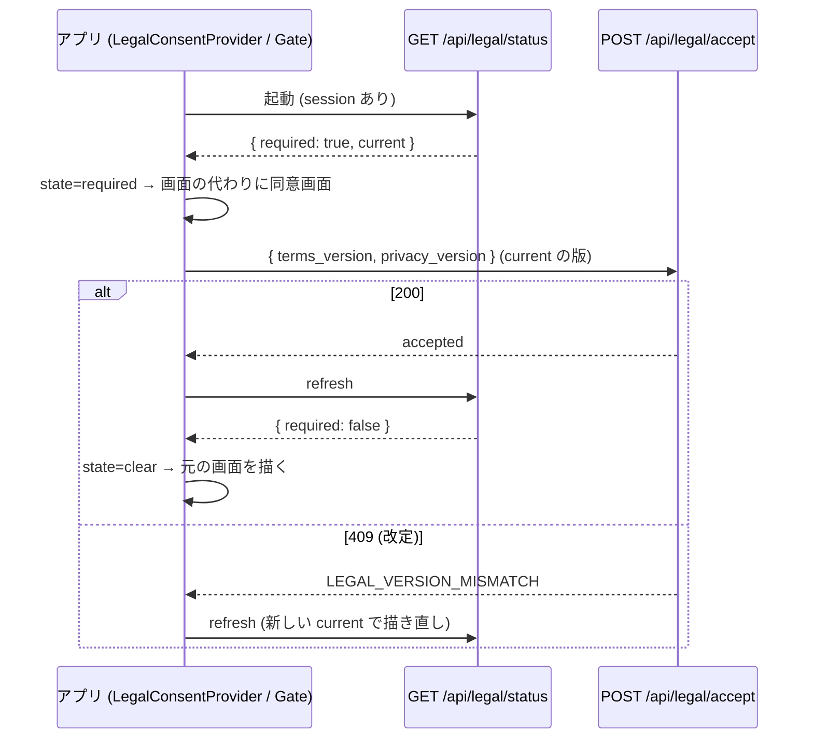

# 13b. 規約の同意ゲートをモバイルのネイティブの画面にも掛ける — 配線 (モバイル) (#1442)

> **13a (`13a-legal-consent-api-server.md`) がマージされた後に実装する。13a の実コードを正とする。** 本冊が参照する 13a の公開名 (`@homegohan/shared` の関数・定数・型と `GET /api/legal/status` の応答。§0.4) が本冊の写しと食い違ったら、13a の実コードに合わせる。

| 項目 | 値 |
|---|---|
| Status | 設計ゲート審査中 (v1.1) |
| Issue | #1442 (親: #1174 の同意ゲート。先例: #1154 の AI 同意の 403・#1030 / #1445 の凍結の API ゲート) |
| 分冊 | 本冊 = 配線 (段 B: モバイル)。核 (段 A: サーバー + `packages/shared`) は `13a-legal-consent-api-server.md` |
| 正典の関係 | 13a とともに `08-legal-compliance.md` §7.2 (同意ゲート) の配線を広げる冊。§7.2 の「モバイルのネイティブの画面は対象外」の記述は本冊のマージで現在形に直す (§6.19) |
| 範囲の正本 | 仕様ファイル `scratch/homegohan/specs/spec-d-consent.md` と Issue #1442 の本文 |
| 読み手 | 実装 (Sonnet 5.5) と敵対レビュー。実装は §6 だけを読んで手を止めずに書けることを完成条件にする |
| 節番号 | 分冊前の 13 と同じ番号を使う。本冊に無い節 (§3.3 以外の §3 の多く・§6.4・§6.6.1〜§6.6.7・§6.9・§6.13 など) は 13a にある。両冊にある節番号は、それぞれの冊に関わる行だけを持つ。両方に関わる行は 13a に置く |

---

## 0. 範囲・分冊判定・本書の読み方

### 0.1 一言でいうと

- モバイル: ルートの `Stack` の **`screenLayout`** に 1 枚のゲートを置き、サインイン中で「同意が要る」状態なら、**どの画面の代わりにもネイティブの同意画面**を描く (初期設定より先)。API の 403 を受けたら同じ状態に落とす (改定の再同意)。同意画面はネイティブ (WebView を使わない)。
- サーバー側 (`/api` の 403 `LEGAL_CONSENT_REQUIRED`・`GET /api/legal/status`・shared の判定と文面) は 13a。本冊はそれを使う側。

### 0.2 分冊判定

13a §0.2 のとおり。叩き台 (分冊前の 13) が叩き台の大きさの関門 (1,500 行) を超えたので、設計書自身の段の境目で 2 冊に分けた。本冊 = 段 B (モバイル)。2 冊の間の契約は「1 本の API (`/api/legal/status`) と 1 つのエラーコード (`LEGAL_CONSENT_REQUIRED`) と shared の定数・関数」だけ。要件行列・シナリオ・トレース・状態表の、両方に関わる行は 13a に置き、本冊から参照する。

### 0.3 一次情報 (origin/main。行番号は 2026-10-15 時点)

| 事実 | 場所 |
|---|---|
| モバイルの入口: session あり & 初期設定未完了 → `/onboarding`、完了 → `/(tabs)/home`。同意の確認は無い | `apps/mobile/app/index.tsx:21-22`、`apps/mobile/app/onboarding/index.tsx:17-25`、`apps/mobile/app/(tabs)/_layout.tsx:35-41` |
| ルートの Stack は index・(public)・(auth)・(tabs)・(org)・(support)・(super-admin) を並べ、app 直下の画面 (health/* ・ai/* など) は自動で登録される | `apps/mobile/app/_layout.tsx:99-107` |
| API クライアントのエラーの置き換え (429・503) | `apps/mobile/src/lib/api.ts:72-78`、`apps/mobile/src/lib/failed-response.ts:52-55` |
| AI 同意の 403 をアプリが見分ける形 (`HTTP 403 …: {json}`) | `apps/mobile/src/lib/ai-consent.ts:79-99` |
| 利用規約・プライバシーポリシーの画面 (アプリ) は PublicPage (本文は Web 版へのリンク) | `apps/mobile/app/(public)/terms.tsx`、`apps/mobile/src/components/PublicPage.tsx` |
| expo-router 5.1.11 / @react-navigation/core 7.17.2 / native-stack 7.14.12 | `package-lock.json` |

サーバー側の一次情報 (middleware・判定・accept route・legal-versions など) は 13a §0.3。

### 0.4 13a から使う公開名

| 名前 | 種別 | 正 (13a) | 本冊で使う所 |
|---|---|---|---|
| `LEGAL_CONSENT_REQUIRED_MESSAGE`, `LEGAL_CONSENT_REQUIRED_STATUS`, `isLegalConsentRequiredBody` | shared の定数・関数 | 13a §6.6.1 | 6.6.8 (403 の見分け) |
| `LEGAL_CONSENT_STATUS_API_PATH`, `isLegalConsentStatus`, `LegalConsentStatus` | shared の定数・関数・型 | 13a §6.6.1 | 6.6.9 (status の取得) |
| `LEGAL_CONSENT_ACCEPT_API_PATH` | shared の定数 | 13a §6.6.1 | 6.6.12 (同意の記録) |
| `LEGAL_CONSENT_COPY`, `legalConsentAgreeLabel`, `legalConsentReadFullTextLabel`, `legalConsentVersionLine` | shared の文面 | 13a §6.6.2 | 6.6.12 (同意画面) |
| `GET /api/legal/status` の応答 | API | 13a §6.6.5・§6.9 | 6.6.9・6.6.12 |
| 403 `{ error, code: 'LEGAL_CONSENT_REQUIRED' }` | API の本文 | 13a §6.6.4・§6.8 | 6.6.8・6.6.13 |

既存の shared の名前 (`LEGAL_DOCUMENT_LABELS`・`LEGAL_DOCUMENT_TYPES`・`formatLegalEffectiveDate`・`LegalDocumentType`。`packages/shared/src/legal-versions.ts`) はそのまま使う。

---

## 1. 目的・スコープ

### 1.1 解決すること (Issue #1442 のうち本冊の分)

Issue の全体 (3 つの経路) は 13a §1.1。本冊が解決するのは次の 2 つ (3 の `/api/*` は 13a)。

1. モバイルのネイティブの画面 (health / settings / favorites のタブ、AI 相談、レシピ、パントリーなど) は WebView を通らないので、未同意のまま使える。
2. 新規の人は、ネイティブの初期設定 (健康情報の入力) を同意より先に済ませられる。

前提 (§1.2) は 13a §1.2。

### 1.3 対象外

13a §1.3 (規約の文面・同意の記録の仕組み・アプリの Supabase の直読み) に加えて、本冊に関わるもの:

- `LEGAL_CONSENT_NOTICE` (お知らせ) は Web の `(main)` の画面だけのまま。ネイティブにはお知らせを出さない (WebView のタブでは Web のお知らせが見える)。
- アプリ (Expo) のネイティブのサインアップ画面に同意のチェックを足すこと (`08` §7.2 の残課題のまま。本書のゲートで、登録直後の起動時に同意画面へ回るので、使う前には必ず同意する)。

---

## 2. 関連要件

- `docs/design/cross/08-legal-compliance.md` §7.2 (再同意フロー)。
- `docs/design/mobile/01-architecture.md` §3 (ネイティブ画面の一覧・WebView ハイブリッド)。
- `docs/design/cross/13a-legal-consent-api-server.md` (核。shared の export・status の応答・403 の形)。

---

## 3. 相 1 外形固定: 要件行列・ユーザーシナリオ・現行の画面

### 3.1 要件行列 (本冊の行)

| ID | 要件 | 出どころ | 検証 (§6.14 の it) |
|---|---|---|---|
| R-6 | モバイルは、ログイン後、初期設定より先に同意の状態を確かめ、未同意なら同意画面へ回す | 仕様 2 | T-G1〜T-G5 |
| R-7 | 今の main のネイティブの画面を実コードで列挙して表にする | 仕様 2 | §3.3 |
| R-12 | モバイルのネイティブの同意画面は、Web の同意画面と同じ要件 (必須チェック 2 つ・全文へのリンク・同意しない = ログアウト + 削除の依頼先の案内) | `08` §7.2 同意画面の行 | T-SC1〜T-SC6 |

R-1〜R-5・R-14 (サーバー) と、サーバーとモバイルの両方に関わる R-8〜R-11・R-13 は 13a §3.1 (検証の列のモバイルの it は本冊 §6.14)。

### 3.2 ユーザーシナリオ (18 本のうち、モバイルだけで結果が決まる 7 本)

サーバーに関わる S6・S7・S10・S11・S14・S16・S17 と、サーバーとモバイルの両方に関わる S5・S8・S9・S15 は 13a §3.2。

| ID | シナリオ |
|---|---|
| S1 | 新規登録 (アプリのネイティブのサインアップ) → ログイン → 初期設定の前に同意画面 → 同意 → 初期設定へ |
| S2 | 既存の利用者 (同意済み) がアプリを起動 → 今までどおりホーム (余計な画面は出ない) |
| S3 | 既存の利用者 (未同意・ENFORCE=on) がアプリを起動 → 同意画面 → 同意 → 元の入口 (ホーム) |
| S4 | アプリの同意画面で「同意しない」→ 確認 → ログアウト → ウェルカム画面 (削除の依頼先 = お問い合わせのメール) |
| S12 | 未同意のセッションが残る端末で、パスワード再設定のリンクを開く → `/auth/reset-password` はゲートの対象外 → 再設定できる → ホームへ移ろうとして同意画面 |
| S13 | 同意画面 (アプリ) を開いたまま改定 → 同意を送ると 409 → 状況を取り直し、新しい版で画面を描き直す。「更新されました」の案内 |
| S18 | 機内モードでアプリを起動 (保存済みのセッション) → status を取れず `unknown` → ネイティブの画面は開く (通信できない案内は今までどおり) → 通信が戻った最初の API 呼び出しが 403 なら同意画面 |

### 3.3 今の main に残るネイティブの画面 (実コードで列挙。R-7)

`apps/mobile/app/` の画面ファイル全部 (2026-10-15 の origin/main。`_layout.tsx` と `+` で始まるものは除く)。WebView = `WebViewScreen` を使う (Web の同意ゲートが WebView の中で効く)。公開 = `PublicPage` (本文は Web 版へのリンク)。**ゲート = 本書のモバイルのゲート (§6.5) の対象か。**

| 区画 | 画面ファイル | パス | 種別 | ゲート | 根拠 |
|---|---|---|---|---|---|
| 入口 | `index.tsx` | `/` | ネイティブ (ウェルカム / 振り分け) | 対象 (session があるときだけ描かれ、振り分けの前に同意画面を出す) | `index.tsx:21-22` |
| (auth) | `(auth)/login.tsx`, `(auth)/signup.tsx` | `/login`, `/signup` | ネイティブ | 対象外 (未ログインの画面。session があれば `(auth)/_layout.tsx:29` がホームへ回す) | `(auth)/_layout.tsx` |
| (auth) | `(auth)/auth/forgot-password.tsx`, `reset-password.tsx`, `verify.tsx` | `/auth/forgot-password`, `/auth/reset-password`, `/auth/verify` | ネイティブ | 対象外 (認証の途中。Web の `/auth/*` と同じ理由) | `(auth)/_layout.tsx:25-27` |
| (public) | `(public)/about.tsx`, `pricing.tsx`, `privacy.tsx`, `terms.tsx` | `/about`, `/pricing`, `/privacy`, `/terms` | 公開 (PublicPage) | 対象外 (同意の根拠になる文面と公開の案内。Web の `/terms` `/privacy` と同じ理由) | `PublicPage.tsx` |
| (tabs) | `(tabs)/home.tsx`, `menus.tsx`, `meals.tsx`, `comparison.tsx`, `profile.tsx` | `/home`, `/menus`, `/meals`, `/comparison`, `/profile` | WebView | 対象 (ネイティブのゲートが先に止める。通っても WebView の中で Web のゲートが効く) | `WebViewScreen` を使う 5 本 |
| (tabs) | `(tabs)/favorites.tsx`, `health.tsx`, `settings.tsx` | `/favorites`, `/health`, `/settings` | ネイティブ | 対象 | `(tabs)/_layout.tsx:93-115` (タブバーに出さない) |
| onboarding | `onboarding/index.tsx`, `welcome.tsx`, `questions.tsx`, `resume.tsx`, `complete/index.tsx` | `/onboarding`, `/onboarding/welcome`, `/onboarding/questions`, `/onboarding/resume`, `/onboarding/complete` | ネイティブ (初期設定) | 対象 (R-6: 初期設定より先に同意) | `onboarding/_layout.tsx` |
| health | `health/blood-tests.tsx`, `challenges.tsx`, `checkups/index.tsx`, `checkups/new.tsx`, `checkups/[id].tsx`, `goals.tsx`, `graphs.tsx`, `insights.tsx`, `record/index.tsx`, `record/quick.tsx`, `record/[date].tsx`, `settings.tsx`, `streaks.tsx` | `/health/...` | ネイティブ | 対象 | app 直下 (group の layout は無い) |
| ai | `ai/index.tsx`, `ai/[sessionId].tsx`, `ai/important.tsx` | `/ai`, `/ai/[sessionId]`, `/ai/important` | ネイティブ (AI 相談) | 対象 | 同上 |
| meals | `meals/[id].tsx`, `meals/[id]/edit.tsx` | `/meals/[id]`, `/meals/[id]/edit` | ネイティブ | 対象 | 同上 |
| recipes | `recipes/index.tsx`, `new.tsx`, `[id].tsx`, `[id]/edit.tsx`, `collections/index.tsx`, `collections/select.tsx`, `collections/[collectionId].tsx` | `/recipes/...` | ネイティブ | 対象 | 同上 |
| menus | `menus/weekly/index.tsx`, `menus/weekly/request/index.tsx` | `/menus/weekly`, `/menus/weekly/request` | ネイティブ | 対象 | 同上 |
| その他 | `pantry/index.tsx`, `shopping-list/index.tsx`, `badges/index.tsx`, `profile/nutrition-targets.tsx`, `settings/account.tsx` | `/pantry`, `/shopping-list`, `/badges`, `/profile/nutrition-targets`, `/settings/account` | ネイティブ | 対象 | 同上 |
| settings | `settings/ai-consent.tsx` | `/settings/ai-consent` | WebView (Web の `/settings/ai-consent`) | 対象 | `settings/ai-consent.tsx` |
| handson-tour | `handson-tour/index.tsx`, `photo.tsx`, `menu.tsx`, `badges.tsx`, `graduate.tsx` | `/handson-tour/...` | ネイティブ (ツアー) | 対象 (Web は `/handson-tour` を対象外にするが、ネイティブのゲートは画面の代わりに同意画面を描き、同意後に同じ画面へ戻るので、流れが切れる問題が無い) | `handson-tour/_layout.tsx` |
| (org) | `(org)/org/challenges.tsx`, `dashboard.tsx`, `departments.tsx`, `invites.tsx`, `members.tsx`, `settings.tsx` | `/org/...` | ネイティブ (組織管理) | 対象 | `(org)/_layout.tsx` |
| (support) | `(support)/support/index.tsx`, `inquiries.tsx`, `inquiries/[id].tsx`, `users.tsx`, `users/[id].tsx` | `/support/...` | ネイティブ (サポート) | 対象 | `(support)/_layout.tsx` |
| (super-admin) | `(super-admin)/super-admin/index.tsx`, `admins.tsx`, `database.tsx`, `feature-flags.tsx`, `settings.tsx` | `/super-admin/...` | ネイティブ (運営) | 対象 | `(super-admin)/_layout.tsx` |

対象外のパスの一覧 (`MOBILE_LEGAL_CONSENT_EXEMPT_PATHS`。§6.7) は、この表の「対象外」の行 = `(auth)` と `(public)` の画面と一致する。一致はテスト T-ML3 が `apps/mobile/app/(auth)` と `(public)` のファイル名から確かめる。

---

## 4. 相 2 構想とトレース

### 4.1 構造

```
モバイル (段 B)
  apps/mobile/src/lib/legal-consent.ts        ← 403 の見分け・LegalConsentRequiredError・「要同意」の通知・対象外のパス
  apps/mobile/src/providers/LegalConsentProvider.tsx ← GET /api/legal/status を user ごとに取り、state を持つ
  apps/mobile/src/components/legal/LegalConsentGate.tsx   ← ルートの Stack の screenLayout。要同意なら画面の代わりに同意画面
  apps/mobile/src/components/legal/LegalConsentScreen.tsx ← ネイティブの同意画面 (チェック 2 つ・全文へのリンク・同意しない)
  apps/mobile/src/lib/api.ts / failed-response.ts         ← 403 LEGAL_CONSENT_REQUIRED → 通知 + 固定の文の例外
```

サーバー (段 A) の構造と、判定の規則 (サーバー・モバイル共通。「モバイルの判定」を含む) は 13a §4.1。

### 4.2 トレース (全シナリオを構造で手で走らせる)

| ID | 走らせた結果 |
|---|---|
| S1 | サインアップ → `AuthProvider` が session を持つ → `LegalConsentProvider` が `GET /api/legal/status` (許可リスト → 200) → 行が無いので `accepted: false`、本番は `enforced: true` → `required: true` → state `required` → ルートの Stack の `screenLayout` = `LegalConsentGate` が `index` の代わりに `LegalConsentScreen` を描く (`index.tsx:21` の `/onboarding` への Redirect は描かれない = 初期設定より先) → チェック 2 つ → `POST /api/legal/accept` (許可リスト → 200。`accept_legal_documents` が既定の行を作る) → `refresh()` → `required: false` → state `clear` → Gate が `index` を描く → `profile.onboardingCompletedAt` 無し → `/onboarding` → welcome (`POST /api/onboarding/complete` は同意済みなので通る) |
| S2 | 起動 → status 200 `required: false` → `clear` → `index` → `/(tabs)/home`。同意画面は出ない。status の 1 回の往復は ProfileProvider の読み取りと並行なので、起動が目に見えて遅くならない |
| S3 | 起動 → `required: true` → `index` の代わりに同意画面 → 同意 → `clear` → `index` → `/(tabs)/home` |
| S4 | 同意画面の「同意しない」→ Alert (ご利用いただけない旨・削除の依頼先はお問い合わせのメール) →「ログアウト」→ `signOutOnDevice(user.id, { clearSession, accessToken })` → session null → Gate は session 無しなので children = `index` → ウェルカム画面。provider は user null で state を `clear` に戻す |
| S12 | pathname `/auth/reset-password` は `MOBILE_LEGAL_CONSENT_EXEMPT_PATHS` の `/auth` (前方一致) → Gate は children を描く → 再設定の画面がそのまま使える (`(auth)/_layout.tsx:27` の allowWithSession と同じ画面) → 終わってホームへ `router.replace` → `/home` は対象 → 同意画面 |
| S13 | 同意画面が持つ版は status の `current` (端末のバンドルの定数ではない) → 開いたまま改定 → `POST /api/legal/accept` が 409 → `httpStatusOfError(e) === 409` → `refresh()` → `current` が新しい版 → 画面は新しい版と施行日で描き直し、`LEGAL_CONSENT_COPY.versionMismatch` を出す → チェックし直して同意 |
| S18 | 起動 → status の fetch が通信失敗 → `unknown` → children → 画面の API 呼び出しも失敗 (今までどおり「通信できません」) → 通信が戻る → 最初の API 呼び出しが 403 → 13a の S5 |

S5・S6〜S11・S14〜S17 のトレースは 13a §4.2。

---

## 5. 相 3 構造裁定 (1 回だけ)

サーバー側の代替案 (§5.1) は 13a。

### 5.2 モバイル側の代替案

| 案 | 中身 | 判定 |
|---|---|---|
| A' (採用) | ルートの `Stack` の `screenLayout` に 1 枚のゲート。要同意なら画面の代わりに同意画面 (部品) を描く。同意画面は route ではない | 1 か所で全画面 (group の無い app 直下の画面も) を覆う。Stack を外さないので遷移の状態・deep link・通知からの遷移が残り、同意後は同じ画面に戻る。`usePathname()` が使えるので対象外 (認証の途中・公開ページ) を Web と同じ基準で決められる |
| B' | `index.tsx`・`(tabs)/_layout`・`onboarding/_layout` などの各 layout で `<Redirect href="/legal-consent" />` | app 直下の画面 (health/* など 40 本) には layout が無く、通知や deep link で直接開けるので漏れる。置き場が増えるほど漏れる。却下 |
| C' | 同意画面を WebView の `/legal-consent` で開く (AI 同意の `/settings/ai-consent` と同じ) | 同意が済んだことをネイティブに知らせる新しい postMessage と、`next` の扱い、bridge の失敗の経路が増える。同意画面は「チェック 2 つ + 全文へのリンク + 2 つのボタン」で、文面は shared に置けば 2 か所に持たない。却下 |
| D' | expo-router 5 の `Stack.Protected` | 保護する画面を全部列挙する必要があり (app 直下の画面は自動登録)、B' と同じ漏れ方をする。却下 |

F の問い (§5.3) はサーバー・モバイルの両方を扱うので 13a §5.3 に置く。構造はそこで確定し、以後の周で蒸し返さない。

---

## 6. 相 4 仕上げ

### 6.1 ① 全パターン表 (モバイルだけの行)

主体と経路の定義は 13a §6.1。モバイルと API の両方に関わる行 (初期設定 (モバイル)・同意済み・profile 読めない (モバイル)) は 13a §6.1。

| 主体 | 経路 | ENFORCE=on | ENFORCE=off | 変更 |
|---|---|---|---|---|
| 未ログイン | モバイルの画面 | Gate は children (ウェルカム) | 同左 | なし |
| 未同意 | モバイル ネイティブの画面 (対象) | **同意画面 (画面の代わり)** | 通す (`required: false`) | **新** |
| 未同意 | モバイル 対象外の画面 (`/login` `/signup` `/auth/*` `/terms` `/privacy` `/about` `/pricing`) | 通す | 通す | 新 (一覧の固定) |

### 6.2 ② 状態比較表 (現行 vs 設計後。モバイルの行)

サーバーの行は 13a §6.2。

| 面 | 現行 | 設計後 |
|---|---|---|
| モバイルの起動 | session → 初期設定 or ホーム | session → **status を取り、要同意なら同意画面** → 初期設定 or ホーム |
| モバイルの改定の再同意 | WebView のタブを開いたときだけ Web のゲート | API の 403 で同意画面 (どの画面からでも) |
| モバイルの 403 の扱い | AI 同意の 403 だけ見分ける | `LEGAL_CONSENT_REQUIRED` も見分け、固定の文の例外にする |

### 6.3 ③ 状態遷移表 (モバイルだけの行)

サーバーとモバイルの両方に関わる行 (`/api` の呼び出し・status・同意の記録・改定・凍結・ENFORCE・読めない) は 13a §6.3。

状態 (利用者ごと): `anon` (未ログイン) / `none` (未同意: 行なし・NULL) / `old` (旧版に同意) / `ok` (同意済み) / `unreadable` (読めない: DB 障害・列なし)。

| 状態 | 操作 | 遷移先 | ガード | 副作用 (サーバー / モバイル) |
|---|---|---|---|---|
| anon | ログイン (アプリ) | none / old / ok のどれか (行の中身で決まる) | — | モバイル: `LegalConsentProvider` が status を取る |
| none / old | 同意しない (アプリ) | anon | — | `signOutOnDevice`。Web は signOut + 案内 (既存) |
| none / old | 画面を開く (モバイル・対象) | 同じ | `required` | 同意画面 (画面の代わり) |
| none / old | 画面を開く (モバイル・対象外) | 同じ | — | 通す |

`/api` の許可リスト (§6.4) は 13a。

### 6.5 判定の置き場所と順序

**サーバー** は 13a §6.5。

**モバイル** (`apps/mobile/app/_layout.tsx`): `AuthProvider` → `LegalConsentProvider` → `ProfileProvider` → `PushTokenRegistrar` → `NotificationRouter` → `<Stack screenLayout={renderLegalConsentScreenLayout}>`。`LegalConsentGate` は `session` 無し / 対象外のパス / state `clear` `unknown` なら children、`loading` なら `LoadingState`、`required` なら `LegalConsentScreen`。

### 6.6 正典コード

検査の範囲: 本冊のブロックはどれも、13a で新設する `@homegohan/shared` の export を import するか、JSX を含むか、既存ファイルへの差分なので `// tsc:skip` にしてある (実装では apps/mobile の tsc の対象。理由はブロックの 1 行目)。6.6.1〜6.6.7 (shared・Zod・middleware・status route・Web の文面) は 13a §6.6。

#### 6.6.8 `apps/mobile/src/lib/legal-consent.ts` (新設。段 B)

```ts
// tsc:skip — 13a で新設する @homegohan/shared の export を import する RN のモジュール。実装では apps/mobile の tsc の対象
/**
 * 利用規約・プライバシーポリシーの同意 (#1442): アプリ側の共通の部品。
 *
 *   - サーバーに「同意が必要です」(403 LEGAL_CONSENT_REQUIRED。lib/supabase/middleware.ts の /api の分岐) で止められたことを見分け、
 *     固定の文の例外 (LegalConsentRequiredError) に置き換える。getApi() (src/lib/api.ts の withFriendlyErrors) と
 *     生の fetch (src/lib/failed-response.ts の errorOfFailedResponse) の両方がここを通る
 *   - 止められたことを LegalConsentProvider に知らせる (notify / subscribe)。Provider は state を required にして、
 *     ルートのゲート (LegalConsentGate) が画面の代わりに同意画面を描く
 *   - ゲートの対象外のパス (認証の途中・公開ページ。Web の isLegalConsentExemptPath と同じ基準)
 *
 * AI 同意 (src/lib/ai-consent.ts) と違い、各画面に呼び出しを足さない。止められたら画面の代わりに同意画面が出るので、
 * 画面は自分のエラー表示をそのままにしてよい (出るのは固定の文だけ)。
 */
import {
  LEGAL_CONSENT_REQUIRED_MESSAGE,
  LEGAL_CONSENT_REQUIRED_STATUS,
  isLegalConsentRequiredBody,
} from "@homegohan/shared";

// "HTTP 403 Forbidden: {...}" / HTTP/2 で statusText が空の "HTTP 403 : {...}" / 生の fetch の "HTTP 403: {...}" (api-error.ts と同じ形)
const HTTP_ERROR_PATTERN = /^HTTP (\d{3})[^:]*:\s*([\s\S]+)$/;

/** API クライアントの Error の message から HTTP の状態を読む (読めなければ null)。同意画面が 409 を見分けるのにも使う */
export function httpStatusOfError(error: unknown): number | null {
  const message = (error as { message?: unknown } | null | undefined)?.message;
  if (typeof message !== "string") return null;
  const match = HTTP_ERROR_PATTERN.exec(message);
  return match ? Number(match[1]) : null;
}

/** サーバーに「同意が必要です」で止められたことを表す例外。message は画面にそのまま出せる固定の文 */
export class LegalConsentRequiredError extends Error {
  constructor() {
    super(LEGAL_CONSENT_REQUIRED_MESSAGE);
    this.name = "LegalConsentRequiredError";
  }
}

export function isLegalConsentRequiredError(error: unknown): error is LegalConsentRequiredError {
  return error instanceof LegalConsentRequiredError;
}

type Listener = () => void;
const listeners = new Set<Listener>();

/** 「同意が必要です」で止められたことを Provider に知らせる。購読者が居なければ何もしない */
export function notifyLegalConsentRequired(): void {
  for (const listener of listeners) listener();
}

/** Provider が購読する。戻り値で解除する */
export function subscribeLegalConsentRequired(listener: Listener): () => void {
  listeners.add(listener);
  return () => {
    listeners.delete(listener);
  };
}

/** テスト用: 購読を全部外す */
export function resetLegalConsentListenersForTests(): void {
  listeners.clear();
}

/**
 * API クライアントが投げた Error が 403 LEGAL_CONSENT_REQUIRED なら、Provider に知らせて LegalConsentRequiredError を返す。
 * それ以外 (ほかの 403・JSON でない本文・通信の失敗) は null。例外は投げない
 */
export function legalConsentRequiredErrorOf(error: unknown): LegalConsentRequiredError | null {
  if (isLegalConsentRequiredError(error)) return error;
  if (httpStatusOfError(error) !== LEGAL_CONSENT_REQUIRED_STATUS) return null;
  const message = (error as { message: string }).message;
  const match = HTTP_ERROR_PATTERN.exec(message);
  if (!match) return null;
  try {
    if (!isLegalConsentRequiredBody(JSON.parse(match[2]))) return null;
  } catch {
    return null;
  }
  notifyLegalConsentRequired();
  return new LegalConsentRequiredError();
}

/**
 * ゲートの対象外のパス (apps/mobile/app の (auth) と (public) の画面)。そのものか `${path}/` 以下。
 * Web の isLegalConsentExemptPath (認証の途中 /auth/*・規約 /terms・/privacy) と同じ基準。
 * 一覧が画面のファイルと一致することは __tests__/lib/legal-consent.test.ts が確かめる
 */
export const MOBILE_LEGAL_CONSENT_EXEMPT_PATHS: readonly string[] = [
  "/login",
  "/signup",
  "/auth",
  "/terms",
  "/privacy",
  "/about",
  "/pricing",
];

export function isMobileLegalConsentExemptPath(pathname: string): boolean {
  return MOBILE_LEGAL_CONSENT_EXEMPT_PATHS.some((prefix) => pathname === prefix || pathname.startsWith(`${prefix}/`));
}
```

#### 6.6.9 `apps/mobile/src/providers/LegalConsentProvider.tsx` (新設。段 B)

```ts
// tsc:skip — JSX と新設の export を含む RN のモジュール。実装では apps/mobile の tsc の対象
import React, { createContext, useCallback, useContext, useEffect, useMemo, useRef, useState } from "react";
import { LEGAL_CONSENT_STATUS_API_PATH, isLegalConsentStatus, type LegalConsentStatus } from "@homegohan/shared";

import { getApi } from "../lib/api";
import { subscribeLegalConsentRequired } from "../lib/legal-consent";
import { useAuth } from "./AuthProvider";

/**
 * 同意の状態 (#1442)。
 *   loading  サインイン中で、status をまだ取れていない (ゲートは画面を描かず読み込み中を出す)
 *   clear    同意画面を出す必要が無い (同意済み、または強制していない)
 *   required 同意画面を出す (未同意・旧版で、強制中)
 *   unknown  status を取れなかった (通信の失敗・サーバーの 500)。止めない。次の API 呼び出しの 403 で required になる
 */
export type LegalConsentState = "loading" | "clear" | "required" | "unknown";

type LegalConsentContextValue = {
  state: LegalConsentState;
  /** 直近に取れた status (required のときの同意画面が版・施行日を読む) */
  status: LegalConsentStatus | null;
  /** status を取り直す。失敗しても例外を投げない (前の状態を保つ。loading のときだけ unknown にする) */
  refresh: () => Promise<void>;
};

const LegalConsentContext = createContext<LegalConsentContextValue | null>(null);

export function LegalConsentProvider({ children }: { children: React.ReactNode }) {
  const { user } = useAuth();
  const [state, setState] = useState<LegalConsentState>("loading");
  const [status, setStatus] = useState<LegalConsentStatus | null>(null);
  const requestSeq = useRef(0);

  const refresh = useCallback(async () => {
    if (!user) {
      setStatus(null);
      setState("clear");
      return;
    }
    const seq = ++requestSeq.current;
    try {
      const body = await getApi().get<unknown>(LEGAL_CONSENT_STATUS_API_PATH);
      if (seq !== requestSeq.current) return; // 古い応答は捨てる (利用者が切り替わった後など)
      if (!isLegalConsentStatus(body)) {
        setState((current) => (current === "loading" ? "unknown" : current));
        return;
      }
      setStatus(body);
      setState(body.required ? "required" : "clear");
    } catch {
      if (seq !== requestSeq.current) return;
      // 通信の失敗・500: 止めない。required のまま (403 の知らせの後の取り直しが失敗したとき) なら required を保つ
      setState((current) => (current === "loading" ? "unknown" : current));
    }
  }, [user?.id]);

  // 利用者が変わるたびに取り直す (ログイン・ログアウト・アカウントの切り替え)
  useEffect(() => {
    if (user) setState("loading");
    void refresh();
  }, [refresh, user?.id]);

  // API が 403 LEGAL_CONSENT_REQUIRED を返したら、すぐ required にして (ゲートが同意画面を描く)、版の情報を取り直す
  useEffect(() => {
    return subscribeLegalConsentRequired(() => {
      setState("required");
      void refresh();
    });
  }, [refresh]);

  const value = useMemo<LegalConsentContextValue>(() => ({ state, status, refresh }), [state, status, refresh]);
  return <LegalConsentContext.Provider value={value}>{children}</LegalConsentContext.Provider>;
}

export function useLegalConsent(): LegalConsentContextValue {
  const ctx = useContext(LegalConsentContext);
  if (!ctx) throw new Error("useLegalConsent must be used within <LegalConsentProvider>");
  return ctx;
}
```

#### 6.6.10 `apps/mobile/app/_layout.tsx` の差分 (段 B)

```ts
// tsc:skip — 既存ファイルへの差分 (JSX)
// import に足す
import type { ComponentProps } from "react";
import { LegalConsentGate } from "../src/components/legal/LegalConsentGate";
import { LegalConsentProvider, useLegalConsent } from "../src/providers/LegalConsentProvider";

// #1442: ルートの Stack の全画面を同意のゲートで包む。関数の同一性を保つため module のスコープに置く
// (描画のたびに新しい関数を渡すと、画面が作り直されることがある)
const renderLegalConsentScreenLayout: NonNullable<ComponentProps<typeof Stack>["screenLayout"]> = ({ children }) => (
  <LegalConsentGate>{children}</LegalConsentGate>
);

// PushTokenRegistrar: 同意が済んでから登録する (同意前の起動では POST /api/push-tokens/claim が 403 で登録できないため、
// 同意が済んだ (state が required → clear) ときにもう一度通す。#1442)
function PushTokenRegistrar() {
  const { user } = useAuth();
  const { state: legalConsentState } = useLegalConsent();

  useEffect(() => {
    if (!user) return;
    if (legalConsentState === "loading" || legalConsentState === "required") return;
    (async () => {
      try {
        await ensurePushTokenRegistered();
      } catch {
        // silent — (既存のコメントのまま)
      }
    })();
  }, [user?.id, legalConsentState]);

  return null;
}

// RootLayout の return: Provider の順と Stack の screenLayout
//   <AuthProvider>
//     <LegalConsentProvider>
//       <ProfileProvider>
//         <PushTokenRegistrar />
//         <NotificationRouter />
//         <Stack screenOptions={{ headerShown: false }} screenLayout={renderLegalConsentScreenLayout}>
//           (Stack.Screen の並びは現状のまま)
//         </Stack>
//       </ProfileProvider>
//     </LegalConsentProvider>
//   </AuthProvider>
```

`screenLayout` は React Navigation 7 の navigator の prop (`@react-navigation/core` 7.17.2・`native-stack` 7.14.12 を lockfile で確認)。expo-router の `Stack` は props をそのまま navigator に渡す。段 B の tsc が通らなければ §8 の Q-1 の代替へ。

#### 6.6.11 `apps/mobile/src/components/legal/LegalConsentGate.tsx` (新設。段 B)

```ts
// tsc:skip — JSX を含む RN のモジュール
import { usePathname } from "expo-router";
import React from "react";

import { isMobileLegalConsentExemptPath } from "../../lib/legal-consent";
import { useAuth } from "../../providers/AuthProvider";
import { useLegalConsent } from "../../providers/LegalConsentProvider";
import { colors } from "../../theme";
import { LoadingState } from "../ui";
import { LegalConsentScreen } from "./LegalConsentScreen";

/**
 * ルートの Stack の screenLayout (#1442)。全画面の描画をここで受け、サインイン中で同意が要るときは、
 * その画面の代わりに同意画面を描く (Stack も遷移の状態も残るので、同意が済めば同じ画面がそのまま描かれる)。
 *   - session 無し (未ログイン)                 → 画面をそのまま
 *   - 対象外のパス (認証の途中・公開ページ)       → 画面をそのまま
 *   - loading (status をまだ取れていない)        → 読み込み中 (画面を一瞬出してから同意画面に変わるのを避ける)
 *   - required                                  → 同意画面
 *   - clear / unknown                           → 画面をそのまま (unknown は止めない。次の API の 403 で required になる)
 */
export function LegalConsentGate({ children }: { children: React.ReactNode }) {
  const { session } = useAuth();
  const { state } = useLegalConsent();
  const pathname = usePathname();

  if (!session) return <>{children}</>;
  if (isMobileLegalConsentExemptPath(pathname)) return <>{children}</>;
  if (state === "loading") return <LoadingState testID="legal-consent-loading" style={{ backgroundColor: colors.bg }} />;
  if (state === "required") return <LegalConsentScreen />;
  return <>{children}</>;
}
```

#### 6.6.12 `apps/mobile/src/components/legal/LegalConsentScreen.tsx` (新設。段 B。ネイティブの同意画面)

```ts
// tsc:skip — JSX を含む RN のモジュール
import * as Linking from "expo-linking";
import React, { useState } from "react";
import { Alert, Pressable, ScrollView, Switch, Text, View } from "react-native";
import { useSafeAreaInsets } from "react-native-safe-area-context";
import {
  LEGAL_CONSENT_ACCEPT_API_PATH,
  LEGAL_CONSENT_COPY,
  LEGAL_DOCUMENT_LABELS,
  LEGAL_DOCUMENT_TYPES,
  formatLegalEffectiveDate,
  legalConsentAgreeLabel,
  legalConsentReadFullTextLabel,
  legalConsentVersionLine,
  type LegalDocumentType,
} from "@homegohan/shared";

import { getApi } from "../../lib/api";
import { getApiErrorMessage } from "../../lib/api-error";
import { httpStatusOfError } from "../../lib/legal-consent";
import { signOutOnDevice } from "../../lib/signOut";
import { getPrivacyUrl, getSupportMailtoUrl, getTermsUrl } from "../../lib/siteConfig";
import { useAuth } from "../../providers/AuthProvider";
import { useLegalConsent } from "../../providers/LegalConsentProvider";
import { colors, radius, spacing } from "../../theme";
import { Button } from "../ui";

/** 同意を送ったら版が変わっていた (POST /api/legal/accept の 409) */
const VERSION_MISMATCH_STATUS = 409;

/** 文書ごとの全文の URL (Web 版を OS のブラウザで開く。PublicPage の「Web版を開く」と同じ取り方) */
const DOCUMENT_URL: Record<LegalDocumentType, () => string> = {
  terms_of_service: getTermsUrl,
  privacy_policy: getPrivacyUrl,
};

/**
 * 利用規約・プライバシーポリシーへの同意画面 (アプリ。#1442)。LegalConsentGate が required のときに画面の代わりに描く。
 * 要件は Web の同意画面 (08 §7.2) と同じ: 必須のチェック 2 つ (両方入れるまで「同意して続ける」は押せない)・全文へのリンク・
 * 「同意しない」= ログアウトして、削除の依頼先 (お問い合わせ) を案内する。
 * 版と施行日は status (サーバーのいまの値) から出し、同意の記録にもその版を送る (端末のバンドルの定数は使わない。改定の直後に古い版を記録しない)。
 */
export function LegalConsentScreen() {
  const insets = useSafeAreaInsets();
  const { user, session, clearSession } = useAuth();
  const { status, refresh } = useLegalConsent();
  const [agreed, setAgreed] = useState<Record<LegalDocumentType, boolean>>({ terms_of_service: false, privacy_policy: false });
  const [busy, setBusy] = useState(false);
  const [error, setError] = useState<string | null>(null);

  const allAgreed = LEGAL_DOCUMENT_TYPES.every((type) => agreed[type]);
  const isReconsent = Boolean(status?.accepted_versions.terms_version || status?.accepted_versions.privacy_version);

  const handleAccept = async () => {
    if (!allAgreed || busy || !status) return;
    setBusy(true);
    setError(null);
    try {
      await getApi().post(LEGAL_CONSENT_ACCEPT_API_PATH, {
        terms_version: status.current.terms_of_service.version,
        privacy_version: status.current.privacy_policy.version,
      });
      await refresh(); // clear になればゲートが元の画面を描く
    } catch (e) {
      if (httpStatusOfError(e) === VERSION_MISMATCH_STATUS) {
        // 画面を開いたまま改定された。いまの版を取り直して描き直す (チェックは外す)
        setAgreed({ terms_of_service: false, privacy_policy: false });
        setError(LEGAL_CONSENT_COPY.versionMismatch);
        await refresh();
      } else {
        setError(getApiErrorMessage(e, LEGAL_CONSENT_COPY.acceptFailed));
      }
    } finally {
      setBusy(false);
    }
  };

  const handleDecline = () => {
    Alert.alert(LEGAL_CONSENT_COPY.declineButton, `${LEGAL_CONSENT_COPY.declineUnavailable}\n保存されているデータの削除は、お問い合わせ (${getSupportMailtoUrl()}) からご依頼ください。`, [
      { text: "キャンセル", style: "cancel" },
      {
        text: "ログアウト",
        style: "destructive",
        onPress: () => {
          void signOutOnDevice(user?.id, { clearSession, accessToken: session?.access_token ?? null });
        },
      },
    ]);
  };

  if (!status) {
    // required の知らせの直後で status をまだ取り直せていない (通信の失敗など)。取り直しを促すだけの最小の画面
    return (
      <View testID="legal-consent-screen" style={{ flex: 1, backgroundColor: colors.bg, paddingTop: insets.top + spacing.xl, padding: spacing.xl, gap: spacing.lg }}>
        <Text style={{ fontSize: 22, fontWeight: "800", color: colors.text }}>{LEGAL_CONSENT_COPY.heading}</Text>
        <Button title="再読み込み" onPress={() => void refresh()} />
      </View>
    );
  }

  return (
    <ScrollView
      testID="legal-consent-screen"
      style={{ flex: 1, backgroundColor: colors.bg }}
      contentContainerStyle={{ paddingTop: insets.top + spacing.xl, padding: spacing.xl, gap: spacing.lg }}
    >
      <Text style={{ fontSize: 22, fontWeight: "800", color: colors.text }}>{LEGAL_CONSENT_COPY.heading}</Text>
      <Text style={{ fontSize: 14, color: colors.textLight, lineHeight: 22 }}>
        {isReconsent ? LEGAL_CONSENT_COPY.introReconsent : LEGAL_CONSENT_COPY.introFirst}
      </Text>

      {LEGAL_DOCUMENT_TYPES.map((type) => {
        const label = LEGAL_DOCUMENT_LABELS[type];
        const current = status.current[type];
        const revised = isReconsent && status.outdated.includes(type);
        return (
          <View key={type} testID={`legal-doc-${type}`} style={{ borderWidth: 1, borderColor: colors.border, borderRadius: radius.lg, padding: spacing.lg, gap: spacing.sm }}>
            <View style={{ flexDirection: "row", justifyContent: "space-between", alignItems: "center" }}>
              <Text style={{ fontSize: 16, fontWeight: "700", color: colors.text }}>{label}</Text>
              {revised ? <Text style={{ fontSize: 12, fontWeight: "700", color: colors.accent }}>{LEGAL_CONSENT_COPY.revisedBadge}</Text> : null}
            </View>
            <Text style={{ fontSize: 12, color: colors.textMuted }}>
              {legalConsentVersionLine(current.version, formatLegalEffectiveDate(current.effective_date))}
            </Text>
            <Pressable testID={`legal-doc-${type}-link`} onPress={() => void Linking.openURL(DOCUMENT_URL[type]())}>
              <Text style={{ fontSize: 14, fontWeight: "700", color: colors.accent, textDecorationLine: "underline" }}>
                {legalConsentReadFullTextLabel(label)}
              </Text>
            </Pressable>
            <View style={{ flexDirection: "row", alignItems: "center", gap: spacing.md }}>
              <Switch
                testID={`legal-doc-${type}-agree`}
                accessibilityLabel={legalConsentAgreeLabel(label)}
                value={agreed[type]}
                disabled={busy}
                onValueChange={(value) => setAgreed((prev) => ({ ...prev, [type]: value }))}
              />
              <Text style={{ flex: 1, fontSize: 14, color: colors.text }}>{legalConsentAgreeLabel(label)}</Text>
            </View>
          </View>
        );
      })}

      {error ? <Text testID="legal-consent-error" style={{ color: colors.danger, fontSize: 14 }}>{error}</Text> : null}

      <Button testID="legal-consent-accept" title={LEGAL_CONSENT_COPY.acceptButton} onPress={() => void handleAccept()} disabled={!allAgreed || busy} />
      <Pressable testID="legal-consent-decline" onPress={handleDecline} disabled={busy} style={{ alignItems: "center", padding: spacing.md }}>
        <Text style={{ fontSize: 14, color: colors.textMuted, textDecorationLine: "underline" }}>{LEGAL_CONSENT_COPY.declineButton}</Text>
      </Pressable>
    </ScrollView>
  );
}
```

`Button` (`src/components/ui/Button.tsx`) の props が `title / onPress / disabled / testID` と違うときは、その部品の実際の props に合わせる (部品は変えない)。`Switch` はチェックボックスの代わり (RN 標準にチェックボックスが無い)。

#### 6.6.13 `apps/mobile/src/lib/api.ts` と `failed-response.ts` の差分 (段 B)

```ts
// tsc:skip — 既存ファイルへの差分
// --- src/lib/api.ts ---
import { legalConsentRequiredErrorOf } from "./legal-consent";
// withFriendlyErrors の catch (76 行目) を次にする。順は 429 → 503 → 403 (同意) → そのまま
//   throw aiDailyLimitErrorOf(error) ?? serviceUnavailableErrorOf(error) ?? legalConsentRequiredErrorOf(error) ?? error;
// 先頭のコメント (62-70 行目) に「403 LEGAL_CONSENT_REQUIRED (規約への同意が必要。#1442): LegalConsentRequiredError (src/lib/legal-consent.ts)。
// 置き換えるときに LegalConsentProvider へ知らせ、ゲートが同意画面を描く」を足す

// --- src/lib/failed-response.ts ---
import { isLegalConsentRequiredError, legalConsentRequiredErrorOf, type LegalConsentRequiredError } from "./legal-consent";
// StoppedByServerError の union に LegalConsentRequiredError を足す
//   export type StoppedByServerError = AiDailyLimitError | ServiceUnavailableError | LegalConsentRequiredError;
//   isStoppedByServerError: || isLegalConsentRequiredError(error)
// stoppedByServerAlertTitleOf: 同意は "同意が必要です" (定数 LEGAL_CONSENT_ALERT_TITLE) を返す分岐を足す
// errorOfFailedResponse (52-55 行目):
//   return aiDailyLimitErrorOf(raw) ?? serviceUnavailableErrorOf(raw) ?? legalConsentRequiredErrorOf(raw) ?? raw;
```

### 6.7 定数 (新設。すべて名前付き・根拠つき)

| 定数 | 値 | 置き場 | 根拠 |
|---|---|---|---|
| `MOBILE_LEGAL_CONSENT_EXEMPT_PATHS` | 7 本 (6.6.8) | mobile | `(auth)` `(public)` の画面。テストがファイル名と突き合わせる |
| `VERSION_MISMATCH_STATUS` | `409` | mobile 同意画面 | accept route の 409 |
| `LEGAL_CONSENT_ALERT_TITLE` | `'同意が必要です'` | mobile failed-response | Alert の見出し (AI 同意の案内と同じ語) |

shared・Web の定数と、方針 (運用で変えうる値・環境変数を足さない) は 13a §6.7。

### 6.8 エラー表 (モバイルの行)

サーバーの応答 (403・401・500・409) は 13a §6.8。

| 状況 | 経路 | status | 本文 | 形 | ヘッダー |
|---|---|---|---|---|---|
| 同意の判定 (モバイル) | `getApi()` / 生の fetch | — | `LegalConsentRequiredError` (message = `LEGAL_CONSENT_REQUIRED_MESSAGE`) | 例外 | — |

API 仕様 (§6.9) は 13a。

### 6.10 シーケンス (アプリの起動と同意)

`/api` の分岐のシーケンスは 13a §6.10。



### 6.11 `ENFORCE` が off のとき・同意の状態を読めないとき (R-9。モバイルの行)

ENFORCE が off・#1435・middleware で読めない・列が無い DB の行は 13a §6.11。

| 場面 | 決定 | 理由 |
|---|---|---|
| モバイルで status を取れない (通信の失敗・500) | **止めない** (`unknown`) | オフラインでは API も使えない。オンラインに戻れば最初の 403 で同意画面に回る (S18)。止めると、サーバーの不調のたびに全員が同意画面に閉じ込められる |
| モバイルが 403 を受けた後の取り直しに失敗 | `required` を保つ | 403 は一次情報 (サーバーが未同意と言った)。版の情報が無い間は「再読み込み」だけの画面 (6.6.12) |

### 6.12 改定 (版が上がる) の扱い (R-8。モバイル)

判定・Web・版を変えない文面の直しは 13a §6.12。

- モバイル: 次の API の 403 で `required` → 画面の代わりに同意画面 → 再同意 → 同じ画面に戻る (13a の S5)。同意画面は status の `current` を表示・送信するので、端末のバンドルが古くても新しい版に同意する (S13 の 409 は、画面を開いている間に改定されたときだけ)。

漏れの見張りとその限界 (§6.13) は 13a。

### 6.14 テスト一覧 (it 名)

既存のテストの直し (追随) は §6.18。ここは足すもの。13a のテスト (A. shared〜F. E2E) は 13a §6.14。

**G. モバイル (段 B) jest `apps/mobile/__tests__/...`**

| ID | ファイル | it |
|---|---|---|
| T-ML1 | `lib/legal-consent.test.ts` | `legalConsentRequiredErrorOf: getApi() のエラー ("HTTP 403 Forbidden: {…}") と生の fetch ("HTTP 403: {…}") の両方を見分け、Provider に知らせる` |
| T-ML2 | 同 | `ほかの 403・503・通信エラー・JSON でない本文は見分けず、知らせない` |
| T-ML3 | 同 | `MOBILE_LEGAL_CONSENT_EXEMPT_PATHS は apps/mobile/app の (auth) と (public) の画面のパスと一致し、似た名前 (/loginx /authx) は対象外にしない` |
| T-ML4 | 同 | `httpStatusOfError: 3 つの形の message から状態を読み、読めなければ null` |
| T-P1 | `providers/legal-consent-provider.test.tsx` | `user が居れば GET /api/legal/status を取り、required に応じて required / clear になる` |
| T-P2 | 同 | `status の取得に失敗 (通信・500・形の違い) したら unknown (止めない)` |
| T-P3 | 同 | `notifyLegalConsentRequired を受けたら即 required にし、status を取り直す。取り直しに失敗しても required を保つ` |
| T-P4 | 同 | `user が null なら clear、user が替わったら取り直し、古い応答は捨てる` |
| T-G1 | `components/legal-consent-gate.test.tsx` | `session が無ければ画面をそのまま描く` |
| T-G2 | 同 | `required なら画面の代わりに同意画面を描く (対象のパス /home /onboarding/welcome /health/graphs /org/dashboard /handson-tour)` |
| T-G3 | 同 | `対象外のパス (/login /signup /auth/reset-password /terms /privacy /about /pricing) は required でも画面をそのまま` |
| T-G4 | 同 | `loading は読み込み中を描き、画面も同意画面も描かない` |
| T-G5 | 同 | `clear と unknown は画面をそのまま` |
| T-SC1 | `components/legal-consent-screen.test.tsx` | `2 つのスイッチは最初オフで、両方オンにするまで「同意して続ける」は押せない` |
| T-SC2 | 同 | `同意は status の current の版を POST /api/legal/accept に送り、成功したら refresh を呼ぶ` |
| T-SC3 | 同 | `409 なら「更新されました」を出し、スイッチを外して refresh を呼ぶ` |
| T-SC4 | 同 | `「同意しない」は確認の Alert を出し、ログアウトを選ぶと signOutOnDevice を呼ぶ (キャンセルは呼ばない)` |
| T-SC5 | 同 | `全文のリンクは getTermsUrl / getPrivacyUrl を OS のブラウザで開く` |
| T-SC6 | 同 | `再同意 (accepted_versions がある) は改定の導入文と「改定あり」を出し、初回は出さない。版と施行日は status の値` |
| T-RL1 | `app/root-layout-config.test.tsx` (追記) | `Stack に screenLayout が渡され、LegalConsentProvider が AuthProvider の中・ProfileProvider の外にある` |
| T-API1 | `lib/api-client.test.ts` (追記) | `withFriendlyErrors: 403 LEGAL_CONSENT_REQUIRED は LegalConsentRequiredError に置き換わり、Provider に知らせる` |
| T-FR1 | `lib/failed-response.test.ts` (追記) | `errorOfFailedResponse: 403 LEGAL_CONSENT_REQUIRED は LegalConsentRequiredError。isStoppedByServerError が true で見出しは「同意が必要です」` |
| T-PT1 | `app/root-layout-config.test.tsx` (追記) | `PushTokenRegistrar は同意の状態が loading / required の間は登録せず、clear になったら登録する` |

### 6.15 段分け (本冊 = 段 B。13a のマージの後)

| 段 | 内容 | 触るファイル | 検証 |
|---|---|---|---|
| B (配線: モバイル) | 6.6.8〜6.6.13、テスト G、§6.19 の実装 PR 側の追随 (`.env.example`・`ENV_SETUP.md`) | §6.16 の「段 B」 | `offload -- npx tsc --noEmit -p apps/mobile` / `cd apps/mobile && npx jest` / ルートの全件 |
| 横断 | 段 A と B の契約 (shared の export・status の形・403 の形) を通しで読む | — | 全件 |

段 B は 13a の実コード (マージ済み) の `@homegohan/shared` の export を参照して書く。13a の実コードと本冊の写し (§0.4) が食い違ったら、13a の実コードを正とする。段 A (13a) の内容は 13a §6.15。

### 6.16 触るファイルの母集合 (これ以外は触らない)

| 段 | 種別 | ファイル |
|---|---|---|
| B | 新設 | `apps/mobile/src/lib/legal-consent.ts`, `apps/mobile/src/providers/LegalConsentProvider.tsx`, `apps/mobile/src/components/legal/LegalConsentGate.tsx`, `apps/mobile/src/components/legal/LegalConsentScreen.tsx`, `apps/mobile/__tests__/lib/legal-consent.test.ts`, `apps/mobile/__tests__/providers/legal-consent-provider.test.tsx`, `apps/mobile/__tests__/components/legal-consent-gate.test.tsx`, `apps/mobile/__tests__/components/legal-consent-screen.test.tsx` |
| B | 変更 | `apps/mobile/app/_layout.tsx`, `apps/mobile/src/lib/api.ts`, `apps/mobile/src/lib/failed-response.ts`, `apps/mobile/__tests__/app/root-layout-config.test.tsx`, `apps/mobile/__tests__/lib/api-client.test.ts`, `apps/mobile/__tests__/lib/failed-response.test.ts`, `.env.example` (§6.19), `ENV_SETUP.md` (§6.19) |
| 専権 (オーケストレーター) | 変更 | `docs/design/cross/08-legal-compliance.md`, `docs/design/cross/CLAUDE.md`, `docs/design/mobile/01-architecture.md`, `CLAUDE.md` (§6.19) |

段 A の触るファイルは 13a §6.16。

### 6.17 新設一覧

| 種別 | 名前 | 場所 |
|---|---|---|
| ファイル | `apps/mobile/src/lib/legal-consent.ts`, `apps/mobile/src/providers/LegalConsentProvider.tsx`, `apps/mobile/src/components/legal/LegalConsentGate.tsx`, `apps/mobile/src/components/legal/LegalConsentScreen.tsx` | mobile |
| 定数 | `MOBILE_LEGAL_CONSENT_EXEMPT_PATHS`, `VERSION_MISMATCH_STATUS`, `LEGAL_CONSENT_ALERT_TITLE` | §6.7 |
| 関数 (mobile) | `httpStatusOfError`, `legalConsentRequiredErrorOf`, `isLegalConsentRequiredError`, `notifyLegalConsentRequired`, `subscribeLegalConsentRequired`, `resetLegalConsentListenersForTests`, `isMobileLegalConsentExemptPath`, `useLegalConsent` | mobile |
| 型 | `LegalConsentState`, `LegalConsentRequiredError` (class) | 各所 |
| 部品 | `LegalConsentProvider`, `LegalConsentGate`, `LegalConsentScreen`, `renderLegalConsentScreenLayout` | mobile |
| テーブル・列・RLS・Storage・migration・環境変数 | **無し** | — |

shared・Web の新設 (ファイル・route・エラーコード・定数・関数・型・Zod) は 13a §6.17。

### 6.18 既存の番兵 (契約テスト・走査テスト) の追随表

grep の語 = 本設計が足す・変える・移すものの名前。反応する既存テスト = `tests/` `lib/supabase/__tests__/` `src/__tests__/` `apps/mobile/__tests__/` `packages/*/src/*.test.ts` を origin/main で grep した結果 (2026-10-15)。

| grep の語 | 反応する既存の番兵 | 直し方 | 段 |
|---|---|---|---|
| `apps/mobile/app/_layout.tsx` (`Stack` の props・Provider の並び) | `apps/mobile/__tests__/app/root-layout-config.test.tsx:17-40` (expo-router の `Stack` と Provider のモック) | **直す**: `LegalConsentProvider` のモック (`({ children }) => children`、`useLegalConsent: () => ({ state: 'clear', status: null, refresh })`) を足し、`Stack` のモックで `screenLayout` を受け取ったことを確かめる (T-RL1)。`PushTokenRegistrar` の変更で `useLegalConsent` を使うので、モックが無いと落ちる | B |
| `withFriendlyErrors` | `apps/mobile/__tests__/lib/api-client.test.ts` | **足す** (T-API1)。既存の期待は変えない | B |
| `errorOfFailedResponse` / `isStoppedByServerError` / `stoppedByServerAlertTitleOf` | `apps/mobile/__tests__/lib/failed-response.test.ts`、`tests/ai-daily-limit-mobile-raw-fetch.test.ts` (生の fetch が `errorOfFailedResponse` を通る) | **足す** (T-FR1)。走査テストは確認のみ (通す場所は変えない) | B |
| `router.push(` `href=` の行き先 | `apps/mobile/__tests__/app/route-targets-exist.test.ts` | 確認のみ: 同意画面は route ではなく、`router.push` も `href` も足さない (全文は `Linking.openURL`) | B |
| `<Modal` / `presentation` | `tests/ai-consent-mobile-modal-nesting.test.ts` | 確認のみ: 同意画面は `Modal` を使わず、modal の画面も足さない | B |
| `apps/mobile/maestro/flows/_shared/login-as-new-user.yaml` ほか新規ユーザーの flow | maestro (CI では流れない) | §8 Q-4 (サーバーが ENFORCE=on なら同意画面のステップが要る) | B |

段 A の行 (と、アプリの直読みの限界の行) は 13a §6.18。

### 6.19 他の文書への追随表 (モバイル側。設計正典・リポジトリの案内。担当 = オーケストレーター (専権 PATCH)。期日 = 本冊の実装 PR と同時)

サーバー側の追随 (13a の実装 PR と同時) は 13a §6.19。本冊の追随は、13a の追随が済んだ文書に重ねて直す。

| 文書 | 直す所 | 直し方 |
|---|---|---|
| `docs/design/cross/08-legal-compliance.md` §7.2 | 2026-10-10 の行 (401 行目)、残課題 (406-408 行目) | 401 行目のモバイルの部分 (13a の追随の後に残る「モバイルのネイティブの画面は対象外」) を「13b でモバイルにも掛けた」に現在形化。残課題の「ネイティブのサインアップ画面には同意のチェックが無い」はそのまま (本書の対象外) で、「起動時のゲート (13b) で使う前に同意する」を添える |
| `docs/design/cross/CLAUDE.md` | ファイル一覧 | `13b-legal-consent-mobile.md` の行を足す |
| `docs/design/mobile/01-architecture.md` §3 | ネイティブ画面の表 | `LegalConsentScreen` (route ではなく、ルートの Stack の `screenLayout` のゲートが描く部品) と `LegalConsentProvider` の行を足す |
| `CLAUDE.md` (リポジトリ) 138 行目 | 13a の追随の後に残るモバイルの部分 | 「モバイルはルートの Stack のゲート (`GET /api/legal/status`) で止める (#1442・設計書 cross/13b)」に |
| `.env.example` 170 行目 (実装 PR 側) | `LEGAL_CONSENT_ENFORCE` の説明 (13a の追随の後の文) | 「アプリも起動時に同意画面を出す」を足す |
| `ENV_SETUP.md` 450-461 行目 (実装 PR 側) | `LEGAL_CONSENT_ENFORCE` の説明 | 同上 |

### 6.20 検証コマンド (実装レーン。M2 では打たない)

```bash
cd /Volumes/DevSSD/wt/<worktree>
OFFLOAD=/Users/horidaisuke/claude-work/dev-infra/bin/offload
$OFFLOAD --host auto -e TZ=UTC -- npx tsc --noEmit
$OFFLOAD --host auto -e TZ=UTC -- npx tsc --noEmit -p apps/mobile          # 段 B
$OFFLOAD --host auto -e TZ=UTC -- npm run lint
$OFFLOAD --host auto -e TZ=UTC -- npx vitest run --reporter=json             # 全件 (passed / failed の実数で判定)
$OFFLOAD --host auto -e TZ=UTC -- sh -c 'cd apps/mobile && npx jest'        # 段 B
git diff origin/main...HEAD | grep -n 'as any'                               # 0 件
```

---

## 7. 既存実装との関連

| 区分 | 対象 |
|---|---|
| 保持 (変えない) | 13a §7 の保持のとおり。加えて 13a の実コード (shared の export・`/api` の分岐・status route) は本冊で変えない |
| 変更 | `apps/mobile/app/_layout.tsx` (Provider と screenLayout)、`api.ts` / `failed-response.ts` (403 の置き換え) |
| 新規 | §6.17 |
| 削除 | 無し |

---

## 8. 未解決事項 (openQuestions)

| ID | 事項 | 本書の仮定 |
|---|---|---|
| Q-1 | expo-router 5.1.11 の `Stack` が `screenLayout` を navigator に透過すること (React Navigation 7 の prop) は lockfile の版から読んだもので、型検査で未確認 (M2 に node_modules が無い)。段 B の `tsc -p apps/mobile` が通らなければ、代替 = `Stack.Screen` ごとの `layout` ではなく、`app/_layout.tsx` の `Stack` を `<Slot>` + 自前のゲートに置き換える案を段 B の最初に試し、設計の改定として戻す | 透過する |
| Q-4 | maestro の新規ユーザーの flow (`login-as-new-user.yaml` など) は、サーバーが ENFORCE=on なら同意画面のステップ (`legal-consent-accept` を押す) が要る。maestro は CI で流れないので、本書は flow の追随を段 B の候補に置く | 段 B で `_shared/accept-legal-consent-if-shown.yaml` を足す (任意) |

Q-2・Q-3・Q-5・Q-6 は 13a §8。

---

## 改定履歴

| 版 | 日付 | 内容 |
|---|---|---|
| v1.0 | 2026-10-15 | 初版 (設計ゲート審査中。分冊前の `13-legal-consent-api-mobile.md`) |
| v1.1 | 2026-10-15 | 13 を 13a (核: サーバー + shared) と 13b (配線: モバイル) に分冊。中身の判断・決定・コードは変えていない (変えたのは、冊名の参照の付け替えと、他の文書への追随 (§6.19) の文を 13a / 13b の実装 PR ごとに割り振り直したことだけ) |
