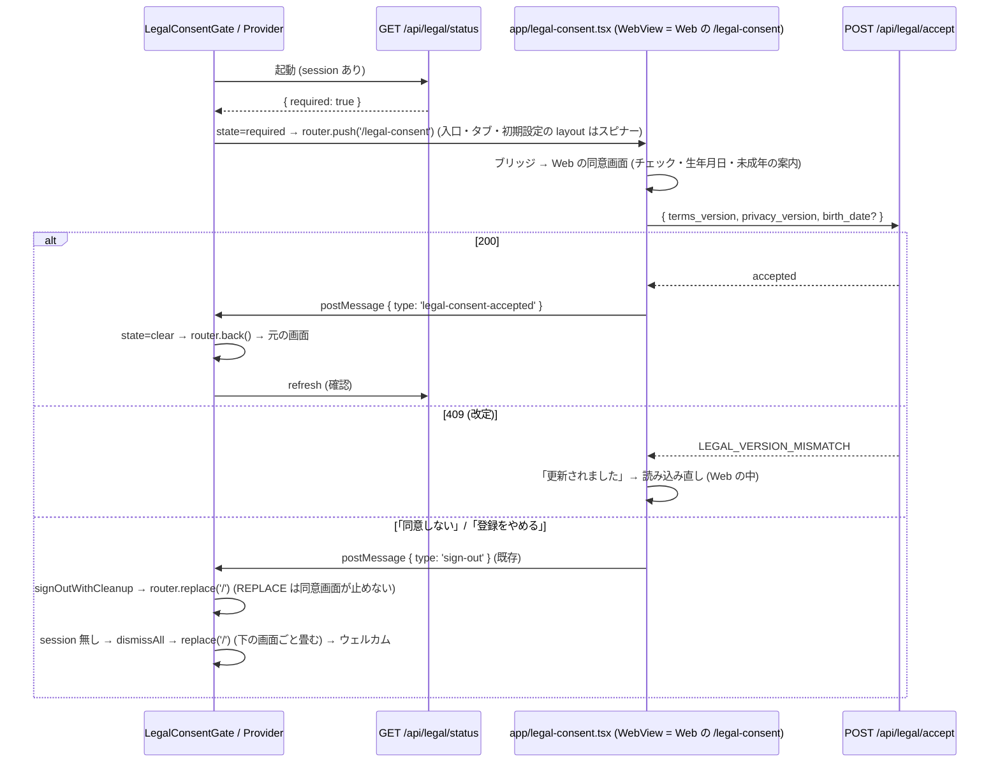

# 13b. 規約の同意ゲートをモバイルのネイティブの画面にも掛ける — 配線 (モバイル) (#1442)

> **13a (`13a-legal-consent-api-server.md`) は設計書も実装 (#1689・PR #1697) も main に着地済み。本冊は 13a の実コードを正として使う側。** 本冊が参照する 13a の公開名 (`@homegohan/shared` の関数・定数・型と `GET /api/legal/status` の応答。§0.4) が実コードと食い違ったら、実コードに合わせる。13a の設計書は本冊で変えない。食い違いに気付いた箇所は §6.22 に書く。

| 項目 | 値 |
|---|---|
| Status | 設計ゲート審査中 (v2.1) |
| Issue | #1442 (親: #1174 の同意ゲート。先例: #1154 の AI 同意の 403・#1030 / #1445 の凍結の API ゲート。前提: #1598 の WebView への一本化と PR #1733) |
| 分冊 | 本冊 = 配線 (段 B: モバイル + Web → ネイティブの合図 1 本)。核 (段 A: サーバー + `packages/shared`) は `13a-legal-consent-api-server.md` (着地済み) |
| 正典の関係 | 13a とともに `08-legal-compliance.md` §7.2 (同意ゲート) の配線を広げる冊。§7.2 の「モバイルのネイティブの画面は対象外」の記述は本冊のマージで現在形に直す (§6.19)。`cross/14-parental-consent.md` §0.5 が 13b に求める「生年月日の欄・未成年の案内」は、本冊では Web の同意画面をそのまま使うことで満たす (§6.19・§6.22) |
| 範囲の正本 | Issue #1442 の本文とコメント (コメントの記録: 運営の API も 403 で止める範囲に入れる・役割の例外を作らない) |
| 前提 (本冊が書かれた時点) | #1598 のコメント (2026-10-15) の記録「タブから行けないネイティブの画面は消して、WebView の画面に一本化します」と、PR #1733 (main `1c726fbb`。届かないネイティブの画面 60 本の削除) の後の main (2026-10-17・`88b803f5`)。`origin/design/legal-consent-mobile` の 13b (v1.1) は、この 2 つより前に書かれたので、消えた画面に依存する部分を落とし、残す部分の file:line を取り直した (§0.5) |
| 読み手 | 実装 (Sonnet 5.5) と敵対レビュー。実装は §6 だけを読んで手を止めずに書けることを完成条件にする |
| 節番号 | 分冊前の 13 と同じ番号を使う。本冊に無い節 (§3.3 以外の §3 の多く・§6.4・§6.6.1〜§6.6.7・§6.9・§6.13 など) は 13a にある。両冊にある節番号は、それぞれの冊に関わる行だけを持つ。両方に関わる行は 13a に置く |

---

## 0. 範囲・分冊判定・本書の読み方

### 0.1 一言でいうと

- モバイル: **1 枚のゲート (`LegalConsentGate`。ルートの layout に 1 つ)** が、サインイン中で「同意が要る」(`GET /api/legal/status` の `required`、または `/api` の 403 `LEGAL_CONSENT_REQUIRED`) なら、**同意画面の route (`app/legal-consent.tsx` = Web の `/legal-consent` を `WebViewScreen` で開く画面) をいまの画面の上に push する**。同意が済むと (Web の同意画面がネイティブへ `{ type: 'legal-consent-accepted' }` を送る) ゲートがその route を閉じ、元の画面にそのまま戻る (画面の入力も残る)。ログインの直後に着く 3 か所 (入口 `app/index.tsx`・タブ `app/(tabs)/_layout.tsx`・初期設定 `app/onboarding/_layout.tsx`) は、同意の状態が分かるまで・同意が要る間は中身を描かない (初期設定より先に同意)。「同意しない」でログアウトしたら、ゲートが同意画面の下に残った画面ごと畳んでウェルカムへ戻す。
- 同意画面そのもの (チェック 2 つ・全文へのリンク・同意しない・生年月日・未成年の案内・409 の読み込み直し) は **Web の `/legal-consent` が持つものをそのまま使う**。ネイティブに同意の画面を作らない。AI 同意の画面 (`app/settings/ai-consent.tsx` = Web の `/settings/ai-consent`) と同じ形。
- サーバー側 (`/api` の 403・`GET /api/legal/status`・shared の判定と文面) は 13a (着地済み)。本冊はそれを使う側。

### 0.2 分冊判定 (相 1)

| 目安 | 本冊 | 判定 |
|---|---|---|
| 設計書 800 行超 | 超える (表・トレース・正典コードを持つため) | トリガー |
| 消費先レーン 3 以上 | モバイル (apps/mobile) 1 つ + Web の合図 2 ファイル (`src/lib/native-auth-bridge.ts`・`src/app/legal-consent/LegalConsentForm.tsx`) | 2 |
| 共有面 2 つ以上 | `WebViewScreen.tsx` (全 WebView の画面が通る) 1 つ。`packages/shared` は触らない | 1 |

**判定: 1 冊・2 段 (B1 = Web の合図 → B2 = モバイル)。** 核 (13a) と配線 (本冊) の分冊は済んでいる。本冊の中をさらに分けない理由: 本冊の契約は 13a の実コード (shared の export・status の形・403 の形) と、Web → ネイティブの合図 1 本だけで、冊をまたぐ契約が増えない。段 B1 (Web の 2 ファイル) を先に閉じるのは、旧版のアプリが知らない type のメッセージを捨てる (`src/lib/native-auth-bridge.ts:22`) ので、Web だけ先に出しても壊れないため。

### 0.3 一次情報 (origin/main `88b803f5`。行番号は 2026-10-17 時点)

| 事実 | 場所 |
|---|---|
| ルートの `Stack` は `index`・`(public)`・`(auth)`・`(tabs)` を並べ、app 直下の画面 (`onboarding/*`・`handson-tour/*`・`health/blood-tests`・`profile/nutrition-targets`・`settings/*`) は自動で登録される。`screenLayout` は使っていない。Provider の順は `AuthProvider` > `ProfileProvider` > `PushTokenRegistrar` + `NotificationRouter` + `Stack` | `apps/mobile/app/_layout.tsx:92-108` |
| 入口: session あり & 初期設定未完了 → `/onboarding`、完了 → `/(tabs)/home`。auth と profile の読み込み中はスピナー。同意の確認は無い | `apps/mobile/app/index.tsx:13-22` |
| タブの layout: session 無し → `/`、読み込み中はスピナー、初期設定未完了 → `/onboarding/resume` か `/onboarding/welcome`。`settings` はタブバーに出さない画面。AI の FAB が全タブに出る | `apps/mobile/app/(tabs)/_layout.tsx:21-41, 110, 112` |
| `(auth)` の layout: session があれば `/(tabs)/home` へ (reset-password と verify だけは session があっても開ける) | `apps/mobile/app/(auth)/_layout.tsx:25-29` |
| ログインの後の振り分け `routeAfterSignIn`: profile を PostgREST で読み、`?next=` があればそこへ、無ければ初期設定の完了 → `/(tabs)/home`・開始済み → `/onboarding/resume`・未開始 → `/onboarding/welcome` へ `router.replace` (入口を通らない)。メールとパスワード (`:220`) と Google (`:124`) の両方 | `apps/mobile/app/(auth)/login.tsx:75-99` |
| サインアップはアプリの中でセッションを作らない (確認メールの Alert の後に `/(auth)/login` へ)。確認メールのリンクは `/auth/verify` で session を作り `/(tabs)/home` へ | `apps/mobile/app/(auth)/signup.tsx:100, 117-118`、`apps/mobile/app/(auth)/auth/verify.tsx:76-84` |
| 初期設定の layout: auth の読み込み中はスピナー、session 無し → `/login`、それ以外は `Stack` を描く (同意も profile も見ない)。振り分け: 完了 → home、開始済み → resume、未開始 → welcome | `apps/mobile/app/onboarding/_layout.tsx:15-24`、`apps/mobile/app/onboarding/index.tsx:17-25` |
| ハンズオンツアーの layout: 未ログイン → `/login`。`GET /api/handson-tour/status` を取り、失敗したらツアーを出す | `apps/mobile/app/handson-tour/_layout.tsx:30-61` |
| ツアーの献立の段は RN の `<Modal>` を 2 つ常に開く (`V4GenerateModal` のサンドボックス = `visible={true}`、吹き出し `TourOverlay` を包む `<Modal visible={true}>`)。2.9 で Step 3 へ `router.push`。サンドボックスの `POST /api/menu-plans/add` の失敗は握りつぶして先へ進む | `apps/mobile/app/handson-tour/menu.tsx:108-135, 199-233`、`apps/mobile/src/components/menu/V4GenerateModal.tsx:267-293` |
| ツアーを抜ける `leaveTour`: skip の API の後に `router.replace('/home')` | `apps/mobile/src/handson-tour/useLeaveTour.ts:42-62` |
| RN の `<Modal>` は push した route より上に出る (開いたままだと、push した同意画面を隠す)。app と src で `<Modal>` を描くのは `(tabs)/settings.tsx:453`・`AIAdvisorSheet.tsx:600`・`AIDayMenuModal.tsx:101`・`V4GenerateModal.tsx:287, 703` (`703` の通常版は main のどこからも使われない)・`handson-tour/menu.tsx:215` | `tests/ai-consent-mobile-modal-nesting.test.ts:1-35` |
| API クライアント: `withFriendlyErrors` は 429 と 503 だけを固定の文の例外に置き換え、403 はそのまま投げる | `apps/mobile/src/lib/api.ts:72-78` |
| 生の fetch の失敗の応答から Error を作る `errorOfFailedResponse` (同じ 2 つの判定)。`StoppedByServerError` の union と Alert の見出し | `apps/mobile/src/lib/failed-response.ts:26-35, 44-47` |
| AI 同意の 403 をアプリが見分ける形 (`HTTP 403 …: {json}`)。案内は `router.push('/settings/ai-consent')` | `apps/mobile/src/lib/ai-consent.ts:76-77, 86-97, 120` |
| Error の message から本文の文を取り出す `getApiErrorMessage` (平たい `{ error: '文' }` の文字列も読む) | `apps/mobile/src/lib/api-error.ts:38-68` |
| `WebViewScreen`: props は `path`・`testID`・`header`。認証ブリッジ (`POST /api/auth/native-bridge/code` → `/auth/native-bridge?code&next`) を自分で行い、`onMessage` は送り元が自オリジンのときだけ `tab-navigate`・`navigate-back`・`download`・`sign-out`・`session-expired` を処理する。注入スクリプトは `<a>` のクリックと `history.pushState` だけを捕まえる (`window.location.assign` による全体の読み込みでは `tab-navigate` を送らない) | `apps/mobile/src/components/web/WebViewScreen.tsx:37-43, 54-125, 197-247, 320-378` |
| Web からの `sign-out` / `session-expired` の処理。`sign-out` は `signOutWithCleanup` → `router.replace('/')`。送り元の検査 `isFromWebOrigin` | `apps/mobile/src/lib/webViewAuthMessages.ts:50, 64-68, 77-91, 205-225, 291-318` |
| Web → ネイティブのメッセージの型は `sign-out`・`session-expired`・`mfa-verify-required` の 3 つ。旧版のアプリは知らない type を捨てる。`postMessage` の送り方 `post()` | `src/lib/native-auth-bridge.ts:22, 33, 86-108, 126-132, 151-154` |
| Web の同意画面: 同意済みなら `next` へ redirect、生年月日の欄 (`needsBirthDate`)・保護者の同意の案内 (`guardianMissing`) を出す。同意が記録できたら `window.location.assign(next)`。「同意しない」は `notifyNativeSignOut()` → `signOut()` → `broadcastSignOut()`。「登録をやめる」は退会 → `signOutAfterAccountDeletion` (ネイティブへ `sign-out` を送る) | `src/app/legal-consent/page.tsx:41-79`、`src/app/legal-consent/LegalConsentForm.tsx:41, 126-171, 173-194, 198-214`、`src/lib/account-self-service.ts:18` |
| Web の画面の同意ゲートの対象外 (`/legal-consent` 自身・`/auth/*`・`/terms`・`/privacy` など)。`next` は `/api` と同意画面自身なら `/home` | `lib/legal-consent.ts:91-125, 210-216`、`lib/onboarding-routing.ts:67-70` |
| middleware の `/api` の分岐の同意の判定 (凍結 → メンテナンス → 同意) と、画面の判定 | `lib/supabase/middleware.ts:264-281, 405-425` |
| 通知のトークンの claim (`POST /api/push-tokens/claim`) は 13a の許可リストにある (`device_cleanup`)。登録そのものは PostgREST の upsert (middleware を通らない) | `packages/shared/src/legal-consent-api.ts:119-124`、`apps/mobile/src/lib/pushNotifications.ts:295-302, 324` |
| `AuthProvider` の公開値 (`isLoading`・`session`・`user`・`clearSession`)。`ProfileProvider` は `user_profiles` を PostgREST で直接読む | `apps/mobile/src/providers/AuthProvider.tsx:14-28`、`apps/mobile/src/providers/ProfileProvider.tsx:41-53` |
| 通知のタップの遷移は、ログインと今の利用者のプロフィールが分かってから `router.push` | `apps/mobile/src/components/NotificationRouter.tsx:90-107` |
| `SIGNED_OUT` の購読は `setSession(null)` を呼ぶだけで、掃除は待たない。Web からの `sign-out` は `signOutWithCleanup` の後に `goToWelcome` = `router.replace('/')` | `apps/mobile/src/providers/AuthProvider.tsx:240-259`、`apps/mobile/src/lib/webViewAuthMessages.ts:205-225, 313-315`、`apps/mobile/src/lib/signOut.ts:120-129` |
| expo-router 5.1.11 の `router.push` / `replace` / `back` / `dismissAll` は、その場で遷移しない。`routingQueue` に積み、`ImperativeApiEmitter` の effect (次の描画の後) で積んだ順に `dispatch` する。`router.back()` は `GO_BACK`、`dismiss()` は `POP`、`dismissAll()` は `POP_TO_TOP`、`replace` は `REPLACE`、`push` は `PUSH`。`Redirect` は `useFocusEffect` の中で `router.replace` を呼ぶ。`canDismiss()` は今の state の stack に 2 つ以上の route があるか | `node_modules/expo-router/build/global-state/routing.js` (`routingQueue`・`dismiss`・`dismissAll`・`goBack`・`canDismiss`)、`node_modules/expo-router/build/imperative-api.js` (`ImperativeApiEmitter`)、`node_modules/expo-router/build/link/Redirect.js` |
| react-navigation の `beforeRemove` は `event.data.action` (取り除く操作の action。`type` を持つ) を渡し、`preventDefault()` で止められる | `node_modules/@react-navigation/core/lib/typescript/src/types.d.ts` (`EventMapCore` の `beforeRemove`) |
| expo-router 5.1.11 / @react-navigation/core 7.17.2 / @react-navigation/native 7.2.2 / native-stack 7.14.12 | `package-lock.json` |

サーバー側の一次情報は 13a §0.3。

### 0.4 13a の実コードから使う公開名

| 名前 | 種別 | 場所 (origin/main) | 本冊で使う所 |
|---|---|---|---|
| `LEGAL_CONSENT_REQUIRED_MESSAGE`, `LEGAL_CONSENT_REQUIRED_STATUS`, `isLegalConsentRequiredBody` | shared の定数・関数 | `packages/shared/src/legal-consent-api.ts:39-42, 67-69` | 6.6.8 (403 の見分け) |
| `LEGAL_CONSENT_STATUS_API_PATH`, `isLegalConsentStatus`, `LegalConsentStatus` | shared の定数・関数・型 | `packages/shared/src/legal-consent-api.ts:32, 187-205, 253-268` | 6.6.9 (status の取得) |
| `GET /api/legal/status` の応答 (`required` = `enforced && !accepted`、`accepted` = `gaps` が空) | API | 13a §6.9、`packages/shared/src/legal-consent-api.ts:214-240` | 6.6.9 (ゲートは `required` だけを見る) |
| 403 `{ error, code: 'LEGAL_CONSENT_REQUIRED' }` | API の本文 | 13a §6.8、`lib/supabase/middleware.ts:272-280` | 6.6.8・6.6.14 |

本冊は `LEGAL_CONSENT_ACCEPT_API_PATH`・`LEGAL_CONSENT_COPY`・`legalConsentAgreeLabel` などの文面を**使わない** (同意の記録と文面は Web の同意画面が WebView の中で担う。§6.22 の 5)。

### 0.5 土台 (origin/design/legal-consent-mobile の 13b v1.1) から落としたもの・残したもの

| 土台の部分 | 扱い | 理由 |
|---|---|---|
| §3.3 の画面表 (ネイティブの健康・AI・レシピ・食材・買い物リスト・運営・組織・サポートの画面) | **落とす** (§3.3 を今の main の 29 画面 (`apps/mobile/app/` の `_layout.tsx` 以外の画面ファイル) で書き直す) | PR #1733 で消えた (今の main に無い) |
| ネイティブの同意画面 `LegalConsentScreen.tsx` (6.6.12) と、その文面 (`LEGAL_CONSENT_COPY` の利用)・`VERSION_MISMATCH_STATUS`・`httpStatusOfError` | **落とす** | #1598 の WebView への一本化。土台の画面には生年月日の欄・未成年の案内・「登録をやめる」(cross/14 が 13b に求めるもの) が無く、作ると Web の同意画面の写しになる (§5.2) |
| ルートの `Stack` の `screenLayout` に置くゲート (6.6.10・6.6.11) | **落とし、route を push するゲートに置き換える** (§5.2 の A'' と C'') | 画面の代わりに描くと、その画面の入力 (血液検査の入力など) が同意の後に消える。route なら元の画面がそのまま残る |
| `PushTokenRegistrar` を同意の後まで待たせる差分 (6.6.10 の一部) | **落とす** | claim は 13a の許可リストにある (`packages/shared/src/legal-consent-api.ts:119-124`)。登録は PostgREST で middleware を通らない |
| `MOBILE_LEGAL_CONSENT_EXEMPT_PATHS` の `/pricing` | **落とす** | `(public)/pricing` の画面は billing/01 §10.4 で消えた (今の `(public)` は about・privacy・terms の 3 本) |
| 403 の見分けと Provider への知らせ (6.6.8)・Provider の状態 (6.6.9)・`api.ts` / `failed-response.ts` の差分 (6.6.13)・対象外のパスの考え方・ENFORCE off と読めないときの決定 (§6.11)・テストの骨格 | **残す** (file:line を取り直し、名前を本冊の構造に合わせた) | 今の main と食い違わない |

---

## 1. 目的・スコープ

### 1.1 解決すること (Issue #1442 のうち本冊の分)

Issue の全体 (3 つの経路) は 13a §1.1。本冊が解決するのは次の 2 つ (3 の `/api/*` は 13a で解決済み)。

1. モバイルのネイティブの画面 (今の main では、初期設定・ハンズオンツアー・設定タブとそこから開く画面・AI 相談のシート。§3.3) は WebView を通らないので、未同意のまま使える。
2. 新規の人は、ネイティブの初期設定 (健康情報の入力) を同意より先に済ませられる。

13a の後、1 と 2 の画面が呼ぶ `/api` は 403 で止まる (初期設定の完了・ツアーの status・AI 相談など) が、画面そのものは開け、403 の文が各画面のエラーとして出るだけで同意画面へ辿り着けない。本冊はこれを「同意画面へ回す」に直す。

### 1.2 前提

- 13a §1.2 (本番は `LEGAL_CONSENT_ENFORCE=on`。ローンチ前で利用者はゼロ)。
- #1598 のコメント (2026-10-15) の記録「タブから行けないネイティブの画面は消して、WebView の画面に一本化します」。PR #1733 で、届かないネイティブの画面 60 本を消した。
- 配布 (#1115) の前なので、13b より前のビルドは利用者に届いていない (§6.21)。

### 1.3 対象外

13a §1.3 (規約の文面・同意の記録の仕組み・アプリの Supabase の直読み) に加えて、本冊に関わるもの:

- `LEGAL_CONSENT_NOTICE` (お知らせ) は Web の `(main)` の画面だけのまま。ネイティブにはお知らせを出さない (WebView のタブでは Web のお知らせが見える)。
- アプリ (Expo) のネイティブのサインアップ画面に同意のチェックを足すこと (`08` §7.2 の残課題のまま。本冊のゲートで、登録直後の起動時に同意画面へ回るので、使う前には必ず同意する)。
- 同意画面の中身 (チェック・生年月日・未成年の案内・「登録をやめる」・本人の権利の請求の案内) を変えること。Web の `/legal-consent` の責務 (cross/08・cross/14・cross/15)。
- アプリが Supabase (PostgREST) を直接読み書きする経路 (`apps/mobile/app/onboarding/questions.tsx:905` の `user_profiles` の upsert・`apps/mobile/src/lib/pushNotifications.ts:295` の `user_push_tokens` の upsert・`ProfileProvider` の select) は、Next の middleware を通らないので本冊のゲートの外 (13a §6.13 の限界・§8 Q-2)。
- 強制アップデート (`/api/app/version-check`。mobile/01 §8) は main に route が無く、本冊でも作らない (§6.21)。

---

## 2. 関連要件

- `docs/design/cross/08-legal-compliance.md` §7.2 (再同意フロー)。
- `docs/design/cross/13a-legal-consent-api-server.md` (核。shared の export・status の応答・403 の形)。
- `docs/design/cross/14-parental-consent.md` §0.5 (13a / 13b との契約: `gaps` の `'birth_date'` / `'guardian_consent'`。本冊は Web の同意画面で満たす)。
- `docs/design/mobile/01-architecture.md` §3.2 (WebView ハイブリッド・`WebViewScreen` の役割)・§6 (ファイル構成)。
- `docs/design/mobile/05-auth-session.md` §6 (WebView とネイティブのログアウト・セッション失効の同期。`sign-out` / `session-expired` の合図)。

---

## 3. 相 1 外形固定: 要件行列・ユーザーシナリオ・現行の画面

### 3.1 要件行列 (本冊の行)

| ID | 要件 | 出どころ | 検証 (§6.14 の it) |
|---|---|---|---|
| R-6 | モバイルは、ログイン後、初期設定より先に同意の状態を確かめ、未同意なら同意画面へ回す | Issue 本文「起動時・初期設定の前に同意の状態を確かめて同意画面へ回す」 | T-G1, T-IDX1, T-TL1, T-OB1, T-P1, T-P7 |
| R-7 | 今の main のネイティブの画面と起動の流れを実コードで列挙し、同意の前に使えてしまう経路を表にする。WebView の中の画面は Web の同意ゲートが受け持つ | Issue 本文 | §3.3 |
| R-12 | 同意画面は Web の `/legal-consent` を WebView で開き、Web と同じ要件 (必須チェック 2 つ・全文へのリンク・同意しない = ログアウト + 削除の依頼先の案内・生年月日・未成年の案内) をそのまま使う。ネイティブに同意の画面を作らない | #1598 のコメントの記録 (WebView への一本化)・cross/14 §0.5 | T-SC1, T-W2, E2E (既存の `legal-consent-gate.spec.ts`) |
| R-15 | ネイティブの側が `/api` を呼んで 403 `LEGAL_CONSENT_REQUIRED` を受けたら、どの画面からでも同意画面へ回し、同意が済んだら元の画面に戻る (画面の入力を失わない) | Issue 本文「API の 403 の専用コード」 | T-API1, T-FR1, T-P3, T-G1, T-G3 |
| R-16 | 同意が済んだことをネイティブが知る合図は Web の同意画面が送る (`legal-consent-accepted`)。旧版のアプリはこの合図を捨てても壊れない | `src/lib/native-auth-bridge.ts:22` の既存の規則 | T-W1, T-W3, T-WV1, T-P4 |
| R-17 | 配布 (#1115) の前の旧版のアプリの扱い (旧版も `/api` の 403 で止まる) を書く | Issue 本文「どこまで止めるか…設計で決める」と 13a の着地 | §6.21 |
| R-18 | 13a の設計書・実コード (`packages/shared`・middleware・status route) を変えない。食い違いは本冊で指摘する | 本冊の前提 | §6.22 |

R-1〜R-5・R-14 (サーバー) と、両方に関わる R-8〜R-11・R-13 は 13a §3.1。

### 3.2 ユーザーシナリオ (16 本)

サーバーだけで結果が決まる S6・S7・S10・S11・S14・S16・S17 と、両方に関わる S5・S8・S9・S15 は 13a §3.2 (S5・S8・S9 のモバイル側の走らせ方は本冊 §4.2 に重ねて書く)。

| ID | シナリオ |
|---|---|
| S1 | 新規登録 (アプリのネイティブのサインアップ) → 確認メール → ログイン (メールとパスワード、または確認メールのリンク) → 初期設定の前に同意画面 (WebView) → 同意 → 初期設定へ |
| S2 | 既存の利用者 (同意済み) がアプリを起動 → 今までどおりホーム (余計な画面は出ない) |
| S3 | 既存の利用者 (未同意・ENFORCE=on) がアプリを起動 → 同意画面 → 同意 → 元の入口 (ホーム) |
| S4 | アプリの同意画面で「同意しない」→ Web がログアウトし、ネイティブもログアウト → ウェルカム画面 (削除の依頼先はお問い合わせ) |
| S5 (モバイル側) | 規約の改定の後、血液検査の画面で入力の途中に保存 → `/api` が 403 → 同意画面がその上に開く → 同意 → 同じ画面に入力が残ったまま戻る → もう一度保存 |
| S12 | 未同意のセッションが残る端末で、パスワード再設定のリンクを開く → `/auth/reset-password` はゲートの対象外 → 再設定できる → ログアウトしてログイン画面へ (既存の流れ) → ログイン後に同意画面 |
| S13 | 同意画面 (WebView) を開いたまま改定 → Web の同意画面が 409 を受けて「更新されました」と読み込み直しを促す → 読み込み直して新しい版で同意 |
| S18 | 機内モードでアプリを起動 (保存済みのセッション) → status を取れず `unknown` → 画面は開く (通信できない案内は今までどおり) → 通信が戻った最初の API 呼び出しが 403 なら同意画面 |
| S19 | 生年月日がプロフィールに無い人 (cross/14。`gaps` に `'birth_date'`) がアプリを起動 → `required` → 同意画面 (WebView) に生年月日の欄が出る → 入力して同意 → 元の画面へ |
| S20 | 18 歳未満の本人が自分で登録 → 同意画面で生年月日を入れる → Web が 403 `LEGAL_MINOR_SELF_SIGNUP_REFUSED` → 案内 →「登録をやめる」→ 退会 → Web がネイティブへ `sign-out` → ウェルカム画面 |
| S21 | 未同意の人が通知をタップしてアプリを開く → 同意画面が先 → 同意 → 通知の行き先 (血液検査の画面) へ |
| S22 | 13b より前のビルド (配布前の開発機) で、未同意の人が初期設定の完了を押す → `/api/onboarding/complete` が 403 → 画面に固定の文「利用規約・プライバシーポリシーへの同意が必要です…」が出る → ホームのタブ (WebView) を開くと Web の同意画面 → 同意すると以後の API が通る (§6.21) |
| S23 | 未同意の人が deep link で `homegohan://health/blood-tests` を開く → 画面が 1 往復ぶん見えてから同意画面が上に開く (その間の API は 403) → 同意 → 血液検査の画面 |
| S24 | `LEGAL_CONSENT_ENFORCE` が off → status は `required: false` → 同意画面は出ない (13a の S8 と同じ) |
| S25 | ハンズオンツアーの途中で改定 → 次の API (写真の保存) が 403 → 同意画面がツアーの上に開く → 同意 → ツアーの同じ段に戻る |
| S26 | ハンズオンツアーの献立の段 (RN の Modal を出している段) で改定 → 献立の追加 (サンドボックス) の API が 403 → 段の Modal が閉じ、同意画面が見える → 同意 → Modal が戻り、ツアーの続き (Step 3) へ |

### 3.3 今の main に残るネイティブの画面と起動の流れ (実コードで列挙。R-7)

`apps/mobile/app/` の画面ファイル全部 (origin/main `88b803f5`。`_layout.tsx` は区画の行に畳む)。種別の WebView = `WebViewScreen` を使う (Web の同意ゲートが WebView の中で効く)。公開 = `PublicPage` (本文は Web 版へのリンク)。**「同意の前」= 今の main で、未同意のまま使えるか (API を呼ぶなら 13a の 403 で止まるが、画面は開ける)。「本冊」= 本冊のゲートの扱い (対象 = `required` なら同意画面を上に開く)。**

| 区画 | 画面ファイル (`apps/mobile/app/`) | パス | 種別 | 呼ぶ `/api` (file:line) | 同意の前 | 本冊 |
|---|---|---|---|---|---|---|
| 入口 | `index.tsx` | `/` | ネイティブ (ウェルカム / 振り分け) | 無し (`index.tsx:13-22`) | 開ける。session があれば `/onboarding` か `/(tabs)/home` へ回す | 対象。同意の状態が分かるまで振り分けない (6.6.13) |
| (auth) | `(auth)/login.tsx`, `(auth)/signup.tsx` | `/login`, `/signup` | ネイティブ | 無し (Supabase の auth を直接。`login.tsx:106, 163`・`signup.tsx:39, 100`) | 開ける (未ログイン)。ログイン後は `login.tsx:88-99` が `?next=` / `/(tabs)/home` / `/onboarding/resume` / `/onboarding/welcome` へ直接回す (入口を通らない) | 対象外 (未ログインの画面。session があれば `(auth)/_layout.tsx:29` がホームへ回す)。回った先のタブと初期設定の layout が同意の状態を待つ (6.6.13)。`?next=` で app 直下の画面へ回ったときは §8 Q-4 |
| (auth) | `(auth)/auth/forgot-password.tsx`, `reset-password.tsx`, `verify.tsx` | `/auth/forgot-password`, `/auth/reset-password`, `/auth/verify` | ネイティブ | 無し (`reset-password.tsx:90-96` は updateUser → `signOutWithCleanup` → `/login`。`verify.tsx:84` は session ができたら home へ) | 開ける (認証の途中) | 対象外 (Web の `/auth/*` と同じ理由) |
| (public) | `(public)/about.tsx`, `privacy.tsx`, `terms.tsx` | `/about`, `/privacy`, `/terms` | 公開 (PublicPage) | 無し | 開ける | 対象外 (同意の根拠になる文面と公開の案内。Web の `/terms` `/privacy` と同じ理由) |
| (tabs) | `(tabs)/home.tsx`, `menus.tsx`, `meals.tsx`, `comparison.tsx`, `profile.tsx` | `/home`, `/menus`, `/meals`, `/comparison`, `/profile` | WebView (`/home`・`/menus/weekly`・`/meals/new`・`/comparison`・`/profile`) | WebView の中の API は Web のゲートが受け持つ | 開ける。WebView の中で Web の同意ゲートが `/legal-consent` へ回す (Web の同意画面がタブの中に出る) | 対象。`required` の間はタブを描かない (6.6.13)。同意の後に描き直す |
| (tabs) | `(tabs)/settings.tsx` (タブバーに出さない。`(tabs)/profile.tsx:33` の歯車から開く) | `/settings` | ネイティブ (設定) | `GET`/`PATCH /api/notification-preferences` (`settings.tsx:81, 124`)、`GET /api/account/export` (`:165`。許可リスト)、`GET /api/export/meals` (`:210`) | 開ける (ホームのタブで同意画面に回された後でも、歯車はマイページのタブの上なので、同意の前には届かない) | 対象 |
| 設定から開く | `health/blood-tests.tsx` (`settings.tsx:331`) | `/health/blood-tests` | ネイティブ | `GET /api/health/blood-tests` (`:223-225`)、`POST /api/ai/analyze-health-checkup` (`:274-275`)、`POST /api/health/blood-tests` (`:358-360`) | 通知の行き先 (`notificationRoute.ts:39`) と deep link からは、同意の前でも開ける | 対象 |
| 設定から開く | `profile/nutrition-targets.tsx` (`settings.tsx:339`) | `/profile/nutrition-targets` | ネイティブ | `POST /api/nutrition-targets/calculate` (`:107-108`) | 設定からだけ | 対象 |
| 設定から開く | `settings/account.tsx` (`settings.tsx:436`) | `/settings/account` | ネイティブ | `POST /api/account/delete` (`:66`。許可リスト) | 設定からだけ | 対象 (退会の API は未同意でも通る。画面自体は同意の後) |
| 設定から開く | `settings/ai-consent.tsx` (`settings.tsx:374`・`ai-consent.ts:120`) | `/settings/ai-consent` | WebView (`/settings/ai-consent`) | WebView の中 | 設定からと、AI の 403 の案内から | 対象 |
| 初期設定 | `onboarding/index.tsx`, `welcome.tsx`, `questions.tsx`, `resume.tsx`, `complete/index.tsx` | `/onboarding`, `/onboarding/welcome`, `/onboarding/questions`, `/onboarding/resume`, `/onboarding/complete` | ネイティブ | `POST /api/onboarding/complete` (`welcome.tsx:20-21`、`questions.tsx:943-944`)、`POST /api/nutrition-targets/calculate`・`PUT /api/nutrition/targets` (`complete/index.tsx:127-140`)。`questions.tsx:905` は `user_profiles` を PostgREST で upsert (ゲートの外。§1.3) | **開ける。Issue の 2 の経路** (入口が同意を見ずに `/onboarding` へ回す。ログインの `routeAfterSignIn` は入口を通らずに `/onboarding/welcome` か `/onboarding/resume` へ直接回す) | 対象 (R-6: 入口と初期設定の layout が同意の状態を待ち、`required` なら同意画面が先) |
| ツアー | `handson-tour/index.tsx`, `photo.tsx`, `menu.tsx`, `badges.tsx`, `graduate.tsx` | `/handson-tour`, `/handson-tour/photo`, `/handson-tour/menu`, `/handson-tour/badges`, `/handson-tour/graduate` | ネイティブ | layout: `GET /api/handson-tour/status` (`_layout.tsx:43-44`)。`POST /api/handson-tour/skip` (`index.tsx:114`、`src/handson-tour/useLeaveTour.ts:57`)、`POST /api/meal-plans/add-from-photo` (`photo.tsx:282`)、`POST /api/menu-plans/add` (`menu.tsx` が描く `src/components/menu/V4GenerateModal.tsx:272-273`)、`GET /api/badges` (`badges.tsx:69`)、`POST /api/handson-tour/complete` (`graduate.tsx:88, 198-199`) | 開ける (初期設定の完了 `complete/index.tsx:374` と、設定の「ツアーをもう一度」`settings.tsx:392` から) | 対象 (Web は `/handson-tour` の画面を対象外にするが、ネイティブは同意画面をツアーの上に開き、同意の後に同じ段へ戻るので流れが切れない)。献立の段 (`menu.tsx`) は RN の Modal を常に開くので、`required` の間は Modal を閉じ、Step 3 へ進まない (6.6.17) |
| 部品 (全タブ) | `src/components/ai/AIFloatingFab.tsx` → `AIAdvisorSheet.tsx` → `AIDayMenuModal.tsx` | (タブの上) | ネイティブのシート | `/api/ai/consultation/...` (`AIAdvisorSheet.tsx:196-308, 426-430`。生の fetch は `:331, 446`)、`POST /api/ai/menu/v4/generate` (`src/hooks/useV4MenuGeneration.ts:86-87`) | タブが描かれていれば開ける | 対象 (`required` の間はタブを描かないので FAB も出ない。改定の後の 403 は同意画面を上に開く) |
| 起動時の処理 | `app/_layout.tsx:38-57` の `PushTokenRegistrar`、`src/components/NotificationRouter.tsx` | — | — | claim `POST /api/push-tokens/claim` (`pushNotifications.ts:324`。許可リスト)、失敗の報告 `POST /api/log` (`:150-151`。許可リスト) | 同意の前でも通る (許可リスト) | 変えない (claim)。通知の行き先への遷移は同意の後に延ばす (6.6.13) |

RN の `<Modal>` (push した同意画面より上に出る。§0.3) を描く所の扱い: `(tabs)/settings.tsx` のログアウトの確認・`AIAdvisorSheet` と `AIDayMenuModal` (タブの AI の FAB から) は、どれもタブの中なので、`required` の間タブの layout がスピナーになると一緒に外れる (6.6.13)。`V4GenerateModal` の通常版は使われていない。残る `handson-tour/menu.tsx` の 2 つ (常に開く) は、`required` の間閉じる (6.6.17)。

対象外のパスの一覧 (`MOBILE_LEGAL_CONSENT_EXEMPT_PATHS`。§6.7) は、この表の「対象外」の行 = `(auth)` と `(public)` の画面と、同意画面そのもの (`/legal-consent`) に一致する。一致はテスト T-ML3 が `apps/mobile/app/(auth)` と `(public)` のファイル名から確かめる。

PR #1733 で消えた画面 (運営・組織・サポートの区画、AI 相談の全画面、健康の記録、レシピ、食材、買い物リスト、お気に入り、食事の詳細、週の献立のネイティブ版など 60 本) は、この表に無い。土台の 13b (v1.1) の §3.3 はこれらを対象の行として持っていた (§0.5)。

---

## 4. 相 2 構想とトレース

### 4.1 構造

```
モバイル (段 B2)
  apps/mobile/src/lib/legal-consent.ts                 ← 403 の見分け・LegalConsentRequiredError・合図 (required / accepted) の購読・対象外のパス・同意画面のパスとメッセージの type・状態の型と利用者ごとの記録の純粋な関数・同意画面で止める「戻る」の action
  apps/mobile/src/providers/LegalConsentProvider.tsx   ← GET /api/legal/status を user ごとに取り、利用者ごとの記録から state (loading / clear / required / unknown) を描画のその場で決める。合図で state を動かす
  apps/mobile/src/components/legal/LegalConsentGate.tsx ← ルートの layout に 1 つ。required なら同意画面の route を push、済んだら閉じる。ログアウトしたら下に残った画面ごと畳む (描くものは無い)
  apps/mobile/app/legal-consent.tsx                    ← 同意画面の route = WebViewScreen path="/legal-consent"。同意が要る間は「戻る」の操作 (GO_BACK / POP / POP_TO_TOP) で閉じない
  apps/mobile/app/_layout.tsx                          ← Provider と Gate を置く。legal-consent の Stack.Screen (gestureEnabled: false)
  apps/mobile/app/index.tsx, app/(tabs)/_layout.tsx, app/onboarding/_layout.tsx ← 同意の状態が分かる (clear / unknown) まで・required の間は中身を描かない (ログインの直後に着く 3 か所)
  apps/mobile/src/components/NotificationRouter.tsx    ← 同意の状態が分かるまで・required の間・同意画面と入口 ('/') にいる間は通知の行き先へ移らない
  apps/mobile/app/handson-tour/menu.tsx                ← required の間は RN の Modal 2 つを閉じ、Step 3 へ進まない
  apps/mobile/src/lib/api.ts, failed-response.ts       ← 403 LEGAL_CONSENT_REQUIRED → Provider へ知らせ + 固定の文の例外
  apps/mobile/src/components/web/WebViewScreen.tsx     ← onMessage に legal-consent-accepted の分岐 1 つ
Web (段 B1)
  src/lib/native-auth-bridge.ts                         ← notifyNativeLegalConsentAccepted (type: 'legal-consent-accepted')
  src/app/legal-consent/LegalConsentForm.tsx            ← 同意を記録できたら、next へ移る前にネイティブへ知らせる
```

判定の規則 (13a §4.1 の「モバイルの判定」をそのまま使う): **`session && !exempt(pathname) && state === 'required'` → 同意画面を上に開く**。`required` は `GET /api/legal/status` (サーバーが `enforced && !accepted` を計算) か、`/api` の 403 `LEGAL_CONSENT_REQUIRED` で決まる。モバイルはフラグも版も読まない。

同意画面の route を「上に開く」理由 (画面の代わりに描かない・ルートの外に重ねない): 元の画面のコンポーネントが残るので入力が消えない (R-15)。ただし RN の `<Modal>` は push した route より上に出るので、Modal を開いたままの画面は `required` の間 Modal を閉じる (§3.3 の Modal の段落)。`WebViewScreen` は `useNavigation` / `useLocalSearchParams` / `useRouter` を使うので、ナビゲーターの中 (route) に置く必要がある。AI 同意の画面を `router.push('/settings/ai-consent')` で開く既存の形 (`ai-consent.ts:120`) と同じ。

### 4.2 トレース (全シナリオを構造で手で走らせる)

| ID | 走らせた結果 |
|---|---|
| S1 | サインアップ (`signup.tsx:100`) → 確認メールの Alert → `/(auth)/login` (`:117-118`。アプリの中ではセッションを作らない) → 経路は 2 つ。(A) 確認メールのリンク → `/auth/verify` (対象外) → session → `verify.tsx:84` の `Redirect` で `/(tabs)/home`。(B) ログイン (`login.tsx:163`) → SIGNED_IN → session → `(auth)/_layout.tsx:29` の `Redirect` で `/(tabs)/home`、続いて `routeAfterSignIn` (`login.tsx:75-99`) が profile を読み、初期設定が未開始なので `router.replace('/onboarding/welcome')`。どちらも、user が入った描画から同意の状態は `loading` (記録が今の利用者のものでない。6.6.9) → タブの layout も初期設定の layout も (6.6.13) スピナーで中身を描かない → `LegalConsentProvider` が `GET /api/legal/status` (許可リスト → 200) → 行が無いので `accepted: false`、本番は `enforced: true` → `required: true` → state `required` → `LegalConsentGate` が前面の pathname (`/home` か `/onboarding/welcome`。どちらも対象) の上に `router.push('/legal-consent')`。(B) で `routeAfterSignIn` の `replace` が push の後に流れたときは、同意画面が `/onboarding/welcome` に置き換わる (`REPLACE` は「戻る」でないので同意画面の `beforeRemove` は止めない。6.6.11) → 初期設定の layout は `required` でスピナー → Gate が pathname の変化でもう一度 push → `app/legal-consent.tsx` = `WebViewScreen path="/legal-consent"` → ブリッジ (`/api/auth/native-bridge/code` は許可リスト、`/auth/native-bridge` は画面の判定の対象外) → Web の `/legal-consent` (画面の判定の対象外。`page.tsx` が profile を読み、未同意なので form を出す) → チェック 2 つ → `POST /api/legal/accept` (許可リスト → 200) → form が `notifyNativeLegalConsentAccepted()` → `window.location.assign('/home')` → ネイティブ: `WebViewScreen.onMessage` (送り元は自オリジン) → `notifyLegalConsentAccepted()` → Provider が state を `clear` にして `refresh()` → Gate: pathname `/legal-consent` で `required` でないので `router.back()` → (A) タブの layout が `clear` で描き、`profile.onboardingCompletedAt` 無しなので `(tabs)/_layout.tsx:35-41` が `/onboarding/welcome` へ。(B) 初期設定の layout が `clear` で `Stack` を描き、welcome → 初期設定 (`POST /api/onboarding/complete` は同意済みなので通る)。初期設定の画面は同意の前に一度も描かれない (R-6) |
| S2 | 起動 → `index.tsx` は auth / profile / 同意の状態の読み込み中スピナー → status 200 `required: false` → `clear` → `/(tabs)/home` → `(tabs)/_layout` が描く。同意画面は出ない。status の 1 往復は ProfileProvider の読み取りと並行なので、起動が目に見えて遅くならない |
| S3 | 起動 → `index.tsx` スピナー → `required` → `index.tsx` はスピナーのまま (振り分けない) → Gate が `/` の上に同意画面を push → 同意 → `accepted` の合図 → `clear` → Gate が `back()` → `index.tsx` が `/(tabs)/home` へ |
| S4 | 同意画面 (WebView) の「同意しない」→ Web が `clearUserScopedLocalStorage()` → `notifyNativeSignOut()` → `signOut()` → `broadcastSignOut()` (`LegalConsentForm.tsx:179-188`) → ネイティブ: `useWebAuthMessages` が `sign-out` を受けて `performNativeSignOut` → `signOutWithCleanup` の最後の `supabase.auth.signOut()` → SIGNED_OUT → `AuthProvider` が `setSession(null)` (描き直しはまだ) → `goToWelcome` = `router.replace('/')` (`webViewAuthMessages.ts:313-315`。expo-router の `routingQueue` に積まれ、次の描画の後に流れる) → 同意画面の `beforeRemove` は `REPLACE` を止めない (「戻る」でない。6.6.11) → 同意画面が入口 `/` に置き換わる → session null の描画: Provider の state は `clear` (user 無し)、入口はウェルカム → Gate: session 無しで、このログインの間にゲートが同意画面を開いていた (`openedRef`) ので、`router.canDismiss()` なら `router.dismissAll()` → `router.replace('/')` (同意画面の下に残った画面 (S5 なら血液検査の画面) ごと畳み、Stack は入口だけ) → ウェルカム画面。描き直しが `goToWelcome` の `replace` より先に来ても、Gate が先に畳み、後の `replace('/')` は入口を入口に置き換えるだけで同じ結果。削除の依頼先は Web の「同意しない」の後の画面 (お問い合わせへのリンク) が案内する |
| S5 (モバイル側) | 血液検査の画面で入力の途中に保存 → `getApi().post('/api/health/blood-tests')` → middleware が 403 `LEGAL_CONSENT_REQUIRED` → `withFriendlyErrors` が `legalConsentRequiredErrorOf(e)` で見分け、`notifyLegalConsentRequired()` → Provider が state を `required` にして `refresh()` → Gate が pathname `/health/blood-tests` の上に同意画面を push (血液検査の画面は Stack に残る。入力も残る) → 画面側の catch は `LegalConsentRequiredError` (message = 固定の文) を受けて Alert を出すが、同意画面が上に開くので固定の文が見えるのは一瞬 → 同意 → `accepted` → `clear` → Gate が `back()` → 血液検査の画面に入力が残ったまま戻る → もう一度保存 → 200 |
| S8 (モバイル側) | status `enforced: false, required: false` → `clear` → 今までどおり |
| S9 (モバイル側) | status が 500 → `isLegalConsentStatus` を通らない or 例外 → `loading` から `unknown` → 止めない → DB が戻った後の API 呼び出しが 403 → S5 の経路 |
| S12 | pathname `/auth/reset-password` は `MOBILE_LEGAL_CONSENT_EXEMPT_PATHS` の `/auth` (前方一致) → Gate は push しない → 再設定 (`reset-password.tsx:90-96`: updateUser → `signOutWithCleanup` → `/login`) → ログアウトで Provider は `clear` → ログインし直すと S3 |
| S13 | 同意画面 (WebView) を開いたまま改定 → Web の form が `POST /api/legal/accept` で 409 → `setNeedsReload(true)` と「更新されました」(`LegalConsentForm.tsx:160-163`) → 読み込み直す (Web の画面の中) → `page.tsx` が新しい版で form を出す → 同意 → S1 の後半。ネイティブに 409 の分岐は要らない |
| S18 | 起動 → status の fetch が通信失敗 → `unknown` → `index.tsx` は振り分ける (`unknown` は待たない) → 画面の API も失敗 (今までどおり「通信できません」) → 通信が戻る → 最初の API 呼び出しが 403 → S5 の経路。ホームのタブを先に開き直した場合は、WebView の中で Web のゲートが同意画面へ回し、そこで同意すると Web の form が `accepted` の合図を送る → Provider が `clear` (元が `unknown` でも同じ) |
| S19 | `gaps` に `'birth_date'` → `accepted: false` → `required: true` → 同意画面 (WebView) → `page.tsx:77` が `needsBirthDate` を form に渡し、生年月日の欄が出る → `POST /api/legal/accept` に `birth_date` が付く (`LegalConsentForm.tsx:134`) → 200 → `accepted` の合図 → S1 の後半。ネイティブは `required` を見るだけ (cross/14 §0.5 の契約のとおり) |
| S20 | 生年月日を入れて同意 → Web が 403 `LEGAL_MINOR_SELF_SIGNUP_REFUSED` → form が `minor_refused` の案内 (`:150-153`) →「登録をやめる」→ `deleteOwnAccount()` → `signOutAfterAccountDeletion` (Web。ネイティブへ `sign-out`) → ネイティブは S4 と同じ経路でウェルカム画面 |
| S21 | 通知をタップして起動 → `NotificationRouter` が行き先 `/health/blood-tests` を保留 → 同意の状態が `loading` / `required` の間は `pendingHref` を消化しない (6.6.13) → `index.tsx` スピナーの上に同意画面 → 同意 → `clear` → 同じ描画の effect で、`NotificationRouter` は pathname がまだ `/legal-consent` なので保留のまま、Gate が `router.back()` → 入口 `/` に戻る → 入口が `clear` で `Redirect` (`/(tabs)/home`)。`NotificationRouter` は pathname が入口 `/` の間も保留 (入口の `Redirect` の `replace` と同じ描画で push すると、`routingQueue` で push の後に流れる `replace` が移った先を置き換える) → `replace` が流れて pathname `/home` → `NotificationRouter` が `router.push('/health/blood-tests')` → Gate は `clear` なので何もしない → Stack は [ホーム, 血液検査] |
| S22 | 旧版 (13b 無し): `POST /api/onboarding/complete` → 403 → `withFriendlyErrors` は 403 を素通し → 画面の catch → `getApiErrorMessage(e, …)` が本文の `error` (固定の文) を返す → Alert に固定の文。ホームのタブ (WebView) → Web のゲートが `/legal-consent` へ → 同意 → form が `accepted` の合図を送るが旧版は知らない type を捨てる (害は無い) → `window.location.assign('/home')` → 以後の `/api` が通る (§6.21) |
| S23 | deep link `homegohan://health/blood-tests` → expo-router が直接その画面を開く → Provider が status を取るまで (1 往復) 画面が見える。その間に押した保存は 403 で S5 の経路 → `required` → Gate が同意画面を上に開く → 同意 → `back()` → 血液検査の画面 |
| S24 | `enforced: false` → `required: false` → `clear` → 同意画面は出ない。403 も来ない (13a の S8) |
| S25 | ツアーの写真の保存 (`photo.tsx:282`) が 403 → `required` → 同意画面がツアーの上に開く (`handson-tour/_layout` の `TourProvider` と段の状態は残る) → 同意 → `back()` → 同じ段 → もう一度保存。同意画面の上で Android の戻るボタンを押し、写真の段のエラー画面の `useTourHardBack` (`useLeaveTour.ts:73-82`) が受けたときは、`leaveTour` が `router.replace('/home')` → 同意画面の `beforeRemove` は `REPLACE` を止めない → 同意画面が `/(tabs)/home` に置き換わる → タブの layout は `required` でスピナー → Gate がもう一度 push → 同意 → ホーム (ツアーは抜けた。skip の API の 403 は `leaveTour` の catch が握る) |
| S26 | ツアーの献立の段: サンドボックスの作成のタイマー (`V4GenerateModal.tsx:270-283`) が `POST /api/menu-plans/add` → 403 → `withFriendlyErrors` が `notifyLegalConsentRequired()` → 例外はサンドボックスの catch が握り、`onSandboxComplete` → 2.8 → 500 ms 後に 2.9 → 描画: `required` → `menu.tsx` の `consentHold` (`isNavigationHeldForLegalConsent`。6.6.8) が true → `V4GenerateModal` と吹き出しの `<Modal>` が `visible={false}` (吹き出しの `TourOverlay` も外れ、戻るボタンの受け口も無くなる) → Gate が pathname `/handson-tour/menu` の上に同意画面を push → 同意画面が見える → 2.9 の effect は `consentHold` の間 Step 3 へ push しない → 同意 → `clear` → 同じ描画の effect で Gate が `back()` を積む。献立の段は pathname がまだ `/legal-consent` なので `consentHold` は true のまま (Modal は閉じたまま・push しない。同じ描画で push すると、`routingQueue` で `back()` の後に流れ、閉じた同意画面の位置からツアーの区画をもう 1 つ積んでしまう) → `back()` が流れて pathname `/handson-tour/menu` → `consentHold` が false → Modal が `visible={true}` に戻り、2.9 の effect が走り直して Step 3 (`/handson-tour/badges`) へ push |

---

## 5. 相 3 構造裁定 (1 回だけ)

### 5.2 モバイル側の代替案

| 案 | 中身 | 判定 |
|---|---|---|
| A'' (採用) | ルートの layout に置いた 1 つのゲートが、`required` なら同意画面の route (`app/legal-consent.tsx` = Web の `/legal-consent` の WebView) を `router.push` し、済んだら `router.back()`。ログインの直後に着く 3 か所 (入口・タブ・初期設定の layout) は同意の状態が分かるまで待つ | 同意の画面は Web の 1 か所だけ (チェック・生年月日・未成年・「登録をやめる」・請求の案内・409 を全部そのまま使う。cross/14 §0.5 を追加の実装なしに満たす)。元の画面は Stack に残るので入力が消えない。AI 同意の画面と同じ形 (`ai-consent.ts:120`)。置き場所は 1 つ (ルートの layout) で、app 直下の画面も deep link も通知も漏れない (pathname の変化で毎回判定する) |
| B'' (土台 v1.1) | ネイティブの同意画面 (`LegalConsentScreen.tsx`) を作り、shared の文面を使う | 土台の画面には生年月日の欄・未成年の案内・「登録をやめる」(cross/14 §0.5) が無く、足すと Web の `LegalConsentForm.tsx` (約 300 行) の写しになる。#1598 のコメントの記録 (WebView への一本化) に逆行する。却下 |
| C'' (土台 v1.1) | ルートの `Stack` の `screenLayout` で、画面の代わりに同意画面を描く | 画面の代わりに描くと、その画面のコンポーネントが外れ、同意の後に入力が消える (血液検査・初期設定の質問)。`(tabs)` を丸ごと置き換えるので選んでいたタブも戻らない。expo-router が `screenLayout` を透過するかも未確認 (土台の Q-1)。却下 |
| D'' | ルートの layout で `Stack` の外に、絶対配置の View で同意画面を重ねる | `WebViewScreen` が `useNavigation` / `useLocalSearchParams` を使うので、ナビゲーターの外では動く保証が無い。下の画面が描かれ続け、タブの WebView が Web の同意画面を別に開く (同意の後に古い form が残る)。却下 |
| E'' | `index.tsx`・`(tabs)/_layout`・`onboarding/_layout` などの各 layout で `<Redirect href="/legal-consent" />` | app 直下の画面 (`health/blood-tests` など) は layout が無く、通知や deep link で直接開けるので漏れる。置き場が増えるほど漏れる。却下 |
| F'' | expo-router 5 の `Stack.Protected` | 保護する画面を全部列挙する必要があり (app 直下の画面は自動登録)、E'' と同じ漏れ方をする。却下 |

### 5.3 F の問い「縁の発生源を消すより単純な構造は無いか」

本冊の縁の発生源は「同意の UI が Web とネイティブの 2 か所にあること」だった (土台 v1.1 は、ネイティブの同意画面を持つために、文面を shared に置き、409・生年月日・未成年の分岐をネイティブにも写す必要があった)。A'' は同意の UI を Web の 1 か所にして、この発生源を消す。残る縁は 2 つだけ: ①Web → ネイティブの合図 1 本 (`legal-consent-accepted`。既存の `sign-out` / `session-expired` / `mfa-verify-required` と同じ仕組み) ②同意画面の route の出入りの規則 (`required` で対象のパスなら開く・同意画面にいて `required` でなければ閉じる・ゲートが開いた後にログアウトしたら下の画面ごと畳む。同意画面が止めるのは「戻る」の操作だけ)。これより単純な構造 (合図を無くして、WebView の URL の変化で済ませる) は、`WebViewScreen` にナビゲーションの口を足す改造になり、合図より広い共有面に触る。サーバー側の裁定 (13a §5.3) はそのまま。**構造はここで確定し、以後の周で蒸し返さない。**

---

## 6. 相 4 仕上げ

### 6.1 ① 全パターン表 (モバイルだけの行)

主体と経路の定義は 13a §6.1。モバイルと API の両方に関わる行 (初期設定 (モバイル)・同意済み・profile 読めない (モバイル)) は 13a §6.1。

| 主体 | 経路 | ENFORCE=on | ENFORCE=off | 変更 |
|---|---|---|---|---|
| 未ログイン | モバイルの画面 | Gate は何もしない (入口はウェルカム) | 同左 | なし |
| 未同意 (行なし / NULL / 旧版 / 生年月日なし / 保護者の同意のつながりの無い 18 歳未満) | モバイル ネイティブの画面 (対象) | **同意画面 (WebView) をその画面の上に開く。入口・タブ・初期設定の layout は同意の状態が分かるまで・`required` の間は中身を描かない** | 通す (`required: false`) | **新** |
| 未同意 | モバイル 対象外の画面 (`/login` `/signup` `/auth/*` `/about` `/privacy` `/terms` `/legal-consent`) | 通す | 通す | 新 (一覧の固定) |
| 未同意 | モバイル WebView のタブの中の画面 | Web の画面の判定が WebView の中で `/legal-consent` へ回す (既存)。本冊は `required` の間タブを描かないので、ふつうはネイティブの同意画面の route が先に出る | 通す | なし (Web) / 新 (描く順) |
| 未同意 | ネイティブの画面が呼ぶ `/api` (許可リスト外) | 403 (13a) → **同意画面を上に開く** | 通す | **新** (モバイルの扱い) |
| 未同意 | 通知のタップ・deep link | 同意画面が先。通知の行き先は同意の後 (同意画面が閉じ、入口の振り分けが済んでから) | 通す | **新** |
| 未同意 | ログインの直後 (`(auth)/_layout` の `Redirect`・`login.tsx` の `routeAfterSignIn`・`/auth/verify` の `Redirect`) | 着く先 (タブ・初期設定の layout) は同意の状態が分かるまで・`required` の間は中身を描かない。同意画面がその上に開く。`?next=` で app 直下の画面に着いたときは status の 1 往復だけ見える (§8 Q-4) | 通す | **新** |
| 未同意 | RN の Modal を常に開く画面 (ツアーの献立の段) | `loading` / `required` の間・同意画面が閉じるまでは Modal を閉じ、Step 3 へ進まない | 通す | **新** |
| 未同意 | 同意画面で「同意しない」「登録をやめる」 | ログアウト → ゲートが同意画面の下に残った画面ごと畳み、ウェルカムへ | 同左 (ENFORCE=off では同意画面が出ない) | **新** |
| 同意済み | すべて | 通す (同意画面は出ない) | 通す | なし |
| status を取れない (通信の失敗・500) | モバイル | `unknown` → 止めない。次の 403 で `required` | 同左 | 新 (方針の明記) |

### 6.2 ② 状態比較表 (現行 vs 設計後。モバイルの行)

サーバーの行は 13a §6.2。

| 面 | 現行 (main `88b803f5`) | 設計後 |
|---|---|---|
| モバイルの起動 | session → 初期設定 or ホーム (`index.tsx:21-22`) | session → **status を取り、`required` なら同意画面 (WebView) を上に開き、済んでから** 初期設定 or ホーム |
| タブ | session があれば描く (`(tabs)/_layout.tsx:43-113`) | 同意の状態が `loading` / `required` の間はスピナー (WebView を描かない) |
| 改定の再同意 | WebView のタブを開いたときだけ Web のゲート | `/api` の 403 で同意画面 (どのネイティブの画面からでも)。同意の後は同じ画面に入力が残ったまま戻る |
| 403 `LEGAL_CONSENT_REQUIRED` の扱い | `withFriendlyErrors` が素通し。画面は本文の固定の文を出すだけ (`api-error.ts:38-68`) | `LegalConsentRequiredError` (固定の文) に置き換え、Provider へ知らせる |
| 同意画面 | 無し (ネイティブ)。Web の `/legal-consent` はタブの WebView の中でだけ | `app/legal-consent.tsx` (Web の `/legal-consent` の WebView) を route として持つ |
| Web → ネイティブのメッセージ | `sign-out`・`session-expired`・`mfa-verify-required` | + `legal-consent-accepted` (同意を記録できた直後) |
| 通知のタップの遷移 | ログインと今の利用者のプロフィールが分かってから | + 同意の状態が `clear` / `unknown` になり、前面が同意画面でも入口 (`/`) でもなくなってから |
| 初期設定の layout | session があれば `Stack` を描く (`onboarding/_layout.tsx:15-24`) | 同意の状態が `loading` / `required` の間はスピナー (`Stack` を描かない) |
| ツアーの献立の段の Modal 2 つ | 常に開く (`menu.tsx:202-232`) | 同意の状態が `loading` / `required` の間と、前面が同意画面の間は閉じる。2.9 の Step 3 への push も同じ間は待つ |
| 同意画面から抜ける操作 | (同意画面が無い) | 同意が要る間は「戻る」(`GO_BACK` / `POP` / `POP_TO_TOP`) だけを止める。別の画面へ移る操作 (`REPLACE` / `NAVIGATE` / `PUSH` / `RESET`) は止めず、移った先が対象ならゲートがもう一度開く |
| 同意画面の上でのログアウト | (同意画面が無い) | ゲートが `dismissAll` → `replace('/')` で下の画面ごと畳む (Stack は入口だけ) |
| 同意画面の文面 (`LEGAL_CONSENT_COPY`) | Web の form が使う | 変えない (ネイティブは使わない) |

### 6.3 ③ 状態遷移表

サーバーとモバイルの両方に関わる行 (`/api` の呼び出し・status・同意の記録・改定・凍結・ENFORCE・読めない) は 13a §6.3。

**利用者の状態** (`anon` / `none` / `old` / `ok` / `unreadable`) のモバイルだけの行:

| 状態 | 操作 | 遷移先 | ガード | 副作用 (モバイル) |
|---|---|---|---|---|
| anon | ログイン (アプリ。メールとパスワード・Google・確認メールのリンク) | none / old / ok / unreadable のどれか (行の中身で決まる) | — | user が入った描画から `loading` (6.6.9) → `LegalConsentProvider` が status を取る (`required` / `clear` / `unknown`)。着く先 (`(auth)/_layout` と `verify` の `Redirect` = タブ、`routeAfterSignIn` = 初期設定かタブ、`?next=` の画面) のうち、タブと初期設定の layout は `loading` / `required` の間スピナー。`required` なら Gate が着いた画面の上に同意画面を開く (S1) |
| none / old | アプリを起動 (保存済みのセッション) | 同じ | — | `loading` → status 200 `required: true` → `required` → 入口は振り分けず、Gate が同意画面を上に開く (S3) |
| none / old | 同意しない・登録をやめる (アプリの同意画面 = Web の form) | anon | — | Web が `sign-out` を送る → ネイティブは `signOutWithCleanup` → `goToWelcome` の `replace('/')` (同意画面は `REPLACE` を止めない) → session 無し → Gate が `dismissAll` (`canDismiss` のとき) → `replace('/')` で下の画面ごと畳む → ウェルカム (S4・S20) |
| none / old | 同意画面で Android の戻るボタン | 同じ | `required` | 同意画面の `beforeRemove` が `GO_BACK` を止める (画面はそのまま) |
| none / old | 同意画面の下の画面のコードが別の画面へ移す (例: ツアーを抜ける `replace('/home')`) | 同じ | `required` | 同意画面は `REPLACE` / `NAVIGATE` / `PUSH` を止めない → 移った先が対象なら Gate がもう一度同意画面を開く (S25) |
| none / old | 画面を開く (対象) | 同じ | `required` | 同意画面の route をその上に開く |
| none / old | 画面を開く (対象外) | 同じ | — | 通す |
| none / old | 同意する (Web の form) | ok | 版が一致 | Web が `legal-consent-accepted` を送る → `clear` → 同意画面の route を閉じる |
| ok | アプリを起動 (保存済みのセッション) | 同じ | — | `loading` → status 200 `required: false` → `clear` → 入口が初期設定かホームへ振り分ける。同意画面は出ない (S2) |
| ok | 画面を開く (対象・対象外とも) | 同じ | — | 通す (Gate は何もしない) |
| unreadable | アプリを起動 (保存済みのセッション) | 同じ | — | `loading` → status 500 (13a §6.3 の unreadable × status) → `unknown` → 止めない。入口は振り分け、タブも描く (§6.11) |
| unreadable | 画面を開く (対象・対象外とも) | 同じ | — | 通す (`unknown` では Gate は何もしない)。画面が呼ぶ `/api` も 13a で素通り |
| unreadable | DB が戻る | none / old / ok | — | Provider は `unknown` のまま (前面に戻っても取り直さない。下の Provider の表)。none / old なら次の `/api` の 403 で `required` → 同意画面 (S5 の経路)。ok なら何も起きない |

**Provider の状態** (`LegalConsentState`。端末の利用者ごとに 1 つ):

| 状態 | 事象 | 遷移先 | ガード | 副作用 |
|---|---|---|---|---|
| (初期) | user あり | loading | — | 利用者ごとの記録 (`LegalConsentEntry`) が今の user のものでなければ、その描画から `loading` (effect を待たない。`legalConsentStateOf`)。`GET /api/legal/status` を取る |
| (初期) / any | user 無し (ログアウト・未ログイン) | clear | — | その描画から `clear`。effect で記録を捨てる (同じ利用者がログインし直したとき、前の記録を使わない) |
| loading | status 200・`required: true` | required | 応答が最新 (古い応答は捨てる) | Gate が同意画面を開く |
| loading | status 200・`required: false` | clear | 同上 | — |
| loading | 通信の失敗・500・形が違う | unknown | 同上 | 止めない |
| clear / unknown | `/api` の 403 (`notifyLegalConsentRequired`) | required | — | 同意画面を開く。status を取り直す (版・施行日は Web の画面が読むので、ネイティブは `required` の確認だけ) |
| required | 取り直しが失敗 | required | — | 保つ (403 は一次情報) |
| required | 取り直しが `required: false` (別の端末で同意した・ENFORCE を off にした) | clear | — | 同意画面を閉じる |
| required | `legal-consent-accepted` (`notifyLegalConsentAccepted`) | clear | — | 同意画面を閉じる。status を取り直す (確認) |
| required | アプリが前面に戻った (AppState `active`) | required / clear | — | status を取り直す (合図を取りこぼしたときの保険) |
| loading / clear / unknown | アプリが前面に戻った (AppState `active`) | 同じ | — | 取り直さない。loading は取得中。clear と unknown は止めない状態で、未同意ならどの `/api` 呼び出しも 403 で `required` にする (unknown を抜ける道は 403・`legal-consent-accepted`・user の替わり・起動し直しの 4 つ。§6.11) |
| unknown | アプリを起動し直した (プロセスの終了の後) | loading | user あり | 状態は端末に残さない (React の state だけ) ので (初期) から始まり、status を取り直す |
| clear / unknown | `legal-consent-accepted` (タブの WebView の中の Web の同意画面で同意した。S18) | clear | — | status を取り直す |
| any | user が替わった | loading | — | その描画から `loading` (記録の user が違う)。取り直す。前の利用者の応答は捨てる (`requestSeq`) |

**Gate の規則** (状態の組 × pathname → 操作):

| session | state | pathname | 操作 |
|---|---|---|---|
| 無し | any | 同意画面、または、このログインの間にゲートが同意画面を開き、まだ同意で閉じていない (`openedRef`) | `router.canDismiss()` なら `router.dismissAll()`、続けて `router.replace('/')` (下に残った画面ごと畳む)。`openedRef` を外す |
| 無し | any | それ以外 (`openedRef` も無し) | 何もしない (ふつうのログアウトは今までどおり) |
| あり | required | 対象外 (`/login` `/signup` `/auth/*` `/about` `/privacy` `/terms`) | 何もしない |
| あり | required | 同意画面 | 何もしない (開いている) |
| あり | required | 対象 | `router.push('/legal-consent')`。`openedRef` を立てる |
| あり | loading / clear / unknown | 同意画面 | `router.back()` (戻れなければ `router.replace('/')`)。`openedRef` を外す |
| あり | loading / clear / unknown | それ以外 | 遷移しない。`openedRef` を外す (このあとのふつうのログアウトでは畳まない) |

同意画面の route が `beforeRemove` を止めるのは、`required` の間の「戻る」の操作 (`GO_BACK` / `POP` / `POP_TO_TOP`。`LEGAL_CONSENT_SCREEN_BACK_ACTION_TYPES`) だけ (6.6.11)。別の画面へ移る操作は止めない (止めると、ログアウトの `replace('/')` やツアーを抜ける `replace('/home')` が取り消され、利用者が同意画面から出られなくなる)。移った先が対象のパスなら、Gate が pathname の変化でもう一度同意画面を開く。`required` でなくなった後は Gate の `back()` で閉じる。プログラムの遷移 (Redirect・通知) で同意画面の下や上に別の画面が積まれても、同意画面に戻って来たときに同じ規則で閉じるので、古い同意画面が残らない。

**同じ描画で積む遷移の順** (expo-router の `routingQueue` は、同じ描画の effect が積んだ遷移を積んだ順に流す。§0.3): Gate が同意画面を閉じる `back()` と同じ描画で、別の部品が `push` を積むと、`back()` の後に流れた `push` の行き先が狂う (または `push` の後に流れた `back()` がそれを閉じる)。そこで、同意の後に自分から移る部品 (`NotificationRouter`・ツアーの献立の段) は、前面が同意画面の間は移らず (`isNavigationHeldForLegalConsent`)、Gate の `back()` が流れて pathname が変わった次の描画で移る。`Redirect` は `useFocusEffect` の中で移るので、同意画面の下にある間は移らない (対象外)。

### 6.5 判定の置き場所と順序

**サーバー** は 13a §6.5。

**モバイル** (`apps/mobile/app/_layout.tsx`): `AuthProvider` → `LegalConsentProvider` → `ProfileProvider` → `PushTokenRegistrar` + `NotificationRouter` + `LegalConsentGate` → `<Stack>` (`legal-consent` の `Stack.Screen` に `gestureEnabled: false`)。順序: ①`AuthProvider` が session を決める ②`LegalConsentProvider` が user ごとに status を取る (ProfileProvider と並行) ③`index.tsx` / `(tabs)/_layout` / `onboarding/_layout` は auth (と、入口とタブは profile)・同意の状態がそろうまで待つ (`required` の間は中身を描かない) ④`LegalConsentGate` が pathname と state で同意画面の route を開け閉めし、ゲートが開いた後のログアウトでは下の画面ごと畳む ⑤`NotificationRouter` は同意の状態が `clear` / `unknown` になり、前面が同意画面でも入口 (`/`) でもなくなってから行き先へ移る。`NotificationRouter` と `LegalConsentGate` の並び (兄弟の順) には頼らない (⑤の待ちで、同じ描画に `back()` と `push` が並ばない。§6.3 の「同じ描画で積む遷移の順」)。

### 6.6 正典コード

検査の範囲: 6.6.8 は `@homegohan/shared` の既存の export だけを import する純粋なモジュールなので、設計書の独立の型検査 (ルートの tsconfig の paths) を通る。6.6.9 以降は JSX か、相対 import (本冊で新設するファイル) か、既存ファイルへの差分なので `// tsc:skip` にしてある (実装では apps/mobile の tsc と、Web の tsc の対象。理由はブロックの 1 行目)。6.6.1〜6.6.7 (shared・Zod・middleware・status route・Web の文面) は 13a §6.6。

#### 6.6.8 `apps/mobile/src/lib/legal-consent.ts` (新設。段 B2)

```ts
/**
 * 利用規約・プライバシーポリシーの同意 (#1442): アプリ側の共通の部品 (純粋な関数と定数だけ。RN の API は使わない)。
 *
 *   - サーバーに「同意が必要です」(403 LEGAL_CONSENT_REQUIRED。lib/supabase/middleware.ts の /api の分岐) で止められたことを見分け、
 *     固定の文の例外 (LegalConsentRequiredError) に置き換える。getApi() (src/lib/api.ts の withFriendlyErrors) と
 *     生の fetch (src/lib/failed-response.ts の errorOfFailedResponse) の両方がここを通る
 *   - 止められたこと (required) と、Web の同意画面で同意が記録できたこと (accepted) を LegalConsentProvider に知らせる (notify / subscribe)。
 *     Provider は state を動かし、ルートのゲート (LegalConsentGate) が同意画面の route を開け閉めする
 *   - 同意画面の route のパス (app/legal-consent.tsx = Web の /legal-consent を WebViewScreen で開く画面) と、
 *     Web の同意画面がネイティブへ送るメッセージの type
 *   - ゲートの対象外のパス (認証の途中・公開ページ・同意画面そのもの。Web の isLegalConsentExemptPath と同じ基準)
 *   - 同意の状態の型と、利用者ごとの記録から状態を決める純粋な関数 (LegalConsentProvider が使う)
 *   - 同意画面の route が止める「戻る」の操作と、同意の後に自分から移る部品が待つ条件
 *
 * AI 同意 (src/lib/ai-consent.ts) と違い、各画面に呼び出しを足さない。止められたら同意画面が上に開くので、
 * 画面は自分のエラー表示をそのままにしてよい (出るのは固定の文だけ)。
 */
import {
  LEGAL_CONSENT_REQUIRED_MESSAGE,
  LEGAL_CONSENT_REQUIRED_STATUS,
  isLegalConsentRequiredBody,
  type LegalConsentStatus,
} from "@homegohan/shared";

/**
 * アプリの同意画面 (Web の /legal-consent を WebView で開く route。app/legal-consent.tsx) のパス。
 * Web の同意画面のパス LEGAL_CONSENT_PATH (lib/onboarding-routing.ts) と同じ値 (tests/legal-consent-mobile-contract.test.ts が固定する)
 */
export const LEGAL_CONSENT_SCREEN_PATH = "/legal-consent";

/**
 * Web の同意画面 (src/app/legal-consent/LegalConsentForm.tsx) が、同意を記録できた直後にネイティブへ送るメッセージの type
 * (src/lib/native-auth-bridge.ts の notifyNativeLegalConsentAccepted と同じ値。同じテストが固定する)
 */
export const LEGAL_CONSENT_ACCEPTED_MESSAGE_TYPE = "legal-consent-accepted";

// "HTTP 403 Forbidden: {...}" / HTTP/2 で statusText が空の "HTTP 403 : {...}" / 生の fetch の "HTTP 403: {...}"
// (src/lib/ai-consent.ts・src/lib/api-error.ts と同じ形)
const HTTP_ERROR_PATTERN = /^HTTP (\d{3})[^:]*:\s*([\s\S]+)$/;

/** サーバーに「同意が必要です」で止められたことを表す例外。message は画面にそのまま出せる固定の文 */
export class LegalConsentRequiredError extends Error {
  constructor() {
    super(LEGAL_CONSENT_REQUIRED_MESSAGE);
    this.name = "LegalConsentRequiredError";
  }
}

export function isLegalConsentRequiredError(error: unknown): error is LegalConsentRequiredError {
  return error instanceof LegalConsentRequiredError;
}

/** Provider に知らせる事象。required = /api の 403 で止められた / accepted = Web の同意画面で同意が記録できた */
export type LegalConsentEvent = "required" | "accepted";

type LegalConsentListener = (event: LegalConsentEvent) => void;
const listeners = new Set<LegalConsentListener>();

/** Provider が購読する。戻り値で解除する */
export function subscribeLegalConsentEvents(listener: LegalConsentListener): () => void {
  listeners.add(listener);
  return () => {
    listeners.delete(listener);
  };
}

function emit(event: LegalConsentEvent): void {
  for (const listener of listeners) listener(event);
}

/** 「同意が必要です」で止められたことを知らせる。購読者が居なければ何もしない */
export function notifyLegalConsentRequired(): void {
  emit("required");
}

/** Web の同意画面で同意が記録できたことを知らせる */
export function notifyLegalConsentAccepted(): void {
  emit("accepted");
}

/** テスト用: 購読を全部外す */
export function resetLegalConsentListenersForTests(): void {
  listeners.clear();
}

/**
 * API クライアントが投げた Error が 403 LEGAL_CONSENT_REQUIRED なら、Provider に知らせて LegalConsentRequiredError を返す。
 * それ以外 (ほかの 403 (AI 同意を含む)・JSON でない本文・通信の失敗) は null。例外は投げない
 */
export function legalConsentRequiredErrorOf(error: unknown): LegalConsentRequiredError | null {
  if (isLegalConsentRequiredError(error)) return error;
  const message = (error as { message?: unknown } | null | undefined)?.message;
  if (typeof message !== "string") return null;
  const match = HTTP_ERROR_PATTERN.exec(message);
  if (!match || Number(match[1]) !== LEGAL_CONSENT_REQUIRED_STATUS) return null;
  try {
    if (!isLegalConsentRequiredBody(JSON.parse(match[2]))) return null;
  } catch {
    return null;
  }
  notifyLegalConsentRequired();
  return new LegalConsentRequiredError();
}

/** WebView の onMessage に届いた JSON が、同意が記録できたことの合図か (送り元の検査は WebViewScreen の onMessage の先頭で済んでいる) */
export function parseLegalConsentMessage(data: unknown): { type: typeof LEGAL_CONSENT_ACCEPTED_MESSAGE_TYPE } | null {
  if (!data || typeof data !== "object") return null;
  const type = (data as { type?: unknown }).type;
  return type === LEGAL_CONSENT_ACCEPTED_MESSAGE_TYPE ? { type } : null;
}

/**
 * ゲートの対象外のパス (apps/mobile/app の (auth) と (public) の画面と、同意画面そのもの)。そのものか `${path}/` 以下。
 * Web の isLegalConsentExemptPath (認証の途中 /auth/*・規約 /terms・/privacy・同意画面 /legal-consent) と同じ基準。
 * 一覧が画面のファイルと一致することは __tests__/lib/legal-consent.test.ts が確かめる
 */
export const MOBILE_LEGAL_CONSENT_EXEMPT_PATHS: readonly string[] = [
  "/login",
  "/signup",
  "/auth",
  "/about",
  "/privacy",
  "/terms",
  LEGAL_CONSENT_SCREEN_PATH,
];

export function isMobileLegalConsentExemptPath(pathname: string): boolean {
  return MOBILE_LEGAL_CONSENT_EXEMPT_PATHS.some((prefix) => pathname === prefix || pathname.startsWith(`${prefix}/`));
}

/**
 * 同意の状態 (#1442)。
 *   loading  サインイン中で、今の利用者の status をまだ取れていない (入口・タブ・初期設定は中身を描かずに待つ)
 *   clear    同意画面を出す必要が無い (同意済み、強制していない、または未ログイン)
 *   required 同意画面を出す (未同意・旧版・生年月日なし・保護者の同意のつながりの無い 18 歳未満で、強制中)
 *   unknown  status を取れなかった (通信の失敗・サーバーの 500)。止めない。次の API 呼び出しの 403 で required になる
 */
export type LegalConsentState = "loading" | "clear" | "required" | "unknown";

/** 利用者ごとの記録 (LegalConsentProvider の state)。loading は「今の利用者の記録が無い」ことで表すので、記録には持たない */
export type LegalConsentEntry = {
  userId: string;
  state: Exclude<LegalConsentState, "loading">;
  status: LegalConsentStatus | null;
};

/**
 * 今の利用者 (userId) と記録から、描画のその場で状態を決める。記録が別の利用者のもの・まだ無いなら loading
 * (ログインの直後や利用者の切り替えの直後の描画で、effect を待たずに loading にする。clear の描画を 1 回も挟まない)
 */
export function legalConsentStateOf(userId: string | null, entry: LegalConsentEntry | null): LegalConsentState {
  if (userId === null) return "clear";
  if (entry === null || entry.userId !== userId) return "loading";
  return entry.state;
}

/** status を取れなかった (通信の失敗・500・形が違う) ときの記録: 今の利用者の記録があれば保ち (required を保つ)、無ければ (loading だった) unknown */
export function legalConsentEntryAfterFailure(prev: LegalConsentEntry | null, userId: string): LegalConsentEntry {
  if (prev !== null && prev.userId === userId) return prev;
  return { userId, state: "unknown", status: null };
}

/** 合図 (required = /api の 403 / accepted = Web の同意画面で同意できた) を受けたときの記録。status は今の利用者のものだけ残す */
export function legalConsentEntryAfterEvent(
  prev: LegalConsentEntry | null,
  userId: string,
  event: LegalConsentEvent,
): LegalConsentEntry {
  return {
    userId,
    state: event === "required" ? "required" : "clear",
    status: prev !== null && prev.userId === userId ? prev.status : null,
  };
}

/**
 * 同意画面の route から「戻る」で抜ける操作の action の type (@react-navigation: GO_BACK = Android の戻るボタンと router.back()、
 * POP = router.dismiss()、POP_TO_TOP = router.dismissAll())。同意が要る間は、これだけを beforeRemove で止める。
 * 別の画面へ移る操作 (REPLACE・NAVIGATE・PUSH・RESET。例: Web の「同意しない」の後の router.replace('/')、ツアーを抜ける
 * router.replace('/home')) は止めない。止めると利用者が同意画面から出られなくなる。移った先が対象の画面なら、ゲートがもう一度開く
 */
export const LEGAL_CONSENT_SCREEN_BACK_ACTION_TYPES: readonly string[] = ["GO_BACK", "POP", "POP_TO_TOP"];

export function shouldBlockLegalConsentScreenRemoval(required: boolean, actionType: string): boolean {
  return required && LEGAL_CONSENT_SCREEN_BACK_ACTION_TYPES.includes(actionType);
}

/**
 * 同意の後に自分から画面を移す部品 (NotificationRouter・ツアーの献立の段) が、移るのを待つ間か。
 * 状態が分かるまで・同意が要る間に加えて、前面が同意画面の間 (同意の直後で、ゲートの router.back() がまだ流れていない) も待つ。
 * 同じ描画で back() と push が積まれると、expo-router の routingQueue が積んだ順に流し、行き先が狂うため
 */
export function isNavigationHeldForLegalConsent(state: LegalConsentState, pathname: string): boolean {
  return state === "loading" || state === "required" || pathname === LEGAL_CONSENT_SCREEN_PATH;
}
```

#### 6.6.9 `apps/mobile/src/providers/LegalConsentProvider.tsx` (新設。段 B2)

```ts
// tsc:skip — JSX と本冊で新設する ../lib/legal-consent の相対 import を含む RN のモジュール。実装では apps/mobile の tsc の対象
import React, { createContext, useCallback, useContext, useEffect, useMemo, useRef, useState } from "react";
import { AppState } from "react-native";
import { LEGAL_CONSENT_STATUS_API_PATH, isLegalConsentStatus, type LegalConsentStatus } from "@homegohan/shared";

import { getApi } from "../lib/api";
import {
  legalConsentEntryAfterEvent,
  legalConsentEntryAfterFailure,
  legalConsentStateOf,
  subscribeLegalConsentEvents,
  type LegalConsentEntry,
  type LegalConsentState,
} from "../lib/legal-consent";
import { useAuth } from "./AuthProvider";

export type { LegalConsentState } from "../lib/legal-consent";

type LegalConsentContextValue = {
  /** 今の利用者の同意の状態 (描画のその場で legalConsentStateOf が決める。ログインの直後の描画から loading) */
  state: LegalConsentState;
  /** 今の利用者について直近に取れた status (画面が版・施行日を読む必要は無い。テストと将来の表示のために残す) */
  status: LegalConsentStatus | null;
  /** status を取り直す。失敗しても例外を投げない (今の利用者の記録があれば保つ。無ければ unknown にする) */
  refresh: () => Promise<void>;
};

const LegalConsentContext = createContext<LegalConsentContextValue | null>(null);

/**
 * 利用規約・プライバシーポリシーの同意の状態 (#1442)。app/_layout.tsx が AuthProvider の内側・ProfileProvider の外側に置く。
 * 記録は利用者ごと (LegalConsentEntry.userId)。今の利用者の記録が無ければ、その描画から loading にする
 * (effect で loading にすると、ログインの直後の 1 回の描画が clear になり、入口・タブ・初期設定が中身を描いてしまう)。
 */
export function LegalConsentProvider({ children }: { children: React.ReactNode }) {
  const { user } = useAuth();
  const userId = user?.id ?? null;
  const [entry, setEntry] = useState<LegalConsentEntry | null>(null);
  const state = legalConsentStateOf(userId, entry);
  const status = userId !== null && entry !== null && entry.userId === userId ? entry.status : null;
  const requestSeq = useRef(0);
  const stateRef = useRef<LegalConsentState>(state);
  stateRef.current = state;

  const refresh = useCallback(async () => {
    const seq = ++requestSeq.current;
    if (userId === null) return; // 未ログイン: 取らない (取得中の応答は seq で捨てる)
    try {
      const body = await getApi().get<unknown>(LEGAL_CONSENT_STATUS_API_PATH);
      if (seq !== requestSeq.current) return; // 古い応答は捨てる (利用者が切り替わった後・後から取り直した後)
      if (!isLegalConsentStatus(body)) {
        setEntry((prev) => legalConsentEntryAfterFailure(prev, userId));
        return;
      }
      setEntry({ userId, state: body.required ? "required" : "clear", status: body });
    } catch {
      if (seq !== requestSeq.current) return;
      // 通信の失敗・500: 止めない。今の利用者の記録 (required を含む) があれば保ち、無ければ unknown
      setEntry((prev) => legalConsentEntryAfterFailure(prev, userId));
    }
  }, [userId]);

  // 利用者が変わるたびに取り直す (ログイン・ログアウト・アカウントの切り替え)。
  // ログアウトしたら記録を捨てる (同じ利用者がログインし直したとき、前の記録を使わずに loading から始める)
  useEffect(() => {
    if (userId === null) setEntry(null);
    void refresh();
  }, [refresh, userId]);

  // /api の 403 → すぐ required (ゲートが同意画面を開く)。Web の同意画面の合図 → すぐ clear (ゲートが閉じる)。どちらも status を取り直して確かめる
  useEffect(() => {
    if (userId === null) return undefined;
    return subscribeLegalConsentEvents((event) => {
      setEntry((prev) => legalConsentEntryAfterEvent(prev, userId, event));
      void refresh();
    });
  }, [refresh, userId]);

  // 合図を取りこぼしたときの保険: required のまま前面に戻ったら取り直す (別の端末で同意した・ENFORCE を off にしたときもこれで閉じる)
  useEffect(() => {
    const subscription = AppState.addEventListener("change", (next) => {
      if (next === "active" && stateRef.current === "required") void refresh();
    });
    return () => subscription.remove();
  }, [refresh]);

  const value = useMemo<LegalConsentContextValue>(() => ({ state, status, refresh }), [state, status, refresh]);
  return <LegalConsentContext.Provider value={value}>{children}</LegalConsentContext.Provider>;
}

export function useLegalConsent(): LegalConsentContextValue {
  const ctx = useContext(LegalConsentContext);
  if (!ctx) throw new Error("useLegalConsent must be used within <LegalConsentProvider>");
  return ctx;
}
```

#### 6.6.10 `apps/mobile/src/components/legal/LegalConsentGate.tsx` (新設。段 B2)

```ts
// tsc:skip — 本冊で新設する相対 import を含む RN のモジュール。実装では apps/mobile の tsc の対象
import { router, usePathname, useRootNavigationState } from "expo-router";
import { useEffect, useRef } from "react";

import { LEGAL_CONSENT_SCREEN_PATH, isMobileLegalConsentExemptPath } from "../../lib/legal-consent";
import { useAuth } from "../../providers/AuthProvider";
import { useLegalConsent } from "../../providers/LegalConsentProvider";

/**
 * 同意画面の route の開け閉め (#1442)。ルートの layout (app/_layout.tsx) が Provider の内側・Stack の隣に 1 つだけ置く。描くものは無い。
 *   - サインイン中で required、いまの画面が対象 (対象外のパスでも同意画面でもない) → 同意画面を上に開く (router.push)。
 *     下の画面は Stack に残るので、同意の後に入力が残ったまま戻れる
 *   - サインイン中で、同意画面にいて required でない (同意が済んだ・取り直しで required でなくなった) → 閉じる (router.back)
 *   - session が無くなった (「同意しない」「登録をやめる」の後のログアウトなど) とき、同意画面にいるか、このログインの間にゲートが開いた
 *     同意画面がまだ同意で閉じていなければ → 下に残った画面ごと畳んで入口へ (router.dismissAll → router.replace('/'))。
 *     同意画面の下には未ログインで開いてはいけない画面 (血液検査の入力の途中など) が残っているため
 *   - それ以外は何もしない。pathname が変わるたびに判定するので、通知・deep link・Redirect・下の画面のコードが別の画面へ移しても、
 *     required なら必ず同意画面が上に来る。古い同意画面が下に残っても、戻って来たときに同じ規則で閉じる
 * ナビゲーターの準備 (useRootNavigationState の key) が済むまでは何もしない (起動の直後に push しても届かないため)。
 * router の操作は expo-router の routingQueue に積まれ、次の描画の後に積んだ順に流れる (§0.3)。
 */
export function LegalConsentGate() {
  const { session } = useAuth();
  const { state } = useLegalConsent();
  const pathname = usePathname();
  const navigationReady = Boolean(useRootNavigationState()?.key);
  /** このログインの間にゲートが同意画面を開き、まだ同意で閉じていない (ログアウトのときに下の画面ごと畳むかどうか) */
  const openedRef = useRef(false);

  useEffect(() => {
    if (!navigationReady) return;
    const onConsentScreen = pathname === LEGAL_CONSENT_SCREEN_PATH;
    try {
      if (!session) {
        if (onConsentScreen || openedRef.current) {
          openedRef.current = false;
          if (router.canDismiss()) router.dismissAll();
          router.replace("/");
        }
        return;
      }
      if (state === "required") {
        if (!isMobileLegalConsentExemptPath(pathname)) {
          openedRef.current = true;
          router.push(LEGAL_CONSENT_SCREEN_PATH);
        }
        return;
      }
      // required でない: ゲートが開いた同意画面はもう要らない (同意が済んだ・取り直しで required でなくなった)
      openedRef.current = false;
      if (onConsentScreen) {
        if (router.canGoBack()) router.back();
        else router.replace("/");
      }
    } catch (error) {
      // 遷移の失敗でアプリを落とさない (NotificationRouter と同じ)。pathname か state か session が変わればもう一度試みる
      console.warn("[LegalConsentGate] navigation failed", error);
    }
  }, [navigationReady, session, state, pathname]);

  return null;
}
```

`isMobileLegalConsentExemptPath` は同意画面のパスも対象外に含むので、同意画面にいる間は重ねて push しない。session 無しの分岐で `router.back()` を使わないのは、戻った先 (同意画面の下の画面) が未ログインのまま見えるため。`dismissAll` (`POP_TO_TOP`) は、session 無しの描画では状態が `clear` (6.6.9) なので同意画面の `beforeRemove` に止められない (6.6.11)。`dismissAll` の後の `replace('/')` は、残った最初の route を入口に置き換える。

#### 6.6.11 `apps/mobile/app/legal-consent.tsx` (新設。段 B2。同意画面の route)

```ts
// tsc:skip — JSX と本冊で新設する相対 import を含む RN の画面。実装では apps/mobile の tsc の対象
import { useNavigation } from "expo-router";
import { useEffect, useRef } from "react";

import { WebViewScreen } from "../src/components/web/WebViewScreen";
import { LEGAL_CONSENT_SCREEN_PATH, shouldBlockLegalConsentScreenRemoval } from "../src/lib/legal-consent";
import { useLegalConsent } from "../src/providers/LegalConsentProvider";

/**
 * 利用規約・プライバシーポリシーへの同意画面 (#1442)。Web の /legal-consent を WebView で開く
 * (文面・チェック・生年月日 (cross/14)・未成年の案内・「登録をやめる」・409 の読み込み直しは Web の画面のまま。2 か所に持たない)。
 * AI 同意の画面 (settings/ai-consent.tsx) と同じ形。開け閉めは LegalConsentGate が行い、この画面は自分では移らない。
 * Web の画面は、同意を記録できたら { type: 'legal-consent-accepted' } を、「同意しない」「登録をやめる」では { type: 'sign-out' } を
 * ネイティブへ送る (WebViewScreen の onMessage が受ける)。
 * 同意が要る間は、「戻る」の操作 (Android の戻るボタン = GO_BACK・dismiss = POP・dismissAll = POP_TO_TOP) でこの画面を閉じさせない
 * (iOS のスワイプは app/_layout.tsx の gestureEnabled: false)。別の画面へ移る操作 (REPLACE など) は止めない
 * (ログアウトの後の router.replace('/')・ツアーを抜ける router.replace('/home') を取り消すと、ここから出られなくなる。
 * 移った先が対象なら LegalConsentGate がもう一度開く)。requiredRef は描画のたびに今の状態に合わせる
 * (router の操作は次の描画の後に流れるので、beforeRemove はその時点の状態を見る)。
 */
export default function LegalConsentScreen() {
  const navigation = useNavigation();
  const { state } = useLegalConsent();
  const requiredRef = useRef(state === "required");
  requiredRef.current = state === "required";

  useEffect(() => {
    return navigation.addListener("beforeRemove", (event) => {
      if (shouldBlockLegalConsentScreenRemoval(requiredRef.current, event.data.action.type)) event.preventDefault();
    });
  }, [navigation]);

  return <WebViewScreen path={LEGAL_CONSENT_SCREEN_PATH} testID="webview-legal-consent" />;
}
```

`WebViewScreen` は `path` に `?mode=app` を足してブリッジの `next` にする (`webViewBridge.ts:306-317, 323-326`)。Web の `/legal-consent` は `next` クエリが無いので、同意の後の移動先は `/home` (`lib/legal-consent.ts:210-216`)。その移動は全体の読み込み (`window.location.assign`) なので `tab-navigate` は送られず、ネイティブは `legal-consent-accepted` の合図で先に route を閉じる。

#### 6.6.12 `apps/mobile/app/_layout.tsx` の差分 (段 B2)

```ts
// tsc:skip — 既存ファイルへの差分 (JSX)。行は origin/main 88b803f5 の apps/mobile/app/_layout.tsx
// --- import に足す (20 行目の ProfileProvider の import の後) ---
import { LegalConsentGate } from "../src/components/legal/LegalConsentGate";
import { LegalConsentProvider } from "../src/providers/LegalConsentProvider";

// --- 92-108 行目の return を次にする (Provider の順と Gate の置き場所。PushTokenRegistrar と NotificationRouter は現状のまま) ---
//   <SafeAreaProvider>
//     <AuthProvider>
//       <LegalConsentProvider>
//         <ProfileProvider>
//           <PushTokenRegistrar />
//           {/* フォアグラウンドの通知の表示と、通知のタップでの遷移 (#1049 F7-11)。外されたら解除する */}
//           <NotificationRouter />
//           {/* #1442: 同意が要る間は同意画面 (Web の /legal-consent の WebView) をいまの画面の上に開く。描くものは無い */}
//           <LegalConsentGate />
//           <Stack screenOptions={{ headerShown: false }}>
//             <Stack.Screen name="index" />
//             <Stack.Screen name="(public)" />
//             <Stack.Screen name="(auth)" />
//             <Stack.Screen name="(tabs)" />
//             {/* #1442: 同意画面。同意が要る間はスワイプで閉じさせない (戻るボタンは画面の beforeRemove が止める) */}
//             <Stack.Screen name="legal-consent" options={{ gestureEnabled: false }} />
//           </Stack>
//         </ProfileProvider>
//       </LegalConsentProvider>
//     </AuthProvider>
//   </SafeAreaProvider>
```

`PushTokenRegistrar` (38-57 行目) は変えない (claim は許可リスト。§0.5)。`NotificationRouter` と `LegalConsentGate` の兄弟の順には頼らない (同意画面の上では `NotificationRouter` が移らないので、同じ描画に Gate の `back()` と通知の `push` が並ばない。6.6.13)。`options` に `presentation` を書かないのは `tests/ai-consent-mobile-modal-nesting.test.ts` の読み方 (指定なし = card) に合わせるため (スプレッドも書かない)。

#### 6.6.13 `apps/mobile/app/index.tsx`・`apps/mobile/app/(tabs)/_layout.tsx`・`apps/mobile/app/onboarding/_layout.tsx`・`apps/mobile/src/components/NotificationRouter.tsx` の差分 (段 B2)

```ts
// tsc:skip — 既存ファイルへの差分 (JSX)。行は origin/main 88b803f5
// --- app/index.tsx ---
import { useLegalConsent } from "../src/providers/LegalConsentProvider";   // 7 行目の useProfile の import の後
//   10-11 行目の後:
//   const { state: legalConsentState } = useLegalConsent();
//   13 行目の条件を次にする (同意の状態が分かるまで振り分けない。required の間もスピナー = 同意画面がこの上に開く。unknown は待たない):
//   if (authLoading || (session && (profileLoading || legalConsentState === "loading" || legalConsentState === "required"))) {

// --- app/(tabs)/_layout.tsx ---
import { useLegalConsent } from "../../src/providers/LegalConsentProvider";   // 8 行目の useProfile の import の後
//   22 行目の後:
//   const { state: legalConsentState } = useLegalConsent();
//   26 行目の条件を次にする (#1442: 同意の状態が分かるまで・同意が要る間は、タブ (WebView) を描かない。
//   描くと WebView の中で Web の同意画面が別に開き、ネイティブの同意画面の後に古い form が残る):
//   if (isLoading || profileLoading || legalConsentState === "loading" || legalConsentState === "required") {

// --- app/onboarding/_layout.tsx ---
import { useLegalConsent } from "../../src/providers/LegalConsentProvider";   // 6 行目の useAuth の import の後
//   16 行目の後:
//   const { state: legalConsentState } = useLegalConsent();
//   18 行目の条件を次にする (#1442: ログインの直後 (login.tsx の routeAfterSignIn が /onboarding/welcome・/onboarding/resume へ入口を通らずに移る) も、
//   同意の状態が分かるまで・同意が要る間は初期設定の画面を描かない。同意画面はゲートがこの上に開く。unknown は待たない):
//   if (isLoading || (session && (legalConsentState === "loading" || legalConsentState === "required"))) {
//   (session 無しのときの <Redirect href="/login" /> (22 行目) は変えない。session 無しの状態は clear)

// --- src/components/NotificationRouter.tsx ---
// 25 行目の import を次にする:
//   import { router, usePathname } from "expo-router";
import { isNavigationHeldForLegalConsent } from "../lib/legal-consent";   // 28 行目の resolveNotificationHref の import の後
import { useLegalConsent } from "../providers/LegalConsentProvider";   // 30 行目の useProfile の import の後
//   38 行目 (FOREGROUND_NOTIFICATION_BEHAVIOR の定義) の後に足す:
//   /** 入口 (app/index.tsx) のパス。session があれば初期設定かホームへ Redirect する途中なので、ここでは移らない (#1442) */
//   const ENTRY_SCREEN_PATH = "/";
//   42 行目の後:
//   const { state: legalConsentState } = useLegalConsent();
//   const pathname = usePathname();
//   98 行目の後 (setPendingHref(null) の前) に足す。#1442: 同意の状態が決まるまで・同意が要る間・前面が同意画面の間 (同意の直後で、
//   ゲートの router.back() がまだ流れていない) と、前面が入口の間 (入口の Redirect の router.replace がまだ流れていない) は行き先を保留する。
//   同じ描画で push すると、expo-router の routingQueue で push の後に流れる back() / replace が、移った先の画面を閉じる・置き換える:
//   if (isNavigationHeldForLegalConsent(legalConsentState, pathname) || pathname === ENTRY_SCREEN_PATH) return;
//   107 行目の依存の配列に legalConsentState と pathname を足す
//   先頭の説明 (15-21 行目) に「同意の状態が決まり (#1442)、前面が同意画面でも入口でもなくなってから移る」を足す
```

#### 6.6.14 `apps/mobile/src/lib/api.ts` と `failed-response.ts` の差分 (段 B2)

```ts
// tsc:skip — 既存ファイルへの差分。行は origin/main 88b803f5
// --- src/lib/api.ts ---
import { legalConsentRequiredErrorOf } from "./legal-consent";
// withFriendlyErrors の catch (76 行目) を次にする。順は 429 → 503 → 403 (規約の同意) → そのまま
//   throw aiDailyLimitErrorOf(error) ?? serviceUnavailableErrorOf(error) ?? legalConsentRequiredErrorOf(error) ?? error;
// 先頭のコメント (62-70 行目) に「403 LEGAL_CONSENT_REQUIRED (規約への同意が必要。#1442): LegalConsentRequiredError (src/lib/legal-consent.ts)。
// 置き換えるときに LegalConsentProvider へ知らせ、ゲートが同意画面を上に開く」を足す

// --- src/lib/failed-response.ts ---
import { isLegalConsentRequiredError, legalConsentRequiredErrorOf, type LegalConsentRequiredError } from "./legal-consent";
/** 規約への同意が必要 (403 LEGAL_CONSENT_REQUIRED) を Alert で出すときの見出し (AI 同意の案内 promptAiConsentRequired と同じ語) */
const LEGAL_CONSENT_ALERT_TITLE = "同意が必要です";
// 26 行目: export type StoppedByServerError = AiDailyLimitError | ServiceUnavailableError | LegalConsentRequiredError;
// 28-30 行目: isStoppedByServerError に || isLegalConsentRequiredError(error) を足す
// 33-35 行目: stoppedByServerAlertTitleOf: isLegalConsentRequiredError(error) なら LEGAL_CONSENT_ALERT_TITLE を返す分岐を先頭に足す
// 44-47 行目: return aiDailyLimitErrorOf(raw) ?? serviceUnavailableErrorOf(raw) ?? legalConsentRequiredErrorOf(raw) ?? raw;
// 先頭のコメント (1-13 行目) に 403 LEGAL_CONSENT_REQUIRED の行を足す。41-42 行目の「同意の 403 の見分け… 形を変えない」は AI 同意の話なのでそのまま
```

#### 6.6.15 `apps/mobile/src/components/web/WebViewScreen.tsx` の差分 (段 B2)

```ts
// tsc:skip — 既存ファイルへの差分 (JSX)。行は origin/main 88b803f5
import { notifyLegalConsentAccepted, parseLegalConsentMessage } from '../../lib/legal-consent';
// onMessage (320-378 行目) の sign-out / session-expired の分岐 (371-374 行目) の後に足す。
// 送り元が自オリジンであることは 334 行目 (isOwnOrigin) で確かめ済み:
//   } else if (parseLegalConsentMessage(data)) {
//     // #1442: Web の同意画面 (/legal-consent) で同意が記録できた。LegalConsentProvider が clear にし、ゲートが同意画面を閉じる
//     notifyLegalConsentAccepted();
//   }
// 322 行目のコメントの列挙 (tab-navigate / download 等) に legal-consent-accepted を足す
```

#### 6.6.16 Web の差分 (段 B1): `src/lib/native-auth-bridge.ts`・`src/app/legal-consent/LegalConsentForm.tsx`

```ts
// tsc:skip — 既存ファイルへの差分。行は origin/main 88b803f5
// --- src/lib/native-auth-bridge.ts ---
// 33 行目の union に足す (先頭の説明 (28-32 行目) に 1 行足す):
//   export type NativeAuthMessage =
//     | { type: 'sign-out' }
//     | { type: 'session-expired' }
//     | { type: 'mfa-verify-required' }
//     | { type: 'legal-consent-accepted' }
// 154 行目 (requestNativeMfaVerify) の後に足す:
/**
 * WebView の中の同意画面 (/legal-consent) が、利用規約・プライバシーポリシーへの同意を記録できた (POST /api/legal/accept が 200) ことを
 * ネイティブに知らせる (#1442。apps/mobile/src/lib/legal-consent.ts の LEGAL_CONSENT_ACCEPTED_MESSAGE_TYPE と同じ値)。
 * ネイティブは同意画面の route を閉じ、元の画面へ戻す。送ったら true。普通のブラウザ (window.ReactNativeWebView が無い) では何もせず false。
 * 旧バージョンのアプリは知らない type を捨てるので、Web だけ先に出しても壊れない (先頭の説明)。回数は絞らない (記録できた 1 回だけ送る)
 */
export function notifyNativeLegalConsentAccepted(): boolean {
  const bridge = getBridge()
  return bridge ? post(bridge, { type: 'legal-consent-accepted' }) : false
}

// --- src/app/legal-consent/LegalConsentForm.tsx ---
// 41 行目: import { notifyNativeLegalConsentAccepted, notifyNativeSignOut } from '@/lib/native-auth-bridge';
// 138-141 行目 (res.ok の分岐) を次にする:
//   if (res.ok) {
//     // アプリ (WebView) なら、同意画面の route を閉じてもらう (#1442。普通のブラウザでは何もしない)。次の読み込み直しより先に送る
//     notifyNativeLegalConsentAccepted();
//     // 画面遷移ではなく読み込み直しで戻る: middleware の判定とサーバー側の画面を、同意後の状態で最初から作らせる
//     window.location.assign(next);
//     return;
//   }
```

同意の記録が失敗した分岐 (401・403 `LEGAL_MINOR_SELF_SIGNUP_REFUSED`・400・409・その他) では送らない。「同意しない」「登録をやめる」は既存の `sign-out` の合図のまま。

#### 6.6.17 `apps/mobile/app/handson-tour/menu.tsx` の差分 (段 B2)

```ts
// tsc:skip — 既存ファイルへの差分 (JSX)。行は origin/main 88b803f5
// 7 行目の import を次にする:
//   import { usePathname, useRouter } from 'expo-router';
import { isNavigationHeldForLegalConsent } from '../../src/lib/legal-consent';   // 33 行目の safeNickname の import の後
import { useLegalConsent } from '../../src/providers/LegalConsentProvider';   // 同上
// 66 行目の後に足す:
//   const { state: legalConsentState } = useLegalConsent();
//   const pathname = usePathname();
//   // #1442: 同意の状態が決まるまで・同意が要る間・同意画面が前面の間は、この段の RN の Modal (V4GenerateModal と吹き出しの Modal) を閉じ、
//   // Step 3 へ進まない。RN の Modal は push した同意画面より上に出るので、開いたままだと同意画面を隠す
//   // (tests/ai-consent-mobile-modal-nesting.test.ts の先頭の説明と同じ理由)。同意画面が閉じてから Modal を戻し、2.9 なら Step 3 へ進む
//   const consentHold = isNavigationHeldForLegalConsent(legalConsentState, pathname);
// 124-127 行目 (case '2.9') を次にする:
//   case '2.9':
//     // Step 3 へ遷移 (ツアーを抜けたあと・同意を待つ間は進めない。同意の後は consentHold の変化でこの effect が走り直す)
//     if (!leftTourRef.current && !consentHold) router.push(HANDSON_TOUR_ROUTES.step3 as never);
//     break;
// 135 行目の依存の配列を [subStep, consentHold] にする
// 204 行目 (V4GenerateModal の visible) を visible={!consentHold} にする。201 行目のコメントを「V4GenerateModal は内部で React Native <Modal> を使う。同意を待つ間だけ閉じる (#1442)」に
// 216 行目 (吹き出しを包む <Modal> の visible) を visible={!consentHold} にする
```

- `consentHold` が切り替わると、2.1 と 2.5 の段のタイマーは張り直される (effect が走り直すため。同意の後にその段の待ちを最初からやり直すだけ)。
- `V4GenerateModal` (サンドボックス) は `visible` が戻ると作成前の表示に戻る (`V4GenerateModal.tsx:257-265` の既存の effect)。ツアーの段の進み (`subStep`) は `menu.tsx` が持つので、段は戻らない。
- `visible={false}` の RN の `<Modal>` は中身を描かないので、吹き出しの `TourOverlay` (端末の戻るボタンの受け口 `onSkip`) と `<Modal>` の `onRequestClose` も、その間は効かない。同意画面の上で Android の戻るボタンを押しても、ツアーを抜けない。
- 他の段 (`index`・`photo`・`badges`・`graduate`) は RN の `<Modal>` を描かない (§0.3 の `<Modal>` の一覧) ので変えない。

### 6.7 定数 (新設。すべて名前付き・根拠つき)

| 定数 | 値 | 置き場 | 根拠 |
|---|---|---|---|
| `LEGAL_CONSENT_SCREEN_PATH` | `'/legal-consent'` | `apps/mobile/src/lib/legal-consent.ts` | 同意画面の route のパス。Web の `LEGAL_CONSENT_PATH` (`lib/onboarding-routing.ts:67`) と同じ値 (T-W3 が固定) |
| `LEGAL_CONSENT_ACCEPTED_MESSAGE_TYPE` | `'legal-consent-accepted'` | 同上 (Web は `native-auth-bridge.ts` のリテラル) | Web → ネイティブの合図の type。既存の 3 つと同じ命名 (kebab-case)。T-W3 が両側の一致を固定 |
| `MOBILE_LEGAL_CONSENT_EXEMPT_PATHS` | 7 本 (6.6.8) | 同上 | `(auth)` `(public)` の画面と同意画面。T-ML3 がファイル名と突き合わせる |
| `LEGAL_CONSENT_ALERT_TITLE` | `'同意が必要です'` | `apps/mobile/src/lib/failed-response.ts` | Alert の見出し (AI 同意の案内 `ai-consent.ts:114` と同じ語) |
| `LEGAL_CONSENT_SCREEN_BACK_ACTION_TYPES` | `['GO_BACK', 'POP', 'POP_TO_TOP']` | `apps/mobile/src/lib/legal-consent.ts` | 同意画面が `required` の間に止める「戻る」の action の type (@react-navigation の action の名前。§0.3)。T-ML6 が固定 |
| `ENTRY_SCREEN_PATH` | `'/'` | `apps/mobile/src/components/NotificationRouter.tsx` (モジュールの中だけ) | 入口 (`app/index.tsx`) のパス。通知の行き先へ移るのを、入口の `Redirect` が流れるまで待つ (6.6.13)。T-NR2 が固定 |

shared・Web の定数と、方針 (運用で変えうる値・環境変数を足さない) は 13a §6.7。本冊も運用で変えうる値 (しきい値・時間・回数) と環境変数を足さない。Zod は足さない (status の形の正本は 13a §6.6.3。モバイルは `isLegalConsentStatus` で確かめる)。

### 6.8 エラー表 (モバイルの行)

サーバーの応答 (403・401・500・409) は 13a §6.8。Web の同意画面の中の応答 (403 `LEGAL_MINOR_SELF_SIGNUP_REFUSED`・400 `LEGAL_BIRTH_DATE_INVALID`・409) は Web の form が扱う (`LegalConsentForm.tsx:143-169`)。

| 状況 | 経路 | 形 | 画面に出るもの | 続き |
|---|---|---|---|---|
| `/api` が 403 `LEGAL_CONSENT_REQUIRED` | `getApi()` / 生の fetch | `LegalConsentRequiredError` (message = `LEGAL_CONSENT_REQUIRED_MESSAGE`。`isStoppedByServerError` が true・見出しは `LEGAL_CONSENT_ALERT_TITLE`) | 画面の catch が出す固定の文 (一瞬) | Provider が `required` → 同意画面が上に開く |
| status を取れない (通信・500・形が違う) | `LegalConsentProvider` | 例外は投げない | 何も出ない | `unknown` (止めない)。`required` のときは保つ |
| 同意画面の WebView の読み込みに失敗 (オフライン・5xx) | `WebViewScreen` | 既存の `WebViewErrorView` (「再読み込み」) | 日本語の案内 | 再読み込みでブリッジからやり直す (既存) |
| `legal-consent-accepted` の合図が届かない (WebView のプロセスの落ち・通信) | — | — | 同意画面に Web の `/home` が出る | 前面に戻ったとき・次の起動で status を取り直す (`required: false` → 閉じる)。手で閉じる口は無い (§8 Q-2) |
| 「同意しない」の後のネイティブの `signOut` が通信の失敗で `{ error }` を返す (`signOutWithCleanup` は端末のセッションを消さない。`AuthProvider.tsx:39` の表の既存の限界) | `webViewAuthMessages.ts` | 例外は投げない | `goToWelcome` の `replace('/')` で入口へ移るが、session が残るので入口はスピナー (`required`) | Gate が入口の上に同意画面をもう一度開く (ブリッジで Web にもログインし直し、同意画面が出る)。ログアウトしたい人は通信が戻ってから「同意しない」をもう一度押す (§8 Q-8) |

### 6.10 シーケンス (アプリの起動と同意)

`/api` の分岐のシーケンスは 13a §6.10。



### 6.11 `ENFORCE` が off のとき・同意の状態を読めないとき (R-9。モバイルの行)

ENFORCE が off・#1435・middleware で読めない・列が無い DB の行は 13a §6.11。

| 場面 | 決定 | 理由 |
|---|---|---|
| モバイルで status を取れない (通信の失敗・500) | **止めない** (`unknown`) | オフラインでは API も使えない。オンラインに戻れば最初の 403 で同意画面に回る (S18)。止めると、サーバーの不調のたびに全員が同意画面に閉じ込められる |
| `unknown` のままアプリが前面に戻った | **取り直さない** (`unknown` のまま) | `unknown` は止めない状態で、未同意なら最初の `/api` の 403 で `required` になる (S18)。アプリを起動し直せば (初期) から status を取り直す。前面に戻るたびに取り直すと、オフラインの間は失敗の往復が増えるだけで、状態は変わらない |
| モバイルが 403 を受けた後の取り直しに失敗 | `required` を保つ | 403 は一次情報 (サーバーが未同意と言った)。同意画面 (WebView) は自分でサーバーから版を読むので、ネイティブに版の情報は要らない |
| `legal-consent-accepted` の合図の後の取り直しが `required: true` を返す | `required` に戻す | 合図は `POST /api/legal/accept` が 200 のときだけ送られるので、ふつうは起きない。起きたなら (改定が同時に入った) 同意画面を開き直すのが正しい |

### 6.12 改定 (版が上がる) の扱い (R-8。モバイル)

判定・Web・版を変えない文面の直しは 13a §6.12。

- モバイル: 次の API の 403 で `required` → 同意画面がいまの画面の上に開く → 再同意 → 同じ画面に戻る (S5)。版・施行日・「改定あり」の印は Web の同意画面が出す (端末のバンドルは何も持たない)。画面を開いたままの改定 (409) も Web の form が読み込み直しを促す (S13)。

漏れの見張りとその限界 (§6.13) は 13a。本冊の見張り: 対象外のパスの一覧は T-ML3 が画面のファイルと突き合わせる。画面を足しても、ゲートは pathname で判定するので対象に自動で入る (対象外にしたいときだけ一覧に足す)。

### 6.14 テスト一覧 (it 名)

既存のテストの直し (追随) は §6.18。ここは足すもの。13a のテスト (A〜F) は 13a §6.14。

**G. モバイル (段 B2) jest `apps/mobile/__tests__/...`**

| ID | ファイル | it |
|---|---|---|
| T-ML1 | `lib/legal-consent.test.ts` | `legalConsentRequiredErrorOf: getApi() のエラー ("HTTP 403 Forbidden: {…}" / "HTTP 403 : {…}") と生の fetch ("HTTP 403: {…}") の両方を見分け、LegalConsentRequiredError (固定の文) を返し、購読者に required を知らせる` |
| T-ML2 | 同 | `ほかの 403 (AI_CONSENT_REQUIRED)・503・通信エラー・JSON でない本文・文字列でない message は見分けず、知らせない` |
| T-ML3 | 同 | `MOBILE_LEGAL_CONSENT_EXEMPT_PATHS は apps/mobile/app の (auth) と (public) の画面のパスと同意画面 (/legal-consent) に一致し、似た名前 (/loginx /authx /legal-consentx) は対象外にしない` |
| T-ML4 | 同 | `parseLegalConsentMessage: { type: 'legal-consent-accepted' } だけを受け、ほかの type・文字列・null は null` |
| T-ML5 | 同 | `subscribeLegalConsentEvents: required / accepted を購読者に配り、解除した購読者には配らない。resetLegalConsentListenersForTests で全部外れる` |
| T-ML6 | 同 | `shouldBlockLegalConsentScreenRemoval: required なら GO_BACK・POP・POP_TO_TOP だけを止め、REPLACE・NAVIGATE・PUSH・RESET は止めない。required でなければ何も止めない` |
| T-ML7 | 同 | `legalConsentStateOf: 未ログインは clear、記録が無い・別の利用者の記録なら loading、今の利用者の記録ならその状態。legalConsentEntryAfterFailure は今の利用者の記録を保ち、無ければ unknown。legalConsentEntryAfterEvent は required / clear にし、status は今の利用者のものだけ残す` |
| T-ML8 | 同 | `isNavigationHeldForLegalConsent: loading・required、または pathname が /legal-consent なら true。clear・unknown で同意画面以外なら false` |
| T-P1 | `providers/legal-consent-provider.test.tsx` | `user が居れば GET /api/legal/status を取り、required に応じて required / clear になる (status も持つ)` |
| T-P2 | 同 | `status の取得に失敗 (通信・500・形の違い) したら unknown (止めない)。clear / required のときの取り直しの失敗は前の状態を保つ` |
| T-P3 | 同 | `required の合図を受けたら即 required にし、status を取り直す。取り直しに失敗しても required を保つ` |
| T-P4 | 同 | `accepted の合図を受けたら即 clear にし、status を取り直す (取り直しが required: true なら required に戻る)` |
| T-P5 | 同 | `user が null なら clear、user が替わったら loading から取り直し、古い応答は捨てる` |
| T-P7 | 同 | `user が入った最初の描画から loading (clear の描画を挟まない。描画ごとの state を記録して確かめる)。同じ user がログアウトしてログインし直したら、前の記録を使わず loading から取り直す` |
| T-P6 | 同 | `required のままアプリが前面に戻ったら (AppState active) status を取り直す。loading / clear / unknown のときは取り直さない` |
| T-G1 | `components/legal-consent-gate.test.tsx` | `session あり & required & 対象のパス (/ /home /onboarding/welcome /health/blood-tests /handson-tour /settings) なら router.push('/legal-consent') を 1 回呼ぶ (同じ pathname の再描画で重ねて呼ばない)` |
| T-G2 | 同 | `対象外のパス (/login /signup /auth/reset-password /about /privacy /terms /legal-consent) は required でも push しない` |
| T-G3 | 同 | `同意画面 (/legal-consent) にいて clear / unknown なら router.back() (canGoBack が false なら router.replace('/'))` |
| T-G4 | 同 | `session が無ければ push しない。ゲートが同意画面を開いた後に session が無くなったら、pathname が入口 (/) に移っていても router.dismissAll() (canDismiss が true のとき) と router.replace('/') をこの順に 1 回ずつ呼び、back() は呼ばない。開いていない・同意で閉じた後・state が required でなくなった後 (ふつうのログアウト) は何もしない` |
| T-G5 | 同 | `loading / unknown / clear で対象のパスにいても push しない` |
| T-G6 | 同 | `ナビゲーターの準備 (useRootNavigationState の key) が済むまでは何もせず、済んだら判定する。router が例外を投げても落ちない` |
| T-SC1 | `app/legal-consent-screen.test.tsx` | `WebViewScreen を path='/legal-consent'・testID='webview-legal-consent' で描く` |
| T-SC2 | 同 | `required の間は beforeRemove の GO_BACK・POP・POP_TO_TOP を preventDefault で止め、REPLACE・NAVIGATE は止めない。clear になったら何も止めない` |
| T-RL1 | `app/root-layout-config.test.tsx` (追記) | `LegalConsentProvider が AuthProvider の中・ProfileProvider の外にあり、LegalConsentGate が描かれ、Stack.Screen 'legal-consent' が gestureEnabled: false で宣言されている` |
| T-IDX1 | `app/index-legal-consent.test.tsx` (新設) | `session あり: 同意の状態が loading / required ならスピナー (Redirect を描かない)、clear / unknown なら今までどおり onboarding / home へ Redirect。session 無しはウェルカム` |
| T-TL1 | `home/tab-layout.test.tsx` (追記) | `同意の状態が loading / required ならスピナーで Tabs を描かず、clear / unknown なら Tabs (6 本) を描く` |
| T-OB1 | `app/onboarding-layout-legal-consent.test.tsx` (新設) | `session あり: 同意の状態が loading / required なら LoadingState を描き Stack を描かない。clear / unknown なら Stack を描く。session 無しは /login へ Redirect` |
| T-TM1 | `app/handson-tour-menu-legal-consent.test.tsx` (新設。`handson-tour-menu-bubble.test.tsx` と同じモック。`V4GenerateModal` のモックは受け取った visible を記録する) | `同意の状態が required の間、または pathname が /legal-consent の間は V4GenerateModal と吹き出しの Modal を visible=false で描き、2.9 でも Step 3 へ push しない。clear になり pathname が /handson-tour/menu に戻ると visible=true に戻り、2.9 なら Step 3 へ 1 回 push する` |
| T-NR1 | `components/NotificationRouter.test.tsx` (追記) | `同意の状態が loading / required の間は行き先を保留し、clear になったら router.push する (unknown も移る)` |
| T-NR2 | 同 | `clear でも pathname が /legal-consent か入口 (/) の間は行き先を保留し、pathname が /home に変わった描画で 1 回 router.push する (同意画面の上・入口の上では push しない)` |
| T-API1 | `lib/api-client.test.ts` (追記) | `withFriendlyErrors: 403 LEGAL_CONSENT_REQUIRED は LegalConsentRequiredError に置き換わり、購読者に required を知らせる。AI 同意の 403 は今までどおりそのまま` |
| T-FR1 | `lib/failed-response.test.ts` (追記) | `errorOfFailedResponse: 403 LEGAL_CONSENT_REQUIRED は LegalConsentRequiredError。isStoppedByServerError が true で見出しは「同意が必要です」。AI 同意の 403 は今までどおり HTTP 403: … のまま` |
| T-WV1 | `components/WebViewScreen.legal-consent.test.tsx` (新設。`WebViewScreen.auth-messages.test.tsx` と同じモック) | `onMessage に自オリジンから { type: 'legal-consent-accepted' } が届いたら購読者に accepted を知らせる。他オリジンからは知らせない。知らない type は何もしない` |

**H. Web (段 B1) vitest**

| ID | ファイル | it |
|---|---|---|
| T-W1 | `src/__tests__/lib/native-auth-bridge.test.ts` (追記) | `notifyNativeLegalConsentAccepted: { type: "legal-consent-accepted" } を JSON 文字列でネイティブに送り true / 普通のブラウザでは何も送らず false / postMessage が例外を投げても例外にしない` |
| T-W2 | `tests/legal-consent-page.test.tsx` (追記) | `同意を記録できたら notifyNativeLegalConsentAccepted を window.location.assign(next) より先に 1 回呼ぶ。401 / 403 LEGAL_MINOR_SELF_SIGNUP_REFUSED / 400 / 409 / 500 では呼ばない` |
| T-W3 | `tests/legal-consent-mobile-contract.test.ts` (新設。`tests/design-doc-push-paths-resolve.test.ts` と同じく `apps/mobile/src` を直接 import する) | `アプリの LEGAL_CONSENT_SCREEN_PATH は Web の LEGAL_CONSENT_PATH と同じ値。アプリの LEGAL_CONSENT_ACCEPTED_MESSAGE_TYPE は notifyNativeLegalConsentAccepted が送る type と同じ値 (postMessage を差し替えて実測)` |

E2E (`tests/e2e/legal-consent-gate.spec.ts`) は Web の同意画面の挙動を既に固定している (チェック・生年月日・改定あり・同意しない)。WebView の中でも同じページなので足さない。maestro の flow は §8 Q-1。

### 6.15 段分け (本冊 = 段 B。13a のマージの後)

| 段 | 内容 | 触るファイル | 検証 |
|---|---|---|---|
| B1 (Web の合図) | 6.6.16、テスト T-W1・T-W2 | §6.16 の「B1」 | `offload -- npx tsc --noEmit` / `npm run lint` / ルートの全件 (`vitest`) |
| B2 (モバイル) | 6.6.8〜6.6.15・6.6.17、テスト G と T-W3、§6.19 の実装 PR 側の追随 (`.env.example`・`ENV_SETUP.md`・shared のコメント) | §6.16 の「B2」 | `offload -- npx tsc --noEmit -p apps/mobile` / `cd apps/mobile && npx jest` / ルートの全件 |
| 横断 | B1 と B2 の契約 (合図の type・同意画面のパス) と 13a の実コード (shared の export・status の形・403 の形) を通しで読む | — | 全件 |

B1 → B2 の順 (B1 は旧版のアプリと両立する。§0.2)。段ごとに 2 枚のレビューを挟む。B2 は 13a の実コード (`@homegohan/shared` の export) を参照して書く。

### 6.16 触るファイルの母集合 (これ以外は触らない)

| 段 | 種別 | ファイル |
|---|---|---|
| B1 | 変更 | `src/lib/native-auth-bridge.ts`, `src/app/legal-consent/LegalConsentForm.tsx`, `src/__tests__/lib/native-auth-bridge.test.ts`, `tests/legal-consent-page.test.tsx` |
| B2 | 新設 | `apps/mobile/src/lib/legal-consent.ts`, `apps/mobile/src/providers/LegalConsentProvider.tsx`, `apps/mobile/src/components/legal/LegalConsentGate.tsx`, `apps/mobile/app/legal-consent.tsx`, `apps/mobile/__tests__/lib/legal-consent.test.ts`, `apps/mobile/__tests__/providers/legal-consent-provider.test.tsx`, `apps/mobile/__tests__/components/legal-consent-gate.test.tsx`, `apps/mobile/__tests__/app/legal-consent-screen.test.tsx`, `apps/mobile/__tests__/app/index-legal-consent.test.tsx`, `apps/mobile/__tests__/app/onboarding-layout-legal-consent.test.tsx`, `apps/mobile/__tests__/app/handson-tour-menu-legal-consent.test.tsx`, `apps/mobile/__tests__/components/WebViewScreen.legal-consent.test.tsx`, `tests/legal-consent-mobile-contract.test.ts` |
| B2 | 変更 | `apps/mobile/app/_layout.tsx`, `apps/mobile/app/index.tsx`, `apps/mobile/app/(tabs)/_layout.tsx`, `apps/mobile/app/onboarding/_layout.tsx`, `apps/mobile/app/handson-tour/menu.tsx`, `apps/mobile/src/components/NotificationRouter.tsx`, `apps/mobile/src/lib/api.ts`, `apps/mobile/src/lib/failed-response.ts`, `apps/mobile/src/components/web/WebViewScreen.tsx`, `apps/mobile/__tests__/app/root-layout-config.test.tsx`, `apps/mobile/__tests__/home/tab-layout.test.tsx`, `apps/mobile/__tests__/components/NotificationRouter.test.tsx`, `apps/mobile/__tests__/lib/api-client.test.ts`, `apps/mobile/__tests__/lib/failed-response.test.ts`, `apps/mobile/__tests__/app/handson-tour-menu-bubble.test.tsx`, `apps/mobile/__tests__/app/handson-tour-hard-back-step2-3.test.tsx`, `packages/shared/src/legal-consent-copy.ts` (コメントだけ。§6.19), `.env.example` (§6.19), `ENV_SETUP.md` (§6.19) |
| 専権 (オーケストレーター) | 変更 | `docs/design/cross/08-legal-compliance.md`, `docs/design/cross/CLAUDE.md`, `docs/design/cross/13a-legal-consent-api-server.md` (§6.22 の現在形化。オーケストレーター判断), `docs/design/cross/14-parental-consent.md`, `docs/design/mobile/01-architecture.md`, `docs/design/mobile/05-auth-session.md`, `CLAUDE.md` (§6.19) |

段 A の触るファイルは 13a §6.16。

### 6.17 新設一覧

| 種別 | 名前 | 場所 |
|---|---|---|
| ファイル | `apps/mobile/src/lib/legal-consent.ts`, `apps/mobile/src/providers/LegalConsentProvider.tsx`, `apps/mobile/src/components/legal/LegalConsentGate.tsx`, `apps/mobile/app/legal-consent.tsx` | mobile |
| route (アプリ) | `/legal-consent` (`app/legal-consent.tsx`。Web の `/legal-consent` の WebView) | mobile |
| 定数 | `LEGAL_CONSENT_SCREEN_PATH`, `LEGAL_CONSENT_ACCEPTED_MESSAGE_TYPE`, `MOBILE_LEGAL_CONSENT_EXEMPT_PATHS`, `LEGAL_CONSENT_ALERT_TITLE`, `LEGAL_CONSENT_SCREEN_BACK_ACTION_TYPES`, `ENTRY_SCREEN_PATH` (`NotificationRouter.tsx` の中だけ) | §6.7 |
| 関数 (mobile) | `legalConsentRequiredErrorOf`, `isLegalConsentRequiredError`, `subscribeLegalConsentEvents`, `notifyLegalConsentRequired`, `notifyLegalConsentAccepted`, `resetLegalConsentListenersForTests`, `parseLegalConsentMessage`, `isMobileLegalConsentExemptPath`, `legalConsentStateOf`, `legalConsentEntryAfterFailure`, `legalConsentEntryAfterEvent`, `shouldBlockLegalConsentScreenRemoval`, `isNavigationHeldForLegalConsent` (以上 `src/lib/legal-consent.ts`), `useLegalConsent` (`src/providers/LegalConsentProvider.tsx`) | mobile |
| 関数 (Web) | `notifyNativeLegalConsentAccepted` | `src/lib/native-auth-bridge.ts` |
| 型 | `LegalConsentState`, `LegalConsentEntry`, `LegalConsentEvent`, `LegalConsentRequiredError` (class) (以上 `src/lib/legal-consent.ts`。`LegalConsentState` は `LegalConsentProvider.tsx` からも re-export)。`NativeAuthMessage` の union に `{ type: 'legal-consent-accepted' }` | 各所 |
| 部品 | `LegalConsentProvider`, `LegalConsentGate`, `LegalConsentScreen` (route の default export) | mobile |
| メッセージ (Web → ネイティブ) | `legal-consent-accepted` | 両側 |
| テーブル・列・RLS・Storage・migration・環境変数・Zod・shared の export | **無し** | — |

shared・Web の新設 (ファイル・route・エラーコード・定数・関数・型・Zod) は 13a §6.17。

### 6.18 既存の番兵 (契約テスト・走査テスト) の追随表

grep の語 = 本設計が足す・変える・移すものの名前。反応する既存テスト = `tests/` `src/__tests__/` `apps/mobile/__tests__/` `packages/*/src/*.test.ts` を origin/main `88b803f5` で grep した結果 (2026-10-17)。

| grep の語 | 反応する既存の番兵 | 直し方 | 段 |
|---|---|---|---|
| `native-auth-bridge` (`NativeAuthMessage`・新しい export) | `src/__tests__/lib/native-auth-bridge.test.ts` (3 つの type の送信を固定)、`tests/legal-consent-page.test.tsx:90-93` (`@/lib/native-auth-bridge` を `notifyNativeSignOut` だけのモックに差し替えている)、`src/__tests__/app/login-native-notify.test.tsx`・`main-layout-signed-out.test.tsx`・`frozen-page-logout.test.tsx`・`src/__tests__/components/native-session-watcher.test.tsx`・`tests/api/auth-mfa-*.test.ts` (同じモジュールをモック) | **直す**: `legal-consent-page.test.tsx` のモックに `notifyNativeLegalConsentAccepted: vi.fn()` を足す (足さないと、同意を記録できた分岐で「関数ではない」で赤になる)。T-W1・T-W2 を足す。ほかのモックは form を描かないので変えない (確認のみ) | B1 |
| `LegalConsentForm.tsx` の文面 | `tests/legal-consent-copy.test.ts:62-87` (T-C1: 文字列リテラル・JSX のテキストが `LEGAL_CONSENT_COPY` の値を含まない)、`tests/e2e/legal-consent-gate.spec.ts`、`tests/native-sign-out-order-source-scan.test.ts` (`notifyNativeSignOut` → `signOut` → `broadcastSignOut` の並び) | 確認のみ: 足すのは関数の呼び出し 1 行 (リテラル無し)。sign-out の並びは触らない。走査は `notifyNativeLegalConsentAccepted` を数えない (語が違う) | B1 |
| `apps/mobile/app/_layout.tsx` (Provider の並び・`Stack.Screen`) | `apps/mobile/__tests__/app/root-layout-config.test.tsx:17-27, 31-40, 49-51` (expo-router の `Stack` と Provider のモック)、`tests/ai-consent-mobile-modal-nesting.test.ts:386-500` (`Stack.Screen` の `presentation` を読む。指定なし = card)、`tests/eslint-next16-config.test.ts:40`、`tests/posthog-not-adopted-contract.test.ts:185` | **直す**: `root-layout-config.test.tsx` に `LegalConsentProvider` のモック (`({ children }) => children`、`useLegalConsent: () => ({ state: 'clear', status: null, refresh })`) と `LegalConsentGate` のモック (`() => null`) を足す (T-RL1)。Gate と `NotificationRouter` (`:51`) はモックなので、expo-router のモック (`:17-27`) は変えない。`options={{ gestureEnabled: false }}` は `presentation` もスプレッドも持たないので modal の検査は card と読む (確認のみ) | B2 |
| `apps/mobile/app/index.tsx` | 直接のテストは無い (`apps/mobile/__tests__/settings/logout.test.tsx:174` はコメントで触れるだけ) | **足す** (T-IDX1) | B2 |
| `apps/mobile/app/(tabs)/_layout.tsx` | `apps/mobile/__tests__/home/tab-layout.test.tsx:52-70, 205-210` (`useAuth` / `useProfile` のモック。`Tabs.Screen` 6 本) | **直す**: `useLegalConsent` のモックを足す (既定 `clear`)。T-TL1 を足す。6 本の宣言は変えない | B2 |
| `NotificationRouter.tsx` | `apps/mobile/__tests__/components/NotificationRouter.test.tsx:33-43` (expo-router のモックは `router.push` だけ。`useAuth` / `useProfile` のモック) | **直す**: `useLegalConsent` のモックを足す (既定 `clear`)。expo-router のモックに `usePathname: () => mockPathname` を足す (既定 `'/home'`。入口 `'/'` や同意画面を既定にすると既存の it が保留で赤になる)。T-NR1・T-NR2 を足す | B2 |
| `apps/mobile/app/onboarding/_layout.tsx` (と、同じく `useLegalConsent` を読む `(tabs)/_layout.tsx`・`LegalConsentProvider` と `LegalConsentGate` を import するルートの `_layout.tsx`) | `apps/mobile/__tests__/app/error-boundaries.test.tsx:29-92, 110-117, 156` (全 `_layout.tsx` を `require` し、`ErrorBoundary` だけを描く。`../../src/lib/api` と `AuthProvider` はモック済み) | 確認のみ: `_layout.tsx` は増えない (`app/legal-consent.tsx` は layout でない)。default export を描かないので `useLegalConsent` は呼ばれず、`LegalConsentProvider` のモジュールの読み込み (`../lib/api` はモック・`@homegohan/shared`・`react-native` の `AppState`) も通る。T-OB1 を新設で足す | B2 |
| `apps/mobile/app/handson-tour/menu.tsx` | `apps/mobile/__tests__/app/handson-tour-menu-bubble.test.tsx:17-84`・`apps/mobile/__tests__/app/handson-tour-hard-back-step2-3.test.tsx:30-115` (menu を描く。expo-router のモックは `useRouter` だけ)、`tests/ai-consent-mobile-modal-nesting.test.ts` (`<Modal>` の入れ子と `visible` の書き方を構文木で読む)、`tests/e2e/tour/04-step2-menu.spec.ts` (Web) | **直す**: 2 つの jest のテストに `jest.mock('../../src/providers/LegalConsentProvider', () => ({ useLegalConsent: () => ({ state: 'clear', status: null, refresh: jest.fn() }) }))` を足し、expo-router のモックに `usePathname: () => '/handson-tour/menu'` を足す (足さないと `useLegalConsent` が Provider の外で例外・`usePathname` が undefined で赤)。modal-nesting は確認のみ: `visible={!consentHold}` は `props の visible で開く` (`visible={visible}`) にも `visible && …` にも当たらず、menu は自分で AI 同意の案内を出す部品を置かない (今の検査の対象の組は変わらない)。E2E は Web の画面なので変わらない。T-TM1 を新設で足す | B2 |
| `withFriendlyErrors` | `apps/mobile/__tests__/lib/api-client.test.ts`、`apps/mobile/__tests__/lib/failed-response.test.ts:172-176` (AI 同意の 403 は同じ例外をそのまま投げる) | **足す** (T-API1)。既存の期待は変えない (`legalConsentRequiredErrorOf` は AI 同意の 403 に null を返す) | B2 |
| `errorOfFailedResponse` / `isStoppedByServerError` / `stoppedByServerAlertTitleOf` | `apps/mobile/__tests__/lib/failed-response.test.ts:94-104` (AI 同意の 403 は `HTTP 403: …` のまま)、`tests/ai-daily-limit-mobile-raw-fetch.test.ts` (生の fetch が `errorOfFailedResponse` を通る)、`tests/mobile-service-unavailable-raw-fetch.test.ts` | **足す** (T-FR1)。走査テストは確認のみ (通す場所は変えない。本冊は生の fetch を足さない) | B2 |
| `WebViewScreen.tsx` の `onMessage` | `apps/mobile/__tests__/components/WebViewScreen.auth-messages.test.tsx:26-54, 92-95`、`WebViewScreen.bridge.test.tsx`、`WebViewScreen.test.tsx`、`WebViewScreen.no-any-cast.test.ts` | 確認のみ (既存の分岐は変えない。`as` の追加無し)。T-WV1 を同じモックで足す | B2 |
| `router.push(` `href=` の行き先 | `apps/mobile/__tests__/app/route-targets-exist.test.ts:35-37, 202-207, 224-232` (行き先が実在する画面に当たる・同じ URL の画面は 1 つ) | 確認のみ: `router.push('/legal-consent')` は `app/legal-consent.tsx` に当たる。同じ URL の画面は無い。画面の数の下限 (25) は超えたまま | B2 |
| `app/legal-consent.tsx` (新しい画面) | `apps/mobile/__tests__/lib/notification-route.test.ts` (`NOTIFICATION_ROUTES` が実在する画面に当たる)、`tests/ai-consent-mobile-modal-nesting.test.ts` (`<Modal>` と `presentation`)、`tests/mobile-ui-parts-used.test.ts`、`tests/native-app-tabs-contract.test.ts` | 確認のみ: 通知の行き先に足さない。`Modal` を使わない。ui の部品を使わない。タブではない | B2 |
| `signOutOnDevice` を呼ぶ画面 | `tests/mobile-sign-out-doc-callers.test.ts:34-37` | 確認のみ: 本冊は呼ぶ画面を足さない (「同意しない」は Web → `sign-out` → `signOutWithCleanup` の既存の経路) | B2 |
| `LEGAL_CONSENT_COPY`・`declineButton` | `tests/legal-consent-copy.test.ts:81-87` (T-C2: `declineAndSignOutButton.startsWith(declineButton)`) | 確認のみ: 値は変えない。アプリが使わなくなる旨はコメントの現在形化 (§6.19) | B2 |
| `apps/mobile/src/lib/legal-consent.ts` (新しいモジュール) | `tests/ai-consent-mobile-entry-points.test.ts` (`requireAiConsent` を呼ぶ API を呼ぶ関数の判定漏れ)、`tests/env-source-scan.test.ts` (`process.env` の読み方)、`tests/jst-today-source-scan.test.ts` | 確認のみ: `/api/legal/status` は AI の API ではない。`process.env` と日付を読まない | B2 |
| `docs/design/cross/13b-legal-consent-mobile.md` (本冊) | `tests/design-doc-removed-mobile-screens.test.ts:12-23, 87-110` (設計書が消した画面・ファイルを `app/<パス>` で名指ししない・コードの文字列で消した区画を指さない) | 確認のみ: 本冊は消した画面を名指ししない (§3.3 は数だけ)。コードの文字列に `apps/mobile/app/...` を書くのは `(auth)` `(public)` だけ (T-ML3) | — |
| `apps/mobile/maestro/flows/_shared/login-as-new-user.yaml` ほか新規ユーザーの flow | maestro (CI では流れない)。`tests/maestro-flow-testids.test.ts` (flow の testID が実在する) | §8 Q-1 (サーバーが ENFORCE=on なら同意画面のステップが要る。新しい testID `webview-legal-consent` を flow に書くときは一覧に足す) | B2 |

段 A の行 (と、アプリの直読みの限界の行) は 13a §6.18。

### 6.19 他の文書への追随表 (モバイル側。設計正典・リポジトリの案内。担当 = オーケストレーター (専権 PATCH)。期日 = 本冊の実装 PR と同時)

サーバー側の追随 (13a の実装 PR と同時) は済んでいる (`08` §7.2・`CLAUDE.md:138`・`ENV_SETUP.md:498, 501`・`.env.example:192-193` は 13a の文に現在形化済み)。本冊の追随はそれに重ねて直す。

| 文書 | 直す所 | 直し方 |
|---|---|---|
| `docs/design/cross/08-legal-compliance.md` §7.2 | 402 行目「モバイルのネイティブの画面は対象外 (#1442)」、409 行目 | 402 行目を「13b でモバイルにも掛けた (ルートのゲートが Web の `/legal-consent` の WebView を上に開く。設計書 13b)」に現在形化。409 行目の「ネイティブのサインアップ画面には同意のチェックが無い」はそのまま (本冊の対象外) で、「起動時のゲート (13b) で使う前に同意する」を添える |
| `docs/design/cross/CLAUDE.md` | ファイル一覧 (19 行目の 13a の行の次) | `13b-legal-consent-mobile.md` の行を足す: 「規約の同意ゲートをモバイルのネイティブの画面にも掛ける (ルートのゲート・Web の `/legal-consent` の WebView の route・`legal-consent-accepted` の合図)」 |
| `docs/design/cross/14-parental-consent.md` | 7-8 行目 (正典の関係「13b は未マージ」)、31 行目「13b のネイティブの同意画面に生年月日の欄を足すのは 13b 側の追随」、79 行目「Web のフォームと 13b のネイティブの画面が同じ値を使う」、97 行目 (状態)、104-106 行目 (§0.5 の 13b の 3 項)、365 行目「同意画面の欄は 13b の追随」 | 「13b はネイティブの同意画面を作らず、Web の `/legal-consent` を WebView で開く (設計書 13b §5.2)。生年月日の欄・未成年の案内・「登録をやめる」は Web の画面がそのまま効き、13b 側の追随は無い」に現在形化。§6.18 の 13b の行も同じ |
| `docs/design/cross/13a-legal-consent-api-server.md` | §0.1 の 3 項目め (21 行目)・§0.2 (34 行目)・§5.3 (195 行目)・§6.6.2 の説明 (599-603 行目) | §6.22 の 1〜5 の現在形化 (13a の判断・コードは変えない。13b の記述だけを本冊に合わせる)。オーケストレーター判断 |
| `docs/design/mobile/01-architecture.md` §3.2・§6・§11 | 61-78 行目 (`WebViewScreen` の役割)、261-298 行目 (ファイルの木)、441-460 行目 (保持 / 修正 / 新規) | §3.2 に「`legal-consent-accepted` を受けて同意画面の route を閉じる (13b)」を足す。木に `app/legal-consent.tsx` (`WebViewScreen path="/legal-consent"`。同意画面。13b)・`src/providers/LegalConsentProvider.tsx`・`src/components/legal/LegalConsentGate.tsx`・`src/lib/legal-consent.ts` を足す。§11 の修正に `WebViewScreen.tsx` の `onMessage` の `legal-consent-accepted` を足す |
| `docs/design/mobile/05-auth-session.md` §6 | WebView とネイティブの合図の一覧 (`sign-out` / `session-expired`) | `legal-consent-accepted` (同意を記録できた直後。ネイティブは同意画面の route を閉じる) の行を足す |
| `CLAUDE.md` (リポジトリ) 138 行目 | 末尾の「モバイルのネイティブの画面はゲートを通らない (#1442)」 | 「モバイルはルートのゲート (`GET /api/legal/status` と `/api` の 403) で Web の `/legal-consent` の WebView を上に開く (#1442・設計書 cross/13b)」に |
| `ENV_SETUP.md` 501 行目 (実装 PR 側) | 「モバイルのネイティブの画面はゲートを通りません (#1442)」 | 「アプリも起動時と `/api` の 403 で同意画面 (Web と同じ画面) を出します (#1442・設計書 13b)」に |
| `.env.example` 192-193 行目 (実装 PR 側) | `on` の説明 | 「アプリも起動時に同意画面を出す」を足す |
| `packages/shared/src/legal-consent-copy.ts` 2-7・15-20・25 行目 (実装 PR 側。コメントだけ) | 「アプリのネイティブの同意画面 `apps/mobile/src/components/legal/LegalConsentScreen.tsx` が同じ値を使う」「`declineButton` はアプリの「同意しない」のボタンと Alert の見出し」「アプリは確認の Alert に出す」 | 「アプリは Web の同意画面を WebView で開く (13b) ので、この文面を直接は使わない。`declineButton` は Web のボタンの文の先頭部分 (T-C2) として残す」に。値は変えない (`tests/legal-consent-copy.test.ts` が固定) |

### 6.20 検証コマンド (実装レーン。M2 では打たない)

```bash
# worktree の根で。offload = dev-infra の offload コマンド (M2 では直接打たず、検査の機械へ逃がす)
offload --host auto -e TZ=UTC -- npx tsc --noEmit                              # B1 / B2
offload --host auto -e TZ=UTC -- npx tsc --noEmit -p apps/mobile               # B2
offload --host auto -e TZ=UTC -- npm run lint
offload --host auto -e TZ=UTC --fetch offload-vitest.json -- npx vitest run --reporter=json --outputFile=offload-vitest.json   # 全件 (passed / failed の実数で判定)
offload --host auto -e TZ=UTC -- sh -c 'cd apps/mobile && npx jest'            # B2
git diff origin/main...HEAD | grep -n 'as any'                                  # 0 件
```

### 6.21 配布 (#1115) の前の旧版のアプリの扱い (R-17)

#1115 (協調リリースのトラッカー) のとおり、ネイティブのビルドはまだ利用者に配っていない (#1598 のコメント: 「利用者に届くのは、次のモバイルのビルドからです (#1115)」)。「旧版」= 13b より前のビルドで、開発機にだけある。強制アップデートの仕組み (`/api/app/version-check`。mobile/01 §8) は main に route が無い。

| 旧版の経路 | 13a の後の挙動 (今の本番) | 利用者にとって |
|---|---|---|
| ネイティブの画面が `getApi()` で `/api` を呼ぶ (初期設定の完了・ツアー・設定・血液検査・AI 相談) | 403 `LEGAL_CONSENT_REQUIRED` → `withFriendlyErrors` は素通し → 画面の catch が `getApiErrorMessage` で本文の `error` (固定の文「利用規約・プライバシーポリシーへの同意が必要です。同意の画面から内容をご確認ください。」) を Alert に出す (`api-error.ts:38-68`) | 止まる。同意画面へは自分では行けない |
| 生の fetch (AI 相談の送信など) | `errorOfFailedResponse` → `HTTP 403: {...}` のまま → 画面の表示次第 (生の文字列が出る画面もある) | 止まる |
| WebView のタブ (ホームなど) を開く | Web の画面のゲートが WebView の中で `/legal-consent` へ回す (既存)。同意すると Web の form が `legal-consent-accepted` を送るが、旧版は知らない type を捨てる (`native-auth-bridge.ts:22`) → `window.location.assign('/home')` → 以後の `/api` が通る | **ホームのタブを開けば同意できる** (ネイティブの画面に戻れば使える) |
| 初期設定の前の新規の人 (旧版) | 初期設定の完了が 403。ホームのタブはまだ開けない (`(tabs)/_layout.tsx:35-41` が初期設定へ戻す) | 初期設定を終えられない (13a の意図どおり同意が先だが、旧版には同意の入口が無い)。配布前なので利用者に実害は無い |

決定: 旧版のための特別な扱い (API の例外・互換の経路) は作らない。13b のビルドを #1115 の次のビルドに含める。Web の合図 (段 B1) は旧版と両立する。

### 6.22 13a の設計書との食い違い (本冊で気付いたもの。13a は変えず、ここに書く。R-18)

| # | 13a の記述 | 本冊 | 扱い |
|---|---|---|---|
| 1 | §0.1 の 3 項目め: 「ルートの `Stack` の `screenLayout` に 1 枚のゲートを置き…どの画面の代わりにもネイティブの同意画面を描く…同意画面はネイティブ (WebView を使わない)」 | ゲートはルートの layout の 1 つの部品で、同意画面の route (Web の `/legal-consent` の WebView) を上に開く (§5.2 A'')。同意画面はネイティブに作らない | 13a の判断 (サーバー側) は変わらない。13b の説明の現在形化 (§6.19) |
| 2 | §0.2: 「13b = 配線: モバイルの `LegalConsentGate` / `LegalConsentProvider` / `LegalConsentScreen`」 | `LegalConsentScreen` は route `app/legal-consent.tsx` (WebView) の default export の名前として残る。中身はネイティブの form ではない | 同上 |
| 3 | §4.1 の「モバイルの判定 = `session && !exempt(pathname) && status.required` → 同意画面」 | 同じ。本冊もこの規則 (§4.1) | 食い違いなし |
| 4 | §5.3: 「全画面が通るルートの `Stack` の `screenLayout` に 1 回だけ置き」 | 置き場所は 1 つ (ルートの layout の Gate) で同じ考え。手段が `screenLayout` から route の push に変わった | 現在形化 |
| 5 | §6.6.2 と `packages/shared/src/legal-consent-copy.ts` のコメント: 「アプリのネイティブの同意画面が同じ値を使う」「`declineButton` はアプリの「同意しない」のボタンと Alert の見出し (13b §6.6)」 | アプリは文面を使わない (WebView の中の Web の form が使う)。`declineButton` の直接の使い手は無くなる (T-C2 の `startsWith` の関係は残す) | 値は変えない。コメントの現在形化 (§6.19) |
| 6 | §1.3 の直読みの一覧に `apps/mobile/src/hooks/useHomeData.ts` | main の `apps/mobile/app` と `src` から import されていない (`apps/mobile/__tests__/home/home.test.tsx:142` がモックするだけ) | 本冊の範囲外 (§8 Q-3)。13a の一覧は誤りではない (ファイルは在る) |
| 7 | §6.1 の行「未同意 初期設定 (モバイル) → 同意画面が先。API も 403」 | 同じ (入口・タブ・初期設定の layout が待ち、同意画面が先) | 食い違いなし |

---

## 7. 既存実装との関連

| 区分 | 対象 |
|---|---|
| 保持 (変えない) | 13a §7 の保持のとおり。加えて 13a の実コード (shared の export・`/api` の分岐・status route) は本冊で変えない。Web の同意画面の中身 (`page.tsx`・form の分岐・文面)・`webViewAuthMessages.ts`・`PushTokenRegistrar`・`AuthProvider`・`ProfileProvider`・`WebViewScreen` のブリッジと既存の分岐・`NOTIFICATION_ROUTES`・`(auth)` `(public)` `handson-tour` の layout・`login.tsx` の `routeAfterSignIn`・`useLeaveTour`・`V4GenerateModal` |
| 変更 | `apps/mobile/app/_layout.tsx` (Provider と Gate と `Stack.Screen`)、`index.tsx` / `(tabs)/_layout.tsx` / `onboarding/_layout.tsx` / `NotificationRouter.tsx` (同意の状態を待つ)、`handson-tour/menu.tsx` (同意を待つ間は Modal を閉じ、Step 3 へ進まない)、`api.ts` / `failed-response.ts` (403 の置き換え)、`WebViewScreen.tsx` (合図の分岐 1 つ)、`src/lib/native-auth-bridge.ts` / `LegalConsentForm.tsx` (合図の送信) |
| 新規 | §6.17 |
| 削除 | 無し |

---

## 8. 未解決事項 (openQuestions)

| ID | 事項 | 本書の仮定 |
|---|---|---|
| Q-1 | maestro の新規ユーザーの flow (`login-as-new-user.yaml` など) は、サーバーが ENFORCE=on なら同意画面 (WebView) のステップが要る。maestro は CI で流れないので、本書は flow の追随を段 B2 の候補に置く | 段 B2 で `_shared/accept-legal-consent-if-shown.yaml` を足す (任意。WebView の中の操作になるので、Web の testID を使う) |
| Q-2 | 同意画面の WebView の中で「全文を読む」(`/terms`) へ移ると、ネイティブの戻るボタンが無い。Web の画面のリンクをたどれば (同意の前はどの画面も Web のゲートが同意画面へ戻す) 戻れる。合図を取りこぼしたときに同意画面を手で閉じる口も無い (前面に戻ったときの取り直しで閉じる) | ネイティブのヘッダー (戻る・更新) は足さない。AI 同意の画面 (`settings/ai-consent.tsx`) と同じ扱い |
| Q-3 | `apps/mobile/src/hooks/useHomeData.ts` は app からも src からも import されていない (13a §1.3 が直読みの経路として挙げる)。消すかどうか | 本冊では触らない (別の片付け) |
| Q-4 | deep link とログインの `?next=` (`login.tsx:86-89`) で app 直下の画面 (`/health/blood-tests` など) を直接開いたとき、status の 1 往復のあいだ画面が見える (S23)。その間の API は 403 で止まる | 受け入れる。待つのはログインの直後と起動の直後にふつうに着く 3 か所 (入口・タブ・初期設定の layout) だけにする (app 直下の画面ごとに待ちを足す案は、置き場が画面の数だけ増えるので取らない。同意そのものはゲート 1 か所が受け持つ)。通知は `NotificationRouter` が待つので起きない |
| Q-5 | expo-router 5.1.11 の `useRootNavigationState` の `key` でナビゲーターの準備を待つ (土台の Q-1 の `screenLayout` の未確認は本冊で消えた)。`router.push` が準備前に例外を投げても `try` で受け、pathname か state の変化でやり直す | 準備の判定はこれで足りる |
| Q-6 | `required` の間タブ (`(tabs)/_layout`) をスピナーにするので、改定の再同意の後はタブがホームに戻る (選んでいたタブは残らない)。app 直下の画面 (血液検査など) は残る | 受け入れる (改定は稀。入力は残る) |
| Q-7 | プログラムの遷移 (Redirect・通知・下の画面のコードの `replace`) が同意画面の上や下に別の画面を積んだとき、古い同意画面が Stack に残ることがある。戻って来たとき Gate の規則で閉じる (§6.3)。ログアウトのときは Gate が下の画面ごと畳む | 受け入れる (自動で閉じる) |
| Q-8 | 「同意しない」の後のネイティブの `signOut` が通信の失敗で終わると、端末のセッションが残り、同意画面が開き直す (§6.8)。`signOutWithCleanup` が失敗のときに端末のセッションを消さないのは既存の決め (`AuthProvider.tsx:39` の表) | 本冊では変えない (ログアウトの経路の決めは mobile/05 の範囲)。通信が戻ってから「同意しない」をもう一度押せばログアウトできる |

Q-2 (13a の直読み)・Q-3 (ENFORCE off のときの新規の人)・Q-5・Q-6 は 13a §8。

---

## 改定履歴

| 版 | 日付 | 内容 |
|---|---|---|
| v1.0 | 2026-10-15 | 初版 (設計ゲート審査中。分冊前の `13-legal-consent-api-mobile.md`) |
| v1.1 | 2026-10-15 | 13 を 13a (核: サーバー + shared) と 13b (配線: モバイル) に分冊 (`origin/design/legal-consent-mobile`。main には未マージ) |
| v2.1 | 2026-10-17 | 設計ゲート R1 の指摘を反映: ログインの直後に入口を通らず初期設定へ着く経路 (`routeAfterSignIn`) のために初期設定の layout も待つ・状態を利用者ごとの記録から描画のその場で決める (ログインの直後の clear の描画を無くす)・同意画面が止めるのは「戻る」の操作だけにし、ログアウトでは下の画面ごと畳む・通知の行き先へ移るのは同意画面と入口が前面でなくなってから・ツアーの献立の段の RN の Modal を同意を待つ間は閉じる (6.6.17)。シナリオ S26 を足した |
| v2.0 | 2026-10-17 | #1598 の WebView への一本化と PR #1733 (ネイティブの画面 60 本の削除) の後の main (`88b803f5`) に合わせて書き直し。同意画面をネイティブで作らず Web の `/legal-consent` の WebView の route にし、ゲートを `screenLayout` から route の push に変えた (§5.2)。土台から落としたもの・残したものは §0.5。旧版の扱い (§6.21) と 13a との食い違い (§6.22) を足した |
