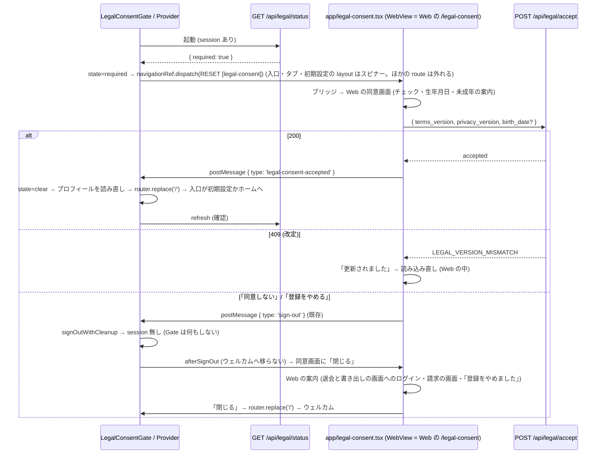

# 13b. 規約の同意ゲートをモバイルのネイティブの画面にも掛ける — 配線 (モバイル) (#1442)

> **13a (`13a-legal-consent-api-server.md`) は設計書も実装 (#1689・PR #1697) も main に着地済み。本冊は 13a の実コードを正として使う側。** 本冊が参照する 13a の公開名 (`@homegohan/shared` の関数・定数・型と `GET /api/legal/status` の応答。§0.4) が実コードと食い違ったら、実コードに合わせる。13a の設計書は本冊で変えない。食い違いに気付いた箇所は §6.22 に書く。§6.22 の指摘を 13a の記述に反映する (現在形化する) かどうか・いつするかは、本冊の触るファイル (§6.16) に入れず、オーケストレーターが別に決める (§8 Q-10)。

| 項目 | 値 |
|---|---|
| Status | 設計ゲート通過 (2026-10-17・v2.12・構造裁定のやり直しの後の R1 で Opus 5.5 と Sonnet 5.5 の 2 枚が PASS)。実装は §6.15 の B1 → B2 の順 |
| Issue | #1442 (親: #1174 の同意ゲート。先例: #1154 の AI 同意の 403・#1030 / #1445 の凍結の API ゲート。前提: #1598 の WebView への一本化と PR #1733) |
| 分冊 | 本冊 = 配線 (段 B: モバイル + Web → ネイティブの合図 1 本)。核 (段 A: サーバー + `packages/shared`) は `13a-legal-consent-api-server.md` (着地済み) |
| 正典の関係 | 13a とともに `08-legal-compliance.md` §7.2 (同意ゲート) の配線を広げる冊。§7.2 の「モバイルのネイティブの画面は対象外」の記述は本冊のマージで現在形に直す (§6.19)。`cross/14-parental-consent.md` §0.5 が 13b に求める「生年月日の欄・未成年の案内」は、本冊では Web の同意画面をそのまま使うことで満たす (§6.19・§6.22) |
| 範囲の正本 | Issue #1442 の本文とコメント (コメントの記録: 運営の API も 403 で止める範囲に入れる・役割の例外を作らない) |
| 前提 (本冊が書かれた時点) | #1598 のコメント (2026-10-15) の記録「タブから行けないネイティブの画面は消して、WebView の画面に一本化します」と、PR #1733 (main `1c726fbb`。届かないネイティブの画面 60 本の削除) の後の main。file:line は origin/main `312cfb04` (2026-10-17。文字を Noto Sans JP にそろえる #588 = PR #1824 が、本冊が直す `apps/mobile/app/_layout.tsx`・`(tabs)/_layout.tsx` と、多くの画面の import の行を変えた後) で取った (§0.3)。ログイン・新規登録・確認メール・設定タブの画面 (`(auth)/login.tsx`・`(auth)/signup.tsx`・`(auth)/auth/verify.tsx`・`(tabs)/settings.tsx`) の行と、Sign in with Apple の段 A2 (#1995) が足した `src/lib/routeAfterSignIn.ts`・`src/lib/appleSignIn.ts` の行は、origin/main `edff659e` (2026-10-24。#2007 が `login.tsx`・`signup.tsx` に import とコメントを足した後) で取り直した (`AIAdvisorSheet.tsx` の行も、§0.3 の生の fetch の行・§3.3 の部品の行と Modal の段落・§4.2 の S27 は同じ `edff659e` で取り直した。§6.2 の状態比較表の現行の列・§6.6.18 の差分・§6.20 の検証コマンドの注の `AIAdvisorSheet.tsx` の行と、§6.21 の旧版の表は `312cfb04` の行のまま)。`origin/design/legal-consent-mobile` の 13b (v1.1) は、#1598 と PR #1733 より前に書かれたので、消えた画面に依存する部分を落とし、残す部分の file:line を取り直した (§0.5) |
| 読み手 | 実装 (Sonnet 5.5) と敵対レビュー。実装は §6 だけを読んで手を止めずに書けることを完成条件にする |
| 節番号 | 分冊前の 13 と同じ番号を使う。本冊に無い節 (§3.3 以外の §3 の多く・§6.4・§6.6.1〜§6.6.7・§6.9・§6.13 など) は 13a にある。両冊にある節番号は、それぞれの冊に関わる行だけを持つ。両方に関わる行は 13a に置く |

---

## 0. 範囲・分冊判定・本書の読み方

### 0.1 一言でいうと

- モバイル: **1 枚のゲート (`LegalConsentGate`。ルートの layout に 1 つ)** が、サインイン中で「同意が要る」(`GET /api/legal/status` の `required`、または `/api` の 403 `LEGAL_CONSENT_REQUIRED`) なら、**ルートの `Stack` を同意画面の route (`app/legal-consent.tsx` = Web の `/legal-consent` を `WebViewScreen` で開く画面) 1 つに畳む** (完全な state の RESET を `navigationRef.dispatch`。expo-router 58。mobile/07 §7.1 の B-2)。同意画面の下には画面が残らない。同意が済むと (Web の同意画面がネイティブへ `{ type: 'legal-consent-accepted' }` を送る) ゲートがプロフィールを読み直して入口 `/` へ移り、入口 (`app/index.tsx`) が profile から初期設定 (途中なら再開の画面 `/onboarding/resume`) かホームへ振り分け直す。同意が要るようになった時点で開いていた画面と、その入力・ログインの `?next=`・deep link の行き先は残らない (改定は稀。§8 Q-6)。初期設定の答えはその都度保存されているので、初期設定の進みは失わない。ログインの直後と起動の直後に着く 3 か所 (入口 `app/index.tsx`・タブ `app/(tabs)/_layout.tsx`・初期設定 `app/onboarding/_layout.tsx`) は、同意の状態が分かるまで・同意が要る間は中身を描かない (初期設定より先に同意)。「同意しない」「登録をやめる」でログアウトしたら、同意画面は Web の案内 (退会と書き出しの画面へのログイン・請求の画面) を出したまま残り、上に「閉じる」を出す。閉じると入口 (ウェルカム) へ移る。
- 同意画面そのもの (チェック 2 つ・全文へのリンク・同意しない・生年月日・未成年の案内・409 の読み込み直し) は **Web の `/legal-consent` が持つものをそのまま使う**。ネイティブに同意の画面を作らない。AI 同意の画面 (`app/settings/ai-consent.tsx` = Web の `/settings/ai-consent`) と同じ形。
- サーバー側 (`/api` の 403・`GET /api/legal/status`・shared の判定と文面) は 13a (着地済み)。本冊はそれを使う側。

### 0.2 分冊判定 (相 1)

| 目安 | 本冊 | 判定 |
|---|---|---|
| 設計書 800 行超 | 超える (表・トレース・正典コードを持つため) | トリガー |
| 消費先レーン 3 以上 | モバイル (apps/mobile) 1 つ + Web の合図 2 ファイル (`src/lib/native-auth-bridge.ts`・`src/app/legal-consent/LegalConsentForm.tsx`) | 2 |
| 共有面 2 つ以上 | `WebViewScreen.tsx` とそれが使う `useWebAuthMessages` (`webViewAuthMessages.ts`) (全 WebView の画面が通る 1 つの面。運営の MFA の確認 (#1808) も同じ面を通る。本冊はその配線を保つ。6.6.15)。`packages/shared` はコメントの現在形化だけ (`legal-consent-copy.ts`・`parental-consent.ts`。export・値は変えない。§6.19) | 1 |

**判定: 1 冊・2 段 (B1 = Web の合図 → B2 = モバイル)。** 核 (13a) と配線 (本冊) の分冊は済んでいる。本冊の中をさらに分けない理由: 本冊の契約は 13a の実コード (shared の export・status の形・403 の形) と、Web → ネイティブの合図 1 本だけで、冊をまたぐ契約が増えない。段 B1 (Web の 2 ファイル) を先に閉じるのは、旧版のアプリが知らない type のメッセージを捨てる (`src/lib/native-auth-bridge.ts:22`) ので、Web だけ先に出しても壊れないため。

### 0.3 一次情報 (origin/main `312cfb04`。行番号は 2026-10-17 時点。ただしログイン・新規登録・確認メール・設定タブの画面・`routeAfterSignIn.ts`・`appleSignIn.ts` と、生の fetch の行の `AIAdvisorSheet.tsx` の行は origin/main `edff659e` (2026-10-24) で取り直した。表紙の「前提」の行)

**この節の expo-router・`@react-navigation` の行 (`node_modules/...` のパスと 7.17.2 などの行番号) は expo-router 5 (SDK 53) の時点の事実で、当時の記録として残す。expo-router 58 の形 (#1591。同意画面の止めは `usePreventRemove`・ゲートの畳み直しは完全な state の RESET を `navigationRef.dispatch`) は mobile/07 (§7.1 の B-2・§8.3 (b)・§9.4〜9.6)。**

v2.10 の基準 `6f66070e` から `312cfb04` までに変わったファイル (`git diff --name-only 6f66070e 312cfb04`。69 本。#1820・#1823・#1824) のうち、本冊が触る・読むものは #1824 (#588。文字を Noto Sans JP にそろえる) の分だけ: (1) `apps/mobile/app/_layout.tsx` (字形の読み込みが済むまで何も描かない・全体を `FontsReadyProvider` で包む。6.6.12 を取り直した)、(2) `apps/mobile/app/(tabs)/_layout.tsx` (`useFontStyle`。6.6.13 を取り直した)、(3) 画面と部品の `Text` の import の行 (後ろの行が 1 行ずれた: 入口・ログイン・サインアップ・確認メール・パスワード再設定・設定タブ・初期設定の welcome / 質問 / 再開・栄養目標・アカウント・`NativeMfaVerifyModal.tsx`・`TourOverlay.tsx` は +1、`AIAdvisorSheet.tsx`・`AIDayMenuModal.tsx`・`V4GenerateModal.tsx`・血液検査・初期設定の完了の画面は -1。下の表と §3.3 の行を取り直した)、(4) ルートとタブの layout を描く新しいテスト 2 本 (`apps/mobile/__tests__/app/root-layout-fonts.test.tsx`・`navigator-font-styles.test.tsx`。§6.18)。Web (`src/lib`・`src/app/legal-consent`・`lib/`)・`packages/shared`・§6.19 が指す設計書・`.env.example`・`ENV_SETUP.md`・`CLAUDE.md` と、`WebViewScreen.tsx`・`webViewAuthMessages.ts`・`api.ts`・`failed-response.ts`・`NotificationRouter.tsx`・`AuthProvider.tsx`・`ProfileProvider.tsx` は `6f66070e` から変わっていない。`312cfb04` から origin/main `9383d235` (2026-10-17) までに変わったのはローカルの CI の道具とそのテスト (`scripts/local-ci.sh`・`scripts/supabase-local.sh`・`tests/test-speed-ratchet.test.ts` など 9 本) だけで、本冊が触る・読むファイルは変わっていない (`git diff --name-only 312cfb04 9383d235`)。

下の表の `node_modules/...` の行は、`package-lock.json` の版 (表の最後の行) の実物で取った。

| 事実 | 場所 |
|---|---|
| ルートの `Stack` は `index`・`(public)`・`(auth)`・`(tabs)` を並べ、app 直下の画面 (`onboarding/*`・`handson-tour/*`・`health/blood-tests`・`profile/nutrition-targets`・`settings/*`) は自動で登録される。字形 (Noto Sans JP) の読み込みが済むまでは何も描かず (`return null`)、必須の環境変数が無いビルドは Provider を立てずに設定エラーの画面を出す。Provider の順は `FontsReadyProvider` > `SafeAreaProvider` > `AuthProvider` > `ProfileProvider` > `PushTokenRegistrar` + `NotificationRouter` + `Stack` | `apps/mobile/app/_layout.tsx:57-100, 102-120` |
| 入口: auth と (session があれば) profile の読み込み中はスピナー。session あり & 初期設定未完了 → `/onboarding`、完了 → `/(tabs)/home`。振り分けは ProfileProvider の `profile` を読む。同意の確認は無い | `apps/mobile/app/index.tsx:14-23` |
| タブの layout: session 無し → `/`、読み込み中はスピナー、初期設定未完了 → `/onboarding/resume` か `/onboarding/welcome`。`settings` はタブバーに出さない画面。AI の FAB が全タブに出る (`Tabs` の隣) | `apps/mobile/app/(tabs)/_layout.tsx:29-46, 115, 117` |
| `(auth)` の layout: session があれば `/(tabs)/home` へ (reset-password と verify だけは session があっても開ける) | `apps/mobile/app/(auth)/_layout.tsx:25-29` |
| ログインの後の振り分け `routeAfterSignIn`: profile を PostgREST で読み、`?next=` があればそこへ、無ければ初期設定の完了 → `/(tabs)/home`・開始済み → `/onboarding/resume`・未開始 → `/onboarding/welcome` へ `router.replace` (入口を通らない)。ログイン画面のメールとパスワード (`login.tsx:213`)・Google (`:116`)・Apple (`:84`。iOS・スイッチ `EXPO_PUBLIC_APPLE_SIGN_IN`) と、新規登録の画面の Apple (`signup.tsx:48`) から呼ぶ | `apps/mobile/src/lib/routeAfterSignIn.ts` (`login.tsx:20`・`signup.tsx:18` が import) |
| サインアップはアプリの中でセッションを作らない (確認メールの Alert の後に `/(auth)/login` へ)。確認メールのリンクは `/auth/verify` で session を作り `/(tabs)/home` へ | `apps/mobile/app/(auth)/signup.tsx:111, 128-130`、`apps/mobile/app/(auth)/auth/verify.tsx:79-86` |
| 初期設定の layout: auth の読み込み中はスピナー、session 無し → `/login`、それ以外は `Stack` を描く (同意も profile も見ない)。初期設定の入口の振り分け: 完了 → home、開始済み → resume、未開始 → welcome (どれも ProfileProvider の `profile` を読む) | `apps/mobile/app/onboarding/_layout.tsx:15-24`、`apps/mobile/app/onboarding/index.tsx:17-25` |
| 初期設定の質問の画面は、答え (`answers`)・いまの質問 (`currentStep`)・戻る履歴 (`stepHistory`) を画面の state に持つ。答えるたびに、次の質問があれば進み (`onboarding_progress` = 次の質問の番号と答え) と答えの列を `user_profiles` に PostgREST で保存する (`saveProgress`。`onboarding_started_at` も最初に付ける)。最後の答えでは答えの列を保存してから `POST /api/onboarding/complete` を呼び、成功したらプロフィールを読み直して完了の画面へ、失敗したら Alert「保存失敗」で最後の質問に戻る。質問の途中ではプロフィール (ProfileProvider) を読み直さない。再開の画面は profile の `onboardingProgress` で進みを出し、「続きから」で `/onboarding/questions?resume=true` を開く。質問の画面は `resume=true` なら profile の `onboardingProgress` から `currentStep` と `answers` を戻す (`stepHistory` は戻らない)。完了の画面は計算の結果 (`targets`) を画面の state に持ち、保存の失敗は Alert | `apps/mobile/app/onboarding/questions.tsx:659-668, 675-684, 765-916 (保存は :912), 918-967`、`apps/mobile/app/onboarding/resume.tsx:15-23, 106`、`apps/mobile/app/onboarding/complete/index.tsx:71, 123-181` |
| `ProfileProvider` は `user_profiles` を PostgREST で直接読み、利用者が替わったとき (`user?.id`) と `refresh()` を呼んだときだけ読み直す。`refresh()` は読み始めに `isLoading` を true にする | `apps/mobile/src/providers/ProfileProvider.tsx:36-53, 108-117` |
| ハンズオンツアーの入口は、初期設定の完了の画面 (`router.replace('/handson-tour')`) と、設定の「ツアーをもう一度」(`router.push('/handson-tour?force=1')`) の 2 つ。ツアーの段と部品が外れる (unmount) ときの後片付けは、タイマー・吹き出しの的の登録・端末の戻るの受け手・取得の打ち切りの解除だけで、API は呼ばない (skip も complete も送らない) | `apps/mobile/app/onboarding/complete/index.tsx:375`、`apps/mobile/app/(tabs)/settings.tsx:405`、`git grep -n "return () =>" -- apps/mobile/app/handson-tour apps/mobile/src/handson-tour` |
| API クライアント: `withFriendlyErrors` は 429 と 503 だけを固定の文の例外に置き換え、403 はそのまま投げる | `apps/mobile/src/lib/api.ts:72-78` |
| 生の fetch の失敗の応答から Error を作る `errorOfFailedResponse` (同じ 2 つの判定)。`StoppedByServerError` の union と Alert の見出し | `apps/mobile/src/lib/failed-response.ts:26-35, 44-47` |
| アプリの `getApi()` を通らない生の fetch は 5 つの関数だけ (ほかの HTTP の口 (`createHttpClient` を直に使う所・`uploadAsync` など) は無い): AI 相談のシートの送信 `sendMessage` (`AIAdvisorSheet.tsx:457`。失敗は `errorOfFailedResponse` で読む `:470-474`)・相談を閉じる `archiveSession` (`AIAdvisorSheet.tsx:333`。`res.ok` でも 400 でもない応答は `res.json()` で読んでから `errorOfFailedResponse` を通し (`:383`。同意の 403 なら Alert「同意が必要です」を出して戻る。6.6.18・PR #1833)、そのあと `serviceUnavailableMessageOf` (503。`:390`)、どちらでもなければ Alert「エラー」に本文の `message` / `error` を出す `:395-399`)・設定の画面の書き出し 2 つ (`settings.tsx:167, 212`。失敗は `errorOfFailedResponse` で読む `:172, 217`)・WebView の認証ブリッジの code の発行 (`webViewBridge.ts:605`。13a の許可リストの API。失敗は黙って直接の URL へ倒す)。番兵 `tests/ai-daily-limit-mobile-raw-fetch.test.ts` がこの 5 つを関数ごとに分類し (`RAW_FETCHES`)、その 4 は、アプリの API を呼ぶ関数が失敗の応答を `errorOfFailedResponse` **か** `serviceUnavailableMessageOf` で読むことを見る (相談を閉じるは後者だけで通る)。`tests/mobile-service-unavailable-raw-fetch.test.ts` は、AI 相談を生の fetch で呼ぶファイル (`AIAdvisorSheet.tsx` だけ) が `` `HTTP ${…}` `` の Error を自分で作らず、`failed-response` か `service-unavailable` から import することを見る | `apps/mobile/src/components/ai/AIAdvisorSheet.tsx:318-407, 455-474`、`apps/mobile/app/(tabs)/settings.tsx:167-172, 212-217`、`apps/mobile/src/lib/webViewBridge.ts:605`、`tests/ai-daily-limit-mobile-raw-fetch.test.ts:61-91, 256-279`、`tests/mobile-service-unavailable-raw-fetch.test.ts:32, 74-87`、`git grep -n -E "(^\|[^A-Za-z_.])fetch\(" -- apps/mobile/app apps/mobile/src` (テストを除く) |
| AI 同意の 403 をアプリが見分ける形 (`HTTP 403 …: {json}`)。案内は `router.push('/settings/ai-consent')` | `apps/mobile/src/lib/ai-consent.ts:76-77, 86-97, 120` |
| Error の message から本文の文を取り出す `getApiErrorMessage` (平たい `{ error: '文' }` の文字列も読む) | `apps/mobile/src/lib/api-error.ts:38-68` |
| `WebViewScreen`: props は `path`・`testID`・`header` (WebView の上 (上端の安全領域の内側) に置くネイティブの部品)。外側の `WebViewScreen` は props を全部 `WebViewScreenBody` に渡す (`{...props}`)。認証ブリッジ (`POST /api/auth/native-bridge/code` → `/auth/native-bridge?code&next`) を自分で行い、`onMessage` は送り元が自オリジンのとき (`:342` の `isOwnOrigin`) だけ `tab-navigate`・`navigate-back`・`download` と、`sign-out`・`session-expired`・`mfa-verify-required` (`:379-387` の 1 つの分岐で `handleAuthMessage` に渡す) を処理する。`tab-navigate` はタブのパス (`/home`・`/menus`・`/meals`・`/comparison`・`/profile`) への移動だけを `router.push` にする。`navigate-back` は戻れなければ `/(tabs)/home` を `router.push` する。注入スクリプトは `<a>` のクリックと `history.pushState` だけを捕まえる (`window.location.assign` による全体の読み込みでは `tab-navigate` を送らない) | `apps/mobile/src/components/web/WebViewScreen.tsx:38-44, 55-126, 142, 199-255, 328-391, 432-435`、`packages/shared/src/native-app-tabs.ts:30-36` |
| Web からの `sign-out` / `session-expired` / `mfa-verify-required` の処理。`sign-out` は `signOutWithCleanup` → `deps.goToWelcome()`。`goToWelcome` は `useWebAuthMessages` の中で `router.replace('/')` に決まっていて、使う画面からは変えられない。`useWebAuthMessages(currentPath, options?)` の第 2 引数の型 `WebAuthMessagesOptions` は #1808 で入り、`onMfaVerifyRequested?` だけを持つ。`options` の最新の値は `optionsRef` に持ち、返す関数の identity は変えない。ログアウトは同時に 1 つだけ (`signOutInFlight`)。送り元の検査 `isFromWebOrigin` | `apps/mobile/src/lib/webViewAuthMessages.ts:56, 72-76, 85-99, 167-181, 218-238, 304-311, 322-358`、`apps/mobile/src/components/web/WebViewScreen.tsx:165-175` |
| 運営の MFA の確認 (#1808): Web が `mfa-verify-required` を送ると、`WebViewScreen` は `useWebAuthMessages` の `options.onMfaVerifyRequested` で RN の `<Modal visible>` の `NativeMfaVerifyModal` を WebView の上に描く (どの `WebViewScreen` でも)。確認画面は `/api` を呼ばない。「閉じる」と端末の戻る (`onRequestClose`) で閉じる。Web がこの合図を送るのは運営の MFA の確認画面 (`/settings/security/mfa/verify` の `NativeAppMfaNotice` kind=verify) だけで、この画面は Web の同意ゲートの対象外の一覧に無い (未同意なら middleware が先に `/legal-consent` へ回す) | `apps/mobile/src/lib/webViewAuthMessages.ts:284-290, 342-357`、`apps/mobile/src/components/web/WebViewScreen.tsx:172-175, 410-420`、`apps/mobile/src/components/NativeMfaVerifyModal.tsx:68, 83`、`src/components/auth/mfa/NativeAppMfaNotice.tsx:21-24`、`lib/legal-consent.ts:91-125`、`lib/supabase/middleware.ts:405-432` |
| Web → ネイティブのメッセージの型は `sign-out`・`session-expired`・`mfa-verify-required` の 3 つ。旧版のアプリは知らない type を捨てる。`postMessage` の送り方 `post()` | `src/lib/native-auth-bridge.ts:22, 33, 86-108, 126-132, 151-154` |
| Web の同意画面: 同意済みなら `next` へ redirect、生年月日の欄 (`needsBirthDate`)・保護者の同意の案内 (`guardianMissing`) を出す。同意が記録できたら `window.location.assign(next)`。「同意しない」は `notifyNativeSignOut()` (ネイティブへ `sign-out`) → `signOut()` を待つ → `broadcastSignOut()` → 案内の画面 (`phase === 'declined'`: 「ご利用を終了しました」・退会と書き出しの画面へのログイン `/login?next=%2Flegal-consent%2Faccount` (同意の前の退会と書き出しは cross/20 Q-23 の `/legal-consent/account`)・お問い合わせ `/contact`・請求の画面 `/settings/data-requests`・ログイン `/login` へのリンク)。案内はネイティブへ `sign-out` を送った**後**に描かれる。「登録をやめる」は退会 → `signOutAfterAccountDeletion` (ネイティブへ `sign-out` を送る) → 「登録をやめました」(`/signup` へのリンク)。案内のリンクはどれもタブのパスでない (`tab-navigate` にならない) | `src/app/legal-consent/page.tsx:41-79`、`src/app/legal-consent/LegalConsentForm.tsx` の `handleAccept`・`handleDecline`・`handleWithdraw` と `phase === 'withdrawn'`・`phase === 'declined'` の描画、`src/lib/account-self-service.ts` の `signOutAfterAccountDeletion` |
| Web の画面の同意ゲートの対象外 (`/legal-consent` 自身・`/auth/*`・`/terms`・`/privacy` など)。`next` は `/api` と同意画面自身なら `/home` | `lib/legal-consent.ts:91-125, 210-216`、`lib/onboarding-routing.ts:67-70` |
| middleware の `/api` の分岐の同意の判定 (凍結 → メンテナンス → 同意) と、画面の判定 | `lib/supabase/middleware.ts:264-281, 405-425` |
| 通知のトークンの claim (`POST /api/push-tokens/claim`) は 13a の許可リストにある (`device_cleanup`)。登録そのものは PostgREST の upsert (middleware を通らない) | `packages/shared/src/legal-consent-api.ts:119-124`、`apps/mobile/src/lib/pushNotifications.ts:295-302, 324` |
| 通知のトークンの後片付けの release (`POST /api/push-tokens/release`。経路名 `PUSH_TOKEN_RELEASE_API_PATH`) は 13a の許可リストに無い (サーバーのテストが「許可リストに無い・ログイン中の未同意なら 403」を固定する)。release はセッション無しで (端末の秘密の値で認可して) 呼ぶ後片付けで、起動時に未ログインと決まったとき (`AuthProvider.tsx:128`) と SIGNED_OUT の後 (`:255`) に `getApi().post` で送る。`getApi()` は端末にセッションがあればそのアクセストークンを付ける。middleware の `/api` の同意の判定は、利用者が確定したとき (`apiUserId` がある) だけ動く。release の catch は 400 以外を控えに残し、次の flush でやり直す (`getApi()` が固定の文の例外に置き換えた 503 も控えに残る) | `packages/shared/src/push-token-claim.ts:21-22`、`apps/mobile/src/lib/pushTokenRelease.ts:141-171` (送信 `:163`・控え `:168`)、`apps/mobile/src/providers/AuthProvider.tsx:128, 255`、`apps/mobile/src/lib/api.ts:85-88`、`apps/mobile/src/lib/api-error.ts:78-83`、`lib/supabase/middleware.ts:214-223, 264-265`、`lib/supabase/__tests__/middleware-legal-consent-api.test.ts:317, 320-329`、`apps/mobile/__tests__/lib/push-token-release.test.ts:90-117` |
| `AuthProvider` の公開値 (`isLoading`・`session`・`user`・`clearSession`) | `apps/mobile/src/providers/AuthProvider.tsx:14-28` |
| 通知のタップの遷移は、ログインと今の利用者のプロフィールが分かってから `router.push` | `apps/mobile/src/components/NotificationRouter.tsx:90-107` |
| 画面の描画の例外の受け手 (#1207): `apps/mobile/app/` の `_layout.tsx` は 6 本 (ルート・`(auth)`・`(public)`・`(tabs)`・`onboarding`・`handson-tour`) で、どれも `ErrorBoundary` を export し `ErrorFallback` を返す。ルートの境界は逃げ道を持たない (「再試行」だけ)。Provider ごとルートの layout を置き換えて描かれ、区画の境界を持たない app 直下の画面 (設定から開く画面など) の例外もここで受ける。逃げ道 (`homeHref`。押すと `router.replace(homeHref)`。移れなければ作り直し) の行き先は `(auth)`・`(public)`・`(tabs)`・`onboarding` が `/`、`handson-tour` が `/(tabs)/home`。`ErrorFallback` は表示のたびに `reportBoundaryError` を 1 回呼ぶ。`reportBoundaryError` は `getApi().post("/api/log", …)` を fire-and-forget で送り、失敗 (例外・拒否) はすべて握りつぶす。`/api/log` は 13a の許可リストにある (`telemetry`)。`(public)/_layout.tsx` は見出しの字形と `ErrorBoundary` だけを持ち、session も profile も見ない | `apps/mobile/app/_layout.tsx:26-34`、`apps/mobile/app/(auth)/_layout.tsx:8-11`、`apps/mobile/app/(public)/_layout.tsx:7-23`、`apps/mobile/app/(tabs)/_layout.tsx:13-19`、`apps/mobile/app/onboarding/_layout.tsx:9-13`、`apps/mobile/app/handson-tour/_layout.tsx:15-18`、`apps/mobile/src/components/ErrorFallback.tsx:41-50, 60-71`、`apps/mobile/src/lib/error-report.ts:58-96` (送信 `:78`・握りつぶし `:92-95`)、`packages/shared/src/legal-consent-api.ts:126`、`git grep -n "export function ErrorBoundary" -- apps/mobile/app` |
| `SIGNED_OUT` の購読は `resetPurchasesOnSignOut()` を待たずに呼んでから `setSession(null)` を呼び、掃除は待たない。Web からの `sign-out` は `signOutWithCleanup` の後に `goToWelcome` = `router.replace('/')` | `apps/mobile/src/providers/AuthProvider.tsx:255-268`、`apps/mobile/src/lib/webViewAuthMessages.ts:218-238, 352-354`、`apps/mobile/src/lib/signOut.ts:120-129` |
| expo-router 5.1.11 の `router.push` / `replace` / `back` は、その場で遷移しない。`routingQueue` に積み、`ImperativeApiEmitter` の effect (次の描画の後) で積んだ順に `dispatch` する。`replace` は `REPLACE`、`push` は `PUSH`、`back` は `GO_BACK`。`router.canGoBack()` はその場でコンテナの `canGoBack()` を返す (下の Android の戻るボタンの行と同じ判定。route が 1 つの Stack なら false)。`Redirect` は `useFocusEffect` の中で `router.replace` を呼ぶ (前面の画面でだけ動く) | `node_modules/expo-router/build/global-state/routing.js:64-96, 107-148`、`node_modules/expo-router/build/imperative-api.js:24-30`、`node_modules/expo-router/build/link/Redirect.js` |
| `router.replace` の `REPLACE` の行き先: 積んだ時点の state で、行き先と今の前面の route を root から比べ、最初に食い違った navigator を `target` にする (`getNavigateAction`)。前面が同意画面で、行き先がそれと別の名前 (`index`・`(tabs)`・`onboarding` など) なら `target` は root の stack で、前面の route を新しい route に置き換える。同じ区画の中の移動 (`(auth)` の中の再設定 → ログインなど) は、その区画の stack の中の置き換えで、root の stack の route は取り除かない | `node_modules/expo-router/build/global-state/routing.js:119-121, 209, 211-304`、`node_modules/@react-navigation/routers/lib/module/StackRouter.js:155-184` (7.5.3)、`node_modules/expo-router/build/layouts/StackClient.js:29-36, 204-205` |
| ナビゲーションのコンテナの参照 (`useNavigationContainerRef()` = expo-router の `store.navigationRef`) の `reset(state)` は `dispatch(CommonActions.reset(state))` で、`routingQueue` を通らず、その場で今の前面の navigator に届く。`RESET` は、行き先の route の名前がその navigator に無ければ null を返し (`BaseRouter`。StackRouter・TabRouter も `RESET` は `BaseRouter` に任せ、expo-router の Stack の router も `RESET` (スタックの操作でない) はそのまま渡す)、親の navigator へ上がる (`useOnAction`)。`stale: false` を持たない state はそのまま受け取り、navigator が次の描画で組み立て直す (route の `key` もそこで付く)。**expo-router 58 では** `RESET` は完全な state (`key`・`index`・`routeNames`・`routeKeySeq`・`stale: false`) だけを受け付け、`dispatch` は commit の後に流れる。ゲートは `navigationRef.dispatch(collapseStackAction(owner, …))` (`target` は持ち主の navigator の key) を使う (mobile/07 §7.1 の B-2・§9.4) | `node_modules/expo-router/build/hooks.js:56-58`、`node_modules/@react-navigation/core/lib/module/createNavigationContainerRef.js:6, 34-58`、`node_modules/@react-navigation/core/lib/module/BaseNavigationContainer.js:106-112, 155-161`、`node_modules/@react-navigation/routers/lib/module/BaseRouter.js:29-48`、`node_modules/@react-navigation/routers/lib/module/StackRouter.js:476`、`node_modules/@react-navigation/routers/lib/module/TabRouter.js:321`、`node_modules/expo-router/build/layouts/StackClient.js:13-19, 35-36`、`node_modules/@react-navigation/core/lib/module/useOnAction.js:46-77` (7.17.2) |
| expo-router のコンテナの一番外の navigator は `Content` (route は `__root` 1 つで、その画面がルートの layout) で、ルートの layout の `Stack` (アプリの route を並べる navigator) はその中にある。だから `resetRoot` (一番外の navigator を置き換える) は使わない (expo-router 58 では `resetRoot` は無い)。route `legal-consent` を持つ navigator はルートの `Stack` だけ (ほかの区画の navigator の route の名前に `legal-consent` は無い) なので、どの画面が前面でも、`reset` はルートの `Stack` まで上がって処理される | `node_modules/expo-router/build/ExpoRoot.js:139-155` |
| 今のナビゲーションの state の前面は、コンテナの参照の `getCurrentRoute()` (`findFocusedRoute(getRootState())`。前面の route を葉まで辿った route) で読める。`reset` で入れた state は `key` も `stale: false` も持たない部分の state なので、ルートの `Stack` が次の描画で組み立て直すまで、その navigator の `getState()` (と `getCurrentRoute()`) は前の描画で組み立てた state を返す。ゲートの effect がもう一度動くのは次の描画の後なので、そのときには `reset` の後の前面 (同意画面) を返す。expo-router 58 では、ゲートは完全な state の RESET を dispatch する (mobile/07 §9.4・§9.6) | `node_modules/@react-navigation/core/lib/module/BaseNavigationContainer.js:141-148`、`node_modules/@react-navigation/core/lib/module/useNavigationBuilder.js:242-299, 447-450` (7.17.2) |
| 取り除く操作: navigator は、操作で取り除かれる route に `beforeRemove` を流し (`event.data.action` = その操作の action。`type` を持つ)、`preventDefault()` されたら操作全体を捨てる (navigator の state を変えない)。**expo-router 58 では** `beforeRemove` は止められない。同意画面は `usePreventRemove` で取り除く操作を全部止める (止められた操作は捨てる。取り除かれる route の 1 つでも止めていれば `RESET` ごと捨てる。mobile/07 §7.1 の B-2・§9.5) | `node_modules/@react-navigation/core/lib/module/useOnAction.js:52-59`、`node_modules/@react-navigation/core/lib/module/useOnPreventRemove.js:7-44`、`node_modules/@react-navigation/core/lib/typescript/src/types.d.ts` (`EventMapCore` の `beforeRemove`) |
| Android の戻るボタン: コンテナが `BackHandler` に受け手を張り、`canGoBack()` のときだけ `goBack()` して true を返す。route が 1 つの Stack は戻れない (`GO_BACK` は前面が最初の route なら null。親の `__root` も route が 1 つ) ので false を返し、OS の既定 (アプリを背面へ) になる。このとき `beforeRemove` は流れない (expo-router 58 では `usePreventRemove` の止めにも当たらない) | `node_modules/expo-router/build/fork/useBackButton.native.js:39-53`、`node_modules/@react-navigation/core/lib/module/useNavigationHelpers.js:47-53`、`node_modules/@react-navigation/routers/lib/module/StackRouter.js:423-434` |
| expo-router の pathname (`usePathname`) は、ナビゲーションのコンテナが `state` の合図を出したときに作り直す。合図はコンテナの effect が出すので、流した遷移が pathname に出るのは次の描画のこともある (pathname は 1 描画遅れることがある) | `node_modules/@react-navigation/core/lib/module/BaseNavigationContainer.js:293-298`、`node_modules/expo-router/build/global-state/router-store.js:100-119` |
| `useRootNavigationState()` は一番外の navigator (`__root`) の state を返す (ナビゲーターの準備の目印に `key` を使う) | `node_modules/expo-router/build/hooks.js:40-44` |
| expo-router 5.1.11 / @react-navigation/core 7.17.2 / @react-navigation/native 7.2.2 / native-stack 7.14.12 / @react-navigation/routers 7.5.3 (設計の時点。#1591 の後は expo-router 58.0.23 で、`@react-navigation/*` は expo-router の `build/react-navigation` に入っている。mobile/07) | `package-lock.json` |

サーバー側の一次情報は 13a §0.3。

### 0.4 13a の実コードから使う公開名

| 名前 | 種別 | 場所 (origin/main) | 本冊で使う所 |
|---|---|---|---|
| `LEGAL_CONSENT_REQUIRED_MESSAGE`, `LEGAL_CONSENT_REQUIRED_STATUS`, `isLegalConsentRequiredBody` | shared の定数・関数 | `packages/shared/src/legal-consent-api.ts:39-42, 67-69` | 6.6.8 (403 の見分け) |
| `LEGAL_CONSENT_STATUS_API_PATH`, `isLegalConsentStatus`, `LegalConsentStatus` | shared の定数・関数・型 | `packages/shared/src/legal-consent-api.ts:32, 187-205, 253-268` | 6.6.9 (status の取得) |
| `GET /api/legal/status` の応答 (`required` = `enforced && !accepted`、`accepted` = `gaps` が空) | API | 13a §6.9、`packages/shared/src/legal-consent-api.ts:214-240` | 6.6.9 (ゲートは `required` だけを見る) |
| 403 `{ error, code: 'LEGAL_CONSENT_REQUIRED' }` | API の本文 | 13a §6.8、`lib/supabase/middleware.ts:272-280` | 6.6.8・6.6.14 |

本冊は `LEGAL_CONSENT_ACCEPT_API_PATH`・`LEGAL_CONSENT_COPY`・`legalConsentAgreeLabel` などの文面を**使わない** (同意の記録と文面は Web の同意画面が WebView の中で担う。§6.22 の 5)。

### 0.5 土台 (origin/design/legal-consent-mobile の 13b v1.1) から落としたもの・残したもの

| 土台の部分 | 扱い | 理由 |
|---|---|---|
| §3.3 の画面表 (ネイティブの健康・AI・レシピ・食材・買い物リスト・運営・組織・サポートの画面) | **落とす** (§3.3 を今の main の 29 画面 (`apps/mobile/app/` の `_layout.tsx` 以外の画面ファイル) で書き直す) | PR #1733 で消えた (今の main に無い) |
| ネイティブの同意画面 `LegalConsentScreen.tsx` (6.6.12) と、その文面 (`LEGAL_CONSENT_COPY` の利用)・`VERSION_MISMATCH_STATUS`・`httpStatusOfError` | **落とす** | #1598 の WebView への一本化。土台の画面には生年月日の欄・未成年の案内・「登録をやめる」(cross/14 が 13b に求めるもの) が無く、作ると Web の同意画面の写しになる (§5.2) |
| ルートの `Stack` の `screenLayout` に置くゲート (6.6.10・6.6.11) | **落とし、ルートの `Stack` を同意画面の route 1 つに畳むゲートに置き換える** (§5.2 の G'' と C'') | `screenLayout` は Stack に残る route の画面ごとに同意画面を描くので、route の数だけ同意画面 (WebView) が並ぶ。expo-router 5.1.11 が `screenLayout` を透過するかも未確認 (土台の Q-1)。G'' は同意画面の route を 1 つだけ持つ |
| `PushTokenRegistrar` を同意の後まで待たせる差分 (6.6.10 の一部) | **落とす** | claim は 13a の許可リストにある (`packages/shared/src/legal-consent-api.ts:119-124`)。登録は PostgREST で middleware を通らない |
| `MOBILE_LEGAL_CONSENT_EXEMPT_PATHS` の `/pricing` | **落とす** | `(public)/pricing` の画面は billing/01 §10.4 で消えた (今の `(public)` は about・privacy・terms の 3 本) |
| 403 の見分けと Provider への知らせ (6.6.8)・Provider の状態 (6.6.9)・`api.ts` / `failed-response.ts` の差分 (6.6.13)・対象外のパスの考え方・ENFORCE off と読めないときの決定 (§6.11)・テストの骨格 | **残す** (file:line を取り直し、名前を本冊の構造に合わせた) | 今の main と食い違わない |

---

## 1. 目的・スコープ

### 1.1 解決すること (Issue #1442 のうち本冊の分)

Issue の全体 (3 つの経路) は 13a §1.1。本冊が解決するのは次の 2 つ (3 の `/api/*` は 13a で解決済み)。

1. モバイルのネイティブの画面 (今の main では、初期設定・ハンズオンツアー・設定タブとそこから開く画面・AI 相談のシート。§3.3) は WebView を通らないので、未同意のまま使える。
2. 新規の人は、ネイティブの初期設定 (健康情報の入力) を同意より先に済ませられる。

13a の後、1 と 2 の画面が呼ぶ `/api` は 403 で止まる (初期設定の完了・ツアーの status・AI 相談など) が、画面そのものは開け、403 の文が各画面のエラーとして出るだけで同意画面へ辿り着けない。本冊はこれを「同意画面へ回す」に直す。

### 1.2 前提

- 13a §1.2 (本番は `LEGAL_CONSENT_ENFORCE=on`。ローンチ前で利用者はゼロ)。
- #1598 のコメント (2026-10-15) の記録「タブから行けないネイティブの画面は消して、WebView の画面に一本化します」。PR #1733 で、届かないネイティブの画面 60 本を消した。
- 配布 (#1115) の前なので、13b より前のビルドは利用者に届いていない (§6.21)。

### 1.3 対象外

13a §1.3 (規約の文面・同意の記録の仕組み・アプリの Supabase の直読み) に加えて、本冊に関わるもの:

- `LEGAL_CONSENT_NOTICE` (お知らせ) は Web の `(main)` の画面だけのまま。ネイティブにはお知らせを出さない (WebView のタブでは Web のお知らせが見える)。
- アプリ (Expo) のネイティブのサインアップ画面に同意のチェックを足すこと (`08` §7.2 の残課題のまま。本冊のゲートで、登録直後の起動時に同意画面へ回るので、使う前には必ず同意する)。
- 同意画面の中身 (チェック・生年月日・未成年の案内・「登録をやめる」・本人の権利の請求の案内) を変えること。Web の `/legal-consent` の責務 (cross/08・cross/14・cross/15)。
- アプリが Supabase (PostgREST) を直接読み書きする経路 (`apps/mobile/app/onboarding/questions.tsx:912` の `user_profiles` の upsert・`apps/mobile/src/lib/pushNotifications.ts:295` の `user_push_tokens` の upsert・`ProfileProvider` の select) は、Next の middleware を通らないので本冊のゲートの外 (13a §6.13 の限界・§8 Q-2)。
- 同意が要るようになった時点で開いていた画面と、その入力を同意の後に戻すこと (Issue #1442 の本文にもコメントにも無い。§5.2・§8 Q-6)。
- 強制アップデート (`/api/app/version-check`。mobile/01 §8) は main に route が無く、本冊でも作らない (§6.21)。
- maestro の flow (`apps/mobile/maestro/**`) の追随。CI で流れず、本冊では足さない・直さない (§8 Q-1)。

---

## 2. 関連要件

- `docs/design/cross/08-legal-compliance.md` §7.2 (再同意フロー)。
- `docs/design/cross/13a-legal-consent-api-server.md` (核。shared の export・status の応答・403 の形)。
- `docs/design/cross/14-parental-consent.md` §0.5 (13a / 13b との契約: `gaps` の `'birth_date'` / `'guardian_consent'`。本冊は Web の同意画面で満たす)。
- `docs/design/mobile/01-architecture.md` §3.2 (WebView ハイブリッド・`WebViewScreen` の役割)・§6 (ファイル構成)。
- `docs/design/mobile/05-auth-session.md` §6 (WebView とネイティブのログアウト・セッション失効の同期。`sign-out` / `session-expired` の合図)。

---

## 3. 相 1 外形固定: 要件行列・ユーザーシナリオ・現行の画面

### 3.1 要件行列 (本冊の行)

| ID | 要件 | 出どころ | 検証 (§6.14 の it) |
|---|---|---|---|
| R-6 | モバイルは、ログインの後と起動の後に、初期設定より先に同意の状態を確かめ、未同意なら同意画面へ回す | Issue 本文「モバイルの起動時・初期設定の前に同意の状態を確かめて同意画面 (WebView の /legal-consent かネイティブの画面) へ回す」 | T-G1, T-G2, T-G5, T-G6, T-G7, T-IDX1, T-TL1, T-OB1, T-P1, T-P5, T-P7 |
| R-7 | 今の main のネイティブの画面と起動の流れを実コードで列挙し、同意の前に使えてしまう経路を表にする。WebView の中の画面は Web の同意ゲートが受け持つ | Issue 本文「モバイルのネイティブの画面…は WebView を通らないので、未同意のまま使える」 | §3.3 |
| R-12 | 同意画面は Web の `/legal-consent` を WebView で開き、Web と同じ要件 (必須チェック 2 つ・全文へのリンク・同意しない = ログアウト + 退会と書き出しの画面への案内 (cross/20 Q-23)・生年月日・未成年の案内) をそのまま使う。ネイティブに同意の画面を作らない。アプリでも「同意しない」「登録をやめる」の後の Web の案内 (退会と書き出しの画面へのログイン・請求の画面) が見える | #1598 のコメントの記録 (WebView への一本化)・cross/14 §0.5・cross/08 §7.2 (同意画面の行) | T-SC1, T-SC3, T-ML6, T-ML10, T-G4, T-WV2, T-W2, E2E (既存の `legal-consent-gate.spec.ts`) |
| R-16 | 同意が済んだことをネイティブが知る合図は Web の同意画面が送る (`legal-consent-accepted`)。旧版のアプリはこの合図を捨てても壊れない | `src/lib/native-auth-bridge.ts:22` の既存の規則 | T-W1, T-W3, T-WV1, T-ML4, T-ML5, T-P4, T-G3 |
| R-17 | 配布 (#1115) の前の旧版のアプリの扱い (旧版も `/api` の 403 で止まる) を書く | Issue 本文「どこまで止めるか…設計で決める」と 13a の着地 | §6.21 |
| R-18 | 13a の設計書・実コード (`packages/shared`・middleware・status route) を変えない。食い違いは本冊で指摘する | 本冊の前提 | §6.22 |

R-1〜R-5・R-14 (サーバー) と、両方に関わる R-8〜R-11・R-13 は 13a §3.1。そのうち本冊の it で確かめるモバイル側: **R-8 (改定の再同意) = ネイティブの側が `/api` を呼んで 403 `LEGAL_CONSENT_REQUIRED` を受けたら、どの画面からでも同意画面へ回し、再同意の後は入口へ戻す**: T-ML1, T-ML2, T-ML5, T-API1, T-FR1, T-AS1, T-AS2, T-RF1, T-P3, T-P4, T-P6, T-P8, T-G1, T-G3, T-G8, T-SC2, T-TL1, T-OB1, T-NR1, T-NR2 (§6.12)。R-9 (`ENFORCE` が off・同意の状態を読めない) = T-P2, T-G5 (`unknown` で止めない。§6.11。13a §3.2 の S9 の行が挙げる組と同じ), T-P1 (`required: false` なら `clear`。S8・S24)。

v2.1〜v2.10 の R-15 (「同意が済んだら元の画面に戻る (画面の入力を失わない)」) は、Issue #1442 の本文にもコメントにも無いので外した (構造裁定のやり直し。§5.2)。`/api` の 403 で同意画面へ回すことは、上の R-8 のモバイル側として確かめる。

### 3.2 ユーザーシナリオ (17 本)

サーバーだけで結果が決まる S6・S7・S10・S11・S14・S16・S17 と、両方に関わる S5・S8・S9・S15 は 13a §3.2 (S5・S8・S9・S15 のモバイル側の走らせ方は本冊 §4.2 に重ねて書く)。S26・S29・S30・S31 は v2.10 まであった、同意画面の下に画面を残す構造のためのシナリオで、G'' (§5.2) では起きないので外した (欠番)。

| ID | シナリオ |
|---|---|
| S1 | 新規登録 (アプリのネイティブのサインアップ) → 確認メール → ログイン (メールとパスワード、または確認メールのリンク) → 初期設定の前に同意画面 (WebView) → 同意 → 初期設定へ |
| S2 | 既存の利用者 (同意済み) がアプリを起動 → 今までどおりホーム (余計な画面は出ない) |
| S3 | 既存の利用者 (未同意・ENFORCE=on) がアプリを起動 → 同意画面 → 同意 → 入口からホーム |
| S4 | アプリの同意画面で「同意しない」→ Web がログアウトし、ネイティブもログアウト → 同意画面に Web の案内 (「ご利用を終了しました」・退会と書き出しの画面へのログイン・お問い合わせ・請求の画面) が出たまま、上に「閉じる」が出る → 「閉じる」→ ウェルカム画面 |
| S5 (モバイル側) | 規約の改定の後、血液検査の画面で入力の途中に保存 → `/api` が 403 → 同意画面だけになる (血液検査の画面は外れ、入力は残らない) → 同意 → 入口からホーム → 血液検査の画面を開き直して入れ直す |
| S12 | 未同意のセッションが残る端末で、パスワード再設定のリンクを開く → `/auth/reset-password` はゲートの対象外 → 再設定できる → ログアウトしてログイン画面へ (既存の流れ) → ログイン後に同意画面 |
| S13 | 同意画面 (WebView) を開いたまま改定 → Web の同意画面が 409 を受けて「更新されました」と読み込み直しを促す → 読み込み直して新しい版で同意 |
| S18 | 機内モードでアプリを起動 (保存済みのセッション) → status を取れず `unknown` → 画面は開く (通信できない案内は今までどおり) → 通信が戻った最初の API 呼び出しが 403 なら同意画面 |
| S19 | 生年月日がプロフィールに無い人 (cross/14。`gaps` に `'birth_date'`) がアプリを起動 → `required` → 同意画面 (WebView) に生年月日の欄が出る → 入力して同意 → 入口から振り分け |
| S20 | 18 歳未満の本人が自分で登録 → 同意画面で生年月日を入れる → Web が 403 `LEGAL_MINOR_SELF_SIGNUP_REFUSED` → 案内 →「登録をやめる」→ 退会 → Web がネイティブへ `sign-out` → 同意画面に「登録をやめました」が出たまま「閉じる」→ ウェルカム画面 |
| S21 | 未同意の人が通知をタップしてアプリを開く → 同意画面が先 → 同意 → 入口からホーム → 通知の行き先 (血液検査の画面) へ |
| S22 | 13b より前のビルド (配布前の開発機) で、未同意の人が初期設定の完了を押す → `/api/onboarding/complete` が 403 → 画面に固定の文「利用規約・プライバシーポリシーへの同意が必要です…」が出る → ホームのタブ (WebView) を開くと Web の同意画面 → 同意すると以後の API が通る (§6.21) |
| S23 | 未同意の人が deep link で `homegohan://health/blood-tests` を開く → 画面が 1 往復ぶん見えてから同意画面だけになる (その間の API は 403) → 同意 → 入口からホーム (deep link の行き先は残らない) |
| S24 | `LEGAL_CONSENT_ENFORCE` が off → status は `required: false` → 同意画面は出ない (13a の S8 と同じ) |
| S25 | ハンズオンツアーの途中で改定 → 次の API (写真の保存など) が 403 → 同意画面だけになる (ツアーは外れる。skip も完了も記録しない) → 同意 → 入口からホーム → 設定の「ツアーをもう一度」で開き直せる |
| S27 | タブの AI の FAB から AI 相談のシート (RN の Modal) を開いたまま改定 → 送信 (または「相談を閉じる」) の API が 403 → 同意画面だけになる (タブもシートも外れる) → 同意 → 入口からホーム。シートは閉じたまま (もう一度 FAB から開く) |
| S28 | 初期設定の途中で同意が要るようになる (S18 の `unknown` のまま初期設定へ進んだ・初期設定の途中で改定が入った) → 最後の質問に答えると `POST /api/onboarding/complete` が 403 → 同意画面だけになる → 同意 → 入口から初期設定の再開の画面 (`/onboarding/resume`) →「続きから」で最後の質問 (それまでの答えは保存から戻る) → もう一度答えて完了 |

### 3.3 今の main に残るネイティブの画面と起動の流れ (実コードで列挙。R-7)

`apps/mobile/app/` の画面ファイル全部 (origin/main `312cfb04`。`_layout.tsx` (6 本) は区画の行に畳む: ルートの `_layout.tsx` は「起動時の処理」の行、`(auth)`・`(public)`・`(tabs)`・`onboarding`・`handson-tour` の `_layout.tsx` はそれぞれの区画の行。6 本がどれも export する描画の例外の受け手 `ErrorBoundary` は「エラー境界」の行)。種別の WebView = `WebViewScreen` を使う (Web の同意ゲートが WebView の中で効く)。公開 = `PublicPage` (本文は Web 版へのリンク)。**「同意の前」= 今の main で、未同意のまま使えるか (API を呼ぶなら 13a の 403 で止まるが、画面は開ける)。「本冊」= 本冊のゲートの扱い (対象 = `required` ならルートの `Stack` を同意画面 1 つに畳む。その画面は外れる)。**

| 区画 | 画面ファイル (`apps/mobile/app/`) | パス | 種別 | 呼ぶ `/api` (file:line) | 同意の前 | 本冊 |
|---|---|---|---|---|---|---|
| 入口 | `index.tsx` | `/` | ネイティブ (ウェルカム / 振り分け) | 無し (`index.tsx:14-23`) | 開ける。session があれば `/onboarding` か `/(tabs)/home` へ回す | 対象。同意の状態が分かるまで・`required` の間は振り分けない (6.6.13)。同意の後はゲートがここへ戻し、ここが profile から振り分け直す |
| (auth) | `(auth)/login.tsx`, `(auth)/signup.tsx` | `/login`, `/signup` | ネイティブ | 無し (Supabase の auth を直接。`login.tsx:98, 156`・`signup.tsx:62, 111`。Apple は `src/lib/appleSignIn.ts:99` の `signInWithIdToken`) | 開ける (未ログイン)。ログイン後は `src/lib/routeAfterSignIn.ts` の `routeAfterSignIn` (ログイン・新規登録の画面から呼ぶ) が `?next=` / `/(tabs)/home` / `/onboarding/resume` / `/onboarding/welcome` へ直接回す (入口を通らない) | 対象外 (未ログインの画面。session があれば `(auth)/_layout.tsx:29` がホームへ回す)。回った先のタブと初期設定の layout が同意の状態を待つ (6.6.13)。`routeAfterSignIn` の置き換えが同意画面の後に流れたときは同意画面が止め、行き先は同意の後に入口が決め直す (`?next=` は残らない。§8 Q-4) |
| (auth) | `(auth)/auth/forgot-password.tsx`, `reset-password.tsx`, `verify.tsx` | `/auth/forgot-password`, `/auth/reset-password`, `/auth/verify` | ネイティブ | 無し (`reset-password.tsx:91-97` は updateUser → `signOutWithCleanup` → `/login`。`verify.tsx:86` は session ができたら home へ) | 開ける (認証の途中) | 対象外 (Web の `/auth/*` と同じ理由) |
| (public) | `(public)/about.tsx`, `privacy.tsx`, `terms.tsx` (layout: `(public)/_layout.tsx`。見出しの字形と `ErrorBoundary` だけで、session も同意も見ない。`(public)/_layout.tsx:7-23`) | `/about`, `/privacy`, `/terms` | 公開 (PublicPage) | 無し | 開ける | 対象外 (同意の根拠になる文面と公開の案内。Web の `/terms` `/privacy` と同じ理由)。`(public)/_layout.tsx` も変えない |
| (tabs) | `(tabs)/home.tsx`, `menus.tsx`, `meals.tsx`, `comparison.tsx`, `profile.tsx` | `/home`, `/menus`, `/meals`, `/comparison`, `/profile` | WebView (`/home`・`/menus/weekly`・`/meals/new`・`/comparison`・`/profile`) | WebView の中の API は Web のゲートが受け持つ | 開ける。WebView の中で Web の同意ゲートが `/legal-consent` へ回す (Web の同意画面がタブの中に出る) | 対象。`required` の間はタブを描かない (6.6.13)。ゲートが畳むとタブごと外れる。同意の後は入口からホーム |
| (tabs) | `(tabs)/settings.tsx` (タブバーに出さない。`(tabs)/profile.tsx:33` の歯車から開く) | `/settings` | ネイティブ (設定) | `GET`/`PATCH /api/notification-preferences` (`settings.tsx:83, 126`)、`GET /api/account/export` (`:167`。許可リスト)、`GET /api/export/meals` (`:212`) | 開ける (ホームのタブで同意画面に回された後でも、歯車はマイページのタブの上なので、同意の前には届かない) | 対象 (`required` の間はタブの layout ごと描かない。ゲートが畳むと外れ、同意の後は入口からホーム。設定の画面は残らない。Q-6) |
| 設定から開く | `health/blood-tests.tsx` (`settings.tsx:334`) | `/health/blood-tests` | ネイティブ | `GET /api/health/blood-tests` (`:222-224`)、`POST /api/ai/analyze-health-checkup` (`:273-274`)、`POST /api/health/blood-tests` (`:357-359`) | 通知の行き先 (`notificationRoute.ts:39`) と deep link からは、同意の前でも開ける | 対象 (ゲートが畳むと外れ、入力は残らない。S5) |
| 設定から開く | `profile/nutrition-targets.tsx` (`settings.tsx:342`) | `/profile/nutrition-targets` | ネイティブ | `POST /api/nutrition-targets/calculate` (`:109-110`) | 設定からだけ | 対象 |
| 設定から開く | `settings/account.tsx` (`settings.tsx:449`) | `/settings/account` | ネイティブ | `POST /api/account/delete` (`:67`。許可リスト) | 設定からだけ | 対象 (退会の API は未同意でも通る。画面自体は同意の後) |
| 設定から開く | `settings/ai-consent.tsx` (`settings.tsx:387`・`ai-consent.ts:120`) | `/settings/ai-consent` | WebView (`/settings/ai-consent`) | WebView の中 | 設定からと、AI の 403 の案内から | 対象 |
| 初期設定 | `onboarding/index.tsx`, `welcome.tsx`, `questions.tsx`, `resume.tsx`, `complete/index.tsx` | `/onboarding`, `/onboarding/welcome`, `/onboarding/questions`, `/onboarding/resume`, `/onboarding/complete` | ネイティブ | `POST /api/onboarding/complete` (`welcome.tsx:21-22`、`questions.tsx:955-956`)、`POST /api/nutrition-targets/calculate`・`PUT /api/nutrition/targets` (`complete/index.tsx:127-140`)。`questions.tsx:912` は `user_profiles` を PostgREST で upsert (ゲートの外。§1.3) | **開ける。Issue の 2 の経路** (入口が同意を見ずに `/onboarding` へ回す。ログインの `routeAfterSignIn` は入口を通らずに `/onboarding/welcome` か `/onboarding/resume` へ直接回す) | 対象 (R-6: 入口と初期設定の layout が同意の状態を待ち、`required` なら同意画面が先)。初期設定の途中で `required` になったときは、初期設定の layout が中身を描かなくなり、ゲートが畳む。同意の後は入口から再開の画面 (`/onboarding/resume`) で続きから (答えはその都度保存されている。S28) |
| ツアー | `handson-tour/index.tsx`, `photo.tsx`, `menu.tsx`, `badges.tsx`, `graduate.tsx` | `/handson-tour`, `/handson-tour/photo`, `/handson-tour/menu`, `/handson-tour/badges`, `/handson-tour/graduate` | ネイティブ | layout: `GET /api/handson-tour/status` (`_layout.tsx:43-44`)。`POST /api/handson-tour/skip` (`index.tsx:114`、`src/handson-tour/useLeaveTour.ts:57`)、`POST /api/meal-plans/add-from-photo` (`photo.tsx:282`)、`POST /api/menu-plans/add` (`menu.tsx` が描く `src/components/menu/V4GenerateModal.tsx:271-272`)、`GET /api/badges` (`badges.tsx:69`)、`POST /api/handson-tour/complete` (`graduate.tsx:88, 198-199`) | 開ける (初期設定の完了 `complete/index.tsx:375` と、設定の「ツアーをもう一度」`settings.tsx:405` から) | 対象 (Web は `/handson-tour` の画面を対象外にするが、ネイティブのツアーは API を呼ぶ画面で、未同意なら途中で 403 になる)。ゲートが畳むとツアーは外れる (段の RN の Modal・端末の戻るの受け手も一緒に外れる。外れるときに skip も complete も送らない。§0.3)。同意の後は入口からホーム。ツアーは設定の「ツアーをもう一度」で開き直す (S25)。ツアーのファイルは変えない |
| 部品 (全タブ) | `src/components/ai/AIFloatingFab.tsx` → `AIAdvisorSheet.tsx` → `AIDayMenuModal.tsx` | (タブの上) | ネイティブのシート | `/api/ai/consultation/...` (`AIAdvisorSheet.tsx:198-310, 437-441` は `getApi()`。生の fetch は送信 `:457` (失敗は `errorOfFailedResponse` `:473`) と相談を閉じる `:333` (失敗は `res.json()` → `errorOfFailedResponse` `:383` → `serviceUnavailableMessageOf` `:390` → Alert「エラー」`:395-399`))、`POST /api/ai/menu/v4/generate` (`src/hooks/useV4MenuGeneration.ts:86-87`。`getApi()`) | タブが描かれていれば開ける | 対象 (`required` の間はタブを描かないので FAB も出ない。FAB は `(tabs)/_layout.tsx:117` が `Tabs` の隣に描くので、シートを開いたままの 403 でもタブの layout のスピナーでシートの RN の Modal ごと外れ、ゲートが畳む。S27)。相談を閉じる生の fetch も、失敗の応答をまず `errorOfFailedResponse` で読む (6.6.18。PR #1833 で入った。それより前は 403 を Provider に知らせず、Alert「エラー」に本文の文が出るだけだった)。これで、アプリの生の fetch のうち同意の 403 になりうるもの (13a の許可リストに無い API を呼ぶもの) は全部 `errorOfFailedResponse` を通る (§0.3 の生の fetch の行。T-RF1 が見張る) |
| 起動時の処理 | `app/_layout.tsx:36-55` の `PushTokenRegistrar`、`src/components/NotificationRouter.tsx` | — | — | claim `POST /api/push-tokens/claim` (`pushNotifications.ts:324`。許可リスト)、失敗の報告 `POST /api/log` (`:150-151`。許可リスト)、通知のトークンの後片付け `POST /api/push-tokens/release` (`src/providers/AuthProvider.tsx:128, 255` から `src/lib/pushTokenRelease.ts:163`。経路名は `packages/shared/src/push-token-claim.ts:22`。許可リストに無い。セッション無しで呼ぶ) | 同意の前でも通る (claim と log は許可リスト。release はセッション無しで呼ぶので、middleware の `/api` の同意の判定 (利用者が確定したときだけ動く。`lib/supabase/middleware.ts:264-265`) に掛からない) | 変えない (claim・release)。release の控えが残っている間に次の利用者がログインし、その人が未同意なら、やり直しの release はその人のトークン付きで送られ 403 になる (`getApi()` が端末のセッションのトークンを付ける。`api.ts:85-88`)。この 403 は 6.6.14 の置き換えで Provider に知らされ、ゲートが同意画面だけにする (その人は未同意なので、ほかの `/api` の 403 と同じ扱いで正しい)。置き換えた例外は HTTP の番号を持たない (`httpStatusOfApiError` が `undefined`。`api-error.ts:78-83`) が 400 ではないので、release の catch は宛先を控えに残し (`pushTokenRelease.ts:168`)、次の flush でやり直す (後片付けは失われない)。通知の行き先への遷移は同意の後に延ばす (6.6.13) |
| エラー境界 (全区画) | 6 本の `_layout.tsx` の `ErrorBoundary` → `src/components/ErrorFallback.tsx` → `src/lib/error-report.ts` の `reportBoundaryError` | (区画の画面の代わりに描く) | ネイティブ (エラー画面) | 失敗の報告 `POST /api/log` (`error-report.ts:78`。`getApi()`。fire-and-forget で、失敗は握りつぶす `:92-95`。許可リスト `legal-consent-api.ts:126`) | 同意の前でも通る (`/api/log` は許可リストにあり、13a の 403 にならない。だから 6.6.14 の置き換えも Provider への知らせも起きない) | 変えない (`ErrorFallback.tsx`・`error-report.ts`・6 本の `ErrorBoundary`)。逃げ道の `router.replace(homeHref)` の行き先は `/` (入口) か `/(tabs)/home` (タブ) で、どちらも本冊で同意の状態を待つ画面 (6.6.13。`required` の間は振り分けない・描かない)。同意画面の上に積まれた対象外の区画 (`(auth)`・`(public)`) のエラー画面で逃げ道を押すと、置き換わるのはその区画の route で同意画面は取り除かれず、前面になった入口は対象なので、ゲートが畳み直す (§6.1・§6.3 の「同意画面の上に別の画面が積まれる」と同じ扱い)。ルートの境界は Provider とゲートごとルートの layout を置き換えて描かれるが、逃げ道もナビゲーションも持たないので、同意の前の画面へは進めない。「再試行」で作り直すとゲートがまた動く。区画の境界を持たない app 直下の同意画面 (`app/legal-consent.tsx`) の描画の例外も、ルートの境界が受ける |

RN の `<Modal>` を描く所 (`(tabs)/settings.tsx:475` のログアウトの確認・`AIAdvisorSheet.tsx:612` と `AIDayMenuModal`・ツアーの献立の段の 2 つ・`NativeMfaVerifyModal`) は、どれも描く部品が外れると一緒に閉じる。ゲートは同意画面のほかの route をすべて取り除くので、どの Modal も同意画面を隠さない (Modal ごとの扱いは足さない)。端末の戻るの受け手 (ツアーの段の `TourOverlay`・`useTourHardBack`) も、張った部品が外れると外れる。

`WebViewScreen` が描く運営の MFA の確認画面 `NativeMfaVerifyModal` (#1808) は変えない。理由: (1) Web がこの合図を送るのは運営の MFA の確認画面 (`/settings/security/mfa/verify`) だけで、この画面は Web の同意ゲートの対象 (`lib/legal-consent.ts:91-125` の対象外に無い)。サーバーが未同意と見ている間は、どの WebView (同意画面の route を含む) でも middleware が先に `/legal-consent` へ回すので、確認画面は開かない。(2) 開いた後に `required` になったとき (確認画面は `/api` を呼ばないので、ほかの部品の `/api` の 403 か status の取り直しによる): 確認画面を描いていた WebView の画面はゲートが畳むときに外れ、確認画面も一緒に閉じる。(3) 同意画面の route の `WebViewScreen` にも、今までどおり `onMfaVerifyRequested` を渡す (6.6.15。同意画面だけ MFA の配線を外す分岐を作らない)。

対象外のパスの一覧 (`MOBILE_LEGAL_CONSENT_EXEMPT_PATHS`。§6.7) は、この表の「対象外」の行 = `(auth)` と `(public)` の画面と、同意画面そのもの (`/legal-consent`) に一致する。一致はテスト T-ML3 が `apps/mobile/app/(auth)` と `(public)` のファイル名から確かめる。

PR #1733 で消えた画面 (運営・組織・サポートの区画、AI 相談の全画面、健康の記録、レシピ、食材、買い物リスト、お気に入り、食事の詳細、週の献立のネイティブ版など 60 本) は、この表に無い。土台の 13b (v1.1) の §3.3 はこれらを対象の行として持っていた (§0.5)。

---

## 4. 相 2 構想とトレース

### 4.1 構造

```
モバイル (段 B2)
  apps/mobile/src/lib/legal-consent.ts                 ← 403 の見分け・LegalConsentRequiredError・合図 (required / accepted) の購読・対象外のパス・同意画面と入口のパス・同意画面の route の名前とメッセージの type・状態の型と利用者ごとの記録の純粋な関数・同意画面の扱い (同意を待つ / ログアウトの後の案内 / それ以外) と取り除く操作を止めるか (usePreventRemove)・ゲートの畳み直しの action (findNavigatorOwningRoute・collapseStackAction)・通知の行き先へ移るのを待つ間の判定
  apps/mobile/src/providers/LegalConsentProvider.tsx   ← GET /api/legal/status を user ごとに取り、利用者ごとの記録から state (loading / clear / required / unknown) を描画のその場で決める。合図で state を動かす
  apps/mobile/src/components/legal/LegalConsentGate.tsx ← ルートの layout に 1 つ。required で対象のパスなら、ルートの Stack を同意画面 1 つに畳む (完全な state の RESET を navigationRef.dispatch。同意画面の route があれば key ごと再利用する。前面がもうゲートの開いた同意画面なら呼ばない。凍結中は何もしない)。同意画面にいて required でなくなったら、プロフィールを読み直して入口へ (router.replace('/')。ゲートが畳んでいない同意画面の下に画面があれば router.back でそこへ)。描くものは無い
  apps/mobile/app/legal-consent.tsx                    ← 同意画面の route = WebViewScreen path="/legal-consent"。同意が要る間は取り除く操作を全部止める (usePreventRemove。ゲートの畳み直しは同意画面の route を key ごと再利用するので取り除かない。凍結中は止めない)。ログアウトの後はウェルカムへ移らず Web の案内を残し、上に「閉じる」を出す (閉じると入口)。未ログインのまま開かれたら入口へ移る
  apps/mobile/app/_layout.tsx                          ← Provider と Gate を置く。legal-consent の Stack.Screen (gestureEnabled: false)
  apps/mobile/app/index.tsx, app/(tabs)/_layout.tsx, app/onboarding/_layout.tsx ← 同意の状態が分かる (clear / unknown) まで・required の間は中身を描かない (ログインの直後に着く 3 か所)
  apps/mobile/src/components/NotificationRouter.tsx    ← 同意の状態が分かるまで・required の間・同意画面と入口 ('/') にいる間は通知の行き先へ移らない
  apps/mobile/src/lib/api.ts, failed-response.ts       ← 403 LEGAL_CONSENT_REQUIRED → Provider へ知らせ + 固定の文の例外
  apps/mobile/src/components/ai/AIAdvisorSheet.tsx     ← 相談を閉じる生の fetch の失敗の応答を、まず errorOfFailedResponse で読む (同意の 403 なら Provider へ知らせ、「同意が必要です」の Alert)
  apps/mobile/src/components/web/WebViewScreen.tsx     ← onMessage に legal-consent-accepted の分岐 1 つ。props に afterSignOut (Web からのログアウトの後の移り先を、使う画面が決める)。useWebAuthMessages へは onMfaVerifyRequested (#1808) と並べて渡す
  apps/mobile/src/lib/webViewAuthMessages.ts           ← 既存の WebAuthMessagesOptions (#1808) に afterSignOut を足し、goToWelcome がそれを呼ぶ (渡さなければ今までどおりウェルカムへ)
Web (段 B1)
  src/lib/native-auth-bridge.ts                         ← notifyNativeLegalConsentAccepted (type: 'legal-consent-accepted')
  src/app/legal-consent/LegalConsentForm.tsx            ← 同意を記録できたら、next へ移る前にネイティブへ知らせる
```

判定の規則 (13a §4.1 の「モバイルの判定」をそのまま使う): **`session && !exempt(pathname) && state === 'required'` → 同意画面** (本冊の手段は、ルートの `Stack` を同意画面 1 つに畳む RESET (`navigationRef.dispatch`)。前面がもうゲートの開いた同意画面なら呼ばない。6.6.10)。`required` は `GET /api/legal/status` (サーバーが `enforced && !accepted` を計算) か、`/api` の 403 `LEGAL_CONSENT_REQUIRED` で決まる。モバイルはフラグも版も読まない。

同意画面の route だけにする (下に画面を残さない) 理由: 下に残すと、下の画面の RN の `<Modal>` (push した route より上に出る)・端末の戻るの受け手 (同意画面より先に受ける)・下の画面のコードの遷移 (`REPLACE`・`push`)・ナビゲーションのライブラリの内部の順序 (`routingQueue`・effect の順・pathname の遅れ) とぶつかり続ける (§5.2 の A'')。同意の前に開いていた画面の入力を守ることは求められていない (§1.3)。畳めば、同意画面の上と下で起きうることは「同意画面の上に別の画面が積まれる」と「同意画面を置き換えようとする操作」の 2 つだけになり、前者はゲートが畳み直し、後者は同意画面が止める。`WebViewScreen` は `useNavigation` / `useLocalSearchParams` / `useRouter` を使うので、ナビゲーターの中 (route) に置く必要がある。AI 同意の画面を route で開く既存の形 (`ai-consent.ts:120`) と同じ。

### 4.2 トレース (全シナリオを構造で手で走らせる)

| ID | 走らせた結果 |
|---|---|
| S1 | サインアップ (`signup.tsx:111`) → 確認メールの Alert → `/(auth)/login` (`:128-130`。アプリの中ではセッションを作らない) → 経路は 2 つ。(A) 確認メールのリンク → `/auth/verify` (対象外) → session → `verify.tsx:86` の `Redirect` で `/(tabs)/home`。(B) ウェルカムからログイン画面へ来て ([入口, ログイン]) ログイン (`login.tsx:156`) → SIGNED_IN → session → `(auth)/_layout.tsx:29` の `Redirect` で [入口, タブ]、続いて `routeAfterSignIn` (`apps/mobile/src/lib/routeAfterSignIn.ts`。`login.tsx:213` から呼ぶ) が profile を読み、初期設定が未開始なので `router.replace('/onboarding/welcome')` を積む。どちらも、user が入った描画から同意の状態は `loading` (記録が今の利用者のものでない。6.6.9) → タブの layout も初期設定の layout も (6.6.13) スピナーで中身を描かない → `LegalConsentProvider` が `GET /api/legal/status` (許可リスト → 200) → 行が無いので `accepted: false`、本番は `enforced: true` → `required: true` → state `required` → `LegalConsentGate`: 前面 (`getCurrentRoute()`) はタブか初期設定の区画の route (layout がスピナーを返している間は区画の中の navigator が無いので、葉は `(tabs)` か `onboarding`) で同意画面でなく、pathname (`/home` か `/onboarding/welcome`) は対象 → `navigationRef.dispatch(collapseStackAction(owner, 'legal-consent'))` (完全な state の RESET) → ルートの `Stack` は [同意画面] だけ (入口・タブ・初期設定は外れる)。(B) で `routeAfterSignIn` の `replace` が RESET の後に流れたとき (getUser と profile の 2 往復は status の 1 往復と同じ頃に終わるので、ふつうに起きる): 前面の同意画面と行き先 (`onboarding`) の名前が root で食い違うので target は root の stack (§0.3) で、前面の同意画面を置き換えようとする → 同意画面の `usePreventRemove` (扱いは `awaiting-consent`) が `REPLACE` を止める (6.6.8・6.6.11。行き先は失われるが、同意の後に入口が profile から同じ所へ振り分け直す)。`replace` が RESET より先に流れたときは [入口, 初期設定] になった後に RESET で [同意画面]。どちらの順でも [同意画面] だけ → `app/legal-consent.tsx` = `WebViewScreen path="/legal-consent"` → ブリッジ (`/api/auth/native-bridge/code` は許可リスト、`/auth/native-bridge` は画面の判定の対象外) → Web の `/legal-consent` (画面の判定の対象外。`page.tsx` が profile を読み、未同意なので form を出す) → チェック 2 つ → `POST /api/legal/accept` (許可リスト → 200) → form が `notifyNativeLegalConsentAccepted()` → `window.location.assign('/home')` → ネイティブ: `WebViewScreen.onMessage` (送り元は自オリジン) → `notifyLegalConsentAccepted()` → Provider が state を `clear` にして `refresh()` → Gate: 前面は同意画面で `clear` → `closingRef` を立て、プロフィールを読み直し (`refresh()` が `isLoading` を true にする)、`router.replace('/')` を積む → 同意画面は扱いが `free` なので通し、[入口] → 入口はプロフィールの読み込み中はスピナー → 読めたら `onboardingCompletedAt` が無いので `/onboarding` → `onboarding/index.tsx` が未開始なので `/onboarding/welcome` → 初期設定の layout が `clear` で `Stack` を描き、welcome → 初期設定 (`POST /api/onboarding/complete` は同意済みなので通る)。初期設定の画面は同意の前に一度も描かれない (R-6) |
| S2 | 起動 → `index.tsx` は auth / profile / 同意の状態の読み込み中スピナー → status 200 `required: false` → `clear` → `/(tabs)/home` → `(tabs)/_layout` が描く。同意画面は出ない。status の 1 往復は ProfileProvider の読み取りと並行なので、起動が目に見えて遅くならない |
| S3 | 起動 ([入口]) → `index.tsx` スピナー → `required` → `index.tsx` はスピナーのまま (振り分けない) → Gate: 前面は `index` で、pathname `/` は対象 → RESET → [同意画面] → 同意 → `accepted` → `clear` → Gate が `refresh()` (プロフィール) と `router.replace('/')` → [入口] → 入口が読み直したプロフィールで `/(tabs)/home` へ |
| S4 | 同意画面 ([同意画面] だけ) の「同意しない」→ Web が `clearUserScopedLocalStorage()` → `notifyNativeSignOut()` → `signOut()` を待つ → `broadcastSignOut()` → `setPhase('declined')` (`LegalConsentForm.tsx` の `handleDecline`) で、同意画面の WebView に「ご利用を終了しました」・退会と書き出しの画面へのログイン (`/login?next=%2Flegal-consent%2Faccount`。cross/20 Q-23)・お問い合わせ (`/contact`)・請求の画面 (`/settings/data-requests`)・ログインへのリンクを描く (`phase === 'declined'` の描画) → ネイティブ: `useWebAuthMessages` が `sign-out` を受けて `performNativeSignOut` → `signOutWithCleanup` の最後の `supabase.auth.signOut()` → SIGNED_OUT → `AuthProvider` が `setSession(null)` → session null の描画: Provider の state は `clear` (user 無し)。同意画面の route はサインイン中に `required` を見ていた (`legalConsentScreenSawRequired`) ので扱いが `signed-out-notice` になり (6.6.8)、`WebViewScreen` の `header` に「閉じる」(testID `legal-consent-close`) を出す (WebView は作り直さないので Web の案内はそのまま)。Gate: session 無し・前面は同意画面 → 何もしない (6.6.10) → `performNativeSignOut` が呼ぶ `goToWelcome` (`useWebAuthMessages` が作る) が、ウェルカムへ移る代わりに同意画面が渡した `options.afterSignOut` を呼ぶ (6.6.15) → `supabase.auth.getSession()` が null なので移らない (ウェルカムへの `replace('/')` をしない) → 利用者は案内を読み、リンクを WebView の中で開ける (§8 Q-9)。同意画面の下に画面は無く、`signed-out-notice` の間はどの取り除く操作も止める (6.6.8) ので、案内は残る →「閉じる」→ 同意画面が `closingRef` を立てて `router.replace('/')` → [入口] → Gate: session 無し・前面は入口 → `openedRef` を外す → ウェルカム画面。Android の戻るボタンは、route が 1 つの Stack なので OS に渡り、アプリが背面へ移る (案内は残る。§0.3)。ネイティブのログアウトが通信の失敗で終わったときは §6.8 の行 (2 つの枝: access token が有効なうちは上と同じく「閉じる」・失効していて更新もできないときは移らず同意を待つ扱いのまま) |
| S5 (モバイル側) | 血液検査の画面 ([タブ, 血液検査]) で入力の途中に保存 → `getApi().post('/api/health/blood-tests')` → middleware が 403 `LEGAL_CONSENT_REQUIRED` → `withFriendlyErrors` が `legalConsentRequiredErrorOf(e)` で見分け、`notifyLegalConsentRequired()` → Provider が state を `required` にして `refresh()` → Gate: 前面は `health/blood-tests`、pathname は対象 → RESET → [同意画面] (血液検査の画面とタブは外れ、入力は残らない。Q-6) → 画面側の catch は `LegalConsentRequiredError` (message = 固定の文) を受けて `Alert.alert("失敗", 固定の文)` を出す (`blood-tests.tsx:371`。OS のダイアログは同意画面より上に出るので、OK で閉じると下に同意画面が見える。外れた画面の `setState` は React が捨てる) → 同意 → `accepted` → `clear` → Gate が `refresh()` と `replace('/')` → 入口が `/(tabs)/home` へ → 設定から血液検査を開き直して入れ直す → 200 |
| S8 (モバイル側) | status `enforced: false, required: false` → `clear` → 今までどおり |
| S9 (モバイル側) | status が 500 → `isLegalConsentStatus` を通らない or 例外 → `loading` から `unknown` → 止めない → DB が戻った後の API 呼び出しが 403 → S5 の経路 |
| S15 (モバイル側) | 同意の列がまだ無い DB (migration の反映前) → status route の select が失敗して 500 (13a §4.2 の S15) → S9 と同じく `loading` から `unknown` → 止めない (入口は振り分け、タブも描く)。middleware も `/api` の同意の判定を飛ばすので、画面の API は 403 `LEGAL_CONSENT_REQUIRED` にならず、Gate は何もしない (`unknown` は前面に戻っても取り直さない。§6.11) → migration が反映された後、未同意の人の最初の API 呼び出しが 403 → S5 の経路。アプリを起動し直せば status を取り直し、`required` なら S3 の経路 |
| S12 | (a) 同意画面がまだ開いていないとき (起動の直後に再設定のリンクで開いた): pathname `/auth/reset-password` は `MOBILE_LEGAL_CONSENT_EXEMPT_PATHS` の `/auth` (前方一致) → Gate は `required` でも畳まない → 再設定 (`reset-password.tsx:91-97`: `updateUser` → `signOutWithCleanup` → `router.replace('/login')`) → ログアウトで Provider は `clear` → ログイン画面 → ログインし直すと S1 の (B) の経路で同意画面。(b) 同意画面が開いている間に再設定のリンクを開いた: deep link の `NAVIGATE` が同意画面の上に再設定の画面を積む ([同意画面, (auth)>再設定]) → 前面は同意画面でなく、pathname は対象外 → Gate は何もしない → 再設定 → ログアウト → 再設定の画面の `replace('/login')` は `(auth)` の中の置き換えで、同意画面は取り除かない (§0.3) → [同意画面 (扱いは `signed-out-notice`), (auth)>ログイン] → Gate: session 無し・前面はログイン画面 → `openedRef` を外す → ログインし直す → `(auth)/_layout.tsx:29` の `Redirect` で [同意画面, タブ] → status が `required` → Gate: 前面はタブの区画 (`(tabs)`。タブの layout はスピナー) → RESET (下の古い同意画面の route は key ごと再利用するので取り除かれず、扱いはサインイン中の `required` で `awaiting-consent` に戻る) → [同意画面]。ログイン画面で Android の戻るを押して古い同意画面 (`signed-out-notice`) に戻ったときは、上に「閉じる」が出ていて、閉じるとウェルカム。ログインし直した後の status が `required: false` (その間に別の端末で同意した) なら [同意画面 (`free`), タブ] のまま残る。タブから Android の戻るで古い同意画面が前面に戻ると、Gate が `clear` で閉じて入口からホームへ (§8 Q-7) |
| S13 | 同意画面 (WebView) を開いたまま改定 → Web の form が `POST /api/legal/accept` で 409 → `setNeedsReload(true)` と「更新されました」(`LegalConsentForm.tsx` の `handleAccept` の `HTTP_CONFLICT` の枝) → 読み込み直す (Web の画面の中) → `page.tsx` が新しい版で form を出す → 同意 → S1 の後半。ネイティブに 409 の分岐は要らない |
| S18 | 起動 → status の fetch が通信失敗 → `unknown` → `index.tsx` は振り分ける (`unknown` は待たない) → 画面の API も失敗 (今までどおり「通信できません」) → 通信が戻る → 最初の API 呼び出しが 403 → S5 の経路 (初期設定へ進んでいたら S28)。ホームのタブを先に開き直した場合は、WebView の中で Web のゲートが同意画面へ回し、そこで同意すると Web の form が `accepted` の合図を送る → Provider が `clear` (元が `unknown` でも同じ)。前面は同意画面の route でないので Gate は何もしない |
| S19 | `gaps` に `'birth_date'` → `accepted: false` → `required: true` → 同意画面 (WebView) → `page.tsx:77` が `needsBirthDate` を form に渡し、生年月日の欄が出る → `POST /api/legal/accept` に `birth_date` が付く (`LegalConsentForm.tsx` の `handleAccept` の、`/api/legal/accept` の本文の `needsBirthDate` の枝) → 200 → `accepted` の合図 → S1 の後半 (入口から振り分け)。ネイティブは `required` を見るだけ (cross/14 §0.5 の契約のとおり) |
| S20 | 生年月日を入れて同意 → Web が 403 `LEGAL_MINOR_SELF_SIGNUP_REFUSED` → form が `minor_refused` の案内 (`LegalConsentForm.tsx` の `handleAccept` の `MINOR_REFUSED_CODE` の枝) →「登録をやめる」→ `deleteOwnAccount()` → `signOutAfterAccountDeletion` (Web。ネイティブへ `sign-out`) → `setPhase('withdrawn')` で「登録をやめました」(`/signup` へのリンク。`LegalConsentForm.tsx` の `handleWithdraw` と `phase === 'withdrawn'` の描画) → ネイティブは S4 と同じ経路で、案内を残したまま「閉じる」を出す →「閉じる」→ ウェルカム画面 |
| S21 | 通知をタップして起動 ([入口]) → `NotificationRouter` が行き先 `/health/blood-tests` を保留 → 同意の状態が `loading` / `required` の間は `pendingHref` を消化しない (6.6.13) → Gate が [同意画面] に畳む → 同意 → `clear` → Gate が `refresh()` と `router.replace('/')` を積む。同じ描画の effect で、`NotificationRouter` は pathname がまだ `/legal-consent` なので保留のまま (同じ描画で push すると、`routingQueue` で `replace` と push が並び、移った先が置き換わる) → `replace` が流れて [入口]、pathname `/` → `NotificationRouter` は pathname が入口の間とプロフィールの読み込み中は保留 → 入口がプロフィールを読めて `Redirect` (`/(tabs)/home`) → pathname `/home` → `NotificationRouter` が `router.push('/health/blood-tests')` → Gate は `clear` なので何もしない → Stack は [タブ, 血液検査] |
| S22 | 旧版 (13b 無し): `POST /api/onboarding/complete` → 403 → `withFriendlyErrors` は 403 を素通し → 画面の catch → `getJapaneseApiErrorMessage(e, …)` が本文の `error` (固定の文) を返す → Alert に固定の文。ホームのタブ (WebView) → Web のゲートが `/legal-consent` へ → 同意 → form が `accepted` の合図を送るが旧版は知らない type を捨てる (害は無い) → `window.location.assign('/home')` → 以後の `/api` が通る (§6.21) |
| S23 | deep link `homegohan://health/blood-tests` → expo-router が直接その画面を開く → Provider が status を取るまで (1 往復) 画面が見える。その間に押した保存は 403 で、Provider の表の「loading × 403」の行 → `required` → Gate が RESET → [同意画面] → 同意 → 入口からホーム。deep link の行き先 (血液検査の画面) は残らない (§8 Q-4・Q-6) |
| S24 | `enforced: false` → `required: false` → `clear` → 同意画面は出ない。403 も来ない (13a の S8) |
| S25 | ツアー (初期設定の完了の画面 `complete/index.tsx:375` から [ツアー>[Step 0, 写真]]) の写真の保存 (`photo.tsx:282`) が 403 → `notifyLegalConsentRequired()` → `required` → Gate: 前面は `photo`、pathname `/handson-tour/photo` は対象 → RESET → [同意画面] (ツアーの layout・`TourProvider`・段は外れる。段の端末の戻るの受け手と献立の段の RN の Modal も一緒に外れる。外れるときに skip も complete も送らない。§0.3) → 写真の段の catch の画面の更新は、外れた部品への更新として React が捨てる → 同意 → 入口がプロフィール (初期設定は完了) で `/(tabs)/home` へ → ツアーのサーバーの記録 (`handson_tour_completed_at`・`handson_tour_skipped_at`) は付いていない。設定の「ツアーをもう一度」(`settings.tsx:405` = `/handson-tour?force=1`) で最初から開き直せる |
| S27 | タブ (pathname `/home` など) の AI の FAB (`(tabs)/_layout.tsx:117` の `AIFloatingFab`) → `AIAdvisorSheet` (RN の `<Modal visible>`。`AIAdvisorSheet.tsx:612-614`) を開いたまま送信 → 生の fetch (`:457`) が 403 → `errorOfFailedResponse` (`:473`) が `legalConsentRequiredErrorOf` で見分け、`notifyLegalConsentRequired()` → Provider が `required` → 送信の catch (`:564`) は `isStoppedByServerError` が true なので `Alert.alert("同意が必要です", 固定の文)` (`:577-580`) → 描画: タブの layout (6.6.13) が `required` でスピナーを返し、`Tabs` と `AIFloatingFab` が外れる → シートと、その上の `AIDayMenuModal` (`:846` の `visible && …`) の RN の Modal も一緒に外れる → Gate: 前面は同意画面でなく、pathname は対象 → RESET → [同意画面]。`Tabs` の navigator が外れたことで pathname が次の描画で別のタブのパスに変わっても (§0.3)、Gate の前面はもう同意画面で `openedRef` も立っているので、もう一度畳まない → OS の Alert を OK で閉じると同意画面が見える → 同意 → 入口からホーム。FAB は描き直しで新しく mount されるのでシートは閉じたまま、送信の途中の入力は残らない (Q-6)。シートの「相談を閉じる」(`archiveSession` の生の fetch `:333`) が 403 のときも同じ形: 6.6.18 で、`res.ok` でも 400 でもない応答をまず `errorOfFailedResponse` で読み、`legalConsentRequiredErrorOf` が `notifyLegalConsentRequired()` を呼んで `LegalConsentRequiredError` を返す → `Alert.alert("同意が必要です", 固定の文)` を出して戻る (新しいセッションは作らない。PR #1833 より前の Alert「エラー」は出さない) → 以下は送信と同じ |
| S28 | `unknown` (S18) のまま、または同意の後に改定が入ったまま初期設定を進める → 初期設定の layout は `clear` / `unknown` で `Stack` を描く → 質問に答えるたびに、進み (`onboarding_progress`) と答えの列が `user_profiles` に保存される (`questions.tsx:765-916`) → 最後の質問の答え (`questions.tsx:918-967`) で `POST /api/onboarding/complete` が 403 → `withFriendlyErrors` が `notifyLegalConsentRequired()` → Provider が `required` → 初期設定の layout はスピナー (6.6.13。`Stack` が外れる) → Gate: 前面は同意画面でなく、pathname `/onboarding/questions` は対象 → RESET → [同意画面] → 質問の画面の catch の `Alert.alert("保存失敗", 固定の文)` が同意画面の上に出る → 同意 → `clear` → Gate が `refresh()` (質問の途中ではプロフィールを読み直していないので、ここで `onboarding_started_at` と `onboarding_progress` を読む) と `replace('/')` → 入口: プロフィールは初期設定が未完了 → `/onboarding` → `onboarding/index.tsx`: 開始済み → `/onboarding/resume` → 「続きから」(`resume.tsx:106`) → `/onboarding/questions?resume=true` → `onboardingProgress` から最後の質問と、それまでの答えが戻る (`questions.tsx:675-684`) → 最後の質問にもう一度答える → `POST /api/onboarding/complete` が通り、完了の画面へ。完了の画面で保存 (`complete/index.tsx:123-181`) が 403 になったときは、初期設定は完了済み (プロフィールを読み直す) なので、同意の後は入口からホーム。計算の結果は画面と一緒に外れ、栄養目標の画面 (`profile/nutrition-targets`) で計算し直せる |

---

## 5. 相 3 構造裁定 (1 回だけ)

### 5.2 モバイル側の代替案

| 案 | 中身 | 判定 |
|---|---|---|
| G'' (採用) | ルートの layout に置いた 1 つのゲートが、`required` で対象のパスなら、ルートの `Stack` を同意画面の route (`app/legal-consent.tsx` = Web の `/legal-consent` の WebView) 1 つに畳む (RESET)。同意の後は、プロフィールを読み直して入口 `/` へ `replace` し、入口が profile から初期設定 (途中なら再開の画面) かホームへ振り分け直す。ログインの直後に着く 3 か所 (入口・タブ・初期設定の layout) は同意の状態が分かるまで・`required` の間は待つ | 同意の画面は Web の 1 か所だけ (チェック・生年月日・未成年・「登録をやめる」・請求の案内・409 を全部そのまま使う。cross/14 §0.5 を追加の実装なしに満たす)。同意画面の下に画面が残らないので、下の画面の Modal・端末の戻るの受け手・下の画面のコードの遷移を扱う差分が要らない (ツアー・初期設定の画面のファイルを変えない)。頼るライブラリの挙動は、完全な state の RESET を `legal-consent` の route を持つ navigator (ルートの `Stack`) に宛てて dispatch できること・`usePreventRemove` で取り除く操作を止められること・route が 1 つの Stack で Android の戻るが OS に渡ることで、どれも expo-router の公開の API の挙動 (expo-router 58。mobile/07 §7.1 の B-2。設計の時点 (expo-router 5) は `reset` が親へ上がることと `beforeRemove` に頼っていた。§0.3)。置き場所は 1 つ (ルートの layout) で、app 直下の画面も deep link も通知も漏れない (pathname が変わるたびに判定する)。失うもの: 同意が要るようになった時点で開いていた画面の入力・ログインの `?next=`・deep link の行き先 (Q-4・Q-6)。改定は稀で、タブ・設定の画面・AI のシートの入力は A'' でも失っていたものと同じ種類。初期設定は答えをその都度保存し、再開の画面で続きから進められるので、進みは失わない |
| A'' (v2.1〜v2.10 の案。外した) | ゲートが、`required` なら同意画面の route をいまの画面の上に `router.push` し、済んだら `router.back()` で元の画面へ戻す (下の画面と入力を残す) | 「同意の後に元の画面に戻る (入力を失わない)」ために下の画面を残したが、この要求は Issue #1442 の本文にもコメントにも無い (§3.1 の R-15 を外した)。下に残した画面と、ナビゲーションのライブラリの内部の挙動 (`routingQueue` の積む順・`ImperativeApiEmitter` の effect の順・StackRouter の `REPLACE` の `source`・pathname の 1 描画の遅れ・navigator が外れたときの pathname) との衝突を、ツアーの段の端末の戻るの受け手を外す差分・献立の段の Modal を閉じる差分と Step 3 への push を 1 回に限る差分・初期設定の layout を描いたままにする差分・同意画面を置き換える `REPLACE` を下の route に向け直す差分・同意画面の二重の push を前面で確かめる差分として 1 つずつ塞ぐ形になり、どれも版を上げると黙って壊れうる。それでも守れる入力は app 直下の画面と初期設定・ツアーだけで、タブ・設定の画面・AI のシートの入力は失っていた。却下 |
| B'' (土台 v1.1) | ネイティブの同意画面 (`LegalConsentScreen.tsx`) を作り、shared の文面を使う | 土台の画面には生年月日の欄・未成年の案内・「登録をやめる」(cross/14 §0.5) が無く、足すと Web の `LegalConsentForm.tsx` (約 300 行) の写しになる。#1598 のコメントの記録 (WebView への一本化) に逆行する。却下 |
| C'' (土台 v1.1) | ルートの `Stack` の `screenLayout` で、画面の代わりに同意画面を描く | `screenLayout` は Stack に残る route の画面ごとに同意画面を描くので、route の数だけ同意画面 (WebView) が並び、どれでも同意の form が動く。`(tabs)` を丸ごと置き換えるので選んでいたタブも戻らない (G'' と同じ損失で、得るものが無い)。expo-router が `screenLayout` を透過するかも未確認 (土台の Q-1)。却下 |
| D'' | ルートの layout で `Stack` の外に、絶対配置の View で同意画面を重ねる | `WebViewScreen` が `useNavigation` / `useLocalSearchParams` を使うので、ナビゲーターの外では動く保証が無い。下の画面が描かれ続け、タブの WebView が Web の同意画面を別に開く (同意の後に古い form が残る)。却下 |
| E'' | `index.tsx`・`(tabs)/_layout`・`onboarding/_layout` などの各 layout で `<Redirect href="/legal-consent" />` | app 直下の画面 (`health/blood-tests` など) は layout が無く、通知や deep link で直接開けるので漏れる。置き場が増えるほど漏れる。却下 |
| F'' | expo-router 5 の `Stack.Protected` | 保護する画面を全部列挙する必要があり (app 直下の画面は自動登録)、E'' と同じ漏れ方をする。却下 |

### 5.3 F の問い「縁の発生源を消すより単純な構造は無いか」

本冊の縁の発生源は 2 つあった。①同意の UI が Web とネイティブの 2 か所にあること (土台 v1.1)。G'' は同意の UI を Web の 1 か所にして、これを消す。②同意画面の下に画面を残すこと (A'')。下に残した画面と同意画面のあいだで、Modal・端末の戻る・下の画面のコードの遷移・ライブラリの内部の順序がぶつかり続けた。G'' は同意が要る間はルートの `Stack` を同意画面 1 つに畳んで、これを消す。残る縁は 2 つだけ: (1) Web → ネイティブの合図 1 本 (`legal-consent-accepted`。既存の `sign-out` / `session-expired` / `mfa-verify-required` と同じ仕組み) (2) 同意画面の route の出入りの規則 (`required` で対象のパスなら畳む (前面がもうゲートの開いた同意画面なら畳まない)・同意画面にいて `required` でなくなったら入口へ・同意画面は畳み直しの `RESET` のほかの取り除く操作を止める・ログアウトの後は案内を残して「閉じる」)。これより単純な構造 (合図を無くして、WebView の URL の変化で済ませる) は、`WebViewScreen` にナビゲーションの口を足す改造になり、合図より広い共有面に触る。サーバー側の裁定 (13a §5.3) はそのまま。**構造はここで確定し、以後の周で蒸し返さない。**

---

## 6. 相 4 仕上げ

### 6.1 ① 全パターン表 (モバイルだけの行)

主体と経路の定義は 13a §6.1。モバイルと API の両方に関わる行 (初期設定 (モバイル)・同意済み・profile 読めない (モバイル)) は 13a §6.1。

| 主体 | 経路 | ENFORCE=on | ENFORCE=off | 変更 |
|---|---|---|---|---|
| 未ログイン | モバイルの画面 | Gate は何もしない (入口はウェルカム)。未ログインのまま同意画面が開かれたら、同意画面が入口へ移る | 同左 | なし / 新 (同意画面) |
| 未ログイン (セッション無し) | 通知のトークンの後片付け `POST /api/push-tokens/release` (起動時に未ログインと決まったとき・SIGNED_OUT の後。§3.3 の起動時の処理の行) | 通す (middleware の `/api` の同意の判定は利用者が確定したときだけ動く。`lib/supabase/middleware.ts:264-265`。release は 13a の許可リストに無いが、セッションが無いので判定に掛からない) | 同左 | なし |
| 未同意 (行なし / NULL / 旧版 / 生年月日なし / 保護者の同意のつながりの無い 18 歳未満) | モバイル ネイティブの画面 (対象) | **ルートの `Stack` を同意画面 (WebView) 1 つに畳む。入口・タブ・初期設定の layout は同意の状態が分かるまで・`required` の間は中身を描かない。同意の後は入口から振り分け直す** | 通す (`required: false`) | **新** |
| 未同意 | モバイル 対象外の画面 (`/login` `/signup` `/auth/*` `/about` `/privacy` `/terms` `/legal-consent`) | 通す (同意画面の上に積まれた対象外の画面も、そのまま使える) | 通す | 新 (一覧の固定) |
| 未同意 | モバイル WebView のタブの中の画面 | Web の画面の判定が WebView の中で `/legal-consent` へ回す (既存)。本冊は `required` の間タブを描かず、ゲートが畳むので、ふつうはネイティブの同意画面の route が先に出る | 通す | なし (Web) / 新 (描く順) |
| 未同意 | ネイティブの画面が呼ぶ `/api` (許可リスト外。`getApi()` で呼ぶものと、生の fetch で呼ぶもの = AI 相談のシートの送信・相談を閉じる・食事の CSV の書き出し `/api/export/meals`。生の fetch のうち、アカウントの書き出し `/api/account/export` と認証のブリッジの code の発行は許可リストの API。§0.3・§3.3) | 403 (13a) → **同意画面だけにする** (`getApi()` は `withFriendlyErrors`、生の fetch は失敗の応答を `errorOfFailedResponse` で読んで Provider へ知らせる。6.6.14・6.6.18) | 通す | **新** (モバイルの扱い) |
| 未同意 | 前の利用者の release の控えが残っている間にこの利用者がログインし、やり直しの release がこの利用者のトークン付きで送られた | 403 (13a。release は許可リストに無い) → 6.6.14 の置き換えで Provider に知らされ、同意画面だけにする (上の行と同じ)。release の catch は 400 以外を控えに残す (`pushTokenRelease.ts:168`) ので、次の flush でやり直す | 通す | なし (後片付けのやり直しは既存) / 新 (同意画面) |
| 未同意 | 通知のタップ・deep link | 同意画面が先。通知の行き先は同意の後 (入口の振り分けが済んでから)。deep link の行き先は残らない (Q-4) | 通す | **新** |
| 未同意 | 画面の描画の例外の記録 (エラー境界の `ErrorFallback` → `reportBoundaryError` → `POST /api/log`。§3.3 のエラー境界の行) | 通す (`/api/log` は 13a の許可リスト (`telemetry`。`legal-consent-api.ts:126`)。403 にならないので Provider へ知らせない) | 同左 | なし |
| 未同意 | ログインの直後 (`(auth)/_layout` の `Redirect`・`login.tsx` の `routeAfterSignIn` (新規登録の画面の Apple からも呼ぶ。`src/lib/routeAfterSignIn.ts`)・`/auth/verify` の `Redirect`) | 着く先 (タブ・初期設定の layout) は同意の状態が分かるまで・`required` の間は中身を描かない。ゲートが同意画面だけにする。`routeAfterSignIn` の置き換えが同意画面の後に流れたときは同意画面が止め、行き先は同意の後に入口が profile から決め直す (`?next=` は残らない。§8 Q-4) | 通す | **新** |
| 未同意 (改定の後) | 開いていた画面 (タブ・設定の画面・AI のシート・app 直下の画面・ツアー・初期設定の途中) で `/api` が 403 | ゲートが畳み、開いていた画面とその入力・Modal・端末の戻るの受け手は外れる。同意の後は入口から (初期設定の途中なら再開の画面で続きから。ツアーは設定から開き直す。S5・S25・S27・S28・Q-6) | 通す | **新** |
| 未同意 | 同意画面の上に別の画面が積まれる (deep link の `NAVIGATE`・WebView の `tab-navigate` / `navigate-back` の `push`) | 積まれた画面が対象なら、ゲートが畳み直す (同意画面だけに戻る)。対象外 (`/auth/reset-password` など) ならそのまま使え、閉じると同意画面に戻る | 通す | **新** |
| 未同意 | 同意画面で「同意しない」「登録をやめる」 | ログアウト → 同意画面は Web の案内 (退会と書き出しの画面へのログイン・請求の画面・「登録をやめました」) を出したまま残り、上に「閉じる」を出す →「閉じる」→ 入口 (ウェルカム)。Android の戻るはアプリを背面へ移す (案内は残る。S4・S20) | 同左 (ENFORCE=off では同意画面が出ない) | **新** |
| 同意済み | すべて | 通す (同意画面は出ない) | 通す | なし |
| 同じ端末で利用者が替わった (ログアウトして別の人がログイン) | モバイル | 前の利用者の記録・応答は使わない。user が入った描画から `loading` (記録の user が違う) → 新しい利用者の status を取り直し、入口・タブ・初期設定の layout はそれまで待つ。取得中だった前の利用者の応答は `requestSeq` で捨てる (§6.3 の Provider の表の「user が替わった」・T-ML7) | 同左 (取り直した status が `required: false` → `clear`) | **新** |
| status を取れない (通信の失敗・500) | モバイル | `unknown` → 止めない。次の 403 で `required` | 同左 | 新 (方針の明記) |

### 6.2 ② 状態比較表 (現行 vs 設計後。モバイルの行)

サーバーの行は 13a §6.2。

| 面 | 現行 (main `312cfb04`) | 設計後 |
|---|---|---|
| モバイルの起動 | session → 初期設定 or ホーム (`index.tsx:22-23`) | session → **status を取り、`required` ならルートの `Stack` を同意画面 (WebView) 1 つに畳み、同意の後に入口から** 初期設定 or ホーム |
| ログインの直後の着地 1: `(auth)/_layout` の `Redirect` | session ができたら `<Redirect href="/(tabs)/home" />` (`(auth)/_layout.tsx:29`)。着いたタブはすぐ描く | `(auth)/_layout` は変えない (§7 の保持)。着いた先のタブの layout が同意の状態が `loading` / `required` の間スピナー。`required` ならゲートが畳む (S1 の (B)) |
| ログインの直後の着地 2: `login.tsx` の `routeAfterSignIn` | profile を読み、`?next=` / `/(tabs)/home` / `/onboarding/resume` / `/onboarding/welcome` へ `router.replace` (`apps/mobile/src/lib/routeAfterSignIn.ts`。ログイン・新規登録の画面から呼ぶ)。入口を通らないので、同意を見ずに初期設定へ着く (Issue の 2 の経路) | `routeAfterSignIn` は変えない (§7 の保持)。着いた先のタブ・初期設定の layout が待つ。同意画面だけになった後に `replace` が流れたときは、同意画面が `REPLACE` を止める (同意画面は前面のまま。行き先は同意の後に入口が profile から決め直す。`?next=` は残らない。S1 の (B)・§8 Q-4) |
| ログインの直後の着地 3: `/auth/verify` の `Redirect` | 確認メールのリンクで session ができたら `<Redirect href="/(tabs)/home" />` (`verify.tsx:86`) | `verify.tsx` は変えない (`/auth/*` は対象外)。着いた先のタブの layout が待ち、`required` ならゲートが畳む (S1 の (A)) |
| タブ | session があれば描く (`(tabs)/_layout.tsx:48-119`) | 同意の状態が `loading` / `required` の間はスピナー (WebView・AI の FAB を描かない)。`required` でゲートが畳むとタブの route ごと外れる |
| 初期設定の layout | session があれば `Stack` を描く (`onboarding/_layout.tsx:15-24`) | 同意の状態が `loading` / `required` の間はスピナー (`Stack` を描かない)。途中で `required` になったときも描かない (ゲートが畳む。続きは再開の画面から。S28) |
| 同意画面を開く操作 | (同意画面が無い) | ゲートが `navigationRef.dispatch(collapseStackAction(owner, 'legal-consent'))` を呼ぶ (ルートの `Stack` を同意画面 1 つに畳む完全な state の RESET。`owner` は `findNavigatorOwningRoute` が返すルートの `Stack` の state。同意画面の route があれば key ごと再利用する)。前面がもうゲートの開いた同意画面なら呼ばない |
| 同意の後の移り先 | (同意画面が無い) | ゲートがプロフィールを読み直し (`useProfile().refresh()`)、`router.replace('/')`。入口が初期設定 (途中なら `/onboarding/resume`) かホームへ振り分ける。ゲートが畳んでいない同意画面 (deep link で上に開かれた。下に画面がある) は `router.back()` でその画面へ戻す |
| 改定の再同意 | WebView のタブを開いたときだけ Web のゲート | `/api` の 403 で同意画面 (どのネイティブの画面からでも)。同意の後は入口から (開いていた画面と入力は残らない。Q-6) |
| 403 `LEGAL_CONSENT_REQUIRED` の扱い | `withFriendlyErrors` が素通し。画面は本文の固定の文を出すだけ (`api-error.ts:38-68`) | `LegalConsentRequiredError` (固定の文) に置き換え、Provider へ知らせる |
| AI のシートの「相談を閉じる」(生の fetch) の失敗の応答 | `res.ok` でも 400 でもない応答は `res.json()` で読み、503 は固定の文、それ以外は Alert「エラー」に本文の `message` / `error` (`AIAdvisorSheet.tsx:374-389`)。403 `LEGAL_CONSENT_REQUIRED` なら「エラー」の見出しで本文の固定の文が出るだけで、同意画面へ回らない | 先に `errorOfFailedResponse` で読み、`LegalConsentRequiredError` なら (Provider へ知らせた後) Alert「同意が必要です」に固定の文を出して戻る (6.6.18)。503 とそれ以外は今のまま |
| 同意画面 | 無し (ネイティブ)。Web の `/legal-consent` はタブの WebView の中でだけ | `app/legal-consent.tsx` (Web の `/legal-consent` の WebView) を route として持つ |
| 同意画面から抜ける操作 | (同意画面が無い) | 同意が要る間 (`awaiting-consent`) は、取り除く操作 (`GO_BACK` / `POP` / `POP_TO_TOP` / `REPLACE` / `NAVIGATE` / 同意画面を含まない `RESET`) を全部止める (`usePreventRemove`。ゲートの `RESET` は同意画面の route を key ごと再利用するので、同意画面を取り除かない)。凍結中 (#1861) は止めない (凍結のゲートの `RESET` を通す)。Android の戻るボタンは route が 1 つの Stack なので OS に渡る (アプリが背面へ)。iOS のスワイプは `gestureEnabled: false`。ログアウトの後の案内 (`signed-out-notice`) は、どの操作も止め、「閉じる」でだけ入口へ移る |
| Web → ネイティブのメッセージ | `sign-out`・`session-expired`・`mfa-verify-required` | + `legal-consent-accepted` (同意を記録できた直後) |
| 通知のタップの遷移 | ログインと今の利用者のプロフィールが分かってから | + 同意の状態が `clear` / `unknown` になり、前面が同意画面でも入口 (`/`) でもなくなってから |
| 同意画面の上でのログアウト (「同意しない」「登録をやめる」) | (同意画面が無い。タブの WebView の中の Web の同意画面で押すと、ネイティブは `goToWelcome` でウェルカムへ移り、Web の案内は見えない) | 同意画面は Web の案内を出したまま残り、上に「閉じる」を出す。閉じると入口へ移る (Stack は入口だけ) |
| Web からのログアウトの後の移り先 (`useWebAuthMessages`) | どの WebView でも `router.replace('/')` (`webViewAuthMessages.ts:352-354`)。第 2 引数 `options` (`WebAuthMessagesOptions`) は `onMfaVerifyRequested` だけを持つ (#1808) | 既定は同じ。`WebViewScreen` の `afterSignOut` を渡した画面 (同意画面だけ) はそれを呼ぶ。`afterSignOut` は既存の `WebAuthMessagesOptions` の field に足し、`WebViewScreen` は `onMfaVerifyRequested` と並べて渡す (運営の MFA の確認はどの WebView でも今までどおり) |
| 運営の MFA の確認 (`mfa-verify-required` → `NativeMfaVerifyModal`) | どの WebView の画面でも、Web から頼まれたら RN の Modal で出す (#1808。`WebViewScreen.tsx:172-175, 410-420`) | 変えない (同意画面の route でも出せる)。サーバーが未同意と見ている間は Web が確認画面へ進ませないので出ない。出ている間に `required` になったときは、描いていた WebView の画面ごとゲートが畳む (§3.3) |
| ツアー・AI のシート・設定の画面・初期設定の画面 (同意が要るようになったとき) | 403 の文が出るだけで、画面は開いたまま使える | ゲートが畳むので外れる (ツアーは skip も complete も送らない。Modal・端末の戻るの受け手も一緒に外れる)。ツアーの段・献立の段・初期設定の各画面・AI のシートの Modal のコードは変えない |
| 同意画面の文面 (`LEGAL_CONSENT_COPY`) | Web の form が使う | 変えない (ネイティブは使わない) |

### 6.3 ③ 状態遷移表

サーバーとモバイルの両方に関わる行 (`/api` の呼び出し・status・同意の記録・改定・凍結・ENFORCE・読めない) は 13a §6.3。

**利用者の状態** (`anon` / `none` / `old` / `ok` / `unreadable`) のモバイルだけの行:

| 状態 | 操作 | 遷移先 | ガード | 副作用 (モバイル) |
|---|---|---|---|---|
| anon | サインアップ (アプリのネイティブの画面。`signup.tsx:111`) | anon | — | 確認メールの Alert → `/(auth)/login` (`signup.tsx:128-130`)。アプリの中では session を作らないので Provider は `clear` のまま、Gate は何もしない (S1 の前半) |
| anon | 確認メールのリンク (`/auth/verify`。対象外) | none (新規の人は行が無い) / old / ok / unreadable | — | `/auth/verify` は対象外なので Gate は畳まない。session ができた描画から `loading` (6.6.9) → status を取る → `verify.tsx:86` の `Redirect` でタブへ → タブの layout は `loading` / `required` の間スピナー → `required` なら Gate がルートの `Stack` を同意画面 1 つに畳む。同意の後は入口から初期設定へ (S1 の (A)) |
| anon | ログイン (アプリ。メールとパスワード・Google・Apple (iOS・スイッチ `EXPO_PUBLIC_APPLE_SIGN_IN`)) | none / old / ok / unreadable のどれか (行の中身で決まる) | — | user が入った描画から `loading` (6.6.9) → `LegalConsentProvider` が status を取る (`required` / `clear` / `unknown`)。着く先 (`(auth)/_layout` の `Redirect` = タブ、`routeAfterSignIn` = 初期設定かタブ、`?next=` の画面) のうち、タブと初期設定の layout は `loading` / `required` の間スピナー。`required` なら Gate が畳む。`routeAfterSignIn` の置き換えが畳んだ後に流れたときは、同意画面が止める (下の「同意画面を置き換える操作」の行。S1 の (B)) |
| anon | 未ログインのまま同意画面を開く (deep link `homegohan://legal-consent`) | anon | auth の読み込みが済んだ | 同意画面は扱いが `free` で、自分で閉じる (`closingRef` を立て、下に画面があれば `router.back()` でその画面 (未ログインの画面) へ、無ければ `router.replace('/')`。6.6.11) → ウェルカムかログインの画面 |
| none / old | アプリを起動 (保存済みのセッション) | 同じ | — | `loading` → status 200 `required: true` → `required` → 入口は振り分けず、Gate が畳む (S3) |
| none / old | 同意しない・登録をやめる (アプリの同意画面 = Web の form) | anon (同意画面に案内) | — | Web が `sign-out` を送る → ネイティブは `signOutWithCleanup` → session 無し → 同意画面の扱いが `signed-out-notice` になり「閉じる」を出す。Gate は何もしない。`goToWelcome` がウェルカムへ移る代わりに同意画面の `afterSignOut` (`options.afterSignOut`) を呼び、端末にセッションが無いので移らない。Web は同じ WebView に案内 (退会と書き出しの画面へのログイン・請求の画面・「登録をやめました」) を描く (S4・S20) |
| anon (同意画面に案内) | 「閉じる」 | anon | — | 同意画面が `closingRef` を立てて `router.replace('/')` → [入口] → ウェルカム (S4) |
| anon (同意画面に案内) | Android の戻るボタン | 同じ | 同意画面が Stack の唯一の route | コンテナは戻れないので OS に渡し、アプリが背面へ移る (`usePreventRemove` の止めには当たらない。§0.3)。前面に戻ると案内のまま |
| anon (同意画面に案内) | 案内のリンク (お問い合わせ・請求の画面・ログイン・新規登録) | 同じ | — | WebView の中で Web の画面を開く (タブのパスでないので `tab-navigate` にならない。ネイティブは何もしない。§8 Q-9) |
| none / old | 同意画面で Android の戻るボタン | 同じ | `required`・同意画面が Stack の唯一の route | コンテナは戻れないので OS に渡し、アプリが背面へ移る。同意画面は閉じない。前面に戻ると同意画面のまま (`required` のまま前面に戻ると Provider が status を取り直す) |
| none / old | 同意画面を置き換える操作 (`REPLACE`。例: ログインの直後の `routeAfterSignIn` の `replace('/onboarding/welcome')`・`replace('/(tabs)/home')`) | 同じ | `required` | 同意画面の `usePreventRemove` が止める (`awaiting-consent` は取り除く操作を全部止める。6.6.8)。同意画面は前面のまま。止めた置き換えの行き先は失われ、同意の後に入口が profile から決め直す (S1 の (B)) |
| none / old | 同意画面の上に別の画面が積まれる (deep link の `NAVIGATE`・同意画面の WebView の `tab-navigate` / `navigate-back` の `push`) | 同じ | `required`・積まれた画面が対象 | Gate: 前面が同意画面でなく、pathname が対象 → 完全な state の RESET を dispatch (下の古い同意画面の route を key ごと再利用するので、同意画面は取り除かれない) → [同意画面] |
| none / old | 同上 | 同じ | `required`・積まれた画面が対象外 (`/auth/reset-password`・`/privacy` など) | Gate は何もしない (その画面を使える)。閉じる (Android の戻る) と前面が同意画面に戻り、Gate は `openedRef` が立っているので何もしない (S12 の (b)) |
| none / old | 同意画面の上に積まれた対象外の区画 (`(auth)`・`(public)`) で描画の例外 → その区画のエラー画面 (`ErrorFallback`) の逃げ道「最初の画面へ戻る」(`router.replace('/')`) | 同じ | `required` | 置き換わるのはその区画の route (同意画面は取り除かれないので、同意画面の `usePreventRemove` の止めには当たらない) → 前面が入口 (対象) → Gate: 前面が同意画面でなく、pathname が対象 → RESET を dispatch → [同意画面] (上の「同意画面の上に別の画面が積まれる」の対象の行と同じ)。入口は `required` の間は振り分けない (6.6.13)。`ErrorFallback` の記録 `POST /api/log` は許可リストで 403 にならない |
| none / old | 画面を開く (対象)・deep link (`homegohan://health/blood-tests`) で app 直下の画面を開く | 同じ | — | status の 1 往復のあいだ画面が見え (§8 Q-4)、その間の保存は 403 → `required` (Provider の表の loading × 403)。status が届いても `required` → Gate が畳む → 同意の後は入口から (deep link の行き先は残らない。S23) |
| none / old | 通知をタップしてアプリを開く (行き先 = 対象の画面。例 `/health/blood-tests`) | 同じ | — | `NotificationRouter` が行き先を保留し、同意の状態が `loading` / `required` の間・前面が同意画面か入口 (`/`) の間は消化しない (6.6.13) → Gate が畳む → 同意 → `clear` → Gate の `replace('/')` で入口へ → 入口の `Redirect` (`/(tabs)/home`) が流れて pathname が変わった次の描画で、行き先へ `router.push` (S21) |
| none / old | 開いていた画面 (タブ・設定の画面・AI のシート・血液検査などの app 直下の画面・ツアー・初期設定) の `/api` が 403 (`getApi()`・生の fetch) | 同じ | — | Provider が `required` (送信と相談を閉じるは、Alert「同意が必要です」に固定の文も出す) → タブ・初期設定の layout は先にスピナー (AI のシートの Modal ごと外れる) → Gate が畳む (開いていた画面とその入力・Modal・端末の戻るの受け手は外れる。ツアーは skip も complete も送らない) → 同意の後は入口から。初期設定の途中なら再開の画面で続きから (S5・S25・S27・S28) |
| none / old | 画面を開く (対象外) | 同じ | — | 通す |
| none / old | パスワード再設定のリンク (`/auth/reset-password`。対象外) を開き、再設定する | anon | — | Gate は畳まない → `reset-password.tsx:91-97` が updateUser → `signOutWithCleanup` → `router.replace('/login')` → session 無しで Provider は `clear`。同意画面が開いている間に開いたときは、同意画面がログイン画面の下に残る (扱いは `signed-out-notice`)。ログインし直して `required` なら Gate が畳み直す (S12) |
| none / old | 同意する (Web の form) | ok | 版が一致 | Web が `legal-consent-accepted` を送る → `clear` → Gate がプロフィールを読み直して `router.replace('/')` → 入口が振り分け直す |
| ok | アプリを起動 (保存済みのセッション) | 同じ | — | `loading` → status 200 `required: false` → `clear` → 入口が初期設定かホームへ振り分ける。同意画面は出ない (S2) |
| ok | 画面を開く (対象・対象外とも) | 同じ | — | 通す (Gate は何もしない) |
| ok | ゲートが開いていない同意画面が前面に来る (S12 の (b) で下に残った同意画面へ戻った・サインイン中に deep link で同意画面を開いた) | 同じ | — | Gate が `clear` で閉じる (プロフィールを読み直し、下に画面があれば `router.back()` でその画面へ、無ければ `replace('/')` で入口へ)。deep link で上に開かれた同意画面なら開く前の画面へ戻る (入口へ置き換えると、下の画面と入口の振り分けの行き先が重なり、タブの route が 2 つ並ぶ。§8 Q-7) |
| unreadable | アプリを起動 (保存済みのセッション) | 同じ | — | `loading` → status 500 (13a §6.3 の unreadable × status。13a の `unreadable` は DB 障害 (S9) と同意の列が無い DB (S15) の両方) → `unknown` → 止めない。入口は振り分け、タブも描く (§6.11) |
| unreadable | 画面を開く (対象・対象外とも) | 同じ | — | 通す (`unknown` では Gate は何もしない)。画面が呼ぶ `/api` も 13a で素通り |
| unreadable | DB が戻る・同意の列の migration が反映される | none / old / ok | — | Provider は `unknown` のまま (前面に戻っても取り直さない。下の Provider の表)。none / old なら次の `/api` の 403 で `required` → 同意画面 (S5 の経路)。ok なら何も起きない |

**Provider の状態** (`LegalConsentState`。端末の利用者ごとに 1 つ):

| 状態 | 事象 | 遷移先 | ガード | 副作用 |
|---|---|---|---|---|
| (初期) | user あり | loading | — | 利用者ごとの記録 (`LegalConsentEntry`) が今の user のものでなければ、その描画から `loading` (effect を待たない。`legalConsentStateOf`)。`GET /api/legal/status` を取る |
| (初期) / any | user 無し (ログアウト・未ログイン) | clear | — | その描画から `clear`。effect で記録を捨てる (同じ利用者がログインし直したとき、前の記録を使わない) |
| loading | status 200・`required: true` | required | 応答が最新 (古い応答は捨てる) | Gate が畳む |
| loading | status 200・`required: false` | clear | 同上 | — |
| loading | 通信の失敗・500・形が違う | unknown | 同上 | 止めない |
| loading | `/api` の 403 (`notifyLegalConsentRequired`。status を取る 1 往復の間に、deep link や `?next=` で開いた画面の API が止められた。S23) | required | — | `legalConsentEntryAfterEvent` が今の利用者の記録を `required` で作る (status は null)。Gate が畳む。`refresh()` が `requestSeq` を進めるので、取得中だった最初の status の応答は捨て、取り直しの応答で確かめる (取り直しの失敗は `required` を保つ) |
| loading | `legal-consent-accepted` (`notifyLegalConsentAccepted`) | clear | — | 記録を `clear` で作り、`refresh()` で確かめる (取得中の最初の応答は捨てる。取り直しが `required: true` なら `required` に戻る)。`loading` の間はゲートが畳まずタブも描かないので、ふつうは起きない (合図は Web の同意画面だけが送る) |
| clear / unknown | `/api` の 403 (`notifyLegalConsentRequired`) | required | — | Gate が畳む。status を取り直す (版・施行日は Web の画面が読むので、ネイティブは `required` の確認だけ) |
| required | 取り直しが失敗 | required | — | 保つ (403 は一次情報) |
| required | 取り直しが `required: false` (別の端末で同意した・ENFORCE を off にした) | clear | — | Gate が同意画面を閉じて入口へ |
| required | `legal-consent-accepted` (`notifyLegalConsentAccepted`) | clear | — | Gate が同意画面を閉じて入口へ。status を取り直す (確認) |
| required | アプリが前面に戻った (AppState `active`) | required / clear | — | status を取り直す (合図を取りこぼしたときの保険) |
| loading / clear / unknown | アプリが前面に戻った (AppState `active`) | 同じ | — | 取り直さない。loading は取得中。clear と unknown は止めない状態で、未同意ならどの `/api` 呼び出しも 403 で `required` にする (unknown を抜ける道は 403・`legal-consent-accepted`・user の替わり・起動し直しの 4 つ。§6.11) |
| unknown | アプリを起動し直した (プロセスの終了の後) | loading | user あり | 状態は端末に残さない (React の state だけ) ので (初期) から始まり、status を取り直す |
| clear / unknown | `legal-consent-accepted` (タブの WebView の中の Web の同意画面で同意した。S18) | clear | — | status を取り直す |
| any | user が替わった | loading | — | その描画から `loading` (記録の user が違う)。取り直す。前の利用者の応答は捨てる (`requestSeq`) |

**Gate の規則** (状態の組 × 前面 → 操作。「前面」= effect の時点の今のナビゲーションの state の前面の route の名前 (`navigationRef.getCurrentRoute()?.name`)。どの行でも、前面が同意画面でなければ先に `closingRef` を外す):

| session | state | 前面 / pathname | 操作 |
|---|---|---|---|
| 無し | any | 前面が同意画面 | 何もしない (`openedRef` は保つ)。同意を待っていた同意画面は案内と「閉じる」を出し、未ログインのまま開いた同意画面は自分で入口へ移る (6.6.11) |
| 無し | any | 前面が同意画面でない | `openedRef` を外す |
| あり | required | 前面が同意画面で `openedRef` あり | 何もしない (ゲートが畳んだ同意画面が開いている) |
| あり | required | 前面が同意画面で `openedRef` 無し (ゲートが畳んでいない同意画面。サインイン中に deep link で開いた・S12 の (b) で下に残った同意画面に戻った) | `navigationRef.dispatch(collapseStackAction(owner, 'legal-consent'))` (同意画面 1 つに畳み直す。同意画面の route は key ごと再利用するので、取り除かない)。`openedRef` を立てる。`owner` が null (ルートの `Stack` の state がそろっていない) なら警告を残して何もしない (次の描画で試す) |
| あり | required | 前面が同意画面でなく、pathname が対象外 (`/login` `/signup` `/auth/*` `/about` `/privacy` `/terms`) | 何もしない |
| あり | required | 前面が同意画面でなく、pathname が対象 | `navigationRef.dispatch(collapseStackAction(owner, 'legal-consent'))`。`openedRef` を立てる。`owner` が null なら警告を残して何もしない |
| あり | loading | any | 何もしない (分かるまで待つ) |
| あり | clear / unknown | 前面が同意画面で `closingRef` 無し | `closingRef` を立て、プロフィールを読み直し (`useProfile().refresh()`)、`router.canGoBack()` なら `router.back()` (ゲートが畳んでいない同意画面の下の画面へ)、でなければ `router.replace('/')` (ゲートが畳んだ同意画面は Stack の唯一の route で戻れない)。`openedRef` を外す |
| あり | clear / unknown | 前面が同意画面で `closingRef` あり (積んだ `replace` がまだ流れていない) | `openedRef` を外す (`replace` を重ねて積まない) |
| あり | clear / unknown | 前面が同意画面でない | `openedRef` を外す |

**同意画面の route の扱い** (`LegalConsentScreenMode`。`app/legal-consent.tsx` が描画のたびに `legalConsentScreenModeOf` で決める。`sawRequired` = この同意画面がサインイン中に `required` を見た) と、取り除く操作を止めるか (`usePreventRemove` の第 1 引数。`legalConsentScreenPreventsRemoval(mode, closing, accountFrozen)`):

| session | state | `sawRequired` | 扱い | 取り除く操作 (`usePreventRemove`) | 画面 | 同意画面が自分でする遷移 |
|---|---|---|---|---|---|---|
| あり | required | (立てる) | `awaiting-consent` | 全部止める (`GO_BACK`・`POP`・`POP_TO_TOP`・`REPLACE`・`NAVIGATE`・同意画面を含まない `RESET`)。ゲートの畳み直しは同意画面の route を key ごと再利用するので、取り除かない。凍結中 (`accountFrozen`) は止めない | Web の同意画面 | 無し |
| あり | loading / clear / unknown | (外す) | `free` | 全部通す | Web の同意画面 (ゲートが入口へ移す) | 無し |
| 無し | any | 立っている | `signed-out-notice` | 全部止める (案内を残す) | Web の案内 + 上に「閉じる」 | 「閉じる」で `closingRef` を立て、`router.canGoBack()` なら `router.back()`、でなければ `router.replace('/')` (ゲートが畳んだ同意画面は戻れないので入口へ) |
| 無し | any | 立っていない | `free` | 全部通す | (すぐ移る) | auth の読み込みが済んでいれば、`closingRef` を立て、`router.canGoBack()` なら `router.back()`、でなければ `router.replace('/')` (未ログインのまま開かれた同意画面) |

同意画面の `closingRef` が立った後 (「閉じる」・ログアウトに失敗したときの入口への移動・未ログインで開かれたときの入口への移動) は、どの操作も止めない (同意画面が自分で入口へ移る途中。`setClosing(true)` で次の描画から第 1 引数を false にし、その場で `usePreventRemove` の返り値の `disablePrevention()` を呼んでから遷移する)。

`awaiting-consent` で取り除く操作を全部止める理由 (expo-router 58。mobile/07 §7.1 の B-2): ゲートが同意画面を畳み直す (同意画面の上に対象の画面が積まれた・ゲートが畳んでいない同意画面が前面に来た) ときの `RESET` は、同意画面の route を key ごと再利用するので同意画面を取り除かず、止めに当たらない。ほかの取り除く操作は、同意画面が Stack の唯一の route ならふつう届かない (Android の戻るは OS に渡る。§0.3) が、ログインの直後の `routeAfterSignIn` の `REPLACE` は届く。止めないと前面が初期設定などに置き換わり、ゲートがもう一度畳み直して WebView を読み込み直す (どちらでも同意画面に戻るが、止めた方が読み込みが 1 回で済み、同意画面の form の入力も消えない)。止めた操作は捨てる (`repeat` を呼ばない)。deep link が state を丸ごと作り直す `RESET` (同意画面を含まない) も止める。`signed-out-notice` の間は、ゲートは畳まない (session 無し) ので全部止めて案内を残す。凍結中 (#1861) は止めない: 凍結のゲートの `RESET` (ルートの `Stack` を凍結の画面 1 つに) は同意画面の route を取り除き、expo-router 58 は取り除かれる route の 1 つでも止めていれば `RESET` ごと捨てるため。

pathname は 1 描画遅れることがある (§0.3) ので、ゲートは前面が同意画面かを pathname でなく、effect の時点の今のナビゲーションの state (`getCurrentRoute()`) で決める。RESET の dispatch の後にゲートの effect がもう一度動くのは次の描画の後で、そのときには `getCurrentRoute()` は同意画面を返す (§0.3。expo-router 58 でも `dispatch` は commit の後に流れる) ので、pathname がまだ前の画面のパスの描画や、タブの区画が外れて pathname が別のタブのパスに変わった描画で effect が動いても、前面はもう同意画面で `openedRef` も立っていて、RESET を重ねない。重ねても同意画面は 1 つ (RESET は Stack を丸ごと置き換え、同意画面の route は key ごと再利用する) で、正しさは前面の確かめに頼らない。

**同じ描画で積む遷移の順** (expo-router の `routingQueue` は、同じ描画の effect が積んだ遷移を積んだ順に流す。§0.3): ゲートが同意画面を閉じる `replace('/')` (か `back()`) と同じ描画で、別の部品が `push` を積むと、`replace` と `push` が並び、移った先が置き換わる (`back()` なら移った先が閉じる)。そこで、同意の後に自分から移る部品 (`NotificationRouter`) は、前面が同意画面か入口の間は移らず (`isNavigationHeldForLegalConsent` と入口のパス)、入口の `Redirect` が流れて pathname が変わった次の描画で移る。ゲートは閉じる操作を積んだら `closingRef` を立て、積んだ操作が流れて前面が同意画面でなくなるまで重ねて積まない (`routingQueue` が流れる時点に頼らない)。ゲートの RESET は `routingQueue` を通らず `navigationRef.dispatch` で届く (expo-router 58 では `dispatch` は commit の後に流れる。mobile/07 §7.1 の A-9・B-2)。

### 6.5 判定の置き場所と順序

**サーバー** は 13a §6.5。

**モバイル** (`apps/mobile/app/_layout.tsx`): `FontsReadyProvider` → `SafeAreaProvider` → `AuthProvider` → `LegalConsentProvider` → `ProfileProvider` → `PushTokenRegistrar` + `NotificationRouter` + `<Stack>` (`legal-consent` の `Stack.Screen` に `gestureEnabled: false`) + `LegalConsentGate` (`Stack` の後ろ)。順序: ①`AuthProvider` が session を決める ②`LegalConsentProvider` が user ごとに status を取る (ProfileProvider と並行) ③`index.tsx` / `(tabs)/_layout` / `onboarding/_layout` は auth (と、入口とタブは profile)・同意の状態がそろうまで待つ (`required` の間は中身を描かない) ④`LegalConsentGate` が state と前面で、ルートの `Stack` を同意画面 1 つに畳む・同意画面から入口へ移す。同意を待っていた同意画面の上でログアウトしたら、同意画面 (`app/legal-consent.tsx`) が Web の案内と「閉じる」を出す ⑤`NotificationRouter` は同意の状態が `clear` / `unknown` になり、前面が同意画面でも入口 (`/`) でもなくなってから行き先へ移る。`NotificationRouter` と `LegalConsentGate` の並び (兄弟の順) には頼らない (⑤の待ちで、同じ描画に `replace` と `push` が並ばない)。`LegalConsentGate` を `Stack` の後ろに置くのは、同じ描画の effect では、先の兄弟 (`Stack` とその中の navigator) の effect が先に動き、ゲートの最初の判定のときに navigator がそろっているため (ゲートは状態が `loading` の最初の描画では畳まないので、置き場所に正しさを頼ってはいない)。

### 6.6 正典コード

検査の範囲: 6.6.8 は `@homegohan/shared` の既存の export だけを import する純粋なモジュールなので、設計書の独立の型検査 (ルートの tsconfig の paths) を通る。6.6.9 以降は JSX か、相対 import (本冊で新設するファイル) か、既存ファイルへの差分なので `// tsc:skip` にしてある (実装では apps/mobile の tsc と、Web の tsc の対象。理由はブロックの 1 行目)。6.6.1〜6.6.7 (shared・Zod・middleware・status route・Web の文面) は 13a §6.6。

#### 6.6.8 `apps/mobile/src/lib/legal-consent.ts` (新設。段 B2)

```ts
/**
 * 利用規約・プライバシーポリシーの同意 (#1442): アプリ側の共通の部品 (純粋な関数と定数だけ。RN の API は使わない)。
 *
 *   - サーバーに「同意が必要です」(403 LEGAL_CONSENT_REQUIRED。lib/supabase/middleware.ts の /api の分岐) で止められたことを見分け、
 *     固定の文の例外 (LegalConsentRequiredError) に置き換える。getApi() (src/lib/api.ts の withFriendlyErrors) と
 *     生の fetch (src/lib/failed-response.ts の errorOfFailedResponse) の両方がここを通る
 *   - 止められたこと (required) と、Web の同意画面で同意が記録できたこと (accepted) を LegalConsentProvider に知らせる (notify / subscribe)。
 *     Provider は state を動かし、ルートのゲート (LegalConsentGate) がルートの Stack を同意画面 1 つに畳む・同意画面から入口へ移す
 *   - 同意画面の route のパスと名前 (app/legal-consent.tsx = Web の /legal-consent を WebViewScreen で開く画面)・入口のパスと、
 *     Web の同意画面がネイティブへ送るメッセージの type
 *   - ゲートの対象外のパス (認証の途中・公開ページ・同意画面そのもの。Web の isLegalConsentExemptPath と同じ基準)
 *   - 同意の状態の型と、利用者ごとの記録から状態を決める純粋な関数 (LegalConsentProvider が使う)
 *   - 同意画面の route の扱い (同意を待つ / ログアウトの後の案内 / それ以外) と、取り除く操作を止めるか (usePreventRemove)
 *   - 同意の後に自分から画面を移す部品 (NotificationRouter) が待つ条件
 *
 * AI 同意 (src/lib/ai-consent.ts) と違い、各画面に呼び出しを足さない。止められたらゲートが同意画面だけにするので、
 * 画面は自分のエラー表示をそのままにしてよい (出るのは固定の文だけ)。
 */
import {
  LEGAL_CONSENT_REQUIRED_MESSAGE,
  LEGAL_CONSENT_REQUIRED_STATUS,
  isLegalConsentRequiredBody,
  type LegalConsentStatus,
} from "@homegohan/shared";

/**
 * アプリの同意画面 (Web の /legal-consent を WebView で開く route。app/legal-consent.tsx) のパス。
 * Web の同意画面のパス LEGAL_CONSENT_PATH (lib/onboarding-routing.ts) と同じ値 (tests/legal-consent-mobile-contract.test.ts が固定する)
 */
export const LEGAL_CONSENT_SCREEN_PATH = "/legal-consent";

/**
 * 同意画面の route の名前 (ルートの Stack の中の名前。app/legal-consent.tsx のファイル名で、app/_layout.tsx の
 * <Stack.Screen name="legal-consent" /> と同じ値。__tests__/app/root-layout-config.test.tsx が固定する)。
 * LegalConsentGate が、今のナビゲーションの state の前面 (navigationRef.getCurrentRoute()) が同意画面かを見るのと、
 * ルートの Stack を同意画面 1 つに畳む (navigationRef.dispatch。完全な state の RESET) のに使う
 */
export const LEGAL_CONSENT_SCREEN_ROUTE_NAME = "legal-consent";

/**
 * navigationRef.getCurrentRoute() が返す route から名前を読む (前面の route の名前。route が無ければ undefined)。
 * expo-router 58 の navigationRef は型付きの route の名前の一覧が空で、getCurrentRoute() の戻り値の型が never になり、
 * その場で ?.name と書くと型エラーになる。引数を名前だけの構造の型にして受ける (LegalConsentGate・AccountFrozenGate が使う)
 */
export function routeNameOf(route: { readonly name: string } | undefined): string | undefined {
  return route?.name;
}

/**
 * Web の同意画面 (src/app/legal-consent/LegalConsentForm.tsx) が、同意を記録できた直後にネイティブへ送るメッセージの type
 * (src/lib/native-auth-bridge.ts の notifyNativeLegalConsentAccepted と同じ値。同じテストが固定する)
 */
export const LEGAL_CONSENT_ACCEPTED_MESSAGE_TYPE = "legal-consent-accepted";

/**
 * 入口 (app/index.tsx) のパス。未ログインならウェルカム、サインイン中なら初期設定かホームへ Redirect する。
 * 同意の後とログアウトの後の案内を閉じたときに、ゲートと同意画面が移る先。
 * 通知の行き先へ移るのを、入口の Redirect が流れるまで待つ (NotificationRouter) のにも使う
 */
export const ENTRY_SCREEN_PATH = "/";

// "HTTP 403 Forbidden: {...}" / HTTP/2 で statusText が空の "HTTP 403 : {...}" / 生の fetch の "HTTP 403: {...}"
// (src/lib/ai-consent.ts・src/lib/api-error.ts と同じ形)
const HTTP_ERROR_PATTERN = /^HTTP (\d{3})[^:]*:\s*([\s\S]+)$/;

/** サーバーに「同意が必要です」で止められたことを表す例外。message は画面にそのまま出せる固定の文 */
export class LegalConsentRequiredError extends Error {
  constructor() {
    super(LEGAL_CONSENT_REQUIRED_MESSAGE);
    this.name = "LegalConsentRequiredError";
  }
}

export function isLegalConsentRequiredError(error: unknown): error is LegalConsentRequiredError {
  return error instanceof LegalConsentRequiredError;
}

/** Provider に知らせる事象。required = /api の 403 で止められた / accepted = Web の同意画面で同意が記録できた */
export type LegalConsentEvent = "required" | "accepted";

type LegalConsentListener = (event: LegalConsentEvent) => void;
const listeners = new Set<LegalConsentListener>();

/** Provider が購読する。戻り値で解除する */
export function subscribeLegalConsentEvents(listener: LegalConsentListener): () => void {
  listeners.add(listener);
  return () => {
    listeners.delete(listener);
  };
}

function emit(event: LegalConsentEvent): void {
  for (const listener of listeners) listener(event);
}

/** 「同意が必要です」で止められたことを知らせる。購読者が居なければ何もしない */
export function notifyLegalConsentRequired(): void {
  emit("required");
}

/** Web の同意画面で同意が記録できたことを知らせる */
export function notifyLegalConsentAccepted(): void {
  emit("accepted");
}

/** テスト用: 購読を全部外す */
export function resetLegalConsentListenersForTests(): void {
  listeners.clear();
}

/**
 * API クライアントが投げた Error が 403 LEGAL_CONSENT_REQUIRED なら、Provider に知らせて LegalConsentRequiredError を返す。
 * それ以外 (ほかの 403 (AI 同意を含む)・JSON でない本文・通信の失敗) は null。例外は投げない
 */
export function legalConsentRequiredErrorOf(error: unknown): LegalConsentRequiredError | null {
  if (isLegalConsentRequiredError(error)) return error;
  const message = (error as { message?: unknown } | null | undefined)?.message;
  if (typeof message !== "string") return null;
  const match = HTTP_ERROR_PATTERN.exec(message);
  if (!match || Number(match[1]) !== LEGAL_CONSENT_REQUIRED_STATUS) return null;
  try {
    if (!isLegalConsentRequiredBody(JSON.parse(match[2]))) return null;
  } catch {
    return null;
  }
  notifyLegalConsentRequired();
  return new LegalConsentRequiredError();
}

/** WebView の onMessage に届いた JSON が、同意が記録できたことの合図か (送り元の検査は WebViewScreen の onMessage の先頭で済んでいる) */
export function parseLegalConsentMessage(data: unknown): { type: typeof LEGAL_CONSENT_ACCEPTED_MESSAGE_TYPE } | null {
  if (!data || typeof data !== "object") return null;
  const type = (data as { type?: unknown }).type;
  return type === LEGAL_CONSENT_ACCEPTED_MESSAGE_TYPE ? { type } : null;
}

/**
 * ゲートの対象外のパス (apps/mobile/app の (auth) と (public) の画面と、同意画面そのもの)。そのものか `${path}/` 以下。
 * Web の isLegalConsentExemptPath (認証の途中 /auth/*・規約 /terms・/privacy・同意画面 /legal-consent) と同じ基準。
 * 一覧が画面のファイルと一致することは __tests__/lib/legal-consent.test.ts が確かめる
 */
export const MOBILE_LEGAL_CONSENT_EXEMPT_PATHS: readonly string[] = [
  "/login",
  "/signup",
  "/auth",
  "/about",
  "/privacy",
  "/terms",
  LEGAL_CONSENT_SCREEN_PATH,
];

export function isMobileLegalConsentExemptPath(pathname: string): boolean {
  return MOBILE_LEGAL_CONSENT_EXEMPT_PATHS.some((prefix) => pathname === prefix || pathname.startsWith(`${prefix}/`));
}

/**
 * 同意の状態 (#1442)。
 *   loading  サインイン中で、今の利用者の status をまだ取れていない (入口・タブ・初期設定は中身を描かずに待つ)
 *   clear    同意画面を出す必要が無い (同意済み、強制していない、または未ログイン)
 *   required 同意画面を出す (未同意・旧版・生年月日なし・保護者の同意のつながりの無い 18 歳未満で、強制中)
 *   unknown  status を取れなかった (通信の失敗・サーバーの 500)。止めない。次の API 呼び出しの 403 で required になる
 */
export type LegalConsentState = "loading" | "clear" | "required" | "unknown";

/** 利用者ごとの記録 (LegalConsentProvider の state)。loading は「今の利用者の記録が無い」ことで表すので、記録には持たない */
export type LegalConsentEntry = {
  userId: string;
  state: Exclude<LegalConsentState, "loading">;
  status: LegalConsentStatus | null;
};

/**
 * 今の利用者 (userId) と記録から、描画のその場で状態を決める。記録が別の利用者のもの・まだ無いなら loading
 * (ログインの直後や利用者の切り替えの直後の描画で、effect を待たずに loading にする。clear の描画を 1 回も挟まない)
 */
export function legalConsentStateOf(userId: string | null, entry: LegalConsentEntry | null): LegalConsentState {
  if (userId === null) return "clear";
  if (entry === null || entry.userId !== userId) return "loading";
  return entry.state;
}

/** status を取れなかった (通信の失敗・500・形が違う) ときの記録: 今の利用者の記録があれば保ち (required を保つ)、無ければ (loading だった) unknown */
export function legalConsentEntryAfterFailure(prev: LegalConsentEntry | null, userId: string): LegalConsentEntry {
  if (prev !== null && prev.userId === userId) return prev;
  return { userId, state: "unknown", status: null };
}

/** 合図 (required = /api の 403 / accepted = Web の同意画面で同意できた) を受けたときの記録。status は今の利用者のものだけ残す */
export function legalConsentEntryAfterEvent(
  prev: LegalConsentEntry | null,
  userId: string,
  event: LegalConsentEvent,
): LegalConsentEntry {
  return {
    userId,
    state: event === "required" ? "required" : "clear",
    status: prev !== null && prev.userId === userId ? prev.status : null,
  };
}

/**
 * navigationRef.dispatch に渡す action の type (expo-router 58 の CommonActions.reset が作る action と同じ値)。
 * LegalConsentGate がルートの Stack を同意画面 1 つに畳む (畳み直す) 操作の action の type に使う
 */
const RESET_ACTION_TYPE = "RESET";

/** 畳んだ state の前面の route の位置。route は 1 つだけなので、その位置 (先頭) */
const COLLAPSED_STACK_INDEX = 0;

/**
 * 同意画面の route (app/legal-consent.tsx) の今の扱い。
 *   awaiting-consent   サインイン中で同意が要る (required)。取り除く操作を全部止める (ゲートの畳み直しは同意画面の route を key ごと再利用するので、取り除かれない)
 *   signed-out-notice  同意を待っていた間にログアウトした (Web の「同意しない」「登録をやめる」・同意の前の退会 (Web の /legal-consent/account。#1901) の後)。
 *                      Web の案内 (退会と書き出しの画面へのログイン・請求の画面・「登録をやめました」・「退会しました」) を出したまま残し、「閉じる」で入口へ移る。取り除く操作は全部止める
 *   free               それ以外 (同意が済んだ・required でない・未ログインのまま開いた)。何も止めない (ゲートか同意画面自身が入口へ移す)
 */
export type LegalConsentScreenMode = "awaiting-consent" | "signed-out-notice" | "free";

/**
 * 同意画面の route が、サインイン中に required を見たか (sawRequired)。描画のたびに前の値から次の値を作る。
 * サインイン中は required の間だけ立て (同意が済んだら外す)、ログアウトの後は前の値を保つ
 */
export function legalConsentScreenSawRequired(prev: boolean, signedIn: boolean, state: LegalConsentState): boolean {
  if (!signedIn) return prev;
  return state === "required";
}

export function legalConsentScreenModeOf(
  signedIn: boolean,
  state: LegalConsentState,
  sawRequired: boolean,
): LegalConsentScreenMode {
  if (signedIn) return state === "required" ? "awaiting-consent" : "free";
  return sawRequired ? "signed-out-notice" : "free";
}

/**
 * 同意画面の route を取り除く操作を止めるか (expo-router の usePreventRemove の第 1 引数)。
 *   awaiting-consent   同意が要る間は全部止める (ログインの直後の routeAfterSignIn の REPLACE など)。
 *                      同意のゲートの畳み直し (RESET) は同意画面の route を key ごと再利用するので、同意画面は取り除かれず、ここには来ない
 *   signed-out-notice  ログアウトの後の案内。全部止める (「閉じる」でだけ閉じる)
 *   free               何も止めない
 * closing = 同意画面が自分で閉じる途中 (「閉じる」・未ログインで開かれたとき・afterSignOut)。止めない
 * accountFrozen = アカウントが凍結中 (useAccountFrozen の state が frozen。#1861)。止めない (凍結が先)。
 *   凍結のゲートの畳み直し (RESET。ルートの Stack を凍結の画面 1 つに) は同意画面の route を取り除く。expo-router 58 は、取り除かれる route の
 *   1 つでも止めていれば RESET ごと捨てるので、止めたままだと凍結中の利用者が同意画面に残る
 */
export function legalConsentScreenPreventsRemoval(
  mode: LegalConsentScreenMode,
  closing: boolean,
  accountFrozen: boolean,
): boolean {
  if (closing || accountFrozen) return false;
  return mode !== "free";
}

/**
 * ナビゲーターの state のうち、畳むのに読む欄 (expo-router 58 の NavigationState / PartialState の部分型。
 * 入れ子の navigator の state は routes[].state。rehydrate 前の state は stale: true で key・routeKeySeq を持たないことがある)
 */
export type NavigatorStateLike = {
  readonly key?: string;
  readonly index?: number;
  readonly type?: string;
  readonly routeNames?: readonly string[];
  readonly routeKeySeq?: number;
  readonly stale?: boolean;
  readonly routes: ReadonlyArray<{ readonly key?: string; readonly name: string; readonly state?: NavigatorStateLike }>;
};

/** 畳む先の route の持ち主の navigator の state (完全な state を作るのに要る key・routeNames・routeKeySeq がそろったもの) */
export type StackOwnerState = NavigatorStateLike & {
  readonly key: string;
  readonly routeNames: readonly string[];
  readonly routeKeySeq: number;
};

/**
 * expo-router 58 の RESET が受け付ける完全な state の共通の欄。
 * BaseRouter は stale === false のときだけ受け付け、routeNames が持ち主と同じ集合であることを確かめる
 * (それ以外は「Include key, index, routeNames, routeKeySeq, and stale: false」の警告を出して捨てる)
 */
type CollapsedStackBase = {
  readonly key: string;
  readonly index: typeof COLLAPSED_STACK_INDEX;
  readonly routeKeySeq: number;
  readonly routeNames: string[];
  readonly type?: string;
  readonly stale: false;
};

/**
 * route 1 つ (同意画面) に畳んだ完全な state。その route が既にあれば key ごと、無ければ名前だけ
 * (key の無い route には、expo-router の RESET が持ち主の key と routeKeySeq から key を付ける)
 */
export type CollapsedStackState =
  | (CollapsedStackBase & { readonly routes: [{ readonly name: string; readonly key: string }] })
  | (CollapsedStackBase & { readonly routes: [{ readonly name: string }] });

/**
 * navigationRef.dispatch に渡す RESET の action (ゲートが使う)。target は持ち主の navigator の key
 * (expo-router 58 は target の navigator だけに action を渡す。target が無いと前面の navigator から親へ順に試す)
 */
export type CollapseStackAction = {
  readonly type: typeof RESET_ACTION_TYPE;
  readonly target: string;
  readonly payload: CollapsedStackState;
};

/**
 * routeNames に routeName を持つ (= その route の持ち主の) navigator の state を、ルートから前面の枝を降りて探す。
 * 持ち主が無い・rehydrate 前 (stale・key や routeKeySeq が無い)・root が無い (コンテナの準備の前) なら null
 * (ゲートは何もせず次の描画で試す)
 */
export function findNavigatorOwningRoute(root: NavigatorStateLike | undefined, routeName: string): StackOwnerState | null {
  let current: NavigatorStateLike | undefined = root;
  while (current !== undefined) {
    if (current.routeNames?.includes(routeName)) {
      const { key, routeNames, routeKeySeq } = current;
      if (current.stale === true || key === undefined || routeNames === undefined || routeKeySeq === undefined) return null;
      return { ...current, key, routeNames, routeKeySeq };
    }
    const focusedIndex: number = current.index ?? 0;
    current = current.routes[focusedIndex]?.state;
  }
  return null;
}

/**
 * 持ち主の navigator の state を、routeName の route 1 つに畳んだ完全な state にする。
 * その route が既にあればその key を再利用する (同じ key は同じ画面。取り除かれず、同意画面なら usePreventRemove の止めにも当たらない)
 */
export function collapsedStackState(owner: StackOwnerState, routeName: string): CollapsedStackState {
  const existingKey = owner.routes.find((route) => route.name === routeName)?.key;
  const base: CollapsedStackBase = {
    key: owner.key,
    index: COLLAPSED_STACK_INDEX,
    routeKeySeq: owner.routeKeySeq,
    routeNames: [...owner.routeNames],
    stale: false,
    ...(owner.type === undefined ? {} : { type: owner.type }),
  };
  return existingKey === undefined
    ? { ...base, routes: [{ name: routeName }] }
    : { ...base, routes: [{ name: routeName, key: existingKey }] };
}

/** 持ち主の navigator に宛てた、routeName の route 1 つに畳む RESET の action */
export function collapseStackAction(owner: StackOwnerState, routeName: string): CollapseStackAction {
  return { type: RESET_ACTION_TYPE, target: owner.key, payload: collapsedStackState(owner, routeName) };
}

/**
 * 同意の後に自分から画面を移す部品 (NotificationRouter) が待つ間か。状態が分かるまで・同意が要る間に加えて、
 * 前面が同意画面の間 (同意の直後で、ゲートの router.replace('/') がまだ流れていない・ログアウトの後の案内を出している) も待つ。
 * 同じ描画で replace と push が積まれると、expo-router の routingQueue が積んだ順に流し、行き先が狂うため
 */
export function isNavigationHeldForLegalConsent(state: LegalConsentState, pathname: string): boolean {
  return state === "loading" || state === "required" || pathname === LEGAL_CONSENT_SCREEN_PATH;
}
```

#### 6.6.9 `apps/mobile/src/providers/LegalConsentProvider.tsx` (新設。段 B2)

```ts
// tsc:skip — JSX と本冊で新設する ../lib/legal-consent の相対 import を含む RN のモジュール。実装では apps/mobile の tsc の対象
import React, { createContext, useCallback, useContext, useEffect, useMemo, useRef, useState } from "react";
import { AppState } from "react-native";
import { LEGAL_CONSENT_STATUS_API_PATH, isLegalConsentStatus, type LegalConsentStatus } from "@homegohan/shared";

import { getApi } from "../lib/api";
import {
  legalConsentEntryAfterEvent,
  legalConsentEntryAfterFailure,
  legalConsentStateOf,
  subscribeLegalConsentEvents,
  type LegalConsentEntry,
  type LegalConsentState,
} from "../lib/legal-consent";
import { useAuth } from "./AuthProvider";

export type { LegalConsentState } from "../lib/legal-consent";

type LegalConsentContextValue = {
  /** 今の利用者の同意の状態 (描画のその場で legalConsentStateOf が決める。ログインの直後の描画から loading) */
  state: LegalConsentState;
  /** 今の利用者について直近に取れた status (画面が版・施行日を読む必要は無い。テストと将来の表示のために残す) */
  status: LegalConsentStatus | null;
  /** status を取り直す。失敗しても例外を投げない (今の利用者の記録があれば保つ。無ければ unknown にする) */
  refresh: () => Promise<void>;
};

const LegalConsentContext = createContext<LegalConsentContextValue | null>(null);

/**
 * 利用規約・プライバシーポリシーの同意の状態 (#1442)。app/_layout.tsx が AuthProvider の内側・ProfileProvider の外側に置く。
 * 記録は利用者ごと (LegalConsentEntry.userId)。今の利用者の記録が無ければ、その描画から loading にする
 * (effect で loading にすると、ログインの直後の 1 回の描画が clear になり、入口・タブ・初期設定が中身を描いてしまう)。
 */
export function LegalConsentProvider({ children }: { children: React.ReactNode }) {
  const { user } = useAuth();
  const userId = user?.id ?? null;
  const [entry, setEntry] = useState<LegalConsentEntry | null>(null);
  const state = legalConsentStateOf(userId, entry);
  const status = userId !== null && entry !== null && entry.userId === userId ? entry.status : null;
  const requestSeq = useRef(0);
  const stateRef = useRef<LegalConsentState>(state);
  stateRef.current = state;

  const refresh = useCallback(async () => {
    const seq = ++requestSeq.current;
    if (userId === null) return; // 未ログイン: 取らない (取得中の応答は seq で捨てる)
    try {
      const body = await getApi().get<unknown>(LEGAL_CONSENT_STATUS_API_PATH);
      if (seq !== requestSeq.current) return; // 古い応答は捨てる (利用者が切り替わった後・後から取り直した後)
      if (!isLegalConsentStatus(body)) {
        setEntry((prev) => legalConsentEntryAfterFailure(prev, userId));
        return;
      }
      setEntry({ userId, state: body.required ? "required" : "clear", status: body });
    } catch {
      if (seq !== requestSeq.current) return;
      // 通信の失敗・500: 止めない。今の利用者の記録 (required を含む) があれば保ち、無ければ unknown
      setEntry((prev) => legalConsentEntryAfterFailure(prev, userId));
    }
  }, [userId]);

  // 利用者が変わるたびに取り直す (ログイン・ログアウト・アカウントの切り替え)。
  // ログアウトしたら記録を捨てる (同じ利用者がログインし直したとき、前の記録を使わずに loading から始める)
  useEffect(() => {
    if (userId === null) setEntry(null);
    void refresh();
  }, [refresh, userId]);

  // /api の 403 → すぐ required (ゲートが同意画面だけにする)。Web の同意画面の合図 → すぐ clear (ゲートが入口へ移す)。
  // どちらも status を取り直して確かめる
  useEffect(() => {
    if (userId === null) return undefined;
    return subscribeLegalConsentEvents((event) => {
      setEntry((prev) => legalConsentEntryAfterEvent(prev, userId, event));
      void refresh();
    });
  }, [refresh, userId]);

  // 合図を取りこぼしたときの保険: required のまま前面に戻ったら取り直す (別の端末で同意した・ENFORCE を off にしたときもこれで閉じる)
  useEffect(() => {
    const subscription = AppState.addEventListener("change", (next) => {
      if (next === "active" && stateRef.current === "required") void refresh();
    });
    return () => subscription.remove();
  }, [refresh]);

  const value = useMemo<LegalConsentContextValue>(() => ({ state, status, refresh }), [state, status, refresh]);
  return <LegalConsentContext.Provider value={value}>{children}</LegalConsentContext.Provider>;
}

export function useLegalConsent(): LegalConsentContextValue {
  const ctx = useContext(LegalConsentContext);
  if (!ctx) throw new Error("useLegalConsent must be used within <LegalConsentProvider>");
  return ctx;
}
```

#### 6.6.10 `apps/mobile/src/components/legal/LegalConsentGate.tsx` (新設。段 B2)

```ts
// tsc:skip — 相対 import を含む RN のモジュール。apps/mobile の tsc の対象 (origin/main の実ファイル。expo-router 58 の形は mobile/07 §9.6)
import { router, useNavigationContainerRef, usePathname, useRootNavigationState } from "expo-router";
import { useEffect, useRef } from "react";

import {
  ENTRY_SCREEN_PATH,
  LEGAL_CONSENT_SCREEN_ROUTE_NAME,
  collapseStackAction,
  findNavigatorOwningRoute,
  isMobileLegalConsentExemptPath,
  routeNameOf,
} from "../../lib/legal-consent";
import { useAccountFrozen } from "../../providers/AccountFrozenProvider";
import { useAuth } from "../../providers/AuthProvider";
import { useLegalConsent } from "../../providers/LegalConsentProvider";
import { useProfile } from "../../providers/ProfileProvider";

/**
 * 規約の同意のゲート (#1442)。ルートの layout (app/_layout.tsx) が Provider の内側・Stack の後ろに 1 つだけ置く。描くものは無い。
 *   - サインイン中で required、いまの画面が対象 (対象外のパスでも同意画面でもない) → ルートの Stack を同意画面 1 つに畳む
 *     (navigationRef.dispatch。完全な state の RESET。同意画面の下に画面を残さない。開いていた画面とその入力・Modal・端末の戻るの受け手は一緒に外れる)。
 *     前面が、このゲートが畳んだ同意画面 (openedRef) なら何もしない。前面が同意画面でも、このゲートが畳んでいない
 *     (deep link で開いた・ログアウトの前から下に残っていた) なら畳み直す
 *   - サインイン中で、前面が同意画面で required でない (clear / unknown。同意が済んだ・取り直しで required でなくなった) →
 *     プロフィールを読み直し (初期設定の質問の画面は途中でプロフィールを読み直さないので、入口が古い進みで振り分けないように)、
 *     入口へ (router.replace('/'))。入口が profile から初期設定 (途中なら再開の画面) かホームへ振り分け直す。
 *     ただし同意画面の下に画面がある (このゲートが畳んでいない同意画面。deep link で上に開かれた) なら、その画面へ戻る
 *     (router.back)。入口へ置き換えると、下の画面と入口の振り分けの行き先が重なる (タブの route が 2 つ並ぶ) ため。
 *     このゲートが畳んだ同意画面は Stack の唯一の route なので、戻れず (canGoBack が false)、入口へ移る
 *   - session が無い: 何もしない。同意を待っていた同意画面は Web の案内と「閉じる」を出し、未ログインのまま開いた同意画面は
 *     自分で入口へ移る (app/legal-consent.tsx)
 * 前面は pathname でなく、effect の時点の今のナビゲーションの state (navigationRef.getCurrentRoute()) で見る
 * (pathname は 1 描画遅れることがあり、タブの区画が外れると別のタブのパスに変わる。dispatch の後の前面は、次の描画の後の
 * この effect から見える)。
 * アカウントが凍結中 (#1861。useAccountFrozen の state が frozen) の間は何もしない。凍結のゲート (src/components/AccountFrozenGate.tsx) が
 * Stack を凍結の画面 1 つに畳む (凍結が先。Web の middleware も 凍結 → 同意 の順に判定する)。凍結が解けたら、同意の判定に戻る。
 * ナビゲーターの準備 (useRootNavigationState の key) が済むまでは何もしない。
 * router.replace / router.back は expo-router の routingQueue に積まれ、次の描画の後に流れる。積んだ操作が流れて前面が同意画面で
 * なくなるまで、closingRef で重ねて積まない。
 */
export function LegalConsentGate() {
  const { session } = useAuth();
  const { state } = useLegalConsent();
  const { state: frozenState } = useAccountFrozen();
  const { refresh: refreshProfile } = useProfile();
  const pathname = usePathname();
  const navigationReady = Boolean(useRootNavigationState()?.key);
  /** ナビゲーションのコンテナ (expo-router の store.navigationRef。同じ object を返し続ける) */
  const navigationRef = useNavigationContainerRef();
  /** このゲートが RESET で畳んだ同意画面が、いまの Stack にある (同意で閉じる・ログアウトの後に前面でなくなったら外す) */
  const openedRef = useRef(false);
  /** 同意画面を閉じる操作 (入口への replace か、下の画面への back) を積んだ (流れて前面が同意画面でなくなるまで、もう一度積まない) */
  const closingRef = useRef(false);

  useEffect(() => {
    if (!navigationReady) return;
    // #1861: 凍結中は凍結のゲートに任せる (同意画面へ畳むと、凍結の画面と畳み合う)
    if (frozenState === "frozen") return;
    try {
      const onConsentScreen = routeNameOf(navigationRef.getCurrentRoute()) === LEGAL_CONSENT_SCREEN_ROUTE_NAME;
      if (!onConsentScreen) closingRef.current = false;

      if (!session) {
        // ログアウトの後・未ログイン: 畳まない。同意画面が前面なら、同意画面が案内を出すか自分で入口へ移る
        if (!onConsentScreen) openedRef.current = false;
        return;
      }

      if (state === "required") {
        // このゲートが畳んだ同意画面が開いている
        if (onConsentScreen && openedRef.current) return;
        // 対象外のパス (認証の途中・公開ページ) はそのまま使わせる
        if (!onConsentScreen && isMobileLegalConsentExemptPath(pathname)) return;
        // ルートの Stack を同意画面 1 つに畳む (畳み直す)
        const owner = findNavigatorOwningRoute(navigationRef.getRootState(), LEGAL_CONSENT_SCREEN_ROUTE_NAME);
        if (owner === null) {
          // ルートの Stack の state がまだそろっていない。openedRef を立てず、次の描画 (pathname か state が変わる) で試す
          console.warn("[LegalConsentGate] root stack is not ready; retry on next render");
          return;
        }
        // expo-router 58 の RESET は完全な state (key・index・routeNames・routeKeySeq・stale: false) だけを受け付ける。
        // 持ち主の navigator に宛てる。58 では dispatch は commit の後に流れる。同意画面の route が既にあれば key ごと再利用し、取り除かない
        navigationRef.dispatch(collapseStackAction(owner, LEGAL_CONSENT_SCREEN_ROUTE_NAME));
        openedRef.current = true;
        closingRef.current = false;
        return;
      }

      // 状態が分かるまでは待つ
      if (state === "loading") return;

      // clear / unknown: 同意画面はもう要らない (同意が済んだ・取り直しで required でなくなった)
      openedRef.current = false;
      if (!onConsentScreen || closingRef.current) return;
      closingRef.current = true;
      // 入口が profile から振り分け直すので、先に読み直す (読み込み中は入口がスピナーで待つ)
      void refreshProfile().catch((error: unknown) => {
        console.warn("[LegalConsentGate] profile refresh failed", error);
      });
      // このゲートが畳んだ同意画面は Stack の唯一の route で戻れないので、入口へ移る。
      // 下に画面がある (deep link で上に開かれた同意画面) なら、その画面へ戻る (入口へ置き換えると行き先が重なる)
      if (router.canGoBack()) router.back();
      else router.replace(ENTRY_SCREEN_PATH);
    } catch (error) {
      // 遷移の失敗でアプリを落とさない (NotificationRouter と同じ)。pathname か state か session が変わればもう一度試みる
      console.warn("[LegalConsentGate] navigation failed", error);
    }
  }, [navigationReady, navigationRef, session, state, frozenState, pathname, refreshProfile]);

  return null;
}
```

畳む action は `collapseStackAction(owner, LEGAL_CONSENT_SCREEN_ROUTE_NAME)` (6.6.8) で、`owner` は `findNavigatorOwningRoute(navigationRef.getRootState(), LEGAL_CONSENT_SCREEN_ROUTE_NAME)` が返す、route `legal-consent` を `routeNames` に持つ navigator (ルートの `Stack`) の state。expo-router 58 の `RESET` は完全な state (`key`・`index`・`routeNames`・`routeKeySeq`・`stale: false`) だけを受け付けるので、持ち主の `key` / `routeNames` / `routeKeySeq` / `type` を写し、`target` を持ち主の key にする (mobile/07 §7.1 の B-2・§9.4)。同意画面の route が既にあれば key ごと再利用するので、同意画面は取り除かれず、同意画面の `usePreventRemove` の止めにも当たらない。持ち主が null (`stale`・`key` や `routeKeySeq` が無い) なら dispatch せずに警告を残し、`openedRef` を立てずに次の描画で試す。`resetRoot` は使わない (expo-router 58 には無い)。session 無しでは畳まないので、`signed-out-notice` の同意画面がゲートの `RESET` を受けることは無い。凍結中 (#1861) は何もしない (凍結のゲート `AccountFrozenGate.tsx` が同じ部品で凍結の画面 1 つに畳む。mobile/07 §9.6b)。

前面の確かめ (`routeNameOf(navigationRef.getCurrentRoute())`。expo-router 58 の `getCurrentRoute()` の戻り値の型が never になるので、名前だけの構造の型で受ける) は effect の中で読む (描画の中で読まない)。dispatch の後にこの effect がもう一度動くのは次の描画の後で、そのときには前面は同意画面になっている (§0.3) ので、dispatch の後に effect が動く描画 (pathname がまだ前の画面のパス・タブの区画が外れて pathname が別のタブのパスに変わった・`session` の値 (object) だけが替わった) では、前面はもう同意画面で `openedRef` も立っていて、重ねて dispatch しない (T-G1・T-G8)。重ねても同意画面は 1 つで、正しさは前面の確かめに頼らない。dispatch の後に別の遷移が同意画面の上に対象の画面を積んだとき (前面が同意画面でない) は、今の pathname が対象なら畳み直す (T-G7)。テストは expo-router の `useNavigationContainerRef` を `{ getCurrentRoute: () => mockCurrentRoute, getRootState: () => mockRootState, dispatch: mockDispatch }` にモックし、`mockCurrentRoute` を描画ごとに決める (mobile/07 §13.2)。

`isMobileLegalConsentExemptPath` は同意画面のパスも対象外に含むが、ゲートは前面が同意画面かを先に見るので、同意画面の pathname で畳まない理由にはならない (前面が同意画面で `openedRef` 無しなら畳み直す)。対象外のパス (`/auth/reset-password` など) では `openedRef` を変えない (S12 の (b) で、同意画面の上に積まれた再設定の画面を閉じて同意画面に戻ったとき、畳み直さない)。

#### 6.6.11 `apps/mobile/app/legal-consent.tsx` (新設。段 B2。同意画面の route)

```ts
// tsc:skip — JSX と相対 import を含む RN の画面。apps/mobile の tsc の対象 (origin/main の実ファイル。expo-router 58 の形は mobile/07 §9.5)
import { router, usePreventRemove } from "expo-router";
import { useCallback, useEffect, useRef, useState } from "react";
import { View } from "react-native";

import { Button } from "../src/components/ui";
import { WebViewScreen } from "../src/components/web/WebViewScreen";
import {
  ENTRY_SCREEN_PATH,
  LEGAL_CONSENT_SCREEN_PATH,
  legalConsentScreenModeOf,
  legalConsentScreenPreventsRemoval,
  legalConsentScreenSawRequired,
} from "../src/lib/legal-consent";
import { supabase } from "../src/lib/supabase";
import { useAccountFrozen } from "../src/providers/AccountFrozenProvider";
import { useAuth } from "../src/providers/AuthProvider";
import { useLegalConsent } from "../src/providers/LegalConsentProvider";
import { colors, spacing } from "../src/theme";

/** ログアウトの後 (Web の案内を出している間) に、WebView の上に出すボタンの文 */
const LEGAL_CONSENT_CLOSE_LABEL = "閉じる";

/**
 * 利用規約・プライバシーポリシーへの同意画面 (#1442)。Web の /legal-consent を WebView で開く
 * (文面・チェック・生年月日 (cross/14)・未成年の案内・「登録をやめる」・409 の読み込み直し・「同意しない」の後の案内は Web の画面のまま。
 * 2 か所に持たない)。AI 同意の画面 (settings/ai-consent.tsx) と同じ形。同意が要る間は、LegalConsentGate がルートの Stack を
 * この画面 1 つに畳み、同意の後に入口へ移す。
 * Web の画面は、同意を記録できたら { type: 'legal-consent-accepted' } を、「同意しない」「登録をやめる」と同意の前の退会 (/legal-consent/account。#1901) では { type: 'sign-out' } を
 * ネイティブへ送る (WebViewScreen の onMessage が受ける)。
 * 扱い (LegalConsentScreenMode。src/lib/legal-consent.ts) ごとの振る舞い:
 *   awaiting-consent   取り除く操作 (ログインの直後の routeAfterSignIn の replace など) を全部止める (同意のゲートの畳み直しは同意画面の route を
 *                      key ごと再利用するので、取り除かれない)。ただし凍結中 (#1861) は止めない (凍結が先。凍結のゲートの畳み直しは
 *                      同意画面の route を取り除くので、止めると expo-router 58 が RESET ごと捨て、凍結の画面へ畳めない)。
 *                      iOS のスワイプは app/_layout.tsx の gestureEnabled: false。Android の戻るボタンは、この画面が Stack の
 *                      唯一の route なので OS に渡る (アプリが背面へ。usePreventRemove の止めには当たらない)
 *   signed-out-notice  Web からの sign-out でネイティブもログアウトした後。ウェルカムへ移らず (WebViewScreen の afterSignOut)、
 *                      Web の案内 (退会と書き出しの画面へのログイン・請求の画面・「登録をやめました」・「退会しました」) を残し、WebView の上に「閉じる」を出す。
 *                      取り除く操作は全部止め、「閉じる」でだけ入口へ移る
 *   free               何も止めない。サインイン中ならゲートが閉じる。未ログインのまま開かれた (deep link) なら、
 *                      auth の読み込みが済んだところで自分で閉じる
 * 自分で閉じるとき (close) は、下に画面があれば (deep link で上に開かれた) その画面へ戻り、無ければ (ゲートが畳んだ同意画面は
 * Stack の唯一の route) 入口へ移る。入口はウェルカムを出す (未ログイン)。
 */
export default function LegalConsentScreen() {
  const { session, isLoading: authLoading } = useAuth();
  const { state } = useLegalConsent();
  const { state: frozenState } = useAccountFrozen();
  const signedIn = session !== null;
  /** この同意画面がサインイン中に required を見たか */
  const sawRequiredRef = useRef(false);
  sawRequiredRef.current = legalConsentScreenSawRequired(sawRequiredRef.current, signedIn, state);
  const mode = legalConsentScreenModeOf(signedIn, state, sawRequiredRef.current);
  /** この画面が自分で閉じる途中 (「閉じる」・ログアウトに失敗したとき・未ログインで開かれたとき)。ref は effect の同期の判定に、state は hook の引数に使う。以後の取り除く操作は止めない */
  const closingRef = useRef(false);
  const [closing, setClosing] = useState(false);

  // 取り除く操作 (GO_BACK・POP・POP_TO_TOP・REPLACE・NAVIGATE・同意画面を含まない RESET) を止める。止めた操作は捨てる (repeat は呼ばない)。
  // awaiting-consent で止めた置き換えの行き先は、同意の後に入口が profile から決め直す (cross/13b S1 の (B))。
  // 凍結中は止めない (凍結のゲートが Stack を凍結の画面 1 つに畳む RESET を通す。#1861)
  const disablePrevention = usePreventRemove(
    legalConsentScreenPreventsRemoval(mode, closing, frozenState === "frozen"),
    () => {},
  );

  const close = useCallback(() => {
    closingRef.current = true;
    // 次の描画で usePreventRemove の第 1 引数を false にそろえる (hook は、解いたのに引数が true のままだと警告する)
    setClosing(true);
    // いま積む遷移を止めない
    disablePrevention();
    // 下に画面があれば (deep link で上に開かれた同意画面) その画面へ戻る。無ければ (ゲートが畳んだ同意画面) 入口へ
    if (router.canGoBack()) router.back();
    else router.replace(ENTRY_SCREEN_PATH);
  }, [disablePrevention]);

  // 未ログインのまま開かれた同意画面 (deep link。扱いは free): auth の読み込みが済んだら閉じる (下の画面へ戻るか、入口 (ウェルカム) へ)
  useEffect(() => {
    if (authLoading || signedIn || mode !== "free" || closingRef.current) return;
    close();
  }, [authLoading, signedIn, mode, close]);

  // Web からの sign-out (「同意しない」「登録をやめる」) と、失効の session-expired で、ネイティブのログアウトが済んだ後に呼ばれる
  // (webViewAuthMessages.ts の goToWelcome が、ウェルカムへ移る代わりに options.afterSignOut として呼ぶ)。ウェルカムへ移らず、Web の案内を残す。
  // 端末にセッションが残り getSession() がそれを返したとき (サインアウトの途中の例外など) は、今までどおり入口へ移す
  // (入口は required でスピナー → LegalConsentGate が同意画面 1 つに畳み直す)。
  // サインアウトが通信の失敗で終わったときは 2 つの枝がある。access token が有効なうちなら、supabase-js が端末のセッションを消して
  // SIGNED_OUT を出すので、成功のときと同じく移らない。失効していて更新もできないときは端末のセッションが残るが、
  // getSession() も null を返すので移らない (同意を待つ扱いのまま。Web の signOut() も失敗して form に戻る。docs/design/mobile/05-auth-session.md §9.3 の S-29)
  const afterSignOut = useCallback(() => {
    void supabase.auth.getSession().then(
      ({ data }) => {
        if (data.session) close();
      },
      () => close(),
    );
  }, [close]);

  return (
    <WebViewScreen
      path={LEGAL_CONSENT_SCREEN_PATH}
      testID="webview-legal-consent"
      afterSignOut={afterSignOut}
      header={
        mode === "signed-out-notice" ? (
          <View
            style={{
              flexDirection: "row",
              justifyContent: "flex-end",
              paddingHorizontal: spacing.lg,
              paddingVertical: spacing.sm,
              backgroundColor: colors.card,
              borderBottomWidth: 1,
              borderBottomColor: colors.border,
            }}
          >
            <Button variant="ghost" size="sm" onPress={close} testID="legal-consent-close">
              {LEGAL_CONSENT_CLOSE_LABEL}
            </Button>
          </View>
        ) : undefined
      }
    />
  );
}
```

`WebViewScreen` は `path` に `?mode=app` を足してブリッジの `next` にする (`webViewBridge.ts:306-317, 323-326`)。Web の `/legal-consent` は `next` クエリが無いので、同意の後の移動先は `/home` (`lib/legal-consent.ts:210-216`)。その移動は全体の読み込み (`window.location.assign`) なので `tab-navigate` は送られず、ネイティブは `legal-consent-accepted` の合図で先にゲートが入口へ移す。

`header` は `WebViewScreen` の既存の props (WebView の上の安全領域の内側に置く。§0.3)。`header` が変わっても `WebViewScreen` は作り直さない (WebView の `key` は「再読み込み」の回数だけ) ので、ログアウトの後に「閉じる」が出ても Web の案内は消えない。見た目の数値は `src/theme` の `spacing`・`colors` と、`PageHeader` (`src/components/ui/PageHeader.tsx`) と同じ下線 1 px だけを使う。文字は `Button` (共通の部品の `Text` で描く) が描き、react-native の `Text` は直接使わない (`apps/mobile/__tests__/theme/font-family-guard.test.ts`)。

`usePreventRemove` の第 1 引数は描画のたびの扱いから決める (`legalConsentScreenPreventsRemoval(mode, closing, frozenState === "frozen")`。6.6.8)。止めた操作は捨てる (callback は何もしない。`repeat` を呼ばない) ので、止めた後に同意画面がすることは無い。自分で閉じるとき (`close`) は `closingRef` を立て、`setClosing(true)` と `disablePrevention()` を呼んでから遷移する。`apps/mobile/app` と `apps/mobile/src` で `usePreventRemove` を呼ぶのはこの同意画面だけ (凍結の画面 `app/frozen.tsx` は止めを持たない)。expo-router 58 への書き換えの経緯は mobile/07 §7.1 の B-2・§9.5。

#### 6.6.12 `apps/mobile/app/_layout.tsx` の差分 (段 B2)

```ts
// tsc:skip — 既存ファイルへの差分 (JSX)。行は origin/main 312cfb04 の apps/mobile/app/_layout.tsx
// --- import に足す ---
import { LegalConsentGate } from "../src/components/legal/LegalConsentGate";   // 12 行目の NotificationRouter の import の後
import { LegalConsentProvider } from "../src/providers/LegalConsentProvider";   // 16 行目の ProfileProvider の import の後

// --- 102-120 行目の return を次にする (Provider の順と Gate の置き場所。PushTokenRegistrar と NotificationRouter は現状のまま) ---
//   <FontsReadyProvider ready={fontsLoaded}>
//     <SafeAreaProvider>
//       <AuthProvider>
//         <LegalConsentProvider>
//           <ProfileProvider>
//             <PushTokenRegistrar />
//             {/* フォアグラウンドの通知の表示と、通知のタップでの遷移 (#1049 F7-11)。外されたら解除する */}
//             <NotificationRouter />
//             <Stack screenOptions={{ headerShown: false }}>
//               <Stack.Screen name="index" />
//               <Stack.Screen name="(public)" />
//               <Stack.Screen name="(auth)" />
//               <Stack.Screen name="(tabs)" />
//               {/* #1442: 同意画面。iOS のスワイプで閉じさせない (ほかの取り除く操作は画面の usePreventRemove が止める) */}
//               <Stack.Screen name="legal-consent" options={{ gestureEnabled: false }} />
//             </Stack>
//             {/* #1442: 同意が要る間は、Stack を同意画面 (Web の /legal-consent の WebView) 1 つに畳む。描くものは無い。
//                 Stack の後ろに置く (同じ描画の effect では Stack の navigator が先にそろう) */}
//             <LegalConsentGate />
//           </ProfileProvider>
//         </LegalConsentProvider>
//       </AuthProvider>
//     </SafeAreaProvider>
//   </FontsReadyProvider>
```

`PushTokenRegistrar` (36-55 行目)・字形の読み込みと必須の環境変数の分岐 (57-100 行目) は変えない (claim は許可リスト。§0.5)。必須の環境変数が無いビルドの設定エラーの画面 (94-100 行目) は Provider を立てないので、ゲートも置かない (今のまま)。`NotificationRouter` と `LegalConsentGate` の兄弟の順には頼らない (同意画面と入口の上では `NotificationRouter` が移らないので、同じ描画にゲートの `replace` と通知の `push` が並ばない。6.6.13)。`options` に `presentation` を書かないのは `tests/ai-consent-mobile-modal-nesting.test.ts` の読み方 (指定なし = card) に合わせるため (スプレッドも書かない)。`name="legal-consent"` は文字列のまま書く (`LEGAL_CONSENT_SCREEN_ROUTE_NAME` の式にしない。同じテストが `Stack.Screen` の props を構文木で読むため)。値が `LEGAL_CONSENT_SCREEN_ROUTE_NAME` と同じことは T-RL1 が固定する (ゲートが route の名前で同意画面を見分け、畳む先の持ち主を探すのにも使うので、食い違うとゲートが畳めない)。`Stack.Screen` は navigator ではない (`font-family-guard.test.ts` の navigator の拾い方 `<(Stack|Tabs)\b(?!\.)` に当たらない) ので、字形の style を渡す義務は増えない。`gestureEnabled: false` は、同意画面の下に route があるとき (畳み直しの前の deep link で開いた同意画面・S12 の (b)) に iOS のスワイプで閉じさせないため (スワイプは `gestureEnabled: false` で止め、`usePreventRemove` に頼らない)。

#### 6.6.13 `apps/mobile/app/index.tsx`・`apps/mobile/app/(tabs)/_layout.tsx`・`apps/mobile/app/onboarding/_layout.tsx`・`apps/mobile/src/components/NotificationRouter.tsx` の差分 (段 B2)

入口・タブ・初期設定の layout は、同意の状態が分かるまで (`loading`) と `required` の間はずっと中身を描かない (入口は振り分けない。タブは描くと WebView の中で Web の同意画面が別に開く。初期設定は同意より先に描かない (R-6))。`required` になった後はゲートがルートの `Stack` を同意画面 1 つに畳むので、ここで描かないのは畳むまでの描画と、ログインの直後・起動の直後の描画の分。

```ts
// tsc:skip — 既存ファイルへの差分 (JSX)。行は origin/main 312cfb04
// --- app/index.tsx ---
import { useLegalConsent } from "../src/providers/LegalConsentProvider";   // 8 行目の useProfile の import の後
//   11-12 行目の後:
//   const { state: legalConsentState } = useLegalConsent();
//   14 行目の条件を次にする (同意の状態が分かるまで振り分けない。required の間もスピナー = ゲートが同意画面 1 つに畳む。unknown は待たない):
//   if (authLoading || (session && (profileLoading || legalConsentState === "loading" || legalConsentState === "required"))) {

// --- app/(tabs)/_layout.tsx ---
import { useLegalConsent } from "../../src/providers/LegalConsentProvider";   // 8 行目の useProfile の import の後
//   25 行目 (useProfile) の後 (27 行目の useFontStyle より前。フックの順は描画ごとに変えない):
//   const { state: legalConsentState } = useLegalConsent();
//   31 行目の条件を次にする (#1442: 同意の状態が分かるまで・同意が要る間は、タブ (WebView) と AI の FAB を描かない。
//   描くと WebView の中で Web の同意画面が別に開く):
//   if (isLoading || profileLoading || legalConsentState === "loading" || legalConsentState === "required") {

// --- app/onboarding/_layout.tsx ---
import { useLegalConsent } from "../../src/providers/LegalConsentProvider";   // 6 行目の useAuth の import の後
//   16 行目の後:
//   const { state: legalConsentState } = useLegalConsent();
//   18 行目の条件を次にする (#1442: ログインの直後 (login.tsx の routeAfterSignIn が /onboarding/welcome・/onboarding/resume へ
//   入口を通らずに移る) も、同意の状態が分かるまで・同意が要る間は初期設定の画面を描かない。unknown は待たない。
//   初期設定の途中で同意が要るようになったときも描かない (ゲートが畳む。答えはその都度保存されているので、同意の後に
//   入口から /onboarding/resume で続きから進める)):
//   if (isLoading || (session && (legalConsentState === "loading" || legalConsentState === "required"))) {
//   15 行目 (default export) の前に、上の括弧の中と同じ説明のコメントを足す

// --- src/components/NotificationRouter.tsx ---
// 25 行目の import を次にする:
//   import { router, usePathname } from "expo-router";
import { ENTRY_SCREEN_PATH, isNavigationHeldForLegalConsent } from "../lib/legal-consent";   // 28 行目の resolveNotificationHref の import の後
import { useLegalConsent } from "../providers/LegalConsentProvider";   // 30 行目の useProfile の import の後
//   (ENTRY_SCREEN_PATH = 入口 (app/index.tsx) のパス。session があれば初期設定かホームへ Redirect する途中なので、ここでは移らない)
//   42 行目の後:
//   const { state: legalConsentState } = useLegalConsent();
//   const pathname = usePathname();
//   98 行目の後 (setPendingHref(null) の前) に足す。#1442: 同意の状態が決まるまで・同意が要る間・前面が同意画面の間 (同意の直後で、
//   ゲートの router.replace('/') がまだ流れていない) と、前面が入口の間 (入口の Redirect の router.replace がまだ流れていない) は
//   行き先を保留する。同じ描画で push すると、expo-router の routingQueue で push と replace が並び、移った先の画面が置き換わる:
//   if (isNavigationHeldForLegalConsent(legalConsentState, pathname) || pathname === ENTRY_SCREEN_PATH) return;
//   107 行目の依存の配列に legalConsentState と pathname を足す
//   先頭の説明 (15-21 行目) に「同意の状態が決まり (#1442)、前面が同意画面でも入口でもなくなってから移る」を足す
```

初期設定の layout は、`session` があって `loading` / `required` の間は `LoadingState` (今の auth の読み込み中と同じ部品) を返す。`session` 無しの分岐 (22 行目の `Redirect href="/login"`) と `ErrorBoundary` (9-13 行目) は変えない。`session &&` の条件にしているのは、未ログインのとき (`legalConsentState` は `clear`) に今までどおり `/login` へ回すため。

タブの layout が描いた後に `required` になってスピナーを返すと、`Tabs` の navigator (とタブの画面・AI の FAB) が外れる。pathname は次の描画で別のタブのパスに変わることがある (§0.3) が、ゲートはその描画では前面が同意画面で `openedRef` も立っているので、畳み直さない (6.6.10・T-G8)。

#### 6.6.14 `apps/mobile/src/lib/api.ts` と `failed-response.ts` の差分 (段 B2)

```ts
// tsc:skip — 既存ファイルへの差分。行は origin/main 312cfb04 (6f66070e から変わっていない)
// --- src/lib/api.ts ---
import { legalConsentRequiredErrorOf } from "./legal-consent";
// withFriendlyErrors の catch (76 行目) を次にする。順は 429 → 503 → 403 (規約の同意) → そのまま
//   throw aiDailyLimitErrorOf(error) ?? serviceUnavailableErrorOf(error) ?? legalConsentRequiredErrorOf(error) ?? error;
// 先頭のコメント (62-70 行目) に「403 LEGAL_CONSENT_REQUIRED (規約への同意が必要。#1442): LegalConsentRequiredError (src/lib/legal-consent.ts)。
// 置き換えるときに LegalConsentProvider へ知らせ、ゲートがルートの Stack を同意画面 1 つに畳む」を足す

// --- src/lib/failed-response.ts ---
import { isLegalConsentRequiredError, legalConsentRequiredErrorOf, type LegalConsentRequiredError } from "./legal-consent";
/** 規約への同意が必要 (403 LEGAL_CONSENT_REQUIRED) を Alert で出すときの見出し (AI 同意の案内 promptAiConsentRequired と同じ語) */
const LEGAL_CONSENT_ALERT_TITLE = "同意が必要です";
// 26 行目: export type StoppedByServerError = AiDailyLimitError | ServiceUnavailableError | LegalConsentRequiredError;
// 28-30 行目: isStoppedByServerError に || isLegalConsentRequiredError(error) を足す
// 33-35 行目: stoppedByServerAlertTitleOf: isLegalConsentRequiredError(error) なら LEGAL_CONSENT_ALERT_TITLE を返す分岐を先頭に足す
// 44-47 行目: return aiDailyLimitErrorOf(raw) ?? serviceUnavailableErrorOf(raw) ?? legalConsentRequiredErrorOf(raw) ?? raw;
// 先頭のコメント (1-13 行目) に 403 LEGAL_CONSENT_REQUIRED の行を足す。41-42 行目の「同意の 403 の見分け… 形を変えない」は AI 同意の話なのでそのまま
```

#### 6.6.15 `apps/mobile/src/components/web/WebViewScreen.tsx`・`apps/mobile/src/lib/webViewAuthMessages.ts` の差分 (段 B2)

土台は #1808 (運営の MFA の段 D モバイル) の後の origin/main (`312cfb04`。2 ファイルとも `564c1c25` から変わっていない)。#1808 で `useWebAuthMessages` は第 2 引数 `options?: WebAuthMessagesOptions` (`onMfaVerifyRequested?` だけを持つ型) と、その最新の値を持つ `optionsRef` を持ち、`WebViewScreen` は `{ onMfaVerifyRequested }` を渡している。本冊は**型も第 2 引数も ref も新設しない**: 既存の `WebAuthMessagesOptions` に field `afterSignOut?` を 1 つ足し、既存の `optionsRef` から読む。`WebViewScreen` は `onMfaVerifyRequested` を残したまま `afterSignOut` を並べて渡す (片方だけにすると、`handleWebAuthMessage` は `deps.requestMfaVerify` が無い `mfa-verify-required` を捨てる (`webViewAuthMessages.ts:286-287`) ので、運営の MFA の確認が全 WebView で出なくなる)。

```ts
// tsc:skip — 既存ファイルへの差分 (JSX)。行は origin/main 312cfb04
// --- src/components/web/WebViewScreen.tsx ---
import { notifyLegalConsentAccepted, parseLegalConsentMessage } from '../../lib/legal-consent';   // 14 行目の useWebAuthMessages の import の後
// 38-44 行目の Props に足す (43 行目の header の後):
//   // Web からのログアウト (sign-out・失効の session-expired) でネイティブもログアウトした後に呼ぶ。渡さなければ今までどおり
//   // ウェルカム画面へ (router.replace('/'))。規約の同意画面 (app/legal-consent.tsx) だけが渡し、ウェルカムへ移らずに
//   // Web の「同意しない」「登録をやめる」の後の案内を残す (#1442)
//   afterSignOut?: () => void;
// 142 行目の分割代入に afterSignOut を足す:
//   const WebViewScreenBody: React.FC<WebViewScreenBodyProps> = ({ path, testID, header, afterSignOut, onRetry }) => {
// 173-175 行目を次にする (onMfaVerifyRequested は今のまま残す):
//   const handleAuthMessage = useWebAuthMessages(effectivePath, {
//     onMfaVerifyRequested: (rebridge) => setMfaVerifyRequest({ rebridge }),
//     // Web からのログアウトの後の移り先。渡した画面 (規約の同意画面だけ) はウェルカムへ移らずにこれを呼ぶ (#1442)
//     afterSignOut,
//   });
// onMessage (328-391 行目) の sign-out / session-expired / mfa-verify-required の分岐 (379-387 行目) の閉じ括弧 (387 行目の `}`) を
// 次にする (download の分岐と認証の分岐の後ろに、else if を 1 つ足す)。送り元が自オリジンであることは 342 行目 (isOwnOrigin) で確かめ済み:
//   } else if (parseLegalConsentMessage(data)) {
//     // #1442: Web の同意画面 (/legal-consent) で同意が記録できた。LegalConsentProvider が clear にし、ゲートが同意画面から入口へ移す
//     notifyLegalConsentAccepted();
//   }
// 330 行目のコメントの列挙 (tab-navigate / download 等) に legal-consent-accepted を足す
// 410-420 行目 (NativeMfaVerifyModal) は変えない

// --- src/lib/webViewAuthMessages.ts ---
// 304-311 行目の既存の型 WebAuthMessagesOptions に field を足す (310 行目の onMfaVerifyRequested の後。型を新しく作らない):
//   export type WebAuthMessagesOptions = {
//     /** (既存の説明のまま) */
//     onMfaVerifyRequested?: (rebridge: () => void) => void;
//     /**
//      * ネイティブのログアウトが済んだ後 (sign-out・失効の session-expired) に、ウェルカム画面へ移る代わりに呼ぶ。
//      * 渡さなければ router.replace('/')。規約の同意画面 (app/legal-consent.tsx) だけが渡す (#1442)
//      */
//     afterSignOut?: () => void;
//   };
// 319 行目 (@param options) を次にする:
//   * @param options     省略できる。onMfaVerifyRequested を渡すと mfa-verify-required を受ける (cross/12 §16.4.4)。
//   *   afterSignOut を渡すと、ネイティブのログアウトの後にウェルカム画面へ移る代わりにそれを呼ぶ (#1442)
// 322-325 行目のシグネチャ (options?: WebAuthMessagesOptions) と、339-340 行目の optionsRef は変えない (afterSignOut もここから読む)
// 352-354 行目 (goToWelcome) を次にする (呼ばれる時点の最新の options を読む):
//   goToWelcome: () => {
//     const afterSignOut = optionsRef.current?.afterSignOut;
//     if (afterSignOut) afterSignOut();
//     else routerRef.current.replace("/");
//   },
// WebAuthHandlerDeps の goToWelcome の説明 (170 行目) を「ログアウト後に移る (既定はウェルカム画面。useWebAuthMessages の options.afterSignOut で変えられる)」にする
// 61 行目 (WebAuthResult の "signed-out" の説明) を「ログアウトした (ウェルカム画面へ戻した。options.afterSignOut を渡した画面ではそれを呼んだ)」にする
// 先頭の説明の sign-out の項 (10 行目) の末尾に「useWebAuthMessages の options.afterSignOut を渡した画面 (規約の同意画面) は、ウェルカム画面へ戻る代わりにそれを呼ぶ (#1442)」を足す
```

`handleWebAuthMessage`・`performNativeSignOut`・`WebAuthHandlerDeps` の形 (deps を受ける側) と、`mfa-verify-required` の処理 (`:284-290`)・`rebridge` の組み立て・`requestMfaVerify` の渡し方 (`:342-357`) は変えない。移り先を決めるのは `useWebAuthMessages` が作る `goToWelcome` だけで、`afterSignOut` を渡さない画面 (タブ・AI 同意の画面) は今までどおり `router.replace('/')`。同意画面の route の `WebViewScreen` も `onMfaVerifyRequested` を受け取るので、運営の MFA の確認はどの WebView でも今までどおり出る (同意を待つ間は Web が確認画面へ進ませないので出ない。§3.3 の MFA の段落)。

#### 6.6.16 Web の差分 (段 B1): `src/lib/native-auth-bridge.ts`・`src/app/legal-consent/LegalConsentForm.tsx`

```ts
// tsc:skip — 既存ファイルへの差分。行は origin/main 312cfb04 (564c1c25 から変わっていない)
// --- src/lib/native-auth-bridge.ts ---
// 33 行目の union に足す (先頭の説明 (28-32 行目) に 1 行足す):
//   export type NativeAuthMessage =
//     | { type: 'sign-out' }
//     | { type: 'session-expired' }
//     | { type: 'mfa-verify-required' }
//     | { type: 'legal-consent-accepted' }
// 154 行目 (requestNativeMfaVerify) の後に足す:
/**
 * WebView の中の同意画面 (/legal-consent) が、利用規約・プライバシーポリシーへの同意を記録できた (POST /api/legal/accept が 200) ことを
 * ネイティブに知らせる (#1442。apps/mobile/src/lib/legal-consent.ts の LEGAL_CONSENT_ACCEPTED_MESSAGE_TYPE と同じ値)。
 * ネイティブは同意画面の route を閉じ、入口から振り分け直す。送ったら true。普通のブラウザ (window.ReactNativeWebView が無い) では何もせず false。
 * 旧バージョンのアプリは知らない type を捨てるので、Web だけ先に出しても壊れない (先頭の説明)。回数は絞らない (記録できた 1 回だけ送る)
 */
export function notifyNativeLegalConsentAccepted(): boolean {
  const bridge = getBridge()
  return bridge ? post(bridge, { type: 'legal-consent-accepted' }) : false
}

// --- src/app/legal-consent/LegalConsentForm.tsx ---
// 41 行目: import { notifyNativeLegalConsentAccepted, notifyNativeSignOut } from '@/lib/native-auth-bridge';
// 96 行目のコメント「文面は packages/shared の LEGAL_CONSENT_COPY (アプリのネイティブの同意画面と共用。#1442)」を次にする
// (アプリはネイティブの同意画面を持たず、この画面を WebView で開く。13b):
//   // 文面は packages/shared の LEGAL_CONSENT_COPY (アプリもこの画面を WebView で開く。#1442 / 設計書 cross/13b)
// 138-141 行目 (res.ok の分岐) を次にする:
//   if (res.ok) {
//     // アプリ (WebView) なら、同意画面の route を閉じてもらう (#1442。普通のブラウザでは何もしない)。次の読み込み直しより先に送る
//     notifyNativeLegalConsentAccepted();
//     // 画面遷移ではなく読み込み直しで戻る: middleware の判定とサーバー側の画面を、同意後の状態で最初から作らせる
//     window.location.assign(next);
//     return;
//   }
```

同意の記録が失敗した分岐 (401・403 `LEGAL_MINOR_SELF_SIGNUP_REFUSED`・400・409・その他) では送らない。「同意しない」「登録をやめる」は既存の `sign-out` の合図のまま。

#### 6.6.17 (欠番)

v2.10 まではハンズオンツアーの段 (`menu.tsx`・`photo.tsx`・`badges.tsx`) の差分 (同意を待つ間は端末の戻るを受けない・献立の段の Modal を閉じる・Step 3 への push を 1 回に限る) を置いていた。G'' (§5.2) では同意が要る間はツアーごと外れるので要らなくなった。ツアーのファイルは変えない。番号は 6.6.18 への参照を保つために残す。

#### 6.6.18 `apps/mobile/src/components/ai/AIAdvisorSheet.tsx` の差分 (段 B2。相談を閉じる生の fetch)

アプリの生の fetch は 5 つの関数だけ (§0.3)。6.6.14 で `errorOfFailedResponse` が 403 `LEGAL_CONSENT_REQUIRED` を見分けて Provider に知らせるようになるので、失敗の応答を `errorOfFailedResponse` で読む関数 (送信 `sendMessage`・書き出し 2 つ) は、そのままで同意画面へ回る。認証のブリッジの code の発行 (`requestBridgeCode`) は 13a の許可リストの API なので 403 `LEGAL_CONSENT_REQUIRED` にならない。残る 1 つ、相談を閉じる `archiveSession` は失敗の応答を `res.json()` と `serviceUnavailableMessageOf` で読み、`errorOfFailedResponse` を通らない (`/api/ai/consultation/sessions/[sessionId]/close` は 13a の許可リストに無いので、未同意なら 403 になる)。ここに `errorOfFailedResponse` を通す分岐を 1 つ足す。

```ts
// tsc:skip — 既存ファイルへの差分。行は origin/main 312cfb04
// --- src/components/ai/AIAdvisorSheet.tsx ---
// 43 行目 (../../lib/ai-consent の import) の後に足す:
import { isLegalConsentRequiredError } from "../../lib/legal-consent";
// 44 行目の ../../lib/failed-response の import (errorOfFailedResponse・isStoppedByServerError・stoppedByServerAlertTitleOf) は変えない
// archiveSession の失敗の分岐 (374-389 行目の else) で、375 行目 (const err = await res.json().catch(() => ({}));) の後に足す
// (376-388 行目の 503 の分岐と Alert「エラー」は今のまま):
//         // 規約・プライバシーポリシーへの同意が必要 (403 LEGAL_CONSENT_REQUIRED。#1442): errorOfFailedResponse が LegalConsentProvider に
//         // 知らせ (ゲートが同意画面だけにする)、固定の文の例外を返す。本文は JSON で読んだ後なので文字列に戻して渡す
//         // (`HTTP <状態>: <本文>` の Error を自分で作らない。tests/mobile-service-unavailable-raw-fetch.test.ts)。
//         // 503 (緊急停止・メンテナンス中など) とそれ以外の失敗は、下の今の分岐のまま
//         const failure = errorOfFailedResponse(res.status, JSON.stringify(err));
//         if (isLegalConsentRequiredError(failure)) {
//           Alert.alert(stoppedByServerAlertTitleOf(failure), failure.message);
//           return;
//         }
```

- `failure` が `LegalConsentRequiredError` なら `stoppedByServerAlertTitleOf` は `LEGAL_CONSENT_ALERT_TITLE` (「同意が必要です」。6.6.14) を返し、`failure.message` は `LEGAL_CONSENT_REQUIRED_MESSAGE` (固定の文)。`LegalConsentRequiredError` は 6.6.14 の `StoppedByServerError` の union に入るので、型の絞り込みのまま渡せる。新しい定数は足さない。
- `return` の後も `finally` (`:392-394` の `setIsClosingSession(false)`) は今までどおり動く。Provider が `required` になるとタブの layout がスピナーになり、シートは外れる (S27) ので、外れた後の `setState` は React が捨てる。新しいセッションは作らない (`createNewSession` は `res.ok` の分岐だけ)。
- 分岐で見るのは `isLegalConsentRequiredError` だけ (`isStoppedByServerError` にしない)。`errorOfFailedResponse` は 503 にも `ServiceUnavailableError` を返すが、503 は今までどおり下の `serviceUnavailableMessageOf` の分岐が出す (見出し・文と、`apps/mobile/__tests__/ai/service-unavailable.test.tsx:137-151` の期待を変えない)。`errorOfFailedResponse` の中の 429・503 の判定 (`aiDailyLimitErrorOf`・`serviceUnavailableErrorOf`) は副作用の無い純粋な関数で、知らせるのは同意の 403 のときの `legalConsentRequiredErrorOf` だけ。
- `res.json()` が失敗した (JSON でない本文) ときの `err` は `{}` で、`JSON.stringify` は `'{}'` を渡すので、同意の 403 と見分けない (T-ML2 の「JSON でない本文は見分けない」と同じ結果)。
- 既存の `(err as any)` (`:385-386`) は変えない (触る行の外)。§6.20 の `as any` の検査は足した行だけを見る。
- 送信の 403 (`sendMessage`) は今のコードのまま同意画面へ回る: `errorOfFailedResponse` (`:461`) が `LegalConsentRequiredError` を投げ、catch (`:552`) の `isAiConsentRequiredError` は固定の文の message に当たらず (`HTTP 403` で始まらない)、`isStoppedByServerError` (`:565`) が true になって、メッセージを消し、入力を戻し、Alert「同意が必要です」に固定の文を出す (T-AS2)。

### 6.7 定数 (新設。すべて名前付き・根拠つき)

| 定数 | 値 | 置き場 | 根拠 |
|---|---|---|---|
| `LEGAL_CONSENT_SCREEN_PATH` | `'/legal-consent'` | `apps/mobile/src/lib/legal-consent.ts` | 同意画面の route のパス。Web の `LEGAL_CONSENT_PATH` (`lib/onboarding-routing.ts:67`) と同じ値 (T-W3 が固定) |
| `LEGAL_CONSENT_SCREEN_ROUTE_NAME` | `'legal-consent'` | `apps/mobile/src/lib/legal-consent.ts` (export) | 同意画面の route の名前 (ルートの `Stack` の中の名前 = `app/legal-consent.tsx` のファイル名。`app/_layout.tsx` の `Stack.Screen name`)。ゲートが前面が同意画面かを見るのと、畳む先 (持ち主の navigator を探す・畳んだ state の route) に使う (6.6.10)。T-ML10 が値を、T-RL1 が `Stack.Screen` の name との一致を固定 |
| `LEGAL_CONSENT_ACCEPTED_MESSAGE_TYPE` | `'legal-consent-accepted'` | 同上 (Web は `native-auth-bridge.ts` のリテラル) | Web → ネイティブの合図の type。既存の 3 つと同じ命名 (kebab-case)。T-W3 が両側の一致を固定 |
| `MOBILE_LEGAL_CONSENT_EXEMPT_PATHS` | 7 本 (6.6.8) | 同上 | `(auth)` `(public)` の画面と同意画面。T-ML3 がファイル名と突き合わせる |
| `LEGAL_CONSENT_ALERT_TITLE` | `'同意が必要です'` | `apps/mobile/src/lib/failed-response.ts` | Alert の見出し (AI 同意の案内 `ai-consent.ts:114` と同じ語) |
| `RESET_ACTION_TYPE` | `'RESET'` | `apps/mobile/src/lib/legal-consent.ts` (モジュールの中だけ) | `navigationRef.dispatch` に渡す action の type (expo-router 58 の `CommonActions.reset` が作る action と同じ値)。ゲートの畳み直しの action (`collapseStackAction`) の `type` に使う (6.6.8)。T-ML11・T-ML12 が固定 |
| `ENTRY_SCREEN_PATH` | `'/'` | `apps/mobile/src/lib/legal-consent.ts` (export) | 入口 (`app/index.tsx`) のパス。同意の後にゲートが移る先・案内を閉じたときと未ログインで開かれたときに同意画面が移る先 (6.6.10・6.6.11)。通知の行き先へ移るのを、入口の `Redirect` が流れるまで待つ (6.6.13)。T-ML10・T-G3・T-SC3・T-NR2 が固定 |
| `LEGAL_CONSENT_CLOSE_LABEL` | `'閉じる'` | `apps/mobile/app/legal-consent.tsx` (モジュールの中だけ) | ログアウトの後 (Web の案内を出している間) に WebView の上に出すボタンの文。T-SC3 が固定 |

ゲートの畳む state の前面の位置は、`src/lib/legal-consent.ts` の中だけの名前付き定数 `COLLAPSED_STACK_INDEX` (`0`。route は 1 つだけなので先頭。#1591 の expo-router 58 で、完全な state を作る `collapsedStackState` に入った。6.6.8)。shared・Web の定数と、方針 (運用で変えうる値・環境変数を足さない) は 13a §6.7。本冊も運用で変えうる値 (しきい値・時間・回数) と環境変数を足さない。Zod は足さない (status の形の正本は 13a §6.6.3。モバイルは `isLegalConsentStatus` で確かめる)。

### 6.8 エラー表 (モバイルの行)

サーバーの応答 (403・401・500・409) は 13a §6.8。Web の同意画面の中の応答 (403 `LEGAL_MINOR_SELF_SIGNUP_REFUSED`・400 `LEGAL_BIRTH_DATE_INVALID`・409) は Web の form が扱う (`LegalConsentForm.tsx` の `handleAccept`)。

| 状況 | 経路 | 形 | 画面に出るもの | 続き |
|---|---|---|---|---|
| `/api` が 403 `LEGAL_CONSENT_REQUIRED` | `getApi()` (`withFriendlyErrors`) / 生の fetch (許可リストに無い API を呼ぶ 3 つ = AI 相談のシートの送信・相談を閉じる・食事の CSV の書き出しは、どれも失敗の応答を `errorOfFailedResponse` で読む。相談を閉じるは 6.6.18 で足す) | `LegalConsentRequiredError` (message = `LEGAL_CONSENT_REQUIRED_MESSAGE`。`isStoppedByServerError` が true・見出しは `LEGAL_CONSENT_ALERT_TITLE`) | 画面の catch が出す固定の文 (多くの画面は `Alert.alert`。OS のダイアログは同意画面より上に出るので、OK で閉じるまで残る。画面そのものは外れる) | Provider が `required` → ゲートがルートの `Stack` を同意画面 1 つに畳む |
| status を取れない (通信・500・形が違う) | `LegalConsentProvider` | 例外は投げない | 何も出ない | `unknown` (止めない)。`required` のときは保つ |
| 同意画面の WebView の読み込みに失敗 (オフライン・5xx) | `WebViewScreen` | 既存の `WebViewErrorView` (「再読み込み」) | 日本語の案内 | 再読み込みでブリッジからやり直す (既存) |
| `legal-consent-accepted` の合図が届かない (WebView のプロセスの落ち・通信) | — | — | 同意画面に Web の `/home` が出る | 前面に戻ったとき・次の起動で status を取り直す (`required: false` → ゲートが入口へ)。手で閉じる口は無い (§8 Q-2) |
| 同意の後のプロフィールの読み直しが失敗する | `LegalConsentGate` → `ProfileProvider.refresh()` | 例外は投げない (ゲートは警告を端末のログに残すだけ) | 入口は `ProfileProvider` の結果に従う (クエリのエラーなら今の main と同じくホームへ通す。`ProfileProvider.tsx:55-71`) | 既存の ProfileProvider の扱いのまま |
| 「同意しない」の後のネイティブの `signOut` が通信の失敗で `{ error }` を返す。access token が有効なうち (auth-js 2.117 は端末のセッションを消して `SIGNED_OUT` を出す。`docs/design/mobile/05-auth-session.md` §9.3 の S-29) | `webViewAuthMessages.ts` → 同意画面の `afterSignOut` | 例外は投げない | `SIGNED_OUT` で成功のときと同じく `signed-out-notice` になり、`afterSignOut` の `getSession()` は `null` なので入口へ移らず「閉じる」を出す | 利用者は案内を読んで「閉じる」を押す (Web の `signOut()` も失敗していれば form に戻る。通信が戻ってからもう一度押せる) |
| 同上で、access token が失効していて更新もできない (オフライン・5xx・失敗の控えの間。`signOutWithCleanup` は端末のセッションを消さない。`AuthProvider.tsx:39` の表の既存の限界) | `webViewAuthMessages.ts` → 同意画面の `afterSignOut` | 例外は投げない | 端末のセッションは残るが、`afterSignOut` の `getSession()` も `null` (控えた失敗) を返すので入口へ移らない | 同意を待つ扱いのまま (Web の `signOut()` も失敗して form に戻る)。ログアウトしたい人は通信が戻ってから「同意しない」をもう一度押す (§8 Q-8) |
| 端末にセッションが残り `getSession()` がそれを返す (サインアウトの途中の例外など) | 同意画面の `afterSignOut` | 例外は投げない | `getSession()` で端末のセッションの残りを見て、入口へ移す (`closingRef` を立てて `replace('/')`)。session が残るので入口はスピナー (`required`) | ゲートが同意画面 1 つに畳み直す (ブリッジで Web にもログインし直し、同意画面が出る) |
| 「同意しない」の後、Web の `signOut` だけが通信の失敗で終わる (ネイティブはログアウトできた) | Web の form | Web が「ログアウトに失敗しました…」を出し、form に戻る | 同意画面は `signed-out-notice` で「閉じる」を出す。Web は form のまま | 「閉じる」でウェルカムへ (ネイティブはログアウト済み)。Web で「同意しない」をもう一度押してもよい (ネイティブはセッションが無いので何もしない) |

### 6.10 シーケンス (アプリの起動と同意)

`/api` の分岐のシーケンスは 13a §6.10。



### 6.11 `ENFORCE` が off のとき・同意の状態を読めないとき (R-9。モバイルの行)

ENFORCE が off・#1435・middleware で読めない・列が無い DB の行は 13a §6.11。

| 場面 | 決定 | 理由 |
|---|---|---|
| モバイルで status を取れない (通信の失敗・500) | **止めない** (`unknown`) | オフラインでは API も使えない。オンラインに戻れば最初の 403 で同意画面に回る (S18)。止めると、サーバーの不調のたびに全員が同意画面に閉じ込められる |
| `unknown` のままアプリが前面に戻った | **取り直さない** (`unknown` のまま) | `unknown` は止めない状態で、未同意なら最初の `/api` の 403 で `required` になる (S18)。アプリを起動し直せば (初期) から status を取り直す。前面に戻るたびに取り直すと、オフラインの間は失敗の往復が増えるだけで、状態は変わらない |
| モバイルが 403 を受けた後の取り直しに失敗 | `required` を保つ | 403 は一次情報 (サーバーが未同意と言った)。同意画面 (WebView) は自分でサーバーから版を読むので、ネイティブに版の情報は要らない |
| `legal-consent-accepted` の合図の後の取り直しが `required: true` を返す | `required` に戻す | 合図は `POST /api/legal/accept` が 200 のときだけ送られるので、ふつうは起きない。起きたなら (改定が同時に入った) 同意画面を開き直すのが正しい (ゲートが畳み直す。積んでいた入口への `replace` は同意画面が止める) |

### 6.12 改定 (版が上がる) の扱い (R-8。モバイル)

判定・Web・版を変えない文面の直しは 13a §6.12。

- モバイル: 次の API の 403 で `required` → ゲートがルートの `Stack` を同意画面 1 つに畳む → 再同意 → 入口から振り分け直す (S5)。開いていた画面とその入力は残らない (改定は稀。§8 Q-6)。版・施行日・「改定あり」の印は Web の同意画面が出す (端末のバンドルは何も持たない)。画面を開いたままの改定 (409) も Web の form が読み込み直しを促す (S13)。

漏れの見張りとその限界 (§6.13) は 13a。本冊の見張り: 対象外のパスの一覧は T-ML3 が画面のファイルと突き合わせる。画面を足しても、ゲートは pathname で判定するので対象に自動で入る (対象外にしたいときだけ一覧に足す)。`/api` の 403 を Provider に知らせる口は `getApi()` (`withFriendlyErrors`。T-API1) と生の fetch の `errorOfFailedResponse` (T-FR1) の 2 つで、生の fetch を足したときに失敗の応答を `errorOfFailedResponse` で読まないと、既存の番兵の 1 (分類の一致) と T-RF1 (アプリの API を呼ぶ関数はすべて `errorOfFailedResponse` で読む) が赤になる。限界は既存の番兵と同じ (fetch を包んだ自前の関数を通す呼び出しは数えない。`tests/ai-daily-limit-mobile-raw-fetch.test.ts:23-29`)。

### 6.14 テスト一覧 (it 名)

既存のテストの直し (追随) は §6.18。ここは足すもの。13a のテスト (A〜F) は 13a §6.14。§6.18 が参照する T-C1・T-C2 は、13a §6.14 で定義し 13a の実装で入った既存の it (`tests/legal-consent-copy.test.ts:62, 81`) で、本冊では足さない。

**G. モバイル (段 B2) jest `apps/mobile/__tests__/...`**

| ID | ファイル | it |
|---|---|---|
| T-ML1 | `lib/legal-consent.test.ts` | `legalConsentRequiredErrorOf: getApi() のエラー ("HTTP 403 Forbidden: {…}" / "HTTP 403 : {…}") と生の fetch ("HTTP 403: {…}") の両方を見分け、LegalConsentRequiredError (固定の文) を返し、購読者に required を知らせる` |
| T-ML2 | 同 | `ほかの 403 (AI_CONSENT_REQUIRED)・503・通信エラー・JSON でない本文・文字列でない message は見分けず、知らせない` |
| T-ML3 | 同 | `MOBILE_LEGAL_CONSENT_EXEMPT_PATHS は apps/mobile/app の (auth) と (public) の画面のパスと同意画面 (/legal-consent) に一致し、似た名前 (/loginx /authx /legal-consentx) は対象外にしない` |
| T-ML4 | 同 | `parseLegalConsentMessage: { type: 'legal-consent-accepted' } だけを受け、ほかの type・文字列・null は null` |
| T-ML5 | 同 | `subscribeLegalConsentEvents: required / accepted を購読者に配り、解除した購読者には配らない。resetLegalConsentListenersForTests で全部外れる` |
| T-ML6 | 同 | `legalConsentScreenPreventsRemoval: awaiting-consent と signed-out-notice は止める (true)・free は止めない・closing なら扱いに関わらず止めない・凍結中 (accountFrozen) なら扱いに関わらず止めない` (expo-router 58。T-ML11 (畳む部品)・T-ML12 (実物の StackRouter) とともに mobile/07 §13.2) |
| T-ML7 | 同 | `legalConsentStateOf: 未ログインは clear、記録が無い・別の利用者の記録なら loading、今の利用者の記録ならその状態。legalConsentEntryAfterFailure は今の利用者の記録を保ち、無ければ unknown。legalConsentEntryAfterEvent は required / clear にし、status は今の利用者のものだけ残す` |
| T-ML8 | 同 | `isNavigationHeldForLegalConsent: loading・required、または pathname が /legal-consent なら true。clear・unknown で同意画面以外なら false` |
| T-ML10 | 同 | `legalConsentScreenSawRequired / legalConsentScreenModeOf: サインイン中の required で立ち awaiting-consent、サインイン中の loading・clear・unknown で外れ free。ログアウトの後は前の値を保ち、立っていれば signed-out-notice、立っていなければ free。ENTRY_SCREEN_PATH は '/'、LEGAL_CONSENT_SCREEN_ROUTE_NAME は 'legal-consent'` |
| T-P1 | `providers/legal-consent-provider.test.tsx` | `user が居れば GET /api/legal/status を取り、required に応じて required / clear になる (status も持つ)` |
| T-P2 | 同 | `status の取得に失敗 (通信・500・形の違い) したら unknown (止めない)。clear / required のときの取り直しの失敗は前の状態を保つ` |
| T-P3 | 同 | `required の合図を受けたら即 required にし、status を取り直す。取り直しに失敗しても required を保つ` |
| T-P4 | 同 | `accepted の合図を受けたら即 clear にし、status を取り直す (取り直しが required: true なら required に戻る)` |
| T-P5 | 同 | `user が null なら clear、user が替わったら loading から取り直し、古い応答は捨てる` |
| T-P7 | 同 | `user が入った最初の描画から loading (clear の描画を挟まない。描画ごとの state を記録して確かめる)。同じ user がログアウトしてログインし直したら、前の記録を使わず loading から取り直す` |
| T-P6 | 同 | `required のままアプリが前面に戻ったら (AppState active) status を取り直す。loading / clear / unknown のときは取り直さない` |
| T-P8 | 同 | `loading の間 (最初の status の応答を保留したまま) に required の合図を受けたら即 required にし、保留していた最初の応答 (required: false) が後から返っても捨てる (取り直しの応答で決まる)。accepted の合図なら即 clear にし、同じく最初の応答は捨てる` |
| T-G1 | `components/legal-consent-gate.test.tsx` (expo-router の `router` (`replace`・`back`・`canGoBack` は `jest.fn`。`canGoBack` の既定は false)・`usePathname`・`useRootNavigationState` (`{ key }`)・`useNavigationContainerRef` (`{ getCurrentRoute: () => mockCurrentRoute, getRootState: () => mockRootState, dispatch: mockDispatch }`。`mockCurrentRoute` はテストが描画ごとに決め、既定は `{ name: 'home' }`。`mockRootState` はルートの `Stack` の完全な state。mobile/07 §13.2) と、`useAuth`・`useLegalConsent`・`useProfile` (`{ refresh: mockRefreshProfile }`。既定は解決する Promise) をモックする) | `session あり & required & 対象のパス (/ /home /onboarding/welcome /health/blood-tests /handson-tour/photo /settings) で、前面が同意画面でなければ navigationRef.dispatch に完全な state の RESET の action (同意画面 1 つ) を 1 回渡す。そのあと前面を legal-consent にした再描画 (pathname が前の値のまま・/legal-consent に変えた・session の値だけ替えた) では呼ばない` |
| T-G2 | 同 | `対象外のパス (/login /signup /auth/reset-password /about /privacy /terms) では、required でも前面が同意画面でなければ dispatch を呼ばない` |
| T-G3 | 同 | `前面が同意画面で clear / unknown になったら、プロフィールの refresh と router.replace('/') を 1 回ずつ呼ぶ (router.canGoBack が false のとき。true なら replace の代わりに router.back を 1 回)。前面が同意画面のまま再描画しても重ねて呼ばない。前面が入口に変わった後に、また前面が同意画面で clear になれば呼ぶ。loading では呼ばない。refresh が reject しても落ちない` |
| T-G4 | 同 | `session が無いときは、前面が同意画面でもそうでなくても dispatch も replace も呼ばない。RESET で畳んだ後にログアウトし、前面が入口に変わってからログインし直して required になると、また RESET の action を 1 回 dispatch する` |
| T-G5 | 同 | `loading / unknown / clear で対象のパスにいても dispatch を呼ばない` |
| T-G6 | 同 | `ナビゲーターの準備 (useRootNavigationState の key) が済むまでは何もせず、済んだら判定する。dispatch / replace が例外を投げても落ちない` |
| T-G7 | 同 | `required で前面が同意画面だがゲートが畳んでいない (deep link で開いた) なら、同意画面の route の key を再利用した RESET の action を 1 回 dispatch する。ゲートが畳んだ後に、前面が対象の別の画面 (health/blood-tests・pathname /health/blood-tests) になったら (同意画面の上に積まれた) もう 1 回 dispatch し、対象外の画面 (auth/reset-password・pathname /auth/reset-password) なら呼ばない。対象外の画面から前面が同意画面に戻っても呼ばない` |
| T-G8 | 同 | `タブの区画が外れる形: required・pathname /settings・前面 (tabs) で RESET の action を 1 回 dispatch した後、前面を legal-consent にして pathname を /home に変えた描画でも dispatch しない (合計 1 回)` |
| T-SC1 | `app/legal-consent-screen.test.tsx` (expo-router の `usePreventRemove` は第 1 引数を記録して `mockDisablePrevention` を返すモック (mobile/07 §13.2)。`router` の `replace`・`back`・`canGoBack` は `jest.fn` (`canGoBack` の既定は false)。`AuthProvider` (`session`・`isLoading`)・`LegalConsentProvider`・`../src/lib/supabase`・`WebViewScreen` をモックし、`WebViewScreen` が受けた `path`・`testID`・`header`・`afterSignOut` を記録する) | `WebViewScreen を path='/legal-consent'・testID='webview-legal-consent' で描く` |
| T-SC2 | 同 | `サインイン中で required の間は、usePreventRemove に true を渡す (取り除く操作を全部止める)。clear になったら false を渡す (何も止めない)。凍結中 (frozen) は false を渡す。「閉じる」(testID legal-consent-close) は出さず、router.replace も呼ばない` |
| T-SC3 | 同 | `required を見た後に session が無くなると header に「閉じる」(testID legal-consent-close) を出し、押すと disablePrevention を呼んでから router.replace('/') を 1 回呼ぶ (router.canGoBack が false のとき。true なら router.back を 1 回)。その間は usePreventRemove に true を渡し、「閉じる」の後は止めない。required を見ないまま session が無い (未ログインで開いた) ときは「閉じる」を出さず、何も止めず、auth の読み込みが済んでいれば router.replace('/') (canGoBack が true なら router.back) を 1 回呼ぶ (読み込み中は呼ばない)。afterSignOut は getSession が null なら移らず、session が残っていれば router.replace('/') を呼ぶ` |
| T-RL1 | `app/root-layout-config.test.tsx` (追記) | `LegalConsentProvider が AuthProvider の中・ProfileProvider の外にあり、LegalConsentGate が描かれ、Stack.Screen 'legal-consent' が gestureEnabled: false で宣言されていて、その name が LEGAL_CONSENT_SCREEN_ROUTE_NAME と同じ` |
| T-IDX1 | `app/index-legal-consent.test.tsx` (新設) | `session あり: 同意の状態が loading / required ならスピナー (Redirect を描かない)、clear / unknown なら今までどおり onboarding / home へ Redirect。session 無しはウェルカム` |
| T-TL1 | `home/tab-layout.test.tsx` (追記) | `同意の状態が loading / required ならスピナーで Tabs も AI の FAB (testID ai-floating-fab) も描かず、clear / unknown なら Tabs (6 本) と FAB を描く。clear で描いた後に required へ変わると FAB が外れる (シートの Modal ごと外れる。S27)` |
| T-OB1 | `app/onboarding-layout-legal-consent.test.tsx` (新設) | `session あり: 同意の状態が loading / required なら LoadingState を描き Stack を描かない。clear / unknown なら Stack を描く。clear で Stack を描いた後に required へ変わると LoadingState になる。session 無しは /login へ Redirect (同意の状態によらない)` |
| T-NR1 | `components/NotificationRouter.test.tsx` (追記) | `同意の状態が loading / required の間は行き先を保留し、clear になったら router.push する (unknown も移る)` |
| T-NR2 | 同 | `clear でも pathname が /legal-consent か入口 (/) の間は行き先を保留し、pathname が /home に変わった描画で 1 回 router.push する (同意画面の上・入口の上では push しない)` |
| T-API1 | `lib/api-client.test.ts` (追記) | `withFriendlyErrors: 403 LEGAL_CONSENT_REQUIRED は LegalConsentRequiredError に置き換わり、購読者に required を知らせる。AI 同意の 403 は今までどおりそのまま` |
| T-FR1 | `lib/failed-response.test.ts` (追記) | `errorOfFailedResponse: 403 LEGAL_CONSENT_REQUIRED は LegalConsentRequiredError。isStoppedByServerError が true で見出しは「同意が必要です」。AI 同意の 403 は今までどおり HTTP 403: … のまま` |
| T-AS1 | `ai/advisor-sheet-legal-consent.test.tsx` (新設。`ai/service-unavailable.test.tsx` と同じモック: `getApi()` は本物で `@homegohan/core` の `createHttpClient` だけ差し替え、`../../src/lib/supabase`・`expo-router`・`@expo/vector-icons`・`expo-image-picker`・`expo-linear-gradient`・`react-native-safe-area-context` をモックし、`global.fetch` を差し替える。`../../src/lib/legal-consent` は本物で、`subscribeLegalConsentEvents` で知らせを記録し、`afterEach` で `resetLegalConsentListenersForTests`) | `相談を閉じる操作 (ai-archive-btn) の生の fetch が 403 LEGAL_CONSENT_REQUIRED なら、購読者に required を 1 回知らせ、Alert を「同意が必要です」と LEGAL_CONSENT_REQUIRED_MESSAGE で 1 回だけ出す (「エラー」の Alert は出さない)。新しいセッションの作成 (POST /api/ai/consultation/sessions) を呼ばない。403 AI_CONSENT_REQUIRED と 500 は今までどおり Alert「エラー」で、required を知らせない` |
| T-AS2 | 同 | `送信 (ai-send-btn) の生の fetch が 403 LEGAL_CONSENT_REQUIRED なら、購読者に required を 1 回知らせ、Alert を「同意が必要です」と LEGAL_CONSENT_REQUIRED_MESSAGE で 1 回だけ出し、入力を戻す (送らなかったメッセージは消す)` |
| T-WV1 | `components/WebViewScreen.legal-consent.test.tsx` (新設。`WebViewScreen.auth-messages.test.tsx` と同じモック (#1808 の `../../src/components/NativeMfaVerifyModal` の差し替え (testID `native-mfa-verify-modal`) を含む)) | `onMessage に自オリジンから { type: 'legal-consent-accepted' } が届いたら購読者に accepted を知らせる。他オリジンからは知らせない。知らない type は何もしない` |
| T-WV2 | 同 | `afterSignOut を渡した WebViewScreen に自オリジンから sign-out が届くと、signOutWithCleanup の後に afterSignOut を 1 回呼び、router.replace('/') を呼ばない。渡さなければ今までどおり router.replace('/')` |
| T-WV3 | 同 | `afterSignOut を渡した WebViewScreen でも、自オリジンから mfa-verify-required が届くと NativeMfaVerifyModal (testID native-mfa-verify-modal) を描き、onVerified で閉じて _rb を付けた initialPath で開き直す (onMfaVerifyRequested を落とさない。#1808 の配線を保つ)。afterSignOut は呼ばない` |

**H. Web (段 B1) vitest**

| ID | ファイル | it |
|---|---|---|
| T-W1 | `src/__tests__/lib/native-auth-bridge.test.ts` (追記) | `notifyNativeLegalConsentAccepted: { type: "legal-consent-accepted" } を JSON 文字列でネイティブに送り true / 普通のブラウザでは何も送らず false / postMessage が例外を投げても例外にしない` |
| T-W2 | `tests/legal-consent-page.test.tsx` (追記) | `同意を記録できたら notifyNativeLegalConsentAccepted を window.location.assign(next) より先に 1 回呼ぶ。401 / 403 LEGAL_MINOR_SELF_SIGNUP_REFUSED / 400 / 409 / 500 では呼ばない` |
| T-W3 | `tests/legal-consent-mobile-contract.test.ts` (新設。`tests/design-doc-push-paths-resolve.test.ts` と同じく `apps/mobile/src` を直接 import する) | `アプリの LEGAL_CONSENT_SCREEN_PATH は Web の LEGAL_CONSENT_PATH と同じ値。アプリの LEGAL_CONSENT_ACCEPTED_MESSAGE_TYPE は notifyNativeLegalConsentAccepted が送る type と同じ値 (postMessage を差し替えて実測)` |
| T-RF1 | `tests/ai-daily-limit-mobile-raw-fetch.test.ts` (追記。段 B2。既存の 4 の後に it を 1 つ足す。`RAW_FETCHES` の分類は変えない) | `5. (#1442) アプリの API を生の fetch で呼ぶ関数 (分類の route が null でなく、silentFallback でないもの) は、すべて失敗の応答を errorOfFailedResponse で読む (serviceUnavailableMessageOf だけでは 403 LEGAL_CONSENT_REQUIRED を見分けず、同意画面へ回らない)` |

**欠番**: T-PT1 (土台 v1.1 の「`PushTokenRegistrar` を同意の後まで待たせる」のテスト。本冊はその差分を落とした (§0.5。claim は 13a の許可リストにある)。13a の 112 行目が T-PT1 を「13b §6.14 の it」と挙げているのは古い記述 (§6.22 の 9))。T-ML9・T-ML11・T-P9・T-G9・T-SC4・T-TM1〜T-TM3・T-TB1・T-TP1 (v2.10 まで。同意画面の下に画面を残す構造のための it (献立の段の Modal を閉じる間・初期設定の layout の描いたまま・待つ間のフック・同意画面の二重の push・`getState()` の `undefined`・ツアーの段の端末の戻る)。G'' では要らなくなった)。

E2E (`tests/e2e/legal-consent-gate.spec.ts`) は Web の同意画面の挙動を既に固定している (チェック・生年月日・改定あり・同意しない)。WebView の中でも同じページなので足さない。maestro の flow は §8 Q-1。

### 6.15 段分け (本冊 = 段 B。13a のマージの後)

| 段 | 内容 | 触るファイル | 検証 |
|---|---|---|---|
| B1 (Web の合図) | 6.6.16、テスト T-W1・T-W2 | §6.16 の「B1」 | `offload -- npx tsc --noEmit` / `npm run lint` / ルートの全件 (`vitest`) |
| B2 (モバイル) | 6.6.8〜6.6.15・6.6.18、テスト G と T-W3・T-RF1、§6.18 の直す行、§6.19 の実装 PR 側の追随 (`.env.example`・`ENV_SETUP.md`・shared のコメント) | §6.16 の「B2」 | `offload -- npx tsc --noEmit -p apps/mobile` / `cd apps/mobile && npx jest` / ルートの全件 |
| 横断 | B1 と B2 の契約 (合図の type・同意画面のパス) と 13a の実コード (shared の export・status の形・403 の形) を通しで読む | — | 全件 |

B1 → B2 の順 (B1 は旧版のアプリと両立する。§0.2)。段ごとに 2 枚のレビューを挟む。B2 は 13a の実コード (`@homegohan/shared` の export) を参照して書く。

### 6.16 触るファイルの母集合 (これ以外は触らない)

| 段 | 種別 | ファイル |
|---|---|---|
| B1 | 変更 | `src/lib/native-auth-bridge.ts`, `src/app/legal-consent/LegalConsentForm.tsx`, `src/__tests__/lib/native-auth-bridge.test.ts`, `tests/legal-consent-page.test.tsx` |
| B2 | 新設 | `apps/mobile/src/lib/legal-consent.ts`, `apps/mobile/src/providers/LegalConsentProvider.tsx`, `apps/mobile/src/components/legal/LegalConsentGate.tsx`, `apps/mobile/app/legal-consent.tsx`, `apps/mobile/__tests__/lib/legal-consent.test.ts`, `apps/mobile/__tests__/providers/legal-consent-provider.test.tsx`, `apps/mobile/__tests__/components/legal-consent-gate.test.tsx`, `apps/mobile/__tests__/app/legal-consent-screen.test.tsx`, `apps/mobile/__tests__/app/index-legal-consent.test.tsx`, `apps/mobile/__tests__/app/onboarding-layout-legal-consent.test.tsx`, `apps/mobile/__tests__/components/WebViewScreen.legal-consent.test.tsx`, `apps/mobile/__tests__/ai/advisor-sheet-legal-consent.test.tsx`, `tests/legal-consent-mobile-contract.test.ts` |
| B2 | 変更 | `apps/mobile/app/_layout.tsx`, `apps/mobile/app/index.tsx`, `apps/mobile/app/(tabs)/_layout.tsx`, `apps/mobile/app/onboarding/_layout.tsx`, `apps/mobile/src/components/NotificationRouter.tsx`, `apps/mobile/src/lib/api.ts`, `apps/mobile/src/lib/failed-response.ts`, `apps/mobile/src/components/web/WebViewScreen.tsx`, `apps/mobile/src/lib/webViewAuthMessages.ts`, `apps/mobile/src/components/ai/AIAdvisorSheet.tsx` (6.6.18), `tests/ai-daily-limit-mobile-raw-fetch.test.ts` (T-RF1), `apps/mobile/__tests__/app/root-layout-config.test.tsx`, `apps/mobile/__tests__/app/root-layout-fonts.test.tsx`, `apps/mobile/__tests__/app/navigator-font-styles.test.tsx`, `apps/mobile/__tests__/home/tab-layout.test.tsx`, `apps/mobile/__tests__/components/NotificationRouter.test.tsx`, `apps/mobile/__tests__/lib/api-client.test.ts`, `apps/mobile/__tests__/lib/failed-response.test.ts`, `packages/shared/src/legal-consent-copy.ts` (コメントだけ。§6.19), `packages/shared/src/parental-consent.ts` (124 行目のコメントだけ。§6.19), `.env.example` (§6.19), `ENV_SETUP.md` (§6.19) |
| 専権 (オーケストレーター) | 変更 | `docs/design/cross/08-legal-compliance.md`, `docs/design/cross/CLAUDE.md`, `docs/design/cross/14-parental-consent.md`, `docs/design/mobile/01-architecture.md`, `docs/design/mobile/05-auth-session.md`, `docs/design/family/09-onboarding-handson-tour/01-trigger-flow.md` (§4 の後日再開に 1 文), `CLAUDE.md` (§6.19), `tests/design-doc-followup-owned-edits.test.ts` (`OWNED_EDITS` に §6.19 の `CLAUDE.md` 138 行目・`ENV_SETUP.md` 501 行目の 2 行を足す。§6.18。§6.19 の書き換えと同じ docs PR)。`docs/design/cross/13a-legal-consent-api-server.md` と `docs/design/mobile/03-push-notification.md` は入れない (§6.19 の表でこの 2 冊の行は「直さない」行で、直す所の列は指摘・確認の在りかを示すだけ。本冊は 13a を変えない。§6.22 の指摘をどう扱うかは §8 Q-10) |
| 入れない | — | `apps/mobile/maestro/**` (maestro の flow。足さない・直さない。§8 Q-1)、ハンズオンツアーのファイル (`apps/mobile/app/handson-tour/**`・`apps/mobile/src/handson-tour/**`) と初期設定の各画面 (`apps/mobile/app/onboarding/*.tsx`・`complete/index.tsx`。layout だけ変える) (G'' では変えない) |

段 A の触るファイルは 13a §6.16。

### 6.17 新設一覧

| 種別 | 名前 | 場所 |
|---|---|---|
| ファイル | `apps/mobile/src/lib/legal-consent.ts`, `apps/mobile/src/providers/LegalConsentProvider.tsx`, `apps/mobile/src/components/legal/LegalConsentGate.tsx`, `apps/mobile/app/legal-consent.tsx` | mobile |
| ファイル (テスト。§6.14 の新設・§6.16 の B2 の新設と同じ 9 本) | `apps/mobile/__tests__/lib/legal-consent.test.ts` (T-ML*), `apps/mobile/__tests__/providers/legal-consent-provider.test.tsx` (T-P*), `apps/mobile/__tests__/components/legal-consent-gate.test.tsx` (T-G*), `apps/mobile/__tests__/app/legal-consent-screen.test.tsx` (T-SC*), `apps/mobile/__tests__/app/index-legal-consent.test.tsx` (T-IDX1), `apps/mobile/__tests__/app/onboarding-layout-legal-consent.test.tsx` (T-OB1), `apps/mobile/__tests__/components/WebViewScreen.legal-consent.test.tsx` (T-WV*), `apps/mobile/__tests__/ai/advisor-sheet-legal-consent.test.tsx` (T-AS*), `tests/legal-consent-mobile-contract.test.ts` (T-W3) | mobile (8 本)・ルート (1 本) |
| ファイル (maestro の flow) | **無し** (§8 Q-1) | — |
| route (アプリ) | `/legal-consent` (`app/legal-consent.tsx`。Web の `/legal-consent` の WebView) | mobile |
| 定数 | `LEGAL_CONSENT_SCREEN_PATH`, `LEGAL_CONSENT_SCREEN_ROUTE_NAME`, `LEGAL_CONSENT_ACCEPTED_MESSAGE_TYPE`, `MOBILE_LEGAL_CONSENT_EXEMPT_PATHS`, `LEGAL_CONSENT_ALERT_TITLE`, `RESET_ACTION_TYPE` (`src/lib/legal-consent.ts` の中だけ), `ENTRY_SCREEN_PATH`, `LEGAL_CONSENT_CLOSE_LABEL` (`app/legal-consent.tsx` の中だけ) | §6.7 |
| 関数 (mobile) | `legalConsentRequiredErrorOf`, `isLegalConsentRequiredError`, `subscribeLegalConsentEvents`, `notifyLegalConsentRequired`, `notifyLegalConsentAccepted`, `resetLegalConsentListenersForTests`, `parseLegalConsentMessage`, `isMobileLegalConsentExemptPath`, `legalConsentStateOf`, `legalConsentEntryAfterFailure`, `legalConsentEntryAfterEvent`, `legalConsentScreenSawRequired`, `legalConsentScreenModeOf`, `legalConsentScreenPreventsRemoval`, `routeNameOf`, `findNavigatorOwningRoute`, `collapsedStackState`, `collapseStackAction`, `isNavigationHeldForLegalConsent` (以上 `src/lib/legal-consent.ts`。設計の時点の `legalConsentScreenRemovalDecision` は、#1591 (expo-router 58) で `legalConsentScreenPreventsRemoval` と畳む部品に替わった。`routeNameOf` も #1591 で 58 の型のために足した。mobile/07 §9.4), `useLegalConsent` (`src/providers/LegalConsentProvider.tsx`) | mobile |
| 関数 (Web) | `notifyNativeLegalConsentAccepted` | `src/lib/native-auth-bridge.ts` |
| 型 | `LegalConsentState`, `LegalConsentEntry`, `LegalConsentEvent`, `LegalConsentRequiredError` (class), `LegalConsentScreenMode`, `NavigatorStateLike`, `StackOwnerState`, `CollapsedStackState`, `CollapseStackAction` (以上 `src/lib/legal-consent.ts`。`LegalConsentState` は `LegalConsentProvider.tsx` からも re-export。設計の時点の `LegalConsentScreenRemovalDecision` は、#1591 (expo-router 58) で畳む部品の型に替わった。mobile/07 §9.4)。`NativeAuthMessage` の union に `{ type: 'legal-consent-accepted' }`。既存の型 `WebAuthMessagesOptions` (`src/lib/webViewAuthMessages.ts`。#1808 で入った) は新設しない (下の行の field を足すだけ) | 各所 |
| props・引数・field | `WebViewScreen` の props `afterSignOut?: () => void`、既存の `WebAuthMessagesOptions` の field `afterSignOut?: () => void` (`useWebAuthMessages` の第 2 引数 `options?: WebAuthMessagesOptions` のシグネチャは変えない) | mobile |
| testID | `webview-legal-consent` (同意画面の WebView)、`legal-consent-close` (ログアウトの後の「閉じる」) | mobile |
| 部品 | `LegalConsentProvider`, `LegalConsentGate`, `LegalConsentScreen` (route の default export) | mobile |
| メッセージ (Web → ネイティブ) | `legal-consent-accepted` | 両側 |
| テーブル・列・RLS・Storage・migration・環境変数・Zod・shared の export | **無し** | — |

shared・Web の新設 (ファイル・route・エラーコード・定数・関数・型・Zod) は 13a §6.17。

### 6.18 既存の番兵 (契約テスト・走査テスト) の追随表

grep の語 = 本設計が足す・変える・移すものの名前。反応する既存テスト = `tests/` `src/__tests__/` `apps/mobile/__tests__/` `packages/*/src/*.test.ts` を origin/main `312cfb04` で grep した結果 (2026-10-17)。

| grep の語 | 反応する既存の番兵 | 直し方 | 段 |
|---|---|---|---|
| `native-auth-bridge` (`NativeAuthMessage`・新しい export) | `src/__tests__/lib/native-auth-bridge.test.ts` (3 つの type の送信を固定)、`tests/legal-consent-page.test.tsx:90-93` (`@/lib/native-auth-bridge` を `notifyNativeSignOut` だけのモックに差し替えている)、`src/__tests__/app/login-native-notify.test.tsx`・`main-layout-signed-out.test.tsx`・`frozen-page-logout.test.tsx`・`src/__tests__/components/native-session-watcher.test.tsx`・`tests/api/auth-mfa-*.test.ts` (同じモジュールをモック) | **直す**: `legal-consent-page.test.tsx` のモックに `notifyNativeLegalConsentAccepted: vi.fn()` を足す (足さないと、同意を記録できた分岐で「関数ではない」で赤になる)。T-W1・T-W2 を足す。ほかのモックは form を描かないので変えない (確認のみ) | B1 |
| `LegalConsentForm.tsx` の文面 | `tests/legal-consent-copy.test.ts:62-79` (13a §6.14 の T-C1 = 既存の it「Web の同意フォーム (LegalConsentForm.tsx) は共有の文面 (LEGAL_CONSENT_COPY) を使い、見出し・導入・ボタンのリテラルを持たない」: 文字列リテラル・JSX のテキストが `LEGAL_CONSENT_COPY` の値を含まない)、`tests/e2e/legal-consent-gate.spec.ts`、`tests/native-sign-out-order-source-scan.test.ts` (`notifyNativeSignOut` → `signOut` → `broadcastSignOut` の並び) | 確認のみ: 足すのは関数の呼び出し 1 行 (リテラル無し)。sign-out の並びは触らない。走査は `notifyNativeLegalConsentAccepted` を数えない (語が違う) | B1 |
| `apps/mobile/app/_layout.tsx` (Provider の並び・`Stack.Screen`・ゲート) | `apps/mobile/__tests__/app/root-layout-config.test.tsx:17-27, 30-40, 49-51` (expo-router の `Stack` は子を描かない `View` のモック・`Stack.Screen` は `null`。`AuthProvider` / `ProfileProvider` / `NotificationRouter` のモック)、`tests/ai-consent-mobile-modal-nesting.test.ts:386-500` (`Stack.Screen` の `presentation` を読む。指定なし = card)、`tests/eslint-next16-config.test.ts:40`、`tests/posthog-not-adopted-contract.test.ts:185` | **直す**: `root-layout-config.test.tsx` に `LegalConsentProvider` のモック (`LegalConsentProvider: ({ children }) => children` (描かれたことを数える)・`useLegalConsent: () => ({ state: 'clear', status: null, refresh })`) と `LegalConsentGate` のモック (`() => null`。描かれたことを数える) を足す。T-RL1 のために、expo-router のモックの `Stack` を子を描く形 (`({ children }) => View testID="stack" の中に children`) にし、`Stack.Screen` を受けた props を記録する形 (`mockStackScreens.push(props)`・`null` を返す) にする (既存の it の `getByTestId('stack')` はそのまま通る)。Provider の中・外は React の context で確かめる: `AuthProvider` のモックは子を `mockAuthContext` (factory の中で `require('react').createContext(false)` で作る。jest のモックの factory から参照できるよう名前は `mock` で始める) の値 `true` で包み、`LegalConsentProvider` のモックはその値を読んで記録してから子を `mockLegalConsentContext` の値 `true` で包み、`ProfileProvider` のモックは `mockLegalConsentContext` の値を記録する。T-RL1 は 2 つの記録がどちらも `true` であることを見る (`LegalConsentProvider` が `AuthProvider` の中で、`ProfileProvider` が `LegalConsentProvider` の中)。`options={{ gestureEnabled: false }}` は `presentation` もスプレッドも持たないので modal の検査は card と読む (確認のみ) | B2 |
| `apps/mobile/app/_layout.tsx` (字形の読み込みの後に描くもの) | `apps/mobile/__tests__/app/root-layout-fonts.test.tsx:51-59, 70-71, 99, 135-140` (#1824。`RootLayout` を描き、`AuthProvider` / `ProfileProvider` / `NotificationRouter` をモックする。`AuthProvider` のモックは `useAuth` を持たない) | **直す**: 上と同じ `LegalConsentProvider` (`useLegalConsent` を含む) と `LegalConsentGate` のモックを足す (足さないと、本物の `LegalConsentProvider` が `useAuth` を呼んで「関数ではない」で赤、本物の `LegalConsentGate` が expo-router のモックに無い `usePathname` などで赤になる)。字形の読み込みの期待は変えない | B2 |
| `apps/mobile/app/index.tsx` | 直接のテストは無い (`apps/mobile/__tests__/settings/logout.test.tsx:174` はコメントで触れるだけ) | **足す** (T-IDX1) | B2 |
| `apps/mobile/app/(tabs)/_layout.tsx` | `apps/mobile/__tests__/home/tab-layout.test.tsx:52-69, 205-210` (`useAuth` / `useProfile` のモック。`Tabs.Screen` 6 本)、`apps/mobile/__tests__/app/navigator-font-styles.test.tsx:51-59, 64, 85-104` (#1824。`TabsLayout` を描いて `tabBarLabelStyle` を取り出す。`useAuth` / `useProfile` のモック) | **直す**: 2 本とも `jest.mock('../../src/providers/LegalConsentProvider', () => ({ useLegalConsent: () => mockLegalConsent }))` を足す (`tab-layout.test.tsx` は既定 `{ state: 'clear', status: null, refresh }` で、T-TL1 のためにテストから変える。`navigator-font-styles.test.tsx` は `{ state: 'clear', … }` の固定でよい)。足さないと `useLegalConsent` が Provider の外で例外を投げて赤。T-TL1 を足す。6 本の宣言と字形の期待は変えない | B2 |
| `apps/mobile/app/(tabs)/_layout.tsx` の source (タブの名前) | `tests/native-app-tabs-contract.test.ts:34-47` (`(tabs)/_layout.tsx` の source を読み、`NATIVE_APP_TABS` の各タブの `name="<タブ>"` が在ることと `route` が `/(tabs)/<タブ>` であることを見る) | 確認のみ: 本冊の差分 (6.6.13) は `Tabs` の前にスピナーを返す条件を広げるだけで、`Tabs.Screen` の `name="…"` は変えない。タブの画面のファイルと `path="…"` も変えない | B2 |
| app の layout の navigator と、画面の `Text` | `apps/mobile/__tests__/theme/font-family-guard.test.ts:74-77, 145-174, 230-232` (#1824。app と src は react-native の `Text` / `TextInput` を直接使わない。`_layout.tsx` の `<Stack` / `<Tabs` (`Stack.Screen` は除く) は字形の style を渡す) | 確認のみ: 新設の 4 ファイルは react-native の `Text` を import しない (`app/legal-consent.tsx` は `View` だけ。文字は `Button` が描く)。ルートの layout に足すのは `Stack.Screen` と `LegalConsentGate` で、navigator は増えない。初期設定の layout の `<Stack screenOptions={{ headerShown: false }} />` は変えない | B2 |
| `NotificationRouter.tsx` | `apps/mobile/__tests__/components/NotificationRouter.test.tsx:33-43` (expo-router のモックは `router.push` だけ。`useAuth` / `useProfile` のモック) | **直す**: `useLegalConsent` のモックを足す (既定 `clear`)。expo-router のモックに `usePathname: () => mockPathname` を足す (既定 `'/home'`。入口 `'/'` や同意画面を既定にすると既存の it が保留で赤になる)。T-NR1・T-NR2 を足す | B2 |
| `apps/mobile/app/onboarding/_layout.tsx` (と、同じく `useLegalConsent` を読む `(tabs)/_layout.tsx`・`LegalConsentProvider` と `LegalConsentGate` を import するルートの `_layout.tsx`) | `apps/mobile/__tests__/app/error-boundaries.test.tsx:29-53, 62-89, 107-114, 153` (全 `_layout.tsx` を `require` し、`ErrorBoundary` だけを描く。expo-router のモックは `Stack`・`Tabs`・`Redirect`・`router`・`useRouter`・`useSegments`・`useLocalSearchParams` だけ。`../../src/lib/api` と `AuthProvider`・`ProfileProvider` はモック済み) | 確認のみ: `_layout.tsx` は増えない (`app/legal-consent.tsx` は layout でない)。default export を描かないので `useLegalConsent`・`usePathname`・`useNavigationContainerRef` は呼ばれず、`LegalConsentProvider` のモジュールの読み込み (`../lib/api` はモック・`@homegohan/shared`・`react-native` の `AppState`) と `LegalConsentGate` のモジュールの読み込み (expo-router の名前は読み込むだけで呼ばない・`ProfileProvider` はモック) も通る。T-OB1 を新設で足す | B2 |
| `useWebAuthMessages` (`webViewAuthMessages.ts`)・`WebAuthMessagesOptions` と `WebViewScreen` の props | `apps/mobile/__tests__/lib/web-view-auth-messages.test.ts` (`handleWebAuthMessage` に `goToWelcome` の `jest.fn` を直接渡す。#1808 の `mfa-verify-required` の群 `:222-291` は `requestMfaVerify` を deps に渡す)・`web-view-auth-messages.real-auth.test.ts`、`apps/mobile/__tests__/components/WebViewScreen.auth-messages.test.tsx` (`afterSignOut` を渡さずに sign-out → `router.replace('/')` を期待 `:131-139`。#1808 の `mfa-verify-required` の群 `:270-370` は `NativeMfaVerifyModal` を差し替え `:85-101`、確認画面を出す・閉じる・開き直すを見る)、`WebViewScreen.no-any-cast.test.ts` (`webViewAuthMessages.ts` も対象)、`apps/mobile/__tests__/app/profile-tab-settings-entry.test.tsx:21-33` (`WebViewScreen` をモックし、受けた props を記録する)、`apps/mobile/__tests__/operator-mfa/NativeMfaVerifyModal.test.tsx` (確認画面だけを描く)、`tests/integration/security/push-issue-log-after-session-revoked.test.ts` (コメントで触れるだけ) | 確認のみ: `handleWebAuthMessage`・`WebAuthHandlerDeps` の形と `goToWelcome` の名前、`mfa-verify-required` の処理と `requestMfaVerify` の渡し方は変えない。`afterSignOut` を渡さない既定は今までどおり `router.replace('/')`。`WebViewScreen` は `onMfaVerifyRequested` を今までどおり渡すので、mfa の群は変わらない。マイページのタブは `afterSignOut` を渡さない (props の記録は変わらない)。`as` の追加無し。T-WV2・T-WV3 を足す | B2 |
| `withFriendlyErrors` | `apps/mobile/__tests__/lib/api-client.test.ts`、`apps/mobile/__tests__/lib/failed-response.test.ts:172-176` (AI 同意の 403 は同じ例外をそのまま投げる) | **足す** (T-API1)。既存の期待は変えない (`legalConsentRequiredErrorOf` は AI 同意の 403 に null を返す) | B2 |
| `getApi()` を通る既存の呼び出し (6.6.14 で `withFriendlyErrors` に 403 の置き換えが入る) のうち、エラー境界の記録 (`error-report.ts` の `reportBoundaryError`・`ErrorFallback.tsx`) と、その送り先 `/api/log` の許可リスト | `apps/mobile/__tests__/lib/error-report.test.ts:13-16, 29-30` (`../../src/lib/api` をモックし、`getApi()` は `{ post: mockPost }` を返す。送り先が `/api/log` だけであることを見る `:68-70, 95-99`)、`apps/mobile/__tests__/lib/error-report-rate-limited.test.ts:6-7, 12-25, 32-40, 69-104` (本物の `getApi()` と `@homegohan/core` の `createHttpClient` を通し、fetch だけを 429 `RATE_LIMITED` の偽物にする。モックは `../../src/lib/supabase` だけ。例外を投げず、送信は 1 回だけ)、`apps/mobile/__tests__/components/ErrorFallback.test.tsx:17-25, 104-114, 141-158` (`expo-router` の `router.replace` と `../../src/lib/error-report` をモックし、逃げ道の行き先と記録の回数を見る)、`packages/shared/src/legal-consent-api.ts:126` (`/api/log` の許可リストの行。13a の範囲で、許可リストのテストは 13a §6.18) | 確認のみ: `error-report.ts`・`ErrorFallback.tsx`・6 本の `ErrorBoundary` は変えない。`error-report.test.ts` は `api` のモジュールごとモックするので 6.6.14 の差分を通らない。`error-report-rate-limited.test.ts` は 6.6.14 の後の本物の `withFriendlyErrors` を通る。流す応答は 429 `RATE_LIMITED` (AI の上限でも 503 でもない) なので、置き換えの順 (429 `AI_DAILY_LIMIT` → 503 → 403 `LEGAL_CONSENT_REQUIRED`) のどれにも当たらず (6.6.8 の `legalConsentRequiredErrorOf` は、message の HTTP の番号が 403 でなければ null を返す)、今までどおり元の例外がそのまま投げられ、`reportBoundaryError` が握りつぶす。`notifyLegalConsentRequired` も呼ばれない。`api.ts` が新しく読む `src/lib/legal-consent.ts` は `@homegohan/shared` だけを import する純粋なモジュールなので、このテストのモックの組 (`../../src/lib/supabase` だけ) のまま読める。`ErrorFallback.test.tsx` は `error-report` をモックし、`api.ts` を読まない。`/api/log` の許可リストの行は変えない (13a の範囲) | B2 |
| `errorOfFailedResponse` / `isStoppedByServerError` / `stoppedByServerAlertTitleOf` | `apps/mobile/__tests__/lib/failed-response.test.ts:94-104` (AI 同意の 403 は `HTTP 403: …` のまま)、`tests/ai-daily-limit-mobile-raw-fetch.test.ts` (生の fetch が `errorOfFailedResponse` を通る)、`tests/mobile-service-unavailable-raw-fetch.test.ts` | **足す** (T-FR1)。`tests/ai-daily-limit-mobile-raw-fetch.test.ts` は**直す**: it「5. (#1442) …」(T-RF1) を 4 の後に足し、先頭の説明「このテストが確かめること」(12-22 行目) に 5 の行 (「(#1442) アプリの API を呼ぶ生の fetch の関数は、すべて失敗の応答を errorOfFailedResponse で読む。serviceUnavailableMessageOf だけでは 403 LEGAL_CONSENT_REQUIRED を見分けず、同意画面へ回らない」) を足す。`RAW_FETCHES` の分類 (`archiveSession` の行を含む) は変えない (6.6.18 は生の fetch の呼び出しも、それを含む関数の名前も変えない)。1〜4 は 6.6.18 の後も通る (`archiveSession` は `errorOfFailedResponse` と `serviceUnavailableMessageOf` の両方を呼ぶ)。T-RF1 は 6.6.18 の前の main では `archiveSession` で赤、後で緑。`tests/mobile-service-unavailable-raw-fetch.test.ts` は確認のみ: `AIAdvisorSheet.tsx` は `errorOfFailedResponse(` を呼び続け、`` `HTTP ${` `` の Error を自分で作らず (6.6.18 は `JSON.stringify` で文字列にして `errorOfFailedResponse` に渡す)、`failed-response` からの import も残る。本冊は生の fetch を足さない | B2 |
| `errorOfFailedResponse` / `withFriendlyErrors` の 403 の分岐 (AI の部品のテスト) | `apps/mobile/__tests__/ai/stopped-by-server-raw-fetch.test.tsx` (`getApi()` は本物・`@homegohan/core` の `createHttpClient` だけ差し替え。生の fetch の 429・503 を `errorOfFailedResponse` で固定の文にする)、`apps/mobile/__tests__/ai/advisor-sheet-consent.test.tsx:24-27` (`../../src/lib/api` をモック。生の fetch の 403 `AI_CONSENT_REQUIRED` で Alert の見出し「同意が必要です」と AI 同意の文 `:164`)、`apps/mobile/__tests__/ai/day-menu-consent.test.tsx:17-19` (`../../src/lib/api` をモックし、`HTTP 403 Forbidden: {AI_CONSENT_REQUIRED}` を投げる) | 確認のみ: 3 本とも流す応答は 429・503・403 `AI_CONSENT_REQUIRED` (相談を閉じるは `advisor-sheet-consent.test.tsx:99-150` の 200 だけ) で、`legalConsentRequiredErrorOf` は null を返す (T-ML2) ので、置き換えも `notifyLegalConsentRequired` も起きず、今の期待は変わらない。`failed-response.ts` と `api.ts` が新しく読む `src/lib/legal-consent.ts` は `@homegohan/shared` だけを import する純粋なモジュールで、jest の `@homegohan/shared` の写像 (`apps/mobile/jest.config.js:33`) で読める。`LEGAL_CONSENT_ALERT_TITLE` は AI 同意の見出しと同じ語「同意が必要です」だが、文 (2 つ目の引数) が違うので `advisor-sheet-consent` の `toHaveBeenCalledWith` は取り違えない | B2 |
| `AIAdvisorSheet.tsx` の `archiveSession` (6.6.18 で失敗の分岐に 1 つ足す) | `apps/mobile/__tests__/ai/service-unavailable.test.tsx:137-151` (相談を閉じるが 503 なら「ご利用いただけません」の Alert だけ)、`apps/mobile/__tests__/ai/advisor-sheet-consent.test.tsx:99-150` (相談を閉じるが 200: 要約・要約を省いた一文を `createNewSession` の後に出す)、`tests/ai-consent-skipped.test.ts:125-131, 202-243` (close を呼ぶファイルは `aiSummarySkippedNote` を読み、一文を `createNewSession` の後に足す)、`tests/ai-consent-mobile-entry-points.test.ts:52, 59, 516-530` (AI 同意の判定の関数 `CONSENT_BRANCH_CHECKS` で分岐した所に throw が無い・AI 相談のシートの分岐を見つける)、`tests/ai-consent-mobile-modal-nesting.test.ts` (シートの `<Modal>`)、`apps/mobile/__tests__/ai/advisor-sheet-daily-limit.test.tsx`・`advisor-sheet-timeout.test.tsx`・`stopped-by-server-raw-fetch.test.tsx` (送信の 429・503・時間切れ) | 確認のみ: 6.6.18 は `res.ok` と 400 の分岐・503 の分岐 (`serviceUnavailableMessageOf`)・Alert「エラー」・`createNewSession` と `aiSummarySkippedNote` の順・シートの Modal を変えない。足す分岐の判定 `isLegalConsentRequiredError` は `CONSENT_BRANCH_CHECKS` (AI 同意の判定の関数の名前) に無いので 7 の走査の数は変わらず、足す分岐の中に throw も無い。503 の応答では `errorOfFailedResponse` が `ServiceUnavailableError` を返すが分岐に入らないので、`service-unavailable.test.tsx` の「Alert は「ご利用いただけません」の 1 回だけ」は変わらない。T-AS1・T-AS2 を新設で足す | B2 |
| `WebViewScreen.tsx` の `onMessage` | `apps/mobile/__tests__/components/WebViewScreen.auth-messages.test.tsx:22-56, 85-101, 112-115` (expo-router・WebView・`NativeMfaVerifyModal` のモックと `postFromWeb`)、`WebViewScreen.bridge.test.tsx`、`WebViewScreen.test.tsx`、`WebViewScreen.no-any-cast.test.ts` | 確認のみ (既存の分岐は変えない。足す `else if` は `sign-out` / `session-expired` / `mfa-verify-required` の分岐の後ろ。`as` の追加無し)。T-WV1〜T-WV3 を同じモックで足す | B2 |
| `WebViewScreen.tsx` (`onMessage` の分岐の追加と、`src/lib/legal-consent.ts` の import) | `apps/mobile/__tests__/components/WebViewScreen.download.test.tsx` (`onMessage` に `{ type: 'download' }` を流し、保存と共有を見る)、`apps/mobile/__tests__/components/WebViewScreen.error-cleanup-tabs.test.tsx` (`renderError`・`onHttpError`・`onLoadEnd`・タブを離れたときの `initialPath` の消去・ログアウトの後の Cookie の掃除)。どちらも `../../src/lib/legal-consent` をモックしない | 確認のみ: 足す分岐は `sign-out` / `session-expired` / `mfa-verify-required` の分岐の後の `else if (parseLegalConsentMessage(data))` で、`download` の分岐より後ろにあり、`type` が `legal-consent-accepted` でなければ何もしない (T-ML4)。`download` の経路と読み込みの失敗・5xx・タブの消去・Cookie の掃除の経路は変えない。`src/lib/legal-consent.ts` は `@homegohan/shared` だけを import するので、両テストのモックの組のまま読める | B2 |
| `WebViewScreen.tsx` の source (タブの一覧) | `tests/native-app-tabs-contract.test.ts:75-83` (`WebViewScreen.tsx` のコメントを除いた source が `NATIVE_APP_TABS`・`findNativeAppTabByPathPrefix(` を使い、`TAB_ROUTES` や `pathPrefix: '/…'` や `'/(tabs)/menus'` などの直書きを持たない) | 確認のみ: 本冊の差分 (6.6.15) はタブのパスの文字列を足さない (足すのは `parseLegalConsentMessage`・`notifyLegalConsentAccepted` の呼び出しと `afterSignOut` の受け渡し) | B2 |
| `router.push(` `href=` の行き先 | `apps/mobile/__tests__/app/route-targets-exist.test.ts:35-37, 202-207, 224-232` (行き先が実在する画面に当たる・同じ URL の画面は 1 つ) | 確認のみ: 本冊のコードは `'/'` で始まる文字列の行き先を足さない (ゲートと同意画面の `router.replace(ENTRY_SCREEN_PATH)` は定数、ゲートの RESET は route の名前 `LEGAL_CONSENT_SCREEN_ROUTE_NAME`)。`app/legal-consent.tsx` は `/legal-consent` の画面として 1 つだけ。画面の数の下限 (25) は超えたまま | B2 |
| `app/legal-consent.tsx` (新しい画面) | `apps/mobile/__tests__/lib/notification-route.test.ts` (`NOTIFICATION_ROUTES` が実在する画面に当たる)、`tests/ai-consent-mobile-modal-nesting.test.ts` (`<Modal>` と `presentation`)、`tests/mobile-ui-parts-used.test.ts`、`tests/native-app-tabs-contract.test.ts` | 確認のみ: 通知の行き先に足さない。`Modal` を使わない。ui の部品は既に使い手のある `Button` だけを使う (検査は使い手があることを見るだけ)。タブではない | B2 |
| `signOutOnDevice` を呼ぶ画面 | `tests/mobile-sign-out-doc-callers.test.ts:34-37` | 確認のみ: 本冊は呼ぶ画面を足さない (「同意しない」は Web → `sign-out` → `signOutWithCleanup` の既存の経路) | B2 |
| `LEGAL_CONSENT_COPY`・`declineButton` | `tests/legal-consent-copy.test.ts:81-89` (13a §6.14 の T-C2 = 既存の it「LEGAL_CONSENT_COPY の値は e2e が探す文 (見出し・チェックの文・ボタンの文) と同じ」。その中の `declineAndSignOutButton.startsWith(declineButton)` (`:87`)) | 確認のみ: 値は変えない。アプリが使わなくなる旨はコメントの現在形化 (§6.19) | B2 |
| `apps/mobile/src/lib/legal-consent.ts` (新しいモジュール) | `tests/ai-consent-mobile-entry-points.test.ts` (`requireAiConsent` を呼ぶ API を呼ぶ関数の判定漏れ)、`tests/env-source-scan.test.ts` (`process.env` の読み方)、`tests/jst-today-source-scan.test.ts` | 確認のみ: `/api/legal/status` は AI の API ではない。`process.env` と日付を読まない | B2 |
| `docs/design/cross/13b-legal-consent-mobile.md` (本冊) | `tests/design-doc-removed-mobile-screens.test.ts:12-23, 87-110` (設計書が消した画面・ファイルを `app/<パス>` で名指ししない・コードの文字列で消した区画を指さない) | 確認のみ: 本冊は消した画面を名指ししない (§3.3 は数だけ)。コードの文字列に `apps/mobile/app/...` を書くのは `(auth)` `(public)` だけ (T-ML3) | — |
| 本冊 §6.19 の追随表 (他の文書の 1 行を「前の文」→「後の文」で逐語に決める行) | `tests/design-doc-followup-owned-edits.test.ts:28-41` (`OWNED_EDITS` に載せた追随表の行だけを見て、対象の文書に前の文か後の文が逐語で残ることを固定する。先頭の説明 `:11`「追随表に逐語の書き換えの行を足したら、ここにも足す」) | **足す** (専権。§6.19 の書き換えと同じ docs PR で): `OWNED_EDITS` に、本冊の §6.19 のうち前の文と後の文をどちらも「」で書いた行 (`CLAUDE.md` 138 行目・`ENV_SETUP.md` 501 行目) を 1 つずつ足す (`owner` = 本冊・`target` = その文書・`pattern` = その行の「…」→「…」)。足すまでは、この番兵は本冊の行を見ないので赤にならない (確認のみと同じ結果) | 専権 |
| 通知のトークンの後片付けの release (`POST /api/push-tokens/release`。本冊は呼び出しも許可リストも変えない。§3.3・§6.1) | `lib/supabase/__tests__/middleware-legal-consent-api.test.ts:317, 320-329` (release は許可リストに無く、ログイン中の未同意なら 403)、`lib/supabase/__tests__/middleware-push-token-claim-exemption.test.ts:198-208` (未ログインの release は、メンテナンス中は 503 で止まる。同意の判定は `apiUserId` が無いので動かない (`lib/supabase/middleware.ts:265`)。未ログインの release の同意の側を固定する it は無い (13a の範囲。本冊では足さない))、`apps/mobile/__tests__/lib/push-token-release.test.ts:90-117` (400 以外 (固定の文に置き換えた例外を含む) は控えに残し、400 は捨てる) | 確認のみ: 6.6.14 の置き換えの後も、置き換えた例外は 400 ではないので控えに残る (固定の文に置き換えた 503 の it と同じ形) | B2 |
| ハンズオンツアーの段 (`apps/mobile/app/handson-tour/*`) と初期設定の各画面 | `apps/mobile/__tests__/app/handson-tour-menu-bubble.test.tsx`・`handson-tour-hard-back-step2-3.test.tsx`・`handson-tour-photo-save.test.tsx` ほか、ツアーと初期設定の画面のテスト | 確認のみ: 本冊はツアーと初期設定の画面のファイルを変えない (G'' では同意が要る間はルートの `Stack` ごと畳むので、段や画面の中の差分が要らない。§6.16 の「入れない」)。画面のテストは `LegalConsentProvider` を読まない | — |
| `apps/mobile/maestro/flows/_shared/login-as-new-user.yaml` ほか新規ユーザーの flow | maestro (CI では流れない)。`tests/maestro-flow-testids.test.ts` (flow の testID が実在する) | 確認のみ: 本冊は flow を足さない・直さない (§6.16 の「入れない」)。flow は新しい testID (`webview-legal-consent`・`legal-consent-close`) を使わないので、この番兵の結果は変わらない。サーバーが ENFORCE=on の環境で新規ユーザーの flow を流すと同意画面のステップが要ること (flow の追随) は §8 Q-1 | — |

段 A の行 (と、アプリの直読みの限界の行) は 13a §6.18。

### 6.19 他の文書への追随表 (モバイル側。設計正典・リポジトリの案内。担当 = オーケストレーター (専権 PATCH)。期日 = 本冊の実装 PR と同時)

表の行のうち直し方が「直さない」の行 (`13a-legal-consent-api-server.md`・`mobile/03-push-notification.md`) は、直す所の列が指摘・確認の在りかを示すだけで、§6.16 の触るファイルに入れない (専権の docs PR でも直さない。13a をどうするかは §8 Q-10)。ほかの行は §6.16 の B2 か専権の行に入れてある。

サーバー側の追随 (13a の実装 PR と同時) は済んでいる (`08` §7.2・`CLAUDE.md:138`・`ENV_SETUP.md:498, 501`・`.env.example:194-195` は 13a の文に現在形化済み。origin/main `312cfb04` でも同じ行)。本冊の追随はそれに重ねて直す。

| 文書 | 直す所 | 直し方 |
|---|---|---|
| `docs/design/cross/08-legal-compliance.md` §7.2 | 402 行目「モバイルのネイティブの画面は対象外 (#1442)」、409 行目 | 402 行目を「13b でモバイルにも掛けた (同意が要る間は、ルートのゲートがアプリの画面を Web の `/legal-consent` の WebView 1 つにする。同意の後は入口から振り分け直す。「同意しない」の後の案内もアプリの同意画面に残る。設計書 13b)」に現在形化。409 行目の「ネイティブのサインアップ画面には同意のチェックが無い」はそのまま (本冊の対象外) で、「起動時のゲート (13b) で使う前に同意する」を添える |
| `docs/design/cross/CLAUDE.md` | ファイル一覧 (19 行目の 13a の行の次) | `13b-legal-consent-mobile.md` の行を足す: 「規約の同意ゲートをモバイルのネイティブの画面にも掛ける (ルートのゲートが、同意が要る間はアプリの画面を Web の `/legal-consent` の WebView の route 1 つに畳む・`legal-consent-accepted` の合図)」 |
| `docs/design/cross/14-parental-consent.md` | 7-8 行目 (正典の関係「13b は未マージ」)、31 行目「13b のネイティブの同意画面に生年月日の欄を足すのは 13b 側の追随」、79 行目「Web のフォームと 13b のネイティブの画面が同じ値を使う」、97 行目 (状態)、104-106 行目 (§0.5 の 13b の 3 項)、365 行目「同意画面の欄は 13b の追随」、1023 行目 (§6.5.1 の正典コードのコメント「同意画面 (/legal-consent・13b のネイティブ)」。`packages/shared/src/parental-consent.ts:124` の写し)、1431 行目 (§6.9 の表の行「13b のネイティブの同意画面 … (13b の追随)」)、1779 行目 (§6.18 の 13b の行「main には未マージ」「§0.5 の契約を写す」)、1830 行目 (§8 の 10「13b が着地するまで、モバイルのネイティブの画面には同意ゲートが掛からない」) | 「13b はネイティブの同意画面を作らず、Web の `/legal-consent` を WebView で開く (設計書 13b §5.2)。生年月日の欄・未成年の案内・「登録をやめる」は Web の画面がそのまま効き、13b 側の追随は無い」に現在形化。1023 行目は下の `parental-consent.ts` の行と同じ文に。1779 行目は「main の設計書・ネイティブの同意画面を作らないので写す契約は無い (`required` を見るだけ)」に。1830 行目の「13b が着地するまで…掛からない」は 13b の実装の着地で過去形にする |
| `docs/design/cross/13a-legal-consent-api-server.md` | 7 行目 (分冊「13b は本冊がマージされた後に…実装する」)・8 行目 (正典の関係「…13b のマージで現在形に直す」)・§0.1 の 3 項目め (21 行目)・§0.2 (34・35 行目)・§1.1 の 1 (64 行目)・§3.1 の検証の列の説明 (112 行目の T-PT1)・§3.2 の S5 (120 行目の「さっきの画面に戻る」と検証の T-G2・T-SC2)・§4.2 の S5 (165 行目の「さっきの画面がそのまま描かれる」)・§5.3 (195 行目)・§6.3 (257 行目の「モバイル: … 画面に戻る」)・§6.6.2 の正典コードのコメント (599-616 行目。613 行目の「(13b §6.6)」を含む)・§6.7 の説明 (910 行目の `VERSION_MISMATCH_STATUS`) | **本冊では直さない (指摘だけ)**。本冊とその実装 PR は 13a を変えない (R-18)。左の行は §6.22 の 1・2・4・5・8〜12 の指摘の在りか (13a の判断・コードは食い違わない。13b の記述が古い)。13a の 7・8・35 行目は「13b のマージで現在形に直す」と 13a 自身が書いているので、直さなければ 13b の着地の後も古い記述が残る。直すかどうか・いつ・誰が直すかはオーケストレーターが別に決める (§8 Q-10) |
| `docs/design/mobile/03-push-notification.md` 105-110 行目 | 同意ゲートでも claim を止めない (13a §6.4 の許可リスト) | **直さない (確認のみ)**: 本冊は `PushTokenRegistrar` と claim を変えない (§0.5) ので、記述は本冊の後も正しい |
| `docs/design/mobile/01-architecture.md` §3.2・§6・§11 | 61-78 行目 (`WebViewScreen` の役割)、261-298 行目 (ファイルの木)、441-460 行目 (保持 / 修正 / 新規) | §3.2 に「同意が要る間はルートのゲートがスタックを同意画面の route (`app/legal-consent.tsx`) 1 つに畳み、`legal-consent-accepted` を受けたら入口へ戻す (13b)」を足す。木に `app/legal-consent.tsx` (`WebViewScreen path="/legal-consent"`。同意画面。13b)・`src/providers/LegalConsentProvider.tsx`・`src/components/legal/LegalConsentGate.tsx`・`src/lib/legal-consent.ts` を足す。§11 の修正に `WebViewScreen.tsx` の `onMessage` の `legal-consent-accepted` を足す |
| `docs/design/mobile/05-auth-session.md` §6 | WebView とネイティブの合図の一覧 (§6.2 の型 `WebToNativeAuthMessage` の block と「送る場所」の表。#1808 で `mfa-verify-required` が 3 つ目として入った) | `legal-consent-accepted` (送る場所 = Web の同意画面 (`LegalConsentForm`) が同意を記録できた直後。ネイティブの受け手は `WebViewScreen` の `onMessage` で、`useWebAuthMessages` を通らない。ネイティブはゲートが同意画面から入口へ移す) の行を足す。`sign-out` の後の移り先に「規約の同意画面 (`app/legal-consent.tsx`) だけは `WebViewScreen` の `afterSignOut` でウェルカムへ移らず、Web の「同意しない」「登録をやめる」の後の案内を残して「閉じる」を出す (13b)」を足す |
| `docs/design/family/09-onboarding-handson-tour/01-trigger-flow.md` §4 (229 行目〜。後日再開 (/settings 経由)) | §4.2 の後 | 1 文を足す: 「アプリでツアーの途中に規約の同意が要るようになったとき (13b) は、ルートのゲートが同意画面 1 つに畳むのでツアーは外れる (skip も complete も記録しない)。同意の後はホームへ戻り、ツアーはこの経路 (`/handson-tour?force=1`) で開き直す」 |
| `CLAUDE.md` (リポジトリ) 138 行目 | 末尾の「モバイルのネイティブの画面はゲートを通らない (#1442)」 | 「モバイルはルートのゲート (`GET /api/legal/status` と `/api` の 403) で、同意が要る間はアプリの画面を Web の `/legal-consent` の WebView 1 つにする (#1442・設計書 cross/13b)」に |
| `ENV_SETUP.md` 501 行目 (実装 PR 側) | 末尾の「モバイルのネイティブの画面はゲートを通りません（#1442）」(括弧は全角。今の文のまま) | 「アプリも起動時と `/api` の 403 で同意画面（Web と同じ画面）を出します（#1442・設計書 13b）」に (同じ段落の書き方に合わせて括弧は全角) |
| `.env.example` 194-195 行目 (実装 PR 側) | `on` の説明 | 「アプリも起動時に同意画面を出す」を足す |
| `packages/shared/src/legal-consent-copy.ts` 2-7・15-20・25 行目 (実装 PR 側。コメントだけ) | 「アプリのネイティブの同意画面 `apps/mobile/src/components/legal/LegalConsentScreen.tsx` が同じ値を使う」「`declineButton` はアプリの「同意しない」のボタンと Alert の見出し」「アプリは確認の Alert に出す」 | 「アプリは Web の同意画面を WebView で開く (13b) ので、この文面を直接は使わない。`declineButton` は Web のボタンの文の先頭部分 (T-C2) として残す」に。値は変えない (`tests/legal-consent-copy.test.ts` が固定) |
| `packages/shared/src/parental-consent.ts` 124 行目 (実装 PR 側。コメントだけ) | 「同意画面 (/legal-consent・13b のネイティブ) の生年月日の欄と、未成年の案内の文」 | 「同意画面 (Web の /legal-consent。アプリも WebView で同じ画面を開く。13b) の生年月日の欄と、未成年の案内の文」に。値・export は変えない |
| `src/app/legal-consent/LegalConsentForm.tsx` の LEGAL_CONSENT_COPY を使う旨のコメント (段 B1。コメントだけ) | 「アプリのネイティブの同意画面と共用」 | 6.6.16 の差分のとおり (B1 の実装で直す) |

### 6.20 検証コマンド (実装レーン。M2 では打たない)

```bash
# worktree の根で。offload = dev-infra の offload コマンド (M2 では直接打たず、検査の機械へ逃がす)
offload --host auto -e TZ=UTC -- npx tsc --noEmit                              # B1 / B2
offload --host auto -e TZ=UTC -- npx tsc --noEmit -p apps/mobile               # B2
offload --host auto -e TZ=UTC -- npm run lint
offload --host auto -e TZ=UTC --fetch offload-vitest.json -- npx vitest run --reporter=json --outputFile=offload-vitest.json   # 全件 (passed / failed の実数で判定)
offload --host auto -e TZ=UTC -- sh -c 'cd apps/mobile && npx jest'            # B2
git diff origin/main...HEAD | grep -n '^+.*as any'                              # 0 件 (足した行だけを見る。AIAdvisorSheet.tsx の既存の (err as any) (385-386 行目) は 6.6.18 で変えない)
```

### 6.21 配布 (#1115) の前の旧版のアプリの扱い (R-17)

#1115 (協調リリースのトラッカー) のとおり、ネイティブのビルドはまだ利用者に配っていない (#1598 のコメント: 「利用者に届くのは、次のモバイルのビルドからです (#1115)」)。「旧版」= 13b より前のビルドで、開発機にだけある。強制アップデートの仕組み (`/api/app/version-check`。mobile/01 §8) は main に route が無い。

| 旧版の経路 | 13a の後の挙動 (今の本番) | 利用者にとって |
|---|---|---|
| ネイティブの画面が `getApi()` で `/api` を呼ぶ (初期設定の完了・ツアー・設定・血液検査・AI 相談) | 403 `LEGAL_CONSENT_REQUIRED` → `withFriendlyErrors` は素通し → 画面の catch が `getJapaneseApiErrorMessage` で本文の `error` (固定の文「利用規約・プライバシーポリシーへの同意が必要です。同意の画面から内容をご確認ください。」) を Alert に出す (`api-error.ts:38-68`) | 止まる。同意画面へは自分では行けない |
| 生の fetch (AI 相談のシートの送信・相談を閉じる・食事の CSV の書き出し) | `errorOfFailedResponse` は `HTTP 403: {...}` の Error のまま返す (旧版は同意の 403 を見分けない)。送信は Alert「エラー」にその生の文字列 (`AIAdvisorSheet.tsx:582`)、食事の CSV の書き出しは Alert「エラー」に汎用の失敗の文 (`settings.tsx:240`)、相談を閉じるは Alert「エラー」に本文の固定の文 (`AIAdvisorSheet.tsx:383-388`) | 止まる |
| WebView のタブ (ホームなど) を開く | Web の画面のゲートが WebView の中で `/legal-consent` へ回す (既存)。同意すると Web の form が `legal-consent-accepted` を送るが、旧版は知らない type を捨てる (`native-auth-bridge.ts:22`) → `window.location.assign('/home')` → 以後の `/api` が通る | **ホームのタブを開けば同意できる** (ネイティブの画面に戻れば使える) |
| 初期設定の前の新規の人 (旧版) | 初期設定の完了が 403。ホームのタブはまだ開けない (`(tabs)/_layout.tsx:40-46` が初期設定へ戻す) | 初期設定を終えられない (13a の意図どおり同意が先だが、旧版には同意の入口が無い)。配布前なので利用者に実害は無い |

決定: 旧版のための特別な扱い (API の例外・互換の経路) は作らない。13b のビルドを #1115 の次のビルドに含める。Web の合図 (段 B1) は旧版と両立する。

### 6.22 13a の設計書との食い違い (本冊で気付いたもの。13a は変えず、ここに書く。R-18)

本冊とその実装 PR は 13a の設計書を変えない。扱いの列の「§8 Q-10」は、13a の記述を本冊に合わせて現在形化するかをオーケストレーターが別に決める項目 (本冊の触るファイル §6.16 には入れていない)。

| # | 13a の記述 | 本冊 | 扱い |
|---|---|---|---|
| 1 | §0.1 の 3 項目め: 「ルートの `Stack` の `screenLayout` に 1 枚のゲートを置き…どの画面の代わりにもネイティブの同意画面を描く…同意画面はネイティブ (WebView を使わない)」 | ゲートはルートの layout の 1 つの部品で、同意が要る間はルートの `Stack` を同意画面の route (Web の `/legal-consent` の WebView) 1 つに畳む (§5.2 G'')。同意画面はネイティブに作らない | 13a の判断 (サーバー側) は変わらない。13a の中の 13b の説明が古い (§8 Q-10) |
| 2 | §0.2: 「13b = 配線: モバイルの `LegalConsentGate` / `LegalConsentProvider` / `LegalConsentScreen`」 | `LegalConsentScreen` は route `app/legal-consent.tsx` (WebView) の default export の名前として残る。中身はネイティブの form ではない | 同上 |
| 3 | §4.1 の「モバイルの判定 = `session && !exempt(pathname) && status.required` → 同意画面」 | 同じ。本冊もこの規則 (§4.1) | 食い違いなし |
| 4 | §5.3: 「全画面が通るルートの `Stack` の `screenLayout` に 1 回だけ置き」 | 置き場所は 1 つ (ルートの layout の Gate) で同じ考え。手段が `screenLayout` からルートの `Stack` を畳む RESET に変わった | 13a の記述が古い (§8 Q-10) |
| 5 | §6.6.2 と `packages/shared/src/legal-consent-copy.ts` のコメント: 「アプリのネイティブの同意画面が同じ値を使う」「`declineButton` はアプリの「同意しない」のボタンと Alert の見出し (13b §6.6)」 | アプリは文面を使わない (WebView の中の Web の form が使う)。`declineButton` の直接の使い手は無くなる (T-C2 の `startsWith` の関係は残す) | 値は変えない。`legal-consent-copy.ts` のコメントの現在形化は本冊の実装 PR (§6.19)。13a §6.6.2 の正典コードのコメントは §8 Q-10 |
| 6 | §1.3 の直読みの一覧 | アプリにホームのデータを直読みする hook は無い。アプリのホームは Web の画面の WebView (`apps/mobile/app/(tabs)/home.tsx`) | 食い違いなし (§8 Q-3) |
| 7 | §6.1 の行「未同意 初期設定 (モバイル) → 同意画面が先。API も 403」 | 同じ (入口・タブ・初期設定の layout が待ち、同意画面が先) | 食い違いなし |
| 8 | §1.1 の 1 (64 行目): 「モバイルのネイティブの画面 (health / settings / favorites のタブ、AI 相談、レシピ、パントリーなど)」 | 今の main のネイティブの画面は §3.3 の 29 画面 (初期設定・ツアー・設定タブとそこから開く画面・AI 相談のシート)。健康・お気に入りのタブ・レシピ・パントリーの画面は #1598 の一本化と PR #1733 で消えた (§1.1 の 1) | 13a の判断は変わらない (ネイティブの画面が未同意で使える、という問題の書き方は同じ)。画面の例が古い (§8 Q-10) |
| 9 | §3.1 の下の説明 (112 行目): 「T-ML*・T-P*・T-G*・T-SC*・T-RL1・T-API1・T-FR1・T-PT1 は 13b §6.14 の it」 | T-PT1 は欠番 (§6.14 の欠番の段落。`PushTokenRegistrar` を待たせる差分を落とした。§0.5) | 13a の R の検証の列の T-PT1 が古い (§8 Q-10) |
| 10 | §3.2 の S5 の検証 (120 行目): 「T-G2 (画面の代わりに同意画面)・T-SC2 (同意して `refresh`)」 | 本冊の T-G2 は「対象外のパスでは畳まない」、T-SC2 は「同意画面が `required` の間は `RESET` のほかの取り除く操作を止める」。S5 のモバイルの検証は T-API1・T-P3・T-G1 (対象のパスでルートの `Stack` を同意画面 1 つに畳む)・T-G3 (同意の後に入口へ)・T-P4 (合図で `clear`) | 13a の S5 の検証の列が古い (§8 Q-10) |
| 11 | §6.7 の説明 (910 行目): 「モバイルの定数 (`MOBILE_LEGAL_CONSENT_EXEMPT_PATHS`・`VERSION_MISMATCH_STATUS`・`LEGAL_CONSENT_ALERT_TITLE`) は 13b §6.7」 | `VERSION_MISMATCH_STATUS` は無い (409 は Web の form が扱う。§0.5)。本冊の定数は §6.7 の 8 個 | 13a の定数の列挙が古い (§8 Q-10) |
| 12 | §3.2 の S5 (120 行目)「再同意 → さっきの画面に戻る」、§4.2 の S5 (165 行目)「さっきの画面がそのまま描かれる (Stack の状態を捨てていないので「戻る」も残る)」、§6.3 (257 行目)「モバイル: `refresh()` → `clear` → 画面に戻る」 | 再同意の後は**入口へ戻る** (入口が profile から初期設定かホームへ振り分け直す)。同意が要るようになった時点で開いていた画面と、その入力は残らない (§5.2 G''・§8 Q-6) | 13a の判断 (サーバー側) は変わらない。モバイルの戻り先の記述が古い (§8 Q-10) |

---

## 7. 既存実装との関連

| 区分 | 対象 |
|---|---|
| 保持 (変えない) | 13a §7 の保持のとおり。加えて 13a の実コード (shared の export・`/api` の分岐・status route) は本冊で変えない。Web の同意画面の中身 (`page.tsx`・form の分岐・案内・文面)・`webViewAuthMessages.ts` の `handleWebAuthMessage` とログアウトの処理・運営の MFA の確認の配線 (#1808: `mfa-verify-required` の処理・`WebAuthMessagesOptions` の `onMfaVerifyRequested`・`WebViewScreen` の `NativeMfaVerifyModal`。同意画面の route でも渡す)・`PushTokenRegistrar`・字形の読み込みと必須の環境変数の分岐 (`app/_layout.tsx`)・`AuthProvider`・`ProfileProvider`・`WebViewScreen` のブリッジと既存の分岐・`NOTIFICATION_ROUTES`・`(auth)` `(public)` `handson-tour` の layout・`login.tsx` の `routeAfterSignIn`・ハンズオンツアーの段と部品 (`useLeaveTour`・`TourOverlay`・`V4GenerateModal` を含む)・初期設定の各画面 (layout を除く)・AI のシートの Modal |
| 変更 | `apps/mobile/app/_layout.tsx` (Provider と Gate と `Stack.Screen`)、`index.tsx` / `(tabs)/_layout.tsx` / `onboarding/_layout.tsx` / `NotificationRouter.tsx` (同意の状態を待つ)、`api.ts` / `failed-response.ts` (403 の置き換え)、`AIAdvisorSheet.tsx` (相談を閉じる生の fetch の失敗の応答を、まず `errorOfFailedResponse` で読む分岐 1 つ。6.6.18)、`WebViewScreen.tsx` (合図の分岐 1 つと `afterSignOut`。`useWebAuthMessages` へは `onMfaVerifyRequested` と並べて渡す)、`webViewAuthMessages.ts` (既存の `WebAuthMessagesOptions` に `afterSignOut` を足し、`goToWelcome` がそれを呼ぶ)、`src/lib/native-auth-bridge.ts` / `LegalConsentForm.tsx` (合図の送信) |
| 新規 | §6.17 |
| 削除 | 無し |

---

## 8. 未解決事項 (openQuestions)

| ID | 事項 | 本書の仮定 |
|---|---|---|
| Q-1 | maestro の新規ユーザーの flow (`login-as-new-user.yaml` など) は、サーバーが ENFORCE=on なら同意画面 (WebView) のステップが要る。maestro は CI で流れないので、本書は flow の追随を段 B2 の候補に置く | 本冊では flow を足さない・直さない (§6.16 の「入れない」・§6.17 の flow の行は無し・§1.3)。実装者の判断に残さない。flow の追随 (同意画面のステップ。WebView の中の操作になるので Web の testID を使う) を別の Issue にするかはオーケストレーターが決める |
| Q-2 | 同意画面の WebView の中で「全文を読む」(`/terms`) へ移ると、ネイティブの戻るボタンが無い。Web の画面のリンクをたどれば (同意の前はどの画面も Web のゲートが同意画面へ戻す) 戻れる。合図を取りこぼしたときに同意画面を手で閉じる口も無い (前面に戻ったときの取り直しで閉じる)。Android の戻るボタンは、同意画面が Stack の唯一の route なので OS に渡り、アプリが背面へ移る (同意画面は閉じない) | サインイン中はネイティブのヘッダー (戻る・更新) は足さない。AI 同意の画面 (`settings/ai-consent.tsx`) と同じ扱い。ログアウトの後 (Web の案内を出している間) だけ「閉じる」を出す (6.6.11)。Android の戻るで同意画面を抜けられないのは、同意の前に使わせないための挙動として受け入れる |
| Q-3 | アプリのホームのデータの hook (13a §1.3 が直読みの経路として挙げていたもの) は、アプリから import されていなかったので消した。アプリのホームは Web の画面の WebView (`apps/mobile/app/(tabs)/home.tsx`) | 閉じた (`tests/mobile-home-hook-removed-2157.test.ts` が、hook が無いこととホームが WebView であることを見る) |
| Q-4 | deep link とログインの `?next=` (`login.tsx:38` で受け、`src/lib/routeAfterSignIn.ts:21-25` で移る) で app 直下の画面 (`/health/blood-tests` など) を直接開いたとき、status の 1 往復のあいだ画面が見える (S23)。その間の API は 403 で止まる。同意の後は入口から振り分けるので、deep link と `?next=` の行き先は残らない (通知の行き先は `NotificationRouter` が保留して、同意の後に移る) | 受け入れる。待つのはログインの直後と起動の直後にふつうに着く 3 か所 (入口・タブ・初期設定の layout) だけにする (app 直下の画面ごとに待ちを足す案は、置き場が画面の数だけ増えるので取らない。同意そのものはゲート 1 か所が受け持つ)。行き先を同意の後に戻すことは Issue #1442 に無い (§1.3) |
| Q-5 | expo-router 5.1.11 の `useRootNavigationState` の `key` でナビゲーターの準備を待つ (土台の Q-1 の `screenLayout` の未確認は本冊で消えた)。準備の前 (ルートの `Stack` がまだ描かれていない) に畳もうとすると、`legal-consent` の route を持つ navigator が無く、`RESET` を処理するものが無い (§0.3) | ゲートは準備が済むまで何もせず、状態が `loading` の最初の描画では畳まない。`Stack` の後ろに置く (6.6.12)。expo-router 58 では、持ち主の state がそろわない (`findNavigatorOwningRoute` が null) ときは dispatch せずに警告を残し、次の描画で試す (6.6.10)。`dispatch` / `replace` が例外を投げても `try` で受け、pathname か state の変化でやり直す |
| Q-6 | 同意が要るようになった時点で開いていた画面とその入力は、同意の後に残らない: タブ (選んでいたタブはホームに戻る)・設定の画面 (通知の設定の切り替えの途中など)・AI のシート (送信の途中の入力)・app 直下の画面 (血液検査の入力の途中など)・ツアー (段の進み。サーバーには skip も complete も記録しない)・初期設定の画面の state (戻る履歴・完了の画面の計算の結果) | 受け入れる (改定は稀。同意の前に開いていた画面の入力を戻すことは Issue #1442 に無い。§1.3)。初期設定は答えをその都度保存しているので、同意の後に再開の画面から続きを進められる (S28)。ツアーは設定の「ツアーをもう一度」で開き直せる (S25)。完了の画面の計算の結果は栄養目標の画面で計算し直せる |
| Q-7 | ゲートが畳んでいない同意画面が Stack に残ることがある: S12 の (b) (同意画面が開いている間に再設定のリンクを開き、ログアウト・ログインし直した) で、ログインし直した後が `clear` のとき (その間に別の端末で同意した)、古い同意画面がタブの下に残る | 受け入れる (自動で閉じる)。古い同意画面へ Android の戻るで戻ると、ゲートが `clear` で閉じて入口へ移す (§6.3)。`required` のときはゲートが畳み直すので残らない。サインイン中に deep link で同意画面を上に開いたとき (`clear` / `unknown`) は、ゲートが `router.back()` で開く前の画面へ戻す (入口へ置き換えない。タブの route が 2 つ並ばない) |
| Q-8 | 「同意しない」の後のネイティブの `signOut` が通信の失敗で終わったとき (§6.8)。access token が有効なうちは supabase-js が端末のセッションを消して `SIGNED_OUT` を出すので閉じる。失効していて更新もできないときは端末のセッションが残るが、`getSession()` も `null` を返すので入口へ移らず、同意を待つ扱いのまま。`signOutWithCleanup` が失敗のときに端末のセッションを消さないのは既存の決め (`AuthProvider.tsx:39` の表) | 本冊では変えない (ログアウトの経路の決めは mobile/05 の範囲)。通信が戻ってから「同意しない」をもう一度押せばログアウトできる |
| Q-9 | ログアウトの後に同意画面に残す Web の案内のリンク (お問い合わせ・請求の画面・ログイン・新規登録) は、WebView の中で Web の画面を開く。請求の画面 (`/settings/data-requests`) はログインが要るので Web のログインの画面になり、そこでログインすると WebView の中だけ (Web だけ) のログインになる (ネイティブはログアウトしたまま。「閉じる」でウェルカム)。また、status を取れない (`unknown`) 間にタブの WebView の中で Web の同意画面が出て、そこで「同意しない」を押したときは、タブの WebView は `afterSignOut` を渡さないので今までどおりウェルカムへ移り、案内は見えない | 受け入れる。請求の画面へログインして進む流れは Web の既存の作り (cross/08 §7.2・#1751) で、アプリの中でも同じ画面が使える。次にネイティブでログインすると、ブリッジが WebView の Cookie を張り直す。タブの中の同意画面は `unknown` の間だけの経路で、取り直し (起動し直し・403) の後はネイティブの同意画面が先に出る |
| Q-10 | 13a の設計書の中の 13b の記述 (§6.22 の 1・2・4・5・8〜12 と、13a 自身が「13b のマージで現在形に直す」と書いた 7・8・35 行目。行は §6.19 の 13a の行) は、本冊のモバイルの作り (WebView の同意画面の route にルートの `Stack` を畳む・同意の後は入口へ戻る・`PushTokenRegistrar` を待たせない・`VERSION_MISMATCH_STATUS` が無い) と食い違う。本冊は 13a を変えない (R-18) ので、本冊がマージされても 13a は古い記述のまま残る | 本冊の触るファイル (§6.16) にも専権の docs PR の行にも 13a を入れない。13a を現在形化するか (するなら本冊の実装 PR と同時の専権の docs PR で、§6.19 の 13a の行の在りかを使う)・古いまま置くかはオーケストレーターが決める。13a の判断・コード (サーバー側) は食い違わないので、実装者は本冊と 13a の実コード (§0.4) だけを見ればよく、手は止まらない |
| Q-11 | §6.19 の他の文書への追随 (担当 = オーケストレーター (専権 PATCH)・期日 = 本冊の実装 PR と同時): `08-legal-compliance.md` §7.2 (402・409 行目)・`docs/design/cross/CLAUDE.md` のファイル一覧・`14-parental-consent.md` (§6.19 の 14 の行に挙げた 7-8・31・79・97・104-106・365・1023・1431・1779・1830 行目)・`mobile/01-architecture.md` §3.2・§6・§11・`mobile/05-auth-session.md` §6・`family/09-onboarding-handson-tour/01-trigger-flow.md` §4・リポジトリの `CLAUDE.md` 138 行目と、番兵 `tests/design-doc-followup-owned-edits.test.ts` の `OWNED_EDITS` に足す 2 行 (§6.18)。実装 PR 側で直すもの (`ENV_SETUP.md` 501 行目・`.env.example` 194-195 行目・`packages/shared` のコメント 2 本・`LegalConsentForm.tsx` の LEGAL_CONSENT_COPY を使う旨のコメント) は §6.16 の段 B1・B2 に入っている。`mobile/03-push-notification.md` は確認のみで直さない | オーケストレーターが本冊の実装 PR と同じ日に専権の docs PR で直す。直すまでは 08 §7.2・14・CLAUDE.md などに「モバイルのネイティブの画面は対象外」「13b のネイティブの同意画面」の古い記述が残る (実装者は本冊の §6 だけを読むので手は止まらない)。行番号は origin/main `312cfb04` のもので、直す前に取り直す |

Q-2 (13a の直読み)・Q-3 (ENFORCE off のときの新規の人)・Q-5・Q-6 は 13a §8 (本冊の Q とは番号が別)。

---

## 改定履歴

| 版 | 日付 | 内容 |
|---|---|---|
| v1.0 | 2026-10-15 | 初版 (設計ゲート審査中。分冊前の `13-legal-consent-api-mobile.md`) |
| v1.1 | 2026-10-15 | 13 を 13a (核: サーバー + shared) と 13b (配線: モバイル) に分冊 (`origin/design/legal-consent-mobile`。main には未マージ) |
| v2.1 | 2026-10-17 | 設計ゲート R1 の指摘を反映: ログインの直後に入口を通らず初期設定へ着く経路 (`routeAfterSignIn`) のために初期設定の layout も待つ・状態を利用者ごとの記録から描画のその場で決める (ログインの直後の clear の描画を無くす)・同意画面が止めるのは「戻る」の操作だけにし、ログアウトでは下の画面ごと畳む・通知の行き先へ移るのは同意画面と入口が前面でなくなってから・ツアーの献立の段の RN の Modal を同意を待つ間は閉じる (6.6.17)。シナリオ S26 を足した |
| v2.2 | 2026-10-17 | 網羅性 (周 2) の漏れを反映: Provider の状態遷移に loading × `/api` の 403 と loading × `legal-consent-accepted` の行 (T-P8)・タブの AI のシートを開いたままの 403 のシナリオ S27 とトレース・状態遷移の行 (T-TL1 に FAB を足した)・T-PT1 を欠番として明記・他の文書への追随表に 14 の 1023 / 1429 / 1777 / 1828 行目・13a の 7 / 8 / 35 / 64 / 112 / 120 / 910 行目・`parental-consent.ts:124` と `LegalConsentForm.tsx:96` のコメント・mobile/03 の確認のみの行を足し、13a との食い違い (§6.22) に 8〜11 を足した。S5 と §6.8 の「固定の文は一瞬」を、OS の Alert は同意画面より上に残るに直した |
| v2.3 | 2026-10-17 | 設計ゲート R2 の指摘を反映: ①「同意しない」「登録をやめる」の後、同意画面をウェルカムへ移さず Web の案内 (退会と書き出しの画面へのログイン・請求の画面) を残し「閉じる」を出す (`WebViewScreen` / `useWebAuthMessages` の `afterSignOut`・同意画面の扱い `LegalConsentScreenMode`・ゲートは案内の間は畳まない。S4・S20・T-SC3・T-G7・T-WV2・Q-9) ②同意を待つ間はツアーの写真・献立・バッジの段が端末の戻るを受けない (S25・S29・T-TM3・T-TB1・T-TP1) ③初期設定の layout は、このログインで一度描いた後は `required` でも `Stack` を描いたまま (S28・T-OB1) ④献立の段の Modal は前面で始まった待ちの間だけ閉じ、Step 3 への push を 1 回に限る (`useModalHoldForLegalConsent`・`step3PushedRef`。S29・T-TM2)。入口のパス `ENTRY_SCREEN_PATH` を `src/lib/legal-consent.ts` に移した。シナリオ S28・S29 を足した |
| v2.4 | 2026-10-17 | 網羅性 (周 3) の漏れを反映: 全パターン表に「同じ端末で利用者が替わった」の行・状態比較表にログインの直後の着地 3 か所 (`(auth)/_layout` の `Redirect`・`routeAfterSignIn`・`/auth/verify` の `Redirect`) の行・利用者の状態の遷移表にサインアップ・確認メールのリンク・パスワード再設定 (S12)・通知のタップ (S21)・deep link (S23)・ツアーの写真の段の 403 (S25)・献立の段のサンドボックスの 403 (S26) の行 (「anon × ログイン」の行から確認メールのリンクを分けた)・番兵の追随表に `native-app-tabs-contract`・`WebViewScreen.download` / `error-cleanup-tabs`・AI の部品の 3 本 (確認のみ) の行・触るファイルの母集合の専権に family/09 の 01-trigger-flow.md を足した |
| v2.5 | 2026-10-17 | 設計ゲート R3 の指摘を反映: ①基準の main を `564c1c25` に取り直した (#1808 の運営の MFA の段 D モバイルが `WebViewScreen.tsx`・`webViewAuthMessages.ts` を変えた)。6.6.15 は型も第 2 引数も新設せず、既存の `WebAuthMessagesOptions` に `afterSignOut` を足して既存の `optionsRef` から読み、`WebViewScreen` は `onMfaVerifyRequested` と並べて渡す形に書き直した (行番号も取り直した)。§0.3 の `<Modal>` の一覧に `NativeMfaVerifyModal` と運営の MFA の行を足し、§3.3 の Modal の段落と §6.2 にその扱い (変えない) を書いた。T-WV3 を足した ②同意を待つ同意画面を置き換える `REPLACE` (ログインの直後の `routeAfterSignIn`) は、通すと下のタブの route が残り同意の後にタブが 2 つ並ぶので、同じ置き換えを同意画面のすぐ下の route に向け直す (`replace-below`・`REPLACE_ACTION_TYPE`・`legalConsentScreenRemovalDecision` の第 3 引数 `hasRouteBelow`)。§0.3 に `REPLACE` の行き先と `beforeRemove` の一次情報、シナリオ S30 とトレース、遷移表の行、T-ML6・T-SC2 を直した。③ main の突き合わせ (`564c1c25`。#1810・#1811 の設計書の追随): §6.19 の 14 の行番号 (1431・1779・1830) と mobile/03 の行 (105-110) を取り直し、`ENV_SETUP.md` 501 行目の前の文を逐語 (全角の括弧) に直し、§6.18 に新しい番兵 `tests/design-doc-followup-owned-edits.test.ts` の行を足した |
| v2.6 | 2026-10-17 | 網羅性 (周 4) の漏れを反映: ①通知のトークンの後片付けの release (`POST /api/push-tokens/release`。セッション無し。13a の許可リストに無い) を §0.3・§3.3 の起動時の処理の行・§6.1 の 2 行 (未ログインのセッション無し = 同意の判定に掛からない / ログイン中の未同意 = 403 → 同意画面・控えに残してやり直す)・§6.18 の確認のみの行に足した ②本冊は 13a を変えない (R-18) に合わせ、§6.16 の専権の行から 13a を外し、§6.19 の 13a の行と §6.22 の扱いの列を「指摘だけ」にし、13a の現在形化の扱いを §8 Q-10 に置いた ③§6.19 の他の文書への追随を §8 Q-11 に挙げた ④§6.18 の T-C1・T-C2 が 13a §6.14 の既存の it であることを §6.14 と §6.18 に書いた |
| v2.7 | 2026-10-17 | 設計ゲート R4 の指摘を反映: ホーム以外のタブ (設定の画面など) で `/api` が 403 になると、タブの layout のスピナーで `Tabs` の navigator が外れて state が消え、pathname が `(tabs)` の route の `params.screen` のパス (例 `/settings` → `/home`) に変わる。ゲートは pathname が変わった描画でもう一度 push し、同意画面が 2 枚重なって、同意の後に下の 1 枚が残っていた。ゲートは effect の時点の今のナビゲーションの state (`useNavigationContainerRef().getCurrentRoute()`) で前面がもう同意画面なら積まない (6.6.10。定数 `LEGAL_CONSENT_SCREEN_ROUTE_NAME`)。§0.3 に pathname の 1 描画の遅れ・`getCurrentRoute()`・`ImperativeApiEmitter` の effect の順・navigator が外れたときの pathname・`NAVIGATE` の同じ名前の扱いの行を足した。S27 のトレースの「ナビゲーションの state は変わらない」を直し、シナリオ S31 (ホーム以外のタブ) とトレース・§6.1〜§6.3 の行・Gate の規則の表の行・T-G8・T-G9 を足した。§6.3 と 6.6.10 の「古い同意画面は戻って来たときに閉じる」に、同意画面のすぐ上に同意画面が積まれないことの根拠を足した。origin/main `eff674fa` との突き合わせで `.env.example` の行 (192-193 → 194-195) を取り直した |
| v2.8 | 2026-10-17 | 網羅性 (周 5) の漏れを反映: ①両方に関わるシナリオ S15 (同意の列が無い DB) のモバイル側のトレースを §4.2 に足し (status 500 → `unknown`・止めない・migration の反映の後の最初の 403 で同意画面)、§3.2 の前書きと §6.3 の `unreadable` の行に S15 を明記した ②§6.14 の it のうち要件行列から辿れなかった T-G5・T-G6・T-ML1・T-ML5・T-ML8・T-P2・T-P5・T-P6 を §3.1 の R-6・R-15・R-16 の検証の列と、13a の R-8・R-9 のモバイル側の注記に足した ③§0.3 に origin/main `83e287ca` までの差の確認 (本冊が触る・読むファイルは `eff674fa` から変わっていない) を足した |
| v2.9 | 2026-10-17 | 設計ゲート R5 の指摘を反映: ①AI 相談のシートの「相談を閉じる」の生の fetch (`AIAdvisorSheet.tsx:331`) は失敗の応答を `errorOfFailedResponse` で読まず、403 `LEGAL_CONSENT_REQUIRED` を Provider に知らせなかった (同意画面が開かない)。アプリの生の fetch の全部 (5 つの関数) を §0.3 に列挙し、失敗の応答をまず `errorOfFailedResponse` で読む分岐を 6.6.18 として足した (触るファイルに `AIAdvisorSheet.tsx`)。再発の見張りとして、生の fetch の番兵に「アプリの API を呼ぶ関数はすべて `errorOfFailedResponse` で読む」の it (T-RF1) を足し、挙動のテスト T-AS1・T-AS2 を足した。S27 のシナリオとトレース・§3.3 の部品の行・§4.1・§6.1〜§6.3・§6.8・§6.12 (見張り)・§6.15〜§6.16・§6.18・§6.21・§7 を合わせた ②6.6.11 の正典コードが `navigation.getState()` の `undefined` (expo-router 5.1.11 の型) を確かめずに `.routes` / `.key` を読み、`apps/mobile` の strict の tsc を通らなかった。`stackState?.routes ?? []` で読み、`undefined` のときは「すぐ下に route が無い」と同じに決める形に直した (§0.3 に型の一次情報・T-SC4)。§6.20 の `as any` の検査を足した行だけにした。origin/main `6f66070e` との突き合わせ (本冊が触る・読むファイルは変わっていない) を §0.3 に足した |
| v2.10 | 2026-10-17 | 網羅性 (周 6) の漏れを反映: ①§6.16 の専権の行に `tests/design-doc-followup-owned-edits.test.ts` (§6.18 で「足す」とした `OWNED_EDITS` の 2 行) を足した ②§6.19 の表の「直さない」行 (13a・mobile/03) は在りかの記録で §6.16 に入れないことを §6.16 と §6.19 の前書きに明記した (13a を触らないことは v2.6 から変わらない) ③§6.17 の新設一覧にテストの新設 10 本の行を足した ④maestro の flow は本冊では足さない・直さないと決め、§1.3・§6.16 (入れない行)・§6.17・§6.18 の maestro の行・§8 Q-1 を揃えた (任意の追加を残さない) |
| v2.11 | 2026-10-17 | 構造裁定のやり直し (F の指摘・R-15 は発注に無いため外した) |
| v2.12 | 2026-10-17 | 網羅性 (周 1) の漏れを反映: ①エラー境界の記録 (`ErrorFallback` → `error-report.ts` の `reportBoundaryError` → `POST /api/log`。許可リスト) を §0.3 (6 本の `_layout.tsx` の `ErrorBoundary` と逃げ道の行き先)・§3.3 (エラー境界の行)・§6.1 (`/api/log` の行)・§6.3 (同意画面の上に積まれた対象外の区画のエラー画面の逃げ道の行)・§6.18 (`error-report`・`ErrorFallback` の既存テスト 3 本と許可リストの確認のみの行) に足した ②`(public)/_layout.tsx` を §3.3 の (public) の行と前書きに名指しした (6 本の `_layout.tsx` がどの行に畳まれるかを前書きに書いた) |
| v2.0 | 2026-10-17 | #1598 の WebView への一本化と PR #1733 (ネイティブの画面 60 本の削除) の後の main (`88b803f5`) に合わせて書き直し。同意画面をネイティブで作らず Web の `/legal-consent` の WebView の route にし、ゲートを `screenLayout` から route の push に変えた (§5.2)。土台から落としたもの・残したものは §0.5。旧版の扱い (§6.21) と 13a との食い違い (§6.22) を足した |
