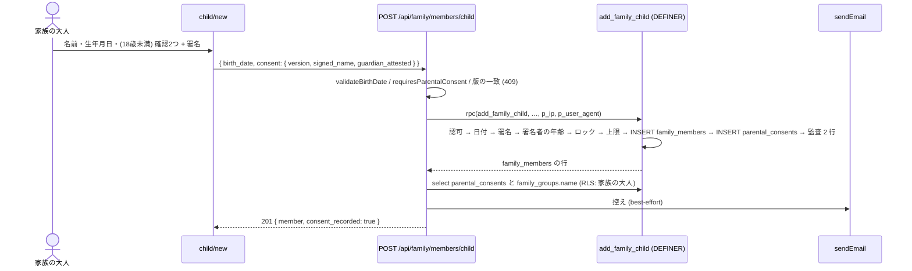
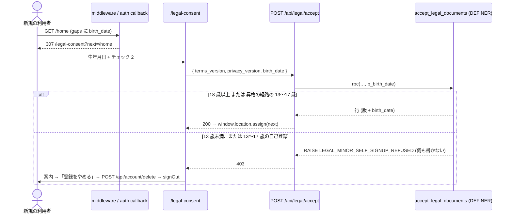
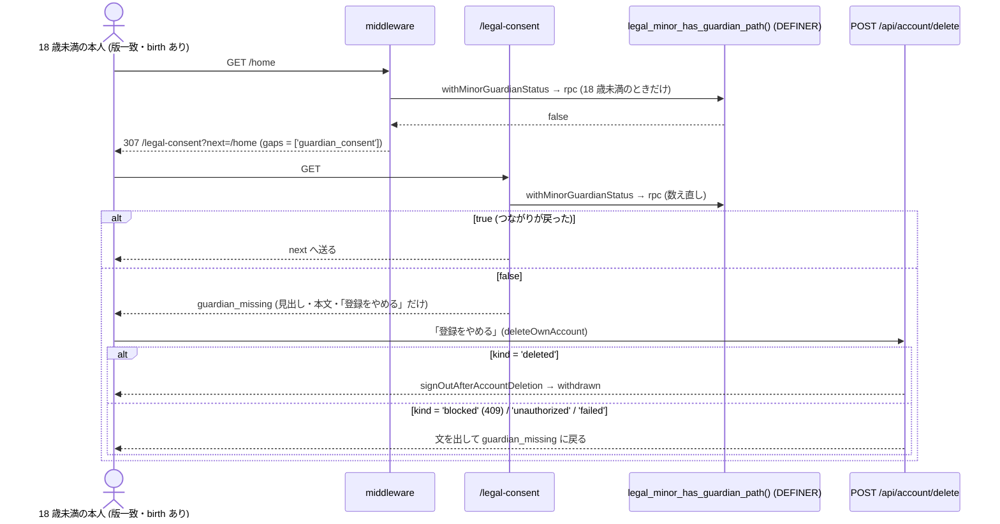

# 14. 未成年の年齢確認と保護者の同意 (#1173)

| 項目 | 値 |
|---|---|
| Status | 実装済み (#1758 12649661・2026-10-16)。設計ゲート通過 (v1.10・#1712)。同意書の文と版は #1901 (#1918 2ba5b3b3・2026-10-19。cross/20 Q-27) で v2026.2 に改めた (§6 の正典の写し・§8 の 14) |
| Issue | #1173 (要件 03 §17.10。先例: #1174 の規約の同意 (`accept_legal_documents`)・#1232 の子供の昇格 (本人同意)・#1154 の AI 同意 (`external_data_consents.revoked_at`)) |
| 分冊 | 1 冊・2 段 (段 A = DB + `packages/shared` + 書き出しの分類 / 段 B = Web + API + メール + モバイルの注記)。§0.2 |
| 正典の関係 | `cross/01-auth-session.md` §12〜§13.2 (子供アカウント保護の方針・草案) と `family/01-data-model.md` §4.13 (`parental_consents` の草案 DDL) を**本冊が置き換える** (マージ後に両節は本冊への参照に現在形化する。§6.18)。`cross/08-legal-compliance.md` §7.2 の同意ゲート (#1174) に「生年月日の確認」を畳む。13a (#1442) は実装まで main に着地済み (#1697)・13b は設計書が main に着地済み。両冊との契約は §0.5 |
| 範囲の正本 | Issue #1173 の本文とコメント (範囲と方針の記録のコメントを含む。要点は §1.2 にも写した) |
| 読み手 | 実装 (Sonnet 5.5) と敵対レビュー。実装は §6 だけを読んで手を止めずに書けることを完成条件にする |

---

## 0. 範囲・分冊判定・一次情報

### 0.1 一言でいうと

- **本人 (大人) の年齢**: 生年月日は、全員が通る**同意画面 (`/legal-consent`) で 1 回だけ**聞き、`accept_legal_documents` が `user_profiles.birth_date` に書く (特権列。本人は直接書けない)。「同意が済んでいるか」の判定 (`lib/legal-consent.ts` → 13a の `/api` の 403 も) に「生年月日がある」を**畳む**ので、Web・API・モバイルのゲートが 1 つの述語で揃う。18 歳未満が自分で登録しようとしたら、何も記録せずに断り (`LEGAL_MINOR_SELF_SIGNUP_REFUSED`)、画面は「保護者が家族に追加する」道を案内し、「登録をやめる」で既存の退会 (`POST /api/account/delete`) を呼んでアカウントごと消す。
- **13〜17 歳の本人のアカウント (昇格の経路)**: 保護者の同意とのつながり (自分の行に有効な同意がある、または自分宛の有効な昇格依頼 + その子供の有効な同意。DB の `legal_minor_has_guardian_path()`) がある間だけ使える。依頼を断る・取り消される・期限が切れる・家族を抜ける / 外されると、同じ同意ゲートが「保護者の同意とのつながりがありません」の画面で止める (`gaps` の `'guardian_consent'`。§6.3 (a))。18 歳未満の本人は、昇格 (`accept_child_promotion`) 以外で家族に入らず (家族の作成・招待の承諾)、家族の代表者・組織のオーナーを引き受けない (`MINOR_ACCOUNT_NOT_ALLOWED`。DB の 4 関数が断る。§6.4 の 12)。つながりが切れたときの出口 (退会) を代表者・オーナーの 409 で塞がず、別の家族の大人として同意の記録や子供の情報を読ませないため。
- **子供 (家族のメンバー) の保護者の同意**: 子供の追加 (`add_family_child`) で生年月日を必須にし、18 歳未満なら**同じトランザクションで** `parental_consents` に電子署名 (氏名の入力 + 親権者の確認) を記録する。署名できるのは、自分の生年月日で 18 歳以上と確かめられる家族の大人 (代表者または大人の役割) だけ (`PARENTAL_CONSENT_SIGNER_NOT_ADULT`)。「同意待ち」の状態を作らない (同意が無ければ子供の行も無い)。取り消し = 子供を家族から外す (トリガーが `revoked_at` を入れる)。昇格 (`request_child_promotion` / `accept_child_promotion`) は 18 歳未満に有効な同意を求め、承諾で子供の生年月日を本人のプロフィールへ写す。
- **13 歳未満**: 子供の追加と同意は同じ画面・同じ記録 (区別は `child_age_at_signing` と shared の述語 `isUnderCoppaAge`)。**本人のアカウントは作らない** (同意書の第 3 段落「お子さま本人のアカウントは作成せず」・要件 03 §17.10 の「子供アカウント自体は `auth.users` を持たない」に合わせる): 昇格 (`request_child_promotion` / `accept_child_promotion`) は 13 歳未満の子供を `PROMOTION_UNDER_COPPA_AGE` で断り、`accept_legal_documents` は 13 歳未満の生年月日を昇格の経路があっても `LEGAL_MINOR_SELF_SIGNUP_REFUSED` で断る。Push の送信側 (`mobile/06-push-send.md` の worker) は年齢を見ず、本冊は述語だけ置く (13 歳未満の本人のアカウントは無いので、送信側の除外は保険。§8 の 9)。

### 0.2 分冊判定 (相 1 で実施)

| 目安 | 本書 | 判定 |
|---|---|---|
| 設計書 800 行超 | 超える (表・トレース・正典の SQL / TS を 1 冊に持つ) | トリガー |
| 消費先レーン 3 以上 | DB (migration)・shared・Web (画面 5 + route 2)・メール・モバイル (注記 1 行) | トリガー |
| 共有面 2 つ以上 | `packages/shared` の export・`lib/legal-consent.ts` + `lib/supabase/middleware.ts` (全リクエスト)・`family_members` の列と guard・`accept_legal_documents` の signature | トリガー |

**判定: 1 冊・2 段。** 核と配線に分けない理由: 消費先の多さは「同じ 2 つの述語 (生年月日がある / 同意が有効) を読む側」が多いだけで、冊をまたぐ契約が述語と DB 関数の signature しか無い。モバイルのネイティブで触るのはサインアップ画面の注記 1 行だけ (家族の画面は WebView で Web の画面を開くので、子供の追加・同意は Web の画面がそのまま効く。§0.3)。13b はネイティブの同意画面を作らず Web の同意画面を WebView で開くので、生年月日の欄を足す 13b 側の追随は無い (§0.5)。本冊は API の契約だけを決める。段 A (DB + shared) を先に閉じ、段 B (Web + API + メール) は段 A の実コード (再生成した `database.types.ts`・shared の export) を見て書く。

### 0.3 一次情報 (下の表の行番号は origin/main `5ff68e67` (2026-10-16) で取り直したもの)

周 1 の網羅性の反映で、§6.15・§6.17 の母集合を origin/main `56189b63` で取り直した。`5a48abc9` からの差分のうち本冊が触るファイルに掛かるのは、`POST /api/family/members/[member_id]/promote` の依頼者名の正規化 (#1649。本冊は変えない route) と、設計書 13a の着地 (§0.5) だけで、本冊の行番号の参照は変わらない。周 2 (R1 の修正) で origin/main `61c59321` と突き合わせた。`56189b63` からの差分のうち本冊の参照に掛かるのは、`tests/e2e/legal-consent-gate.spec.ts` の行のずれ (§6.17 の行番号を直した) と、`extractClientIp` の本体が `src/lib/admin/client-ip.ts` に移ったこと (`@/lib/admin/audit` は再エクスポートを続けるので、本冊の import (`@/lib/admin/audit`) はそのまま使える) だけ。周 2 の網羅性の反映で origin/main `bffe1b6f` と突き合わせた。`61c59321` からの差分は食事の区分の表示 (#1665) だけで、本冊の参照に掛からない。周 3 (R2 の修正) でも origin/main は `bffe1b6f` のままで、下の表の行 (周 3 で足した 6 行を含む) を同じ sha で確かめた。周 3 の網羅性の反映 (v1.5) も同じ sha で、`POST /api/legal/accept` の検査の順 (`route.ts:42-95`)・`lib/onboarding-routing.ts:52-109`・`lib/supabase/middleware.ts:266-283` (公開のパスに `/legal`)・`src/lib/env.ts:262-270` を確かめた。周 4 (R3 の修正) でも origin/main は `bffe1b6f` のままで、`LegalConsentForm.tsx` のチェックの初期値・`family-member-status-guard.test.ts` の A1・昇格の 2 関数の差し込み位置 (`PROMOTION_MEMBER_UNAVAILABLE` / `ALREADY_PROMOTED` の IF)・昇格の画面の失敗の扱い・要件 01 の子供のアカウントの発行を同じ sha で確かめ、下の表の最後に 4 行を足した。周 4 の網羅性の反映 (v1.7) で origin/main `36c926ad` と突き合わせた。`bffe1b6f` からの差分のうち本冊に掛かるのは **13a の実装の着地** (#1697・`44c471e4`。20 ファイル・+1,647 行: middleware の `/api` の分岐・`GET /api/legal/status`・`packages/shared/src/legal-consent-api.ts` / `legal-consent-copy.ts`・`src/lib/legal-consent-api.ts` と、そのテスト) で、§0.5・§6.5.6 の 4 / 6 / 17〜19・§6.15・§6.17 を実コードに合わせて直した。ほかの 3 コミット (#1696 の隠したコンテンツの完全削除・#1698 / #1699 の設計書) は本冊の参照に掛からない (migration の最大の番号は `20261016100000` に進んだが、本冊は番号を設計で決めない)。周 5 (R4 の修正) で origin/main `6baa2f33` と突き合わせた。`36c926ad` からの差分のうち本冊に掛かるのは次の 3 つで、判定の本体 (`resolveLegalConsentApiDecision` の最後の行・`resolveLegalConsentStatus`・`fetchMiddlewareProfile`・`findBlocker`) の中身は変わっていない: (1) #1636 (通知のトークンの claim。`lib/supabase/middleware.ts` に import 1 行・凍結の分岐の条件・`/api` の分岐の冒頭のコメント (1 行の直しと 2 行の追加)、`packages/shared/src/legal-consent-api.ts` に import 1 行・許可リストの 1 行・理由の型の 1 値・コメント、そのテスト `legal-consent-api.test.ts`・`middleware-legal-consent-api.test.ts`) による行のずれと、新しい番兵 `tests/migration-file-version-integrity.test.ts` (migration の見出し・戻し口の対。§6.4 の冒頭・§6.17)。(2) #1690 (#1562。退会の実行記録と招待の監査のアドレスの HMAC): `src/lib/account-deletion.ts` に実行記録の段が入って `findBlocker` の行が動き、`src/lib/account-self-service.ts` の `AccountDeletionResult` の `blocked` に `blocker` (譲渡の画面への案内用。`ACCOUNT_DELETE_BLOCKED_TRANSFER_GUIDE`) が足された (§6.5.6 の 6 は案内を出さない)。`gdpr_deletion_requests` が書き出しの対象外に移り (`src/lib/account-export-tables.ts`)、migration `20261016190000` が `membership_audit` に招待のアドレスを HMAC に置き換える BEFORE のトリガーを足した (本冊の監査の行はアドレスを持たないので影響しない。`family_members` のトリガーではない)。結合テスト `account-deletion.test.ts`・`account-export-scope.test.ts` の行のずれと、`auth-users-fk-on-delete.test.ts` の固定が 31 本になったことを §6.17 に入れた。(3) #1705 (設計書の「範囲の正本」を手元の仕様ファイルから Issue に向け直す形): 冒頭の表の「範囲の正本」を Issue に向け、仕様ファイルの要点の Issue への記録を §6.18 に入れた。#1600 (組織のチャレンジ) と設計書 3 冊 (#1703・#1704) は本冊の参照に掛からない (migration の最大の番号は `20261016190000`)。同じ周で、R4 の指摘 (18 歳未満の本人が家族を作る・別の家族に入る) の同型を探すために、家族・組織の役割を本人に付ける関数と退会の 409 の判定を読み、下の表の最後に 7 行を足した。周 6 (R5 の修正) で origin/main `5ff68e67` と突き合わせた。`6baa2f33` からの差分は #1700 (#1678。SQL の RPC が仮置きの名前 `'Guest'` を返さない・写さない) の 1 つで、本冊に掛かるのは次の 3 つ: (1) migration `20261016200000_rpc_profile_name_placeholder.sql` が `create_family_group` を作り直した (代表者の `display_name` に写す式を `public.normalize_profile_name(nickname)` に)。本冊の §6.4 の 12 の土台・戻し・T-MIG5 をこの定義に直した (下の表の `create_family_group` の行)。(2) その番兵 `tests/rpc-profile-name-placeholder-migration-contract.test.ts` が「`create_family_group` を最後に定義する migration は #1678 のもの」を固定するので、§6.17 に要更新の行を足した。(3) 結合テスト `tests/integration/security/rpc-profile-name-placeholder.test.ts` が 3 引数の `add_family_child` を呼ぶので、§6.17 の 3 引数の呼び出しの行が 9 ファイルになった。ほかの差分 (`promote.test.ts` の it の追加は `:412` 以降・`database.types.ts` の `normalize_profile_name`・`profile-name.ts`・`family-member-names.ts`) は本冊の参照の行を動かさない。migration の最大の番号は `20261016200000`。同じ周で、R5 の指摘 (昇格した本人の退会で同意の行が消える) のために、`family_members.user_id` の外部キーと退会の掃除を読み、下の表の最後に 2 行を足した。上の経緯の文に出てくる行番号はその周の sha のもので、下の表の行番号は `5ff68e67` のもの。`lib/supabase/middleware.ts` はその後の段 B (#1758)・#1772・#1780 で行が動いた: origin/main `9f4f6da8` では、同意の列の定数と `fetchMiddlewareProfile` は `:46-82`、公開のパスの `/legal` は `:320`、`/api` の分岐の冒頭のコメントから同意の判定の終わりまでは `:199-281`、同意の判定 (`if (apiUserId && apiProfileReadable && apiLegalColumnsAvailable)`) は `:265-280`。

| 事実 | 場所 |
|---|---|
| 暦日のヘルパーは shared に既にある: `formatLocalDate(date, timeZone = 'Asia/Tokyo')` (瞬間 → JST の YYYY-MM-DD)・`todayLocal()` (JST の今日)・`isCalendarDate(value)` (YYYY-MM-DD の形・実在する日・0101-01-02〜9998-12-30)。`badge-period-awards.ts` の `parseCalendarDate` / `interface CalendarDate` は非公開 (export されない)。「今日」を UTC の暦日で決める書き方 (`toISOString().slice(0, 10)` など) は本番コードのソース走査が止める | `packages/shared/src/date-utils.ts:12-21, 184-187`、`packages/shared/src/badge-period-awards.ts:67-82`、`tests/jst-today-source-scan.test.ts:1-60` |
| アカウントのデータ書き出しの結合テストは、出力する全表に本人の行が 1 件以上出ること (`family_groups` だけが 0 件) と、表ごとの件数を固定する。本人 A と B は同じ家族 (B が代表者・A が大人) | `tests/integration/security/account-export-scope.test.ts:318-321, 436-475` |
| `family_members` に `birth_date` 列は**無い**。子供の生年月日は `child_profile` (jsonb) の中 (`birth_date` キー、任意)。`birth_date` 列があるのは `legacy_family_members` | `supabase/migrations/20251126124224_create_meal_planner_tables.sql:115-133, 5290`、`src/app/(main)/family/members/child/new/page.tsx:66` |
| CHECK `family_members_child_profile_consistency` = `(role = 'child' ∧ user_id IS NULL ∧ child_profile IS NOT NULL) ∨ (user_id IS NOT NULL ∧ child_profile IS NULL)`。アカウント無しの行 (`user_id IS NULL`) は必ず `role = 'child'` だが、逆は成り立たない: 第 2 項は `role` を問わないので、`user_id` ありで `role = 'child'` の行も CHECK を通る。製品の経路でその行を作るものは無い (`role` を `'child'` にする UPDATE は migration に無い) が、結合テスト `membership-transfer-accept.test.ts:385` (E2) は service_role でその行を作る | 同 `:133`、`tests/integration/security/membership-transfer-accept.test.ts:383-397` |
| `family_members` に INSERT のポリシーは無い (SELECT と UPDATE だけ)。authenticated には INSERT の GRANT があるが RLS で止まるので、子供の行を作れるのは SECURITY DEFINER の `add_family_child` だけ | 同 `:10385, 10389`、`supabase/baseline/prod_table_acl.sql:172-175` |
| `add_family_child(p_family_id, p_display_name, p_child_profile)` の現行 (家族の行をロック・上限・監査 `child_added`)。ACL = authenticated と service_role | `supabase/migrations/20261007160000_family_member_limit_row_lock.sql:131-175` |
| `guard_family_members_privileged` が守る列 = role / family_id / user_id / status / removed_at (+ 本人以外の share_*) | `supabase/migrations/20261008090000_family_members_status_guard.sql` 末尾の関数 |
| `user_profiles` に生年月日の列は無い (`age integer` は栄養計算用の自己申告の年齢)。同意の 3 列と特権列ガード 2 本 | `supabase/migrations/20261008200700_legal_documents_acceptance.sql:60-121` |
| `accept_legal_documents(text, text, inet, text)` (SECURITY DEFINER・authenticated のみ・本人の行だけ・冪等) | 同 `:126-215` |
| 同意ゲート: `resolveLegalConsent` は `hasAcceptedCurrentLegalDocuments(accepted)` で `none` を決める。初回の作成は `resolveFirstSignInDestination` が `enforce: true` で同じ判定 | `lib/legal-consent.ts:133-138, 186-195` |
| middleware が読む列 `PROFILE_COLUMNS_WITH_LEGAL` (版の 2 列) と、列が無い DB (42703) のやり直し (`fetchMiddlewareProfile`)。画面の分岐と `/api` の分岐 (13a) が同じ関数で同じ列を 1 回だけ読む。公開のパスの一覧に `/legal` | `lib/supabase/middleware.ts:45-79, 313` |
| 同意画面 (サーバー側は `hasAcceptedCurrentLegalDocuments` で素通し) とフォーム (チェック 2 つ → `POST /api/legal/accept` → `window.location.assign(next)`、「同意しない」はログアウト)。フォームの文面は 13a (#1697) から `packages/shared` の `LEGAL_CONSENT_COPY` を import して使う (`:15-26` の import・`:44` ほか) | `src/app/legal-consent/page.tsx:42-50`、`LegalConsentForm.tsx` (`LEGAL_CONSENT_COPY` を使う同意の form) |
| `POST /api/legal/accept`: body の版が現行と違えば 409、IP / UA はヘッダーから、DB のエラーは `internalError` | `src/app/api/legal/accept/route.ts:42-130` |
| `request_child_promotion` (認可 → 対象の状態 → 日次上限 → pending の失効 → INSERT → 監査)。`birth_date` も同意も見ない | `supabase/migrations/20261008100000_membership_daily_send_cap.sql:371-452` |
| `accept_child_promotion` (ロック順 → 本人のメール → 状態 → UPDATE → プロフィールの upsert → 監査)。同意を見ない | `supabase/migrations/20261015170000_accept_copies_profile_name.sql:146-290` |
| 昇格の依頼を終わらせる関数: `reject_child_promotion(p_token)` は**依頼の宛先の本人** (メール一致) が呼べ、期限切れの pending でも断れる (「本人の意思表示を優先」のコメント)。`revoke_child_promotion(p_member_id)` は家族の大人が pending を `revoked` にする。依頼の期限は `expires_at` (既定 14 日) で、期限で状態を変えるバッチは無い (pending のまま時刻を過ぎる) | `20251126124224:2636-2716, 3058-3100` |
| 家族から外れる関数: `leave_family()` (本人の行を `left`、`user_profiles.family_id` を NULL。代表者は不可) と `remove_family_member(p_family_id, p_member_id)` (行を `removed`、アカウントのある行なら `user_profiles.family_id` を NULL)。どちらも本人のアカウント・`user_profiles.birth_date` には触れない | `supabase/migrations/20261008090100_family_lock_order.sql:341-429` |
| `family_groups` は `name text NOT NULL` (1〜60 文字)。SELECT のポリシー `family_groups_select_member` = `is_active_family_member(id)` (家族の active なメンバーは自分の家族の名前を読める) | `20251126124224:327-341, 10356` |
| メールの文面の番兵: `templates-site-config.test.ts` は `account/`・`membership/` (`templates.ts`・`scope-label.ts` を除く)・`support/` の `*.ts` を readdir し、配列 `TEMPLATES` と完全一致を求める。各行に環境変数の未設定 / 設定の 2 系統と、ソースの走査 (`http(s)://` の直書き禁止・`getEmailFrom()` と `emailSignature()` を含む) を掛ける。`templates.ts` は招待の変数の Zod と `EmailEnvelope` の再エクスポートだけで、テンプレートごとの再エクスポートの一覧は無い | `src/__tests__/lib/emails/templates-site-config.test.ts:57-197, 218-283`、`src/lib/emails/membership/templates.ts` |
| `legal-documents-acceptance.test.ts` の helper `accept()` は 4 引数 (版 2 つ・IP・UA) だけを渡し、22 か所の呼び出し (定義の行を除く) が成功を期待する。`:341-349` の it は関数の引数の文字列を完全一致で固定する。版の不正 (`:599-611`) と anon / service_role (`:621-631`) の it は helper を通らず RPC を直接呼ぶ | `tests/integration/security/legal-documents-acceptance.test.ts:158-165, 341-349, 599-631` |
| `AddFamilyChildBodySchema` を参照するのは定義 (`:26-30`) と型 (`:66`) だけ (route もテストも使っていない。`src/__tests__/schemas/membership-types.test.ts` は組織の招待・家族のグループ・家族の招待の 3 つの schema だけを import する) | `src/schemas/membership/family-member.ts:26-30, 66`、`src/__tests__/schemas/membership-types.test.ts:11-19` |
| `membership_audit.action` の CHECK (26 値。`parental_consent_*` は無い) | `20251126124224:5476-5486` |
| `terms_acceptances.document_type` の CHECK に `'parental_consent'` はあるが、どこも書いていない (本番 0 行) | 同 `:6553-6562`、§0.4 |
| 退会時の外部キーの方針 (本人だけの記録は CASCADE、作成者を指す列は SET NULL) | `supabase/migrations/20261010000100_auth_users_fk_on_delete.sql` 冒頭 |
| アカウントのデータ書き出し (#1131): 出力する表 / 出力しない表の分類 (`ACCOUNT_EXPORT_TABLES` / `ACCOUNT_EXPORT_EXCLUDED`)。棚卸しテストは baseline + 以後の migration を読み、`auth.users` を指す列 (`ACTOR_COLUMNS` 以外) を持つ表と、出力する表 (`family_members` は `self('user_id')`) の子表に分類を求める。同意の記録 (IP・UA を含む) は本人の個人データとして出力する方針。書き出しは本人のセッション (RLS が効く) で動く | `src/lib/account-export-tables.ts:236-243, 275-321`、`tests/account-export-tables.test.ts:162-182, 275-283, 405-411`、`src/lib/account-export.ts:7-11` |
| SECURITY DEFINER の関数は、anon に実行させるもの (許可リスト 2 本) 以外を migration で `REVOKE ALL … FROM PUBLIC, anon, authenticated, service_role` にする。走査はトリガー関数を除外しない。トリガー関数の先例 `audit_organization_invite_created()` も同じ REVOKE を流す | `tests/integration/security/anon-definer-execute.test.ts:84-130`、`supabase/migrations/20261008100000_membership_daily_send_cap.sql:65, 82` |
| 退会の本体 (代表者なら 409・`prepare_account_deletion`・`auth.admin.deleteUser`)。画面側の共通処理 `deleteOwnAccount` / `signOutAfterAccountDeletion` | `src/lib/account-deletion.ts:1-53, 355-475`、`src/lib/account-self-service.ts:147-191` |
| メール: `sendEmail(envelope)` (best-effort・失敗は結果で返す)、文面は `render*Email` が `template` を入れる。利用者が指定した宛先へ送る route は invite-throttle を通すか除外リストに理由を書く | `src/lib/emails/send.ts`、`src/__tests__/lib/emails/template-names.test.ts`、`tests/email-send-throttle-contract.test.ts:1-60` |
| 家族の API のエラーの語彙 = `MembershipErrorCode` (接頭辞なし。RAISE の文字列と同じ) + `ErrorStatusMap` + `MEMBERSHIP_ERROR_MESSAGES` (3 つとも `Record<MembershipErrorCode, …>` で型が強制) | `src/lib/errors/membership-errors.ts` |
| モバイル: 家族の画面はネイティブに無い (WebView で Web を開く)。ネイティブにあるのはサインアップ・ログイン・初期設定・設定など。サインアップ画面に規約の文は無い | `apps/mobile/app/` の一覧、`apps/mobile/app/(auth)/signup.tsx:236-290` |
| サインアップ (Web) の同意のチェック (記録は残さない。登録後は `/auth/callback` が同意画面へ回す #1435) | `src/app/(auth)/signup/page.tsx:186-232`、`src/app/(auth)/auth/callback/route.ts:170-178` |
| 公開の法務ページの作り (`"use client"`・`business-info`・`getSupportEmail`) | `src/app/legal/page.tsx:1-40` |
| 要件: 生年月日は過去 120 年以内。子供の個人情報 (生年月日・体重) は親のみ | `docs/requirements/01-family-management.md:1720, 678` |
| 要件: 13 歳未満 (COPPA) は電子署名同意、18 歳未満 (日本) は同意必須、子供は `auth.users` を持たない、13 歳未満に Push 不可 | `docs/requirements/03-operator-admin.md:2677-2694` |
| 要件: 子供のアカウントの発行は「将来拡張」で「子供が大きくなりアカウント発行 → 既存 family_member レコードと紐付け」。オープン課題に「子供アカウント発行時の親同意取得 (法的検討必要)」。年齢の下限は書いていない (昇格 #1232 は年齢を見ない) | `docs/requirements/01-family-management.md:219-220, 1895` |
| 同意画面のフォーム: `type Phase = 'idle' \| 'submitting' \| 'declining' \| 'declined'`。チェックの初期値は `useState({ terms_of_service: false, privacy_policy: false })` (どちらもオフ)。送れる条件は両方オン (`allAgreed`)。導入文は `isReconsent` で 2 通り (`LEGAL_CONSENT_COPY.introReconsent` / `introFirst`)。「改定あり」の印は `isReconsent && outdated.includes(type)` | `src/app/legal-consent/LegalConsentForm.tsx` の `Phase`・`agreed` の初期値・`allAgreed`・導入文と「改定あり」の印の描画 |
| `family_members` のトリガーの一覧を固定する番兵: A1 が `pg_trigger` を `tgrelid = 'public.family_members'::regclass AND NOT tgisinternal` で引き、`[{ tgname: 'trg_guard_family_members_privileged', tgenabled: 'O', tgtype: 19, fn: 'guard_family_members_privileged' }]` と完全一致 (`toEqual`) を求める。tests 全体で `family_members` のトリガーを数えるのはこの 1 本だけ (`git grep -n pg_trigger -- tests` の 10 件のうち、ほかは `health_goals` / `meals` / `planned_meals` / 名前を指定した `meals`・`recipes` のトリガー) | `tests/integration/security/family-member-status-guard.test.ts:687-709` |
| 昇格の画面の失敗の扱い: 依頼の画面は `setError(json.error?.message ?? …)` (route の message は固定の文「参加リクエストの作成に失敗しました」)。承諾の画面は `mapActionError(code, fallback)` の `switch` (`PROMOTION_*`・`ALREADY_*`・`CONFLICT_RETRY`・`PARENTAL_CONSENT_REQUIRED`・`default`)。route は `mapPgErrorToHttp` (enum の値を単語境界で照合) | `src/app/(main)/family/members/[id]/promote/page.tsx` (依頼の `setError(json.error?.message ?? 'リクエストの送信に失敗しました')`)、`src/app/family/promotions/[token]/page.tsx` の `mapActionError`、`src/app/api/family/members/[member_id]/promote/route.ts:113-118`、`src/lib/errors/membership-errors.ts` の `mapPgErrorToHttp` |
| `/api` の同意ゲートの判定 (13a・#1697): `resolveLegalConsentApiDecision(input)` = 強制していない → allow / 許可リストのパス → allow / それ以外は `hasAcceptedCurrentLegalDocuments(input.accepted) ? 'allow' : 'deny'` (本体の 1 行は `:146`)。`ResolveLegalConsentApiInput.accepted` の型は `AcceptedLegalVersions` (`:127-134`)。import は `./legal-versions` (`:16-23`) と `./push-token-claim` (`:24`。#1636) からの相対 (shared の中で自分のパッケージ名を使わない)。middleware の `/api` の分岐は 凍結 → メンテナンス → 同意 の順で、`fetchMiddlewareProfile` が読んだ行をそのまま `accepted` に渡す (判定は `:259-273`)。403 の本文は `legalConsentRequiredBody()` (`{ error, code }` の 2 キー。文は `LEGAL_CONSENT_REQUIRED_MESSAGE`) | `packages/shared/src/legal-consent-api.ts:16-24, 125-147`、`lib/supabase/middleware.ts:196-274` |
| `GET /api/legal/status` (13a): route は `LEGAL_COLUMNS = 'terms_version_accepted, privacy_version_accepted'` (`:24`) を本人のセッションで読み (`:38`)、`resolveLegalConsentStatus({ accepted: profile, enforced: isLegalConsentEnforced() })` (`:44`) の結果を `LegalConsentStatusSchema` で parse して返す (`:46-50`)。`resolveLegalConsentStatus` は `accepted = outdated.length === 0`・`required = enforced && !accepted` (`:183-206`)。応答の型 `LegalConsentStatus` (`:162-175`) と、アプリが使う手書きの形の検査 `isLegalConsentStatus` (`:219-232`)。Zod の正本 `LegalConsentStatusSchema` は `.strict()` で、`required === (enforced && !accepted)` を refine で固定する | `src/app/api/legal/status/route.ts:24, 38, 44-50`、`packages/shared/src/legal-consent-api.ts:149-232`、`src/lib/legal-consent-api.ts:36-59` |
| 同意画面の文面の置き場所 (13a): `packages/shared/src/legal-consent-copy.ts` の `LEGAL_CONSENT_COPY` (見出し・導入 2 通り・改定の印・ボタン・409 / 失敗の文) と関数 3 つ (チェックの文・全文リンクの文・版の行)。Web のフォームが使う (13b はネイティブの同意画面を作らず、Web の同意画面を WebView で開く)。`tests/legal-consent-copy.test.ts` の T-C1 は、フォームの文字列リテラル・JSX のテキスト (構文木。コメントは拾わない) が `LEGAL_CONSENT_COPY` のどの値も含まないことと、8 つのキーをフォームが参照することを固定し、走査の空振りの番兵として `'記録しています...'`・`'ログアウトしています...'` のリテラルがフォームにあることを求める | `packages/shared/src/legal-consent-copy.ts:8-44`、`tests/legal-consent-copy.test.ts:61-96` |
| 本人を家族の行・代表者にする関数は年齢を見ない: `create_family_group(p_name text, p_plan_key text DEFAULT 'free')` の最新の定義は #1678 (#1700) の `20261016200000` (NOT_AUTHENTICATED → ALREADY_IN_FAMILY → `family_groups` と `family_members` (role `'representative'`) の INSERT。baseline (`20251126124224:1199-1226`) の本文の、代表者の `display_name` に写す式だけを `(SELECT public.normalize_profile_name(nickname) FROM user_profiles WHERE id = auth.uid())` にし、その上に `-- #1678: …` のコメント 1 行を足したもの。見出しは baseline と同じ引用符つきの書き方)。`accept_family_invite(p_token, p_share_meals, p_share_health, p_share_menu)` の最新の定義は #1584 (NOT_AUTHENTICATED → 招待の family_id → 家族の行のロック → 招待のロック → 期限・使用済み → メールの一致 → ALREADY_IN_FAMILY → 家族の status → 上限 → INSERT (role `'adult'`))。どちらも生年月日・年齢を見ない | `supabase/migrations/20261016200000_rpc_profile_name_placeholder.sql:205-233`、`20261015170000:37-144` |
| 役割の譲渡の承諾も年齢を見ない: `accept_family_representative_transfer(p_proposal_id)` (宛先が本人の pending の提案 → 期限 → 家族の行のロック → 承諾者が家族の active な大人 / 代表者 → 提案を accepted → `family_members.role` と `family_groups.representative_id` の入れ替え)、`accept_org_owner_transfer(p_proposal_id)` (宛先が本人の pending の提案 → 期限 → 承諾者が組織の所属 → 提案を accepted → `org_role` と `organizations.owner_id` の入れ替え。baseline の定義のまま)。提案の表 `ownership_transfer_proposals` (scope `'family'` / `'organization'`、status の既定 `'pending'`、expires_at の既定 7 日後)。運営の `operator_force_representative_transfer`・`operator_force_owner_transfer` と、組織の作成 (`POST /api/admin/organizations` が body の `owner_id` を入れる) も年齢を見ない | `20261008090100:224, 269-339`、`20251126124224:811-869, 1390-1402, 2328-2364`、`src/app/api/admin/organizations/route.ts` |
| 退会の 409 の判定 `findBlocker`: `organizations.owner_id` が本人の行、または `family_groups.representative_id` が本人の行が 1 つでもあれば 409 (`ACCOUNT_DELETE_BLOCKED_ORG_OWNER` / `ACCOUNT_DELETE_BLOCKED_FAMILY_REPRESENTATIVE`)。家族の status (解散済み) は見ない。運営の強制解散・利用者の解散 (family/11) はどちらも `representative_id` を NULL にするので、解散した家族は `findBlocker` に当たらない | `src/lib/account-deletion.ts:311-349`、`20261008090100:188-222` |
| 画面の退会の呼び出し `deleteOwnAccount()` の結果は `AccountDeletionResult` = `{ kind: 'deleted' } \| { kind: 'unauthorized' } \| { kind: 'blocked'; message; blocker } \| { kind: 'failed' }` (`ok` のキーは無い)。409 の文は `accountDeletionBlockedMessage(message)` (サーバーの文、無ければ定型の文)、それ以外の失敗の文は `ACCOUNT_DELETE_FAILED_MESSAGE`。`blocker` (`'organization'` / `'family_group'` / null) は設定の画面が譲渡の画面 (`ACCOUNT_DELETE_BLOCKED_TRANSFER_GUIDE`) へ案内するためのもの (#1562。解散は利用者の画面が無く運営が行う) | `src/lib/account-self-service.ts:99-175` |
| 家族・組織の役割の 4 route の失敗の扱い: `POST /api/family/groups` は `ALREADY_IN_FAMILY` だけを 409 にし、それ以外は 500 `RPC_FAILED`。`POST /api/family/invites/[id]/accept` は `msg.includes(…)` の並びで、知らない文は 500。`POST /api/family/representative-transfer/[id]/accept` と `POST /api/org/owner-transfer/[id]/accept` は `mapPgErrorToHttp` の code と、route の中の文の表 `TRANSFER_ACCEPT_MESSAGES` (無い code は固定の文) を返す。画面 (`/family/setup`・`FamilyInviteAcceptModal`・家族と組織の `transfer-accept` の画面) は、個別に扱わない code では本文の `error.message` をそのまま出す | `src/app/api/family/groups/route.ts:58-70`、`src/app/api/family/invites/[id]/accept/route.ts:66-136`、`src/app/api/family/representative-transfer/[id]/accept/route.ts:15-21, 54-60`、`src/app/api/org/owner-transfer/[id]/accept/route.ts:13-19, 48-52`、`src/app/(main)/family/setup/page.tsx:39-42`、`src/components/membership/FamilyInviteAcceptModal.tsx:55-73`、`src/app/(main)/family/transfer-accept/[proposal_id]/page.tsx:94`、`src/app/(main)/org/transfer-accept/[proposal_id]/page.tsx:99` (`5ff68e67` では `src/app/(org)/org/transfer-accept/[proposal_id]/page.tsx`。origin/main `217358b8` では順に `:85-105`・`:177`・`:184`) |
| E2E の `tests/e2e/legal-consent-gate.spec.ts`: spec の中の `signInAsNewUser` (`profile: true` で `user_profiles` を insert。`legal` は版の 2 列だけ) と `acceptOnConsentPage` (チェック 2 つの外し入れで押せる / 押せないを確かめてから押す。呼び出しは `:273, 315, 331, 365, 406, 474, 506, 545, 657` の 9 か所)、API の同意の it (`profile: true` の人が版 2 つだけを POST して 200 を期待)。E2E で同意済みの版を入れるのはこのファイルだけ (`git grep terms_version_accepted -- tests/e2e`)。`tests/e2e/fixtures/fresh-user.ts`・`tests/e2e/global-setup.ts` は版も生年月日も入れず、同意画面に回されたら共通の helper `acceptLegalConsentIfShown` を呼ぶ | `tests/e2e/legal-consent-gate.spec.ts:82-117, 174-190, 622-635`、`tests/e2e/fixtures/fresh-user.ts:466`、`tests/e2e/global-setup.ts:240, 282` |
| 家族グループの削除: 家族の行を DELETE すると `family_members` (と本冊の `parental_consents`) は CASCADE で消える。利用者 (anon / authenticated) は家族の行を直接 DELETE できない (#1917 の続きでポリシー `family_groups_delete_representative` を消し、DELETE・TRUNCATE の権限を外した)。家族の行を消すのは、pg_cron の `purge-dissolved-family-groups` (operator/11 §5.4。解散から 90 日を過ぎ、同意の記録 (`parental_consents`) を持たない家族だけを消す。同意の記録を持つ家族は消さないので、この経路で同意の行は消えない) と service_role (運営の手作業) だけ。代表者が家族をやめるのは解散 (`dissolve_family_by_representative`。family/11) で、同意の行は取り消し済みとして残る。アプリの route に家族の行の DELETE は無い (`src`・`lib` に `from('family_groups')` の `.delete(` は無い) | `20251126124224:10352`、`20261022200000_family_groups_no_direct_delete.sql` |
| 本人の退会で本人の `family_members` の行が消える: 外部キー `family_members_user_id_fkey1` は `REFERENCES auth.users(id) ON DELETE CASCADE` (`20261010000100` は張り直していない)。退会の掃除 (`prepare_account_deletion`・`src/lib/account-deletion.ts`) は `family_members` に触れず、`auth.admin.deleteUser` の CASCADE で行が消える (結合テストは退会した大人の行が 0 件になることを固定する)。昇格した本人の行 (`user_id` あり・role `'adult'`) も同じ。`family_members` に DELETE のポリシーは無く (SELECT と UPDATE だけ)、行が消えるのはこの CASCADE・家族の行の DELETE の CASCADE・service_role の手作業だけ。`membership_audit.actor_id` は `auth.users` を指す SET NULL の外部キー。`auth-users-fk-on-delete.test.ts` の E は、退会で消える表 (CASCADE でたどれる表 = `family_members` を含む) を指す SET NULL の外部キーの列が NULL を許すことを求める | `20251126124224:8933, 9068, 10385, 10389`、`20261010000100:363-477`、`src/lib/account-deletion.ts:445`、`tests/integration/security/account-deletion.test.ts:571`、`tests/integration/security/auth-users-fk-on-delete.test.ts:290` |
| #1678 の番兵と結合テスト: `tests/rpc-profile-name-placeholder-migration-contract.test.ts` の `it.each(RPCS)('%s を最後に定義する migration が本 migration で、1 つ前はベースライン')` (`:138-145`) は、`RPCS` (`:49` = `get_invite_details`・`get_promotion_details`・`create_family_group`) を最後に定義する migration (`definesPattern` = `CREATE OR REPLACE FUNCTION` の見出し。行コメントを除いて走査) が `_rpc_profile_name_placeholder.sql` で、1 つ前が baseline であることを求める。ほかの it は、本 migration (`ours[0]`) と baseline のファイルどうし・本 migration の戻し口を比べるだけで、`normalize_profile_name` を定義する migration は本 migration だけであることも固定する (`:147-152`)。結合テスト `tests/integration/security/rpc-profile-name-placeholder.test.ts` は、helper `promotionRequesterName` (`:161-182`) で `add_family_child` を 3 引数 (`p_child_profile: { age: 12 }`) で呼んでから `request_child_promotion` を呼び、`create_family_group` の `display_name` を `:289` 以降で確かめる (利用者の `user_profiles` は nickname だけで、生年月日は入れない) | `tests/rpc-profile-name-placeholder-migration-contract.test.ts:49, 138-152`、`tests/integration/security/rpc-profile-name-placeholder.test.ts:77-113, 161-182, 289` |

### 0.4 本番の実数 (2026-10-15・Supabase MCP の SELECT だけ。書き込みなし)

`auth.users` 195 / `user_profiles` 65 (うち `age` あり 11) / `family_members` **0** (子供 0) / `terms_acceptances` 8 (`parental_consent` 0) / `family_promotion_requests` 0 / `family_members.birth_date` 列 無し / `parental_consents` 表 無し。
→ 子供の行が無いので、`family_members` の CHECK (§6.4 の 2) は VALID で足せる。既存の 195 アカウントは、次に画面を開いたときに同意画面で生年月日を聞かれる (版は同意済みなので証跡は増えないが、2 つのチェックは改めて自分で付ける。S3)。バックフィルはしない (推測で年齢を入れない)。

### 0.5 13a / 13b (#1442) との契約

- 状態 (2026-10-16・`5ff68e67`): 13a は**設計書も実装も main に着地済み** (実装は #1697・`44c471e4`。§0.3 の 13a の 3 行)。13b は設計書が main に着地済み (`docs/design/cross/13b-legal-consent-mobile.md`)。
- 13a の実装は `/api` の deny と `GET /api/legal/status` を版だけで決めている (`resolveLegalConsentApiDecision` の本体 `legal-consent-api.ts:146` の `hasAcceptedCurrentLegalDocuments(input.accepted) ? 'allow' : 'deny'` と、`resolveLegalConsentStatus` の `accepted = outdated.length === 0`)。**本冊の段 B が次の 4 つを必ず行う** (条件つきの作業ではない。§6.14):
  1. `packages/shared/src/legal-consent-api.ts` の判定を `isLegalConsentComplete` (§6.5.2) に差し替え、status に `gaps` を足す (§6.5.6 の 17)。
  2. `src/lib/legal-consent-api.ts` の `LegalConsentStatusSchema` に `gaps` を足す (§6.5.6 の 18)。
  3. `GET /api/legal/status` の route で、読む列に `birth_date` を足し、profile を `withMinorGuardianStatus` (§6.5.8) に通してから判定に渡す (§6.5.6 の 19)。
  4. middleware の `/api` の分岐で、`resolveLegalConsentApiDecision` に渡す profile を `withMinorGuardianStatus` に通す (§6.5.6 の 4。列は画面の分岐と同じ `PROFILE_COLUMNS_WITH_LEGAL` を 1 回だけ読むので、`birth_date` は列の定数に足すだけで両方の分岐に入る)。
  13a の設計書 (`docs/design/cross/13a-legal-consent-api-server.md`) の記述の直しは §6.18 の 13a の行 (オーケストレーター)。
- 13b はネイティブの同意画面を作らず、Web の `/legal-consent` を WebView で開く (設計書 13b §5.2)。生年月日の欄・403 `LEGAL_MINOR_SELF_SIGNUP_REFUSED` の案内 (§6.9)・`guardian_missing` の案内と「登録をやめる」は Web の画面がそのまま効き、13b 側の追随は無い。アプリのゲートが見る `required` は本冊の後も `enforced && !accepted` のままで、`accepted` が `gaps` の空と一致する (§6.8) ので、13b は `required` を見るだけで生年月日の未入力と保護者の同意とのつながりの無い 18 歳未満も同意画面 (WebView) へ回せる。本冊はこの API の形 (§6.8) だけを決める。
- モバイルのネイティブの画面には、13b の実装の着地 (ルートのゲート) で同意ゲートが掛かる。`/api` は 13a の分岐が本冊の述語で止める (アプリの API 呼び出しも 403 `LEGAL_CONSENT_REQUIRED` になる)。生年月日の未入力と「保護者の同意とのつながりが無い」の案内は、アプリでも Web の同意画面 (WebView) が出す (§8 の 10)。13b の設計書 (`docs/design/cross/13b-legal-consent-mobile.md`) は main にあり、§6.18 の 13b の行 (担当・期日はそこ) を写す契約は無い。
- 13b とのマージ順: 本冊 (PR #1758) と 13b の実装 (段 B1 = PR #1830・段 B2 = PR #1833) はどちらも main に着地済み。13b はネイティブの同意画面を作らず Web の同意画面を WebView で開くので、生年月日の欄も Web の同意画面が出し、13b 側の追随は無い (§6.18 の 13b の行)。

---

## 1. 目的・スコープ

### 1.1 解決すること (Issue #1173)

1. サインアップに生年月日・年齢の確認が無く、誰でも年齢の申告なしにアカウントを作れる → 同意画面で生年月日を 1 回聞き、18 歳未満の自己登録を断る。
2. 要件が定める `parental_consents` が無い → 表を作る (RLS・保持・取り消しつき)。
3. 13 歳未満 / 18 歳未満の保護者の同意の取得の流れが無い → 子供の追加に電子署名の同意を組み込む。
4. 昇格 RPC が年齢・同意を見ない → `request_child_promotion` / `accept_child_promotion` に検査を足す。

### 1.2 前提 (仕様ファイルの逐語)

- 「前提: ローンチ前で利用者ゼロ (正しい形で作る)。オーナーの選択 (2026-10-15・選択式) で、ローンチに要るものとしてこの群を作ると決まっている。」
- 「本番の DB に触らない。」(本冊は読み取りの SELECT だけを行った。§0.4)
- 本番は `LEGAL_CONSENT_ENFORCE=on` (`cross/08` §7.2 の 2026-10-10 の行)。

### 1.3 対象外

- 同意文書の文面・版・施行日の確定 (弁護士の確認。§8)。本冊の文面は**仮**。
- 18 歳到達バッチ (`family/01` §7 の索引だけ残っている未実装)・家族の分割 (`family/02` §4.10 未実装)・大人代理 (`01` §7.8 P1)。
- Push の送信側 (`mobile/06-push-send.md` の worker。本冊は述語だけ置く。§8 の 9)。
- `user_profiles.age` (栄養計算の自己申告) と `birth_date` の統合 (§8)。年齢の法的な判定は `birth_date` だけを見る。
- `terms_acceptances` の本人による直接 INSERT (`terms_self_insert`) を閉じること (`08` §7.2 の残課題。本冊は `terms_acceptances` に書かない。§7)。
- 家族の全メンバーが子供の `birth_date` を読める件 (`family_members_select_self_or_family`。要件 `01:678` は親のみ)。現行でも `child_profile.birth_date` は読める。本冊は列を増やすだけで露出を広げない。別 Issue (§8)。
- 13a / 13b の中身 (§0.5 の契約だけ)。
- 18 歳未満の本人の組織への参加 (`accept_org_invite`) は制限しない (組織の所属は退会を止めない。止めるのはオーナーの引き受けだけ。§6.4 の 12)。運営の操作 (強制の代表者の譲渡・組織の作成・強制のオーナーの譲渡) は年齢を見ない (§8 の 15)。

---

## 2. 関連要件

- `docs/requirements/03-operator-admin.md` §17.10 (子供アカウント保護)、`docs/requirements/01-family-management.md` §4.3 (子供メンバー登録)・§6.3 (子供の個人情報は親のみ)・`:1720` (生年月日は過去 120 年以内)、`docs/requirements/100-scenarios.md` B4。
- `docs/design/cross/01-auth-session.md` §12〜§13.2、`docs/design/family/01-data-model.md` §4.13 (本冊が置き換える)、`docs/design/cross/08-legal-compliance.md` §7 (同意の記録・ゲート)、`docs/design/cross/04-api-conventions.md` §4 (エラーコード。`FAM_PARENTAL_CONSENT_REQUIRED` が表にあるが、家族の API の実コードは接頭辞なしの `MembershipErrorCode` を使う。§6.7・§6.18)。

---

## 3. 相 1 外形固定: 要件行列・ユーザーシナリオ・現行の画面

### 3.1 要件行列

| ID | 要件 | 出どころ | 検証 (§6.13 の it) |
|---|---|---|---|
| R-1 | 本人の生年月日を 1 回だけ聞き、サーバーが記録する。本人は直接書き換えられない。同意画面の 2 つのチェックは生年月日だけを聞く人 (S3) でも最初はオフで、本人が改めてチェックする | Issue 1、`08` §7.2 の特権列の形、#1174 の同意画面の形 (文書ごとの必須のチェックを本人が付ける。`LegalConsentForm.tsx` 冒頭のコメント) | T-DB1〜T-DB3, T-A1〜T-A4, T-SH2, T-MIG1, T-MIG3, T-F1, T-F2 |
| R-2 | 18 歳未満は自分では登録できない。断るときは何も記録しない。昇格の経路 (保護者の同意済みの子供) の 13〜17 歳は通す (13 歳未満は経路があっても断る。R-13)。通したあとも、保護者の同意とのつながり (`legal_minor_has_guardian_path()`) が切れた 18 歳未満の本人のアカウント (依頼を断った・取り消された・期限切れ・家族を抜けた / 外された) は同じゲートが止め、退会の道だけを出す | 要件 03 §17.10、`01` §4.3 | T-DB4〜T-DB6, T-DB31, T-DB33, T-A5, T-F3〜T-F5, T-F7, T-SH1, T-SH4, T-SH10, T-MW4, T-MG1, E2E-1 |
| R-3 | 「同意が済んでいるか」のゲートの述語に「生年月日がある」と「18 歳未満なら保護者の同意とのつながりがある」を含める (Web の画面・初回の作成・13a の `/api` の分岐と `GET /api/legal/status`) | 仕様「同意ゲート #1442 の 13a の deny の仕組みと組み合わせるか」 | T-SH5〜T-SH7, T-SH10, T-MW1〜T-MW4, T-MG1, T-CB1〜T-CB3, T-F6, T-API1〜T-API5 |
| R-4 | 子供 (アカウント無しのメンバー) の追加は生年月日を必須にし、列 `family_members.birth_date` に入れる (jsonb の中ではない)。過去 120 年以内・未来でない | 要件 03 §17.10 (`family_members.birth_date`)、`01:1720` | T-DB7〜T-DB9, T-DB28, T-CR1〜T-CR3, T-CR11, T-CN1, T-SH2, T-ZD2, T-ZD3, T-MIG3 |
| R-5 | 18 歳未満の子供は、親権者の確認 + 同意 + 氏名の入力 (電子署名) が無ければ追加できない。記録は子供の行と同じトランザクション。署名できるのは家族の大人 (代表者または大人の役割) のうち、自分の `user_profiles.birth_date` で 18 歳以上と確かめられる人だけ (生年月日が無い人・昇格した 18 歳未満の本人は署名できない。要件の「親 (家族 owner)」との違いは §8 の 12) | 要件 03 §17.10 (電子署名同意)、Issue 3 | T-DB10〜T-DB13, T-DB32, T-CR4〜T-CR6, T-CR11, T-CN2〜T-CN4, T-ZD1, E2E-2 |
| R-6 | 18 歳以上の「アカウント無しのメンバー」は同意なしで追加できる (現行の用途を狭めない) | `01` §4.3 (祖父母など) | T-DB14, T-CN5, T-CR11, T-MD2 |
| R-7 | `parental_consents` はその家族の大人・署名した本人・運営だけが読め、クライアントは書けない。署名した本人のアカウントのデータ書き出しに入る (同意の記録は本人の個人データ。`terms_acceptances` などと同じ扱い)。子供を外して取り消したあとも取り消し済みとして残り、署名者が退会しても残り (署名者の紐づけだけ外す)、子供の行そのものが消えても (昇格した本人の退会で `auth.users` から CASCADE・service_role の削除) 取り消し済みとして残り (子供の行への紐づけだけ外す。有効だった同意はそのとき取り消して監査に残す)、家族の行の削除と一緒に消える。公開する同意書の第 5 段落 (記録する項目と保存の仕方) はこの動作と同じことを書く (§6.11) | 仕様「parental_consents の表 (RLS・保持期間)」、`20261010000100` の方針 (行を残して紐づけだけ外す)、`tests/account-export-tables.test.ts:405` の方針 | T-DB15〜T-DB20, T-DB38, T-EX1, T-EX2, T-MIG3, T-SH9 |
| R-8 | 取り消し = 子供を家族から外す。外れた瞬間に同意は `revoked_at` が入り、監査に残る。独立した「取り消し」の操作は作らない。同意に有効期限は設けない (外すまで有効。経過日数・子供の 18 歳到達で失効させない。§6.2 の「同意の有効期限」)。外した子供が昇格済みの本人 (18 歳未満) なら、その本人のアカウントは R-2 のゲートで止まる (新しい記録も共有も止まる。同意書の文と一致させる) | 仕様「有効期限・取り消し」 | T-DB20〜T-DB22, T-DB29, T-DB31, T-MW4, T-MD1〜T-MD3 |
| R-9 | 昇格の依頼・承諾は、子供が 18 歳未満なら有効な同意を求め、13 歳未満なら断る (承諾の時点でもう一度数える)。承諾で子供の生年月日を本人のプロフィールへ写す (上書き) | Issue 4 | T-DB23〜T-DB27, T-DB30, T-DB34, T-MIG1, T-MIG4, T-PR1 |
| R-10 | 同意文書の版は shared の定数 1 つ。route は body の版が現行と一致するときだけ記録する (`/api/legal/accept` と同じ形) | `08` §7.2 の版の扱い | T-SH8, T-CR7, T-CR11 |
| R-11 | 文言 (同意文書・サインアップの注記・同意画面の生年月日の案内) は `packages/shared` に 1 か所 (`parental-consent.ts`)。同意画面の既存の文面 (13a の `LEGAL_CONSENT_COPY`・`legal-consent-copy.ts`) は変えずにそのまま使い、本冊の文面と重ねて持たない (§6.11)。公開ページ `/legal/parental-consent` が同じ定数を描く | 仕様「法的な文言の置き場所」 | T-SH9, T-LP1〜T-LP2, T-F1 |
| R-12 | 同意を記録したら、署名した本人のメールアドレスへ控えを送る (best-effort。失敗しても追加は成功) | 仕様「メールの文面」 | T-CR8〜T-CR10, T-EM1〜T-EM2 |
| R-13 | 13 歳未満の区別は記録 (`child_age_at_signing`) と述語 (`isUnderCoppaAge`) に残す。13 歳未満の本人のアカウントは作らない (昇格は `PROMOTION_UNDER_COPPA_AGE`、自己登録は昇格の経路があっても `LEGAL_MINOR_SELF_SIGNUP_REFUSED`。同意書の第 3 段落と一致させる)。Push の送信側 (`mobile/06-push-send.md` の worker) はいま年齢を見ない。除外は保険で、足すなら送信側の判定 (`decideEligibility`) にこの述語を足す (§8 の 9) | 要件 03 §17.10 (子供アカウントは `auth.users` を持たない・13 歳未満に Push 不可)、同意書 (§6.5.1 の `PARENTAL_CONSENT_DOCUMENT_COPY`) | T-SH3, T-SH9, T-DB33, T-DB34, T-MIG4, T-PR1, §6.18 |
| R-14 | `as any`・マジックナンバーを使わない。年齢の境・期間は名前付き定数 (shared) と SQL のコメント | 共通ガード | lint, T-MIG2 |
| R-15 | 18 歳未満の本人 (`user_profiles.birth_date` の分かる人) は、昇格 (`accept_child_promotion`) 以外で家族に入らず (家族の作成・招待の承諾)、家族の代表者・組織のオーナーを引き受けない (`MINOR_ACCOUNT_NOT_ALLOWED`)。R-2 の出口 (退会) を代表者・オーナーの 409 で塞がず、昇格の承諾を `ALREADY_IN_FAMILY` で壊さず、別の家族の大人として同意の記録・子供の情報を読ませない。運営の操作は止めない (§8 の 15) | 仕様「同意前に使える範囲」「家族のメンバー (子供) との関係」、R-2 | T-DB27, T-DB35〜T-DB37, T-MIG1, T-MIG5, T-MN1〜T-MN4, T-F5, T-F7 |

### 3.2 ユーザーシナリオ (22 本)

| ID | シナリオ | 検証 |
|---|---|---|
| S1 | 新規 (成人) がメールで登録 → 確認 → 同意画面で生年月日 + 2 つのチェック → 記録 → 初期設定へ | T-A1, T-F1, E2E-3 |
| S2 | 新規 (成人) が Google で登録 → `/auth/callback` → 同意画面 (S1 と同じ) | T-CB1, T-CB2 |
| S3 | 既存の利用者 (同意済み・生年月日なし) が `/home` を開く → 同意画面 (導入文「ご利用には生年月日の登録が必要です…」・生年月日の欄・2 つのチェック。チェックは最初どちらもオフで、欄とチェック 2 つが揃うまで押せない。送る版は同意済みの版と同じ現行の版) → 記録 (証跡は増えない) → `/home` | T-MW1, T-F1, T-DB3 |
| S4 | 15 歳が自分で登録 → 同意画面で生年月日 → 403 → 案内 → 「登録をやめる」→ 退会 → ログアウトの画面 | T-DB4, T-A5, T-F3, T-F5, E2E-1 |
| S5 | S4 で「生年月日を直す」→ 成人の日付 → 通る (誤入力の救済。断った時点では何も記録されていない) | T-F4, T-DB4 |
| S6 | 親が 8 歳の子供を追加 → 生年月日 → 同意の欄が出る → 全文を読む → 2 つのチェック + 氏名 → 追加 → 子供の行 + 同意の行 + 監査 2 行 + 控えメール | T-DB10, T-CR4, T-CR8, T-CN2, E2E-2 |
| S7 | 親が 17 歳の子供を追加 → S6 と同じ (13 歳以上でも署名は同じ) | T-DB11 |
| S8 | 親が 70 歳の祖母をアカウント無しで追加 → 同意の欄は出ない → 追加 (同意の行なし) | T-DB14, T-CN5 |
| S9 | API を直接叩いて同意なしで 10 歳を追加 → 403 `PARENTAL_CONSENT_REQUIRED`。子供の行は作られない | T-DB12, T-CR5 |
| S10 | 子供の追加画面を開いたまま同意文書の版が上がった → 409 `PARENTAL_CONSENT_VERSION_MISMATCH` → 読み込み直し | T-CR7 |
| S11 | 16 歳の子供の昇格: 親が依頼 (同意あり) → 子供が同じメールで登録 → 同意画面で生年月日 (16 歳) → 依頼が pending なので通る → 承諾 → `user_profiles.birth_date` = メンバーの生年月日 | T-DB5, T-DB25, T-DB26 |
| S12 | 16 歳の子供の昇格で、依頼の前に同意が無い (本冊より前に作られた行は無い = 0 件。将来の欠損に備える) → 依頼は 403 `PARENTAL_CONSENT_REQUIRED` | T-DB23 |
| S13 | 子供を家族から外す → トリガーが同意を `revoked_at` にし、監査 `parental_consent_revoked` → 子供の画面の同意カードは「取り消し済み」 | T-DB20, T-DB21, T-MD3 |
| S14 | 署名した親が退会 → `parent_user_id` が NULL になり、同意の行は残る (家族の他の大人が読める) | T-DB18 |
| S15 | 同意文書の版を上げる → 既存の同意は失効しない。新しい子供の追加は新しい版で記録される (再同意を求めるかは §8) | T-SH8, T-DB13 |
| S16 | 子供を追加して署名した親が、のちに家族を抜け、アカウントのデータを書き出す (`GET /api/account/export`) → 自分が署名した同意の行 (氏名・日時・版・IP・UA) が書き出しに入る。家族の他の大人が署名した行は入らない | T-EX1, T-EX2, T-DB15 |
| S17 | S11 の 16 歳が、同意画面を通ったあと (生年月日は記録済み)、昇格の依頼を自分で断る (または親が依頼を取り消す・依頼の期限が切れる) → 次に画面を開くと同意画面の「保護者の同意とのつながりがありません」→「登録をやめる」で退会。親が子供を追加し直して (同意つき) 依頼し直せば、断られずに使える | T-DB31, T-SH10, T-MG1, T-MW4, T-F7 |
| S18 | 昇格した 16 歳の本人 (role = adult) を、親が家族から外す (または本人が `leave_family` で抜ける) → 同意は revoked (S13 と同じトリガー) → 本人の次の画面で S17 と同じ案内 → 「登録をやめる」で退会しても、同意の行は取り消し済みのまま残る (S22) | T-DB20, T-DB31, T-MW4, T-DB38 |
| S19 | 昇格した 16 歳の本人 (role = adult) が、8 歳の子供を追加しようとして同意の欄を埋める → 403 `PARENTAL_CONSENT_SIGNER_NOT_ADULT`。子供の行・同意の行は作られない。生年月日をまだ登録していない大人も、RPC に着けば同じ (`LEGAL_CONSENT_ENFORCE` が on なら、その大人は 13a の `/api` の分岐が先に 403 `LEGAL_CONSENT_REQUIRED` で止める。RPC の検査は強制していない間の守り) | T-DB32, T-CR6 |
| S20 | 親が 10 歳の子供 (同意あり) の昇格を依頼 → 403 `PROMOTION_UNDER_COPPA_AGE` (依頼は作られない。画面は `promotionUnderCoppaAge`)。10 歳の本人が自分で登録して同意画面で生年月日 (10 歳) を入れる → 403 `LEGAL_MINOR_SELF_SIGNUP_REFUSED` (13 歳未満は昇格の経路の有無を DB に聞かずに断る。何も書かない) → 案内 (13 歳未満のアカウントは作れない旨を含む) →「登録をやめる」 | T-DB33, T-DB34, T-PR1, T-F3 |
| S21 | S11 の 16 歳が、同意画面を通ったあと・昇格の承諾の前 (自分宛の pending の依頼がある間) に、自分で家族を作ろうとする / 別の家族の招待を承諾しようとする → 403 `MINOR_ACCOUNT_NOT_ALLOWED` (画面は route の文)。何も作られず、そのあとの昇格の承諾は `ALREADY_IN_FAMILY` にならずに通る。昇格したあと (role = adult) に、代表者の譲渡の提案や、所属する組織のオーナーの譲渡の提案を承諾しようとしても同じ 403 (代表者・オーナーにならない)。そのため、あとで保護者の同意とのつながりが切れても (S17・S18)、「登録をやめる」が 409 (代表者・オーナー) で止まらない | T-DB35〜T-DB37, T-MN1〜T-MN4, T-F7 |
| S22 | 昇格した 16 歳の本人が退会する (S18 で外されたあとの「登録をやめる」、または家族にいるまま設定から退会) → 本人の `family_members` の行は `auth.users` から CASCADE で消えるが、同意の行は消えない: 有効だった同意は `member_deleted` で取り消され (監査 `parental_consent_revoked`)、外されたあとの同意は `member_removed` / `member_left` のまま、どちらも子供の行への紐づけ (`family_member_id`) だけが外れて残る → 署名した親は書き出し (S16) とその家族の大人の閲覧で読める | T-DB38, T-SH9 |

### 3.3 現行の画面と経路 (本冊が触る所)

| 画面 / 経路 | 現行 | 本冊 |
|---|---|---|
| `/signup` (Web)・`(auth)/signup.tsx` (モバイル) | 規約のチェック (Web) / 何も無い (モバイル) | 注記 1 行 `SIGNUP_MINOR_NOTICE` を足す。欄は足さない (年齢の確認は同意画面に 1 か所) |
| `/legal-consent` | チェック 2 つ | 生年月日の欄 (プロフィールに無いときだけ必須)・未成年の案内と退会・保護者の同意とのつながりが無い 18 歳未満の案内と退会 |
| `/family/members/child/new` | 名前・生年月日 (任意・jsonb)・性別 | 生年月日を必須に (列へ)。18 歳未満なら同意の欄 (チェック 2 + 氏名) |
| `/family/members/[id]` | 役割・共有・昇格・除名 | 子供なら生年月日 (年齢) と同意カード (署名者・日時・版・取り消しの案内) |
| `/legal/parental-consent` | 無い | 新設 (公開。同意文書の全文と版・施行日) |
| `POST /api/family/members/child` | 3 引数の RPC | 生年月日と同意を渡す。版の検査。控えメール |
| `POST /api/legal/accept` | 版 2 つ | `birth_date` を受け、未成年の 403 を返す |
| `lib/legal-consent.ts` / `middleware.ts` / `/auth/callback` | 版の一致で判定 | `isLegalConsentComplete` (版 + 生年月日 + 18 歳未満なら保護者の同意とのつながり) で判定。middleware と `/auth/callback` の select に `birth_date`。middleware と同意画面は 18 歳未満のときだけ `withMinorGuardianStatus` (新設 `lib/legal-consent-minor.ts`) で DB に聞く |
| `/api/*` (middleware の `/api` の分岐)・`GET /api/legal/status` (13a・#1697 で着地済み) | 版だけで判定 (`resolveLegalConsentApiDecision` / `resolveLegalConsentStatus` が `hasAcceptedCurrentLegalDocuments` / `outdated` を見る)。status に `gaps` は無い | 判定を `isLegalConsentComplete` に差し替え、status に `gaps` を足す (`accepted` = `gaps` が空)。profile は `withMinorGuardianStatus` を通す。status の route は `birth_date` も読む (§0.5・§6.5.6 の 4・17〜19) |
| `/family/members/[id]/promote` (昇格の依頼)・`/family/promotions/[token]` (昇格の承諾) | 失敗は route の固定の文 / `mapActionError` | `PARENTAL_CONSENT_REQUIRED` のときだけ `PARENTAL_CONSENT_COPY.promotionConsentMissing` を出す |
| `POST /api/family/groups`・`POST /api/family/invites/[id]/accept`・`POST /api/family/representative-transfer/[id]/accept`・`POST /api/org/owner-transfer/[id]/accept` (家族の作成・招待の承諾・代表者 / オーナーの引き受け) | 年齢を見ない (DB の関数も) | 18 歳未満の本人は 403 `MINOR_ACCOUNT_NOT_ALLOWED` (DB の関数が断り、route が文をつけて返す。画面は route の `error.message` をそのまま出すので変えない) |

---

## 4. 相 2 構想とトレース

### 4.1 構造

1. **年齢は「同意の記録」と同じ場所・同じ関数で 1 回。** 新規・既存・Web・モバイル・Google 登録のどの経路も、サインイン後に最初に止まるのは同意画面 (#1435 の初回の作成 + `ENFORCE=on`)。そこに生年月日の欄を足し、`accept_legal_documents(…, p_birth_date)` が `user_profiles.birth_date` (特権列・write-once) に書く。判定の述語は `isLegalConsentComplete(profile) = 版が一致 ∧ birth_date あり ∧ (18 歳以上 ∨ 保護者の同意とのつながりあり)` の 1 つ。未成年の自己登録は関数が断り (何も書かない)、画面が「保護者が家族に追加 → 同意 → 本人のアカウントとつなぐ」道を案内し、退会 (既存) でアカウントを消す。昇格の経路の 13〜17 歳 (自分のメール宛の pending の依頼があり、その子供に有効な同意がある / 既に昇格して自分の行に有効な同意がある) だけは通す (`legal_minor_has_guardian_path()`)。13 歳未満は経路の有無を聞かずに断る (本人のアカウントを作らない。同意書の第 3 段落)。同じ DB の述語を、ゲートも 18 歳未満の本人について毎回数え直す (依頼を断る・期限切れ・家族を抜けるとつながりが切れ、ゲートが止める。状態を列に持たないので、時刻で切れる期限もそのまま効く)。
2. **保護者の同意は子供の作成と同じトランザクション。** `add_family_child` に `p_birth_date`・`p_consent_version`・`p_signed_name`・`p_guardian_attested`・`p_ip`・`p_user_agent` を足し、18 歳未満なら署名者 (呼び出し者) が自分の生年月日で 18 歳以上かを確かめ、`parental_consents` に 1 行入れてから返す。同意が無ければ子供の行も無い。CHECK `role <> 'child' OR user_id IS NOT NULL OR birth_date IS NOT NULL` (アカウント無しの子供の行は生年月日が必須) と「子供の行を作れるのはこの関数だけ」(§0.3) が不変条件を守る。
3. **取り消し = 子供を家族から外す。** `family_members.status` が `active` から変わる AFTER UPDATE トリガーが、そのメンバー (子供の行、または昇格して大人になった行) の有効な同意に `revoked_at` を入れ、監査に残す。除名 (`removed`)・運営の強制解散 (`left`)・昇格済みの本人の脱退 (`left`) のどの経路でも同じ (関数を 1 本ずつ直さない)。メンバーの行そのものが消えるとき (昇格済みの本人の退会で `auth.users` から CASCADE・service_role の削除) は、BEFORE DELETE のトリガーが同じく有効な同意を取り消し (`member_deleted`)、外部キー `family_member_id` は `ON DELETE SET NULL` なので同意の行は取り消し済みとして残る (家族の行の削除だけが `family_id` の CASCADE で同意の行を消す)。昇格済みの本人 (18 歳未満) のアカウントは、構造 1 のゲートが止める。
4. **昇格は同意を前提に。** `request_child_promotion` / `accept_child_promotion` は、子供が 13 歳未満なら断り (`PROMOTION_UNDER_COPPA_AGE`)、18 歳未満なら `parental_consent_active(member_id)` を求める。承諾で `user_profiles.birth_date` ← `family_members.birth_date` (親が入れた、同意の対象の値が正)。18 歳未満の本人 (生年月日の分かる人) が家族に入るのは昇格だけ: 家族の作成・招待の承諾・代表者 / オーナーの引き受けは、DB の述語 `caller_is_minor_jst()` で 4 関数の先頭が断る (§6.4 の 12)。構造 1 のゲートが止めたときの出口 (退会) が、代表者・オーナーの 409 で塞がらないようにするため。
5. **文言は shared に 1 か所。** 同意文書 (版・施行日・本文)・画面の文・サインアップの注記を `packages/shared/src/parental-consent.ts` に置き、公開ページ・子供の追加画面・メールが同じ定数を使う。

### 4.2 トレース (全シナリオを構造で手で走らせる)

| ID | 経路 (構造の番号) | 終わりの状態 |
|---|---|---|
| S1 | signUp → verify → `/auth/callback` (`resolveFirstSignInDestination`: 行なし → gaps = 2 文書 + birth_date → `/legal-consent`) → 欄 3 つ → `POST /api/legal/accept {版 2, birth_date}` → (1) 行を既定値 + birth_date で作る → `terms_acceptances` 2 行 → `/onboarding/welcome` | `user_profiles`: 版 2 + `birth_date`。gaps = [] |
| S2 | `signInWithOAuth` → `/auth/callback` → 以降 S1 | 同上 |
| S3 | `GET /home` → middleware: 版は一致・`birth_date` NULL → gaps = ['birth_date'] → 307 `/legal-consent?next=/home` → 画面 (`isReconsent` ∧ `outdated` が空 ∧ `needsBirthDate`): 導入文「ご利用には生年月日の登録が必要です…」・生年月日の欄・チェック 2 つ (初期値は現行のまま両方オフ。「改定あり」の印は出ない) → 欄が有効 ∧ 2 つをチェック → accept (同じ版 + birth_date) → (1) `birth_date` だけ更新、版・`legal_accepted_at` は動かない、証跡は増えない → `/home` | `birth_date` あり。`terms_acceptances` は 8 行のまま |
| S4 | S1 の accept で `age_years_jst(birth) = 15` ∧ `legal_minor_has_guardian_path()` = false → RAISE `LEGAL_MINOR_SELF_SIGNUP_REFUSED` (行を作らない) → route 403 → 画面 `minor_refused` → 「登録をやめる」→ `deleteOwnAccount()` (`POST /api/account/delete {confirm:true}`: 代表者でない → `prepare_account_deletion` → `deleteUser`) → `signOutAfterAccountDeletion` → `withdrawn` の画面 | `auth.users` の行なし。`user_profiles` 行なし |
| S5 | S4 の 403 のあと「生年月日を直す」→ 欄に戻る → 成人の日付で accept → S1 の終わり | S1 と同じ |
| S6 | `/family/members/child/new`: 生年月日 → `requiresParentalConsent` = true → 同意の欄 → `POST /api/family/members/child {…, birth_date, consent:{version, signed_name, guardian_attested}}` → route: 版 = `PARENTAL_CONSENT_DOCUMENT.version` ✓ → RPC (2): 認可 → 生年月日 ✓ → 8 歳 ∧ 署名 ✓ → 署名者 (親) の `user_profiles.birth_date` で 18 歳以上 ✓ → ロック・上限 → 子供の行 (birth_date 列、child_profile から birth_date を除く) → `parental_consents` 1 行 (age 8) → 監査 `parental_consent_recorded` + `child_added` → route: `parental_consents` の 1 件と `family_groups.name` を読む → 控えメール (家族名 = `family_groups.name`・呼び名 = body の `display_name`。best-effort) → 201 | 子供 active・同意 active。メール 1 通 |
| S7 | S6 と同じ (age 17) | 同上 |
| S8 | 生年月日 → 70 歳 → 同意の欄なし → POST (consent なし) → RPC: `v_age >= 18` → 同意の検査を飛ばす → 子供の行だけ → 201 `consent_recorded: false` | 子供 active・同意なし |
| S9 | POST (consent なし・10 歳) → RPC: `v_age < 18` ∧ 署名なし → RAISE `PARENTAL_CONSENT_REQUIRED` (ロックの前。何も作らない) → 403 | 変化なし |
| S10 | POST の `consent.version` ≠ 現行 → route 409 `PARENTAL_CONSENT_VERSION_MISMATCH { current }` (RPC を呼ばない) | 変化なし |
| S11 | 親: `request_child_promotion` (4): 16 歳 ∧ `parental_consent_active` ✓ → pending → メール。子供: signUp (同じメール) → `/legal-consent` → accept (16 歳): `legal_minor_has_guardian_path()`: pending ∧ 期限内 ∧ メール一致 ∧ 同意 active → true → 通る (`birth_date` = 入力値) → `/family/promotions/[token]` (middleware: 16 歳なので `withMinorGuardianStatus` が同じ述語を聞く → true → 通す) → `accept_child_promotion` (4): 16 歳 ∧ 同意 ✓ → UPDATE 子供の行 (user_id・role adult) → プロフィール upsert (`family_id`, `birth_date` = メンバーの値で上書き) → 監査 → 以後の画面も述語の ① (自分の行に有効な同意) で通る | 子供 = 本人の行 (adult)。`user_profiles.birth_date` = 親が入れた値。同意の行は残る (member は active のまま) |
| S12 | `request_child_promotion`: 16 歳 ∧ 同意なし → RAISE `PARENTAL_CONSENT_REQUIRED` → 403 | 依頼なし |
| S13 | `remove_family_member` → UPDATE status 'removed' → トリガー (3): 有効な同意 1 行に `revoked_at` + `revoked_reason='member_removed'` → 監査 `parental_consent_revoked` (actor = 外した人) | 同意 revoked。画面のカードは「取り消し済み (外した日時)」 |
| S14 | 親の退会 → `auth.users` DELETE → FK `ON DELETE SET NULL` → `parent_user_id` NULL (行・署名の氏名・日時は残る) | 同意の行あり。家族の他の大人が読める |
| S15 | `PARENTAL_CONSENT_DOCUMENT.version` を上げてデプロイ → 既存の行の `consent_version` は旧版のまま有効 (`parental_consent_active` は版を見ない) → 新しい追加は新版 | 旧版の同意は有効のまま (再同意は §8) |
| S16 | 親: `leave_family` (status → left。親の行に同意は無いのでトリガーは何もしない) → `GET /api/account/export` → `ACCOUNT_EXPORT_TABLES` の `parental_consents` (`self('parent_user_id')`): 本人のセッションで `.eq('parent_user_id', uid)` → RLS: 家族の大人ではもう無いが `parent_user_id = auth.uid()` の枝で読める → 持ち主の確認 (`parent_user_id` = 本人) を通って出力 | 書き出しに自分が署名した行だけ。他の大人が署名した行は `.eq` で入らない |
| S17 | S11 の accept のあと (`user_profiles` = 版 + birth 16 歳)、本人が `reject_child_promotion(token)` (メール一致・期限切れでも可) → 依頼 `rejected` → 次の `GET /home` → middleware: 版一致・birth あり・16 歳 → `withMinorGuardianStatus` → `legal_minor_has_guardian_path()` = false (① 自分の行なし・② pending なし) → gaps = ['guardian_consent'] → 307 `/legal-consent?next=/home` → page: 同じ数え直し → `guardianMissing` → フォームの `guardian_missing` (見出し・本文・「登録をやめる」) → `deleteOwnAccount()` → `signOutAfterAccountDeletion` → `withdrawn`。親の `revoke_child_promotion` (依頼 `revoked`)・期限切れ (`expires_at` を過ぎた pending) も ② が false になり同じ。親が子供を追加し直し (同意つき)、同じメールに依頼し直すと ② が true に戻り、次の GET で通る | `auth.users` なし (退会したとき)。どの道でも `user_profiles.birth_date` は変わらない (write-once) |
| S18 | 親: `remove_family_member` (本人の行 → removed。トリガー (3) が同意を `member_removed` で revoked) / 本人: `leave_family` (→ left。`member_left`) → 本人の次の `GET` → middleware: 16 歳 → `legal_minor_has_guardian_path()` = false (① の行は active でない) → S17 と同じ画面 | 同意 revoked。本人は `guardian_missing` (退会するか 18 歳になるまで)。退会しても同意の行は `member_removed` / `member_left` のまま残る (S22) |
| S19 | 昇格した 16 歳 (role adult・active・`user_profiles.birth_date` = 16 歳) が `POST /api/family/members/child {birth_date: 8 歳, consent: {…}}` → route: 版 ✓ → RPC (2): 認可 ✓ (adult) → 生年月日 ✓ → 署名の入力 ✓ → 署名者の `birth_date` = 16 歳 → RAISE `PARENTAL_CONSENT_SIGNER_NOT_ADULT` (ロックの前。何も作らない) → `mapPgErrorToHttp` → 403。生年月日の無い大人も同じ (IF の `v_signer_birth IS NULL`) | 変化なし |
| S20 | 親: `request_child_promotion` (4): 生年月日 ✓ → `age_years_jst(birth) = 10 < 13` → RAISE `PROMOTION_UNDER_COPPA_AGE` (同意の検査の前・日次上限の前。何も書かない) → route `mapPgErrorToHttp` → 403 → 依頼の画面は `promotionUnderCoppaAge`。本人: signUp → `/legal-consent` → accept (10 歳): 行に birth なし → 日付 ✓ → `v_age = 10 < 13` → RAISE `LEGAL_MINOR_SELF_SIGNUP_REFUSED` (`legal_minor_has_guardian_path()` を呼ばない。行を作らない) → route 403 → 画面 `minor_refused` (`minorRefusedBody` は 13 歳未満のアカウントは作れないことを含む) →「登録をやめる」(S4 と同じ) | 依頼なし。本人は `auth.users` なし (退会したとき)。13 歳未満の `user_profiles.birth_date` を持つ行はどの道でも作られない |
| S21 | 本人 (② = S11 の accept のあと・承諾の前。`user_profiles.birth_date` = 16 歳): `POST /api/family/groups` → middleware: 16 歳 → `withMinorGuardianStatus` → ② で true → 通す → `create_family_group` (12): NOT_AUTHENTICATED の IF の次の `caller_is_minor_jst()` = true → RAISE `MINOR_ACCOUNT_NOT_ALLOWED` (家族の行・メンバーの行・監査を作る前) → route 403 (`MEMBERSHIP_ERROR_MESSAGES` の文) → `/family/setup` は `error.message` を出す。`POST /api/family/invites/[id]/accept` も同じ (`accept_family_invite` の NOT_AUTHENTICATED の次。招待の行・家族の行のロックの前で、招待は pending のまま) → `FamilyInviteAcceptModal` は `error.message`。→ `accept_child_promotion` は自分の active な行が無いので `ALREADY_IN_FAMILY` にならず S11 のとおり通る。昇格のあと (① = role adult): 親が `propose_family_representative_transfer` で本人に提案 → 本人の `accept_family_representative_transfer` (12): 先頭の `caller_is_minor_jst()` = true → RAISE (提案・役割・`representative_id` は変わらない) → route 403。所属する組織のオーナーの提案の `accept_org_owner_transfer` も同じ。→ 後で S17・S18 の道でつながりが切れても、本人は代表者・オーナーではないので「登録をやめる」(`deleteOwnAccount`) は `findBlocker` の 409 にならず `deleted` で終わる | 何も作られない・役割は変わらない。退会の出口は塞がらない |
| S22 | 本人 (昇格済み・16 歳) の退会: `deleteOwnAccount()` → `POST /api/account/delete` → `findBlocker` (代表者・オーナーでない。P37) → `prepare_account_deletion` → `auth.admin.deleteUser` → `auth.users` の DELETE → `family_members_user_id_fkey1` の CASCADE で本人の行の DELETE → BEFORE DELETE のトリガー (§6.4 の 6 の 2 本目): 有効な同意があれば `revoked_at` + `revoked_reason='member_deleted'` + 監査 `parental_consent_revoked` (actor は NULL。退会は service_role で `auth.uid()` が無い) → 行が消える → 外部キーの `ON DELETE SET NULL` で同意の行の `family_member_id` が NULL。S18 のあと (同意は外したときに `member_removed` / `member_left` で取り消し済み) なら、トリガーは何も更新せず、SET NULL だけが掛かる | 本人の `auth.users`・`family_members` の行なし。同意の行は取り消し済み・`family_member_id` NULL で残る (署名者の書き出し・家族の大人の閲覧に残る)。家族の行を消したときだけ同意の行も消える |

---

## 5. 相 3 構造裁定 (1 回だけ)

### 5.1 代替案の比較

| 案 | 中身 | 退ける理由 / 採る理由 |
|---|---|---|
| **A (採用)** | 本人の年齢 = 同意画面 + `accept_legal_documents`。子供 = 追加と同時に同意。取り消し = 外す (トリガー) | 「同意待ち」「生年月日なし」の中間の状態を作らない。述語 1 つ (`isLegalConsentComplete`)・DB 関数の変更 2 本 (signature) + 2 本 (検査の追加)・表 1 つ。既存のゲート・退会・監査をそのまま使う |
| B | サインアップ画面で生年月日を聞き、`/api/profile` (または `options.data`) で保存 | Google 登録・モバイル・既存の 195 人に別の経路が要る。クライアントが送る値をサーバーの入口で 1 か所に集められない (profile API は列を増やすたびに穴になる)。断ったあとに `auth.users` だけ残る問題も同じ |
| C | 子供に「同意待ち」の状態を持たせ、同意は別 API (`POST /api/family/members/{id}/parental-consent`) とメールのリンク (期限・再送・失効) で取る | 状態 × 操作の表が倍になり (同意待ちの子供に何ができるかを全経路で決める)、同意の署名者 = 追加した本人 (ログイン済みの家族の大人) なのでメールのリンクが要らない。本番に子供の行は 0 で、中間の状態の占有者もいない。控えのメールだけ残す |
| D | `parental_consents` を作らず `terms_acceptances (document_type='parental_consent')` に記録 | 子供は `auth.users` を持たないので `user_id` が子供を指せない。署名者・子供・年齢・取り消しを 1 行で表せない。要件も別表を指定 |

### 5.2 F の問い「縁の発生源を消すより単純な構造は無いか」

- 縁の発生源は「状態の間 (同意前 / 生年月日なし) に何ができるか」。A はその区間を**消す** (子供は同意と同時にしか存在しない。本人は同意画面から出られない = 既存のゲートの区間と同じ)。
- 残る縁は 3 つだけ: (a) 昇格の経路の未成年 (13〜17 歳。13 歳未満は本人のアカウントを作らないので経路を見ずに断る) が同意画面を通る (S11) — `legal_minor_has_guardian_path()` の 1 述語で閉じる。(b) 本冊より前の子供の行 — 本番 0 行なので CHECK を VALID で足し、存在しないことを migration が保証する (行があれば適用が失敗して気づく)。(c) (a) で通った 18 歳未満の本人が、あとで保護者の同意とのつながりを失う (依頼を断る・取り消される・期限切れ・脱退・除名・解散。S17・S18) — (a) と同じ述語をゲートが毎回数え直して閉じる。つながりを列に写す案は、依頼の期限 (時刻) で切れる縁をバッチ無しでは追えず、断る・取り消す関数にも書き込みを足すことになるので採らない (数え直しは 18 歳未満の本人のリクエストだけに掛かる)。(c) の出口は退会だけなので、退会を止める役割 (家族の代表者・組織のオーナー。`findBlocker`) と、昇格を壊す別の家族の所属 (`ALREADY_IN_FAMILY`) を、18 歳未満の本人に持たせない (役割を本人に付ける 4 関数の先頭で断る。§6.4 の 12)。断る場所を `/api` のゲートの許可リスト (つながりの ② の間に使える API を絞る) にする案は採らない: 利用者の JWT で PostgREST の rpc を直接呼べば Next の middleware を通らないので、DB の関数を止められない。
- 更に単純にする案「生年月日を聞かない (自己申告の年齢 `age` を使う)」は、要件 (`birth_date` で年齢計算) と Issue (生年月日の入力) に反するので採らない。

### 5.3 確定

構造 A で確定。以後、構造への疑義は blocking ではなく「裁定への差し戻し事由」として別扱い (仕上げ (§6) で構造を蒸し返さない)。

---

## 6. 相 4 仕上げ

### 6.1 ① 全パターン表 (主体 × 生年月日 × 年齢 × 補助条件 → 結果)

今日 = JST の暦日。年齢 = 誕生日の当日に 1 つ増える (`age_years_jst` / `calculateAgeYears`。年齢計算ニ関スル法律の「前日に満了」より 1 日だけ未成年側に倒す = 同意を要する側に倒す。§6.6)。

版の軸: P1〜P6 は body の版 2 つが現行と一致する前提の行。版が違うときの結果は P2c・P2d (route の検査の順は §6.8)。子供の追加の route の検査の順と、入力が複数同時に欠けるときの結果は P15〜P15f (§6.8 の順で上から最初に当たったものが返る)。

| # | 主体 / 経路 | 生年月日 | 年齢 | 補助条件 | 結果 |
|---|---|---|---|---|---|
| P1 | 本人 `accept_legal_documents` | 無し (body にも行にも) | — | — | `LEGAL_BIRTH_DATE_REQUIRED` (400)。何も書かない |
| P2 | 同 (route `POST /api/legal/accept` を通る) | 形が `YYYY-MM-DD` でない (`'abc'`・`'2000/01/01'`) | — | 行に無い | route の Zod (`LegalAcceptBodySchema` の `BIRTH_DATE_PATTERN`) で 400 `LEGAL_BAD_REQUEST` (既存の code)。RPC を呼ばない |
| P2b | 同 | 形は合うが暦に無い日 (`'2001-02-30'`)・未来・120 年超 | — | 行に無い | route の `validateBirthDate` で 400 `LEGAL_BIRTH_DATE_INVALID`。RPC を呼ばない (RPC も未来・120 年超は同じ code で RAISE する。暦に無い日は `date` 型に変換できないので RPC まで届かない) |
| P2c | 同 (route) | 形が `YYYY-MM-DD` でない | — | 版 (`terms_version` / `privacy_version`) が現行と違う | 400 `LEGAL_BAD_REQUEST` (body の parse が版より先。P2 と同じ)。RPC を呼ばない |
| P2d | 同 (route) | 無し・暦に無い日・未来・120 年超・あり (年齢を問わない) | 任意 | 版が現行と違う | 409 `LEGAL_VERSION_MISMATCH` + `current` (版が生年月日の検査と RPC より先。P1 の 400・P2b の 400・P4 の 403 にはならない)。RPC を呼ばない。何も書かない |
| P3 | 同 | あり | ≥ 18 | — | 記録 (行が無ければ作る)。200 |
| P4 | 同 | あり | 13〜17 | `legal_minor_has_guardian_path()` = false | `LEGAL_MINOR_SELF_SIGNUP_REFUSED` (403)。何も書かない |
| P4b | 同 | あり | < 13 | `legal_minor_has_guardian_path()` を問わない (DB に聞かない) | `LEGAL_MINOR_SELF_SIGNUP_REFUSED` (403)。何も書かない (13 歳未満は本人のアカウントを作らない。R-13) |
| P5 | 同 | あり | 13〜17 | 同 = true (pending の昇格依頼 + 有効な同意 / 既に昇格済みで同意あり) | 記録。200 |
| P6 | 同 | 行に既にある (body の値は無視) | 任意 | — | 版だけ更新 (write-once)。200 |
| P7 | middleware / 初回の作成 / 13a | 行に無い | — | 版は一致 | gaps = ['birth_date'] → redirect (画面) / 403 (API・13a) |
| P8 | 同 | あり | ≥ 18 | 版も一致 | gaps = [] → none (保護者の同意とのつながりは見ない。DB にも聞かない) |
| P9 | `add_family_child` | 無し | — | — | `CHILD_BIRTH_DATE_REQUIRED` (400) |
| P10 | 同 | 未来・120 年超 | — | — | `CHILD_BIRTH_DATE_INVALID` (400) |
| P11 | 同 | あり | ≥ 18 | consent の有無・版を問わない (無視。route を通るときは形の合う consent に限る。形の崩れた consent は P15e)。署名者の年齢も見ない | 子供の行だけ。201 `consent_recorded: false` |
| P12 | 同 | あり | < 18 (13〜17) | 版 ✓・署名 ✓・親権者 ✓・署名者 (呼び出し者) の `user_profiles.birth_date` で 18 歳以上 | 子供の行 + 同意の行 (`child_age_at_signing` 13〜17)。201 `consent_recorded: true` |
| P13 | 同 | あり | < 13 | 同 | 同 (age 0〜12)。13 歳未満の区別は `isUnderCoppaAge` (Push の送信側はいま年齢を見ない。§8 の 9) |
| P14 | 同 | あり | < 18 | 版・署名・親権者のどれかが無い / 氏名が空白だけ / 100 文字超 | `PARENTAL_CONSENT_REQUIRED` (403)。何も作らない (署名者の年齢より先に見る)。RPC を直接呼んだときの結果。route を通ると consent が無いものは P15b、形の崩れたものは P15e が先に返る |
| P14b | 同 | あり | < 18 | 版・署名・親権者 ✓ で、署名者の `user_profiles.birth_date` が無い・18 歳未満 (昇格した本人など) | `PARENTAL_CONSENT_SIGNER_NOT_ADULT` (403)。何も作らない (ロックの前) |
| P15 | route `POST /api/family/members/child` | 形が `YYYY-MM-DD` でない・body に無い | — | consent の有無・版・形を問わない | 400 `VALIDATION_ERROR` (Zod の parse が最初。生年月日の暦・年齢・同意・版より先)。RPC を呼ばない |
| P15a | 同 | 形は合うが暦に無い日・未来・120 年超 | — | consent の有無・版を問わない (形の合う consent) | 400 `CHILD_BIRTH_DATE_INVALID` (`validateBirthDate`。年齢を数える前)。RPC を呼ばない |
| P15b | 同 | あり | < 18 | consent が無い | 403 `PARENTAL_CONSENT_REQUIRED` (版の 409 より先。版は見ない)。RPC を呼ばない |
| P15c | 同 | あり | < 18 | 形の合う consent で `consent.version` ≠ `PARENTAL_CONSENT_DOCUMENT.version` | 409 `PARENTAL_CONSENT_VERSION_MISMATCH { current }`。RPC を呼ばない |
| P15d | 同 | あり | < 18 | 形の合う consent で版が現行と一致 | RPC を呼ぶ (以降は P12〜P14b と RPC の認可・上限。`NOT_FAMILY_ADULT` / `FAMILY_NOT_FOUND` / `MEMBER_LIMIT_EXCEEDED` は RPC の中なので、P15〜P15c の 400 / 403 / 409 が先に返る) |
| P15e | 同 | 形が合う (年齢を問わない) | 任意 | consent の形が崩れている (`signed_name` が空白だけ・101 文字、`guardian_attested` が true でない、`version` が `PARENTAL_CONSENT_VERSION_PATTERN` に合わない、余計なキー) | 400 `VALIDATION_ERROR` (Zod。18 歳以上でも。consent を無視するのは形の合うものだけ)。RPC を呼ばない |
| P15f | 同 | あり | ≥ 18 | 形の合う consent で版が現行と違う | 版を見ない (P11)。RPC を呼び 201 `consent_recorded: false` |
| P16 | `request_child_promotion` | メンバーに無し (CHECK 上あり得ない) | — | — | `CHILD_BIRTH_DATE_REQUIRED` (防御の IF。対象は `user_id IS NULL` の行だけで、§6.4 の 2 の CHECK が生年月日を保証するので DB では起こせない。IF の有無と順序は T-MIG4 がソースで固定する) |
| P17 | 同 | あり | 13〜17 | `parental_consent_active` = false | `PARENTAL_CONSENT_REQUIRED` (403) |
| P17b | 同 | あり | < 13 | 同意の有無を問わない | `PROMOTION_UNDER_COPPA_AGE` (403)。依頼は作られない (同意の検査より先。13 歳未満は本人のアカウントとつながない。R-13) |
| P18 | 同 | あり | 13〜17 | = true | 従来どおり pending を作る |
| P19 | 同 | あり | ≥ 18 | — | 従来どおり |
| P20 | `accept_child_promotion` | 同 P16〜P19 (P17b を含む) の検査を承諾時にもう一度 (年齢も承諾の日で数え直す) | | | 通れば `user_profiles.birth_date` ← メンバーの値 (上書き)。P17 の承諾時 = T-DB26、P17b = T-DB34 (依頼は service_role で作る。製品の経路では依頼の時点で断られる)、P18 = T-DB25、P19 = T-DB30、P16 = T-MIG4 |
| P21 | メンバーの status が active → removed (除名 `remove_family_member`) / left (運営の強制解散 `operator_force_dissolve_family`・利用者の解散 `dissolve_family_by_representative` (→ `family_dissolve_apply`。family/11)、昇格済みの本人の脱退 `leave_family`) | — | — | 有効な同意あり (子供の行、または昇格して role = adult になった行) | `revoked_at` + `revoked_reason` (removed → `member_removed`、left → `member_left`) + 監査 |
| P22 | 同 | — | — | 同意なし (≥ 18 の子供・同意の無い大人) | 何もしない |
| P23 | 署名者の退会 | — | — | — | `parent_user_id` → NULL。行は残る |
| P24 | 子供の行・昇格した本人の行の DELETE (昇格した本人の退会で `auth.users` から CASCADE・service_role の削除) | — | — | 有効な同意あり / 取り消し済み | 有効な同意は BEFORE DELETE のトリガーが `revoked_at` + `revoked_reason='member_deleted'` + 監査 (取り消し済みは変えない)。外部キーの SET NULL で `family_member_id` が NULL。同意の行は残る |
| P24b | 家族の行の DELETE (service_role・pg_cron の `purge-dissolved-family-groups` (operator/11 §5.4。解散から 90 日を過ぎ、同意の記録 (`parental_consents`) を持たない家族だけを消す。同意の記録を持つ家族は消さないので、この経路で同意の行は消えない)) | — | — | — | 子供の行・同意の行とも消える (`family_members` と `parental_consents.family_id` の CASCADE) |
| P25 | authenticated が `parental_consents` を INSERT / UPDATE / DELETE | — | — | — | 42501 (GRANT なし・ポリシーなし) |
| P26 | authenticated が `family_members.birth_date` / `user_profiles.birth_date` を直接 UPDATE | — | — | — | 42501 `CANNOT_MODIFY_PRIVILEGED_COLUMN` (guard) |
| P27 | service_role (テスト・運営の手作業) が `role = 'child'` ∧ `user_id IS NULL` の行を `birth_date` なしで INSERT / `birth_date` を NULL に UPDATE | 無し | — | — | 23514 (`family_members_child_birth_date_required`) |
| P28 | service_role が `user_id` ありの行を `role = 'child'` に UPDATE (製品の経路には無い。結合テスト E2 が作る) | 無し (本人の生年月日は `user_profiles`) | — | — | CHECK は掛からない (従来どおり通る) |
| P29 | `parental_consents` の SELECT (authenticated) | — | — | 署名した本人 / その家族の active な大人 / 運営 | 読める (署名した本人は家族を抜けたあとも自分の行だけ。運営は、TOTP を登録済みなら aal2 のセッションのときだけ: 運営の MFA の判定 `operator_mfa_satisfied()`・cross/12 §11.4 と付録 A の末尾)。それ以外は 0 行 |
| P30 | アカウントのデータ書き出し | — | — | 署名した本人 | 自分が署名した行 (`parent_user_id` = 本人) だけが `parental_consents` として出る。他の大人が署名した行・署名者が退会して NULL の行は出ない (RLS では読める行でも、書き出しの `.eq('parent_user_id', uid)` が絞る。T-EX2) |
| P31 | 時間の経過 (署名からの年数・子供の 18 歳到達) | あり | 任意 | 有効な同意あり | 有効のまま (期限で失効させない。`parental_consent_active` は `revoked_at` だけを見る。18 歳以上では同意を読む側 (昇格 2 本・`legal_minor_has_guardian_path()` の呼び出し元) が年齢で検査を飛ばす) |
| P32 | middleware / 同意画面 / 13a (本人のゲート) | あり | < 18 (製品の経路では 13〜17。13 歳未満の生年月日の行は P4b・P17b・P20 で作られない) | 版一致・`legal_minor_has_guardian_path()` = false (依頼を断った・取り消された・期限切れ・家族を抜けた / 外された / 解散) | gaps = ['guardian_consent'] → redirect → 同意画面の `guardian_missing` (退会だけ。§6.9) / 403 (13a) |
| P33 | 同 | あり | < 18 | 同 = true (① 自分の行に有効な同意 / ② 自分宛の有効な依頼 + 同意) | gaps = [] → none |
| P34 | 同 | あり | < 18 | DB への問い合わせ (`rpc('legal_minor_has_guardian_path')`) が失敗 | `minor_guardian_ok = true` として素通り (middleware がプロフィールを読めないときに判定を飛ばす #348 と同じ扱い。未成年の新しい自己登録は DB の `accept_legal_documents` が断るので開かない) |
| P35 | 初回の作成 (`/auth/callback`) | あり | < 18 | DB に聞かない (`minor_guardian_ok` 未設定) | gaps = ['guardian_consent'] → 同意画面へ回す。同意画面 (P32 / P33) が数え直し、つながりがあれば next へ送る (新しいアカウントで生年月日が既にある 18 歳未満 = S11 の途中でログインし直した人だけが通る道) |
| P36 | 本人の `create_family_group` / `accept_family_invite` | 本人の `user_profiles.birth_date` あり | < 18 | 昇格の経路 (① / ②) の有無・招待の有効性を問わない | `MINOR_ACCOUNT_NOT_ALLOWED` (403)。何も作らない・変えない (家族の行・メンバーの行・監査・招待の status。NOT_AUTHENTICATED の IF の直後で、ロックの前)。18 歳未満の本人が家族に入るのは昇格 (`accept_child_promotion`。UPDATE なので対象外) だけ (S21) |
| P37 | 本人の `accept_family_representative_transfer` / `accept_org_owner_transfer` | あり | < 18 | 提案の有無・有効性を問わない | `MINOR_ACCOUNT_NOT_ALLOWED` (403)。提案・役割・`representative_id` / `owner_id` は変わらない (関数の先頭)。代表者・オーナーは退会を止める役割 (`findBlocker`) なので、P32 の出口 (退会) を塞がない (S21) |
| P38 | P36・P37 の 4 関数 | 無し (プロフィールの行なしを含む) / あり | — / ≥ 18 | — | 従来どおり (`caller_is_minor_jst()` は生年月日の無い人・行の無い人で false。強制ありでは生年月日の無い人は同意ゲートが先に止める)。運営の `operator_force_representative_transfer`・`operator_force_owner_transfer`・組織の作成は年齢を見ない (§8 の 15) |

### 6.2 ② 状態比較表 (現行 vs 設計後)

| 面 | 現行 | 設計後 |
|---|---|---|
| 本人の生年月日 | 無い (`age` は栄養用の自己申告) | `user_profiles.birth_date` (特権列・write-once。`accept_legal_documents` だけが書く。昇格の承諾は上書き) |
| 同意ゲートの述語 | `hasAcceptedCurrentLegalDocuments` (版 2 つ) | `isLegalConsentComplete` = 版 2 つ + `birth_date` + (18 歳以上 ∨ 保護者の同意とのつながり)。`getLegalConsentGaps` が欠けを列挙 (`'birth_date'` / `'guardian_consent'`)。つながりは 18 歳未満のときだけ `withMinorGuardianStatus` が DB に聞く |
| middleware の select (画面の分岐と `/api` の分岐が同じ `fetchMiddlewareProfile`) | `…, terms_version_accepted, privacy_version_accepted` | `…, terms_version_accepted, privacy_version_accepted, birth_date` (42703 のやり直しはそのまま) |
| `/api` の同意ゲート (13a・#1697) | `resolveLegalConsentApiDecision` が版 2 つで deny (403 `LEGAL_CONSENT_REQUIRED`) | 同じ関数が `isLegalConsentComplete` で deny (生年月日なし・つながりの無い 18 歳未満も 403)。profile は `withMinorGuardianStatus` を通す。403 の本文・許可リストは変えない |
| `GET /api/legal/status` (13a) | 読む列は版 2 つ。`accepted` = 版 2 つに同意済み。`gaps` は無い | 読む列に `birth_date`。`gaps` を足し、`accepted` = `gaps` が空。`required = enforced && !accepted` の式は同じ (§6.8) |
| `/auth/callback` の select (`route.ts:127`) | `roles, nickname, onboarding_started_at, onboarding_completed_at, terms_version_accepted, privacy_version_accepted` | 末尾に `, birth_date`。`resolveFirstSignInDestination` (`:178`) に渡す `profile` が生年月日を持つので、生年月日を登録済みの新しいアカウント (同意したあと初期設定の前にログインし直した人) を同意画面へ回し直さない |
| 同意ゲートの消費者のうち判定をしないもの | `lib/onboarding-routing.ts` (パスの定数と `isLegalConsentPath`)・`src/app/(main)/layout.tsx` (`LEGAL_CONSENT_PENDING_HEADER` を読むだけ)・`src/components/legal/LegalConsentBanner.tsx` (`buildLegalConsentPath` でリンクを作るだけ)・`src/app/(auth)/login/page.tsx` (説明のコメントと文面だけ) | 変えない (§6.15 の「変えない」の行)。バナーは判定の結果 (`banner`) を受けて出るだけなので、`resolveLegalConsent` の差し替えで生年月日だけが欠ける人にも出る (本番は `ENFORCE=on` なのでバナーではなく同意画面へ回る) |
| 同意画面 | チェック 2 (初期値はどちらもオフ) | + 生年月日 (無いときだけ必須)。未成年の案内・退会。チェックの初期値は変えない (生年月日だけを聞く人も改めてチェックする) |
| 未成年の自己登録 | 誰でも作れる | 同意画面で断る (記録なし) → 退会の導線。13〜17 歳は昇格の経路があれば通し、13 歳未満は経路があっても断る |
| 18 歳未満の本人のアカウント (昇格の経路で通った人。13〜17 歳だけ) | — (年齢を持たない。昇格は何歳でもできる) | 保護者の同意とのつながりがある間だけ使える。切れたら同意画面の `guardian_missing` (退会だけ。18 歳になればゲートは年齢で見なくなる) |
| 18 歳未満の本人の家族・組織の役割 | — (年齢を持たない。家族の作成・招待の承諾・代表者 / オーナーの引き受けは誰でもできる) | 家族に入るのは昇格だけ。家族の作成・招待の承諾・代表者 / オーナーの譲渡の承諾は `MINOR_ACCOUNT_NOT_ALLOWED` (403。DB の 4 関数の先頭の `caller_is_minor_jst()`。§6.4 の 12)。組織への参加は止めない。運営の操作は年齢を見ない (§8 の 15) |
| 子供の生年月日 | `child_profile.birth_date` (任意) | 列 `family_members.birth_date` (アカウント無しの子供の行は必須。CHECK `role <> 'child' OR user_id IS NOT NULL OR birth_date IS NOT NULL`)。`child_profile` からは除く |
| 子供の追加 RPC | `(uuid, text, jsonb)` | `(uuid, text, jsonb, date, text, text, boolean, inet, text)`。旧 signature は DROP |
| 保護者の同意 | 無い | `parental_consents` (追加と同時・署名・版・年齢・端末・取り消し) |
| 子供の追加の呼び出し者 | 家族の大人 (代表者・大人) | 同じ。ただし 18 歳未満の子供の同意に署名するときは、自分の `user_profiles.birth_date` で 18 歳以上と確かめられること (`PARENTAL_CONSENT_SIGNER_NOT_ADULT`) |
| 取り消し | — | 子供を外す → トリガーで `revoked_at` |
| 同意の有効期限 | — | **設けない**。有効 = `revoked_at IS NULL` (子供を外すまで)。期限の列・失効のバッチは作らない。子供が 18 歳になっても行は失効させない (`parental_consent_active` は年齢・経過日数を見ず、同意が要るかは呼ぶ側が `age_years_jst < 18` で決めるので、18 歳以上では同意は読まれない)。メールのリンクで同意を取らないので、リンクの期限も無い (§5.1 の C)。期限のあるのは昇格の依頼 (`family_promotion_requests.expires_at`。既存) だけ。定期の再同意を求めるかは §8 の 11 |
| 昇格 | 年齢・同意を見ない | 13 歳未満は断る (`PROMOTION_UNDER_COPPA_AGE`。本人のアカウントを作らない)。13〜17 歳は有効な同意が要る。承諾で生年月日を写す。依頼・承諾の画面は `PARENTAL_CONSENT_REQUIRED` と `PROMOTION_UNDER_COPPA_AGE` に専用の文を出す |
| 同意の取り消しの契機 | — | 同意の行を持つメンバーが active でなくなったとき (除名 → `member_removed`、運営の強制解散・昇格済みの本人の脱退 → `member_left`) と、メンバーの行そのものが消えるとき (昇格済みの本人の退会の CASCADE・service_role の削除 → `member_deleted`。同意の行は `family_member_id` を NULL にして残る)。子供の行は `user_id` が NULL なので `leave_family` (本人の行だけ) の対象にならない |
| 監査 | `child_added` / `child_promoted` … | + `parental_consent_recorded` / `parental_consent_revoked` |
| アカウントのデータ書き出し (#1131) | 同意の記録は `terms_acceptances` / `cookie_consents` / `external_data_consents` を出力 | + `parental_consents` (署名した本人の行だけ。`self('parent_user_id')`。§6.5.7) |
| `parental_consents` を読める人 | — (表が無い) | その家族の active な大人・署名した本人・運営 |
| `parental_consents` の保持 | — (表が無い) | 取り消し (外す) のあとも、署名者の退会のあとも、子供の行が消えたあと (昇格した本人の退会など) も残る (紐づけの列だけ NULL)。消えるのは家族の行の削除だけ (`family_id` の CASCADE)。§8 の 2 |
| 文言 | — | `packages/shared/src/parental-consent.ts` + `/legal/parental-consent` |
| メール | — | `family_parental_consent_recorded` (署名者本人宛の控え) |
| モバイル (ネイティブ) | サインアップに注記なし | `SIGNUP_MINOR_NOTICE` 1 行。同意画面の欄は Web の同意画面 (アプリも WebView で開く。13b) |

### 6.3 ③ 状態遷移表

**(a) 本人 (`user_profiles` の行)**。状態 = (行, 版, birth_date, 年齢, 保護者の同意とのつながり)。つながり = DB の `legal_minor_has_guardian_path()` (① 自分の行が active で有効な同意がある ∨ ② 自分のメール宛の pending・期限内の昇格依頼があり、その子供に有効な同意がある)。つながりは列に持たず、ゲートが 18 歳未満のときだけ毎回数え直す (18 歳以上では見ない)。下の「未成年の拒否」= 13 歳未満 (つながりを問わず、DB に聞かない。P4b) ∨ 13〜17 歳でつながりなし (P4)。13 歳未満の生年月日の行はどの操作でも作られないので、「18 歳未満」の状態は製品の経路では 13〜17 歳だけ。

| 状態 | 操作 | 遷移先 | ガード | 副作用 |
|---|---|---|---|---|
| 行なし | accept (成人) | 行あり・版一致・birth あり | 版の形式 ✓・日付 ✓・age ≥ 18 | 行を既定値で作る。証跡 2 行 |
| 行なし | accept (未成年の拒否: 13 歳未満、または 13〜17 歳で guardian path なし) | 行なし | — | RAISE `LEGAL_MINOR_SELF_SIGNUP_REFUSED` (403)。何も書かない |
| 行なし | accept (13〜17 歳・guardian path あり) | 行あり・版一致・birth あり | S11 | 同 成人 |
| 行なし | accept (body に birth なし) | 行なし | — | RAISE `LEGAL_BIRTH_DATE_REQUIRED` (400) |
| 行なし | 退会 | `auth.users` なし | 代表者でない | 既存の退会 |
| 行あり・版一致・birth なし (既存の利用者) | 画面の GET | 同意画面へ 307 (gaps = ['birth_date']) | `ENFORCE=on`・対象外のパスでない | — |
| 同 | accept (同じ版 + birth・成人 または 13〜17 歳で guardian path あり) | 版一致・birth あり | 日付 ✓・age ≥ 18 (または 13〜17 歳で guardian path) | `birth_date` だけ更新。証跡・日時は不変 |
| 同 | accept (同じ版 + birth・未成年の拒否) | 不変 (版一致・birth なし) | — | RAISE `LEGAL_MINOR_SELF_SIGNUP_REFUSED` (403)。何も書かない。画面は `minor_refused`。出口は 3 つ: ①「生年月日を直す」(誤入力) ② (13〜17 歳だけ) 保護者が家族に追加して同意し、本人のメール宛に昇格を依頼したあと、同じ操作をやり直す (guardian path が true になり通る。S11 と同じ。13 歳未満にこの出口は無い。S20) ③「登録をやめる」(既存の退会。本番の `family_members` は 0 行なので代表者の 409 は起きない。起きたら §6.5.6 の 6 の文) |
| 同 | accept (body に birth なし) | 不変 | — | RAISE `LEGAL_BIRTH_DATE_REQUIRED` (400)。画面は `needsBirthDate` で欄を必須にしているので通常は起きない |
| 行あり・版が古い・birth あり | 画面の GET | 同意画面へ 307 (gaps = 古い文書。18 歳未満でつながりが無ければ `'guardian_consent'` も入り、同意画面は `guardian_missing` を先に出す) | 同 | — |
| 同 | accept (新版。body の birth は無視) | 版一致・birth あり | 版 ✓ | 版と日時を更新。証跡 2 行 |
| 行あり・版が古い・birth なし | 画面の GET | 同意画面へ 307 (gaps = 古い文書 + 'birth_date') | 同 | — |
| 同 | accept (新版 + birth・成人 または 13〜17 歳で guardian path あり) | 版一致・birth あり | 版 ✓・日付 ✓・age ≥ 18 (または 13〜17 歳で guardian path) | 版と日時を更新し、`birth_date` を入れる。証跡 2 行 (body の birth を使う。§6.4 の 10: 行に birth が無いので `COALESCE(NULL, p_birth_date)`) |
| 同 | accept (新版 + birth・未成年の拒否) | 不変 (版は古いまま・birth なし) | — | RAISE `LEGAL_MINOR_SELF_SIGNUP_REFUSED` (403)。版の更新も含めて何も書かない (検査は upsert の前)。出口は上の「版一致・birth なし」の未成年の行と同じ 3 つ |
| 同 | accept (body に birth なし) | 不変 | — | RAISE `LEGAL_BIRTH_DATE_REQUIRED` (400) |
| 行あり・版一致・birth あり (18 歳以上、または 18 歳未満でつながりあり) | accept | 不変 | — | 冪等 (何も更新しない) |
| 行あり・版一致・birth あり・18 歳未満・つながりあり | 画面の GET | 通す (gaps = []) | middleware の `withMinorGuardianStatus` が `legal_minor_has_guardian_path()` = true を受ける | DB への問い合わせ 1 回 (18 歳未満の本人のリクエストだけ) |
| 同 (② = S11 の途中。自分宛の pending の依頼) | `accept_child_promotion` (本人) | 同 (① = 自分の行に有効な同意) | §6.4 の 11 | birth をメンバーの値で上書き |
| 同 (②) | 本人が `reject_child_promotion` で断る / 親が `revoke_child_promotion` で取り消す / 依頼の `expires_at` を過ぎる (時刻) | 行あり・版一致・birth あり・18 歳未満・つながりなし | — | 本人の行は何も変わらない (状態を DB に写さない。次のゲートで数え直す。S17) |
| 同 (① = 昇格済み) | `leave_family` (本人) / `remove_family_member` / `operator_force_dissolve_family` / 利用者の解散 `dissolve_family_by_representative` (→ `family_dissolve_apply`。family/11) / 家族の行の DELETE (service_role・purge。P24b) | 同 (つながりなし) | 各関数の既存のガード | (b) の表のトリガーが同意を revoked (家族の行の DELETE なら本人の行と同意の行ごと消える)。`leave_family` / `remove_family_member` では本人の `user_profiles` は `family_id` が NULL になるだけで、`birth_date` は変わらない (S18) |
| 同 (① / ②) | 本人が `create_family_group` / `accept_family_invite` | 不変 | — | RAISE `MINOR_ACCOUNT_NOT_ALLOWED` (403)。何も作らない (P36・S21)。② のままなので、このあとの `accept_child_promotion` は `ALREADY_IN_FAMILY` にならない |
| 同 (① / ②) | 本人が `accept_family_representative_transfer` / `accept_org_owner_transfer` | 不変 | — | RAISE `MINOR_ACCOUNT_NOT_ALLOWED` (403)。代表者・オーナーにならない (P37・S21) |
| 同 (① = 昇格済み・つながりあり) | 本人が設定から退会 (`POST /api/account/delete`) | `auth.users` なし (本人の `family_members` の行も CASCADE で消える) | 本人が家族の代表者・組織のオーナーでない (`findBlocker`。本人の操作では 18 歳未満はどちらにもならない。P36・P37) | 既存の退会。(b) の表の BEFORE DELETE のトリガーが有効な同意を `member_deleted` で取り消し、監査を残し、同意の行は `family_member_id` NULL で残る (P24・S22) |
| 行あり・版一致・birth あり・18 歳未満・つながりなし | 画面の GET | 同意画面へ 307 (gaps = ['guardian_consent']) → 同意画面は `guardian_missing` (見出し・本文・「登録をやめる」だけ。生年月日の欄・チェックは出さない) | `ENFORCE=on`・対象外のパスでない | — |
| 同 | 「登録をやめる」(退会) | `auth.users` なし | 本人が家族の代表者・組織のオーナーでない (`findBlocker`)。本人の操作では 18 歳未満は代表者・オーナーにならない (P36・P37) ので、偽になるのは運営の操作 (強制の譲渡・組織の作成。§8 の 15) のあとと、本冊より前から代表者・オーナーだった人 (本番の `family_members` は 0 行。§0.4) だけ | 既存の退会 (`deleteOwnAccount` → 結果の `kind` が `'deleted'` → `signOutAfterAccountDeletion`)。昇格済みで外された (removed / left の) 本人の `family_members` の行は CASCADE で消え、同意の行は取り消し済みのまま `family_member_id` NULL で残る ((b) の表・P24・S22)。ガードが偽 (409・`kind` が `'blocked'`) なら `accountDeletionBlockedMessage` の文を出して `guardian_missing` に戻る (§6.5.6 の 6) |
| 同 | 保護者が子供を追加し直し (同意つき)、本人のメール宛に昇格を依頼する | 同 (つながりあり。②) | — | 次の GET から通る (本人の行は変わらない) |
| 同 | accept (API を直接呼ぶ。同意画面はフォームを出さない) | 不変 (版が古ければ版だけ更新される。birth は write-once で年齢の検査は飛ぶ) | — | ゲートは `'guardian_consent'` で止めたまま |
| 同 | 時間の経過 (18 歳の誕生日) | 行あり・版一致・birth あり (18 歳以上) | — | 何も書かない。ゲートが年齢で見なくなる |
| 行あり・birth あり・18 歳未満 (つながりの有無を問わない) | 画面の GET で DB への問い合わせが失敗 | 不変 (その GET は通す) | — | P34 (素通り。#348 と同じ扱い) |
| 任意 | 本人が `birth_date` を直接 UPDATE / INSERT | 不変 | — | 42501 |
| 任意 (子供として昇格) | `accept_child_promotion` | birth = メンバーの値 | §6.4 の 11 | 上書き |

**(b) 子供のメンバー (`family_members` + `parental_consents`)**。状態 = (行, status, 同意)。

| 状態 | 操作 | 遷移先 | ガード | 副作用 |
|---|---|---|---|---|
| 無し | `add_family_child` (< 18・署名 ✓) | active・同意 active | 認可・日付・署名・署名者が 18 歳以上 (自分の `user_profiles.birth_date`)・上限・家族 active | 行 2 + 監査 2 + メール (route) |
| 無し | 同 (< 18・署名なし) | 無し | — | RAISE `PARENTAL_CONSENT_REQUIRED` |
| 無し | 同 (< 18・署名 ✓・署名者の生年月日が無い / 18 歳未満) | 無し | — | RAISE `PARENTAL_CONSENT_SIGNER_NOT_ADULT` (ロックの前。S19) |
| 無し | 同 (≥ 18) | active・同意なし | 認可・日付・上限 | 行 1 + 監査 1 |
| 無し | 同 (日付なし / 不正) | 無し | — | RAISE |
| 無し | `POST /api/family/members/child` で route が断る (形が `YYYY-MM-DD` でない → 400 `VALIDATION_ERROR`、暦に無い日 (`'2001-02-30'`)・未来・120 年超 → 400 `CHILD_BIRTH_DATE_INVALID`、< 18 で `consent` なし → 403 `PARENTAL_CONSENT_REQUIRED`、< 18 で `consent.version` ≠ 現行 → 409 `PARENTAL_CONSENT_VERSION_MISMATCH { current }`、consent の形が崩れている → 400 `VALIDATION_ERROR` (年齢を問わない)。複数に当たるときは §6.8 の検査の順で最初のもの。P15〜P15c・P15e) | 無し | — | RPC を呼ばない (§6.5.6 の 1)。何も作らない |
| active・同意 active (13〜17) | `request_child_promotion` | 同 + pending の依頼 | 認可・上限 | 従来 |
| active・同意 active (< 13) | `request_child_promotion` / `accept_child_promotion` (承諾は service_role で作った依頼だけが届く) | 不変 | — | RAISE `PROMOTION_UNDER_COPPA_AGE` (同意の検査より先)。依頼・承諾の画面は `promotionUnderCoppaAge` (S20) |
| active・同意なし (13〜17) | 同 | 不変 | — | RAISE `PARENTAL_CONSENT_REQUIRED`。依頼の画面は `promotionConsentMissing` |
| active・同意なし (≥ 18) | 同 | 同 + pending | 従来 | 従来 |
| active・同意 active (13〜17) | `accept_child_promotion` (本人) | active (adult・user_id あり)・同意 active (残る) | メール一致・期限・13 歳以上・同意 ✓ | プロフィールへ birth を写す。監査 |
| active・同意なし (13〜17) | 同 | 不変 | — | RAISE `PARENTAL_CONSENT_REQUIRED`。承諾の画面は `promotionConsentMissing` |
| active・同意なし (≥ 18) | `accept_child_promotion` (本人) | active (adult・user_id あり) | メール一致・期限 (年齢・同意の検査は飛ぶ) | プロフィールへ birth を写す。監査 (P19 の承諾時・T-DB30) |
| active・同意 active | 除名 `remove_family_member` (status → removed) | removed・同意 revoked (`member_removed`) | — | トリガー: `revoked_at`・監査 |
| active・同意 active | 運営の強制解散 `operator_force_dissolve_family` (status → left) | left・同意 revoked (`member_left`) | — | 同 |
| active・同意 active | 代表者の解散 `dissolve_family_by_representative` (status → left) | left・同意 revoked (`member_left`) | — | 同 (トリガーは関数を問わないので、運営の強制解散と同じ。family/11 F-9・§10.1) |
| active (子供の行)・同意 active | `leave_family` (本人の脱退) | 到達しない | 子供の行は `user_id` が NULL。`leave_family` は `user_id = auth.uid()` の行だけを動かす | — |
| active (昇格済み = adult・user_id あり・本人が 18 歳未満)・同意 active | 本人が代表者の譲渡の提案を承諾 (`accept_family_representative_transfer`) | 不変 (adult のまま) | — | RAISE `MINOR_ACCOUNT_NOT_ALLOWED` (403。P37)。提案は pending のまま |
| active (昇格済み = adult・user_id あり)・同意 active | `leave_family` (本人の脱退。status → left) / 除名 (status → removed) | left / removed・同意 revoked (`member_left` / `member_removed`) | `leave_family` の既存のガード (代表者は不可) | トリガー: `revoked_at`・監査 (トリガーは role を問わない。§6.4 の 6)。本人が 18 歳未満なら、本人のアカウントは (a) の「つながりなし」に入り、ゲートが止める (S18) |
| active (昇格済み = adult・user_id あり)・同意 active | 本人の退会 (`auth.users` の DELETE → `family_members_user_id_fkey1` の CASCADE で本人の行の DELETE) | 行なし・同意 revoked (`member_deleted`。`family_member_id` NULL で残る) | 本人が家族の代表者・組織のオーナーでない (`findBlocker`) | BEFORE DELETE のトリガー (§6.4 の 6 の 2 本目): `revoked_at`・監査 (actor は NULL) → 外部キーの SET NULL (P24・S22) |
| removed / left (昇格済み = user_id あり)・同意 revoked | 本人の退会 (同) | 行なし・同意 revoked のまま (`revoked_reason` は変わらない。`family_member_id` NULL で残る) | 同 | トリガーは何も更新しない (監査なし)。外部キーの SET NULL だけ (S18 → S22) |
| active・同意なし | 除名 / 強制解散 / 脱退 | removed / left・同意なし | — | トリガーは何もしない (更新 0 行・監査なし) |
| active・同意 active | 時間の経過 (署名からの年数・子供の 18 歳到達) | 不変 (同意 active のまま) | — | 何もしない (期限で失効させるバッチ・トリガーは無い。P31) |
| removed / left・同意 revoked | 再び追加したい | 新しい行 (新しい同意) | — | 古い行・同意はそのまま残る |
| 任意 | 家族の大人が `birth_date` を直接 UPDATE | 不変 | — | 42501 |
| 任意 | 家族の行の DELETE (service_role・pg_cron の `purge-dissolved-family-groups` (operator/11 §5.4。解散から 90 日を過ぎ、同意の記録 (`parental_consents`) を持たない家族だけを消す。同意の記録を持つ家族は消さないので、この経路で同意の行は消えない)) | 無し (子供の行・同意の行とも消える) | — | `family_members` と `parental_consents.family_id` の CASCADE (P24b)。その途中で、子供の行の BEFORE DELETE のトリガーが有効な同意を取り消して監査を書くことがある (同意の行は必ず消える。監査の行が残るかは外部キーの動作の順で決まるので、テストで固定しない) |
| active / removed / left (子供の行)・同意 active / revoked | service_role が子供の行だけを DELETE | 無し・同意は revoked (有効だったものは `member_deleted`。取り消し済みは理由を変えない)・`family_member_id` NULL で残る | — | BEFORE DELETE のトリガー: 有効な同意なら `revoked_at`・監査 (actor は NULL) → 外部キーの SET NULL (P24・T-DB19) |
| 任意 | 署名者の退会 | 不変 (parent_user_id NULL) | — | FK SET NULL |
| 任意 | 署名者がアカウントのデータを書き出す (家族を抜けたあとも) | 不変 | 署名者 = 本人 (RLS の `parent_user_id = auth.uid()`) | 自分が署名した同意の行が書き出しに入る |
| 任意 | service_role が子供の行 (`user_id` NULL) の `birth_date` を NULL にする / `birth_date` なしで子供の行を INSERT | 不変 | — | 23514 (CHECK) |

表に無い遷移 (例: 同意だけを取り消して子供を残す・同意の行の UPDATE / DELETE をクライアントから行う) は作らない。

### 6.4 データモデル (migration。番号はマージ直前に `origin/main` の `supabase/migrations` の最大より大きい値で確定)

ファイル: `supabase/migrations/20261017030000_parental_consent_and_birth_date.sql`、戻し: `supabase/rollbacks/20261017030000_parental_consent_and_birth_date.down.sql`。冒頭のコメントは `20261008200700` と同じ型 (背景・変更・設計上の判断・本番への影響・冪等・ロールバック・確かめるテスト) で書く。migration の 1 行目は `-- migration: 20261017030000_parental_consent_and_birth_date.sql`、戻し口の 1 行目は `-- rollback: 20261017030000_parental_consent_and_birth_date.sql` にし、migration の本文に書く `supabase/rollbacks/` の参照は自分の戻し口 `supabase/rollbacks/20261017030000_parental_consent_and_birth_date.down.sql` だけにする (`tests/migration-file-version-integrity.test.ts` が見出しと戻し口の対を確かめる。§6.17)。全文は下の 1〜12 を順に並べたもの。既存の関数を作り直す所 (8・10・11・12) の土台は「実装の時点の origin/main で、その関数を最後に定義した migration」で、下の表の土台のファイル名と行番号は origin/main `5ff68e67` の時点のもの。実装の前に `git -C <worktree> grep -l -E 'FUNCTION[^(]*<関数名>"?[[:space:]]*\(' origin/main -- supabase/migrations` の最後のファイルが表の土台と同じかを確かめ、違っていたら (main に後から入った作り直しがあれば) main の最新の定義を土台にする (main が正。挿入位置の逐語は同じ)。そのときは、その作り直しの migration の「最後に定義する migration」の番兵 (`git grep -n -E "definers\[definers.length" -- tests`) を §6.17 の `accept-copies-profile-name` / `rpc-profile-name-placeholder` の行と同じ形で直す。SQL の中の数値 (18 / 13 / 120 / 100 / 512 / 20) は、shared の定数 (§6.6) と同じ値で、各所にコメントで根拠を書く。

**1. `user_profiles.birth_date` (write-once の特権列)**

```sql
ALTER TABLE public.user_profiles ADD COLUMN IF NOT EXISTS birth_date date;
COMMENT ON COLUMN public.user_profiles.birth_date IS
  '#1173: 本人の生年月日 (年齢の確認)。同意画面で 1 回だけ聞き、accept_legal_documents だけが書く (write-once。昇格の承諾 accept_child_promotion は子供の行の値で上書き)。本人は直接変更できない (guard_user_profiles_privileged)。NULL = 未入力 (同意ゲートが同意画面へ回す)。';
```

**2. `family_members.birth_date` (子供は必須)**

```sql
ALTER TABLE public.family_members ADD COLUMN IF NOT EXISTS birth_date date;
-- 子供 (アカウント無しのメンバー: role = 'child' ∧ user_id IS NULL) は生年月日が必須。
-- user_id のある行は対象にしない: 既存の CHECK family_members_child_profile_consistency は user_id ありで role = 'child' の行を許し
-- (製品の経路では作らない。結合テストは service_role で作る: membership-transfer-accept の E2)、その人の生年月日は user_profiles.birth_date にある。
-- VALID で足す: 本番は 2026-10-15 時点で family_members 0 行 (§0.4)。
-- ローカルスタック・結合テスト・E2E は migration を空の DB に流すので、適用の時点で子供の行は無い。
-- 適用のあとにテストが作る子供の行は、生年月日を入れる形に直す (直接 INSERT するフィクスチャも含めて §6.17 の段 A の行)。
-- 子供の行が残っている環境 (手で作った開発用の DB など) では適用が失敗する (= 本冊より前の「生年月日の無い子供」を存在させない)。
-- その環境の行は本番のデータではないので、消してから適用し直す。
ALTER TABLE public.family_members DROP CONSTRAINT IF EXISTS family_members_child_birth_date_required;
ALTER TABLE public.family_members ADD CONSTRAINT family_members_child_birth_date_required
  CHECK (role <> 'child' OR user_id IS NOT NULL OR birth_date IS NOT NULL);
CREATE INDEX IF NOT EXISTS idx_family_members_child_birth_date
  ON public.family_members (birth_date) WHERE role = 'child' AND user_id IS NULL;
COMMENT ON COLUMN public.family_members.birth_date IS
  '#1173: 子供 (アカウント無しのメンバー) の生年月日。add_family_child だけが書く (家族の大人も直接変更できない: guard_family_members_privileged)。大人 (user_id あり) の行は NULL (本人の生年月日は user_profiles.birth_date)。';
```

**3. 年齢 (JST の暦日。誕生日の当日に 1 つ増える)**

```sql
CREATE OR REPLACE FUNCTION public.age_years_jst(p_birth_date date) RETURNS integer
LANGUAGE sql STABLE SET search_path = '' AS $$
  -- @homegohan/shared の calculateAgeYears(birth, todayLocal()) と同じ規則 (誕生日の当日に増える。todayLocal は JST の今日)。
  SELECT date_part('year', age((now() AT TIME ZONE 'Asia/Tokyo')::date, p_birth_date))::integer
$$;
-- RPC の本文 (所有者 postgres) からだけ呼ぶ。クライアントには開けない
REVOKE ALL ON FUNCTION public.age_years_jst(date) FROM PUBLIC, anon, authenticated, service_role;
```

**4. `parental_consents`**

```sql
CREATE TABLE IF NOT EXISTS public.parental_consents (
  id                   uuid        PRIMARY KEY DEFAULT gen_random_uuid(),
  family_member_id     uuid        REFERENCES public.family_members(id) ON DELETE SET NULL,  -- 子供の行。行が消えても (昇格した本人の退会の CASCADE など) 同意の記録は残し、紐づけだけ外す (有効な同意は BEFORE DELETE のトリガーが先に取り消す。6)
  family_id            uuid        NOT NULL REFERENCES public.family_groups(id)  ON DELETE CASCADE,  -- RLS を結合なしで書くための複製
  parent_user_id       uuid        REFERENCES auth.users(id) ON DELETE SET NULL,  -- 署名者。退会で紐づけだけ外す (20261010000100 の方針 2)
  signed_name          text        NOT NULL,   -- 電子署名 (保護者が入力した氏名。前後の空白を除いた値)
  guardian_attested    boolean     NOT NULL,   -- 「親権者または法定保護者である」の確認
  consent_version      varchar(20) NOT NULL,   -- 同意文書の版 (@homegohan/shared の PARENTAL_CONSENT_DOCUMENT.version)
  child_birth_date     date        NOT NULL,   -- 署名時点の子供の生年月日の写し (子供の行が消えても判断の根拠が残る)
  child_age_at_signing integer     NOT NULL,   -- 署名時点の年齢 (0〜17)。13 未満 = COPPA の区分
  signed_at            timestamptz NOT NULL DEFAULT now(),
  ip_address           inet,
  user_agent           text,                   -- 512 文字で切る (accept_legal_documents と同じ)
  revoked_at           timestamptz,            -- 取り消し (子供を家族から外した・子供の行が消えた) 日時。NULL = 有効
  revoked_reason       text,
  CONSTRAINT parental_consents_signed_name_length CHECK (length(signed_name) BETWEEN 1 AND 100),  -- SIGNED_NAME_MAX_LENGTH
  CONSTRAINT parental_consents_guardian_attested  CHECK (guardian_attested),
  CONSTRAINT parental_consents_version_format     CHECK (consent_version ~ '^[0-9A-Za-z._-]{1,20}$'),  -- LEGAL_VERSION_PATTERN と同じ
  CONSTRAINT parental_consents_child_age          CHECK (child_age_at_signing BETWEEN 0 AND 17),     -- ADULT_AGE_YEARS - 1
  CONSTRAINT parental_consents_revoked_pair       CHECK ((revoked_at IS NULL) = (revoked_reason IS NULL)),
  CONSTRAINT parental_consents_revoked_reason     CHECK (revoked_reason IS NULL OR revoked_reason IN ('member_removed', 'member_left', 'member_deleted')),
  -- 有効な同意は必ず子供の行を指す (子供の行が消えるときは、外部キーの SET NULL より先に BEFORE DELETE のトリガーが取り消す)
  CONSTRAINT parental_consents_member_or_revoked  CHECK (family_member_id IS NOT NULL OR revoked_at IS NOT NULL)
);
-- 有効な同意は子供 1 人につき 1 行
CREATE UNIQUE INDEX IF NOT EXISTS uniq_parental_consents_active_member
  ON public.parental_consents (family_member_id) WHERE revoked_at IS NULL;
CREATE INDEX IF NOT EXISTS idx_parental_consents_family ON public.parental_consents (family_id);
CREATE INDEX IF NOT EXISTS idx_parental_consents_parent ON public.parental_consents (parent_user_id) WHERE parent_user_id IS NOT NULL;

ALTER TABLE public.parental_consents ENABLE ROW LEVEL SECURITY;
-- 権限: 読めるのはその家族の active な大人・署名した本人 (家族を抜けたあとも。アカウントのデータ書き出しが本人のセッションで読む)・運営。
-- 書けるのは SECURITY DEFINER の関数 (所有者 postgres) と service_role だけ。
-- Supabase の default privileges を完全形で剥がしてから付け直す (20261007150300 と同じ理屈)。
REVOKE ALL ON public.parental_consents FROM PUBLIC, anon, authenticated, service_role;
GRANT SELECT ON public.parental_consents TO authenticated;
GRANT SELECT, INSERT, UPDATE, DELETE ON public.parental_consents TO service_role;
DROP POLICY IF EXISTS parental_consents_select_signer_family_adult_or_operator ON public.parental_consents;
CREATE POLICY parental_consents_select_signer_family_adult_or_operator ON public.parental_consents
  FOR SELECT TO authenticated
  USING (
    parent_user_id = (SELECT auth.uid())
    OR public.is_active_family_adult(family_id)
    OR EXISTS (SELECT 1 FROM public.user_profiles up
                WHERE up.id = auth.uid() AND up.roles && ARRAY['admin', 'super_admin']::text[])
  );
-- INSERT / UPDATE / DELETE のポリシーは作らない (= authenticated は書けない。RLS の既定の拒否 + GRANT なし)
COMMENT ON TABLE public.parental_consents IS
  '#1173: 18 歳未満の子供メンバーへの保護者の電子署名同意。add_family_child が子供の行と同じトランザクションで 1 行入れる。取り消しは子供を家族から外すこと (トリガーが revoked_at を入れる)。クライアントは SELECT のみ (家族の大人・署名した本人・運営)。署名した本人のアカウントのデータ書き出しに入る (src/lib/account-export-tables.ts)。保持: 取り消し (子供を外す) のあとも行を残す (revoked_at)。署名者の退会では parent_user_id だけ NULL。子供の行が消えるとき (昇格した本人の退会の CASCADE・service_role の削除) は、有効な同意を member_deleted で取り消してから family_member_id だけ NULL (行は残す)。家族の行の DELETE で CASCADE で消える。同意書の第 5 段落 (@homegohan/shared の PARENTAL_CONSENT_DOCUMENT_COPY) と同じ。';
```

**5. 同意の有効判定・昇格の経路の未成年**

```sql
CREATE OR REPLACE FUNCTION public.parental_consent_active(p_member_id uuid) RETURNS boolean
LANGUAGE sql STABLE SECURITY DEFINER SET search_path = '' AS $$
  SELECT EXISTS (SELECT 1 FROM public.parental_consents pc
                  WHERE pc.family_member_id = p_member_id AND pc.revoked_at IS NULL)
$$;
REVOKE ALL ON FUNCTION public.parental_consent_active(uuid) FROM PUBLIC, anon, authenticated, service_role;

-- 18 歳未満の本人に「保護者の同意とのつながり」があるか (呼び出した本人 auth.uid() についてだけ答える。引数は取らない):
-- ① 既に自分の行 (昇格済み) が active で、有効な同意がある、または
-- ② 自分のメールアドレス宛の pending (期限内) の昇格依頼があり、その子供に有効な同意がある (S11)。
-- 使う所は 2 つ: accept_legal_documents (13〜17 歳の自己登録を断るか。13 歳未満はこの関数を呼ぶ前に断る) と、同意ゲート (18 歳未満の本人のリクエストごとに
-- lib/legal-consent-minor.ts の withMinorGuardianStatus が rpc で呼ぶ。依頼を断る・取り消す・期限切れ・脱退・除名で false になる)。
-- 答えは本人のことだけなので authenticated に開ける (anon / service_role には開けない。auth.uid() が無いと false)。
-- 年齢 (13 歳未満) の条件はここに足さない: ② の子供は request_child_promotion が 13 歳未満を断るので 13 歳以上 (生年月日は guard で変えられない)、
-- ① の行は accept_child_promotion が 13 歳未満を断るので 13 歳以上、呼び出した本人が 13 歳未満の生年月日を入れたときは accept_legal_documents がこの関数を呼ぶ前に断る。
CREATE OR REPLACE FUNCTION public.legal_minor_has_guardian_path() RETURNS boolean
LANGUAGE sql STABLE SECURITY DEFINER SET search_path = '' AS $$
  SELECT (SELECT auth.uid()) IS NOT NULL AND (
         EXISTS (
           SELECT 1 FROM public.family_members fm
            WHERE fm.user_id = (SELECT auth.uid()) AND fm.status = 'active' AND public.parental_consent_active(fm.id)
         )
      OR EXISTS (
           SELECT 1
             FROM public.family_promotion_requests r
             JOIN public.family_members fm ON fm.id = r.member_id AND fm.status = 'active'
             JOIN auth.users u ON u.id = (SELECT auth.uid())
            WHERE r.status = 'pending' AND r.expires_at > now()
              AND lower(r.email) = lower(u.email)
              AND public.parental_consent_active(fm.id)
         ))
$$;
REVOKE ALL ON FUNCTION public.legal_minor_has_guardian_path() FROM PUBLIC, anon, authenticated, service_role;
GRANT EXECUTE ON FUNCTION public.legal_minor_has_guardian_path() TO authenticated;
```

**6. 取り消しのトリガー 2 本 (メンバーの行が active でなくなったとき・行そのものが消えるときに同意を失効させる)**

```sql
CREATE OR REPLACE FUNCTION public.revoke_parental_consent_on_member_inactive() RETURNS trigger
LANGUAGE plpgsql SECURITY DEFINER SET search_path = '' AS $$
DECLARE
  v_consent_id uuid;
  v_reason text := CASE WHEN NEW.status = 'left' THEN 'member_left' ELSE 'member_removed' END;
BEGIN
  UPDATE public.parental_consents
     SET revoked_at = now(), revoked_reason = v_reason
   WHERE family_member_id = NEW.id AND revoked_at IS NULL
   RETURNING id INTO v_consent_id;  -- 有効な同意は最大 1 行 (uniq_parental_consents_active_member)
  IF v_consent_id IS NOT NULL THEN
    INSERT INTO public.membership_audit (scope, scope_id, action, actor_id, target_user_id, metadata)
    VALUES ('family', NEW.family_id, 'parental_consent_revoked', auth.uid(), NULL,
            jsonb_build_object('member_id', NEW.id, 'consent_id', v_consent_id, 'reason', v_reason));
  END IF;
  RETURN NULL;
END $$;
-- トリガーからだけ動く。クライアントからは呼ばせない (anon-definer-execute の A1。先例 audit_organization_invite_created と同じ完全形)。
-- トリガーの発火は関数の EXECUTE 権限を見ない (権限を見るのは CREATE TRIGGER の時点で、作る所有者 postgres は持っている) ので、剥がしても失効は動く。
REVOKE ALL ON FUNCTION public.revoke_parental_consent_on_member_inactive() FROM PUBLIC, anon, authenticated, service_role;
DROP TRIGGER IF EXISTS trg_family_members_revoke_parental_consent ON public.family_members;
-- role は条件にしない: 昇格した本人の行 (role = adult。同意の行は残っている) が脱退・除名されたときも失効させる。
-- 同意の行が無いメンバー (大人・18 歳以上の子供) では UPDATE が 0 行で終わり、監査も書かない。
-- left になるのは leave_family (本人の行) と operator_force_dissolve_family・dissolve_family_by_representative (家族の全員。どちらも family_dissolve_apply。family/11)、removed は remove_family_member。
CREATE TRIGGER trg_family_members_revoke_parental_consent
  AFTER UPDATE OF status ON public.family_members
  FOR EACH ROW
  WHEN (OLD.status = 'active' AND NEW.status <> 'active')
  EXECUTE FUNCTION public.revoke_parental_consent_on_member_inactive();

-- メンバーの行そのものが消えるとき (昇格した本人の退会: auth.users の DELETE → family_members_user_id_fkey1 の CASCADE、
-- service_role の手作業の削除、家族の行の DELETE の CASCADE) も、有効な同意を取り消してから消す。
-- 外部キー parental_consents.family_member_id は ON DELETE SET NULL なので、同意の行は取り消し済みとして残る
-- (家族の行の DELETE のときは parental_consents.family_id の CASCADE で同意の行も消える)。
-- BEFORE で動かす: 外部キーの SET NULL (内部の AFTER トリガー) より先に family_member_id で有効な同意を探すため。
-- 先に取り消すので CHECK parental_consents_member_or_revoked (有効な同意は子供の行を指す) を破らない。
CREATE OR REPLACE FUNCTION public.revoke_parental_consent_on_member_delete() RETURNS trigger
LANGUAGE plpgsql SECURITY DEFINER SET search_path = '' AS $$
DECLARE
  v_consent_id uuid;
BEGIN
  UPDATE public.parental_consents
     SET revoked_at = now(), revoked_reason = 'member_deleted'
   WHERE family_member_id = OLD.id AND revoked_at IS NULL
   RETURNING id INTO v_consent_id;  -- 有効な同意は最大 1 行 (uniq_parental_consents_active_member)。取り消し済みの行は変えない
  IF v_consent_id IS NOT NULL THEN
    -- 消える本人を actor にしない: 退会 (auth.users の DELETE の CASCADE) の中で auth.uid() が消える本人だと、
    -- membership_audit.actor_id の外部キーが同じ文で消える auth.users の行を指して 23503 になる
    -- (製品の退会は service_role の auth.admin.deleteUser なので auth.uid() は NULL。手前の保険)。子供の行 (user_id NULL) では auth.uid() のまま
    INSERT INTO public.membership_audit (scope, scope_id, action, actor_id, target_user_id, metadata)
    VALUES ('family', OLD.family_id, 'parental_consent_revoked', NULLIF(auth.uid(), OLD.user_id), NULL,
            jsonb_build_object('member_id', OLD.id, 'consent_id', v_consent_id, 'reason', 'member_deleted'));
  END IF;
  RETURN OLD;  -- BEFORE DELETE の行トリガーは OLD を返す (NULL を返すと削除そのものが取り消される)
END $$;
-- トリガーからだけ動く。クライアントからは呼ばせない (上の関数と同じ完全形)
REVOKE ALL ON FUNCTION public.revoke_parental_consent_on_member_delete() FROM PUBLIC, anon, authenticated, service_role;
DROP TRIGGER IF EXISTS trg_family_members_revoke_parental_consent_on_delete ON public.family_members;
-- role・status は条件にしない: 子供の行も、昇格した本人の行 (role = adult) も、外したあとの行 (removed / left) も対象。
-- 有効な同意の無い行 (大人・18 歳以上の子供・取り消し済み) では UPDATE が 0 行で終わり、監査も書かない (外部キーの SET NULL だけが掛かる)
CREATE TRIGGER trg_family_members_revoke_parental_consent_on_delete
  BEFORE DELETE ON public.family_members
  FOR EACH ROW
  EXECUTE FUNCTION public.revoke_parental_consent_on_member_delete();
```

**7. `membership_audit.action` に 2 値を足す** (既存の 26 値はそのまま。`DROP CONSTRAINT IF EXISTS membership_audit_action_check` → `ADD CONSTRAINT membership_audit_action_check CHECK (action = ANY (ARRAY[<既存の 26 値>, 'parental_consent_recorded', 'parental_consent_revoked']))`。既存の 26 値は `20251126124224:5485` の配列を逐語で写す)。

**8. 特権列ガード 3 本に `birth_date` を足す** (CREATE OR REPLACE。本文は現行の定義 + 1 行ずつ。ACL は変わらない)

| 関数 | 現行の定義 | 足す行 (挿入位置) |
|---|---|---|
| `guard_user_profiles_privileged()` | `20261016210000_billing_core.sql:502-523` (billing/01 #1711 が `plan_key_cached` を足して作り直した。その 1 つ前は `20261008200700:66-93`) | `OR NEW.legal_accepted_at IS DISTINCT FROM OLD.legal_accepted_at` の直後に `OR NEW.birth_date IS DISTINCT FROM OLD.birth_date` |
| `guard_user_profiles_privileged_on_insert()` | `20261016210000_billing_core.sql:528-549` (同上。その 1 つ前は `20261008200700:98-121`) | `OR NEW.legal_accepted_at IS NOT NULL` の直後に `OR NEW.birth_date IS NOT NULL` |
| `guard_family_members_privileged()` | `20261008090000` 末尾 | `OR NEW.removed_at IS DISTINCT FROM OLD.removed_at` の直後に `OR NEW.birth_date IS DISTINCT FROM OLD.birth_date` (#1173 のコメントつき) |

**9. `add_family_child` (旧 signature を DROP し、新 signature で作る)**

```sql
DROP FUNCTION IF EXISTS public.add_family_child(uuid, text, jsonb);
CREATE OR REPLACE FUNCTION public.add_family_child(
  p_family_id        uuid,
  p_display_name     text,
  p_child_profile    jsonb,
  p_birth_date       date,
  p_consent_version  text    DEFAULT NULL,
  p_signed_name      text    DEFAULT NULL,
  p_guardian_attested boolean DEFAULT false,
  p_ip               inet    DEFAULT NULL,
  p_user_agent       text    DEFAULT NULL
) RETURNS family_members
LANGUAGE plpgsql SECURITY DEFINER SET search_path = public AS $$
DECLARE
  v_caller_role family_role_enum; v_member family_members; v_count INT; v_limit INT; v_family_status TEXT;
  v_today date := (now() AT TIME ZONE 'Asia/Tokyo')::date;
  v_age INT; v_signed_name TEXT; v_consent_id uuid; v_signer_birth date;
BEGIN
  SELECT role INTO v_caller_role FROM family_members
    WHERE family_id = p_family_id AND user_id = auth.uid() AND status = 'active';
  IF v_caller_role IS NULL OR v_caller_role NOT IN ('representative','adult') THEN
    RAISE EXCEPTION 'NOT_FAMILY_ADULT' USING ERRCODE = 'P0001';
  END IF;

  -- #1173 生年月日は必須。未来・120 年超 (要件 01: 過去 120 年以内) は不正。ロックを取る前に検査する (無駄に待たせない)
  IF p_birth_date IS NULL THEN
    RAISE EXCEPTION 'CHILD_BIRTH_DATE_REQUIRED' USING ERRCODE = 'P0001';
  END IF;
  IF p_birth_date > v_today OR p_birth_date < (v_today - INTERVAL '120 years')::date THEN
    RAISE EXCEPTION 'CHILD_BIRTH_DATE_INVALID' USING ERRCODE = 'P0001';
  END IF;
  v_age := public.age_years_jst(p_birth_date);
  v_signed_name := NULLIF(btrim(p_signed_name), '');
  -- 18 歳未満 (要件 03 §17.10) は、版・署名 (氏名 1〜100 文字)・親権者の確認が揃わなければ子供の行も作らない
  IF v_age < 18 AND (
       p_consent_version IS NULL OR p_consent_version !~ '^[0-9A-Za-z._-]{1,20}$'
       OR v_signed_name IS NULL OR length(v_signed_name) > 100
       OR NOT COALESCE(p_guardian_attested, false)
     ) THEN
    RAISE EXCEPTION 'PARENTAL_CONSENT_REQUIRED' USING ERRCODE = 'P0001';
  END IF;
  -- 署名者 (呼び出し者) は、自分の生年月日で 18 歳以上と確かめられる大人だけ (昇格した 18 歳未満の本人・生年月日の無い人は署名できない)
  IF v_age < 18 THEN
    SELECT birth_date INTO v_signer_birth FROM user_profiles WHERE id = auth.uid();
    IF v_signer_birth IS NULL OR public.age_years_jst(v_signer_birth) < 18 THEN
      RAISE EXCEPTION 'PARENTAL_CONSENT_SIGNER_NOT_ADULT' USING ERRCODE = 'P0001';
    END IF;
  END IF;

  -- (#1213 のまま) 家族の行をロックしてから人数を数える
  SELECT member_limit, status INTO v_limit, v_family_status
    FROM family_groups WHERE id = p_family_id FOR UPDATE;
  IF NOT FOUND OR v_family_status <> 'active' THEN
    RAISE EXCEPTION 'FAMILY_NOT_FOUND' USING ERRCODE = 'P0001';
  END IF;
  SELECT COUNT(*) INTO v_count FROM family_members WHERE family_id = p_family_id AND status = 'active';
  IF v_count >= v_limit THEN
    RAISE EXCEPTION 'MEMBER_LIMIT_EXCEEDED' USING ERRCODE = 'P0001';
  END IF;

  -- 生年月日は列に入れる。jsonb に同じ値を持たせない (読む側が 2 か所を見ないため)
  INSERT INTO family_members (family_id, user_id, role, display_name, child_profile, birth_date)
  VALUES (p_family_id, NULL, 'child', p_display_name, COALESCE(p_child_profile, '{}'::jsonb) - 'birth_date', p_birth_date)
  RETURNING * INTO v_member;

  IF v_age < 18 THEN
    INSERT INTO parental_consents (family_member_id, family_id, parent_user_id, signed_name, guardian_attested,
                                   consent_version, child_birth_date, child_age_at_signing, ip_address, user_agent)
    VALUES (v_member.id, p_family_id, auth.uid(), v_signed_name, true,
            p_consent_version, p_birth_date, v_age, p_ip, left(p_user_agent, 512))
    RETURNING id INTO v_consent_id;
    INSERT INTO membership_audit (scope, scope_id, action, actor_id, target_user_id, metadata)
    VALUES ('family', p_family_id, 'parental_consent_recorded', auth.uid(), NULL,
            jsonb_build_object('member_id', v_member.id, 'consent_id', v_consent_id,
                               'consent_version', p_consent_version, 'child_age', v_age));
  END IF;

  INSERT INTO membership_audit (scope, scope_id, action, actor_id, metadata)
  VALUES ('family', p_family_id, 'child_added', auth.uid(),
          jsonb_build_object('member_id', v_member.id, 'display_name', p_display_name, 'consent_id', v_consent_id));

  RETURN v_member;
END $$;
REVOKE ALL ON FUNCTION public.add_family_child(uuid, text, jsonb, date, text, text, boolean, inet, text)
  FROM PUBLIC, anon, authenticated, service_role;
GRANT EXECUTE ON FUNCTION public.add_family_child(uuid, text, jsonb, date, text, text, boolean, inet, text)
  TO authenticated, service_role;
```

**10. `accept_legal_documents` (旧 signature を DROP し、`p_birth_date` を足す)**

```sql
DROP FUNCTION IF EXISTS public.accept_legal_documents(text, text, inet, text);
CREATE OR REPLACE FUNCTION public.accept_legal_documents(
  p_terms_version   text,
  p_privacy_version text,
  p_ip              inet DEFAULT NULL,
  p_user_agent      text DEFAULT NULL,
  p_birth_date      date DEFAULT NULL
) RETURNS jsonb
LANGUAGE plpgsql SECURITY DEFINER SET search_path = '' AS $$
DECLARE
  v_uid uuid := auth.uid();
  v_now timestamptz := now();
  v_today date := (now() AT TIME ZONE 'Asia/Tokyo')::date;
  v_existing_birth date;
  v_birth date;
  v_age integer;
BEGIN
  IF v_uid IS NULL THEN
    RAISE EXCEPTION 'NOT_AUTHENTICATED' USING ERRCODE = 'P0001';
  END IF;
  IF p_terms_version IS NULL OR p_terms_version !~ '^[0-9A-Za-z._-]{1,20}$'
     OR p_privacy_version IS NULL OR p_privacy_version !~ '^[0-9A-Za-z._-]{1,20}$' THEN
    RAISE EXCEPTION 'INVALID_LEGAL_VERSION' USING ERRCODE = '22023';
  END IF;

  -- #1173 生年月日 (write-once)。行に既にあれば p_birth_date は見ない。無ければ必須で、未成年の自己登録は断る (何も書かない)
  SELECT birth_date INTO v_existing_birth FROM public.user_profiles WHERE id = v_uid;
  v_birth := COALESCE(v_existing_birth, p_birth_date);
  IF v_birth IS NULL THEN
    RAISE EXCEPTION 'LEGAL_BIRTH_DATE_REQUIRED' USING ERRCODE = '22023';
  END IF;
  IF v_existing_birth IS NULL THEN
    IF p_birth_date > v_today OR p_birth_date < (v_today - INTERVAL '120 years')::date THEN
      RAISE EXCEPTION 'LEGAL_BIRTH_DATE_INVALID' USING ERRCODE = '22023';
    END IF;
    v_age := public.age_years_jst(p_birth_date);
    -- 13 歳未満 (COPPA_AGE_YEARS。要件 03 §17.10) は本人のアカウントを作らない (同意書の第 3 段落)。昇格の経路があっても断る。
    -- 経路を DB に聞く前に別の IF で断る (P4b)
    IF v_age < 13 THEN
      RAISE EXCEPTION 'LEGAL_MINOR_SELF_SIGNUP_REFUSED' USING ERRCODE = 'P0001';
    END IF;
    -- 13〜17 歳 (ADULT_AGE_YEARS 未満。要件 03 §17.10) は、保護者の同意済みの子供としてつなぐ経路 (S11) の人だけ通す
    IF v_age < 18 AND NOT public.legal_minor_has_guardian_path() THEN  -- v_uid (= auth.uid()) について答える
      RAISE EXCEPTION 'LEGAL_MINOR_SELF_SIGNUP_REFUSED' USING ERRCODE = 'P0001';
    END IF;
  END IF;

  INSERT INTO public.user_profiles AS p (
    id, nickname, age_group, gender,
    terms_version_accepted, privacy_version_accepted, legal_accepted_at, birth_date
  ) VALUES (
    v_uid, 'Guest', 'unspecified', 'unspecified',
    p_terms_version, p_privacy_version, v_now, v_birth
  )
  ON CONFLICT (id) DO UPDATE
     SET terms_version_accepted   = EXCLUDED.terms_version_accepted,
         privacy_version_accepted = EXCLUDED.privacy_version_accepted,
         -- 版が変わらないときは同意日時を動かさない (生年月日だけを足す S3 でも動かない)
         legal_accepted_at        = CASE WHEN p.terms_version_accepted IS DISTINCT FROM EXCLUDED.terms_version_accepted
                                          OR p.privacy_version_accepted IS DISTINCT FROM EXCLUDED.privacy_version_accepted
                                          OR p.legal_accepted_at IS NULL
                                         THEN EXCLUDED.legal_accepted_at ELSE p.legal_accepted_at END,
         birth_date               = COALESCE(p.birth_date, EXCLUDED.birth_date)
   WHERE p.terms_version_accepted   IS DISTINCT FROM EXCLUDED.terms_version_accepted
      OR p.privacy_version_accepted IS DISTINCT FROM EXCLUDED.privacy_version_accepted
      OR p.legal_accepted_at IS NULL
      OR p.birth_date IS NULL;

  INSERT INTO public.terms_acceptances (user_id, document_type, document_version, accepted_at, ip_address, user_agent)
  SELECT v_uid, d.document_type, d.document_version, v_now, p_ip, left(p_user_agent, 512)
    FROM (VALUES ('terms_of_service', p_terms_version), ('privacy_policy', p_privacy_version)) AS d (document_type, document_version)
   WHERE NOT EXISTS (SELECT 1 FROM public.terms_acceptances AS t
                      WHERE t.user_id = v_uid AND t.document_type = d.document_type AND t.document_version = d.document_version);

  RETURN (SELECT jsonb_build_object(
            'terms_version_accepted',   p.terms_version_accepted,
            'privacy_version_accepted', p.privacy_version_accepted,
            'legal_accepted_at',        p.legal_accepted_at,
            'birth_date',               p.birth_date)
            FROM public.user_profiles AS p WHERE p.id = v_uid);
END $$;
REVOKE ALL ON FUNCTION public.accept_legal_documents(text, text, inet, text, date) FROM PUBLIC, anon, authenticated, service_role;
GRANT EXECUTE ON FUNCTION public.accept_legal_documents(text, text, inet, text, date) TO authenticated;
```

**11. 昇格 RPC 2 本 (CREATE OR REPLACE。signature・戻り値・属性は現行のまま。本文は現行の定義 + 下の差分だけ)**

| 関数 | 土台 | 差分 (挿入位置は逐語) |
|---|---|---|
| `request_child_promotion(p_member_id uuid, p_email text)` | `20261008100000:371-452` | `IF v_member.status <> 'active' THEN RAISE EXCEPTION 'PROMOTION_MEMBER_UNAVAILABLE' …; END IF;` の**直後** (日次上限 `enforce_membership_daily_cap` の前) に、次の 3 つの IF をこの順で: `-- #1173 13 歳未満 (COPPA_AGE_YEARS) は本人のアカウントとつながない (同意書の第 3 段落)。18 歳未満 (ADULT_AGE_YEARS) は有効な保護者の同意が要る` / `IF v_member.birth_date IS NULL THEN RAISE EXCEPTION 'CHILD_BIRTH_DATE_REQUIRED' USING ERRCODE = 'P0001'; END IF;` / `IF public.age_years_jst(v_member.birth_date) < 13 THEN RAISE EXCEPTION 'PROMOTION_UNDER_COPPA_AGE' USING ERRCODE = 'P0001'; END IF;` / `IF public.age_years_jst(v_member.birth_date) < 18 AND NOT public.parental_consent_active(v_member.id) THEN RAISE EXCEPTION 'PARENTAL_CONSENT_REQUIRED' USING ERRCODE = 'P0001'; END IF;` |
| `accept_child_promotion(p_token text, p_share_meals boolean, p_share_health boolean, p_share_menu boolean)` | `20261015170000:146-290` | (a) `IF v_member.user_id IS NOT NULL THEN RAISE EXCEPTION 'ALREADY_PROMOTED' …; END IF;` の**直後**に request と同じコメントと 3 つの IF (同じ順)。(b) プロフィールの upsert を `INSERT INTO user_profiles (id, nickname, age_group, gender, family_id, birth_date) VALUES (auth.uid(), 'Guest', 'unspecified', 'unspecified', v_member.family_id, v_member.birth_date) ON CONFLICT (id) DO UPDATE SET family_id = EXCLUDED.family_id, birth_date = EXCLUDED.birth_date;` に (親が入れた、同意の対象の値で上書き。P20) |

どちらも末尾に REVOKE / GRANT は流さない (CREATE OR REPLACE は ACL を変えない。`20261015170000` と同じ)。

**12. 18 歳未満の本人の家族・組織の役割 (述語 1 本 + 既存の 4 関数の本文に IF を 1 つずつ)**

18 歳未満の本人 (生年月日の分かる人) は、昇格 (`accept_child_promotion`。子供の行の UPDATE) 以外で家族に入らず、家族の代表者・組織のオーナーを引き受けない (R-15・P36〜P38)。保護者の同意とのつながりが切れたときの出口は退会だけ (§6.3 (a)) で、退会は代表者・オーナーなら 409 で止まる (`findBlocker`。§0.3) ので、その役割を持たせない。別の家族に大人として入る (同意の記録・子供の情報が読める・昇格の承諾が `ALREADY_IN_FAMILY` で壊れる) のも同じ IF で止める。断る場所は DB の関数 (PostgREST の rpc は Next の middleware を通らないので、`/api` のゲートでは止められない。§5.2)。

```sql
-- 呼び出した本人 (auth.uid()) の生年月日が分かっていて 18 歳未満 (ADULT_AGE_YEARS。要件 03 §17.10) なら true。
-- 生年月日の無い人・プロフィールの行の無い人・auth.uid() の無い呼び出しは false (年齢が分からない。強制ありでは同意ゲートが生年月日の登録を先に求める)。
-- 使う所は、本人に家族の行・代表者・組織のオーナーを付ける 4 関数の先頭だけ (所有者 postgres の SECURITY DEFINER の本文から呼ぶ)。クライアントには開けない
CREATE OR REPLACE FUNCTION public.caller_is_minor_jst() RETURNS boolean
LANGUAGE sql STABLE SET search_path = '' AS $$
  SELECT COALESCE(
    (SELECT public.age_years_jst(up.birth_date) < 18
       FROM public.user_profiles up
      WHERE up.id = (SELECT auth.uid())),
    false)
$$;
REVOKE ALL ON FUNCTION public.caller_is_minor_jst() FROM PUBLIC, anon, authenticated, service_role;
```

4 関数は CREATE OR REPLACE で、signature・戻り値・既定値・`LANGUAGE plpgsql SECURITY DEFINER SET search_path = public`・ACL は現行のまま。本文は土台の定義 (下の表。どれも origin/main で最後にその関数を定義した migration) を写し、下の位置に IF の文 (コメント 2 行 + IF) を 1 つ足すだけで、ほかは 1 文字も変えない (T-MIG5 が確かめる)。`create_family_group` の土台は #1678 (#1700) の定義で、代表者の `display_name` に写す式 `(SELECT public.normalize_profile_name(nickname) FROM user_profiles WHERE id = auth.uid())` とその上のコメント `-- #1678: …` をそのまま残す (baseline の `(SELECT nickname …)` に戻すと #1678 の修正が退行し、`tests/integration/security/rpc-profile-name-placeholder.test.ts` の `create_family_group` の it が赤になる)。本冊の migration は `normalize_profile_name` を定義しない (呼ぶだけ。#1678 の番兵が「定義するのは #1678 の migration だけ」を固定する。§0.3)。見出しが引用符つきの 2 本 (`create_family_group` の土台 `20261016200000` と `accept_org_owner_transfer` の土台 baseline) は、見出しの引用符つきの書き方 (`"public"."create_family_group"("p_name" "text", …)`・`SET "search_path" TO 'public'`) を引用符なしの書き方 (`public.create_family_group(p_name text, p_plan_key text DEFAULT 'free'::text) RETURNS family_groups LANGUAGE plpgsql SECURITY DEFINER SET search_path = public AS $$`) に直してよい (同じ定義になる)。末尾に REVOKE / GRANT は流さない。

| 関数 | 土台 (本文を写す) | IF を足す位置 (逐語) |
|---|---|---|
| `create_family_group(p_name text, p_plan_key text DEFAULT 'free')` → `family_groups` | `20261016200000_rpc_profile_name_placeholder.sql:205-233` (#1678。`display_name` の式は `normalize_profile_name` つき。baseline `20251126124224:1199-1226` はその 1 つ前) | `IF auth.uid() IS NULL THEN RAISE EXCEPTION 'NOT_AUTHENTICATED' USING ERRCODE = 'P0001'; END IF;` の直後 (`ALREADY_IN_FAMILY` の IF の前) |
| `accept_family_invite(p_token text, p_share_meals boolean DEFAULT true, p_share_health boolean DEFAULT false, p_share_menu boolean DEFAULT true)` → `family_members` | `20261015170000:37-144` | `IF auth.uid() IS NULL THEN RAISE EXCEPTION 'NOT_AUTHENTICATED' USING ERRCODE = 'P0001'; END IF;` の直後 (招待の `family_id` の SELECT と家族の行のロックの前) |
| `accept_family_representative_transfer(p_proposal_id uuid)` → `family_groups` | `20261008090100:269-339` | `BEGIN` の直後 (提案の `SELECT * INTO v_proposal` の前) |
| `accept_org_owner_transfer(p_proposal_id uuid)` → `organizations` | `20251126124224:811-869` (baseline のまま) | `BEGIN` の直後 (既存のコメント `-- pending かつ宛先が呼び出し元である proposal を取得` の行の前) |

```sql
  -- #1173 18 歳未満の本人 (生年月日の分かる人) は、昇格 (accept_child_promotion) 以外で家族に入らず、家族の代表者・組織のオーナーを引き受けない
  -- (保護者の同意とのつながりが切れたときの出口 = 退会を、代表者・オーナーの 409 で塞がない。設計書 cross/14 §6.4 の 12)
  IF public.caller_is_minor_jst() THEN
    RAISE EXCEPTION 'MINOR_ACCOUNT_NOT_ALLOWED' USING ERRCODE = 'P0001';
  END IF;
```

- 足さない関数: 運営の `operator_force_representative_transfer`・`operator_force_owner_transfer` と組織の作成 (`POST /api/admin/organizations`。§8 の 15)、組織の招待の承諾 `accept_org_invite` (組織の所属は退会を止めない。§1.3)、提案の側 (`propose_family_representative_transfer`・`propose_org_owner_transfer`。役割が付くのは承諾のとき)、昇格 (`accept_child_promotion`。18 歳未満の本人が家族に入る唯一の道)。
- エラーの code は家族と組織の API で共通の `MembershipErrorCode.MINOR_ACCOUNT_NOT_ALLOWED` (403。§6.5.4)。4 つの route の返し方は §6.5.6 の 20〜23。

**13. 戻し (`.down.sql`)**: 1〜12 の逆順。12 の 4 関数を §6.4 の 12 の表の土台の定義に戻し (本文を写す。`create_family_group` は `20261016200000` の定義 = `normalize_profile_name` の式つき。`normalize_profile_name` は #1678 のもので、本冊の戻しでは消さない。ACL は変わらないので REVOKE / GRANT は流さない)、`caller_is_minor_jst()` を DROP → トリガー 2 本 (`trg_family_members_revoke_parental_consent_on_delete`・`trg_family_members_revoke_parental_consent`) と 5 関数 (`revoke_parental_consent_on_member_delete()`・`revoke_parental_consent_on_member_inactive()`・`legal_minor_has_guardian_path()`・`parental_consent_active(uuid)`・`age_years_jst(date)`) を DROP → `accept_child_promotion` を `20261015170000` の定義に、`request_child_promotion` を `20261008100000` の定義に戻す (本文を写す) → `accept_legal_documents(text, text, inet, text, date)` を DROP して `20261008200700` の定義 (4 引数) + REVOKE / GRANT に戻す → `add_family_child(uuid, …, text)` を DROP して `20261007160000` の定義 (3 引数) + REVOKE / GRANT に戻す → ガード 3 本を `20261016210000` (user_profiles の 2 本。billing/01 の `plan_key_cached` つき) / `20261008090000` の定義に戻す → `membership_audit_action_check` を元の 26 値に戻す (`parental_consent_*` の行が残っているときは `NOT VALID` で足す。監査の行は消さない) → `DROP TABLE IF EXISTS public.parental_consents` → `family_members` の CHECK・索引・列を DROP → `user_profiles.birth_date` を DROP。戻すと生年月日と同意の記録が消える。先に Web のデプロイを戻すこと (段 B の画面・route と、§6.5.7 の書き出しの分類の 1 行も同じ戻しに含める。表が無いのに分類だけ残ると、書き出しがその表で失敗する)。

### 6.5 正典コード (TS)

#### 6.5.1 `packages/shared/src/parental-consent.ts` (新設。定数・年齢・述語・同意ゲートの述語・文面)

暦日の扱いは既存の `date-utils.ts` を再利用し、新設しない (§0.3): JST の今日は `todayLocal()`、日付として正しいかは `isCalendarDate()`。呼ぶ側 (route・画面・E2E のフィクスチャ) は `calculateAgeYears(birth, todayLocal())` の形で今日を渡す。同意ゲートの述語 (§6.5.2) もこのファイルに置く (年齢の述語 `requiresParentalConsent` を使うため。`legal-versions.ts` は変えない)。実装のファイルでは `import { isCalendarDate, todayLocal } from './date-utils';` と `import { LEGAL_DOCUMENT_TYPES, getOutdatedLegalDocuments, type AcceptedLegalVersions } from './legal-versions';` と書く (shared の中の先例: `menu-generation-range.ts:14`・`pantry-expiry.ts:8`。`legal-versions.ts` はこのファイルを import しないので循環しない)。下のブロックは設計書の型検査のために同じ名前を `@homegohan/shared` から取っている (どれも既存の export)。

```ts
import {
  LEGAL_DOCUMENT_TYPES,
  getOutdatedLegalDocuments,
  isCalendarDate,
  todayLocal,
  type AcceptedLegalVersions,
} from '@homegohan/shared';

/**
 * 未成年の年齢確認と保護者の同意 (#1173) の定数・年齢の計算・同意ゲートの述語・文面。Web (Next) とモバイル (Expo) の両方が使う。
 * 年齢の規則: 誕生日の当日に 1 つ増える (DB の public.age_years_jst と同じ)。
 * 年齢計算ニ関スル法律 (誕生日の前日に満了) より 1 日だけ「まだ若い」側に倒れるので、同意を要する側 (安全側) に倒れる。
 * 今日は JST の暦日で決める。年齢の関数は呼ぶ側が date-utils の todayLocal() を渡す (「今」を読まない)。
 * 同意ゲートの述語 (getLegalConsentGaps / isLegalConsentComplete) だけは、today を省くと todayLocal() を使う。
 */

/** 18 歳未満は保護者の同意が要る (要件 03 §17.10・日本)。自分では登録できない */
export const ADULT_AGE_YEARS = 18;
/**
 * 13 歳未満は米国 COPPA の区分 (要件 03 §17.10)。本人のアカウントは作らない (DB の accept_legal_documents と昇格 2 本が
 * 同じ境の `< 13` で断る)。Push の送信側 (`src/lib/push/outbox.ts` の `decideEligibility`) は年齢を見ない (13 歳未満の本人のアカウントが無いので、除外は足していない。設計 cross/14 §8 の 9)
 */
export const COPPA_AGE_YEARS = 13;
/** 生年月日は過去 120 年以内 (要件 01 行 1720) */
export const BIRTH_DATE_MAX_AGE_YEARS = 120;
/** 電子署名 (氏名) の最大文字数。parental_consents.signed_name の CHECK と同じ */
export const SIGNED_NAME_MAX_LENGTH = 100;
/** 生年月日の形 (YYYY-MM-DD)。Zod の入口の検査に使う。暦として正しいか (2月30日など) は date-utils の isCalendarDate が見る */
export const BIRTH_DATE_PATTERN = /^(\d{4})-(\d{2})-(\d{2})$/;
/** 同意文書の版の形。DB の parental_consents.consent_version の CHECK と、LEGAL_VERSION_PATTERN と同じ */
export const PARENTAL_CONSENT_VERSION_PATTERN = /^[0-9A-Za-z._-]{1,20}$/;

export interface ParentalConsentDocumentInfo {
  /** 版。parental_consents.consent_version に入る。内容が変わる改定は版を上げる */
  version: string;
  /** 施行日 (日本時間) YYYY-MM-DD。画面に出すだけ */
  effectiveDate: string;
}
/**
 * ⚠ 文面は弁護士の確認を経て決める (§8)。
 * v2026.2 (#1901 cross/20 Q-27): 同意書の文から実装に無い約束 (保護者が代わりに記録する・AI の解析と献立の提案に子どもの記録を使う・
 * お問い合わせからの削除の依頼) を消し、登録できる情報 (名前・生年月日・性別) だけを書いたので版を上げた。
 * v2026.1 で記録した同意は失効しない (parental_consent_active は版を見ない。cross/14 S15)。新しい子どもの追加は v2026.2 で記録する。
 * 施行日は公開 (デプロイ) の日。利用規約・プライバシーポリシーの施行日 (legal-versions.ts の LEGAL_DOCUMENTS) と同じ
 * 2026-10-19 に公開した (#1918。cross/20 §9.4 の 3)。
 */
export const PARENTAL_CONSENT_DOCUMENT: Readonly<ParentalConsentDocumentInfo> = {
  version: 'v2026.2',
  effectiveDate: '2026-10-19',
};
/** 同意文書の全文を公開するパス (未ログインで読める。同意ゲートの対象外 /legal 以下) */
export const PARENTAL_CONSENT_DOCUMENT_PATH = '/legal/parental-consent';

/**
 * 満年齢 (誕生日の当日に増える)。どちらかが暦日として読めなければ (isCalendarDate が false) null。未来の生年月日は負の値。
 * today は JST の今日 (todayLocal()) を渡す。
 */
export function calculateAgeYears(birthDate: string, today: string): number | null {
  if (!isCalendarDate(birthDate) || !isCalendarDate(today)) return null;
  const [birthYear, birthMonth, birthDay] = birthDate.split('-').map(Number);
  const [year, month, day] = today.split('-').map(Number);
  let age = year - birthYear;
  if (month < birthMonth || (month === birthMonth && day < birthDay)) age -= 1;
  return age;
}

export type BirthDateProblem = 'format' | 'future' | 'too_old';

/** 生年月日として受け付けられるか。null なら受け付ける。DB の検査 (未来・120 年超) と同じ境 */
export function validateBirthDate(birthDate: string, today: string): BirthDateProblem | null {
  const age = calculateAgeYears(birthDate, today);
  if (age === null) return 'format';
  if (age < 0) return 'future';
  if (age > BIRTH_DATE_MAX_AGE_YEARS) return 'too_old';
  return null;
}

/** 18 歳未満 = 保護者の同意が要る (子供の追加) / 自分では登録できない (本人) */
export function requiresParentalConsent(birthDate: string, today: string): boolean {
  const age = calculateAgeYears(birthDate, today);
  return age !== null && age >= 0 && age < ADULT_AGE_YEARS;
}

/** 13 歳未満 (COPPA)。子供の同意の記録の区分。Push の送信側はこの述語を使わない (年齢を見ない。設計 cross/14 §8 の 9) */
export function isUnderCoppaAge(birthDate: string, today: string): boolean {
  const age = calculateAgeYears(birthDate, today);
  return age !== null && age >= 0 && age < COPPA_AGE_YEARS;
}

/**
 * 同意画面で埋めるもの (§6.5.2): いま有効な版に同意していない文書・生年月日の未入力・
 * 18 歳未満の本人の「保護者の同意とのつながり」が無いこと ('guardian_consent'。同意画面では埋められず、退会の道だけを出す)
 */
export const LEGAL_CONSENT_GAP_VALUES = [...LEGAL_DOCUMENT_TYPES, 'birth_date', 'guardian_consent'] as const;
/** LEGAL_CONSENT_GAP_VALUES の 1 つ (= 文書の種類 2 つ + 'birth_date' + 'guardian_consent')。GET /api/legal/status の gaps の Zod と、アプリの応答の形の検査が同じ一覧を使う */
export type LegalConsentGap = (typeof LEGAL_CONSENT_GAP_VALUES)[number];

/** user_profiles の行のうち、同意ゲートが見るもの。行が無い (新規登録したばかり) ときは null */
export interface LegalConsentProfile extends AcceptedLegalVersions {
  birth_date?: string | null;
  /**
   * DB の列ではない。18 歳未満の本人について、呼ぶ側が rpc('legal_minor_has_guardian_path') の答えを入れる
   * (lib/legal-consent-minor.ts の withMinorGuardianStatus)。true 以外 (未設定を含む) は「つながりが無い」として扱う。
   * 18 歳以上・生年月日の無い人では見ない
   */
  minor_guardian_ok?: boolean | null;
}

/** 同意画面で埋めるものの一覧。空なら何も要らない (順は 文書 → 生年月日 → 保護者の同意とのつながり) */
export function getLegalConsentGaps(
  profile: LegalConsentProfile | null | undefined,
  today: string = todayLocal(),
): LegalConsentGap[] {
  const gaps: LegalConsentGap[] = [...getOutdatedLegalDocuments(profile)];
  const birthDate = profile?.birth_date;
  if (!birthDate) {
    gaps.push('birth_date');
  } else if (requiresParentalConsent(birthDate, today) && profile?.minor_guardian_ok !== true) {
    gaps.push('guardian_consent');
  }
  return gaps;
}

/** 同意ゲートを通れるか = いま有効な版に両方同意し、生年月日が入っていて、18 歳未満なら保護者の同意とのつながりがある */
export function isLegalConsentComplete(
  profile: LegalConsentProfile | null | undefined,
  today: string = todayLocal(),
): boolean {
  return getLegalConsentGaps(profile, today).length === 0;
}

/** サインアップ画面 (Web / モバイル) の注記。「みなす」の文は書かない (#1174 の方針) */
export const SIGNUP_MINOR_NOTICE =
  '18歳未満の方はご自身では登録できません。13歳以上の方は、保護者の方が家族に追加し、保護者の同意のうえで、ご本人のアカウントとつなぐことができます。';

/** 同意画面 (Web の /legal-consent。アプリも WebView で同じ画面を開く。13b) の生年月日の欄と、未成年の案内の文 */
export const LEGAL_CONSENT_BIRTH_DATE_COPY = {
  label: '生年月日',
  /** 版は同意済みで、生年月日だけが無い人 (S3: isReconsent ∧ outdated が空) の導入文。それ以外の導入文は LEGAL_CONSENT_COPY.introFirst / introReconsent のまま */
  introBirthDateOnly: 'ご利用には生年月日の登録が必要です。内容をご確認のうえ、同意をお願いします。',
  hint: '年齢の確認のために必要です。一度登録すると変更できません（誤りはお問い合わせからご連絡ください）。',
  invalid: '生年月日を正しく入力してください（未来の日付、120年より前の日付は登録できません）。',
  minorRefusedHeading: '18歳未満の方はご自身では登録できません',
  minorRefusedBody:
    '入力された生年月日では18歳未満のため、ご自身では登録できません。13歳以上の方は、保護者の方がほめゴハンの家族にあなたを追加し、保護者の同意をしたあと、保護者から届く「アカウントをつなぐ」案内のメールから登録してください。13歳未満の方のアカウントは作れません。生年月日を間違えた場合は「生年月日を直す」を押してください。',
  fixButton: '生年月日を直す',
  withdrawButton: '登録をやめる（アカウントを削除する）',
  withdrawnHeading: '登録をやめました',
  withdrawnBody: 'アカウントと、ここまでに入力した情報を削除しました。13歳以上の方は、保護者の方の家族に追加されたあと、案内のメールから登録できます。',
  /** 18 歳未満の本人で、保護者の同意とのつながりが切れたとき (gaps の 'guardian_consent') の案内。ボタンは withdrawButton だけ */
  guardianMissingHeading: '保護者の同意とのつながりがありません',
  guardianMissingBody:
    '18歳未満の方は、保護者の方の家族に入っている間（または保護者から届いた「アカウントをつなぐ」案内が有効な間）だけ、ほめゴハンを使えます。家族から外れた、または案内が無効になった（断った・保護者が取り消した・期限が切れた）ため、いまは使えません。保護者の方に家族へ追加し直してもらい、届いた案内のメールから承諾してください。18歳になると、そのまま使えるようになります。',
} as const;

/** 子供の追加画面の同意の欄と、メンバーの画面の同意カードの文 */
export const PARENTAL_CONSENT_COPY = {
  heading: '保護者の同意',
  intro: '18歳未満のお子さまを家族に追加するには、親権者または法定保護者の方の同意が必要です。',
  notRequiredNote: '18歳以上の方には保護者の同意は不要です。ご本人がアプリを使う場合は、招待をご利用ください。',
  readFullTextLabel: '保護者の同意書の全文を読む',
  guardianAttestLabel: '私はこのお子さまの親権者または法定保護者です',
  agreeLabel: '保護者の同意書の内容を確認し、同意します',
  signedNameLabel: '署名（保護者の氏名をフルネームで入力）',
  signedNamePlaceholder: '例: 山田 花子',
  recordedHeading: '保護者の同意（記録済み）',
  revokedHeading: '保護者の同意（取り消し済み）',
  withdrawNote: '同意を取り消すには、このお子さまを家族から外してください。外すと、お子さまの記録の共有と新しい記録は止まります。お子さまご本人のアカウントをつないでいる場合は、そのアカウントも18歳になるまで使えなくなります。',
  /** 昇格の依頼 (/family/members/[id]/promote) と承諾 (/family/promotions/[token]) の画面で、403 PARENTAL_CONSENT_REQUIRED のときに出す */
  promotionConsentMissing:
    '保護者の同意が記録されていないため、この操作はできません。保護者の方がお子さまを家族に追加し直して、同意を記録してください。',
  /** 同じ 2 つの画面で、403 PROMOTION_UNDER_COPPA_AGE (13 歳未満の子供の昇格) のときに出す */
  promotionUnderCoppaAge:
    '13歳未満のお子さまは、ご本人のアカウントとつなげません。13歳になると、つなぐことができます。',
} as const;

/**
 * 同意文書の本文 (弁護士の確認前)。公開ページ /legal/parental-consent と子供の追加画面の要約が使う。
 * v2026.2 (#1901 cross/20 Q-27): 実装にあることだけを書く。本人のアカウントが無い子どもの行が持つのは名前・生年月日・性別と
 * 保護者の同意の記録で、食事・健康の記録を家族の誰かが代わりに付ける経路は無い (cross/20 F-33)。子どもの情報は AI 事業者へ送らない
 * (送る情報はプライバシーポリシー第6条)。運営が代わりに削除する経路も無いので、削除の依頼の約束は書かず、
 * 保存の期間と消去の請求はプライバシーポリシー (第12条・第14条) に委ねる
 */
export const PARENTAL_CONSENT_DOCUMENT_COPY = {
  title: '保護者の同意書',
  paragraphs: [
    'ほめゴハンは、18歳未満のお子さまの情報を、保護者の方の同意に基づいて取り扱います。ご本人のアカウントが無いお子さまについて、保護者の方が家族グループに登録できるのは、お名前・生年月日・性別（任意）です。',
    '同意する方は、お子さまの親権者または法定保護者であることと、登録したお子さまの情報と保護者の同意の記録を、家族グループのメンバーが閲覧できる状態になることに同意します。',
    '13歳未満のお子さまには、プッシュ通知などお子さま本人に向けた連絡を行いません。お子さま本人のアカウントは作成せず、ほめゴハンに登録するお子さまの情報は、第1段落の情報だけです。13歳以上のお子さまは、ご本人が承諾すると、ご本人のアカウントを家族グループにつなぐことができます。',
    '同意はいつでも取り消せます。取り消すには、家族のメンバー管理画面からお子さまを家族から外してください（お子さまご本人のアカウントをつないでいる場合は、そのアカウントも18歳になるまで使えなくなります）。登録した情報の保存の期間と、消去の請求の方法は、プライバシーポリシーのとおりです。',
    '同意の記録（署名した方の氏名・日時・この文書の版・お子さまの生年月日と同意の時点の年齢・同意の操作をした端末の接続元の情報（IPアドレスとブラウザなどの種類））は、同意の証跡として保存します。お子さまを家族から外して同意を取り消したあとも、お子さまご本人のアカウントをつないでいてそのアカウントが削除されたあとも、取り消した日時とあわせて保存します。署名した方が退会したあとも記録は残ります。家族グループを削除したときは、お子さまの情報とあわせて削除します。',
  ],
} as const;
```

#### 6.5.2 同意ゲートの述語 (`parental-consent.ts` の中。§6.5.1 のブロックの `LegalConsentGap` 〜 `isLegalConsentComplete`)

- 正典のコードは §6.5.1 のブロックにある (年齢の述語 `requiresParentalConsent` と同じファイルに置き、`legal-versions.ts` は変えない)。`index.ts` は既存の `export * from './legal-versions'` と、足す `export * from './parental-consent'` で両方を外へ出す。
- `getLegalConsentGaps(profile, today?)` の答え: 文書の欠け (`getOutdatedLegalDocuments`) → 生年月日が無ければ `'birth_date'` → 生年月日があって 18 歳未満 (`requiresParentalConsent`) で `minor_guardian_ok !== true` なら `'guardian_consent'`。18 歳以上では `minor_guardian_ok` を見ない。
- `minor_guardian_ok` は DB の列ではなく、呼ぶ側が埋める (§6.5.8 の `withMinorGuardianStatus`)。埋めないで渡すと 18 歳未満は `'guardian_consent'` になる (止める側に倒れる。埋め忘れはつながりのある本人が同意画面へ回る見える不具合になり、すり抜けにはならない)。
- `hasAcceptedCurrentLegalDocuments` / `getOutdatedLegalDocuments` は残す (文書だけの判定として 13a の status の `outdated` と同意画面の「改定あり」の表示が使う。`hasAcceptedCurrentLegalDocuments` は同意画面のサーバー側の素通し (`page.tsx:42-50`) からも外れるが、`legal-versions.ts` は変えない)。ゲートの判定に使うのは `isLegalConsentComplete` だけ (§6.5.6 の 3〜5・17)。
- `LEGAL_CONSENT_GAP_VALUES` は `LegalConsentGap` の全値の一覧 (型はこの配列から作る)。`GET /api/legal/status` の `gaps` の Zod (`z.enum`。§6.5.6 の 18) と、アプリが使う手書きの形の検査 `isLegalConsentStatus` (同 17) が同じ一覧を読む。

#### 6.5.3 Zod (`src/schemas/membership/family-member.ts` の `AddFamilyChildBodySchema` (`:26-30`) と型 `AddFamilyChildBody` (`:66`) を下の 1 つ目のブロックで置き換える。`POST /api/legal/accept` の body は route 内の 2 つ目のブロック)

検査は新設の `src/__tests__/schemas/family-member-child.test.ts` (T-ZD1〜T-ZD3) が直接 parse して確かめる (route の it とは別。既存の `membership-types.test.ts` はこの schema を import していないので触らない)。

```ts
// tsc:skip  (新設の shared の名前を import するため、段 A のコミットの後に型が通る)
import { z } from 'zod';
import { BIRTH_DATE_PATTERN, PARENTAL_CONSENT_VERSION_PATTERN, SIGNED_NAME_MAX_LENGTH } from '@homegohan/shared';

/** 保護者の同意 (子供が 18 歳未満のとき必須。18 歳以上のときは無視する) */
export const ParentalConsentInputSchema = z
  .object({
    version: z.string().regex(PARENTAL_CONSENT_VERSION_PATTERN),
    signed_name: z.string().trim().min(1).max(SIGNED_NAME_MAX_LENGTH),
    guardian_attested: z.literal(true),
  })
  .strict();

/** 子供の呼び名の上限。現行の AddFamilyChildBodySchema の .max(60) と同じ値 (変えない)。名前を付けて置き換える */
export const CHILD_DISPLAY_NAME_MAX_LENGTH = 60;

export const AddFamilyChildBodySchema = z
  .object({
    family_id: z.string().uuid(),
    display_name: z.string().min(1).max(CHILD_DISPLAY_NAME_MAX_LENGTH),
    child_profile: z.record(z.string(), z.unknown()).default({}),
    birth_date: z.string().regex(BIRTH_DATE_PATTERN),  // 暦として正しいか・未来・120 年超は route が validateBirthDate で見る
    consent: ParentalConsentInputSchema.optional(),
  })
  .strict();
export type ParentalConsentInput = z.infer<typeof ParentalConsentInputSchema>;
export type AddFamilyChildBody = z.infer<typeof AddFamilyChildBodySchema>;

/** POST /api/family/members/child の 201 の data */
export const AddFamilyChildResponseDataSchema = z.object({
  member: z.object({ id: z.string().uuid(), family_id: z.string().uuid(), role: z.literal('child'), display_name: z.string().nullable(), birth_date: z.string() }).passthrough(),
  consent_recorded: z.boolean(),
});
```

`src/app/api/legal/accept/route.ts` の `BodySchema` (`:33-36`) を次の `LegalAcceptBodySchema` に置き換える。route のファイルなので `export` しない (Next の route は HTTP メソッド以外の名前を export できない)。`birth_date` の形 (`BIRTH_DATE_PATTERN`) に合わない body は、既存の safeParse の失敗と同じ 400 `LEGAL_BAD_REQUEST` になる (P2)。形が合って暦に無い日・未来・120 年超は、route が parse のあとに `validateBirthDate` で 400 `LEGAL_BIRTH_DATE_INVALID` にする (P2b)。版の上限は既存の `LEGAL_VERSION_MAX_LENGTH` (`packages/shared/src/legal-versions.ts:57`) のまま。import は既存の `import { LEGAL_DOCUMENTS, LEGAL_VERSION_MAX_LENGTH } from '@homegohan/shared';` に `BIRTH_DATE_PATTERN` を足す。

```ts
// tsc:skip  (新設の shared の名前 BIRTH_DATE_PATTERN を import するため、段 A のコミットの後に型が通る)
import { z } from 'zod';
import { BIRTH_DATE_PATTERN, LEGAL_VERSION_MAX_LENGTH } from '@homegohan/shared';

/**
 * POST /api/legal/accept の body (#1174 の版 2 つ + #1173 の生年月日)。
 * .strict() にしない: 現行の BodySchema と同じく余計なキーは捨てる (accept.test.ts の「余計なキーは無視され、DB 関数には渡らない」を保つ)
 */
const LegalAcceptBodySchema = z.object({
  terms_version: z.string().min(1).max(LEGAL_VERSION_MAX_LENGTH),
  privacy_version: z.string().min(1).max(LEGAL_VERSION_MAX_LENGTH),
  birth_date: z.string().regex(BIRTH_DATE_PATTERN).optional(),  // プロフィールに無いときだけ送る。形に合わなければ 400 LEGAL_BAD_REQUEST
});
```

#### 6.5.4 `src/lib/errors/membership-errors.ts` に足す (7 値。3 つの Record すべてに行を足す。型が強制する)

```ts
// tsc:skip  (既存 enum への追記)
// enum MembershipErrorCode に (family の並びの末尾):
//   // #1173: 子供の生年月日と保護者の同意
//   CHILD_BIRTH_DATE_REQUIRED = 'CHILD_BIRTH_DATE_REQUIRED',
//   CHILD_BIRTH_DATE_INVALID = 'CHILD_BIRTH_DATE_INVALID',
//   PARENTAL_CONSENT_REQUIRED = 'PARENTAL_CONSENT_REQUIRED',
//   PARENTAL_CONSENT_VERSION_MISMATCH = 'PARENTAL_CONSENT_VERSION_MISMATCH',   // route だけが返す (RPC は RAISE しない)
//   PARENTAL_CONSENT_SIGNER_NOT_ADULT = 'PARENTAL_CONSENT_SIGNER_NOT_ADULT',   // add_family_child だけが RAISE する
//   PROMOTION_UNDER_COPPA_AGE = 'PROMOTION_UNDER_COPPA_AGE',                   // request_child_promotion / accept_child_promotion だけが RAISE する
//   MINOR_ACCOUNT_NOT_ALLOWED = 'MINOR_ACCOUNT_NOT_ALLOWED',                   // create_family_group / accept_family_invite / accept_family_representative_transfer / accept_org_owner_transfer だけが RAISE する (§6.4 の 12)
// ErrorStatusMap: 400 / 400 / 403 / 409 / 403 / 403 / 403
// MEMBERSHIP_ERROR_MESSAGES:
//   CHILD_BIRTH_DATE_REQUIRED: '生年月日を入力してください。'
//   CHILD_BIRTH_DATE_INVALID: '生年月日を正しく入力してください（未来の日付、120年より前の日付は登録できません）。'
//   PARENTAL_CONSENT_REQUIRED: '18歳未満のお子さまを追加するには、保護者の同意（確認・同意・署名）が必要です。'
//   PARENTAL_CONSENT_VERSION_MISMATCH: '保護者の同意書が更新されました。画面を読み込み直して、内容をご確認ください。'
//   PARENTAL_CONSENT_SIGNER_NOT_ADULT: '保護者の同意は、生年月日を登録した18歳以上の方だけが記録できます。'
//   PROMOTION_UNDER_COPPA_AGE: '13歳未満のお子さまは、ご本人のアカウントとつなげません。'
//   MINOR_ACCOUNT_NOT_ALLOWED: '18歳未満の方は、家族グループの作成・家族の招待からの参加・家族の代表者や組織のオーナーの引き受けはできません。保護者の方の家族には、保護者から届く「アカウントをつなぐ」案内から参加できます。'
// mapPgErrorToHttp は単語境界で照合するので、PARENTAL_CONSENT_REQUIRED と PARENTAL_CONSENT_SIGNER_NOT_ADULT は互いに化けない。
// PROMOTION_UNDER_COPPA_AGE も既存の PROMOTION_* (PROMOTION_MEMBER_UNAVAILABLE など) と単語として重ならない。
// MINOR_ACCOUNT_NOT_ALLOWED はどの既存の値の部分にもならず、legal の LEGAL_MINOR_SELF_SIGNUP_REFUSED とも重ならない
```

#### 6.5.5 `src/lib/emails/membership/family-parental-consent-recorded.ts` (新設。署名者本人宛の控え)

```ts
import type { EmailEnvelope } from '@/lib/emails/envelope';
import { emailSignature } from '@/lib/emails/common';
import { getEmailFrom, getSupportEmail } from '@/lib/site-config';

export interface FamilyParentalConsentRecordedEmailVars {
  email_address: string;        // 宛先 = 署名した本人 (ログイン中の利用者の auth.users.email)
  family_name: string;          // 家族グループ名
  child_display_name: string;   // 追加した子供の呼び名 (生年月日・年齢は載せない)
  consent_version: string;      // PARENTAL_CONSENT_DOCUMENT.version
  signed_at: string;            // ISO 文字列 (parental_consents.signed_at)
  document_url: string;         // `${getSiteUrl()}${PARENTAL_CONSENT_DOCUMENT_PATH}` (route が作る)
  members_url: string;          // buildFamilyMembersUrl() (route が作る)
}

/**
 * 保護者の同意を記録したことの控え (COPPA の「保護者への直接の通知」に当たるもの)。
 * subject: 「【ほめゴハン】保護者の同意を記録しました」
 */
export function renderFamilyParentalConsentRecordedEmail(vars: FamilyParentalConsentRecordedEmailVars): EmailEnvelope {
  const signedDate = new Date(vars.signed_at).toLocaleString('ja-JP', { timeZone: 'Asia/Tokyo' });
  return {
    template: 'family_parental_consent_recorded',
    to: vars.email_address,
    from: getEmailFrom(),
    subject: '【ほめゴハン】保護者の同意を記録しました',
    text: `${vars.email_address} 様

家族グループ「${vars.family_name}」に「${vars.child_display_name}」さんを追加した際の、
保護者の同意を記録しました。

同意日時: ${signedDate}
同意書の版: ${vars.consent_version}

▼ 同意書の全文
${vars.document_url}

同意を取り消すには、家族のメンバー管理画面からお子さまを家族から外してください。
▼ メンバー管理画面
${vars.members_url}

心当たりがない場合は、すぐに ${getSupportEmail()} までご連絡ください。

${emailSignature()}
`,
  };
}
```

#### 6.5.6 既存ファイルの差分 (段 B。逐語の指示)

下の表の行番号は、段 B の実装の前の origin/main `5ff68e67` のもの (段 B は #1758 で main に入った。`lib/supabase/middleware.ts` の今の位置は §0.3 の表の前の段落)。

| # | ファイル | 差分 |
|---|---|---|
| 1 | `src/app/api/family/members/child/route.ts` | 順序: `rejectNullCharacterBody` (先頭のまま) → 認証 (401、現行のまま) → JSON の読み取り (失敗 → 400 `INVALID_REQUEST`、現行のまま) → `AddFamilyChildBodySchema.safeParse` (失敗 → 400 `{ error: { code: 'VALIDATION_ERROR', message: '入力内容が正しくありません' }, details: flatten().fieldErrors }`。`birth_date` が無い・形が `YYYY-MM-DD` でないものもここ) → `validateBirthDate(body.birth_date, todayLocal())` が null でなければ 400 `CHILD_BIRTH_DATE_INVALID` (暦に無い日・未来・120 年超。RPC を呼ばない) → `requiresParentalConsent(body.birth_date, todayLocal())` が true のとき: `consent` 無し → 403 `PARENTAL_CONSENT_REQUIRED`、`consent.version !== PARENTAL_CONSENT_DOCUMENT.version` → 409 `PARENTAL_CONSENT_VERSION_MISMATCH` + `{ current: { version, effective_date } }` (どちらも RPC を呼ばない。message は `MEMBERSHIP_ERROR_MESSAGES[code]`) → RPC `supabase.rpc('add_family_child', { p_family_id, p_display_name, p_child_profile, p_birth_date, p_consent_version: consent?.version ?? null, p_signed_name: consent?.signed_name ?? null, p_guardian_attested: consent?.guardian_attested ?? false, p_ip: extractClientIp(request.headers), p_user_agent: request.headers.get('user-agent')?.slice(0, MAX_USER_AGENT_LENGTH) ?? null })` (`MAX_USER_AGENT_LENGTH` は route 内の名前付き定数 512。accept route `:30` と同じ名前・同じ根拠のコメント「DB 関数 add_family_child も 512 文字で切る」。`extractClientIp` は `@/lib/admin/audit` から import する (accept route と同じ)) → エラーは現行の `MEMBER_LIMIT_EXCEEDED` の分岐を残し、それ以外は `mapPgErrorToHttp(error.message ?? '', error.code)` (§6.5.4 の新コードは enum に入る。`PARENTAL_CONSENT_SIGNER_NOT_ADULT` は 403、`CHILD_BIRTH_DATE_INVALID` は 400 で返る。message は現行の固定の文「子供メンバーの追加に失敗しました」のまま) → 成功後は下の「1 の成功後の処理」(逐語) → 201 `{ data: { member, consent_recorded } }` |
| 2 | `src/app/api/legal/accept/route.ts` | `BodySchema` を §6.5.3 の 2 つ目のブロックの `LegalAcceptBodySchema` に (export しない。`.strict()` にしない。版の上限は `LEGAL_VERSION_MAX_LENGTH` のまま)。`birth_date` の形 (`BIRTH_DATE_PATTERN`) に合わない body は、既存の safeParse の失敗と同じ 400 `LEGAL_BAD_REQUEST` (P2)。版の 409 (`LEGAL_VERSION_MISMATCH`) の検査の**後**、RPC の**前**に、`birth_date` があれば `validateBirthDate(birth_date, todayLocal())` が null でなければ 400 `{ error: { code: 'LEGAL_BIRTH_DATE_INVALID', message: LEGAL_CONSENT_BIRTH_DATE_COPY.invalid } }` (暦に無い日・未来・120 年超。P2b。RPC を呼ばない)。RPC に `p_birth_date: birth_date ?? null` を足す (`birth_date` を送らない body でも、引数のキーは 5 つになる)。RPC の error.message が `LEGAL_MINOR_SELF_SIGNUP_REFUSED` を含めば 403 `{ error: { code: 'LEGAL_MINOR_SELF_SIGNUP_REFUSED', message: LEGAL_CONSENT_BIRTH_DATE_COPY.minorRefusedHeading } }`、`LEGAL_BIRTH_DATE_REQUIRED` → 400 同名 (message は `LEGAL_CONSENT_BIRTH_DATE_COPY.invalid`)、`LEGAL_BIRTH_DATE_INVALID` → 400 同名 (同)。それ以外は従来どおり `internalError`。応答 200 に `birth_date: accepted.birth_date ?? null` を足す (`accepted` の型にも `birth_date?: string \| null`)。成功ログ (`legal documents accepted`) は版だけのまま (生年月日を残さない) |
| 3 | `lib/legal-consent.ts` | `ResolveLegalConsentInput.accepted` の型を `LegalConsentProfile` に、`resolveLegalConsent` の最初の行を `if (isLegalConsentComplete(input.accepted)) return 'none';` に。`FirstSignInLegalConsentInput.profile` も `LegalConsentProfile & {…}` に (判定は `resolveLegalConsent` 経由なので自動で生年月日と保護者の同意とのつながりを見る)。`accepted` は呼ぶ側が `withMinorGuardianStatus` (§6.5.8) を通したものを渡す (このファイルは副作用のない関数だけのまま。DB には聞かない)。冒頭のコメントに「生年月日の未入力と、保護者の同意とのつながりが無い 18 歳未満も同意画面へ回す (#1173)」を足す |
| 4 | `lib/supabase/middleware.ts` | `PROFILE_COLUMNS_WITH_LEGAL` (`:51`) を `` `${PROFILE_COLUMNS}, terms_version_accepted, privacy_version_accepted, birth_date` `` に。`MiddlewareProfile` (`:54-62`) に `birth_date?: string \| null`。42703 のやり直し (`fetchMiddlewareProfile`・`:64-79`) はそのまま (列が無い DB では同意ゲートだけ素通り。画面の分岐と `/api` の分岐の両方)。**画面の分岐** (`:408-429`) の `if (legalColumnsAvailable)` の中で、`resolveLegalConsent` に渡す `accepted` を `await withMinorGuardianStatus(supabase, profile)` の戻り値にする。**`/api` の分岐** (13a。`:259-273`) の `if (apiUserId && apiProfileReadable && apiLegalColumnsAvailable)` の中でも同じく、`resolveLegalConsentApiDecision` に渡す `accepted` を `await withMinorGuardianStatus(supabase, apiProfile)` の戻り値にする (凍結・メンテナンスの判定の後なので、そこで止まる人には聞かない)。どちらも 18 歳未満のときだけ `rpc('legal_minor_has_guardian_path')` を 1 回 (失敗は素通り = P34)。`user_profiles` の select の回数は増えない (T-MW2・T-API5)。`/api` の 403 の本文は変えない (`legalConsentRequiredBody()`。code が同意画面への案内で、同意画面が gaps に応じて欄・案内を出す)。冒頭の `/api` の分岐のコメント (`:196-207`) の「同意 (403 LEGAL_CONSENT_REQUIRED)」の項に「生年月日の未入力・保護者の同意とのつながりの無い 18 歳未満も (#1173)」を足す。import は `import { withMinorGuardianStatus } from '@/lib/legal-consent-minor'` |
| 5 | `src/app/legal-consent/page.tsx` | select に `birth_date` を足し、`const gateProfile = await withMinorGuardianStatus(supabase, profile);` を挟む。素通しの条件を `isLegalConsentComplete(gateProfile)` に。`const gaps = getLegalConsentGaps(gateProfile);` を作り、`LegalConsentForm` に `needsBirthDate={!profile?.birth_date}` と `guardianMissing={gaps.includes('guardian_consent')}` を渡す (`outdated` は従来どおり `getOutdatedLegalDocuments(profile)`) |
| 6 | `src/app/legal-consent/LegalConsentForm.tsx` | props に `needsBirthDate: boolean`。true のとき、文書の一覧の上に生年月日の欄 (`<input type="date" name="birth_date" required aria-required="true" max={todayLocal()}>`、ラベルとヒントは `LEGAL_CONSENT_BIRTH_DATE_COPY`)。送れる条件 = 両方チェック ∧ (`!needsBirthDate` ∨ `validateBirthDate(value, todayLocal()) === null`)。**チェックの初期値は現行のまま両方 `false`** (`useState({ terms_of_service: false, privacy_policy: false })` を変えない。`needsBirthDate` のときも、同意済みの版の人 (S3: `isReconsent` ∧ `outdated` が空) のときも、事前にオンにしない・無効化しない。#1174 の同意画面の形 (文書ごとの必須のチェックを本人が付ける。`LegalConsentForm.tsx` 冒頭のコメント) のまま。S3 の人は欄と 2 つのチェックを自分で埋めて送る)。欄の下に `invalid` の文を出す。導入文 (`:162`) は `isReconsent ? (outdated.length === 0 && needsBirthDate ? LEGAL_CONSENT_BIRTH_DATE_COPY.introBirthDateOnly : LEGAL_CONSENT_COPY.introReconsent) : LEGAL_CONSENT_COPY.introFirst` (版は同意済みで生年月日だけが無い S3 の人に「ご利用には生年月日の登録が必要です…」。「改定あり」の印は現行の `revised` のまま出ない)。文面は、既存の `LEGAL_CONSENT_COPY` (13a。`legal-consent-copy.ts`) の参照を 1 つも外さず (`tests/legal-consent-copy.test.ts` の T-C1 が 8 つのキーの参照を求める)、本冊の文はすべて `LEGAL_CONSENT_BIRTH_DATE_COPY` から取る。フォームに足す文字列リテラルは `'削除しています...'` だけ (`LEGAL_CONSENT_COPY` のどの値も含まないので T-C1 を通る)。`busy` (`:56`) に `phase === 'withdrawing'` を足す。POST の body に `birth_date` を足す (needsBirthDate のときだけ)。403 で `code === 'LEGAL_MINOR_SELF_SIGNUP_REFUSED'` → `phase = 'minor_refused'` の画面 (見出し・本文・`fixButton` → `phase = 'idle'` に戻る・`withdrawButton` → `const result = await deleteOwnAccount()` → `result.kind === 'deleted'` なら `signOutAfterAccountDeletion(createClient())` → `phase = 'withdrawn'` の画面 (`withdrawnHeading` / `withdrawnBody` + `/signup` へのリンク)。`result.kind === 'blocked'` (409。家族の代表者・組織のオーナー) なら `accountDeletionBlockedMessage(result.message)` を出して `minor_refused` に戻る (本番の `family_members` は 0 行で、本人の操作では 18 歳未満は代表者・オーナーにならない (§6.4 の 12) ので、起きるのは本冊より前から代表者・オーナーだった人と運営の操作のあとだけ)。`'unauthorized'` / `'failed'` は `ACCOUNT_DELETE_FAILED_MESSAGE` を出して `minor_refused` に戻る。`deleteOwnAccount`・`accountDeletionBlockedMessage`・`ACCOUNT_DELETE_FAILED_MESSAGE`・`signOutAfterAccountDeletion` は `@/lib/account-self-service` から import する。`result.blocker` による譲渡の画面への案内 (`ACCOUNT_DELETE_BLOCKED_TRANSFER_GUIDE`。設定の画面が使う) は同意画面では出さない (同意が済んでいない人の譲渡の API は同意ゲートが 403 で止めるため。文だけを出す))。400 `LEGAL_BIRTH_DATE_INVALID` → 欄のエラー。既存の 401 / 409 / 汎用はそのまま。props に `guardianMissing: boolean` も足し、true のときは最初から `phase = 'guardian_missing'` の画面だけを出す (見出し `guardianMissingHeading`・本文 `guardianMissingBody`・`withdrawButton` だけ。生年月日の欄・チェック・「同意しない」は出さない)。`withdrawButton` は `minor_refused` と同じ扱い (`deleteOwnAccount()` の `kind` が `'deleted'` なら `signOutAfterAccountDeletion(createClient())` → `withdrawn`、`'blocked'` なら `accountDeletionBlockedMessage(result.message)`、`'unauthorized'` / `'failed'` なら `ACCOUNT_DELETE_FAILED_MESSAGE` を出して `guardian_missing` に戻る。`'blocked'` は運営の操作のあとと、本冊より前から代表者・オーナーだった人だけ。§6.3 (a) の「登録をやめる」の行)。phase の型 (`LegalConsentForm.tsx` の `type Phase`。現行 `'idle' \| 'submitting' \| 'declining' \| 'declined'`) に `'minor_refused' \| 'guardian_missing' \| 'withdrawing' \| 'withdrawn'` の 4 つを足す (`withdrawing` = 退会の送信中。ボタンを無効にし、文は `'削除しています...'`) |
| 7 | `src/app/(auth)/signup/page.tsx` | 同意のチェックの枠の中、`agree-legal-hint` の下 (チェックの有無に関わらず常に) に `<p className="mt-2 pl-8 text-xs text-gray-500">{SIGNUP_MINOR_NOTICE}</p>` |
| 8 | `apps/mobile/app/(auth)/signup.tsx` | Google 登録ボタンの直後 (ログインリンクの前) に `<Text style={{ fontSize: 12, color: colors.textMuted, marginTop: spacing.sm }}>{SIGNUP_MINOR_NOTICE}</Text>` (`SIGNUP_MINOR_NOTICE` は `@homegohan/shared`) |
| 9 | `src/app/(main)/family/members/child/new/page.tsx` | 生年月日を**必須**に (`required`・`max={todayLocal()}`。ラベル「生年月日」)。`childProfile.birth_date` を入れるのをやめ、body の `birth_date` に入れる。値が変わるたびに `validateBirthDate` → 問題があれば欄の下に文。`requiresParentalConsent(birthDate, todayLocal())` が true なら「保護者の同意」の枠: `PARENTAL_CONSENT_COPY.heading` / `intro` / `PARENTAL_CONSENT_DOCUMENT_COPY.paragraphs` の要約 (先頭 2 段落) / `readFullTextLabel` のリンク (`PARENTAL_CONSENT_DOCUMENT_PATH`、同じタブ) / チェック `guardianAttestLabel` / チェック `agreeLabel` / 氏名 `signedNameLabel` (`maxLength={SIGNED_NAME_MAX_LENGTH}`)。false (18 歳以上) なら `notRequiredNote` の一文。送れる条件 = 名前 ∧ 生年月日が有効 ∧ (同意不要 ∨ (2 チェック ∧ 氏名の trim が 1 文字以上))。body: `{ family_id, display_name, child_profile: { gender? }, birth_date, consent?: { version: PARENTAL_CONSENT_DOCUMENT.version, signed_name, guardian_attested: true } }`。エラーは `membershipErrorMessageOfBody(json)` で出す (`MEMBER_LIMIT_EXCEEDED` の特別扱いは残してよい)。409 `PARENTAL_CONSENT_VERSION_MISMATCH` は「画面を読み込み直す」ボタンつき |
| 10 | `src/app/(main)/family/members/[id]/page.tsx` | select に `birth_date` を足す。`role === 'child'` のとき「生年月日」(`YYYY年M月D日` と満年齢) の行と、同意カード: `supabase.from('parental_consents').select('id, signed_name, consent_version, signed_at, revoked_at, revoked_reason').eq('family_member_id', memberId)` を `orderListBy(…, LIST_ORDERS.familyMemberParentalConsent)` (署名した日時の新しい順 → id。cross/04 §6.2.1) で並べて `.limit(1).maybeSingle()` (RLS で読めるのはその家族の大人・署名した本人・運営。この画面を開くのは家族の大人。読めなければカードを出さない) → 行があり `revoked_at` null → `recordedHeading` + 署名者 (`signed_name`)・日時 (JST)・版・全文リンク・`withdrawNote`。`revoked_at` あり → `revokedHeading` + 取り消し日時。行が無く 18 歳未満 → 出ない (本冊の不変条件では起きない)。行が無く 18 歳以上 → `notRequiredNote` |
| 11 | `src/app/legal/parental-consent/page.tsx` (新設) | `src/app/legal/page.tsx` と同じ作り (`"use client"` は不要。サーバーコンポーネントでよい)。見出し `PARENTAL_CONSENT_DOCUMENT_COPY.title`、「版: {version} ／ 施行日: {formatLegalEffectiveDate(effectiveDate)}」、`paragraphs` を `<p>` で、末尾に問い合わせ先 (`getSupportEmail()`) と `/privacy` へのリンク。`metadata.title = '保護者の同意書'`。未ログインで読める (`/legal` は同意ゲートの対象外) |
| 12 | `src/lib/emails/membership/templates.ts` | **触らない** (招待の変数の Zod と `EmailEnvelope` の再エクスポートだけのファイルで、テンプレートごとの再エクスポートの一覧は無い。§0.3)。新しいテンプレートは route が `@/lib/emails/membership/family-parental-consent-recorded` から直接 import する (promote route が `family-promote` を直接 import するのと同じ) |
| 13 | `packages/shared/src/index.ts` | `export * from './parental-consent';` を 1 行 |
| 14 | `src/app/(auth)/auth/callback/route.ts` | `:127` の `.select('roles, nickname, onboarding_started_at, onboarding_completed_at, terms_version_accepted, privacy_version_accepted')` の末尾に `, birth_date` を足す (`:178` の `resolveFirstSignInDestination({ next, profile })` が 3 の判定で生年月日を見るため。足さないと、生年月日を登録済みの新しいアカウントも毎回 gaps = ['birth_date'] になり同意画面へ回る)。`withMinorGuardianStatus` は**呼ばない** (この判定は初期設定を始めていない新しいアカウントだけに掛かる。18 歳未満で生年月日が既にある人は `'guardian_consent'` で同意画面へ回り、同意画面 (5) が数え直して、つながりがあれば next へ送る。P35)。ほかは変えない |
| 15 | `src/app/(main)/family/members/[id]/promote/page.tsx` | 依頼の送信 (`:125` の `setError(json.error?.message ?? …)`) の手前で、`json.error?.code === 'PARENTAL_CONSENT_REQUIRED'` なら `setError(PARENTAL_CONSENT_COPY.promotionConsentMissing)`、`json.error?.code === 'PROMOTION_UNDER_COPPA_AGE'` なら `setError(PARENTAL_CONSENT_COPY.promotionUnderCoppaAge)` にして return。フォームは子供の年齢で隠さない (この画面は子供の生年月日を読まない。13 歳未満は送信の 403 で知らせる。既存の E2E `07` β-6 (UI) は 12 歳の子供でフォームが出ることを見る)。取消 (`:146`) は変えない |
| 16 | `src/app/family/promotions/[token]/page.tsx` | `mapActionError` の `switch` に `case 'PARENTAL_CONSENT_REQUIRED': return PARENTAL_CONSENT_COPY.promotionConsentMissing;` と `case 'PROMOTION_UNDER_COPPA_AGE': return PARENTAL_CONSENT_COPY.promotionUnderCoppaAge;` を足す (`CONFLICT_RETRY` の後・`default` の前) |
| 17 | `packages/shared/src/legal-consent-api.ts` (13a・#1697) | **必須** (§0.5 の 1)。① 冒頭のコメント (`:11`) の「同意済みかどうかの判定そのもの (hasAcceptedCurrentLegalDocuments) は legal-versions.ts にあり、ここはそれを呼ぶだけ。」を「同意ゲートを通れるかの判定 (isLegalConsentComplete / getLegalConsentGaps。版 + 生年月日 + 18 歳未満なら保護者の同意とのつながり。#1173) は parental-consent.ts にあり、ここはそれを呼ぶだけ。」に。② import (`:16-23`) から `hasAcceptedCurrentLegalDocuments` と `type AcceptedLegalVersions` を外し (使わなくなる。lint の未使用)、`import { LEGAL_CONSENT_GAP_VALUES, getLegalConsentGaps, isLegalConsentComplete, type LegalConsentGap, type LegalConsentProfile } from './parental-consent';` を足す (相対 import。`parental-consent.ts` は `legal-versions.ts` と `date-utils.ts` だけを import するので循環しない)。③ `ResolveLegalConsentApiInput` (`:127-134`) の `accepted` を `LegalConsentProfile \| null \| undefined` に (コメント「user_profiles の行の同意済みの版と生年月日。18 歳未満なら withMinorGuardianStatus が入れた minor_guardian_ok を含む。行が無いときは null / undefined (= 未同意)」)、`today?: string;` を足す (コメント「JST の今日 (YYYY-MM-DD)。省くと todayLocal()。テストが日を固定するため」)。④ `resolveLegalConsentApiDecision` の本体の最後の行 (`:146`) を `return isLegalConsentComplete(input.accepted, input.today) ? 'allow' : 'deny';` に。JSDoc の 3 つ目の項目 (`:140`) を「それ以外で、同意ゲートを満たしていない (未同意・旧版・行なし・生年月日なし・保護者の同意とのつながりの無い 18 歳未満) → deny」に。⑤ `LegalConsentStatus` (`:162-175`) の `accepted` のコメントを「同意ゲートを満たしているか (= gaps が空。#1173 から版だけでなく生年月日と、18 歳未満なら保護者の同意とのつながりも含む)」に、`outdated` の次に `gaps: LegalConsentGap[];` (コメント「同意画面で埋めるもの (getLegalConsentGaps の答え。順は 文書 → 'birth_date' → 'guardian_consent')。アプリは 'birth_date' で生年月日の欄を、'guardian_consent' で退会の案内を出す」)。`required` の式とコメント (`enforced && !accepted`) は変えない。⑥ `ResolveLegalConsentStatusInput` (`:177-180`) の `accepted` を `LegalConsentProfile \| null \| undefined` に、`today?: string;` を足す。⑦ `resolveLegalConsentStatus` (`:183-206`) の先頭 2 行を `const outdated = getOutdatedLegalDocuments(input.accepted);` / `const gaps = getLegalConsentGaps(input.accepted, input.today);` / `const accepted = gaps.length === 0;` の 3 行に、返り値の `outdated` の次に `gaps,` を足す (キーの順: enforced, accepted, required, outdated, gaps, current, accepted_versions)。JSDoc (`:182`) を「判定は resolveLegalConsentApiDecision と同じ述語 (isLegalConsentComplete = gaps が空) に基づく」に。⑧ `isLegalConsentStatus` (`:219-232`) の `outdated` の検査 (`:224`) の次に `const gapValues: readonly string[] = LEGAL_CONSENT_GAP_VALUES;` と `if (!Array.isArray(b.gaps) \|\| !b.gaps.every((v) => typeof v === 'string' && gapValues.includes(v))) return false;` を足す。ほか (許可リスト・403 の本文・定数) は変えない |
| 18 | `src/lib/legal-consent-api.ts` (13a) | **必須** (§0.5 の 2)。import (`:8-13`) に `LEGAL_CONSENT_GAP_VALUES` を足す。`LegalConsentStatusSchema` (`:36-59`) の `outdated` の次に `gaps: z.array(z.enum(LEGAL_CONSENT_GAP_VALUES)),` を足し、既存の refine (`required` と `enforced && !accepted` の一致) の後に `.refine((value) => value.accepted === (value.gaps.length === 0), { message: 'accepted は gaps が空であることと一致すること' })` を足す (`.strict()` はそのまま)。冒頭のコメントの「status の応答」に「gaps (#1173)」を足す |
| 19 | `src/app/api/legal/status/route.ts` (13a) | **必須** (§0.5 の 3)。`LEGAL_COLUMNS` (`:24`) を `'terms_version_accepted, privacy_version_accepted, birth_date'` に、コメントを「同意ゲートが読むのと同じ 3 列 (lib/supabase/middleware.ts の PROFILE_COLUMNS_WITH_LEGAL の末尾 3 列)」に。`:38` の読み取りと `error` の分岐 (`:39-42`) の後に `const gateProfile = await withMinorGuardianStatus(supabase, profile);` (18 歳未満のときだけ rpc を 1 回。失敗は素通り = P34) を足し、`:44` を `resolveLegalConsentStatus({ accepted: gateProfile, enforced: isLegalConsentEnforced() })` に。import に `import { withMinorGuardianStatus } from '@/lib/legal-consent-minor';`。冒頭のコメント (`:1-10`) に「生年月日の未入力と、保護者の同意とのつながりの無い 18 歳未満も required になる (gaps の 'birth_date' / 'guardian_consent'。#1173)」を足す。列が無い DB (42703) の 500 は現行のまま |
| 20 | `src/app/api/family/groups/route.ts` | RPC のエラーの分岐 (`:58-70`) の `ALREADY_IN_FAMILY` の `if` の前に `if (error.message?.includes(MembershipErrorCode.MINOR_ACCOUNT_NOT_ALLOWED)) { return NextResponse.json({ error: { code: MembershipErrorCode.MINOR_ACCOUNT_NOT_ALLOWED, message: MEMBERSHIP_ERROR_MESSAGES[MembershipErrorCode.MINOR_ACCOUNT_NOT_ALLOWED] } }, { status: 403 }); }` を足す (§6.4 の 12。DB の生の文は出さない)。import (`:6`) に `MEMBERSHIP_ERROR_MESSAGES` を足す。ほかは変えない |
| 21 | `src/app/api/family/invites/[id]/accept/route.ts` | RPC のエラーの分岐 (`:66-136`) の最初 (`INVITE_NOT_FOUND` の `if` の前) に 20 と同じ `if` (`msg.includes(MembershipErrorCode.MINOR_ACCOUNT_NOT_ALLOWED)` → 403 と同じ本文) を足す。import (`:7`) に `MEMBERSHIP_ERROR_MESSAGES` を足す |
| 22 | `src/app/api/family/representative-transfer/[id]/accept/route.ts` | `TRANSFER_ACCEPT_MESSAGES` (`:15-21`) に `[MembershipErrorCode.MINOR_ACCOUNT_NOT_ALLOWED]: MEMBERSHIP_ERROR_MESSAGES[MembershipErrorCode.MINOR_ACCOUNT_NOT_ALLOWED],` を足す (code と 403 は `mapPgErrorToHttp` が enum から返す)。import (`:6`) に `MEMBERSHIP_ERROR_MESSAGES` を足す |
| 23 | `src/app/api/org/owner-transfer/[id]/accept/route.ts` | `TRANSFER_ACCEPT_MESSAGES` (`:13-19`。キーは文字列) に `[MembershipErrorCode.MINOR_ACCOUNT_NOT_ALLOWED]: MEMBERSHIP_ERROR_MESSAGES[MembershipErrorCode.MINOR_ACCOUNT_NOT_ALLOWED],` を足す (code と 403 は `mapPgErrorToHttp`)。import (`:5`) を `import { MEMBERSHIP_ERROR_MESSAGES, MembershipErrorCode, mapPgErrorToHttp } from '@/lib/errors/membership-errors';` に |

**1 の成功後の処理 (逐語)**。`member` は RPC の戻り (`family_members` の行)、`body` は `AddFamilyChildBodySchema` の parse の結果、`logger` は route の先頭で作る `createLogger('POST /api/family/members/child', generateRequestId())` (`@/lib/db-logger`。promote route と同じ)。家族名は `family_groups.name` (NOT NULL。呼び出し者は家族の active な大人なので `family_groups_select_member` で読める) を、子供の呼び名は **body の `display_name`** (Zod で 1 文字以上の string。RPC はこの値をそのまま `display_name` に入れる。`member.display_name` は型が `string | null` なので使わない) を使う。

```ts
// tsc:skip  (route の POST の中の断片。supabase / user / body / member / logger / request は route の変数)
const [consentResult, familyResult] = await Promise.all([
  supabase
    .from('parental_consents')
    .select('id, consent_version, signed_at')
    .eq('family_member_id', member.id)
    .is('revoked_at', null)
    .maybeSingle(),
  supabase.from('family_groups').select('name').eq('id', body.family_id).maybeSingle(),
]);
if (consentResult.error || familyResult.error) {
  // 通常は起きない (どちらも RLS で読める)。控えの材料が読めなかったことだけを残す
  logger.withUser(user.id).warn('parental consent email inputs read failed', {
    member_id: member.id,
    consent_pg_code: consentResult.error?.code ?? null,
    family_pg_code: familyResult.error?.code ?? null,
  });
}
const consent = consentResult.data;
if (consent && user.email) {
  try {
    const envelope = renderFamilyParentalConsentRecordedEmail({
      email_address: user.email,
      // 読めなかったとき (通常は起きない) は promote route と同じ既定の呼称にする
      family_name: familyResult.data?.name ?? FAMILY_NAME_FALLBACK,
      child_display_name: body.display_name,
      consent_version: consent.consent_version,
      signed_at: consent.signed_at,
      document_url: `${getSiteUrl()}${PARENTAL_CONSENT_DOCUMENT_PATH}`,
      members_url: buildFamilyMembersUrl(),
    });
    const sent = await sendEmail(envelope);
    if (isEmailFailure(sent)) throw sent.error;
  } catch (emailErr) {
    // 控えのメールの失敗は追加を失敗にしない (同意の記録は DB で完了している)
    logger.withUser(user.id).error('parental consent email send failed', emailErr, {
      member_id: member.id,
      consent_id: consent.id,
    });
  }
} else if (consent) {
  logger.withUser(user.id).warn('parental consent email skipped: no email address', { member_id: member.id });
}
return NextResponse.json({ data: { member, consent_recorded: Boolean(consent) } }, { status: 201 });
```

- `FAMILY_NAME_FALLBACK` は route 内の名前付き定数 `'家族グループ'` (コメント「promote route の `req.family_name ?? '家族グループ'` と同じ既定の呼称」)。
- import: `sendEmail` (`@/lib/emails/send`)・`isEmailFailure` (`@/lib/emails/send-result`)・`renderFamilyParentalConsentRecordedEmail` (`@/lib/emails/membership/family-parental-consent-recorded`)・`buildFamilyMembersUrl` (`@/lib/membership/urls`)・`getSiteUrl` (`@/lib/site-config`)・`createLogger, generateRequestId` (`@/lib/db-logger`)・`extractClientIp` (`@/lib/admin/audit`)・`PARENTAL_CONSENT_DOCUMENT, PARENTAL_CONSENT_DOCUMENT_PATH, requiresParentalConsent, validateBirthDate, todayLocal` (`@homegohan/shared`)・`AddFamilyChildBodySchema` (`@/schemas/membership/family-member`)・`MEMBERSHIP_ERROR_MESSAGES` (`@/lib/errors/membership-errors`)。
- 家族名・同意の行の読み取りが失敗しても 201 を返す (warn のログを残す)。家族名だけが読めないときは `FAMILY_NAME_FALLBACK` で控えを送る。同意の行が読めないときは控えを送らず `consent_recorded: false` (応答の `consent_recorded` は「この応答の時点で有効な同意の行を読めたか」。DB の記録は RPC のトランザクションで完了している。T-CR10)。

#### 6.5.7 `src/lib/account-export-tables.ts` に足す (段 A。migration と同じコミット)

新しい表 `parental_consents` は `auth.users` を指す `parent_user_id` (`ACTOR_COLUMNS` に無い名前) を持ち、出力する表 `family_members` の子表でもあるので、棚卸しテスト (`tests/account-export-tables.test.ts:275`) が分類を求める。同意の記録は本人の個人データとして出力する方針 (`:405`) なので、**署名した本人の書き出しに出力する**。`ACCOUNT_EXPORT_TABLES` の「契約・同意・問い合わせ」の並び、`external_data_consents` の行 (`:243`) の直後に次の 1 行 (コメントつき) を足す。

```ts
// tsc:skip  (既存の配列 ACCOUNT_EXPORT_TABLES への 1 行の追記。self は同じファイルの既存の関数)
  // 保護者の同意 (#1173)。署名した本人 (parent_user_id) の行だけ。署名の氏名・日時・版・IP・UA は本人の個人データ
  // (terms_acceptances と同じ)。子供の生年月日の写し (child_birth_date) は本人が入力した値。家族の他の大人が署名した行は出さない
  { table: 'parental_consents', scope: self('parent_user_id'), orderBy: ['signed_at', 'id'] },
```

- 出力される列は全 14 列 (`omit` なし)。棚卸しテストの各検査を通ることの確認: 本人判定の列 `parent_user_id` は実在 / 並び順は主キー `id` を含む / `auth.users` を指す列は `parent_user_id` だけで、それが本人判定の列なので「他のユーザーを指す列」にならない / 秘密っぽい名前 (`SENSITIVE_NAME`) と失敗の文の名前 (`STORED_FAILURE_COLUMN`) の列は無い。
- 書き出しは本人のセッション (RLS) で読むので、家族を抜けた署名者も §6.4 の 4 のポリシーの `parent_user_id = (SELECT auth.uid())` の枝で自分の行を読める (S16)。署名者が退会すると `parent_user_id` は NULL になり、その行はだれの書き出しにも入らない (退会した本人のアカウントは無い)。
- 子表として `viaParent('family_members', …)` で出す案は採らない: 子供の行は `user_id` が NULL なので、親の `user_id` (本人) で絞ると 1 行も出ない。

#### 6.5.8 `lib/legal-consent-minor.ts` (新設。段 B。18 歳未満の本人の「保護者の同意とのつながり」を DB に聞いてゲートの入力に足す)

`lib/legal-consent.ts` は副作用のない関数だけのファイル (冒頭のコメント。ブラウザで動くコンポーネント (`LegalConsentForm`・`LegalConsentBanner`) も import するので、Node 専用の API を使わない) なので、DB に聞く処理は別ファイルに置く。proxy (`src/proxy.ts`。#1744 で middleware から改名し、Edge ランタイムから Node.js の runtime に変わった) から `lib/supabase/middleware.ts` 経由で import され、全リクエストで読み込まれるので、依存は `@supabase/ssr` の型と shared だけに保つ (`lib/legal-consent-minor.ts` の冒頭のコメント)。呼ぶのは middleware の画面の分岐 (§6.5.6 の 4) と同意画面のサーバー側 (同 5)。13a の `/api` の分岐 (§6.5.6 の 4) と `GET /api/legal/status` の route (同 19) も同じ関数を通す (§0.5)。`/auth/callback` は呼ばない (P35)。

```ts
// tsc:skip  (新設の shared の名前 requiresParentalConsent / LegalConsentProfile と、新しい RPC の型を使うため、段 A のコミットの後に型が通る)
import type { createServerClient } from '@supabase/ssr';
import { requiresParentalConsent, todayLocal, type LegalConsentProfile } from '@homegohan/shared';

/** middleware・同意画面・GET /api/legal/status の route が使う Supabase のクライアント (3 つとも @supabase/ssr の createServerClient で作る) */
type GuardianRpcClient = Pick<ReturnType<typeof createServerClient>, 'rpc'>;

/**
 * 18 歳未満の本人について、保護者の同意とのつながり (DB の legal_minor_has_guardian_path()) を聞き、
 * minor_guardian_ok に入れて返す (#1173)。行が無い・生年月日が無い・18 歳以上なら DB に聞かず、受け取った値をそのまま返す。
 * DB への問い合わせが失敗したときは minor_guardian_ok = true (素通り)。middleware はプロフィールを読めないときに
 * 判定を飛ばす (#348) のと同じ扱い。18 歳未満の新しい自己登録は accept_legal_documents が断るので、素通りでも開かない。
 */
export async function withMinorGuardianStatus<P extends LegalConsentProfile>(
  supabase: GuardianRpcClient,
  profile: P | null | undefined,
  today: string = todayLocal(),
): Promise<P | null | undefined> {
  const birthDate = profile?.birth_date;
  if (!profile || !birthDate || !requiresParentalConsent(birthDate, today)) return profile;
  const { data, error } = await supabase.rpc('legal_minor_has_guardian_path');
  return { ...profile, minor_guardian_ok: error ? true : data === true };
}
```

- 呼ぶのは 18 歳未満の本人のリクエストだけ (DB への問い合わせ 1 回)。成人のリクエストは何も増えない (T-MG1 が「rpc を呼ばない」で固定する)。
- 失敗を素通りにするのは画面のゲートだけの扱い。DB の関数 (`accept_legal_documents`) は同じ述語を自分で数えるので、素通りの間も 18 歳未満の新しい自己登録は記録されない。

### 6.6 定数 (すべて名前付き・根拠つき。環境変数は足さない: 年齢の境は法令の値で運用で変えない)

| 名前 | 値 | 場所 | 根拠 |
|---|---|---|---|
| `ADULT_AGE_YEARS` | 18 | shared | 要件 03 §17.10 (18 歳未満は同意必須)。SQL の `< 18` と同値 |
| `COPPA_AGE_YEARS` | 13 | shared | 同 (13 歳未満は COPPA)。SQL の `< 13` (`accept_legal_documents`・昇格 2 本。13 歳未満は本人のアカウントを作らない) と同値。記録は `child_age_at_signing` |
| `BIRTH_DATE_MAX_AGE_YEARS` | 120 | shared | 要件 01 行 1720。SQL の `INTERVAL '120 years'` と同値 |
| `SIGNED_NAME_MAX_LENGTH` | 100 | shared | `parental_consents_signed_name_length` と同値 |
| (新設しない) JST の今日・暦日の検査 | 既存の `todayLocal()`・`isCalendarDate()` | shared (`date-utils.ts`) | 時差・ミリ秒・ISO の文字数の定数は本冊では作らない (既存の関数が `timeZone: 'Asia/Tokyo'` で持つ。§0.3) |
| `PARENTAL_CONSENT_DOCUMENT` | `{ version: 'v2026.2', effectiveDate: '2026-10-19' }` (施行日は公開日。#1918 で 2026-10-19 に公開した。cross/20 §9.4 の 3。v2026.1 → v2026.2 は cross/20 Q-27 で文を実装に合わせたため) | shared | 改定は版を上げる (§8) |
| `PARENTAL_CONSENT_DOCUMENT_PATH` | `/legal/parental-consent` | shared | ゲートの対象外 (`/legal` prefix) |
| `BIRTH_DATE_PATTERN` / `PARENTAL_CONSENT_VERSION_PATTERN` | 正規表現 | shared | DB の CHECK・`LEGAL_VERSION_PATTERN` と同じ |
| 512 (UA の切り詰め) | 既存 `MAX_USER_AGENT_LENGTH` (accept route) と同値。child route にも同じ名前の定数を置く | SQL / route | `accept_legal_documents` と同じ |
| `CHILD_DISPLAY_NAME_MAX_LENGTH` | 60 | `src/schemas/membership/family-member.ts` | 現行の `AddFamilyChildBodySchema` の `.max(60)` と同じ値 (変えない。名前を付けるだけ) |
| `LEGAL_VERSION_MAX_LENGTH` (既存) | 20 | shared (`legal-versions.ts:57`) | `LegalAcceptBodySchema` の版の上限。新設しない |
| `LEGAL_CONSENT_GAP_VALUES` | `[...LEGAL_DOCUMENT_TYPES, 'birth_date', 'guardian_consent']` | shared (`parental-consent.ts`) | `LegalConsentGap` の全値 (型はこの配列から作る)。status の `gaps` の Zod と手書きの形の検査が同じ一覧を読む (§6.5.2) |

### 6.7 エラー表

| code | HTTP | 出す所 | 意味 | 画面の扱い |
|---|---|---|---|---|
| `LEGAL_BIRTH_DATE_REQUIRED` | 400 | `accept_legal_documents` → accept route | 生年月日が body にも行にも無い | 欄を必須に (通常は起きない) |
| `LEGAL_BIRTH_DATE_INVALID` | 400 | route (`validateBirthDate`) と RPC | 形は `YYYY-MM-DD` だが暦に無い日・未来・120 年超 (形に合わないものは既存の 400 `LEGAL_BAD_REQUEST`。P2 / P2b) | 欄のエラー `invalid` |
| `LEGAL_MINOR_SELF_SIGNUP_REFUSED` | 403 | RPC → route | 18 歳未満の自己登録 (13〜17 歳で昇格の経路でない、または 13 歳未満 (経路を問わない))。何も記録しない | `minor_refused` の画面 |
| `CHILD_BIRTH_DATE_REQUIRED` | 400 | RPC (`add_family_child` / 昇格 2 本) | 子供の生年月日が無い | 欄を必須に |
| `CHILD_BIRTH_DATE_INVALID` | 400 | route と RPC | 形は `YYYY-MM-DD` だが暦に無い日 (route だけ)・未来・120 年超 (形に合わないものは 400 `VALIDATION_ERROR`) | 欄のエラー |
| `PARENTAL_CONSENT_REQUIRED` | 403 | RPC (`add_family_child` / 昇格 2 本) と route | 18 歳未満に有効な同意 (または署名の入力) が無い | 子供の追加画面: `membershipErrorMessageOfBody` で表の文 (同意の欄を促す)。昇格の依頼・承諾の画面: `PARENTAL_CONSENT_COPY.promotionConsentMissing` (§6.5.6 の 15・16) |
| `PARENTAL_CONSENT_VERSION_MISMATCH` | 409 | route だけ | body の版が現行と違う | 読み込み直し |
| `PARENTAL_CONSENT_SIGNER_NOT_ADULT` | 403 | RPC (`add_family_child`) → route (`mapPgErrorToHttp`) | 18 歳未満の子供の同意に署名する呼び出し者の `user_profiles.birth_date` が無い・18 歳未満 | 子供の追加画面: `membershipErrorMessageOfBody` で表の文 |
| `PROMOTION_UNDER_COPPA_AGE` | 403 | RPC (`request_child_promotion` / `accept_child_promotion`) → 既存の route (`mapPgErrorToHttp`) | 13 歳未満の子供の昇格 (本人のアカウントを作らない)。同意の有無より先に見る | 昇格の依頼・承諾の画面: `PARENTAL_CONSENT_COPY.promotionUnderCoppaAge` (§6.5.6 の 15・16) |
| `MINOR_ACCOUNT_NOT_ALLOWED` | 403 | RPC (`create_family_group` / `accept_family_invite` / `accept_family_representative_transfer` / `accept_org_owner_transfer`。§6.4 の 12) → 4 route (§6.5.6 の 20〜23) | 呼び出した本人の `user_profiles.birth_date` で 18 歳未満。家族の作成・招待の承諾・代表者 / オーナーの引き受けをしない (昇格以外で家族に入らない) | 4 つの画面 (`/family/setup`・`FamilyInviteAcceptModal`・家族と組織の `transfer-accept`) は route の `error.message` (`MEMBERSHIP_ERROR_MESSAGES` の文) をそのまま出す (画面は変えない) |
| `CANNOT_MODIFY_PRIVILEGED_COLUMN` (42501) | — | guard | `birth_date` の直接更新 | 既存 |
| `VALIDATION_ERROR` (400) / `NOT_FAMILY_ADULT` (403) / `MEMBER_LIMIT_EXCEEDED` (409) / `FAMILY_NOT_FOUND` (404) | 既存 | 既存 | 変えない | 既存 |

家族の API の code は `MembershipErrorCode` の既存の語彙 (接頭辞なし) に合わせる。`cross/04` §4.2 の `FAM_PARENTAL_CONSENT_REQUIRED` は実コードの `PARENTAL_CONSENT_REQUIRED` を指す行に直す (§6.18)。`LEGAL_` は accept route の既存の接頭辞。

### 6.8 API 仕様

**`POST /api/family/members/child`** (既存。認証必須・JSON)
- 入力: `AddFamilyChildBodySchema` (§6.5.3)。`consent` は 18 歳未満のとき必須、18 歳以上のときは無視。
- 出力 201: `{ data: { member: <family_members の行>, consent_recorded: boolean } }`。`member.child_profile` に `birth_date` は入らない (列 `member.birth_date`)。
- 4xx: 400 `INVALID_REQUEST` (JSON でない) / `VALIDATION_ERROR` / `CHILD_BIRTH_DATE_INVALID`、401 `NOT_AUTHENTICATED`、403 `NOT_FAMILY_ADULT` / `PARENTAL_CONSENT_REQUIRED` / `PARENTAL_CONSENT_SIGNER_NOT_ADULT`、404 `FAMILY_NOT_FOUND`、409 `MEMBER_LIMIT_EXCEEDED` / `PARENTAL_CONSENT_VERSION_MISMATCH` (`{ error: { code, message }, current: { version, effective_date } }`)。
- 副作用: 子供の行 (+ 同意の行 + 監査) と、署名者本人宛の控えメール (失敗しても 201。§6.5.6 の「1 の成功後の処理」)。
- 検査の順 (§6.5.6 の 1。上から最初に当たったものを返す): `rejectNullCharacterBody` → 認証 (401) → JSON の読み取り (400 `INVALID_REQUEST`) → `AddFamilyChildBodySchema` の parse (400 `VALIDATION_ERROR`。生年月日が無い・形に合わない・consent の形が崩れている、は年齢を問わずここ) → `validateBirthDate` (400 `CHILD_BIRTH_DATE_INVALID`) → 18 歳未満のときだけ: consent が無い (403 `PARENTAL_CONSENT_REQUIRED`) → 版 (409 `PARENTAL_CONSENT_VERSION_MISMATCH`) → RPC (認可 403 `NOT_FAMILY_ADULT`・404 `FAMILY_NOT_FOUND`・RPC の生年月日と署名の検査・署名者の年齢 403 `PARENTAL_CONSENT_SIGNER_NOT_ADULT`・上限 409 `MEMBER_LIMIT_EXCEEDED`)。18 歳以上では consent の有無・版を見ない (形の合う consent は無視)。複合の入力の結果は §6.1 の P15〜P15f (例: 生年月日の形が崩れていれば、consent が無くても版が違っても 400 `VALIDATION_ERROR`、17 歳 + 同意なし + 家族の大人でない呼び出し者 → 403 `PARENTAL_CONSENT_REQUIRED`)。T-CR11 が順を固定する。

**`POST /api/legal/accept`** (既存)
- 入力: `LegalAcceptBodySchema`。`birth_date` はプロフィールに無いときだけ (行にあれば無視される)。
- 出力 200: `{ accepted: true, terms_version_accepted, privacy_version_accepted, legal_accepted_at, birth_date }`。
- 4xx: 既存 (400 `LEGAL_BAD_REQUEST` (形が `YYYY-MM-DD` でない `birth_date` もここ)・409 `LEGAL_VERSION_MISMATCH`・415) + 400 `LEGAL_BIRTH_DATE_REQUIRED` / `LEGAL_BIRTH_DATE_INVALID` (暦に無い日・未来・120 年超)、403 `LEGAL_MINOR_SELF_SIGNUP_REFUSED`。検査の順: 認証 → Content-Type → body の parse → 版 (409) → 生年月日 (400) → RPC。形に合わない `birth_date` は parse で落ちるので版より先に 400 `LEGAL_BAD_REQUEST` (P2c)。それ以外の生年月日の問題 (無い・暦に無い日・未来・120 年超・18 歳未満) は、版が違えば 409 が先に返る (P2d)。T-A4 が順を固定する。

**`GET /api/legal/status`** (13a・#1697 で着地済み。本冊は応答に 1 キー足し、`accepted` の意味を広げる。§6.5.6 の 17〜19)
- 出力 200: `{ enforced, accepted, required, outdated, gaps, current, accepted_versions }`。`gaps: LegalConsentGap[]` = `getLegalConsentGaps(profile)` (`'terms_of_service'` / `'privacy_policy'` / `'birth_date'` / `'guardian_consent'`。順は 文書 → 生年月日 → 保護者の同意とのつながり)。`accepted` = `gaps` が空 (= `isLegalConsentComplete(profile)`)。`required` = `enforced && !accepted` (式は 13a のまま)。`outdated` は文書だけ (従来どおり)。`profile` は `birth_date` を含めて読み、`withMinorGuardianStatus` (§6.5.8) を通したもの。
- 例: 版は同意済み・生年月日なし → `accepted: false, required: true (強制あり), outdated: [], gaps: ['birth_date']`。17 歳でつながりなし → `gaps: ['guardian_consent']`。成人で全部揃う → `accepted: true, required: false, gaps: []`。
- Zod の正本 `LegalConsentStatusSchema` は `gaps` を `z.array(z.enum(LEGAL_CONSENT_GAP_VALUES))` で持ち、`required === (enforced && !accepted)` に加えて `accepted === (gaps.length === 0)` を refine で固定する (T-API3)。

**`/api/*` の同意ゲート** (13a。middleware の `/api` の分岐): 止める条件が「版が違う」から「`isLegalConsentComplete(profile)` でない」になる (生年月日の未入力・保護者の同意とのつながりの無い 18 歳未満も 403)。403 の本文 `{ error: LEGAL_CONSENT_REQUIRED_MESSAGE, code: 'LEGAL_CONSENT_REQUIRED' }` と許可リストは変えない (`LegalConsentRequiredBodySchema` は文を literal で固定している。アプリと Web は code で同意画面へ案内し、同意画面が `gaps` に応じて生年月日の欄・案内を出す)。T-API5。

**家族の作成・招待の承諾・代表者 / オーナーの譲渡の承諾** (`POST /api/family/groups`・`POST /api/family/invites/[id]/accept`・`POST /api/family/representative-transfer/[id]/accept`・`POST /api/org/owner-transfer/[id]/accept`。既存): 入力・成功の応答・ほかのエラーは変えない。呼び出した本人の `user_profiles.birth_date` が 18 歳未満なら 403 `{ error: { code: 'MINOR_ACCOUNT_NOT_ALLOWED', message: MEMBERSHIP_ERROR_MESSAGES[…] } }` (DB の関数の先頭で断るので、何も作らず変えない。§6.4 の 12・§6.5.6 の 20〜23)。生年月日の無い人・18 歳以上は従来どおり。T-MN1〜T-MN4。

**変えない API**: `POST /api/family/members/[member_id]/promote` (RPC の新しい RAISE (`CHILD_BIRTH_DATE_REQUIRED`・`PROMOTION_UNDER_COPPA_AGE`・`PARENTAL_CONSENT_REQUIRED`) は `mapPgErrorToHttp` が enum で拾う)、`POST /api/family/promotions/[token]/accept` (同)、`POST /api/account/delete` (同意画面から呼ぶだけ)。

### 6.9 画面 (Web とモバイル)

| 画面 | 状態 | 出すもの |
|---|---|---|
| `/legal-consent` (Web。アプリの WebView でも同じ) | `needsBirthDate` | 生年月日の欄 (必須) + チェック 2 (初期値はどちらもオフ。同意済みの版の人 (S3) も改めてチェックする) |
| 同 | 改定の再同意・生年月日あり | 従来どおり (欄は出ない) |
| 同 | `minor_refused` | 見出し・本文 (本文の下に `STORE_SUBSCRIPTION_DELETION_NOTICE` の文 = ストアの購読は退会で解約されない。billing/03 §10.4)・「生年月日を直す」・「登録をやめる（アカウントを削除する）」 |
| 同 | `guardian_missing` (gaps に `'guardian_consent'`。18 歳未満で保護者の同意とのつながりが無い) | 見出し `guardianMissingHeading`・本文 `guardianMissingBody`・`STORE_SUBSCRIPTION_DELETION_NOTICE` の文 (billing/03 §10.4)・「登録をやめる（アカウントを削除する）」だけ (生年月日の欄・チェック・「同意しない」は出さない) |
| 同 | `withdrawn` | 「登録をやめました」+ 本文 + `/signup` へのリンク |
| `/signup` (Web) / `(auth)/signup.tsx` (モバイル) | 常時 | `SIGNUP_MINOR_NOTICE` 1 行 |
| `/family/members/child/new` | 生年月日 < 18 | 同意の枠 (要約・全文リンク・チェック 2・氏名) |
| 同 | ≥ 18 | `notRequiredNote` |
| `/family/members/[id]` (子供) | 同意 active / revoked / 不要 | 同意カード (§6.5.6 の 10) |
| `/family/members/[id]/promote` (昇格の依頼) | 403 `PARENTAL_CONSENT_REQUIRED` / `PROMOTION_UNDER_COPPA_AGE` | `promotionConsentMissing` / `promotionUnderCoppaAge` (§6.5.6 の 15)。ほかの失敗は従来どおり。フォームは年齢で隠さない |
| `/family/promotions/[token]` (昇格の承諾) | 同 | `promotionConsentMissing` / `promotionUnderCoppaAge` (§6.5.6 の 16)。ほかの失敗は従来どおり |
| `/legal/parental-consent` | 公開 | 同意文書の全文・版・施行日 |
| `/family/setup`・招待の承諾 (`FamilyInviteAcceptModal`)・`/family/transfer-accept/[proposal_id]`・`/org/transfer-accept/[proposal_id]` | 403 `MINOR_ACCOUNT_NOT_ALLOWED` | 変えない (個別に扱わない code では route の `error.message` を出す。§0.3)。route の文は `MEMBERSHIP_ERROR_MESSAGES.MINOR_ACCOUNT_NOT_ALLOWED` |
| `/legal` (特定商取引法に基づく表記。既存) | — | 変えない。同意書へのリンクは足さない (`/legal` は販売事業者の表記の 1 ページで、法務文書の一覧ではない。同意書へは子供の追加画面 (§6.5.6 の 9)・メンバーの画面 (10)・控えのメールから着く)。`/legal/parental-consent` は middleware の公開のパス `/legal` の下なので未ログインでも読め、同意ゲートの対象外 (T-LP2) |
| 13b のアプリの同意画面 (Web の同意画面を WebView で開く) | `gaps` に `'birth_date'` / `'guardian_consent'` | 生年月日の欄 + 403 の案内 / `guardian_missing` と同じ案内 (Web の画面がそのまま効く。13b の追随は無い) |
| 運営の画面 | — | 作らない (RLS で運営は読める。画面は別 Issue) |

### 6.10 メールの文面 (§6.5.5 の 1 通だけ。宛先は署名者本人)

- 件名「【ほめゴハン】保護者の同意を記録しました」。本文: 家族名 (route が `family_groups.name` を読む)・子供の呼び名 (body の `display_name`)・同意日時 (JST)・版・全文の URL・取り消し方 (メンバー管理画面の URL)・心当たりが無いときの連絡先。生年月日・年齢・署名の氏名は載せない (メールは転送されうる)。
- 送信は route の best-effort (`sendEmail`)。同意の記録は DB で完了しているので、失敗しても 201。失敗は `app_logs` に残る (`template: family_parental_consent_recorded`)。
- 宛先は `user.email` (ログイン中の本人) で、利用者が指定できないので invite-throttle は通さない (`tests/email-send-throttle-contract.test.ts` の除外リストに理由を書く。§6.17)。
- 昇格の依頼メール (`family_promote`) と、子供の本人の確認の流れは変えない。

### 6.11 法的な文言の置き場所

`packages/shared/src/parental-consent.ts` (§6.5.1) の `PARENTAL_CONSENT_DOCUMENT` (版・施行日)・`PARENTAL_CONSENT_DOCUMENT_COPY` (本文)・`PARENTAL_CONSENT_COPY` (画面の文)・`LEGAL_CONSENT_BIRTH_DATE_COPY` (同意画面の生年月日の欄・S3 の導入文 `introBirthDateOnly`・未成年の案内)・`SIGNUP_MINOR_NOTICE` の 1 ファイル。同意画面のそれ以外の文 (見出し・導入 2 通り・チェック・ボタン・409 / 失敗の文) は 13a の `packages/shared/src/legal-consent-copy.ts` の `LEGAL_CONSENT_COPY` で、本冊は変えずにそのまま使う (`LegalConsentForm.tsx` は 2 つの定数を import する。同じ文を 2 か所に持たない: 本冊の文は #1173 の文面の確定 (§8 の 1) の対象としてまとめて弁護士が見るので `parental-consent.ts` に置き、`legal-consent-copy.ts` の値と `tests/legal-consent-copy.test.ts` の逐語の固定 (T-C2) は動かさない)。13b のネイティブの同意画面も同じ 2 つを使う。公開ページ `/legal/parental-consent`・子供の追加画面・メンバーの画面・メールのリンク先がこれを使う。文面の確定 (弁護士の確認) は値を書き換えるだけで済む (§8)。`docs/legal/` に本文の写しは置かない (正は shared)。同意書の第 5 段落 (記録する項目と保存の仕方) は、`parental_consents` の列 (§6.4 の 4: 署名の氏名・日時・版・子供の生年月日の写しと署名時の年齢・IP・UA) と保持の動作 (子供を外して取り消したあとも残す・子供の行が消えても (昇格した本人の退会など) 取り消し済みとして残す・署名者の退会では紐づけだけ外す・家族の行の削除で消える。§6.3 (b)・P21〜P24b) と同じことを書く。文面と保持の方針は同じ確認で決め (§8 の 1・2)、片方を変えるときは両方を同じコミットで直す (T-SH9 が第 5 段落の要点を固定する)。

### 6.12 シーケンス





18 歳未満の本人で保護者の同意とのつながりが無い (`gaps` の `'guardian_consent'`。依頼を断った・取り消された・期限切れ・家族を抜けた / 外された。§6.3 (a)・§6.9・S17・S18・P32) ときは、上の accept に進まず同意画面が退会だけを出す:



### 6.13 テスト一覧 (it 名)。既存のテストの直しは §6.17

**A. shared `packages/shared/src/parental-consent.test.ts` (新設。同意ゲートの述語も同じファイルにあるので T-SH5〜T-SH7・T-SH10 もここ。`legal-versions.test.ts` は変えない)**

| ID | it |
|---|---|
| T-SH1 | `calculateAgeYears: 誕生日の当日に 1 つ増える (前日は増えない)。閏日 (2/29) 生まれは平年は 3/1 に増える` |
| T-SH2 | `validateBirthDate: 形式外 / 存在しない日 (2月30日) は format、明日は future、121 年前は too_old、120 年前の同日と今日は null` |
| T-SH3 | `requiresParentalConsent / isUnderCoppaAge: 17 歳 364 日は両方 true と false、18 歳の当日は false / false、12 歳は true / true、未来の日付は両方 false` |
| T-SH4 | `calculateAgeYears(birth, todayLocal()): UTC の 15:00 (JST の翌日 0:00) を過ぎると誕生日の当日として年齢が増える (vi.setSystemTime で固定。todayLocal は date-utils の既存の関数で、本冊は新設しない)` |
| T-SH5 | `getLegalConsentGaps: 行なし → 2 文書 + birth_date、版が一致して birth_date なし → ['birth_date']、全部揃えば []` |
| T-SH6 | `isLegalConsentComplete: gaps が空のときだけ true。hasAcceptedCurrentLegalDocuments が true でも birth_date が無ければ false` |
| T-SH7 | `getOutdatedLegalDocuments は birth_date を見ない (既存の挙動のまま)` |
| T-SH8 | `PARENTAL_CONSENT_DOCUMENT.version は PARENTAL_CONSENT_VERSION_PATTERN (DB の varchar(20) の CHECK) に合い、effectiveDate は YYYY-MM-DD` |
| T-SH9 | `文面の定数 (SIGNUP_MINOR_NOTICE・LEGAL_CONSENT_BIRTH_DATE_COPY・PARENTAL_CONSENT_COPY・PARENTAL_CONSENT_DOCUMENT_COPY) は空でなく、「みなされ」を含まない。本人のアカウントとつなげると案内する文 (SIGNUP_MINOR_NOTICE・minorRefusedBody・withdrawnBody) はどれも「13歳以上」を含み、同意書の第 3 段落は「本人のアカウントは作成せず」を含む (13 歳未満のアカウントを作らない動作と文面を揃える)。同意書の第 5 段落 (paragraphs[4]) は、記録する項目「氏名」「生年月日」「IPアドレス」と、「外して同意を取り消したあとも」「アカウントが削除されたあとも」「退会したあとも記録は残ります」「家族グループを削除したときは」を含み、「家族にいる間」を含まない (取り消し後・子供の行が消えたあとも行を残す保持の動作 (T-DB18〜T-DB20・T-DB38) と文面を揃える)` |
| T-SH10 | `getLegalConsentGaps: 版が一致し 17 歳の birth_date なら、minor_guardian_ok が true のときだけ []、false・null・未設定は ['guardian_consent']。18 歳の当日は minor_guardian_ok を見ずに []。today を渡すとその日で数える (誕生日の前日は 'guardian_consent'、当日は [])。isLegalConsentComplete は同じ答え` |

**B. DB (結合。`tests/integration/security/parental-consent.test.ts` 新設 + 既存の `legal-documents-acceptance.test.ts` に追記)**

| ID | it |
|---|---|
| T-DB1 | `accept_legal_documents: 行なし + 成人の生年月日 → 行が既定値 + birth_date で作られ、証跡 2 行` |
| T-DB2 | `本人が user_profiles.birth_date を直接 UPDATE / INSERT すると 42501。service_role は書ける` |
| T-DB3 | `同意済み・birth_date なしの人が同じ版 + 生年月日を送ると birth_date だけ入り、legal_accepted_at と証跡の数は変わらない (S3)` |
| T-DB4 | `17 歳の生年月日で呼ぶと LEGAL_MINOR_SELF_SIGNUP_REFUSED。user_profiles も terms_acceptances も作られない (S4)` |
| T-DB5 | `自分のメール宛の pending の昇格依頼 + その子供の有効な同意があれば 17 歳でも記録される (S11)。依頼が expired / revoked、同意が revoked なら拒否` |
| T-DB6 | `生年月日が行にあれば p_birth_date は無視される (別の日付を送っても変わらない)。未来・121 年前は LEGAL_BIRTH_DATE_INVALID、両方無しは LEGAL_BIRTH_DATE_REQUIRED` |
| T-DB7 | `add_family_child: p_birth_date なしは CHILD_BIRTH_DATE_REQUIRED、未来・121 年前は CHILD_BIRTH_DATE_INVALID。行は作られない` |
| T-DB8 | `子供の行の birth_date は列に入り、child_profile に birth_date キーが残らない (送っても除かれる)` |
| T-DB9 | `家族の大人が family_members.birth_date を直接 UPDATE すると 42501 (display_name の更新は通る)` |
| T-DB10 | `(この結合テストのファイルで add_family_child を呼ぶ大人は、作る helper で全員 user_profiles.birth_date を service_role で 1990-01-01 にしておく。T-DB32 だけが NULL / 16 歳に変える) 8 歳 + 版 + 署名 + 親権者の確認 → 子供の行と parental_consents 1 行 (child_age_at_signing = 8、parent_user_id = 呼び出し者、user_agent は 512 文字で切れる) と監査 parental_consent_recorded / child_added (consent_id つき)` |
| T-DB11 | `17 歳も同じ (child_age_at_signing = 17)` |
| T-DB12 | `17 歳で 版なし / 署名が空白だけ / 101 文字 / guardian_attested false → PARENTAL_CONSENT_REQUIRED。行も同意も監査も作られない (S9)` |
| T-DB13 | `版の文字列はそのまま記録され、関数は現行の版かどうかを見ない (任意の形式内の版で通る。版の一致は route の責務)` |
| T-DB14 | `70 歳は同意なしで追加され、parental_consents は増えない (S8)。同意を送っても無視される` |
| T-DB15 | `parental_consents: その家族の active な大人は読める、別の家族の大人・子供の行を持つ家族の外の人・anon は 0 行。家族を抜けた署名者は自分が署名した行だけ読め、同じ家族の他の大人が署名した行は読めない` |
| T-DB16 | `authenticated の INSERT / UPDATE / DELETE は 42501 (GRANT なし)。service_role は読める` |
| T-DB17 | `運営 (roles に admin) は他の家族の行も読める` |
| T-DB18 | `署名者の auth.users を消すと parent_user_id が NULL になり行は残る (S14)` |
| T-DB19 | `子供の行 (8 歳・同意 active) を service_role で DELETE すると、同意の行は消えずに残り、revoked_at / revoked_reason='member_deleted' が入って family_member_id が NULL になる (氏名・日時・版・生年月日の写し・IP・UA はそのまま)。監査 parental_consent_revoked (metadata の reason = member_deleted・actor_id は NULL) が 1 行。先に remove_family_member で外した子供の行 (同意は member_removed) を DELETE すると、revoked_reason は member_removed のまま family_member_id だけ NULL になり、監査は増えない。service_role で有効な同意の family_member_id を NULL に UPDATE すると 23514 (parental_consents_member_or_revoked)。家族の行 (family_groups) を service_role で DELETE すると、子供の行と同意の行 (取り消し済みと family_member_id が NULL の行を含む) が消える (同意書の第 5 段落「家族グループを削除したときは…削除します」。P24・P24b)` |
| T-DB20 | `remove_family_member で子供を外すと revoked_at / revoked_reason='member_removed' が入り、同意の行は消えずに残り (氏名・日時・版・生年月日の写し・IP・UA はそのまま)、監査 parental_consent_revoked (actor = 外した人) が 1 行 (S13)。operator_force_dissolve_family で家族を解散すると子供の同意は revoked_reason='member_left' (actor = 運営)。17 歳で昇格した本人 (role = adult) が leave_family で抜けても revoked_reason='member_left' が入る` |
| T-DB21 | `同意の無い (≥ 18 の) 子供を外しても、同意の無い大人が脱退しても、parental_consents と監査 parental_consent_revoked は増えない` |
| T-DB22 | `有効な同意は子供 1 人に 1 行 (uniq_parental_consents_active_member)。取り消し済みの行がある状態で新しい子供の行には別の同意が作れる` |
| T-DB23 | `request_child_promotion: 17 歳で同意なし (service_role で同意を revoked にした状態) は PARENTAL_CONSENT_REQUIRED、依頼は作られない (S12)` |
| T-DB24 | `17 歳で同意ありは従来どおり pending。70 歳は同意なしで pending` |
| T-DB25 | `accept_child_promotion: 承諾で user_profiles.birth_date がメンバーの birth_date で上書きされる (事前に別の日付が入っていても)` |
| T-DB26 | `accept_child_promotion: 承諾の直前に同意が revoked になっていれば PARENTAL_CONSENT_REQUIRED` |
| T-DB27 | `関数の ACL: add_family_child(uuid,text,jsonb,date,text,text,boolean,inet,text) と accept_legal_documents(text,text,inet,text,date) だけが存在し (旧 signature は無い)、anon / PUBLIC は実行不可。age_years_jst / parental_consent_active / revoke_parental_consent_on_member_inactive / revoke_parental_consent_on_member_delete (後ろ 2 つはトリガー関数。SECURITY DEFINER) は anon / authenticated / service_role から実行不可で、剥がしてもトリガーは動く (T-DB20・T-DB19 と同じ操作で revoked_at が入る)。legal_minor_has_guardian_path() は引数なしの 1 本だけで、authenticated だけが実行でき (anon / service_role / PUBLIC は不可)、SECURITY DEFINER で search_path が空。caller_is_minor_jst() は引数なしの 1 本で、SECURITY INVOKER・search_path が空・anon / authenticated / service_role / PUBLIC のどれも実行できない (4 関数の本文 (所有者 postgres) からは呼べる = T-DB35 が通る)` |
| T-DB28 | `family_members_child_birth_date_required: service_role でも user_id NULL の子供の行は birth_date なしで INSERT できず、birth_date を NULL に UPDATE できない (23514)。user_id ありの行を role = 'child' に UPDATE するのは birth_date なしで通る (既存の CHECK の範囲を狭めない)` |
| T-DB29 | `同意に期限は無い: service_role で parental_consents.signed_at を 20 年前に書き換えても、17 歳の子供への request_child_promotion は PARENTAL_CONSENT_REQUIRED にならず pending を作る (経過日数で失効しない。P31)` |
| T-DB30 | `accept_child_promotion: 70 歳 (同意なし) の子供への依頼は承諾でき、user_profiles.birth_date がメンバーの birth_date になる (承諾時の検査は 18 歳未満だけに掛かる。P19 の承諾時・P20)` |
| T-DB31 | `legal_minor_has_guardian_path(): 呼んだ本人のことだけを答える。17 歳の子供 (同意 active) に本人のメール宛の pending の依頼があれば true → 本人が reject_child_promotion で断る / 代表者が revoke_child_promotion で取り消す / service_role で expires_at を過去にする、のどれでも false。承諾して昇格した本人は true → leave_family / remove_family_member のあとは false (同意は revoked)。依頼も行も無い人は false。anon は 42501 (S17・S18・P32・P33)` |
| T-DB32 | `add_family_child: 17 歳の子供 + 版 + 署名 + 親権者の確認でも、呼び出す大人の user_profiles.birth_date が NULL、または 16 歳 (昇格した本人を role = adult にした状態) なら PARENTAL_CONSENT_SIGNER_NOT_ADULT。子供の行・同意・監査は作られない。署名の入力が欠けていれば先に PARENTAL_CONSENT_REQUIRED。70 歳の子供の追加は署名者の生年月日を見ずに通る (S19・P14b・P11)` |
| T-DB33 | `accept_legal_documents: 12 歳の生年月日は、自分のメール宛の pending の依頼 + その子供 (15 歳) の有効な同意があっても (legal_minor_has_guardian_path() = true の状態でも) LEGAL_MINOR_SELF_SIGNUP_REFUSED で、user_profiles も terms_acceptances も作られない。13 歳の誕生日の当日の生年月日は同じ状態で記録される (S20・P4b・P5)` |
| T-DB34 | `request_child_promotion: 12 歳の子供 (同意 active) は PROMOTION_UNDER_COPPA_AGE で依頼は作られない。13 歳の誕生日の当日の子供は pending。accept_child_promotion: 12 歳の子供への pending の依頼 (service_role で作る) は承諾で PROMOTION_UNDER_COPPA_AGE になり、family_members の行・user_profiles は変わらず依頼は pending のまま (S20・P17b・P20)` |
| T-DB35 | `create_family_group: 呼び出す本人の user_profiles.birth_date が 16 歳 (service_role で入れる) なら MINOR_ACCOUNT_NOT_ALLOWED で、family_groups・family_members・監査 group_created は作られず、user_profiles.family_id も変わらない。1990-01-01 の人と birth_date が NULL の人は従来どおり作れる (P36・P38・S21)` |
| T-DB36 | `accept_family_invite: 16 歳の本人 (自分のメール宛の pending の昇格依頼 + その子供 (16 歳・同意あり) がある = legal_minor_has_guardian_path() が true の状態) は、自分のメール宛の有効な家族の招待でも MINOR_ACCOUNT_NOT_ALLOWED で、family_members は増えず招待は pending のまま。そのあと同じ本人の accept_child_promotion は ALREADY_IN_FAMILY にならずに通る。1990-01-01 の人は同じ招待の形で承諾できる (P36・S21)` |
| T-DB37 | `accept_family_representative_transfer: 承諾で昇格した 16 歳の本人 (role = adult) に、代表者が service_role で入れた pending の提案 (ownership_transfer_proposals。scope 'family') を承諾させると MINOR_ACCOUNT_NOT_ALLOWED で、family_members.role・family_groups.representative_id・提案の status は変わらない。accept_org_owner_transfer: 組織のメンバー (service_role で organizations に 1 行 (owner = 1990-01-01 の大人) を入れ、16 歳の本人の user_profiles に organization_id と org_role を入れる) に、service_role で入れた pending の提案 (scope 'organization') を承諾させても同じで、organizations.owner_id・org_role・提案は変わらない。1990-01-01 の人はどちらも承諾できる (P37・S21)` |
| T-DB38 | `昇格した本人の退会 (P24・S22): 17 歳の子供 (同意 active) を昇格させた本人 (role = adult) を service_role の auth.admin.deleteUser で消すと (退会 API の最後の段と同じ)、本人の family_members の行は消え (CASCADE)、同意の行は revoked_reason='member_deleted'・family_member_id NULL で残り、監査 parental_consent_revoked (actor_id は NULL) が 1 行。同意の行は署名した親 (家族の大人) の SELECT で読める。もう 1 人の昇格した本人を remove_family_member で外してから (同意は member_removed) 消すと、同意の行は revoked_reason='member_removed' のまま family_member_id だけ NULL で残り、監査 parental_consent_revoked は外したときの 1 行だけ。どちらの退会も error なしで終わる (CHECK parental_consents_member_or_revoked に触れない)` |
| T-EX2 | `tests/integration/security/account-export-scope.test.ts に追記: 種に A・B の家族 (FAMILY-B) の子供 2 行 (service_role。birth_date は 8 歳) と同意 3 行 (A が署名 SIGNED-A・B が署名 SIGNED-B・parent_user_id NULL の取り消し済みの行) を足す。A は家族の大人なので RLS では 3 行とも読めるが、A の書き出しの parental_consents は A が署名した 1 行だけで、SIGNED-B と NULL の行は入らない。B の書き出しも B が署名した 1 行だけ (P30・S16)。row_counts に parental_consents: 1 を足し、「全表に A の行が 1 件以上」の it はそのまま通る` |

**C. migration の契約 (DB なし) `tests/parental-consent-migration-contract.test.ts`**

| ID | it |
|---|---|
| T-MIG1 | `本 migration が add_family_child / accept_legal_documents / request_child_promotion / accept_child_promotion / create_family_group / accept_family_invite / accept_family_representative_transfer / accept_org_owner_transfer / guard_* 3 本 / membership_audit_action_check を最後に定義し、ロールバックが対になる (ファイル名・冒頭のコメントの参照が実在)` |
| T-MIG2 | `SQL の数値 (18 / 13 / 120 / 100 / 512 / 20) が shared の定数と一致する (ADULT_AGE_YEARS 等を import して文字列で突き合わせる)` |
| T-MIG3 | `database.types.ts (src と packages/shared) に parental_consents と birth_date 列 (user_profiles / family_members) と新しい RPC の引数が入っている` |
| T-MIG4 | `本 migration の request_child_promotion と accept_child_promotion の本文で、IF v_member.birth_date IS NULL → CHILD_BIRTH_DATE_REQUIRED、< 13 → PROMOTION_UNDER_COPPA_AGE、PARENTAL_CONSENT_REQUIRED の 3 つの IF がこの順にあり、3 つとも ALREADY_PROMOTED (request は PROMOTION_MEMBER_UNAVAILABLE) の IF の後・最初の INSERT / UPDATE の前にある (P16 は CHECK で DB では起こせないので、ソースで順序を固定する)。本 migration の accept_legal_documents の本文で、v_age < 13 の IF が legal_minor_has_guardian_path() を呼ぶ IF の前にあり、どちらも INSERT INTO public.user_profiles の前にある (P4b)` |
| T-MIG5 | `本 migration の create_family_group / accept_family_invite / accept_family_representative_transfer / accept_org_owner_transfer の本文 ($$ から END $$ まで) に IF public.caller_is_minor_jst() THEN RAISE EXCEPTION 'MINOR_ACCOUNT_NOT_ALLOWED' がちょうど 1 つあり、create_family_group と accept_family_invite では NOT_AUTHENTICATED の IF の直後、ほかの 2 本では BEGIN の直後 (最初の SELECT の前) にある。その IF の文を除き、行コメントを除いて空白を詰めた本文は、土台の migration (本 migration より前でその関数を最後に定義した migration。ファイル名を固定せず、行コメントを除いた migration の一覧を名前の順に走査し、tests/rpc-profile-name-placeholder-migration-contract.test.ts:81-82 の definesPattern と同じ正規表現 (CREATE OR REPLACE FUNCTION の見出し) で探す。origin/main 5ff68e67 では §6.4 の 12 の表のとおりで、create_family_group は 20261016200000_rpc_profile_name_placeholder.sql) の同じ関数の本文と一致する (足したのは IF だけ。create_family_group の本文は public.normalize_profile_name(nickname) を含む)。戻し口 (.down.sql) の同じ 4 関数の本文 (行コメントを除いて空白を詰めたもの) は土台の本文と一致する。本 migration と戻し口は normalize_profile_name を定義しない。caller_is_minor_jst() は 18 歳 (ADULT_AGE_YEARS) の境で age_years_jst を使う (P36〜P38)` |
| T-EX1 | `tests/account-export-tables.test.ts の「同意の記録は本人の個人データなので出力する」に追記: parental_consents は出力する表で、scope は self('parent_user_id')` (既存の it の名前は変えず、配列に parental_consents を足し、scope の expect を 1 行足す) |

**D. route と Zod (unit) `src/__tests__/api/family/members/child.test.ts` (新設) / `src/__tests__/api/legal/accept.test.ts` (追記) / `src/__tests__/schemas/family-member-child.test.ts` (新設) / 家族・組織の役割の 4 route の既存のテスト (T-MN1〜T-MN4。追記)**

| ID | it |
|---|---|
| T-CR1 | `birth_date が無い・形が YYYY-MM-DD でない ('2000/01/01'・'abc') → 400 VALIDATION_ERROR、RPC を呼ばない` |
| T-CR2 | `暦に無い日 ('2001-02-30')・未来の日付・121 年前 → 400 CHILD_BIRTH_DATE_INVALID、RPC を呼ばない` |
| T-CR3 | `RPC には p_birth_date・p_ip (ヘッダー)・p_user_agent (512 文字) が渡る。child_profile に birth_date を入れていない` |
| T-CR4 | `17 歳 + 有効な consent → RPC に version / signed_name / guardian_attested が渡り、201 { member, consent_recorded: true }` |
| T-CR5 | `17 歳で consent なし → 403 PARENTAL_CONSENT_REQUIRED、RPC を呼ばない` |
| T-CR6 | `RPC が PARENTAL_CONSENT_REQUIRED / PARENTAL_CONSENT_SIGNER_NOT_ADULT / CHILD_BIRTH_DATE_INVALID を RAISE したら 403 / 403 / 400 の同じ code` |
| T-CR7 | `consent.version が現行と違う → 409 PARENTAL_CONSENT_VERSION_MISMATCH と current、RPC を呼ばない (S10)` |
| T-CR8 | `同意を記録したら user.email 宛に family_parental_consent_recorded を 1 通送る (宛先・family_name = family_groups の select の name・child_display_name = body の display_name・consent_version / signed_at = parental_consents の select の値・document_url・members_url)。70 歳 (consent_recorded false) には送らない` |
| T-CR9 | `メールの失敗 (isEmailFailure) でも 201 で、ログに残す` |
| T-CR10 | `family_groups の select が失敗 / null なら family_name は '家族グループ' で送り、warn を残す。parental_consents の select が失敗 / null なら送らず 201 { consent_recorded: false }。user.email が無ければ送らず 201 { consent_recorded: true }` |
| T-CR11 | `検査の順 (§6.8): 形に合わない birth_date ('2000/01/01') は consent なしでも版違いの consent でも 400 VALIDATION_ERROR、暦に無い日 + 版違いの consent は 400 CHILD_BIRTH_DATE_INVALID、17 歳 + consent なしは 403 PARENTAL_CONSENT_REQUIRED (版は見ない)、17 歳 + 版違いの consent は 409、17 歳 + signed_name が空白だけ / guardian_attested false の consent は 400 VALIDATION_ERROR、70 歳 + guardian_attested false の consent は 400 VALIDATION_ERROR、70 歳 + 形の合う版違いの consent は RPC を呼んで 201 { consent_recorded: false }。RPC を呼ぶのは最後の組だけ (P15〜P15f)` |
| T-MN1 | `src/__tests__/api/family/groups.test.ts に追記: RPC が MINOR_ACCOUNT_NOT_ALLOWED を含む文を返したら 403 { error: { code: 'MINOR_ACCOUNT_NOT_ALLOWED', message: MEMBERSHIP_ERROR_MESSAGES.MINOR_ACCOUNT_NOT_ALLOWED } } で、DB の生の文を本文に出さない (S21)` |
| T-MN2 | `src/__tests__/api/family/invites/accept.test.ts に追記: 同じ (403・同じ本文)` |
| T-MN3 | `src/__tests__/api/family/representative-transfer/accept.test.ts に追記: 同じ (403・code は mapPgErrorToHttp の MINOR_ACCOUNT_NOT_ALLOWED・message は MEMBERSHIP_ERROR_MESSAGES の文。固定の文「代表者譲渡の承諾に失敗しました」にならない)` |
| T-MN4 | `src/__tests__/api/org/owner-transfer/accept.test.ts に追記: 同じ (403・message は MEMBERSHIP_ERROR_MESSAGES の文。固定の文「組織オーナー権限の引き継ぎに失敗しました。」にならない)` |
| T-A1 | `accept: birth_date を送ると RPC に p_birth_date が渡る。送らなければ null` |
| T-A2 | `accept: 形が YYYY-MM-DD でない birth_date ('abc'・'2000/01/01') は 400 LEGAL_BAD_REQUEST、暦に無い日 ('2001-02-30')・未来・121 年前は 400 LEGAL_BIRTH_DATE_INVALID。どちらも RPC を呼ばない` |
| T-A3 | `accept: 応答に birth_date が入る` |
| T-A4 | `accept: 版の 409 は従来どおり (birth_date があっても版が先)。版が違うとき、birth_date なし・暦に無い日 ('2001-02-30')・未来・17 歳はどれも 409 LEGAL_VERSION_MISMATCH、形に合わない ('2000/01/01') は 400 LEGAL_BAD_REQUEST。どれも RPC を呼ばない (P2c・P2d)` |
| T-A5 | `accept: RPC が LEGAL_MINOR_SELF_SIGNUP_REFUSED を返したら 403 { error: { code } } で、DB の生の文を本文に出さない。LEGAL_BIRTH_DATE_REQUIRED / INVALID は 400` |
| T-ZD1 | `ParentalConsentInputSchema: signed_name は前後の空白を除いて 1〜SIGNED_NAME_MAX_LENGTH 文字 (空白だけ・101 文字は失敗、'  山田 花子  ' は '山田 花子' になる)。guardian_attested は true だけ (false は失敗)。version は PARENTAL_CONSENT_VERSION_PATTERN に合うものだけ。余計なキーは失敗 (.strict)` |
| T-ZD2 | `AddFamilyChildBodySchema: birth_date は必須で形は YYYY-MM-DD ('2000/01/01' は失敗。'2001-02-30' は形としては通る = 暦の検査は route)。display_name は 1〜CHILD_DISPLAY_NAME_MAX_LENGTH 文字。child_profile を省くと {}。consent は省ける。余計なキーは失敗 (.strict)` |
| T-ZD3 | `AddFamilyChildResponseDataSchema: { member: { id, family_id, role: 'child', display_name: null, birth_date, …他の列 }, consent_recorded } を受け、role が 'adult' なら失敗、consent_recorded が無ければ失敗` |

**E. middleware・callback・画面・13a の `/api` と status (unit)**

| ID | it |
|---|---|
| T-MW1 | `lib/supabase/__tests__/middleware-legal-consent.test.ts: 版が一致して birth_date が無い人は ENFORCE=on で /legal-consent?next=… へ 307 (S3)、birth_date があれば回さない` |
| T-MW2 | `同: 画面の分岐の select は PROFILE_COLUMNS_WITH_LEGAL (birth_date を含む) の 1 回だけ` |
| T-MW3 | `同: 42703 では列を除いた select でやり直し、同意ゲートだけ素通り (既存の it の確認)` |
| T-MW4 | `同: 版が一致し 17 歳の birth_date の人は、rpc('legal_minor_has_guardian_path') が false なら ENFORCE=on で /legal-consent?next=… へ 307、true なら回さない、エラーなら回さない (素通り)。birth_date が 1990-01-01 の人では rpc を呼ばない (S17・S18・P32〜P34)` |
| T-CB1 | `tests/auth-callback-legal-consent.test.ts: 初期設定前で版が一致し birth_date が無い人も同意画面へ回す` |
| T-CB2 | `同: プロフィールの select に birth_date を含み、初期設定前で版が一致し birth_date がある人は同意画面へ回さない (本来の遷移先のまま)` |
| T-CB3 | `同: 初期設定前で版が一致し birth_date が 17 歳の人は同意画面へ回す (callback は rpc を呼ばない。P35)` |
| T-MG1 | `tests/legal-consent-minor-guardian.test.ts (新設): withMinorGuardianStatus は、profile が null・birth_date なし・18 歳以上 (今日が誕生日の 18 歳を含む) では rpc を呼ばずに同じ値を返す。17 歳では rpc('legal_minor_has_guardian_path') を 1 回呼び、data が true なら minor_guardian_ok = true、false / null なら false、error なら true。元の profile の列はそのまま残る` |
| T-API1 | `packages/shared/src/legal-consent-api.test.ts (13a の既存に追記): resolveLegalConsentApiDecision は、版が一致し birth_date が無い profile と、17 歳の birth_date で minor_guardian_ok が true でない (false・null・未設定) profile を deny、17 歳で minor_guardian_ok = true の profile と birth_date が 1990-01-01 の profile を allow (today を渡して日を固定)。enforce = false と許可リストのパスは birth_date が無くても allow` |
| T-API2 | `同: resolveLegalConsentStatus の gaps は getLegalConsentGaps と同じ答えで、accepted は gaps が空のときだけ true、required = enforced && !accepted (版は同意済み・birth_date なし → accepted: false・outdated: []・gaps: ['birth_date']。17 歳でつながりなし → gaps: ['guardian_consent']。全部揃う → gaps: [])。isLegalConsentStatus は resolveLegalConsentStatus の結果を通し、gaps の欠け・配列でない・知らない値 ('birthday') を通さない` |
| T-API3 | `tests/legal-consent-api-schema.test.ts (13a の既存に追記): LegalConsentStatusSchema は resolveLegalConsentStatus の結果 (birth_date あり / なし・17 歳のつながりあり / なし × enforced の 2 値) を通し、gaps の欠け・知らない値・accepted と「gaps が空」が食い違う応答を通さない` |
| T-API4 | `tests/api/legal-status-route.test.ts (13a の既存に追記): 本人の行の select の列は 'terms_version_accepted, privacy_version_accepted, birth_date'。版は同意済みで birth_date が無い行 → required: true・gaps: ['birth_date']。17 歳の行は rpc('legal_minor_has_guardian_path') を 1 回呼び、false なら required: true・gaps: ['guardian_consent']、true なら required: false・gaps: []。1990-01-01 の行と行なしでは rpc を呼ばない` |
| T-API5 | `lib/supabase/__tests__/middleware-legal-consent-api.test.ts (13a の既存に追記): ENFORCE=on で、版は同意済み・birth_date が無い人の /api/meals は 403 LEGAL_CONSENT_REQUIRED (本文は legalConsentRequiredBody() のまま)、許可リストのパス (/api/legal/accept・/api/legal/status・/api/account/delete) は通る。17 歳の人は rpc が false なら 403、true なら 200、エラーなら 200 (素通り)。1990-01-01 の人は rpc を呼ばない。/api の分岐の select は PROFILE_COLUMNS_WITH_LEGAL (birth_date を含む) の 1 回だけ` |
| T-PR1 | `tests/family-promotion-consent-missing.test.tsx (新設): 昇格の依頼画面 (/family/members/[id]/promote) と承諾画面 (/family/promotions/[token]) は、403 PARENTAL_CONSENT_REQUIRED のときに PARENTAL_CONSENT_COPY.promotionConsentMissing を、403 PROMOTION_UNDER_COPPA_AGE のときに PARENTAL_CONSENT_COPY.promotionUnderCoppaAge を出す。ほかの code の文は変わらない (S20)` |
| T-F1 | `tests/legal-consent-page.test.tsx: needsBirthDate のとき生年月日の欄 (required) が出て、2 つのチェックは最初どちらもオフ。欄だけを埋めても押せず、欄が有効 + 2 チェックで押せる。POST に birth_date が入る。新規 (isReconsent=false, S1) も、版が一致して生年月日だけが無い人 (isReconsent=true・outdated=[]、S3。導入文は LEGAL_CONSENT_BIRTH_DATE_COPY.introBirthDateOnly (「ご利用には生年月日の登録が必要です」) で、「改定あり」の印は出ない) も同じ` |
| T-F2 | `同: needsBirthDate が false のとき欄は出ず、POST に birth_date を入れない` |
| T-F3 | `同: 403 LEGAL_MINOR_SELF_SIGNUP_REFUSED で案内 (見出し・2 つのボタン) が出る。フォームは出ない (S4)` |
| T-F4 | `同: 「生年月日を直す」でフォームに戻り、入力を直して送り直せる (S5)` |
| T-F5 | `同: 「登録をやめる」で deleteOwnAccount → signOutAfterAccountDeletion の順に呼び、「登録をやめました」が出る。deleteOwnAccount が { kind: 'failed' } なら案内に戻り ACCOUNT_DELETE_FAILED_MESSAGE、{ kind: 'blocked', message } なら案内に戻り accountDeletionBlockedMessage(message) の文 (どちらも signOutAfterAccountDeletion を呼ばない)` |
| T-F6 | `同: ページ (サーバー側) は isLegalConsentComplete なら next へ、birth_date だけ無い人にはフォームを needsBirthDate=true で出す。17 歳で rpc が true の人は next へ送る` |
| T-F7 | `同: ページは 17 歳で rpc が false の人にフォームを guardianMissing=true で出し、フォームは「保護者の同意とのつながりがありません」と「登録をやめる」だけを出す (生年月日の欄・チェック・「同意しない」は出ない)。「登録をやめる」は deleteOwnAccount → signOutAfterAccountDeletion の順で「登録をやめました」、{ kind: 'failed' } は案内に戻って ACCOUNT_DELETE_FAILED_MESSAGE、{ kind: 'blocked', message } は案内に戻って accountDeletionBlockedMessage(message) の文 (S17・S21)` |
| T-CN1 | `tests/family-child-new-page.test.tsx (新設): 生年月日が必須で、未来の日付では押せない` |
| T-CN2 | `同: 17 歳なら同意の枠 (チェック 2・氏名・全文リンク) が出て、揃うまで押せない。POST の body に birth_date と consent (version = PARENTAL_CONSENT_DOCUMENT.version) が入る (S6)` |
| T-CN3 | `同: child_profile に birth_date を入れない` |
| T-CN4 | `同: 409 PARENTAL_CONSENT_VERSION_MISMATCH で読み込み直しのボタン、403 PARENTAL_CONSENT_REQUIRED で表の文を出す` |
| T-CN5 | `同: 70 歳なら同意の枠は出ず notRequiredNote が出て、consent を送らない (S8)` |
| T-MD1 | `tests/family-member-detail-consent.test.tsx (新設): 子供で同意 active → 署名者・日時・版・withdrawNote` |
| T-MD2 | `同: 18 歳以上の子供の行 → notRequiredNote` |
| T-MD3 | `同: revoked → revokedHeading と取り消し日時 (S13)` |
| T-LP1 | `tests/legal-parental-consent-page.test.tsx (新設): /legal/parental-consent は PARENTAL_CONSENT_DOCUMENT_COPY の全段落と版・施行日を出す` |
| T-LP2 | `tests/legal-consent-gate.test.ts: /legal/parental-consent は同意ゲートの対象外 (isLegalConsentExemptPath)` |
| T-EM1 | `src/__tests__/lib/emails/parental-consent-recorded.test.ts: 件名・template・本文に家族名・呼び名・版・2 つの URL が入り、生年月日と署名の氏名は入らない` |
| T-EM2 | `tests/signup-minor-notice.test.tsx: Web のサインアップに SIGNUP_MINOR_NOTICE が出る。apps/mobile/__tests__/auth/signup.test.tsx に同じ it を足す` |

**F. E2E (`tests/e2e/membership/14-parental-consent.spec.ts` 新設 + `legal-consent-gate.spec.ts` に追記)**

| ID | test |
|---|---|
| E2E-1 | `tests/e2e/legal-consent-gate.spec.ts の「再同意ゲート: 強制あり」の describe に追記: [強制あり] 新規ユーザー (signInAsNewUser の profile: false) が /home を開いて同意画面へ回り、生年月日の欄に 15 歳の日付 (todayLocal() の年から 15 を引いた年の同じ月日。今日が 2 月 29 日でその年が閏年でなければ 2 月 28 日。todayLocal は ../../packages/shared/src/date-utils から import) を入れて 2 つのチェックを入れて「同意して続ける」を押すと、見出し「18歳未満の方はご自身では登録できません」が出る。「登録をやめる（アカウントを削除する）」で「登録をやめました」が出て、admin.auth.admin.getUserById(user.id) でユーザーが見つからない (再ログインできない) (S4)` |
| E2E-2 | `tests/e2e/membership/14-parental-consent.spec.ts (新設。fixture は fresh-family の freshFamilyWithOwner。代表者のプロフィールは 1990-01-01 生まれ (§6.17)): 代表者が 8 歳の子供を追加 → 同意の枠を埋めて追加 → メンバー詳細に「保護者の同意（記録済み）」→ 外すと「取り消し済み」 (S6・S13)` |
| E2E-3 | `tests/e2e/legal-consent-gate.spec.ts の「再同意ゲート: 強制あり」の describe に追記: [強制あり] 新規ユーザー (profile: false) が /home を開いて同意画面へ回ると生年月日の欄が出て、共通の helper acceptLegalConsentIfShown (global-setup と fresh-user の fixture が使うもの) が欄を 1990-01-01 で埋めて同意し (戻り値 true)、初期設定へ進む。readProfile (select に birth_date を足す) の birth_date が '1990-01-01' (S1)` |

### 6.14 段分け

| 段 | 内容 | 検証 |
|---|---|---|
| A (DB + shared) | §6.4 の migration と down (12 の 18 歳未満の役割の 4 関数を含む)、§6.5.1〜6.5.2 (`parental-consent.ts` 1 本。ゲートの述語を含む)、§6.5.7 (書き出しの分類。migration が足す表を棚卸しテストが拾うので同じ段)、`index.ts`、`database.types.ts` 2 本の再生成 (ローカルスタック。`tests/database-types-migrations-contract.test.ts` 冒頭の手順)、テスト A〜C、§6.17 の段 A の追随 | `offload -- npx tsc --noEmit` / `npm run lint` / `npx vitest run` (全件) / 結合テスト (`vitest.integration.config.ts`。ローカルスタックは offload 先) |
| B (Web + API + メール + モバイルの注記) | §6.5.3〜6.5.6 (13a の 3 ファイルの差し替え = 17〜19 と、middleware の `/api` の分岐 = 4 と、家族・組織の役割の 4 route の 403 = 20〜23 を含む。13a は着地済みなので**必ず**行う。§0.5)、§6.5.8 (`lib/legal-consent-minor.ts`)、テスト D〜F (T-API1〜T-API5 を含む)、§6.17 の段 B の追随 (13a のテスト 4 本の fixture・列の文字列を含む) | 同上 + e2e (`scripts/local-ci.sh` の 3 サーバー) |

段ごとに敵対レビュー 2 枚。段 B は段 A のコミット済みの実コード (型・export) を見て書く。

**段 A と段 B は同じ枝・同じ PR に積み、main へのマージは段 B が通った後の 1 回だけにする** (段 A だけを main に入れない)。理由: 段 A の migration は旧 signature の `add_family_child(uuid, text, jsonb)` を DROP し、`accept_legal_documents` に生年月日の必須を入れる。段 A だけが main に入ると、段 B の前の route (`POST /api/family/members/child` は 3 引数で呼ぶ・`POST /api/legal/accept` は生年月日を送らない) が子供の追加で 500、新規の利用者の同意で `LEGAL_BIRTH_DATE_REQUIRED` → 500 になり、同意ゲートを誰も抜けられない。段 A の検証 (全件・結合) は段 A のコミットの上で流す。E2E は段 A の時点では流さず (route と画面が旧い形のままなので通らない)、段 B の検証で全部流す。そのため E2E のフィクスチャ (子供の行を作る `tests/e2e/**`) の直しは段 B に置き、結合テストのフィクスチャ (`tests/integration/**`) の直しは段 A に置く (§6.17 の段の列)。

### 6.15 触るファイルの母集合 (これ以外は触らない)

「変更」の行のテストは §6.17 の行と 1 対 1 (直し方は §6.17)。「確認のみ」は触らずに通ることを実装レーンが流して確かめるファイル。

| 段 | 種別 | ファイル |
|---|---|---|
| A | 新設 | `supabase/migrations/20261017030000_parental_consent_and_birth_date.sql`, `supabase/rollbacks/20261017030000_parental_consent_and_birth_date.down.sql`, `packages/shared/src/parental-consent.ts`, `packages/shared/src/parental-consent.test.ts`, `tests/integration/security/parental-consent.test.ts`, `tests/parental-consent-migration-contract.test.ts` |
| A | 変更 (製品) | `packages/shared/src/index.ts`, `src/types/database.types.ts`, `packages/shared/src/database.types.ts`, `src/lib/account-export-tables.ts` (§6.5.7。新しい表の分類は migration と同じコミットで足さないと棚卸しテストが赤) |
| A | 変更 (テスト) | `tests/integration/security/legal-documents-acceptance.test.ts` (T-DB1〜T-DB6・T-DB33 (T-DB5 と同じ種の昇格の依頼を使う) と、helper `accept()` の `p_birth_date`・引数の文字列の it・ガードの列の一覧。§6.17), `tests/accept-copies-profile-name-migration-contract.test.ts`, `tests/integration/security/family-member-limit-race.test.ts`, `tests/integration/security/family-accept-display-name.test.ts`, `tests/integration/security/family-child-promotion-consent.test.ts`, `tests/integration/security/family-lock-order-race.test.ts`, `tests/integration/security/family-member-status-guard.test.ts` (helper の `add_family_child` の引数と、A1 の `family_members` のトリガーの一覧 (2 本に)。§6.17), `tests/integration/security/family-promote-legacy-overload.test.ts`, `tests/integration/security/invite-email-throttle.test.ts`, `tests/integration/security/membership-daily-cap.test.ts`, `tests/integration/rls/family-member-names-scope.test.ts`, `tests/integration/rls/family-rls-recursion.test.ts`, `tests/integration/security/account-deletion.test.ts`, `tests/account-export-tables.test.ts` (T-EX1), `tests/integration/security/account-export-scope.test.ts` (T-EX2。種・`row_counts`), `tests/rpc-profile-name-placeholder-migration-contract.test.ts` (`create_family_group` を最後に定義する migration の it。§6.17), `tests/integration/security/rpc-profile-name-placeholder.test.ts` (helper の `add_family_child` の引数。§6.17), `tests/integration/security/auth-users-fk-on-delete.test.ts` (D の `EXPECTED_ACTIONS` に `'parental_consents.parent_user_id': 'SET NULL'` を 1 行。E は退会で消える `family_members` を指す `parental_consents.family_member_id` が SET NULL で NULL 可なので通る。§6.17) |
| A | 確認のみ | `tests/database-types-migrations-contract.test.ts`, `tests/migration-file-version-integrity.test.ts` (見出しと戻し口の対。§6.4 の書き方のとおり), `tests/integration/security/family-invite-create.test.ts`・`tests/integration/rls/ai-usage-rpc.test.ts` (家族の作成・招待の承諾を、生年月日の無い利用者で呼ぶ。§6.4 の 12 の IF は通る), `tests/integration/security/anon-definer-execute.test.ts`, `tests/integration/rls/user-profiles-insert-guard.test.ts`, `tests/membership-daily-cap-contract.test.ts`, `tests/integration/security/invite-accept-missing-profile.test.ts`, `tests/integration/security/membership-transfer-accept.test.ts` (E2。CHECK は `user_id` ありの行に掛からない), `tests/account-export.test.ts`・`tests/api/account-export-route.test.ts` (`ACCOUNT_EXPORT_TABLES` を回して表ごとの fake を作るだけなので、表が 1 つ増えても通る), `tests/jst-today-source-scan.test.ts` (`parental-consent.ts` は `Date` を使わない。今日は呼ぶ側が `todayLocal()` で渡すか、ゲートの述語の既定値の `todayLocal()`), `packages/shared/src/legal-versions.ts`・`packages/shared/src/legal-versions.test.ts` (変えない。ゲートの述語は `parental-consent.ts` に置く) |
| B | 新設 | `src/lib/emails/membership/family-parental-consent-recorded.ts`, `src/app/legal/parental-consent/page.tsx`, `lib/legal-consent-minor.ts` (§6.5.8), `tests/legal-consent-minor-guardian.test.ts` (T-MG1), `src/__tests__/schemas/family-member-child.test.ts` (T-ZD1〜T-ZD3), `src/__tests__/api/family/members/child.test.ts`, `src/__tests__/lib/emails/parental-consent-recorded.test.ts`, `tests/family-child-new-page.test.tsx`, `tests/family-member-detail-consent.test.tsx`, `tests/family-promotion-consent-missing.test.tsx`, `tests/legal-parental-consent-page.test.tsx`, `tests/signup-minor-notice.test.tsx`, `tests/e2e/membership/14-parental-consent.spec.ts` |
| B | 変更 (製品) | `src/app/api/family/members/child/route.ts`, `src/app/api/legal/accept/route.ts`, `src/schemas/membership/family-member.ts`, `src/lib/errors/membership-errors.ts`, `lib/legal-consent.ts`, `lib/supabase/middleware.ts`, `src/app/(auth)/auth/callback/route.ts`, `src/app/legal-consent/page.tsx`, `src/app/legal-consent/LegalConsentForm.tsx`, `src/app/(auth)/signup/page.tsx`, `apps/mobile/app/(auth)/signup.tsx`, `src/app/(main)/family/members/child/new/page.tsx`, `src/app/(main)/family/members/[id]/page.tsx`, `src/app/(main)/family/members/[id]/promote/page.tsx`, `src/app/family/promotions/[token]/page.tsx`, `packages/shared/src/legal-consent-api.ts` (§6.5.6 の 17。13a), `src/lib/legal-consent-api.ts` (同 18。13a), `src/app/api/legal/status/route.ts` (同 19。13a), `src/app/api/family/groups/route.ts`・`src/app/api/family/invites/[id]/accept/route.ts`・`src/app/api/family/representative-transfer/[id]/accept/route.ts`・`src/app/api/org/owner-transfer/[id]/accept/route.ts` (同 20〜23) |
| B | 変更 (テスト) | `packages/shared/src/legal-consent-api.test.ts` (T-API1・T-API2・fixture。§6.17), `tests/legal-consent-api-schema.test.ts` (T-API3・fixture。§6.17), `tests/api/legal-status-route.test.ts` (T-API4・列の文字列・fixture。§6.17), `lib/supabase/__tests__/middleware-legal-consent-api.test.ts` (T-API5・列の写し・fixture。§6.17), `src/__tests__/api/legal/accept.test.ts` (T-A1〜T-A5 と既存の it 3 つの期待。§6.17), `src/__tests__/lib/emails/templates-site-config.test.ts` (`TEMPLATES` に 1 行。§6.17), `apps/mobile/__tests__/auth/signup.test.tsx` (T-EM2), `lib/supabase/__tests__/middleware-legal-consent.test.ts` (T-MW1〜T-MW3・列の期待・fixture), `lib/supabase/__tests__/middleware-legal-consent-matrix.test.ts` (fixture), `tests/auth-callback-legal-consent.test.ts` (T-CB1・T-CB2・fixture), `tests/legal-consent-gate.test.ts` (T-LP2・fixture), `tests/legal-consent-page.test.tsx` (T-F1〜T-F6・fixture), `tests/email-send-throttle-contract.test.ts` (`EXEMPT_EMAIL_SENDERS`), `src/__tests__/api/family/groups.test.ts` (T-MN1), `src/__tests__/api/family/invites/accept.test.ts` (T-MN2), `src/__tests__/api/family/representative-transfer/accept.test.ts` (T-MN3), `src/__tests__/api/org/owner-transfer/accept.test.ts` (T-MN4), `tests/e2e/helpers/legal-consent.ts`, `tests/e2e/legal-consent-gate.spec.ts` (spec の中の `signInAsNewUser`・`acceptOnConsentPage`・`readProfile` と E2E-1・E2E-3。§6.17), `tests/e2e/fixtures/fresh-family.ts`, `tests/e2e/helpers/membership-family.ts`, `tests/e2e/membership/07-family-child-management.spec.ts` |
| B | 確認のみ | `tests/e2e/fixtures/fresh-user.ts`・`tests/e2e/global-setup.ts` (版も生年月日も入れず、同意画面に回されたら `acceptLegalConsentIfShown` を呼ぶだけ。その helper が生年月日の欄を埋める。§6.17), `src/app/(main)/family/setup/page.tsx`・`src/components/membership/FamilyInviteAcceptModal.tsx`・`src/app/(main)/family/transfer-accept/[proposal_id]/page.tsx`・`src/app/(main)/org/transfer-accept/[proposal_id]/page.tsx` (403 `MINOR_ACCOUNT_NOT_ALLOWED` は route の `error.message` を出す。§6.9), `tests/e2e/membership/05-family-create-and-invite.spec.ts`・`tests/e2e/membership/08-family-representative-transfer.spec.ts`・`tests/e2e/family/01-invite-accept-share.spec.ts` (利用者は生年月日が無いか、同意の helper が入れる 1990-01-01 なので §6.4 の 12 の IF は通る), `tests/legal-consent-copy.test.ts` (T-C1〜T-C3。フォームは `LEGAL_CONSENT_COPY` の 8 つのキーを参照し続け、足すリテラルは `'削除しています...'` だけ。§6.5.6 の 6), `lib/supabase/__tests__/middleware.test.ts`, `tests/native-sign-out-order-source-scan.test.ts`, `tests/signup-legal-consent.test.tsx`, `tests/membership-errors.test.ts`, `src/__tests__/lib/emails/template-names.test.ts`, `src/__tests__/api/null-character-routes.test.ts`, `tests/api-raw-error-message-scan.test.ts`, `tests/api-internal-error-routes*.test.ts`, `tests/supabase-service-role-client-scan.test.ts`, `tests/env-source-scan.test.ts`, `src/__tests__/api/family/promotions/accept.test.ts`, `src/__tests__/api/family/members/promote.test.ts`, `tests/e2e/membership/12-child-promotion-consent.spec.ts` (`addChild` の直しで同意の行が入るので通る), `tests/legal-consent-banner.test.tsx` (バナーと `MainLayout` の出し分け。fixture に `terms_version_accepted` は無く、判定の関数を呼ばない), `tests/legal-consent-env-stub-style.test.ts` (名前に `legal-consent` を含むテストの環境変数は `vi.stubEnv` で入れる規則。本冊が直す `tests/legal-consent-page.test.tsx` などもこの規則のまま書く。新設の `tests/legal-parental-consent-page.test.tsx` は名前が `legal-consent` を含まないので対象外), `tests/jst-today-source-scan.test.ts` (route・画面の今日は `todayLocal()`。`toISOString().slice(0, 10)` を書かない), `tests/onboarding-routing.test.ts` (`lib/onboarding-routing.ts` の `LEGAL_CONSENT_PATH` / `isLegalConsentPath` / `isPolicyPath` を import する。本冊は `onboarding-routing.ts` を変えない。`/legal/parental-consent` は `isLegalConsentPath` にも `isPolicyPath` にも当たらず、既存の `/legal` と同じ扱い), `src/lib/env.ts`・`src/__tests__/lib/env.test.ts` (環境変数は足さない。`LEGAL_CONSENT_ENFORCE` の `readOnlyBy: 'lib/legal-consent.ts'` はそのまま。新設の `lib/legal-consent-minor.ts` は環境変数を読まない) |
| B | 変えない (同意ゲートの消費者。確認済み) | `packages/shared/src/legal-consent-copy.ts` (13a の同意画面の文面。本冊の文は `parental-consent.ts`。§6.11)、`lib/onboarding-routing.ts` (同意画面のパスの定数と `isLegalConsentPath` だけ。判定をしない)、`src/app/(main)/layout.tsx` (`LEGAL_CONSENT_PENDING_HEADER` を読むだけ)、`src/components/legal/LegalConsentBanner.tsx` (`buildLegalConsentPath` でリンクを作るだけ。出すかどうかは middleware の判定)、`src/app/(auth)/login/page.tsx` (同意の流れの説明の文とリンクだけ)、`src/app/legal/page.tsx` (特定商取引法に基づく表記。同意書へのリンクは足さない。§6.9)、`src/app/api/family/members/[member_id]/promote/route.ts`・`src/app/api/family/promotions/[token]/accept/route.ts` (新しい RAISE は `mapPgErrorToHttp` が拾う)、`src/app/api/account/delete/route.ts`、`src/lib/account-export.ts` (書き出しの本体。表の一覧は `account-export-tables.ts` だけを見る)、`src/schemas/membership/membership-audit.ts` (`AuditActionSchema`。使う所が無い。§6.17)、`src/lib/emails/membership/templates.ts` (テンプレートごとの再エクスポートの一覧が無い。§6.5.6 の 12)、`src/__tests__/schemas/membership-types.test.ts` (`AddFamilyChildBodySchema` を import していない。新しい Zod の検査は T-ZD1〜T-ZD3) |
| 専権 (オーケストレーター) | 変更 | §6.18 の設計正典・案内 |

### 6.16 新設一覧

| 種別 | 名前 | 場所 |
|---|---|---|
| migration | `20261017030000_parental_consent_and_birth_date.sql` (+ `.down.sql`) | `supabase/migrations` / `supabase/rollbacks` |
| テーブル | `parental_consents` (列 14、CHECK 7 = `parental_consents_signed_name_length`・`parental_consents_guardian_attested`・`parental_consents_version_format`・`parental_consents_child_age`・`parental_consents_revoked_pair`・`parental_consents_revoked_reason`・`parental_consents_member_or_revoked`、外部キー 3 = `family_member_id` (SET NULL)・`family_id` (CASCADE)・`parent_user_id` (SET NULL)、索引 3 = `uniq_parental_consents_active_member` (部分ユニーク)・`idx_parental_consents_family`・`idx_parental_consents_parent` (部分)、ポリシー `parental_consents_select_signer_family_adult_or_operator`。§6.4 の 4) | DB |
| 列 | `user_profiles.birth_date`, `family_members.birth_date` | DB |
| 制約・索引 | `family_members_child_birth_date_required`, `idx_family_members_child_birth_date` (以上 `family_members`)。`parental_consents` の CHECK 7 本・索引 3 本は上のテーブルの行 (§6.4 の 4) | DB |
| 関数 | `age_years_jst(date)`, `parental_consent_active(uuid)`, `legal_minor_has_guardian_path()` (引数なし・本人について答える・authenticated が実行できる), `caller_is_minor_jst()` (引数なし・本人の生年月日で 18 歳未満か・クライアントは実行できない。§6.4 の 12), `revoke_parental_consent_on_member_inactive()` (trigger), `revoke_parental_consent_on_member_delete()` (trigger。§6.4 の 6) | DB |
| 本文の変更 (signature・ACL は同じ。CREATE OR REPLACE) | `request_child_promotion`, `accept_child_promotion` (§6.4 の 11)、`create_family_group`, `accept_family_invite`, `accept_family_representative_transfer`, `accept_org_owner_transfer` (§6.4 の 12)、ガード 3 本 = `guard_user_profiles_privileged()`・`guard_user_profiles_privileged_on_insert()`・`guard_family_members_privileged()` (§6.4 の 8) | DB |
| signature の変更 | `add_family_child(uuid,text,jsonb,date,text,text,boolean,inet,text)`, `accept_legal_documents(text,text,inet,text,date)` (旧は DROP) | DB |
| トリガー | `trg_family_members_revoke_parental_consent` (AFTER UPDATE OF status), `trg_family_members_revoke_parental_consent_on_delete` (BEFORE DELETE) | DB |
| 監査 action | `parental_consent_recorded`, `parental_consent_revoked` | DB |
| エラーコード | `CHILD_BIRTH_DATE_REQUIRED`, `CHILD_BIRTH_DATE_INVALID`, `PARENTAL_CONSENT_REQUIRED`, `PARENTAL_CONSENT_VERSION_MISMATCH`, `PARENTAL_CONSENT_SIGNER_NOT_ADULT`, `PROMOTION_UNDER_COPPA_AGE`, `MINOR_ACCOUNT_NOT_ALLOWED` (MembershipErrorCode。7 値), `LEGAL_BIRTH_DATE_REQUIRED`, `LEGAL_BIRTH_DATE_INVALID`, `LEGAL_MINOR_SELF_SIGNUP_REFUSED` (legal) | §6.7 |
| ファイル | `packages/shared/src/parental-consent.ts`, `src/lib/emails/membership/family-parental-consent-recorded.ts`, `src/app/legal/parental-consent/page.tsx`, `lib/legal-consent-minor.ts` | shared / Web |
| route / page | `GET /legal/parental-consent` (公開ページ) | Web |
| 定数 | §6.6 の shared の新設 9 個 (`ADULT_AGE_YEARS`, `COPPA_AGE_YEARS`, `BIRTH_DATE_MAX_AGE_YEARS`, `SIGNED_NAME_MAX_LENGTH`, `PARENTAL_CONSENT_DOCUMENT`, `PARENTAL_CONSENT_DOCUMENT_PATH`, `BIRTH_DATE_PATTERN`, `PARENTAL_CONSENT_VERSION_PATTERN`, `LEGAL_CONSENT_GAP_VALUES`。512 は既存) + `SIGNUP_MINOR_NOTICE`, `LEGAL_CONSENT_BIRTH_DATE_COPY` (`introBirthDateOnly`・`guardianMissingHeading` / `guardianMissingBody` を含む), `PARENTAL_CONSENT_COPY` (`promotionConsentMissing` / `promotionUnderCoppaAge` を含む), `PARENTAL_CONSENT_DOCUMENT_COPY` | shared |
| 定数 (Web) | `CHILD_DISPLAY_NAME_MAX_LENGTH` (60。現行の値に名前を付ける)、`MAX_USER_AGENT_LENGTH` (512。child route の中。accept route の既存の定数と同じ名前・同じ値)、`FAMILY_NAME_FALLBACK` (`'家族グループ'`。child route の中。promote route の既定の呼称と同じ) | `src/schemas/membership/family-member.ts`、`src/app/api/family/members/child/route.ts` |
| 書き出しの分類 | `ACCOUNT_EXPORT_TABLES` に `parental_consents` (`self('parent_user_id')`・`orderBy: ['signed_at', 'id']`) | `src/lib/account-export-tables.ts` (§6.5.7) |
| 関数 (TS) | `calculateAgeYears`, `validateBirthDate`, `requiresParentalConsent`, `isUnderCoppaAge`, `getLegalConsentGaps`, `isLegalConsentComplete` (以上 shared の `parental-consent.ts`), `withMinorGuardianStatus` (`lib/legal-consent-minor.ts`), `renderFamilyParentalConsentRecordedEmail` | shared / Web |
| 再利用 (新設しない) | `todayLocal`, `isCalendarDate` (`packages/shared/src/date-utils.ts`)。`badge-period-awards.ts` の非公開の `parseCalendarDate` / `CalendarDate` は使わず、同じ名前を新しく export もしない (§0.3) | shared |
| 型 | `ParentalConsentDocumentInfo`, `BirthDateProblem`, `LegalConsentGap` (`(typeof LEGAL_CONSENT_GAP_VALUES)[number]` = `LegalDocumentType \| 'birth_date' \| 'guardian_consent'`), `LegalConsentProfile` (`minor_guardian_ok` を含む), `ParentalConsentInput`, `FamilyParentalConsentRecordedEmailVars` | 各所 |
| 既存の型・Zod の変更 (13a) | `LegalConsentStatus` に `gaps: LegalConsentGap[]` (`accepted` = gaps が空)、`ResolveLegalConsentApiInput` / `ResolveLegalConsentStatusInput` の `accepted` を `LegalConsentProfile` に・`today?` を追加、`LegalConsentStatusSchema` に `gaps` と refine 1 本 | `packages/shared/src/legal-consent-api.ts`, `src/lib/legal-consent-api.ts` (§6.5.6 の 17・18) |
| Zod | `ParentalConsentInputSchema`, `AddFamilyChildBodySchema` (置き換え), `AddFamilyChildResponseDataSchema`, `LegalAcceptBodySchema` | `src/schemas/membership/family-member.ts`, accept route |
| メールの template | `family_parental_consent_recorded` | Web |
| 環境変数・Storage のパス | **無し** | — |

### 6.17 既存の番兵 (契約テスト・走査テスト) の追随表

grep の語 = 本設計が足す・変える・移すものの名前。反応する既存テスト = `tests/` `lib/supabase/__tests__/` `src/__tests__/` `apps/mobile/__tests__/` `packages/*/src/*.test.ts` を origin/main (`5a48abc9`) で grep した結果 (2026-10-15)。周 4 の網羅性の反映 (v1.7) で origin/main `36c926ad` に対して、13a の実装 (#1697) が足したテスト (`packages/shared/src/legal-consent-api.test.ts`・`tests/legal-consent-api-schema.test.ts`・`tests/api/legal-status-route.test.ts`・`lib/supabase/__tests__/middleware-legal-consent-api.test.ts`・`tests/legal-consent-copy.test.ts`) と、13a が直した `middleware-legal-consent.test.ts`・`tests/e2e/legal-consent-gate.spec.ts` を `terms_version_accepted` / `privacy_version_accepted` / `PROFILE_COLUMNS_WITH_LEGAL` / `LEGAL_CONSENT_COPY` / `resolveLegalConsentStatus` で grep し直し、下の表の行番号をこの sha で取り直した。周 2 で origin/main `61c59321` に対して、`role` を `'child'` にする行 (`git grep -n -E "'child'|\"child\"" -- tests/integration tests/e2e`)・新しい表を拾う棚卸し (`tests/account-export-tables.test.ts`)・SECURITY DEFINER の走査を取り直した。周 4 で origin/main `bffe1b6f` に対して、DB のカタログを引いて一覧を固定する番兵を取り直した: `git grep -n -E "pg_trigger|tgrelid|pg_constraint|conrelid|pg_indexes|pg_policies" -- tests` の結果のうち、本冊が触る表 (`family_members`・`user_profiles`・`membership_audit`) を引くものは `family-member-status-guard.test.ts` の A1 (トリガーの一覧) だけ (14 ファイルのうち、ほかは `health_goals`・`meals`・`planned_meals`・`recipes`・`organizations`・AI の上限と依頼の表・`ops_alert_state`・`subscription_plans`・`family_promotion_requests`・招待の表を名前で引くものと、全表を走査する `anon-definer-execute.test.ts` の A2 (TO public / anon のポリシーだけを見る。本冊のポリシーは TO authenticated) と `auth-users-fk-on-delete.test.ts` (下の `REFERENCES auth.users` の行))。関数の定義を引く番兵 (`pg_get_functiondef` / `proname`) は `family-child-promotion-consent.test.ts:845-945` (昇格 4 本のロック順の印・ACL) と `legal-documents-acceptance.test.ts:341-349, 645-680` で、前者は §6.4 の 11 の差分が印の文字列 (`FOR UPDATE`・`UPDATE family_promotion_requests`) を足さず属性も変えないので確認のみ、後者は下の `accept_legal_documents` の行。 周 5 (R4 の修正) で origin/main `6baa2f33` に対して、本人に家族の行・代表者・組織のオーナーを付ける 4 関数の名前 (`create_family_group` / `accept_family_invite` / `accept_family_representative_transfer` / `accept_org_owner_transfer`) と、E2E で同意画面を操作する関数 (`acceptOnConsentPage`・`signInAsNewUser`・`acceptLegalConsentIfShown`) と `/api/legal/accept` の直接の呼び出し (`git grep -n -E "acceptOnConsentPage|signInAsNewUser|api/legal/accept" -- tests/e2e`) を取り直し、下の表の行を足した・直した (13a の 2 つのテストの行番号は #1636 のずれを取り直した)。周 6 (R5 の修正) で origin/main `5ff68e67` に対して、本冊が作り直す関数・呼び出しを変える関数の名前 (`create_family_group` / `add_family_child` / `accept_family_invite` / `accept_child_promotion` / `request_child_promotion` / `accept_legal_documents`) と `definesPattern` 型の「最後に定義する migration」の番兵 (`git grep -n -E "definers\[definers.length" -- tests`) を取り直し、#1700 が足した 2 つのテスト (`tests/rpc-profile-name-placeholder-migration-contract.test.ts`・`tests/integration/security/rpc-profile-name-placeholder.test.ts`) の行を足した・直した。あわせて `family_members` の行の DELETE で動くもの (外部キー・トリガー・`auth-users-fk-on-delete.test.ts` の E) を取り直した (§6.4 の 4・6 の `family_member_id` の SET NULL と BEFORE DELETE のトリガー)。

| grep の語 | 反応する既存の番兵 | 直し方 | 段 |
|---|---|---|---|
| `add_family_child(uuid,text,jsonb)` | `tests/integration/security/family-member-limit-race.test.ts:556-575` (signature の一覧と ACL の決定表) | 一覧を `add_family_child(uuid,text,jsonb,date,text,text,boolean,inet,text)` に。決定表 (secdef・search_path=public・owner・anon 不可・authenticated / service_role 可) はそのまま通る | A |
| `rpc('add_family_child'` (3 引数の呼び出し。9 ファイル。origin/main `5ff68e67` の `git grep -l add_family_child -- tests` の実数。#1700 で `rpc-profile-name-placeholder` が足された) | `tests/integration/security/{family-accept-display-name, family-child-promotion-consent, family-lock-order-race, family-member-limit-race, family-member-status-guard, family-promote-legacy-overload, invite-email-throttle, membership-daily-cap, rpc-profile-name-placeholder}.test.ts` (`rpc-profile-name-placeholder` は helper `promotionRequesterName` の `:163-167`。`p_child_profile: { age: 12 }` は jsonb のまま残し、`p_birth_date: '1990-01-01'` を足す。続く `request_child_promotion` は 18 歳以上なので同意を見ずに pending を作り、`get_promotion_details` の期待は変わらない) | 各 helper の呼び出しに `p_birth_date: '1990-01-01'` (成人の placeholder。同意不要) を足す。18 歳未満の子供が要る it (昇格の同意の流れなど) は `p_birth_date: <17 歳>, p_consent_version: PARENTAL_CONSENT_DOCUMENT.version, p_signed_name: 'テスト 保護者', p_guardian_attested: true` を渡し、呼び出す大人の `user_profiles.birth_date` を service_role で `'1990-01-01'` にしておく (署名者の年齢の検査。§6.4 の 9・P14b。成人の placeholder の子供では署名者の年齢を見ないので要らない) (本冊の T-DB24 と同じ形) | A |
| `public.add_family_child('…'::uuid, '…', '…'::jsonb)` (SQL 文字列) | `family-lock-order-race.test.ts:466`、`family-member-limit-race.test.ts:206` | 4 番目の引数 `'1990-01-01'::date` を足す | A |
| `role: 'child'` の行を service_role で**直接 INSERT** する結合テストのフィクスチャ (`add_family_child` を通らない。`user_id` は NULL) | `tests/integration/rls/family-member-names-scope.test.ts:145-152` (`insertMember({ … role: 'child', child_profile: { birth_year: 2018 } })`)、`tests/integration/rls/family-rls-recursion.test.ts:114-121` (同じ形)、`tests/integration/security/account-deletion.test.ts:273-275` (生の SQL `insert into public.family_members (id, family_id, role, display_name, child_profile) values (…, 'child', 't11 child', '{}'::jsonb), (…, 'child', 't11 child 2', '{}'::jsonb)`) | 新しい CHECK `family_members_child_birth_date_required` で INSERT が失敗する (seed が落ちてファイル全体が落ちる) ので、生年月日を足す。names-scope / rls-recursion は `birth_date: '2018-04-01'` (`child_profile` の `birth_year` と同じ年。どちらのテストも昇格・同意を扱わないので `parental_consents` は作らない)。account-deletion は列の並びに `birth_date` を足し、2 行とも `'1990-01-01'::date` (成人の placeholder。この 2 行は昇格の依頼 (`family_promotion_requests`) の宛先の掃除を確かめるための行で、年齢・同意を扱わないので、同意の要らない 18 歳以上にする)。読み取りの RLS・退会の掃除の期待は変わらない | A |
| `user_id` ありの行を service_role で `role: 'child'` に **UPDATE** する結合テスト | `tests/integration/security/membership-transfer-accept.test.ts:385` (E2: `srAdmin.from('family_members').update({ role: 'child' })` を大人の行に掛け、error を見ない) | 確認のみ: CHECK は `role <> 'child' OR user_id IS NOT NULL OR birth_date IS NOT NULL` で、`user_id` ありの行には掛からない (§6.4 の 2)。UPDATE は従来どおり通り、期待 (403 `TRANSFER_ACCEPTOR_NOT_IN_FAMILY`) は変わらない (T-DB28 が同じ形を固定する) | A |
| 新しい表 `parental_consents` (`parent_user_id` が `auth.users` を指す・`family_member_id` が出力する表 `family_members` を指す) | `tests/account-export-tables.test.ts:275` (分類されていない表が無い)・`:329` (絞り込み・列・並び順が実在)・`:377` (秘密・他人を指す列が無い)・`:405` (同意の記録は出力する) | `src/lib/account-export-tables.ts` に §6.5.7 の 1 行を足す (段 A)。`:405` の it に T-EX1 を足す。ほかの it は §6.5.7 の確認のとおり通る | A |
| `ACCOUNT_EXPORT_TABLES` に足した表 (出力する全表に本人の行が 1 件以上・表ごとの件数) | `tests/integration/security/account-export-scope.test.ts:436-450` (空の表は `family_groups` だけ)・`:453-475` (`row_counts`)・`:566-579` (B の書き出し) | **要更新**。種に `parental_consents` の行が無いと `:450` の `expect(empty).toEqual(['family_groups'])` が `parental_consents` を含んで赤になる。T-EX2 の種 (子供 2 行・同意 3 行) を `:318-321` の家族の種の直後に足し、`row_counts` に `parental_consents: 1` を、B の it に「B が署名した 1 行だけ」を足す。後片付けは `family_groups` の DELETE の CASCADE で子供の行と同意も消える (`:372`) | A |
| `ACCOUNT_EXPORT_TABLES` を回して fake を作る unit テスト | `tests/account-export.test.ts:51, 200, 214, 280`、`tests/api/account-export-route.test.ts:54, 145` | 確認のみ: 表の一覧・件数は `ACCOUNT_EXPORT_TABLES` から作るので、表が 1 つ増えても期待は追随する | A |
| 「今日」を UTC の暦日で決める書き方 (`toISOString().slice(0, 10)` など) | `tests/jst-today-source-scan.test.ts` (本番コードの `src`・`lib`・`apps/mobile`・`packages/shared/src` を構文木で走査) | 確認のみ: `parental-consent.ts` は `Date` を使わない (今日は呼ぶ側が渡す)。route・画面は `todayLocal()` を使い、自前で日付の文字列を作らない。許可リストには足さない | A / B |
| 名前に `legal-consent` を含むテストの環境変数 | `tests/legal-consent-env-stub-style.test.ts:22-32` (`process.env` を直接書き換えない。`vi.stubEnv` を使う) | 確認のみ: 本冊が直す `tests/legal-consent-page.test.tsx`・`tests/legal-consent-gate.test.ts`・`tests/auth-callback-legal-consent.test.ts`・`lib/supabase/__tests__/middleware-legal-consent*.test.ts` に足す it も `vi.stubEnv` で `LEGAL_CONSENT_ENFORCE` を入れる。新設の `tests/legal-consent-minor-guardian.test.ts` (T-MG1) も名前に `legal-consent` を含むので同じ規則の対象 (環境変数は使わず、今日は `today` の引数で渡す) | B |
| `LEGAL_CONSENT_PATH` / `isLegalConsentPath` / `isPolicyPath` (初期設定の差し戻しの素通し) | `tests/onboarding-routing.test.ts` | 確認のみ: `lib/onboarding-routing.ts` を変えない。新設の `/legal/parental-consent` は既存の `/legal` と同じく差し戻しの素通しに入らない (同意書を開くのは子供の追加画面などから来る初期設定済みの人で、未ログインでも読める) | B |
| `LEGAL_CONSENT_ENFORCE` の `readOnlyBy` | `src/__tests__/lib/env.test.ts:419-465` (値を読む場所が決まっている変数の一覧と、`getOptionalEnv` で読めない型の検査)、`src/lib/env.ts:262-270` | 確認のみ: 環境変数は足さない (§6.6・§6.16)。強制の読み方は `lib/legal-consent.ts` のまま。`lib/legal-consent-minor.ts` (§6.5.8) は環境変数を読まない | B |
| 同意のバナー (`LegalConsentBanner`・`MainLayout`) | `tests/legal-consent-banner.test.tsx` | 確認のみ: バナーは判定の結果 (`x-legal-consent-pending`) を受けて出るだけで、fixture に同意の版の列は無い (§6.2 の「判定をしないもの」) | B |
| `role: "child"` の行を service_role の REST で**直接 INSERT** する E2E のフィクスチャ | `tests/e2e/fixtures/fresh-family.ts:350-362` (`buildFamilyFixture` の子供の行。`freshFamilyWithMembers` = `childCount: 1` が使う。`:368` は戻り値の `role` で INSERT ではない)、`tests/e2e/helpers/membership-family.ts:321-371` (`addChild`。`birth_date` を `child_profile` に入れ、列には入れない) | どちらも INSERT の body に列 `birth_date` を入れる (`addChild` は引数の `birth_date`、無ければ `age` (既定 8) から「`todayLocal()` (JST の今日) の年から `age` を引いた年の同じ月日。今日が 2 月 29 日でその年が閏年でなければ 2 月 28 日」を文字列で作る (`Date` の `toISOString` は使わない)。`fresh-family.ts` は `8 + i` 歳で同じ)。`child_profile.birth_date` は入れない。18 歳未満なら、続けて service_role の REST で `parental_consents` に 1 行を INSERT する (`family_member_id` = 作った行、`family_id`、`parent_user_id` = 代表者 (`addChild` は `ownerUserId`)、`signed_name: 'テスト 保護者'`、`guardian_attested: true`、`consent_version: PARENTAL_CONSENT_DOCUMENT.version`、`child_birth_date`、`child_age_at_signing` = `calculateAgeYears(birth, todayLocal())`)。本番の経路 (`add_family_child`) と同じ「同意の無い未成年の子供はいない」状態にして、昇格の spec (`07` β-6・`12-child-promotion-consent.spec.ts` の `createChild` = 15 歳) が `PARENTAL_CONSENT_REQUIRED` で落ちないようにする。あわせて `fresh-family.ts` の `upsertUserProfile` (`:106-145`。代表者・大人のプロフィール) の body に `birth_date: '1990-01-01'` を足す (E2E の大人の placeholder。`07` β-5 の API と E2E-2 の画面は代表者が 18 歳未満の子供の同意に署名するので、署名者の年齢の検査 (§6.4 の 9・P14b) を通す。強制ありのサーバーで生年月日の同意画面に回されないためでもある) | B |
| `accept_legal_documents(p_terms_version, p_privacy_version, p_ip, p_user_agent)` / `(text, text, inet, text)` | `tests/integration/security/legal-documents-acceptance.test.ts`: 冒頭の説明 (`:11`)・helper `accept()` (`:158-165`。22 か所の呼び出し (定義の行を除く) が成功を期待する)・`:341-349` の it「関数に他人を指す引数は無い (引数は版・IP・端末だけ)」(`args` の完全一致)・`:555` のガードの列の一覧。`src/__tests__/api/legal/accept.test.ts`: `:133` の it (RPC の引数のキーの完全一致)・`:165` の it (`toHaveBeenCalledWith` の引数と応答の `toEqual`) | **要更新**。結合: ① helper `accept(user, terms, privacy, extra)` の `extra` に `birthDate?: string \| null` を足し、RPC に `p_birth_date: extra.birthDate === undefined ? ADULT_BIRTH_DATE : extra.birthDate` を渡す (`const ADULT_BIRTH_DATE = '1990-01-01'` をファイルの先頭に置く。コメント「成人の placeholder。#1173 で生年月日が無いと LEGAL_BIRTH_DATE_REQUIRED になるため」)。これで helper を通る既存の 22 か所 (`:613` を含む) はそのまま通る (プロフィールの期待は `toMatchObject` か、`birth_date` を select しない列の `toEqual` (`:322`) なので、`birth_date` が入っても崩れない) ② `:349` の期待を `'p_terms_version text, p_privacy_version text, p_ip inet, p_user_agent text, p_birth_date date'` に、it 名を「(引数は版・IP・端末・生年月日だけ)」に ③ `:11` の説明を 5 引数に ④ `:555` の列の一覧に `'birth_date'` を足す (T-DB2 と同じ守り) ⑤ 版の不正 (`:599-611`) と anon / service_role (`:621-631`) の it は helper を通らないが、版の検査・権限の検査が生年月日より先なので変えない。route: ⑥ `:133` の期待するキーに `'p_birth_date'` を足す (5 つ) ⑦ `:165` の `toHaveBeenCalledWith` に `p_birth_date: null` を、応答の `toEqual` に `birth_date: null` を足す (mock の data に `birth_date` が無いので `accepted.birth_date ?? null` = null) ⑧ 余計なキーの it (`:133`・`:191`) は `LegalAcceptBodySchema` を `.strict()` にしないので 200 のまま (T-A1 は別に足す) | A / B |
| `accept_family_invite` / `accept_child_promotion` を最後に定義する migration | `tests/accept-copies-profile-name-migration-contract.test.ts` (1: 最後に定義する migration が `_accept_copies_profile_name`、2: 1 つ前との差分) | **要更新**。赤になるのは `it.each(FUNCTIONS)('%s を最後に定義する migration が本 migration で、1 つ前は #1310 の migration')` の 2 件 (本冊の migration が `accept_child_promotion` (§6.4 の 11) も `accept_family_invite` (§6.4 の 12) も作り直すため)。ほかの it は `ours[0]` (`_accept_copies_profile_name.sql`) と `previous[0]` のファイルの中の定義を比べるので、後の migration が足されても変わらない。この it.each の名前と中身を `'%s を最後に定義するのは #1173 の _parental_consent_and_birth_date で、その 1 つ前が本 migration、2 つ前が #1310 の migration'` に直す (`definers[definers.length - 1]` が `_parental_consent_and_birth_date.sql` で終わり、`[length - 2]` が `ours[0]`、`[length - 3]` が `previous[0]`。件数の下限は 3)。2 つの関数とも同じ形なので it.each のまま。冒頭のコメントの 1 を「accept_family_invite / accept_child_promotion は、本 migration の定義を土台に #1173 の migration が作り直す (差分の契約は tests/parental-consent-migration-contract.test.ts の T-MIG1・T-MIG4・T-MIG5)。本 migration はその 1 つ前、#1310 の migration は 2 つ前」に直す。#1173 の定義と本 migration の定義の差分 (`accept_child_promotion` の 3 つの IF と upsert の `birth_date`、`accept_family_invite` の IF 1 つ) はこのファイルでは比べない (T-MIG4・T-MIG5 が IF の位置と残りの本文を、T-DB25 が upsert を固定する) | A |
| `create_family_group` を最後に定義する migration (#1678 の番兵) | `tests/rpc-profile-name-placeholder-migration-contract.test.ts:138-145` (`it.each(RPCS)('%s を最後に定義する migration が本 migration で、1 つ前はベースライン')`。`RPCS` (`:49`) は `get_invite_details`・`get_promotion_details`・`create_family_group` で、`definers[definers.length - 1]` が `ours[0]` (`_rpc_profile_name_placeholder.sql`)、`[length - 2]` が `PREVIOUS_FILE` (baseline) であることを求める) | **要更新**。本冊の migration が `create_family_group` を作り直す (§6.4 の 12) ので、`create_family_group` の 1 件だけが赤になる (`get_invite_details` / `get_promotion_details` は本冊が作り直さないので通る)。it.each を 2 つに分ける: ① `it.each(['get_invite_details', 'get_promotion_details'] as const)` に今の名前 (`'%s を最後に定義する migration が本 migration で、1 つ前はベースライン'`) と中身をそのまま残す。② `it('create_family_group を最後に定義するのは #1173 の _parental_consent_and_birth_date で、その 1 つ前が本 migration、2 つ前がベースライン', …)` を足す (`definers` の作り方は ① と同じで `definesPattern('create_family_group')`。`definers.length` は 3 以上、`definers[definers.length - 1]` が `_parental_consent_and_birth_date.sql` で終わり、`[length - 2]` が `ours[0]`、`[length - 3]` が `PREVIOUS_FILE`)。冒頭のコメントの 1 (`:8`) を「get_invite_details / get_promotion_details を最後に定義する migration が本 migration で、1 つ前はベースライン (20251126124224)。create_family_group は、本 migration の定義を土台に #1173 の migration が 18 歳未満の IF を足して作り直す (差分の契約は tests/parental-consent-migration-contract.test.ts の T-MIG5)。本 migration はその 1 つ前、ベースラインは 2 つ前」に直す。ほかの it (`:147-305`) は、`ours[0]` と `PREVIOUS_FILE` のファイルどうし・本 migration の戻し口・`normalize_profile_name` を比べるので、後の migration が足されても変わらない。「normalize_profile_name を定義する migration は本 migration だけ」(`:147-152`) は、本冊の migration と戻し口が `normalize_profile_name` を定義しない (呼ぶだけ。T-MIG5) ので通る | A |
| `'roles, onboarding_started_at, onboarding_completed_at, frozen_at, unban_at, terms_version_accepted, privacy_version_accepted'` (`PROFILE_COLUMNS_WITH_LEGAL` の文字列) と `'terms_version_accepted, privacy_version_accepted'` (status の `LEGAL_COLUMNS`) | `lib/supabase/__tests__/middleware-legal-consent.test.ts:644-653` (「同意済みの版の 2 列を含む 1 回だけ」)・`:398-424` (`/api` の分岐の it。`:407-408`・`:422-423` に同じ文字列の `toHaveBeenCalledWith`)、`lib/supabase/__tests__/middleware-legal-consent-api.test.ts:79-80` (定数 `PROFILE_COLUMNS_WITH_LEGAL` の写し。`:381` の 42703 のやり直しの列の順と `:509` の `toHaveBeenCalledWith` が使う)、`tests/api/legal-status-route.test.ts:190-202` (`:199` の `toHaveBeenCalledWith('terms_version_accepted, privacy_version_accepted')`) | どれも末尾に `, birth_date` を足す (middleware の 2 ファイルは 3 列。it 名 `:644` の「2 列」を「生年月日を含む 3 列」に、status の it 名 `:190` の「select の列は 2 列」を「3 列」に)。`middleware-legal-consent-api.test.ts:81` の `PROFILE_COLUMNS_WITHOUT_LEGAL` (列が無い DB のやり直しの列) は変えない (T-MW2・T-API4・T-API5) | B |
| `terms_version_accepted:` の fixture (同意済み = 通す) | origin/main `6baa2f33` で数え直した (`git grep -c 'terms_version_accepted:'`。行番号も同じ sha): `lib/supabase/__tests__/middleware-legal-consent.test.ts` (helper `consentProfile` の `:75-92` の 1 か所から 38 回の呼び出しで作る)、`lib/supabase/__tests__/middleware-legal-consent-api.test.ts` (helper `consentProfile` の `:98-117`。`:111` で版を入れる。現行の版の `ACCEPTED_CURRENT` (`:88`) は `:341`・`:459`・`:500-503` で使う)、`middleware-legal-consent-matrix.test.ts` (`CURRENT` の `:65-68` と `STATES` の `:70-71`)、`middleware.test.ts` (`:733` の 1 件)、`tests/auth-callback-legal-consent.test.ts` (8)、`tests/legal-consent-gate.test.ts` (6)、`tests/legal-consent-page.test.tsx` (4)、`packages/shared/src/legal-consent-api.test.ts` (`ACCEPTED_CURRENT` の `:26-29`・`NOT_ACCEPTED_CASES` の `:32-41` (6 件)・`:157`・`:199`)、`tests/legal-consent-api-schema.test.ts` (`ACCEPTED_CASES` の `:24-25`・`:62`)、`tests/api/legal-status-route.test.ts` (`:73`・`:109`・`:120` と、型 `LegalRow` の `:13-16`) | 「同意済みで通す」の fixture に `birth_date: '1990-01-01'` を足す (無いと redirect / 403 / `required: true` になる)。「未同意で回す / 止める」の fixture はそのまま。ファイルごと: ① middleware の 2 ファイルの helper `consentProfile` は、`'columns-missing'` でない枝に `birth_date: ADULT_BIRTH_DATE` を足す (`const ADULT_BIRTH_DATE = '1990-01-01'` をファイルの先頭に置き、コメント「成人の placeholder。#1173 で生年月日が無いと同意画面 / 403 になるため」。`overrides` が後に広がるので、新しい it は `{ birth_date: null }` や 17 歳の日付で上書きできる) ② matrix は `CURRENT` に `birth_date: '1990-01-01'` ③ `middleware.test.ts:733` は未同意の fixture (同意ゲートより前の順序を見る it) なので確認のみ ④ `legal-consent-api.test.ts` は `ACCEPTED_CURRENT` の型を `LegalConsentProfile` (`./parental-consent` から import) にして `birth_date: '1990-01-01'` を足し、`:146-176` の `toEqual` 3 つに `gaps` を足す (行なし → `['terms_of_service', 'privacy_policy', 'birth_date']`、利用規約が旧版 (生年月日なし) → `['terms_of_service', 'birth_date']`、`ACCEPTED_CURRENT` → `[]`)。`NOT_ACCEPTED_CASES` は deny のままなので変えない ⑤ `legal-consent-api-schema.test.ts` は `ACCEPTED_CASES` の型を `LegalConsentProfile \| null` にして `:25` に、`:62` の `accepted` の入力に `birth_date: '1990-01-01'` を足す (足さないと `{ ...accepted, required: true }` が refine を通ってしまい、`:68` の `false` の期待が赤になる) ⑥ `legal-status-route.test.ts` は `LegalRow` に `birth_date: string \| null`、`:73` の既定に `birth_date: null`、`:109`・`:120` に `birth_date: '1990-01-01'` を足す (17 歳の行の it (T-API4) だけ `createClient` の mock (`:35-38`) に `rpc` を足す)。成人の placeholder の fixture では `withMinorGuardianStatus` が DB に聞かないので、既存の fake の client に `rpc` は要らない。`rpc` を足すのは 17 歳の fixture を使う新しい it (T-MW4・T-F6・T-F7・T-API4・T-API5) の fake だけ | B |
| `acceptLegalConsentIfShown` (共通の helper。`tests/e2e/global-setup.ts:240, 282` と `tests/e2e/fixtures/fresh-user.ts:466` が呼ぶ) | `tests/e2e/helpers/legal-consent.ts` | 生年月日の欄 (`page.getByLabel('生年月日', { exact: true })`) が見えていれば、2 つのチェックを入れる `toPass` の中の最初に `'1990-01-01'` を `fill` する (`const ADULT_BIRTH_DATE = '1990-01-01'` をファイルの先頭に置き、コメント「成人の placeholder。#1173 で生年月日が無い人は欄を埋めないと押せない」)。欄が無い人 (生年月日を登録済み) には何もしない。`fresh-user.ts`・`global-setup.ts` はこの helper を呼ぶだけで、版も生年月日も入れないので変えない (確認のみ。§6.15) (E2E-3) | B |
| `signInAsNewUser(page, { profile, legal })`・`acceptOnConsentPage(page)`・`readProfile` (どれも spec の中の関数) と API の同意の it | `tests/e2e/legal-consent-gate.spec.ts`: `ProfileOptions` (`:82-87`)・`signInAsNewUser` (`:93-117`。`user_profiles` の insert は `:98-110`。13a の E2E-A1〜A6 も同じ関数を使う)・`acceptOnConsentPage` (`:174-190`。呼び出しは `:273, 315, 331, 365, 406, 474, 506, 545, 657` の 9 か所)・`readProfile` (`:119-127`)・it「[強制あり] API: 同意 (POST /api/legal/accept) のあとは GET /api/profile が 200、status の required が false」(`:622-635`。`profile: true` の人が版 2 つだけを POST して 200 を期待) | **要更新** (直さないと、生年月日の無い人の同意画面で「同意して続ける」が押せず `toPass` が時間切れになり、API の同意は `LEGAL_BIRTH_DATE_REQUIRED` で 400 になる)。① ファイルの先頭に `const ADULT_BIRTH_DATE = '1990-01-01'` (コメント「成人の placeholder。#1173 で生年月日が無いと同意画面に回されるため」)。`ProfileOptions` に `birthDate?: string \| null` (コメント「プロフィールがあるとき、user_profiles.birth_date (service_role が直接入れる)。省略は ADULT_BIRTH_DATE、null は未入力」) を足し、`signInAsNewUser` の insert に `birth_date: options.birthDate === undefined ? ADULT_BIRTH_DATE : options.birthDate` を足す (`legal` の有無に関わらず `profile: true` の全員。既存の it の人は版だけが違う人として回され、同意画面に生年月日の欄が出ないので、`:392` の「改定あり」・`:419` の「同意しない」・`:459` / `:568` の「同意済みは回さない / お知らせを出さない」の期待はそのまま通る)。`profile: false` (行なし) は変えない (同意画面に欄が出る) ② `acceptOnConsentPage` は、`toPass` の中の最初 (チェックを外す前) に、生年月日の欄 (`page.getByLabel('生年月日', { exact: true })`) が見えていれば `ADULT_BIRTH_DATE` を `fill` する (欄が出るのは `profile: false` / 行なしの `:273`・`:315` の 2 か所。ほかの 7 か所は ① で行に生年月日があるので何もしない)。チェックの外し入れと `toBeDisabled` / `toBeEnabled` の確かめは変えない (欄が有効でも、チェックが欠ければ押せない) ③ API の同意の it (`:622-635`) は変えない (① で行に生年月日が入るので、body に `birth_date` が無くても 200。`readLegalStatus` の `accepted: true` も gaps が空で通る) ④ `readProfile` の select と戻り値の型に `birth_date` を足す (E2E-3。既存の期待は `toMatchObject` / `toBeNull` なので崩れない) ⑤ E2E-1・E2E-3 を足す (§6.13 F) | B |
| `LegalConsentForm.tsx` の文面 (`同意して続ける` 等) | `tests/legal-consent-page.test.tsx:153-181, 228-254`、`tests/e2e/legal-consent-gate.spec.ts:166, 426` (origin/main `6baa2f33`)、`tests/native-sign-out-order-source-scan.test.ts` | 確認のみ: 既存の文は変えない。「登録をやめる」の流れは `deleteOwnAccount` → `signOutAfterAccountDeletion` (既存の順の規則 `notifyNativeSignOut → signOut → broadcastSignOut` は `signOutAfterAccountDeletion` の中。source-scan が新しい `signOut` 呼び出しを拾わないよう、フォームから直接 `auth.signOut()` を書かない) | B |
| `LEGAL_CONSENT_COPY` (13a の同意画面の文面) とフォームの文字列リテラル | `tests/legal-consent-copy.test.ts:61-96` (T-C1: フォームのリテラル・JSX のテキストが `LEGAL_CONSENT_COPY` のどの値も含まない・8 つのキーを参照する・`'記録しています...'` と `'ログアウトしています...'` がある。T-C2: 値の逐語。T-C3: Web の「同意しない」は `declineAndSignOutButton`) | 確認のみ: §6.5.6 の 6 は既存の参照を外さず、本冊の文を `LEGAL_CONSENT_BIRTH_DATE_COPY` から取り、足すリテラルは `'削除しています...'` だけ。`legal-consent-copy.ts` は変えない (§6.11) | B |
| `render\w+Email(` + `template: '…'` | `src/__tests__/lib/emails/template-names.test.ts` | 確認のみ: 新しい `family_parental_consent_recorded` は snake_case・一意。走査の `>= 15` はそのまま通る | B |
| `src/lib/emails/membership/*.ts` の一覧 (新設の `family-parental-consent-recorded.ts`) | `src/__tests__/lib/emails/templates-site-config.test.ts:252-269` (`account/`・`membership/`・`support/` の `*.ts` と `TEMPLATES` (`:57-197`) の完全一致)・`:218-249` (各行の環境変数の未設定 / 設定の 2 系統)・`:272-283` (ソースの走査) | **要更新** (足さないと一覧の一致の it が赤)。`TEMPLATES` に `{ file: 'membership/family-parental-consent-recorded', name: 'family-parental-consent-recorded', render: () => renderFamilyParentalConsentRecordedEmail({ email_address: 'hanako@example.com', family_name: '山田家', child_display_name: 'たろう', consent_version: 'v2026.1', signed_at: '2026-10-15T01:00:00.000Z', document_url: 'https://app.example.test/legal/parental-consent', members_url: 'https://app.example.test/family/members' }), mentionsSupport: true }` を `membership/family-promote` の行の後に足し、import を 1 行足す。テンプレートは本文の末尾が `emailSignature()`・問い合わせ先が `getSupportEmail()`・URL は変数だけ (§6.5.5) なので、2 系統とソースの走査はそのまま通る | B |
| `@/lib/emails/send` を import する route | `tests/email-send-throttle-contract.test.ts` の `EXEMPT_EMAIL_SENDERS` | `'src/app/api/family/members/child/route.ts'` を足し、理由「宛先はログイン中の本人 (auth.users.email) に固定で利用者は指定できない。送るのは子供の追加 (家族の人数上限と NOT_FAMILY_ADULT の認可つき) で同意を記録した 1 回だけ」 | B |
| `CREATE TABLE` / `CREATE FUNCTION` と `database.types.ts` | `tests/database-types-migrations-contract.test.ts` | 型を再生成 (両ファイル)。トリガー関数 2 本 (`revoke_parental_consent_on_member_inactive`・`revoke_parental_consent_on_member_delete`) は規則で除外される。`parental_consents.family_member_id` は NULL 可なので Row の型は `string \| null` (段 B のコードは `family_member_id` を select しない。`.eq('family_member_id', …)` で絞るだけ)。`age_years_jst` / `parental_consent_active` / `legal_minor_has_guardian_path` (引数なし) / `caller_is_minor_jst` (引数なし) は RPC として型に出る (除外しない)。§6.4 の 11・12 の作り直しの 6 本は signature が変わらないので型も変わらない | A |
| SECURITY DEFINER の新関数 | `tests/integration/security/anon-definer-execute.test.ts:122` (A1: anon が実行できる DEFINER は許可リストの 2 本だけ。走査はトリガー関数を除外しない) | 確認のみ: §6.4 の 3・5・6・9・10 はどれも `REVOKE ALL … FROM PUBLIC, anon, authenticated, service_role` の完全形を流す (6 のトリガー関数 2 本 `revoke_parental_consent_on_member_inactive()`・`revoke_parental_consent_on_member_delete()` も。T-DB27 が固定する)。5 の `legal_minor_has_guardian_path()` は REVOKE の完全形のあと authenticated にだけ GRANT する (A1 は anon だけを見るので通る)。12 の `caller_is_minor_jst()` は SECURITY INVOKER で走査の対象ではないが、同じ REVOKE の完全形を流す。12 の 4 関数は CREATE OR REPLACE で ACL が変わらない (anon は今も実行できない)。許可リストには足さない | A |
| `MembershipErrorCode` の enum | `tests/membership-errors.test.ts` (全値に文がある) | enum に 7 値 (§6.5.4) を足し、`ErrorStatusMap` / `MEMBERSHIP_ERROR_MESSAGES` に行を足す (型で強制)。`src/__tests__/schemas/membership-types.test.ts` は `AddFamilyChildBodySchema` を import していないので直す期待は無い (確認のみ。§0.3)。新しい Zod の検査は T-ZD1〜T-ZD3 (新設の `src/__tests__/schemas/family-member-child.test.ts`) | B |
| `guard_family_members_privileged`・`family_members` のトリガーの一覧 (`pg_trigger` を `tgrelid = 'public.family_members'::regclass` で引く) | `tests/integration/security/family-member-status-guard.test.ts` の A1 (`:687-709`。`NOT tgisinternal` のトリガーを `ORDER BY tgname` で引き、1 本の配列と `toEqual`) と「status 以外の列の更新は通る」の it | **要更新** (A1)。§6.4 の 6 の `trg_family_members_revoke_parental_consent` と `trg_family_members_revoke_parental_consent_on_delete` で 3 本になり、A1 が赤になる。期待の配列を (`tgname` の C 照合の順で。短い方が前) `[{ tgname: 'trg_family_members_revoke_parental_consent', tgenabled: 'O', tgtype: 17, fn: 'revoke_parental_consent_on_member_inactive' }, { tgname: 'trg_family_members_revoke_parental_consent_on_delete', tgenabled: 'O', tgtype: 11, fn: 'revoke_parental_consent_on_member_delete' }, { tgname: 'trg_guard_family_members_privileged', tgenabled: 'O', tgtype: 19, fn: 'guard_family_members_privileged' }]` にする (17 = ROW 1 + UPDATE 16。AFTER なので BEFORE の 2 は付かない。`UPDATE OF status` の列と `WHEN` の条件は `tgtype` に出ない。11 = ROW 1 + BEFORE 2 + DELETE 8)。外部キーの内部のトリガー (`tgisinternal`) は数えない。配列の直前のコメント `// tgtype: 1 = ROW, 2 = BEFORE, 16 = UPDATE の組み合わせ (= 19)。tgenabled 'O' = 有効` の次の行に `// #1173 の同意の取り消しは、AFTER UPDATE の行トリガー (trg_family_members_revoke_parental_consent = 17) と BEFORE DELETE の行トリガー (trg_family_members_revoke_parental_consent_on_delete = 1 + 2 + 8 = 11)。family_members のトリガーはこの 3 本だけ` を足す。it 名を `A1: ガード関数は SECURITY INVOKER・所有者 postgres のまま。family_members のトリガーはガード (BEFORE UPDATE の行) と #1173 の同意の取り消し 2 本 (AFTER UPDATE の行・BEFORE DELETE の行) の 3 本で、どれも有効` にする。関数の属性の検査 (`fns`) は変えない。ほかの it: 「status 以外の列の更新は通る」が更新する列が `birth_date` でないこと (display_name 等) を確かめる (確認のみ。`birth_date` の 42501 は T-DB9)。helper (`:163-170`) の `add_family_child` の呼び出しは上の 3 引数の行のとおり | A |
| `guard_user_profiles_privileged` / `_on_insert` | `tests/integration/rls/user-profiles-insert-guard.test.ts`、`legal-documents-acceptance.test.ts` の 6 | 既存の it はそのまま通る (列を足すだけ)。`birth_date` の 42501 は T-DB2 で足す | A |
| `listRouteFiles` / `BODY_READ_PATTERN` | `src/__tests__/api/null-character-routes.test.ts` | 確認のみ: `family/members/child/route.ts` と `legal/accept` は表に既にある。新しい route は無い (新設は画面 `/legal/parental-consent` だけ) | B |
| `src/app/api` の走査 | `tests/api-raw-error-message-scan.test.ts`、`tests/api-internal-error-routes*.test.ts`、`tests/supabase-service-role-client-scan.test.ts`、`tests/env-source-scan.test.ts` | 確認のみ: 2 route は固定の文だけを返し、service role を使わず、`process.env` を直接読まない。新しい環境変数は無い | B |
| `membership_audit_action_check` / `'child_added'` | `tests/integration/security/{family-lock-order-race, family-member-limit-race}.test.ts` (`auditCount(familyId, 'child_added')`) | 確認のみ: `child_added` は従来どおり 1 行 (同意の監査は別 action)。成人の placeholder なら `parental_consent_recorded` は増えない。TS の `AuditActionSchema` (`src/schemas/membership/membership-audit.ts`) は使う所が無く (origin/main `61c59321` で import 0 件)、既に DB の 26 値と揃っていない (21 値) ので、本冊は足さない (§6.15 の「変えない」) | A |
| `REFERENCES auth.users` の外部キー (新しい `parental_consents.parent_user_id` は `ON DELETE SET NULL`・NULL 可) | `tests/integration/security/auth-users-fk-on-delete.test.ts` (A: NO ACTION が無い / B: RESTRICT は 2 本だけ / C: SET NULL の列は NULL 可 / D: auth.users を指す外部キーの集合と `EXPECTED_ACTIONS` のキーの集合が一致する (#1714 の D0) / E: 退会で消える表を指す NO ACTION・RESTRICT は許可リストだけ) | 要更新 (D の一覧に 1 行。A〜C・E は確認のみ): `parent_user_id` は SET NULL で NULL 可 (C を通る)。`family_member_id` は退会で消える表 `family_members` (`auth.users` から CASCADE でたどれる) を指す SET NULL の外部キーで、列は NULL 可なので E の「SET NULL の列は NULL を許す」(it `退会で消える表を指す SET NULL の外部キーの列は、すべて NULL を許す`。行番号は一覧の行が増えるたびにずれるので it 名で指す) を通る (NOT NULL のままだと退会が 23502 で失敗する。§6.4 の 4)。`family_id` は CASCADE で `family_groups` (退会で消えない) を指すので E の対象にならない。`EXPECTED_ACTIONS` に `'parental_consents.parent_user_id': 'SET NULL'` を 1 行足す (#1714 の D0 が、auth.users を指す外部キー (RESTRICT / NO ACTION の許可リストを除く) と `EXPECTED_ACTIONS` のキーの集合の一致を確かめるので、足さないと赤になる) | A |
| `/family/members/child/new`・`POST /api/family/members/child` | `tests/e2e/membership/07-family-child-management.spec.ts` β-5 (`:90-116` は `addChild` で作った行の `role` / `user_id` / `child_profile.age` を見る。`:118-153` は API を `birth_date` なしで呼び、500 でないことだけを見る) | **要更新**。`:90-116` は上の `addChild` の直しで通る (期待に `member.birth_date` が入っていることを足す)。`:118-153` は新しい設計では `birth_date` が無いと 400 `VALIDATION_ERROR` になり、「500 でない」だけでは子供の追加を何も確かめなくなるので、body に `birth_date` (7 歳) と `consent: { version: PARENTAL_CONSENT_DOCUMENT.version, signed_name: 'テスト 保護者', guardian_attested: true }` を足し、期待を「201 で `body.data.member.role === 'child'`・`body.data.member.user_id === null`・`body.data.consent_recorded === true`」に直す (いまの `data.role` の検査は `{ data: { member } }` の形で既に通っていない)。子供の追加の画面の E2E は E2E-2 で足す | B |
| 昇格の依頼・承諾 (13 歳未満を断る。`PROMOTION_UNDER_COPPA_AGE`) | `tests/e2e/membership/07-family-child-management.spec.ts` β-6 (`:206-264`。`addChild` の `age: 15` で依頼の API を呼び 200 を見る)・β-6 (UI) (`:270-299`。`age: 12` の子供で依頼の画面を開き、見出し・メールの欄・送信のボタンが出ることだけを見る。送信しない)、`tests/e2e/membership/12-child-promotion-consent.spec.ts` (`createChild` = `age: 15`)、結合テストの昇格 (`family-child-promotion-consent.test.ts` ほか。§6.17 の `rpc('add_family_child'` の行のとおり子供は成人の placeholder か 17 歳) | 確認のみ: 依頼・承諾をする子供はどれも 13 歳以上なので断られない。β-6 (UI) の 12 歳はフォームを出すだけで、依頼の画面はフォームを年齢で隠さない (§6.5.6 の 15) ので通る | B |
| `request_child_promotion` の本文の順序の source-scan | `tests/membership-daily-cap-contract.test.ts:75-97` (最新の定義が `enforce_membership_daily_cap` を 1 回だけ、最初の書き込みの前に PERFORM する) | 確認のみ: 本 migration が `request_child_promotion` の最新の定義になる。足す 3 つの IF (RAISE だけ。書き込みなし) は PERFORM の前に入り、PERFORM の行と回数は変えないので通る | A |
| 本人に家族の行・代表者・組織のオーナーを付ける 4 関数 (`create_family_group` / `accept_family_invite` / `accept_family_representative_transfer` / `accept_org_owner_transfer`) の本文 (§6.4 の 12。CREATE OR REPLACE で IF を 1 つ足す) | `tests/integration/security/family-lock-order-race.test.ts:1190-1283` (P1: 属性・ACL・search_path / P2: `FROM family_groups WHERE id = … FOR NO KEY UPDATE` の文があり、`accept_family_invite` では家族の行のロックが招待の行のロックより前)、`tests/integration/security/family-member-limit-race.test.ts:533-584` (A1: `accept_family_invite` と `add_family_child` の signature と ACL)、4 関数を呼ぶ結合テスト (`tests/integration/security/{family-accept-display-name, family-child-promotion-consent, family-invite-create, family-lock-order-race, family-member-limit-race, family-member-status-guard, family-promote-legacy-overload, invite-accept-missing-profile, invite-email-throttle, membership-daily-cap, membership-transfer-accept}.test.ts`・`tests/integration/rls/{user-profiles-insert-guard, ai-usage-rpc}.test.ts`・`tests/integration/security/rpc-profile-name-placeholder.test.ts` (`create_family_group` の `display_name` の it。`:289` 以降))、`accept_family_invite` / `create_family_group` を最後に定義する migration の番兵 (上の `accept-copies-profile-name-migration-contract.test.ts` の行と、下の `rpc-profile-name-placeholder-migration-contract.test.ts` の行) | 確認のみ (番兵は上下の行で直す): 本文は土台の定義 (§6.4 の 12 の表。`create_family_group` は #1678 の `normalize_profile_name` の式つき) に IF を 1 つ足すだけで、ロックの文・ACL・search_path・SECURITY DEFINER は変えない (P1・P2 は通る。IF は `user_profiles` を読むだけでロックを取らない)。結合テストの利用者は `user_profiles.birth_date` が NULL (既存のテストは生年月日を入れない) か、成人の placeholder の 1990-01-01 (本冊の §6.17 の `add_family_child` の行のとおり、既存のテストの子供は 1990-01-01 で作るので、昇格したあとの本人も 18 歳以上) なので、`caller_is_minor_jst()` は false で従来どおり通る。18 歳未満で断られることは T-DB35〜T-DB37 が確かめる | A |
| `MINOR_ACCOUNT_NOT_ALLOWED` を返す 4 route の既存の unit テスト | `src/__tests__/api/family/groups.test.ts`・`src/__tests__/api/family/invites/accept.test.ts`・`src/__tests__/api/family/representative-transfer/accept.test.ts`・`src/__tests__/api/org/owner-transfer/accept.test.ts` | 既存の it は変えない (RPC の mock が返す文に新しい code は入らないので、分岐の追加で期待は変わらない)。T-MN1〜T-MN4 を足す | B |
| E2E で家族の作成・招待の承諾・代表者の譲渡をする spec | `tests/e2e/membership/05-family-create-and-invite.spec.ts`・`tests/e2e/membership/08-family-representative-transfer.spec.ts`・`tests/e2e/family/01-invite-accept-share.spec.ts` | 確認のみ: 利用者は fresh-family の fixture (§6.17 の `fresh-family.ts` の行で 1990-01-01) か、同意の helper が入れる 1990-01-01 か、強制していないサーバーでは生年月日なしなので、`MINOR_ACCOUNT_NOT_ALLOWED` にならない | B |
| migration のファイル名・見出し・戻し口の対 | `tests/migration-file-version-integrity.test.ts` (#1636 で main に着地。版の番号が重ならない・1 行目の `-- migration:` の名前がファイル名と一致・本文の `supabase/rollbacks/…` の参照が実在・戻し口の `-- rollback:` がその migration を指す) | 確認のみ: §6.4 の冒頭の書き方 (1 行目 `-- migration: 20261017030000_parental_consent_and_birth_date.sql`・戻し口の 1 行目 `-- rollback: 20261017030000_parental_consent_and_birth_date.sql`・本文の戻し口の参照は自分の 1 本だけ) で通る。番号はマージ直前に `origin/main` の最大より大きくする (このテストは最大より上かは見ない) | A |
| `accept_child_promotion` と同じ形のプロフィールの upsert | `tests/integration/security/invite-accept-missing-profile.test.ts` (`:14` の説明で `accept_child_promotion` の形を引くだけ。呼ばない) | 確認のみ: 本冊は `accept_family_invite` を変えない。テストは `accept_child_promotion` を呼ばないので影響なし | A |
| 昇格の route の RPC の引数の期待 | `src/__tests__/api/family/promotions/accept.test.ts:257-302` (`accept_child_promotion` の引数)、`src/__tests__/api/family/members/promote.test.ts:312` (`request_child_promotion` の引数) | 確認のみ: 2 つの RPC の signature は変えない (§6.4 の 11) ので引数の期待は通る。新しい RAISE (`PARENTAL_CONSENT_REQUIRED` / `CHILD_BIRTH_DATE_REQUIRED` / `PROMOTION_UNDER_COPPA_AGE`) は `mapPgErrorToHttp` が enum で拾う (§6.5.4)。画面の文は T-PR1 | B |
| `/auth/callback` の select の列 | `tests/auth-callback-legal-consent.test.ts:125-127` (`select` の列に `privacy_version_accepted` を含む) | 列に `birth_date` を含む期待を足す (T-CB2)。同じファイルの「同意済みで回さない」の fixture に `birth_date` を足すのは上の `terms_version_accepted:` の行 | B |
| `signup/page.tsx` の文面 | `tests/signup-legal-consent.test.tsx` (「みなされ」の文が無い)、`apps/mobile/__tests__/auth/signup.test.tsx` | 確認のみ (注記は「みなされ」を含まない。T-SH9 が固定)。モバイルは T-EM2 の it を足す | B |
| 13a の判定 (`resolveLegalConsentApiDecision` の `hasAcceptedCurrentLegalDocuments`・`resolveLegalConsentStatus` の `accepted = outdated.length === 0`) と 13b の画面 | 13a の実装 (#1697 で着地済み。`packages/shared/src/legal-consent-api.ts:146, 183-206`・`src/lib/legal-consent-api.ts:36-59`・`src/app/api/legal/status/route.ts:24, 44`・`lib/supabase/middleware.ts:259-273`。行番号は `5ff68e67` のもので、段 B の後の origin/main `9f4f6da8` では `:265-280`) と 13b の画面 (未マージ) | 13a は本冊の段 B が差し替える (必須。§0.5・§6.5.6 の 4・17〜19。テストは上の列の文字列と fixture の行・T-API1〜T-API5)。13b は画面の追随 (§6.18 の 13b の行) | B / 専権 |
| `supabase/baseline/prod_function_acl.sql` (本番の ACL のスナップショット) | 番兵は無い (`refresh-request.txt` の手順) | 本番適用後にスナップショットを取り直す (新 signature 2 本と新関数 5 本が載る) | 専権 |

### 6.18 他の文書への追随表 (担当 = オーケストレーター (専権 PATCH)。期日 = 本冊の実装 PR と同時)

| 文書 | 直す所 | 直し方 |
|---|---|---|
| `docs/design/cross/01-auth-session.md` §12〜§13.2 (330-372 行目) | 子供アカウント保護の方針・シーケンス (`POST /api/family/members/consent`)・DDL の参照 | 「設計書 `cross/14-parental-consent.md` に移した」の 1 段落 + 要点 3 行 (生年月日は同意画面で、同意は子供の追加と同時、取り消しは外すこと) に置き換える。§13.2 は `14` §6.4 への参照に |
| `docs/design/family/01-data-model.md` §4.2 (`birth_date` 列) と §4.13 (草案 DDL) | 草案の `parental_consents` (列 7・RLS が parent_user_id だけ) | §4.13 を `14` §6.4 の 4 への参照に。`idx_family_members_birthdate` (18 歳到達バッチ用) の行に「本冊の `idx_family_members_child_birth_date` が実体」を注記 |
| `docs/design/operator/01-data-model.md` `:54` (適用順の一覧の「26. parental_consents ← family/01-data-model.md で定義」)・§3.22 `:1041-1045` (「DDL は family/01-data-model.md に移動済み」の NOTE)・§8 `:1613` (`family_members` の FK の注) | 草案 DDL の所在を `family/01` §4.13 と書いている。`family/01` §4.13 も本冊への参照に変わる (上の行) ので、そのままだと参照が 2 段になり、草案の列 (7 列) を正と読む余地が残る | 3 か所とも「`parental_consents` は設計書 `cross/14-parental-consent.md` §6.4 の 4 (実体は migration `20261017030000_parental_consent_and_birth_date.sql`)」を直接指す文に置き換える。§3.22 の「family/ ドメインの後に作る」(FK の順序の注) は事実なので残す |
| `docs/design/family/07-lifecycle.md` `:140-160` (18 歳到達バッチの SQL。`fm.birth_date` を読む)・`:485, 495, 552` (同じバッチのテスト例の fixture に `birth_date`) | 草案が前提にしていた列 `family_members.birth_date` が本冊で実体になる | 本文の SQL と fixture は**変えない** (18 歳到達バッチは未実装で本冊の範囲外 (§1.3)。列名 `birth_date` と「アカウント無しの子供の行 (`user_id IS NULL`) の生年月日」という意味は実体と同じなので、読み替えは要らない。草案の `family_group_id` などの旧い列名はこのバッチを作る冊が直す)。バッチの節の冒頭に 1 行「`family_members.birth_date` は設計書 `cross/14` で実体化した (アカウント無しの子供の行は必須)。年齢は JST の暦日で数える (`public.age_years_jst`。`AGE(fm.birth_date)` は DB のタイムゾーンの今日で数えるので、実装時は `age_years_jst` に合わせる)」を足す |
| `docs/design/cross/13b-legal-consent-mobile.md` (main の設計書) | アプリの同意画面 (Web の同意画面を WebView で開く。`GET /api/legal/status` の `required` を見るだけ) | ネイティブの同意画面を作らないので写す契約は無い。Web の同意画面が §0.5 の契約を満たす: `gaps` に `'birth_date'` があれば生年月日の欄 (文は `LEGAL_CONSENT_BIRTH_DATE_COPY`)、`POST /api/legal/accept` の body に `birth_date`、403 `LEGAL_MINOR_SELF_SIGNUP_REFUSED` で `minorRefusedHeading` / `minorRefusedBody` と「生年月日を直す」「登録をやめる」(既存の退会)、400 `LEGAL_BIRTH_DATE_INVALID` で欄のエラー (形の崩れた日付は 400 `LEGAL_BAD_REQUEST`。日付の選択の部品は `YYYY-MM-DD` を送るので通常は起きない)、`gaps` に `'guardian_consent'` があれば `guardianMissingHeading` / `guardianMissingBody` と「登録をやめる」だけ。期日: 無し (13b の設計書は main にあり、ネイティブの同意画面を作らない) |
| `docs/design/family/02-api-spec.md` §5.2・§5.6・§5.7 | 子供の追加の body (`birth_date`)・昇格 | §5.2 に `birth_date` 必須と `consent`、「18 歳未満の子供の同意に署名できるのは 18 歳以上と確かめられる大人だけ (`PARENTAL_CONSENT_SIGNER_NOT_ADULT`)」を、§5.7 に「18 歳未満は有効な保護者の同意が要る (`PARENTAL_CONSENT_REQUIRED`)。13 歳未満は昇格できない (`PROMOTION_UNDER_COPPA_AGE`。本人のアカウントを作らない)」を足す。`FAM_CHILD_PROMOTE_AUTH_REQUIRED` 等の未実装の行は触らない |
| `docs/design/membership/02-flow-spec.md` §5 (organization owner 譲渡)・§6 (family 家族グループ作成)・§7 (family 招待 + 受諾)・§10 (family 代表者譲渡) と `docs/design/family/02-api-spec.md` §4.1 (`POST /api/family/groups`)・§6.4 (招待受諾) | 各フローの失敗の扱い | 「本人の `user_profiles.birth_date` が 18 歳未満なら `MINOR_ACCOUNT_NOT_ALLOWED` (403。設計書 14 §6.4 の 12)。18 歳未満の本人が家族に入るのは昇格 (`02-flow-spec.md` §9) だけで、家族の代表者・組織のオーナーは引き受けない (保護者の同意とのつながりが切れたときの退会を 409 で塞がない)」を各節に 1 行ずつ足す |
| `docs/design/family/08-rls-policies.md` | テーブル一覧 | 「§5.1 `parental_consents`」を足し、`14` §6.4 の 4 のポリシーを写す |
| `docs/design/cross/08-legal-compliance.md` §7.2 | 「同意済みの版」の行・ゲートの行・既知の残課題 | ゲートの判定を「`isLegalConsentComplete` (版 + 生年月日 + 18 歳未満なら保護者の同意とのつながり。設計書 14)」に (画面の判定と、13a が足した `/api/*` の 403 の文の両方)。同意画面の行に「生年月日 (無いときだけ)・未成年の案内・保護者の同意とのつながりが無い 18 歳未満の案内」を。残課題の `parental_consent` の行を「保護者の同意は `parental_consents` (関数経由) に記録する (14)。`terms_acceptances` の `parental_consent` は使わない。`terms_self_insert` を閉じる条件は AI の同意だけが残る」に現在形化 |
| `docs/design/cross/04-api-conventions.md` §4.2 | `FAM_PARENTAL_CONSENT_REQUIRED` (172 行目)、LEGAL 系 (13a・#1697 が足した節。`:175-184`) | 「家族の API の実コードは接頭辞なしの `PARENTAL_CONSENT_REQUIRED` (403)。`CHILD_BIRTH_DATE_REQUIRED` / `CHILD_BIRTH_DATE_INVALID` (400)・`PARENTAL_CONSENT_VERSION_MISMATCH` (409)・`PARENTAL_CONSENT_SIGNER_NOT_ADULT` (403)・`PROMOTION_UNDER_COPPA_AGE` (403)・`MINOR_ACCOUNT_NOT_ALLOWED` (403。家族と組織の API)」を注記。LEGAL 系の表に `LEGAL_BIRTH_DATE_REQUIRED` / `LEGAL_BIRTH_DATE_INVALID` (400)・`LEGAL_MINOR_SELF_SIGNUP_REFUSED` (403) の 3 行を足し、`LEGAL_CONSENT_REQUIRED` の行の説明に「生年月日の未入力・保護者の同意とのつながりの無い 18 歳未満も止める (設計書 14)」を足す |
| `docs/design/cross/13a-legal-consent-api-server.md` (main にマージ済みの設計書。実装も #1697 で着地済み) | §6.6.1 の判定 (`hasAcceptedCurrentLegalDocuments(input.accepted) ? 'allow' : 'deny'`)・R-8・S5・`GET /api/legal/status` の応答 (`accepted` の意味・キーの一覧) | 判定を `isLegalConsentComplete` (設計書 14 §6.5.2) に、status の応答に `gaps: LegalConsentGap[]` (`'birth_date'` / `'guardian_consent'` を含みうる) を足し、`accepted` を「gaps が空」に現在形化する。判定に渡す profile は middleware の `/api` の分岐と status の route で `withMinorGuardianStatus` (14 §6.5.8) に通す (§0.5。実装は本冊の段 B の §6.5.6 の 4・17〜19) |
| `docs/design/cross/CLAUDE.md` | ファイル一覧 (13a の行は #1697 で足された。`15-data-subject-requests.md` は main にあるが一覧に行が無い (本冊の範囲外)) | `14-parental-consent.md` の行 (`01` §12 の子供同意は 14 へ) を 13a の行の後に足す |
| `docs/design/membership/01-data-model.md` `:1129` | `membership_audit.action` の CHECK の一覧 | `parental_consent_recorded` / `parental_consent_revoked` を足す |
| `docs/requirements/03-operator-admin.md` §17.10 | 草案 DDL | 「設計は `docs/design/cross/14-parental-consent.md`。表の列はそちらが正」を注記 (要件の文は変えない) |
| `CLAUDE.md` (リポジトリ) の同意ゲートの記述 | 「ゲートが掛かるのは…」の文 | 「同意ゲートは生年月日の未入力と、保護者の同意とのつながりが無い 18 歳未満も同意画面へ回す (#1173・cross/14)」を足す |
| Issue #1173 のコメント | 範囲と方針の記録 (設計書の「範囲の正本」を Issue に向ける #1705 の形) | オーケストレーターの仕様ファイルの要点 (§1.2 の前提と「決めること」の一覧) を Issue のコメントに記録し、冒頭の表の「範囲の正本」の括弧書きを「Issue #1173 の本文とコメント」に直す (期日: 本冊の設計 PR のマージと同時) |

### 6.19 検証コマンド (実装レーン。手元の開発機では打たず、テスト用の機械へ送る)

```bash
cd <worktree>
OFFLOAD=<テストを別の機械で流す道具 (開発環境の offload)>
$OFFLOAD --host auto -e TZ=UTC -- npx tsc --noEmit
$OFFLOAD --host auto -e TZ=UTC -- npm run lint
$OFFLOAD --host auto -e TZ=UTC --fetch offload-vitest.json -- npx vitest run --reporter=json --outputFile=offload-vitest.json   # 全件 (passed / failed の実数で判定。vitest 5 の json reporter は出力先を書かないと標準出力でなく .vitest/json/ に書く)
$OFFLOAD --host auto -e TZ=UTC -- npx vitest run --config vitest.integration.config.ts tests/integration/security/parental-consent.test.ts tests/integration/security/legal-documents-acceptance.test.ts tests/integration/security/family-member-limit-race.test.ts tests/integration/security/account-deletion.test.ts tests/integration/security/anon-definer-execute.test.ts tests/integration/security/auth-users-fk-on-delete.test.ts tests/integration/security/account-export-scope.test.ts tests/integration/security/family-member-status-guard.test.ts tests/integration/security/rpc-profile-name-placeholder.test.ts
git diff origin/main...HEAD | grep -n 'as any'                        # 0 件
```

E2E (3 サーバー) は `scripts/local-ci.sh` が流す。`account-export-scope.test.ts` の `GET /api/account/export (要 dev サーバー)` の describe も dev サーバーの上で流す (T-EX2 は dev サーバーの要らない `#1131 エクスポート` の describe に足す)。結合テストのローカルスタック (`scripts/supabase-local.sh`) は offload 先で組み立てる (手元の開発機の Docker は使わない)。

---

## 7. 既存実装との関連

| 区分 | 対象 |
|---|---|
| 保持 (変えない) | `terms_acceptances` と RLS、`external_data_consents` (AI の同意)、`family_promotion_requests` と `reject_child_promotion` / `revoke_child_promotion`、`remove_family_member` / `leave_family` / `operator_force_dissolve_family` (トリガーが拾う)、`POST /api/account/delete` と `deleteAccount`、`invite-throttle`、`user_profiles.age` (栄養計算)、`child_profile` の `gender` ほか |
| 変更 | §6.15 の「変更」の全行。`add_family_child` と `accept_legal_documents` は旧 signature を DROP (呼び出しは route だけ。`database.types.ts` の再生成で旧 signature の型は消える) |
| 新規 | §6.16 |
| 削除 | 無し (`child_profile.birth_date` を書く処理は無くなるが、既存の行は 0 件なので読み替えは要らない) |

---

## 8. 未解決事項 (openQuestions。オーナーの確認が要るもの)

1. **同意文書の文面・版・施行日** (`PARENTAL_CONSENT_DOCUMENT` / `PARENTAL_CONSENT_DOCUMENT_COPY`) は仮。弁護士の確認後に値を書き換える。電子署名の方式 (氏名の入力 + 2 つのチェック + ログイン済みの本人) が COPPA の「verifiable parental consent」として十分かも同じ確認に含める。第 5 段落 (記録する項目と保存の仕方) は 2 の保持の方針と同じ確認で決め、どちらかを変えるときは両方を同じコミットで直す (§6.11)。
2. **保持期間**: 本冊は「子供を外して取り消したあとも行を残す (`revoked_at`)・子供の行が消えても (昇格した本人の退会の CASCADE・service_role の削除) 取り消し済みとして残す (`family_member_id` だけ NULL。有効だった同意は `member_deleted` で取り消す)・署名者の退会では紐づけだけ外す・家族の行の削除 (CASCADE) で消える」で、公開する同意書の第 5 段落もこのとおりに書いた (§6.5.1・§6.11)。子供の行が消えても残すのは、取り消し・署名者の退会のあとも残す方針と、`20261010000100` の方針 (行を残して本人との紐づけだけ外す) に揃えるため (昇格した本人の退会で、署名した親の同意の記録が親の書き出しからも消えないようにする)。家族の行は利用者からは消せない (#1917 の続きでポリシー `family_groups_delete_representative` と DELETE の権限を外した。§0.3)。解散から 90 日の purge は同意の記録を持つ家族を残すので、同意の記録が家族の行と一緒に消えるのは service_role の手作業で家族の行を消したときだけ。証跡として一定期間残す要否 (消えないように別表へ写すか)・取り消しのあと一定期間で消すかはオーナー判断。変えるときは第 5 段落と T-SH9・T-DB19・T-DB20・T-DB38 を同じコミットで直す。
3. **同意文書の改定時の再同意**: 本冊は「既存の同意は失効しない」(S15)。内容が変わる改定で既存の子供にも再同意を求めるなら、`parental_consent_active` に版の一致を足す設計 (同意待ちの状態が復活する) が要るので、別冊。
4. **18 歳以上の「アカウント無しのメンバー」**: 本冊は従来どおり許す (祖父母など。同意不要)。禁じる (招待に限る) なら `add_family_child` に `v_age >= 18 → CHILD_NOT_MINOR` を足すだけ。
5. **自己登録を断った未成年のアカウントの自動削除**: 本冊は本人の「登録をやめる」に任せ、放置された `auth.users` の行 (プロフィール無し) は消さない。一定時間後に運営が消す運用にするかはオーナー判断。
6. **家族の全メンバーが子供の `birth_date` を読める** (`family_members_select_self_or_family`)。要件 `01:678` は親のみ。現行でも `child_profile.birth_date` が読める状態なので本冊は広げないが、列を隠す (子供には見せない) のは別 Issue。
7. **`user_profiles.age` との二重化**: 栄養計算は `age` のまま。`birth_date` から導出に寄せるかは別 Issue。
8. **`cross/04` の `FAM_PARENTAL_CONSENT_REQUIRED`**: 実コードの語彙 (接頭辞なし) に合わせる注記を §6.18 で足す。接頭辞つきに統一するなら家族の API 全体の改名になるので別冊。
9. **Push の送信側**: `mobile/06-push-send.md` の worker (`src/lib/push/outbox.ts` の `decideEligibility`) は年齢を見ない (13 歳未満を除外しない)。本冊では 13 歳未満の本人のアカウントは作られない (14) ので、除外は保険。足すなら `decideEligibility` に `isUnderCoppaAge(user_profiles.birth_date)` の条件を足す。
10. **13b との着地順** (§0.5)。13a・本冊 (PR #1758)・13b の実装 (段 B1 = PR #1830・段 B2 = PR #1833) はすべて main に着地済み。本冊の段 B が `/api` の分岐と `GET /api/legal/status` を本冊の述語に差し替えている。モバイルのネイティブの画面にも 13b の同意ゲートが掛かり、生年月日の未入力・保護者の同意とのつながりが無い 18 歳未満の案内はアプリでも Web の同意画面 (WebView) が出す。
11. **同意の有効期限**: 本冊は期限を設けない (子供を外すまで有効。§6.2 の「同意の有効期限」・P31)。定期の再同意 (例: 一定年数ごと・13 歳になったとき) を求めるなら、3 と同じく `parental_consent_active` に条件を足す設計 (同意待ちの状態が復活する) が要るので、別冊。要否はオーナーの確認。
12. **署名者の範囲 (要件との違い)**: 要件 03 §17.10 は 13 歳未満の同意の署名者を「親 (家族 owner)」と書く。本冊は、家族の大人 (代表者または大人の役割) のうち自分の `user_profiles.birth_date` で 18 歳以上と確かめられる人なら署名できる形にした (§6.4 の 9・P12〜P14b)。理由: 代表者が親権者とは限らない (祖父母が代表者で、親が大人のメンバーのことがある)。親権者であることは署名の「私はこのお子さまの親権者または法定保護者です」の確認で本人に宣言させる。18 歳未満 (昇格した本人) と生年月日の無い人は署名できない。代表者だけに絞るなら、§6.4 の 9 の署名者の検査に `v_caller_role = 'representative'` の条件を足すだけ (エラーの code は同じ)。どちらにするかはオーナーの確認。
13. **保護者の同意とのつながりが切れた 18 歳未満の本人のアカウント**: 本冊は同意ゲートで止め、退会の道だけを出す (アカウントと記録は残り、保護者が家族に追加し直して依頼し直すか、18 歳になれば使える。§6.3 (a))。一定期間後に自動で退会させる・記録を消す運用にするかは、5 と同じくオーナーの確認。
14. **13 歳未満の本人のアカウント**: 本冊は作らない (昇格 2 本が `PROMOTION_UNDER_COPPA_AGE` で、`accept_legal_documents` が昇格の経路があっても `LEGAL_MINOR_SELF_SIGNUP_REFUSED` で断る。§6.4 の 10・11)。理由: 公開している同意書 (v2026.2) の第 3 段落が「お子さま本人のアカウントは作成せず、ほめゴハンに登録するお子さまの情報は、第1段落の情報だけです」と書いており (v2026.1 の「保護者の方が代わりに記録します」は実装に無いので v2026.2 で外した。cross/20 Q-27)、要件 03 §17.10 も「子供アカウント自体は `auth.users` を持たない」「13 歳未満には Push 通知送信不可」と書くので、動作を文面と要件の側に揃えた (現行の昇格 #1232 は年齢を見ないので、13 歳未満の昇格は本冊から断るようになる。本番の `family_members` は 0 行で、影響を受ける人はいない)。13 歳未満でも保護者の依頼で本人のアカウントとつなげる形にするなら、3 つの IF (`accept_legal_documents` の `v_age < 13`・昇格 2 本の `< 13`) と `PROMOTION_UNDER_COPPA_AGE` を外し、同意書の第 3 段落・`SIGNUP_MINOR_NOTICE`・`minorRefusedBody`・`withdrawnBody` の「13歳以上」の文を直す (1 の弁護士の確認にも含める)。どちらにするかはオーナーの確認。
15. **18 歳未満の本人の家族・組織の役割の例外**: 本冊は本人の操作 (家族の作成・招待の承諾・代表者 / オーナーの譲渡の承諾) だけを `MINOR_ACCOUNT_NOT_ALLOWED` で断り (§6.4 の 12)、運営の操作 (`operator_force_representative_transfer`・`operator_force_owner_transfer`・組織の作成 `POST /api/admin/organizations`) は年齢を見ない (運営の判断を止めない)。運営が 18 歳未満を代表者・オーナーにしたあとで保護者の同意とのつながりが切れると、本人の「登録をやめる」は 409 になり、同意画面は 409 の文 (`accountDeletionBlockedMessage`) を出す (§6.5.6 の 6)。運営が譲渡で解く (強制解散は `representative_id` を残すので、解散済みの家族の代表者も 409 のまま。これは本冊より前からの `findBlocker` の動作)。生年月日の無い人 (同意ゲートを通る前) は年齢が分からないので止めない (強制ありでは画面と `/api` が先に同意画面へ回す)。運営の操作も止めるなら、運営の 2 関数に譲渡先 (`p_new_rep_id` / `p_new_owner_id`) の生年月日を見る IF を足し (`caller_is_minor_jst()` は呼び出した本人 = 運営を見るので使えない)、組織の作成の route に owner の生年月日の検査を足し、運営の 2 route と組織の作成の route に失敗の扱いを足す。どちらにするかはオーナーの確認。
16. **18 歳未満の本人のアカウントの公開レシピの作者名** (別の冊・注記): 18 歳未満の本人のアカウントの公開レシピとコメントの作者名は、公開の場に出さない (cross/21 §6.1 (4)。作者名を他の人に返す関数 `recipe_author_display_names` は、生年月日があり 18 歳以上の人の名前だけを返す)。保護者の同意書に作者名の表示を足して出すことはしない (cross/21 §21 Q-3)。変えるなら同意書の版上げを伴う別の設計

---

## 改定履歴

| 版 | 日付 | 内容 |
|---|---|---|
| v1.0 | 2026-10-15 | 初版 (A 型・4 相。相 1 外形固定 → 相 2 構想とトレース (S1〜S15) → 相 3 構造裁定 (A 採用) → 相 4 仕上げ) |
| v1.1 | 2026-10-15 | 周 1 の網羅性の反映: 子供の行を直接 INSERT するフィクスチャ (結合 2・E2E 2) と `07` β-5 を §6.17 に、`/auth/callback` の select・昇格の依頼 / 承諾の画面を §6.2・§6.5.6 (14〜16)・§6.15 に、§6.3 (a) の「版が古い・birth なし」と「未成年の 403 の後」の行、(b) の route の拒否・強制解散 (`left`)・昇格済みの本人の脱退の行を足した。取り消しのトリガーの条件から role を外した (昇格済みの行も失効させる)。§6.15 を実ファイルの一覧に、`add_family_child` の 3 引数の呼び出しを 8 ファイルに、§6.6 に `MS_PER_MINUTE` を足し、段 A と段 B を同じ PR に積む理由を §6.14 に書いた |
| v1.2 | 2026-10-15 | 周 2 (R1 の指摘 7 件 = 4 系統の反映): (1) `parental_consents` をアカウントのデータ書き出しで署名した本人に出力する (§6.5.7・`self('parent_user_id')`)。家族を抜けた署名者も自分の行を読めるよう RLS に `parent_user_id = auth.uid()` の枝を足し、ポリシー名を `parental_consents_select_signer_family_adult_or_operator` にした。S16・P29・P30・T-EX1 を足した。(2) CHECK `family_members_child_birth_date_required` をアカウント無しの子供の行 (`user_id IS NULL`) だけに掛ける形にし (`role <> 'child' OR user_id IS NOT NULL OR birth_date IS NOT NULL`)、§0.3 の CHECK の事実を直した。`account-deletion.test.ts` の直接 INSERT を §6.17 に、`membership-transfer-accept.test.ts` (E2)・`auth-users-fk-on-delete.test.ts` を確認のみに足した (P27・P28・T-DB28)。(3) トリガー関数 `revoke_parental_consent_on_member_inactive()` に REVOKE の完全形を足した (T-DB27)。(4) `LegalAcceptBodySchema` の版の上限を既存の `LEGAL_VERSION_MAX_LENGTH` に戻し、route 内で export しない 2 つ目のブロックに分けた。同じ型の取り残しとして `display_name` の 60 に `CHILD_DISPLAY_NAME_MAX_LENGTH`、child route の UA の 512 に `MAX_USER_AGENT_LENGTH`、`todayInJst` の `slice(0, 10)` に `ISO_DATE_LENGTH` を付けた。origin/main `61c59321` と突き合わせ、e2e spec の行番号を直した |
| v1.3 | 2026-10-15 | 周 2 の網羅性の反映 (8 件): (1) 同意に有効期限を設けないことを §6.2 の行・P31・§6.3 (b) の行・R-8・T-DB29・§8 の 11 に書いた。(2) 暦日の扱いを既存の `date-utils` (`todayLocal`・`isCalendarDate`) の再利用に替え、`todayInJst`・`parseCalendarDate`・`CalendarDate` と非公開の定数 3 つの新設をやめた (§0.3・§6.5.1・§6.6・§6.16・T-SH4)。(3) 書き出しの絞り込み (P30) の結合テスト T-EX2 を `account-export-scope.test.ts` に足し、同じファイルの「全表に本人の行」の it が新しい表で赤になる件を §6.15・§6.17 に入れた。(4) 昇格の承諾時の検査 (P20) に T-DB30 を、到達しない防御の IF (P16) にソースの順序の検査 T-MIG4 を足した。(5) §6.18 に `operator/01-data-model.md`・`family/07-lifecycle.md`・13b の設計書の行を、§6.15・§6.17 に `jst-today-source-scan`・`legal-consent-env-stub-style`・`legal-consent-banner`・書き出しの unit テスト 2 本 (確認のみ) を足した。origin/main `bffe1b6f` と突き合わせた |
| v1.4 | 2026-10-16 | 周 3 (R2 の指摘 7 件の反映): (1) 昇格の経路で通った 18 歳未満の本人が保護者の同意とのつながりを失う状態 (依頼を断る・取り消し・期限切れ・脱退・除名・解散) を §6.3 (a) に足し、同意ゲートが止める形に確定した。`legal_minor_has_guardian_path()` を引数なし・authenticated が実行できる形にし、ゲートの述語に `'guardian_consent'` を足した (`getLegalConsentGaps` / `isLegalConsentComplete` を `parental-consent.ts` に置き、`legal-versions.ts` は変えない)。18 歳未満のときだけ DB に聞く `withMinorGuardianStatus` (`lib/legal-consent-minor.ts`。§6.5.8) と、同意画面の `guardian_missing` を足した。S17・S18・P32〜P35・T-SH10・T-DB31・T-MG1・T-MW4・T-CB3・T-F7・§8 の 13。(2) 子供の同意の署名者を「自分の生年月日で 18 歳以上と確かめられる家族の大人」に限り (`PARENTAL_CONSENT_SIGNER_NOT_ADULT`)、要件の「親 (家族 owner)」との違いを §8 の 12 に書いた (S19・P14b・T-DB32)。(3) `templates-site-config.test.ts` の `TEMPLATES` の行を §6.17・§6.15 に足した。(4) `legal-documents-acceptance.test.ts` の helper `accept()` (呼び出し 22 か所)・引数の文字列の it・ガードの列の一覧の直し方を §6.17 に書いた。同じ型の取り残しとして `accept.test.ts` の `:133`・`:165` の期待の直し方を足し、`LegalAcceptBodySchema` を現行と同じく `.strict()` にしない形に戻した (余計なキーは捨てる)。(5) `membership-types.test.ts` を「変えない」に移し、新しい Zod の検査 T-ZD1〜T-ZD3 (`family-member-child.test.ts`) を足した。(6) 生年月日の形の崩れ (Zod) と暦・未来・120 年超 (`validateBirthDate`) の code を、accept は `LEGAL_BAD_REQUEST` / `LEGAL_BIRTH_DATE_INVALID`、子供の追加は `VALIDATION_ERROR` / `CHILD_BIRTH_DATE_INVALID` に揃えた (P2・P2b・§6.7・§6.8・T-A2・T-CR1・T-CR2)。(7) 控えのメールの家族名 (`family_groups.name` を route が読む) と呼び名 (body の `display_name`) の出どころを、子供の追加 route の成功後の処理 (逐語) に書いた (T-CR8・T-CR10)。あわせて `templates.ts` を「触らない」に確定し、§6.5.6 の表のセルの中の縦棒を `\|` に逃がし、§0.3 に事実 6 行を足した。origin/main `bffe1b6f` と突き合わせた |
| v1.5 | 2026-10-16 | 周 3 の網羅性の反映 (4 件): (1) §6.1 に版の軸を足した (P1〜P6 は版一致の前提と明記し、版違いの P2c (形の崩れた生年月日は parse の 400 が先)・P2d (それ以外は 409 が先) を足した。T-A4 を広げた)。(2) 子供の追加の route の検査の順を §6.8 に書き、複合の入力の結果を P15〜P15f に分けた (P11・P14 に route を通るときの扱いを注記。T-CR11 を足した)。(3) §6.15 / §6.17 の確認のみに `tests/onboarding-routing.test.ts`・`src/lib/env.ts`・`src/__tests__/lib/env.test.ts` を、変えないに `src/app/legal/page.tsx` (同意書へのリンクは足さない。§6.9 に行) を足した。(4) 要件・シナリオ・パターンのどれからも指されていなかった it (T-SH1・T-SH2・T-SH4・T-MIG1〜T-MIG3・T-ZD1〜T-ZD3・T-F6・T-MD1・T-MD2) を §3.1 の R 行に結んだ (網羅性が挙げた T-A3・T-CN3・T-CR9・T-DB8・T-DB16・T-DB17・T-SH6 は R 行の範囲 (〜) に既に含まれていた) |
| v1.6 | 2026-10-16 | 周 4 (R3 の指摘 3 件の反映): (1) S3 (版は同意済み・生年月日なし) の同意画面のチェックを、§6.5.6 の 6 に合わせて「初期値は現行のまま両方オフ・両方必須」に確定し、§3.2 の S3・§4.2 の S3 のトレース・§6.2・§6.9・§0.4 を揃えた。T-F1 に「チェックは最初オフで、欄だけでは押せない (S1・S3)」を足し、R-1 に結んだ。(2) `family-member-status-guard.test.ts` の A1 (`family_members` のトリガーの一覧の完全一致) が新しいトリガーで赤になる件を §6.17 に要更新の行として書き (期待の 2 本・tgtype 17・it 名・コメント)、§6.15 の同ファイルの説明に足した。同じ型の取り残しとして、カタログを引いて一覧を固定する番兵を `pg_trigger` / `tgrelid` / `pg_constraint` / `conrelid` / `pg_indexes` / `pg_policies` で取り直し (§6.17 の前文)、`accept-copies-profile-name-migration-contract.test.ts` の直し方の「どちらかを選ぶ」を 1 つに確定した。(3) 13 歳未満の本人のアカウントを作らない形に確定した (同意書の第 3 段落・要件 03 §17.10 に揃える): `request_child_promotion` / `accept_child_promotion` に `< 13` → `PROMOTION_UNDER_COPPA_AGE` (403) を、`accept_legal_documents` に昇格の経路の前で `< 13` を断る IF を足した。`SIGNUP_MINOR_NOTICE`・`minorRefusedBody`・`withdrawnBody` を「13歳以上の方は」に直し、`PARENTAL_CONSENT_COPY.promotionUnderCoppaAge` と昇格の 2 画面の扱いを足した。S20・P4b・P17b・§6.3 の行・T-DB33・T-DB34・T-MIG4・T-PR1・T-SH9・§6.7・§6.16・§6.17 (β-6 の確認のみ)・§6.18・§8 の 9 と 14。origin/main `bffe1b6f` と突き合わせた |
| v1.7 | 2026-10-16 | 周 4 の網羅性の反映 (9 件): 基準を origin/main `36c926ad` に取り直した。`bffe1b6f` の後に 13a の実装 (#1697) が着地していたので、(1) §0.5 の「13a は実装が未着手」を現在形にし、13a の差し替えを条件つきでなく段 B の必須の作業にした (§6.5.6 に 17 = `packages/shared/src/legal-consent-api.ts` (判定の本体 `:136`・`resolveLegalConsentStatus` に `gaps`・`accepted` = gaps が空・`isLegalConsentStatus`)、18 = `src/lib/legal-consent-api.ts` (`LegalConsentStatusSchema` に `gaps` と refine)、19 = `src/app/api/legal/status/route.ts` (列に `birth_date`・`withMinorGuardianStatus`) を足し、4 の middleware に `/api` の分岐を足した。§6.14 の段 B・§6.8・§6.2・§3.3・§8 の 10 を揃えた)。(2) `LEGAL_CONSENT_GAP_VALUES` を shared に足し、`LegalConsentGap` をそこから作る形にした (§6.5.1・§6.5.2・§6.6・§6.16)。(3) 13a のテスト 4 本 (`legal-consent-api.test.ts`・`legal-consent-api-schema.test.ts`・`legal-status-route.test.ts`・`middleware-legal-consent-api.test.ts`) の列の文字列・fixture の直し方を §6.17 に、T-API1〜T-API5 を §6.13 に、§6.15 に製品 3 本とテスト 4 本を足した。(4) 文言の置き場所: 13a の `LEGAL_CONSENT_COPY` (`legal-consent-copy.ts`) と本冊の `LEGAL_CONSENT_BIRTH_DATE_COPY` の関係を §6.11・R-11 に書き、S3 の導入文を `introBirthDateOnly` として shared に移した (§6.5.6 の 6。`tests/legal-consent-copy.test.ts` は確認のみ)。(5) §0.3・§6.17 の行番号 (`middleware.ts`・`LegalConsentForm.tsx`・`middleware-legal-consent.test.ts`・`legal-consent-gate.spec.ts`) を `36c926ad` で取り直し、§0.3 に 13a の事実 3 行を足した。§6.18 の 13a・04 (LEGAL 系の節は 13a が足した)・08・cross/CLAUDE.md の行を現在形にした |
| v1.8 | 2026-10-16 | 周 5 (R4 の指摘 4 件 = 3 系統の反映): (1) 18 歳未満の本人が昇格の依頼の期間中 (②) に家族を作る・別の家族の招待を承諾すると、昇格の承諾が `ALREADY_IN_FAMILY` で壊れ、依頼の期限が切れると `guardian_missing` から退会が代表者の 409 で止まる件。18 歳未満の本人 (生年月日の分かる人) は昇格以外で家族に入らず、家族の代表者・組織のオーナーを引き受けない形に確定し、述語 `caller_is_minor_jst()` と 4 関数 (`create_family_group`・`accept_family_invite`・同型として `accept_family_representative_transfer`・`accept_org_owner_transfer`) の先頭の IF (`MINOR_ACCOUNT_NOT_ALLOWED`・403) を §6.4 の 12 に足した (旧 12 の戻しは 13)。`/api` の許可リストを絞る案は、PostgREST の rpc が middleware を通らないので採らない (§5.2)。運営の操作は止めない (§8 の 15)。§6.3 (a) の「登録をやめる」のガードの記述と、§6.5.6 の 6 の退会の結果の扱い (`deleteOwnAccount` の `kind`・409 は `accountDeletionBlockedMessage`) を実コードに合わせて直した。R-15・S21・P36〜P38・§6.2・§6.3 (a) / (b) の行・§6.5.4 (7 値)・§6.5.6 の 20〜23・§6.7・§6.8・§6.9・T-DB27・T-DB35〜T-DB37・T-MIG1・T-MIG5・T-MN1〜T-MN4・T-F5・T-F7・§6.15〜§6.18・§8 の 15。(2) E2E の `legal-consent-gate.spec.ts` の spec の中の `acceptOnConsentPage` (9 か所) と API の同意の it の追随漏れ (指摘 2・4 を 1 つの方針に統合): `signInAsNewUser` が `profile: true` の全員に 1990-01-01 を入れ (`birthDate` で上書き可)、`acceptOnConsentPage` が欄があれば埋め、API の同意の it は変えない形に確定した。`fresh-user.ts`・`global-setup.ts` は確認のみに移した。E2E-1・E2E-3 を具体化した。(3) 公開する同意書の第 5 段落「家族にいる間だけ保存」が、取り消し後も行を残す動作と食い違う件: 文面を動作に合わせ (記録する項目・取り消し後も保存・退会後も残る・家族の削除で消える)、`parental_consents` の COMMENT・R-7・§6.11・§8 の 1 / 2・T-SH9・T-DB19・T-DB20 を揃えた。あわせて origin/main `6baa2f33` と突き合わせ、#1636 で動いた `middleware.ts`・`legal-consent-api.ts` とそのテストの行番号を取り直し、新しい番兵 `tests/migration-file-version-integrity.test.ts` を §6.4 の書き方と §6.17 に入れ、#1690 (退会の実行記録) で動いた `findBlocker`・`AccountDeletionResult`・結合テストの行と `auth-users-fk-on-delete` の 31 本を取り直し、#1705 に合わせて「範囲の正本」を Issue に向けた |
| v1.9 | 2026-10-16 | 周 5 の網羅性の反映 (直し 3 つ): (1) §6.16 のテーブルの行に `parental_consents` の CHECK 6 本と索引 3 本の名前を書いた (§6.4 の 4 と同じ。件数だけだった)。制約・索引の行は `family_members` の 2 つであることを明記し、`parental_consents` の分はテーブルの行を指した。(2) §6.16 の「本文の変更」の行のガード 3 本に関数名を書いた (§6.4 の 8 の表と同じ)。(3) §6.12 に、18 歳未満で保護者の同意とのつながりが無い本人 (`'guardian_consent'`) が同意画面の `guardian_missing` から退会する流れの図を足した (状態は §6.3 (a)・§6.9 で既に書いてあり、図の補足) |
| v1.10 | 2026-10-16 | 周 6 (R5 の指摘 5 件 = 2 系統の反映): (1) 昇格した本人の退会 (`auth.users` の DELETE → `family_members_user_id_fkey1` の CASCADE) で本人の行と一緒に同意の行 (取り消し済みを含む) が消え、R-7・同意書の第 5 段落・S18 の出口と食い違っていた件。`parental_consents.family_member_id` を NULL 可・`ON DELETE SET NULL` にし、`family_members` の BEFORE DELETE のトリガー (`trg_family_members_revoke_parental_consent_on_delete`。関数 `revoke_parental_consent_on_member_delete()`) が有効な同意を `member_deleted` で取り消して監査を残す形にした (CHECK `parental_consents_member_or_revoked` を足し、`revoked_reason` に `member_deleted`)。消えるのは家族の行の削除だけ。§0.3 (外部キーと退会の掃除の行)・R-7・S22 (新設。シナリオ 22 本)・S18・§4.1 の 3・§4.2・P24 / P24b・§6.2・§6.3 (a)(b)・§6.4 の 4 / 6 / 13・同意書の第 5 段落・§6.11・T-SH9・T-DB19・T-DB27・T-DB38 (新設)・§6.15・§6.16・§6.17 (A1 のトリガー 3 本・`auth-users-fk-on-delete` の E・型の再生成)・§8 の 2 を揃えた。(2) origin/main が `5ff68e67` に進み、#1700 (#1678) が `create_family_group` を作り直していた件。§6.4 の 12 の土台・戻し (13)・T-MIG5 を `20261016200000` の定義 (`normalize_profile_name` の式つき) にし、§0.3 の行を直した。#1678 の番兵 `tests/rpc-profile-name-placeholder-migration-contract.test.ts` の「最後に定義する migration」の it を §6.17 に要更新の行として足し、結合テスト `rpc-profile-name-placeholder.test.ts` は 3 引数の `add_family_child` を呼ぶので「確認のみ」ではなく 3 引数の呼び出しの行 (9 ファイル) に入れた (§6.15・§6.19 も) |
