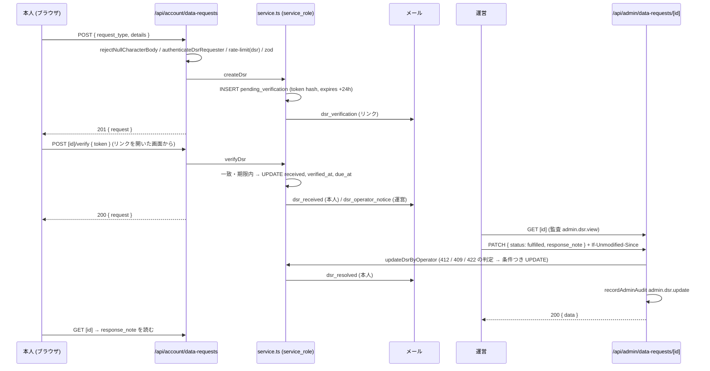

# 開示・訂正・利用停止・消去の請求 (Data Subject Requests, DSR) 設計

| 版 | 日付 | 内容 |
|---|---|---|
| v1.0 | 2026-10-15 | 新設 (Issue #1178 の設計ゲート・A 型 4 相) |
| v1.1 | 2026-10-15 | 審査 R1 の反映: 本人の読める列を列の GRANT で絞る (admin_notes・hash)・運営の詳細は service_role で読む・利用停止の手段から凍結を外す・取り下げ / 再送 / 確認の UPDATE に状態の条件・既存の番兵 3 本を追随表へ・facade の型 |

要件の正本は Issue #1178 の本文 (コメントは閉じたときの記録の 1 件で、要件を足していない)。本書はその上で決めた範囲と設計で、Issue と食い違ったら本書が正。
ファイル名 (cross/15) は設計ゲートの指定による (cross/ の既存は 01〜09 と 13a)。

---

## 0. 外形固定と分冊判定 (相 1)

### 0.1 発注と前提 (仕様ファイルからの写し)

> 前提: ローンチ前で利用者ゼロ (正しい形で作る)。オーナーの選択 (2026-10-15・選択式) で、ローンチに要るものとしてこの群を作ると決まっている。

決めること (仕様ファイルの列挙): 請求の種類 (開示・訂正・利用停止・消去) / 受付の画面 (Web の設定・本人確認) / データモデル (請求の表・状態遷移・期限・運営の対応の記録・監査ログ) / 既存の書き出し (account-export) と退会 (#1562 の削除の実行記録) との関係 / 運営の画面 (一覧・詳細・対応) / 通知のメール / 法定の応答期限の扱い。

### 0.2 要件行列

| # | 要件 | 出どころ | 本書の節 |
|---|---|---|---|
| R-1 | 法定請求の専用カテゴリ: 開示 / 訂正 / 利用停止 / 消去 の 4 種を受け付ける | #1178「inquiry_type への開示/訂正/利用停止カテゴリ追加」・仕様ファイル | §4, §5 |
| R-2 | 本人確認のステップがあり、その記録 (方法・日時) が残る | #1178「本人確認記録」「本人確認ステップ」・privacy 第6条「本人であることを確認の上で」 (設計の時点の版。いまの請求の条は第14条 `privacy-14`) | §3.1, §4.2, §7.3 |
| R-3 | 応答期限 (SLA) を追跡でき、超過が分かる | #1178「応答期限追跡」「SLA 追跡」 | §4.2, §9.2, §12 |
| R-4 | 請求ごとの状態遷移 (本人確認待ち → 受付 → 対応中 → 完了 / 却下 / 取り下げ) を持つ。「本人確認待ち」を表現できる | #1178「statusも…『本人確認待ち』を表現不能」 | §8.3 |
| R-5 | 受付は Web の設定画面から (ログイン中の本人) | 仕様ファイル「受付の画面 (Web の設定・本人確認)」 | §9.1 |
| R-6 | 運営の対応の記録 (本人への応答・内部メモ・状態の変更) が残る | 仕様ファイル | §4.2, §7.4, §11 |
| R-7 | 運営の操作 (閲覧・更新) を admin_audit_logs に記録する (本人を対象にして引ける) | docs/design/CLAUDE.md §6・operator/07 §4.1.1 | §11 |
| R-8 | 運営の画面: 一覧 (絞り込み・期限超過)・詳細・対応 (状態の更新・応答) | 仕様ファイル | §9.2 |
| R-9 | 通知のメール: 本人確認・受付・完了、運営への知らせ | 仕様ファイル | §10 |
| R-10 | 既存の書き出し (GET /api/account/export) と退会 (POST /api/account/delete) との関係を定める | 仕様ファイル | §4.4 |
| R-11 | 全テーブル RLS 必須・snake_case・状態遷移 API は If-Unmodified-Since の楽観的ロック | docs/design/CLAUDE.md | §4.3, §7.4 |
| R-12 | 法定の応答期限の数値はリポジトリに無い。設計では断定せず、運用で変えられる形にする | リサーチ unknowns | §12, §21 |
| R-13 | cross/ の既存仕様は後方互換の追加だけ (inquiries の CHECK・ポリシーを変えない) | cross/CLAUDE.md §2 | §3.2 |
| R-14 | auth.users を指す外部キーは必ず ON DELETE を書く・NO ACTION 0 本 | operator/01 冒頭・20261010000100 | §4.1 |

Issue 本文との食い違い (本書を正とする): Issue の「該当箇所」の `src/app/(main)/privacy/page.tsx:41-42` は origin/main に無い。プライバシーポリシーは #1174 (PR #1382「利用規約とプライバシーポリシーを未ログインでも読めるようにする」) で `src/app/privacy/page.tsx` へ移っており、第6条は 70-71 行 (設計の時点。いまは本文が `src/lib/legal/privacy-text.ts` に移り (#1901)、請求の条は第14条)。本書 (§1・R-2) は移った先のパスを指す。Issue の要件の中身 (第6条の約束・inquiries に法定請求のカテゴリと本人確認・期限が無い) は移動の前後で変わらない。

### 0.3 ユーザーシナリオ (16 本。トレースは §3.3)

| # | シナリオ |
|---|---|
| S-1 | 会員が設定画面から「開示」の請求を出し、届いたメールのリンクを開いて本人確認し、受付される (期限が付く) |
| S-2 | 本人確認のメールを 24 時間以内に開かず期限切れ → 画面の「確認メールを再送」で新しいリンクを受け取り、確認する |
| S-3 | 本人確認を済ませる前に、本人が請求を取り下げる |
| S-4 | 同じ種類の請求が開いている (本人確認待ち / 受付済み / 対応中) 状態で、同じ種類をもう一度出す → 409 |
| S-5 | セッションを盗んだ第三者が「消去」の請求を出す → 本人の登録アドレスに確認メールが届き、本人は開かない (期限切れのまま) か取り下げる。運営は本人確認待ちの請求には手を付けない |
| S-6 | 運営 (admin) が受付済みの開示の請求を「対応中」にし、応答 (response_note) を書いて「対応済み」にする → 本人に完了メール → 本人が設定画面で応答を読む |
| S-7 | 運営が請求を「却下」する。応答 (理由) が空なら 422 で止まる |
| S-8 | 2 人の運営が同じ請求を同時に更新する → 後から送った側は If-Unmodified-Since が古く 412 |
| S-9 | 「訂正」の請求: 本人が自分で直せる項目はプロフィール画面を案内し、運営が直せる項目は運営が直して応答に書き、対応済みにする |
| S-10 | 「利用停止」の請求: 運営は止める利用の範囲を内容から確かめ、止めた内容 (または本人が設定で止められる項目・退会の案内) を応答に書いて対応済みにする。凍結 (BAN) は使わない (凍結すると本人が応答を読めなくなる。§9.2)。本人は設定画面で応答を読む |
| S-11 | 「消去」の請求: 本人が設定画面から退会 (即時削除) する → 請求の user_id が外れる (ON DELETE SET NULL) → 運営は「退会済み」を見て対応済みにする (本人へのメールは送れない) |
| S-12 | 受付から応答期限を過ぎても対応中のまま → 運営一覧の「期限超過」に出る。本人の画面にも期限が出る |
| S-13 | 凍結 (BAN) 中の利用者は設定画面に入れず、この導線を使えない (請求を出した後に別の理由で凍結された場合は、応答も設定画面では読めない)。凍結の画面から行ける /contact のサポート窓口で連絡する (本設計の範囲外。§21) |
| S-14 | Google / Apple などパスワードを持たないログインの利用者も、同じ流れ (本人確認はメールのリンクなので、ログイン方法で差が無い) |
| S-15 | 請求の内容に NULL 文字 (U+0000) がある → 400 INVALID_CHARACTER。2,000 字を超える → 400 VALIDATION_ERROR |
| S-16 | 運営ロール (admin / super_admin) を持つ利用者が、自分の設定画面 (/settings/data-requests) で自分の請求を見る → 一覧に出るのは自分の請求だけ。URL の id を他人の請求に書き換えても 404 (他人の請求は運営の画面 /admin/data-requests で、監査つきで見る) |

### 0.4 分冊判定

| 目安 | 本設計 | 判定 |
|---|---|---|
| 設計書 800 行超 | 超える見込み (約 1,300 行) | 当たる |
| 消費先レーン 3 以上 | 本人の設定画面 / 運営の画面 / メール / migration の 4 面 | 当たる |
| 共有面 2 つ以上 | admin_audit_logs の action_type 一覧 (docs)・account-export の分類表・rate-limit のカテゴリ表・env の一覧 | 当たる (どれも「行を足す」だけ) |

**結論: 1 冊で書く (核と配線に分けない)。** 理由: 新しい表 1 つと新しい route 群だけで閉じ、既存の表・関数・ポリシーを変えない (共有面には行を足すだけで、改定が要るものが無い)。核 (表 + lib) と配線 (画面・メール) を分けると、本人確認の流れ (トークン → メール → 画面) が冊をまたいで追えなくなる。代わりに実装 WF を 3 段 (§16) に分け、段ごとに 2 枚レビューを閉じる。

### 0.5 用語

| 語 | 意味 |
|---|---|
| 請求 (DSR) | 本人が自分の個人情報について出す、開示・訂正・利用停止・消去の求め。`data_subject_requests` の 1 行 |
| 本人確認 | 請求を出した人が、登録アドレスのメールを受け取れる本人であることの確認。方法は `email_link` (リンクを開く) の 1 種 |
| 受付 | 本人確認が済んだ時点。応答期限 (`due_at`) はここから数える |
| 運営 | `admin` / `super_admin` ロールの運営者 (`DSR_OPERATOR_ROLES`)。`support` は含めない (§3.2) |

---

## 1. 目的・スコープ

- 目的: privacy 第6条 (設計の時点の src/app/privacy/page.tsx:70-71。いまは第14条 (`src/lib/legal/privacy-text.ts` の `privacy-14`)) が約束する開示・訂正・削除への対応を、受付 → 本人確認 → 期限つきの対応 → 記録、として実装できる形にする。
- 範囲 (本書で作るもの): 表 1 つ・本人向け API 6 本・運営向け API 3 本・Web の設定画面 2 つ・運営の画面 2 つ・メール 4 通・監査ログの action 3 つ・レート制限のカテゴリ 1 つ・環境変数 1 つ。
- 範囲外: モバイル App の画面 (Web の画面へのリンクは §19)・凍結中の利用者の受付 (§21)・運営による代理の退会 (cross/08 §16.5。§21)・会員でない人 (ゲストの問い合わせの送信者など) からの請求 (サポート窓口のメールで受ける)・応答期限の催促メール・添付ファイルでの開示・削除の実行記録の方式 (#1562 で `gdpr_deletion_requests` を個人を特定できない実行記録に当てた。本設計は触れない)。

## 2. 関連要件

- Issue #1178 (本文)。関連 #1121 (問い合わせ管理 API)・#1130 / #1131 (本人セルフサービス)・#1562 (退会まわりの未決)。
- docs/design/CLAUDE.md §3 (RLS)・§4 (snake_case)・§5 (楽観的ロック)・§6 (監査ログ)。cross/02 §4.1・§5。cross/04 §4〜§6。cross/08 §16。operator/07 §4.1.1。

---

## 3. 構想 (相 2) と構造裁定 (相 3)

### 3.1 構造

```
本人 (ログイン中)                      サーバー                                    運営 (admin / super_admin)
 設定 > 開示・訂正・利用停止の請求      POST /api/account/data-requests             /admin/data-requests (一覧・期限超過)
   種類 + 内容 を送る  ──────────────▶  行を作る (pending_verification)              GET /api/admin/data-requests (1 検索 = 監査 1 行)
                                        トークンを作り sha256 を保存                /admin/data-requests/[id]
 メール「本人確認のお願い」 ◀────────  メール dsr_verification (リンク)              GET /api/admin/data-requests/[id] (閲覧 = 監査 1 行)
 リンクを開く (ログイン必須)            POST .../[id]/verify { token }              PATCH /api/admin/data-requests/[id]
   ──────────────────────────────────▶  一致 + 期限内 → received, verified_at,        If-Unmodified-Since で楽観的ロック
                                          due_at = verified_at + N 日                  status / response_note / admin_notes
 メール「受け付けました」 ◀────────── メール dsr_received                             遷移: received → in_progress → fulfilled / rejected
                                        メール dsr_operator_notice ──────────────▶ ADMIN_NOTIFICATION_EMAIL
 設定画面で応答を読む  ◀───────────── メール dsr_resolved (結果だけ) ◀──────────  fulfilled / rejected にした (監査 admin.dsr.update)
```

- 表は `data_subject_requests` の 1 つ。状態の履歴は持たず、運営の操作は `admin_audit_logs` (`admin.dsr.update` の status_from / status_to) が履歴になる。
- 書き込みはすべてサーバー (service_role。`getSupabaseAdmin()`。認証・認可を通した後) が行う。
  理由: INSERT を RLS で本人に許すと、盗んだセッションから PostgREST を直接叩いて `verified_at` を入れた行を作れる (本人確認の迂回)。列を縛る WITH CHECK で防ぐより、書き込みの口をサーバーに閉じる方が単純で、トークンの生成と保存も 1 か所になる。
- 読み取りの経路は 2 つに固定する。
  - authenticated (本人のセッションの client。RLS が効く) は **列の GRANT** で `DSR_OWN_COLUMNS` の 15 列だけを読める (`admin_notes` と `verification_token_hash` は GRANT しない)。本人の一覧・詳細と、運営の一覧 (`DSR_ADMIN_LIST_COLUMNS` は 15 列の部分集合) はこの経路。ブラウザから PostgREST を直接叩いても内部メモと hash は 42501 で読めない。
    本人の一覧・詳細は、この client で読むときも必ず `.eq('user_id', userId)` で絞る。admin / super_admin の本人には `data_subject_requests_select_operator` が全行を見せるので、行の絞り込みを RLS に任せると運営ロールの本人の設定画面に他人の請求が並ぶ (監査の無い閲覧口になる)。src/lib/account-export-tables.ts の inquiries の行の注記「運営ロールのユーザーは RLS で全員分が読める。必ず user_id で絞る」と同じ理由。
  - `admin_notes` を含む運営の詳細・更新は service_role (`requireRole(DSR_OPERATOR_ROLES)` を通したあと) で読む。
  理由: 内部メモを本人に見せない守りを、API で列を省く約束 (実装の注意) ではなく DB の権限で持たせる。運営だけが読める列を RLS (行の絞り込み) では表せないので、列の GRANT と読み取りの経路の分離で表す (列単位の GRANT は family_promotion_requests の token 列 (#1232) と同じやり方)。
- 本人確認は「登録アドレスに送ったリンクを、ログイン中の本人が開く」の 1 種。パスワードの再入力 (settings/account の方式) は OAuth ログインの利用者に使えないので採らない (S-14)。
- 応答期限は本人確認の時点から `DSR_RESPONSE_DUE_DAYS` 日。超過は `due_at` から計算する (cron も催促も置かない)。

### 3.2 代替案の比較と裁定 (1 回だけ)

| 案 | 中身 | 退ける理由 / 採る理由 |
|---|---|---|
| A. `inquiries` を拡張する | `inquiry_type` の CHECK に 4 種を足し、本人確認・期限の列を足す (Issue の文面どおり) | 退ける。`inquiries` は anon が WITH CHECK (true) で INSERT できる表で、法定請求を本人確認なしの行と同じ表に置くと、運営画面・RLS・退会時の伏せ字 (prepare_account_deletion) すべてに分岐が要る。cross/ の既存の CHECK・ポリシーの変更は後方互換の原則 (R-13) に反する。Issue の「inquiry_type に足す」は症状の指し先であって、求めているのは専用の受付とデータモデル (タイトル) |
| B. 専用の表 + 状態履歴の表 (`data_subject_request_events`) | 遷移ごとに 1 行の履歴表を持つ | 退ける。履歴は `admin_audit_logs` (UPDATE / DELETE 不可・7 年保持) が既に担う。表を増やすと RLS・export の分類・退会時の扱いが 2 倍になる |
| C. 専用の表 1 つ + 本人確認はメールのリンク + 書き込みはサーバーだけ | 本書 | **採る。** 縁の発生源 (本人が書ける列・履歴表・パスワード再認証の分岐) をすべて消し、残るのは「行を作る」INSERT 1 つと「確認する / 確認メールを送り直す / 取り下げる / 運営が更新する」の 4 つの条件つき UPDATE だけ |
| D. 本人確認を JWT の `amr` (直近の認証時刻) で行う | 再ログインから N 分以内なら確認済みとみなす | 退ける。OAuth と PKCE の経路で `amr` の方法・時刻が一定でなく、Sonnet が迷う。確認の記録 (いつ・どう確認したか) も残らない |

「縁の発生源を消すより単純な構造は無いか」への答え: C より単純なのは「受付だけして本人確認を持たない」形だが、それは R-2 を満たさない。C で確定し、以後は構造を蒸し返さない (仕上げ中の構造疑義は裁定への差し戻し事由として扱う)。

運営のロールを `admin` / `super_admin` に限る理由: 開示の応答には登録メールアドレスを含む全項目が要るが、`support` は運営画面でメールアドレスを見られない (src/lib/admin/user-emails.ts の EMAIL_VIEWER_ROLES)。`support` を足すときは `DSR_OPERATOR_ROLES` に 1 語足すだけでよい形にしておく。

### 3.3 シナリオのトレース (構造 C で手で走らせた記録)

| # | 走らせた結果 (状態 → 状態・副作用) |
|---|---|
| S-1 | POST create: 行 `pending_verification` (token_hash, sent_at, expires_at = +24h, send_count = 1) → メール dsr_verification。リンクを開く → POST verify: hash 一致・期限内 → `received` (verified_at = now, due_at = now + 30 日, token_hash = NULL) → メール dsr_received・dsr_operator_notice。GET own で status = received, due_at が見える |
| S-2 | 25 時間後に verify → `isDsrVerificationExpired` が true → 410 DSR_VERIFICATION_EXPIRED (状態は変えない)。POST resend-verification → 条件つき UPDATE (status = pending_verification かつ send_count = 読んだ 1) → 新しい token_hash, expires_at, send_count = 2 → メール再送 → 新しいリンクで verify → `received`。古いリンクで verify すると hash が合わず 400。初回を含めて 5 通送った後の再送は 409 DSR_VERIFICATION_LIMIT。再送の判定の後・UPDATE の前に別のタブで確認が済んだ場合は UPDATE が 0 行 → 409 DSR_INVALID_STATE (メールは送らない) |
| S-3 | POST withdraw (status = pending_verification) → 条件つき UPDATE (status ∈ 開いている状態) → `withdrawn` (resolved_at = now, token_hash = NULL)。メールは送らない。運営一覧の既定の絞り込みには出ない。取り下げの判定の後に運営が fulfilled にしていた場合は UPDATE が 0 行 → 409 DSR_INVALID_STATE (対応済みの記録を上書きしない) |
| S-4 | 2 回目の POST create → 部分一意索引 `data_subject_requests_one_open_per_type` に当たる (23505) → 409 DSR_ALREADY_OPEN。行は増えない |
| S-5 | 第三者が POST create (消去) → 行は pending_verification、メールは本人の登録アドレスへ (第三者は宛先を変えられない)。本人は開かない → 24 時間で期限切れ。運営一覧には「本人確認待ち」として見えるが、PATCH は pending_verification からの遷移が無いので 409 DSR_INVALID_TRANSITION。本人が気づけば withdraw で閉じられる |
| S-6 | PATCH { status: in_progress } (If-Unmodified-Since = GET の updated_at) → `in_progress`、監査 admin.dsr.update (received → in_progress)。PATCH { status: fulfilled, response_note: '…' } → `fulfilled` (resolved_at = now) → 監査 → メール dsr_resolved (本文に応答は載せない)。本人は GET own detail で response_note を読む |
| S-7 | PATCH { status: rejected } で response_note が (更新後も) 空 → 422 DSR_RESPONSE_NOTE_REQUIRED、書き込み無し。PATCH { status: rejected, response_note: '理由' } → `rejected` → メール dsr_resolved |
| S-8 | 運営 A と B が同じ GET の updated_at を持つ。A の PATCH が先に通り updated_at が進む。B の PATCH: 読み直した updated_at ≠ ヘッダ → 412 CONFLICT_OPTIMISTIC_LOCK。B は再取得してやり直す。読み直しと UPDATE の間に進んだ場合は UPDATE が 0 行 → 409 CONFLICT_STALE_DATA |
| S-9 | 種類 correction。運営は内容を読み、本人が直せるもの (プロフィール) は案内を、運営が直したものは何を直したかを response_note に書いて fulfilled。表の構造は種類で変わらない |
| S-10 | 種類 suspension。運営は内容から止める利用の範囲を確かめ、止めた内容・本人が設定で止められる項目・全体を止めたいときの退会を response_note に書いて fulfilled → dsr_resolved → 本人は凍結されていないので /settings/data-requests に入れ、GET own detail で response_note を読む。本モジュールは凍結を呼ばず、運営画面の案内も凍結を手段に挙げない (凍結すると middleware が /settings を /frozen へ回し、/api/account/data-requests も 403 になって応答を読めなくなる) |
| S-11 | 種類 erasure。本人が POST /api/account/delete → auth.users 削除 → FK ON DELETE SET NULL で user_id = NULL。運営の詳細は requester = null (退会済み) を出す。運営は fulfilled にする。dsr_resolved は宛先が無いので送らない (ログに残すだけ) |
| S-12 | due_at < now かつ status ∈ {received, in_progress} → `isDsrOverdue` = true。GET /api/admin/data-requests?overdue=1 で絞れ、一覧は期限超過を赤で出す。本人の一覧・詳細にも due_at を出す |
| S-13 | middleware が /settings を凍結中の利用者に開かせず (/frozen へ回す)、/api/account/data-requests も 403 AUTH_ACCOUNT_FROZEN (FROZEN_ALLOWED_API_PATHS は退会・書き出しと、有料プランの解約の 3 本 (billing/01 §9.8) の計 5 本で、data-requests は含まない)。/frozen の案内と /contact (凍結中も開け、送信 (POST /api/contact) も凍結中に通る。#1871・cross/08 §16.2) のサポート窓口のまま。本設計は FROZEN_ALLOWED_API_PATHS に足さない。請求の後に凍結された本人には、dsr_resolved の本文の「設定画面を開けない場合はお問い合わせ」の案内 (§10) と、運営がサポート窓口のメールで応答を送る運用 (§19 の runbook・§21) で届ける |
| S-14 | ログイン方法に依存する分岐が無い (verify は token と user_id の一致だけ)。OAuth の利用者もメールのリンクを開いて確認できる |
| S-15 | POST create の最初で rejectNullCharacterBody → 400 INVALID_CHARACTER。details が 2,001 字 → zod max → 400 VALIDATION_ERROR。DB の CHECK (char_length ≤ 2000) は二重の守り |
| S-16 | GET own list: 本人のセッションの client で `.select(DSR_OWN_COLUMNS).eq('user_id', userId)` → RLS は select_operator で全行を許すが、`.eq('user_id', userId)` が自分の行だけに絞る → 200 (自分の行だけ)。GET own detail に他人の id: `.eq('id', id).eq('user_id', userId).maybeSingle()` が null → 404 NOT_FOUND。どちらも運営の API を通らないので監査は残さないが、他人の行を返さないので監査の要る閲覧が起きない (§7.2) |

---

## 4. データモデル

### 4.1 DDL (migration と、対の down)

ファイル名: `supabase/migrations/<番号はマージ時に確定>_data_subject_requests.sql`。番号はマージ直前に origin/main の `supabase/migrations` の最大より大きい値で確定する。対の `supabase/rollbacks/<番号はマージ時に確定>_data_subject_requests.down.sql` も同時に作る。

```sql
-- migration: <番号はマージ時に確定>_data_subject_requests.sql
-- #1178: 開示・訂正・利用停止・消去の請求 (data subject requests) の表。設計: docs/design/cross/15-data-subject-requests.md
--
-- 権限の考え方:
--   - 書き込み (INSERT / UPDATE) はサーバー (service_role。認証・認可のあと) だけ。anon / authenticated には書き込みのポリシーも権限も付けない
--     (本人に INSERT を許すと、盗んだセッションから PostgREST を直接叩いて verified_at 入りの行を作れるため)。
--   - 読み取りは RLS: 本人は自分の行、運営 (admin / super_admin) は全行。
--     authenticated には列の GRANT で 15 列だけを付ける (admin_notes と verification_token_hash を付けない)。
--     内部メモは本人に見せないため。運営が admin_notes を読む詳細・更新は service_role (requireRole のあと) で読む。
--     15 列は src/lib/data-subject-requests/core.ts の DSR_OWN_COLUMNS と同じ (契約テストで突き合わせる)。
--   - DELETE は誰にも付けない (行は消さない。退会では user_id が外れて行が残る)。
-- 既存データへの影響: なし (新しい表を足すだけ。既存の表・関数・ポリシーには触れない)。
-- 冪等: CREATE TABLE IF NOT EXISTS / CREATE INDEX IF NOT EXISTS / DROP ... IF EXISTS → CREATE。
-- 確認: tests/integration/rls/data-subject-requests.test.ts / tests/data-subject-requests-migration-contract.test.ts
-- ロールバック: supabase/rollbacks/<番号はマージ時に確定>_data_subject_requests.down.sql

CREATE TABLE IF NOT EXISTS public.data_subject_requests (
  id                       UUID        PRIMARY KEY DEFAULT gen_random_uuid(),
  -- 請求した本人。退会すると NULL になり、行は残る (サポートの記録と同じ扱い。20261010000100 の方針)
  user_id                  UUID        REFERENCES auth.users(id) ON DELETE SET NULL,
  request_type             TEXT        NOT NULL,
  status                   TEXT        NOT NULL DEFAULT 'pending_verification',
  -- 本人が書いた請求の内容 (1〜2000 字。上限は src/lib/data-subject-requests/core.ts の DSR_DETAILS_MAX_LENGTH と同じ値)
  details                  TEXT        NOT NULL,
  verification_method      TEXT        NOT NULL DEFAULT 'email_link',
  -- 本人確認トークンの sha256 (16 進)。確認が済んだら NULL。生のトークンは保存しない
  verification_token_hash  TEXT,
  verification_sent_at     TIMESTAMPTZ,
  verification_expires_at  TIMESTAMPTZ,
  verification_send_count  INTEGER     NOT NULL DEFAULT 0,
  verified_at              TIMESTAMPTZ,
  -- 応答期限。本人確認の時点 + DSR_RESPONSE_DUE_DAYS 日 (§12)
  due_at                   TIMESTAMPTZ,
  -- 本人への応答 (本人が設定画面で読む)。対応済み / 却下にするとき必須
  response_note            TEXT,
  -- 運営の内部メモ (本人には見せない)
  admin_notes              TEXT,
  resolved_at              TIMESTAMPTZ,
  created_at               TIMESTAMPTZ NOT NULL DEFAULT now(),
  updated_at               TIMESTAMPTZ NOT NULL DEFAULT now(),
  CONSTRAINT data_subject_requests_request_type_check
    CHECK (request_type IN ('disclosure', 'correction', 'suspension', 'erasure')),
  CONSTRAINT data_subject_requests_status_check
    CHECK (status IN ('pending_verification', 'received', 'in_progress', 'fulfilled', 'rejected', 'withdrawn')),
  CONSTRAINT data_subject_requests_verification_method_check
    CHECK (verification_method IN ('email_link')),
  CONSTRAINT data_subject_requests_details_length_check
    CHECK (char_length(details) BETWEEN 1 AND 2000),
  CONSTRAINT data_subject_requests_response_note_length_check
    CHECK (response_note IS NULL OR char_length(response_note) <= 5000),
  CONSTRAINT data_subject_requests_admin_notes_length_check
    CHECK (admin_notes IS NULL OR char_length(admin_notes) <= 5000),
  CONSTRAINT data_subject_requests_send_count_check
    CHECK (verification_send_count >= 0),
  -- 本人確認待ちは未確認、受付済み以降は確認済み (期限つき)。取り下げはどちらの途中でも起きる
  CONSTRAINT data_subject_requests_verified_consistency_check CHECK (
    (status = 'pending_verification' AND verified_at IS NULL AND due_at IS NULL)
    OR (status IN ('received', 'in_progress', 'fulfilled', 'rejected') AND verified_at IS NOT NULL AND due_at IS NOT NULL)
    OR status = 'withdrawn'
  ),
  -- 終わった請求にだけ resolved_at が入る
  CONSTRAINT data_subject_requests_resolved_consistency_check CHECK (
    (status IN ('fulfilled', 'rejected', 'withdrawn')) = (resolved_at IS NOT NULL)
  )
);

-- 同じ人・同じ種類の開いている請求は 1 つだけ (S-4。user_id が NULL の行は対象外)
CREATE UNIQUE INDEX IF NOT EXISTS data_subject_requests_one_open_per_type
  ON public.data_subject_requests (user_id, request_type)
  WHERE status IN ('pending_verification', 'received', 'in_progress');

CREATE INDEX IF NOT EXISTS idx_data_subject_requests_user_created
  ON public.data_subject_requests (user_id, created_at DESC);
CREATE INDEX IF NOT EXISTS idx_data_subject_requests_status_due
  ON public.data_subject_requests (status, due_at);
CREATE INDEX IF NOT EXISTS idx_data_subject_requests_created
  ON public.data_subject_requests (created_at DESC, id DESC);

-- updated_at は既存のトリガー関数 (public.update_updated_at_column) で更新する
DROP TRIGGER IF EXISTS trigger_data_subject_requests_updated_at ON public.data_subject_requests;
CREATE TRIGGER trigger_data_subject_requests_updated_at
  BEFORE UPDATE ON public.data_subject_requests
  FOR EACH ROW EXECUTE FUNCTION public.update_updated_at_column();

ALTER TABLE public.data_subject_requests ENABLE ROW LEVEL SECURITY;

-- Supabase の default privileges が付ける権限を完全形で外してから、必要なものだけ付け直す (20261010123500 と同じ書き方)
REVOKE ALL ON public.data_subject_requests FROM PUBLIC, anon, authenticated, service_role;
-- authenticated は列の GRANT (admin_notes・verification_token_hash を除く 15 列)。select=* や select=admin_notes は 42501 になる
GRANT SELECT (
  id, user_id, request_type, status, details, verification_method, verification_sent_at, verification_expires_at,
  verification_send_count, verified_at, due_at, response_note, resolved_at, created_at, updated_at
) ON public.data_subject_requests TO authenticated;
GRANT SELECT, INSERT, UPDATE ON public.data_subject_requests TO service_role;

DROP POLICY IF EXISTS data_subject_requests_select_self ON public.data_subject_requests;
CREATE POLICY data_subject_requests_select_self ON public.data_subject_requests
  FOR SELECT TO authenticated
  USING (user_id = (SELECT auth.uid()));

DROP POLICY IF EXISTS data_subject_requests_select_operator ON public.data_subject_requests;
CREATE POLICY data_subject_requests_select_operator ON public.data_subject_requests
  FOR SELECT TO authenticated
  USING (
    EXISTS (
      SELECT 1 FROM public.user_profiles up
      WHERE up.id = (SELECT auth.uid())
        AND ARRAY['admin', 'super_admin']::TEXT[] && up.roles
    )
  );

COMMENT ON TABLE public.data_subject_requests IS
  '#1178: 本人からの開示・訂正・利用停止・消去の請求。書き込みはサーバー (service_role) だけ。本人は自分の行、admin / super_admin は全行を読める (authenticated は admin_notes と verification_token_hash を除く列だけ)。設計: docs/design/cross/15-data-subject-requests.md';
COMMENT ON COLUMN public.data_subject_requests.verification_token_hash IS
  '本人確認リンクのトークンの sha256 (16 進)。確認が済んだら・取り下げたら NULL。生のトークンは保存しない。authenticated には GRANT しない';
COMMENT ON COLUMN public.data_subject_requests.due_at IS
  '応答期限。本人確認の時点から DSR_RESPONSE_DUE_DAYS 日 (既定 30。環境変数で上書き)。超過は due_at < now() で判定する';
COMMENT ON COLUMN public.data_subject_requests.response_note IS
  '本人への応答 (設定画面で本人が読む)。対応済み / 却下にするとき必須';
COMMENT ON COLUMN public.data_subject_requests.admin_notes IS
  '運営の内部メモ。本人には見せない: authenticated に GRANT しない (列の GRANT)。運営は service_role の経路 (requireRole のあと) で読み書きする';
```

```sql
-- rollback: <番号はマージ時に確定>_data_subject_requests.sql
-- 本番に戻す必要があるときは、この内容を新しい migration として PR 経由で適用する (本番への直接 SQL は禁止)。
-- 先に Web のデプロイ (/api/account/data-requests・/api/admin/data-requests・画面) を戻すこと。
-- 消えるもの: data_subject_requests の全行 (請求と応答の記録)。監査ログ (admin_audit_logs の admin.dsr.*) は残る。
-- 索引・ポリシー・トリガー・コメントは表と一緒に消える。冪等。
DROP TABLE IF EXISTS public.data_subject_requests;
```

### 4.2 列の意味 (本人確認の記録・期限・対応の記録)

| 列 | 役割 | 書く人 / 時点 |
|---|---|---|
| `verification_method` | 本人確認の方法。v1 は `email_link` だけ (CHECK) | create |
| `verification_token_hash` / `verification_sent_at` / `verification_expires_at` / `verification_send_count` | 確認リンクの状態。送るたびに hash と期限を置き換え、回数を +1。確認が済む・取り下げると hash は NULL | create / resend / verify / withdraw (hash だけ) |
| `verified_at` | 本人確認が済んだ日時 = 受付の日時 (R-2 の記録) | verify |
| `due_at` | 応答期限 (R-3) | verify |
| `response_note` / `admin_notes` / `resolved_at` | 運営の対応の記録 (R-6)。状態の変更の履歴は admin_audit_logs (§11) | 運営の PATCH / 本人の withdraw (resolved_at) |

### 4.3 RLS・権限の表

| 操作 | anon | authenticated (本人) | authenticated (admin / super_admin) | service_role |
|---|---|---|---|---|
| SELECT | 不可 (権限なし) | 自分の行の 15 列 (`data_subject_requests_select_self` + 列の GRANT)。`admin_notes`・`verification_token_hash` は 42501 | 全行の 15 列 (`data_subject_requests_select_operator` + 列の GRANT。運営ロールの項は運営の MFA の判定 `operator_mfa_satisfied()` つき: TOTP を登録済みの本人は aal2 のセッションのときだけ。cross/12 §11.4・付録 A。migration `20261017130000_operator_mfa_db_gate.sql`)。`admin_notes`・`verification_token_hash` は 42501 | 全列 (BYPASSRLS。運営の詳細・更新はこの経路で `DSR_ADMIN_COLUMNS` を読む) |
| INSERT / UPDATE | 不可 | 不可 (ポリシーも権限も無い) | 不可 | 可 (route が認証・認可のあとに `getSupabaseAdmin()` で行う) |
| DELETE | 不可 | 不可 | 不可 | 不可 (権限を付けない) |

列の GRANT のため、authenticated の `select=*` は 42501 になる。authenticated で読むコード (本人の一覧・詳細・運営の一覧・account-export) は必ず列を明示する (`DSR_OWN_COLUMNS` / `DSR_ADMIN_LIST_COLUMNS`。どちらも 15 列の中)。`DSR_ADMIN_COLUMNS` (`admin_notes` を含む) は service_role の client でしか読まない。

authenticated の admin / super_admin は 2 本の SELECT ポリシーの OR で全行が見える (TOTP を登録済みの本人は aal2 のセッションのとき。上の表) ので、本人の画面のための読み取り (本人の一覧・詳細・account-export) は、どの client でも `user_id` で絞る (§7.2。account-export は `scope: self('user_id')` が絞る)。RLS は「user ロールが他人の行を読めない」守りで、本人の API の絞り込みの代わりにはならない。

### 4.4 既存の書き出し・退会との関係 (R-10)

| 既存 | 関係 |
|---|---|
| GET /api/account/export (#1131) | 開示の請求とは独立。本人はいつでも自分で書き出せる (設定画面の案内文にも書く)。開示の請求は、書き出しに含まれない情報や書面での応答が要るときの経路。`data_subject_requests` は本人のデータなので書き出しに含める: `src/lib/account-export-tables.ts` の `ACCOUNT_EXPORT_TABLES` の「契約・同意・問い合わせ」の群の `support_ticket_messages` の行の後に `{ table: 'data_subject_requests', scope: self('user_id'), columns: DSR_OWN_COLUMNS, orderBy: ['created_at', 'id'] }` を足し、ファイルの先頭に `import { DSR_OWN_COLUMNS } from './data-subject-requests/core';` を足す (tests/account-export-tables.test.ts が分類を要求する)。書き出しは本人の JWT の client (RLS) で読むので、`omit` (いったん `*` で読む) では列の GRANT に当たって 42501 になる。`columns` で最初から 15 列だけを読む (hash と内部メモは取得しない。`user_id` は scope の列として含まれる) |
| POST /api/account/delete (#1175) | 消去の請求の完了は、本人の退会 (即時削除) で行う (S-11)。本モジュールは `deleteAccount` を呼ばない。退会すると FK `ON DELETE SET NULL` で `user_id` が外れ、行と応答の記録は残る (`details` は本人が書いた文で、伏せ字にはしない。support_ticket_messages と同じ扱い)。`prepare_account_deletion` には触れない (メールアドレスの列が無い) |
| #1562 (削除の実行記録・gdpr_deletion_requests の用途) | 本設計は `gdpr_deletion_requests` を使わず、触れない。削除の実行記録は #1562 (migration `20261016190000`) で `gdpr_deletion_requests` を個人を特定できない記録 (subject_hash・auth.users への外部キーなし) に当てた。運営による代理の退会 (cross/08 §16.5) が実装されたら、消去の請求の運営側の完了操作として接続する (§21) |

---

## 5. 正典コード (Zod / 型 / 定数 / 純関数)

実装ファイル `src/lib/data-subject-requests/core.ts`。ブラウザからも読むので Node の API を import しない。

```ts
// src/lib/data-subject-requests/core.ts
// #1178 開示・訂正・利用停止・消去の請求 (DSR) の正典: 定数・Zod・型・状態遷移・純関数。
// Node 専用の処理 (トークン) は tokens.ts、環境変数は config.ts、DB の読み書きは service.ts、メールは notifications.ts。
import { z } from 'zod';

// ── 種類・状態 ───────────────────────────────────────────────────────────────
/** 請求の種類 (DB の CHECK data_subject_requests_request_type_check と同じ 4 値) */
export const DSR_REQUEST_TYPES = ['disclosure', 'correction', 'suspension', 'erasure'] as const;
export type DsrRequestType = (typeof DSR_REQUEST_TYPES)[number];

/** 状態 (DB の CHECK data_subject_requests_status_check と同じ 6 値) */
export const DSR_STATUSES = [
  'pending_verification',
  'received',
  'in_progress',
  'fulfilled',
  'rejected',
  'withdrawn',
] as const;
export type DsrStatus = (typeof DSR_STATUSES)[number];

/** 開いている状態 (部分一意索引 data_subject_requests_one_open_per_type の WHERE と同じ) */
export const DSR_OPEN_STATUSES: ReadonlyArray<DsrStatus> = ['pending_verification', 'received', 'in_progress'];
/** 運営が手を付けてよい状態 (本人確認が済んでいる) */
export const DSR_ACTIONABLE_STATUSES: ReadonlyArray<DsrStatus> = ['received', 'in_progress'];
/** 終わった状態 */
export const DSR_TERMINAL_STATUSES: ReadonlyArray<DsrStatus> = ['fulfilled', 'rejected', 'withdrawn'];

/** 本人確認の方法 (v1 は 1 種) */
export const DSR_VERIFICATION_METHOD = 'email_link' as const;

// ── 上限・期限 (運用上の意味を持つ数は全部ここ) ─────────────────────────────
/** 請求の内容の上限 (DB の CHECK と同じ。お問い合わせの本文 5000 より短いのは、請求は要点だけでよく、長文の説明はサポートで受けるため) */
export const DSR_DETAILS_MAX_LENGTH = 2000;
/** 応答・内部メモの上限 (DB の CHECK と同じ。問い合わせの管理者メモの上限 ADMIN_NOTES_MAX_LENGTH に揃える) */
export const DSR_NOTE_MAX_LENGTH = 5000;
/** 本人確認リンクの有効時間 (時間)。1 日あれば当日中に開ける。過ぎたら再送で取り直す */
export const DSR_VERIFICATION_TTL_HOURS = 24;
/** 1 つの請求で確認メールを送れる回数の上限 (初回を含む)。迷惑メール扱いの確認と再送 2〜3 回で足りる */
export const DSR_VERIFICATION_MAX_SENDS = 5;
/** 応答期限の既定 (日)。本人確認の時点から数える。環境変数 DSR_RESPONSE_DUE_DAYS で上書き (§12) */
export const DSR_RESPONSE_DUE_DAYS_DEFAULT = 30;
/** 応答期限として受け付ける最大 (日)。1 年を超える期限は設定の誤り */
export const DSR_RESPONSE_DUE_DAYS_MAX = 365;
/** 本人の一覧で返す最大件数。同じ種類の開いている請求は 1 つなので、終わった請求を含めてもこれで足りる */
export const DSR_OWN_LIST_LIMIT = 50;
/** 運営の一覧の 1 ページ (問い合わせ一覧と同じ) */
export const DSR_ADMIN_LIST_LIMITS = { min: 1, max: 100, default: 50 } as const;
export const DSR_ADMIN_PAGE_LIMITS = { min: 1, max: 10000, default: 1 } as const;
/** 受付番号として画面・メールに出す id の先頭の桁数 (チケットの shortTicketId と同じ) */
export const DSR_SHORT_ID_LENGTH = 8;

const HOURS_PER_DAY = 24;
const MINUTES_PER_HOUR = 60;
const SECONDS_PER_MINUTE = 60;
const MS_PER_SECOND = 1000;
const MS_PER_HOUR = MINUTES_PER_HOUR * SECONDS_PER_MINUTE * MS_PER_SECOND;
const MS_PER_DAY = HOURS_PER_DAY * MS_PER_HOUR;

// ── 役割・経路 ───────────────────────────────────────────────────────────────
/** 請求を読み書きできる運営のロール。support を含めない理由は設計 §3.2 */
export const DSR_OPERATOR_ROLES = ['admin', 'super_admin'] as const;
export type DsrOperatorRole = (typeof DSR_OPERATOR_ROLES)[number];

// 請求の画面のパスと設定画面の入口の見出し・説明の文は、アプリ (apps/mobile) と共用するため
// @homegohan/shared (packages/shared/src/data-subject-requests.ts) に置き、ここから再び export する (#1812)。
// 値: DSR_SETTINGS_PATH = '/settings/data-requests'、DSR_SETTINGS_ENTRY_TITLE = '開示・訂正・利用停止の請求'、
//     DSR_SETTINGS_ENTRY_DESCRIPTION = '個人情報の開示・訂正・利用停止・消去を請求する'
export { DSR_SETTINGS_PATH, DSR_SETTINGS_ENTRY_TITLE, DSR_SETTINGS_ENTRY_DESCRIPTION } from '@homegohan/shared';
export const DSR_VERIFY_PATH = '/settings/data-requests/verify';
export const DSR_ADMIN_PATH = '/admin/data-requests';
export const DSR_ACCOUNT_API_PATH = '/api/account/data-requests';
export const DSR_ADMIN_API_PATH = '/api/admin/data-requests';
/** レート制限のカテゴリ (src/lib/rate-limit.ts の RateLimitCategory に足す) */
export const DSR_RATE_LIMIT_CATEGORY = 'dsr' as const;
/** 監査ログの action_type (operator/07 §4.1.1 の命名) */
export const DSR_AUDIT_ACTIONS = {
  list: 'admin.dsr.list',
  view: 'admin.dsr.view',
  update: 'admin.dsr.update',
} as const;

export const DSR_REQUEST_TYPE_LABELS: Record<DsrRequestType, string> = {
  disclosure: '開示',
  correction: '訂正',
  suspension: '利用停止',
  erasure: '消去',
};
export const DSR_STATUS_LABELS: Record<DsrStatus, string> = {
  pending_verification: '本人確認待ち',
  received: '受付済み',
  in_progress: '対応中',
  fulfilled: '対応済み',
  rejected: '対応できず',
  withdrawn: '取り下げ',
};

// ── エラーコード ─────────────────────────────────────────────────────────────
export const DSR_ERROR_CODES = [
  'DSR_ALREADY_OPEN',
  'DSR_INVALID_STATE',
  'DSR_VERIFICATION_INVALID',
  'DSR_VERIFICATION_EXPIRED',
  'DSR_VERIFICATION_LIMIT',
  'DSR_INVALID_TRANSITION',
  'DSR_RESPONSE_NOTE_REQUIRED',
] as const;
export type DsrErrorCode = (typeof DSR_ERROR_CODES)[number];

// ── Zod (入力の正本) ─────────────────────────────────────────────────────────
export const dsrCreateBodySchema = z.object({
  request_type: z.enum(DSR_REQUEST_TYPES, { message: 'request_type の値が不正です' }),
  details: z
    .string()
    .trim()
    .min(1, '請求の内容は必須です')
    .max(DSR_DETAILS_MAX_LENGTH, `請求の内容は${DSR_DETAILS_MAX_LENGTH}文字以内です`),
});
export type DsrCreateInput = z.infer<typeof dsrCreateBodySchema>;

/** 本人確認トークン (tokens.ts が作る 32 バイトの 16 進 = 64 文字) */
export const dsrVerifyBodySchema = z.object({
  token: z.string().regex(/^[0-9a-f]{64}$/, 'token の形式が不正です'),
});
export type DsrVerifyInput = z.infer<typeof dsrVerifyBodySchema>;

export const dsrIdSchema = z.string().uuid({ message: 'id は UUID 形式で指定してください' });

/** 運営の一覧の絞り込み (page / per_page は clampIntParam で丸めるので、ここでは見ない) */
export const dsrAdminListQuerySchema = z.object({
  status: z.enum(DSR_STATUSES, { message: 'status の値が不正です' }).optional(),
  request_type: z.enum(DSR_REQUEST_TYPES, { message: 'request_type の値が不正です' }).optional(),
  /** '1' のときだけ期限超過 (due_at < now かつ received / in_progress) に絞る */
  overdue: z.enum(['1']).optional(),
});
export type DsrAdminListQuery = z.infer<typeof dsrAdminListQuerySchema>;

/** 運営が PATCH で動かせる状態 (received / in_progress からの遷移先だけ。pending_verification へ戻す・withdrawn にする操作は無い) */
export const DSR_OPERATOR_TARGET_STATUSES = ['in_progress', 'fulfilled', 'rejected'] as const;

export const dsrAdminUpdateBodySchema = z
  .object({
    status: z.enum(DSR_OPERATOR_TARGET_STATUSES, { message: 'status の値が不正です' }).optional(),
    response_note: z
      .string()
      .max(DSR_NOTE_MAX_LENGTH, `応答は${DSR_NOTE_MAX_LENGTH}文字以内です`)
      .nullable()
      .optional(),
    admin_notes: z
      .string()
      .max(DSR_NOTE_MAX_LENGTH, `内部メモは${DSR_NOTE_MAX_LENGTH}文字以内です`)
      .nullable()
      .optional(),
  })
  .refine(
    (body) => body.status !== undefined || body.response_note !== undefined || body.admin_notes !== undefined,
    { message: 'status か response_note か admin_notes のどれかを指定してください' },
  );
export type DsrAdminUpdateInput = z.infer<typeof dsrAdminUpdateBodySchema>;

// ── 行と DTO (snake_case のまま返す。docs/design/CLAUDE.md §4) ──────────────
/** data_subject_requests の 1 行 (全列) */
export interface DsrRow {
  id: string;
  user_id: string | null;
  request_type: DsrRequestType;
  status: DsrStatus;
  details: string;
  verification_method: typeof DSR_VERIFICATION_METHOD;
  verification_token_hash: string | null;
  verification_sent_at: string | null;
  verification_expires_at: string | null;
  verification_send_count: number;
  verified_at: string | null;
  due_at: string | null;
  response_note: string | null;
  admin_notes: string | null;
  resolved_at: string | null;
  created_at: string;
  updated_at: string;
}

/**
 * 本人の API・運営の一覧・書き出しが authenticated (RLS) で読む列 = migration の列の GRANT と同じ 15 列。
 * hash と内部メモは GRANT していないので、authenticated の client でこの外の列を読むと 42501 になる
 */
export const DSR_OWN_COLUMNS =
  'id, user_id, request_type, status, details, verification_method, verification_sent_at, verification_expires_at, ' +
  'verification_send_count, verified_at, due_at, response_note, resolved_at, created_at, updated_at';
/** 運営の一覧が読む列 (概要。DSR_OWN_COLUMNS の部分集合なので authenticated で読める。details / 応答 / 内部メモは詳細でだけ返す) */
export const DSR_ADMIN_LIST_COLUMNS =
  'id, user_id, request_type, status, verified_at, due_at, resolved_at, created_at, updated_at';
/** 運営の詳細・更新が読む列 (hash 以外の全列)。admin_notes を含むので service_role の client でだけ読む */
export const DSR_ADMIN_COLUMNS = `${DSR_OWN_COLUMNS}, admin_notes`;
/** 本人の verify / resend / withdraw が判定の前に service_role の client で読む列 (トークンの突き合わせに hash が要る。応答には入れない) */
export const DSR_REQUESTER_ACTION_COLUMNS = `${DSR_OWN_COLUMNS}, verification_token_hash`;

/** 本人に返す 1 件 */
export interface DsrOwnDto {
  id: string;
  request_type: DsrRequestType;
  status: DsrStatus;
  details: string;
  verification_method: typeof DSR_VERIFICATION_METHOD;
  verification_sent_at: string | null;
  verification_expires_at: string | null;
  verification_send_count: number;
  /** 期限切れ (pending_verification かつ expires_at < now)。再送の案内に使う */
  verification_expired: boolean;
  verified_at: string | null;
  due_at: string | null;
  response_note: string | null;
  resolved_at: string | null;
  created_at: string;
  updated_at: string;
}

/** 運営の一覧の 1 件 */
export interface DsrAdminSummaryDto {
  id: string;
  user_id: string | null;
  requester_nickname: string | null;
  request_type: DsrRequestType;
  status: DsrStatus;
  verified_at: string | null;
  due_at: string | null;
  overdue: boolean;
  resolved_at: string | null;
  created_at: string;
  updated_at: string;
}

/** 運営の詳細・更新の 1 件 */
export interface DsrAdminDetailDto extends DsrAdminSummaryDto {
  details: string;
  verification_method: typeof DSR_VERIFICATION_METHOD;
  verification_sent_at: string | null;
  verification_expires_at: string | null;
  verification_send_count: number;
  response_note: string | null;
  admin_notes: string | null;
  /** 退会済み (user_id が NULL) なら null。email は service_role の RPC admin_user_emails で引く (無ければ null) */
  requester: { user_id: string; nickname: string | null; email: string | null } | null;
}

type DsrOwnRow = Omit<DsrRow, 'verification_token_hash' | 'admin_notes'>;
/** 運営の詳細・更新で service_role が DSR_ADMIN_COLUMNS で読んだ 1 行 (hash を読まない) */
export type DsrAdminRow = Omit<DsrRow, 'verification_token_hash'>;
/** メール (notifications.ts) が使う列だけ。本人の列 (DSR_OWN_COLUMNS) でも運営の列 (DSR_ADMIN_COLUMNS) でも渡せる */
export type DsrNotificationRow = Pick<DsrRow, 'id' | 'user_id' | 'request_type' | 'status' | 'due_at'>;

// ── 純関数 ───────────────────────────────────────────────────────────────────
export function isDsrOpen(status: DsrStatus): boolean {
  return DSR_OPEN_STATUSES.includes(status);
}

export function isDsrTerminal(status: DsrStatus): boolean {
  return DSR_TERMINAL_STATUSES.includes(status);
}

/** 本人確認リンクが期限切れか (pending_verification のときだけ true になりうる) */
export function isDsrVerificationExpired(
  row: Pick<DsrRow, 'status' | 'verification_expires_at'>,
  now: Date,
): boolean {
  if (row.status !== 'pending_verification' || !row.verification_expires_at) return false;
  return new Date(row.verification_expires_at).getTime() < now.getTime();
}

/** 応答期限を過ぎているか (受付済み / 対応中だけ。終わった請求は超過と数えない) */
export function isDsrOverdue(row: Pick<DsrRow, 'status' | 'due_at'>, now: Date): boolean {
  if (!DSR_ACTIONABLE_STATUSES.includes(row.status) || !row.due_at) return false;
  return new Date(row.due_at).getTime() < now.getTime();
}

export function computeDsrVerificationExpiresAt(sentAt: Date): Date {
  return new Date(sentAt.getTime() + DSR_VERIFICATION_TTL_HOURS * MS_PER_HOUR);
}

export function computeDsrDueAt(verifiedAt: Date, dueDays: number): Date {
  return new Date(verifiedAt.getTime() + dueDays * MS_PER_DAY);
}

/**
 * 環境変数 DSR_RESPONSE_DUE_DAYS の値を日数にする。10 進の数字だけの正の整数で 1〜DSR_RESPONSE_DUE_DAYS_MAX のときだけ採用し、
 * それ以外 (未設定・空・0・負・小数・1e2・範囲外) は既定 (DSR_RESPONSE_DUE_DAYS_DEFAULT)。値を読むのは config.ts だけ
 */
export function resolveDsrResponseDueDays(raw: string | undefined): number {
  const trimmed = raw?.trim() ?? '';
  if (!/^[1-9][0-9]*$/.test(trimmed)) return DSR_RESPONSE_DUE_DAYS_DEFAULT;
  const days = Number(trimmed);
  return days >= 1 && days <= DSR_RESPONSE_DUE_DAYS_MAX ? days : DSR_RESPONSE_DUE_DAYS_DEFAULT;
}

/** 受付番号 (id の先頭 8 桁) */
export function shortDsrId(id: string): string {
  return id.slice(0, DSR_SHORT_ID_LENGTH);
}

/** 空白だけの応答・メモは「なし」(null) として保存する (問い合わせの normalizeAdminNotes と同じ) */
export function normalizeDsrNote(value: string | null | undefined): string | null {
  if (value === null || value === undefined) return null;
  return value.trim() === '' ? null : value;
}

/** 対応済み / 却下にするとき、本人への応答が必須 */
export function dsrRequiresResponseNote(next: DsrStatus): boolean {
  return next === 'fulfilled' || next === 'rejected';
}

export function canWithdrawDsr(status: DsrStatus): boolean {
  return isDsrOpen(status);
}

/** 本人確認リンクの URL (siteUrl は getSiteUrl()。末尾の / は無い) */
export function buildDsrVerifyUrl(siteUrl: string, id: string, token: string): string {
  const query = new URLSearchParams({ id, token });
  return `${siteUrl}${DSR_VERIFY_PATH}?${query.toString()}`;
}

// ── 状態遷移 (§8.3 の表のうち状態が変わる 9 行と同じ内容。表に無い遷移は作らない) ──
// 状態を変えない操作 (create・resend・運営の status 無しの update・退会) と 409 の行は入れない (§8.3 の表の下の注)
export type DsrActor = 'requester' | 'operator';
export type DsrTransitionAction = 'verify' | 'withdraw' | 'update';
export interface DsrTransition {
  from: DsrStatus;
  to: DsrStatus;
  actor: DsrActor;
  action: DsrTransitionAction;
}

export const DSR_TRANSITIONS: readonly DsrTransition[] = [
  { from: 'pending_verification', to: 'received', actor: 'requester', action: 'verify' },
  { from: 'pending_verification', to: 'withdrawn', actor: 'requester', action: 'withdraw' },
  { from: 'received', to: 'withdrawn', actor: 'requester', action: 'withdraw' },
  { from: 'in_progress', to: 'withdrawn', actor: 'requester', action: 'withdraw' },
  { from: 'received', to: 'in_progress', actor: 'operator', action: 'update' },
  { from: 'received', to: 'fulfilled', actor: 'operator', action: 'update' },
  { from: 'received', to: 'rejected', actor: 'operator', action: 'update' },
  { from: 'in_progress', to: 'fulfilled', actor: 'operator', action: 'update' },
  { from: 'in_progress', to: 'rejected', actor: 'operator', action: 'update' },
];

export function findDsrTransition(actor: DsrActor, from: DsrStatus, to: DsrStatus): DsrTransition | null {
  return DSR_TRANSITIONS.find((t) => t.actor === actor && t.from === from && t.to === to) ?? null;
}

// ── DTO への変換 ─────────────────────────────────────────────────────────────
export function toDsrOwnDto(row: DsrOwnRow, now: Date): DsrOwnDto {
  return {
    id: row.id,
    request_type: row.request_type,
    status: row.status,
    details: row.details,
    verification_method: row.verification_method,
    verification_sent_at: row.verification_sent_at,
    verification_expires_at: row.verification_expires_at,
    verification_send_count: row.verification_send_count,
    verification_expired: isDsrVerificationExpired(row, now),
    verified_at: row.verified_at,
    due_at: row.due_at,
    response_note: row.response_note,
    resolved_at: row.resolved_at,
    created_at: row.created_at,
    updated_at: row.updated_at,
  };
}

export function toDsrAdminSummaryDto(
  row: Pick<
    DsrRow,
    'id' | 'user_id' | 'request_type' | 'status' | 'verified_at' | 'due_at' | 'resolved_at' | 'created_at' | 'updated_at'
  >,
  requesterNickname: string | null,
  now: Date,
): DsrAdminSummaryDto {
  return {
    id: row.id,
    user_id: row.user_id,
    requester_nickname: requesterNickname,
    request_type: row.request_type,
    status: row.status,
    verified_at: row.verified_at,
    due_at: row.due_at,
    overdue: isDsrOverdue(row, now),
    resolved_at: row.resolved_at,
    created_at: row.created_at,
    updated_at: row.updated_at,
  };
}

export function toDsrAdminDetailDto(
  row: DsrAdminRow,
  requester: DsrAdminDetailDto['requester'],
  now: Date,
): DsrAdminDetailDto {
  return {
    ...toDsrAdminSummaryDto(row, requester?.nickname ?? null, now),
    details: row.details,
    verification_method: row.verification_method,
    verification_sent_at: row.verification_sent_at,
    verification_expires_at: row.verification_expires_at,
    verification_send_count: row.verification_send_count,
    response_note: row.response_note,
    admin_notes: row.admin_notes,
    requester,
  };
}

/**
 * 監査ログの対象 (operator/07 §4.1.1 と inquiryAuditTarget と同じ規則)。
 * 本人がいる請求は本人 (target_type = 'user') を対象にし、退会済み (user_id が NULL) は請求そのものを対象にする。
 * 請求の id はどちらでも details.request_id に入れる
 */
export function dsrAuditTarget(row: Pick<DsrRow, 'id' | 'user_id'>): {
  targetId: string;
  targetType: 'user' | 'data_subject_request';
} {
  return row.user_id
    ? { targetId: row.user_id, targetType: 'user' }
    : { targetId: row.id, targetType: 'data_subject_request' };
}
```

実装ファイル `src/lib/data-subject-requests/tokens.ts` (Node 専用):

```ts
// src/lib/data-subject-requests/tokens.ts
// #1178 本人確認リンクのトークン。生のトークンはメールにだけ入れ、DB には sha256 (16 進) だけを置く。
import { createHash, randomBytes, timingSafeEqual } from 'node:crypto';

/** トークンの乱数のバイト数 (16 進で 64 文字。dsrVerifyBodySchema の正規表現と対) */
export const DSR_TOKEN_BYTES = 32;

export function hashDsrVerificationToken(token: string): string {
  return createHash('sha256').update(token, 'utf8').digest('hex');
}

/** 新しいトークンと、DB に置く hash を作る */
export function generateDsrVerificationToken(): { token: string; tokenHash: string } {
  const token = randomBytes(DSR_TOKEN_BYTES).toString('hex');
  return { token, tokenHash: hashDsrVerificationToken(token) };
}

/** 受け取ったトークンが保存した hash と一致するか (長さが違えば false。比較は一定時間) */
export function dsrTokenMatches(token: string, storedHash: string | null): boolean {
  if (!storedHash) return false;
  const given = Buffer.from(hashDsrVerificationToken(token), 'utf8');
  const stored = Buffer.from(storedHash, 'utf8');
  if (given.length !== stored.length) return false;
  return timingSafeEqual(given, stored);
}
```

実装ファイル `src/lib/data-subject-requests/config.ts` (環境変数 `DSR_RESPONSE_DUE_DAYS` を読む唯一の場所。env.ts の readOnlyBy):

```ts
// tsc:skip  (core.ts を import するため、独立の検査では解決できない)
// src/lib/data-subject-requests/config.ts
import { resolveDsrResponseDueDays } from '@/lib/data-subject-requests/core';

/** 応答期限 (日)。環境変数 DSR_RESPONSE_DUE_DAYS、不正・未設定なら既定 30 (core.ts の resolveDsrResponseDueDays) */
export function getDsrResponseDueDays(): number {
  return resolveDsrResponseDueDays(process.env.DSR_RESPONSE_DUE_DAYS);
}
```

---

## 6. facade 契約 (lib の関数シグネチャ)

実装ファイル `src/lib/data-subject-requests/service.ts` (DB の読み書き) と `notifications.ts` (メール)。route はこれだけを呼び、`from('data_subject_requests')` を直接書かない。

```ts
// tsc:skip  (新設モジュールと supabase-js の型を import するため、独立の検査では解決できない)
// src/lib/data-subject-requests/service.ts
import type { SupabaseClient } from '@supabase/supabase-js';
import type {
  DsrAdminDetailDto, DsrAdminListQuery, DsrAdminRow, DsrAdminSummaryDto, DsrAdminUpdateInput, DsrCreateInput, DsrErrorCode, DsrOwnDto,
} from '@/lib/data-subject-requests/core';

/**
 * 書き込み・運営の詳細の読み取り・宛先の取得に使う service_role の client (lib/supabase/server.ts の getSupabaseAdmin() の戻り値)。
 * 認証・認可のあとにだけ渡す。Pick にしないのは、既存の fetchUserEmails(admin: SupabaseClient, ...) (src/lib/admin/user-emails.ts) に
 * そのまま渡すため (Pick<SupabaseClient, ...> は SupabaseClient に代入できない)。テストのモックは `as unknown as SupabaseClient` で渡す
 */
export type DsrAdminClient = SupabaseClient;
/** 本人の一覧・詳細と運営の一覧の読み取りに使う本人のセッションの client (lib/supabase/server.ts の createClient() の戻り値)。RLS と列の GRANT が効く */
export type DsrUserClient = SupabaseClient;
/** db-logger の createLogger(...).withUser(...) と同じ最小の形 */
export interface DsrLogger {
  info(message: string, metadata?: Record<string, unknown>): void;
  warn(message: string, metadata?: Record<string, unknown>): void;
  error(message: string, error?: unknown, metadata?: Record<string, unknown>): void;
}

/**
 * 失敗は固定のコードと HTTP ステータスで返す (DB の生のエラー文は入れない。route は code を本文に、cause はログに)。
 * status と code の組は §13 のエラー表のとおり: 400 = DSR_VERIFICATION_INVALID (verifyDsr だけ) / 404 = NOT_FOUND /
 * 409 = DSR_ALREADY_OPEN・DSR_INVALID_STATE・DSR_VERIFICATION_LIMIT・DSR_INVALID_TRANSITION・CONFLICT_STALE_DATA /
 * 410 = DSR_VERIFICATION_EXPIRED / 412 = CONFLICT_OPTIMISTIC_LOCK / 422 = DSR_RESPONSE_NOTE_REQUIRED /
 * 428 = CONFLICT_PRECONDITION_REQUIRED / 500 = INTERNAL_ERROR。
 * 本文の形の検査 (INVALID_CHARACTER・INVALID_JSON・VALIDATION_ERROR の 400) と認証・認可 (401 / 403) は route が service を呼ぶ前に行う
 */
export type DsrServiceResult<T> =
  | { ok: true; data: T }
  | { ok: false; status: 400 | 404 | 409 | 410 | 412 | 422 | 428 | 500; code: DsrErrorCode | 'NOT_FOUND' | 'CONFLICT_OPTIMISTIC_LOCK' | 'CONFLICT_STALE_DATA' | 'CONFLICT_PRECONDITION_REQUIRED' | 'INTERNAL_ERROR'; cause?: unknown };

export interface DsrContext { now: Date; requestId: string; log: DsrLogger }

// ── 本人 ──
/**
 * 本人の請求の一覧。本人のセッションの client で .select(DSR_OWN_COLUMNS).eq('user_id', userId).order('created_at', { ascending: false }).order('id', { ascending: false }).limit(DSR_OWN_LIST_LIMIT)。
 * .eq('user_id', userId) は省かない (admin / super_admin の本人には RLS data_subject_requests_select_operator が全行を見せる。§3.1)
 */
export function listOwnDsr(user: DsrUserClient, userId: string, ctx: DsrContext): Promise<DsrServiceResult<DsrOwnDto[]>>;
/**
 * 本人の請求の詳細。本人のセッションの client で .select(DSR_OWN_COLUMNS).eq('id', id).eq('user_id', userId).maybeSingle()。null なら 404 NOT_FOUND
 * (無い行・他人の行・退会済みの行。.eq('user_id', userId) は省かない — admin / super_admin の本人にも他人の id は 404)
 */
export function getOwnDsr(user: DsrUserClient, userId: string, id: string, ctx: DsrContext): Promise<DsrServiceResult<DsrOwnDto>>;
/** 行を作り、本人確認メールを送る (メールは best-effort: 失敗しても行は返す。失敗は warn ログ)。23505 は 409 DSR_ALREADY_OPEN */
export function createDsr(admin: DsrAdminClient, params: { userId: string; input: DsrCreateInput; siteUrl: string }, ctx: DsrContext): Promise<DsrServiceResult<DsrOwnDto>>;
/**
 * トークンを突き合わせて受付にする (§7.2 の順序)。行を DSR_REQUESTER_ACTION_COLUMNS で読む (.eq('id').eq('user_id', userId)。無ければ 404) → status ≠ pending_verification → 409 DSR_INVALID_STATE →
 * 期限切れ → 410 DSR_VERIFICATION_EXPIRED → dsrTokenMatches が false → 400 DSR_VERIFICATION_INVALID →
 * UPDATE { status: 'received', verified_at, due_at, verification_token_hash: null } を
 * .eq('id').eq('user_id', userId).eq('status', 'pending_verification').eq('verification_token_hash', 読んだ hash) で行い、0 行なら 409 DSR_INVALID_STATE
 * (同時の取り下げ・再送。メールは送らない)。送るメール: dsr_received (本人)・dsr_operator_notice (運営)。dueDays は getDsrResponseDueDays()。
 * メールのリンクの siteUrl は引数に無いので、service.ts の中で getSiteUrl() (src/lib/site-config.ts) を使う
 */
export function verifyDsr(admin: DsrAdminClient, params: { userId: string; id: string; token: string; dueDays: number }, ctx: DsrContext): Promise<DsrServiceResult<DsrOwnDto>>;
/**
 * 新しいトークンで確認メールを送り直す。行を DSR_REQUESTER_ACTION_COLUMNS で読む (.eq('id').eq('user_id', userId)。無ければ 404) → status ≠ pending_verification → 409 DSR_INVALID_STATE →
 * send_count >= DSR_VERIFICATION_MAX_SENDS → 409 DSR_VERIFICATION_LIMIT →
 * UPDATE { verification_token_hash, verification_sent_at, verification_expires_at, verification_send_count: 読んだ値 + 1 } を
 * .eq('id').eq('user_id', userId).eq('status', 'pending_verification').eq('verification_send_count', 読んだ値) で行い、
 * 0 行なら 409 DSR_INVALID_STATE (同時の確認・取り下げ・再送。メールは送らない)。1 行のときだけ確認メールを送る
 */
export function resendDsrVerification(admin: DsrAdminClient, params: { userId: string; id: string; siteUrl: string }, ctx: DsrContext): Promise<DsrServiceResult<DsrOwnDto>>;
/**
 * 開いている請求を取り下げる (メールは送らない)。行を DSR_REQUESTER_ACTION_COLUMNS で読む (.eq('id').eq('user_id', userId)。無ければ 404) → canWithdrawDsr が false → 409 DSR_INVALID_STATE →
 * UPDATE { status: 'withdrawn', resolved_at: now, verification_token_hash: null } を
 * .eq('id').eq('user_id', userId).in('status', [...DSR_OPEN_STATUSES]) で行い、0 行なら 409 DSR_INVALID_STATE
 * (判定の後に運営が fulfilled / rejected にした・別のタブで取り下げた。対応済みの記録を上書きしない)
 */
export function withdrawDsr(admin: DsrAdminClient, params: { userId: string; id: string }, ctx: DsrContext): Promise<DsrServiceResult<DsrOwnDto>>;

// ── 運営 (route が requireRole(DSR_OPERATOR_ROLES) を通したあとに呼ぶ) ──
/** 一覧は本人のセッションの client (RLS data_subject_requests_select_operator・列の GRANT の中の DSR_ADMIN_LIST_COLUMNS) で読む。ニックネームは fetchNicknames */
export function listDsrForOperator(user: DsrUserClient, params: { query: DsrAdminListQuery; page: number; perPage: number }, ctx: DsrContext): Promise<DsrServiceResult<{ rows: DsrAdminSummaryDto[]; total: number | null }>>;
/** 詳細は admin_notes を含むので service_role の client で DSR_ADMIN_COLUMNS を読む。メールアドレスは fetchUserEmails(admin, [user_id], ...) */
export function getDsrForOperator(admin: DsrAdminClient, id: string, ctx: DsrContext): Promise<DsrServiceResult<DsrAdminDetailDto>>;
/**
 * 運営の更新 (読み直しも UPDATE も service_role の client で DSR_ADMIN_COLUMNS)。順に: ifUnmodifiedSince が無い → 428 / 行が無い → 404 / updated_at ≠ ヘッダ → 412 /
 * 行の状態が DSR_ACTIONABLE_STATUSES (received / in_progress) に無い → 409 DSR_INVALID_TRANSITION (status の有無を問わない。応答・内部メモだけの更新も同じ) /
 * status を指定し findDsrTransition('operator', 行の状態, status) が null (同じ状態の指定 in_progress → in_progress を含む) → 409 DSR_INVALID_TRANSITION /
 * fulfilled・rejected で更新後の response_note が空 → 422 / UPDATE が 0 行 → 409 CONFLICT_STALE_DATA。
 * status が無い本文は「状態を変えずに response_note / admin_notes だけを直す」更新 (§8.3)。
 * 変更が無ければ書き込まない。fulfilled / rejected になったら dsr_resolved を送る (user_id が NULL なら送らず info ログ)。
 * メールのリンクの siteUrl は引数に無いので、service.ts の中で getSiteUrl() を使う
 */
export function updateDsrByOperator(admin: DsrAdminClient, params: { id: string; ifUnmodifiedSince: string | null; input: DsrAdminUpdateInput }, ctx: DsrContext): Promise<DsrServiceResult<{ before: DsrAdminRow; after: DsrAdminRow; changed: { status: boolean; response_note: boolean; admin_notes: boolean } }>>;
```

```ts
// tsc:skip  (新設モジュールを import するため、独立の検査では解決できない)
// src/lib/data-subject-requests/notifications.ts — すべて best-effort (例外を投げない。失敗はログ。宛先は auth.users の登録アドレスを service_role で引き、メモリ上だけで使う)
// 分岐 (4 関数とも Promise<void> を resolve し、reject しない):
//   - 本人向け 3 つ (verification / received / resolved): row.user_id が NULL → 送らず info ログ (getUserById を呼ばない)
//   - 本人向け 3 つ: admin.auth.admin.getUserById が error を返す・email が無い・例外 → 送らず warn ログ
//   - 運営向け (operator notice): getOptionalEnv('ADMIN_NOTIFICATION_EMAIL') が未設定 → 送らず warn ログ
//   - sendEmail が { ok: false } (skipped を含む) → warn ログ / sendEmail が例外 → catch して warn ログ
//   - ログに宛先のアドレスを入れない (request_id と template 名だけ)
import type { DsrAdminClient, DsrLogger } from '@/lib/data-subject-requests/service';
import type { DsrNotificationRow } from '@/lib/data-subject-requests/core';

export function sendDsrVerificationEmail(admin: DsrAdminClient, row: DsrNotificationRow, token: string, siteUrl: string, log: DsrLogger): Promise<void>;
export function sendDsrReceivedEmail(admin: DsrAdminClient, row: DsrNotificationRow, siteUrl: string, log: DsrLogger): Promise<void>;
/** 宛先は getOptionalEnv('ADMIN_NOTIFICATION_EMAIL')。未設定なら送らず warn ログ */
export function sendDsrOperatorNotice(row: DsrNotificationRow, siteUrl: string, log: DsrLogger): Promise<void>;
export function sendDsrResolvedEmail(admin: DsrAdminClient, row: DsrNotificationRow, siteUrl: string, log: DsrLogger): Promise<void>;
```

---

## 7. API 仕様

### 7.1 共通

- 本人向け (`/api/account/data-requests/**`): 認証は `src/lib/data-subject-requests/requester-http.ts` の `authenticateDsrRequester` が `requireUserAllowingMissingProfile()` (src/lib/auth/helpers.ts) で行う。AuthError (未ログイン) → 401 `{ error: 'Unauthorized', code: 'AUTH_UNAUTHENTICATED' }`、ForbiddenError (凍結) → 403 `{ error: 'アカウントが凍結されています', code: 'AUTH_ACCOUNT_FROZEN' }`、それ以外の例外 → 500 (`internalError`)。`user_profiles` の行が無い利用者 (新規登録の直後。行は同意の `accept_legal_documents`・初期設定・招待の承諾で作られる) も通す (#1751): `user_profiles` を `.maybeSingle()` で読み、行が無ければ凍結は無いとして通し、行があって凍結中なら 403、読み取りそのものの失敗は `UserProfileReadError` (src/lib/auth/errors.ts) で 500 (凍結を確かめられないまま通さない)。`requireUser()` は行が無いと 401 (`AUTH_PROFILE_NOT_FOUND`) にするので使わない (同意の画面の案内から請求の画面へ来る新規登録の直後の人が、一覧も作成も 401 で請求できなくなる。§9.1)。本文の形は flat (cross/04 §5.2 (a))。成功は `{ request }` / `{ requests }`。
- 運営向け (`/api/admin/data-requests/**`): `requireRole(DSR_OPERATOR_ROLES)`。応答は operator/02 §3.2 の `{ data, meta }`、エラーは nested (`errorResponse` / `authFailureResponse` を `@/lib/admin/inquiries` から再利用)。
- すべての route: `export const dynamic = 'force-dynamic'`、`Cache-Control: private, no-store`、500 は `internalError()` (運営は `{ shape: 'nested' }`)。本文を読む handler は最初に `rejectNullCharacterBody` (`@/lib/api/reject-null-character`) を置く。形は 1 つに固定する (§7.2・§7.4 も同じ): handler は `export async function POST(request: Request, ...)` / `export async function PATCH(request: Request, context: RouteContext)` の関数宣言で書き (`export const POST = ...` にしない)、本体の最初の 2 文を `const nullCharacterRejection = await rejectNullCharacterBody(request);` と `if (nullCharacterRejection) return nullCharacterRejection;` (この 2 文はそれぞれ 1 行。間にコメント行は置いてよい) にする。認証・id の検査・本文の JSON はこの 2 文の後。src/__tests__/api/null-character-routes.test.ts の it「表の各 handler は、最初の文で本文を確かめる」が、コメントと空行を除いた本体の 1 行目と 2 行目をこの 2 つの文字列で突き合わせる (引数の名前は handler の第 1 引数)。問い合わせの `src/app/api/admin/inquiries/[id]/route.ts` の PATCH (226-227 行) と同じ形。
- 書き込みは `getSupabaseAdmin()` を認証・認可のあとに作って service.ts へ渡す。読み取りは、本人の一覧・詳細と運営の一覧が `createClient()` (RLS・列の GRANT。本人の一覧・詳細は `.eq('user_id', userId)` も付ける。§7.2)、`admin_notes` を含む運営の詳細・更新と、本人の verify / resend / withdraw の対象の読み取り (書き込みの前の判定) が `getSupabaseAdmin()` (§3.1)。

### 7.2 本人向け

| メソッド / パス | 入力 | 成功 | 失敗 |
|---|---|---|---|
| `GET /api/account/data-requests` | なし | 200 `{ requests: DsrOwnDto[] }` (新しい順、最大 DSR_OWN_LIST_LIMIT) | 401 AUTH_UNAUTHENTICATED、403 AUTH_ACCOUNT_FROZEN、500 |
| `POST /api/account/data-requests` | `{ request_type, details }` (dsrCreateBodySchema) | 201 `{ request: DsrOwnDto }` | 400 INVALID_CHARACTER / INVALID_JSON / VALIDATION_ERROR、401 AUTH_UNAUTHENTICATED、403 AUTH_ACCOUNT_FROZEN、409 DSR_ALREADY_OPEN、429 RATE_LIMITED (カテゴリ `dsr`, key = user.id)、500 |
| `GET /api/account/data-requests/{id}` | パス id (dsrIdSchema) | 200 `{ request }` | 400 VALIDATION_ERROR (id が UUID でない)、401 AUTH_UNAUTHENTICATED、403 AUTH_ACCOUNT_FROZEN、404 NOT_FOUND (無い行・他人の行・退会済みの行。`.eq('user_id', userId)` で絞るので、admin / super_admin の本人でも他人の id は 404)、500 |
| `POST /api/account/data-requests/{id}/verify` | `{ token }` (dsrVerifyBodySchema) | 200 `{ request }` (status = received) | 400 INVALID_CHARACTER / INVALID_JSON / VALIDATION_ERROR (id が UUID でない・本文の形) / DSR_VERIFICATION_INVALID、401 AUTH_UNAUTHENTICATED、403 AUTH_ACCOUNT_FROZEN、404、409 DSR_INVALID_STATE (pending_verification でない)、410 DSR_VERIFICATION_EXPIRED、500 |
| `POST /api/account/data-requests/{id}/resend-verification` | なし | 200 `{ request }` (send_count +1) | 400 VALIDATION_ERROR (id が UUID でない)、401 AUTH_UNAUTHENTICATED、403 AUTH_ACCOUNT_FROZEN、404、409 DSR_INVALID_STATE / DSR_VERIFICATION_LIMIT、429 RATE_LIMITED (カテゴリ `dsr`)、500 |
| `POST /api/account/data-requests/{id}/withdraw` | なし | 200 `{ request }` (status = withdrawn) | 400 VALIDATION_ERROR (id が UUID でない)、401 AUTH_UNAUTHENTICATED、403 AUTH_ACCOUNT_FROZEN、404、409 DSR_INVALID_STATE (終わっている)、500 |

- 各 route の検査の順序 (先に当たったものを返す。どの段も、その段より後の処理と表に触れない):
  - 本文を読む 2 route (POST 作成・verify): `rejectNullCharacterBody` (400 INVALID_CHARACTER。handler の最初の 2 文 = §7.1 の形。§18 の null-character の番兵が「最初の 2 文の文字列」と「DB に触れない」を固定する) → `authenticateDsrRequester` (401 AUTH_UNAUTHENTICATED / 403 AUTH_ACCOUNT_FROZEN / 500。§7.1) → (verify だけ) `dsrIdSchema` で id (400 VALIDATION_ERROR) → (POST 作成だけ) rate-limit `dsr` (key = user.id。429 RATE_LIMITED。§14) → 本文の JSON (400 INVALID_JSON) → zod (400 VALIDATION_ERROR) → service。
  - 本文を読まない 4 route (GET 一覧・GET 詳細・resend-verification・withdraw): `authenticateDsrRequester` → (`{id}` を持つ 3 route) `dsrIdSchema` で id (UUID でなければ 400 VALIDATION_ERROR) → (resend-verification だけ) rate-limit `dsr` (429) → service。
  - 凍結中の呼び出しは実際には middleware が先に 403 を返す (§13)。route の authenticateDsrRequester の 403 は二重の守り。
- 判定と書き込みの間に別の操作 (本人の別のタブ・運営の PATCH) が入りうるので、本人の 3 つの UPDATE はどれも「読んだときの状態」を条件に付け、0 行なら 409 DSR_INVALID_STATE を返してメールを送らない (表 §8.3 に無い遷移を作らない)。
- `verify` の順序: rejectNullCharacterBody → authenticateDsrRequester → id (dsrIdSchema) → 本文の JSON / zod → 行を admin client で `DSR_REQUESTER_ACTION_COLUMNS` を読む (user_id = 本人でなければ 404) → status ≠ pending_verification → 409 → 期限切れ → 410 → `dsrTokenMatches` false → 400 DSR_VERIFICATION_INVALID → UPDATE `{ status: 'received', verified_at: now, due_at, verification_token_hash: null }` を `.eq('id', id).eq('user_id', userId).eq('status', 'pending_verification').eq('verification_token_hash', 読んだ hash)` で行い、0 行なら 409 DSR_INVALID_STATE (同時の取り下げ・再送) → メール 2 通 (best-effort)。
- `resend-verification`: status ≠ pending_verification → 409 DSR_INVALID_STATE。send_count ≥ DSR_VERIFICATION_MAX_SENDS → 409 DSR_VERIFICATION_LIMIT。期限切れかどうかは問わない (期限内でも再送できる)。UPDATE `{ verification_token_hash, verification_sent_at, verification_expires_at, verification_send_count: 読んだ値 + 1 }` を `.eq('id', id).eq('user_id', userId).eq('status', 'pending_verification').eq('verification_send_count', 読んだ値)` で行い、0 行なら 409 DSR_INVALID_STATE (メールを送らない)。1 行のときだけ確認メールを送る。
- `withdraw`: `canWithdrawDsr` が false → 409 DSR_INVALID_STATE。UPDATE `{ status: 'withdrawn', resolved_at: now, verification_token_hash: null }` を `.eq('id', id).eq('user_id', userId).in('status', [...DSR_OPEN_STATUSES])` で行い、0 行なら 409 DSR_INVALID_STATE (判定の後に運営が対応済み・却下にした場合。fulfilled / rejected → withdrawn は作らない)。
- 3 つとも UPDATE は `.select(DSR_OWN_COLUMNS).maybeSingle()` で書いた行を受け取り、null を 0 行とみなす。
- 本人の 6 route は、どの client で行を読むときも必ず `.eq('user_id', userId)` を付ける: 一覧・詳細 (本人のセッションの client。admin / super_admin の本人には RLS が全行を見せるので、RLS に絞り込みを任せない。§3.1) と verify / resend / withdraw の対象の読み取り・UPDATE (admin client)。本人以外の id は、本人のロールを問わず 404。
- 23505 (部分一意索引) → 409 DSR_ALREADY_OPEN。DB のエラー文は本文に入れない (internalError か固定の文)。

### 7.3 本人確認の記録 (R-2)

`verification_method` / `verification_sent_at` / `verification_send_count` / `verified_at` が記録。確認が済んだ行と取り下げた行は `verification_token_hash = NULL`。再送のたびに `verification_sent_at` と `verification_expires_at` を置き換える (以前のリンクは無効になる)。

### 7.4 運営向け

| メソッド / パス | 入力 | 成功 | 失敗 (nested) |
|---|---|---|---|
| `GET /api/admin/data-requests` | query `status` / `request_type` / `overdue=1` / `page` / `per_page` (DSR_ADMIN_PAGE_LIMITS / DSR_ADMIN_LIST_LIMITS で丸め) | 200 `{ data: DsrAdminSummaryDto[], meta: { total, page, per_page } }` 並びは due_at 昇順 (NULL は最後) → created_at 降順 → id 降順 | 400 VALIDATION_ERROR、401、403 OP_PERMISSION_DENIED、500 |
| `GET /api/admin/data-requests/{id}` | パス id | 200 `{ data: DsrAdminDetailDto }` | 400、401、403、404 NOT_FOUND、500 |
| `PATCH /api/admin/data-requests/{id}` | ヘッダ `If-Unmodified-Since` (GET が返した `updated_at` の文字列をそのまま。RFC 7231 の HTTP-date ではない — 秒未満が落ちて毎回 412 になるため)、本文 dsrAdminUpdateBodySchema | 200 `{ data: DsrAdminDetailDto }` | 400 INVALID_CHARACTER / INVALID_JSON / VALIDATION_ERROR、401、403、404、409 DSR_INVALID_TRANSITION / CONFLICT_STALE_DATA、412 CONFLICT_OPTIMISTIC_LOCK、422 DSR_RESPONSE_NOTE_REQUIRED、428 CONFLICT_PRECONDITION_REQUIRED、500 |

- PATCH の `status` は状態を変えるときだけ送る。同じ状態の指定 (in_progress → in_progress) は遷移表に無いので 409 DSR_INVALID_TRANSITION (received は DSR_OPERATOR_TARGET_STATUSES に無いので 400 VALIDATION_ERROR)。`status` を送らず応答・内部メモだけを直す更新は、行が received / in_progress のときだけ受け付ける。本人確認待ち (運営は手を付けない。S-5) と終わった請求 (fulfilled / rejected / withdrawn。本人が読んだ応答と記録を書き換えない) は、本文の中身を問わず 409 DSR_INVALID_TRANSITION。
- 一覧の `overdue=1` は `status IN (received, in_progress) AND due_at < now()`。service.ts では `.in('status', [...DSR_ACTIONABLE_STATUSES]).lt('due_at', ctx.now.toISOString())` と書く (規則 G の許可リストに 1 件載せる。§18)。`status` と同時に指定されたら両方で絞る。
- 一覧の読み取りは本人のセッションの client (RLS `data_subject_requests_select_operator`・列の GRANT の中の `DSR_ADMIN_LIST_COLUMNS`)。ニックネームは `fetchNicknames`。
- 詳細の読み取りと PATCH (読み直し・UPDATE) は service_role の client (`getSupabaseAdmin()`。`requireRole(DSR_OPERATOR_ROLES)` を通したあと) で `DSR_ADMIN_COLUMNS` を読む。`admin_notes` は authenticated に GRANT していないため (§4.3)。詳細のメールアドレスは同じ client を `fetchUserEmails(admin, [user_id], 'GET /api/admin/data-requests/[id]')` に渡して引く。
- PATCH は読み直し → 比較 → 条件つき UPDATE (`.eq('id', id).eq('updated_at', ifUnmodifiedSince)`) → `select(DSR_ADMIN_COLUMNS).maybeSingle()` (どれも service_role の client)。変更が無ければ書き込まない (updated_at を動かさない) が、応答に本文を含むので監査は毎回記録する (問い合わせと同じ)。
- 416 (PGRST103。件数より後ろのページ) は空のページ (`total: null`) として返す (問い合わせ一覧と同じ扱い)。
- PATCH の検査の順序 (先に当たったものを返す): `rejectNullCharacterBody` (400 INVALID_CHARACTER。handler の最初の 2 文 = §7.1 の形) → `requireRole(DSR_OPERATOR_ROLES)` (401 / 403) → `dsrIdSchema` で id (400 VALIDATION_ERROR) → 本文の JSON (400 INVALID_JSON) → `dsrAdminUpdateBodySchema` (400 VALIDATION_ERROR) → `updateDsrByOperator` (428 / 404 / 412 / 409 DSR_INVALID_TRANSITION / 422 / 409 CONFLICT_STALE_DATA。順は §6) → 200 のときだけ `recordAdminAudit` (§11)。GET 一覧・GET 詳細は本文を読まないので `rejectNullCharacterBody` を呼ばない (呼ぶと null-character の番兵の「呼ぶ handler = 表」に当たる)。

---

## 8. 表 3 点

### 8.1 ①全パターン表 (種類 × 状態 × 誰が何をできるか × 消費経路)

種類 (4) は状態遷移・画面・API に影響しない (表示の文言と、運営が取る手段 §9.2 の案内が違うだけ)。列挙は状態 × 操作で閉じる。

#### (a) 本人がいる請求 (user_id が入っている)

本人の列の 409 は `DSR_INVALID_STATE`、運営の列の 409 は `DSR_INVALID_TRANSITION`。本人の「見る」は自分の行だけ (本人のロールを問わず `.eq('user_id', userId)` で絞る。admin / super_admin の本人にも他人の行は一覧に出ず、詳細は 404。§7.2)。本人の「可」は本人が凍結されていないとき。凍結中の本人は「本人: 見る / verify / resend / withdraw」の 4 列がどの状態でも middleware の 403 AUTH_ACCOUNT_FROZEN (/settings は /frozen へ回る。S-13)。そのため運営は利用停止の手段に凍結を使わない (§9.2)。本人の verify / resend / withdraw は、判定の後に状態が変わっていれば 409 DSR_INVALID_STATE (§7.2 の条件つき UPDATE)。

| 状態 | 本人: 見る | 本人: verify | 本人: resend | 本人: withdraw | 運営: 見る | 運営: → in_progress | 運営: → fulfilled / rejected | 運営: 応答・内部メモだけ (status 無し) | 期限超過の判定 | 書き出し (export) | メール |
|---|---|---|---|---|---|---|---|---|---|---|---|
| pending_verification | 可 (期限切れ表示) | 可 (期限内・一致) | 可 (上限まで) | 可 | 可 (一覧は既定で非表示) | 409 | 409 | 409 | しない | 含む | dsr_verification (create / resend) |
| received | 可 | 409 | 409 | 可 | 可 | 可 | 可 (応答必須) | 可 (状態は不変) | する | 含む | dsr_received・dsr_operator_notice (verify 時) |
| in_progress | 可 | 409 | 409 | 可 | 可 | 409 (同じ状態の指定。状態を変えないときは status を送らない) | 可 (応答必須) | 可 (状態は不変) | する | 含む | なし |
| fulfilled | 可 (応答を読む) | 409 | 409 | 409 | 可 | 409 | 409 | 409 | しない | 含む | dsr_resolved (遷移時) |
| rejected | 可 (応答を読む) | 409 | 409 | 409 | 可 | 409 | 409 | 409 | しない | 含む | dsr_resolved (遷移時) |
| withdrawn | 可 | 409 | 409 | 409 | 可 | 409 | 409 | 409 | しない | 含む | なし |

#### (b) 退会済みの請求 (user_id が NULL。S-11)

退会で `user_id` が外れても状態は変わらない (§8.3 の最終行)。本人の API はどれも `.eq('user_id', userId)` で読むので、退会済みの行は誰の本人の操作でも 404。書き出しの本人もいない。

| 状態 | 本人: 見る / verify / resend / withdraw | 運営: 見る | 運営: → in_progress | 運営: → fulfilled / rejected | 運営: 応答・内部メモだけ | 期限超過の判定 | 書き出し | メール | 監査の target |
|---|---|---|---|---|---|---|---|---|---|
| pending_verification | 本人がいない (404) | 可 (請求者「退会済み」。本人確認待ちのタブに残る) | 409 | 409 | 409 | しない | 対象外 | なし (確認リンクは誰も開けない) | data_subject_request |
| received | 本人がいない (404) | 可 (請求者「退会済み」) | 可 | 可 (応答必須。応答は記録として残る) | 可 | する (閉じるまで期限超過に出る) | 対象外 | dsr_resolved は送らない (info ログ) | data_subject_request |
| in_progress | 本人がいない (404) | 可 | 409 (同じ状態) | 可 (応答必須) | 可 | する | 対象外 | dsr_resolved は送らない (info ログ) | data_subject_request |
| fulfilled / rejected / withdrawn | 本人がいない (404) | 可 | 409 | 409 | 409 | しない | 対象外 | なし | data_subject_request |

退会済みの行が新しく作られることは無い (create は本人のセッションが要る)。退会済みの pending_verification は誰も閉じられないが、本人確認の済んでいない請求なので運営の対応も期限も無く、記録として残すだけでよい (一覧の既定のタブ「受付済み」には出ない)。

消費経路の全列挙: 書く側 = service.ts の 5 関数 (create / verify / resend / withdraw / updateByOperator)。読む側 = 本人の GET 2 本・運営の GET 2 本・account-export。表示 = 設定画面 2 つ・運営画面 2 つ・メール 4 通。既存テスト資産で反応するもの = §18。

### 8.2 ②状態比較表 (現行 vs 設計後)

| 観点 | 現行 (origin/main) | 設計後 |
|---|---|---|
| 法定請求の受付 | 無い。問い合わせ (inquiries: general / support / bug / feature) に混ぜて書くしかない | `data_subject_requests` に 4 種の専用の請求 |
| 本人確認 | 無い (問い合わせは anon でも作れる) | 登録アドレスへのリンク (email_link)。確認するまで運営は手を付けない |
| 応答期限 | 無い | `due_at` = 本人確認 + DSR_RESPONSE_DUE_DAYS 日。超過は一覧で絞れる |
| 運営の対応の記録 | inquiries.admin_notes だけ | response_note (本人向け) + admin_notes (内部) + resolved_at + 監査ログの遷移 |
| 監査 | admin.inquiry.view / update | admin.dsr.list / view / update (対象は本人) |
| 楽観的ロック | inquiries の更新には無い | PATCH は If-Unmodified-Since 必須 (428 / 412 / 409) |
| 本人の画面 | 無い | /settings/data-requests (一覧・新規・詳細・取り下げ・再送)、/settings/data-requests/verify |
| 本人の読み取りの行の絞り込み | — (表が無い) | 本人の 6 route はどれも `.eq('user_id', userId)` で絞る。RLS (select_operator) が全行を見せる admin / super_admin の本人でも、本人の画面には自分の行だけ・他人の id は 404 (S-16) |
| 運営の画面 | 無い | /admin/data-requests (一覧)、/admin/data-requests/[id] (詳細・対応) |
| 退会との関係 | — | FK ON DELETE SET NULL。消去の完了は本人の退会 |
| inquiries の CHECK・ポリシー | general / support / bug / feature | 変えない |

### 8.3 ③状態遷移表 (状態 × 操作 → 遷移先・ガード・副作用)

| 状態 | 操作 (誰) | 遷移先 | ガード | 副作用 |
|---|---|---|---|---|
| (無し) | create (本人) | pending_verification | 同じ種類の開いている請求が無い (部分一意索引)・レート制限内 | token 生成・hash / sent_at / expires_at / send_count = 1 保存・メール dsr_verification |
| pending_verification | verify (本人) | received | token 一致・expires_at ≥ now・user_id = 本人・UPDATE の時点でも status = pending_verification かつ hash = 読んだ hash (違えば 409 DSR_INVALID_STATE・書き込みもメールも無し) | verified_at = now・due_at・hash = NULL・メール dsr_received・dsr_operator_notice |
| pending_verification | resend (本人) | pending_verification (不変) | send_count < DSR_VERIFICATION_MAX_SENDS・レート制限内・UPDATE の時点でも status = pending_verification かつ send_count = 読んだ値 (違えば 409 DSR_INVALID_STATE・書き込みもメールも無し) | 新しい hash / sent_at / expires_at・send_count +1・メール dsr_verification |
| pending_verification | withdraw (本人) | withdrawn | UPDATE の時点でも status ∈ 開いている状態 (違えば 409 DSR_INVALID_STATE) | resolved_at = now・hash = NULL |
| received | withdraw (本人) | withdrawn | 同上 | resolved_at = now・hash = NULL (すでに NULL) |
| in_progress | withdraw (本人) | withdrawn | 同上 | resolved_at = now・hash = NULL (すでに NULL) |
| fulfilled / rejected / withdrawn | withdraw (本人。判定の後に運営が対応済み・却下にした場合を含む) | — | 409 DSR_INVALID_STATE | 書き込み無し |
| received / in_progress / fulfilled / rejected / withdrawn | verify・resend (本人。判定の後に状態が変わった場合を含む) | — | 409 DSR_INVALID_STATE | 書き込み無し・メール無し |
| received | update status=in_progress (運営) | in_progress | If-Unmodified-Since 一致 | 監査 admin.dsr.update |
| received / in_progress | update status=fulfilled (運営) | fulfilled | 一致・更新後の response_note が非空 | resolved_at = now・監査・メール dsr_resolved |
| received / in_progress | update status=rejected (運営) | rejected | 一致・更新後の response_note が非空 | resolved_at = now・監査・メール dsr_resolved |
| received / in_progress | update (status 無し。response_note / admin_notes だけ) (運営) | 不変 | 一致 | 変更があれば書く・監査 (変更が無くても記録) |
| in_progress | update status=in_progress (運営) | — | 409 DSR_INVALID_TRANSITION (同じ状態の指定は遷移ではない) | 書き込み無し・監査無し |
| pending_verification / fulfilled / rejected / withdrawn | update (運営。status の有無を問わない = 応答・内部メモだけの更新を含む) | — | 409 DSR_INVALID_TRANSITION | 書き込み無し・監査無し |
| received / in_progress (user_id = NULL) | update status=fulfilled / rejected (運営) | fulfilled / rejected | 一致・更新後の response_note が非空 | resolved_at = now・監査 (target_type = data_subject_request)・dsr_resolved は送らない (info ログ) |
| 任意 | 退会 (本人。既存の API) | 状態不変 | — | user_id = NULL (FK)。以後の本人の操作は 404 (§8.1 (b)) |

期限切れ・期限超過は状態ではなく、`verification_expires_at` / `due_at` と現在時刻から計算する (表に無い遷移を作らない)。

§5 の `DSR_TRANSITIONS` が持つのは、この表のうち状態が変わる行 (遷移先が元の状態と異なる行) だけで、本人 4 本 (verify 1・withdraw 3) と運営 5 本 (received → in_progress / fulfilled / rejected、in_progress → fulfilled / rejected) の 9 本。user_id = NULL の運営の行は同じ 4 本の遷移の再掲で、別の遷移ではない。次の行は `DSR_TRANSITIONS` に入れない: create (元の状態が無い)・resend (本人。pending_verification のまま状態を変えない自己ループ。ガードは service.ts の resendDsrVerification が持つ)・運営の status 無しの update (状態不変)・遷移先が「—」の行 (409 で書き込まない)・退会 (状態不変)。

---

## 9. 画面

### 9.1 本人 (Web の設定)

| 画面 | パス / ファイル | 中身 |
|---|---|---|
| 設定の入口 | `src/app/(main)/settings/page.tsx` セクション 3「データとプライバシー」の AI 同意の項目の次に 1 項目足す | ボタン (data-testid `settings-data-requests-link`) 見出し `DSR_SETTINGS_ENTRY_TITLE`、説明 `DSR_SETTINGS_ENTRY_DESCRIPTION` (「個人情報の開示・訂正・利用停止・消去を請求する」)。`router.push(DSR_SETTINGS_PATH)` |
| 請求の一覧と新規 | `src/app/(main)/settings/data-requests/page.tsx` ("use client") | 上: 新規の form (種類 4 択のラジオ・内容 textarea 2000 字・送信)。種類の説明 (開示: 「自分で書き出す」(設定の「データをエクスポート」) の案内つき / 消去: 「アカウントの削除は設定画面からすぐにできます」の案内と、ストアの購読は退会で解約されないことの固定の文 `STORE_SUBSCRIPTION_DELETION_NOTICE` (billing/03 §10.4。#1912 P6) つき)。下: 自分の請求の一覧 (GET)。各行: 受付番号 (shortDsrId)・種類・状態 (DSR_STATUS_LABELS)・期限 (due_at)・作成日。本人確認待ちは「確認メールを再送」(POST resend) と期限切れの表示 (verification_expired)。開いている請求には「取り下げ」(確認ダイアログ → POST withdraw)。fulfilled / rejected は応答 (response_note) を本文で表示 |
| 本人確認 | `src/app/(main)/settings/data-requests/verify/page.tsx` ("use client"。`useSearchParams` は Suspense 境界の中で呼ぶ: MainLayout.tsx:37 と同じ) | `?id=&token=` を読み、開いた時点で POST verify を 1 回呼ぶ。結果: 200 →「受け付けました。応答の期限は {due_at (JST)} です」+ 一覧へのリンク / 410 →「リンクの期限が切れています」+ 一覧 (再送) へのリンク / 400・404・409 →「このリンクは使えません」+ 一覧へのリンク。ログインしていなければ (main) の既存の仕組みで /login へ移る (その後、メールのリンクをもう一度開く案内をメール本文に書く) |

- 文言は固定 (API の `error` 文字列を画面に出してよい: どれもこちらで書いた文)。429 は `Retry-After` から分の文を作る (accountExportRateLimitedMessage と同じ形の `dsrRateLimitedMessage` を core.ts ではなく画面側の helper `src/lib/data-subject-requests/client-messages.ts` に置く)。
  シグネチャと文: `export function dsrRateLimitedMessage(retryAfterSec: number | null): string`。retryAfterSec が正の数なら `Math.ceil(retryAfterSec / SECONDS_PER_MINUTE)` で「N分ほど」、null・0 以下なら「しばらく」を wait にして `短い時間に請求の送信を繰り返したため、一時的に実行できません。${wait}待ってからもう一度お試しください。` を返す (src/lib/account-self-service.ts:66 の accountExportRateLimitedMessage と同じ式。`SECONDS_PER_MINUTE = 60` はファイル内の名前付き定数)。
- モバイルアプリ (WebView) の中でも同じ画面が開く。ネイティブの設定のアカウントの画面 (`apps/mobile/app/settings/account.tsx`) に項目 (testID `account-data-requests-row`。見出し `DSR_SETTINGS_ENTRY_TITLE`・説明 `DSR_SETTINGS_ENTRY_DESCRIPTION`) があり、押すとこの画面を WebView で開く画面 (`apps/mobile/app/settings/data-requests.tsx`。`WebViewScreen` に `DSR_SETTINGS_PATH` を渡す。AI の同意の画面 `app/settings/ai-consent.tsx` と同じ開き方) へ移る (#1812)。値は Web と同じ `@homegohan/shared` のもの (`tests/data-subject-requests-mobile-contract.test.ts`・`apps/mobile/__tests__/settings/data-requests-entry.test.tsx`)。
- 規約・プライバシーポリシーに未同意の利用者 (改定の後にまだ同意していない人を含む) も、この導線で請求を出せる (#1751)。規約への同意を条件にできない本人の権利のため。`/api/account/data-requests` の 6 route は API の同意ゲートの許可リスト (cross/13a §6.4。reason `data_subject_rights`・prefix) にあり、`/settings/data-requests` と `/settings/data-requests/verify` は画面の同意ゲートの対象外 (`lib/legal-consent.ts`。cross/08)。同意の画面 (`/legal-consent`) のフォームの下と「同意しない」の後の案内から、この画面へのリンクを出す。凍結中は不可のまま (凍結の判定が同意の判定より先。S-13)。初期設定を終えていない人 (新規登録の直後に同意の画面に来た人) も開ける: この 2 画面は初期設定の差し戻しの対象外 (`lib/onboarding-routing.ts` の `isDataSubjectRequestsPath`。同意ゲートの対象外の判定も同じ関数を使う)。この人たちには `user_profiles` の行がまだ無いので、6 route の認証は行を要さない (§7.1 の `requireUserAllowingMissingProfile`。行が無いと 401 にする `requireUser` は使わない)。設定画面 (`/settings`) そのものは同意の後に開く

### 9.2 運営 (/admin)

| 画面 | パス / ファイル | 中身 |
|---|---|---|
| ナビとカード | `src/app/admin/layout.tsx` のサイドバー (isAdmin のときだけ「開示等の請求」→ `DSR_ADMIN_PATH`)、`src/app/admin/page.tsx` のカード | content_moderator には出さない (API も 403) |
| 一覧 | `src/app/admin/data-requests/page.tsx` ("use client") | タブ: 受付済み / 対応中 / 期限超過 (overdue=1) / 本人確認待ち / 終了 (fulfilled・rejected・withdrawn はタブ内で status を切替) / すべて。既定は「受付済み」。表の列: 受付番号・種類・状態・請求者 (requester_nickname。無ければ user_id の先頭 8 桁、NULL は「退会済み」)・受付 (verified_at)・期限 (due_at。overdue は赤)・作成。行クリックで詳細へ。ページング (per_page 50) |
| 詳細・対応 | `src/app/admin/data-requests/[id]/page.tsx` ("use client") | 上: 種類・状態・受付番号・請求者 (nickname / email / user_id。退会済みは「退会済み」)・本人確認 (方法・verified_at・送信回数)・期限 (overdue は赤)・請求の内容 (details)。中: 対応の手段の案内 (種類ごとの固定文。開示: 利用者詳細 `/admin/users/{user_id}` と本人の書き出しの案内 / 訂正: 本人が直せる項目はプロフィールを案内、運営が直すものは利用者詳細 / 利用停止: 止める利用の範囲を内容から確かめ、止めた内容・本人が設定で止められる項目 (AI の外部送信の同意・通知の設定)・全体を止めたいときの退会 (消去の請求) を応答に書く。凍結 (BAN) は手段に挙げない: 凍結は規約違反への措置で、凍結すると本人は /settings にも /api/account/data-requests にも入れず応答を読めなくなる (§8.1) / 消去: 本人の退会を案内。退会済みなら対応済みにする)。下: 状態の select (遷移表に無い選択肢は disabled)・応答 (response_note textarea)・内部メモ (admin_notes textarea)・保存 (PATCH。ヘッダに最後に取得した updated_at)。412 / 409 は「別の運営者が更新しました。再読み込みしてください」、422 は「応答を書いてください」。保存の本文の `status` は、select の値が読み込んだ状態から変わったときだけ入れる (変えないときは送らない。§7.4)。本人確認待ちと終わった請求 (fulfilled / rejected / withdrawn) は select・応答・内部メモ・保存をすべて disabled (表示だけ。API も 409) |

---

## 10. 通知のメール

実装は `src/lib/emails/dsr/*.ts` (render*Email。封筒は EmailEnvelope、署名は emailSignature、送信元は getEmailFrom) と `src/lib/data-subject-requests/notifications.ts` (sendEmail を呼ぶ唯一のファイル)。本文に請求の内容 (details) や応答 (response_note) は載せない (メールは転送・盗み見されうる。応答は設定画面で読む)。宛先は auth.users の登録アドレス (service_role の getUserById。ログには残さない。送信待ち (email_outbox) の行には送るまで宛先と本文が入る: operator/10 §6)。

| template | 宛先 | 件名 | 本文の要点 |
|---|---|---|---|
| `dsr_verification` | 本人 | 【ほめゴハン】個人情報の請求の本人確認のお願い | 種類・受付番号・確認リンク (buildDsrVerifyUrl)・有効期限 (DSR_VERIFICATION_TTL_HOURS 時間)・「ログインしてから開く」・「心当たりが無ければ開かずにお問い合わせを」(getSupportEmail) |
| `dsr_received` | 本人 | 【ほめゴハン】個人情報の請求を受け付けました | 種類・受付番号・応答期限 (due_at を日本時間の日付で)・設定画面のリンク |
| `dsr_operator_notice` | ADMIN_NOTIFICATION_EMAIL | 【運営】個人情報の請求 (種類) を受け付けました | 種類・受付番号・期限・運営画面のリンク (`${siteUrl}${DSR_ADMIN_PATH}/${id}`)。請求者の情報は入れない |
| `dsr_resolved` | 本人 | 【ほめゴハン】個人情報の請求への対応が完了しました | 種類・受付番号・結果 (対応済み / 対応できず)・設定画面で応答を読む案内・「設定画面を開けない場合はお問い合わせください」(getSupportEmail。凍結中の本人は設定画面に入れないため。S-13) |

- すべて best-effort。送れなくても API は成功を返す (sendEmail が app_logs にマスクした宛先で失敗を残す)。
- `dsr_verification` は件名・本文に秘密 (確認リンクの生のトークン) を含む文面として、封筒に `contains_secret: true` を入れる (operator/10 §6.7)。`sendEmail` が `redact_after_send` を立て、送れたとき・届けられずに dead になったときに送信待ちの行の宛先・件名・本文が伏せられる (§3.1 の「生のトークンは保存しない」を送信待ちの行でも守る。送るまでの queued の間だけは本文にある)。伏せた行は運営の画面から再送できないので、届かなかったときは本人が「確認メールを再送」で新しいリンクを受け取る。
- 本人向け 3 通 (`dsr_verification` / `dsr_received` / `dsr_resolved`) は `sendEmail` に `userId` (請求した本人) を渡す。退会の伏せ字 (`prepare_account_deletion` の段 1b) が、登録アドレスを変えたあとでも user_id で行を見つけられるように。運営向けの `dsr_operator_notice` は渡さない (本人の行ではなく、渡すと本人の退会で運営宛の行が伏せられ dead になる)。
- 送信回数の制限 (invite-throttle) を通さない理由 (tests/email-send-throttle-contract.test.ts の EXEMPT_EMAIL_SENDERS に書く): 宛先は本人の登録アドレスか運営の固定アドレスで、利用者は宛先を指定できない。本人向けの送信は 1 請求あたり最大 DSR_VERIFICATION_MAX_SENDS + 2 通で、create / resend にはレート制限 (カテゴリ dsr) がある。
- 日時の表示は Asia/Tokyo (account-deleted.ts の DISPLAY_TIME_ZONE と同じ書き方)。

---

## 11. 監査ログ (admin_audit_logs)

| action_type | いつ | target | details (値は入れない) | severity |
|---|---|---|---|---|
| `admin.dsr.list` | GET 一覧で 1 件以上返したとき (1 検索 = 1 行) | target_id = null, target_type = 'data_subject_request' | `buildListViewDetails({ status, request_type, overdue, page, per_page }, returned, total)` | info |
| `admin.dsr.view` | GET 詳細で返したとき | `dsrAuditTarget(row)` | `{ request_id, viewed_fields: Object.keys(dto) }` | info |
| `admin.dsr.update` | PATCH が 200 を返すとき (変更が無くても) | `dsrAuditTarget(row)` | `{ request_id, status_from, status_to, response_note_changed, admin_notes_changed, changed }` | info (fulfilled / rejected は warn) |

- 記録は `recordAdminAudit` (本人のセッションの client。RLS audit_logs_insert_admins)。呼び出しは route のファイル (`src/app/api/admin/data-requests/route.ts`・`[id]/route.ts`) の handler の本体か、同じファイルの関数の中に置き (service.ts の中で記録しない)、引数はオブジェクトのリテラルで `request` を必ず含める (`recordAdminAudit({ supabase, actorId, actionType, ..., request })`。ip_address / user_agent が残る。tests/admin-mutation-audit-coverage-1571.test.ts の (a)「audited」の判定と (b)「request を渡す」の両方が、この書き方を前提に走査する。§18)。fail-open (記録に失敗しても応答は返す)。route から `admin_audit_logs` へ直接 INSERT しない・`x-forwarded-for` を直接読まない (tests/admin-view-audit-1326.test.ts)。
- 本人の操作 (create / verify / withdraw) は監査ログに書かない (運営の操作ではない。本人の行の列が記録になる)。

---

## 12. 法定の応答期限の扱い (R-3, R-12)

- 個人情報保護法は「遅滞なく」で日数の定めが無く、リポジトリにも数値が無い。設計では期限を **設定値** にする: `DSR_RESPONSE_DUE_DAYS` (環境変数・任意・サーバー用。既定 `DSR_RESPONSE_DUE_DAYS_DEFAULT` = 30 日。GDPR 第 12 条 3 項の「1 か月以内」に合わせた既定で、法務の確認で変えてよい。§21)。
- `src/lib/env.ts` の SERVER_ENV_VARS に `DSR_RESPONSE_DUE_DAYS: { required: false, description: '個人情報の請求の応答期限 (日。1〜365 の 10 進の整数)', whenMissing: '既定の 30 日。整数でない値・範囲外も 30 日', readOnlyBy: 'src/lib/data-subject-requests/config.ts' }` を足し、`.env.example` に `# DSR_RESPONSE_DUE_DAYS=30` を足す (tests/env-source-scan.test.ts が両方を要求する)。
- 期限は本人確認 (受付) の時点で確定して `due_at` に保存する (設定値を後から変えても、受付済みの期限は変わらない)。
- 超過の判定は読むたびに `isDsrOverdue` で計算する。催促 (メール・cron) は置かない (運営は一覧の「期限超過」タブで見る。§21)。

---

## 13. エラー表

| コード | HTTP | どこで | 本文 (本人向けは flat / 運営向けは nested) |
|---|---|---|---|
| `AUTH_UNAUTHENTICATED` | 401 | 全 route | 本人: `{ error: 'Unauthorized', code }` / 運営: `{ error: { code, message: '認証が必要です' } }` |
| `AUTH_ACCOUNT_FROZEN` | 403 | 本人向け | 凍結中の /api 呼び出しは middleware (lib/supabase/middleware.ts) が先に止めるので、実際の本文は middleware の `{ error: { code, message: 'アカウントが凍結されています' } }`。route の authenticateDsrRequester (`requireUserAllowingMissingProfile` の ForbiddenError) → `{ error: 'アカウントが凍結されています', code }` (flat) は middleware を通った場合の二重の守り |
| `OP_PERMISSION_DENIED` | 403 | 運営向け | `{ error: { code, message: '権限がありません' } }` |
| `INVALID_CHARACTER` | 400 | 本文を読む route (rejectNullCharacterBody) | 既存の固定文 |
| `INVALID_JSON` | 400 | 本文を読む route | 本人: `{ error: 'リクエストボディが不正です', code }` |
| `VALIDATION_ERROR` | 400 | zod の失敗・id の形式 | `{ error: '入力内容を確認してください', code, details: flatten }` (運営は nested + details) |
| `NOT_FOUND` | 404 | 行が無い・他人の行 | `{ error: '請求が見つかりません', code }` |
| `DSR_ALREADY_OPEN` | 409 | POST create | `{ error: '同じ種類の請求がすでに受け付けられています。先にその請求の完了か取り下げをお待ちください', code }` |
| `DSR_INVALID_STATE` | 409 | verify / resend / withdraw | `{ error: 'この請求は現在の状態ではその操作ができません', code }` |
| `DSR_VERIFICATION_INVALID` | 400 | verify | `{ error: '確認リンクが正しくありません', code }` |
| `DSR_VERIFICATION_EXPIRED` | 410 | verify | `{ error: '確認リンクの期限が切れています。確認メールを再送してください', code }` |
| `DSR_VERIFICATION_LIMIT` | 409 | resend | `{ error: '確認メールの送信回数が上限に達しました。お問い合わせください', code }` |
| `RATE_LIMITED` | 429 | create / resend | `rateLimitExceededResponse` (既存の形。`retryAfter` と `Retry-After`) |
| `CONFLICT_PRECONDITION_REQUIRED` | 428 | 運営 PATCH | `{ error: { code, message: 'If-Unmodified-Since ヘッダが必要です' } }` |
| `CONFLICT_OPTIMISTIC_LOCK` | 412 | 運営 PATCH | `{ error: { code, message: '別の更新が先に行われました。再読み込みしてください' } }` |
| `CONFLICT_STALE_DATA` | 409 | 運営 PATCH (UPDATE 0 行) | 同上の文 |
| `DSR_INVALID_TRANSITION` | 409 | 運営 PATCH (遷移表に無い status・同じ状態の指定・本人確認待ち / 終わった請求への更新。§7.4) | `{ error: { code, message: '現在の状態ではその変更はできません' } }` |
| `DSR_RESPONSE_NOTE_REQUIRED` | 422 | 運営 PATCH | `{ error: { code, message: '対応済み・対応できずにするときは本人への応答を書いてください' } }` |
| `INTERNAL_ERROR` | 500 | 全 route | internalError (本人: flat / 運営: nested)。DB の生のエラー文は入れない |

`DSR_` は新しい接頭辞 (cross/04 §4.1 の表に無い)。既存の `ACCOUNT_DELETE_*` と同じく領域の接頭辞として使い、cross/04 §4.2 への追記は §19。

---

## 14. シーケンス



---

## 15. テスト一覧

| ファイル | it 名 (要点) |
|---|---|
| `src/__tests__/lib/data-subject-requests/core.test.ts` | dsrCreateBodySchema: 4 種を受け、空・2001 字・未知の種類を拒む / dsrVerifyBodySchema: 64 桁の 16 進だけ通す / dsrAdminUpdateBodySchema: 3 つとも無ければ拒む・withdrawn と pending_verification は status に指定できない / DSR_TRANSITIONS: 表 §8.3 の状態が変わる行と 1 対 1 (本人 4・運営 5 の 9 本。resend の自己ループ・status 無しの update・create・退会・409 の行は含まない。それ以外は null) / isDsrVerificationExpired: pending_verification かつ expires_at < now だけ true / isDsrOverdue: received・in_progress かつ due_at < now だけ true・終わった請求は false / computeDsrDueAt: 30 日後 / resolveDsrResponseDueDays: '30' → 30・''・'0'・'-1'・'1.5'・'1e2'・'366' → 30・'365' → 365 / toDsrOwnDto: hash と admin_notes を含まない / DSR_OWN_COLUMNS: 15 列で admin_notes と verification_token_hash を含まない・DSR_ADMIN_LIST_COLUMNS の列はすべて DSR_OWN_COLUMNS に含まれる・DSR_ADMIN_COLUMNS は DSR_OWN_COLUMNS + admin_notes・DSR_REQUESTER_ACTION_COLUMNS は DSR_OWN_COLUMNS + verification_token_hash / dsrAuditTarget: user_id があれば user、無ければ data_subject_request |
| `src/__tests__/lib/data-subject-requests/core.test.ts` (続き: §5 の残りの export) | computeDsrVerificationExpiresAt: sentAt + DSR_VERIFICATION_TTL_HOURS 時間 / buildDsrVerifyUrl: `${siteUrl}${DSR_VERIFY_PATH}?id=…&token=…` で id と token が URLSearchParams で読み戻せる / shortDsrId: 先頭 DSR_SHORT_ID_LENGTH 文字 / normalizeDsrNote: null・undefined・空白だけ → null、それ以外は trim せずそのまま / dsrRequiresResponseNote: fulfilled・rejected だけ true (6 値) / canWithdrawDsr: pending_verification・received・in_progress だけ true (6 値) / isDsrOpen・isDsrTerminal: 6 値で OPEN と TERMINAL が排他・和が全値、DSR_ACTIONABLE_STATUSES ⊂ DSR_OPEN_STATUSES / findDsrTransition: DSR_TRANSITIONS の 9 本で非 null、それ以外の (actor 2 × from 6 × to 6) は null (in_progress → in_progress の operator を含む) / dsrAdminListQuerySchema: 全部省略可・overdue は '1' だけ ('0'・'true' を拒む)・未知の status / request_type を拒む / dsrIdSchema: UUID だけ通す / toDsrAdminSummaryDto: overdue を isDsrOverdue で計算・requester_nickname を写す / toDsrAdminDetailDto: hash を含まず admin_notes と requester を含む・requester が null なら requester_nickname も null / DSR_STATUS_LABELS・DSR_REQUEST_TYPE_LABELS: 全値にラベル |
| `src/__tests__/lib/data-subject-requests/config.test.ts` | getDsrResponseDueDays: vi.stubEnv('DSR_RESPONSE_DUE_DAYS', '10') → 10 / 未設定 → DSR_RESPONSE_DUE_DAYS_DEFAULT / 'abc'・'366' → 既定 (resolveDsrResponseDueDays に委ねていること)。各 it の後に vi.unstubAllEnvs |
| `src/__tests__/lib/data-subject-requests/client-messages.test.ts` | dsrRateLimitedMessage: 120 → 「2分ほど」/ 61 → 「2分ほど」(切り上げ) / null・0 → 「しばらく」 |
| `src/__tests__/lib/data-subject-requests/notifications.test.ts` (sendEmail と admin.auth.admin.getUserById をモック) | 本人向け 3 つ: 宛先は getUserById の email・template 名がそれぞれ dsr_verification / dsr_received / dsr_resolved / user_id が NULL → getUserById も sendEmail も呼ばず info ログ / getUserById が error・email 無し → 送らず warn / sendEmail が { ok: false } → warn で resolve / sendEmail が throw → reject せず warn。運営向け: ADMIN_NOTIFICATION_EMAIL 未設定 → 送らず warn / 設定あり → そのアドレスへ 1 通・本文に請求者の情報 (user_id・nickname・email・details) を含まない。どのログにも宛先のアドレスが入らない |
| `src/__tests__/lib/data-subject-requests/service.test.ts` (DB は同じディレクトリの `fake-dsr-db.ts` = 絞り込みを実際に適用する簡易 PostgREST。メール・fetchNicknames・fetchUserEmails はモック) | §6 の 9 関数: 読む client (本人 / service_role)・列 (DSR_*_COLUMNS)・絞り込み (user_id / 状態 / hash / send_count / updated_at の条件)・並び・416 の空ページ / §7.2 の判定の順序 (404 → 409 → 410 → 400、409 → 409 LIMIT) / 判定の後に状態が変わったときの 0 行 → 409 とメールなし / 運営の更新の 428 → 404 → 412 → 409 → 422 → 409 STALE・変更なしは書かない・完了のメール |
| `src/__tests__/lib/data-subject-requests/tokens.test.ts` | generateDsrVerificationToken: 64 桁の 16 進と sha256 の hash / dsrTokenMatches: 一致で true・1 文字違いと null で false |
| `tests/api/account-data-requests-route.test.ts` (Supabase と認証の helper をモック) | 6 handler すべて (GET 一覧・POST・GET 詳細・verify・resend・withdraw): requireUserAllowingMissingProfile の AuthError → 401 `{ error: 'Unauthorized', code: 'AUTH_UNAUTHENTICATED' }`・ForbiddenError (凍結) → 403 `{ error: 'アカウントが凍結されています', code: 'AUTH_ACCOUNT_FROZEN' }`、どちらも表に触れずメールも送らない / {id} を持つ 4 handler: id が UUID でない → 400 VALIDATION_ERROR・表に触れない。POST 作成・verify: 本文に NULL 文字があれば、未ログインでも 400 INVALID_CHARACTER (rejectNullCharacterBody が本人の確認より先。createClient を呼ばない) / 未ログインで NULL 文字が無ければ 401。POST: NULL 文字 400 (DB に触れない) / 2001 字 400 / 23505 → 409 DSR_ALREADY_OPEN / 201 で hash を返さない・メールを 1 通送る・メール失敗でも 201 / 429 で DB に触れない。GET 一覧: 本人の client で読む・select に `.eq('user_id', 本人の id)` が付く・新しい順・最大 50 / roles に admin を持つ本人でも `.eq('user_id', 本人の id)` が付き、応答は自分の行だけ (モックの絞り込みが user_id の条件で行を選ぶ形にし、他人の行を返さないことを見る)。GET 詳細: 本人の client で `.eq('id', id).eq('user_id', 本人の id)` を付けて読む / roles に admin を持つ本人でも他人の id は 404 NOT_FOUND / 応答に admin_notes・verification_token_hash が無い。verify: 他人の id は 404 / received・withdrawn・fulfilled は 409 DSR_INVALID_STATE (期限・token より先に判定。書き込みもメールも無し) / 期限切れ 410 / 不一致 400 / 一致で received・due_at = +30 日・hash = null・メール 2 通・UPDATE の条件に status = pending_verification と hash = 読んだ hash が付く / 同時の変更で UPDATE が 0 行 → 409 DSR_INVALID_STATE・メールを送らない。resend: received・fulfilled・withdrawn は 409 DSR_INVALID_STATE (書き込みもメールも無し) / send_count 5 で 409 DSR_VERIFICATION_LIMIT / 新しい hash と期限・UPDATE の条件に status = pending_verification と send_count = 読んだ値が付く / 同時の変更で UPDATE が 0 行 → 409 DSR_INVALID_STATE・メールを送らない。withdraw: fulfilled は 409 / received は withdrawn + resolved_at・hash = null・UPDATE の条件に status IN (開いている 3 状態) が付く / 判定の後に運営が fulfilled にして UPDATE が 0 行 → 409 DSR_INVALID_STATE (fulfilled の行を上書きしない) |
| `tests/api/account-data-requests-missing-profile.test.ts` (本物の requireUserAllowingMissingProfile・authenticateDsrRequester。Supabase の client だけを差し替え、`user_profiles` は本物の PostgREST と同じ 0 行の扱い) | #1751: `user_profiles` の行が無い利用者で 6 handler が 401 にならず本来の応答 (200 / 201) に進み、`user_profiles` は `maybeSingle` で `frozen_at, unban_at` だけを本人の id で読む / 一覧は `{ requests: [] }`・作成は本人の行を作り確認メールを送る / 行があって凍結中は 6 handler とも 403 (表に触れない)・一時 BAN の期限後は通す / 読み取りの失敗は 6 handler とも 500 (401 にしない・DB の文を出さない) / 未ログインは 401 で `user_profiles` を読まない / 見張り: 同意ゲートの許可リストの `data_subject_rights` の行に当たる route と `requester-http.ts` は、コメントを除いた本文で `requireUser(` / `requireRole(` を呼ばない |
| `src/lib/auth/__tests__/helpers.test.ts` (追加分) | #1751: requireUserAllowingMissingProfile: 行が無ければ本人を返す (maybeSingle)・同じ状態で requireUser は AUTH_PROFILE_NOT_FOUND / 凍結中・一時 BAN の継続中は ForbiddenError・期限後は通す / 読み取りの失敗は UserProfileReadError (AuthError でない・code を持ち message に DB の文が無い) / 未ログインは AuthError で行を読まない |
| `tests/e2e/legal-consent-gate.spec.ts` (追加分。既定・強制あり・お知らせありの 3 つの設定のどれでも流す) | #1751: プロフィールの行が無い新規ユーザーが、同意の画面の案内から請求の画面を開き、一覧が読め (`dsr-list-empty`)、POST が 201・GET が 200 で 1 件、`user_profiles` の行は作られない |
| `tests/admin-data-requests-route.test.ts` (本物の requireRole・recordAdminAudit。Supabase はモック) | 認可: admin / super_admin は 200、support・content_moderator は 403、未ログイン 401、認可に落ちた要求は表に触れない。一覧: status / request_type / overdue の絞り込み・並び (due_at 昇順 NULL 最後)・0 件は監査なし・1 件以上で admin.dsr.list 1 行 (details は条件と件数だけ)・416 は空ページ。一覧は本人のセッションの client で DSR_ADMIN_LIST_COLUMNS を読む (getSupabaseAdmin で表を読まない)。詳細: getSupabaseAdmin の client で DSR_ADMIN_COLUMNS を読み、admin_notes を返す / 404 は監査なし / 200 で admin.dsr.view 1 行 (viewed_fields だけ・details の中身を入れない) / 退会済みは requester null。PATCH の読み直しと UPDATE も getSupabaseAdmin の client。PATCH: ヘッダ無し 428 / 不一致 412 / 0 行 409 CONFLICT_STALE_DATA / pending_verification → in_progress は 409 DSR_INVALID_TRANSITION / in_progress → in_progress は 409 DSR_INVALID_TRANSITION / status 無し (応答・内部メモだけ) は received・in_progress で 200、pending_verification・fulfilled・rejected・withdrawn で 409 DSR_INVALID_TRANSITION (書き込みも監査も無し) / 退会済み (user_id NULL) の received を fulfilled にでき、dsr_resolved を送らず監査の target_type が data_subject_request / rejected で応答空 422・書き込み無し / fulfilled で応答あり → resolved_at・メール dsr_resolved・監査 (status_from / status_to) / メモだけの更新も監査 / 変更なしは書き込まない / 監査の失敗で応答は変わらない / 一覧・詳細・PATCH の監査の行の ip_address が x-forwarded-for の先頭・user_agent が入る (recordAdminAudit に request を渡している) / admin_audit_logs へ直接 INSERT しない |
| `tests/data-subject-requests-migration-contract.test.ts` (SQL の文面) | CREATE TABLE に ON DELETE SET NULL の FK が 1 本 / CHECK の値が core.ts の DSR_REQUEST_TYPES・DSR_STATUSES と同じ / 長さの CHECK が DSR_DETAILS_MAX_LENGTH・DSR_NOTE_MAX_LENGTH と同じ / 部分一意索引の WHERE が DSR_OPEN_STATUSES / REVOKE が完全形で、authenticated は列の GRANT SELECT (…) だけ (表全体の GRANT SELECT が無い)・その列の並びが DSR_OWN_COLUMNS と同じ集合 (admin_notes・verification_token_hash を含まない)、service_role に DELETE が無い / 既存の表・関数に触れる文が無い / down は DROP TABLE IF EXISTS だけ |
| `tests/integration/rls/data-subject-requests.test.ts` (ローカル Supabase) | 本人は自分の行だけ SELECT できる / admin は全行、user ロールは他人の行が見えない / 本人の client でも admin の client でも、DSR_OWN_COLUMNS の select は通り、select=admin_notes・select=verification_token_hash・select=* は 42501 (内部メモと hash は authenticated から読めない) / authenticated の INSERT・UPDATE は 42501 / service_role は INSERT・UPDATE でき DELETE は 42501 / 同じ人・同じ種類の 2 件目の開いている行は 23505・withdrawn にすれば入る / verified_consistency と resolved_consistency の CHECK が効く / updated_at がトリガーで進む / 退会で user_id が NULL になり行が残る |
| `tests/integration/security/data-subject-requests-api.test.ts` (実 DB + 実 route) | 本人: create → verify → 一覧に received と due_at / 他人の id は 404 / roles に admin を持つ本人 (運営ロール) でも、本人向けの GET 一覧は自分の行だけ・他人の id の GET 詳細は 404 (同じ利用者が本人のセッションの client で表を直接読むと他人の行が見えること = RLS が絞らないことも同じ it で確かめる) / 本人の GET の応答に admin_notes が無い (運営が admin_notes を書いた後でも) / 運営: support 403・admin 200・詳細に admin_notes が出る・PATCH の 412 / 監査ログの inet 列 (x-forwarded-for 複数ホップ)。後片付け: service_role にも DELETE が無いので、作った行は消さず、ユーザーの削除で user_id = NULL になって残る (退会と同じ。部分一意索引は user_id が NULL の行を数えない) |
| `src/__tests__/lib/emails/dsr/dsr-emails.test.ts` | 4 通の template 名が snake_case で一意 / 件名 100 字以内 / 本文に details・response_note・メールアドレス (宛先) を含まない / 確認リンクに id と token が入る / 日時が日本時間 / dsr_resolved にお問い合わせ先 (getSupportEmail) が入る |
| `src/__tests__/app/settings/data-requests-link.test.ts` | 設定画面に `settings-data-requests-link` があり押すと DSR_SETTINGS_PATH へ push する |
| `tests/settings-data-requests-page.test.tsx` | 新規の送信で POST を呼ぶ / 409 の文を出す / 本人確認待ちに再送と期限切れの表示 / 取り下げは確認の後に POST / fulfilled の応答を表示 / verify ページが 1 回だけ POST し 200・410・400 で文を出し分ける |
| `tests/admin-data-requests-page.test.tsx` | 一覧の既定タブが受付済み / 期限超過が赤 / 詳細の保存が If-Unmodified-Since を送る / 412 で再読み込みの文 / 状態を変えずに保存すると本文に status を入れない / 本人確認待ちと終わった請求 (fulfilled・rejected・withdrawn) は select・応答・内部メモ・保存が disabled |
| 既存の番兵の更新 | §18 の各行 |

---

## 16. 段分け (実装 WF は 1 本・同じ worktree。段ごとに 2 枚レビューを閉じる)

| 段 | 中身 | 触るファイル |
|---|---|---|
| A: 表と lib | migration + down、core.ts / tokens.ts / config.ts / service.ts / notifications.ts (メール文面を含む)、rate-limit のカテゴリ `dsr`、env.ts と .env.example、account-export の分類、database.types.ts (両方) の作り直し、contract / unit / RLS テスト、§18 の段 A の番兵 (env.test.ts・jst-today-source-scan・account-export-scope を含む) | §17 の lib・migration・既存変更のうち src/lib/** と supabase/**、.env.example、src/types/database.types.ts、packages/shared/src/database.types.ts、§18 の段 A の行のテストファイル |
| B: 本人の経路 | /api/account/data-requests の 6 route、設定の入口、/settings/data-requests と /verify の画面、null-character の表の更新、route テスト・画面テスト | src/app/api/account/data-requests/**、src/app/(main)/settings/**、§18 の段 B の行のテストファイル (`src/__tests__/api/null-character-routes.test.ts`・`lib/supabase/__tests__/middleware-frozen-allowed-api.test.ts` を含む) |
| C: 運営の経路 | /api/admin/data-requests の 3 route、/admin/data-requests の画面 2 つ、admin layout / page のリンク、監査、route テスト・画面テスト・admin-console の番兵の更新 | src/app/api/admin/data-requests/**、src/app/admin/**、§18 の段 C の行のテストファイル (`tests/admin-mutation-audit-coverage-1571.test.ts`・`src/__tests__/api/null-character-routes.test.ts` の PATCH の行を含む) |
| 横断 | 統合テスト (integration)・§18 の番兵が全部緑・2 回連続で全件緑 | §18 の段が「横断 (integration)」の行のテストファイル (`tests/integration/security/frozen-account-self-service.test.ts`) |

---

## 17. 新設一覧

| 種別 | 名前 |
|---|---|
| テーブル | `public.data_subject_requests` (列は §4.1 の 17 列) |
| 索引 | `data_subject_requests_one_open_per_type` (部分一意)、`idx_data_subject_requests_user_created`、`idx_data_subject_requests_status_due`、`idx_data_subject_requests_created` |
| トリガー | `trigger_data_subject_requests_updated_at` (既存関数 `update_updated_at_column`) |
| RLS ポリシー | `data_subject_requests_select_self`、`data_subject_requests_select_operator` |
| migration | `supabase/migrations/<番号はマージ時に確定>_data_subject_requests.sql`、`supabase/rollbacks/<番号はマージ時に確定>_data_subject_requests.down.sql` |
| lib | `src/lib/data-subject-requests/core.ts`、`tokens.ts`、`config.ts`、`service.ts`、`notifications.ts`、`client-messages.ts`、`requester-http.ts` (段 B。本人向けの 6 route が共有する応答の部品: 認証の失敗の 401 / 403・id の検査・本文の 400・service の結果を §13 の flat の本文と Cache-Control: private, no-store にする変換。rejectNullCharacterBody は §7.1 の形のまま各 handler に書く) |
| メール文面 | `src/lib/emails/dsr/verification.ts` (`renderDsrVerificationEmail`, template `dsr_verification`)、`received.ts` (`renderDsrReceivedEmail`, `dsr_received`)、`operator-notice.ts` (`renderDsrOperatorNoticeEmail`, `dsr_operator_notice`)、`resolved.ts` (`renderDsrResolvedEmail`, `dsr_resolved`)、文面の部品 `format.ts` (`formatDsrDueDate`・`dsrSummaryLines`。render*Email を持たない) |
| route (本人) | `src/app/api/account/data-requests/route.ts` (GET, POST)、`[id]/route.ts` (GET)、`[id]/verify/route.ts` (POST)、`[id]/resend-verification/route.ts` (POST)、`[id]/withdraw/route.ts` (POST) |
| route (運営) | `src/app/api/admin/data-requests/route.ts` (GET)、`[id]/route.ts` (GET, PATCH) |
| 画面 | `src/app/(main)/settings/data-requests/page.tsx`、`src/app/(main)/settings/data-requests/verify/page.tsx`、`src/app/admin/data-requests/page.tsx`、`src/app/admin/data-requests/[id]/page.tsx` |
| 定数・関数 | §5 の export 全部 (`DSR_*`、`dsr*Schema`、`isDsr*`、`computeDsr*`、`resolveDsrResponseDueDays`、`shortDsrId`、`normalizeDsrNote`、`dsrRequiresResponseNote`、`canWithdrawDsr`、`buildDsrVerifyUrl`、`findDsrTransition`、`toDsr*Dto`、`dsrAuditTarget`。型は `DsrRow`・`DsrAdminRow`・`DsrNotificationRow`・`Dsr*Dto` ほか §5 の export)、§5 tokens (`DSR_TOKEN_BYTES`, `hashDsrVerificationToken`, `generateDsrVerificationToken`, `dsrTokenMatches`)、`getDsrResponseDueDays`、§6 の service / notifications の関数 |
| 認証の helper (#1751) | `requireUserAllowingMissingProfile` (src/lib/auth/helpers.ts。§7.1)、`UserProfileReadError` (src/lib/auth/errors.ts) |
| エラーコード | `DSR_ALREADY_OPEN`、`DSR_INVALID_STATE`、`DSR_VERIFICATION_INVALID`、`DSR_VERIFICATION_EXPIRED`、`DSR_VERIFICATION_LIMIT`、`DSR_INVALID_TRANSITION`、`DSR_RESPONSE_NOTE_REQUIRED` |
| 監査 action_type | `admin.dsr.list`、`admin.dsr.view`、`admin.dsr.update`。target_type `data_subject_request` |
| レート制限 | `RateLimitCategory` に `'dsr'`: `[{ name: 'dsr', max: 5, windowSec: 10 * MINUTE_SEC }, { name: 'dsr-daily', max: 20, windowSec: DAY_SEC }]` (key = user.id。1 日に 4 種 × 再送を含めても 20 で足りる) |
| 環境変数 | `DSR_RESPONSE_DUE_DAYS` (任意・サーバー用・readOnlyBy config.ts) |
| data-testid | `settings-data-requests-link`、`dsr-new-form`、`dsr-list`、`dsr-verify-result`、`admin-dsr-list`、`admin-dsr-detail` |
| 既存ファイルの変更 (行を足すだけ) | `src/lib/rate-limit.ts` (カテゴリ)、`src/lib/env.ts` と `.env.example` (環境変数)、`src/lib/account-export-tables.ts` (分類 1 行と DSR_OWN_COLUMNS の import 1 行)、`src/app/(main)/settings/page.tsx` (入口 1 項目)、`src/app/admin/layout.tsx` と `src/app/admin/page.tsx` (リンク 1 つずつ)、`src/types/database.types.ts` と `packages/shared/src/database.types.ts` (作り直し) |

---

## 18. 既存の番兵 (契約テスト・走査テスト) の追随表

grep の語は、本設計が足す・変える名前 (tests/ と src/__tests__/ で反応するものを全列挙)。

| 番兵 | 反応する理由 (grep の語) | 直し方 | 段 |
|---|---|---|---|
| `tests/account-export-tables.test.ts` | 新しい表に `user_id` (`data_subject_requests`) | `ACCOUNT_EXPORT_TABLES` に §4.4 の 1 行を足す (`columns: DSR_OWN_COLUMNS`。`verification_token_hash`・`admin_notes` を取得しないので、SENSITIVE_NAME の hash / token に当たる列は出ない。columns に scope の列 `user_id` が入っている) | A |
| `tests/account-export.test.ts` (:51 の `for (const t of ACCOUNT_EXPORT_TABLES)` は parent の表だけ RELATIONS に足す・:198-215 は data / row_counts の鍵が ACCOUNT_EXPORT_TABLES の並びと同じ・:278-291 は全表の問い合わせに本人の `.eq` が付く・:350 は出力に `admin_notes` などの語が無い。fake PostgREST (tests/helpers/fake-postgrest.ts) で走る) | `ACCOUNT_EXPORT_TABLES` に表が増える (全件ループ) | 直さない (確認のみ)。新しい行は `scope: self('user_id')` なので RELATIONS に入らず、:278-291 は `.eq('user_id', A)` が付くことを見るだけ。fixture に `data_subject_requests` が無い表は fake PostgREST が `[]` を返す (:72 `options.tables[rec.table] ?? []`) ので、data / row_counts に `data_subject_requests: []` / `0` が並ぶだけで期待は ACCOUNT_EXPORT_TABLES から作られる。`columns: DSR_OWN_COLUMNS` に `admin_notes` が無いので :350 の「出力に admin_notes の語が無い」も通る。赤になったら追加の行 (§4.4) の scope と columns を直す (テストの期待を変えない) | A |
| `tests/api/account-export-route.test.ts` (:54 の `for (const t of ACCOUNT_EXPORT_TABLES)` は parent の表だけ RELATIONS に足す・:145 は完了のログの `tables: ACCOUNT_EXPORT_TABLES.length`, `rows: 2`・:266 は打ち切りで問い合わせが表の数より少ない) | 同上 | 直さない (確認のみ)。self の表なので RELATIONS に入らず、`setUpDb` の表に無い `data_subject_requests` は `[]` で `rows: 2` のまま、`tables` は ACCOUNT_EXPORT_TABLES.length から作られる | A |
| `tests/integration/security/account-export-scope.test.ts` (実 DB。:436-449 で全表に A の行が 1 件以上・空は `['family_groups']` だけ、:450 以降で row_counts を固定) | `ACCOUNT_EXPORT_TABLES` に表が増える | `seedUser` の `inquiries` の insert の後に `await insert('data_subject_requests', { user_id: uid, request_type: 'disclosure', details: mark('DSR'), verification_token_hash: mark('DSR-HASH'), admin_notes: mark('DSR-ADMIN-NOTE') });` を足す (status は既定の pending_verification。CHECK を満たす)。row_counts の toMatchObject に `data_subject_requests: 1` を足す。秘密 / 内部の列の値の一覧 (hidden) に `` `DSR-HASH-A-${RUN}` ``・`` `DSR-ADMIN-NOTE-A-${RUN}` `` を、本人のデータの一覧 (shown) に `` `DSR-A-${RUN}` `` を足す。空の表の期待 `['family_groups']` は変えない (A に 1 行ある)。afterAll では消さない (service_role にも DELETE が無い。ユーザーの削除で user_id = NULL になって残る) | A |
| `tests/database-types-migrations-contract.test.ts` | migration の `CREATE TABLE` (`data_subject_requests`) | `src/types/database.types.ts` と `packages/shared/src/database.types.ts` をローカルの Supabase から作り直す (手順はそのテストの冒頭。`__InternalSupabase` を残す) | A |
| `tests/integration/security/auth-users-fk-on-delete.test.ts` | `auth.users` を指す新しい FK (`REFERENCES auth.users`) | ON DELETE SET NULL・列は NULL 許容なので A〜C は通る。D の `EXPECTED_ACTIONS` に `'data_subject_requests.user_id': 'SET NULL'` を 1 行足す (#1714 の D0 が auth.users を指す外部キーの集合と一覧のキーの集合の一致を確かめるので、足さないと赤になる)。赤になったら許可リストではなく FK の書き方を直す | A |
| `tests/env-source-scan.test.ts` | `process.env.DSR_RESPONSE_DUE_DAYS` | env.ts の SERVER_ENV_VARS に readOnlyBy 付きで足し、.env.example に書く (§12) | A |
| `src/__tests__/lib/env.test.ts` (:419-435。readOnlyBy を持つ変数の [名前, パス] を sorted で toEqual) | `readOnlyBy` を持つ変数が 1 つ増える | 期待の並びの `['CRON_SECRET_PREVIOUS', 'src/lib/cron-auth.ts']` の次 (`FEATURE_FLAG_ACTIVE_USER_SCAN_LIMIT` の前) に、コメント `// #1178 個人情報の請求の応答期限 (日)。1〜365 の整数でなければ既定の 30 日にする読み方を 1 か所に置く` と `['DSR_RESPONSE_DUE_DAYS', 'src/lib/data-subject-requests/config.ts']` を足す。it の名前の変数の列挙に `DSR_RESPONSE_DUE_DAYS` を足す。同じ it の typeOnly に `// @ts-expect-error DSR_RESPONSE_DUE_DAYS の値を読むのは src/lib/data-subject-requests/config.ts だけ` と `getOptionalEnv('DSR_RESPONSE_DUE_DAYS');` を足す | A |
| `tests/jst-today-source-scan.test.ts` (規則 G。timestamptz の列 (名前が _at で終わる) を .gte / .gt / .lte / .lt で JST の暦日以外の値で絞ると検出・例外は ALLOWLIST にちょうどの件数と理由) | `src/lib/data-subject-requests/service.ts` の期限超過の絞り込み `.lt('due_at', ctx.now.toISOString())` (§7.4。ファイルの中でこの 1 か所だけ) | ALLOWLIST の規則 G の群の最後 (設計の時点では `src/app/api/support/users/[id]/route.ts` の後。その後 #1538 で `supabase/functions/_shared/hidden-content-purge.ts` が後ろに足されたので、その後) に `{ file: 'src/lib/data-subject-requests/service.ts', rule: 'G', count: 1, reason: '運営の一覧の期限超過 (overdue=1) の絞り込み。応答期限 due_at を今の時刻 (ctx.now) と比べる。画面で選ぶ暦日ではない' }` を足す | A |
| `tests/rate-limit-single-implementation.test.ts` | — (反応しない。`@upstash/ratelimit` を使わない) | 確認のみ | A |
| `src/__tests__/lib/rate-limit.test.ts` | `'dsr'` | カテゴリの it を 1 つ足す (5 回/10 分 + 20 回/日) | A |
| `tests/email-send-throttle-contract.test.ts` | `sendEmail(` を呼ぶ新しいファイル (`src/lib/data-subject-requests/notifications.ts`) | EXEMPT_EMAIL_SENDERS に §10 の理由で 1 行足す | A |
| `src/__tests__/lib/emails/template-names.test.ts` | `render*Email` (`renderDsr*Email`) | 4 ファイルとも `template: '…'` を 1 つ・snake_case・一意にする | A |
| `src/__tests__/lib/emails/templates-site-config.test.ts` | メール文面のドメイン直書き (`homegohan`)。it「テンプレート一覧が、実際にあるテンプレートのファイルと一致している」は account / membership / support の 3 ディレクトリだけを読む | 文面は getSiteUrl / getSupportEmail / getEmailFrom だけを使う (直書きしない)。TEMPLATES に dsr の 4 通を足し、一致の it の読むディレクトリに `dsr` (`format.ts` を除く) を足す (足さないと dsr の文面が検査から漏れる) | A |
| `tests/site-config-guard.test.ts` | 同上 | 同上 | A |
| `src/__tests__/api/null-character-routes.test.ts` (ENTRIES の表・EXCLUDED・src/app/api の全 route.ts の走査。it「rejectNullCharacterBody を呼ぶ handler は、上の表の route とちょうど同じ」・「本文を読む handler は、表か EXCLUDED のどちらかにちょうど 1 回」・「表の各 handler は、最初の文で本文を確かめる」) | 本文を読む新しい handler 3 本 (`request.json()`) と、その handler が呼ぶ `await rejectNullCharacterBody(request)` | ENTRIES に次の 3 行を足す (file は src/app/api からのパスで、§17 の route のファイルと同じ。it は並べ替えてから比べるので並びは結果に効かないが、既存の表に合わせて file の辞書順の位置に置く): `{ file: 'account/data-requests/[id]/verify/route.ts', method: 'POST', load: async () => (await import('@/app/api/account/data-requests/[id]/verify/route')).POST }` と `{ file: 'account/data-requests/route.ts', method: 'POST', load: async () => (await import('@/app/api/account/data-requests/route')).POST }` (この順で、表の先頭の `account/delete/route.ts` の行の前)、`{ file: 'admin/data-requests/[id]/route.ts', method: 'PATCH', load: async () => (await import('@/app/api/admin/data-requests/[id]/route')).PATCH }` (`admin/catalog/import/route.ts` の次、`admin/finance/exports/route.ts` の前)。EXCLUDED には足さない。本文を読まない 6 handler (`account/data-requests/route.ts` GET・`[id]/route.ts` GET・`[id]/resend-verification/route.ts` POST・`[id]/withdraw/route.ts` POST・`admin/data-requests/route.ts` GET・`admin/data-requests/[id]/route.ts` GET) は `request.json()` / `request.text()` を書かず `rejectNullCharacterBody` も呼ばない (どちらかを書くと「ちょうど同じ」の it が赤)。3 本の handler の最初の 2 文は §7.1 の形 (makeContext の params.id は UUID なので、[id] の route も 2 文目までは届く) | B, C |
| `tests/ai-consent-enforcement.test.ts` の「送る経路の一覧 (棚卸し)」と `tests/ai-usage-contract.test.ts` (一覧は `tests/helpers/ai-consent-enforced-paths.ts`。src/app の全 route.ts の import を辿り、AI の印に届くものは ENFORCED_ROUTES か EXEMPT_ROUTES に載る) | service.ts → notifications.ts → `src/lib/env.ts` (getOptionalEnv。環境変数の一覧に AI の API キーの名前がある) に届く。本人向けの route 5 ファイル (段 B) と運営向けの route 2 ファイル (段 C) | EXEMPT_ROUTES に、ログイン・Resend の Webhook の行と同じ書き方 (「AI へは送らない (env.ts の一覧に届くだけ)」) で、ファイルごとに公開ハンドラの全数を `noAi` で足す | B, C |
| `tests/api-raw-error-message-scan.test.ts` | 応答の本文 (`NextResponse.json`) | 固定の文だけを返す。500 は internalError。DB のエラーは cause としてログに | B, C |
| `tests/lib-raw-error-message-scan.test.ts` | service.ts が返す `error` | DsrServiceResult に生の文を入れない (code と status だけ。cause はログ用) | A |
| `tests/supabase-service-role-client-scan.test.ts` | `getSupabaseAdmin` | canonical の getSupabaseAdmin だけを使う (`@supabase/supabase-js` の createClient を import しない) | A〜C |
| `tests/role-check-source-scan.test.ts` | `requireRole(` / `roles` の手書き判定 | 運営 route は `requireRole(DSR_OPERATOR_ROLES)` だけ。`profile?.roles` を書かない | C |
| `tests/admin-view-audit-1326.test.ts` | `src/app/api/admin/**` の `admin_audit_logs` / `x-forwarded-for` | recordAdminAudit だけを使う | C |
| `tests/admin-mutation-audit-coverage-1571.test.ts` ((a) src/app/api/{admin,super-admin,support,operator} の全 route.ts の変更系 (POST / PUT / PATCH / DELETE) の handler を構文木で数え、EXPECTED の表とちょうど同じか・「audited」は handler の本体か同じファイルの関数で recordAdminAudit を呼ぶか。(b) src の recordAdminAudit の呼び出しはオブジェクトのリテラルで request を含む) | 新しい変更系の handler `src/app/api/admin/data-requests/[id]/route.ts` の PATCH と、その recordAdminAudit の呼び出し | EXPECTED に `'src/app/api/admin/data-requests/[id]/route.ts PATCH': 'audited',` を、キーの辞書順の位置 (`'src/app/api/admin/catalog/import/route.ts POST'` の次、`'src/app/api/admin/finance/exports/route.ts POST'` の前) に 1 行足す。PATCH の recordAdminAudit は PATCH の本体か同じファイルの関数で呼び (service.ts の中で呼ぶと「audited」と判定できない)、`request` をリテラルの中に書く (§11)。GET 一覧・GET 詳細の recordAdminAudit も (b) の対象なので同じく `request` を渡す。本人向けの 6 route は src/app/api/account の下なので走査の外 | C |
| `tests/admin-mutation-audit-1571.test.ts` (#1571 で記録を足した 8 本の route を固定の import で列挙し、振る舞いを確かめる。src/app/api を走査しない) | 反応しない (新しい route を import しない) | 足さない。理由: このファイルは #1571 で記録の無かった 8 本の回帰の記録で、新しい変更系の一覧ではない (一覧は上の coverage-1571 の EXPECTED)。PATCH (admin.dsr.update) の振る舞い (200 で 1 行・status_from / status_to・本文やメモの中身を details に入れない・入力の誤り / 404 / 409 / 412 / 422 では記録しない・記録の失敗で応答が変わらない・ip_address が x-forwarded-for の先頭) は本書の `tests/admin-data-requests-route.test.ts` (§15) が受け持つ | — |
| `tests/admin-pii-view-audit.test.ts` (#1200。他ユーザーの情報を返す運営 GET の route ごとの単体テスト) | 反応しない (対象の route を固定の import で 6 本列挙するだけで、src/app/api/admin を走査しない) | 足さない。詳細 GET (requester の email を返す) の閲覧の監査は、問い合わせ詳細 (admin.inquiry.view は tests/admin-inquiries-route.test.ts) と同じく、本書の `tests/admin-data-requests-route.test.ts` (200 で admin.dsr.view 1 行・404 で記録なし・details に値を入れない・記録の失敗で応答は変わらない) と統合テスト (§15) で守る | — |
| `tests/admin-console-links.test.ts` | `/admin/data-requests` へのリンク (`href=`, `router.push`) | リンクを足す前に page.tsx 2 つを作る。詳細への遷移は `/admin/data-requests/${id}` | C |
| `tests/admin-console-entry.test.tsx` | サイドバーとカードの一覧 (`サポートチケット`, `お知らせ` の並び) | 期待値に「開示等の請求」を足す (admin / super_admin に出て content_moderator に出ない) | C |
| `src/__tests__/app/settings/data-export.test.ts`、`support-link.test.ts`、`account-link.test.ts`、`tests/ai-consent-settings-entry.test.ts` | 設定画面の描画 (`settings/page.tsx`) | 項目を 1 つ足すだけで壊れない見込み。赤になったら期待値 (項目数) を実数に合わせる (緩めない) | B |
| `tests/integration/security/select-columns-exist.test.ts` | `.from('data_subject_requests').select(...)` の列 | DSR_*_COLUMNS の列名を §4.1 と一致させる | A〜C |
| `tests/next15-async-request-api-scan.test.ts` | `params` | `{ params: Promise<{ id: string }> }` で受ける (問い合わせ route と同じ) | B, C |
| `tests/e2e-api-paths.test.ts` | — (e2e spec を足さなければ反応しない) | 確認のみ | — |
| `lib/supabase/__tests__/middleware-frozen-allowed-api.test.ts` | `FROZEN_ALLOWED_API_PATHS`・「今までどおり 403 AUTH_ACCOUNT_FROZEN」の it.each | `FROZEN_ALLOWED_API_PATHS` と一覧の it は変えない (凍結中は受け付けない。§21)。「今までどおり 403」の it.each に `/api/account/data-requests` と `/api/account/data-requests/00000000-0000-4000-8000-000000000000/withdraw` の 2 行を足す (S-13: 凍結中は本人向けの DSR の API が middleware の段で 403 になることを固定する。route の authenticateDsrRequester の 403 は二重の守りで、route テストが受け持つ) | B |
| `tests/integration/security/frozen-account-self-service.test.ts` (実 HTTP・実 DB。it A の :103 `for (const path of ['/api/pantry', '/api/export/meals'])` が凍結中の「今までどおり 403 AUTH_ACCOUNT_FROZEN」の経路を固定の 2 本で列挙・it B は凍結中の書き出しが 200 で `summary.complete` が true) | 走査しないので自動では反応しない (A)。B は ACCOUNT_EXPORT_TABLES に表が増えるので、実 DB の書き出しが新しい表も読む | A: 配列に `'/api/account/data-requests'` を足して 3 本にし、it の名前の列挙を「GET /api/pantry・GET /api/export/meals・GET /api/account/data-requests」にする (S-13 の middleware の 403 を、単体の middleware-frozen の it.each に加えて本物の認証・本物の middleware で固定する)。B: 直さない (確認のみ)。書き出しは本人の JWT の client で `columns: DSR_OWN_COLUMNS` (列の GRANT の中) を読むので 42501 にならず、complete は true のまま。B が complete false で赤になったら、§4.4 の行が `*` か GRANT の外の列を読んでいる (行を直す) | 横断 (integration) |
| `tests/integration/security/anon-definer-execute.test.ts` | `SECURITY DEFINER` | 関数を作らないので反応しない | — |

---

## 19. 他の文書への追随表 (本設計では編集しない。実装の PR または docs PR で足す)

| 文書 | 追記 | 期日 |
|---|---|---|
| `docs/design/cross/CLAUDE.md` のファイル一覧 | `15-data-subject-requests.md` の行 (開示・訂正・利用停止・消去の請求 / 要件 #1178) | 設計のマージと同日 |
| `docs/design/cross/04-api-conventions.md` §4.2 | `[NEW] DSR_*` の 7 コードと、`CONFLICT_*` の使い所 (運営の PATCH) | 実装のマージと同日 |
| `docs/design/operator/02-api-spec.md` §10 (サポート API。`PATCH /api/admin/inquiries/{id}` の節の後) と §23 | `GET /api/admin/data-requests`・`GET /api/admin/data-requests/{id}`・`PATCH /api/admin/data-requests/{id}` の 3 節 (権限 admin / super_admin、応答は §3.2 の `{ data, meta }`、中身は本書 §7.4 を canonical とする旨)。§23 のエラーコード一覧に `DSR_INVALID_TRANSITION` / `DSR_RESPONSE_NOTE_REQUIRED` と `CONFLICT_*` の使い所 | 実装のマージと同日 |
| `docs/design/operator/07-audit-monitoring.md` §4.1.1 | `admin.dsr.list` / `admin.dsr.view` / `admin.dsr.update` の 3 行と target_type `data_subject_request` | 実装のマージと同日 |
| `docs/design/operator/01-data-model.md` §3 | `data_subject_requests` は cross/15 を canonical とする旨の 1 行 (3.20 と同じ書き方) | 実装のマージと同日 |
| `docs/design/operator/03-ui-spec.md` §3.2 | サイドバーの行「開示等の請求 (表示ロール: admin, super_admin)」 | 実装のマージと同日 |
| `docs/design/operator/09-runbook.md` | 新しい節「開示・訂正・利用停止・消去の請求の対応」(一覧の見方・種類ごとの手段 §9.2 (利用停止に凍結を使わない理由を含む)・期限・退会済みの扱い・請求者が凍結中 (利用者詳細で確かめる) のときは応答を設定画面で読めないので、サポート窓口のメールでも応答を送る) | 実装のマージと同日 |
| `docs/design/cross/08-legal-compliance.md` §16.5 / §19 | 消去の請求と代理削除の関係 (本設計 §4.4) への参照 | 実装のマージと同日 |
| `docs/design/mobile/*` と `apps/mobile/app/settings/account.tsx` | ネイティブの設定からこの Web 画面 (`DSR_SETTINGS_PATH`) へのリンク | #1812 で実装済み |
| プライバシーポリシー第14条 (本文は `src/lib/legal/privacy-text.ts` の `privacy-14`。`src/app/privacy/page.tsx` は文を持たない。#1901) / `src/app/contact/page.tsx` | 請求の導線 (設定画面) への案内文 | プライバシーポリシーは第14条 (`/privacy#privacy-14`。cross/20 §7) が請求の手順と請求の画面へのリンクを持つ。お問い合わせ画面は後続 (§21 の法務判断の後) |
| `.env.example` / `src/lib/env.ts` | `DSR_RESPONSE_DUE_DAYS` (§12。実装の段 A が行う) | 段 A |

---

## 20. 既存実装との関連

| 資産 | 扱い |
|---|---|
| `inquiries` (表・RLS・/api/contact・/api/admin/inquiries・画面) | 変えない。法定請求は別の表 |
| `gdpr_deletion_requests` | 触れない (#1562) |
| `GET /api/account/export`・`POST /api/account/delete`・`src/lib/account-deletion.ts` | 変えない。§4.4 の関係だけ |
| `src/lib/admin/inquiries.ts` の `errorResponse` / `authFailureResponse` / `NO_STORE_HEADERS` / `fetchNicknames` | 運営 route で再利用する (汎用の部品) |
| `src/lib/admin/audit.ts` (`recordAdminAudit`, `buildListViewDetails`)・`src/lib/admin/user-emails.ts` (`fetchUserEmails`) | そのまま使う |
| `src/lib/emails/send.ts`・`envelope.ts`・`common.ts`・`src/lib/site-config.ts` | そのまま使う |
| `src/lib/rate-limit.ts`・`src/lib/env.ts`・`src/lib/account-export-tables.ts` | 行を足す (§17) |
| `src/lib/auth/frozen.ts` (`FROZEN_ALLOWED_API_PATHS`) | 変えない |
| `src/lib/auth/helpers.ts` (`requireUser` / `requireRole`) | 変えない。行の無い利用者を通す `requireUserAllowingMissingProfile` を足し、本人向けの 6 route だけが使う (#1751。§7.1) |

---

## 21. 未解決事項 (オーナー / 法務の確認が要るもの。設計は上の既定で進める)

| 項目 | 本設計の既定 | 確認したいこと |
|---|---|---|
| 応答期限の日数 | `DSR_RESPONSE_DUE_DAYS` 既定 30 日 (§12) | 法務として何日を掲げるか (環境変数で変えられる) |
| 凍結 (BAN) 中の利用者の請求 | 受け付けない。凍結の画面から行ける /contact のサポート窓口で受ける (S-13。凍結中も送信できる。#1871) | 凍結中でも設定画面なしで請求を出せる経路 (FROZEN_ALLOWED_API_PATHS への追加 + /frozen の画面) を作るか。FROZEN_ALLOWED_API_PATHS は「本人がサービスから離れるための操作だけ」の方針 (src/lib/auth/frozen.ts) なので、足すならその方針の変更になる |
| 請求の後に (規約違反などで) 凍結された本人への応答 | 設定画面では読めない。dsr_resolved の本文のお問い合わせの案内と、運営がサポート窓口のメールで応答を送る運用 (runbook。§19) で届ける。利用停止の手段として凍結は使わない (§9.2) | 凍結中でも自分の請求の一覧・詳細 (GET の 2 本) を読めるようにするか (上と同じく frozen.ts の方針の変更) |
| 消去の請求の運営側の完了操作 | 本人の退会で完了 (S-11)。運営による代理の退会 (cross/08 §16.5) は未実装のまま | 代理の退会を実装するか。するなら #1562 の削除の実行記録 (`gdpr_deletion_requests`) に合わせて別の設計 |
| 運営のロール | admin / super_admin (§3.2) | support も対応できるようにするか (そのときは登録メールアドレスの閲覧 (EMAIL_VIEWER_ROLES) も合わせて判断) |
| 運営への知らせの宛先 | 既存の `ADMIN_NOTIFICATION_EMAIL` (問い合わせと同じ) | 個人情報担当の専用アドレスに分けるか |
| 催促 | 置かない (一覧の「期限超過」で見る) | 期限の数日前・超過時に運営へメールを送るか (cron が要る) |
| プライバシーポリシー・お問い合わせ画面の案内 | プライバシーポリシーは第14条 (`/privacy#privacy-14`。cross/20 §7) が請求の手順と請求の画面へのリンクを持つ。お問い合わせ画面は変えない (§19 後続) | 第14条の案内文と /contact の案内文を弁護士の確認でこのままとしてよいか (#1796。法務文書の版の扱い #1174 を含む) |
| 添付での開示 | 応答は本文 (response_note) だけ | ファイル (PDF など) で渡す必要が出たときの置き場 (Storage の署名 URL など) |
| 会員でない人からの請求 | サポート窓口のメールで受ける (範囲外) | 専用のフォームが要るか |
