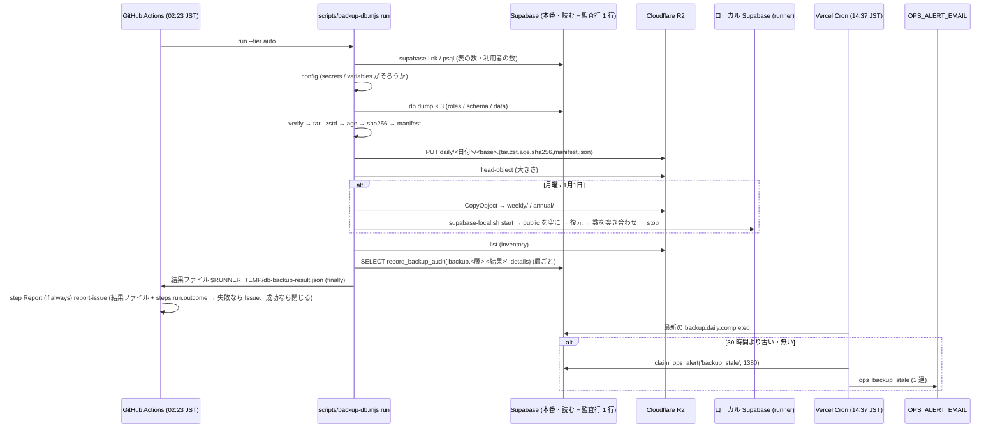

# 長期バックアップの自動化と DR 訓練の記録 設計

| 版 | 日付 | 内容 |
|---|---|---|
| v1.0 | 2026-10-16 | 新設 (Issue #1129・#1191 の設計ゲート・A 型 4 相) |

要件の正本は Issue #1129・#1191 の本文 (どちらもコメント 0 件) と、既存の設計書 `cross/07-dr-backup.md`。本書はその上で決めた範囲と設計で、Issue・07 と食い違ったら本書が正 (07 のうち本書が置き換える節は §0.4 と §20)。
ファイル名 (cross/17) は設計ゲートの指定による。

前提: ローンチ前で利用者ゼロ (正しい形で作る)。本番の DB に触らない (設計ゲートでは読むだけ。実装も本番へは migration 1 本と定期の読み取りだけ)。

---

## 0. 外形固定と分冊判定 (相 1)

### 0.1 決めること

Daily / Weekly / Annual の 3 層のうちローンチに要るもの / 実行の場所と pg_dump を流せる経路 / 保存先・暗号化・ハッシュ・保持と世代の削除・秘密の置き場・費用 / 未設定のときの動き / 個人情報と退会 / 監査の記録 (`backup.*`・`dr.test.*`) と失敗の通知 / DR 訓練の手順書と結果の記録 / テスト。Supabase の Pro への移行と PITR はオーナー作業として切り出し、本書は「Pro でない間の動き」を決める。

### 0.2 要件行列

| # | 要件 | 出どころ | 本書の節 |
|---|---|---|---|
| R-1 | Daily (日次・30 日)・Weekly (週次・1 年・冷保管)・Annual (年次・長期) の 3 層の論理バックアップを自動で取る | #1129、07 §4.1 | §3, §4.1 |
| R-2 | `pg_dump` を流せる場所で動かす (Vercel の関数では動かない根拠を実測値で持つ) | #1129、§0.1 | §3.2, §4.2 |
| R-3 | 保存先・暗号化・ハッシュ・保持期間と世代の削除・秘密の置き場・費用を決める | §0.1、07 §4.3・§9・§14 | §4.3〜§4.6, §13 |
| R-4 | 秘密 (R2 の鍵・暗号化の受け手) が未設定なら、ダンプを作らずに止めて記録する | §0.1 | §4.7, §8.3 |
| R-5 | 取ったバックアップが復元できることを機械で確かめる (生成ごとの検査 + 週次の復元) | 07 §12 | §4.8 |
| R-6 | 成功・失敗を `admin_audit_logs` に `backup.<層>.<結果>` で残す (アプリのロール (anon / authenticated) からは RLS で UPDATE / DELETE できない表。RLS を越える postgres・service_role は消せるので、改ざんの検出の正は bucket lock された `.sha256`。actor は無し) | #1129、07 §4.2 | §5, §10 |
| R-7 | 失敗を運用に知らせる。既存の運用アラート (`OPS_ALERT_EMAIL`・`claim_ops_alert`) との関係を決める | §0.1、operator/07 §8.3 | §4.9, §7.3 |
| R-8 | 定期実行そのものが止まった (走っていない) ことに気づける | R-7 の裏 (GitHub は 60 日間 push の無い公開リポジトリの schedule を自動で止める) | §7.3 |
| R-9 | DR 訓練 (月次 PITR 復元・四半期フル復元・年次訓練) の結果を `dr.test.*` で記録する仕組み (画面 + API) と手順書 | #1191、07 §7 | §6, §7.1, §7.2, §12 |
| R-10 | Pro でない間 (PITR 無し) の RPO / RTO と、月次 PITR テストの扱いを決める | §0.1、07 §3.1・§6.1 | §9.2 |
| R-11 | 退会した利用者の行がバックアップに残る期間と、プライバシーポリシーとの整合 | §0.1、cross/08 §16、cross/15 S-11 | §9.1, §21 |
| R-12 | 単体・結合 (ローカルの Supabase で dump → 復元の往復)・機械検査 (番兵) のテスト | §0.1 | §15, §18 |
| R-13 | 設計書の正典コードに `as any`・マジックナンバーを書かない。運用で変えうる値は環境変数で上書きできる | 設計ゲートの規約 | §5 (§5.1 の「運用で変えうる値と、契約で固定する値」), §7.3 |
| R-14 | 本番の秘密 (DB パスワード・R2 の鍵) をログ・応答・コミットに出さない。公開リポジトリの Actions のログに出るのは件数と大きさだけ | CLAUDE.md、prod-schema-snapshot.yml の方針 | §4.10 |

Issue 本文との食い違い (本書を正とする): #1129 の「vercel.json の cron は process-menu-queue のみ」は古く、origin/main には `app-log-alerts` (#1157) もある。07 §4.2 のコード例は Edge Function `create-backup` から dump の本体を関数の応答で受け取る形だが、Vercel の関数の本体は 4.5 MB が上限で (§4.2)、2.4 GB の DB では成り立たない。07 §9.2 の R2 Lifecycle は `GLACIER` を使うが、R2 にそのクラスは無い (Standard と Infrequent Access の 2 つ)。いずれも本書で置き換える。

### 0.3 ユーザーシナリオ (19 本。トレースは §3.4)

| # | シナリオ |
|---|---|
| S-1 | 火曜 02:23 JST。GitHub Actions が本番をダンプし、暗号化して R2 の `daily/` に置き、`backup.daily.completed` を 1 行残す。運営の画面は「最新 02:3x・新しい」を出す |
| S-2 | 月曜。S-1 に加えて同じ日の対象物を `weekly/` へサーバー側でコピーし、ローカルの Supabase に復元して数を確かめ、`backup.weekly.completed` も残す |
| S-3 | 1 月 1 日。S-1 (と月曜なら S-2) に加えて `annual/` へコピーし、`backup.annual.completed` を残す |
| S-4 | R2 の鍵や暗号化の受け手 (GitHub の secrets / variables) が未設定。DB に繋いだあと設定の検査で止まり、ダンプを作らず、`backup.daily.failed` (reason `not_configured`) を残し、Issue を立て、終了コード 3 |
| S-5 | DB パスワードが間違っている (link が失敗)。監査行は書けないので Issue だけ (段・理由は結果ファイルで report の step へ渡す)。翌日 14:37 JST の鮮度の cron が「30 時間より古い」を検知して運用メールを 1 通送る |
| S-6 | ダンプは終わったが `data.sql` が途中で切れている (末尾の `-- PostgreSQL database dump complete` が無い・`COPY public.` の表が `schema.sql` の表と合わない)。送らず、`failed` (stage `verify`, reason `dump_incomplete`) を残し、Issue |
| S-7 | R2 への送信が途中で切れる。aws cli の再試行でも駄目なら `failed` (stage `upload`)。翌日の成功で Issue は自動で閉じる |
| S-8 | 同じ日に手動 (workflow_dispatch) でもう 1 回流す。ファイル名に実行時刻 (UTC) が入るので別の対象物になり、bucket lock に当たらず、監査行も 2 つ |
| S-9 | push の無い 60 日が過ぎて GitHub が schedule を止めた。Actions は何も失敗しない。鮮度の cron が 30 時間を超えた時点で運用メールを送り (日 1 回の cron の回ごとに 1 通。クールダウンは 23 時間)、画面も「古い」を出す。オーナーが Actions の画面で有効に戻す |
| S-10 | 月曜の復元の検査が失敗 (ローカルの GoTrue の版が本番より古く `COPY auth.users` の列が足りない)。`daily` は completed のまま、`backup.weekly.failed` (stage `restore_check`) と Issue。対象物は消さない |
| S-11 | 四半期の訓練。オーナーが手元で `node scripts/backup-db.mjs restore --key daily/2026-10-13/... --identity-file ~/.config/homegohan/backup.key` を流し、ローカルに復元して `npm run test:smoke`。画面の「DR 訓練を記録」で quarterly_restore / success / rto 45 分を送ると `dr.test.quarterly.restore` が 1 行残る |
| S-12 | Free プランのまま月が替わる。月次の PITR 復元テストはできないので、画面で monthly_pitr / skipped / notes「plan_not_pro」を記録する (warn)。Pro に上がるまで毎月これを残す |
| S-13 | R2 の API トークンが漏れた。攻撃者は対象物を消そうとするが bucket lock で拒まれ、上書きも拒まれ、読めても age の秘密鍵が無いので復号できない。オーナーはトークンを作り直す |
| S-14 | 02:23 JST の取得のあと 09:00 に退会した利用者がいる。12:00 に DB が壊れ、02:23 のバックアップから復元すると、その利用者の行が戻る。手順書の「復元点より後の退会」の節に従う (§9.1) |
| S-15 | super_admin が DR 訓練の記録に NULL 文字を含む本文を送る → 400。admin ロールの人が送る → 403。kind が未知 → 400。監査行の INSERT が失敗 → 500 (記録そのものが操作なので fail-closed) |
| S-16 | age の秘密鍵を失くした。四半期の訓練で復号できず failed で記録される。以後のバックアップは新しい鍵で取り直し、古い対象物は読めないまま保持期間で消える (§4.4 の鍵の保管の規則がこれを防ぐ) |
| S-17 | 取得の step が job の途中で時間切れになる (DB が育って dump が長引いた)。run の step は結果ファイルを書けずに切られる。report の step (`if: always()`) は結果ファイルが無いことと `steps.run.outcome` (`failure` / `cancelled`) から「結果を残さずに終わった」の Issue を立てる |
| S-18 | 1 年後。daily の行は 365 行を超え、1 月 1 日の `backup.annual.completed` は新しい順の 100 行の窓の外にある。画面の annual のカードは、窓によらず action_type ごとに最新 1 行を読むので 1 月 1 日の取得を出し続ける。年次の訓練の最新も同じ |
| S-19 | 02:23 JST の取得の stats (live) のあと、data.sql のダンプ (数分〜) の間に利用者が 1 人登録した。live の数と dump の中身は 1 行ずれるが、復元の検査は dump の中身 (data.sql の `COPY auth.users` の行数) と比べるので通る |

### 0.4 分冊判定

| 目安 | 本設計 | 判定 |
|---|---|---|
| 設計書 800 行超 | 超える (約 1,400 行) | 当たる |
| 消費先レーン 3 以上 | GitHub Actions (scripts) / migration / 運営の API と画面 / Vercel Cron / 手順書 の 5 面 | 当たる |
| 共有面 2 つ以上 | `admin_audit_logs` の action の一覧・`vercel.json` の crons と operator/08 の状態の注記・`OPS_ALERT_EMAIL` の読み口・env の一覧・cron 認証の番兵 | 当たる (どれも行を足す・1 行を付け替える) |

**結論: 1 冊で書く (核と配線に分けない)。** 理由: 共有面に触るのは「行を足す」と「`OPS_ALERT_EMAIL` の読み口の 1 行の付け替え」だけで、既存の表・関数・ポリシーを変えない。中心 (取得の 1 本道) を分冊すると、取得 → 記録 → 鮮度 → 画面の 1 本の流れが冊をまたいで追えなくなる。代わりに実装 WF を 4 段 (§16) に分け、段ごとに 2 枚レビューを閉じる。

**07 との関係:** 07 を改定せず、本書を新設して 07 から参照する。本書が置き換える 07 の節 = §4.1 (3 層の表)・§4.2 (Daily のコード)・§4.3 (GPG)・§9 (バケットと Lifecycle)・§11 (シーケンス)・§12 (テスト)・§13・§14 の該当行。07 に残る節 = §3 (プラン)・§5 (リージョン)・§6 (RPO / RTO。本書 §9.2 が Pro でない間の暫定を足す)・§7 (訓練の予定。記録の方法は本書 §6)・§8 (障害のシナリオ)。07 への注記は §19 の追随表で足す (本書では 07 を編集しない)。

### 0.5 用語

| 語 | 意味 |
|---|---|
| 取得 (run) | GitHub Actions の 1 回の実行。ダンプ → 検査 → 暗号化 → 送信 → コピー → 記録 までの 1 本道 |
| 層 (tier) | `daily` / `weekly` / `annual`。R2 の接頭辞と保持期間が違うだけで、中身は同じ日の同じ対象物 |
| 対象物 | 1 回の取得が R2 に置く 3 ファイル: `<base>.tar.zst.age` (暗号化した書庫)・`<base>.sha256`・`<base>.manifest.json` |
| 受け手 (recipient) | age の公開鍵 (`age1…`)。秘密ではない。秘密鍵 (identity) は復元する人だけが持つ |
| 鮮度 | 最新の `backup.daily.completed` の `created_at` からの経過時間。`BACKUP_STALE_AFTER_HOURS` を超えたら「古い」 |

---

## 1. 目的・スコープ

- 目的: Supabase の PITR (Pro 以上) に頼らず、本番 DB の論理バックアップを毎日取り、改ざん・削除・漏えいに耐える形で保管し、復元できることを機械で確かめ、取得と訓練の記録を監査ログに残す。
- 範囲 (本書で作るもの): GitHub Actions の workflow 1 本・scripts 2 本・migration 1 本 (関数 1 つ)・Vercel Cron の route 1 本とメール文面 1 通・運用メールの宛先の読み口 1 つ・運営の API 2 本と画面 1 つ・lib 1 つ・手順書 1 冊・テスト (§15)。
- 範囲外: Supabase Storage のファイル (写真) のバックアップ (§21)・Pro への移行と PITR の有効化 (オーナー作業)・Singapore レプリカ (07 §5.2)・`admin_audit_logs` の 7 年アーカイブ (operator/07 §5)・障害シナリオの手順そのもの (07 §8・operator/09 §11)。

## 2. 関連要件

- Issue #1129 (本文)・#1191 (本文)。関連 #1012・#1150・#1170・#1181 (`/api/health`・smoke test)・#1157 (運用メール)・#1562 (削除の実行記録)。
- `cross/07-dr-backup.md` §3・§6・§7・§8。`cross/08-legal-compliance.md` §16。`cross/15-data-subject-requests.md` S-11。`operator/07-audit-monitoring.md` §3・§4.5。`operator/08-cron-batches.md` §3.0・§3.2・§5。docs/design/CLAUDE.md §3 (RLS)・§4 (snake_case)・§6 (監査ログ)。

---

## 3. 構想 (相 2) と構造裁定 (相 3)

### 3.1 構造

```
GitHub Actions (schedule 23 17 * * * UTC = 02:23 JST / workflow_dispatch)   .github/workflows/db-backup.yml
  step run:    node scripts/backup-db.mjs run --tier <auto|…> --result-file $RUNNER_TEMP/db-backup-result.json
                                                                              scripts/backup-db.mjs → scripts/lib/backup-db.mjs
    link      supabase link (SUPABASE_ACCESS_TOKEN / SUPABASE_DB_PASSWORD。既存の secrets)
    config    R2 の鍵・バケット・age の受け手がそろっているか (無ければ止めて記録)
    stats     psql (読み取り): public の表の数・auth.users の数・DB の大きさ → manifest の source (記録だけ。突き合わせに使わない)
    dump      supabase db dump --linked × 3 (roles / schema / data。Supabase の手順どおり)
    verify    data.sql の末尾の完了行・COPY の終端・`COPY public.` の表 = schema.sql の表・auth.users の COPY → manifest の dumped (ダンプの中身の数)
    archive   tar | zstd                                       →  <base>.tar.zst
    encrypt   age -r <受け手>                                   →  <base>.tar.zst.age  (平文の書庫はここで消す)
    upload    aws s3 cp × 3 → R2 daily/<日付>/                 (head-object で大きさを突き合わせる)
    copy      月曜なら weekly/ へ、1/1 なら annual/ へ、サーバー側コピー (再送しない)
    inventory 各接頭辞の対象物の数 (Lifecycle が効いているかの手がかり)
    restore_check (weekly / annual の日だけ) scripts/supabase-local.sh start → public を空にして 3 ファイルを復元 → 数を manifest の dumped と突き合わせ
    audit     psql: SELECT public.record_backup_audit('backup.<層>.<結果>', <details>)  (層ごとに 1 行)
    cleanup   平文・一時ディレクトリを消す
    (finally) 結果ファイル (BackupRunReport: 層ごとの completed / failed・段・reason・missing の名前) を書く → 終了コード 0 / 1 / 3
  step stop:   bash scripts/supabase-local.sh stop   (if: always())
  step report: node scripts/backup-db.mjs report-issue --result-file … --run-outcome ${{ steps.run.outcome }} --run-url …   (if: always())
              失敗 (結果ファイルの failures・結果ファイルが無い) なら Issue を作る・更新、成功なら閉じる (consistency-check と同じ仕組み)

Cloudflare R2 (バケット homegohan-db-backups)
  daily/   Lifecycle: 30 日で削除           bucket lock: 30 日
  weekly/  Lifecycle: 30 日で IA、366 日で削除  bucket lock: 366 日
  annual/  Lifecycle: 30 日で IA、2,557 日で削除  bucket lock: 2,557 日 (7 年)
  API トークンは Object Read & Write (このバケットだけ)。Lifecycle・lock はオーナーが 1 回設定する

Vercel Cron (37 5 * * * UTC = 14:37 JST)  GET /api/cron/backup-freshness
  admin_audit_logs の最新の backup.daily.completed が 30 時間より古い (無い) → claim_ops_alert('backup_stale', 1380) → OPS_ALERT_EMAIL に 1 通

運営 (super_admin)  /super-admin/backups
  GET  /api/super-admin/backups            層ごとの最新の取得・種類ごとの最新の訓練 (どちらも action_type ごとに最新 1 行)・鮮度・取得と訓練の一覧 (それぞれ新しい順 100 行)
                                           (admin_audit_logs を本人のセッションで読む)
  POST /api/super-admin/backups/dr-tests   DR 訓練の結果を dr.test.<種類> で記録 (recordAdminAudit。fail-closed)
```

- 取得は「1 日 1 回・1 本道」。週次・年次は別の取得ではなく、同じ日の対象物のサーバー側コピー。3 つの schedule を持たない。
- 対象物は 1 回の取得で 3 ファイル。暗号化の受け手は公開鍵なので CI に秘密鍵が無い。改ざん・削除への耐性は R2 の bucket lock (WORM) で持ち、`.sha256` も lock の下にあるので改ざんの検出の正はそれ。監査行の SHA-256 は控え (アプリのロールからは RLS で UPDATE / DELETE できないが、DB パスワードを持つ postgres と service_role は RLS を越えるので、DB 側だけで不変は保証しない)。GPG の署名は置かない (§3.2 の裁定)。
- run と report を別の step に分ける: run の step は GitHub の client を持たず (`RunDeps` に無い)、結果をファイル (`$RUNNER_TEMP/db-backup-result.json`) に書くだけ。Issue は report の step (`if: always()`) が結果ファイルと `steps.run.outcome` から作る。run の step が時間切れ・取り消しで結果ファイルを書けなくても report の step は動く (§4.11)。
- 記録は既存の `admin_audit_logs` に `actor_id = NULL` で書く (pg_cron の `handson_tour_sandbox_cleanup` と同じ「利用者のいない操作」)。書くのは新しい関数 `public.record_backup_audit` だけで、所有者 `postgres` (= Actions が DB パスワードで繋ぐロール) 以外は呼べない。
- 「走っていない」は取得の側では検知できないので、Vercel Cron が監査行の鮮度を見る。通知は既存の運用メールの仕組み (`OPS_ALERT_EMAIL`・`claim_ops_alert` のクールダウン) をそのまま使う。

### 3.2 代替案の比較と裁定 (1 回だけ)

| 観点 | A: 本書の構造 (GitHub Actions + R2 + age + 監査行) | B: 07 の構造 (Vercel Cron → Edge Function `create-backup` → R2 + GPG 署名) | C: pg_cron から Supabase の中で完結 | D: 手元の機械 (M2 / 270k) の cron |
|---|---|---|---|---|
| `pg_dump` を動かせるか | 動く。前例 `prod-schema-snapshot.yml` が同じ Docker イメージで本番を読んでいる | 動かない。Vercel の関数にも Edge Function (Deno) にもバイナリが無く、関数の本体は 4.5 MB、実行時間は Pro で 800 秒 (§4.2) | `COPY TO` も DB の外へ書けない。外部ストレージへは `pg_net` で小さい HTTP しか送れない | 動く |
| 時間・容量 | 1 job 6 時間・ディスク約 14 GB (§4.2)。DB 2.4 GB に対して十分 | 不可 | 不可 | 十分 |
| 秘密の置き場 | GitHub の secrets (DB パスワードはすでにある。R2 の鍵 2 つを足す)。暗号化の秘密鍵は CI に無い | Vercel の環境変数に R2 の鍵と GPG の秘密鍵 (署名用) を置く = 署名鍵が CI にある | DB の中 (Vault) | 個人の機械 |
| 失敗の見え方 | Actions の失敗 + Issue + 監査行 + 鮮度のメール | 関数のログだけ (07 は Slack だが本プロジェクトは Slack を使っていない) | `cron.job_run_details` | 誰も見ない |
| 改ざん・削除への耐性 | bucket lock (WORM) + 監査行の SHA-256 | GPG 署名 (署名鍵が CI にあるので、CI が侵害されれば署名も偽造できる) | — | — |
| 縁の発生源 | Actions の schedule が 60 日で止まる → 鮮度の cron で塞ぐ | 本体の大きさ・時間の上限が DB の成長で破綻する | 不可 | 可用性・説明責任が無い |

**裁定: A。** B は上限で成り立たず、C は構造的に不可、D は運用に耐えない。A の中で、GPG の署名を落として「bucket lock + 監査行のハッシュ」に替えるのは「縁の発生源 (CI に置く秘密鍵の管理。07 §14・cross/08 §19 の TODO) を消す」ための選択で、以後蒸し返さない。暗号化に age を選ぶのは、受け手が 1 行の文字列で GitHub の variable に置け、鍵束 (keyring) も信頼モデルの設定も要らないため (GPG の公開鍵でも同じことはできるが、`--trust-model` と鍵の取り込みが要り、手順書の行が増える)。
仕上げ (相 4) の中で構造への疑義が出たら、blocking ではなくこの裁定への差し戻し事由として扱う。

### 3.3 取得の場所を決めた実測値 (英語・日本語で検索した結果)

| 項目 | 値 | 出どころ |
|---|---|---|
| Vercel の関数の実行時間 (Fluid compute) | Hobby 300 秒 (既定 = 上限)。Pro / Enterprise 既定 300 秒・上限 800 秒・関数ごとの設定で 1,800 秒 (beta) | vercel.com/docs/functions/limitations (2026-08-24 更新)。日本語の公式ページは見つからず、英語の changelog「Vercel Functions can now run up to 30 minutes」で補った |
| Vercel の関数の本体 (要求・応答) | 4.5 MB (超えると 413 `FUNCTION_PAYLOAD_TOO_LARGE`) | 同上 |
| Vercel の関数のバンドル | 非圧縮 250 MB (Large functions beta で 5 GB)。`pg_dump` のバイナリは同梱できない前提で設計する (同梱できても本体の上限で成り立たない) | 同上 |
| GitHub Actions の job | GitHub-hosted runner は 1 job 6 時間、workflow run 35 日 | docs.github.com/en/actions/reference/limits |
| Cloudflare R2 の保管クラス | Standard $0.015 / GB-月、Infrequent Access $0.01 / GB-月 (最短 30 日・取り出し $0.01 / GB)。Class A $4.50 / 100 万、Class B $0.36 / 100 万 (IA は $9.00 / $0.90)。Egress 無料。無料枠は Standard 10 GB-月 | developers.cloudflare.com/r2/pricing |
| R2 の Lifecycle | 接頭辞ごとに `Expiration: { Days }`・`Transitions: [{ Days, StorageClass: 'STANDARD_IA' }]`。削除と遷移が重なれば削除が勝つ。1 バケット 1,000 ルール | developers.cloudflare.com/r2/buckets/object-lifecycles |
| R2 の bucket lock | 接頭辞ごとに、日数 (`Age` の `maxAgeSeconds`)・日付・無期限 (`Indefinite`) で削除と上書きを防ぐ。Lifecycle の削除より優先。重なれば長い方 | developers.cloudflare.com/r2/buckets/bucket-locks (2025-03-06 の changelog で追加) |
| Supabase の日次バックアップ | Pro 7 日・Team 14 日。Free は無し。PITR はアドオンで、有効にすると日次は取られなくなる | supabase.com/docs/guides/platform/backups |
| 本番 DB の実測 (2026-10-16・読み取り) | PostgreSQL 17.6。DB 2,417 MB (public 2,393 MB・136 表。同じ日の後の読み取りでは 137 表で、どれも通常の表 (relkind `r`。分割表・拡張の表は 0)。`dataset_menu_sets` 1,895 MB が大半)。auth.users 195 行。admin_audit_logs 261 行。`postgres` ロールは `rolbypassrls = true`・`admin_audit_logs` の所有者で、`relforcerowsecurity = false`。`service_role` も `rolbypassrls = true`、`anon` / `authenticated` は false | Supabase MCP の SELECT |

### 3.4 シナリオのトレース (構造 A で手で走らせた記録)

| # | 走らせた結果 |
|---|---|
| S-1 | 17:23 UTC に schedule。`planRun` が JST の暦日 2026-10-20 (火) を出し、tiers = [`daily`]。link → config OK → stats (136 / 195 / 2.5e9。記録だけ) → dump 3 ファイル → verify (末尾の完了行あり・COPY の終端あり・`COPY public.` の 136 表 = schema.sql の `CREATE TABLE public.` の 136 表、auth.users あり → dumped = {public_tables 136, auth_users 195, audit_rows 261}) → archive → encrypt → upload 3 つ → head-object の大きさ一致 → copy 無し → inventory (daily 20) → restore_check 無し → audit `backup.daily.completed` → cleanup → 結果ファイル {status ok, completed [daily]} → 終了 0 → stop → report: failures 0 で marker の Issue が無いので none。鮮度の cron は 14:37 JST に「12 時間」で fresh。画面の daily カードは 02:3x・鮮度 OK |
| S-2 | 月曜 (JST) → tiers = [`daily`, `weekly`]。upload まで S-1 と同じ。copy: `aws s3 cp s3://…/daily/2026-10-19/<base>.* s3://…/weekly/2026-10-19/` × 3。restore_check: `supabase-local.sh start` → public を空に → roles → schema → data (replica) → 表 136・users 195・admin_audit_logs 261 を manifest の dumped と突き合わせ・cron.job の数を記録 → stop。audit `backup.daily.completed` と `backup.weekly.completed` (後者の details に `copied_from` と `restore_check`)。終了 0 |
| S-3 | 1/1 → tiers に `annual` が入る (`tiersForDate` は daily を常に、月曜なら weekly、1/1 なら annual を足す)。copy を 2 回、audit を 3 行。restore_check は weekly または annual があれば 1 回だけ |
| S-4 | link OK → config で `BACKUP_R2_ACCESS_KEY_ID` が無い → `ConfigError(missing: ['BACKUP_R2_ACCESS_KEY_ID'])` → dump に進まない (平文が作られない) → audit `backup.daily.failed` {stage: 'config', reason: 'not_configured', missing: [名前]} (値は無い) → 結果ファイル {status not_configured, failures [{tier daily, stage config, reason not_configured, missing [名前]}]} → 終了 3 → report の step (`if: always()`): `planBackupIssue` が failures から本文 (marker・層・段・reason・missing の名前・run の URL) を作り、Issue「【自動】DB バックアップの失敗」を作る。鮮度の cron は翌日 fresh でなくなるまで鳴らない (失敗の通知は Issue と Actions の失敗通知が担う) |
| S-5 | link 失敗 → reason `link_failed` → audit は書けない (DB に繋げない。結果ファイルの `audit_written` は false) → 結果ファイル {status failed, failures [{tier daily, stage link, reason link_failed}]} → 終了 1 → report が Issue。翌日 14:37 JST の鮮度の cron: 最新 completed は前日 02:3x → 36 時間 > 30 → `claim_ops_alert('backup_stale', 1380)` → メール 1 通 (`stale_sent`)。その 15 分後の回は無い (日 1 回)。翌日の回 (24 時間後 ± 秒単位のぶれ) もまだ古ければ、前回から 23 時間 (クールダウン) を超えているので再度 1 通 |
| S-6 | dump 完了 → verify: data.sql の末尾に完了行が無い (または `COPY public.` が 97 表 ≠ schema.sql の 136 表) → reason `dump_incomplete` (details に expected / actual) → upload しない → audit failed → Issue → cleanup → 終了 1 |
| S-7 | upload で aws cli が再試行の末に失敗 → reason `upload_failed` (stage `upload`、どのファイルかは suffix だけ) → audit failed → 結果ファイル → report が Issue (marker が同じなので既存の Issue を更新) → 終了 1。翌日成功 → 結果ファイル {status ok} → report が marker の Issue を閉じる |
| S-8 | dispatch (tier = auto)。base = `homegohan-db-20261020T051500Z` (17:23 の回は `…T172312Z`) → キーが別 → lock に当たらない → audit 2 行目。鮮度・画面は新しい方を見る |
| S-9 | schedule 停止。監査行は増えない。14:37 JST の鮮度の cron: 最新 completed から 36 時間 → メール。画面: `isBackupStale` が true で赤いバッジと「GitHub Actions の db-backup が止まっていないか確かめる」の文 |
| S-10 | restore_check で `COPY auth.users` が列不足で失敗 → `restore_check_failed` → upload・copy は済んでいるので対象物は残る → audit は `backup.daily.completed` (先に書いてある) と `backup.weekly.failed` {stage: 'restore_check', reason, copied_from} → Issue → 終了 1。手順書: `supabase link` で `.temp` の版を更新してベースラインを取り直す (オーナー) |
| S-11 | `restore` サブコマンド: aws で 3 ファイルを取得 → sha256 を突き合わせ → age -d -i → zstd -d → tar → `supabase-local.sh start` → public を空に → 復元 → 数を表示。オーナーが `npm run test:smoke -- --base-url=http://localhost:3000` → 画面の form (kind quarterly_restore, result success, environment local, backup_key, rto_minutes 45, smoke passed, notes) → POST → `recordAdminAudit` 成功 → 201 → 一覧の先頭に出る |
| S-12 | form (monthly_pitr, skipped, environment staging, notes 'plan_not_pro') → `drTestRecordBodySchema` は result ≠ success のとき notes 必須 → 通る → severity warn → 一覧に黄色で出る |
| S-13 | DeleteObject → R2 が lock で拒否 (403)。PutObject (同じキー) → 拒否。GetObject → `.age` を得るが復号できない。`.sha256` も lock の下で書き換えられないので、復元の checksum の段が改ざんを見つける (監査行の sha256 は控え)。手順書: トークンを作り直し、`BACKUP_R2_*` を更新 |
| S-14 | 復元した DB に退会済みの人の行が戻る。`gdpr_deletion_requests` の記録は HMAC で、復元先が同じプロジェクトなら Vault の鍵が残るので照合できるが、新しいプロジェクトなら鍵が無く照合できない。手順書は「復元点より後の退会は機械では再現できない。影響期間は最長 24 時間 (RPO)。復元後に、復元点以降の退会の問い合わせがあれば再度の退会で応じる」と書く (§9.1) |
| S-15 | `rejectNullCharacterBody` が最初 → 400 INVALID_CHARACTER。`requireRole(['super_admin'])` が admin を 403。Zod が kind を 400 VALIDATION_ERROR。`recordAdminAudit` が `{ ok: false }` → `internalError` の 500 (記録無しで 201 を返さない) |
| S-16 | download → checksum (`.sha256` と一致) → 復号で age が失敗 → `restore` は終了 1 (stage `decrypt`, reason `decrypt_failed`。一時ディレクトリは消す)。訓練は failed で記録。新しい鍵対を作って variable を更新すれば翌日から新しい鍵で取れる。古い対象物は読めないまま Lifecycle で消える |
| S-17 | dump が長引き、run の step が `timeout-minutes: 290` (`RUN_STEP_TIMEOUT_MINUTES`) で切られる → 結果ファイルは無い (finally も走らない) → `steps.run.outcome = failure` → stop (always) → report (always): `parseRunReport` が null → `planBackupIssue` が「run の step が結果を残さずに終わった (outcome failure)。時間切れか取り消し」の本文 → Issue。監査行は書かれていない (最後の段まで行っていない) ので、翌日の鮮度の cron が拾う。job 全体 (300 分) にはまだ 10 分残っているので report の step は動ける |
| S-18 | GET: `latestByAction` を 6 本 (層 3 + 訓練の種類 3。`.eq('action_type', …).order(created_at desc).limit(1)`) と一覧 2 本 (取得 6 種・訓練 3 種、それぞれ limit 100) を並べて読む → annual の最新は 1 月 1 日の行 (一覧の窓の外でも) → カードに出る |
| S-19 | stats (live: auth.users 195) → dump (その間に 1 人登録) → verify: data.sql の `COPY auth.users` の行数 196 → dumped.auth_users = 196 → restore_check: 復元後 196 = dumped 196 → passed。source.auth_users (195) は記録だけで比べない |

---

## 4. 取得の設計 (GitHub Actions)

### 4.1 層・予定・保持

| 層 | 取得 | R2 の接頭辞 | Lifecycle | bucket lock | 保持の根拠 |
|---|---|---|---|---|---|
| `daily` | 毎日 02:23 JST (`23 17 * * *` UTC) | `daily/<YYYY-MM-DD>/` | 30 日で削除 | 30 日 (2,592,000 秒) | 07 §4.1 の 30 日。ローンチに必須 |
| `weekly` | 月曜 (JST) の daily をコピー | `weekly/<YYYY-MM-DD>/` | 30 日で Infrequent Access、366 日で削除 | 366 日 (31,622,400 秒) | 07 §4.1 の 1 年 (閏日を含めて 366)。ローンチと同時 (コピー 1 つなので別の工事が無い) |
| `annual` | 1 月 1 日 (JST) の daily をコピー | `annual/<YYYY>/` | 30 日で Infrequent Access、2,557 日で削除 | 2,557 日 (7 年。220,924,800 秒) | 07 §4.1 は「永久」だが、個人情報を含む DB を期限なしで持つことは避け、`admin_audit_logs` の保管 7 年 (operator/07 §5.1) に揃える。法務の確認は §21。ローンチと同時 (weekly と同じくコピー 1 つで別の工事が無い。最初の対象物はローンチ後の最初の 1 月 1 日) |

- ローンチに要るもの / 後回しのもの: 3 層とも段 A (§16) で作り、ローンチの時点で動かす (後回しにする層は無い)。daily は復元の元として必須、weekly・annual は daily の対象物のサーバー側のコピー (§4.11 の copy) と復元の検査だけで、別の取得・別の秘密・別の工事が無いので、分けて後から足すほうが手間が増える。後回しにするのは Supabase の Pro への移行と PITR (オーナーの作業。§9.2) だけ。
- 時刻は 02:23 JST に置く (07 は 02:00 UTC = 11:00 JST の昼間だった)。GitHub の schedule は毎時 0 分に遅れるので 0 分・30 分を避ける (daily-consistency-check.yml の経験)。pg_cron の掃除 (03:10〜03:45 JST) より前。
- 日付・曜日・1/1 の判定は JST の暦日 (`Asia/Tokyo`) で行う (`tiersForDate`)。1/1 が月曜なら 3 層とも作る。
- 世代の削除はコードでは行わない。R2 の Lifecycle に任せ、取得の `inventory` が各接頭辞の対象物の数を監査行に残す (daily が 33 日分より多ければ Lifecycle が効いていない手がかり。判定は画面を見る人)。
- `workflow_dispatch` の入力 `tier` (`auto` / `daily` / `weekly` / `annual`。既定 `auto`) で、手動のときだけ層を指定できる (`weekly` を指定すると daily + weekly)。

### 4.2 実行環境 (GitHub-hosted runner)

| 項目 | 値 | 本設計での扱い |
|---|---|---|
| job の上限 | 6 時間 | `timeout-minutes: 300` (`JOB_TIMEOUT_MINUTES`)。run の step は `timeout-minutes: 290` (`RUN_STEP_TIMEOUT_MINUTES`。report の step の分 10 分を残す)。段ごとの上限は §5.1 の `STAGE_TIMEOUT_MINUTES` (dump 120 分・upload 60 分・restore_check 60 分)。段の上限の合計は 290 分を超えるが、全段が上限まで掛かることは無い前提で、超えたら step の時間切れになり S-17 の経路で Issue が立つ |
| ディスク | ubuntu-latest で約 14 GB の空き | 平文 (data.sql ≈ DB の大きさ) + 書庫 + 暗号化後 ≈ DB × 1.5。DB が 5 GB を超えたら `tar | zstd | age` のパイプで平文の書庫を作らない形へ (§21) |
| 入っている道具 | Docker・aws cli v2・zstd・gpg。`age` は無い | `sudo apt-get update && sudo apt-get install -y age` (Ubuntu 24.04 の age 1.1.1)。版は `age --version` でログに出す (§4.11) |
| 同時実行 | `concurrency: { group: db-backup, cancel-in-progress: false }` | 手動と schedule が重なっても直列 |
| 権限 | `permissions: { contents: read, issues: write }` | Issue の作成・更新・クローズだけ。PR・ブランチ・設定には触らない |
| 公開リポジトリ | ログは誰でも読める | 出すのは段の名前・件数・大きさ・ダイジェストの先頭 8 文字・所要秒だけ (§4.10) |

### 4.3 ダンプと検査 (Supabase の手順どおり)

```bash
# すべて supabase CLI 2.62.10 (既存の workflow と同じ版)。link は SUPABASE_ACCESS_TOKEN / SUPABASE_DB_PASSWORD (既存の secrets)
npx --yes supabase@2.62.10 link --project-ref flmeolcfutuwwbjmzyoz
npx --yes supabase@2.62.10 db dump --linked -f "$WORK/roles.sql"  --role-only
npx --yes supabase@2.62.10 db dump --linked -f "$WORK/schema.sql"
npx --yes supabase@2.62.10 db dump --linked -f "$WORK/data.sql"   --data-only --use-copy \
  -x storage.buckets_vectors -x storage.vector_indexes            # Supabase の backup-restore の手順と同じ除外 (DUMP_EXCLUDED_TABLES)
```

- `stats` (dump の前に psql。既存の `prod-schema-snapshot.yml` と同じ Docker イメージ `public.ecr.aws/supabase/postgres:$(cat supabase/.temp/postgres-version)`、接続先は `$(cat supabase/.temp/pooler-url)?sslmode=require`、パスワードは `PGPASSWORD`): `SELECT count(*) FROM pg_tables WHERE schemaname = 'public'`・`SELECT count(*) FROM auth.users`・`SELECT pg_database_size(current_database())`。読むだけ。結果は manifest の `source` に**記録するだけ**で、verify・restore_check の突き合わせには使わない (3 回の `db dump` はそれぞれ別のスナップショットで、stats とも別の取引なので、その間の利用者の登録・退会や migration で数がずれる。S-19)。
- `verify` (DB に繋がない。基準は live の数ではなくダンプの中身): `schema.sql` を 1 行ずつ読む `scanSchemaSql` と、`data.sql` を 1 行ずつ読む `scanDataSql` (GB 級なので全体を読み込まない) の結果で判定する。
  1. 3 ファイルが空でない。
  2. `data.sql` の最後の空でない行が `-- PostgreSQL database dump complete` (pg_dump が最後に書く行。`DUMP_COMPLETE_TRAILER`)。途中で切れたダンプはこれが無い。
  3. すべての `COPY … FROM stdin;` の後に `\.` の行がある (`unterminated_copy` が null)。
  4. `data.sql` の `^COPY public\.(\S+) ` の表の集合が、`schema.sql` の `^CREATE (UNLOGGED )?TABLE public\.(\S+) ` の表の集合 (直後に `) PARTITION BY` で閉じる分割の親を除く。pg_dump は親に COPY を出さない) と**ちょうど**同じ (pg_dump は空の表にも `COPY … FROM stdin;` と `\.` を出す)。
  5. `^COPY auth\.users ` と `^COPY public\.admin_audit_logs ` の行がある。
  満たさなければ reason `dump_incomplete` で止める (送らない。details の expected / actual は 4 の表の数、2・3 で落ちたときは expected = actual = 表の数)。満たせば `dumped` (`DumpCounts`: `COPY public.` の表の数・`COPY auth.users` の行数・`COPY public.admin_audit_logs` の行数。COPY の text 形式は 1 行 = 1 行) を manifest に入れ、restore_check の基準にする。
  - 残る窓: schema.sql と data.sql も別のスナップショットなので、その数分の間に本番へ表を足す migration が入ると 4 で落ちる (誤検知)。migration の本番適用は main へのマージのとき (`deploy-supabase-migrations.yml` の push。ほかは手動の workflow_dispatch) だけで、02:23 JST に重なることは稀。落ちても対象物は送らず Issue が立つだけで、`workflow_dispatch` で取り直せば通る (手順書 §10)。
- 書庫: `tar -C "$WORK" -cf - roles.sql schema.sql data.sql | zstd -T0 -6 -o "$WORK/<base>.tar.zst"` (`ZSTD_LEVEL = 6`: 19 は数倍遅く、縮みは 1 割しか変わらない)。
- 暗号化: `age -r "$BACKUP_AGE_RECIPIENT" -o "$WORK/<base>.tar.zst.age" "$WORK/<base>.tar.zst"` → 成功したら `.tar.zst` を消す。平文の 3 ファイルは restore_check が要るので cleanup まで残す (umask 077 の一時ディレクトリ)。
- ダイジェスト: `sha256sum <base>.tar.zst.age > <base>.sha256` (暗号化後のファイルに対して。復元のとき `sha256sum -c` で確かめる)。
- manifest (`<base>.manifest.json`。暗号化しない。個人情報を含まない): §5.1 の `BackupManifest`。

### 4.4 保存先・暗号化・秘密の置き場

| 物 | 置き場 | 種別 | 備考 |
|---|---|---|---|
| `BACKUP_R2_ACCOUNT_ID` | GitHub Actions variable | 公開してよい | endpoint `https://<account>.r2.cloudflarestorage.com` |
| `BACKUP_R2_BUCKET` | GitHub Actions variable | 公開してよい | 既定の名前 `homegohan-db-backups` |
| `BACKUP_R2_ACCESS_KEY_ID` / `BACKUP_R2_SECRET_ACCESS_KEY` | GitHub Actions secret | 秘密 | R2 の API トークン「Object Read & Write」をこのバケットだけに絞る。Lifecycle・lock を変える権限は持たせない |
| `BACKUP_AGE_RECIPIENT` | GitHub Actions variable | 公開してよい (公開鍵) | `age1…`。manifest にも写す (どの鍵で暗号化したかを後から辿る) |
| `BACKUP_DUMP_TIMEOUT_MINUTES` / `BACKUP_UPLOAD_TIMEOUT_MINUTES` / `BACKUP_RESTORE_CHECK_TIMEOUT_MINUTES` / `BACKUP_ZSTD_LEVEL` | GitHub Actions variable (任意。無ければ §5.1 の既定) | 公開してよい | DB が育ったときの調整用 (§5.1 の `RUN_TUNING_ENV`)。形が違う値は `not_configured` で止める (黙って既定に戻さない) |
| age の秘密鍵 (identity) | オーナーのパスワードマネージャー + 印刷した控え 1 通 (金庫) | 秘密。**CI・Vercel・Supabase・リポジトリには置かない** | `age-keygen -o backup.key` で作る。四半期の訓練 (S-11) が、鍵で復号できることを兼ねて確かめる |
| `SUPABASE_ACCESS_TOKEN` / `SUPABASE_DB_PASSWORD` | GitHub Actions secret (既存) | 秘密 | `prod-schema-snapshot.yml`・`daily-consistency-check.yml` と同じ |
| `GITHUB_TOKEN` | 自動 | — | Issue の作成・更新・クローズ |

- 送信は aws cli v2 の S3 互換 API。`--endpoint-url https://$BACKUP_R2_ACCOUNT_ID.r2.cloudflarestorage.com --region auto`。環境変数 `AWS_REQUEST_CHECKSUM_CALCULATION=when_required`・`AWS_RESPONSE_CHECKSUM_VALIDATION=when_required` を付ける (aws cli 2.23 以降が既定で付ける CRC のヘッダーを R2 が受け付けないことがあるため)。送ったら `head-object` の `ContentLength` を手元の大きさと突き合わせる (`upload_size_mismatch`)。
- 鍵の入れ替え: 新しい鍵対を作り variable を替えるだけ。古い秘密鍵は、その鍵で暗号化した最後の対象物の保持 (annual は 7 年) が切れるまで捨てない (手順書)。

### 4.5 R2 の設定 (オーナーが 1 回行う。手順書 §12)

Lifecycle と bucket lock の設定は手で書き写さず、`node scripts/backup-db.mjs r2-config --bucket <名前> --out-dir <dir>` が §5.1 の定数 (`RETENTION_DAYS`・`INFREQUENT_ACCESS_AFTER_DAYS`・`R2_ABORT_MULTIPART_AFTER_DAYS`) から作る (`buildR2LifecycleConfig`・`buildR2LockCommands`)。出すもの = `<dir>/r2-lifecycle.json` (次の JSON と同じ中身) と、`wrangler r2 bucket lifecycle set` 1 行 + `wrangler r2 bucket lock add` 3 行 (標準出力)。手順書はこの subcommand を流す手順だけを書き、JSON を写さない (写しがずれる発生源を消す)。

```json
{ "Rules": [
  { "ID": "daily-expire",     "Filter": { "Prefix": "daily/" },  "Status": "Enabled", "Expiration": { "Days": 30 } },
  { "ID": "weekly-ia",        "Filter": { "Prefix": "weekly/" }, "Status": "Enabled", "Transitions": [ { "Days": 30, "StorageClass": "STANDARD_IA" } ], "Expiration": { "Days": 366 } },
  { "ID": "annual-ia",        "Filter": { "Prefix": "annual/" }, "Status": "Enabled", "Transitions": [ { "Days": 30, "StorageClass": "STANDARD_IA" } ], "Expiration": { "Days": 2557 } },
  { "ID": "abort-multipart",  "Filter": { "Prefix": "" },        "Status": "Enabled", "AbortIncompleteMultipartUpload": { "DaysAfterInitiation": 7 } }
] }
```

```bash
# r2-config が標準出力に出す 4 行 (バケット名が既定のとき)
npx wrangler r2 bucket lifecycle set homegohan-db-backups --file <dir>/r2-lifecycle.json
npx wrangler r2 bucket lock add homegohan-db-backups --name daily-30d    --prefix daily/  --retention-days 30
npx wrangler r2 bucket lock add homegohan-db-backups --name weekly-366d  --prefix weekly/ --retention-days 366
npx wrangler r2 bucket lock add homegohan-db-backups --name annual-2557d --prefix annual/ --retention-days 2557
```

- lock の日数と Lifecycle の日数を同じにする (lock が Lifecycle の削除より優先されるので、lock が長いと消えず、短いと攻撃者が消せる窓ができる)。どちらも `RETENTION_DAYS` の 1 か所から作るので、ずれは `tests/backup-db.test.ts` の `buildR2LifecycleConfig` / `buildR2LockCommands` / `LOCK_MAX_AGE_SECONDS` の it で機械的に見張る (§15)。
- lock の名前は `<層>-<日数>d` (`buildR2LockCommands` が作る)。
- Infrequent Access は最短 30 日の課金なので、遷移は 30 日より前にしない。

### 4.6 費用の見積もり (2026-10-16 の実測 DB 2.4 GB から)

| 項目 | 見積もり | 式 |
|---|---|---|
| 対象物 1 つの大きさ | 0.5〜1.5 GB (text の dump は DB より大きく、zstd で 1/3〜1/5。`dataset_menu_sets` の埋め込み (vector) は縮みにくい) | 実測は最初の取得の manifest の `size_bytes` で置き換える |
| R2 の保管 | daily 30 × 1 GB = 30 GB Standard ($0.45) + weekly 52 × 1 GB (30 日後 IA) ≈ $0.55 + annual 7 × 1 GB ≈ $0.07 → **月 $1〜2** | Standard $0.015、IA $0.01 / GB-月。無料枠 10 GB を引けばさらに小さい |
| R2 の操作 | 1 日 3 PUT + 月曜 3 コピー + list → 月 150 回未満 → $0.00 | Class A $4.50 / 100 万 |
| 取り出し | 無料 (egress) + IA の取り出し $0.01 / GB | 訓練で年 4 回 × 1 GB |
| GitHub Actions | 公開リポジトリは無料。1 回 10〜30 分 (月曜は + 15 分) | — |
| DB が 10 倍 (24 GB) になったら | 月 $10〜20。取得 1〜2 時間。runner のディスク (14 GB) を超えるので §21 のパイプ化が要る | — |

### 4.7 未設定・失敗のときの動き

| 条件 | 段 | reason | 平文 | 監査行 | Issue | 終了コード |
|---|---|---|---|---|---|---|
| `SUPABASE_ACCESS_TOKEN` / `SUPABASE_DB_PASSWORD` が無い・link が通らない | link | `link_failed` | 作らない | 書けない | 立てる | 1 |
| R2 の 4 つ・`BACKUP_AGE_RECIPIENT` のどれかが無い・空・形が違う (`age1` で始まらない) | config | `not_configured` (details に無い名前) | 作らない | `failed` | 立てる | 3 |
| stats の psql が失敗 | stats | `stats_failed` | 作らない | `failed` | 立てる | 1 |
| dump が失敗・時間切れ | dump | `dump_failed` / `timeout` | 消す | `failed` | 立てる | 1 |
| verify が合わない | verify | `dump_incomplete` | 消す | `failed` | 立てる | 1 |
| archive / encrypt が失敗 | 同名 | `archive_failed` / `encrypt_failed` | 消す | `failed` | 立てる | 1 |
| upload が失敗・大きさが合わない | upload | `upload_failed` / `upload_size_mismatch` | 消す | `failed` | 立てる | 1 |
| copy が失敗 | copy | `copy_failed` | 消す | daily は `completed`、その層は `failed` | 立てる | 1 |
| inventory が失敗 | inventory | `inventory_failed` | 消す | `completed` (inventory 無し) + 警告ログ | 立てない | 0 |
| restore_check が失敗 | restore_check | `restore_check_failed` / `restore_env_failed` | 消す | daily は `completed`、weekly / annual は `failed` | 立てる | 1 |
| audit の psql が失敗 | audit | `audit_failed` | 消す | 書けない | 立てる | 1 |
| run の step の時間切れ (`RUN_STEP_TIMEOUT_MINUTES`)・取り消し (S-17) | (どの段でも) | — (結果ファイルが無い) | runner の一時ディレクトリに残りうるが job の終わりに runner ごと消える | 書けない (audit まで行かない) | report の step が立てる | step の失敗 |
| 調整用の variable (`RUN_TUNING_ENV`) の形が違う (整数でない・範囲の外) | config | `not_configured` (details の `missing` にその名前) | 作らない | `failed` | 立てる | 3 |

`restore` サブコマンド (オーナーが手元で流す。監査行・Issue は作らない。訓練の結果は画面で記録する。段は §5.1 の `RESTORE_STAGES`):

| 条件 | 段 | reason | 平文 | 標準エラー出力 | 終了コード |
|---|---|---|---|---|---|
| `--key` が `daily/` `weekly/` `annual/` で始まらない・`.tar.zst.age` で終わらない・`--identity-file` が無い | (引数) | — | 作らない | 使い方 | 2 |
| R2 から 3 ファイル (`.tar.zst.age`・`.sha256`・`.manifest.json`) を取れない | download | `download_failed` | 作らない | 段と reason | 1 |
| `.sha256` の値と取った `.age` の SHA-256 が合わない | checksum | `checksum_mismatch` | 作らない (復号しない) | 段と reason・両方のダイジェストの先頭 8 文字 | 1 |
| age が復号できない (鍵が違う・鍵を失くした。S-16) | decrypt | `decrypt_failed` | 作らない | 段と reason | 1 |
| zstd / tar が展開できない | extract | `extract_failed` | 消す | 段と reason | 1 |
| ローカルのスタックが起きない | restore_env | `restore_env_failed` | 消す | 段と reason | 1 |
| 復元の psql が失敗・数が manifest の `dumped` と合わない | restore / restore_check | `restore_check_failed` | 消す | 段と reason・`expected` / `actual` | 1 |
| 成功 | — | — | 消す | 数 (`RestoreCheckResult`) | 0 |

- `restore` は復元したローカルのスタックを止めない (オーナーがそのまま smoke を流すため)。止めるのは `supabase-local.sh stop` を手で。

- 失敗の reason は固定の名前だけ。コマンドの標準エラー出力はログに末尾 5 行を伏せ字 (§4.10) にして出し、監査行・Issue には入れない。
- 「止めて記録」= `not_configured` は dump に進まない (本番の個人情報を runner に出す前に止まる)。

### 4.8 復元できることの検査 (weekly / annual の日)

1. `bash scripts/supabase-local.sh start` (枠 0。`supabase link` の直後なので `supabase/.temp/*` の版は本番と同じ)。
2. `supabase-local.sh env` で得た接続先に `psql`: `DROP SCHEMA public CASCADE; CREATE SCHEMA public; GRANT USAGE, CREATE ON SCHEMA public TO postgres; GRANT USAGE ON SCHEMA public TO anon, authenticated, service_role;` と、`data.sql` の `^COPY (auth|storage)\.(\w+)` から集めた表を `TRUNCATE … CASCADE` (ローカルの auth の初期行を空にする)。
3. `roles.sql` を単独の psql で流す (`ON_ERROR_STOP` 無し。`42710` (すでにある) は数えて許し、ほかの失敗は止める)。
4. `psql --single-transaction --variable ON_ERROR_STOP=1 --file schema.sql --command 'SET session_replication_role = replica' --file data.sql` (Supabase の backup-restore の手順と同じ。トリガーを止めて流す)。
5. 突き合わせ (`restoreChecks(manifest.dumped, observed)`。基準はダンプの中身で、live の `source` ではない): `public` の表の数 = `dumped.public_tables` / `auth.users` の数 = `dumped.auth_users` / `admin_audit_logs` の数 = `dumped.audit_rows` (どれも完全一致。復元したのは data.sql そのものなので、本番に書き込みがあっても一致する) / `cron.job` の数 (記録だけ。0 なら手順書の「pg_cron の再登録」が要る)。
6. `supabase-local.sh stop` (`always`)。
- 結果は `backup.weekly.completed` の `restore_check` に入る (§5.1)。失敗は §4.7。
- 同じ関数 (`restoreDatabase`・`restoreChecks`) を、PR の往復テスト (§15 の `roundtrip-local`) とオーナーの `restore` サブコマンドが使う。

### 4.9 失敗の通知と既存の運用アラートの関係

| 事象 | 誰が知らせるか | 経路 |
|---|---|---|
| 取得が失敗した | GitHub Actions の失敗通知 (既定) + Issue (marker `<!-- db-backup -->`・題「【自動】DB バックアップの失敗」。`scripts/lib/consistency-check.mjs` の `planIssueAction` と `scripts/consistency-check.mjs` の `createGitHub` を再利用) + 監査行 `failed` | GitHub |
| 取得が走っていない (schedule 停止・secrets 失効で link できない) | Vercel Cron `backup-freshness` (§7.3) が監査行の鮮度を見て、`OPS_ALERT_EMAIL` に 1 通 | 既存の運用メールの仕組み (`claim_ops_alert`・`release_ops_alert`・`sendEmail`) |
| 画面で見る | `/super-admin/backups` の鮮度のバッジ | 画面 |

- 取得の失敗の Issue は report の step が作る (§4.11)。run の step は GitHub の client を持たない。
- `OPS_ALERT_EMAIL` が未設定なら、鮮度の cron は info ログを 1 行残して何もしない (app-log-alerts と同じ)。
- 既存の `app-log-alerts` (error の急増) は変えない。宛先の読み口だけを `src/lib/ops-alerts/recipient.ts` に切り出して 2 つの cron で共有する (§7.3)。

### 4.10 ログと秘密

- Actions のログに出すもの: 段の名前・所要秒・件数 (表・利用者・対象物)・大きさ・SHA-256 の先頭 8 文字・R2 のキー。出さないもの: 行の中身・エラーの文の全体・接続先の URL・鍵。
- 子プロセスの標準エラー出力は末尾 5 行だけ、`scripts/lib/cron-secret-drift.mjs` と同じ規則 (24 文字以上の英数字の連なり、名前に TOKEN / SECRET / PASSWORD / KEY を含む環境変数の値) を `***` に伏せて出す (`redactForLog`)。
- 一時ディレクトリは `fs.mkdtemp` + `umask 077`。`cleanup` は成功・失敗・シグナル (SIGINT / SIGTERM / SIGHUP) のどれでも消す。
- 結果ファイル (`BackupRunReport`) と Issue の本文に入るのは、層・段・reason・`missing` の名前 (secrets / variables の名前で値ではない)・run の URL だけ。

### 4.11 workflow の step と、run → report の受け渡し (`.github/workflows/db-backup.yml` の `backup` job)

```yaml
# 正典の形 (step の並び・id・if・timeout・env の参照。ほかの書き方をしない)。roundtrip-check job は §15
  backup:
    if: github.event_name != 'pull_request' && github.ref == 'refs/heads/main' && github.actor != 'dependabot[bot]'
    runs-on: ubuntu-latest
    timeout-minutes: 300                     # JOB_TIMEOUT_MINUTES
    steps:
      - name: Checkout repository
        uses: actions/checkout@v7
      - name: Setup Node.js
        uses: actions/setup-node@v7
        with:
          node-version-file: .nvmrc
      - name: Install age
        run: sudo apt-get update && sudo apt-get install -y age && age --version
      - name: Run backup
        id: run
        timeout-minutes: 290                 # RUN_STEP_TIMEOUT_MINUTES (= 300 - 10。report の step の分を残す)
        run: node scripts/backup-db.mjs run --tier "$TIER_INPUT" --result-file "$RUNNER_TEMP/db-backup-result.json"
        env:
          TIER_INPUT: ${{ inputs.tier || 'auto' }}    # 入力を run: の文字列に直接埋めない (env で渡す)
          SUPABASE_ACCESS_TOKEN: ${{ secrets.SUPABASE_ACCESS_TOKEN }}
          SUPABASE_DB_PASSWORD: ${{ secrets.SUPABASE_DB_PASSWORD }}
          BACKUP_R2_ACCESS_KEY_ID: ${{ secrets.BACKUP_R2_ACCESS_KEY_ID }}
          BACKUP_R2_SECRET_ACCESS_KEY: ${{ secrets.BACKUP_R2_SECRET_ACCESS_KEY }}
          BACKUP_R2_ACCOUNT_ID: ${{ vars.BACKUP_R2_ACCOUNT_ID }}
          BACKUP_R2_BUCKET: ${{ vars.BACKUP_R2_BUCKET }}
          BACKUP_AGE_RECIPIENT: ${{ vars.BACKUP_AGE_RECIPIENT }}
          BACKUP_DUMP_TIMEOUT_MINUTES: ${{ vars.BACKUP_DUMP_TIMEOUT_MINUTES }}
          BACKUP_UPLOAD_TIMEOUT_MINUTES: ${{ vars.BACKUP_UPLOAD_TIMEOUT_MINUTES }}
          BACKUP_RESTORE_CHECK_TIMEOUT_MINUTES: ${{ vars.BACKUP_RESTORE_CHECK_TIMEOUT_MINUTES }}
          BACKUP_ZSTD_LEVEL: ${{ vars.BACKUP_ZSTD_LEVEL }}
      - name: Stop local Supabase
        if: always()
        run: bash scripts/supabase-local.sh stop || true
      - name: Report (Issue)
        if: always()
        run: node scripts/backup-db.mjs report-issue --result-file "$RUNNER_TEMP/db-backup-result.json" --run-outcome "$RUN_OUTCOME" --run-url "$RUN_URL"
        env:
          RUN_OUTCOME: ${{ steps.run.outcome }}
          RUN_URL: ${{ github.server_url }}/${{ github.repository }}/actions/runs/${{ github.run_id }}
          GH_TOKEN: ${{ github.token }}
```

| step | if | 入力 | 出力 | 失敗のとき |
|---|---|---|---|---|
| Run backup (`id: run`) | (job の if) | `--tier` (env `TIER_INPUT`)・secrets / variables | 結果ファイル `$RUNNER_TEMP/db-backup-result.json` (`BackupRunReport`。entry の `finally` で一時ファイルに書いて rename)・終了コード 0 / 1 / 3 | 終了 1 / 3 は step の失敗。時間切れ・取り消しは結果ファイルが無いまま終わる |
| Stop local Supabase | `always()` | — | — | `|| true` (止める物が無くても失敗にしない) |
| Report (Issue) | `always()` | 結果ファイル (無い・読めない・形が違うなら null)・`RUN_OUTCOME` (`success` / `failure` / `cancelled` / `skipped`)・`RUN_URL` | Issue の作成・更新・クローズ (`planBackupIssue` → `planIssueAction` → `createGitHub`)。終了 0 (GitHub の API の失敗だけ 1) | — |

- `planBackupIssue` の判定: 結果ファイルがあり `status = ok` かつ `RUN_OUTCOME = success` → 問題なし (marker の Issue があれば閉じる)。結果ファイルの `failures` が 1 件以上 → 問題あり (本文に failures の各行と `missing`)。結果ファイルが無い (null) → 問題あり (本文「run の step が結果を残さずに終わった (outcome <RUN_OUTCOME>)。時間切れか取り消し」)。結果ファイルが `ok` なのに `RUN_OUTCOME` が `success` でない → 問題あり (本文「結果ファイルと step の結果が食い違う」)。
- inventory の失敗は `failures` に入れず `warnings` に入れる (Issue を立てない。§4.7)。
- 結果ファイルは `$RUNNER_TEMP` に置く (job の終わりに runner が消す。artifact にしない)。

---

## 5. 正典コード

### 5.1 `scripts/lib/backup-db.mjs` の契約 (JavaScript。型は次の宣言のとおり)

```ts
// scripts/lib/backup-db.mjs の公開面 (実装は JavaScript。この宣言と同じ名前・同じ引数・同じ戻り値にする)
// 入口は scripts/backup-db.mjs (run / restore / roundtrip-local / report-issue / r2-config)。外部コマンドの実行 (run) と fs は差し替えられる。
// run の入口は finally で toRunReport(result) を --result-file に書く (一時ファイル → rename)。report-issue の入口は parseRunReport → planBackupIssue →
// planIssueAction (scripts/lib/consistency-check.mjs) → createGitHub (scripts/consistency-check.mjs) で Issue を作る・更新・閉じる。runBackup は GitHub に触らない。

export const BACKUP_TIERS = ['daily', 'weekly', 'annual'] as const;
export type BackupTier = (typeof BACKUP_TIERS)[number];

/** 取得の予定 (UTC の cron 式) と、その JST の時刻。vercel.json ではなく .github/workflows/db-backup.yml に書く */
export const BACKUP_SCHEDULE_CRON_UTC = '23 17 * * *';
export const BACKUP_SCHEDULE_JST = '02:23';
/** weekly を作る曜日 (JST。0 = 日曜) と annual を作る月日 (JST) */
export const WEEKLY_WEEKDAY_JST = 1;
export const ANNUAL_MONTH_DAY_JST = '01-01';
/** 保持日数 (R2 の Lifecycle と bucket lock に同じ値を入れる。§4.1) */
export const RETENTION_DAYS: Readonly<Record<BackupTier, number>> = { daily: 30, weekly: 366, annual: 2557 };
/** Infrequent Access へ移す日数 (R2 の IA の最短課金 30 日より前にしない) */
export const INFREQUENT_ACCESS_AFTER_DAYS = 30;
export const SECONDS_PER_DAY = 86_400;
/** bucket lock の Age 条件の秒数 (R2 の API の maxAgeSeconds の形)。RETENTION_DAYS から作る (手で書かない) */
export const LOCK_MAX_AGE_SECONDS: Readonly<Record<BackupTier, number>> = {
  daily: RETENTION_DAYS.daily * SECONDS_PER_DAY,
  weekly: RETENTION_DAYS.weekly * SECONDS_PER_DAY,
  annual: RETENTION_DAYS.annual * SECONDS_PER_DAY,
};
/** 途中で切れたマルチパートの送信を消すまでの日数 (Lifecycle の abort-multipart。1 回の取得の再試行の窓より十分長く、残骸の課金を 1 週で止める) */
export const R2_ABORT_MULTIPART_AFTER_DAYS = 7;

export const SUPABASE_CLI_VERSION = '2.62.10';
export const SUPABASE_PROJECT_REF = 'flmeolcfutuwwbjmzyoz';
/** Supabase の backup-restore の手順と同じ除外 (データのダンプから外す表) */
export const DUMP_EXCLUDED_TABLES: readonly string[] = ['storage.buckets_vectors', 'storage.vector_indexes'];
export const DUMP_FILES = ['roles.sql', 'schema.sql', 'data.sql'] as const;
/** 書庫の圧縮レベルの既定。19 は数倍遅く縮みは 1 割しか変わらない (BACKUP_ZSTD_LEVEL で上書きできる) */
export const ZSTD_LEVEL = 6;
/** zstd の通常のレベルの範囲 (20 以上は --ultra が要り、メモリを大きく使うので受けない) */
export const ZSTD_LEVEL_MIN = 1;
export const ZSTD_LEVEL_MAX = 19;
export const ARCHIVE_BASENAME_PREFIX = 'homegohan-db';
export const FILE_SUFFIXES = { archive: '.tar.zst.age', sha256: '.sha256', manifest: '.manifest.json' } as const;
export const MANIFEST_SCHEMA_VERSION = 1;
/** GitHub Actions の secrets / variables の名前 (値はここでは扱わない) */
export const REQUIRED_SECRET_NAMES = ['BACKUP_R2_ACCESS_KEY_ID', 'BACKUP_R2_SECRET_ACCESS_KEY'] as const;
export const REQUIRED_VARIABLE_NAMES = ['BACKUP_R2_ACCOUNT_ID', 'BACKUP_R2_BUCKET', 'BACKUP_AGE_RECIPIENT'] as const;
/** 運用で変えうる値の上書き (GitHub Actions variable。任意)。無ければ既定、形が違えば not_configured で止める */
export const RUN_TUNING_ENV = {
  dumpTimeoutMinutes: 'BACKUP_DUMP_TIMEOUT_MINUTES',
  uploadTimeoutMinutes: 'BACKUP_UPLOAD_TIMEOUT_MINUTES',
  restoreCheckTimeoutMinutes: 'BACKUP_RESTORE_CHECK_TIMEOUT_MINUTES',
  zstdLevel: 'BACKUP_ZSTD_LEVEL',
} as const;
export const OPTIONAL_VARIABLE_NAMES = [
  RUN_TUNING_ENV.dumpTimeoutMinutes, RUN_TUNING_ENV.uploadTimeoutMinutes, RUN_TUNING_ENV.restoreCheckTimeoutMinutes, RUN_TUNING_ENV.zstdLevel,
] as const;
export const AGE_RECIPIENT_PATTERN = /^age1[0-9a-z]{58}$/;
/** aws cli 2.23 以降の既定の CRC ヘッダーを R2 が受け付けないことがあるので、要るときだけ付ける */
export const AWS_CHECKSUM_ENV = { AWS_REQUEST_CHECKSUM_CALCULATION: 'when_required', AWS_RESPONSE_CHECKSUM_VALIDATION: 'when_required' } as const;
export const R2_REGION = 'auto';
/** 段ごとの上限 (分)。job 全体は workflow の timeout-minutes 300 (GitHub の 6 時間より短く) */
export const STAGE_TIMEOUT_MINUTES = { link: 5, config: 1, stats: 5, dump: 120, verify: 10, archive: 30, encrypt: 30, upload: 60, copy: 10, inventory: 5, restore_check: 60, audit: 5, cleanup: 5 } as const;
export const JOB_TIMEOUT_MINUTES = 300;
/** run の step の後に残す分 (stop と report の step が動く時間。§4.11) */
export const REPORT_STEP_RESERVE_MINUTES = 10;
/** run の step の timeout-minutes。job の上限から report の分を引く (run が時間切れでも report が動けるように) */
export const RUN_STEP_TIMEOUT_MINUTES = JOB_TIMEOUT_MINUTES - REPORT_STEP_RESERVE_MINUTES;
/** run → report の結果ファイルの名前 ($RUNNER_TEMP の下。workflow の 2 つの step が同じパスを書く) */
export const RUN_REPORT_FILE_NAME = 'db-backup-result.json';
export const RUN_REPORT_SCHEMA_VERSION = 1;
/** GitHub Actions の steps.<id>.outcome の値 */
export const STEP_OUTCOMES = ['success', 'failure', 'cancelled', 'skipped'] as const;
export type StepOutcome = (typeof STEP_OUTCOMES)[number];
/** pg_dump がダンプの最後に書く行。data.sql の最後の空でない行がこれでなければ途中で切れている */
export const DUMP_COMPLETE_TRAILER = '-- PostgreSQL database dump complete';
/** 監査行の details の上限 (bytes)。SQL の record_backup_audit と同じ値 */
export const AUDIT_DETAILS_MAX_BYTES = 8192;
/** 伏せ字の規則 (scripts/lib/cron-secret-drift.mjs と同じ) */
export const MIN_OPAQUE_TOKEN_LENGTH = 24;
export const STDERR_TAIL_LINES = 5;
export const BACKUP_ISSUE_MARKER = '<!-- db-backup -->';
export const BACKUP_ISSUE_TITLE = '【自動】DB バックアップの失敗';

export const STAGES = ['link', 'config', 'stats', 'dump', 'verify', 'archive', 'encrypt', 'upload', 'copy', 'inventory', 'restore_check', 'audit', 'cleanup'] as const;
export type Stage = (typeof STAGES)[number];
/** restore サブコマンドの段 (§4.7 の 2 つ目の表)。監査行には書かない */
export const RESTORE_STAGES = ['download', 'checksum', 'decrypt', 'extract', 'restore_env', 'restore', 'restore_check', 'cleanup'] as const;
export type RestoreStage = (typeof RESTORE_STAGES)[number];
export const FAILURE_REASONS = [
  'link_failed', 'not_configured', 'stats_failed', 'dump_failed', 'dump_incomplete', 'archive_failed', 'encrypt_failed',
  'upload_failed', 'upload_size_mismatch', 'copy_failed', 'inventory_failed', 'restore_check_failed', 'restore_env_failed',
  'audit_failed', 'download_failed', 'checksum_mismatch', 'decrypt_failed', 'extract_failed', 'timeout', 'unknown',
] as const;
export type FailureReason = (typeof FAILURE_REASONS)[number];
/** 終了コード: 0 成功 / 1 失敗 (記録済み) / 2 引数の誤り / 3 未設定で止めた */
export const EXIT_CODES = { ok: 0, failed: 1, usage: 2, not_configured: 3 } as const;

/** 取得の前に live の本番から取った数。記録だけで、verify・restore_check の突き合わせには使わない (§4.3) */
export interface SourceStats { public_tables: number; auth_users: number; db_size_bytes: number }
/** ダンプの中身の数 (data.sql から数えた)。restore_check の基準 */
export interface DumpCounts { public_tables: number; auth_users: number; audit_rows: number }
/** data.sql を 1 行ずつ読んだ結果 */
export interface DataSqlScan {
  public_copy_tables: string[];        // `COPY public.<t> ` の <t> (出てきた順)
  managed_copy_tables: string[];       // `COPY auth.<t> ` / `COPY storage.<t> ` の `<schema>.<t>`
  copy_row_counts: Record<string, number>; // `<schema>.<t>` → COPY の本体の行数 (`\.` の手前まで)
  unterminated_copy: string | null;    // `\.` が来る前にファイルが終わった COPY の `<schema>.<t>`
  last_non_empty_line: string;         // 末尾の完了行の判定用
}
/** schema.sql を 1 行ずつ読んだ結果 */
export interface SchemaSqlScan { public_tables: string[] }   // `CREATE (UNLOGGED )?TABLE public.<t> ` の <t>。`) PARTITION BY` で閉じた親は除く
export interface BackupManifest {
  schema_version: typeof MANIFEST_SCHEMA_VERSION;
  captured_at: string;            // ISO 8601 UTC (取得の開始)
  jst_date: string;               // YYYY-MM-DD (JST)
  tiers: BackupTier[];
  basename: string;               // homegohan-db-<YYYYMMDDTHHMMSSZ>
  git_sha: string;
  supabase_cli: string;
  postgres_version: string;       // supabase/.temp/postgres-version
  age_recipient: string;
  excluded_tables: string[];
  source: SourceStats;            // 記録だけ
  dumped: DumpCounts;             // restore_check の基準
  files: Array<{ name: string; size_bytes: number; sha256: string | null }>; // sha256 は .age だけ
}
export interface RunPlan { jst_date: string; tiers: BackupTier[]; basename: string; keys: Record<BackupTier, Record<keyof typeof FILE_SUFFIXES, string>> }
export interface RestoreCheckResult { result: 'passed' | 'failed'; public_tables: number; auth_users: number; audit_rows: number; cron_jobs: number; duration_seconds: number }
export interface InventoryCounts { daily_objects: number; weekly_objects: number; annual_objects: number }
export interface CompletedAuditDetails {
  tier: BackupTier; key: string; sha256: string; size_bytes: number; captured_at: string; duration_seconds: number;
  public_tables: number; auth_users: number; run_id: string; run_attempt: number; git_sha: string;   // public_tables / auth_users は manifest の dumped の値
  copied_from?: string; restore_check?: RestoreCheckResult; inventory?: InventoryCounts;
}
export interface FailedAuditDetails {
  tier: BackupTier; stage: Stage; reason: FailureReason; duration_seconds: number; run_id: string; run_attempt: number; git_sha: string;
  key?: string; copied_from?: string; missing?: string[]; expected?: number; actual?: number;
}
export interface RunFailure { tier: BackupTier; stage: Stage; reason: FailureReason; missing?: string[] }
export interface RunResult { ok: boolean; exitCode: number; plan: RunPlan; completed: BackupTier[]; failed: RunFailure[]; warnings: Array<{ stage: 'inventory'; reason: 'inventory_failed' }>; auditWritten: boolean }
/** run → report の結果ファイルの中身 (§4.11)。値 (secrets / variables) は入れない。missing は名前だけ */
export interface BackupRunReport {
  schema_version: typeof RUN_REPORT_SCHEMA_VERSION;
  status: 'ok' | 'failed' | 'not_configured';
  exit_code: number;
  jst_date: string;
  completed: BackupTier[];
  failures: RunFailure[];
  warnings: Array<{ stage: 'inventory'; reason: 'inventory_failed' }>;
  audit_written: boolean;
}
/** RunResult から結果ファイルの中身を作る (status は exitCode から: 0 → ok、EXIT_CODES.not_configured → not_configured、ほか → failed) */
export declare function toRunReport(result: RunResult): BackupRunReport;
/** 結果ファイルの本文を読む。JSON でない・schema_version が違う・必須のキーが無い・列挙の外の値があれば null (= 結果ファイルが無いのと同じ扱い) */
export declare function parseRunReport(text: string | null): BackupRunReport | null;
/** report の step の判定 (§4.11 の 4 通り)。body は BACKUP_ISSUE_MARKER で始まり、run の URL を含む */
export declare function planBackupIssue(input: { report: BackupRunReport | null; runOutcome: StepOutcome; runUrl: string }): { hasProblems: false } | { hasProblems: true; title: typeof BACKUP_ISSUE_TITLE; body: string };

/** JST の暦日から層を決める: daily は常に、月曜なら weekly、1/1 なら annual */
export declare function tiersForDate(jstDate: string): BackupTier[];
/** 取得の予定を作る。tierOverride が auto 以外なら、その層 (weekly / annual は daily と一緒) */
export declare function planRun(input: { now: Date; tierOverride: 'auto' | BackupTier }): RunPlan;
export declare function objectKey(tier: BackupTier, jstDate: string, basename: string, suffix: keyof typeof FILE_SUFFIXES): string;
/** env (値) を受け取り、必須の名前の無い・空・形が違うもの と、任意の RUN_TUNING_ENV の形が違うもの (resolveRunTuning の invalid) を返す。値は返さない・ログに出さない */
export declare function checkConfig(env: Record<string, string | undefined>): { ok: true } | { ok: false; missing: string[] };
export interface RunTuning { dumpTimeoutMinutes: number; uploadTimeoutMinutes: number; restoreCheckTimeoutMinutes: number; zstdLevel: number }
/** RUN_TUNING_ENV を読む。無い・空は既定 (STAGE_TIMEOUT_MINUTES の dump / upload / restore_check、ZSTD_LEVEL)。
 *  時間は 1 以上 JOB_TIMEOUT_MINUTES 以下の整数、zstd は ZSTD_LEVEL_MIN〜ZSTD_LEVEL_MAX の整数。外れたら invalid に名前 (既定に黙って戻さない) */
export declare function resolveRunTuning(env: Record<string, string | undefined>): { ok: true; tuning: RunTuning } | { ok: false; invalid: string[] };
/** data.sql を 1 行ずつ読む (GB 級なので行の非同期の列で受ける。全体を文字列にしない) */
export declare function scanDataSql(lines: AsyncIterable<string>): Promise<DataSqlScan>;
/** schema.sql を 1 行ずつ読む */
export declare function scanSchemaSql(lines: AsyncIterable<string>): Promise<SchemaSqlScan>;
/** §4.3 の verify の 1〜5。基準はダンプの中身 (schema.sql の表) で、live の stats を受け取らない。合えば dumped を返す */
export declare function verifyDumpFiles(input: { fileSizes: Record<(typeof DUMP_FILES)[number], number>; data: DataSqlScan; schema: SchemaSqlScan }): { ok: true; dumped: DumpCounts } | { ok: false; reason: 'dump_incomplete'; expected: number; actual: number };
/** DataSqlScan の managed_copy_tables (`COPY auth.x` / `COPY storage.x`) から、復元の前に空にする表を集める (重複を除き、出てきた順) */
export declare function managedTablesInDump(scan: DataSqlScan): string[];
/** 基準は manifest の dumped (ダンプの中身)。3 つとも完全一致で ok。cron_jobs は記録だけ */
export declare function restoreChecks(expected: DumpCounts, observed: { public_tables: number; auth_users: number; audit_rows: number; cron_jobs: number }): { ok: true } | { ok: false; reason: 'restore_check_failed'; expected: DumpCounts; actual: DumpCounts };
export declare function buildManifest(input: Omit<BackupManifest, 'schema_version'>): BackupManifest;
/** details を作り、AUDIT_DETAILS_MAX_BYTES を超えたら inventory → restore_check の順に落とす (超えたまま送らない) */
export declare function buildCompletedDetails(input: CompletedAuditDetails): CompletedAuditDetails;
export declare function buildFailedDetails(input: FailedAuditDetails): FailedAuditDetails;
export declare function classifyFailure(stage: Stage | RestoreStage, error: unknown): FailureReason;
export declare function redactForLog(text: string, env: Record<string, string | undefined>): string;
/** restore の --key (アーカイブのキー) から、同じ場所の .sha256 / .manifest.json のキーを作る。形が違えば null (parseArgs が使い方の誤りにする) */
export declare function siblingKeys(archiveKey: string): Record<keyof typeof FILE_SUFFIXES, string> | null;
/** `.sha256` の本文 (sha256sum の出力 `<hex>  <name>`) と、取ったファイルのダイジェストを比べる */
export declare function verifyChecksum(input: { sha256FileText: string; actualSha256: string }): { ok: true } | { ok: false; reason: 'checksum_mismatch'; expectedPrefix: string; actualPrefix: string };
export interface R2LifecycleRule { ID: string; Filter: { Prefix: string }; Status: 'Enabled'; Expiration?: { Days: number }; Transitions?: Array<{ Days: number; StorageClass: 'STANDARD_IA' }>; AbortIncompleteMultipartUpload?: { DaysAfterInitiation: number } }
/** §4.5 の Lifecycle の JSON を RETENTION_DAYS / INFREQUENT_ACCESS_AFTER_DAYS / R2_ABORT_MULTIPART_AFTER_DAYS から作る */
export declare function buildR2LifecycleConfig(): { Rules: R2LifecycleRule[] };
/** §4.5 の wrangler の 4 行 (lifecycle set 1 + lock add 3) を argv の配列で作る。lock の日数は RETENTION_DAYS、名前は `<層>-<日数>d` */
export declare function buildR2LockCommands(input: { bucket: string; lifecycleFile: string }): string[][];
/** run の --result-file は任意 (手元で流すときは省ける。workflow では必ず渡す)。report-issue の 3 つは必須で、--run-outcome は STEP_OUTCOMES の中 */
export declare function parseArgs(argv: string[]): { command: 'run'; tier: 'auto' | BackupTier; resultFile: string | null } | { command: 'restore'; key: string; identityFile: string; slot: number } | { command: 'roundtrip-local'; slot: number } | { command: 'report-issue'; resultFile: string; runOutcome: StepOutcome; runUrl: string } | { command: 'r2-config'; bucket: string; outDir: string } | { command: 'help' };

export interface CommandRunner { (cmd: string, args: string[], options: { env?: Record<string, string | undefined>; timeoutMs: number; cwd?: string; stdinFile?: string; stdoutFile?: string }): Promise<{ code: number; stdout: string; stderrTail: string }> }
export interface RunDeps { run: CommandRunner; env: Record<string, string | undefined>; now: () => Date; log: (line: string) => void; workDir?: string }
export declare function runBackup(options: { tier: 'auto' | BackupTier }, deps: RunDeps): Promise<RunResult>;
/** R2 から 3 ファイルを取り出し (download)、sha256 を突き合わせ (checksum。合わなければ復号しない)、identity で復号し (decrypt)、展開し (extract)、
 *  ローカルの枠 slot のスタックに復元して (restore_env → restore) manifest の dumped と数を突き合わせる (restore_check)。§4.7 の 2 つ目の表 */
export declare function restoreFromArchive(options: { key: string; identityFile: string; slot: number }, deps: RunDeps): Promise<{ ok: boolean; exitCode: number; checks?: RestoreCheckResult; stage?: RestoreStage; reason?: FailureReason }>;
/** ローカルのスタックをダンプし、空にして復元し、数を突き合わせる (PR の往復テスト) */
export declare function roundtripLocal(options: { slot: number }, deps: RunDeps): Promise<{ ok: boolean; exitCode: number; checks?: RestoreCheckResult; reason?: FailureReason }>;
```

- `restoreDatabase({ dbUrl, workDir })`・`dumpDatabase({ linked: true } | { dbUrl })`・`resetForRestore(dbUrl, managedTables)` は内部の関数で、3 つの入口 (`runBackup` の restore_check・`restoreFromArchive`・`roundtripLocal`) が共有する。
- `run` の差し替えで単体テストは本物の supabase / aws / age / docker を呼ばない (`scripts/lib/cron-secret-drift.mjs` と同じ作り)。
- `r2-config` は R2 に繋がない (ファイルを 1 つ書き、コマンドを表示するだけ)。流すのはオーナー。

運用で変えうる値と、契約で固定する値 (R-13):

| 値 | 扱い | 理由 |
|---|---|---|
| `STAGE_TIMEOUT_MINUTES` の dump / upload / restore_check、`ZSTD_LEVEL` | variable で上書きできる (`RUN_TUNING_ENV`) | DB の大きさで変わる。上書きしてもほかの面とずれない |
| `STAGE_TIMEOUT_MINUTES` のほかの段 | 固定 | 1〜30 分で終わる短い段で、DB の大きさにほぼよらない |
| `RETENTION_DAYS`・`INFREQUENT_ACCESS_AFTER_DAYS`・`R2_ABORT_MULTIPART_AFTER_DAYS`・`LOCK_MAX_AGE_SECONDS` | 固定 (変えるときはコードを変え、`r2-config` を流し直す) | R2 の Lifecycle / lock と同じ値でなければならない。env で片方だけ変わると lock と削除がずれる |
| `BACKUP_SCHEDULE_CRON_UTC`・`JOB_TIMEOUT_MINUTES`・`RUN_STEP_TIMEOUT_MINUTES`・`RUN_REPORT_FILE_NAME` | 固定 (workflow の YAML と同じ PR で変える) | YAML の `schedule` / job と run の step の `timeout-minutes` / 2 つの step の `--result-file` と一致を `tests/db-backup-workflow.test.ts` が見る |
| `DUMP_COMPLETE_TRAILER`・`RUN_REPORT_SCHEMA_VERSION`・`STEP_OUTCOMES` | 固定 | pg_dump・GitHub Actions の仕様と、run / report の 2 つの step の間の契約 |
| `AUDIT_DETAILS_MAX_BYTES` | 固定 | SQL の `record_backup_audit` と同じ値 (migration の契約テストが見る) |
| `AWS_CHECKSUM_ENV`・`R2_REGION`・`SUPABASE_CLI_VERSION`・`DUMP_EXCLUDED_TABLES`・`MIN_OPAQUE_TOKEN_LENGTH`・`STDERR_TAIL_LINES` | 固定 | 外部の道具の仕様・Supabase の手順・伏せ字の規則に合わせた値で、運用で調整するものではない |
| `BACKUP_STALE_AFTER_HOURS` (core.ts) | 固定 (取得の予定と同じ PR で変える) | 取得の間隔 (24 時間) + schedule の遅れの余裕から決まる。予定を変えずにしきい値だけを変える理由が無い |
| `BACKUP_STALE_ALERT_COOLDOWN_MINUTES` (core.ts) | 固定 (鮮度の cron の予定と同じ PR で変える) | 鮮度の cron の間隔 (24 時間) より短くなければ翌日の通知が落ちる (§5.3 のコメント)。間隔から作る |

### 5.2 migration (`supabase/migrations/<番号はマージ時に確定>_backup_audit_record.sql`)

```sql
-- #1129 バックアップの取得 (GitHub Actions) が admin_audit_logs に結果を 1 行残すための関数。
-- 呼ぶのは所有者 postgres (Actions が SUPABASE_DB_PASSWORD で繋ぐロール) だけ。anon / authenticated / service_role からは外す。
-- postgres は admin_audit_logs の所有者で rolbypassrls なので、INSERT の RLS (actor_id = auth.uid()) に当たらない
-- (pg_cron の handson_tour_sandbox_cleanup と同じ「利用者のいない操作」。actor_id・ip_address は NULL のまま)。
CREATE OR REPLACE FUNCTION public.record_backup_audit(p_action_type text, p_details jsonb)
RETURNS uuid
LANGUAGE plpgsql
SECURITY INVOKER
SET search_path = ''
AS $$
DECLARE
  v_id uuid;
  v_severity text;
  -- details の上限 (bytes)。scripts/lib/backup-db.mjs の AUDIT_DETAILS_MAX_BYTES と同じ値
  c_details_max_bytes CONSTANT integer := 8192;
BEGIN
  IF p_action_type IS NULL OR p_action_type NOT IN (
    'backup.daily.completed', 'backup.daily.failed',
    'backup.weekly.completed', 'backup.weekly.failed',
    'backup.annual.completed', 'backup.annual.failed'
  ) THEN
    RAISE EXCEPTION 'record_backup_audit: invalid action_type' USING ERRCODE = '22023';
  END IF;
  IF p_details IS NULL OR pg_catalog.jsonb_typeof(p_details) <> 'object' THEN
    RAISE EXCEPTION 'record_backup_audit: details must be an object' USING ERRCODE = '22023';
  END IF;
  IF pg_catalog.pg_column_size(p_details) > c_details_max_bytes THEN
    RAISE EXCEPTION 'record_backup_audit: details too large' USING ERRCODE = '22023';
  END IF;
  v_severity := CASE WHEN p_action_type LIKE '%.failed' THEN 'warn' ELSE 'info' END;

  INSERT INTO public.admin_audit_logs (actor_id, action_type, target_type, details, severity)
  VALUES (NULL, p_action_type, 'database_backup', p_details, v_severity)
  RETURNING id INTO v_id;
  RETURN v_id;
END $$;

REVOKE ALL ON FUNCTION public.record_backup_audit(text, jsonb) FROM PUBLIC, anon, authenticated, service_role;
-- GRANT は付けない。所有者 (postgres) だけが呼べる (20261015180000 の invoke_process_meal_image_jobs と同じ形)

COMMENT ON FUNCTION public.record_backup_audit(text, jsonb) IS
  '#1129: DB バックアップの取得 (GitHub Actions) の結果を admin_audit_logs に 1 行残す。action_type は backup.<daily|weekly|annual>.<completed|failed>、target_type は database_backup、actor_id は NULL (利用者のいない操作)。所有者 postgres のみ';
```

```sql
-- supabase/rollbacks/<番号はマージ時に確定>_backup_audit_record.down.sql
-- 書いた監査行は消さない (残す記録。この down は関数だけを消す)
DROP FUNCTION IF EXISTS public.record_backup_audit(text, jsonb);
```

- 既存の表・列・ポリシー・既存の行には触れない。`CREATE OR REPLACE` なので 2 回流せる。
- `admin_audit_logs` の UPDATE / DELETE を止めているのは RLS のポリシー `audit_logs_no_update` / `audit_logs_no_delete` (`USING (false)`) で、効くのは RLS の下のロール (anon / authenticated) だけ。postgres (所有者・`rolbypassrls`・`relforcerowsecurity = false`。§3.3) と service_role は RLS を越えるので消せる。本書は DB 側の不変を足さない (ローンチ前の範囲。§21)。取得の対象物そのものの改ざんの検出は bucket lock の `.sha256` が担う。
- `target_type` は `database_backup` (varchar(30) に収まる)。`target_id` は NULL (対象は利用者ではない)。

### 5.3 `src/lib/backups/core.ts` (Zod / 型 / 定数 / 純関数。ブラウザからも読むので Node の API を import しない)

```ts
// src/lib/backups/core.ts
// #1129 / #1191 バックアップの状態と DR 訓練の記録の正典: 定数・Zod・型・純関数。
// 画面 (src/app/super-admin/backups/page.tsx) は、選択肢 (DR_TEST_* の配列)・ラベル (*_LABELS)・上限・パス・型をこのファイルから import する
// (zod を含むファイルの値を client の画面が import する前例: src/app/super-admin/llm/quotas/page.tsx の '@/lib/super-admin/llm-schemas')。
// 選択肢とラベルを page.tsx に書き写さない (正典を 2 か所にしない)。
import { z } from 'zod';

// ── 取得 (GitHub Actions が admin_audit_logs に残す行) ────────────────────────
export const BACKUP_TIERS = ['daily', 'weekly', 'annual'] as const;
export type BackupTier = (typeof BACKUP_TIERS)[number];
export const BACKUP_RESULTS = ['completed', 'failed'] as const;
export type BackupResult = (typeof BACKUP_RESULTS)[number];

/** action_type。scripts/lib/backup-db.mjs と migration の record_backup_audit が受け付ける 6 つと同じ */
export function backupAuditAction(tier: BackupTier, result: BackupResult): string {
  return `backup.${tier}.${result}`;
}
export const BACKUP_AUDIT_ACTION_TYPES: readonly string[] = BACKUP_TIERS.flatMap((tier) =>
  BACKUP_RESULTS.map((result) => backupAuditAction(tier, result)),
);
export const BACKUP_AUDIT_TARGET_TYPE = 'database_backup';

const MINUTES_PER_HOUR = 60;

/** 取得の予定 (1 日 1 回) と、「古い」とみなす経過時間。24 時間 + GitHub の schedule の遅れの余裕 6 時間 */
export const BACKUP_SCHEDULE_HOURS = 24;
export const BACKUP_STALE_SLACK_HOURS = 6;
export const BACKUP_STALE_AFTER_HOURS = BACKUP_SCHEDULE_HOURS + BACKUP_STALE_SLACK_HOURS;
/** 鮮度の cron の予定 (vercel.json)。取得 (02:23 JST) の 12 時間後で、取得の所要と遅れを吸収する。日 1 回 = 24 時間おき */
export const BACKUP_FRESHNESS_CRON_PATH = '/api/cron/backup-freshness';
export const BACKUP_FRESHNESS_SCHEDULE_UTC = '37 5 * * *';
export const BACKUP_FRESHNESS_CRON_INTERVAL_HOURS = 24;
/** 鮮度の通知の ops_alert_state のキー */
export const BACKUP_STALE_ALERT_KEY = 'backup_stale';
/** cron の起動時刻のぶれ (秒〜分) を吸収する余裕 */
export const BACKUP_STALE_ALERT_JITTER_MARGIN_HOURS = 1;
/** 送り直さない時間 (分) = 23 時間。claim_ops_alert は「前回から cooldown 以上たった」ときだけ権利を返すので、
 *  cron の間隔 (24 時間) とちょうど同じにすると、起動のぶれで翌日の回が 1 秒足りずに stale_deduped になり、通知が 48 時間空く。
 *  間隔より短く、同じ日の 2 回目 (手動の再実行など) は止まる長さにする */
export const BACKUP_STALE_ALERT_COOLDOWN_MINUTES =
  (BACKUP_FRESHNESS_CRON_INTERVAL_HOURS - BACKUP_STALE_ALERT_JITTER_MARGIN_HOURS) * MINUTES_PER_HOUR;
/** 画面と API が読む取得の行の上限 (新しい順)。日 1〜3 行なので 1〜3 か月分。層ごとの最新はこの窓によらず別に読む (§7.1) */
export const BACKUP_STATUS_LIST_LIMIT = 100;
/** 画面と API が読む訓練の行の上限 (新しい順)。年 17 行 (月次 12 + 四半期 4 + 年次 1) なので約 5 年分。種類ごとの最新は別に読む */
export const DR_TEST_LIST_LIMIT = 100;
export const SUPER_ADMIN_BACKUPS_PATH = '/super-admin/backups';
export const SUPER_ADMIN_BACKUPS_API_PATH = '/api/super-admin/backups';
export const SUPER_ADMIN_DR_TESTS_API_PATH = '/api/super-admin/backups/dr-tests';

const SECONDS_PER_MINUTE = 60;
const MS_PER_SECOND = 1000;
const MS_PER_HOUR = MINUTES_PER_HOUR * SECONDS_PER_MINUTE * MS_PER_SECOND;

/** 最新の completed が無い、または BACKUP_STALE_AFTER_HOURS より古ければ true */
export function isBackupStale(latestCompletedAt: string | null, now: Date): boolean {
  if (latestCompletedAt === null) return true;
  const at = Date.parse(latestCompletedAt);
  if (Number.isNaN(at)) return true;
  return now.getTime() - at > BACKUP_STALE_AFTER_HOURS * MS_PER_HOUR;
}

// ── DR 訓練の記録 ───────────────────────────────────────────────────────────
export const DR_TEST_KINDS = ['monthly_pitr', 'quarterly_restore', 'annual_drill'] as const;
export type DrTestKind = (typeof DR_TEST_KINDS)[number];
/** action_type (07 §7.1 の dr.test.monthly.pitr の形に揃える) */
export const DR_TEST_AUDIT_ACTIONS: Readonly<Record<DrTestKind, string>> = {
  monthly_pitr: 'dr.test.monthly.pitr',
  quarterly_restore: 'dr.test.quarterly.restore',
  annual_drill: 'dr.test.annual.drill',
};
export const DR_TEST_AUDIT_ACTION_TYPES: readonly string[] = DR_TEST_KINDS.map((kind) => DR_TEST_AUDIT_ACTIONS[kind]);
export const DR_TEST_AUDIT_TARGET_TYPE = 'dr_test';
export const DR_TEST_RESULTS = ['success', 'failed', 'skipped'] as const;
export type DrTestResult = (typeof DR_TEST_RESULTS)[number];
export const DR_TEST_ENVIRONMENTS = ['local', 'staging', 'new_project', 'production'] as const;
export type DrTestEnvironment = (typeof DR_TEST_ENVIRONMENTS)[number];
export const DR_TEST_SMOKE_RESULTS = ['passed', 'failed', 'not_run'] as const;
export type DrTestSmokeResult = (typeof DR_TEST_SMOKE_RESULTS)[number];
/** 自由記述の上限。問い合わせの本文 (5000) より短い。要点だけを残す */
export const DR_TEST_NOTES_MAX_LENGTH = 2000;
/** R2 のキーの上限 (接頭辞 + 日付 + base + 拡張子で 80 字ほど。余裕をもって) */
export const DR_TEST_BACKUP_KEY_MAX_LENGTH = 256;
/** 復旧にかかった分の上限。約 69 日。これより長い値は打ち間違い */
export const DR_TEST_RTO_MINUTES_MAX = 100_000;
/** R2 のキーの形 (接頭辞 / 日付 / ファイル名)。それ以外の文字は受けない (監査行に任意の文字列を入れない) */
export const BACKUP_KEY_PATTERN = /^(daily|weekly|annual)\/[0-9A-Za-z._/-]{1,200}$/;

export const drTestRecordBodySchema = z
  .object({
    kind: z.enum(DR_TEST_KINDS),
    result: z.enum(DR_TEST_RESULTS),
    performed_on: z.iso.date(),
    environment: z.enum(DR_TEST_ENVIRONMENTS),
    restored_to: z.iso.datetime({ offset: true }).nullable(),
    backup_key: z.string().regex(BACKUP_KEY_PATTERN).max(DR_TEST_BACKUP_KEY_MAX_LENGTH).nullable(),
    rto_minutes: z.number().int().min(0).max(DR_TEST_RTO_MINUTES_MAX).nullable(),
    smoke: z.enum(DR_TEST_SMOKE_RESULTS),
    notes: z.string().max(DR_TEST_NOTES_MAX_LENGTH),
  })
  .strict()
  .superRefine((body, ctx) => {
    // 成功以外は理由を残す (skipped の plan_not_pro など)
    if (body.result !== 'success' && body.notes.trim() === '') {
      ctx.addIssue({ code: 'custom', path: ['notes'], message: '失敗・見送りのときは理由を書いてください' });
    }
    if (body.kind === 'quarterly_restore' && body.result === 'success' && body.backup_key === null) {
      ctx.addIssue({ code: 'custom', path: ['backup_key'], message: '復元に使った R2 のキーを書いてください' });
    }
  });
export type DrTestRecordBody = z.infer<typeof drTestRecordBodySchema>;

export function drTestSeverity(result: DrTestResult): 'info' | 'warn' {
  return result === 'success' ? 'info' : 'warn';
}

// ── 読み取り (admin_audit_logs の行) ───────────────────────────────────────
/** API が select する列 (この並びで select する。tests/integration/security/select-columns-exist が列の実在を見る) */
export const BACKUP_AUDIT_COLUMNS = ['id', 'created_at', 'action_type', 'severity', 'details'] as const;
export const BACKUP_AUDIT_SELECT = BACKUP_AUDIT_COLUMNS.join(', ');

export const backupAuditRowSchema = z.object({
  id: z.uuid(),
  created_at: z.string(),
  action_type: z.string(),
  severity: z.enum(['info', 'warn', 'critical']),
  details: z.record(z.string(), z.unknown()).nullable(),
});
export type BackupAuditRow = z.infer<typeof backupAuditRowSchema>;

export interface BackupStatusResponse {
  data: {
    /** 層ごとの最新の completed (無ければ null)。一覧の窓 (BACKUP_STATUS_LIST_LIMIT) によらない */
    latest: Record<BackupTier, BackupAuditRow | null>;
    /** 訓練の種類ごとの最新の記録 (無ければ null)。一覧の窓 (DR_TEST_LIST_LIMIT) によらない */
    latest_dr_tests: Record<DrTestKind, BackupAuditRow | null>;
    /** daily の最新の completed が BACKUP_STALE_AFTER_HOURS より古い (無い) */
    stale: boolean;
    stale_after_hours: number;
    /** 取得の行 (completed・failed) 新しい順・BACKUP_STATUS_LIST_LIMIT 行まで */
    backups: BackupAuditRow[];
    /** 訓練の行 新しい順・DR_TEST_LIST_LIMIT 行まで */
    dr_tests: BackupAuditRow[];
  };
}

/** route が読んだもの (§7.1 の 8 本の読み取り)。latest* は action_type ごとに最新 1 行 (無ければ null) */
export interface BackupStatusSource {
  latestByTier: Record<BackupTier, BackupAuditRow | null>;
  latestDrTestByKind: Record<DrTestKind, BackupAuditRow | null>;
  backups: readonly BackupAuditRow[];
  drTests: readonly BackupAuditRow[];
}

/** 読んだ行の action_type が期待どおりでなければ null (route の読み間違いを応答に出さない) */
function pickIfAction(row: BackupAuditRow | null, actionType: string): BackupAuditRow | null {
  return row !== null && row.action_type === actionType ? row : null;
}

/** API の応答を作る (一覧の行はすでに新しい順・上限内) */
export function toBackupStatusResponse(source: BackupStatusSource, now: Date): BackupStatusResponse {
  const latest: Record<BackupTier, BackupAuditRow | null> = {
    daily: pickIfAction(source.latestByTier.daily, backupAuditAction('daily', 'completed')),
    weekly: pickIfAction(source.latestByTier.weekly, backupAuditAction('weekly', 'completed')),
    annual: pickIfAction(source.latestByTier.annual, backupAuditAction('annual', 'completed')),
  };
  const latestDrTests: Record<DrTestKind, BackupAuditRow | null> = {
    monthly_pitr: pickIfAction(source.latestDrTestByKind.monthly_pitr, DR_TEST_AUDIT_ACTIONS.monthly_pitr),
    quarterly_restore: pickIfAction(source.latestDrTestByKind.quarterly_restore, DR_TEST_AUDIT_ACTIONS.quarterly_restore),
    annual_drill: pickIfAction(source.latestDrTestByKind.annual_drill, DR_TEST_AUDIT_ACTIONS.annual_drill),
  };
  return {
    data: {
      latest,
      latest_dr_tests: latestDrTests,
      stale: isBackupStale(latest.daily?.created_at ?? null, now),
      stale_after_hours: BACKUP_STALE_AFTER_HOURS,
      backups: source.backups.filter((row) => BACKUP_AUDIT_ACTION_TYPES.includes(row.action_type)),
      dr_tests: source.drTests.filter((row) => DR_TEST_AUDIT_ACTION_TYPES.includes(row.action_type)),
    },
  };
}

export const DR_TEST_KIND_LABELS: Readonly<Record<DrTestKind, string>> = {
  monthly_pitr: '月次 PITR 復元テスト',
  quarterly_restore: '四半期 論理バックアップの復元',
  annual_drill: '年次 DR 訓練',
};
export const DR_TEST_RESULT_LABELS: Readonly<Record<DrTestResult, string>> = { success: '成功', failed: '失敗', skipped: '見送り' };
export const DR_TEST_ENVIRONMENT_LABELS: Readonly<Record<DrTestEnvironment, string>> = {
  local: 'ローカル',
  staging: 'staging',
  new_project: '新しいプロジェクト',
  production: '本番',
};
export const DR_TEST_SMOKE_LABELS: Readonly<Record<DrTestSmokeResult, string>> = { passed: '通った', failed: '落ちた', not_run: '流していない' };
export const BACKUP_TIER_LABELS: Readonly<Record<BackupTier, string>> = { daily: '日次', weekly: '週次', annual: '年次' };
```

### 5.4 運用メールの宛先の読み口 (`src/lib/ops-alerts/recipient.ts`。新設。`OPS_ALERT_EMAIL` を読む唯一の場所になる)

```ts
// src/lib/ops-alerts/recipient.ts
// #1157 / #1129 運用メール (OPS_ALERT_EMAIL) の宛先の読み口。app-log-alerts と backup-freshness の 2 つの cron が共有する。
// src/lib/env.ts の OPS_ALERT_EMAIL の readOnlyBy はこのファイル (tests/env-source-scan.test.ts が、ほかのファイルで値を読んでいないことを見る)。
import { EmailEnvelopeSchema } from '@/lib/emails/envelope';

export type OpsAlertRecipient =
  /** 未設定: 何もしない (info ログを 1 行残すのは呼び出し側) */
  | { status: 'disabled' }
  /** メールアドレス 1 つの形ではない: 送らない (warn ログは呼び出し側) */
  | { status: 'invalid_config' }
  | { status: 'ok'; email: string };

/** 値そのものは返す以外に出さない (ログに書かない) */
export function resolveOpsAlertRecipient(): OpsAlertRecipient {
  const configured = process.env.OPS_ALERT_EMAIL?.trim();
  if (!configured) return { status: 'disabled' };
  const parsed = EmailEnvelopeSchema.shape.to.safeParse(configured);
  if (!parsed.success) return { status: 'invalid_config' };
  return { status: 'ok', email: parsed.data };
}
```

- `src/app/api/cron/app-log-alerts/route.ts` の `checkAppLogErrors` の冒頭 (`process.env.OPS_ALERT_EMAIL?.trim()` から `recipient.data` まで) を、この関数の呼び出しに置き換える (ログの文・応答の `status` は変えない)。

---

## 6. facade 契約 (route が呼ぶ関数)

```ts
// tsc:skip — 既存の関数の使い方 (実装の指針。route の全文ではない)
// 認可:          const actor = await requireRole(['super_admin']);            // src/lib/auth/helpers (AuthError → 401 / ForbiddenError → 403)
// 本文の NUL:    const rejected = await rejectNullCharacterBody(request); if (rejected) return rejected;   // handler の最初の文
// 本人の client: const supabase = await createClient();                      // @/lib/supabase/server (RLS が効く。SELECT は super_admin のポリシー)
// 監査:          const audit = await recordAdminAudit({ supabase, actorId: actor.id, actionType: DR_TEST_AUDIT_ACTIONS[body.kind],
//                  targetType: DR_TEST_AUDIT_TARGET_TYPE, details: body, severity: drTestSeverity(body.result), request,
//                  routeName: 'api/super-admin/backups/dr-tests POST' });
//                if (!audit.ok) return internalError('POST /api/super-admin/backups/dr-tests', new Error(audit.error), { userId: actor.id }, { shape: 'nested' });
// 500:           internalError(routeName, err, ctx, { shape: 'nested' })      // src/lib/api/errors (super-admin の入れ子の形)
// cron の認証:   const authError = await requireCronAuth(req); if (authError) return authError;   // src/lib/cron-auth
// service_role: getSupabaseAdmin()                                          // @/lib/supabase/server (cron だけ。認証のあと)
// クールダウン:  supabase.rpc('claim_ops_alert', { p_alert_key: BACKUP_STALE_ALERT_KEY, p_cooldown_minutes: BACKUP_STALE_ALERT_COOLDOWN_MINUTES })   // 1380 分 (23 時間)
//               supabase.rpc('release_ops_alert', { p_alert_key, p_claimed_at })
// メール:        sendEmail(renderBackupStaleEmail({...}))                     // src/lib/emails/send
```

---

## 7. API・cron・画面の仕様

### 7.1 `GET /api/super-admin/backups` (super_admin)

- 認可 `requireRole(['super_admin'])`。本人のセッションの client で `admin_audit_logs` を読む (RLS の `audit_logs_select_super_admin` で super_admin だけが読める。service_role は使わない)。select の列は文字列リテラル `'id, created_at, action_type, severity, details'` (= `BACKUP_AUDIT_SELECT`。§18 の select-columns-exist の行)。次の 8 本を `Promise.all` で並べて読む:
  - 最新 1 行 × 6 (層 3: `backupAuditAction(tier, 'completed')`、訓練の種類 3: `DR_TEST_AUDIT_ACTIONS[kind]`): `.eq('action_type', <action>).order('created_at', { ascending: false }).order('id', { ascending: false }).limit(1).maybeSingle()`。一覧の窓によらないので、年 1 行の `backup.annual.completed`・`dr.test.annual.drill` も消えない (S-18)。
  - 取得の一覧: `.in('action_type', [...BACKUP_AUDIT_ACTION_TYPES]).order('created_at', { ascending: false }).order('id', { ascending: false }).limit(BACKUP_STATUS_LIST_LIMIT)`。
  - 訓練の一覧: `.in('action_type', [...DR_TEST_AUDIT_ACTION_TYPES])` に同じ order と `.limit(DR_TEST_LIST_LIMIT)`。
- 8 本のどれかが `error` を返したら 500。行は `backupAuditRowSchema` で検証し (1 行でも落ちれば 500)、`toBackupStatusResponse({ latestByTier, latestDrTestByKind, backups, drTests }, new Date())` を返す (200)。`Cache-Control: no-store`。
- 読めない (DB の失敗) → `internalError` の 500。閲覧は記録しない (利用者の情報を返さない)。

### 7.2 `POST /api/super-admin/backups/dr-tests` (super_admin)

- 最初の文で `rejectNullCharacterBody` (400 `INVALID_CHARACTER`)。`requireRole(['super_admin'])`。`request.json()` → `drTestRecordBodySchema.safeParse` (失敗は 400 `VALIDATION_ERROR`。本文は固定の文と Zod の issues の path だけ)。
- `recordAdminAudit` (§6) で `dr.test.<種類>` を 1 行。`target_id` は NULL、`target_type` は `dr_test`、`details` は検証済みの本文そのまま、`severity` は `drTestSeverity`。**fail-closed**: `ok` でなければ 500 で、201 を返さない。
- 201 `{ success: true }`。重複の判定はしない (同じ月に 2 回記録してもよい。一覧で見える)。

### 7.3 `GET /api/cron/backup-freshness` (Vercel Cron。`vercel.json` に `{ "path": "/api/cron/backup-freshness", "schedule": "37 5 * * *" }`)

- `runtime = 'nodejs'`・`dynamic = 'force-dynamic'`・`fetchCache = 'force-no-store'`・`maxDuration = 60` (app-log-alerts と同じ理由)。
- 認証 `requireCronAuth`。宛先 `resolveOpsAlertRecipient()`: `disabled` → info ログ・`{ status: 'disabled' }` / `invalid_config` → warn ログ・`{ status: 'invalid_config' }`。
- `getSupabaseAdmin()` で `admin_audit_logs` の `action_type = backup.daily.completed` の最新 1 行 (`created_at` だけ) を読む。`isBackupStale(created_at ?? null, now)` が false → `{ status: 'fresh', latest_completed_at }`。
- true → `claim_ops_alert('backup_stale', BACKUP_STALE_ALERT_COOLDOWN_MINUTES = 1380)`。NULL → `{ status: 'stale_deduped' }`。取れたら `renderBackupStaleEmail` → `sendEmail`。成功 `{ status: 'stale_sent' }`、送らなかった / 送れなかったは `release_ops_alert` して `{ status: 'stale_send_skipped' | 'stale_send_failed' }` (app-log-alerts と同じ。設定が直ったあともクールダウンで黙らないように)。いずれも warn ログに `latest_completed_at` と `stale_after_hours` を残す (宛先は書かない)。
- DB の失敗は `internalError` の 500 (本文は汎用)。`waitUntil` で 1 秒延命してログを書き切る。

メール文面 `src/lib/emails/ops/backup-stale.ts` (`renderBackupStaleEmail`, template `ops_backup_stale`): 件名「【ほめゴハン運用】DB バックアップが <N> 時間以上取れていません」。本文は最新の取得の日時 (日本時間。無ければ「記録なし」)・しきい値・確かめる場所 (GitHub Actions の db-backup、`/super-admin/backups` の絶対 URL = `getSiteUrl()` + `SUPER_ADMIN_BACKUPS_PATH`)・自動送信の注記・「この確認は 1 日 1 回です。古いままなら翌日の確認でもう一度お知らせします」。利用者の情報は含めない。送信元は `getEmailFrom()`。

### 7.4 画面 `/super-admin/backups` (`'use client'`。layout の `requireRole(['super_admin'])` の下)

- 上段: 層ごとのカード (`data-testid="backups-tier-daily"` など。見出しは `BACKUP_TIER_LABELS`): `data.latest[tier]` の日時 (日本時間)・大きさ・R2 のキー・`restore_check` の結果 (weekly)。null なら「記録なし」。daily のカードは `stale` なら赤いバッジ (`data-testid="backups-stale-badge"`)「古い (<stale_after_hours> 時間以上)」と「GitHub Actions の db-backup が止まっていないか確かめる」の文。
- 中段: 種類ごとの最後の訓練 (`data-testid="dr-tests-latest"`: `data.latest_dr_tests` を `DR_TEST_KIND_LABELS` の順に、日付と結果 (`DR_TEST_RESULT_LABELS`)。null なら「記録なし」) と、「DR 訓練を記録」の form (`data-testid="dr-test-form"`): kind・result・environment・smoke の select の選択肢は core.ts の `DR_TEST_KINDS`・`DR_TEST_RESULTS`・`DR_TEST_ENVIRONMENTS`・`DR_TEST_SMOKE_RESULTS` を map し、表示は `*_LABELS`。performed_on (date)・restored_to (datetime-local → ISO)・backup_key (`maxLength` は `DR_TEST_BACKUP_KEY_MAX_LENGTH`)・rto_minutes (`max` は `DR_TEST_RTO_MINUTES_MAX`)・notes (`maxLength` は `DR_TEST_NOTES_MAX_LENGTH`)。送信先は `SUPER_ADMIN_DR_TESTS_API_PATH`、読み込みは `SUPER_ADMIN_BACKUPS_API_PATH`。送信で POST → 201 なら読み直す。400 は項目ごとの文、403 / 500 は固定の文。読み込みの GET が 200 でない (403 / 500) ときも固定の文を出し、カード・一覧は描かない。値・ラベルを page.tsx に書き写さない (core.ts から import する。§5.3 の冒頭のコメント)。
- 下段: 取得の行 (`data-testid="backups-list"`: 日時・action_type・severity・stage / reason) と訓練の行 (`data-testid="dr-tests-list"`)。details は JSON をそのまま整形して出す (個人情報は入っていない)。
- layout の `superAdminOperationsNavItems` に `{ href: '/super-admin/backups', label: 'バックアップ・DR', icon: '🗄️' }` を足す (page.tsx を先に作る。`tests/admin-console-links.test.ts`)。

---

## 8. 表 3 点

### 8.1 ①全パターン表 (層 × 日 × 段の結果 → 置くもの・記録・通知)

| 層の組 | 発生する日 (JST) | 成功 | 失敗 (段) | 監査行 | Issue | 鮮度の cron |
|---|---|---|---|---|---|---|
| daily | 毎日 | daily/ に 3 ファイル | §4.7 | completed 1 / failed 1 | 失敗で立てる・成功で閉じる | completed が 30 時間以内なら fresh |
| daily + weekly | 月曜 | 上 + weekly/ にコピー 3 + 復元の検査 | copy・restore_check は weekly だけ failed | 2 行 | 同上 | daily の行だけを見る |
| daily + annual | 1/1 | 上 + annual/ にコピー 3 + 復元の検査 | 同上 | 2 行 | 同上 | 同上 |
| daily + weekly + annual | 1/1 が月曜 | コピー 6 + 復元の検査 1 回 | 同上 | 3 行 | 同上 | 同上 |
| 手動 (dispatch) | 任意 | 指定した層 (auto なら日付で決める)。base が別なので同じ日に 2 つ目 | 同上 | 同上 | 同上 | 同上 |
| `restore` (オーナーが手元で) | 訓練・障害のとき | ローカルのスタックに復元して数を表示 (S-11) | download / checksum / decrypt (S-16) / extract / restore_env / restore / restore_check (§4.7 の 2 つ目の表) | 書かない (訓練の結果は画面で `dr.test.*`) | 立てない | 関係しない |
| `roundtrip-local` (CI の `roundtrip-check`) | PR (§15) | ローカルのスタックで dump → 空に → 復元 → 数が合う | dump / verify / restore_env / restore_check | 書かない | 立てない | 関係しない |
| `r2-config` (オーナーが 1 回) | 初回の設定・保持の変更のとき | `r2-lifecycle.json` と wrangler の 4 行 | 引数の誤りだけ (終了 2) | 書かない | 立てない | 関係しない |
| run の step の時間切れ・取り消し (S-17) | 任意 | — | 結果ファイルが無い | 書かれない (audit まで行っていない) | report の step が立てる (「結果を残さずに終わった」) | 翌日 stale になれば鳴る |
| 結果ファイルが `ok` なのに step が `success` でない | 任意 | — | 食い違い | 書いたとおり | report の step が立てる (「食い違う」) | 同上 |
| 消費経路 | — | R2 (保管)・admin_audit_logs (記録)・結果ファイル (run → report の step)・`/super-admin/backups` (表示。層・訓練の種類ごとの最新 1 行 + 一覧 2 本)・`backup-freshness` (監視)・`restore` サブコマンド (復元) | — | — | — | — |

### 8.2 ②状態比較表 (現行 vs 設計後)

| 面 | 現行 (origin/main) | 設計後 |
|---|---|---|
| 論理バックアップ | 無い (Free プランで Supabase の日次も無い) | 毎日 02:23 JST に GitHub Actions が取る。daily 30 日・weekly 366 日・annual 7 年 |
| 取得の場所 | 07 は Vercel Cron + Edge Function (未実装・成立しない) | GitHub Actions (`.github/workflows/db-backup.yml`) |
| 保存先 | 07 は R2 + GLACIER (R2 に無い) | R2 の Standard → 30 日で Infrequent Access。bucket lock |
| 暗号化・整合性 | 07 は GPG 署名 + sha256 | age (公開鍵。秘密鍵は CI に無い) + sha256 + bucket lock + 監査行のハッシュ |
| 世代の削除 | — | R2 の Lifecycle。コードは消さない |
| 記録 | 無い (`backup.*` 0 件) | `record_backup_audit` が `admin_audit_logs` に層ごと 1 行 |
| 失敗の通知 | — | Actions の失敗通知 + Issue (report の step が結果ファイルと `steps.run.outcome` から作る) + 監査行 |
| 走っていないことの検知 | — | Vercel Cron `backup-freshness` → `OPS_ALERT_EMAIL` (日 1 回の cron の回ごとに 1 通。クールダウン 23 時間) + 画面のバッジ |
| 復元の検査の基準 | — | ダンプの中身 (manifest の `dumped`)。live の stats は記録だけ |
| 画面の「層ごとの最新」「訓練の種類ごとの最新」 | — | action_type ごとに最新 1 行を読む (一覧の 100 行の窓によらない) |
| `admin_audit_logs` の UPDATE / DELETE の禁止 | RLS (`USING (false)`)。anon / authenticated に効き、postgres・service_role は越える | 変えない (取得の行も同じ扱い。対象物の改ざんの検出は bucket lock の `.sha256`) |
| `OPS_ALERT_EMAIL` の読み口 | `app-log-alerts/route.ts` だけ | `src/lib/ops-alerts/recipient.ts` (2 つの cron が共有) |
| DR 訓練の記録 | 無い (`dr.test.*` 0 件。手順も文書だけ) | `POST /api/super-admin/backups/dr-tests` + 画面。`dr.test.monthly.pitr` / `dr.test.quarterly.restore` / `dr.test.annual.drill` |
| 手順書 | `docs/operations/` に無い | `docs/operations/backup-restore.md` |
| Vercel Cron | 2 本 | 3 本 (`operator/08` の §3.0・§3.2・§5 の 5 か所を同じ PR で直す。§18.1) |
| `admin_audit_logs` の action の族 | admin / super_admin / finance / support / system | + backup / dr.test (operator/07 §4.5 に追記) |

### 8.3 ③状態遷移表 (取得の 1 回。状態 × 操作 → 遷移先・ガード・副作用)

| 状態 | 操作 | 遷移先 | ガード | 副作用 |
|---|---|---|---|---|
| started | link | linked / failed(link) | secrets がある・`supabase link` が 0 | `.temp` の版が更新される |
| linked | config | configured / failed(config) | 5 つの名前がそろい、受け手が `age1…`、`RUN_TUNING_ENV` は無いか形が合う (`resolveRunTuning`) | failed なら監査行 + Issue、終了 3 |
| configured | stats | counted / failed(stats) | psql が 0 | manifest の source |
| counted | dump | dumped / failed(dump) | 3 回の `db dump` が 0、上限 120 分 | 平文 3 ファイル |
| dumped | verify | verified / failed(verify) | 末尾の完了行・COPY の終端・`COPY public.` の表 = schema.sql の表・auth.users・admin_audit_logs の COPY (§4.3。live の stats は見ない) | manifest の `dumped` |
| verified | archive → encrypt | encrypted / failed(archive, encrypt) | zstd・age が 0 | `.tar.zst` を消す |
| encrypted | upload | uploaded / failed(upload) | 3 つの PUT と head-object の大きさ一致 | daily/ に 3 ファイル |
| uploaded | copy | copied / failed(copy) | weekly / annual があるときだけ | weekly/ annual/ に 3 ファイルずつ |
| uploaded | copy をしない (daily だけの日) | copied | `plan.tiers` に `weekly` も `annual` も無い | 何もしない (copy の段は失敗にも成功にも数えない) |
| copied | inventory | inventoried (失敗でも進む) | — | counts |
| inventoried | restore_check | checked / failed(restore_check) | weekly / annual があるときだけ。`restoreChecks(manifest.dumped, …)` | ローカルのスタックの起動と停止 |
| inventoried | restore_check をしない (daily だけの日) | checked | `plan.tiers` に `weekly` も `annual` も無い | ローカルのスタックを起こさない。`restore_check` の結果は無く、どの監査行の details にも入らない (§4.8) |
| checked / failed(*) | audit | audited / failed(audit) | link が通っている | 層ごとに 1 行 (completed / failed) |
| どの状態 | cleanup (always) | — | — | 一時ディレクトリを消す |
| audited / failed(*) (run の entry の finally) | 結果ファイルを書く | reported_to_file | — | `$RUNNER_TEMP/db-backup-result.json` に `toRunReport(result)` (一時ファイル → rename)。終了コード 0 / 1 / 3 で run の step が終わる |
| (run の step が時間切れ・取り消しで終わった) | — | no_report_file | — | 結果ファイルは無い (finally も走らない) |
| run の step の終わり (成否・時間切れ・取り消しを問わない) | step `Stop local Supabase` (`if: always()`) | — | — | `supabase-local.sh stop \|\| true` |
| reported_to_file / no_report_file | step `Report (Issue)` (`if: always()`) | done | 入力 = 結果ファイル (`parseRunReport`。無い・壊れていれば null) + `RUN_OUTCOME` (`steps.run.outcome`) + `RUN_URL` | `planBackupIssue` → 問題ありなら marker の Issue を作る・更新 (本文に failures の層・段・reason・`missing` の名前)、問題なしなら閉じる (§4.11 の 4 通り) |
| restore: started | download | downloaded / failed(download) | `--key` が `siblingKeys` で 3 つのキーになる (ならなければ終了 2)・aws で 3 ファイルが 0 | 一時ディレクトリに `.age`・`.sha256`・`.manifest.json` |
| restore: downloaded | checksum | checked_sum / failed(checksum) | `verifyChecksum` が ok | 合わなければ復号しない (`checksum_mismatch`) |
| restore: checked_sum | decrypt | decrypted / failed(decrypt) | `age -d -i <identity>` が 0 | `.tar.zst` (平文の書庫) |
| restore: decrypted | extract | extracted / failed(extract) | zstd -d と tar が 0 | 平文 3 ファイル |
| restore: extracted | restore_env | env_ready / failed(restore_env) | `supabase-local.sh start` と `env` が 0 | ローカルのスタックが起きる |
| restore: env_ready | restore → restore_check | restored / failed(restore_check) | `restoreDatabase` が 0・`restoreChecks(manifest.dumped, …)` が ok | ローカルの DB が本番の取得時点になる |
| restore: どの状態 | cleanup (always) | — | — | 一時ディレクトリを消す (スタックは止めない) |
| DR 訓練: (記録なし) | POST | 記録あり | super_admin・Zod・`recordAdminAudit` が ok | `dr.test.*` 1 行。失敗は 500 で記録なしのまま |
| DR 訓練: (記録なし) | POST (拒否) | 記録なし | NULL 文字 → 400 `INVALID_CHARACTER` / super_admin でない → 401・403 (`requireRole`) / Zod 不合格 → 400 `VALIDATION_ERROR` / `recordAdminAudit` が ok でない → 500 (§7.2) | 監査行を書かない |
| 鮮度: (どれでも) | cron (宛先が無い / 形が違う) | disabled / invalid_config | `resolveOpsAlertRecipient()` が `disabled` / `invalid_config` (DB に触れる前) | info / warn ログだけ。DB を読まない・claim しない (§7.3) |
| 鮮度: (どれでも) | cron (DB の読み取りが error) | error (500) | `admin_audit_logs` の最新 1 行の select が error | `internalError` の 500 (本文は汎用)。claim しない・メールを送らない。翌日の回でもう一度読む (§7.3) |
| 鮮度: fresh | cron | fresh | completed が 30 時間以内 | — |
| 鮮度: stale | cron | stale_sent / stale_deduped / stale_send_* | claim が取れたか (前回の送信から 1380 分以上。cron の間隔 1440 分より短いので翌日の回は取れる) | メール 1 通 / 権利を返す |
| 画面: GET | 読み込み | 表示 | super_admin・8 本の読み取りがどれも error でない・行が `backupAuditRowSchema` を通る | 層・訓練の種類ごとの最新 (窓によらない) と一覧 2 本 |
| 画面: GET | 読み込み (失敗) | 読み込みの失敗 | super_admin でない → 401・403 (`requireRole`) / 8 本の読み取りのどれかが error、または 1 行でも `backupAuditRowSchema` を通らない → 500 `internalError` (§7.1) | 画面は固定の文だけ (§7.4。カード・一覧を描かない)。閲覧は記録しない |

- 表に無い遷移を作らない (例: verify を飛ばして upload・cleanup を飛ばす・監査行の UPDATE)。

---

## 9. 個人情報・退会・Pro でない間

### 9.1 退会した利用者の行とバックアップ

| 事項 | 本書の決め |
|---|---|
| 残る期間 | 退会した日の取得から、daily 30 日・weekly 366 日・annual 7 年。暗号化して R2 にだけ置き、復元以外の目的で開かない |
| 誰が開けるか | age の秘密鍵を持つオーナーだけ。R2 のトークンだけでは読めない |
| 復元で戻ること | 復元点より後の退会は機械では再現できない (S-14)。`gdpr_deletion_requests` の記録は id の HMAC で、復元先が同じプロジェクト (Vault の `pii_hmac_key` が残る) なら照合できるが、新しいプロジェクトでは鍵が無い。影響の期間は最長 24 時間 (RPO)。手順書に「復元後に、復元点以降の退会の問い合わせがあれば再度の退会で応じる」と書く |
| プライバシーポリシー | 現行の文面 (src/app/privacy/page.tsx) にバックアップの保持は書かれていない。追記の案 (§19): 「当社は、障害からの復旧のために個人情報を含むデータベースのバックアップを暗号化して保管します。退会後も、バックアップには最長 1 年 (年 1 回の長期保管分は 7 年) 残ることがありますが、復旧以外の目的で利用しません」。文言と年数は法務の確認 (§21) |
| 隠したコンテンツ・古いログ | 運営が隠して 90 日で消すもの (purge-hidden-content) と 30 日で消す app_logs も、消えた後に上の期間だけバックアップに残る。同じ文で扱う |

### 9.2 Pro でない間 (PITR 無し) の RPO / RTO と訓練

| 項目 | Pro でない間 (本書) | Pro + PITR の後 (07 §6.1) |
|---|---|---|
| RPO | 24 時間 (daily の間隔)。プランを問わず同じ | プラン別 (1 分〜24 時間) |
| RTO | 目標 4 時間 (新しいプロジェクトに手で復元。手順書 §12)。保証しない | プラン別 |
| 月次 PITR 復元テスト | できない。毎月 `monthly_pitr` を `skipped` + notes `plan_not_pro` で記録する (S-12) | Supabase の画面で staging へ復元 → smoke → `success` で記録 |
| 四半期の論理復元 | 本書の `restore` でローカルへ (S-11) | 同じ |
| 年次の訓練 | 新しいプロジェクトへの復元を含む (手順書) | 同じ |
| 07 §3.1 の「本番リリース前に Pro へ」 | 変えない。本書は Pro の前後で動きを変えない (Pro になっても論理バックアップは続ける。Supabase の日次 7 日 / PITR は別の層) | — |

---

## 10. 監査ログ (admin_audit_logs)

| action_type | 誰が | 書き方 | severity | target_type | details |
|---|---|---|---|---|---|
| `backup.daily.completed` / `backup.weekly.completed` / `backup.annual.completed` | GitHub Actions (postgres) | `record_backup_audit` | info | `database_backup` | `CompletedAuditDetails` (§5.1) |
| `backup.daily.failed` / `backup.weekly.failed` / `backup.annual.failed` | 同上 | 同上 | warn | 同上 | `FailedAuditDetails` |
| `dr.test.monthly.pitr` / `dr.test.quarterly.restore` / `dr.test.annual.drill` | super_admin | `recordAdminAudit` (本人の client。`actor_id = auth.uid()`) | success → info、failed / skipped → warn | `dr_test` | `DrTestRecordBody` |

- `actor_id` は取得の行で NULL (利用者のいない操作。operator/07 §4.1.1 の pg_cron の行と同じ)。`ip_address` も NULL。
- details に利用者の情報・エラーの文・鍵・接続先は入れない。
- 命名の規則: `admin.<対象>.<操作>` は運営の操作の族。`backup.<層>.<結果>` と `dr.test.<周期>.<種類>` は新しい族として operator/07 §4.5 (システム自動操作) の隣に表を足す (§19)。

---

## 11. エラー表

| 場所 | 条件 | 応答・終了 |
|---|---|---|
| `scripts/backup-db.mjs` | 引数の誤り | 標準エラー出力に使い方、終了 2 |
| 同 | §4.7 の各失敗 | 終了 1 (`not_configured` は 3) |
| `POST /api/super-admin/backups/dr-tests` | 本文に NUL | 400 `{ error: { code: 'INVALID_CHARACTER', message } }` |
| 同 | 未ログイン | 401 `{ error: { code: 'UNAUTHORIZED', message } }` |
| 同 | super_admin でない・凍結中 | 403 `{ error: { code: 'FORBIDDEN', message } }` |
| 同 | JSON でない・Zod に落ちる | 400 `{ error: { code: 'VALIDATION_ERROR', message: '入力値が不正です', details: issues の path } }` |
| 同 | 監査行を書けない | 500 `{ error: { code: 'INTERNAL_ERROR', message } }` (`internalError`。記録しない) |
| `GET /api/super-admin/backups` | 401 / 403 / DB の失敗 | 上と同じ形 / 500 |
| `GET /api/cron/backup-freshness` | 認証 | 401 `{ error: 'unauthorized' }` / 503 `{ error: 'cron_disabled' }` (`requireCronAuth`) |
| 同 | DB の失敗 | 500 (`internalError`。flat の形) |
| 同 | 正常 | 200 `{ status: 'disabled' | 'invalid_config' | 'fresh' | 'stale_deduped' | 'stale_sent' | 'stale_send_skipped' | 'stale_send_failed', latest_completed_at?: string | null, stale_after_hours?: number }` |

新しいエラーコードは足さない (既存の `INVALID_CHARACTER` / `VALIDATION_ERROR` / `UNAUTHORIZED` / `FORBIDDEN` / `INTERNAL_ERROR` を使う)。

---

## 12. 手順書 (`docs/operations/backup-restore.md`。実装の段 D で作る。章立てを固定する)

1. 全体像 (本書 §3.1 の図)。2. 初回の設定 (オーナー): R2 のバケット・Lifecycle と bucket lock (`node scripts/backup-db.mjs r2-config --bucket <名前> --out-dir <dir>` が出す 4 行を流す。JSON・日数は手順書に写さない。§4.5)・API トークン (Object Read & Write、バケット限定)・`age-keygen` と鍵の保管 (§4.4)・GitHub の secrets 2 つと variables 3 つ・最初の `workflow_dispatch` と監査行の確認。3. 日々の確認: `/super-admin/backups`・Issue・運用メール。4. 手動で取る (`workflow_dispatch`)。5. 復元 (ローカル): `node scripts/backup-db.mjs restore --key <R2 のキー> --identity-file <path>` → `npm run test:smoke -- --base-url=http://localhost:3000`。6. 復元 (新しい Supabase プロジェクト): 取得・復号・`supabase link` → Supabase の手順 (roles → schema → replica で data) → Vault の `app_cron_secret` と `pii_hmac_key` を作り直す (HMAC の照合は新しい鍵では合わない) → `cron.job` が 0 なら migration の `cron.schedule` を手で流す (一覧は `tests/helpers/migration-cron-jobs.ts` の数え方) → Edge Function secrets と Vercel の環境変数の差し替え → `/api/health?deep=1` → smoke。7. 復元点より後の退会 (§9.1)。8. 訓練の予定と記録: 月次 (Pro まで skipped)・四半期・年次。チェックリストと、画面での記録の項目。9. 鍵の入れ替え・R2 トークンの入れ替え・secrets の失効。10. 困ったとき: `not_configured`・`dump_incomplete` (migration の本番適用と重なったときは `workflow_dispatch` で取り直す。§4.3)・Issue の「結果を残さずに終わった」(時間切れ。`BACKUP_DUMP_TIMEOUT_MINUTES` などの調整)・`restore_env_failed` (ベースラインの取り直し)・schedule の停止 (60 日)・Lifecycle が効いていない (inventory の数)。

---

## 13. 秘密・費用・保持の一覧 (§4 の要約。実装者の確認用)

| 項目 | 値 |
|---|---|
| secrets (新規) | `BACKUP_R2_ACCESS_KEY_ID`・`BACKUP_R2_SECRET_ACCESS_KEY` |
| variables (新規) | `BACKUP_R2_ACCOUNT_ID`・`BACKUP_R2_BUCKET`・`BACKUP_AGE_RECIPIENT` |
| variables (新規・任意) | `BACKUP_DUMP_TIMEOUT_MINUTES`・`BACKUP_UPLOAD_TIMEOUT_MINUTES`・`BACKUP_RESTORE_CHECK_TIMEOUT_MINUTES`・`BACKUP_ZSTD_LEVEL` (無ければ既定) |
| secrets (既存) | `SUPABASE_ACCESS_TOKEN`・`SUPABASE_DB_PASSWORD`・`GITHUB_TOKEN` |
| Next.js の環境変数 | 新しいものは無い (`OPS_ALERT_EMAIL` の読み口が変わるだけ) |
| 費用 | 月 $1〜2 (2.4 GB)。§4.6 |
| 保持 | daily 30 / weekly 366 / annual 2,557 日 |

---

## 14. シーケンス



---

## 15. テスト一覧

| ファイル | it 名 (要点) |
|---|---|
| `tests/backup-db.test.ts` (scripts/lib/backup-db.mjs。`run` は偽物) | tiersForDate: 火曜 → [daily] / 月曜 → [daily, weekly] / 2027-01-01 (金) → [daily, annual] / 2029-01-01 (月) → 3 つ / JST の境界 (16:00 UTC の日曜 = 月曜 01:00 JST) で weekly になる / planRun: tierOverride weekly → [daily, weekly]、auto は日付どおり、basename が `homegohan-db-<YYYYMMDDTHHMMSSZ>` / objectKey: `daily/2026-10-20/<base>.tar.zst.age`・annual は `annual/2026/` / checkConfig: 5 つそろえば ok、無い・空・`age1` 以外は missing に名前だけ (値を含まない) / scanDataSql: `COPY auth.users (…) FROM stdin;` から `\.` までの行数を copy_row_counts に数える・`\.` の前でファイルが終わると unterminated_copy にその表・`COPY public.x` を public_copy_tables、`COPY storage.objects` を managed_copy_tables に分ける・last_non_empty_line が末尾の空行を飛ばす / scanSchemaSql: `CREATE TABLE public.a (`・`CREATE UNLOGGED TABLE public.b (` を拾い、`) PARTITION BY RANGE (…);` で閉じた親は除く・`CREATE TABLE auth.x` は拾わない / verifyDumpFiles: schema の表の集合と COPY public. の集合が同じで ok と dumped {public_tables, auth_users (COPY auth.users の行数), audit_rows} / 1 表少ないと dump_incomplete {expected, actual} / 数は同じで名前が違う (片方に無い表) と落ちる / 末尾の行が DUMP_COMPLETE_TRAILER でないと落ちる / unterminated_copy があると落ちる / auth.users・admin_audit_logs の COPY が無いと落ちる / 空のファイルで落ちる / 引数に live の stats を取らない (stats が dumped と違っても結果に影響しない) / managedTablesInDump: auth.users・storage.objects を拾い public は拾わない・重複を除く / restoreChecks: dumped と 3 つ (表・利用者・監査行) が一致で ok、どれか 1 つずれれば failed で expected / actual が DumpCounts の形、cron_jobs が 0 でも ok / buildCompletedDetails: 8192 bytes を超えたら inventory → restore_check の順に落とす・超えないなら全部残す / buildFailedDetails: reason が FAILURE_REASONS の中 / classifyFailure: timeout の Error → timeout、段ごとの既定 / redactForLog: 24 文字以上の英数字と TOKEN/SECRET/KEY/PASSWORD の値を *** に、短い語は残す / parseArgs: run の既定 tier auto・`--result-file` は任意 (無ければ null)、restore は key と identity-file 必須、report-issue は `--result-file`・`--run-outcome`・`--run-url` 必須で `--run-outcome` が STEP_OUTCOMES の外なら UsageError、知らないオプションは UsageError / toRunReport: exitCode 0 → ok・3 → not_configured・1 → failed、failures に RunFailure (missing の名前) を写し値を写さない、warnings・audit_written を写す / parseRunReport: toRunReport の JSON を往復で同じに読む・null・JSON でない・schema_version 2・status が未知・failures の reason が FAILURE_REASONS の外 → null / planBackupIssue: ok + success → hasProblems false / failures 1 件 → 本文が BACKUP_ISSUE_MARKER で始まり層・段・reason・missing の名前・run の URL を含む / report null + outcome failure → 「結果を残さずに終わった」と outcome を含む / report null + cancelled も問題あり / ok なのに outcome failure → 「食い違う」/ warnings だけ (inventory_failed) は問題なし / 本文に env の値 (偽の鍵の文字列) が出ない / report-issue の入口 (偽の github): 問題ありで既存の marker の Issue が無ければ createIssue、あれば updateIssue、問題なしで既存があれば closeIssue (planIssueAction どおり) / run の入口: runBackup が例外を投げても finally で結果ファイル (status failed) を書く・一時ファイルから rename で書く / runBackup (偽の run): 成功の段の順 (STAGES の順) と呼ぶコマンドの名前 (supabase / docker / zstd / age / aws) と、パスワード・鍵をコマンドラインに載せない (env で渡す) / config で止まると dump を呼ばない・audit は failed で呼ぶ・終了 3 / verify で落ちると aws を呼ばない / copy の失敗で daily は completed・weekly は failed の 2 行 / inventory の失敗は completed のまま終了 0 / link の失敗は audit を呼ばず終了 1 / cleanup は失敗でも呼ばれる / 監査行の details に stderr の文・接続先を含まない / aws を呼ぶすべての回の env に AWS_CHECKSUM_ENV の 2 つがあり、引数に `--region` R2_REGION と `--endpoint-url https://<account>.r2.cloudflarestorage.com` がある / zstd の引数が `-<ZSTD_LEVEL>` (上書きがあればその値) / supabase の引数に `supabase@<SUPABASE_CLI_VERSION>` と DUMP_EXCLUDED_TABLES の `-x` がある / 各段の timeoutMs が STAGE_TIMEOUT_MINUTES (dump / upload / restore_check は上書きの値) から作られる。**buildManifest**: schema_version が MANIFEST_SCHEMA_VERSION・`files` の sha256 は `.tar.zst.age` の行だけが文字列でほかは null・age_recipient と excluded_tables・source・dumped を写す・引数に無いキーを足さない。**runBackup の dumped**: completed の details の public_tables / auth_users が verify の dumped の値 (stats の値ではない)・restore_check が manifest の dumped と比べる (偽の stats を 1 ずらしても passed)。**結果ファイルの定数**: RUN_STEP_TIMEOUT_MINUTES が JOB_TIMEOUT_MINUTES − REPORT_STEP_RESERVE_MINUTES で正。**resolveRunTuning / checkConfig**: 上書き無し → 既定 (dump 120・upload 60・restore_check 60・zstd 6) / `BACKUP_DUMP_TIMEOUT_MINUTES=240` → 240 / 0・301 (JOB_TIMEOUT_MINUTES 超)・`1.5`・`abc` → invalid に名前 / `BACKUP_ZSTD_LEVEL=20` → invalid / checkConfig は invalid の名前を missing に入れる (値は入れない)。**R2 の設定の機械検査**: `LOCK_MAX_AGE_SECONDS[t] === RETENTION_DAYS[t] * SECONDS_PER_DAY` (3 層) / buildR2LifecycleConfig が §4.5 の JSON と同じ (4 ルール。daily は Expiration だけ、weekly / annual は Transitions の Days が INFREQUENT_ACCESS_AFTER_DAYS で Expiration が RETENTION_DAYS、abort-multipart が R2_ABORT_MULTIPART_AFTER_DAYS) / 各層の Expiration.Days と buildR2LockCommands の `--retention-days` が同じ値 / Transitions の Days が Expiration.Days より小さい / lock の名前が `<層>-<日数>d` で一意。**restoreFromArchive** (偽の run): 成功の段の順が RESTORE_STAGES の順で、終了 0・checks を返し、スタックの stop を呼ばない / `.sha256` が合わない → stage checksum・reason checksum_mismatch・終了 1 で age を呼ばない / age が非 0 → stage decrypt・reason decrypt_failed・終了 1 で supabase-local.sh を呼ばない / aws が非 0 → download_failed / zstd・tar が非 0 → extract_failed / restoreChecks が合わない → restore_check_failed / 失敗でも一時ディレクトリを消す / identity のパスを標準出力・ログに出さない。**siblingKeys / verifyChecksum**: `daily/2026-10-13/<base>.tar.zst.age` → 3 つのキー / `.sha256` で終わる・接頭辞が違う → null / sha256sum の出力 (2 つの空白・`*` 付き) を読み、大文字小文字を区別せず比べる / 合わないと先頭 8 文字の両方を返す。**parseArgs**: `r2-config` は `--bucket` と `--out-dir` 必須 / restore の `--key` が siblingKeys で null なら UsageError |
| `tests/db-backup-workflow.test.ts` (YAML の契約。`import yaml from 'js-yaml'`) | schedule が `23 17 * * *` (BACKUP_SCHEDULE_CRON_UTC と同じ) と workflow_dispatch の tier の choices が auto + BACKUP_TIERS / permissions が contents: read・issues: write だけ / concurrency の group が db-backup で cancel-in-progress false / backup job の timeout-minutes が JOB_TIMEOUT_MINUTES / 本番へ書くコマンド (`db push`・`migration repair`・`db reset`・`apply_migration`) を含まない / `supabase@` の版がすべて SUPABASE_CLI_VERSION / secrets の名前が REQUIRED_SECRET_NAMES + SUPABASE_ACCESS_TOKEN・SUPABASE_DB_PASSWORD・GITHUB_TOKEN だけ、variables が REQUIRED_VARIABLE_NAMES + OPTIONAL_VARIABLE_NAMES だけ / ワークフロー直下 (jobs の外) で secrets を参照しない / `age` を apt で入れる行がある / Stop local Supabase が `if: always()` / ジョブ単位の `continue-on-error` が無い / backup job の step の名前の並びが §4.11 のとおり (Checkout → Setup Node.js → Install age → Run backup → Stop local Supabase → Report (Issue)) / Run backup の `id` が `run`、`timeout-minutes` が RUN_STEP_TIMEOUT_MINUTES、run の文に `--result-file "$RUNNER_TEMP/<RUN_REPORT_FILE_NAME>"` があり `${{ inputs.` を含まない (入力は env の TIER_INPUT) / Report (Issue) の `if` が `always()`、run の文が `report-issue` で同じ `--result-file` のパス・`--run-outcome "$RUN_OUTCOME"`・`--run-url "$RUN_URL"`、env の RUN_OUTCOME が `${{ steps.run.outcome }}`、GH_TOKEN が `${{ github.token }}` / Report の step が Run backup より後 / `on` は schedule・workflow_dispatch・pull_request (paths: scripts/backup-db.mjs・scripts/lib/backup-db.mjs・scripts/supabase-local.sh・この workflow) の 3 つ / `backup` job の `if` が `github.event_name != 'pull_request'`・`github.ref == 'refs/heads/main'`・`github.actor != 'dependabot[bot]'` の 3 つを含む (PR では動かない。3 つ目は tests/security-workflow.test.ts の BOT_GUARD と同じ文字列) / `roundtrip-check` job は secrets を参照しない (ローカルのスタックだけ) で、`if` が schedule を外す (`github.event_name != 'schedule'`) |
| `tests/backup-audit-record-migration-contract.test.ts` (SQL の文面) | rollback が同じ version / 名前で対 / 関数は SECURITY INVOKER・`SET search_path = ''`・参照が完全修飾 / action_type の 6 値が core.ts の BACKUP_AUDIT_ACTION_TYPES と同じ集合 / 上限 8192 が AUDIT_DETAILS_MAX_BYTES と同じ / REVOKE が完全形 (PUBLIC, anon, authenticated, service_role) で GRANT が無い / INSERT の列が actor_id, action_type, target_type, details, severity で actor_id が NULL / 既存の表・関数に触れる文が無い (CREATE OR REPLACE が 1 つ、ALTER / UPDATE / DELETE が無い) / down は DROP FUNCTION IF EXISTS だけ |
| `src/__tests__/lib/backups/core.test.ts` | isBackupStale: null → true / 29 時間 → false / 31 時間 → true / 形が崩れた文字列 → true / drTestRecordBodySchema: success は notes 空でよい・failed と skipped は notes 必須・quarterly_restore の success は backup_key 必須・backup_key は `daily/…` の形だけ・rto 100001 は落ちる・performed_on の 2026-02-30 は落ちる・未知の key (strict) は落ちる / toBackupStatusResponse: latest が latestByTier をそのまま写す (一覧 backups が空でも annual の最新が出る = 窓によらない)・latest_dr_tests も同じ・latest に action_type の違う行 (failed など) が渡されたら null・backups / dr_tests は action_type の族の外の行を落とす・stale が latest.daily から決まる / backupAuditAction と BACKUP_AUDIT_ACTION_TYPES が 6 値 / DR_TEST_AUDIT_ACTIONS が `dr.test.` で始まり 3 値 / BACKUP_AUDIT_SELECT が 5 列 / drTestSeverity / BACKUP_TIER_LABELS・DR_TEST_KIND_LABELS・DR_TEST_RESULT_LABELS・DR_TEST_ENVIRONMENT_LABELS・DR_TEST_SMOKE_LABELS のキーの集合がそれぞれ BACKUP_TIERS・DR_TEST_KINDS・DR_TEST_RESULTS・DR_TEST_ENVIRONMENTS・DR_TEST_SMOKE_RESULTS と同じで、値が空でない一意の文字列 / BACKUP_STALE_ALERT_COOLDOWN_MINUTES が BACKUP_FRESHNESS_CRON_INTERVAL_HOURS × 60 より小さく、1380 (= (24 − 1) × 60) / BACKUP_FRESHNESS_SCHEDULE_UTC が日 1 回の式 (分・時が数字で、日・月・曜日が `*`) で BACKUP_FRESHNESS_CRON_INTERVAL_HOURS が 24 / BACKUP_TIERS が scripts/lib/backup-db.mjs の BACKUP_TIERS と同じ並び (2 か所の正典のずれを見る) / BACKUP_STALE_AFTER_HOURS が BACKUP_SCHEDULE_HOURS + BACKUP_STALE_SLACK_HOURS / BACKUP_FRESHNESS_SCHEDULE_UTC と BACKUP_FRESHNESS_CRON_PATH が vercel.json の crons の 1 行と同じ |
| `src/__tests__/lib/ops-alerts/recipient.test.ts` | 未設定・空白 → disabled / 名前つき・カンマ区切り → invalid_config / アドレス 1 つ → ok で値を返す (各 it の後に vi.unstubAllEnvs) |
| `src/__tests__/api/cron/backup-freshness.test.ts` (app-log-alerts.test.ts と同じモックの形) | Authorization 無し 401・CRON_SECRET 未設定 503 (DB に触れない) / OPS_ALERT_EMAIL 未設定 → disabled で from を呼ばない / 形が違う → invalid_config / 最新が 12 時間前 → fresh・claim を呼ばない / 行が無い → claim → sendEmail → stale_sent / claim の引数が `{ p_alert_key: 'backup_stale', p_cooldown_minutes: BACKUP_STALE_ALERT_COOLDOWN_MINUTES }` で、その値が 1440 より小さい (翌日の回の境界: 前回から 23 時間 59 分 59 秒でも権利が取れる側にある) / claim が NULL → stale_deduped・送らない / sendEmail が { ok: false, skipped } → release を呼び stale_send_skipped / sendEmail が例外 → release して 500 / DB の失敗 → 500 で本文は汎用 / メールの本文に宛先・利用者の情報が無い / waitUntil が呼ばれる / O: vercel.json に `37 5 * * *` で 1 本登録されていて、既存の 2 本が残っている |
| `src/__tests__/lib/emails/ops/backup-stale.test.ts` | template が ops_backup_stale / 件名に時間 / 最新が null で「記録なし」/ 日本時間の表記 / 本文に `getSiteUrl()` + `/super-admin/backups` / ドメインの直書きが無い |
| `tests/super-admin-backups-route.test.ts` (本物の requireRole・recordAdminAudit。Supabase はモック) | GET: 未ログイン 401・admin 403・super_admin 200 / select の列が BACKUP_AUDIT_SELECT と同じ文字列 / 読み取りが 8 本: `.eq('action_type', …)` + `.limit(1)` が 6 本 (BACKUP_AUDIT_ACTION_TYPES の completed 3 値 + DR_TEST_AUDIT_ACTION_TYPES 3 値)、`.in` が 2 本 (取得 6 値 + `.limit(BACKUP_STATUS_LIST_LIMIT)`、訓練 3 値 + `.limit(DR_TEST_LIST_LIMIT)`) / 一覧の窓に annual の行が無くても、`.eq('backup.annual.completed')` の 1 行が `data.latest.annual` に出る / dr の一覧に annual_drill が無くても `data.latest_dr_tests.annual_drill` に出る / 8 本のどれかが error → 500 / 本人の client で読む (getSupabaseAdmin を呼ばない) / 行の検証に落ちる (severity が未知) → 500 / Cache-Control no-store。POST: NUL → 400 で createClient を呼ばない / 未ログイン 401 / admin 403 / JSON でない 400 / kind が未知 400 / failed で notes 空 400 / 201 で recordAdminAudit が `dr.test.quarterly.restore`・target_type dr_test・severity info・details が本文と同じ・request を渡している / skipped は warn / insert の失敗で 500 と本文は汎用・201 を返さない / ip_address が x-forwarded-for の先頭 |
| `tests/super-admin-backups-page.test.tsx` | 鮮度 true で赤いバッジと文 / 層のカードに最新の日時 (日本時間)・latest が null で「記録なし」/ `dr-tests-latest` に種類ごとの最後の訓練 / form の kind・result・environment・smoke の option が core.ts の配列と同じ並びで、表示が `*_LABELS` の値 / form の送信で POST の本文が drTestRecordBodySchema を通る形 / 400 で項目の文 / 201 で読み直す / 一覧に details の JSON / page.tsx の文面に `'monthly_pitr'`・`'月次 PITR 復元テスト'` などの値・ラベルの直書きが無い (core.ts から import している) |
| `src/__tests__/api/cron/app-log-alerts.test.ts` (既存。読み口の置き換えの回帰) | 変えない。OPS_ALERT_EMAIL を stubEnv する既存の it (未設定 → disabled・形の誤り → invalid_config・設定あり → 送る) が、`resolveOpsAlertRecipient` に替えたあとも同じ結果になることが回帰の確認 |
| 往復 (CI の job `roundtrip-check`。`node scripts/backup-db.mjs roundtrip-local`) | ローカルのスタックを起動 → SQL で利用者 1 人と表の行を種まき → `dumpDatabase({ dbUrl })` → scanSchemaSql / scanDataSql → verifyDumpFiles が ok (本物の `supabase db dump` の出力に DUMP_COMPLETE_TRAILER があり、COPY の表の集合が schema と合うことを、ここで実物で確かめる) → resetForRestore → restoreDatabase → `restoreChecks(dumped, …)` が passed (表の数・auth.users 1・admin_audit_logs の行) → 終了 0。`tests/integration/` には置かない: public を落として戻す破壊的な検査で、共有のスタックで走る結合テストと同居できないため (CI の job として独立させる) |
| `tests/integration/security/backup-audit-record.test.ts` (ローカルの Supabase。関数の呼び出しは postgres-meta の `/pg/query` = postgres で実行) | `record_backup_audit('backup.daily.completed', {...})` が行を作り actor_id NULL・severity info・target_type database_backup / `.failed` は warn / 未知の action_type・配列の details・8193 bytes は 22023 / service_role の client の `rpc('record_backup_audit')` は 42501 / anon も 42501 / authenticated の super_admin (`tests/integration/helpers/users.ts` の `createTestUserWithRoles({ roles: ['super_admin'] })` の jwt で作った client) で、関数が作った行を `.update({ severity: 'critical' }).eq('id', …)`・`.delete().eq('id', …)` → エラー無しで 0 行 (RLS の `USING (false)`)、service_role の client で読み直して行が変わっていない / postgres (`/pg/query`) では消せる (この表の不変は RLS でアプリのロールにだけ効く。§5.2。後片付けを兼ねる) |
| `tests/backup-restore-runbook.test.ts` (段 D。`docs/operations/backup-restore.md` の文面) | §12 の 10 章の見出しがある / `node scripts/backup-db.mjs r2-config` と `node scripts/backup-db.mjs restore` の行がある / Lifecycle の JSON (`"Expiration"`・`"Transitions"`) と `--retention-days <数字>` を写していない (r2-config の出力を正とする。§4.5) / secrets と variables の名前が REQUIRED_SECRET_NAMES・REQUIRED_VARIABLE_NAMES・OPTIONAL_VARIABLE_NAMES と同じ集合 |
| 既存の番兵の更新 | §18 の各行 |

- `js-yaml` は package.json の直接の依存ではないが、`node_modules/js-yaml` (package-lock の最上位) に入っていて、既存の 7 ファイル (`tests/security-workflow.test.ts`・`tests/consistency-check.test.ts`・`tests/edge-function-dep-pinning.test.ts`・`tests/edge-function-deploy-use-api.test.ts`・`tests/edge-functions-prune.test.ts`・`tests/supabase-image-pull.test.ts`・`tests/helpers/maestro-flow-testids.ts`) が同じ `import yaml from 'js-yaml'` をしている。本設計は依存を足さず、この前例に従う (package.json は触らない)。

---

## 16. 段分け (実装 WF は 1 本・同じ worktree。段ごとに 2 枚レビューを閉じる)

| 段 | 中身 | 触るファイル |
|---|---|---|
| A: 取得と記録 | `scripts/backup-db.mjs`・`scripts/lib/backup-db.mjs`・`.github/workflows/db-backup.yml` (backup job + roundtrip-check job)・migration + down・database.types.ts (両方) の作り直し・`tests/backup-db.test.ts`・`tests/db-backup-workflow.test.ts`・`tests/backup-audit-record-migration-contract.test.ts`・`tests/integration/security/backup-audit-record.test.ts`・§18 の段 A の番兵 (変えるのは `tests/local-ci-workflow-sync.test.ts` の EXCLUDED_WORKFLOWS の 1 行だけ) | scripts/backup-db.mjs、scripts/lib/backup-db.mjs、.github/workflows/db-backup.yml、supabase/migrations/<新>、supabase/rollbacks/<新>、src/types/database.types.ts、packages/shared/src/database.types.ts、tests/backup-db.test.ts、tests/db-backup-workflow.test.ts、tests/backup-audit-record-migration-contract.test.ts、tests/integration/security/backup-audit-record.test.ts、tests/local-ci-workflow-sync.test.ts (package.json は触らない。§15 の js-yaml の注) |
| B: 運営の API と画面 | `src/lib/backups/core.ts`・`src/app/api/super-admin/backups/route.ts`・`.../dr-tests/route.ts`・`src/app/super-admin/backups/page.tsx`・layout の nav・§18 の段 B の番兵・route / page / core のテスト | src/lib/backups/core.ts、src/app/api/super-admin/backups/route.ts、src/app/api/super-admin/backups/dr-tests/route.ts、src/app/super-admin/backups/page.tsx、src/app/super-admin/layout.tsx、src/__tests__/lib/backups/core.test.ts、tests/super-admin-backups-route.test.ts、tests/super-admin-backups-page.test.tsx、src/__tests__/api/null-character-routes.test.ts (ENTRIES の 1 行)、tests/admin-mutation-audit-coverage-1571.test.ts (EXPECTED の 1 行) |
| C: 鮮度の cron | `src/lib/ops-alerts/recipient.ts`・`app-log-alerts/route.ts` の読み口の置き換え・`src/app/api/cron/backup-freshness/route.ts`・`src/lib/emails/ops/backup-stale.ts`・`vercel.json`・`src/lib/env.ts` の readOnlyBy・`.env.example` の注記・`operator/08-cron-batches.md` の §3.0・§3.2 (注記と表の 2 行)・§5 の注記の 4 か所 (専権 PATCH。§18 の 2 行目の逐語の文。`tests/log-cleanup-dau-snapshot-contract.test.ts` の「#1125 設計書の『いま』の記述」の 2 つの it が赤になるため同じ PR)・§18 の段 C の番兵・テスト | src/lib/ops-alerts/recipient.ts、src/app/api/cron/app-log-alerts/route.ts、src/app/api/cron/backup-freshness/route.ts、src/lib/emails/ops/backup-stale.ts、vercel.json、src/lib/env.ts、.env.example、docs/design/operator/08-cron-batches.md、src/__tests__/lib/ops-alerts/recipient.test.ts、src/__tests__/api/cron/backup-freshness.test.ts、src/__tests__/lib/emails/ops/backup-stale.test.ts、tests/email-send-throttle-contract.test.ts (EXEMPT_EMAIL_SENDERS の 1 行。この map はこのテストファイルの中にある)、src/__tests__/lib/env.test.ts (readOnlyBy の 1 行)、tests/ai-usage-contract.test.ts (CRON_ENTRYPOINTS のコメントと 1 行。§18) |
| D: 文書 | `docs/operations/backup-restore.md` (§12)・`tests/backup-restore-runbook.test.ts`・`ENV_SETUP.md` の secrets の節・§19 の追随のうち「実装のマージと同日」のもの | docs/operations/backup-restore.md、tests/backup-restore-runbook.test.ts、ENV_SETUP.md、§19 の「実装のマージと同日」の行の docs/design/** |
| 横断 | ローカル CI 4 段が緑・2 回連続で全件緑・`roundtrip-check` が緑 | — |

オーナーの作業 (段ではない。A のマージの前後どちらでもよいが、最初の取得の前に要る): R2 のバケット・Lifecycle・lock・トークン、age の鍵対、GitHub の secrets / variables、migration の本番適用 (追加だけ: 関数 1 つ)。

---

## 17. 新設一覧

| 種別 | 名前 |
|---|---|
| workflow | `.github/workflows/db-backup.yml` (jobs: `backup`, `roundtrip-check`) |
| scripts | `scripts/backup-db.mjs` (入口。`run` / `restore` / `roundtrip-local` / `report-issue` / `r2-config` / `--help`)、`scripts/lib/backup-db.mjs` (§5.1 の export 全部。`RESTORE_STAGES`・`RUN_TUNING_ENV`・`OPTIONAL_VARIABLE_NAMES`・`resolveRunTuning`・`siblingKeys`・`verifyChecksum`・`buildR2LifecycleConfig`・`buildR2LockCommands`・`REPORT_STEP_RESERVE_MINUTES`・`RUN_STEP_TIMEOUT_MINUTES`・`RUN_REPORT_FILE_NAME`・`RUN_REPORT_SCHEMA_VERSION`・`STEP_OUTCOMES`・`DUMP_COMPLETE_TRAILER`・`DumpCounts`・`DataSqlScan`・`SchemaSqlScan`・`RunFailure`・`BackupRunReport`・`scanDataSql`・`scanSchemaSql`・`toRunReport`・`parseRunReport`・`planBackupIssue` を含む) |
| テスト (新設) | §15 の新しいファイル 10 本 (`tests/backup-db.test.ts`・`tests/db-backup-workflow.test.ts`・`tests/backup-audit-record-migration-contract.test.ts`・`tests/integration/security/backup-audit-record.test.ts`・`src/__tests__/lib/backups/core.test.ts`・`tests/super-admin-backups-route.test.ts`・`tests/super-admin-backups-page.test.tsx`・`src/__tests__/lib/ops-alerts/recipient.test.ts`・`src/__tests__/api/cron/backup-freshness.test.ts`・`src/__tests__/lib/emails/ops/backup-stale.test.ts`) + `tests/backup-restore-runbook.test.ts` (段 D) |
| migration | `supabase/migrations/<番号はマージ時に確定>_backup_audit_record.sql`、`supabase/rollbacks/<番号はマージ時に確定>_backup_audit_record.down.sql` |
| DB の関数 | `public.record_backup_audit(text, jsonb)` |
| lib | `src/lib/backups/core.ts` (§5.3 の export 全部。`BACKUP_FRESHNESS_CRON_INTERVAL_HOURS`・`BACKUP_STALE_ALERT_JITTER_MARGIN_HOURS`・`DR_TEST_LIST_LIMIT`・`BackupStatusSource`・`DR_TEST_ENVIRONMENT_LABELS`・`DR_TEST_SMOKE_LABELS` を含む)、`src/lib/ops-alerts/recipient.ts` (`resolveOpsAlertRecipient`, `OpsAlertRecipient`) |
| メール文面 | `src/lib/emails/ops/backup-stale.ts` (`renderBackupStaleEmail`, template `ops_backup_stale`) |
| route (運営) | `src/app/api/super-admin/backups/route.ts` (GET)、`src/app/api/super-admin/backups/dr-tests/route.ts` (POST) |
| route (cron) | `src/app/api/cron/backup-freshness/route.ts` (GET)。`vercel.json` に `{ "path": "/api/cron/backup-freshness", "schedule": "37 5 * * *" }` |
| 画面 | `src/app/super-admin/backups/page.tsx`。layout の `superAdminOperationsNavItems` に 1 行 |
| 監査 action_type | `backup.daily.completed` / `backup.daily.failed` / `backup.weekly.completed` / `backup.weekly.failed` / `backup.annual.completed` / `backup.annual.failed` (target_type `database_backup`)、`dr.test.monthly.pitr` / `dr.test.quarterly.restore` / `dr.test.annual.drill` (target_type `dr_test`) |
| ops_alert_state のキー | `backup_stale` |
| R2 | バケット `homegohan-db-backups` (variable で変えられる)、接頭辞 `daily/` `weekly/` `annual/`、Lifecycle 4 ルール、lock 3 ルール |
| GitHub の secrets / variables | §13 |
| data-testid | `backups-tier-daily` / `backups-tier-weekly` / `backups-tier-annual` / `backups-stale-badge` / `dr-tests-latest` / `dr-test-form` / `backups-list` / `dr-tests-list` |
| run → report の結果ファイル | `$RUNNER_TEMP/db-backup-result.json` (`BackupRunReport`。job の中だけ。artifact にしない) |
| 手順書 | `docs/operations/backup-restore.md` |
| 既存ファイルの変更 | `src/app/api/cron/app-log-alerts/route.ts` (宛先の読み口を `resolveOpsAlertRecipient` に)、`src/lib/env.ts` (`OPS_ALERT_EMAIL` の readOnlyBy を `src/lib/ops-alerts/recipient.ts` に、description に backup-freshness を足す)、`.env.example` (OPS_ALERT_EMAIL の注記に鮮度の通知)、`src/app/super-admin/layout.tsx` (nav 1 行)、`vercel.json` (cron 1 本)、`src/types/database.types.ts` と `packages/shared/src/database.types.ts` (作り直し)、`docs/design/operator/08-cron-batches.md` §3.0 / §3.2 / §5 (専権 PATCH。§18.1)、`ENV_SETUP.md`、番兵のテスト 6 本の 1 行ずつ (`tests/local-ci-workflow-sync.test.ts`・`src/__tests__/api/null-character-routes.test.ts`・`tests/admin-mutation-audit-coverage-1571.test.ts`・`tests/email-send-throttle-contract.test.ts`・`src/__tests__/lib/env.test.ts`・`tests/ai-usage-contract.test.ts`。§18) |

---

## 18. 既存の番兵 (契約テスト・走査テスト) の追随表

grep の語は、本設計が足す・変える名前 (tests/ と src/__tests__/ で反応するものを全列挙)。

| 番兵 | 反応する理由 (grep の語) | 直し方 | 段 |
|---|---|---|---|
| `tests/cron-secret-contract.test.ts` (CC-6: `src/app/api/cron/` 配下と `vercel.json` の crons のルートが `requireCronAuth` を `'@/lib/cron-auth'` から import して await) | 新しい route `src/app/api/cron/backup-freshness/route.ts`・`vercel.json` の `crons` | GET の最初に `const authError = await requireCronAuth(req); if (authError) return authError;`。CC-4: `CRON_SECRET` を自分で読まない | C |
| `tests/ai-usage-contract.test.ts` (「定期実行の入口の全数は CRON_ENTRYPOINTS の一覧どおり」= `scanCronEntrypoints()` が `vercel.json` の crons を `vercel:<path>` で数え、このテストファイルの中の定数 `CRON_ENTRYPOINTS` の key と toEqual。続く 2 つの it が、`vercel:` の行の route が実在し、AI 利用を記録せず (`consumeAiUsage` 0 回)、AI へ送るコードに届かないことを見る) | `vercel.json` に 3 本目 (`/api/cron/backup-freshness`) | `CRON_ENTRYPOINTS` に、`'vercel:/api/cron/app-log-alerts'` の行の次に `// #1129 DB バックアップの鮮度 (admin_audit_logs の最新の backup.daily.completed) を運用メールで知らせる。import は cron の認証・ログ・Supabase・メールだけ` のコメントと `'vercel:/api/cron/backup-freshness': 'DB バックアップが古くなったことを運用メールで知らせる (AI を使わない)',` の 1 行を足す。route は AI の SDK・Edge Function を import しない (§7.3) | C |
| `tests/ai-consent-enforcement.test.ts` (:227「Vercel の cron は、判定を呼ぶ route か、AI へ送らない route だけ」= `vercel.json` の crons の route が AI へ送るコードに届くなら `ENFORCED_ROUTES` に要る) | `vercel.json` の crons | 反応しない (確認のみ)。`backup-freshness/route.ts` は AI へ送るコードに届かないので一覧に足さない | C |
| `tests/feature-flag-cache-ttl-wiring.test.ts` (`vercel.json` に `FEATURE_FLAG_CACHE_TTL_ENV` の名前が無い) | `vercel.json` | 反応しない (確認のみ)。足すのは crons の 1 行だけ | C |
| `tests/log-cleanup-dau-snapshot-contract.test.ts` の describe「#1125 設計書の『いま』の記述が、木の実物と合っている」の 2 つの it: (a)「Vercel Cron: §3.0・§3.2 の注記・§5 の注記が vercel.json の crons をすべて挙げ、§3.0 と §3.2 の注記の本数が実数と同じ」= `vercel.json` の path の最後の部分 (`backup-freshness`。snake_case ではない) を、§3.0 (見出し〜§3.0.1)・§3.2 の `> ` 行・§5 の `> ` 行 (`## 5.` 〜 `### 5.1`) の 3 か所すべてにバッククォートつきで書き、§3.0 と §3.2 の注記の「`vercel.json` に登録されている Vercel Cron は … の N 本」の N が crons の数 / (b)「§3.2 の注記の『この表のほかの N 本』が、表の行数から実装済みの行を引いた数と同じ」= §3.2 の表の行 (縦棒とバッククォートで始まる行) の数 − 『実装済み』を含む行の数。ほかに、同じファイルの「#1125 の課金系の扱い」の it が、`#1125` を含む行に「作らない|決めた|新しい判断|オーナー判断」を同居させないことを見る | `vercel.json` に 3 本目 (`backup-freshness`) | 08 の 5 か所 (§3.0 の本文・§3.2 の表の 2 行・§3.2 の注記・§5 の注記) を §18.1 の逐語の文に直す (専権 PATCH。段 C と同じ PR。ほかの文は変えない)。migration に `cron.schedule` は無いので pg_cron の数 (同じ describe の 3 つ目の it) は変わらない | C |
| `src/__tests__/api/cron/app-log-alerts.test.ts` (O-2 は自分のパスだけを filter) | `vercel.json` | 反応しない (確認のみ)。`OPS_ALERT_EMAIL` の stubEnv の it が、読み口の置き換え後も同じ結果 | C |
| `tests/env-source-scan.test.ts` (6: readOnlyBy の変数は、そのファイルだけが値を読む) | `process.env.OPS_ALERT_EMAIL` | `src/lib/env.ts` の `OPS_ALERT_EMAIL.readOnlyBy` を `'src/lib/ops-alerts/recipient.ts'` に。`app-log-alerts/route.ts` から `process.env.OPS_ALERT_EMAIL` の読み取りを消す (`resolveOpsAlertRecipient` に置き換え)。`backup-freshness/route.ts` も直接読まない。`OPS_ALERT_*THRESHOLD` / `COOLDOWN` の readOnlyBy は変えない (鮮度の cron はクールダウンを定数で持つ) | C |
| `src/__tests__/lib/env.test.ts` (:419 以降。readOnlyBy の [名前, パス] を sorted で toEqual) | `OPS_ALERT_EMAIL` の行 | `['OPS_ALERT_EMAIL', 'src/app/api/cron/app-log-alerts/route.ts']` を `['OPS_ALERT_EMAIL', 'src/lib/ops-alerts/recipient.ts']` に (並びはそのまま。コメントに「#1129 鮮度の cron と共有」を足す)。同じ it の typeOnly の `@ts-expect-error` は変えない | C |
| `tests/email-send-throttle-contract.test.ts` (`sendEmail(` を呼ぶファイルは throttle を通すか EXEMPT_EMAIL_SENDERS に理由。EXEMPT_EMAIL_SENDERS はこのテストファイルの中の定数で、別のファイルには無い) | `src/app/api/cron/backup-freshness/route.ts` の `sendEmail(` | このテストファイルの EXEMPT_EMAIL_SENDERS に、`'src/app/api/cron/app-log-alerts/route.ts'` の行の次に `'src/app/api/cron/backup-freshness/route.ts': '宛先は環境変数 OPS_ALERT_EMAIL の固定アドレス 1 つだけ (未設定なら送らない) で、利用者は宛先も本文も指定できない。CRON_SECRET の Bearer 認証 (requireCronAuth) を通った Vercel Cron からしか動かない。送信は claim_ops_alert で原子的に権利を取った 1 回だけで、同じ通知は 23 時間に 1 通まで (日 1 回の cron なので実質 1 日 1 通) に制限される。本文は日時としきい値と画面の URL だけで、利用者の情報は含めない'` を足す | C |
| `src/__tests__/lib/emails/template-names.test.ts` | `render*Email` (`renderBackupStaleEmail`) | `template: 'ops_backup_stale',` を 1 つ・snake_case・一意 | C |
| `src/__tests__/lib/emails/templates-site-config.test.ts`、`tests/site-config-guard.test.ts` | メール文面のドメイン直書き | `getSiteUrl` / `getEmailFrom` だけを使う | C |
| `tests/supabase-service-role-client-scan.test.ts` | `getSupabaseAdmin` / `createClient` | cron は canonical の `getSupabaseAdmin`、運営 route は `createClient` (`@/lib/supabase/server`)。`@supabase/supabase-js` の createClient を import しない | B, C |
| `tests/api-raw-error-message-scan.test.ts` | 応答の本文 (`NextResponse.json`) | 固定の文だけ。500 は `internalError`。Zod の issues は path だけを details に | B, C |
| `tests/lib-raw-error-message-scan.test.ts` | `src/lib/backups/core.ts` / `recipient.ts` の戻り値 | 結果にエラーの `.message` を入れない (入れるものが無い) | B, C |
| `tests/api-internal-error-routes.test.ts`、`tests/api-internal-error-routes-stage2.test.ts` | 決まった route を固定で import | 反応しない (確認のみ) | — |
| `src/__tests__/api/null-character-routes.test.ts` (ENTRIES と、本文を読む handler の一致) | `request.json()` を読む新しい handler と `rejectNullCharacterBody` | ENTRIES に `{ file: 'super-admin/backups/dr-tests/route.ts', method: 'POST', load: async () => (await import('@/app/api/super-admin/backups/dr-tests/route')).POST }` を、`super-admin/coupons/[id]/apply/route.ts` の行の前に足す。GET の 2 本 (`super-admin/backups/route.ts`・`cron/backup-freshness/route.ts`) は本文を読まず `rejectNullCharacterBody` も呼ばない | B |
| `tests/admin-mutation-audit-coverage-1571.test.ts` (EXPECTED の表と変更系 handler の一致・`recordAdminAudit` のリテラルに `request`) | `src/app/api/super-admin/backups/dr-tests/route.ts` の POST | EXPECTED に `'src/app/api/super-admin/backups/dr-tests/route.ts POST': 'audited',` を `'src/app/api/super-admin/coupons/[id]/apply/route.ts POST'` の前に足す。`recordAdminAudit` は POST の本体で呼び、オブジェクトのリテラルに `request` を書く | B |
| `tests/admin-view-audit-1326.test.ts` ((b) admin / super-admin の route で `admin_audit_logs` への直接 INSERT と `x-forwarded-for` の直接読みが無い) | `admin_audit_logs` | GET は `.select` だけ (INSERT しない)。POST は `recordAdminAudit` だけ | B |
| `tests/role-check-source-scan.test.ts` | `requireRole(` | `requireRole(['super_admin'])` だけ。`roles` の手書き判定を書かない | B |
| `tests/next15-async-request-api-scan.test.ts` | `createClient(` / `params` | `await createClient()`。動的な区間は無い | B, C |
| `tests/admin-console-links.test.ts` | `href="/super-admin/backups"` | page.tsx を先に作ってから layout にリンクを足す | B |
| `tests/database-types-migrations-contract.test.ts` | migration の `CREATE OR REPLACE FUNCTION public.record_backup_audit` | 両方の database.types.ts をローカルの Supabase から作り直す (手順はそのテストの冒頭。`__InternalSupabase` を残す) | A |
| `tests/integration/security/anon-definer-execute.test.ts` | `SECURITY DEFINER` | 関数は SECURITY INVOKER なので対象外 (確認のみ) | A |
| `tests/helpers/migration-cron-jobs.ts` (log-cleanup の 9 が使う) | `cron.schedule` | migration に無い (確認のみ) | A |
| `tests/integration/security/select-columns-exist.test.ts` | `.from('admin_audit_logs').select(…)` の列 | 運営の GET は 5 列 (`id, created_at, action_type, severity, details`)、鮮度の cron は `created_at` の 1 列。どれも実在する。変数で渡す select は走査に見えないことがあるので、route では文字列リテラルを書き、core の `BACKUP_AUDIT_SELECT` と同じであることを route のテストで突き合わせる | B, C |
| `lib/supabase/__tests__/middleware-legal-consent-api.test.ts`、`lib/supabase/__tests__/middleware-push-token-claim-exemption.test.ts` (src/app/api の全 route を middleware に通す) | 新しい route 3 本 | 反応しない (確認のみ)。運営の 2 本は同意の許可リストに入れない (未同意 × ENFORCE=on で 403 が期待どおり)。cron の 1 本は `/api/cron/` の既存の例外 (メンテナンス中も通す) にそのまま当たる。許可リストの中身は変えない | B, C |
| `tests/jst-today-source-scan.test.ts` (規則 G: `_at` の列を `.gte` / `.lt` で絞る・規則 I: サーバーで timeZone 無しの toLocale*) | `created_at` / 日時の表示 | 反応しない (確認のみ)。鮮度の cron は `.order('created_at').limit(1)` で読み、絞り込みをしない。メールの日時は `Intl.DateTimeFormat('ja-JP', { timeZone: 'Asia/Tokyo' })` (app-log-error-spike と同じ) | C |
| `tests/mobile-super-admin-api-contract.test.ts` (モバイルの (super-admin) 画面が呼ぶ API の実在) | — | 反応しない (モバイルの画面は足さない。確認のみ) | — |
| `tests/rate-limit-single-implementation.test.ts` | `@upstash/ratelimit` | 反応しない (運営の route にレート制限は付けない。super_admin だけが呼ぶ) | — |
| `tests/local-ci-next-port.test.ts`、`src/__tests__/config/turnstile-config.test.ts` (`.github/workflows` を走査) | 新しい workflow | `-p` で Next を起こす行も TURNSTILE も無い (確認のみ) | A |
| `tests/local-ci-workflow-sync.test.ts` (`WORKFLOW_DIR` を readdir し、`on` に pull_request / pull_request_target を持つワークフローは WORKFLOW_STAGES / JOB_STAGES / EXCLUDED_WORKFLOWS のちょうど 1 つに入っていること) | `db-backup.yml` は `roundtrip-check` のために `on.pull_request` を持つ | `EXCLUDED_WORKFLOWS` に `".github/workflows/db-backup.yml"` を `deploy-supabase-migrations.yml` の行の次に足す。理由の文: `"backup ジョブは本番に接続して取得する (PR では動かない)。roundtrip-check ジョブはローカルのスタックの public を落として戻す破壊的な検査で、local-ci.sh の段が使う同じ枠のスタックと同居できない。scripts/backup-db.mjs・scripts/lib/backup-db.mjs・scripts/supabase-local.sh・この workflow を変える PR は CI のこのジョブの緑を待ってからマージする (手元では node scripts/backup-db.mjs roundtrip-local --slot <空いている枠> で同じ検査を流せる)"`。WORKFLOW_STAGES / JOB_STAGES・`scripts/local-ci.sh` は変えない | A |
| `tests/security-workflow.test.ts` (`workflowFiles()` が readdir。「PR の Checks を赤く残さない」= PR で動くワークフローのジョブに job 単位の `continue-on-error` が無い / 「Dependabot の PR ではシークレットを使うジョブを動かさない」= `findUnguardedSecretJobs`: pull_request で動くワークフローで、GITHUB_TOKEN 以外の secrets を参照するジョブは `if` に `github.actor != 'dependabot[bot]'` を含む。ワークフロー直下で secrets を参照すると全ジョブが対象) | `db-backup.yml` は pull_request で動き、`backup` ジョブが `secrets.SUPABASE_*`・`secrets.BACKUP_R2_*` を参照する | テストは変えない。workflow の側で満たす: `backup` ジョブの `if` に `github.actor != 'dependabot[bot]'` を (`github.event_name != 'pull_request'` と並べて) 書く。secrets はジョブ (またはステップ) の `env` だけで参照し、ワークフロー直下の `env` に書かない。どのジョブにも job 単位の `continue-on-error` を付けない (inventory の失敗はスクリプトの中で吸収する。§4.7)。`roundtrip-check` は secrets を参照しない (GITHUB_TOKEN も要らない)。`tests/db-backup-workflow.test.ts` が同じ条件を自分でも見る (§15) | A |
| `tests/no-auto-merge-workflow.test.ts` (readdir した全ワークフローの本文に `gh pr merge`・自動マージ・`gh pr review --approve`・`claude/**` が無い) | 新しい workflow の本文 | 反応しない (確認のみ)。Issue の操作は `scripts/consistency-check.mjs` の `createGitHub` (REST) で行い、`gh pr` を書かない。`claude/**` の文字列を書かない | A |
| `tests/consistency-check.test.ts` | `scripts/lib/consistency-check.mjs` の `planIssueAction`・`scripts/consistency-check.mjs` の `createGitHub` を再利用 | 既存の関数を変えない (確認のみ)。変えたくなったら本設計の側に写す | A |
| `tests/integration-ci-coverage.test.ts` | `tests/integration/` の新しいファイル | `tests/integration/security/backup-audit-record.test.ts` は `tests/integration/security` の指定に当たる (確認のみ) | A |
| `tests/check-cron-secret-drift.test.ts` | `scripts/lib/cron-secret-drift.mjs` | 触らない (伏せ字の規則は backup-db.mjs に自前で持つ) | — |
| `tests/e2e-api-paths.test.ts`、`tests/health-middleware-exemption.test.ts` | — | 反応しない (確認のみ) | — |

### 18.1 `docs/design/operator/08-cron-batches.md` の 5 か所の逐語 (段 C の専権 PATCH)

置き換える前の文は origin/main の 08 にあるとおり。どの行にも `#1125` を足さない (同じテストファイルの「#1125 の課金系の扱い」の it が、`#1125` を含む行に「作らない|決めた|新しい判断|オーナー判断」が無いことを見る)。

① §3.0 の本文 (「§3.1 以降の表と各節は、設計時の計画であり」で始まる段落の最後の文):

```text
前: `vercel.json` に登録されている Vercel Cron は `process-menu-queue` と `app-log-alerts` (§3.2 の `app_log_alerts`。#1157) の 2 本である。
後: `vercel.json` に登録されている Vercel Cron は `process-menu-queue`・`app-log-alerts` (§3.2 の `app_log_alerts`。#1157)・`backup-freshness` (§3.2 の `backup_freshness`。#1129) の 3 本である。
```

② §3.2 の表の `app_log_alerts` の行の次に 1 行を足す (『実装済み』を含む):

```text
| `backup_freshness` (実装済み: #1129) | daily 14:37 | 最新の `backup.daily.completed` が 30 時間より古ければ `OPS_ALERT_EMAIL` へメールで通知 (`/api/cron/backup-freshness`。設計は cross/17 §7.3) |
```

③ §3.2 の表の `logical_backup` の行 (『実装済み』の語を入れない。Vercel Cron としては実装していない行として数える):

```text
前: | `logical_backup` | daily 02:00 | pg_dump → S3 |
後: | `logical_backup` | daily 02:00 | pg_dump → S3。Vercel Cron としては置かず、GitHub Actions の `db-backup.yml` (02:23 JST) が取って R2 に置く (cross/17) |
```

④ §3.2 の注記の 1 行目 (`> **2026-10-10 時点の状態**:` の後ろ。日付は実装のマージ日に替えてよい):

```text
前: `vercel.json` に登録されている Vercel Cron は `process-menu-queue` と `app-log-alerts` (この表の `app_log_alerts`。#1157) の 2 本。この表のほかの 11 本は、Vercel Cron としては実装されていない。
後: `vercel.json` に登録されている Vercel Cron は `process-menu-queue`・`app-log-alerts` (この表の `app_log_alerts`。#1157)・`backup-freshness` (この表の `backup_freshness`。#1129) の 3 本。この表のほかの 11 本は、Vercel Cron としては実装されていない (`logical_backup` は GitHub Actions で取る。cross/17)。
```

N が 11 のままの理由: 表は 12 行 → 13 行 (②を足す)、『実装済み』を含む行は 1 → 2 (`app_log_alerts` と `backup_freshness`)。13 − 2 = 11。

⑤ §5 の注記の 1 行目 (`> **2026-10-10 時点**:` で始まる行の中):

```text
前: `vercel.json` にあるのは `process-menu-queue` と `app-log-alerts` だけで、
後: `vercel.json` にあるのは `process-menu-queue`・`app-log-alerts`・`backup-freshness` (cross/17 §7.3) だけで、
```

---

## 19. 他の文書への追随表 (本設計では編集しない。実装の PR または docs PR で足す)

| 文書 | 追記 | 期日 |
|---|---|---|
| `docs/design/cross/CLAUDE.md` のファイル一覧 | `17-backup-automation.md` の行 (長期バックアップの自動化と DR 訓練の記録 / #1129 #1191)。欠番の注記に 14・16 を足す | 設計のマージと同日 |
| `docs/design/cross/07-dr-backup.md` | 冒頭に「バックアップの取得・保管・記録・訓練の記録は cross/17 が正」の注記。§4.1〜§4.3・§9・§11〜§14 の該当行に「cross/17 で置き換え」。§6.1 に「Pro でない間は cross/17 §9.2」、§7.1 の手順 4 を「`/super-admin/backups` で記録」に、§10 の表を `docs/operations/backup-restore.md` (復元手順) / `operator/09-runbook.md` §11 (DR ランブック) / `operator/09-runbook.md` §10.2 (報告テンプレート) に | 設計のマージと同日 |
| `docs/design/operator/08-cron-batches.md` §3.0・§3.2・§5 | §18.1 の 5 か所 (§3.0 の本文・§3.2 の表の 2 行・§3.2 の注記・§5 の注記。機械検査があるので実装の段 C と同じ PR) | 段 C |
| `docs/design/operator/07-audit-monitoring.md` §4.5 の隣 | 新しい族 `backup.*` (6 つ。`record_backup_audit`、actor 無し、target_type `database_backup`) と `dr.test.*` (3 つ。`recordAdminAudit`、target_type `dr_test`) の表 | 実装のマージと同日 |
| `docs/design/operator/02-api-spec.md` | `GET /api/super-admin/backups`・`POST /api/super-admin/backups/dr-tests` の節 (本書 §7.1 / §7.2 を canonical とする旨) | 実装のマージと同日 |
| `docs/design/operator/03-ui-spec.md` §3.2 / §22 | super_admin のサイドバー「バックアップ・DR」 | 実装のマージと同日 |
| `docs/design/operator/09-runbook.md` §11.1 Step 4・§11.4 Step 3・§11.5 Step 6 | PITR が無い間の論理復元は `docs/operations/backup-restore.md` §5 / §6 | 実装のマージと同日 |
| `docs/design/cross/08-legal-compliance.md` §16.3 (法的保管義務の行) / §19 (GPG の行) | バックアップの保持期間 (§9.1) と、暗号化は age (GPG の体制の TODO を閉じる) | 実装のマージと同日 |
| `src/app/privacy/page.tsx` | §9.1 の文の追加 (法務の確認の後。#1174 の版の扱いに従う) | 後続 (§21) |
| `ENV_SETUP.md` 「GitHub Actions secrets」「エラー急増の運用メール」 | secrets 2 つ・variables 3 つ (+ 任意の調整用 4 つ)・鮮度の通知が同じ宛先に届くこと | 段 D |
| `CLAUDE.md` (リポジトリ直下) 「マージ前の検査 (ローカル CI)」 | 箇条を 1 つ足す: 「`scripts/backup-db.mjs`・`scripts/lib/backup-db.mjs`・`scripts/supabase-local.sh`・`.github/workflows/db-backup.yml` を変える PR は、db-backup.yml の `roundtrip-check` ジョブ (ローカルのスタックでダンプ → 復元の往復) の緑を待ってからマージする。local-ci.sh には写していない (理由は `tests/local-ci-workflow-sync.test.ts` の `EXCLUDED_WORKFLOWS`)。手元では `node scripts/backup-db.mjs roundtrip-local --slot <空いている枠>` で同じ検査を流せる」。今の「migration を含まない PR は local-ci.sh の 5 段が緑なら CI を待たずにマージしてよい」の例外になる。本設計・実装のレーンは CLAUDE.md を編集しない (オーケストレーターが足す) | 段 A のマージと同日 |
| `.env.example` `OPS_ALERT_EMAIL` の注記 | 鮮度の通知 (`/api/cron/backup-freshness`。日 1 回の確認で、古ければ 1 通) | 段 C |
| `docs/operations/backup-restore.md` | 新設 (§12) | 段 D |
| `supabase/.temp/*` | 触らない (link が書き換えるが、workflow はコミットしない) | — |

---

## 20. 既存実装との関連

| 資産 | 扱い |
|---|---|
| `.github/workflows/prod-schema-snapshot.yml` | 変えない。link・Docker の PG イメージ・pooler-url・PGPASSWORD の使い方をそのまま手本にする |
| `.github/workflows/daily-consistency-check.yml`・`scripts/lib/consistency-check.mjs`・`scripts/consistency-check.mjs` | 変えない。Issue の作成・更新・クローズ (`planIssueAction`・`createGitHub`) を再利用する |
| `scripts/supabase-local.sh` | 変えない。復元の検査と往復のテストが `start` / `env` / `stop` を使う |
| `scripts/lib/cron-secret-drift.mjs` | 変えない。伏せ字の規則と「外部コマンドを差し替える」作りを写す |
| `src/lib/cron-auth.ts`・`supabase/functions/_shared/cron-secret.ts` | そのまま使う |
| `src/app/api/cron/app-log-alerts/route.ts` | 宛先の読み口だけ `resolveOpsAlertRecipient` に置き換える (動きは変えない) |
| `public.claim_ops_alert` / `public.release_ops_alert` / `public.ops_alert_state` | そのまま使う (キー `backup_stale`) |
| `public.admin_audit_logs` (表・RLS・既存のポリシー) | 変えない。`record_backup_audit` が INSERT するだけ |
| `src/lib/admin/audit.ts` (`recordAdminAudit`)、`src/lib/api/errors.ts`、`src/lib/api/reject-null-character.ts`、`src/lib/auth/helpers.ts` | そのまま使う |
| `src/lib/emails/send.ts`・`envelope.ts`・`src/lib/site-config.ts` | そのまま使う |
| `cross/07-dr-backup.md` | 本書が §4.1〜§4.3・§9・§11〜§14 を置き換える (§0.4)。編集は §19 |

---

## 21. 未解決事項 (オーナー / 法務の確認が要るもの。設計は上の既定で進める)

| 項目 | 本設計の既定 | 確認したいこと |
|---|---|---|
| annual の保持 | 7 年 (2,557 日)。07 の「永久」を置き換える | 法務として何年か。lock は後から短くできるかが R2 の文書に無い (短くするときは新しいバケットへ移す前提) |
| プライバシーポリシーの文 | §9.1 の案。法務の確認の後に足す | 文言・年数・公開の時期 (#1174 の版の扱い) |
| 復元点より後の退会 | 再現しない (24 時間の窓を受け入れる)。手順書に明記 | 復元のときに利用者へ知らせるか |
| 暗号化の道具 | age (公開鍵。秘密鍵は CI に無い) | GPG を好むなら公開鍵の取り込みと `--trust-model always` の 2 行を手順書に足すだけで同じ構造にできる |
| age の秘密鍵の保管 | パスワードマネージャー + 印刷の控え | 誰が持つか・2 人目を置くか |
| Pro への移行の時期 | 07 §3.1 のまま (本番リリース前)。本書は Pro の前後で動きを変えない | 時期。移行後は月次 PITR テストを success で記録し始める |
| Supabase Storage のファイル (写真) | 範囲外 (DB の dump に入らない) | `rclone` で Storage の S3 互換 endpoint から同じ R2 へ写す層を足すか (別の設計) |
| DB が 5 GB を超えたとき | 平文の書庫を作らないパイプ (`tar | zstd | age`) への切り替え (`roundtrip-local` の検査は平文が要るので別の経路) | 切り替えの時期 (manifest の `db_size_bytes` で分かる) |
| `supabase db dump --data-only` が含む管理スキーマの表 | Supabase の手順どおり (除外は 2 表)。復元の検査で衝突した表は `DUMP_EXCLUDED_TABLES` に理由つきで足す (public・auth.users・auth.identities は除外しない) | 最初の往復テストと月曜の検査で確定する (unknown。設計では断定しない) |
| `cron.job` が dump に入るか | 入らない前提 (手順書に再登録を書く)。復元の検査が数を記録する | 最初の検査で確定する |
| 運営のロール | super_admin だけ | admin にも見せるか (記録は super_admin のまま) |
| 鮮度の通知の宛先 | `OPS_ALERT_EMAIL` (エラー急増と同じ) | 分けるか |
| `admin_audit_logs` の DB 側の不変 | RLS のまま (anon / authenticated だけに効く。postgres・service_role は消せる)。対象物の改ざんの検出は bucket lock の `.sha256` | 監査の表そのものに、所有者でも消せない仕組み (トリガー・別の保管先への写し) を足すか (operator/07 §5 の 7 年アーカイブと合わせて別の設計) |
| GitHub の schedule の 60 日停止 | 鮮度の通知で気づく | 空のコミットを定期的に積む仕組みを足すか (本書は足さない) |
