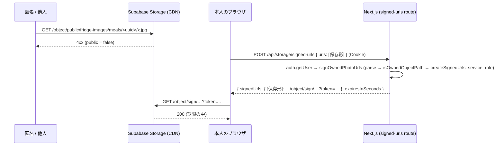

# 食事写真と冷蔵庫写真のバケットを非公開にする (#1365 段 2) 設計

| 版 | 日付 | 内容 |
|---|---|---|
| v1.0 | 2026-10-16 | 新設 (Issue #1365 の設計ゲート・A 型 4 相。段 1 = PR #1681 の署名付き URL の上に、バケットの非公開化を積む) |

要件の正本は Issue #1365 の本文 (コメントは設計と実装の進みの記録の 2 件で、要件を足していない) と、Issue #1538 の本文とコメントの項目 2 (画像の非公開化・`photo_url` / `image_url`)。本書はその上で決めた範囲と設計で、Issue と食い違ったら本書が正。
ファイル名は cross/19 (cross/ の既存は 01〜09・12・13a・14〜18。10・11・13 は欠番)。

前提 (本書が従う条件):

- 段 1 (画面の表示を署名付き URL にする) は PR #1681 で main に入っている。本書はその経路を変えない。
- 本番の DB には書き込まない (本書の事実は 2026-10-16 の読み取りだけ。§3)。
- モバイルは WebView に一本化され (#1598・PR #1733 でネイティブ画面 60 本を削除)、ネイティブのビルドはまだ配布されていない (#1115・#1139)。`apps/mobile` に写真の公開 URL を組み立てる・読むコードは無い (§3.3)。
- ローンチ前。本番の `auth.users` は 195 行 (2026-10-16 の SELECT。§21 Q-1)。
- 範囲外: #1538 の項目 1 (90 日後の完全削除。決定済み) と項目 3 (以前の通報)。新しい要求は発明しない。

---

## 0. 外形固定と分冊判定 (相 1)

### 0.1 発注と決めること

Issue #1365: Supabase Storage の `meal_photos` (食事写真) と `fridge-images` (冷蔵庫の写真) のバケットが公開 (`public = true`) で、URL を知っていればログインしていない人でも見られる。アップロードは本人のフォルダに限定済み (#1243 系) だが、見る側には制限が無い。FAQ の説明とも食い違う。Issue の「直し方 (案)」の 1 (非公開にして署名付き URL で表示) の表示側は段 1 で済み、本書は非公開化そのものを扱う。

本書で決めること (列挙):

1. 公開 URL (`/storage/v1/object/public/...`) を作る・保存する・読む経路の全列挙 (Web の画面と API・Edge Function・メール・モバイル・DB の列・OG 画像・共有の画面) と、経路ごとの非公開化の後の読み方 → §3.3
2. DB に保存済みの公開 URL の扱い (パスだけに直すか・読むときに変換するか) と、採る方の理由 → §5
3. バケットを非公開にする migration (`storage.buckets.public` と `storage.objects` の SELECT のポリシー: 誰がどのファイルを読めるかの表) と戻し方 → §6
4. 署名付き URL の有効期限・キャッシュ (next/image・CDN)・失効の扱い → §7
5. 順序 (段分け): 途中で写真が表示されなくなる時間が無いこと → §8・§15
6. テスト: 非公開化の後に匿名で公開 URL を読むと 4xx・本人は見られる・他人は見られない、を結合テストで確かめる形 → §9.3・§14
7. FAQ の文言 (`src/app/faq/page.tsx`) を事実に合わせる → §9.5

### 0.2 要件行列

| # | 要件 | 出どころ | 本書の節 |
|---|---|---|---|
| R-1 | 本番の `storage.buckets` で `meal_photos` と `fridge-images` が `public = false` になる。`health-checkups` は非公開のまま触らない | #1365 (本文) | §6, §9.1 |
| R-2 | 非公開化のあと、保存済みの公開 URL を未ログインで読むと 4xx | 決めること 6 | §9.3 (B-2), §11.1 |
| R-3 | 本人は自分の写真を今までどおり見られる (今のパス `<user_id>/…`・旧パス `meals/<user_id>/…`・`generated/<user_id>/…`・`generated/<本人の献立の id>/…`) | 段 1 の決まり (`src/lib/photo-storage-signing.ts` のヘッダ) | §4.3 S-3〜S-6, §9.3 (B-4) |
| R-4 | 他人の写真は、公開 URL でも署名の API でも見られない | 決めること 6 | §9.3 (B-3), §11.1 |
| R-5 | 公開 URL を作る・保存する・読む経路を全列挙し、経路ごとに非公開化の後の読み方を決める | 決めること 1 | §3.3 |
| R-6 | DB に保存済みの URL は書き換えない (読むときに変換する)。理由を書く | 決めること 2 | §5 |
| R-7 | 誰が何を読めるかの表 (本人・家族・組織・運営・AI・匿名・service_role の掃除) と、`storage.objects` のポリシーの扱い | 決めること 3 | §6.1 |
| R-8 | 戻し方 (`.down.sql`) がある。戻すと権限が広がることを明記する | 決めること 3・`supabase/rollbacks/20261007073232_storage_owner_folder_policies.down.sql` の前例 | §9.2 |
| R-9 | 有効期限・キャッシュ・失効の扱い (漏れた URL が使える時間の上限を数で書く) | 決めること 4 | §7 |
| R-10 | 段の順序で、写真が表示されなくなる時間を作らない | 決めること 5 | §8, §15 |
| R-11 | 結合テスト (ローカル Supabase) で R-2〜R-4 を確かめ、CI の門 (`security-regression.yml` の `tests/integration/security`) に載る | 決めること 6・`tests/integration-ci-coverage.test.ts` | §9.3, §14 |
| R-12 | migration と `.down.sql`・コードの定数 (`PHOTO_STORAGE_BUCKETS`) の突き合わせを、DB を使わない契約テストで固定する | `tests/purge-hidden-content-migration-contract.test.ts` の前例 | §9.4, §14 |
| R-13 | 既存の結合テストのうち「公開バケットのまま」を前提にするもの (`photo-signed-urls` S-4 のバケットの切り替え・`storage-fridge-images-rls` P-1 / M-3) を、非公開が前提の形に直す | §17 | §9.6, §17 |
| R-14 | FAQ の写真の文言を事実に合わせる (`tests/public-claims-guard.test.ts` の禁止語を使わず、プライバシーポリシーへの案内を残す) | 決めること 7 | §9.5 |
| R-15 | 設計の正典コードに `as any`・マジックナンバーを置かない。`as unknown as` を増やさない (例外は既存の結合テストと同じ定型 `ws as unknown as typeof WebSocket` の 1 か所だけ。§15) | 設計の絶対条件 | §9・§15 |
| R-16 | 本書は新しい環境変数・route・テーブル・列・RLS ポリシーを足さない (足す必要が無いことを示す) | 発明しない | §16 |

### 0.3 ユーザーシナリオ (20 本。トレースは §4.3)

| # | シナリオ |
|---|---|
| S-1 | ログインしていない人が、どこかで知った食事写真の公開 URL (`…/object/public/fridge-images/meals/<uuid>/x.jpg`) をブラウザで開く。4xx で、画像は出ない |
| S-2 | ログイン済みの別の利用者が、同じ公開 URL を開く。4xx。自分の献立の行にその URL を書き込んで (PATCH `image_url`) 画面に出そうとしても、署名の API は null を返し、画像は出ない |
| S-3 | 本人がホーム (`/home`) を開く。献立のサムネイルは `SignedPhotoImage` → `POST /api/storage/signed-urls` → 署名付き URL で表示される。非公開化の前後で見た目は変わらない |
| S-4 | 本人の写真が旧パス (`meals/<user_id>/…`。本番 46 件) にある。署名は service_role で行うので、`storage.objects` の SELECT ポリシーが本人のフォルダ `<user_id>/…` しか許さなくても署名でき、表示される |
| S-5 | 本人の献立のカバーが `generated/<user_id>/<timestamp>.png` (#1260 より前の AI 画像生成の保存先。本番の `planned_meals.image_url` の 12 行はすべてこれ) を指す。パスに本人の user_id があるので署名され、表示される |
| S-6 | 画像生成ジョブ (`process-meal-image-jobs`) が `generated/<planned_meal_id>/<job_id>-<timestamp>.png` に保存し、料理の `image_url` に書く。本人がレシピを開くと、`generated/<本人の献立の id>/` なので署名され、表示される |
| S-7 | 本人が食事の写真を撮って解析する (Edge Function `analyze-meal-photo`)。関数は本人の JWT で `<user_id>/meals/` に upload し (INSERT ポリシーは変えない)、`getPublicUrl` の文字列を `image_url` に保存する。画面はその文字列を署名の API に渡して表示する |
| S-8 | 本人が週の献立の依頼で冷蔵庫の写真を選ぶ。ブラウザが `<user_id>/fridge/` に直接 upload し、`getPublicUrl` の文字列を `POST /api/ai/analyze-fridge` に送る。サーバーは `resolvePhotoUrlForOwnerRead` で署名付き URL にしてから画像を取り、AI に渡す。画面は `SignedPhotoImage` で出す |
| S-9 | 本人が献立の栄養を写真から推定する (`POST /api/ai/nutrition` に `imageUrl`)。サーバーは署名付き URL を LLM に渡す。LLM 側の取得は有効期限 (既定 1 時間) の中で終わる |
| S-10 | 運営 (`admin` / `super_admin` / `content_moderator`) が通報された食事写真を審査画面で見る。`requireRole` のあと `signPhotoUrlsForAuthorizedViewer` が持ち主を確かめずに署名する。非公開バケットでも service_role の署名は通る |
| S-11 | 家族のメンバーが家族の献立 (`family_menu_planned_meals`) を見る。関数も API も `image_url` を返さない (family/10 Q-8) ので、写真の経路は無い。本書は署名の決まりを広げない |
| S-12 | 本人の署名付き URL が (画面の通信を覗かれるなどで) 漏れる。URL は有効期限 (既定 3,600 秒) で使えなくなり、CDN と next/image の最適化のキャッシュを足しても使える時間は期限 + 1 時間を超えない (§7)。即時に止めたければオブジェクトを消す |
| S-13 | 本人が画面を開いたまま 1 時間近く経つ。`useSignedPhotoUrl` が期限の 60 秒前に取り直す (段 1 の既存の動き)。非公開化で変わらない |
| S-14 | 本人が退会する。`removeAccountStorage` が service_role で `<user_id>/`・旧パス・URL が指すオブジェクトを消す。バケットの公開/非公開は delete に関係しない。消したあと公開 URL は (以前の 404 ではなく) 非公開の 4xx |
| S-15 | 運営が隠したコンテンツが 90 日を過ぎ、`purge-hidden-content` が画像を消す。service_role の remove なので非公開化で変わらない |
| S-16 | 本番で問題が出て戻す。`.down.sql` の内容を新しい migration として流すと `public = true` に戻り、公開 URL が誰でも 200 になる (権限が広がる。名指しの承認が要る種類) |
| S-17 | PR の CI (`security-regression.yml`) がローカル Supabase を組み立てる。ベースラインの `INSERT INTO storage.buckets … public = true` のあとに本書の migration が当たり、非公開になる。本書の段ではベースラインを取り直さない (§6.3)。いつか本番の適用の後に誰かがベースラインを取り直すと (`supabase/baseline/README.md` の「取り直し方」)、ベースラインの INSERT が `public = false` になり、本書の migration は台帳の最大以下なのでローカルには当たらない (結果は同じく非公開)。どちらの時期も、新しい結合テストと、直した 2 本の結合テストと、契約テスト (9.4) が緑 |
| S-18 | 攻撃者が自分の行に他人の写真の公開 URL を書き込む。画面: 署名の API が `notOwned` で null (段 1)。AI: `PHOTO_NOT_READABLE` 403 (段 1)。公開 URL を直接開く: 4xx (本書で閉じる最後の穴) |
| S-19 | main にマージされ、Vercel のデプロイと migration の適用が別々の CI で走る。どちらが先でも表示は変わらない (段 1 で画面はすでに署名付き URL だけを使う) |
| S-20 | 本人が食事を登録する画面で写真を選ぶ。選んだ直後のプレビューは `URL.createObjectURL` の blob (ストレージの URL ではない)。`POST /api/upload` が返す `{ url }` (公開形の文字列) は `add-from-photo` に渡して保存するだけで、画面には出さない |

### 0.4 分冊判定

| 目安 | 本設計 | 判定 |
|---|---|---|
| 設計書 800 行超 | 超える (約 1,170 行。正典コードと表が大半) | 当たる |
| 消費先レーン 3 以上 | migration + 戻し / 結合テスト 3 本 / 契約テスト / FAQ・コメント / 文書の追随 の 5 面 | 当たる |
| 共有面 2 つ以上 | `storage.buckets` (1 面)。`storage.objects` のポリシー・共有の定数・台帳・契約は変えない | 当たらない |

**結論: 1 冊で書く (核と配線に分けない)。** 理由: 製品コードの変更は migration の UPDATE 1 文 (+ 戻し) と FAQ の 1 行だけで、関数・型・route・ポリシー・テーブルを足さない。残りはテストと文言の追随で、互いに独立している。実装は 2 本の WF (実装段 A・B。§15) に分け、それぞれで 2 枚レビューを閉じる。B は A のマージと本番の適用の確認 (§20) の後に、別のブランチ・別の PR で起動する (B が書く事実 = 確定した migration の番号と本番の `public = false` は、A の WF が終わった後にしか存在しないため)。

### 0.5 用語

| 語 | 意味 |
|---|---|
| 2 つのバケット | `meal_photos` と `fridge-images` (`PHOTO_STORAGE_BUCKETS`。`packages/shared/src/signed-photo-url.ts:15`) |
| 公開 URL | `https://<host>/storage/v1/object/public/<bucket>/<path>`。公開バケットなら誰でも読める |
| 保存形 | DB の列 (`planned_meals.image_url` など) と JSON の中 (`weekly_menu_requests.result_json` の `imageUrl`。§3.2) に入っている文字列。いまは公開 URL と同じ形。非公開化の後は「オブジェクトを指す識別子」で、そのままでは読めない (§5) |
| 署名付き URL | `…/object/sign/<bucket>/<path>?token=…`。`createSignedUrls` (service_role) が作り、有効期限がある |
| authenticated の経路 | `…/object/authenticated/<bucket>/<path>` に利用者の JWT を付けて読む経路。`storage.objects` の SELECT ポリシーに従う。アプリは使わない |
| 段 1 | PR #1681。画面と AI と運営の読み出しを署名付き URL にした |
| 段 2 | 本書。バケットを非公開にする |
| 実装段 A / 実装段 B | 本書 (段 2) を実装する 2 本の WF (§15。別のブランチ・別の PR)。A = 非公開化 (migration・戻し・テスト・コメント)、B = 利用者向けの文言と運用の文書 (FAQ の 1 行・`docs/operations/` の 2 文書)。B は A のマージと本番の適用の確認 (§20) の後にオーケストレーターが起動する。設計正典 (`docs/design/**`) の追随はどちらの実装段にも入れず、オーケストレーターの docs PR (§18)。「段 1 / 段 2」(#1365 の段) とは別の語で、混ぜない |

---

## 1. 目的・スコープ

- 目的: 2 つのバケットを非公開にし、URL を知っているだけでは写真を読めなくする。本人・運営・AI の読み出しは段 1 の署名付き URL のままで、表示が途切れる時間を作らない。
- 範囲 (本書で作るもの): `storage.buckets.public` を false にする migration と `.down.sql`・その契約テスト (静的)・非公開を前提にした結合テスト 1 本 (新) と既存 2 本の直し・段 1 のコードとテストのコメントの現在形化・FAQ の 1 行・既存文書の追随表。
- 範囲外: `storage.objects` のポリシーの変更 (§6.2 で据え置く理由)・保存済み URL の書き換え (§5)・`file_size_limit` / `allowed_mime_types` の設定 (§21 Q-4)・家族への写真の共有 (family/10 Q-8。本書は広げない)・Edge Function `analyze-fridge` の整理 (§3.3・§21 Q-5)・`health-checkups` バケット (もとから非公開)・#1538 の項目 1・3。

## 2. 関連要件

- Issue #1365 (本文)。Issue #1538 の項目 2。関連 #1243 / #1260 (本人のフォルダへの限定と保存パス)・PR #1681 (段 1)・#1598 / PR #1733 (モバイルの WebView 一本化)・#1175 (退会の掃除)・#1101 / #1538 (隠したコンテンツの完全削除)・#1584 (家族の献立の表示。family/10)。
- `docs/design/CLAUDE.md` §3 (RLS 厳格化: service_role の client は Edge Function と、Next.js では `getSupabaseAdmin()` だけから作り、コードレビューで監視)。`cross/02` (RLS パターン)。`cross/09` §9 (RLS は allow / deny の両方を確かめる)。`docs/operations/rls-drift-20261006.md` P-2 / P-3 (本番の公開バケットの記録)。
- 一次情報 (本書が依拠するもの): Supabase 公式「Storage Buckets」(非公開バケットの読み出しは、利用者の JWT を付けた download (RLS に従う) か、`createSignedUrl` の署名付き URL だけ。公開バケットは取得と配信でアクセス制御をバイパスし、upload / delete / move / copy は制御される)。同「Serving assets from Storage」(署名付き URL は Auth の JWT 鍵と別の専用の鍵で署名され、Auth の鍵の交換で失効しない。個別の失効は Supabase のサポートへの依頼)。同「Smart CDN」(署名付き URL の応答は token ごとに別のキャッシュキー。token の失効や期限切れはキャッシュを消さず、キャッシュの期間 (オブジェクトの `cacheControl`。既定 1 時間) が過ぎるまで同じ URL は配られうる。オブジェクトの削除は全 token のキャッシュを最長 60 秒で無効にする)。Next.js 公式 `images.minimumCacheTTL` (最適化した画像の有効期限は `minimumCacheTTL` と上流の `Cache-Control` の max-age の大きい方)。

---

## 3. 現状の事実 (origin/main 50cd1e37 と本番の読み取り 2026-10-16)

origin/main 81e963d5 (2026-10-16 の突き合わせ) までに入った変更は、本書が引く file:line と識別子に触れていない (新しい migration `20261016243000_auth_history_sessions.sql` と、その結合テスト 1 本だけが関係する数を動かす。§6.3・§15)。

### 3.1 バケット・ポリシー・オブジェクト (本番の SELECT)

| 項目 | 値 |
|---|---|
| `storage.buckets` | `fridge-images` public=true (作成 2025-11-25)、`meal_photos` public=true (2025-11-24)、`health-checkups` public=false (10 MB・jpeg/png/webp/heic)。`fridge-images` / `meal_photos` の `file_size_limit` と `allowed_mime_types` は NULL。`supabase/baseline/prod_storage.sql:5-7` と一致 |
| `storage.objects` の RLS | 有効 (`relrowsecurity = true`)。ポリシーは 5 本で `prod_storage.sql:9-27` と一致: `health-checkups` の本人フォルダ 3 本 (SELECT / INSERT / DELETE)、`fridge_images_insert_own_folder` (INSERT・authenticated・`(storage.foldername(name))[1] = auth.uid()`)、`fridge_images_select_own_folder` (SELECT・同条件)。`meal_photos` のポリシーは無い (= 利用者は upload も list もできない。2026-10-07 の P-3 / P-4 の是正) |
| `fridge-images` のオブジェクト | 340 件。`generated/<既存の利用者の uuid>/…` 225 件 (2025-11-25〜2025-12-30)、`meals/<既存の利用者の uuid>/…` 46 件、`meals/<auth.users にも planned_meals にも無い uuid>/…` 68 件 (2026-04-29〜05-09)、バケット直下 `<timestamp>.jpg` 1 件 (2026-05-04)。`<user_id>/…` の形 (#1260 以後の保存先) はまだ 0 件 |
| `meal_photos` のオブジェクト | 0 件 |

### 3.2 公開 URL を保存している DB の列 (本番の SELECT)

走査の方法 (2026-10-16): `information_schema.columns` から `public` スキーマの BASE TABLE の text / varchar / json / jsonb / 配列の列をすべて取り、列ごとに `count(*) … WHERE <列>::text LIKE '%/storage/v1/%'` を数えた (列名で絞らない全列の走査)。0 でない列は `planned_meals.image_url` (12 行) と `weekly_menu_requests.result_json` (9 行) の 2 つだけで、ほかの列はすべて 0 (下の表の 0 の行を含む)。

| 列 | 非 NULL | 2 つのバケットの公開 URL | 備考 |
|---|---|---|---|
| `planned_meals.image_url` | 12 | 12 (すべて `fridge-images` の `generated/<user_id>/…`) | 12 件ともオブジェクトが実在。他の形の URL は 0 |
| `weekly_menu_requests.result_json` (jsonb) | 49 (全 229 行) | 9 行。JSON の中の `days[].meals[].imageUrl` に 188 か所 (すべて `fridge-images` の公開形 `…/object/public/fridge-images/generated/<その行の user_id>/…`。188 のオブジェクトはすべて実在し、`planned_meals.image_url` の 12 とは重ならない) | 9 行とも `status = completed`・作成 2025-11-25〜2025-11-26 (利用者 1 人)。書く側は origin/main に無い (`src` `apps` `packages` `supabase/functions` の `result_json` の grep は、書き出しのコメント 1 件と生成された型だけ。最後の書き手は `f60a43c0` (2026-01-12 献立生成を generate-menu-v4 に統一) で消えた)。読む側と扱いは §3.3 RD-12 |
| `meals.photo_url` | 0 | 0 | 書く側: `src/lib/handson-tour/sandbox-photo-meal.ts:78` (`saveSandboxPhotoMeal`。`POST /api/meal-plans/add-from-photo` の体験ツアーの経路が呼ぶ)。読む側: `lib/converter.ts:292` (`toMeal`)・運営の審査と、退会の掃除・完全削除 (§3.3 RD-3・RD-5) |
| `recipes.image_url` | 0 | 0 | `POST /api/recipes` は `body.imageUrl` をそのまま入れる (利用者が書ける) |
| `weekly_menu_requests.inventory_image_url` | 0 | 0 | 週の献立の依頼 (S-8) |
| `meal_image_jobs.result_image_url` / `reference_image_urls` | 0 / 0 | 0 / 0 | `reference_image_urls` はコードが常に `[]` を入れる (`supabase/functions/_shared/meal-image.ts:845`) |
| `health_checkups.image_url`・`blood_test_results.report_image_url` | 0 / 0 | – | 別バケット (`health-checkups`) 向け。保存のコードは未実装 (`health/checkups/new/page.tsx:450` の注記) |
| `planned_meals.dishes` (jsonb) に `/storage/v1/` を含む行 | 0 | – | 料理ごとの `image_url` を持つ行はまだ無い |

`fridge_snapshots` (`POST /api/pantry/from-photo` が `image_url` を INSERT する表) は本番に存在しない (SELECT で `relation does not exist`)。本書の範囲外 (§21 Q-6)。

### 3.3 公開 URL を作る・保存する・読む経路の全列挙と、非公開化の後の扱い (要件 R-5)

凡例: 「書く」= 公開形の文字列を作って保存する / 「読む」= 文字列からオブジェクトを読む。扱いの列が本書で決めたこと。経路の番号は W-n (書く) と RD-n (読む・消す・保存だけなど) で、§0.2 の要件の番号 R-n とは別の記号 (本書で要件を指すときは「要件 R-n」と書く)。

| # | 経路 | 場所 (origin/main) | 種類 | 非公開化の後の扱い |
|---|---|---|---|---|
| W-1 | `POST /api/upload` → `fridge-images` の `<user_id>/<folder>/` に upload → `getPublicUrl` の `{ url }` を返す | `src/app/api/upload/route.ts:126-147` | 書く | 変えない。返す文字列は保存形 (§5)。呼び手は `meals/new/page.tsx:1121-1145` だけで、`add-from-photo` に渡して `planned_meals.image_url` に保存する。画面には出さない (S-20) |
| W-2 | `POST /api/ai/image/generate` → `<user_id>/generated/<timestamp>.png` に upload → `{ imageUrl }` | `src/app/api/ai/image/generate/route.ts:136-159` | 書く | 変えない。呼び手 `menus/weekly/page.tsx:4496-4520` は `PATCH /api/meal-plans/meals/[id]` に渡して保存し、モーダルは `SignedPhotoImage` で出す (`ImageGenerateModal.tsx:121`) |
| W-3 | 週の献立の依頼: ブラウザが `<user_id>/fridge/<timestamp>.<ext>` に直接 upload → `getPublicUrl` | `src/app/(main)/menus/weekly/request/page.tsx:60-67` | 書く | 変えない。INSERT ポリシー (本人のフォルダ) はそのまま。表示は `SignedPhotoImage` (`:205`)、解析は RD-2 の経路 |
| W-4 | Edge Function `analyze-meal-photo` (同期・背景): 本人の JWT で `<user_id>/meals/` に upload → `getPublicUrl` → 応答の `imageUrl` / `planned_meals.image_url` と `dishes[].image_url` (`buildPhotoDishList`) | `supabase/functions/analyze-meal-photo/index.ts:95-110, 196-209, 252` | 書く | 変えない (AI への入力は base64 で、URL を読まない) |
| W-5 | Edge Function `process-meal-image-jobs`: service_role で `generated/<planned_meal_id>/<job_id>-<timestamp>.png` に upload → `getPublicUrl` → 料理の `image_url`・カバー・`meal_image_jobs.result_image_url` | `supabase/functions/process-meal-image-jobs/index.ts:276-301, 318-319` | 書く | 変えない。表示は `generated/<本人の献立の id>/` の決まりで署名される (S-6) |
| W-6 | 利用者が書ける列: `PATCH /api/meals/[id]` (`image_url`)・`POST /api/meals`・`POST /api/meal-plans/meals`・`POST /api/recipes` (`imageUrl`)・`consultation-action-executor.ts:785`・`add-from-photo`・`pantry/from-photo` (`fridge_snapshots`) | `src/app/api/meals/[id]/route.ts:153-197` ほか §3.2 | 書く | 変えない。他人の URL を書いても段 1 の持ち主の確認で表示されず、本書で公開 URL も閉じる (S-18) |
| W-7 | `POST /api/ai/nutrition` (`imageUrl` を受けて写真から栄養を推定する): RD-2 で本人の写真であることを確かめ (他人の写真は 403 `PHOTO_NOT_READABLE` で保存しない)、受け取った文字列 (保存形) をそのまま `planned_meals.image_url` (`:200`) と、`buildPhotoDishList` (`:176`) で `dishes[].image_url` に保存する | `src/app/api/ai/nutrition/route.ts:100-128, 176, 195-213` | 書く (呼び手が渡した保存形をそのまま保存する。`getPublicUrl` は呼ばない) | 変えない。保存するのは呼び手が渡した保存形で、署名付き URL ではない (署名付き URL は LLM に渡すだけで保存しない)。表示は RD-1 |
| RD-1 | Web の画面の表示: `SignedPhotoImage` (7 か所: `home/page.tsx:835, 1111`・`meals/[id]/page.tsx:274`・`ImageGenerateModal.tsx:121`・`ManualEditModal.tsx:310`・`RecipeModal.tsx:197`・`menus/weekly/request/page.tsx:205`) → `useSignedPhotoUrl` → `POST /api/storage/signed-urls` → `signOwnedPhotoUrls` (service_role) | `src/components/photo/SignedPhotoImage.tsx`・`src/hooks/useSignedPhotoUrl.ts`・`src/app/api/storage/signed-urls/route.ts:64-80` | 読む | 変えない。`tests/signed-photo-display-scan.test.ts` が素の `<Image>` / `` への直渡しを止めている |
| RD-2 | AI の読み出し: `POST /api/ai/analyze-fridge` (`:58-63`)・`POST /api/ai/nutrition` (`:120-128`) → `resolvePhotoUrlForOwnerRead` → 署名付き URL で `fetchImageAsBase64` / LLM の `image_url` | `src/app/api/ai/analyze-fridge/route.ts`・`src/app/api/ai/nutrition/route.ts` | 読む | 変えない |
| RD-3 | 運営の審査: `fetchModerationList` / `fetchModerationSingle` の `content_url` を `withSignedModerationContentUrls` → `signPhotoUrlsForAuthorizedViewer` (呼び手は `src/app/api/admin/moderation/queue/route.ts:114`・`src/app/api/admin/moderation/[type]/[id]/route.ts:184`・`src/app/api/admin/moderation/route.ts:75-76`)。描画: 一覧 `src/app/admin/moderation/page.tsx:171` と詳細 `src/app/admin/moderation/[type]/[id]/page.tsx:175` が、API の返した `content_url` (署名済み) を素の `` に入れる | `src/lib/admin/moderation-backend.ts:104-130` | 読む | 変えない (service_role の署名は非公開バケットでも通る。B-5 で確かめる)。素の `` の 2 ファイルは `tests/signed-photo-display-scan.test.ts:32-35` の許可表に「API がサーバーで署名してから返す」の理由つきで載っている |
| RD-4 | 家族の献立: `family_menu_planned_meals` は `image_url` を返さない | `supabase/migrations/20261016241000_family_menu_view_functions.sql:13-15, 65`・`src/components/membership/FamilyMenuRows.tsx:8` | 読まない | 変えない (family/10 Q-8 のとおり広げない) |
| RD-5 | 退会の掃除・完全削除: service_role の `remove` | `src/lib/account-deletion-storage.ts:118-135, 309-340`・`supabase/functions/_shared/hidden-content-purge.ts:180-195` | 消す | 変えない (delete はバケットの公開/非公開に関係しない) |
| RD-6 | Edge Function `analyze-fridge` (`imageUrl` をそのまま xAI に渡す) | `supabase/functions/analyze-fridge/index.ts:50-91` | 読む (上流が) | 変えない。リポジトリに呼び手が無い (`functions/v1/analyze-fridge` の grep 0 件。モバイルの経路は #1598 で消えた)。保存形の URL を渡されれば上流の取得が失敗するが、Web は RD-2 を使う。整理は §21 Q-5 |
| RD-7 | モバイル (`apps/mobile`): `getPublicUrl`・`/object/public` の組み立て 0 件。`useHomeData.ts` (型 `TodayMeal`・`BestMeal` と、`fetchTodayMeals`・`fetchBestMealThisWeek` の select) が `planned_meals.image_url` を select するが、描画する `Image` は無い (`tests/signed-photo-display-scan.test.ts` の対象で 0 件) | `apps/mobile/src/hooks/useHomeData.ts` | 読まない | 変えない。写真を出す画面は WebView の Web の画面 (RD-1) |
| RD-8 | メール (`src/lib/emails`)・OG 画像 (調査の時点は `src/app/layout.tsx` の静的 `/og-image.png`。#1845 以降は `src/app/opengraph-image.tsx` が作る固定の PNG で、写真を載せない)・共有の画面 | grep 0 件 | 無し | 無し (写真の URL をメールや OG に載せる経路は無い) |
| RD-9 | 書き出し (`src/lib/account-export-tables.ts:164` ほか) | JSON に保存形の文字列をそのまま出す (`weekly_menu_requests` は列を指定して出し、`result_json` は出さない。RD-12) | 文字列を出す | 変えない。写真のファイルは書き出しに入っていない (段 1 以前から)。文字列は非公開化の後は開けない識別子 (§21 Q-3) |
| RD-10 | `tests/` の結合テスト: `storage-fridge-images-rls` P-1 / M-3 が公開 URL の 200 を期待、`photo-signed-urls` S-4 がテストの中でバケットを切り替え、`afterAll` で `public: true` に戻す | §17 | テスト | 本書で直す (要件 R-13・§9.6) |
| RD-11 | 健康診断の詳細の画面: `checkup.image_url` を素の `` に入れる | `src/app/(main)/health/checkups/[id]/CheckupDetailClient.tsx:453-461` | 読む (別バケット) | 変えない。`health-checkups` バケット (もとから非公開・本書の対象外) 向けで、`health_checkups.image_url` を保存するコードは未実装 (本番の非 NULL 0 行。§3.2)。`tests/signed-photo-display-scan.test.ts:36-37` の許可表に「#1365 の 2 つのバケットの対象外」の理由つきで載っている |
| RD-12 | `weekly_menu_requests.result_json` の `days[].meals[].imageUrl` (本番 9 行・188 か所。§3.2)。書く側は無い (最後の書き手は `f60a43c0` で消えた)。読む側: `lib/converter.ts:319` の `toWeeklyMenuRequest` は `resultJson` に写すが呼び手が 0 件。`apps/mobile/src/lib/realtime.ts:33` は `select('*')` だが `subscribeWeeklyMenuRequest` の呼び手が 0 件。Realtime の購読 (`src/app/(main)/menus/weekly/page.tsx:2364, 4058`・`src/hooks/useV4MenuGeneration.ts:102`・`apps/mobile/src/hooks/useV4MenuGeneration.ts:129`) の `payload.new` は行全体を含むが、`result_json` を読むコードは無い (`src` `apps` `packages` `supabase/functions` の `result_json` / `resultJson` の grep は、書き出しのコメント 1 件と生成された型だけ)。書き出しは列を指定して `result_json` を外す (`src/lib/account-export-tables.ts:158-167`。`tests/account-export.test.ts:367, 371`・`tests/integration/security/account-export-scope.test.ts:547` が出ないことを見る) | `lib/converter.ts:313-319`・`src/lib/account-export-tables.ts:158-167` | 保存だけ (読む経路が無い) | 変えない (§5 のとおり書き換えない)。非公開化の後、JSON の中の文字列は開けない識別子になるが、画面にも AI にも書き出しにも出ないので、表示は何も変わらない。オブジェクトは `generated/<その行の user_id>/…` にあり、退会の掃除は `LEGACY_FOLDER_PARENTS` (`src/lib/account-deletion-storage.ts:42`) の `generated/<user_id>/` で消す (RD-5。変えない) |
| RD-13 | 運営の審査で隠すとき、ペーストの複製 (`paste_group_id`) を同じ中身かで決める: `hideModeratedContent` が `meals.photo_url` を select し、`isSameMealContent` で文字列どうしを比べる | `src/lib/admin/moderation-backend.ts:300-305, 344-361` | 文字列を比べる (オブジェクトを読まない) | 変えない。保存形の文字列は書き換えない (§5) ので、比べた結果は非公開化の前後で同じ |
| RD-14 | 退会の掃除の対象集め: `collectReferencedUrls` が `meals.photo_url` (と `planned_meals.image_url` ほかの列) を service_role で select し、保存形を `parseStorageObjectUrl` で解釈して消す対象を決める | `src/lib/account-deletion-storage.ts:213-300` (`meals.photo_url` は `:223-227`)・`:353-370` (解釈) | 文字列を解釈する (消す対象を決める。オブジェクトは RD-5 の `remove` で消す) | 変えない。保存形の解釈はバケットの公開/非公開に関係しない |
| RD-15 | Web のホームのデータ: `useHomeData` が `planned_meals` を利用者の JWT で select し (`:249-262` の今日の献立 `planned_meals(*)`・`:571-585` の今週のベスト料理 `.not('image_url', 'is', null)`)、`toPlannedMeal` で `imageUrl` に写して `home/page.tsx:835` (今日の献立) と `:1111` (今週のベスト料理) の `SignedPhotoImage` に渡す | `src/hooks/useHomeData.ts:249-262, 571-585` | 文字列を取り出す (オブジェクトを読まない。描画は RD-1) | 変えない。`apps/mobile` の同名の hook (RD-7) とは別のファイル |

経路の閉包: DB の列は §3.2 の全列の走査で閉じる (公開 URL を持つ列は `planned_meals.image_url` と `weekly_menu_requests.result_json` の 2 つだけ。前者と §3.2 の 0 件の列の経路は W-1〜W-7・RD-1〜RD-11・RD-13〜RD-15、後者は RD-12)。列ごとの読み手は列名の grep で閉じる: `meals.photo_url` は `photo_url` の grep (`src` `lib` `apps` `packages` `supabase/functions`。テストと生成された型を除く) で `lib/converter.ts:292` (`toMeal`)・`src/lib/admin/moderation-backend.ts` (RD-3 の `:70-75, 149, 195`・RD-13 の `:300-305, 346, 355`)・`src/lib/account-deletion-storage.ts:223-227` (RD-14)・`supabase/functions/_shared/hidden-content-purge.ts:67` (RD-5) の 4 ファイルだけ (書く側の `sandbox-photo-meal.ts` は §3.2)。`getPublicUrl` の呼び出しは W-1〜W-5 の 5 ファイル 6 か所だけ (`src` `apps` `packages` `supabase/functions` の grep)。`/storage/v1/` の文字列の組み立ては `packages/shared/src/signed-photo-url.ts` と `supabase/functions/_shared/storage-object-url.ts` の解釈 (読む側) だけ。`createSignedUrl(s)` は `src/lib/photo-storage-signing.ts:127` だけ。`storage.from(...)` の残りは `remove` (RD-5・`health/checkups/[id]/route.ts:160`・`process-meal-image-jobs/index.ts:464`) で、読み出しではない。DB の写真の列を素の `` / `<Image>` の `src` に入れる画面は `tests/signed-photo-display-scan.test.ts` の許可表の 3 ファイル (RD-3 の 2 つ・RD-11) だけで、ほかは `SignedPhotoImage` (RD-1)。`planned_meals.image_url` を select して画面に渡す読み手 (Web の `src/hooks/useHomeData.ts` (RD-15) ほか) は、取り出す場所がどこでも描画が RD-1 か許可表の 3 ファイルに行き着くので、描画の側 (`tests/signed-photo-display-scan.test.ts`) で閉じる。モバイルの同名の hook (RD-7) は描画が無い。

---

## 4. 構想 (相 2) と構造裁定 (相 3)

### 4.1 構造

```
                      storage.buckets                      storage.objects (RLS)                     読む側
                      ┌────────────────────────┐            ┌──────────────────────────────┐
  本書の migration ──▶│ meal_photos   public=false │            │ fridge_images_insert_own_folder │◀── W-3 / W-4 (本人の JWT で upload)
  (UPDATE 1 文)       │ fridge-images public=false │            │ fridge_images_select_own_folder │    (変えない)
                      │ health-checkups (触らない) │            │ (meal_photos のポリシーは無い)   │
                      └────────────────────────┘            └──────────────────────────────┘
                                 │
                                 ▼
  公開 URL …/object/public/<bucket>/<path>  ──────▶ 4xx (誰が開いても)                       ← 本書で閉じる穴
  署名付き URL …/object/sign/…?token=…      ──────▶ 200 (期限の中)   ← service_role の createSignedUrls
                                                                         ▲
                 段 1 (変えない): 画面 SignedPhotoImage → POST /api/storage/signed-urls → signOwnedPhotoUrls (本人の写真だけ)
                                 AI の route → resolvePhotoUrlForOwnerRead / 運営 → signPhotoUrlsForAuthorizedViewer
  DB の列 (planned_meals.image_url など) ── 保存形 = 公開 URL と同じ文字列のまま (識別子。読むときに parsePhotoObjectUrl で bucket/path に戻す)
```

- 変えるのは `storage.buckets.public` だけ。`storage.objects` のポリシー・保存形・書く側・読む側 (段 1) はすべてそのまま。
- 保存形は公開 URL と同じ文字列のまま残す (§5)。読む側は段 1 ですでに「文字列 → bucket/path → 署名」に切り替わっており、非公開化はその経路に影響しない。
- 署名は service_role で行うので、旧パス (`meals/<user_id>/`・`generated/<user_id>/`・`generated/<planned_meal_id>/`) を RLS の SELECT ポリシーに足す必要が無い。
- 残る露出は「署名付き URL が漏れたときに使える時間」で、上限は有効期限 + キャッシュの 1 時間 (§7)。
- 戻し方は `public = true` に戻す 1 文 (§9.2)。

### 4.2 代替案の比較と裁定 (1 回だけ)

| 案 | 中身 | 退ける理由 / 採る理由 |
|---|---|---|
| A. `public = false` にするだけ。ポリシー・保存形・読む側は据え置き (本書) | migration は UPDATE 1 文。読み出しは段 1 の署名付き URL のまま | **採る。** 縁の発生源 (保存形の書き換え・ポリシーの追加・画面の変更) を作らない。非公開化で閉じる穴は「公開 URL を誰でも読める」の 1 点で、それは `public` の値だけで決まる |
| B. A + 保存済みの URL をパス (`<bucket>/<path>`) に書き換え、書く側もパスだけを保存する | 「公開 URL の文字列が DB に残る」ことを無くす | 退ける。本番の行の書き換え (`planned_meals.image_url` 12 行と `weekly_menu_requests.result_json` 9 行の JSON の中の 188 か所。§3.2) は名指し承認が要る種類で、書く側 5 か所・読む側 (段 1 の解釈・退会の掃除・完全削除の needle・運営の審査・家族の表示のテスト) を全部変える。非公開化の後は文字列を知っていても読めないので、安全上の差は無い (§5) |
| C. A + 署名を service_role から利用者の JWT の `authenticated` の経路に替え、RLS の SELECT ポリシーを旧パスと `generated/<献立>/` に広げる | service_role を使わない | 退ける。`generated/<planned_meal_id>/` の持ち主の判定は `planned_meals` → `user_daily_meals.user_id` の結合を `storage.objects` のポリシーに書くことになり、運営の審査 (持ち主でない) は結局 service_role が要る。CDN は利用者ごとにキャッシュが外れる。段 1 が済んでいる経路を捨てる理由が無い |
| D. 旧パスのオブジェクト 340 件を `<user_id>/…` に移してから、ポリシーだけで読む | 旧パスの特例を無くす | 退ける。オブジェクトの移動と、それを指す URL (`planned_meals.image_url` 12 行・`result_json` の 188 か所) の書き換えは本番のデータの変更 (承認が要る) で、移動中は表示が途切れうる。段 1 の署名が旧パスを扱えるので、移す必要が無い |
| E. 非公開にせず、URL の推測しにくさに頼る | 何もしない | 退ける。Issue の要求 (URL を知っていれば誰でも見られる) を満たさない |

「縁の発生源を消すより単純な構造は無いか」への答え: A より単純な構造は無い (UPDATE 1 文)。A で確定し、以後は構造を蒸し返さない (仕上げ中の構造疑義は裁定への差し戻し事由として扱う)。

### 4.3 シナリオのトレース (構造 A で手で走らせた記録)

| # | 走らせた経路 | 結果 |
|---|---|---|
| S-1 | 匿名 → `GET …/object/public/fridge-images/meals/<uuid>/x.jpg` → Storage API は `public = false` のバケットの公開の経路を拒む | 4xx。B-2 |
| S-2 | 他人 (JWT あり) → 同じ公開 URL → 公開の経路は認証を見ないので同じく拒む / 自分の行に書いて画面 → `signOwnedPhotoUrls` → `isOwnedObjectPath` が先頭の他人の uuid で false → `notOwned` → null → `SignedPhotoImage` は fallback | 4xx・null。B-3 |
| S-3 | 本人 → `/home` → `SignedPhotoImage(src=保存形)` → `useSignedPhotoUrl` → `POST /api/storage/signed-urls` → `parsePhotoObjectUrl` → `isOwnedObjectPath` (`<user_id>/`) → `createSignedUrls` → 署名付き URL → `next/image` | 200。非公開化の前後で同じ。B-4 |
| S-4 | 本人 → 旧パス `meals/<user_id>/…` → `isOwnedObjectPath` (区間に本人の user_id) → service_role の署名 (RLS を通らない) | 200。B-4 の legacy |
| S-5 | 本人 → `generated/<user_id>/<ts>.png` → 区間に本人の user_id → 署名 | 200 (本番の 12 行) |
| S-6 | ジョブ → `generated/<planned_meal_id>/…` → 本人がレシピを開く → `ownedPlannedMealIdsAmong` が `user_daily_meals.user_id = 本人` の献立 id を返す → 署名 | 200。B-4 の generated |
| S-7 | 本人の JWT で `<user_id>/meals/` に upload → `fridge_images_insert_own_folder` (変えない) で通る → `getPublicUrl` の文字列を保存 → 表示は S-3 | 保存・表示とも変わらない |
| S-8 | ブラウザ upload (INSERT ポリシー) → 文字列を `analyze-fridge` へ → `resolvePhotoUrlForOwnerRead` → 署名付き URL → `fetchImageAsBase64` (サーバーが取る) → AI | 変わらない |
| S-9 | `nutrition` → 署名付き URL を LLM に渡す → LLM が期限の中で取る | 変わらない。期限は §7 |
| S-10 | `requireRole` → `withSignedModerationContentUrls` → `signPhotoUrlsForAuthorizedViewer` → service_role の署名 | 200。B-5 |
| S-11 | `family_menu_planned_meals` の要素に `image_url` の鍵が無い → 画面は画像を描かない | 写真の経路は無い。変わらない |
| S-12 | 漏れた署名付き URL → 期限まで 200 → 期限後は Storage が拒む。ただし CDN (同じ token) と `/_next/image` のキャッシュは最長 1 時間残る | 期限 + 1 時間が上限 (§7)。即時の遮断はオブジェクトの削除 |
| S-13 | `createSignedPhotoUrlResolver` の `usableUntil = now + ttl − 60 秒` → `useSignedPhotoUrl` が `refreshAt` で取り直す | 変わらない |
| S-14 | `removeAccountStorage` → service_role の `list` / `remove` (RLS を通らない・公開/非公開に無関係) → 消える → 公開 URL は 4xx | 変わらない (以前の「消えた後は 404」が 4xx の一般形になるだけ) |
| S-15 | `purge-hidden-content` → `objectNeedles` (`/<bucket>/<path>` の部分一致。公開形・署名形のどちらにも含まれる) → service_role の `remove` | 変わらない |
| S-16 | `.down.sql` の内容を新しい migration で流す → `public = true` → 公開 URL 200 | 戻る (権限が広がる。§9.2 の警告) |
| S-17 | 取り直しの前 (本書の段の間はずっとこの状態。§6.3): `supabase-local.sh start` → ベースライン (`public = true` の INSERT) → `ledger_max_version` より新しい migration (本書) → `public = false`。いつか取り直した後: ベースライン (`public = false` の INSERT。`manifest.json` の `ledger_max_version` は本書の版以上) → 本書の migration は当たらない → `public = false`。どちらも `security-regression.yml` の `tests/integration/security` で B-1〜B-8・直した P-1 / M-3・S-4 | 緑。結合テストはパスの文字列で選ばれる (`tests/integration/security/` 配下)。契約テスト 9.4 の 1. の 2 本目は「版 > `ledger_max_version`」または「ベースラインで 2 つとも `public = false`」の論理和なので、取り直しの前は前者・後は後者で緑 |
| S-18 | 他人の URL を自分の行に書く → 画面 null (段 1) / AI 403 (段 1) / 公開 URL 4xx (本書) | 3 つの経路すべて閉じる |
| S-19 | Vercel が先: 画面は段 1 のまま (署名付き URL)。migration が先: 画面は段 1 のまま。どちらも公開 URL は画面が使っていない | 表示は途切れない (§8) |
| S-20 | `photoPreviews` は `URL.createObjectURL(file)` (`meals/new/page.tsx:452`)。`POST /api/upload` の `{ url }` は `add-from-photo` の body に入るだけ | 画面に公開 URL を出す経路は無い |

---

## 5. 保存済みの URL の扱い (要件 R-6)

**採る: 読むときに変換する (保存済みの文字列は書き換えない。書く側も今の文字列のまま)。**

| 観点 | 読むときに変換 (採る) | パスだけに直す (採らない) |
|---|---|---|
| 本番のデータの変更 | 無し | `planned_meals.image_url` 12 行と `weekly_menu_requests.result_json` 9 行 (JSON の中の `days[].meals[].imageUrl` 188 か所) の UPDATE (名指し承認が要る種類) + 以後の行の形の変更 |
| コードの変更 | 無し (段 1 で `parsePhotoObjectUrl` が公開形・署名形・authenticated 形・`render/image` 形を受ける) | 書く側 5 か所 (W-1〜W-5。Edge Function 2 本のデプロイを含む)・読む側の解釈・退会の掃除 (`parseStorageObjectUrl`)・完全削除の needle (`strpos(url, '/<bucket>/<path>')`)・運営の審査・テストのフィクスチャ (`family-menu-visibility`・`account-deletion`・`purge-hidden-content`・単体 10 本余り) |
| 安全上の差 | 無し。非公開化の後は、文字列を知っていても署名が無ければ読めない | 無し |
| 混在の扱い | 無し (形は 1 つ。列の文字列も `result_json` の JSON の中の文字列も、同じ公開形 `…/object/public/<bucket>/<path>`。§3.2 の全列の走査で、ほかの形の保存は 0) | 新旧の形が混在する期間ができる |

保存形の意味を「公開 URL」から「オブジェクトを指す識別子」に改める。`getPublicUrl` は通信をせずに文字列を組み立てるだけなので、書く側はそのまま使う (名前が実態と違うことはコメントで補う。§9.7)。

`weekly_menu_requests.result_json` の 188 か所も同じく書き換えない。この JSON には書く側も読む側も無く (§3.3 RD-12)、変換する読み手も要らない。非公開化の後は開けない識別子として残るだけで、表示・AI・書き出しのどれにも出ない。

---

## 6. 誰が何を読めるか (要件 R-7) と migration

### 6.1 アクセス表 (設計後)

| 要求者 | 経路 | `fridge-images` | `meal_photos` | 根拠 |
|---|---|---|---|---|
| 匿名 | 公開 URL | 4xx | 4xx | `public = false` (本書) |
| 匿名 | `authenticated` の経路 / `list` | 4xx / 0 件 | 4xx / 0 件 | JWT が無い |
| 匿名 | `POST /api/storage/signed-urls` | 401 (署名しない) | 401 (署名しない) | 段 1 の `auth.getUser` (変えない) |
| 他人 (ログイン) | 公開 URL | 4xx | 4xx | `public = false` |
| 他人 (ログイン) | `authenticated` の経路 / `list` | 本人のフォルダ以外は 4xx / 0 件 | 4xx / 0 件 | `fridge_images_select_own_folder` (変えない)・`meal_photos` にポリシー無し |
| 他人 (ログイン) | `POST /api/storage/signed-urls` | null (`notOwned`) | null | 段 1 の持ち主の確認 |
| 本人 | 公開 URL (JWT を付けても) | 4xx | 4xx | `public = false`。公開の経路は認証を見ない (B-4 で確かめる)。画面は使わない (RD-1) |
| 本人 | `POST /api/storage/signed-urls` → 署名付き URL | 200 (今のパス・旧パス・`generated/<user_id>/`・`generated/<本人の献立>/`) | 200 (`<user_id>/…`) | service_role の署名 (RLS を通らない) |
| 本人 | `authenticated` の経路 (JWT) | `<user_id>/…` は 200、旧パスは 4xx | 4xx | ポリシーは本人のフォルダだけ。アプリは使わない (B-6 で記録) |
| 本人 | upload (JWT) | `<user_id>/…` だけ可 | 不可 | INSERT ポリシー (変えない) |
| 家族 | 家族の献立 | 経路が無い | 経路が無い | family/10 Q-8 |
| 組織 | – | 経路が無い | 経路が無い | 組織の画面に写真は無い |
| 運営 (ログイン済み。admin / super_admin / content_moderator) | 公開 URL (運営の JWT を付けても) | 4xx | 4xx | `public = false`。公開の経路は JWT も役割も見ないので、他人・本人の公開 URL の行と同じ。運営の画面は公開 URL を使わず、審査 API の署名付き URL を使う (§3.3 RD-3) |
| 運営 (admin / super_admin / content_moderator) | 審査 API → 署名付き URL | 200 | 200 | `requireRole` + `signPhotoUrlsForAuthorizedViewer` |
| AI (サーバーが代理) | `resolvePhotoUrlForOwnerRead` → 署名付き URL | 本人の写真だけ 200 | 同左 | 段 1 |
| 上流 (xAI。Edge Function `analyze-fridge` が受け取った URL をそのまま渡す) | 保存形の URL を上流が直接 GET | 4xx (上流の取得が失敗する) | 4xx | `public = false`。リポジトリに呼び手が無い (§3.3 RD-6)。整理は §21 Q-5 |
| service_role (退会の掃除・完全削除・画像生成ジョブ) | `list` / `remove` / `upload` | 可 | 可 | RLS を通らない。公開/非公開に無関係 |

### 6.2 `storage.objects` のポリシーは変えない

- 読み出しは署名付き URL (service_role) に一本化されているので、SELECT ポリシーを広げる必要が無い。広げると (旧パスや `generated/<献立>/` を `authenticated` の経路で読めるようにすると) 利用者の JWT で読める面が増え、本書の目的 (読める面を減らす) と逆になる。
- `fridge_images_select_own_folder` は `list` (本人のフォルダの一覧) に残す。消すと `supabase-js` の `upload` の前後で使う `list` が 0 件になるだけで安全上の利点が無く、`storage-fridge-images-rls` L-1 が赤になる。
- `meal_photos` にポリシーを足さない (利用者は upload も list もしない。オブジェクト 0 件)。

### 6.3 migration

- ファイル: `supabase/migrations/<番号はマージ時に確定>_private_photo_buckets.sql` (番号はマージ直前に origin/main の `supabase/migrations` の最大 (2026-10-16 の origin/main 81e963d5 時点 `20261016243000`) より大きい番号で確定する。`supabase/baseline/manifest.json` の `ledger_max_version` = `20261007112200` より大きければローカルにも当たる)。
- ベースラインは取り直さない (どの実装段にも入れない)。理由: (1) 取り直さなくてもローカル / CI は非公開になる (本書の版は `ledger_max_version` より新しいので、ベースラインの後に本書の migration が積まれる。`supabase/baseline/README.md:42`「ベースライン取得後に本番へ反映された migration は、ベースラインを取り直すまではローカルで「新しい migration」として上に積まれる（結果は同じ）」。10-07 の取得の後の migration (`20261016243000` まで) もすべてこの状態で積まれている) (2) 取り直しはリポジトリへ自動では書き戻らない: `refresh-request.txt` を変えた PR で `prod-schema-snapshot.yml` が走っても、出力は artifact (1 日保持) で、「リポジトリへは書き戻さない。artifact (1 日保持) から人が取り出し、内容を確認してから commit する」(`.github/workflows/prod-schema-snapshot.yml:16`)。人が `build_baseline.py` で生成し、差分 (10-07 以後のスキーマ全体) を目視してから commit する (`supabase/baseline/README.md:44-57`) 作業で、本書の範囲を超える (3) `verify` (`scripts/supabase-local.sh:457-479`) はベースラインだけの DB を、同じスナップショットのカタログ (`supabase/baseline/catalog`) と比べるので、本番の適用の前後で本書による差は出ない。
- いつか誰かが本番の適用の後に取り直したとき (本書の段の外): `prod-schema-snapshot.yml` は `ledger_max_version` を本番の台帳の最大で書く (`.github/workflows/prod-schema-snapshot.yml:135`) ので本書の版以上になり、本書の migration はローカル / CI には当たらなくなる (`scripts/supabase-local.sh:259` は版が `ledger_max_version` より大きい migration だけを足す)。代わりにベースライン (`prod_storage.sql`) の INSERT が `public = false` になるので、ローカルのバケットは同じく非公開。契約テスト (9.4) の 1. の 2 本目はこの 2 つの時期の両方で緑になる形 (論理和) にしてある。ベースラインの INSERT の形は `scripts/baseline/build_baseline.py:84-85` が `INSERT INTO storage.buckets (id, name, public, file_size_limit, allowed_mime_types) VALUES ('<id>', '<name>', true|false, …)` で書く (取り直しで形は変わらない)。
- 内容: `storage.buckets` の `meal_photos` と `fridge-images` を `public = false` にする UPDATE 1 文 (DO ブロックで、2 件とも非公開になったことを確かめ、足りなければ例外で止める)。`storage.objects` には触れない。`health-checkups` には触れない。
- 冪等: 何度流しても同じ結果 (UPDATE は同じ値を書くだけ)。
- 戻し: `supabase/rollbacks/<同じ番号>_private_photo_buckets.down.sql` (`public = true` に戻す。権限が広がる警告つき)。
- 本番への適用: CI (`main` への push で走る `.github/workflows/deploy-supabase-migrations.yml` の `db push --linked`)。マージ (WF の外でオーケストレーターが行う) の後にしか走らない。本番への直接 SQL は禁止。適用の後の確認は §20 で、実装段 B はその確認の後に起動する (§15)。
- `db:types`: `public` スキーマのテーブル・関数を作らないので型の生成物は変わらない (`tests/database-types-migrations-contract.test.ts` は `CREATE TABLE` / `CREATE FUNCTION` だけを見る)。

---

## 7. 有効期限・キャッシュ・失効 (要件 R-9)

| 項目 | 設計 | 根拠 |
|---|---|---|
| 有効期限 | 変えない。既定 3,600 秒 (`PHOTO_SIGNED_URL_DEFAULT_TTL_SECONDS`)。`PHOTO_SIGNED_URL_TTL_SECONDS` で 60〜86,400 秒 | 段 1 (`src/lib/photo-storage-signing.ts:29-34`・`src/lib/env.ts:363`)。1 画面を開いている間に切れにくく、漏れても 1 時間 |
| 画面の取り直し | 変えない。期限の 60 秒前 (`SIGNED_PHOTO_URL_REFRESH_MARGIN_MS`) に取り直す | `packages/shared/src/signed-photo-url.ts:34` |
| ブラウザのキャッシュ | 署名付き URL ごとに別の URL (token) なので、取り直しのたびに新しい URL になる。応答の `Cache-Control` はオブジェクトの `cacheControl` (upload 時の既定 3,600 秒) | Supabase「Smart CDN」 |
| Supabase の CDN | 署名付き URL の応答は token ごとにキャッシュされ、期限切れはキャッシュを消さない。同じ URL は最長 1 時間 (オブジェクトの `cacheControl`) 配られうる | 同上 |
| `next/image` の最適化 (`/_next/image?url=<署名付き URL>&w=…`) と Vercel の CDN | 最適化した画像は `max(minimumCacheTTL = 60 秒, 上流の max-age = 3,600 秒)` = 最長 1 時間使い回される。キーは署名付き URL を含むので、その URL を知っている人にしか当たらない | Next.js 公式 `images.minimumCacheTTL`・`next.config.mjs:93` (`IMAGE_OPTIMIZER_MINIMUM_CACHE_TTL_SEC`) |
| **漏れた署名付き URL が使える時間の上限** | **有効期限 + 1 時間** (既定で最長 2 時間)。上限を下げたいときは `PHOTO_SIGNED_URL_TTL_SECONDS` を下げる (下限 60 秒)。キャッシュの 1 時間は upload の `cacheControl` で決まり、既存のオブジェクトは変えられない | 上の 2 行の和 |
| 個別の失効 | 署名付き URL を個別に失効させる手段は無い (Auth の鍵の交換でも失効しない。Supabase の案内はサポートへの依頼)。即時に止めるにはオブジェクトを消す (削除は全 token のキャッシュを最長 60 秒で無効にする) | Supabase「Serving assets」「Smart CDN」 |
| 非公開化の直後の公開 URL | 公開バケットのときに CDN に乗った応答は、`public = false` にしても消えず、キャッシュの期間 (最長 1 時間) は同じ公開 URL が配られうる (直前 1 時間に誰かが取った URL だけ)。1 回きり・最長 1 時間の残りで、受け入れる (零にするにはオブジェクトの移動が要り、D 案と同じ理由で採らない) | Supabase「Smart CDN」(オブジェクトの変更・削除だけがキャッシュを無効にする) |
| `unoptimized` (最適化を通さない) | 採らない。利用者の写真 (スマートフォンの原寸) をそのまま配ると転送量が増え、上限が 1 時間縮むだけ | 判断 |

---

## 8. 順序 (要件 R-10)

| 順 | 何を | なぜ表示が途切れないか |
|---|---|---|
| 済 | 段 1 (PR #1681): 画面・AI・運営の読み出しを署名付き URL にした | 公開 URL を読む経路がアプリに残っていない (§3.3 の閉包) |
| 実装段 A (本書。実装 WF ①・PR ①) | migration + 戻し + 契約テスト + 結合テスト (新 1・直し 2) + コメントの現在形化 を 1 つの PR で | ローカル CI は migration を当ててからテストを流すので、直した結合テストと新しい結合テストは同じ PR で緑になる。本番では、マージ後の migration の適用で公開 URL が 4xx になるが、画面はそれを使っていない (S-19) |
| マージと適用 (オーケストレーター) | 番号を確定して PR ① をマージ → `deploy-supabase-migrations.yml` が本番に適用 (§6.3) | 同上 |
| 適用の確認 (オーケストレーター) | 本番の `storage.buckets` を SELECT し、公開 URL が 4xx・本人の画面に写真が出ることを確かめる (§20 の「適用の直後」の行) | – |
| 実装段 B (本書。実装 WF ②・PR ②) | 適用の確認がすべて期待どおりになった後に、オーケストレーターが起動する。FAQ の 1 行 (9.5) + `docs/operations/` の 2 文書 (§18。`rls-drift` の注記にはオーケストレーターが仕様で渡す確定した番号を書く) | 文言は本番の事実 (`public = false`) を確かめてから出す。適用が止まった (例外・CI の赤) ときは起動しない (§11.3) |
| 設計正典の追随 (オーケストレーター) | `docs/design/operator/02-api-spec.md`・`docs/design/family/10-family-menu-view.md` の 2 件 + 任意の 3 ファイル (`docs/design/00-architecture.md`・`docs/design/mobile/04-storage-camera.md`・`docs/design/mobile/CLAUDE.md`) と、`docs/design/family/10-family-menu-view.md` の任意の 2 か所 (`:89`・`:90`) (§18) を docs PR で。適用の確認の後 (`docs/design/cross/CLAUDE.md` の 1 行は別で、本冊の設計 PR と同日) | 文書だけ (表示に関係しない) |

ベースラインの取り直しはどの段にも入れない (§6.3)。

実装段 A を 1 つの PR にする理由: migration だけを先に出すと、既存の結合テスト (`storage-fridge-images-rls` P-1 / M-3・`photo-signed-urls` S-4 の `afterAll`) が CI で赤になる。テストだけを先に出すと、公開バケットのローカル CI で赤になる。両方が同じ PR に無いと CI が通らない。

実装段 B を A と別の WF にする理由: B が書く 2 つの事実 (確定した migration の番号と、本番の `public = false`) は、A の WF が返った後のマージ (WF の外) と CI の適用の後にしか存在しない。同じ WF の中に置くと、B の実装者はその事実を得られずに止まる。FAQ を A の PR に入れない理由も同じ (適用が例外で止まったとき、FAQ だけが「公開されない」と言い続けることになる)。

---

## 9. 正典コード

### 9.1 `supabase/migrations/<番号はマージ時に確定>_private_photo_buckets.sql`

```sql
-- migration: <番号はマージ時に確定>_private_photo_buckets.sql
-- #1365 段 2: 食事写真・冷蔵庫写真のバケット (meal_photos / fridge-images) を非公開にする。
--
-- 背景: 2 つのバケットは公開 (public = true) で、保存されたオブジェクトは URL を知っていれば誰でも読めた
--   (supabase/baseline/prod_storage.sql:5,7)。段 1 (PR #1681) で、画面 (SignedPhotoImage → POST /api/storage/signed-urls)・
--   AI の読み出し (resolvePhotoUrlForOwnerRead)・運営の審査 (signPhotoUrlsForAuthorizedViewer) は、保存された URL を
--   そのまま使わず、service_role が本人の写真だけに署名した URL (createSignedUrls) を使うようになった。
--   アプリに公開 URL を読む経路は残っていないので、非公開にしても表示は途切れない (設計書 docs/design/cross/19-private-photo-buckets.md §3.3・§8)。
--
-- 内容: storage.buckets の 2 行を public = false にする (1 文)。storage.objects のポリシーは変えない
--   (fridge_images_insert_own_folder / fridge_images_select_own_folder は本人のフォルダだけのまま。meal_photos にポリシーは無い)。
--   health-checkups (もとから非公開) には触れない。DB の列に保存された URL の文字列は書き換えない (読むときに bucket/path に戻す)。
--
-- 本番のデータへの影響: 行には触れない。適用の直後から、保存された公開 URL (…/storage/v1/object/public/<bucket>/<path>) は
--   誰が開いても 4xx になる。本人の表示・AI・運営の審査は署名付き URL のまま変わらない。
--   公開バケットのときに CDN に乗った応答は、最長 1 時間 (オブジェクトの cacheControl) 残ることがある (設計書 §7)。
--
-- 冪等: UPDATE は同じ値を書くだけなので、何度流しても同じ結果になる。
-- 確認: tests/integration/security/photo-buckets-private.test.ts (匿名の公開 URL は 4xx・本人は署名付き URL で 200・他人は null)、
--   tests/private-photo-buckets-migration-contract.test.ts (この migration と PHOTO_STORAGE_BUCKETS・戻しの突き合わせ)。
-- ロールバック: supabase/rollbacks/<同じ番号>_private_photo_buckets.down.sql (public = true に戻す。権限が広がる)。
-- マージ順: migration は version の順にマージすること。

DO $$
DECLARE
  -- 非公開にするバケット。packages/shared/src/signed-photo-url.ts の PHOTO_STORAGE_BUCKETS と同じ 2 つ
  -- (tests/private-photo-buckets-migration-contract.test.ts が突き合わせる)
  c_buckets CONSTANT text[] := ARRAY['meal_photos', 'fridge-images'];
BEGIN
  UPDATE storage.buckets
  SET public = false
  WHERE id = ANY (c_buckets);

  -- 2 つとも非公開になったことを確かめる (バケットが無い環境で黙って何もしないままにしない)
  IF (SELECT count(*) FROM storage.buckets WHERE id = ANY (c_buckets) AND public = false) <> array_length(c_buckets, 1) THEN
    RAISE EXCEPTION 'private_photo_buckets: expected every photo bucket (%) to exist and be private', array_to_string(c_buckets, ', ');
  END IF;
END
$$;
```

### 9.2 `supabase/rollbacks/<同じ番号>_private_photo_buckets.down.sql`

```sql
-- rollback: <同じ番号>_private_photo_buckets.sql
-- ⚠️ 権限が広がる: 戻すと 2 つのバケットが公開に戻り、保存されたオブジェクトは URL を知っていれば誰でも
--    (ログインしていなくても) 読めるようになる (#1365 の報告の状態)。明示的な承認を得た場合に限って使う。
--
-- 内容: storage.buckets の meal_photos / fridge-images を public = true に戻す。
--       storage.objects のポリシー・オブジェクト・DB の列には触れない。
-- 本番への適用: 本番への直接 SQL は禁止 (CLAUDE.md)。この内容を新しい migration として
--       supabase/migrations に追加し、PR → main マージ → CI で適用する。

DO $$
DECLARE
  c_buckets CONSTANT text[] := ARRAY['meal_photos', 'fridge-images'];
BEGIN
  UPDATE storage.buckets
  SET public = true
  WHERE id = ANY (c_buckets);
END
$$;
```

### 9.3 `tests/integration/security/photo-buckets-private.test.ts` (新。ローカル Supabase)

`@/` は `vitest.integration.config.ts` の alias (src → ルートの順) で解決する。`ws` と `createClient` の作りは `photo-signed-urls.test.ts` と同じ。

```ts
/**
 * #1365 段 2: 食事写真・冷蔵庫写真のバケット (meal_photos / fridge-images) が非公開であることを、ローカル Supabase の実物で確かめる
 *
 *   B-1: 2 つのバケットは public = false (health-checkups も非公開のまま)
 *   B-2: 保存された公開 URL は、未ログインでは 4xx (今のパス・旧パス meals/<user_id>/・generated/<献立>/・バケット直下のどれでも)
 *   B-3: 他人は、公開 URL でも 4xx。署名の API の決まり (signOwnedPhotoUrls) では null
 *   B-4: 本人は署名付き URL で見られる (中身も一致)。公開 URL は本人の JWT を付けても 4xx
 *   B-5: 運営の審査の署名 (持ち主を確かめない signPhotoUrlsForAuthorizedViewer) も非公開バケットで通る
 *   B-6: 本人の JWT で authenticated の経路を直接読むと、本人のフォルダは 200・旧パスは 4xx (storage.objects の SELECT ポリシーは変えていない。アプリはこの経路を使わない)
 *   B-7: meal_photos も同じ (未ログイン・他人・本人の JWT の公開 URL と、本人の JWT の authenticated の経路は 4xx。他人は署名の API の決まりで null。本人の署名付き URL は 200)
 *   B-8: 署名付き URL は有効期限を過ぎると 4xx
 *
 * 実行 (ローカル Supabase: bash scripts/supabase-local.sh start && bash scripts/supabase-local.sh env .env.local):
 *   npx vitest run --config vitest.integration.config.ts tests/integration/security/photo-buckets-private.test.ts
 */
import { randomUUID } from 'node:crypto';
import { createClient, type SupabaseClient } from '@supabase/supabase-js';
import { afterAll, beforeAll, describe, expect, it } from 'vitest';
import ws from 'ws';
import { PHOTO_STORAGE_BUCKETS, type PhotoStorageBucket } from '@homegohan/shared';
import { signOwnedPhotoUrls, signPhotoUrlsForAuthorizedViewer } from '@/lib/photo-storage-signing';

const url = process.env.NEXT_PUBLIC_SUPABASE_URL!;
const anonKey = process.env.NEXT_PUBLIC_SUPABASE_ANON_KEY!;
const serviceKey = process.env.SUPABASE_SERVICE_ROLE_KEY!;

if (!url || !anonKey || !serviceKey) {
  throw new Error('NEXT_PUBLIC_SUPABASE_URL / NEXT_PUBLIC_SUPABASE_ANON_KEY / SUPABASE_SERVICE_ROLE_KEY が未設定です。');
}

function client(key: string): SupabaseClient {
  return createClient(url, key, {
    auth: { autoRefreshToken: false, persistSession: false },
    realtime: { transport: ws as unknown as typeof WebSocket },
  });
}

const srAdmin = client(serviceKey);
const anon = () => client(anonKey);

/** HTTP の 200 */
const HTTP_OK = 200;
/** 4xx の範囲。Storage API は非公開バケットの公開の経路を 4xx で拒む (版で 400 / 404 が変わりうるので範囲で見る) */
const HTTP_CLIENT_ERROR_MIN = 400;
const HTTP_CLIENT_ERROR_MAX = 499;
/** 署名付き URL の有効期限 (秒)。テストの間だけ使えればよい */
const TEST_TTL_SECONDS = 120;
/** 期限切れを見るときの有効期限 (秒) と、切れるのを待つ時間 (ms。同じ機械の Storage なので時計のずれは無い) */
const EXPIRY_PROBE_TTL_SECONDS = 1;
const EXPIRY_PROBE_WAIT_MS = 3_000;
const FRIDGE: PhotoStorageBucket = 'fridge-images';
const MEAL_PHOTOS: PhotoStorageBucket = 'meal_photos';
/** もとから非公開のバケット (本書の対象外。非公開のままであることだけ見る) */
const HEALTH_CHECKUPS_BUCKET = 'health-checkups';

const TS = Date.now();
const createdUserIds: string[] = [];
const uploaded: Array<{ bucket: PhotoStorageBucket; path: string }> = [];
const dailyMealIds: string[] = [];

interface TestUser {
  id: string;
  jwt: string;
}

/** PNG のシグネチャ 8 バイト + 空の 4 バイト (Storage は中身を検査しない) */
function tinyPng(): Uint8Array {
  return new Uint8Array([0x89, 0x50, 0x4e, 0x47, 0x0d, 0x0a, 0x1a, 0x0a, 0, 0, 0, 0]);
}

async function createUser(label: string): Promise<TestUser> {
  const email = `sec-photo-private-${label}-${TS}@homegohan.test`;
  const password = 'TestPass!2026-sec';
  const { data, error } = await srAdmin.auth.admin.createUser({ email, password, email_confirm: true });
  if (error || !data.user) throw new Error(`createUser ${label}: ${error?.message}`);
  createdUserIds.push(data.user.id);
  const signIn = await anon().auth.signInWithPassword({ email, password });
  if (signIn.error || !signIn.data.session) throw new Error(`signIn ${label}: ${signIn.error?.message}`);
  return { id: data.user.id, jwt: signIn.data.session.access_token };
}

/** service_role で置き、保存形 (公開 URL と同じ文字列) を返す */
async function put(bucket: PhotoStorageBucket, path: string): Promise<string> {
  const { error } = await srAdmin.storage.from(bucket).upload(path, tinyPng(), { contentType: 'image/png' });
  if (error) throw new Error(`upload ${bucket}: ${error.message}`);
  uploaded.push({ bucket, path });
  return srAdmin.storage.from(bucket).getPublicUrl(path).data.publicUrl;
}

async function plannedMealOf(userId: string): Promise<string> {
  const dailyId = randomUUID();
  const plannedId = randomUUID();
  const daily = await srAdmin.from('user_daily_meals').insert({ id: dailyId, user_id: userId, day_date: '2026-10-16' });
  if (daily.error) throw new Error(`user_daily_meals: ${daily.error.message}`);
  dailyMealIds.push(dailyId);
  const planned = await srAdmin
    .from('planned_meals')
    .insert({ id: plannedId, daily_meal_id: dailyId, meal_type: 'dinner', dish_name: 'photo-private test' });
  if (planned.error) throw new Error(`planned_meals: ${planned.error.message}`);
  return plannedId;
}

async function statusOf(target: string, headers: Record<string, string> = {}): Promise<number> {
  return (await fetch(target, { headers })).status;
}

function expectClientError(status: number): void {
  expect(status).toBeGreaterThanOrEqual(HTTP_CLIENT_ERROR_MIN);
  expect(status).toBeLessThanOrEqual(HTTP_CLIENT_ERROR_MAX);
}

/** 利用者の JWT で読む authenticated の経路 (アプリは使わない。ポリシーの記録のため) */
function authenticatedUrl(bucket: PhotoStorageBucket, path: string): string {
  return `${url}/storage/v1/object/authenticated/${bucket}/${path}`;
}

function bearer(jwt: string): Record<string, string> {
  return { Authorization: `Bearer ${jwt}`, apikey: anonKey };
}

let me: TestUser;
let other: TestUser;
let myMealId: string;
const urls: Record<string, string> = {};

beforeAll(async () => {
  [me, other] = await Promise.all([createUser('me'), createUser('other')]);
  myMealId = await plannedMealOf(me.id);
  urls.own = await put(FRIDGE, `${me.id}/fridge/own-${TS}.png`);
  urls.legacy = await put(FRIDGE, `meals/${me.id}/legacy-${TS}.png`);
  urls.legacyGenerated = await put(FRIDGE, `generated/${me.id}/legacy-generated-${TS}.png`);
  urls.ownGenerated = await put(FRIDGE, `generated/${myMealId}/job-${TS}.png`);
  urls.root = await put(FRIDGE, `root-${TS}.png`);
  urls.others = await put(FRIDGE, `${other.id}/fridge/others-${TS}.png`);
  urls.mealPhoto = await put(MEAL_PHOTOS, `${me.id}/meal-${TS}.png`);
});

afterAll(async () => {
  for (const bucket of PHOTO_STORAGE_BUCKETS) {
    const paths = uploaded.filter((object) => object.bucket === bucket).map((object) => object.path);
    if (paths.length > 0) await srAdmin.storage.from(bucket).remove(paths);
  }
  if (dailyMealIds.length > 0) {
    await srAdmin.from('planned_meals').delete().in('daily_meal_id', dailyMealIds);
    await srAdmin.from('user_daily_meals').delete().in('id', dailyMealIds);
  }
  for (const id of createdUserIds) {
    await srAdmin.from('user_profiles').delete().eq('id', id);
    await srAdmin.auth.admin.deleteUser(id);
  }
});

describe('#1365 段 2: 2 つのバケットは非公開', () => {
  it('B-1: meal_photos と fridge-images は public = false。health-checkups も非公開のまま', async () => {
    for (const bucket of [...PHOTO_STORAGE_BUCKETS, HEALTH_CHECKUPS_BUCKET]) {
      const { data, error } = await srAdmin.storage.getBucket(bucket);
      expect(error, bucket).toBeNull();
      expect(data?.public, bucket).toBe(false);
    }
  });

  it('B-2: 保存された公開 URL は、未ログインでは 4xx (今のパス・旧パス・generated/・バケット直下)', async () => {
    for (const key of ['own', 'legacy', 'legacyGenerated', 'ownGenerated', 'root', 'others']) {
      expectClientError(await statusOf(urls[key]));
    }
  });

  it('B-3: 他人は公開 URL でも 4xx で、署名の API の決まりでは null', async () => {
    expectClientError(await statusOf(urls.own, bearer(other.jwt)));
    const { signedUrls, notOwned } = await signOwnedPhotoUrls(srAdmin, other.id, [urls.own, urls.legacy, urls.ownGenerated], TEST_TTL_SECONDS);
    expect(signedUrls).toEqual({ [urls.own]: null, [urls.legacy]: null, [urls.ownGenerated]: null });
    expect(notOwned).toBe(3);
  });

  it('B-4: 本人は署名付き URL で見られる (今のパス・旧パス・generated/<user_id>/・generated/<本人の献立>/)。公開 URL は本人の JWT でも 4xx', async () => {
    const targets = [urls.own, urls.legacy, urls.legacyGenerated, urls.ownGenerated];
    const { signedUrls } = await signOwnedPhotoUrls(srAdmin, me.id, targets, TEST_TTL_SECONDS);
    for (const target of targets) {
      expectClientError(await statusOf(target, bearer(me.jwt)));
      const signed = signedUrls[target];
      expect(signed, target).toEqual(expect.stringContaining('/storage/v1/object/sign/'));
      const res = await fetch(signed!);
      expect(res.status, target).toBe(HTTP_OK);
      expect(new Uint8Array(await res.arrayBuffer())).toEqual(tinyPng());
    }
  });

  it('B-5: 運営の審査の署名 (持ち主を確かめない) も非公開バケットで通る', async () => {
    const signed = await signPhotoUrlsForAuthorizedViewer(srAdmin, [urls.others], TEST_TTL_SECONDS);
    expect(await statusOf(signed[urls.others]!)).toBe(HTTP_OK);
  });

  it('B-6: 本人の JWT の authenticated の経路は、本人のフォルダだけ 200 (旧パスは 4xx。ポリシーは変えていない)', async () => {
    expect(await statusOf(authenticatedUrl(FRIDGE, `${me.id}/fridge/own-${TS}.png`), bearer(me.jwt))).toBe(HTTP_OK);
    expectClientError(await statusOf(authenticatedUrl(FRIDGE, `meals/${me.id}/legacy-${TS}.png`), bearer(me.jwt)));
    expectClientError(await statusOf(authenticatedUrl(FRIDGE, `${me.id}/fridge/own-${TS}.png`), bearer(other.jwt)));
    expectClientError(await statusOf(authenticatedUrl(FRIDGE, `${me.id}/fridge/own-${TS}.png`)));
  });

  it('B-7: meal_photos も同じ (公開 URL は未ログイン・他人・本人のどれでも 4xx。他人は署名されず、本人の署名付き URL は 200)', async () => {
    expectClientError(await statusOf(urls.mealPhoto));
    expectClientError(await statusOf(urls.mealPhoto, bearer(other.jwt)));
    expectClientError(await statusOf(urls.mealPhoto, bearer(me.jwt)));
    // meal_photos には storage.objects の SELECT ポリシーが無い (§3.1) ので、本人の JWT の authenticated の経路も 4xx
    expectClientError(await statusOf(authenticatedUrl(MEAL_PHOTOS, `${me.id}/meal-${TS}.png`), bearer(me.jwt)));
    const fromOther = await signOwnedPhotoUrls(srAdmin, other.id, [urls.mealPhoto], TEST_TTL_SECONDS);
    expect(fromOther.signedUrls).toEqual({ [urls.mealPhoto]: null });
    expect(fromOther.notOwned).toBe(1);
    const { signedUrls } = await signOwnedPhotoUrls(srAdmin, me.id, [urls.mealPhoto], TEST_TTL_SECONDS);
    expect(await statusOf(signedUrls[urls.mealPhoto]!)).toBe(HTTP_OK);
  });

  it('B-8: 署名付き URL は有効期限を過ぎると 4xx', async () => {
    const { signedUrls } = await signOwnedPhotoUrls(srAdmin, me.id, [urls.own], EXPIRY_PROBE_TTL_SECONDS);
    const signed = signedUrls[urls.own]!;
    await new Promise((resolve) => setTimeout(resolve, EXPIRY_PROBE_WAIT_MS));
    expectClientError(await statusOf(signed));
  });
});
```

### 9.4 `tests/private-photo-buckets-migration-contract.test.ts` (新。DB を使わない静的な検査)

```ts
/**
 * #1365 段 2: 非公開化の migration と、コードの定数・戻し・段 1 の説明文の突き合わせ (DB を使わない静的な検査)
 *
 *   1. migration は 1 本だけあり、ローカル / CI のスタックで 2 つのバケットが非公開になる:
 *      版が本番の台帳の最大 (supabase/baseline/manifest.json の ledger_max_version) より新しい (= スタックに当たる)、
 *      または、本番に適用してベースラインを取り直した後で、ベースライン (supabase/baseline/prod_storage.sql) の
 *      INSERT が 2 つとも public = false (取り直すと ledger_max_version が本書の版以上になり、前者は偽になる)
 *   2. migration が非公開にするバケットは PHOTO_STORAGE_BUCKETS (packages/shared) とちょうど同じ。
 *      storage.objects のポリシーを作らず・消さず、health-checkups に触れない
 *   3. 戻し (supabase/rollbacks) が同じ版で存在し、同じバケットを public = true に戻す
 *   4. 段 1 のコードとテストが「まだ公開のまま」「段 2 で非公開にする」と書いていない
 *      (非公開にしたあとも古い説明が残ると、読んだ人が「公開 URL で読める」と誤解する)
 * DB の上での動きは tests/integration/security/photo-buckets-private.test.ts。
 */
import fs from 'node:fs';
import path from 'node:path';
import { describe, expect, it } from 'vitest';
import { PHOTO_STORAGE_BUCKETS } from '@homegohan/shared';

const ROOT = path.resolve(__dirname, '..');
const MIGRATIONS_DIR = 'supabase/migrations';
const ROLLBACKS_DIR = 'supabase/rollbacks';
const MANIFEST = 'supabase/baseline/manifest.json';
/** 取り直したベースラインの storage バケット設定 (scripts/baseline/build_baseline.py が生成する) */
const BASELINE_STORAGE = 'supabase/baseline/prod_storage.sql';
const MIGRATION_SUFFIX = '_private_photo_buckets.sql';
const ROLLBACK_SUFFIX = '_private_photo_buckets.down.sql';
/** migration のファイル名の先頭の版 (14 桁) */
const VERSION_PATTERN = /^(\d{14})_/;
/** DO ブロックの c_buckets の定義 (1 番目の組が ARRAY の中身) */
const BUCKETS_ARRAY_PATTERN = /c_buckets\s+CONSTANT\s+text\[\]\s*:=\s*ARRAY\[([^\]]*)\]/;
const SET_PRIVATE_PATTERN = /UPDATE\s+storage\.buckets\s+SET\s+public\s*=\s*false\s+WHERE\s+id\s*=\s*ANY\s*\(c_buckets\)/i;
const SET_PUBLIC_PATTERN = /UPDATE\s+storage\.buckets\s+SET\s+public\s*=\s*true\s+WHERE\s+id\s*=\s*ANY\s*\(c_buckets\)/i;
/** もとから非公開で、本件が触らないバケット */
const UNTOUCHED_BUCKET = 'health-checkups';

/**
 * 段 1 のファイルに残っていてはいけない、公開バケットを前提にした説明の語。
 * origin/main の STAGE1_FILES の該当行 (9.7 の表の左の列) をそれぞれ 1 語以上で捕まえる
 */
const STALE_WORDS = [
  'まだ公開のまま', // src/lib/photo-storage-signing.ts:4
  'まだ公開 (public) のまま', // packages/shared/src/signed-photo-url.ts:6
  '段 2 で非公開にする', // src/lib/photo-storage-signing.ts:4・packages/shared/src/signed-photo-url.ts:14
  '段 2 で扱う', // packages/shared/src/signed-photo-url.ts:7
  '段 2 でバケットを非公開に', // packages/shared/src/signed-photo-url.ts:9・tests/signed-photo-display-scan.test.ts:5
  '今は誰でも見られる', // tests/signed-photo-display-scan.test.ts:6
  '段 2 (バケットの非公開化) の前に', // src/app/api/storage/signed-urls/route.ts:71
  'これから非公開にする', // src/lib/admin/moderation-backend.ts:111
  '公開バケットのまま', // tests/integration/security/storage-fridge-images-rls.test.ts:12 (ヘッダ)・:150 (P-1)・:172 (M-3)
  'updateBucket', // tests/integration/security/photo-signed-urls.test.ts:98 (afterAll)・:139, 146 (S-4)
];
const STAGE1_FILES = [
  'src/lib/photo-storage-signing.ts',
  'packages/shared/src/signed-photo-url.ts',
  'src/app/api/storage/signed-urls/route.ts',
  'src/lib/admin/moderation-backend.ts',
  'tests/signed-photo-display-scan.test.ts',
  'tests/integration/security/storage-fridge-images-rls.test.ts',
  'tests/integration/security/photo-signed-urls.test.ts',
] as const;

const read = (file: string) => fs.readFileSync(path.join(ROOT, file), 'utf8');
/** SQL の行コメント (-- から行末) を外す。コメントの中の語で検査が通らないようにする */
const stripSqlComments = (sql: string) => sql.replace(/--[^\n]*/g, '');

/** 正規表現の特殊文字を逃がす (バケット名の `-` などをそのまま比べる) */
const escapeRegExp = (text: string) => text.replace(/[.*+?^${}()|[\]\\]/g, '\\$&');

/**
 * ベースラインの `INSERT INTO storage.buckets (id, name, public, …) VALUES ('<id>', '<name>', <public>, …)` の public の値。
 * そのバケットの INSERT が無ければ undefined
 */
function baselinePublicOf(storageSql: string, bucket: string): string | undefined {
  const pattern = new RegExp(
    `INSERT\\s+INTO\\s+storage\\.buckets\\s*\\(\\s*id\\s*,\\s*name\\s*,\\s*public\\b[^)]*\\)\\s*VALUES\\s*\\(\\s*'${escapeRegExp(bucket)}'\\s*,\\s*'[^']*'\\s*,\\s*(true|false)\\b`,
    'i',
  );
  return pattern.exec(storageSql)?.[1]?.toLowerCase();
}

function bucketsOf(sql: string): string[] {
  const match = BUCKETS_ARRAY_PATTERN.exec(sql);
  if (!match) return [];
  return match[1]
    .split(',')
    .map((item) => item.trim().replace(/^'|'$/g, ''))
    .filter((item) => item.length > 0)
    .sort();
}

const migrationFiles = fs.readdirSync(path.join(ROOT, MIGRATIONS_DIR)).filter((name) => name.endsWith(MIGRATION_SUFFIX));
const migrationFile = migrationFiles[0] ?? '';
const version = VERSION_PATTERN.exec(migrationFile)?.[1] ?? '';
const sql = migrationFile ? stripSqlComments(read(`${MIGRATIONS_DIR}/${migrationFile}`)) : '';
const rollbackFile = `${version}${ROLLBACK_SUFFIX}`;
const expectedBuckets = [...PHOTO_STORAGE_BUCKETS].sort();

describe('#1365 段 2 1. migration の有無と版', () => {
  it('_private_photo_buckets.sql は 1 本だけ', () => {
    expect(migrationFiles).toHaveLength(1);
  });

  it('ローカル / CI で非公開になる: 版が本番の台帳の最大 (ledger_max_version) より新しい、または取り直したベースラインで 2 つとも public = false', () => {
    const manifest = JSON.parse(read(MANIFEST)) as { ledger_max_version: string };
    expect(version).toMatch(/^\d{14}$/);
    // 取り直しの前: 本書の migration がスタックに当たる
    const appliedOnLocalStack = version > manifest.ledger_max_version;
    // 取り直しの後: ledger_max_version は本書の版以上になり、ベースラインの INSERT が非公開を持つ
    const baselineStorage = stripSqlComments(read(BASELINE_STORAGE));
    const baselinePrivate = expectedBuckets.every((bucket) => baselinePublicOf(baselineStorage, bucket) === 'false');
    expect(
      appliedOnLocalStack || baselinePrivate,
      `版 ${version} が ledger_max_version ${manifest.ledger_max_version} 以下で、ベースラインの ${expectedBuckets.join(' / ')} も public = false でない`,
    ).toBe(true);
  });
});

describe('#1365 段 2 2. 非公開にするバケット', () => {
  it('c_buckets は PHOTO_STORAGE_BUCKETS (meal_photos / fridge-images) とちょうど同じ', () => {
    expect(bucketsOf(sql)).toEqual(expectedBuckets);
  });

  it('public = false にする UPDATE が 1 つあり、storage.objects のポリシーを作らず・消さず、health-checkups に触れない', () => {
    expect(SET_PRIVATE_PATTERN.test(sql)).toBe(true);
    expect(sql).not.toMatch(/CREATE\s+POLICY/i);
    expect(sql).not.toMatch(/DROP\s+POLICY/i);
    expect(sql).not.toMatch(/\bDELETE\b/i);
    expect(sql).not.toContain(UNTOUCHED_BUCKET);
  });
});

describe('#1365 段 2 3. 戻し', () => {
  it('同じ版の .down.sql があり、同じバケットを public = true に戻す', () => {
    const rollbackPath = path.join(ROOT, ROLLBACKS_DIR, rollbackFile);
    expect(fs.existsSync(rollbackPath)).toBe(true);
    const rollback = stripSqlComments(fs.readFileSync(rollbackPath, 'utf8'));
    expect(SET_PUBLIC_PATTERN.test(rollback)).toBe(true);
    expect(bucketsOf(rollback)).toEqual(expectedBuckets);
  });
});

describe('#1365 段 2 4. 段 1 の説明文', () => {
  it.each(STAGE1_FILES)('%s は公開バケットを前提にした語を持たない', (file) => {
    const text = read(file);
    for (const word of STALE_WORDS) {
      expect(text, `${file} に「${word}」が残っている`).not.toContain(word);
    }
  });
});
```

### 9.5 `src/app/faq/page.tsx` の 1 行 (実装段 B。A のマージと本番の適用の確認の後の別の WF)

```ts
// tsc:skip
// 変更前 (origin/main :65)
{ category: 'data', q: '写真データはどこに保存されますか？', a: '暗号化された安全なクラウドサーバーに保存されます。データの取り扱いの詳細は、プライバシーポリシーをご確認ください。' },
// 変更後
{ category: 'data', q: '写真データはどこに保存されますか？', a: '暗号化された安全なクラウドサーバーの、公開されない保存領域に保存されます。URL を知っているだけでは閲覧できず、表示するときはログインしたご本人のために有効期限つきの URL を発行します。データの取り扱いの詳細は、プライバシーポリシーをご確認ください。' },
```

- `tests/public-claims-guard.test.ts:130-132` の禁止語 (「第三者がアクセスすることはできません」など) を使わない。同 `:407-412` の「プライバシーポリシーへ案内する」は残す。
- 運営の審査 (RD-3) と同意のある AI の解析 (RD-2) は「ご本人のために」の外にあるが、それらはプライバシーポリシーの範囲なので文に書かない (案内の文で足りる)。

### 9.6 既存の結合テスト 2 本の直し (実装段 A)

```ts
// tsc:skip
// tests/integration/security/photo-signed-urls.test.ts
//   - ヘッダの S-4 の説明: 「このテストの中だけで fridge-images を非公開にし、終わったら公開に戻す」を消し、
//     「バケットは migration で非公開 (段 2)。公開 URL では読めず、署名付き URL では読めることを見る」に
//   - afterAll の `await srAdmin.storage.updateBucket(BUCKET, { public: true });` と、その上のコメントを消す
//   - S-4 を次の形に (updateBucket を呼ばない。最後の「公開に戻して 200」も消す)
it('S-4: バケットは非公開で、署名付き URL では表示でき、公開 URL では表示できない', async () => {
  const { signedUrls } = await signOwnedPhotoUrls(srAdmin, me, [urls.own], TEST_TTL_SECONDS);
  expect((await fetch(signedUrls[urls.own]!)).status).toBe(HTTP_OK);
  expect((await fetch(urls.own)).status).not.toBe(HTTP_OK);
});

// tests/integration/security/storage-fridge-images-rls.test.ts
//   - ヘッダの「どちらも公開バケットのまま (保存済みの公開 URL での表示は変わらない)」を
//     「どちらも非公開 (#1365 段 2)。保存済みの URL は署名付き URL でだけ読める」に
//   - describe 名の「公開 URL での表示はそのまま」を「公開 URL では読めない」に
it('P-1: 公開 URL では読めない (非公開バケット。#1365 段 2)', async () => {
  const { data } = anon().storage.from('fridge-images').getPublicUrl(`${userB.id}/fridge/b-${TS}.png`);
  const res = await fetch(data.publicUrl);
  expect(res.status).not.toBe(200);
});
it('M-3: 公開 URL では読めない (非公開バケット。#1365 段 2)', async () => {
  const { data } = anon().storage.from('meal_photos').getPublicUrl(`${userB.id}/seed-${TS}.png`);
  const res = await fetch(data.publicUrl);
  expect(res.status).not.toBe(200);
});
```

P-1 / M-3 の `200` はファイルの既存の書き方 (`expect(res.status).toBe(200)`) に合わせた。新しい定数を足すなら `HTTP_OK` の名前で (9.3 と同じ)。

### 9.7 段 1 のコードのコメントの現在形化 (実装段 A。挙動は変えない)

| ファイル | 行 | 変更後 |
|---|---|---|
| `src/lib/photo-storage-signing.ts` | `:4` 「2 つのバケットはまだ公開のまま (段 2 で非公開にする)。DB には公開 URL の文字列が保存されている (書き換えない)。」 | 「2 つのバケットは非公開 (段 2。migration `…_private_photo_buckets.sql`。番号の付け替えで古くならないよう、番号は書かない)。DB には公開 URL と同じ形の文字列 (保存形。オブジェクトを指す識別子で、そのままでは読めない) が保存されている (書き換えない)。」 |
| `packages/shared/src/signed-photo-url.ts` | `:6-9` 「2 つのバケット … はまだ公開 (public) のまま。… (書き換えない。段 2 で扱う)。… 段 2 でバケットを非公開にしても、表示の経路は変わらない。」 | 「2 つのバケットは非公開 (段 2)。DB には公開 URL と同じ形の文字列 (保存形) が保存されている (書き換えない。そのままでは読めない識別子)。画面は … 署名した URL を表示する。」 |
| 同 | `:14` 「署名付き URL で表示する (= 段 2 で非公開にする) バケット」 | 「署名付き URL で表示する (非公開の) バケット」 |
| `src/app/api/storage/signed-urls/route.ts` | `:71` 「段 2 (バケットの非公開化) の前に、表示できなくなる写真がどれだけあるかを追えるよう、数だけ残す」 | 「表示できなかった写真 (本人の写真でない・ファイルが無い) がどれだけあるかを追えるよう、数だけ残す」 |
| `src/lib/admin/moderation-backend.ts` | `:111` 「食事写真・冷蔵庫写真のバケットはこれから非公開にするので」 | 「食事写真・冷蔵庫写真のバケットは非公開なので」 |
| `tests/signed-photo-display-scan.test.ts` | `:5-6` 「段 2 でバケットを非公開にする。… 非公開にした時点で表示できなくなる (今は誰でも見られる)」 | 「バケットは非公開 (段 2)。… そのまま渡すと表示できない」 |
| `src/app/api/upload/route.ts`・`src/app/api/ai/image/generate/route.ts`・`src/app/(main)/menus/weekly/request/page.tsx` | `getPublicUrl` の行 | 任意: 「保存形 (公開 URL と同じ形の識別子。バケットは非公開なので、そのままでは読めない。表示は署名付き URL)」を 1 行添える。Edge Function 2 本 (W-4・W-5) は再デプロイを避けて触らない |

9.4 の `STALE_WORDS` は、上の表の必須の行 (書く側 3 ファイルの任意の行を除く) の「変更前」の語を、行ごとに 1 語以上で捕まえる (語ごとの出どころは `STALE_WORDS` の行末のコメント)。行と語の対応:

| 行 (origin/main) | 捕まえる語 |
|---|---|
| `src/lib/photo-storage-signing.ts:4` | `まだ公開のまま`・`段 2 で非公開にする` |
| `packages/shared/src/signed-photo-url.ts:6` | `まだ公開 (public) のまま` |
| `packages/shared/src/signed-photo-url.ts:7` | `段 2 で扱う` |
| `packages/shared/src/signed-photo-url.ts:9` | `段 2 でバケットを非公開に` |
| `packages/shared/src/signed-photo-url.ts:14` | `段 2 で非公開にする` |
| `src/app/api/storage/signed-urls/route.ts:71` | `段 2 (バケットの非公開化) の前に` |
| `src/lib/admin/moderation-backend.ts:111` | `これから非公開にする` |
| `tests/signed-photo-display-scan.test.ts:5` | `段 2 でバケットを非公開に` |
| `tests/signed-photo-display-scan.test.ts:6` | `今は誰でも見られる` |
| `tests/integration/security/storage-fridge-images-rls.test.ts:12` (ヘッダ)・`:150` (P-1 の it 名)・`:172` (M-3 の it 名) (9.6) | `公開バケットのまま` |
| `tests/integration/security/photo-signed-urls.test.ts:98` (`afterAll`)・`:139, 146` (S-4) (9.6) | `updateBucket` |

上の表の「変更後」の文と 9.6 の直した後の文は、どの語も含まない (実装者は変更後の文を書いた後で `STALE_WORDS` の語が 0 件であることを契約テストで確かめる)。

---

## 10. facade 契約 (変更なし。本書が依拠する既存のシグネチャの逐語)

```ts
// tsc:skip
// packages/shared/src/signed-photo-url.ts
export const PHOTO_STORAGE_BUCKETS = ['meal_photos', 'fridge-images'] as const;
export type PhotoStorageBucket = (typeof PHOTO_STORAGE_BUCKETS)[number];
export function isPhotoStorageUrl(raw: unknown): raw is string;

// src/lib/photo-storage-signing.ts
export const PHOTO_SIGNED_URL_DEFAULT_TTL_SECONDS = 3600;
export const PHOTO_SIGNED_URL_MIN_TTL_SECONDS = 60;
export const PHOTO_SIGNED_URL_MAX_TTL_SECONDS = 86_400;
export function photoSignedUrlTtlSeconds(value?: string | undefined): number;
export type PhotoSigningAdmin = Pick<SupabaseClient, 'from' | 'storage'>;
export function parsePhotoObjectUrl(raw: unknown): PhotoObject | null;
export async function signOwnedPhotoUrls(admin: PhotoSigningAdmin, userId: string, urls: readonly string[], ttlSeconds?: number): Promise<SignPhotoUrlsResult>;
export async function signPhotoUrlsForAuthorizedViewer(admin: PhotoSigningAdmin, urls: readonly string[], ttlSeconds?: number): Promise<Record<string, string | null>>;
export async function resolvePhotoUrlForOwnerRead(admin: PhotoSigningAdmin, userId: string, url: string, ttlSeconds?: number): Promise<PhotoReadUrlResolution>;

// supabase/functions/_shared/storage-object-url.ts
export const STORAGE_OBJECT_BUCKETS = ['meal_photos', 'fridge-images', 'health-checkups'] as const;
export function parseStorageObjectUrl(raw: unknown): { bucket: StorageObjectBucket; path: string } | null;
export function isOwnedObjectPath(path: string, userId: string, ownedPlannedMealIds: ReadonlySet<string>): boolean;
```

| 呼び出し側 | 使う契約 | 本書での変更 |
|---|---|---|
| `POST /api/storage/signed-urls` | `signOwnedPhotoUrls` | 無し (コメント 1 行) |
| `POST /api/ai/analyze-fridge`・`POST /api/ai/nutrition` | `resolvePhotoUrlForOwnerRead` | 無し |
| `src/lib/admin/moderation-backend.ts` | `signPhotoUrlsForAuthorizedViewer` | 無し (コメント 1 行) |
| 新しい結合テスト (9.3) | `signOwnedPhotoUrls`・`signPhotoUrlsForAuthorizedViewer`・`PHOTO_STORAGE_BUCKETS` | 読むだけ |
| 新しい契約テスト (9.4) | `PHOTO_STORAGE_BUCKETS` | 読むだけ |

---

## 11. 表 3 点

### 11.1 ①全パターン表 (要求者 × 経路 × バケットの状態 → 結果)

| 要求者 | 経路 | 現行 (public = true) | 設計後 (public = false) | 確かめる it |
|---|---|---|---|---|
| 匿名 | 公開 URL | 200 | 4xx | B-2・P-1 (`fridge-images`)・B-7・M-3 (`meal_photos`) |
| 匿名 | authenticated の経路 | 4xx | 4xx | B-6 |
| 匿名 | list | 0 件 | 0 件 | `fridge-images`: `tests/integration/security/storage-fridge-images-rls.test.ts` L-3 (既存)。`meal_photos`: ポリシーが無いので 0 件 (同 M-2 がログインした利用者で確かめる。匿名はそれより狭い) |
| 他人 (JWT) | 公開 URL | 200 | 4xx | B-3 (`fridge-images`)・B-7 (`meal_photos`) |
| 他人 (JWT) | authenticated の経路 (本人のフォルダ) | 4xx | 4xx | B-6 (`fridge-images`)。`meal_photos` はポリシーが無く本人でも 4xx (B-7) なので他人も 4xx |
| 他人 (JWT) | list (本人のフォルダ) | 0 件 | 0 件 | `tests/integration/security/storage-fridge-images-rls.test.ts` L-2 (既存。`fridge-images`)・M-2 (既存。`meal_photos`) |
| 他人 (JWT) | 署名の API | null | null | B-3 (`fridge-images`)・B-7 (`meal_photos`)・`src/__tests__/api/storage-signed-urls.test.ts` の `本人の写真にだけ署名し、他人の写真は null を返す` (既存) |
| 匿名 | 署名の API (`POST /api/storage/signed-urls`) | 401 (署名しない) | 401 (署名しない) | `src/__tests__/api/storage-signed-urls.test.ts` の `未ログインは 401 で、署名しない` (既存) |
| 本人 (JWT) | 公開 URL | 200 | 4xx | B-4 (`fridge-images`)・B-7 (`meal_photos`) (公開 URL は本人の JWT でも 4xx) |
| 本人 (JWT) | authenticated の経路 `<user_id>/…` | 200 | 200 | B-6 |
| 本人 (JWT) | authenticated の経路 旧パス | 4xx | 4xx | B-6 |
| 本人 (JWT) | authenticated の経路 `meal_photos` の `<user_id>/…` | 4xx | 4xx | B-7 (`meal_photos` に SELECT ポリシーが無い。§3.1) |
| 本人 (JWT) | list (本人のフォルダ) | `fridge-images`: 本人のフォルダの件数 / `meal_photos`: 0 件 | 同じ | `tests/integration/security/storage-fridge-images-rls.test.ts` L-1・M-2 (既存。list は `storage.objects` の SELECT ポリシーで決まり、`public` に関係しない) |
| 本人 | 署名付き URL (今のパス・旧パス・`generated/<user_id>/`・`generated/<献立>/`) | 200 | 200 | B-4・`tests/integration/security/photo-signed-urls.test.ts` S-1 (既存) |
| 本人 | 署名付き URL (期限切れ) | 4xx | 4xx | B-8 |
| 本人 | `meal_photos` の署名付き URL | 200 | 200 | B-7 |
| 運営 (JWT) | 公開 URL | 200 | 4xx | B-3 (他人の JWT)・B-4 (本人の JWT) と同じ経路。公開の経路は JWT の中身 (役割) を見ないので、役割ごとの it は足さない (JWT つきでも 4xx であることは B-3・B-4 が確かめる。運営の JWT を作る準備 (役割の付与) を足しても、検査する経路は変わらない) |
| 運営 | 審査 API の署名付き URL | 200 | 200 | B-5・`tests/moderation-photo-signing.test.ts` (既存) |
| ログインしているが運営でない利用者 (一般・`support`) | 審査 API (`requireRole` が拒む) | 403 (署名しない・service_role に切り替えない) | 403 (同じ) | `tests/integration/operator/admin-moderation-detail.test.ts` の `403 for general user`・`403 for support role (staff of another domain)` (一覧 `GET /api/admin/moderation/queue`)・`tests/moderation-route-contracts.test.ts` の `403: 権限不足` (詳細 `GET /api/admin/moderation/[type]/[id]`。`getSupabaseAdmin` を呼ばない) (既存) |
| 匿名 | 審査 API | 401 (署名しない) | 401 (同じ) | `tests/integration/operator/admin-moderation-detail.test.ts` の `401 for no auth`・`tests/moderation-route-contracts.test.ts` の `401: 未認証` (既存) |
| AI (サーバー) | `resolvePhotoUrlForOwnerRead` (本人の写真) | 署名付き URL | 署名付き URL | `src/__tests__/api/analyze-fridge-photo-owner.test.ts` の `本人の写真は、署名した URL で読む (公開 URL では取りに行かない)`・`src/__tests__/api/nutrition-photo-owner.test.ts` (既存) |
| AI (サーバー) | `resolvePhotoUrlForOwnerRead` (他人の写真) | 403 `PHOTO_NOT_READABLE` (読まない・AI に渡さない) | 403 `PHOTO_NOT_READABLE` | `src/__tests__/api/analyze-fridge-photo-owner.test.ts` の `他人の写真の URL は 403 で、読まない・AI に渡さない・回数も数えない`・`src/__tests__/api/nutrition-photo-owner.test.ts` の `他人の写真の URL は 403 PHOTO_NOT_READABLE で、署名しない・AI に渡さない・回数も数えない・保存しない` (既存。§12・S-18) |
| 上流 (xAI) | Edge Function `analyze-fridge` が渡した保存形の URL を直接 GET (§3.3 RD-6) | 200 | 4xx (上流の取得が失敗する) | – (リポジトリに呼び手が無い。公開 URL の 4xx は B-2 と同じ。整理は §21 Q-5) |
| 家族 | 家族の献立 | 経路なし | 経路なし | `tests/integration/rls/family-menu-visibility.test.ts:441` の `family_menu_planned_meals が返す jsonb の配列の各要素の鍵は 12 個だけ (… image_url が無い …)` (既存) |
| 組織 | – | 経路なし | 経路なし | – (組織の画面に写真は無い。§6.1) |
| 本人 (JWT) | upload `<user_id>/…` / 他人のフォルダ / 旧パス / `meal_photos` | 可 / 不可 / 不可 / 不可 | 同じ | `tests/integration/security/storage-fridge-images-rls.test.ts` U-1〜U-5・M-1 (既存) |
| service_role | list / remove / upload | 可 | 可 | `tests/integration/security/account-deletion.test.ts`・`tests/integration/security/account-delete-route.test.ts` (既存)・B-4 の準備 |

### 11.2 ②状態比較表 (現行 vs 設計後)

| 項目 | 現行 (origin/main 50cd1e37 + 本番) | 設計後 |
|---|---|---|
| `storage.buckets.public` (`meal_photos` / `fridge-images`) | true / true | false / false |
| `storage.buckets.public` (`health-checkups`) | false | false (触らない) |
| `storage.objects` のポリシー | 5 本 | 5 本 (変えない) |
| 保存形 (DB の列の文字列) | 公開 URL と同じ (本番: `planned_meals.image_url` 12 行・`weekly_menu_requests.result_json` 9 行の JSON の中の 188 か所。§3.2) | 同じ文字列 (意味は識別子。書き換えない。§5) |
| 書く側 (W-1〜W-7) | `getPublicUrl` の文字列 (W-1〜W-5) と、利用者が渡した文字列 (W-6・W-7) | 同じ (コメントだけ) |
| 画面の表示 | 署名付き URL (段 1) | 同じ |
| AI の読み出し / 運営の審査 | 署名付き URL (段 1) | 同じ |
| 公開 URL を知っている第三者 | 読める | 読めない (4xx) |
| 漏れた署名付き URL の寿命 | 期限 + キャッシュ ≤ 1 時間 (段 1 から) | 同じ (§7 で数を明記) |
| 退会の掃除・完全削除 | service_role の remove | 同じ |
| 結合テスト | `photo-signed-urls` がテストの中でバケットを切り替える / `storage-fridge-images-rls` が公開 URL の 200 を期待 | 切り替えない / 4xx を期待。`photo-buckets-private` (新) |
| 契約テスト | 無し | `private-photo-buckets-migration-contract` (新) |
| FAQ | 「暗号化された安全なクラウドサーバーに保存」 | 「公開されない保存領域 … URL を知っているだけでは閲覧できず …」 |
| `docs/operations/rls-drift-20261006.md` P-2 / P-3 | 公開バケットの記録 | 本書で非公開にしたことを確定した番号つきで追記 (§18。実装段 B) |
| `supabase/baseline/prod_storage.sql`・`catalog/storage_buckets.csv` | public = t | 変えない (t のまま。本書の段では取り直さない。ローカル / CI は本書の migration が上に積まれて非公開。§6.3)。いつか取り直したときに f |
| `supabase/baseline/manifest.json` の `ledger_max_version` | `20261007112200` (本書の版より古い。本書の migration がローカルに当たる) | 変えない (同じ値で、本書の migration がローカルに当たる)。いつか取り直したときに本書の版以上 (本書の migration はローカルに当たらず、ベースラインの f で非公開) |
| 実装の WF と PR | – | 2 本 (実装段 A = WF ①・PR ①、実装段 B = WF ②・PR ②。B は A のマージと本番の適用の確認の後に起動。§15) + オーケストレーターの docs PR (`docs/design/**`。§18) |
| 環境変数・route・テーブル・列・エラーコード | – | 足さない |

### 11.3 ③状態遷移表 (状態 × 操作 → 遷移先・ガード・副作用)

| 状態 | 操作 | 遷移先 | ガード | 副作用 |
|---|---|---|---|---|
| 公開 (現行) | 本書の migration を適用 | 非公開 | 2 つのバケットが存在する (無ければ例外で止まる) | 公開 URL が 4xx に。CDN の残り ≤ 1 時間 |
| 非公開 | 同じ migration をもう一度流す | 非公開 | – | 無し (冪等) |
| 非公開 | `.down.sql` を新しい migration として流す | 公開 | 名指しの承認 | 公開 URL が 200 に (権限が広がる) |
| 公開 / 非公開 | 本人が `<user_id>/…` に upload (JWT) | 同じ | INSERT ポリシー | オブジェクト + 保存形の文字列 |
| 公開 / 非公開 | service_role が upload / remove | 同じ | – | 同上 / オブジェクトが消え、全 token のキャッシュが ≤ 60 秒で無効 |
| 公開 / 非公開 | `signOwnedPhotoUrls` | 同じ | 本人の写真 | 署名付き URL (期限つき) |
| 非公開 | 匿名 / 他人が公開 URL を GET | 同じ | – | 4xx |
| 非公開 | 署名付き URL の期限が切れる | 同じ | – | Storage は 4xx。同じ URL の CDN / 最適化のキャッシュは ≤ 1 時間 |
| 公開 (現行) | 本書の migration の適用が例外で止まる (バケットが無い環境) | 公開のまま | – | CI の適用が赤。オーケストレーターは実装段 B を起動しない (次の行のガードを満たさない) |
| 非公開 | 実装段 B (別の WF ②) を起動 | 同じ | 実装段 A のマージ済み・本番の適用の確認 (§20 の「適用の直後」の行) がすべて期待どおり。起動はオーケストレーターで、確定した番号を B の仕様に書く | FAQ の 1 行と `docs/operations/` の 2 文書が非公開を前提の文になる (PR ② のマージと Vercel のデプロイの後) |
| 非公開 | ベースラインの取り直し (本書の段の外。いつか誰かが `supabase/baseline/README.md` の手順で行うとき) | 同じ | 本番の適用の後 (適用の前に取ると `public = true` を写すだけで、ローカルは本書の migration で非公開のまま) | `prod_storage.sql` / `storage_buckets.csv` が `f` に。`manifest.json` の `ledger_max_version` が本書の版以上になり、本書の migration はローカル / CI に当たらなくなる (ローカルのバケットはベースラインの `f` で非公開のまま)。契約テスト 9.4 の 1. の 2 本目は論理和の後者で緑のまま |

---

## 12. エラー表

本書で足すエラーコードは無い。既存のもの:

| 場面 | 応答 | 出どころ |
|---|---|---|
| 匿名・他人が公開 URL を読む | Storage API の 4xx (本文は Storage のもの。アプリは関与しない) | `public = false` |
| 未ログインで `POST /api/storage/signed-urls` | 401 `{ error: 'ログインが必要です' }` (#1917 で英語の 'Unauthorized' から変えた) | 段 1 |
| 本人の写真でない・ファイルが無い・署名に失敗 | `signedUrls[url] = null` (200) | 段 1 |
| AI の route に他人の写真の URL | 403 `PHOTO_NOT_READABLE` | 段 1 |
| migration の適用でバケットが無い | `RAISE EXCEPTION 'private_photo_buckets: …'` (適用が失敗して止まる) | 9.1 |

---

## 13. シーケンス



---

## 14. テスト一覧 (it 名)

| ファイル | it | 要件 (§0.2) |
|---|---|---|
| `tests/integration/security/photo-buckets-private.test.ts` (新) | `B-1: meal_photos と fridge-images は public = false。health-checkups も非公開のまま` / `B-2: 保存された公開 URL は、未ログインでは 4xx (今のパス・旧パス・generated/・バケット直下)` / `B-3: 他人は公開 URL でも 4xx で、署名の API の決まりでは null` / `B-4: 本人は署名付き URL で見られる (今のパス・旧パス・generated/<user_id>/・generated/<本人の献立>/)。公開 URL は本人の JWT でも 4xx` / `B-5: 運営の審査の署名 (持ち主を確かめない) も非公開バケットで通る` / `B-6: 本人の JWT の authenticated の経路は、本人のフォルダだけ 200 (旧パスは 4xx。ポリシーは変えていない)` / `B-7: meal_photos も同じ (公開 URL は未ログイン・他人・本人のどれでも 4xx。他人は署名されず、本人の署名付き URL は 200)` / `B-8: 署名付き URL は有効期限を過ぎると 4xx` | R-1〜R-4, R-7, R-11 |
| `tests/private-photo-buckets-migration-contract.test.ts` (新) | `_private_photo_buckets.sql は 1 本だけ` / `ローカル / CI で非公開になる: 版が本番の台帳の最大 (ledger_max_version) より新しい、または取り直したベースラインで 2 つとも public = false` / `c_buckets は PHOTO_STORAGE_BUCKETS (meal_photos / fridge-images) とちょうど同じ` / `public = false にする UPDATE が 1 つあり、storage.objects のポリシーを作らず・消さず、health-checkups に触れない` / `同じ版の .down.sql があり、同じバケットを public = true に戻す` / `%s は公開バケットを前提にした語を持たない` (STAGE1_FILES の 7 本) | R-1, R-8, R-12, R-13 |
| `tests/integration/security/photo-signed-urls.test.ts` (直し) | `S-4: バケットは非公開で、署名付き URL では表示でき、公開 URL では表示できない` (S-1〜S-3 は変えない) | R-13 |
| `tests/integration/security/storage-fridge-images-rls.test.ts` (直し) | `P-1: 公開 URL では読めない (非公開バケット。#1365 段 2)` / `M-3: 公開 URL では読めない (非公開バケット。#1365 段 2)` (U-1〜U-5・L-1〜L-3・M-1・M-2 は変えない) | R-13 |
| `tests/public-claims-guard.test.ts` (既存・変更なし) | `データの保存・第三者への提供は断定せず、プライバシーポリシーへ案内する` が段 2 の文言でも緑 | R-14 |

結合テストは `security-regression.yml` の `tests/integration/security` の指定に当たる (ファイル名で選ばれる。`tests/integration-ci-coverage.test.ts` が確かめる)。契約テストは通常の `npm test` に載る。

---

## 15. 段分け (実装 WF は 2 本・別のブランチ・別の PR。B は A のマージと本番の適用の確認の後に起動。それぞれで 2 枚レビューを閉じる)

「段 1 / 段 2」は #1365 の段 (§0.5)。ここでの段は本書を実装する 2 本の WF (実装段 A / B)。

| 実装段 (実行する者) | 中身 | 触るファイル |
|---|---|---|
| A. 非公開化 | migration + 戻し + 契約テスト + 結合テスト (新 1・直し 2) + 段 1 のコメントの現在形化 (9.7 の必須 5 ファイル。書く側 3 ファイルは任意) | `supabase/migrations/<番号>_private_photo_buckets.sql`、`supabase/rollbacks/<番号>_private_photo_buckets.down.sql`、`tests/private-photo-buckets-migration-contract.test.ts`、`tests/integration/security/photo-buckets-private.test.ts`、`tests/integration/security/photo-signed-urls.test.ts`、`tests/integration/security/storage-fridge-images-rls.test.ts`、`src/lib/photo-storage-signing.ts`、`packages/shared/src/signed-photo-url.ts`、`src/app/api/storage/signed-urls/route.ts`、`src/lib/admin/moderation-backend.ts`、`tests/signed-photo-display-scan.test.ts` |
| (マージ・適用・適用の確認。オーケストレーター) | PR ① の番号を確定してマージ → CI の適用 (§6.3) → §20 の「適用の直後」の行 | – |
| B. 利用者向けの文言と運用の文書 (実装 WF ②。上の確認がすべて期待どおりになった後に、オーケストレーターが origin/main から新しい worktree を切って起動する) | FAQ の 1 行 (9.5)・`docs/operations/` の 2 文書の現在形化 (§18 の期日「実装段 B」の 2 行)。起動の仕様にオーケストレーターが書くもの: 確定した migration のファイル名 (`rls-drift` の注記に書く) と、§20 の「適用の直後」の結果 | `src/app/faq/page.tsx`、`docs/operations/rls-drift-20261006.md`、`docs/operations/meal-image-pipeline.md` (この 3 ファイルだけ) |
| (設計正典の追随。オーケストレーターの docs PR) | §18 の期日「オーケストレーターの docs PR」の行 | `docs/design/cross/CLAUDE.md` (本冊の設計 PR と同日)、`docs/design/operator/02-api-spec.md`・`docs/design/family/10-family-menu-view.md` (適用の確認の後)。任意: 任意の 3 ファイル (`docs/design/00-architecture.md`・`docs/design/mobile/04-storage-camera.md`・`docs/design/mobile/CLAUDE.md`) と、`docs/design/family/10-family-menu-view.md` の任意の 2 か所 (`:89`・`:90`) |

実装段 B を別の WF にする理由: §8 の最後の段落 (B が書く事実は A の WF が返った後のマージと CI の適用の後にしか存在しない)。B は A のコードに依存しない (A のマージ後の origin/main から切る) ので、A の worktree を引き継がない。

設計正典 (`docs/design/**`) はどちらの実装段にも入れない (実装レーンは設計正典を編集しない)。実装段 A・B の実装者は `docs/design/**` を編集しない (読むのは可)。食い違いを見つけたら報告だけにする。ベースラインの取り直し (`supabase/baseline/**`) もどちらにも入れない (§6.3)。

型の検査 (要件 R-15): 9.3 の正典コードの `as unknown as` は `client()` の `realtime: { transport: ws as unknown as typeof WebSocket }` の 1 か所だけで、`ws` (Node の WebSocket) を supabase-js の `transport` の型 (ブラウザの `WebSocket`) に合わせる既存の定型と同じ形 (origin/main 81e963d5 の `tests/` で 122 ファイルが同じ行を持つ。`tests/integration/security/photo-signed-urls.test.ts:30` も同じ)。このリポジトリには `as unknown as` の件数を数えてベースラインと比べる検査 (型安全ラチェット) は無い (origin/main の `tests` `scripts` に `as unknown as` を数えるコードは無く、`eslint.config.mjs` も `no-explicit-any` などを有効にしていない) ので、この 1 か所でベースラインを超えて赤になる検査は無い。実装者は 9.3 / 9.4 / 9.6 の正典コードの外で `as any`・`as unknown as` を足さない。

実装段 A の migration の番号はマージ直前に確定する (契約テストは版を「`ledger_max_version` より新しい」かどうかでしか見ないので、番号を付け替えても赤にならない。付け替えでそろえる箇所は §17 の `migration-file-version-integrity` の行)。本書の段ではベースラインを取り直さないので、契約テストは論理和の前者 (版 > `ledger_max_version`) で緑。いつか誰かが取り直した後も、論理和の後者 (ベースラインで 2 つとも `public = false`) で緑のまま (§11.3)。

---

## 16. 新設一覧

| 種類 | 名前 |
|---|---|
| ファイル | `supabase/migrations/<番号>_private_photo_buckets.sql`、`supabase/rollbacks/<番号>_private_photo_buckets.down.sql`、`tests/integration/security/photo-buckets-private.test.ts`、`tests/private-photo-buckets-migration-contract.test.ts` |
| SQL の名前 | DO ブロックの `c_buckets` (migration と戻しの両方)。例外の文 `private_photo_buckets: expected every photo bucket (…) to exist and be private` |
| 関数 (テスト内) | `client`、`anon`、`tinyPng`、`createUser`、`put`、`plannedMealOf`、`statusOf`、`expectClientError`、`authenticatedUrl`、`bearer` (9.3)、`read`、`stripSqlComments`、`escapeRegExp`、`baselinePublicOf`、`bucketsOf` (9.4) |
| 定数・変数 (テスト内) | `url`、`anonKey`、`serviceKey`、`srAdmin`、`HTTP_OK`、`HTTP_CLIENT_ERROR_MIN`、`HTTP_CLIENT_ERROR_MAX`、`TEST_TTL_SECONDS`、`EXPIRY_PROBE_TTL_SECONDS`、`EXPIRY_PROBE_WAIT_MS`、`FRIDGE`、`MEAL_PHOTOS`、`HEALTH_CHECKUPS_BUCKET`、`TS`、`createdUserIds`、`uploaded`、`dailyMealIds`、`me`、`other`、`myMealId`、`urls` (9.3)、`ROOT`、`MIGRATIONS_DIR`、`ROLLBACKS_DIR`、`MANIFEST`、`BASELINE_STORAGE`、`MIGRATION_SUFFIX`、`ROLLBACK_SUFFIX`、`VERSION_PATTERN`、`BUCKETS_ARRAY_PATTERN`、`SET_PRIVATE_PATTERN`、`SET_PUBLIC_PATTERN`、`UNTOUCHED_BUCKET`、`STALE_WORDS`、`STAGE1_FILES`、`migrationFiles`、`migrationFile`、`version`、`sql`、`rollbackFile`、`expectedBuckets` (9.4) |
| 型 (テスト内) | `TestUser` (9.3) |
| 製品コードの関数・定数・型・Zod | 無し |
| route・環境変数・エラーコード・テーブル・列・RLS ポリシー・Storage のパス | 無し |
| 変えるもの | `storage.buckets.public` の 2 行 (本番の設定)。結合テスト 2 本 (9.6: `tests/integration/security/photo-signed-urls.test.ts`・`tests/integration/security/storage-fridge-images-rls.test.ts`)。コメント 5 ファイル (9.7 の必須。書く側 3 ファイルは任意)。FAQ の 1 行 (9.5)。文書 (§18): 実装段 B の 2 件 (`docs/operations/rls-drift-20261006.md`・`docs/operations/meal-image-pipeline.md`)・オーケストレーターの docs PR の 3 件 (`docs/design/cross/CLAUDE.md`・`docs/design/operator/02-api-spec.md`・`docs/design/family/10-family-menu-view.md`) と任意の 3 ファイル (`docs/design/00-architecture.md`・`docs/design/mobile/04-storage-camera.md`・`docs/design/mobile/CLAUDE.md`)・`docs/design/family/10-family-menu-view.md` の任意の 2 か所 (`:89`・`:90`)。`supabase/baseline/**` は変えない (§6.3) |

列挙の基準: §9 の正典コードで新しく宣言するモジュール直下の名前 (テストの中の名前を含む。`const` と `let` の両方)。既存の名前 (`PHOTO_STORAGE_BUCKETS`・`signOwnedPhotoUrls` など) と it の中の局所の変数 (`targets`・`signed`・`res`・`appliedOnLocalStack`・`baselinePrivate` など) は数えない。

---

## 17. 既存の番兵 (契約テスト・走査テスト) の追随表

grep の語 = 本設計が足す・変える・移すものの名前で `tests/` `scripts/` `src/__tests__/` `lib/**/__tests__/` `apps/mobile/__tests__/` `packages/*/src/*.test.ts` を引いた結果: `fridge-images`・`meal_photos`・`PHOTO_STORAGE_BUCKETS`・`getPublicUrl`・`object/public`・`updateBucket`・`公開バケット`・`段 2`・`prod_storage`・`storage_buckets.csv`・`supabase/rollbacks`・`_private_photo_buckets`・`ledger_max_version`・`supabase\/rollbacks` (正規表現の中で逃がした形)・`-- migration:` / `-- rollback:` (1 行目の見出し)・`写真データはどこに保存`・`photo urls were not signed`・`minimumCacheTTL`・`PHOTO_SIGNED_URL_TTL_SECONDS`。加えて、§3.2 の全列の走査で見つけた保存先 `result_json` (本書は変えないが、§3.3 RD-12 の「書き出しに出ない」の根拠になる番兵を引くため)。

| 番兵 | grep の語 (反応するもの) | いま | 直し方 | 実装段 |
|---|---|---|---|---|
| `tests/integration/security/photo-signed-urls.test.ts` | `updateBucket`・`public: true`・`公開バケット` | S-4 がテストの中で `fridge-images` を非公開にして戻す。`afterAll` が `public: true` に戻す (= 本書の後は、このテストが流れるたびにローカルのバケットを公開に戻してしまう) | 9.6 のとおり: `updateBucket` を全部消し、S-4 は非公開を前提に | A |
| `tests/integration/security/storage-fridge-images-rls.test.ts` | `公開バケットのまま`・`getPublicUrl`・`toBe(200)` | P-1 / M-3 が公開 URL の 200 を期待 | 9.6 のとおり 4xx (not 200) に。ヘッダと describe 名も | A |
| `tests/integration/security/storage-upload-paths.test.ts` | `object/public/fridge-images/` | P-1 が `POST /api/upload` の `url` に `/storage/v1/object/public/fridge-images/` を期待 | 変更なし (保存形は公開 URL と同じ文字列のまま。§5) | – |
| `tests/integration/security/account-deletion.test.ts`・`tests/integration/security/purge-hidden-content.test.ts` | `getPublicUrl` | 保存形の文字列を行に入れ、service_role の remove を確かめる | 変更なし (remove は公開/非公開に無関係) | – |
| `tests/integration/security/account-delete-route.test.ts` | `fridge-images` (`:109`・`:130`・`:145` の `from('fridge-images')`) | service_role で `<member>/route-…png` を upload・`list` で有無を見る・`remove` で片付ける | 変更なし (service_role の upload / list / remove は RLS を通らず、公開/非公開に無関係。公開 URL を読まない) | – |
| `tests/account-export.test.ts`・`tests/integration/security/account-export-scope.test.ts` | `result_json` (`account-export.test.ts:105-106, 367, 371`・`account-export-scope.test.ts:127, 547`) | 書き出しが `weekly_menu_requests` の `result_json` を select せず、応答にも出さないことを見る | 変更なし (本書は書き出しも `result_json` も変えない。§3.3 RD-12 の根拠) | – |
| `tests/integration/rls/family-menu-visibility.test.ts` | `object/public/fridge-images/generated/` | 文字列を `image_url` に入れ、応答に出ないことを見る | 変更なし | – |
| `tests/integration-ci-coverage.test.ts` | `tests/integration/security` | 結合テストが CI の指定に当たる | 変更なし (新しいファイルは `tests/integration/security/` 配下) | A |
| `tests/private-photo-buckets-migration-contract.test.ts` (新) | `_private_photo_buckets`・`c_buckets`・`STALE_WORDS`・`ledger_max_version`・`prod_storage` | – | 新設 (9.4)。本書の段ではベースラインを取り直さない (§6.3) ので、1. の 2 本目は「版 > `ledger_max_version`」の側で緑。いつか誰かが取り直して `ledger_max_version` が本書の版以上になっても、「ベースラインで 2 つとも `public = false`」の側で緑 (取り直しの PR で直す・外すものは無い) | A |
| `tests/helpers/schema-snapshot.ts` (`tests/account-export-tables.test.ts` などが使う) | `ledger_max_version` | `ledger_max_version` より新しい migration の `CREATE TABLE` / `DROP TABLE` を重ねる | 変更なし (本書の migration は public のテーブルを作らない。取り直しの後に本書の migration が重ねる対象から外れても結果は同じ) | – |
| `tests/photo-storage-signing.test.ts`・`tests/moderation-photo-signing.test.ts`・`src/__tests__/api/storage-signed-urls.test.ts`・`src/__tests__/api/analyze-fridge-photo-owner.test.ts`・`src/__tests__/api/nutrition-photo-owner.test.ts`・`tests/signed-photo-url-resolver.test.ts`・`tests/signed-photo-image-web.test.tsx` | `fridge-images`・`meal_photos`・`object/public` | 署名の決まりの単体 (偽の client) | 変更なし (決まりを変えない) | – |
| `tests/signed-photo-display-scan.test.ts` | `段 2 でバケットを非公開にする` | ヘッダの説明が将来形 | 9.7 のとおりコメントだけ直す (`STALE_WORDS` が見張る) | A |
| `src/__tests__/api/upload-rate-limit.test.ts`・`tests/api-security-cluster.test.ts`・`tests/image-route-contracts.test.ts`・`tests/ai-rate-limit-contracts.test.ts`・`tests/process-meal-image-jobs-worker-edges.test.ts`・`tests/analyze-fridge-handler.test.ts`・`tests/analyze-fridge-validation.test.ts`・`tests/ai-consent-enforcement-edge.test.ts`・`tests/ai-consent-enforcement-routes.test.ts` | `getPublicUrl`・`object/public` | 書く側の mock (`ai-consent-enforcement-routes.test.ts:215`・`ai-consent-enforcement-edge.test.ts:326` の `getPublicUrl`) と、公開形の文字列を入力に使う検査 (`analyze-fridge-handler.test.ts:98, 146`・`analyze-fridge-validation.test.ts:12, 111`・`ai-consent-enforcement-edge.test.ts:381`。Edge Function `analyze-fridge` の入力の形の検査で、実物の Storage を読まない) | 変更なし (書く側も Edge Function `analyze-fridge` も変えない。§3.3 RD-6) | – |
| `tests/gemini-json.test.ts` | `object/public` (`:106-108`) | `fetchImageAsBase64` に公開形の URL を渡し、資格情報と断片を落とした URL で fetch すること (fetch は mock) を見る | 変更なし (URL の正規化の単体で、実物の Storage を読まない) | – |
| `src/__tests__/api/family/menu.test.ts`・`tests/meal-cover-ownership.test.ts`・`tests/meal-image-skip-routes.test.ts`・`tests/process-meal-image-jobs-write-race.test.ts`・`tests/hidden-content-purge.test.ts`・`tests/account-deletion-storage.test.ts`・`tests/account-deletion.test.ts` | `fridge-images/generated/`・`object/public`・`fridge-images` / `meal_photos` (`account-deletion.test.ts:112, 254, 261, 263` は偽の Storage のバケット名の走査と呼び出し順) | 文字列のフィクスチャ・偽の Storage | 変更なし (バケット名と remove の順序を変えない) | – |
| `src/__tests__/config/next-config-images.test.ts` | `minimumCacheTTL`・`PHOTO_SIGNED_URL_MIN_TTL_SECONDS` | 60 秒 ≤ 署名の期限の下限 | 変更なし (期限も `next.config.mjs` も変えない) | – |
| `src/__tests__/lib/env.test.ts`・`tests/env-source-scan.test.ts` | `PHOTO_SIGNED_URL_TTL_SECONDS` | `readOnlyBy` の一覧 | 変更なし (環境変数を足さない) | – |
| `tests/migration-file-version-integrity.test.ts` | `supabase\/rollbacks` (`ROLLBACK_REFERENCE`)・`-- migration:` / `-- rollback:` (`MIGRATION_HEADER` / `ROLLBACK_HEADER`) | 全 migration について: ファイル名が `<14 桁>_<名>.sql`・版が重ならない・1 行目の `-- migration: <名前>` がファイル名と一致・本文が案内する `supabase/rollbacks/<名前>` が実在・戻し口の 1 行目の `-- rollback: <名前>` が同じ名前の migration を指す | 変更なし。9.1 / 9.2 はこの形 (1 行目の見出し・本文の戻しの案内 1 つ・戻し口の見出し) で書いてある。実装者は番号を確定・付け替えるとき、ファイル名 2 つ (migration と `.down.sql`)・1 行目の見出し 2 つ・migration の本文の `supabase/rollbacks/<番号>_private_photo_buckets.down.sql` の 1 か所をそろえる (9.7 のコメントは番号を書かない。§18 の `rls-drift` の注記は、A のマージの後に起動する実装段 B (別の WF) が、オーケストレーターが仕様で渡す確定した番号を書く) | A |
| `tests/database-types-migrations-contract.test.ts` | `CREATE TABLE`・`CREATE FUNCTION` | migration の public のテーブル・関数と型の突き合わせ | 変更なし (本書の migration は `storage.buckets` の UPDATE だけで、`CREATE` を持たない) | A |
| `tests/edge-function-verify-jwt.test.ts` | `supabase/rollbacks` | `:373` のコメントで戻しの置き場を説明 | 変更なし | – |
| `src/__tests__/api/null-character-routes.test.ts` | `storage/signed-urls/route.ts` | 本文を読む handler の表 | 変更なし (route を足さない) | – |
| `tests/public-claims-guard.test.ts` | `写真データはどこに保存されますか？`・`第三者がアクセスすることはできません` | FAQ の行に「プライバシーポリシー」があり、禁止語が無い | 変更なし。9.5 の文言はこの 2 つを満たす (実装者は実装段 B で `npx vitest run tests/public-claims-guard.test.ts` を流す) | B |
| `src/__tests__/app/faq/account-answers.test.ts` | `faq/page` | アカウントまわりの回答だけを見る | 変更なし | – |
| `scripts/supabase-local.sh` (ローカル / CI のスタックを組み立てる) | `ledger_max_version` (`:121` の `baseline_version` が `manifest.json` から読む・`:184` が 14 桁を確かめる)・`prod_storage.sql` (`:238` がベースラインに連結する) | `:259` で版が `ledger_max_version` より大きい migration だけをベースラインの後に足す | 変更なし (§6.3 の「取り直しの前はローカルに当たり、後は当たらずベースラインの `public = false` で非公開」はこの動きに依拠する) | – |
| `scripts/baseline/build_baseline.py` (ベースラインの取り直し) | `storage_buckets.csv` (`:73` が読む)・`prod_storage.sql` (`:263` が書く)・`ledger_max_version` (`:290`) | `:84-85` が `INSERT INTO storage.buckets (id, name, public, file_size_limit, allowed_mime_types) VALUES (…)` の形で書く | 変更なし (9.4 の `baselinePublicOf` はこの形を読む。取り直しで形は変わらない) | – |
| `scripts/baseline/snapshot_catalog.sql` (カタログの読み取りの照会。READ ONLY のトランザクションで流し、最後は ROLLBACK) | `storage_buckets.csv` (`:30` が `storage.buckets` の `id, name, public, file_size_limit, allowed_mime_types` を書く) | `.github/workflows/prod-schema-snapshot.yml:89` (本番)・`scripts/baseline/drift_report.sh:72` (本番)・`scripts/supabase-local.sh:477` (`verify`。ローカル) から psql で流れ、`public` の値をそのまま CSV に写す | 変更なし (照会の形は変えない。本番の適用の後に流せば `fridge-images` / `meal_photos` の `public` は f が出る。それを `supabase/baseline/catalog` に取り込むのはいつかの取り直しで、本書の段の外。§6.3) | – |
| `scripts/baseline/squash_migrations.py` (#1116 の統合) | `prod_storage.sql` (`:37`)・`ledger_max_version` (`:53`) | 台帳の最大以下の migration を 1 本に統合し、残りをプレースホルダにする | 変更なし。統合は 1 回限りでやり直さない (`supabase/baseline/README.md:24`) ので、本書の migration のファイル (と契約テスト 9.4 の 1. の「1 本だけ」・`migration-file-version-integrity` の戻し口の対) は取り直しの後も残る | – |
| `scripts/baseline/verify_baseline.py` (スクリプト。CI では流れない) | `storage_buckets.csv`・`bucket … differs` | `bash scripts/supabase-local.sh verify` (`:457-479`) から呼ばれ、ベースラインだけを適用した DB のカタログを、同じスナップショットのカタログ `supabase/baseline/catalog` (`:478`) と比べる | 変更なし。比べる 2 つが同じスナップショットから出るので、本番の適用の前後でも、いつかの取り直しの前後でも、本書による `bucket … differs` は出ない (本書はベースラインを取り直さない。§6.3) | – |
| `supabase/migrations/20251126124224_create_meal_planner_tables.sql:13959-13961` (ベースラインの写し) | `public = true` の INSERT | ベースライン (#1116) | 変更なし (本書の migration が後から UPDATE する。統合はやり直さない: `supabase/baseline/README.md`) | – |
| `tests/test-speed-ratchet.test.ts` (記録のみ) | – | 1 ファイル 5 秒の予算 (単体) | 契約テストはファイルを読むだけ。結合テストの B-8 は 3 秒待つが結合の予算 (120 秒) の中 | A |

---

## 18. 他の文書への追随表 (本設計では編集しない。期日の列のとおり、実装段 B の PR かオーケストレーターの docs PR で足す)

実装段 B (実装レーン) が触る文書は `docs/operations/` の 2 件だけ。`docs/design/**` (設計正典) は実装レーンが編集しないので、`docs/design/**` の行の期日はすべてオーケストレーターの docs PR (任意の行も、行うならそこ)。

| 文書 | 直すこと | 期日 |
|---|---|---|
| `docs/design/cross/CLAUDE.md` ファイル一覧 | `19-private-photo-buckets.md` の行 (担当範囲: 食事写真・冷蔵庫写真のバケットの非公開化 (段 2)・誰が何を読めるかの表・署名付き URL の寿命。要件参照: #1365) を `18-csp-nonce.md` の次に足す。「16・17 は並行して設計中の冊が使う」の文は実在 (16・17 とも main にある) に合わせる | 本冊の設計 PR と同日 (設計書は本冊だけを編集するので、オーケストレーターの docs PR) |
| `docs/operations/rls-drift-20261006.md` §3.1 P-2〜P-6 (`:48-52`) | 「推奨」の列の後に、行ごとの 2026-10 時点の注記: P-2「バケット (`meal_photos`・`fridge-images`) は #1365 段 2 (`<番号>_private_photo_buckets.sql`) で非公開にした」/ P-3・P-4「`20261007073232` で消した (`meal_photos` にポリシーは無く、利用者は upload も一覧もできない)。P-3 の「公開バケットのため URL が分かれば閲覧はもともと可能」は、段 2 の後は当たらない」/ P-5「`20261007073232` で本人のフォルダの INSERT (`fridge_images_insert_own_folder`) に置き換えた」/ P-6 (SELECT TO anon, authenticated)「`20261007073232` で消し、本人のフォルダの SELECT (`fridge_images_select_own_folder`。authenticated だけで、anon の SELECT は無い) に置き換えた。段 2 の後は、公開 URL でも anon は読めない」 | 実装段 B (A のマージと適用の確認の後の別の WF。`<番号>` はオーケストレーターが仕様で渡す確定した番号) |
| `docs/design/operator/02-api-spec.md:494` | 「画像ファイル (`photo_url` / `image_url`) そのものは隠さない (公開バケットの URL は、隠す前に見た人なら取得できる)。画像を非公開にすることは #1365 で扱う」→「画像ファイルそのものは隠さない。バケットは非公開 (#1365 段 2) で、保存された URL は本人の署名付き URL でしか読めない (隠す前に見た人が署名付き URL を持っていても、期限 + 1 時間で使えなくなる)」 | オーケストレーターの docs PR (適用の確認の後。設計正典なので実装段 A・B には入れない) |
| `docs/operations/meal-image-pipeline.md:28` | 「Storage の `fridge-images`（公開バケット）」→「Storage の `fridge-images`（非公開バケット。表示は署名付き URL。#1365）」 | 実装段 B (同上) |
| `docs/design/family/10-family-menu-view.md` Q-8 | 「署名の決まりを変えるとき (#1365 の段 2) に…」→ 段 2 (本書) は署名の決まりを広げなかったので、家族に画像を出すなら別の設計で決める旨 | オーケストレーターの docs PR (適用の確認の後。設計正典なので実装段 A・B には入れない) |
| `docs/design/family/10-family-menu-view.md:89` (保存された写真の署名の事実の行)・`:90` (本番の `image_url` の行)・`:154` (S-20) | 書き換えは要らない (`:89` の署名の決まりは本書で変えず、段 2 の後も正しい。`:154` は応答に `image_url` の鍵が無い構造で、バケットの公開/非公開に依らない)。足すなら `:89` の行末に「バケットは非公開 (cross/19)。公開 URL を直接開いても読めない」の 1 文、`:90` の「他人には null」の後に「公開 URL でも読めない (cross/19)」 | 任意 (行うならオーケストレーターの docs PR。適用の確認の後。Q-8 の行と同じ PR) |
| `docs/design/00-architecture.md:25` | バケットの名前が `meal-photos` (実在は `meal_photos`) で `org-logos` / `user-avatars` は存在しない。本書の範囲外だが、名前だけ実在に合わせる | 任意 (行うならオーケストレーターの docs PR。実装段 A・B には入れない) |
| `docs/design/mobile/04-storage-camera.md` §3.2 (`:45`)・§3.3 `uploadMealPhoto()` (`:65, 77, 106, 118-123`)・§3.8 (`:320-325`)・§4 (`:346`)・§5.1 / §5.2 (`:377-379, 407`)・§7 (`:439`)・§9 (`:504`) | この冊の `uploadMealPhoto()` (`meal-photos` バケットへ upload し、`getPublicUrl` の `publicUrl` を返して DB に保存する) と家族共有のポリシー・`public = false` の記述は、本書と別の構想 (未実装。実在のモバイルは `getPublicUrl` を呼ばない。§3.3 RD-7)。`:120-122` はすでに「`publicUrl` は識別子として保存するだけで画面に出さない (#1365)」と書いている。直すなら、各所に「実在のバケットは `meal_photos` (下線)。バケットは cross/19 で非公開にし、保存する文字列は保存形 (識別子)。表示は署名付き URL。家族共有のポリシーは採っていない」の注記を足す (行の書き換えはしない) | 任意 (行うならオーケストレーターの docs PR。適用の確認の後。実装段 A・B には入れない) |
| `docs/design/mobile/CLAUDE.md:78` (§5 食事写真アップロード「Supabase Storage `meal-photos` バケットへ direct upload」)・同 `:12` (ファイル一覧の `04-storage-camera.md` の行) | `04-storage-camera.md` と同じ構想 (未実装。実在のモバイルは写真を upload しない・`getPublicUrl` を呼ばない。§3.3 RD-7)。直すなら `:78` に「実在のバケットは `meal_photos`。cross/19 で非公開にし、表示は署名付き URL」の注記を足す (行の書き換えはしない) | 任意 (行うならオーケストレーターの docs PR。`04-storage-camera.md` の行と同じ PR。実装段 A・B には入れない) |
| `docs/requirements/01-family-management.md` §15.2 (`:1936-1944`。ネイティブの ImagePicker から `meal-photos` へ direct upload・`family_group_id` で家族に閲覧権) | 追随の対象外 (変更なし)。要件の文書で、本書の範囲 (#1365・#1538 の項目 2) はこの要件を実装も変更もしない。モバイルは WebView に一本化され (#1598)、この経路は実在しない (§3.3 RD-7)。家族への写真の共有は family/10 Q-8 のとおり広げない。要件を改めるかは別の Issue | – |
| `supabase/baseline/refresh-request.txt` (と `supabase/baseline/**`) | 変更なし。本書ではベースラインを取り直さない (理由は §6.3: 取り直さなくてもローカル / CI は本書の migration で非公開になる・`refresh-request.txt` を変えても出力は artifact だけで、リポジトリへは書き戻らない (`.github/workflows/prod-schema-snapshot.yml:16`)・`verify` は同じスナップショットどうしを比べる)。いつか誰かが `supabase/baseline/README.md` の「取り直し方」で取り直すときは、本番の適用の後に取れば `prod_storage.sql` が `public = false` になり、契約テスト 9.4 は論理和の後者で緑のまま | – |
| `.env.example:238`・`ENV_SETUP.md` | 変更なし (`PHOTO_SIGNED_URL_TTL_SECONDS` の説明は現在形のまま正しい) | – |

---

## 19. 既存実装との関連

| 区分 | 対象 |
|---|---|
| 保持 (変えない) | 段 1 の全部 (`packages/shared/src/signed-photo-url.ts`・`src/lib/photo-storage-signing.ts`・`src/app/api/storage/signed-urls/route.ts`・`src/components/photo/SignedPhotoImage.tsx`・`src/hooks/useSignedPhotoUrl.ts`・`src/lib/signed-photo-url-client.ts`・AI の route 2 本・`moderation-backend.ts`)、書く側 5 か所 (W-1〜W-5)、`storage.objects` のポリシー 5 本、`supabase/functions/_shared/storage-object-url.ts`・`hidden-content-purge.ts`・`src/lib/account-deletion-storage.ts`、`next.config.mjs` の `images`、環境変数、`supabase/baseline/**` (ベースラインは取り直さない。§6.3) |
| 変更 | `storage.buckets.public` (migration)、結合テスト 2 本 (9.6: `photo-signed-urls.test.ts`・`storage-fridge-images-rls.test.ts`)、コメント 5 ファイル (9.7 の必須。書く側 3 ファイルは任意)、FAQ の 1 行 (9.5)、文書 (§18。実装段 B の `docs/operations/` 2 件・オーケストレーターの docs PR の `docs/design/**` 3 件と任意の 3 ファイル・family/10 の任意の 2 か所。§16 の「変えるもの」と同じ) |
| 新規 | migration + 戻し、結合テスト 1 本、契約テスト 1 本 |
| 削除 | 無し (`photo-signed-urls.test.ts` の `updateBucket` の呼び出しは消す) |

---

## 20. 受入条件と本番の確認 (オーケストレーターが行う。本書のコードは本番に書き込まない)

| 時点 | 確認 | 期待 |
|---|---|---|
| 実装段 A のマージ前 | ローカル CI (`security-regression`) が緑。`npx vitest run tests/private-photo-buckets-migration-contract.test.ts` が緑 | B-1〜B-8・P-1・M-3・S-4 が非公開で通る |
| 実装段 A のマージ前 (参考) | `app_logs` の `function_name = POST /api/storage/signed-urls`・message `photo urls were not signed` の直近 7 日の件数 | 非公開化で新たに表示できなくなる写真は無い (段 1 で null のものはすでに表示されていない) |
| 適用の直後 | `SELECT id, public FROM storage.buckets ORDER BY id` (読み取り) | `fridge-images` f・`health-checkups` f・`meal_photos` f |
| 適用の直後 | 保存形の URL 1 つ (本番の `planned_meals.image_url` のどれか) を未ログインの curl で GET | 4xx (CDN の残りがあれば最長 1 時間は 200 になりうる。1 時間後に再確認) |
| 適用の直後 | 本人でログインして `/home` と献立の画面で写真が出る (実機) | 出る (`SignedPhotoImage`) |
| 適用の直後 | 運営の審査画面で通報された写真が出る (通報が無ければ省略) | 出る |
| 実装段 B の起動の前 | 上の「適用の直後」の行がすべて期待どおり (適用が例外・CI の赤で止まったら B を起動しない。§11.3) | 確定した migration のファイル名を実装段 B の仕様に書いて起動する (§15) |
| 実装段 B のマージ後 | 本番の `/faq` の文言 | 9.5 の文言 |
| オーケストレーターの docs PR | §18 の `docs/design/**` の行 (適用の確認の後) | 文書だけ (挙動は変わらない) |

---

## 21. 未解決事項 (設計は上の既定で進める)

| # | 問い | 既定 |
|---|---|---|
| Q-1 | 本番の利用者数: `auth.users` は 195 行 (2026-10-16 の SELECT)。前提の「65 人」と数え方が違う可能性がある (凍結・退会待ち・テストの行などを含むか未確認) | 設計に影響しない (件数で分岐する決定が無い)。報告の数の整合はオーケストレーターが確かめる |
| Q-2 | `storage.buckets.public` の UPDATE は「追加だけ」(承認不要) か「名指し承認」か。利用者の行は書き換えず、削除・型変更でもないが、本番の設定の変更ではある | 本書は分類を決めない。実装段 A のマージの前にオーケストレーターが判断する。戻しは権限が広がるので名指し承認 (9.2) |
| Q-3 | 書き出し (`account-export-tables.ts`) の JSON に入る保存形の文字列は、非公開化の後は開けない識別子になる。写真のファイルを書き出しに含めるか (段 1 以前から含まれていない) | 変えない (本書の範囲外。開示の請求 cross/15 の側で決める) |
| Q-4 | `fridge-images` / `meal_photos` の `file_size_limit`・`allowed_mime_types` (NULL)。`health-checkups` と同じ制限を付けるか | 付けない (発明しない。`POST /api/upload` が 10 MB と magic bytes を見ている。付けるなら別の Issue) |
| Q-5 | Edge Function `analyze-fridge` (`imageUrl` を xAI にそのまま渡す) はリポジトリに呼び手が無い。消すか、Web の route と同じ持ち主の確認を入れるか | 触らない (本書の範囲外。デプロイ済みの関数の整理は別の Issue) |
| Q-6 | `POST /api/pantry/from-photo` が INSERT する `fridge_snapshots` は本番に存在しない (INSERT の結果を見ていないので画面は動く) | 触らない (本書の範囲外。報告だけ) |
| Q-7 | 旧パスのオブジェクト (`meals/<auth.users にも planned_meals にも無い uuid>/…` 68 件・バケット直下 1 件) は持ち主が分からず、誰にも署名されない (退会の掃除もしない) | 残す (本書の範囲外。消すなら本番のオブジェクトの削除で、名指し承認) |
| Q-8 | 漏れた署名付き URL の上限 (期限 + 1 時間) をさらに縮めるか (新しい upload の `cacheControl` を短くする・`unoptimized`) | 縮めない (§7)。縮めるなら `PHOTO_SIGNED_URL_TTL_SECONDS` を下げる |
