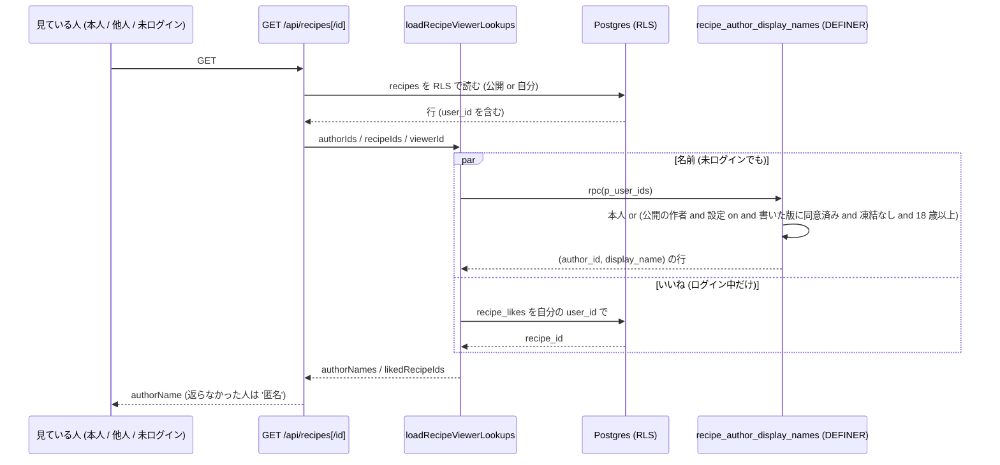

# 公開レシピの作者の表示名を出す (#1917 の続き) 設計

| 版 | 日付 | 内容 |
|---|---|---|
| v1.0 | 2026-10-24 | 新設 (Issue #1917 の続き (api-read-errors のあと) の設計ゲート・A 型 4 相。公開レシピの一覧・詳細・コメントの作者名を、本人以外にも表示名で出す) |
| v1.1 | 2026-10-24 | 審査 R1 の反映: 戻し口の見出しを対の migration の名前に・段 A の本番の適用を文面が効いたあとの同じ門に (§15 の本番の順序)・プライバシーポリシーの文をレシピとコメントで分ける (6 文)・結合テストの helper を実在の export と本テスト内の定義に・I-12 を退会する作者の公開レシピで確かめる形に・C-8 を段 B へ・fix 枝の単体テストの it の対応表 (§7.11) |
| v1.2 | 2026-10-24 | 網羅性 (周 2) の反映: 本人が公開レシピを消す出来事 (F-19c・S-17・§9.1・§9.3・I-16)・コメントの POST の返り値を実 DB で (I-17)・§14 に `anon-definer-execute.test.ts`・§9.3 の本人の見え方の文の訂正・§3 の origin/main を `cae0e288` に取り直し (§16 に新設の番兵 2 つ) |
| v1.3 | 2026-10-24 | 審査 R2 の反映: レシピを非公開に戻す・公開に戻す・運営が隠す・隠すのを戻すと、そのレシピへのコメントの書き手の K-公開 も変わる遷移を表に (§0.3 S-12・S-13・§4.3・§9.1・§9.3・§7.10 I-10 に toggleCommenter・§18)・§19 の 7〜9 の本番の検証は、書き込みの前にオーケストレーターが承認の要否を確かめる形に |
| v1.4 | 2026-10-24 | 網羅性 (周 3) の反映: 公開レシピを新しく作る出来事 (INSERT) を §9.3 に・§9.1 に「公開レシピなし・コメントだけ」× 未ログイン / 本人の行・§14 の段 C に `packages/shared/src/legal-versions.ts` と `docs/legal/archive/v2026.4/` (選択肢 (b) のときだけ)・個人データの書き出しで新しい列を出すことの決定 (§6.5・§16・§18) |
| v1.5 | 2026-10-24 | 審査 R3 の反映: プライバシーポリシー第8条 (第三者提供) の 1 項・3 項・4 項を判定 (§6.4)。名前を他の人に出すのを、作者名の表示を書いた版 (以後の版) に同意した人だけにする条件 K-同意 を関数に足す (§7.1・C-10・I-18・S-18・§9)・第8条 3 項に 1 文 (主張の表 privacy-8#13。§7.12)・選択肢 (c) は選べないことに (§6.4・§21 Q-1) |
| v1.6 | 2026-11-01 | 実装と公開の後の現在形化 (製品の挙動は変えない): 冒頭に状態の行 (段 A #2158・段 B #2159・段 C #1997 は 2026-11-01 に main に入り本番に出た)・§7.1・§7.2・§14・§16 の migration の名指しを置き場から `20261101090000` に (全部同時に)・fix/api-read-errors (PR #2009 で main に入った) の古い文 (前提・§0.6・§3・§12・§18)・F-28 と §7.12 の版と主張の数を今の値 (v2026.4・433・見出し) に・F-29 (主張の数 433) と F-32 (いまの版 v2026.4・v2026.3 の控え) に「その後」の注を・§17 の mobile/08 の行の指し先を行番号から名前に・§0.4・§6.6・§15 の本番の順に実際の順を |

状態: 実装済み・公開済み。段 C (文面。PR #1997 `3193a2fa`)・段 A (DB。PR #2158 `ee9b8eaf`。migration `20261101090000_recipe_author_display_names.sql`)・段 B (API と設定。PR #2159 `f0e558ee`) は、2026-11-01 にこの順で main に入り本番に出た。プライバシーポリシーの版は `v2026.4` (施行日 2026-11-01。§21 Q-1 は (a))。

要件の正本は Issue #1917 の本文とコメント。本書はその上で決めた範囲と設計で、Issue と食い違ったら本書が正。
ファイル名は cross/21 (cross/ の既存は 01〜09・12・13a・13b・14〜20。10・11・13 は欠番)。

前提 (本書が従う条件):

- オーナーの選択 (2026-10-24): 他の人の公開レシピの作者名を表示名で出す。
- 読み込みの失敗の直し (fix/api-read-errors の枝 `a8d75cec`。`src/lib/recipes/viewer-lookups.ts` の `loadRecipeViewerLookups` が作者の名前と自分のいいねを別のクエリで引く形) の上に積む。本書はその枝の形を土台にする (枝は PR #2009 (`2a7a96e2`) で main に入った。§3 の事実は入る前の 2026-10-24 の時点のもの)。
- 本番の DB には書き込まない (本書の事実は 2026-10-24 の読み取りだけ。§3.4)。
- ローンチ前。本番の `auth.users` は 195 行・`user_profiles` は 65 行・`recipes` と `recipe_comments` は 0 行 (2026-10-24 の SELECT。§3.4)。既存の行の書き換えは無い。
- `user_profiles` の SELECT の RLS (本人の行だけ) は変えない。他人の行を公開の場に出す経路は、本書が足す 1 本の関数だけ。
- Next.js の API で service_role を使わない (本書の決め。書いた時点の cross/02 §3.3 の文「service_role を使う場所: Supabase Edge Function のみ」に合わせた。今の §3.3 は Next.js の `getSupabaseAdmin()` も挙げる)。
- 範囲外: 作者名を描く画面を新しく作ること (今は Web・モバイルのどこにも作者名を描く画面が無い。§3.3 F-13)。プロフィールの画面に足すのは「名前を出すか」の切り替え 1 つだけ。新しい要求は発明しない。

---

## 0. 外形固定と分冊判定 (相 1)

### 0.1 発注と決めること

公開レシピの一覧 (`GET /api/recipes`)・詳細 (`GET /api/recipes/[id]`)・コメント (`GET` / `POST /api/recipes/[id]/comments`) が返す `authorName` は、`user_profiles` の SELECT の RLS が本人の行だけを通すため、他の人が作ったレシピ・コメントではいつも既定の呼称「匿名」になる。本書は、他の人にも作者の表示名が出るようにする。

本書で決めること (列挙):

1. 出す名前の列と、名前が無い人・退会した人・凍結中の人・18 歳未満の本人のアカウント (保護者の同意の経路) の扱い → §6.1
2. 読み方 (service_role / RLS / VIEW / SECURITY DEFINER の関数のどれか)。最小の情報 (名前だけ・公開レシピの作者だけ) に絞る。cross/02 §3.3 との整合 → §5・§6.2
3. 未ログインの人にも出すか → §6.3
4. プライバシーポリシーの文面が足りるか。足りないなら、版 v2026.4 に入れるか別の版にするかの選択肢 → §6.4・§21 Q-1
5. 本人が名前を出さない選択 (匿名で公開) を持つか。持つなら設定の置き場 → §6.5
6. 段分けと触るファイル (api-read-errors のあとに積む) → §15

### 0.2 要件行列

| # | 要件 | 出どころ | 本書の節 |
|---|---|---|---|
| R-1 | 他の人が作った公開レシピの一覧・詳細と、そのコメントで、`authorName` が作者の表示名 (`user_profiles.nickname` を `normalizeProfileName` で整えたもの) になる | 発注 | §6.1, §7.1, §7.3 |
| R-2 | 名前が無い人 (空・空白だけ・仮置きの `'Guest'`) は今までどおり既定の呼称「匿名」 | `src/lib/recipes/author-name.ts:9-12` の既存の規則 | §6.1 (1) |
| R-3 | 退会した人の公開レシピは `user_id` が NULL になって残り (`recipes_user_id_fkey` は `ON DELETE SET NULL`)、作者名は「匿名」。退会した人のコメントは `ON DELETE CASCADE` で消える | プライバシーポリシー第12条 (`src/lib/legal/privacy-text.ts` の `privacy-12`)・`supabase/migrations/20261010000100_auth_users_fk_on_delete.sql:51-54` | §6.1 (2) |
| R-4 | 凍結中の人 (`isAccountFrozen` が真) の作者名は出さない (「匿名」)。一時凍結の期限が過ぎた人は出す | 決めること 1 | §6.1 (3), §7.1 |
| R-5 | 18 歳未満の本人のアカウント (`user_profiles.birth_date` で 18 歳未満。`ADULT_AGE_YEARS`) の作者名は出さない。生年月日の無い人も出さない | 決めること 1・cross/14 §0 (年齢は `birth_date` だけで判定) | §6.1 (4), §7.1 |
| R-6 | 他人の `user_profiles` を読むのは、公開レシピ (`is_public = true` かつ `hidden_at IS NULL`) の作者か、そのレシピへのコメントを書いた人の、表示名 1 列だけ。それ以外の列・それ以外の人は読めない | 決めること 2 (最小の情報) | §5, §6.2, §7.1 |
| R-7 | Next.js の API と `viewer-lookups.ts` は service_role を使わない。`user_profiles` の RLS ポリシーは足さない・変えない | cross/02 §3.3・CLAUDE.md §3 (どちらも書いた時点の文) | §5, §7.1, §9.3 |
| R-8 | 読む経路は SECURITY DEFINER の関数 1 本。`SET search_path = ''`・完全修飾・引数の型まで含めた完全形で REVOKE してから必要なロールにだけ GRANT (#1039 / #1020 の定型) | `supabase/migrations/20261023130000_account_deletion_owner_guard.sql` の定型 | §7.1 |
| R-9 | 未ログインの人にも出す (公開レシピは未ログインでも読める。利用規約第13条 2 項「ログインしていない方を含め、誰でも閲覧できる状態」)。関数は anon も呼べる | 決めること 3・`src/lib/legal/terms-text.ts:299` | §6.3, §7.1, §7.8 |
| R-10 | 本人には、自分のレシピ・コメントの `authorName` に自分の名前が今までどおり出る (非公開のレシピ・名前を出さない設定のときも) | fix 枝の `tests/integration/security/recipes-api-logged-in.test.ts` (本人の非公開のレシピに本人の nickname が出る) | §6.1 (5), §7.1 |
| R-11 | 本人が「名前を出さない」を選べる。置き場はプロフィールの編集 (`/profile` のニックネームの欄のすぐ下)。既定は「出す」 | 決めること 5 | §6.5, §7.6, §7.7 |
| R-12 | API の返り値の形 (`authorName: string`・コメントの `user_id` を返さない (#168)) は変えない | 既存の契約 | §8 |
| R-13 | 名前が読めなかったときは今までどおり 500 (名前が無いように見せない) | fix 枝の `viewer-lookups.ts` の決まり | §10 |
| R-14 | プライバシーポリシーの文面 (利用目的・第三者提供 (第8条)・見え方 (第9条) ほか) が足りるかを条ごとに判定し、足りないなら逐語の文と版の選択肢を出す (選択肢は §21 Q-1。回答は (a)) | 決めること 4 | §6.4, §7.12, §21 Q-1 |
| R-15 | migration と `.down.sql`・関数の権限・TS の定数・版の一覧と旧版の控えの突き合わせを DB を使わない契約テストで固定し、実 DB の結合テストで R-1〜R-6・R-9・R-10・R-19 を確かめる | `tests/rpc-profile-name-placeholder-migration-contract.test.ts` の前例 | §7.9, §7.10, §12 |
| R-16 | 段の順序で、レシピの API が 500 を返す時間を作らない (関数が無い状態でコードを出さない)。文面 (段 C) が効く前に、他人の表示名を返す経路 (関数とその EXECUTE) を本番に置かない | 段分けの原則・§6.4 の判定 | §6.4, §9.2, §15, §19 |
| R-17 | 設計の正典コードに `as any`・マジックナンバーを置かない (年齢の境・関数名・文面は名前付きの定数) | 設計の絶対条件 | §7, §13 |
| R-18 | 新しい環境変数・route・テーブル・RLS ポリシーを足さない。足すのは列 1 つ・関数 1 本・索引 1 つ | 発明しない | §14 |
| R-19 | 他の人に名前を出すのは、作者名の表示を書いた版 (以後の版) のプライバシーポリシーに同意した人 (`user_profiles.privacy_version_accepted` がその版以後) だけ。作者名の表示を書く前の版にだけ同意した人・同意の記録が無い人は「匿名」(本人には自分の名前) | 決めること 4 (第8条 1 項「あらかじめユーザーの同意を得ることなく、個人データを第三者に提供しません」・4 項「オプトアウトによる提供も行いません」と両立させる。F-30) | §6.1 (9), §6.4, §7.1, §7.9 C-10, §7.10 I-18 |

### 0.3 ユーザーシナリオ (18 本。トレースは §4.3)

| # | シナリオ |
|---|---|
| S-1 | ログインしている利用者 A が、18 歳以上の利用者 B (名前あり・設定は既定) の公開レシピを一覧で見ると、`authorName` が B の表示名になる |
| S-2 | ログインしていない人が、B の公開レシピの詳細を開くと、`authorName` が B の表示名になる (コメントは RLS で 0 件のまま) |
| S-3 | A が B の公開レシピの詳細を開くと、コメントを書いた C (18 歳以上・名前あり) の `authorName` が C の表示名になる |
| S-4 | B が自分の非公開のレシピの詳細を開くと、`authorName` は今までどおり B 自身の名前 |
| S-5 | A が、名前を入れていない (仮置きの `'Guest'` のままの) 利用者 D の公開レシピを見ると、`authorName` は「匿名」 |
| S-6 | 利用者 E が退会すると、E の公開レシピは `user_id` が NULL になって残り、`authorName` は「匿名」。E のコメントは消える |
| S-7 | 運営が利用者 F を凍結 (無期限) すると、F の公開レシピの `authorName` は「匿名」になる。凍結を解除すると表示名に戻る |
| S-8 | 運営が利用者 G を一時凍結 (`unban_at` が未来) した間は「匿名」。`unban_at` を過ぎると表示名に戻る (ログインの判定 `isAccountFrozen` と同じ境) |
| S-9 | 16 歳の本人のアカウント H (保護者の同意の経路) が公開したレシピの `authorName` は「匿名」。H が自分で見ると自分の名前。18 歳の誕生日 (JST) から他の人にも表示名になる |
| S-10 | 利用者 I がプロフィールの編集で「公開したレシピとコメントに、ニックネームを作者名として表示する」をオフにして保存すると、他の人には I の公開レシピ・コメントの `authorName` が「匿名」になり、I 自身には自分の名前のまま。オンに戻すと表示名に戻る |
| S-11 | 利用者 J が公開レシピを 1 つも持たず、他人の公開レシピにコメントもしていないとき、誰かが J の id で関数を直接呼んでも J の名前は返らない (0 行) |
| S-12 | B が公開レシピを非公開に戻し、ほかに公開レシピもコメントも無いなら、B の名前は他の人には返らなくなる (B 自身の一覧には自分の名前)。そのレシピにだけコメントしていた C (ほかに公開の内容が無い) の名前も、他の人には返らなくなる (コメントは消えない。C 自身には自分の名前)。B がレシピを公開に戻すと、B・C とも表示名に戻る |
| S-13 | 運営が B の公開レシピを隠す (`hidden_at`) と、そのレシピは本人以外に出なくなる (既存の RLS)。B にほかの公開レシピ・コメントが無ければ、B の名前も他の人には返らなくなる。そのレシピにだけコメントしていた C (ほかに公開の内容が無い) の名前も返らなくなる。運営が隠すのを戻すと、B・C とも表示名に戻る |
| S-14 | C が B の公開レシピにコメントを投稿すると、`POST` の返り値の `authorName` は C 自身の名前 (名前を出さない設定でも、本人には自分の名前) |
| S-15 | `user_id` が NULL のシステムのレシピは、今までどおり `authorName` が「匿名」 (関数に id を渡さない) |
| S-16 | 関数の読み込みが失敗すると (接続の失敗など)、一覧・詳細・コメントの API は 500 を返す (名前が無いように見せない。既存の決まり) |
| S-17 | B が自分の最後の公開レシピを `DELETE /api/recipes/[id]` で消すと、レシピとそのレシピへのコメントが消える。B と、そのレシピにだけコメントしていた C (ほかに公開の内容が無い) の名前は、他の人には返らなくなる (B・C 自身には自分の名前) |
| S-18 | 利用者 K (18 歳以上・名前あり・設定は既定) が、作者名の表示を書く前の版 (例: v2026.3) のプライバシーポリシーにだけ同意したまま公開レシピを持つと、他の人には K の `authorName` は「匿名」。K が作者名の表示を書いた版に同意すると、次の読み込みから表示名になる。同意の記録が無い人 (`privacy_version_accepted` が NULL) も「匿名」。K 自身が関数を呼べば自分の名前 (ログインしてレシピの API を呼ぶと、同意ゲートが 403 `LEGAL_CONSENT_REQUIRED` を返す。F-31) |

### 0.4 分冊判定

目安は「設計書 800 行超 / 消費先のレーン 3 以上 / 共有面に 2 つ以上触る」。本書は行数で目安に掛かり、共有面も 2 つ (`user_profiles` の列・プライバシーポリシーの文面) に触る。それでも **1 冊** とする。理由:

- 核は関数 1 本 (`recipe_author_display_names`) と lib 1 つ (`viewer-lookups.ts`) で、消費先の route 3 本は同じ lib の呼び出し側 (1 レーン)。核と配線に分けると、配線の冊は「`lookups.nicknames` を `lookups.authorNames` に改める」1 行の冊になる。
- プライバシーポリシーの文面は本書では編集しない (cross/20 が正典)。本書は逐語の文と版の選択肢を出し (§7.12・§21 Q-1)、改定は cross/20 の改定版か docs PR で行う。
- 段分け (§15) は、DB (段 A)・API と設定 (段 B)・文面 (段 C。版は §21 Q-1 の回答 (a) の v2026.4) の 3 つ。本番は 文面 (段 C) が効く → 段 A の適用 → 段 A のマージ → 段 B のマージ の順で、後ろの 3 つを同じ座で続けて行う (2026-11-01 に段 C (#1997)・段 A (#2158)・段 B (#2159) の順で main に入り本番に出た。§15)。

### 0.5 用語

| 語 | 意味 |
|---|---|
| 表示名 | `user_profiles.nickname` を `normalizeProfileName` (TS) / `public.normalize_profile_name` (SQL) で整えた名前。無い・空白だけ・仮置きの `'Guest'` は「名前が無い」 |
| 既定の呼称 | `RECIPE_AUTHOR_FALLBACK_NAME` = `'匿名'` (`src/lib/recipes/author-name.ts:9`) |
| 公開レシピ | `recipes.is_public = true` かつ `hidden_at IS NULL` の行 (RLS `Users can view public recipes` で本人以外にも見える行) |
| 公開の作者 | 公開レシピの `user_id` の人、または公開レシピへのコメント (`recipe_comments`) を書いた人 |
| 凍結中 | `isAccountFrozen` (`src/lib/auth/frozen.ts:25`) が真: `frozen_at` があり、`unban_at` が無いか未来 |
| 本人 | 関数を呼んだときの `auth.uid()` と同じ id の人 |
| 見ている人 | API を呼んだ人。未ログイン (`viewerId` が null) を含む |

### 0.6 読み方

- §3 が事実、§4〜§6 が決めたことと理由、§7 が正典コード (実装者はここを写す)、§9〜§12 が表とテスト、§15 が段の順序、§16〜§17 が既存のテストと他の文書への追随、§21 がオーナーに聞くこと。
- 本書の TS のブロックは、`// tsc:skip` を 1 行目に持つものを除き、そのまま型検査を通る形で書いてある (import を省かない)。`// tsc:skip` のブロックは、書いた時点で main に無かったファイル (fix 枝の `viewer-lookups.ts`。PR #2009 で main に入った) や結合テストの helper を相対パスで import するもの、既存ファイルの差分の断片。

---

## 1. 目的・スコープ

公開レシピの作者名を、本人以外 (ログインしている利用者と未ログインの人) にも表示名で返す。読む範囲は「公開の作者の表示名 1 列」に絞り、`user_profiles` の RLS は変えず、service_role も使わない。本人が名前を出さない選択を持てるようにし、凍結中・18 歳未満・退会・名前なしの人と、作者名の表示を書いた版のプライバシーポリシーにまだ同意していない人は「匿名」のまま残す。

対象外: 作者名を描く画面の新設。作者のプロフィール画面・作者ごとのレシピ一覧。コメントの `user_id` の公開。

---

## 2. 関連要件・既存設計

| 文書 | 関係 |
|---|---|
| cross/02-rls-patterns.md §3.3 | 書いた時点の文は「service_role を使う場所: Supabase Edge Function のみ」(今は Next.js の `getSupabaseAdmin()` も挙げる)。本書は Next.js の API で service_role を使わず、SECURITY DEFINER の関数で読む (§5) |
| cross/02 §10 の表の Security の行 | anon が EXECUTE できる関数は理由つきの許可一覧だけ (`tests/integration/security/anon-definer-execute.test.ts:95-100`)。本書の関数は一覧に足す (§7.8) |
| cross/14-parental-consent.md §0 | 年齢の判定は `user_profiles.birth_date` だけ。18 歳未満の本人のアカウントは保護者の同意の経路。本書は 18 歳未満の名前を公開の場に出さない (§6.1 (4)) |
| cross/20-terms-privacy-text.md §2.2 F-19・F-33・F-49 | `user_profiles` の SELECT が本人の行だけであること・家族の中の表示名の見え方。公開レシピの作者としての表示名の記載は無い (§6.4) |
| cross/20 §9.3 | 内容が変わる文面の直しは版を上げる。本書の文の追加は版を上げる改定に当たる (§6.4・§21 Q-1) |
| cross/20 §9.4 | 版を上げる改定は施行日の前にお知らせで予告する |
| プライバシーポリシー第8条 (`src/lib/legal/privacy-text.ts` の `privacy-8`) | 1 項 (あらかじめの同意なく第三者に提供しない)・3 項 (他の人への表示の根拠)・4 項 (オプトアウトによる提供をしない)。本書は 3 項に 1 文を足し、1 項・4 項と両立させるため K-同意 を関数に持たせる (§6.4・R-19) |
| cross/08-legal-compliance.md (同意ゲート)・`supabase/migrations/20261008200700_legal_documents_acceptance.sql`・`20261017030000_parental_consent_and_birth_date.sql` (`accept_legal_documents`) | 同意した版の記録 `privacy_version_accepted` と同意ゲート (F-31)。本書は記録を読むだけ |
| プライバシーポリシー第12条 (`src/lib/legal/privacy-text.ts` の `privacy-12`) | 公開の状態のユーザーコンテンツは退会後も紐づけを外して匿名で残す。本書の R-3 の根拠 |
| 利用規約第13条 2 項 (`src/lib/legal/terms-text.ts:299`) | 公開の状態のユーザーコンテンツは未ログインの人を含め誰でも閲覧できる。本書の R-9 の根拠 |
| #1917 の続き (fix/api-read-errors) | `loadRecipeViewerLookups` の形 (別のクエリで引く・失敗は 500) を土台にする |

---

## 3. 現状の事実 (origin/main `cae0e288`・fix/api-read-errors `a8d75cec`・本番の読み取り 2026-10-24)

v1.0〜v1.1 は origin/main `c9ee3e59` で取った。`c9ee3e59..cae0e288` の差分 (1 コミット・#2003) が触れたファイルのうち本節が指すものは `CLAUDE.md` と `docs/design/cross/20-terms-privacy-text.md` だけで、どちらも 1 行を 1 行に置き換える直し (行がずれない) で、本書が指す行 (`CLAUDE.md:83`・cross/20 の行 213・227・243・2000・2014) の中身は変わっていない。レシピの route・`author-name.ts`・文面 (`privacy-text.ts`・`terms-text.ts`)・migration・`anon-definer-execute.test.ts` は差分に無い。fix/api-read-errors は、この時点では `a8d75cec` のままで main に入っていなかった (その後 PR #2009 (`2a7a96e2`) で main に入った。§15)。v1.3 の時点で、そのあとの main の 1 コミット (#2004) も確かめた: 触れたのは退会の直し (`src/lib/account-deletion.ts`・新しい migration `20261024120000_account_deletion_guard_release.sql` (関数 `end_account_deletion_guard` を service_role にだけ GRANT) と戻し口・2 つの `database.types.ts` への関数の追記・テスト) と、文書の 1 行を 1 行に置き換える直し (`CLAUDE.md`・cross/08・cross/14・cross/16・cross/20 ほか。`tests/legal-text-1901.test.ts` も行 205 の 1 行) で、本書が指す行 (`CLAUDE.md:83`・cross/14 の行 18-19・cross/20 の行 213・227・243・2000・2014・`tests/legal-text-1901.test.ts:1058-1073`) の中身と、anon の許可一覧・レシピの route・文面 (`privacy-text.ts`・`terms-text.ts`) は変わっていない。本書の事実の sha は `cae0e288` のままにする。v1.5 で足した F-30〜F-32 の指し先 (`privacy-text.ts`・`tests/legal-claims-1901.ts`・`20261008200700`・`20261017030000`・`lib/supabase/middleware.ts`・`packages/shared/src/legal-consent-api.ts`・`packages/shared/src/legal-versions.ts`・`docs/legal/archive/`・`CLAUDE.md:138`) も #2004 の差分に無い (`CLAUDE.md` の差分は行 293 の 1 行だけ)。origin/main はその後も `a9526417` (#2004) のまま (v1.5 の時点)。

### 3.1 API と lib

| # | 事実 | 根拠 |
|---|---|---|
| F-1 | main の一覧 `GET /api/recipes` は `*, user_profiles(nickname), recipe_likes(user_id)` の埋め込みで作者名を読む。認証時は `is_public.eq.true,user_id.eq.<自分>`、未認証は `is_public = true` に絞る。`authorName` は `recipeAuthorName(...)` | `src/app/api/recipes/route.ts:31-33, 42-44, 81` |
| F-2 | main の詳細 `GET /api/recipes/[id]` は `user_profiles(nickname, id)` とコメントの中の `user_profiles(nickname)` を埋め込む | `src/app/api/recipes/[id]/route.ts:28, 35, 54, 80` |
| F-3 | main のコメント `GET` / `POST /api/recipes/[id]/comments` も埋め込みで名前を読む。`GET` は未認証なら 401 | `src/app/api/recipes/[id]/comments/route.ts:37, 103` |
| F-4 | fix 枝では、埋め込みを外し、`src/lib/recipes/viewer-lookups.ts` の `loadRecipeViewerLookups(supabase, viewerId, { authorIds, recipeIds })` が `user_profiles` を `.select('id, nickname').in('id', authorIds)` で、`recipe_likes` を自分の `user_id` とレシピの id で引く。`viewerId` が null なら DB に問い合わせず空を返す。失敗は `{ ok: false, table: 'user_profiles' または 'recipe_likes', error }` で、route が `internalError` の 500 にする。返り値は `nicknames: ReadonlyMap<string, unknown>`・`likedRecipeIds: ReadonlySet<string>` | fix 枝 `a8d75cec` の `src/lib/recipes/viewer-lookups.ts` (`RecipeViewerDb`・`RecipeViewerLookups`・`RecipeViewerLookupResult`・`loadRecipeViewerLookups`) |
| F-5 | fix 枝の route 4 本 (一覧・詳細・コメント GET / POST) は `recipeAuthorName(lookups.nicknames.get(<user_id>))` で `authorName` を作る (詳細はレシピとコメントの両方)。コメントの `user_id` は返さない (#168)。詳細の閲覧数の加算 (`supabase.rpc('increment_recipe_view_count', …)`) はログイン時だけ | fix 枝の `src/app/api/recipes/route.ts`・`[id]/route.ts`・`[id]/comments/route.ts` |
| F-6 | `recipeAuthorName(nickname)` は `normalizeProfileName(nickname) ?? RECIPE_AUTHOR_FALLBACK_NAME`。`RECIPE_AUTHOR_FALLBACK_NAME = '匿名'` | `src/lib/recipes/author-name.ts:9, 12` |
| F-7 | `normalizeProfileName` は前後の空白を除き、空と仮置きの `PROFILE_NAME_PLACEHOLDER = 'Guest'` (厳密一致) を null にする。SQL の `public.normalize_profile_name(text)` が同じ規則 (IMMUTABLE・SECURITY INVOKER・`search_path = ''`。EXECUTE は service_role だけで、SECURITY DEFINER の関数の本文からは所有者 postgres の権限で呼べる) | `packages/shared/src/profile-name.ts`・`supabase/migrations/20261016200000_rpc_profile_name_placeholder.sql` |
| F-8 | fix 枝の `viewer-lookups.ts` の冒頭コメントは「名前が引けるのは RLS で見ている人が読める行だけ (いまは本人の行だけ)。引けなかった作者は既定の呼称」と書いている。他人の名前がいつも「匿名」になるのはこのため | 同ファイルの冒頭コメント |
| F-9 | RLS の効くクライアント `createClient()` は anon キー + Cookie / Authorization ヘッダ。service_role は `getSupabaseAdmin()` だけ (`tests/supabase-service-role-client-scan.test.ts` が見張る) | `lib/supabase/server.ts` (`getSupabaseAdmin`・`createClient`) |
| F-10 | 他人の `user_profiles` を読むときは認可のあとに `getSupabaseAdmin()` (対象を絞る条件つき) というのが root CLAUDE.md の規則。未ログインの一覧・詳細には認可が無い | `CLAUDE.md:83` |
| F-11 | `PUT /api/profile` は `fromUserProfile(body)` (camelCase → snake_case) の結果を RLS のクライアントで `user_profiles` に `update` する。`FIELD_MAP` (行 27) は栄養の再計算の判定にだけ使う。`toUserProfile` は `GET` の行を camelCase にする | `src/app/api/profile/route.ts:27, 165-166`・`lib/converter.ts:21, 144, 158, 278` |
| F-12 | `UserProfile` (ドメイン型) は `types/domain.ts:171` (`nickname` は行 173・`aiLearningEnabled` は行 298)。DB の行の手書きの型 `DbUserProfile` は `types/database.ts:4` (`ai_learning_enabled: boolean / null` は行 132)。`toUserProfile` は `ai_learning_enabled ?? true` のように既定を補う | `types/domain.ts`・`types/database.ts`・`lib/converter.ts:144` |
| F-13 | `authorName` を読む画面は Web (`src/app`・`src/components`) にもモバイル (`apps/mobile`) にも無い (`authorName` / `author_name` / 「作者」の参照は API route と `author-name.ts` だけ)。`/api/recipes/{id}` を呼ぶのは `src/app/(main)/favorites/_components/FavoriteRecipeModal.tsx` (いいねの解除) と `src/app/(main)/menus/weekly/page.tsx` (レシピの表示) で、どちらも `authorName` を描かない | origin/main の `git grep` (2026-10-24) |
| F-14 | プロフィールの編集画面はニックネームの欄 (`Label` + `Input`。`editForm.nickname`・`updateField('nickname', …)`) を基本情報タブの先頭に持ち、保存は `fetch('/api/profile', …)` (PUT)。`editForm` は `Partial<UserProfile>`、`updateField(field: keyof UserProfile, value)` | `src/app/(main)/profile/page.tsx:121, 242, 296, 725-733` |

### 3.2 DB (migration と本番)

| # | 事実 | 根拠 |
|---|---|---|
| F-15 | `user_profiles` の SELECT のポリシーは `Users can view own profile` (`auth.uid() = id`。TO 句なし = public) だけ。INSERT / UPDATE も本人の行だけ。後の migration で SELECT のポリシーは足されていない。本番も同じ 3 本 | `supabase/migrations/20251126124224_create_meal_planner_tables.sql:10076`・本番の `pg_policies` (2026-10-24) |
| F-16 | `recipes` の SELECT のポリシー `Users can view public recipes` は `(hidden_at IS NULL OR auth.uid() = user_id) AND (user_id IS NULL OR is_public = true OR auth.uid() = user_id)`。TO 句なしで anon も読める。`recipe_comments` の SELECT は `Anyone can view comments` (TO authenticated・USING true) で anon は読めない | `supabase/migrations/20251126124224_create_meal_planner_tables.sql:10088`・`supabase/migrations/20261009000500_hide_moderated_content.sql:169`・本番の `pg_policies` |
| F-17 | 外部キー: `recipes.user_id` → `auth.users` (`ON DELETE SET NULL`)・`recipe_comments.user_id` → `auth.users` (`ON DELETE CASCADE`)・`user_profiles.id` → `auth.users` (`ON DELETE CASCADE`)。`user_profiles` を指す外部キーは無い (PostgREST の埋め込みが解決できない理由) | `supabase/migrations/20251126124224_create_meal_planner_tables.sql:9463`・本番の `pg_constraint` (2026-10-24) |
| F-18 | 退会の直前の `prepare_account_deletion` は本人の非公開のレシピだけを消し、公開のレシピは `user_id` を外して残す (プライバシーポリシー第12条のとおり) | `supabase/migrations/20261010000100_auth_users_fk_on_delete.sql:51-54, 462` |
| F-19 | 凍結の列は `user_profiles.frozen_at` / `unban_at` / `frozen_by` / `frozen_reason` (特権列。本人は書けない)。凍結の判定は `isAccountFrozen({ frozenAt, unbanAt })` = `frozen_at` があり、`unban_at` が無いか今より未来。middleware と `requireUser` が使う | `src/lib/auth/frozen.ts:25`・`lib/supabase/middleware.ts:58` |
| F-19a | 凍結中の本人がセッションつきで `/api/*` を呼ぶと、middleware が `isAccountFrozen` で判定し、`FROZEN_ALLOWED_API_PATHS` (退会・書き出し・解約・解散など) と例外の 2 つ (ネイティブ認証ブリッジのコード・お問い合わせの POST) を除いて 403 `AUTH_ACCOUNT_FROZEN` を返す (レシピの route は除外に無い)。凍結の判定に要る `user_profiles` が読めなかったときは止めない (fail-open) | `lib/supabase/middleware.ts:179-247`・`src/lib/auth/frozen.ts:70` |
| F-19b | `recipe_comments` の INSERT のポリシー `Users can create comments` は `user_id = auth.uid()` だけで、レシピが公開か・隠されていないかを見ない。fix 枝のコメント `GET` もレシピの見え方を見ずに、`recipe_comments` を RLS (authenticated に USING true) で読む | `supabase/migrations/20251126124224_create_meal_planner_tables.sql:9602, 9719`・fix 枝の `src/app/api/recipes/[id]/comments/route.ts` |
| F-19c | 本人は `DELETE /api/recipes/[id]` で自分のレシピを消せる (route は RLS のクライアントで `recipes` の `user_id` を自分と突き合わせてから `delete()`。RLS は `Users can manage own recipes` (コマンドの指定なし = ALL・`auth.uid() = user_id`))。`recipe_comments.recipe_id` の外部キー `recipe_comments_recipe_id_fkey` は `ON DELETE CASCADE` で、レシピを消すとそのレシピへのコメント (他の人が書いたものを含む) も消える。コメントを消す API は無く、本人のコメントは RLS `Users can delete own comments` (TO authenticated・`user_id = auth.uid()`) で直接消せる | main の `src/app/api/recipes/[id]/route.ts:149, 169` (fix 枝では行 170・198)・`supabase/migrations/20251126124224_create_meal_planner_tables.sql:9268, 9739, 9910` |
| F-20 | 年齢は `user_profiles.birth_date` (write-once の特権列。`accept_legal_documents` だけが書く) と SQL の `public.age_years_jst(date)` (JST の暦日の満年齢。EXECUTE は全ロールから外してあり、DEFINER の関数の本文から呼ぶ)。18 は `ADULT_AGE_YEARS` (`packages/shared/src/parental-consent.ts:13`) | `supabase/migrations/20261017030000_parental_consent_and_birth_date.sql:52, 79-85, 282` |
| F-21 | `user_profiles` の特権列ガード (`guard_user_profiles_privileged` / `_on_insert`) は列を名指しで止める。名指しに無い列は本人が RLS のクライアントで書ける | `supabase/migrations/20261017030000_parental_consent_and_birth_date.sql` の 8 |
| F-22 | 索引: `recipes` に `idx_recipes_user_id` (user_id) がある。`recipe_comments` には `idx_recipe_comments_recipe_id` と主キーだけで、`user_id` の索引は無い | 本番の `pg_indexes` (2026-10-24) |
| F-23 | public の関数の既定の権限: 作ると anon / authenticated / service_role と PUBLIC に EXECUTE が付く。引数の型まで含めた完全形で REVOKE し、必要なロールにだけ GRANT するのが定型。anon が EXECUTE できる SECURITY DEFINER の関数は許可一覧 (`get_invite_details(text)`・`get_promotion_details(text)`) だけ | `supabase/migrations/20261023130000_account_deletion_owner_guard.sql` の冒頭・`tests/integration/security/anon-definer-execute.test.ts:95-100` |
| F-24 | 公開 VIEW の前例は `user_consultation_history` の 1 つだけ。本番の public の VIEW もその 1 つ。作者名を返す関数・VIEW は無い (`pg_proc` で author / nickname / display_name を名に持つ関数は `normalize_profile_name` だけ) | 本番の `pg_class` / `pg_proc` (2026-10-24) |

### 3.3 文面 (利用規約・プライバシーポリシー)

| # | 事実 | 根拠 |
|---|---|---|
| F-25 | 利用規約第13条 2 項: 「ユーザーが公開の状態にしたユーザーコンテンツは、ログインしていない方を含め、誰でも閲覧できる状態になります。」 | `src/lib/legal/terms-text.ts:299` |
| F-26 | プライバシーポリシー第3条はニックネームを取得する情報に載せる。第4条の利用目的は「本サービスの提供（アカウントの管理、記録の保存と表示、…）」。第6条は AI 事業者への送信にニックネームが含まれることと「ニックネームには実名を使わないことをお勧めします」を書く。第8条 3 項は「家族グループのメンバーや組織の管理者に対する表示は…（第9条）」(第8条の 1 項・3 項・4 項の文は F-30)。第9条の見出しは「家族グループと組織での見え方」で、公開レシピの作者としてニックネームが他の利用者 (未ログインを含む) に出ることは、どの条にも書いていない | `src/lib/legal/privacy-text.ts:290, 342, 356-360` |
| F-27 | 第12条の表: 「公開の状態のユーザーコンテンツ」は「退会後も、ユーザーとの紐づけを外して匿名の状態で残します」。第15条: 18 歳未満は保護者の同意が必要・13 歳未満の本人名義のアカウントは作らない。18 歳未満の本人の公開レシピの作者名の扱いは文面に無い | `src/lib/legal/privacy-text.ts:420, 493` |
| F-28 | いまの版は両文書とも v2026.3 (施行日 2026-10-22)。PR #1997 (OPEN・`feat/siwa-d-legal`) がプライバシーポリシーに Apple を足して両文書を v2026.4 にし、コードの `effectiveDate` は 2026-11-01 (マージの直前に公開日へ置き換える目印つき)。施行日は 2026-11-01 (日) (mobile/08 §21 Q-13 の記録)、施行日の前にお知らせで予告してからマージする手順。予告の文は Issue #1139 のコメントに置いてあり、「Apple についての記載を加えるもの」と書いている。(その後: PR #1997 は 2026-11-01 に `3193a2fa` でマージされ、本書 §7.12 の文と主張の表 7 行も入った。いまの版は両文書とも v2026.4・施行日 2026-11-01・`LEGAL_CLAIM_COUNT` は 433) | `packages/shared/src/legal-versions.ts` (`LEGAL_DOCUMENTS`)・PR #1997 の本文・Issue #1139 のコメント |
| F-29 | 文面の 1 文 = 主張の表 `tests/legal-claims-1901.ts` の 1 行 (`LEGAL_CLAIM_COUNT = 424`。`fragment` が文の中に 1 回だけ現れ、`chars` が文の字数 (文末の 。を除く))。文を足すと行と `LEGAL_CLAIM_COUNT` を足す。(その後: PR #1997 で Apple の 2 行と本書 §7.12 の 7 行が入り、`LEGAL_CLAIM_COUNT` は 433) | `tests/legal-claims-1901.ts:25, 354-364`・`tests/legal-text-1901.test.ts:1058-1073` |
| F-30 | プライバシーポリシー第8条 (第三者提供): 1 項「当社は、次の場合を除き、あらかじめユーザーの同意を得ることなく、個人データを第三者に提供しません。」(以下 (a)〜(d) の法令の場合)。3 項「家族グループのメンバーや組織の管理者に対する表示は、ユーザー自身の共有の設定、または組織への所属に基づいて行います（第9条）。」(他の人への表示の根拠として挙げるのは家族グループと組織だけ)。4 項「当社は、個人データの共同利用を行いません。本人の同意を得ずに行う第三者提供（オプトアウトによる提供）も行いません。」。主張の表の行は privacy-8#1〜#12 (3 項は privacy-8#8・4 項の 2 文目は privacy-8#10) | `src/lib/legal/privacy-text.ts:340, 342, 343`・`tests/legal-claims-1901.ts:342-353` |
| F-31 | 同意の記録: `user_profiles.privacy_version_accepted` (varchar(20)・特権列) は、同意した版の文字列。書くのは `accept_legal_documents` だけ (authenticated に EXECUTE。版の形 `^[0-9A-Za-z._-]{1,20}$` だけを確かめ、「いま有効な版」かは確かめない。DB は版の中身を知らない。確かめるのは `POST /api/legal/accept`)。同意ゲート: 本番は 2026-10-10 から `LEGAL_CONSENT_ENFORCE=on` で、いまの版に同意していないサインイン中の人 (生年月日の未入力と、保護者の同意とのつながりの無い 18 歳未満も同じ) の `/api/*` は、許可リスト (`LEGAL_CONSENT_EXEMPT_API_PATHS`。レシピの route は無い) を除き 403 `LEGAL_CONSENT_REQUIRED`。ゲートは Next の middleware だけで、PostgREST を直接呼ぶ経路には掛からない | `supabase/migrations/20261008200700_legal_documents_acceptance.sql:20, 47`・`supabase/migrations/20261017030000_parental_consent_and_birth_date.sql:445, 465, 527`・`lib/supabase/middleware.ts:267`・`packages/shared/src/legal-consent-api.ts`・`CLAUDE.md:138` |
| F-32 | 版の並び: プライバシーポリシーの版は v2025.1 → v2026.1 → v2026.2 → v2026.3 (いま。`LEGAL_DOCUMENTS.privacy_policy.version`)。旧版の文面の控えは `docs/legal/archive/<版>/privacy.md` (いまは v2025.1・v2026.1・v2026.2。版を上げる PR が直前の版の控えを足す。cross/20 §9.1)。どの控えにも、公開レシピの作者名の記載は無い。(その後: PR #1997 で版は v2026.4 (いま) になり、`docs/legal/archive/v2026.3/privacy.md` が足された。v2026.3 の控えにも作者名の記載は無い) | `packages/shared/src/legal-versions.ts`・`docs/legal/archive/` |

### 3.4 本番の読み取り (2026-10-24。SELECT だけ。書き込みなし)

| 数 | 値 |
|---|---|
| `auth.users` | 195 |
| `user_profiles` | 65 (うち仮置き `'Guest'` 2・空 0・凍結中 0・`birth_date` あり 5) |
| `user_profiles.privacy_version_accepted` | NULL 60・`v2025.1` 1・`v2026.3` 4 (作者名の表示を書いた版に同意した人は、まだいない) |
| `recipes` / `recipe_comments` | 0 / 0 |
| `user_profiles` の列 | `nickname text NOT NULL`・`frozen_at`・`unban_at`・`birth_date date` を含む 130 列。表示名の専用の列は無い |

既存の行の書き換えは無い (列の追加の既定値が 65 行に入るだけ)。

---

## 4. 構想 (相 2)

### 4.1 構造

```
見ている人 (本人 / 他のログイン利用者 / 未ログイン)
   │ GET /api/recipes・/api/recipes/[id]・/api/recipes/[id]/comments  (route は変えない。呼び出しの 1 語だけ)
   ▼
loadRecipeViewerLookups(supabase (RLS の anon キーのクライアント), viewerId, { authorIds, recipeIds })
   ├─ 名前: supabase.rpc('recipe_author_display_names', { p_user_ids: authorIds })   ← 未ログインでも呼ぶ
   └─ いいね: ログイン中だけ、recipe_likes を自分の user_id で (fix 枝のまま)
   ▼
public.recipe_author_display_names(uuid[])  SECURITY DEFINER・STABLE・search_path = ''
   入力の id ごとに、user_profiles を主キーで引き、次のどちらかなら (id, 表示名) を返す。それ以外は行を返さない
     (a) id = auth.uid()  … 本人には自分の名前をいつも返す (非公開のレシピ・名前を出さない設定でも)
     (b) 公開の作者 (公開レシピの user_id か、公開レシピへのコメントの user_id)
         かつ show_recipe_author_name = true
         かつ 作者名の表示を書いた版 (以後の版) のプライバシーポリシーに同意済み (privacy_version_accepted が「書く前の版の一覧」に無い)
         かつ 凍結中でない かつ birth_date があり 18 歳以上
   表示名は normalize_profile_name(nickname)。NULL (名前が無い) の人は返さない
   ▼
route: recipeAuthorName(lookups.authorNames.get(user_id))  → 返らなかった人は '匿名'
```

- 読む列は `user_profiles` の `id`・`nickname`・`show_recipe_author_name`・`privacy_version_accepted`・`frozen_at`・`unban_at`・`birth_date` (判定に使う) で、返すのは `id` と表示名だけ。
- 同意の条件 (K-同意) は、プライバシーポリシー第8条 1 項・4 項と両立させるため (§6.4)。DB はどの版が「いま有効」かを知らない (F-31) ので、関数は「作者名の表示を書く前の版」の閉じた一覧 (`c_privacy_versions_without_author_name`) を持ち、記録された版がそこに無い人を同意済みとみなす。一覧と旧版の控え・いまの文面の突き合わせは契約テスト C-10 が固定する。
- 他人の名前が返る条件 (b) は「公開の場にすでに出ているコンテンツの作者」に閉じる。公開レシピもコメントも無い人の id を渡しても 0 行 (R-6・S-11)。
- 本人の選択は `user_profiles.show_recipe_author_name boolean NOT NULL DEFAULT true` の列 1 つ。特権列ではなく、本人が `PUT /api/profile` (RLS の UPDATE) で書く。
- RLS ポリシーは足さない。anon / authenticated の `user_profiles` の SELECT は本人の行だけのまま。

### 4.2 動き

1. 一覧: route が今までどおり `recipes` を RLS で読み、行の `user_id` を `authorIds` に渡す。`loadRecipeViewerLookups` が RPC で名前の表を作る。ログイン中は同時に `recipe_likes` も引く。
2. 詳細: レシピの `user_id` とコメントの `user_id` を `authorIds` に渡す。あとは一覧と同じ。
3. コメント GET: 未認証は 401 のまま。認証済みはコメントの `user_id` を渡す。
4. コメント POST: 保存の前に自分の id だけを渡す (本人の規則 (a) で自分の名前が返る)。
5. 設定: プロフィールの編集画面の基本情報タブで、ニックネームの欄の下のチェックを外して保存すると `PUT /api/profile` が `show_recipe_author_name = false` を書く。次の読み込みから他の人には「匿名」。

### 4.3 シナリオのトレース (§4.1 の構造で手で走らせた記録)

| # | 走らせた結果 | 判定の枝 |
|---|---|---|
| S-1 | 一覧 → `authorIds = [B]` → RPC: B は (b) を満たす (公開レシピあり・設定 true・作者名の表示を書いた版に同意済み・凍結なし・18 歳以上・名前あり) → `(B, 'Bの表示名')` → `authorName` = B の表示名 | (b) |
| S-2 | 未ログイン → `viewerId` null でも RPC は呼ぶ (anon に EXECUTE) → `auth.uid()` は NULL なので (a) は偽・(b) で B の名前 → 表示名。コメントは `recipe_comments` の RLS (authenticated だけ) で 0 件 | (b) |
| S-3 | 詳細 → `authorIds = [B, C]` → C は公開レシピへのコメントがある → (b) → C の表示名 | (b) |
| S-4 | B 自身 → `auth.uid() = B` → (a) → 非公開でも B の名前 | (a) |
| S-5 | D は `normalize_profile_name('Guest')` が NULL → 行を返さない → `recipeAuthorName(undefined)` = 「匿名」 | 名前なし |
| S-6 | 退会 → `user_profiles` の行は CASCADE で消え、`recipes.user_id` は NULL → `distinctIds` が NULL を除くので RPC に渡らない → 「匿名」。コメントは CASCADE で消える | 行なし |
| S-7 | F: `frozen_at` あり・`unban_at` NULL → 凍結中 → (b) の凍結の条件で偽 → 行なし → 「匿名」。解除 (`frozen_at` NULL) で (b) に戻る | 凍結 |
| S-8 | G: `unban_at` が未来 → 凍結中 → 「匿名」。`unban_at <= now()` になると凍結中でない → 表示名 (`isAccountFrozen` と同じ境) | 凍結 (一時) |
| S-9 | H: `age_years_jst(birth_date) = 16 < 18` → (b) 偽 → 他の人には「匿名」。H 自身には (a)。18 歳の誕生日 (JST) に `age_years_jst` が 18 になり (b) 真 | 年齢 |
| S-10 | I: `show_recipe_author_name = false` → (b) 偽 → 他の人には「匿名」。I 自身には (a) で自分の名前。true に戻すと (b) 真 | 設定 |
| S-11 | J: 公開レシピもコメントも無い → (b) の EXISTS が偽 → 0 行。J 自身が呼べば (a) で自分の名前だけ | 公開の作者でない |
| S-12 | B が非公開に戻す → B: EXISTS (公開レシピ) が偽・コメントも無ければ (b) 偽 → 他の人には「匿名」。B 自身は (a)。C: コメントの EXISTS は `r.is_public = true` の結合で外れる (コメントの行は残る) → ほかに公開の内容が無ければ (b) 偽 → 他の人には「匿名」。C 自身は (a)。公開に戻す → 2 つの EXISTS が真に戻り、B・C とも (b) | 公開の作者でない |
| S-13 | 隠す → `hidden_at` あり → B: レシピの EXISTS の `hidden_at IS NULL` で外れる・C: コメントの EXISTS の `r.hidden_at IS NULL` で外れる → それぞれ、ほかに公開の内容が無ければ「匿名」。レシピ自体は RLS で本人以外に出ない。隠すのを戻す → B・C とも (b) | 公開の作者でない |
| S-14 | POST → `authorIds = [C]` → `auth.uid() = C` → (a) → C の名前 (設定に関わらず) | (a) |
| S-15 | `user_id` NULL → `distinctIds` が除く → RPC に渡らない → 「匿名」 (fix 枝と同じ) | 行なし |
| S-16 | RPC が `error` を返す → `{ ok: false, table: 'recipe_author_display_names', error }` → route が `internalError` で 500 | 失敗 |
| S-17 | B の `DELETE` → route が所有者を確かめて `recipes` の行を消す (F-19c) → `recipe_comments_recipe_id_fkey` の CASCADE で C のコメントも消える → B も C も (b) の 2 つの EXISTS が偽 → 他の人が B・C の id を渡しても 0 行 → 「匿名」。B・C が自分で呼べば (a) | 公開の作者でない |
| S-18 | K: `privacy_version_accepted = 'v2026.3'` は `c_privacy_versions_without_author_name` にある → (b) の同意の条件で偽 → 他の人には行なし → 「匿名」。NULL の人は `IS NOT NULL` で偽 → 「匿名」。K が作者名の表示を書いた版に同意する (`accept_legal_documents` が `privacy_version_accepted` をその版に) → 一覧に無い → (b) 真 → 次の読み込みから表示名。K 自身が関数を呼べば (a) | 同意 |

---

## 5. 構造裁定 (相 3・1 回だけ)

### 5.1 代替案の比較

| 案 | 中身 | 最小の情報か | cross/02 §3.3 との整合 | 未ログインに出せるか | 変更の大きさ | 判定 |
|---|---|---|---|---|---|---|
| A (採用) | SECURITY DEFINER の関数 `recipe_author_display_names(uuid[])` が、公開の作者の表示名だけを返す。route は RLS のクライアントで `rpc` を呼ぶ | 名前 1 列・公開の作者だけ・本人の選択と同意・凍結・年齢の条件を関数が持つ | 整合する (service_role を使わない。関数の権限は定型で絞る。anon の許可一覧に 1 本足す) | 出せる (anon に EXECUTE) | migration 1 本 + lib 1 つ + route の呼び出しの 1 語 × 5 + 設定の列と画面 | 採用 |
| B | route が `getSupabaseAdmin()` (service_role) で `user_profiles` の `nickname` を `.in('id', authorIds)` で読む | 列は絞れるが、「公開の作者だけ」の条件をコードで書く必要があり、未ログインの route には認可が無い | 違反 (書いた時点の §3.3「API Routes 内での service_role を禁止」。CLAUDE.md:83 は認可のあとだけ) | 出せる | 小さい | 不採用 |
| C | `user_profiles` に SELECT のポリシーを足す (公開の作者の行を誰でも読める) | 行の全列 (健康・家族の構成・生年月日など 130 列) が読めてしまう。PostgREST は列の権限をポリシーごとに絞れない。列の権限を anon / authenticated から外すと本人の読み込みも壊れる | RLS の変更そのもの | 出せる | ポリシー 1 本だが露出が大きい | 不採用 |
| C' | 所有者 postgres の VIEW (`security_invoker` でない) で `id` と表示名だけを出す | 列は絞れる。条件も書ける | VIEW は Supabase の advisor が「SECURITY DEFINER view」として警告する対象。前例は 1 つだけで、権限の契約テストの型 (関数の ACL) に乗らない | 出せる | VIEW 1 つ | 不採用 (A と同じ露出で、既存の検査の型に乗る A を取る) |
| D | `recipes` / `recipe_comments` に作者名の列を持ち、書くときに写す (トリガーで nickname の変更に追随) | 名前だけだが、書く経路 (API・AI の保存・RPC) の全部とトリガーが要る。設定・凍結・年齢の条件を列に写し続けるのは無理がある | 整合する | 出せる | 大きい (書く経路の全列挙) | 不採用 |
| E | 何も足さず、ログイン中だけ今のまま (他人は「匿名」) | — | — | — | 0 | 発注に反する |

### 5.2 F の問い (縁の発生源を消すより単純な構造は無いか)

- 縁は「どの人の名前を出すか」(本人・公開の作者・凍結・年齢・設定・同意) の 6 つの条件で、どれも発注と決めること 1・4・5 から来る。条件を減らす = 名前を広く出すことになり、最小の情報の要件 (R-6) か、第8条との両立 (R-19) に反する。
- 同意の条件 (v1.5 で追加) は、同じ関数の (b) の中の 1 つの式で、構造 A (関数 1 本が条件を持ち、route は呼ぶだけ) は変えない。同意ゲート (F-31) に任せる案は取らない: ゲートは Next の middleware だけに掛かり、PostgREST を直接呼んで公開した内容と、版が上がる前に公開した内容の作者を止められない。
- 条件をコード (TS) に持つ案 (B) は service_role が要る。条件を関数 1 本に持ち、route は関数を呼ぶだけ、が最も単純。
- 「本人には自分の名前をいつも返す」(a) は、fix 枝の今の挙動 (RLS で自分の行は読める) をそのまま残すための条件で、これを外すと本人の非公開のレシピの `authorName` が「匿名」に変わる (既存の結合テストが赤になる挙動の変更)。残す。

### 5.3 確定

構造 A で確定する。以後の仕上げ (§6〜§17) はこの構造の機械的な展開で、構造の疑義が出たら本節への差し戻し事由として扱う (blocking にしない)。

---

## 6. 決めたこと (0.1 の 1〜6 への答え)

### 6.1 出す名前と、各状態の扱い (決めること 1)

| 状態 | `authorName` (他の人から) | `authorName` (本人から) | 根拠・理由 |
|---|---|---|---|
| 名前あり・設定は既定・凍結なし・18 歳以上・公開の作者 | 表示名 | 表示名 | 発注 |
| (1) 名前が無い (空・空白だけ・仮置きの `'Guest'`) | 「匿名」 | 「匿名」 | 既存の規則 (F-6・F-7)。SQL も `normalize_profile_name` で同じ判定 |
| (2) 退会した | 「匿名」 (`user_id` が NULL。コメントは消える) | — | 第12条 (F-27)・外部キー (F-17・F-18) |
| (3) 凍結中 (`isAccountFrozen` が真) | 「匿名」 | N/A (レシピの API に届かない: middleware が凍結中の本人の `/api/*` を 403 `AUTH_ACCOUNT_FROZEN` で止め、`FROZEN_ALLOWED_API_PATHS` にレシピの route は無い。F-19a。関数を PostgREST から直接呼べば (a) で自分の名前だけが返る) | 凍結は運営の処分で、本人は設定を変えられない。名前を公開の場に出し続けない。一時凍結の期限が過ぎた人はログインの判定と同じく凍結中でない |
| (4) 18 歳未満の本人のアカウント (`birth_date` で 18 歳未満)・生年月日の無い人 | 「匿名」 | 表示名 (生年月日の無い人と、保護者の同意とのつながりの無い 18 歳未満は、サインインしてレシピの API を呼ぶと同意ゲートが 403 `LEGAL_CONSENT_REQUIRED` を返す。本番は強制中。F-31。関数を直接呼べば表示名 ((a))) | 18 歳未満の本人の名前を未ログインの人を含む公開の場に出すことは、保護者の同意書 (cross/14) にもプライバシーポリシー第15条にも無い。生年月日の無い人は同意ゲート (`/legal-consent`) を通っていない人で、年齢を確かめられないので出さない (fail closed)。18 歳になった日 (JST) から出す |
| (5) 本人が自分のレシピ・コメントを見る | — | 表示名 (非公開・設定オフでも) | fix 枝の今の挙動を残す (R-10) |
| (6) 名前を出さない設定 (`show_recipe_author_name = false`) | 「匿名」 | 表示名 | 決めること 5 (§6.5)。画面の注記で「他の人には「匿名」と表示されます」と説明する |
| (7) 公開レシピもコメントも無い人 | 行を返さない (= 「匿名」) | 表示名 | 最小の情報 (R-6)。`userId` は一覧の返り値に含まれるので、関数を uuid → 名前の引き直しに使えないようにする |
| (8) `user_id` が NULL のシステムのレシピ | 「匿名」 | — | fix 枝と同じ (関数に渡さない) |
| (9) 作者名の表示を書く前の版にだけ同意した人 (`privacy_version_accepted` が `c_privacy_versions_without_author_name` にある)・同意の記録が無い人 (NULL) | 「匿名」 | 関数を直接呼べば表示名 ((a))。サインインしてレシピの API を呼ぶと、同意ゲートが 403 `LEGAL_CONSENT_REQUIRED` を返す (本番は `LEGAL_CONSENT_ENFORCE=on`。F-31) | 第8条 1 項・4 項と両立させる (§6.4)。作者名の表示を書いた版に同意したあとから出す |

出す名前の列は `user_profiles.nickname` (表示名の専用の列は無い。F-14・§3.4)。新しい列は作らない (ニックネームと別の「表示名」を持つと、どちらをどこに出すかの決まりが増える)。

### 6.2 読み方 (決めること 2)

§5 のとおり SECURITY DEFINER の関数 1 本 (`public.recipe_author_display_names(p_user_ids uuid[])`)。

- `SET search_path = ''`・参照は完全修飾・`STABLE` (読むだけ・`auth.uid()` と `now()` を使う)。
- 権限: `REVOKE ALL … FROM PUBLIC, anon, authenticated, service_role;` のあと `GRANT EXECUTE … TO anon, authenticated;`。service_role には付けない (service_role は表を直接読める。呼ぶ所が無い)。
- anon の許可一覧 (`tests/integration/security/anon-definer-execute.test.ts` の `ANON_EXECUTABLE_DEFINER_ALLOWLIST`) に理由つきで足す (§7.8)。
- `normalize_profile_name` と `age_years_jst` は本文から呼ぶ (所有者 postgres の権限。F-7・F-20)。
- 関数の中で読む列は判定に要る 7 列 (`id`・`nickname`・`show_recipe_author_name`・`privacy_version_accepted`・`frozen_at`・`unban_at`・`birth_date`) だけ。返すのは `(author_id uuid, display_name text)`。
- 入力の配列の大きさに上限は置かない (route が渡すのは DB から読んだ行の `user_id` で、一覧は 100 行まで。詳細はコメントの数に従う。関数の仕事は id ごとに主キー 1 回 + 索引つきの EXISTS 2 回で線形。直接 `/rest/v1/rpc` から大きな配列を渡す費用は、今も PostgREST の `in.(…)` が受け付ける費用と同じ)。
- 索引: `recipes` は `idx_recipes_user_id` が既にある (F-22)。`recipe_comments (user_id)` に `idx_recipe_comments_user_id` を足す (コメントの EXISTS が表の走査にならないように)。

### 6.3 未ログインの人にも出すか (決めること 3)

出す。理由: 公開レシピは未ログインでも読める (F-16。一覧 `GET /api/recipes` と詳細は anon に 200 を返す) し、利用規約第13条 2 項が「公開の状態にしたユーザーコンテンツは、ログインしていない方を含め、誰でも閲覧できる」と書いている (F-25)。作者名は公開レシピの一部として同じ範囲に出す。ログイン中だけ出すと、同じ公開レシピの `authorName` が見る人のログインの有無で変わり、画面が作られたときに説明できない。

`GET /api/recipes/[id]/comments` の未認証の 401 は変えない。詳細の未ログインのコメントは RLS (authenticated だけ) で 0 件のまま。

### 6.4 プライバシーポリシーの文面 (決めること 4)

判定: **足りない**。条ごとの判定 (いまの文面は origin/main の `src/lib/legal/privacy-text.ts`。F-26・F-27・F-30):

| 条 | いまの記載 | 設計後の挙動 | 判定 | 本書の対応 |
|---|---|---|---|---|
| 第3条 (取得する情報) | ニックネームを取得する | 新しく取得する情報は無い (足す列は本人が選ぶ設定 1 つ) | 足りる | なし |
| 第4条 (利用目的) | 「本サービスの提供（…記録の保存と表示、…）」 | ニックネームを公開レシピの作者名として表示する | 目的の語は覆うが、誰に見えるかを書いていない | 見える範囲を第9条に書く |
| 第6条 (AI 事業者) | AI への送信にニックネームが含まれる・実名を使わないことを勧める | 変わらない | 足りる (公開の場の表示ではない) | なし |
| 第8条 1 項 | 法令の場合を除き、あらかじめユーザーの同意を得ずに個人データを第三者に提供しない | 公開レシピとそのコメントの作者名を、未ログインを含む他の人に出す | 本書は、作者名の表示が個人情報保護法の第三者提供に当たるかを決めない。当たるとしても 1 項を守れる形にする (あらかじめの同意がある人の名前だけを出す) | 名前を出すのは、作者名の表示を書いた版 (以後の版) に同意した人だけにする (K-同意。§7.1・R-19)。1 項の文は変えない |
| 第8条 3 項 | 他の人への表示の根拠として、家族グループ (共有の設定) と組織 (所属) だけを挙げる | 公開レシピとそのコメントの作者名も他の人に表示する | 足りない (表示の根拠の列挙から漏れ、読む人は「他の人への表示は家族と組織だけ」と読める) | 3 項に 1 文を足す (表示の根拠 = 作者名の表示を定めた版への同意と、本人がレシピを公開の状態にした・コメントを書いたこと。§7.12)。主張の表に privacy-8#13 |
| 第8条 4 項 | 本人の同意を得ずに行う第三者提供 (オプトアウトによる提供) を行わない | 既定は「表示する」で、本人が「表示しない」に切り替えられる | 両立する (理由は下) | 4 項の文は変えない |
| 第9条 (見え方) | 家族グループと組織での見え方だけ | 公開レシピとそのコメントの作者名が見える | 足りない | 見出しを改め、3 項 (6 文) を足す (§7.12) |
| 第12条 (退会) | 公開の状態のユーザーコンテンツは紐づけを外して匿名で残す | 退会した人の作者名は「匿名」 | 足りる | 第9条の文から第12条を参照する |
| 第15条 (未成年) | 18 歳未満は保護者の同意が必要 | 18 歳未満の作者名は出さない | 足りる (出さない側) | 第9条の文に「表示しません」を書く |

第8条 4 項と両立する理由:

- 4 項の「オプトアウトによる提供」は、本人の同意を得ずに、本人が求めたら止めることを条件に第三者へ提供する形 (個人情報保護法 27 条 2 項の形) を指す。本書の作者名の表示はこの形をとらない。名前が他の人に出るのは、次の 2 つがそろったときだけで、どちらかが欠ければ出ない (関数の (b) が判定する。§7.1):
  1. 本人が、作者名の表示とその既定 (表示する) を書いた版 (以後の版) のプライバシーポリシーに同意している (K-同意)。
  2. 本人が自分で公開の状態にしたレシピか、本人が自分で書いたコメント (コメント先のレシピが公開の状態のもの) がある (K-公開)。`recipes.is_public` の既定は false で、公開にできるのは本人だけ (`POST /api/recipes` の `isPublic`・`PUT /api/recipes/[id]`・RLS `Users can manage own recipes`。F-19c)。コメントを書けるのも本人だけ (`Users can create comments` の `user_id = auth.uid()`。F-19b)。
- 「作者名を表示しない」設定 (§6.5) は、同意の上の表示を本人がいつでも止める口で、表示の根拠ではない。既定 (表示する) は、同意する文面 (第9条の「初期設定では表示します」) に書いてある。
- 作者名の表示を書く前の版にだけ同意した人 (本番では `v2025.1` 1 人・`v2026.3` 4 人。未同意 60 人。§3.4) の名前は、版が上がる前に公開した内容でも、同意ゲートを通らずに PostgREST から直接公開した内容でも、出ない。出るのは、その人が作者名の表示を書いた版に同意したあと (S-18)。同意ゲート (F-31) だけに頼らないのは、ゲートが Next の middleware だけに掛かり、この 2 つを止められないため。
- 版の判定: DB はどの版が「いま有効」かを知らない (F-31)。過去の版は増えない閉じた集合なので、関数は「作者名の表示を書く前の版」の一覧 `c_privacy_versions_without_author_name` を定数で持ち、記録された版が一覧に無い人を同意済みとみなす (作者名の表示を書いた版より後の版は、どれも一覧に入らない)。一覧と、旧版の控え (`docs/legal/archive/<版>/privacy.md`)・いまの文面の「作者名の表示の文を持つか」が一致することを契約テスト C-10 が固定する (版を上げる PR・控えを足す PR がずれを作ると赤になる)。
- 残る経路: 本人が `accept_legal_documents` を PostgREST から直接呼ぶと、形の合う任意の文字列を同意の版として記録できる (F-31。既存の挙動)。一覧に無い文字列を記録すれば K-同意 が真になるが、本人が自分の操作で同意を記録したもので、影響は本人の名前だけ (§20)。

第8条 3 項に足す文は、表示の根拠を「作者名の表示を定めた本ポリシーの版へのユーザーの同意」と「ユーザー自身がレシピを公開の状態にし、またはコメントを書いたこと」と書き、関数の K-同意・K-公開 と対応する (§7.12 の対応表)。他人に見える範囲が広がるのは内容が変わる改定なので、cross/20 §9.3 の規律で版を上げる (再同意が起きる)。

文面の逐語 (第8条 3 項に 1 文、第9条に 6 文を足し、第9条の見出しを改める。計 7 文) は §7.12。版の置き方はオーナーに聞く (§21 Q-1):

| 選択肢 | 中身 | 利点 | 代償 |
|---|---|---|---|
| (a) 推奨 | v2026.4 (PR #1997。施行日 2026-11-01 (日)・予告のあとマージ) に入れる | 再同意が 1 回で済む。予告の工程が 1 回 | PR #1997 の文面と主張の表に本書の 7 文を足す (`LEGAL_CLAIM_COUNT` を +7)。Issue #1139 の予告の文を「Apple の記載と、公開レシピの作者名の表示」に改めてから投稿する。関数の一覧 `c_privacy_versions_without_author_name` は `v2025.1`・`v2026.1`・`v2026.2`・`v2026.3`。段 A の本番の適用と段 A・段 B のマージは、PR #1997 のマージ・デプロイ (施行日) のあとにそろえる |
| (b) | 別の版 (v2026.5) にする | PR #1997 と Issue #1139 の予告を触らない | 予告 → 施行の工程がもう 1 回。再同意が 2 回続く。関数の一覧に `v2026.4` も入れる (5 つ)。段 A の本番の適用と段 A・段 B のマージは v2026.5 の施行日まで待つ |
| (c) 選べない | 版を上げずに文だけ足す | — | §9.3 の規律に反する (他人に見える範囲が広がる改定を「内容が変わらない」とは言えない)。加えて、作者名の表示を書いた版と書く前の版が同じ文字列になり、K-同意 で同意した人を見分けられない (その版を一覧に入れると誰の名前も出ず、入れないと文を読んでいない人の名前が出て第8条 1 項・4 項と両立しない)。オーナーには (a)(b) の 2 つを聞く |

§21 Q-1 の回答は (a) で、段 C と関数の一覧は (a) として書いてある。段 A の関数は anon / authenticated に EXECUTE を付け、適用した時点から公開の作者の表示名を `/rest/v1/rpc` で直接引ける (作者の uuid は未ログインの一覧の `userId` で返る)。K-同意 があるので、作者名の表示を書いた版がデプロイされる前は、他の人に名前が返る人は通常の経路では居ない (`POST /api/legal/accept` はいまの版だけを記録する。F-31) が、文面と挙動の順序をそろえるため、どの選択肢でも、段 A の本番の適用・段 A のマージ・段 B のマージを、文面 (段 C) が効いたあとに同じ座で続けて行う (§15 の本番の順序)。段 A・段 B の実装と実装ゲートは、それより前に済ませておいてよい (C-10 は文面が効く前と後のどちらでも緑。§7.9)。

### 6.5 本人が名前を出さない選択 (決めること 5)

持つ。理由: ニックネームに実名を入れている人がいる (第6条が「実名を使わないことをお勧めします」と書くほどには起きる)。公開レシピの `is_public` を切る以外に名前だけを伏せる手段が無いと、名前を伏せたい人はレシピの公開そのものをやめるしかない。

- 置き場: `user_profiles.show_recipe_author_name boolean NOT NULL DEFAULT true` (列 1 つ)。レシピごとの列にしない (レシピを作る・編集する画面が無く、設定を置く所が無い。F-13)。
- 既定は「出す」(本書の冒頭の前提のとおり)。既定は第9条の文 (「初期設定では表示します」) として同意する文面に書き、作者名の表示を書いた版に同意した人にだけ効く (K-同意。§6.4)。
- 個人データの書き出し (`GET /api/account/export`。`src/lib/account-export-tables.ts` の `user_profiles` は `'*'` で読んで `omit` の列だけを外す): この列は書き出しに **含める** (`omit` に足さない)。本人が選んだ設定で、運営の内部の管理情報 (`omit` にある権限・凍結・課金の内部キャッシュ) ではなく、`notification_preferences` と同じく本人のデータに当たるため。`src/lib/account-export-tables.ts` は変えない (§16 の `tests/account-export-tables.test.ts` の行)。
- 画面: プロフィールの編集 (`/profile`) の基本情報タブ、ニックネームの欄のすぐ下にチェック 1 つ (§7.7)。保存は既存の `PUT /api/profile` (F-11)。本人が RLS の UPDATE で書ける列 (特権列ガードの名指しに入れない。F-21)。
- 文言 (定数。§7.4): ラベル「公開したレシピとコメントに、ニックネームを作者名として表示する」、注記「オフにすると、他の人には「匿名」と表示されます。あなた自身の画面には、自分の名前が表示されます。」。

### 6.6 段分け (決めること 6)

§15。段 A (DB)・段 B (API・設定)・段 C (文面。§21 Q-1 の回答 (a) の v2026.4)。本番は 段 C の文面が効く → 段 A の適用 → 段 A のマージ → 段 B のマージ の順 (R-16。段 A の適用は段 B のマージより前で、文面が効いたあと)。2026-11-01 に段 C (#1997)・段 A (#2158)・段 B (#2159) の順で main に入り本番に出た。

---

## 7. 正典コード

### 7.1 `supabase/migrations/20261101090000_recipe_author_display_names.sql`

番号は `20261101090000` (マージの直前に origin/main の `supabase/migrations` の最大より大きい番号で確定し、ファイル名・1 行目の見出し・「戻し方」の参照・戻し口のファイル名と見出しの 4 か所を同時に書いた)。戻し口の 1 行目の見出しは、戻し口自身のファイル名 (`.down.sql`) ではなく、対の migration のファイル名 (`20261101090000_recipe_author_display_names.sql`) を書く (`tests/migration-file-version-integrity.test.ts` の「戻し口には同じ名前の migration があり、1 行目の見出しもその migration を指す」の決まり。既存の戻し口 (例: `20261024100000_apple_sign_in_tokens.down.sql` の `-- rollback: 20261024100000_apple_sign_in_tokens.sql`) と同じ形)。

```sql
-- migration: 20261101090000_recipe_author_display_names.sql
-- 戻し方: supabase/rollbacks/20261101090000_recipe_author_display_names.down.sql
-- #1917 の続き (docs/design/cross/21-recipe-author-display-name.md): 公開レシピの一覧・詳細・コメントの作者名を、本人以外にも表示名で出す。
--
-- 背景:
--   user_profiles の SELECT の RLS は "Users can view own profile" (本人の行だけ)。レシピの API (src/lib/recipes/viewer-lookups.ts) は
--   RLS の効くクライアントで作者の user_profiles.nickname を引くので、他人の作者名はいつも既定の呼称 '匿名' になっていた。
--   Next.js の API では service_role を使わない (docs/design/cross/02-rls-patterns.md §3.3)。RLS のポリシーを足すと行の全列が読めてしまう。
--
-- 変更:
--   1. 列 user_profiles.show_recipe_author_name boolean NOT NULL DEFAULT true: 本人が「公開したレシピとコメントに作者名を出す」を選ぶ。
--      特権列ではない (本人が PUT /api/profile で書く)。既存の 65 行には既定値 true が入る。
--   2. 索引 idx_recipe_comments_user_id (recipe_comments.user_id): 下の関数のコメントの EXISTS 用。recipes.user_id は idx_recipes_user_id が既にある。
--   3. 関数 public.recipe_author_display_names(p_user_ids uuid[]) RETURNS TABLE (author_id uuid, display_name text):
--      渡された id のうち、(a) 呼び出した本人 (auth.uid()) か、(b) 公開の作者 (is_public かつ hidden_at IS NULL のレシピの user_id、
--      またはそのレシピへのコメントの user_id) で、名前を出す設定・作者名の表示を書いた版 (以後の版) のプライバシーポリシーに同意済み・
--      凍結中でない・生年月日があり 18 歳以上 の人だけ、
--      (id, normalize_profile_name(nickname)) を返す。名前が無い人 (NULL) は返さない。返らなかった人は route が '匿名' にする。
--      読むのは user_profiles の判定に要る列だけで、返すのは id と表示名だけ。RLS のポリシーは足さない・変えない。
--      同意済みの判定: privacy_version_accepted (accept_legal_documents だけが書く同意の版) が NULL でなく、
--      作者名の表示を書く前の版の一覧 c_privacy_versions_without_author_name に無いこと。DB はどの版が「いま有効」かを知らない
--      (20261008200700) ので、増えない過去の版の一覧を持つ。一覧は旧版の控え docs/legal/archive/ と突き合わせる
--      (tests/recipe-author-display-names-migration-contract.test.ts の C-10)。プライバシーポリシー第8条 1 項・4 項 (第三者提供) と両立させるための条件。
--      凍結中の判定は src/lib/auth/frozen.ts の isAccountFrozen と同じ (frozen_at があり、unban_at が無いか今より未来)。
--      年齢は public.age_years_jst (JST の暦日。20261017030000) で、境は @homegohan/shared の ADULT_AGE_YEARS と同じ 18。
--
-- 権限の定型 (#1039/#1020): 新しい関数には既定で anon / authenticated / service_role と PUBLIC に EXECUTE が付くので、
--   引数の型まで含めた完全形で REVOKE し、anon と authenticated にだけ GRANT する (未ログインの一覧・詳細も名前を出す。
--   service_role には付けない: 表を直接読めるので呼ぶ所が無い)。anon の許可一覧 (tests/integration/security/anon-definer-execute.test.ts) に載せる。
--   関数は SET search_path = ''、参照は完全修飾。normalize_profile_name と age_years_jst は所有者 postgres の権限で本文から呼ぶ。
-- 既存データへの影響: 列の既定値が入るだけ。既存の行の値は書き換えない。
-- ロック: ADD COLUMN は user_profiles に ACCESS EXCLUSIVE ロックを短く取る (既定値は PG 11 以降の fast default で行を書き換えない)。
--   lock_timeout を 10 秒にし、待ちが長ければ失敗させる (再実行で直る)。
-- 冪等: ADD COLUMN IF NOT EXISTS / CREATE INDEX IF NOT EXISTS / CREATE OR REPLACE FUNCTION / REVOKE / GRANT。2 回続けて適用してもエラーにならない。
-- 確認: tests/integration/security/recipe-author-display-names.test.ts (実 DB)
--       tests/recipe-author-display-names-migration-contract.test.ts (静的)

SET LOCAL lock_timeout = '10s';

-- ----------------------------------------------------------------
-- 1. 本人の選択: 公開したレシピとコメントに作者名を出す
-- ----------------------------------------------------------------
ALTER TABLE public.user_profiles
  ADD COLUMN IF NOT EXISTS show_recipe_author_name boolean NOT NULL DEFAULT true;

COMMENT ON COLUMN public.user_profiles.show_recipe_author_name IS
  'cross/21: 公開したレシピとコメントに、ニックネームを作者名として他の人に表示するか (既定 true)。false なら他の人には ''匿名''。本人には自分の名前が出る。本人が PUT /api/profile で書く (特権列ではない)。読むのは recipe_author_display_names だけ';

-- ----------------------------------------------------------------
-- 2. コメントの作者の EXISTS 用の索引
-- ----------------------------------------------------------------
CREATE INDEX IF NOT EXISTS idx_recipe_comments_user_id
  ON public.recipe_comments (user_id);

-- ----------------------------------------------------------------
-- 3. 公開の作者の表示名
-- ----------------------------------------------------------------
CREATE OR REPLACE FUNCTION public.recipe_author_display_names(p_user_ids uuid[])
RETURNS TABLE (author_id uuid, display_name text)
LANGUAGE plpgsql
STABLE
SECURITY DEFINER
SET search_path = ''
AS $function$
DECLARE
  -- 名前を出す作者の年齢の下限 (歳)。@homegohan/shared の ADULT_AGE_YEARS (packages/shared/src/parental-consent.ts) と同じ値。
  -- 18 歳未満の本人のアカウント (保護者の同意の経路) の名前は公開の場に出さない (cross/21 §6.1 (4))
  c_adult_age_years CONSTANT pg_catalog.int4 := 18;
  -- 作者名の表示を書く前のプライバシーポリシーの版 (packages/shared/src/legal-versions.ts の LEGAL_DOCUMENTS.privacy_policy.version の過去の値)。
  -- ここにある版にだけ同意した人と、同意の記録が無い人の名前は、他の人に返さない (第8条 1 項・4 項。cross/21 §6.4)。
  -- 過去の版は増えないので、作者名の表示を書いた版より後の版は足さない。旧版の控え (docs/legal/archive/) と
  -- いまの文面との突き合わせは C-10 が行う。オーナーの選択 (cross/21 §21 Q-1) が (b) なら 'v2026.4' も足す
  c_privacy_versions_without_author_name CONSTANT pg_catalog.text[] := ARRAY['v2025.1', 'v2026.1', 'v2026.2', 'v2026.3']::pg_catalog.text[];
  -- 呼び出した本人。未ログイン (anon) は NULL
  v_viewer pg_catalog.uuid := auth.uid();
BEGIN
  RETURN QUERY
  WITH ids AS (
    SELECT DISTINCT t.u AS id
      FROM pg_catalog.unnest(COALESCE(p_user_ids, '{}'::pg_catalog.uuid[])) AS t(u)
     WHERE t.u IS NOT NULL
  )
  SELECT p.id, public.normalize_profile_name(p.nickname)
    FROM ids
    JOIN public.user_profiles AS p ON p.id = ids.id
   WHERE public.normalize_profile_name(p.nickname) IS NOT NULL
     AND (
       -- (a) 本人には自分の名前をいつも返す (非公開のレシピ・名前を出さない設定でも)
       p.id = v_viewer
       OR (
         -- (b) 公開の作者で、出す設定・作者名の表示を書いた版 (以後の版) に同意済み・凍結中でない・18 歳以上
         p.show_recipe_author_name
         AND p.privacy_version_accepted IS NOT NULL
         AND p.privacy_version_accepted::pg_catalog.text <> ALL (c_privacy_versions_without_author_name)
         AND (p.frozen_at IS NULL OR (p.unban_at IS NOT NULL AND p.unban_at <= pg_catalog.now()))
         AND p.birth_date IS NOT NULL
         AND public.age_years_jst(p.birth_date) >= c_adult_age_years
         AND (
           EXISTS (
             SELECT 1 FROM public.recipes AS r
              WHERE r.user_id = p.id AND r.is_public = true AND r.hidden_at IS NULL
           )
           OR EXISTS (
             SELECT 1 FROM public.recipe_comments AS c
               JOIN public.recipes AS r ON r.id = c.recipe_id
              WHERE c.user_id = p.id AND r.is_public = true AND r.hidden_at IS NULL
           )
         )
       )
     );
END
$function$;

REVOKE ALL ON FUNCTION public.recipe_author_display_names(uuid[]) FROM PUBLIC, anon, authenticated, service_role;
GRANT EXECUTE ON FUNCTION public.recipe_author_display_names(uuid[]) TO anon, authenticated;

COMMENT ON FUNCTION public.recipe_author_display_names(uuid[]) IS
  'cross/21: 公開レシピの作者・コメントの書き手の表示名。渡した id のうち、本人か、公開の作者 (出す設定・作者名の表示を書いた版のプライバシーポリシーに同意済み・凍結中でない・18 歳以上) だけを (author_id, display_name) で返す。名前の無い人は返さない。レシピの API (src/lib/recipes/viewer-lookups.ts) が RLS のクライアントで呼ぶ。anon / authenticated';
```

### 7.2 `supabase/rollbacks/20261101090000_recipe_author_display_names.down.sql`

```sql
-- rollback: 20261101090000_recipe_author_display_names.sql
-- cross/21 の戻し口 (このファイルは supabase/rollbacks/20261101090000_recipe_author_display_names.down.sql。1 行目は対の migration の名前)。関数 → 索引 → 列 の順に消す。
-- 注意: 先にコードを戻す (viewer-lookups.ts が rpc を呼んだまま関数を消すと、レシピの API が PGRST202 の 500 になる)。
-- 列を消すと、本人の「名前を出さない」の選択は失われる (戻したあとに再適用しても既定の true に戻る)。
-- anon / authenticated への GRANT は何も付け直さない (TRUNCATE / ALL を含む。20261022190000 より後の戻し口の規律)。

DROP FUNCTION IF EXISTS public.recipe_author_display_names(uuid[]);
DROP INDEX IF EXISTS public.idx_recipe_comments_user_id;
ALTER TABLE public.user_profiles DROP COLUMN IF EXISTS show_recipe_author_name;
```

### 7.3 `src/lib/recipes/viewer-lookups.ts` (fix 枝のファイルの差し替え後の全文)

変わる所: 名前は `rpc` で引く (未ログインでも)。返り値の `nicknames` を `authorNames: ReadonlyMap<string, string>` に改める。失敗の `table` に `'recipe_author_display_names'`。いいねは fix 枝のまま。

```ts
// src/lib/recipes/viewer-lookups.ts
// レシピの API (GET /api/recipes・GET /api/recipes/[id]・GET / POST /api/recipes/[id]/comments) が、作者の表示名と、
// 見ている人のいいね (recipe_likes) を、レシピ・コメントとは別のクエリで引く (#1917。docs/design/cross/21-recipe-author-display-name.md)。
//
// select の埋め込み (`user_profiles(nickname)`・`recipe_likes(user_id)`) を使わない理由 (supabase/baseline/prod_schema.sql):
//   - recipes.user_id・recipe_comments.user_id の外部キーは auth.users 宛で、public のどのテーブルも user_profiles への外部キーを
//     持たない。PostgREST は関係を外部キーで見つけるので、`user_profiles(...)` の埋め込みは解決できず PGRST200 の失敗になる
//   - recipe_likes は recipes への外部キーを 2 本 (recipe_id・recipe_uuid) 持つので、`recipe_likes(...)` の埋め込みは
//     どちらの関係か決まらず PGRST201 の失敗になる
// 解決できない埋め込みは tests/postgrest-embed-relationship-scan.test.ts が src の全域で見張る。
//
// 作者の表示名は、RLS の効くクライアントで SECURITY DEFINER の関数 recipe_author_display_names を呼んで引く
// (user_profiles の SELECT の RLS は本人の行だけなので、表を直接読むと他人の名前はいつも既定の呼称になる)。
// 関数は、本人と、公開の作者 (名前を出す設定・凍結中でない・18 歳以上) の表示名だけを返す。返らなかった作者は
// recipeAuthorName の既定の呼称になる。未ログインでも呼ぶ (公開レシピは未ログインでも読める。関数は anon も呼べる)。
// いいねは、ログイン中だけ自分の recipe_likes を引く (未ログインにはいいねが無い)。
import type { PostgrestError, SupabaseClient } from '@supabase/supabase-js';

/** レシピの API が使う、RLS の効く Supabase クライアント (from と rpc だけを使う) */
export type RecipeViewerDb = Pick<SupabaseClient, 'from' | 'rpc'>;

/** 作者の表示名を返す関数の名前 (supabase/migrations/*_recipe_author_display_names.sql) */
export const RECIPE_AUTHOR_DISPLAY_NAMES_RPC = 'recipe_author_display_names';

/** 引いたものを、作者の表示名といいねに分けて持つ */
export interface RecipeViewerLookups {
  /** 作者の id → 表示名 (関数が返した作者だけ。返らなかった作者は入らない = 既定の呼称になる) */
  authorNames: ReadonlyMap<string, string>;
  /** 見ている人がいいねしたレシピの id */
  likedRecipeIds: ReadonlySet<string>;
}

/** 失敗したら、どの読み込みが失敗したかと DB のエラーを返す (route が 500 にする) */
export type RecipeViewerLookupResult =
  | ({ ok: true } & RecipeViewerLookups)
  | { ok: false; table: typeof RECIPE_AUTHOR_DISPLAY_NAMES_RPC | 'recipe_likes'; error: PostgrestError };

/** recipe_author_display_names の 1 行 (RETURNS TABLE (author_id uuid, display_name text)) */
interface AuthorNameRow {
  author_id: string;
  display_name: string;
}

interface LikeRow {
  recipe_id: string;
}

/** 無い値 (作者のいないシステムのレシピの user_id は NULL) と重複を除く */
function distinctIds(ids: ReadonlyArray<string | null | undefined>): string[] {
  return [...new Set(ids.filter((id): id is string => typeof id === 'string'))];
}

/**
 * 見ている人 (viewerId。未ログインは null) から見た、作者の表示名と、自分のいいね。
 * authorIds が空なら関数を呼ばない。recipeIds が空か未ログインなら、いいねを引かない。
 * いいねは recipe_likes.recipe_id で照らす (いいねの API (src/app/api/recipes/[id]/like/route.ts) と
 * AI 相談の like_recipe が書く列。recipe_uuid はどちらも書かない)。
 */
export async function loadRecipeViewerLookups(
  supabase: RecipeViewerDb,
  viewerId: string | null,
  targets: { authorIds: ReadonlyArray<string | null | undefined>; recipeIds: ReadonlyArray<string | null | undefined> },
): Promise<RecipeViewerLookupResult> {
  const authorIds = distinctIds(targets.authorIds);
  const recipeIds = viewerId === null ? [] : distinctIds(targets.recipeIds);

  const [names, likes] = await Promise.all([
    authorIds.length > 0
      ? supabase.rpc(RECIPE_AUTHOR_DISPLAY_NAMES_RPC, { p_user_ids: authorIds })
      : Promise.resolve({ data: [] as AuthorNameRow[], error: null }),
    viewerId !== null && recipeIds.length > 0
      ? supabase.from('recipe_likes').select('recipe_id').eq('user_id', viewerId).in('recipe_id', recipeIds)
      : Promise.resolve({ data: [] as LikeRow[], error: null }),
  ]);

  if (names.error) return { ok: false, table: RECIPE_AUTHOR_DISPLAY_NAMES_RPC, error: names.error };
  if (likes.error) return { ok: false, table: 'recipe_likes', error: likes.error };

  const nameRows: AuthorNameRow[] = names.data ?? [];
  const likeRows: LikeRow[] = likes.data ?? [];
  return {
    ok: true,
    authorNames: new Map(nameRows.map((row) => [row.author_id, row.display_name])),
    likedRecipeIds: new Set(likeRows.map((row) => row.recipe_id)),
  };
}
```

### 7.4 `src/lib/recipes/author-name.ts` (差し替え後の全文。設定の文言の定数を足す)

```ts
// src/lib/recipes/author-name.ts
// レシピ・レシピのコメントの API (GET/POST /api/recipes・/api/recipes/[id]・/api/recipes/[id]/comments) が返す authorName (#1649)。
//
// 作者の表示名は、user_profiles.nickname を normalizeProfileName で整えたもの (空・空白だけ・仮置きの 'Guest' は「名前が無い」)。
// 他人の名前は SECURITY DEFINER の関数 recipe_author_display_names (src/lib/recipes/viewer-lookups.ts) が、公開の作者で
// 名前を出す設定の人についてだけ返す (docs/design/cross/21-recipe-author-display-name.md)。返らなかった作者・名前が無い作者は
// 既定の呼称 '匿名' にする。
import { normalizeProfileName } from '@/lib/profile-name';

/** 作者の名前が無いときに返す呼称 (Web のレシピの画面がそのまま出す) */
export const RECIPE_AUTHOR_FALLBACK_NAME = '匿名';

/** プロフィールの編集画面の「名前を出す」の切り替え (user_profiles.show_recipe_author_name) のラベル */
export const RECIPE_AUTHOR_NAME_SETTING_LABEL = '公開したレシピとコメントに、ニックネームを作者名として表示する';

/** 同じ切り替えの注記 (オフにしたときの見え方) */
export const RECIPE_AUTHOR_NAME_SETTING_NOTE = `オフにすると、他の人には「${RECIPE_AUTHOR_FALLBACK_NAME}」と表示されます。あなた自身の画面には、自分の名前が表示されます。`;

/** 関数が返した表示名 (または user_profiles.nickname) から、API が返す作者名を作る */
export function recipeAuthorName(nickname: unknown): string {
  return normalizeProfileName(nickname) ?? RECIPE_AUTHOR_FALLBACK_NAME;
}
```

### 7.5 route 3 本の差分 (fix 枝のファイルに対する 1 語の置き換え。ほかは変えない)

```ts
// tsc:skip
// src/app/api/recipes/route.ts (一覧): 1 か所
//   authorName: recipeAuthorName(lookups.nicknames.get(item.user_id)),
// → authorName: recipeAuthorName(lookups.authorNames.get(item.user_id)),
//
// src/app/api/recipes/[id]/route.ts (詳細): 2 か所 (レシピとコメント)
//   authorName: recipeAuthorName(lookups.nicknames.get(data.user_id)),
// → authorName: recipeAuthorName(lookups.authorNames.get(data.user_id)),
//   authorName: recipeAuthorName(lookups.nicknames.get(c.user_id)),
// → authorName: recipeAuthorName(lookups.authorNames.get(c.user_id)),
//
// src/app/api/recipes/[id]/comments/route.ts (GET と POST): 2 か所
//   authorName: recipeAuthorName(lookups.nicknames.get(c.user_id)),
// → authorName: recipeAuthorName(lookups.authorNames.get(c.user_id)),
//   authorName: recipeAuthorName(lookups.nicknames.get(user.id)),
// → authorName: recipeAuthorName(lookups.authorNames.get(user.id)),
//
// route のコメントのうち「名前が引けるのは本人の行だけ」「未ログインのときは名前を問い合わせない」の趣旨の文は、
// 「作者の表示名は recipe_author_display_names で引く (未ログインでも)」に現在形化する。詳細の閲覧数の加算・404 の判定・
// コメント POST の「保存の前に引く」の順番は変えない。
```

### 7.6 設定の列を型と変換に通す (3 ファイル。断片)

```ts
// tsc:skip
// types/domain.ts: interface UserProfile の「=== NEW: Meta ===」の aiLearningEnabled (行 298) の次に 1 行
  /** 公開したレシピとコメントに、ニックネームを作者名として他の人に表示する (user_profiles.show_recipe_author_name。既定 true。cross/21) */
  showRecipeAuthorName: boolean;

// types/database.ts: interface DbUserProfile の ai_learning_enabled (行 132) の次に 1 行
  show_recipe_author_name: boolean | null;

// lib/converter.ts: toUserProfile の aiLearningEnabled (行 144) の次に 1 行 (列がまだ無い行は既定の true)
  showRecipeAuthorName: db.show_recipe_author_name ?? true,

// lib/converter.ts: fromUserProfile の aiLearningEnabled (行 278) の次に 1 行
  if (profile.showRecipeAuthorName !== undefined) result.show_recipe_author_name = profile.showRecipeAuthorName;
```

- `PUT /api/profile` は `fromUserProfile(body)` をそのまま `update` するので、route の変更は無い (F-11)。`POST /api/profile` (作成) も変えない (列の既定値 true)。
- `packages/shared/src/database.types.ts` と `src/types/database.types.ts` は生成し直す (関数 `recipe_author_display_names` が `Functions` に、列が `user_profiles` の `Row` / `Insert` / `Update` に入る。`tests/database-types-migrations-contract.test.ts` の作り直し方のとおり)。

### 7.7 プロフィールの編集画面 (`src/app/(main)/profile/page.tsx`。断片)

```tsx
// tsc:skip
// import に足す
import { RECIPE_AUTHOR_NAME_SETTING_LABEL, RECIPE_AUTHOR_NAME_SETTING_NOTE } from '@/lib/recipes/author-name';

// 基本情報タブの、ニックネームの欄 (<Label>ニックネーム</Label> … </div>。行 725-733) の直後に置く
<div className="space-y-1">
  <div className="flex items-start gap-2">
    <input
      id="profile-show-recipe-author-name"
      type="checkbox"
      className="mt-1"
      checked={editForm.showRecipeAuthorName ?? true}
      onChange={(e) => updateField('showRecipeAuthorName', e.target.checked)}
    />
    <Label htmlFor="profile-show-recipe-author-name" className="font-normal">
      {RECIPE_AUTHOR_NAME_SETTING_LABEL}
    </Label>
  </div>
  <p className="text-xs text-gray-500 pl-6">{RECIPE_AUTHOR_NAME_SETTING_NOTE}</p>
</div>
```

- 保存は既存の「保存」ボタン (`fetch('/api/profile', { method: 'PUT', … })`) に乗る。`editForm` は `toUserProfile` の結果なので、列が無い環境でも `true` が入る。
- `tests/no-pending-wording-1911.test.ts`・`tests/public-claims-guard.test.ts` の禁止語 (準備中・予定です など) を文言に入れない。

### 7.8 anon の許可一覧 (`tests/integration/security/anon-definer-execute.test.ts` の `ANON_EXECUTABLE_DEFINER_ALLOWLIST`。断片)

```ts
// tsc:skip
const ANON_EXECUTABLE_DEFINER_ALLOWLIST: Record<string, string> = {
  'get_invite_details(text)':
    '招待ページ /invite/[token] が、ログイン前に招待の中身 (組織名・メール・期限) を出すために呼ぶ (src/app/invite/[token]/page.tsx)',
  'get_promotion_details(text)':
    '参加リクエストの承認ページ /family/promotions/[token] が、ログイン前に内容を出すために呼ぶ (src/app/family/promotions/[token]/page.tsx)',
  'recipe_author_display_names(uuid[])':
    '公開レシピの一覧・詳細 (GET /api/recipes・GET /api/recipes/[id]) が、未ログインでも作者の表示名を出すために呼ぶ (src/lib/recipes/viewer-lookups.ts。cross/21)',
};
```

同じファイルの describe の名前「許可リストの 2 本だけ」と A1b の it の名前「許可リストの 2 本は」は「3 本」に改める。

### 7.9 `tests/recipe-author-display-names-migration-contract.test.ts` (新。DB を使わない静的な検査)

```ts
// @vitest-environment node
/**
 * cross/21 (#1917 の続き): migration *_recipe_author_display_names.sql (と、その戻し口) と、それを呼ぶ TS・許可一覧・型の突き合わせ (DB は使わない)
 *
 * 本物の DB での振る舞い (他人の表示名が返る・返らない人・anon が呼べる・user_profiles の RLS が変わっていない) は
 * tests/integration/security/recipe-author-display-names.test.ts が確かめる。ここでは、ファイルの文面だけで崩れやすい所を確かめる。
 *   C-1 migration はちょうど 1 本。1 行目の見出しと「戻し方」の参照がファイル名と一致し、戻し口が実在して、その 1 行目の見出しが対の migration のファイル名を指す
 *       (tests/migration-file-version-integrity.test.ts の決まり。戻し口の見出しに .down.sql を書かない)
 *   C-2 列 show_recipe_author_name は boolean NOT NULL DEFAULT true。特権列ガードの関数を作り直していない
 *   C-3 関数は SECURITY DEFINER・STABLE・search_path が空・RETURNS TABLE (author_id uuid, display_name text)
 *   C-4 年齢の境の定数が @homegohan/shared の ADULT_AGE_YEARS と同じ。age_years_jst と normalize_profile_name を呼び、どちらも作り直していない
 *   C-5 凍結中の判定が isAccountFrozen と同じ形 (frozen_at IS NULL OR (unban_at IS NOT NULL AND unban_at <= now()))
 *   C-6 権限: 完全形で PUBLIC / anon / authenticated / service_role から REVOKE し、anon と authenticated にだけ GRANT EXECUTE。TRUNCATE / ALL を付けない
 *   C-7 戻し口は関数 → 索引 → 列 の順に消し、GRANT を書かない
 *   C-8 viewer-lookups.ts の RECIPE_AUTHOR_DISPLAY_NAMES_RPC が関数の名前と同じで、user_profiles を直接 select していない (段 B の PR で足す)
 *   C-9 anon の許可一覧に関数の完全形がある。2 つの database.types.ts に関数と列が入っている
 *   C-10 同意の条件 (K-同意) がある。「作者名の表示を書く前の版」の一覧 c_privacy_versions_without_author_name は、旧版の控え
 *        (docs/legal/archive/<版>/privacy.md) といまの版 (LEGAL_DOCUMENTS.privacy_policy.version の src/lib/legal/privacy-text.ts) のうち、
 *        作者名の表示の文を持たない版をすべて含み、持つ版を含まない (文面が効く前でも後でも緑。版を上げる PR・控えを足す PR がずれを作ると赤)
 *
 * 段 A の PR はこのファイルを C-8 の it を除いて置き、段 B の PR (viewer-lookups.ts を差し替える PR) が C-8 の it を足す
 * (段 A の時点の viewer-lookups.ts は fix 枝の形で、まだ user_profiles を読み、RPC の定数を持たないため)。
 */
import fs from 'node:fs';
import path from 'node:path';
import { describe, expect, it } from 'vitest';
import { ADULT_AGE_YEARS, LEGAL_DOCUMENTS } from '@homegohan/shared';

const ROOT = path.resolve(__dirname, '..');
const MIGRATIONS_DIR = 'supabase/migrations';
const ROLLBACKS_DIR = 'supabase/rollbacks';
const STEM_SUFFIX = '_recipe_author_display_names';
const FUNCTION_NAME = 'recipe_author_display_names';
const FUNCTION_SIGNATURE = `public.${FUNCTION_NAME}(uuid[])`;
const COLUMN_NAME = 'show_recipe_author_name';
const INDEX_NAME = 'idx_recipe_comments_user_id';
const VIEWER_LOOKUPS = 'src/lib/recipes/viewer-lookups.ts';
const ALLOWLIST_TEST = 'tests/integration/security/anon-definer-execute.test.ts';
const TYPE_FILES = ['src/types/database.types.ts', 'packages/shared/src/database.types.ts'] as const;
/** 旧版の控えの置き場 (cross/20 §9.1。版ごとのディレクトリの中に privacy.md) */
const LEGAL_ARCHIVE_DIR = 'docs/legal/archive';
const ARCHIVED_PRIVACY_FILE = 'privacy.md';
/** いまの版のプライバシーポリシーの本文 */
const PRIVACY_TEXT_SOURCE = 'src/lib/legal/privacy-text.ts';
/** 作者名の表示を書いた文 (cross/21 §7.12 の第9条の 1 文目) の一部。これを持つ版が「作者名の表示を書いた版」 */
const AUTHOR_NAME_PRIVACY_FRAGMENT = 'ニックネームが作者名として表示され';
/** 同意の版の形。accept_legal_documents (20261017030000) が受け付ける形と同じ (英数字・. _ - の 1〜20 文字 = 列の varchar(20)) */
const LEGAL_VERSION_FORMAT = /^[0-9A-Za-z._-]{1,20}$/;
/** 特権列ガード・年齢・名前の関数は、この migration が作り直してはいけない (ほかの契約テストの前提) */
const MUST_NOT_REDEFINE = [
  'guard_user_profiles_privileged',
  'guard_user_profiles_privileged_on_insert',
  'age_years_jst',
  'normalize_profile_name',
] as const;

const read = (relativePath: string): string => fs.readFileSync(path.join(ROOT, relativePath), 'utf-8');

function migrationFile(): string {
  const files = fs.readdirSync(path.join(ROOT, MIGRATIONS_DIR)).filter((f) => f.endsWith(`${STEM_SUFFIX}.sql`));
  expect(files, 'migration はちょうど 1 本').toHaveLength(1);
  return files[0];
}

/** SQL のコメント (-- から行末) を除き、空白を 1 つに詰める */
function normalizeSql(sql: string): string {
  return sql
    .split('\n')
    .map((line) => line.replace(/--.*$/, ''))
    .join(' ')
    .replace(/\s+/g, ' ')
    .trim();
}

describe('cross/21 recipe_author_display_names の migration (静的)', () => {
  const file = migrationFile();
  const stem = file.replace(/\.sql$/, '');
  const sql = read(`${MIGRATIONS_DIR}/${file}`);
  const flat = normalizeSql(sql);
  const rollbackFile = `${stem}.down.sql`;

  it('C-1: 見出し・戻し方の参照・戻し口のファイル名と見出しがそろう', () => {
    expect(sql.split('\n')[0]).toBe(`-- migration: ${file}`);
    expect(sql).toContain(`${ROLLBACKS_DIR}/${rollbackFile}`);
    const rollbackPath = path.join(ROOT, ROLLBACKS_DIR, rollbackFile);
    expect(fs.existsSync(rollbackPath), `${rollbackFile} が実在する`).toBe(true);
    // 戻し口の見出しは対の migration の名前 (<stem>.sql)。tests/migration-file-version-integrity.test.ts と同じ決まり
    expect(read(`${ROLLBACKS_DIR}/${rollbackFile}`).split('\n')[0]).toBe(`-- rollback: ${file}`);
  });

  it('C-2: 列は boolean NOT NULL DEFAULT true。特権列ガードを作り直さない', () => {
    expect(flat).toContain(
      `ALTER TABLE public.user_profiles ADD COLUMN IF NOT EXISTS ${COLUMN_NAME} boolean NOT NULL DEFAULT true;`,
    );
    for (const fn of MUST_NOT_REDEFINE) {
      expect(flat, `${fn} を作り直さない`).not.toMatch(new RegExp(`CREATE (OR REPLACE )?FUNCTION public\\.${fn}\\(`));
    }
  });

  it('C-3: 関数は SECURITY DEFINER・STABLE・search_path が空・(author_id uuid, display_name text) を返す', () => {
    expect(flat).toContain(`CREATE OR REPLACE FUNCTION ${FUNCTION_SIGNATURE.replace('(uuid[])', '(p_user_ids uuid[])')}`);
    expect(flat).toContain('RETURNS TABLE (author_id uuid, display_name text)');
    const head = flat.slice(flat.indexOf(`CREATE OR REPLACE FUNCTION public.${FUNCTION_NAME}`), flat.indexOf('AS $function$'));
    expect(head).toContain('SECURITY DEFINER');
    expect(head).toContain('STABLE');
    expect(head).toMatch(/SET search_path = ''/);
  });

  it('C-4: 年齢の境は ADULT_AGE_YEARS と同じ。age_years_jst と normalize_profile_name を呼ぶ', () => {
    expect(flat).toContain(`c_adult_age_years CONSTANT pg_catalog.int4 := ${ADULT_AGE_YEARS};`);
    expect(flat).toContain('public.age_years_jst(p.birth_date) >= c_adult_age_years');
    expect(flat).toContain('public.normalize_profile_name(p.nickname) IS NOT NULL');
    expect(flat).toContain('p.birth_date IS NOT NULL');
  });

  it('C-5: 凍結中の判定は isAccountFrozen と同じ形', () => {
    expect(flat).toContain('(p.frozen_at IS NULL OR (p.unban_at IS NOT NULL AND p.unban_at <= pg_catalog.now()))');
  });

  it('C-6: 権限は完全形で外してから anon と authenticated にだけ付ける。TRUNCATE / ALL を付けない', () => {
    expect(flat).toContain(`REVOKE ALL ON FUNCTION ${FUNCTION_SIGNATURE} FROM PUBLIC, anon, authenticated, service_role;`);
    expect(flat).toContain(`GRANT EXECUTE ON FUNCTION ${FUNCTION_SIGNATURE} TO anon, authenticated;`);
    expect(flat).not.toMatch(/GRANT (ALL|TRUNCATE)/);
    expect(flat).not.toMatch(new RegExp(`GRANT EXECUTE ON FUNCTION ${FUNCTION_SIGNATURE.replace(/[.*+?^${}()|[\]\\]/g, '\\$&')} TO [^;]*service_role`));
    expect(flat).toContain(`CREATE INDEX IF NOT EXISTS ${INDEX_NAME} ON public.recipe_comments (user_id);`);
  });

  it('C-7: 戻し口は関数 → 索引 → 列 の順に消し、GRANT を書かない', () => {
    const down = normalizeSql(read(`${ROLLBACKS_DIR}/${rollbackFile}`));
    const dropFn = down.indexOf(`DROP FUNCTION IF EXISTS ${FUNCTION_SIGNATURE};`);
    const dropIdx = down.indexOf(`DROP INDEX IF EXISTS public.${INDEX_NAME};`);
    const dropCol = down.indexOf(`ALTER TABLE public.user_profiles DROP COLUMN IF EXISTS ${COLUMN_NAME};`);
    expect(dropFn).toBeGreaterThanOrEqual(0);
    expect(dropIdx).toBeGreaterThan(dropFn);
    expect(dropCol).toBeGreaterThan(dropIdx);
    expect(down).not.toMatch(/\bGRANT\b/);
  });

  // C-8 は段 B が足した検査 (§15)
  it('C-8: viewer-lookups.ts は関数の名前の定数で rpc を呼び、user_profiles を直接 select しない', () => {
    const src = read(VIEWER_LOOKUPS);
    expect(src).toContain(`export const RECIPE_AUTHOR_DISPLAY_NAMES_RPC = '${FUNCTION_NAME}';`);
    expect(src).toContain('supabase.rpc(RECIPE_AUTHOR_DISPLAY_NAMES_RPC, { p_user_ids: authorIds })');
    expect(src).not.toMatch(/from\('user_profiles'\)/);
  });

  it('C-9: anon の許可一覧と 2 つの database.types.ts に関数がある。型に列がある', () => {
    expect(read(ALLOWLIST_TEST)).toContain(`'${FUNCTION_NAME}(uuid[])':`);
    for (const typeFile of TYPE_FILES) {
      const types = read(typeFile);
      expect(types, `${typeFile} に関数`).toMatch(new RegExp(`^\\s+${FUNCTION_NAME}: \\{`, 'm'));
      expect(types, `${typeFile} に列`).toMatch(new RegExp(`^\\s+${COLUMN_NAME}: boolean`, 'm'));
    }
  });

  it('C-10: 同意の条件がある。作者名の表示を書く前の版の一覧は、旧版の控えといまの版のうち作者名の表示の文を持たない版とそろう', () => {
    expect(flat).toContain(
      'p.privacy_version_accepted IS NOT NULL AND p.privacy_version_accepted::pg_catalog.text <> ALL (c_privacy_versions_without_author_name)',
    );
    const declared = /c_privacy_versions_without_author_name CONSTANT pg_catalog\.text\[\] := ARRAY\[([^\]]*)\]::pg_catalog\.text\[\];/.exec(flat);
    expect(declared, '一覧の定数がある').not.toBeNull();
    const listed = [...(declared?.[1] ?? '').matchAll(/'([^']*)'/g)].map((m) => m[1]);
    expect(listed.length, '一覧は空でない').toBeGreaterThan(0);
    for (const version of listed) expect(version, `${version} の形`).toMatch(LEGAL_VERSION_FORMAT);

    const archived = fs
      .readdirSync(path.join(ROOT, LEGAL_ARCHIVE_DIR))
      .filter((dir) => fs.existsSync(path.join(ROOT, LEGAL_ARCHIVE_DIR, dir, ARCHIVED_PRIVACY_FILE)));
    expect(archived.length, '旧版の控えがある').toBeGreaterThan(0);
    const texts: Array<readonly [string, string]> = [
      ...archived.map((dir) => [dir, read(`${LEGAL_ARCHIVE_DIR}/${dir}/${ARCHIVED_PRIVACY_FILE}`)] as const),
      [LEGAL_DOCUMENTS.privacy_policy.version, read(PRIVACY_TEXT_SOURCE)] as const,
    ];
    for (const [version, text] of texts) {
      const hasAuthorName = text.includes(AUTHOR_NAME_PRIVACY_FRAGMENT);
      expect(listed.includes(version), `${version}: 作者名の表示の文を${hasAuthorName ? '持つので一覧に入れない' : '持たないので一覧に入れる'}`).toBe(!hasAuthorName);
    }
  });
});
```

C-10 は、選択肢 (a) で文面 (PR #1997) が効く前は「いまの版 v2026.3 が文を持たない → 一覧にある」、効いたあとは「控え v2026.3 が文を持たない → 一覧にある・いまの版 v2026.4 が文を持つ → 一覧に無い」で、どちらも緑。版を上げる PR が直前の版の控えを足さなかった場合も、一覧の余分な版は検査しない (形だけを見る) ので赤にならない。いまの版の本文は `privacy-text.ts` のソースの文字列で見る (§7.12 の 1 文目は `${…}` を含まない文字列なので、そのまま含まれる)。

### 7.10 `tests/integration/security/recipe-author-display-names.test.ts` (新。ローカル Supabase + Next の開発サーバー)

置き場は `tests/integration/security/` (CI の指定 `tests/integration/security` に当たる。`.github/workflows/security-regression.yml:95`。`tests/integration-ci-coverage.test.ts` が確かめる)。helper を相対パスで import するので本書では型検査に掛けない。

```ts
// tsc:skip
// @vitest-environment node
/**
 * cross/21 (#1917 の続き): 公開レシピの作者の表示名が、本人以外 (ログインした利用者・未ログイン) にも出ることの結合テスト
 *
 * 確かめること (関数 recipe_author_display_names を直接と、レシピの API 経由の両方):
 *   I-1  未ログイン (anon) が関数を呼ぶと、公開の作者 (18 歳以上・名前あり・設定は既定) の表示名が返る
 *   I-2  返らない人: 18 歳未満・生年月日なし・凍結中 (無期限 / 一時で未来)・名前を出さない設定・名前なし ('Guest')・公開レシピもコメントも無い人
 *   I-3  一時凍結の期限が過ぎた人は返る (isAccountFrozen と同じ境)
 *   I-4  公開レシピへのコメントだけの人も返る (コメントの作者)
 *   I-5  本人には自分の名前が返る (非公開のレシピだけの人・名前を出さない設定の人・18 歳未満の本人)。他の人には返らない
 *   I-6  重複と NULL と知らない id は無視され、空の配列は 0 行
 *   I-7  GET /api/recipes (未ログイン・ログイン中): 公開レシピの authorName が作者の表示名。18 歳未満の作者は '匿名'
 *   I-8  GET /api/recipes/[id] (未ログイン): authorName が作者の表示名。ログイン中: コメントの authorName (コメントの作者は表示名・設定オフの人は '匿名')
 *   I-9  PUT /api/profile で showRecipeAuthorName を false にすると他の人には '匿名'、true に戻すと表示名。本人の一覧には自分の名前のまま
 *   I-10 公開レシピを非公開に戻す・運営が隠す (hidden_at) と、ほかに公開の内容が無い作者と、そのレシピにだけコメントした人 (toggleCommenter) の
 *        名前は返らなくなる。公開に戻す・隠すのを戻すと両方返る (S-12・S-13。コメントの行は消えない)
 *   I-11 権限: anon と authenticated は EXECUTE でき、PUBLIC と service_role には EXECUTE が無い。user_profiles の SELECT のポリシーは本人の行だけの 1 本のまま
 *   I-12 公開レシピとコメントを持つ作者 (leaver) を退会 (auth.admin.deleteUser) させると、その公開レシピは user_id が NULL・is_public が true のまま残り、
 *        一覧・詳細 (未ログイン・ログイン中) の authorName は '匿名' になり (退会の前は表示名)、コメントは消える (S-6・R-3)
 *   I-13 凍結を解除 (frozen_at を NULL) すると、凍結中に返らなかった作者の名前が返る (S-7)
 *   I-14 18 歳の誕生日 (JST) の境: 今日が 18 歳の誕生日の人は返り、明日が 18 歳の誕生日の人は返らない (S-9。DB の時計の JST の今日で生年月日を決める)
 *   I-15 user_id が NULL のシステムの公開レシピは、一覧・詳細 (未ログイン・ログイン中) で authorName が '匿名' (S-15)
 *   I-16 本人 (deleter) が最後の公開レシピを DELETE /api/recipes/[id] で消すと、そのレシピへのコメントも CASCADE で消え、
 *        deleter と、そのレシピにだけコメントした人 (deleteCommenter) の名前は他の人に返らなくなる。deleter 本人には返る (S-17)
 *   I-17 名前を出さない設定の本人 (optOut) が POST /api/recipes/[id]/comments で投稿すると、返り値の authorName は本人の表示名。
 *        他の人の詳細では同じコメントの authorName は '匿名' (S-14)
 *   I-18 作者名の表示を書く前の版にだけ同意した作者 (oldConsent)・同意の記録が無い作者 (noConsent) の名前は、公開レシピがあっても
 *        他の人 (未ログイン・ログイン中) に関数から返らない (本人には返る)。oldConsent が作者名の表示を書いた版に同意すると返る
 *        (S-18・R-19。関数を直接呼ぶだけなので段 A。API が関数の結果をそのまま authorName にすることは I-7 が確かめる)
 *
 * 同意の版: makePerson は privacy_version_accepted に CONSENTED_PRIVACY_VERSION を入れる (I-18 の 2 人だけ上書きする)。
 *   関数は「作者名の表示を書く前の版の一覧に無い版」を同意済みとみなすので、実在の版 (LEGAL_DOCUMENTS) ではなくテスト専用の値を使う
 *   (文面 (段 C) が効く前は、いまの版が一覧にあり、実在の版を使うと全員が返らなくなるため)。
 *   ローカルの開発サーバーは同意ゲートを強制しない (LEGAL_CONSENT_ENFORCE は既定で off) ので、API の呼び出しはこの値で止まらない。
 *
 * 前提: ローカル Supabase (scripts/supabase-local.sh) と Next の開発サーバー。
 *   bash scripts/supabase-local.sh start && bash scripts/supabase-local.sh env .env.local
 *   npm run dev &
 *   npx vitest run --config vitest.integration.config.ts tests/integration/security/recipe-author-display-names.test.ts
 * 作った行とユーザーは afterAll で消す。本番には接続しない。
 * 生年月日・凍結の列は特権列なので service_role (supabaseAdmin) で入れる (本番で入れるのは accept_legal_documents と運営の凍結)。
 * anon / ログインした利用者のクライアントと pgQuery は、tests/integration/security/anon-definer-execute.test.ts の冒頭と同じ作りで
 * このファイルの中に置く (tests/integration/helpers/supabase.ts の supabaseAnon は呼び出せない Proxy の定数で、JWT を渡す口も pgQuery も無い)。
 */
import { createClient, type SupabaseClient } from '@supabase/supabase-js';
import { afterAll, beforeAll, describe, expect, it } from 'vitest';
import ws from 'ws';
import { ADULT_AGE_YEARS, PROFILE_NAME_PLACEHOLDER } from '@homegohan/shared';
import { apiCall } from '../helpers/api';
import { retryIdempotentSetup } from '../helpers/setup-transient-retry';
import { supabaseAdmin } from '../helpers/supabase';
import { cleanupTestUser, createTestUserWithRoles, type TestUser } from '../helpers/users';

const url = process.env.NEXT_PUBLIC_SUPABASE_URL!;
const anonKey = process.env.NEXT_PUBLIC_SUPABASE_ANON_KEY!;
const serviceKey = process.env.SUPABASE_SERVICE_ROLE_KEY!;

if (!url || !anonKey || !serviceKey) {
  throw new Error(
    'NEXT_PUBLIC_SUPABASE_URL / NEXT_PUBLIC_SUPABASE_ANON_KEY / SUPABASE_SERVICE_ROLE_KEY が未設定です。',
  );
}

function client(key: string, accessToken?: string): SupabaseClient {
  return createClient(url, key, {
    auth: { autoRefreshToken: false, persistSession: false },
    realtime: { transport: ws as unknown as typeof WebSocket },
    ...(accessToken ? { global: { headers: { Authorization: `Bearer ${accessToken}` } } } : {}),
  });
}

/** 未ログイン (anon キーだけ) のクライアント */
const anon = () => client(anonKey);
/** ログインした利用者 (anon キー + その人の JWT) のクライアント */
const asUser = (jwt: string) => client(anonKey, jwt);

/** ローカルスタックの postgres-meta で SQL を実行する (カタログの確認と、DB の時計の読み取りだけに使う。読み取り専用) */
async function pgQuery<T = Record<string, unknown>>(query: string): Promise<T[]> {
  const res = await fetch(`${url}/pg/query`, {
    method: 'POST',
    headers: {
      apikey: serviceKey,
      Authorization: `Bearer ${serviceKey}`,
      'Content-Type': 'application/json',
    },
    body: JSON.stringify({ query }),
  });
  const body = await res.json();
  if (!res.ok) throw new Error(`pg/query ${res.status}: ${JSON.stringify(body)}`);
  return body as T[];
}

const TS = Date.now();
const RPC = 'recipe_author_display_names';
/** 既定の呼称 (src/lib/recipes/author-name.ts の RECIPE_AUTHOR_FALLBACK_NAME と同じ値) */
const FALLBACK = '匿名';
/** 18 歳以上と確かめられる生年月日 (ADULT_AGE_YEARS + 12 年前の 1 月 1 日。誕生日の境に掛からない) */
const ADULT_BIRTH_DATE = `${new Date().getFullYear() - ADULT_AGE_YEARS - 12}-01-01`;
/** 18 歳未満の生年月日 (ADULT_AGE_YEARS - 2 年前の 1 月 1 日) */
const MINOR_BIRTH_DATE = `${new Date().getFullYear() - ADULT_AGE_YEARS + 2}-01-01`;
/** 一時凍結の解除予定 (未来・過去) に使う幅 (ミリ秒)。境の 1 日 */
const ONE_DAY_MS = 24 * 60 * 60 * 1000;
/** 開発サーバーが最初の要求でルートをコンパイルするのを待つ時間 (ミリ秒) */
const FIRST_COMPILE_TIMEOUT_MS = 180_000;
/** 作者名の表示を書いた版に同意済みとして入れる版 (テスト専用の値。§7.1 の一覧 c_privacy_versions_without_author_name に無く、版の形 (英数字・. _ - の 20 文字以内) に合う) */
const CONSENTED_PRIVACY_VERSION = 'test-cross21-consent';
/** 作者名の表示を書く前の版 (§7.1 の一覧にある。選択肢 (a)(b) のどちらでも一覧に入る) */
const OLD_PRIVACY_VERSION = 'v2026.3';

type Person = { user: TestUser; nickname: string };
type AuthorNameRow = { author_id: string; display_name: string };
type ListBody = { recipes: Array<{ id: string; userId: string | null; authorName: string }> };
type DetailBody = { recipe: { authorName: string; comments: Array<{ content: string; authorName: string }> } };
type CommentPostBody = { comment: { content: string; authorName: string } };

const people: Record<
  | 'author' | 'minor' | 'noBirth' | 'frozen' | 'tempFrozen' | 'tempFrozenExpired' | 'optOut' | 'noName' | 'privateOnly' | 'commenter' | 'viewer'
  | 'unfreeze' | 'turns18Today' | 'turns18Tomorrow' | 'leaver' | 'deleter' | 'deleteCommenter' | 'toggleCommenter'
  | 'oldConsent' | 'noConsent',
  Person
> = {} as never;
let publicRecipeId: string;
let systemRecipeId: string;
/** I-12 で退会させる leaver の公開レシピ */
let leaverRecipeId: string;
/** I-16 で deleter 本人が消す公開レシピ */
let deleterRecipeId: string;
/** I-10 で公開の状態を切り替える tempFrozenExpired の公開レシピ (toggleCommenter がコメントする) */
let toggleRecipeId: string;

async function makePerson(key: keyof typeof people, profile: Record<string, unknown>): Promise<void> {
  const nickname = `作者${key}${TS}`;
  const user = await createTestUserWithRoles({ email: `sec-author-${key}-${TS}@homegohan.test`, roles: ['user'] });
  // privacy_version_accepted は特権列 (本人は書けない)。service_role は特権列ガードの対象外。profile で上書きできる (I-18)
  const { error } = await supabaseAdmin
    .from('user_profiles')
    .update({ nickname, privacy_version_accepted: CONSENTED_PRIVACY_VERSION, ...profile })
    .eq('id', user.userId);
  if (error) throw new Error(`user_profiles (${key}): ${error.message}`);
  people[key] = { user, nickname };
}

async function namesAs(db: SupabaseClient, ids: Array<string | null>): Promise<Map<string, string>> {
  const { data, error } = await db.rpc(RPC, { p_user_ids: ids });
  if (error) throw new Error(`${RPC}: ${error.message}`);
  return new Map((data as AuthorNameRow[]).map((r) => [r.author_id, r.display_name]));
}

beforeAll(async () => {
  const now = Date.now();
  await makePerson('author', { birth_date: ADULT_BIRTH_DATE });
  await makePerson('minor', { birth_date: MINOR_BIRTH_DATE });
  await makePerson('noBirth', {});
  await makePerson('frozen', { birth_date: ADULT_BIRTH_DATE, frozen_at: new Date(now).toISOString(), unban_at: null });
  await makePerson('tempFrozen', { birth_date: ADULT_BIRTH_DATE, frozen_at: new Date(now).toISOString(), unban_at: new Date(now + ONE_DAY_MS).toISOString() });
  await makePerson('tempFrozenExpired', { birth_date: ADULT_BIRTH_DATE, frozen_at: new Date(now - 2 * ONE_DAY_MS).toISOString(), unban_at: new Date(now - ONE_DAY_MS).toISOString() });
  await makePerson('optOut', { birth_date: ADULT_BIRTH_DATE, show_recipe_author_name: false });
  await makePerson('noName', { birth_date: ADULT_BIRTH_DATE, nickname: PROFILE_NAME_PLACEHOLDER });
  await makePerson('privateOnly', { birth_date: ADULT_BIRTH_DATE });
  await makePerson('commenter', { birth_date: ADULT_BIRTH_DATE });
  await makePerson('viewer', { birth_date: ADULT_BIRTH_DATE });
  await makePerson('unfreeze', { birth_date: ADULT_BIRTH_DATE, frozen_at: new Date(now).toISOString(), unban_at: null });
  // I-14 の 2 人の生年月日は、JST の 0 時をまたがないよう it の中で入れ直す (ここでは 18 歳未満の値で作る)
  await makePerson('turns18Today', { birth_date: MINOR_BIRTH_DATE });
  await makePerson('turns18Tomorrow', { birth_date: MINOR_BIRTH_DATE });
  // I-12 で退会させる作者 (18 歳以上・名前あり・設定は既定。公開レシピ 1 件とコメント 1 件を持つ)
  await makePerson('leaver', { birth_date: ADULT_BIRTH_DATE });
  // I-16 で自分の公開レシピを消す作者と、そのレシピにだけコメントする人 (どちらも 18 歳以上・名前あり・設定は既定。ほかに公開の内容を持たない)
  await makePerson('deleter', { birth_date: ADULT_BIRTH_DATE });
  await makePerson('deleteCommenter', { birth_date: ADULT_BIRTH_DATE });
  // I-10 で tempFrozenExpired の公開レシピにだけコメントする人 (18 歳以上・名前あり・設定は既定。ほかに公開の内容を持たない)
  await makePerson('toggleCommenter', { birth_date: ADULT_BIRTH_DATE });
  // I-18 の 2 人 (18 歳以上・名前あり・設定は既定。作者名の表示を書く前の版にだけ同意 / 同意の記録なし)
  await makePerson('oldConsent', { birth_date: ADULT_BIRTH_DATE, privacy_version_accepted: OLD_PRIVACY_VERSION });
  await makePerson('noConsent', { birth_date: ADULT_BIRTH_DATE, privacy_version_accepted: null });

  // 公開レシピ: author のもの 1 件 + 返らない人たちのもの 1 件ずつ (公開レシピがあっても返らないことを確かめる)
  const { data: recipe, error: recipeError } = await supabaseAdmin
    .from('recipes')
    .insert({ user_id: people.author.user.userId, name: `t-cross21-public-${TS}`, is_public: true })
    .select('id')
    .single();
  if (recipeError || !recipe) throw new Error(`recipes: ${recipeError?.message}`);
  publicRecipeId = recipe.id as string;
  // (一覧の検索 q=t-cross21- に当たる公開レシピは、ここまでとこの下を合わせて 16 件で、一覧の既定の 20 件に収まる)
  for (const key of ['minor', 'noBirth', 'frozen', 'tempFrozen', 'tempFrozenExpired', 'optOut', 'noName', 'unfreeze', 'turns18Today', 'turns18Tomorrow', 'oldConsent', 'noConsent'] as const) {
    const { error } = await supabaseAdmin
      .from('recipes')
      .insert({ user_id: people[key].user.userId, name: `t-cross21-${key}-${TS}`, is_public: true });
    if (error) throw new Error(`recipes (${key}): ${error.message}`);
  }
  // privateOnly の非公開レシピ (I-2 で公開の内容が無い人として返らないこと・I-5 で本人には返ることを確かめる)
  const { error: privError } = await supabaseAdmin
    .from('recipes')
    .insert({ user_id: people.privateOnly.user.userId, name: `t-cross21-private-${TS}`, is_public: false });
  if (privError) throw new Error(`recipes (private): ${privError.message}`);
  // 作者のいないシステムの公開レシピ (user_id NULL。RLS の user_id IS NULL の枝で誰にでも見える)
  const { data: sys, error: sysError } = await supabaseAdmin
    .from('recipes')
    .insert({ user_id: null, name: `t-cross21-system-${TS}`, is_public: true })
    .select('id')
    .single();
  if (sysError || !sys) throw new Error(`recipes (system): ${sysError?.message}`);
  systemRecipeId = sys.id as string;
  // leaver の公開レシピ (I-12 で退会させたあとも user_id NULL で残ることを確かめる)
  const { data: leaverRecipe, error: leaverError } = await supabaseAdmin
    .from('recipes')
    .insert({ user_id: people.leaver.user.userId, name: `t-cross21-leaver-${TS}`, is_public: true })
    .select('id')
    .single();
  if (leaverError || !leaverRecipe) throw new Error(`recipes (leaver): ${leaverError?.message}`);
  leaverRecipeId = leaverRecipe.id as string;
  // deleter の公開レシピと、そこへの deleteCommenter のコメント (I-16 で消したあと、両方の名前が返らなくなることを確かめる)
  const { data: deleterRecipe, error: deleterError } = await supabaseAdmin
    .from('recipes')
    .insert({ user_id: people.deleter.user.userId, name: `t-cross21-deleter-${TS}`, is_public: true })
    .select('id')
    .single();
  if (deleterError || !deleterRecipe) throw new Error(`recipes (deleter): ${deleterError?.message}`);
  deleterRecipeId = deleterRecipe.id as string;
  const { error: deleteCommentError } = await supabaseAdmin
    .from('recipe_comments')
    .insert({ recipe_id: deleterRecipeId, user_id: people.deleteCommenter.user.userId, content: `t-cross21-comment-deleteCommenter-${TS}`, rating: 4 });
  if (deleteCommentError) throw new Error(`recipe_comments (deleteCommenter): ${deleteCommentError.message}`);
  // tempFrozenExpired の公開レシピ (上の for で作った 1 件) と、そこへの toggleCommenter のコメント
  // (I-10 で、レシピの公開の状態を切り替えたとき、コメントの書き手の名前も追随することを確かめる)
  // 準備のフックの select はゲートウェイの一時的な失敗だけをやり直す (tests/integration-setup-transient-retry.test.ts の決まり)
  const { data: toggleRecipe, error: toggleRecipeError } = await retryIdempotentSetup(
    supabaseAdmin,
    'beforeAll: tempFrozenExpired の公開レシピの select',
    (db) => db.from('recipes').select('id').eq('user_id', people.tempFrozenExpired.user.userId).single(),
  );
  if (toggleRecipeError || !toggleRecipe) throw new Error(`recipes (tempFrozenExpired): ${toggleRecipeError?.message}`);
  toggleRecipeId = toggleRecipe.id as string;
  const { error: toggleCommentError } = await supabaseAdmin
    .from('recipe_comments')
    .insert({ recipe_id: toggleRecipeId, user_id: people.toggleCommenter.user.userId, content: `t-cross21-comment-toggleCommenter-${TS}`, rating: 4 });
  if (toggleCommentError) throw new Error(`recipe_comments (toggleCommenter): ${toggleCommentError.message}`);

  // コメント: commenter・optOut・minor・leaver (どれも author の公開レシピへ)
  for (const key of ['commenter', 'optOut', 'minor', 'leaver'] as const) {
    const { error } = await supabaseAdmin
      .from('recipe_comments')
      .insert({ recipe_id: publicRecipeId, user_id: people[key].user.userId, content: `t-cross21-comment-${key}-${TS}`, rating: 4 });
    if (error) throw new Error(`recipe_comments (${key}): ${error.message}`);
  }

  await apiCall('GET', `/api/recipes?q=t-cross21-public-${TS}`, null);
  await apiCall('GET', `/api/recipes/${publicRecipeId}`, null);
}, FIRST_COMPILE_TIMEOUT_MS);

afterAll(async () => {
  await supabaseAdmin.from('recipes').delete().like('name', `t-cross21-%-${TS}`);
  for (const p of Object.values(people)) if (p) await cleanupTestUser(p.user.userId);
}, FIRST_COMPILE_TIMEOUT_MS);

describe('I-1〜I-6: 関数 recipe_author_display_names', () => {
  it('I-1: anon が呼ぶと、公開の作者の表示名が返る', async () => {
    const names = await namesAs(anon(), [people.author.user.userId]);
    expect(names.get(people.author.user.userId)).toBe(people.author.nickname);
  });

  it('I-2: 18 歳未満・生年月日なし・凍結中・設定オフ・名前なし・公開の内容が無い人は返らない', async () => {
    const keys = ['minor', 'noBirth', 'frozen', 'tempFrozen', 'optOut', 'noName', 'privateOnly', 'viewer'] as const;
    const names = await namesAs(anon(), keys.map((k) => people[k].user.userId));
    expect([...names.keys()]).toEqual([]);
  });

  it('I-3: 一時凍結の期限が過ぎた人は返る', async () => {
    const names = await namesAs(anon(), [people.tempFrozenExpired.user.userId]);
    expect(names.get(people.tempFrozenExpired.user.userId)).toBe(people.tempFrozenExpired.nickname);
  });

  it('I-4: 公開レシピへのコメントだけの人も返る', async () => {
    const names = await namesAs(anon(), [people.commenter.user.userId]);
    expect(names.get(people.commenter.user.userId)).toBe(people.commenter.nickname);
  });

  it('I-5: 本人には自分の名前が返る (非公開だけ・設定オフ・18 歳未満)。他の人には返らない', async () => {
    for (const key of ['privateOnly', 'optOut', 'minor'] as const) {
      const self = await namesAs(asUser(people[key].user.jwt), [people[key].user.userId]);
      expect(self.get(people[key].user.userId), `${key} 本人`).toBe(people[key].nickname);
      const other = await namesAs(asUser(people.viewer.user.jwt), [people[key].user.userId]);
      expect(other.has(people[key].user.userId), `${key} を viewer から`).toBe(false);
    }
  });

  it('I-6: 重複・NULL・知らない id は無視。空の配列は 0 行', async () => {
    const id = people.author.user.userId;
    const names = await namesAs(anon(), [id, id, null, '00000000-0000-0000-0000-000000000000']);
    expect([...names.entries()]).toEqual([[id, people.author.nickname]]);
    expect([...(await namesAs(anon(), [])).keys()]).toEqual([]);
  });
});

describe('I-7〜I-10: レシピの API 経由', () => {
  it('I-7: 一覧の authorName は作者の表示名 (未ログイン・ログイン中)。18 歳未満の作者は既定の呼称', async () => {
    for (const jwt of [null, people.viewer.user.jwt]) {
      const res = await apiCall<ListBody>('GET', `/api/recipes?q=t-cross21-`, jwt);
      expect(res.status).toBe(200);
      const byId = new Map(res.body.recipes.map((r) => [r.id, r]));
      expect(byId.get(publicRecipeId)?.authorName).toBe(people.author.nickname);
      const minorRecipe = res.body.recipes.find((r) => r.userId === people.minor.user.userId);
      expect(minorRecipe?.authorName).toBe(FALLBACK);
    }
  });

  it('I-8: 詳細の authorName とコメントの authorName', async () => {
    const anonRes = await apiCall<DetailBody>('GET', `/api/recipes/${publicRecipeId}`, null);
    expect(anonRes.status).toBe(200);
    expect(anonRes.body.recipe.authorName).toBe(people.author.nickname);
    const res = await apiCall<DetailBody>('GET', `/api/recipes/${publicRecipeId}`, people.viewer.user.jwt);
    expect(res.status).toBe(200);
    const byContent = new Map(res.body.recipe.comments.map((c) => [c.content, c.authorName]));
    expect(byContent.get(`t-cross21-comment-commenter-${TS}`)).toBe(people.commenter.nickname);
    expect(byContent.get(`t-cross21-comment-optOut-${TS}`)).toBe(FALLBACK);
    expect(byContent.get(`t-cross21-comment-minor-${TS}`)).toBe(FALLBACK);
  });

  it('I-9: PUT /api/profile の showRecipeAuthorName で他の人への見え方が変わる。本人の一覧は自分の名前のまま', async () => {
    const off = await apiCall('PUT', '/api/profile', people.author.user.jwt, { showRecipeAuthorName: false });
    expect(off.status).toBe(200);
    const hidden = await apiCall<ListBody>('GET', `/api/recipes?q=t-cross21-public-${TS}`, people.viewer.user.jwt);
    expect(hidden.body.recipes[0]?.authorName).toBe(FALLBACK);
    const own = await apiCall<ListBody>('GET', `/api/recipes?q=t-cross21-public-${TS}`, people.author.user.jwt);
    expect(own.body.recipes[0]?.authorName).toBe(people.author.nickname);
    const on = await apiCall('PUT', '/api/profile', people.author.user.jwt, { showRecipeAuthorName: true });
    expect(on.status).toBe(200);
    const shown = await apiCall<ListBody>('GET', `/api/recipes?q=t-cross21-public-${TS}`, people.viewer.user.jwt);
    expect(shown.body.recipes[0]?.authorName).toBe(people.author.nickname);
  });

  it('I-10: 非公開に戻す・隠すと、ほかに公開の内容が無い作者と、そのレシピにだけコメントした人の名前は返らなくなる。戻すと両方返る', async () => {
    const id = people.tempFrozenExpired.user.userId;
    const commenterId = people.toggleCommenter.user.userId;
    const both = { [id]: people.tempFrozenExpired.nickname, [commenterId]: people.toggleCommenter.nickname };
    const namesOfBoth = async () => Object.fromEntries(await namesAs(anon(), [id, commenterId]));
    const setRecipe = async (patch: { is_public?: boolean; hidden_at?: string | null }) => {
      const { error } = await supabaseAdmin.from('recipes').update(patch).eq('id', toggleRecipeId);
      expect(error).toBeNull();
    };

    expect(await namesOfBoth(), '切り替える前 (作者と書き手の両方)').toEqual(both);
    await setRecipe({ is_public: false });
    expect(await namesOfBoth(), '本人が非公開に戻した').toEqual({});
    await setRecipe({ is_public: true });
    expect(await namesOfBoth(), '公開に戻した').toEqual(both);
    await setRecipe({ hidden_at: new Date().toISOString() });
    expect(await namesOfBoth(), '運営が隠した').toEqual({});
    await setRecipe({ hidden_at: null });
    expect(await namesOfBoth(), '隠すのを戻した').toEqual(both);

    // 非公開・隠すは CASCADE しない: 書き手のコメントの行は残っている (名前が返らなかったのは K-公開 の判定による)
    const { data: kept, error: keptError } = await supabaseAdmin
      .from('recipe_comments')
      .select('user_id')
      .eq('recipe_id', toggleRecipeId);
    expect(keptError).toBeNull();
    expect(kept).toEqual([{ user_id: commenterId }]);
  });
});

describe('I-11〜I-12: 権限・RLS・退会', () => {
  it('I-11: EXECUTE は anon と authenticated だけ。user_profiles の SELECT のポリシーは本人の行だけの 1 本', async () => {
    const acl = await pgQuery<{ role: string; can: boolean }>(`
      SELECT r.role, has_function_privilege(r.role, 'public.recipe_author_display_names(uuid[])', 'EXECUTE') AS can
      FROM (VALUES ('anon'), ('authenticated'), ('service_role')) AS r(role)
    `);
    expect(Object.fromEntries(acl.map((a) => [a.role, a.can]))).toEqual({ anon: true, authenticated: true, service_role: false });
    const pub = await pgQuery<{ public_exec: boolean }>(`
      SELECT EXISTS (
        SELECT 1 FROM pg_proc p JOIN pg_namespace n ON n.oid = p.pronamespace,
             aclexplode(coalesce(p.proacl, acldefault('f', p.proowner))) a
        WHERE n.nspname = 'public' AND p.proname = 'recipe_author_display_names' AND a.grantee = 0 AND a.privilege_type = 'EXECUTE'
      ) AS public_exec
    `);
    expect(pub[0]?.public_exec).toBe(false);
    const policies = await pgQuery<{ policyname: string; qual: string }>(`
      SELECT policyname, qual FROM pg_policies WHERE schemaname = 'public' AND tablename = 'user_profiles' AND cmd = 'SELECT'
    `);
    expect(policies).toEqual([{ policyname: 'Users can view own profile', qual: '(auth.uid() = id)' }]);
  });

  it('I-12: 退会すると公開レシピは user_id が NULL で残り、一覧・詳細の authorName は既定の呼称。コメントは消える', async () => {
    const leaver = people.leaver;
    // 退会の前は、公開の作者として表示名が出る (退会で「匿名」に変わったことを確かめるための前提)
    const before = await apiCall<DetailBody>('GET', `/api/recipes/${leaverRecipeId}`, null);
    expect(before.status).toBe(200);
    expect(before.body.recipe.authorName).toBe(leaver.nickname);

    const { error } = await supabaseAdmin.auth.admin.deleteUser(leaver.user.userId);
    expect(error).toBeNull();

    // recipes_user_id_fkey は ON DELETE SET NULL: 公開レシピは消えずに、作者との紐づけだけが外れる (R-3・第12条)
    const { data: row, error: rowError } = await supabaseAdmin
      .from('recipes')
      .select('user_id, is_public')
      .eq('id', leaverRecipeId)
      .maybeSingle();
    expect(rowError).toBeNull();
    expect(row).toEqual({ user_id: null, is_public: true });

    for (const jwt of [null, people.viewer.user.jwt]) {
      const list = await apiCall<ListBody>('GET', `/api/recipes?q=t-cross21-leaver-${TS}`, jwt);
      expect(list.status).toBe(200);
      expect(list.body.recipes.map((r) => r.id)).toContain(leaverRecipeId);
      expect(list.body.recipes.find((r) => r.id === leaverRecipeId)?.authorName).toBe(FALLBACK);
      const detail = await apiCall<DetailBody>('GET', `/api/recipes/${leaverRecipeId}`, jwt);
      expect(detail.status).toBe(200);
      expect(detail.body.recipe.authorName).toBe(FALLBACK);
    }

    // recipe_comments.user_id の外部キー (auth.users 宛) は ON DELETE CASCADE (F-17): leaver のコメントは消える
    const res = await apiCall<DetailBody>('GET', `/api/recipes/${publicRecipeId}`, people.viewer.user.jwt);
    expect(res.status).toBe(200);
    expect(res.body.recipe.comments.map((c) => c.content)).not.toContain(`t-cross21-comment-leaver-${TS}`);
  });
});

describe('I-13〜I-15: 凍結の解除・18 歳の誕生日の境・システムのレシピ', () => {
  it('I-13: 凍結を解除 (frozen_at を NULL) すると名前が返る', async () => {
    const id = people.unfreeze.user.userId;
    expect((await namesAs(anon(), [id])).has(id), '凍結中').toBe(false);
    const { error } = await supabaseAdmin.from('user_profiles').update({ frozen_at: null, unban_at: null }).eq('id', id);
    expect(error).toBeNull();
    expect((await namesAs(anon(), [id])).get(id), '解除のあと').toBe(people.unfreeze.nickname);
  });

  it('I-14: 今日が 18 歳の誕生日 (JST) の人は返り、明日が 18 歳の誕生日の人は返らない', async () => {
    // 関数 (age_years_jst) と同じ DB の時計で、JST の今日から ADULT_AGE_YEARS 年前 (と、その翌日) を作る。
    // 2 月 29 日は、PG の date - interval が平年の 2 月 28 日にし、age_years_jst も同じ日に 18 とするので、境の意味は変わらない
    const [d] = await pgQuery<{ birthday_today: string; birthday_tomorrow: string }>(`
      SELECT to_char(((now() AT TIME ZONE 'Asia/Tokyo')::date - make_interval(years => ${ADULT_AGE_YEARS}))::date, 'YYYY-MM-DD') AS birthday_today,
             to_char(((now() AT TIME ZONE 'Asia/Tokyo')::date - make_interval(years => ${ADULT_AGE_YEARS}))::date + 1, 'YYYY-MM-DD') AS birthday_tomorrow
    `);
    const today = people.turns18Today.user.userId;
    const tomorrow = people.turns18Tomorrow.user.userId;
    // birth_date は特権列 (本人は書けない)。service_role は特権列ガードの対象外
    for (const [id, birthDate] of [[today, d.birthday_today], [tomorrow, d.birthday_tomorrow]] as const) {
      const { error } = await supabaseAdmin.from('user_profiles').update({ birth_date: birthDate }).eq('id', id);
      expect(error).toBeNull();
    }
    const names = await namesAs(anon(), [today, tomorrow]);
    expect(names.get(today), '今日が 18 歳の誕生日').toBe(people.turns18Today.nickname);
    expect(names.has(tomorrow), '明日が 18 歳の誕生日 (今日は 17 歳)').toBe(false);
  });

  it('I-15: user_id が NULL のシステムの公開レシピは、一覧と詳細で authorName が既定の呼称', async () => {
    for (const jwt of [null, people.viewer.user.jwt]) {
      const list = await apiCall<{ recipes: Array<{ id: string; authorName: string }> }>('GET', `/api/recipes?q=t-cross21-system-${TS}`, jwt);
      expect(list.status).toBe(200);
      expect(list.body.recipes.find((r) => r.id === systemRecipeId)?.authorName).toBe(FALLBACK);
      const detail = await apiCall<{ recipe: { authorName: string } }>('GET', `/api/recipes/${systemRecipeId}`, jwt);
      expect(detail.status).toBe(200);
      expect(detail.body.recipe.authorName).toBe(FALLBACK);
    }
  });
});

describe('I-16〜I-17: 本人がレシピを消す・コメントの POST の返り値', () => {
  it('I-16: 本人が最後の公開レシピを消すと、本人とそのレシピにだけコメントした人の名前は他の人に返らなくなる', async () => {
    const deleter = people.deleter.user.userId;
    const onlyCommenter = people.deleteCommenter.user.userId;
    // 消す前は、公開レシピの作者とそのレシピへのコメントの作者として、両方返る
    const before = await namesAs(anon(), [deleter, onlyCommenter]);
    expect(before.get(deleter), '消す前の deleter').toBe(people.deleter.nickname);
    expect(before.get(onlyCommenter), '消す前の deleteCommenter').toBe(people.deleteCommenter.nickname);

    const res = await apiCall('DELETE', `/api/recipes/${deleterRecipeId}`, people.deleter.user.jwt);
    expect(res.status).toBe(200);

    // recipe_comments_recipe_id_fkey は ON DELETE CASCADE (F-19c): deleteCommenter のコメントも消える
    const { data: left, error: leftError } = await supabaseAdmin
      .from('recipe_comments')
      .select('id')
      .eq('recipe_id', deleterRecipeId);
    expect(leftError).toBeNull();
    expect(left).toEqual([]);

    const after = await namesAs(anon(), [deleter, onlyCommenter]);
    expect([...after.keys()], '消したあと').toEqual([]);
    // 本人には自分の名前 ((a))
    expect((await namesAs(asUser(people.deleter.user.jwt), [deleter])).get(deleter), 'deleter 本人').toBe(people.deleter.nickname);
  });

  it('I-17: 名前を出さない設定の本人がコメントを投稿すると、POST の返り値の authorName は本人の表示名', async () => {
    const content = `t-cross21-comment-optOut-post-${TS}`;
    const res = await apiCall<CommentPostBody>('POST', `/api/recipes/${publicRecipeId}/comments`, people.optOut.user.jwt, { content });
    expect(res.status).toBe(200);
    expect(res.body.comment.authorName).toBe(people.optOut.nickname);
    // 他の人の詳細では、同じコメントの authorName は既定の呼称 (optOut は設定オフ)
    const detail = await apiCall<DetailBody>('GET', `/api/recipes/${publicRecipeId}`, people.viewer.user.jwt);
    expect(detail.status).toBe(200);
    const byContent = new Map(detail.body.recipe.comments.map((c) => [c.content, c.authorName]));
    expect(byContent.get(content)).toBe(FALLBACK);
  });
});

describe('I-18: 作者名の表示を書いた版への同意 (K-同意)', () => {
  it('I-18: 書く前の版にだけ同意した作者と同意の記録が無い作者の名前は他の人に返らず、書いた版に同意すると返る', async () => {
    const oldConsent = people.oldConsent.user.userId;
    const noConsent = people.noConsent.user.userId;
    // どちらも公開レシピを持つ (beforeAll) が、同意の条件で返らない
    for (const db of [anon(), asUser(people.viewer.user.jwt)]) {
      const names = await namesAs(db, [oldConsent, noConsent]);
      expect([...names.keys()], '同意の前').toEqual([]);
    }
    // 本人には自分の名前 ((a))
    for (const key of ['oldConsent', 'noConsent'] as const) {
      const self = await namesAs(asUser(people[key].user.jwt), [people[key].user.userId]);
      expect(self.get(people[key].user.userId), `${key} 本人`).toBe(people[key].nickname);
    }

    // oldConsent が作者名の表示を書いた版に同意する (本番は accept_legal_documents が書く。特権列なので service_role で入れる)
    const { error } = await supabaseAdmin
      .from('user_profiles')
      .update({ privacy_version_accepted: CONSENTED_PRIVACY_VERSION })
      .eq('id', oldConsent);
    expect(error).toBeNull();
    const after = await namesAs(anon(), [oldConsent, noConsent]);
    expect(after.get(oldConsent), '同意のあとの oldConsent').toBe(people.oldConsent.nickname);
    expect(after.has(noConsent), '同意の記録が無いままの noConsent').toBe(false);
  });
});
```

import する helper は origin/main に実在する export だけ: `retryIdempotentSetup` (`tests/integration/helpers/setup-transient-retry.ts`。準備のフックの select / upsert はこれを通す決まり。`tests/integration-setup-transient-retry.test.ts` が見張る)・`supabaseAdmin` (`tests/integration/helpers/supabase.ts`。service_role の Proxy。`.from(...)`・`.auth.admin.deleteUser(...)` をそのまま呼べる)・`createTestUserWithRoles` / `cleanupTestUser` / `TestUser` (`tests/integration/helpers/users.ts`。`TestUser` は `userId`・`jwt` を持つ。`cleanupTestUser` は消えた人に呼んでも投げない)・`apiCall` (`tests/integration/helpers/api.ts`)。`client` / `anon` / `asUser` / `pgQuery` は上のとおり本テストの中に置く (`anon-definer-execute.test.ts` の冒頭と同じ作り)。

### 7.11 既存の単体テストの直し (fix 枝の 6 ファイル。断片)

(1)〜(5) の 5 ファイルは fix 枝 (`a8d75cec`) の形を土台にする ((6) は段 B (#2159) が直した)。共通の決まり: 名前は `rpc(RECIPE_AUTHOR_DISPLAY_NAMES_RPC, { p_user_ids })` で引かれるので、モックの `rpc` は **関数名で分岐** する (詳細の `increment_recipe_view_count` も同じ `rpc` を通る)。`from('user_profiles')` の分岐は呼ばれなくなるので消す。定数は `import { RECIPE_AUTHOR_DISPLAY_NAMES_RPC } from '@/lib/recipes/viewer-lookups'` で取る。

(1) `tests/recipe-viewer-lookups-1917.test.ts`: `fakeClient` の `rpc` を次に替え、`beforeEach` の `h.rows.user_profiles` を `h.rows[RECIPE_AUTHOR_DISPLAY_NAMES_RPC]` に替える。`h.errors[<関数名>]`・`h.nullData` は `from` と同じに効く (fix 枝の `it.each` の本文 `h.errors[table] = DB_FAILURE` がそのまま関数の失敗を作れる)。

```ts
// tsc:skip
// fakeClient() の rpc (呼び出しは h.calls に { table: <関数名>, method: 'rpc', args: [<引数>] } で記録する)
rpc: async (fn: string, args?: unknown) => {
  h.calls.push({ table: fn, method: 'rpc', args: [args] });
  if (fn !== RECIPE_AUTHOR_DISPLAY_NAMES_RPC) return { data: null, error: null }; // increment_recipe_view_count
  const error = h.errors[fn] ?? null;
  if (error) return { data: null, error };
  if (h.nullData) return { data: null, error: null };
  return { data: h.rows[fn] ?? [], error: null };
},

// beforeEach の h.rows: user_profiles の 3 行を、関数の返す行に替える
[RECIPE_AUTHOR_DISPLAY_NAMES_RPC]: [
  { author_id: AUTHOR_ID, display_name: '作者' },
  { author_id: COMMENTER_ID, display_name: 'コメントした人' },
  { author_id: VIEWER_ID, display_name: '見ている人' },
],
```

fix 枝の it (13 本) との対応 (「変えない」の 2 本は名前も中身もそのまま):

| fix 枝の it (行) | 設計後 | 期待の直し |
|---|---|---|
| 「作者の名前は user_profiles を id で、いいねは…」(133) | U-1 | `argsOf('user_profiles', …)` の 2 行 → `expect(argsOf(RECIPE_AUTHOR_DISPLAY_NAMES_RPC, 'rpc')).toEqual([[{ p_user_ids: [AUTHOR_ID, COMMENTER_ID] }]])` と `expect(callsOn('user_profiles')).toEqual([])`。結果の `nicknames: new Map<string, unknown>(…)` → `authorNames: new Map([[AUTHOR_ID, '作者'], [COMMENTER_ID, 'コメントした人'], [VIEWER_ID, '見ている人']])` |
| 「未ログイン (viewerId が null) なら DB に問い合わせず…」(155) | U-2 | `expect(h.calls).toEqual([{ table: RECIPE_AUTHOR_DISPLAY_NAMES_RPC, method: 'rpc', args: [{ p_user_ids: [AUTHOR_ID] }] }])`。結果は `authorNames` が上の 3 行の Map・`likedRecipeIds` は空 |
| 「引く作者もレシピも無ければ DB に問い合わせない…」(162) | U-3 | `h.calls` は `[]` のまま。結果の `nicknames: new Map()` → `authorNames: new Map()` |
| `it.each` 「%s が読めなければ、そのテーブルと DB のエラーを返す…」(169) | U-11 | 表の 1 行目を `[RECIPE_AUTHOR_DISPLAY_NAMES_RPC, { authorIds: [AUTHOR_ID], recipeIds: [] }]` に (2 行目の `recipe_likes` はそのまま)。本文は変えない (`h.errors[table]` が rpc にも効く) |
| 「data が null で返っても…」(180) | U-4 | 結果の `nicknames` → `authorNames` |
| 「GET /api/recipes/[id]: レシピとコメントの作者の名前・自分のいいね…」(190) | U-5 | `argsOf('user_profiles', 'in')` → `expect(argsOf(RECIPE_AUTHOR_DISPLAY_NAMES_RPC, 'rpc')).toEqual([[{ p_user_ids: [AUTHOR_ID, COMMENTER_ID] }]])`。ほかの期待 (`authorName: '作者'`・コメントの `'コメントした人'`・`recipe_likes` の `in`) はそのまま |
| 「GET /api/recipes/[id]: いいねしていないレシピは isLiked が false」(207) | 変えない | — |
| 「GET /api/recipes/[id]: 未ログインなら名前もいいねも問い合わせない…」(216) | U-6 | `authorName: '匿名'` → `'作者'`。`expect([...new Set(h.calls.map((c) => c.table))]).toEqual(['recipes', RECIPE_AUTHOR_DISPLAY_NAMES_RPC])` (いいねと閲覧数の加算は呼ばない) |
| 「GET /api/recipes/[id]/comments: 書いた人の名前を返し…」(226) | U-7 | 期待はそのまま。`expect(argsOf(RECIPE_AUTHOR_DISPLAY_NAMES_RPC, 'rpc')).toEqual([[{ p_user_ids: [COMMENTER_ID] }]])` を足す |
| 「POST /api/recipes/[id]/comments: 自分の名前を返す…」(240) | U-8 | `argsOf('user_profiles', 'in')` → `expect(argsOf(RECIPE_AUTHOR_DISPLAY_NAMES_RPC, 'rpc')).toEqual([[{ p_user_ids: [VIEWER_ID] }]])` |
| `it.each(surfaces)` 「%s: 作者の名前 (user_profiles) が読めなければ 500…」(266) | U-9 | `h.errors.user_profiles` → `h.errors[RECIPE_AUTHOR_DISPLAY_NAMES_RPC]`。ログの期待 `table: 'user_profiles'` → `table: RECIPE_AUTHOR_DISPLAY_NAMES_RPC` |
| `it.each` 「%s: 自分のいいね (recipe_likes) が読めなければ 500…」(278) | 変えない | — |
| 「POST /api/recipes/[id]/comments: 自分の名前が読めなければ、コメントを保存せずに 500」(288) | U-12 | `h.errors.user_profiles` → `h.errors[RECIPE_AUTHOR_DISPLAY_NAMES_RPC]`。ログの期待の `table` も同じに |
| (無い) | U-10 (新) | `h.rows.recipes[0]` の `user_id` を `null`・`recipe_comments` を `[]` にして詳細を GET → `authorName` が `'匿名'`、`callsOn(RECIPE_AUTHOR_DISPLAY_NAMES_RPC)` が `[]` |

(2) `tests/recipes-route.test.ts`: `createClient` のモックに `rpc: mockRpc` (`const mockRpc = vi.fn()`) を足す。`lookupResults` の鍵を `'user_profiles' | 'recipe_likes'` から `typeof RECIPE_AUTHOR_DISPLAY_NAMES_RPC | 'recipe_likes'` に替え、`beforeEach` で `lookupResults[RECIPE_AUTHOR_DISPLAY_NAMES_RPC] = { data: [], error: null }` と `mockRpc.mockImplementation(async (fn: string) => (fn === RECIPE_AUTHOR_DISPLAY_NAMES_RPC ? lookupResults[RECIPE_AUTHOR_DISPLAY_NAMES_RPC] : { data: null, error: null }))` を置く (未ログインで行のある一覧のほかの it も名前の rpc を通るので、既定の 0 行を返す)。`setupRecipesQuery` の `from` は `'recipes'` と `'recipe_likes'` だけを受ける。it の対応:

| fix 枝の it (行) | 設計後の it 名 | 期待の直し |
|---|---|---|
| 「認証済みなら公開レシピと自分のレシピを取る。作者の名前と自分のいいねは埋め込まず、別のクエリで引く (#1917)」(283) | 「認証済みなら公開レシピと自分のレシピを取る。作者の表示名と自分のいいねは埋め込まず、関数と別のクエリで引く (#1917・cross/21)」 | `lookupBuilders.user_profiles` の 2 行 → `expect(mockRpc).toHaveBeenCalledWith(RECIPE_AUTHOR_DISPLAY_NAMES_RPC, { p_user_ids: ['user-2'] })` |
| 「未ログインなら作者の名前もいいねも DB に問い合わせない (RLS で読めず、いいねも無い)」(302) | 「未ログインでも作者の表示名は関数で引く。いいねは DB に問い合わせない」 | `lookupResults[RECIPE_AUTHOR_DISPLAY_NAMES_RPC] = { data: [{ author_id: 'user-2', display_name: 'ほり' }], error: null }` にし、`mockFrom` の呼び出しは `['recipes']` のまま・`mockRpc` は `(RECIPE_AUTHOR_DISPLAY_NAMES_RPC, { p_user_ids: ['user-2'] })` で 1 回・`json.recipes[0]` は `{ authorName: 'ほり', isLiked: false }` |
| `it.each` 「%s が読めなかったときは、名前が無い・いいねしていないように見せず 500…」(312) | 名前は変えない | 表の 1 行目を `['作者の表示名 (recipe_author_display_names)', RECIPE_AUTHOR_DISPLAY_NAMES_RPC]` に (2 行目はそのまま)。本文の `lookupResults[table] = …` は `mockRpc` が読む |
| 「取得した行を camelCase に変換し、別のクエリで引いた作者の名前と自分のいいねを反映する」(357) | 「取得した行を camelCase に変換し、関数が返した表示名と自分のいいねを反映する」 | `lookupResults.user_profiles = { data: [{ id: 'user-2', nickname: 'ほり' }], … }` → `lookupResults[RECIPE_AUTHOR_DISPLAY_NAMES_RPC] = { data: [{ author_id: 'user-2', display_name: 'ほり' }], error: null }` |

(3) `tests/recipe-author-name-1649.test.ts`: `queryFor` の `user_profiles` の分岐 (と `profileIds`) を消し、`createClient` のモックの `rpc` を次に替える。it は名前も期待も変えない (route が `recipeAuthorName` で整えるので、`'Guest'` などは今までどおり「匿名」になる)。

```ts
// tsc:skip
rpc: async (fn: string, args?: { p_user_ids?: string[] }) =>
  fn === RECIPE_AUTHOR_DISPLAY_NAMES_RPC
    ? { data: (args?.p_user_ids ?? []).map((id) => ({ author_id: id, display_name: h.nickname })), error: null }
    : { data: null, error: null },
```

(4) `tests/recipe-detail-hidden-404.test.ts`: `rpc` は今のまま (`{ data: null, error: null }` = 名前は 0 件 = 「匿名」) で期待は変わらない。`from` の `'user_profiles'` の分岐を消し、`emptyLookupQuery` の説明の「作者の名前 (user_profiles) と」を消す。it は変えない。

(5) `tests/api-security-cluster.test.ts`:
- 「認証済みユーザーはコメント一覧を取得できる (user_id は含まれない)」: `profileChain` と `from` の `'user_profiles'` の分岐を消し、it の先頭で `mockRpc.mockImplementation(async (fn: string) => (fn === RECIPE_AUTHOR_DISPLAY_NAMES_RPC ? { data: [{ author_id: 'uid-alice', display_name: 'Alice' }], error: null } : { data: null, error: null }))` を置く。期待 (`authorName` が `'Alice'`・`uid-alice` を返さない) は変えない。
- `describe('#169 /api/recipes/[id] GET view_count')`: `beforeEach(() => vi.resetAllMocks())` のあとに `mockRpc.mockResolvedValue({ data: null, error: null })` を足す (reset で `mockRpc` が `undefined` を返すと、名前の rpc の `names.error` で落ちる)。「未認証リクエストでは view_count を更新しない」の `expect(mockRpc).not.toHaveBeenCalled()` を、`expect(mockRpc).not.toHaveBeenCalledWith('increment_recipe_view_count', expect.anything())` と `expect(mockRpc).toHaveBeenCalledWith(RECIPE_AUTHOR_DISPLAY_NAMES_RPC, { p_user_ids: ['uid-owner'] })` (未ログインでも名前は引く) に替える。it 名は変えない。`emptyLookup` の説明の「作者の名前 (user_profiles) と」を消す。

(6) `tests/route-invalid-input-1917.test.ts`: 名前・いいねの引き当てを空の一覧にする `LIST_TABLES` の `'user_profiles'` を `` `rpc:${RECIPE_AUTHOR_DISPLAY_NAMES_RPC}` `` に替える (一覧でない既定の行を返すと、引き当ての `.map` が TypeError を投げ、route の catch の 500 になる)。`POST /api/recipes/[id]/comments` の 404 / 500 を見る 3 本に、名前を関数で引いてからコメントの insert まで届いたこと (`h.rpcCalls` が関数の名前だけ・`h.fromCalls` が `recipe_comments` だけ) を見る `expectReachedInsert()` を足す。it 名は変えない。

### 7.12 段 C: プライバシーポリシーの文 (`src/lib/legal/privacy-text.ts`。オーナーの選択 §21 Q-1 のあと)

足す文は 7 つ: 第8条 3 項の末尾に 1 文、第9条の `ol` の末尾に 3 項 (6 文)。第9条の見出しも改める。第8条の 1 項・4 項の文は変えない (§6.4)。

```ts
// tsc:skip
// 第8条 (id 'privacy-8') の ol の 3 項目 (段 C の前は 1 文) の末尾に 1 文を足し、2 文にする
'家族グループのメンバーや組織の管理者に対する表示は、ユーザー自身の共有の設定、または組織への所属に基づいて行います（第9条）。公開の状態のレシピとそのレシピへのコメントの作者名の表示は、その表示を定めた本ポリシーの版へのユーザーの同意と、ユーザー自身がレシピを公開の状態にし、またはコメントを書いたことに基づいて行います（第9条）。',

// PRIVACY_SECTION_HEADINGS[8] (段 C の前は '第9条（家族グループと組織での見え方）')
'第9条（家族グループ、組織、公開したレシピでの見え方）',

// 第9条 (id 'privacy-9') の ol の items の末尾に 3 項
'ユーザーが公開の状態にしたレシピには、ニックネームが作者名として表示され、ログインしていない方を含め、誰でも閲覧できる状態になります（利用規約第13条）。公開の状態のレシピへのコメントには、ログインしているユーザーに対して、ニックネームが作者名として表示されます。',
'作者名を表示しない設定にすると、ほかの方には「匿名」と表示されます。初期設定では表示します。',
`${f.adultAgeYears} 歳未満のユーザーと、アカウントが凍結されているユーザーの作者名は表示しません。退会した後は作者名は表示されず、公開の状態のレシピの扱いは第12条のとおりです。`,
```

文と製品の挙動の対応 (主張の表の basis は 'product'。cross/20 の「主張 ⇄ 製品の根拠」の規律):

| 文 | 製品の挙動 (本書) |
|---|---|
| 第8条 3 項の 2 文目 (表示の根拠) | 関数の (b) の K-同意 (`privacy_version_accepted` が作者名の表示を書く前の版の一覧に無い) と K-公開 (公開かつ隠されていないレシピ、またはそのレシピへのコメントがある。レシピを公開にできるのも、コメントを書けるのも本人だけ。F-19b・F-19c) (§6.4・§7.1)。「その表示を定めた本ポリシーの版」= 第9条の下の 6 文を持つ版 (C-10 が一覧と控えを突き合わせる) |
| 第9条 1 文目 (レシピは未ログインを含め誰でも) | 公開レシピは anon も読める (F-16)。一覧・詳細は未ログインにも作者名を返す (§6.3・関数は anon に EXECUTE)。作者名を描く画面は今は無い (F-13・§21 Q-2) が、API の返り値として誰でも読める状態になるので、見える範囲の説明として「表示され」と書く (画面ができても文は変わらない) |
| 第9条 2 文目 (コメントはログインしているユーザーに) | `recipe_comments` の SELECT は authenticated だけ (F-16)。コメント GET は未認証なら 401 のまま・詳細の未ログインのコメントは 0 件 (F-3・§6.3) |
| 第9条 3・4 文目 (設定と既定) | `show_recipe_author_name` (既定 true。§6.5) |
| 第9条 5 文目 (18 歳未満・凍結) | 関数の (b) の K-年齢・K-凍結 (§6.1 (3)(4))。生年月日の無い人も出さないが、文は表示しない側の挙動なので書き足さない |
| 第9条 6 文目 (退会) | `recipes_user_id_fkey` の `ON DELETE SET NULL` で作者名は「匿名」 (§6.1 (2))・第12条 |

主張の表 (`tests/legal-claims-1901.ts`) に足す 7 行 (`chars` は文末の 。を除いた字数 (String.prototype.length)。`f.adultAgeYears` は 18 で数えた。実装で T-35 の実行と食い違えば実測に合わせる)。evidence のパスは段 C のマージの時点で実在するもの (本書と、fix 枝が main に入ったあとの `viewer-lookups.ts`) だけを書く (T-35 は evidence のパスの実在を確かめる)。privacy-8#13 は表の privacy-8#8 の行のすぐ下に置く (id は節の中の次の番号。既存の privacy-8#9〜#12 の番号は振り直さない。T-35 は id の順を見ない)。privacy-8#8 (3 項の 1 文目) の行は変えない (文は同じで、`chars` 62 のまま):

```ts
// tsc:skip
{ id: 'privacy-8#13', section: 'privacy-8', fragment: '公開の状態のレシピとそのレシ', chars: 102, basis: 'product', evidence: 'docs/design/cross/21-recipe-author-display-name.md (§6.4・§7.1。recipe_author_display_names の同意と公開の条件)' },
{ id: 'privacy-9#12', section: 'privacy-9', fragment: 'ユーザーが公開の状態にしたレ', chars: 76, basis: 'product', evidence: 'docs/design/cross/21-recipe-author-display-name.md (§6.3)・src/lib/legal/terms-text.ts (第13条 2 項)' },
{ id: 'privacy-9#13', section: 'privacy-9', fragment: '公開の状態のレシピへのコメン', chars: 54, basis: 'product', evidence: 'docs/design/cross/21-recipe-author-display-name.md (§3.2・§6.3)・src/lib/recipes/viewer-lookups.ts' },
{ id: 'privacy-9#14', section: 'privacy-9', fragment: '作者名を表示しない設定にする', chars: 33, basis: 'product', evidence: 'docs/design/cross/21-recipe-author-display-name.md (§6.5・user_profiles.show_recipe_author_name)' },
{ id: 'privacy-9#15', section: 'privacy-9', fragment: '初期設定では表示します', chars: 11, basis: 'product', evidence: 'docs/design/cross/21-recipe-author-display-name.md (§6.5。DEFAULT true)' },
{ id: 'privacy-9#16', section: 'privacy-9', fragment: '歳未満のユーザーと、アカウン', chars: 41, basis: 'product', evidence: 'docs/design/cross/21-recipe-author-display-name.md (§6.1 (3)(4)。recipe_author_display_names の (b))' },
{ id: 'privacy-9#17', section: 'privacy-9', fragment: '退会した後は作者名は表示され', chars: 39, basis: 'product', evidence: 'docs/design/cross/21-recipe-author-display-name.md (§6.1 (2))・第12条の参照' },
```

- `LEGAL_CLAIM_COUNT` を +7 (PR #1997 の 426 → 433。main の値は 433)。
- fragment の重なり: privacy-8#13 の `公開の状態のレシピとそのレシ` は、privacy-8 のほかの文に現れない (T-35 は同じ節の中で 1 対 1 を見る)。privacy-9#13 の `公開の状態のレシピへのコメン` とは節が違う。
- evidence に `F-n` / `P-n` の語を書かない (T-35 は evidence の中の `F-n` / `P-n` を cross/20 の `| F-n |` の行と突き合わせるので、本書の F の番号を書くと赤になる)。本書の節は `§n` で書く。
- 版: §21 Q-1 は (a)。PR #1997 の v2026.4 に入れた (版は上げず文を足した。関数の一覧は `v2025.1`〜`v2026.3` の 4 つ)。(c) (版を上げない) は選べない (§6.4)。版の文字列と関数の一覧の食い違いは C-10 が赤にする。
- 利用規約は変えない (第13条 2 項がすでに公開の範囲を書いている)。
- 見出しの変更は `tests/legal-text-1901.test.ts` の見出しの検査 (`PRIVACY_SECTION_HEADINGS` を読む所) と `src/lib/legal/index.ts` の再エクスポートに影響しない (配列の要素の値だけが変わる)。見出しの逐語を直書きしたテストがあれば直す (§16)。

---

## 8. facade 契約

| 面 | 契約 (逐語) | 変更 |
|---|---|---|
| SQL | `public.recipe_author_display_names(p_user_ids uuid[]) RETURNS TABLE (author_id uuid, display_name text)`。STABLE・SECURITY DEFINER・`search_path = ''`。EXECUTE: anon・authenticated | 新設 |
| SQL | `user_profiles.show_recipe_author_name boolean NOT NULL DEFAULT true` | 新設 (列) |
| TS | `export const RECIPE_AUTHOR_DISPLAY_NAMES_RPC = 'recipe_author_display_names'` | 新設 |
| TS | `export type RecipeViewerDb = Pick<SupabaseClient, 'from' / 'rpc'>` (`/` は union) | `'rpc'` を足す |
| TS | `export interface RecipeViewerLookups { authorNames: ReadonlyMap<string, string>; likedRecipeIds: ReadonlySet<string> }` | `nicknames: ReadonlyMap<string, unknown>` → `authorNames` |
| TS | `export type RecipeViewerLookupResult = ({ ok: true } & RecipeViewerLookups) / { ok: false; table: 'recipe_author_display_names' / 'recipe_likes'; error: PostgrestError }` | `table` の値を改める |
| TS | `export async function loadRecipeViewerLookups(supabase: RecipeViewerDb, viewerId: string / null, targets: { authorIds; recipeIds }): Promise<RecipeViewerLookupResult>` | 引数は同じ。未ログインでも名前を引く |
| TS | `export function recipeAuthorName(nickname: unknown): string`・`RECIPE_AUTHOR_FALLBACK_NAME = '匿名'` | 変更なし |
| TS | `RECIPE_AUTHOR_NAME_SETTING_LABEL`・`RECIPE_AUTHOR_NAME_SETTING_NOTE` | 新設 |
| TS | `UserProfile.showRecipeAuthorName: boolean`・`DbUserProfile.show_recipe_author_name: boolean / null` | 新設 |
| API | `GET /api/recipes`・`GET /api/recipes/[id]`・`GET / POST /api/recipes/[id]/comments` の返り値の形 (`authorName: string`) | 変更なし。値が変わる |
| API | `PUT /api/profile` の body に `showRecipeAuthorName?: boolean` | 既存の変換で通る (route の変更なし) |

---

## 9. 表 3 点

### 9.1 ①全パターン表 (作者の状態 × 見ている人 → `authorName`)

列: 一覧 (`GET /api/recipes`) / 詳細の作者 (`GET /api/recipes/[id]`) / 詳細・コメント GET のコメントの作者 / コメント POST の返り値。

| 作者の状態 | 見ている人 | 一覧 | 詳細の作者 | コメントの作者 | POST の返り値 |
|---|---|---|---|---|---|
| 名前あり・既定・作者名の表示を書いた版に同意済み・凍結なし・18 歳以上・公開レシピあり | 他のログイン利用者 | 表示名 | 表示名 | 表示名 | — |
| 同 | 未ログイン | 表示名 | 表示名 | (RLS で 0 件 / GET は 401) | — |
| 同 | 本人 | 表示名 | 表示名 | 表示名 | 表示名 |
| 名前なし (`'Guest'`・空) | 全員 | 匿名 | 匿名 | 匿名 | 匿名 |
| 退会 (`user_id` NULL) | 全員 | 匿名 | 匿名 | (消える) | — |
| 凍結中 (無期限・一時で未来) | 他人・未ログイン | 匿名 | 匿名 | 匿名 | — |
| 凍結中 (無期限・一時で未来) | 本人 | N/A (403 `AUTH_ACCOUNT_FROZEN`。middleware が route の手前で止める。F-19a) | N/A (同) | N/A (同) | N/A (同) |
| 一時凍結の期限切れ | 他人・未ログイン | 表示名 | 表示名 | 表示名 | — |
| 18 歳未満・生年月日なし | 他人・未ログイン | 匿名 | 匿名 | 匿名 | — |
| 18 歳未満 (保護者の同意とのつながりあり) | 本人 | 表示名 | 表示名 | 表示名 | 表示名 |
| 生年月日なし・保護者の同意とのつながりの無い 18 歳未満 | 本人 | N/A (サインインしてレシピの API を呼ぶと 403 `LEGAL_CONSENT_REQUIRED`。同意ゲートは生年月日の未入力とつながりの無い 18 歳未満も止める。本番は強制中。F-31。関数を直接呼べば表示名 ((a))) | N/A (同) | N/A (同) | N/A (同) |
| 設定オフ (`show_recipe_author_name = false`) | 他人・未ログイン | 匿名 | 匿名 | 匿名 | — |
| 設定オフ | 本人 | 表示名 | 表示名 | 表示名 | 表示名 |
| 作者名の表示を書く前の版にだけ同意・同意の記録なし (K-同意 が偽) | 他人・未ログイン | 匿名 | 匿名 | 匿名 | — |
| 作者名の表示を書く前の版にだけ同意・同意の記録なし | 本人 | N/A (サインインしてレシピの API を呼ぶと 403 `LEGAL_CONSENT_REQUIRED`。同意ゲートが route の手前で止める。本番は強制中。F-31。関数を直接呼べば表示名 ((a))) | N/A (同) | N/A (同) | N/A (同) |
| 公開レシピなし・コメントだけ (公開レシピへ) | 他人 | — | — | 表示名 | — |
| 同 | 未ログイン | — | — | (RLS で 0 件 / GET は 401) | — (未ログインの POST は 401) |
| 同 | 本人 | 表示名 (本人の非公開のレシピがあれば。無ければ —) | — (他人の公開レシピの作者は、その作者の行で決まる) | 本人のコメントは表示名 ((a)) | 表示名 ((a)) |
| 公開レシピなし・コメントなし (非公開だけ) | 本人 | 表示名 | 表示名 | — | 表示名 |
| 同 | 他人 (本人の非公開レシピは見えない) | — | — | — | — |
| 公開レシピを本人が非公開に戻した (ほかに公開なし) | 他人・未ログイン | (レシピが出ない) | (404) | コメント GET (ログイン中だけ) は今までどおり返る (F-19b。コメントの行は消えない)。書き手の名前は、ほかに公開の内容が無ければ匿名 (非公開のレシピへのコメントは (b) の公開に数えない)。公開に戻すと表示名に戻る | — |
| 公開レシピを本人が非公開に戻した (ほかに公開なし) | 本人 | 表示名 (本人の一覧は `user_id.eq.自分` で非公開も出る。F-1) | 表示名 (RLS で本人には見えて 200) | 本人のコメントは表示名 ((a))。他の書き手は、ほかに公開の内容が無ければ匿名 | 表示名 ((a)。INSERT はレシピの見え方を見ない。F-19b) |
| 公開レシピを運営が隠した (ほかに公開なし) | 他人・未ログイン | (レシピが出ない) | (404) | コメント GET (ログイン中だけ) は今までどおり返る (F-19b)。書き手の名前は、ほかに公開の内容が無ければ匿名 (隠したレシピへのコメントは (b) の公開に数えない)。隠すのを戻すと表示名に戻る | — |
| 公開レシピを運営が隠した (ほかに公開なし) | 本人 | 表示名 (本人の一覧は `user_id.eq.自分` で隠したレシピも出る。F-1・F-16) | 表示名 (RLS で本人には見えて 200) | 本人のコメントは表示名 ((a))。他の書き手は、ほかに公開の内容が無ければ匿名 | 表示名 ((a)。INSERT はレシピの見え方を見ない。F-19b) |
| 公開レシピを本人が消した (`DELETE /api/recipes/[id]`。ほかに公開なし) | 他人・未ログイン | (レシピが出ない) | (404) | 消したレシピへのコメントは CASCADE で消える (F-19c)。そのコメントの書き手も、ほかに公開の内容が無ければ、ほかの場所で匿名 | — |
| 公開レシピを本人が消した (ほかに公開なし) | 本人 | (消したレシピは出ない。本人のほかのレシピは表示名 ((a))) | (404) | (消える) | — |
| `user_id` NULL のシステムのレシピ | 全員 | 匿名 | 匿名 | — | — |
| 関数の失敗 | 全員 | 500 | 500 | 500 | 500 (保存しない) |

### 9.2 ②状態比較表 (現行 vs 設計後)

列の「段 C のあと」は段 C の文面が効き、段 A の適用の前。「段 A の適用〜段 B のマージ」は §15 の本番の順序の ②〜④ (同じ座で続けて行う数分) の間。

| 面 | main (`cae0e288`) | fix 枝 (`a8d75cec`) | 段 C のあと | 段 A の適用〜段 B のマージ | 設計後 (段 B のマージのあと) |
|---|---|---|---|---|---|
| 作者名の読み方 | select の埋め込み (`user_profiles(nickname)`。PostgREST が解決できず 500 / 空) | 別のクエリ (`user_profiles` を `.in('id', …)`。RLS で本人の行だけ) | fix 枝と同じ | fix 枝と同じ (API は関数を使わない) | SECURITY DEFINER の関数 `recipe_author_display_names` (本人 + 公開の作者) |
| 他人の公開レシピの `authorName` | (500 / 空) | 「匿名」 | 「匿名」 | 「匿名」 | 表示名 (凍結中・18 歳未満・設定オフ・名前なし・作者名の表示を書いた版に未同意は「匿名」) |
| 本人の `authorName` | (500 / 空) | 表示名 | 表示名 | 表示名 | 表示名 (変わらない) |
| 未ログインの `authorName` | 「匿名」 (未認証は埋め込まない) | 「匿名」 (DB に問い合わせない) | 「匿名」 | 「匿名」 | 表示名 (関数を呼ぶ) |
| `/rest/v1/rpc/recipe_author_display_names` を直接呼ぶ (anon キーだけでも) | 関数が無い | 関数が無い | 関数が無い | 公開の作者の表示名が返る (関数の条件どおり。作者名の表示を書いた版に同意した人だけ。段 C の文面がすでに効いている) | 同じ |
| いいね (`isLiked`) | 埋め込み | 別のクエリ (ログイン中だけ) | 同 | 同 | 変わらない |
| `user_profiles` の RLS | 本人の行だけ | 同 | 同 | 同 | 同 (変えない) |
| service_role | 使わない | 使わない | 使わない | 使わない | 使わない |
| 本人の選択 | 無い | 無い | 無い | 列はある (全員 true)。画面と `PUT /api/profile` の口は無い | `show_recipe_author_name` (プロフィールの編集) |
| プライバシーポリシー | 公開レシピの作者名の記載なし | 同 | 第8条 3 項に 1 文・第9条に 3 項 (版はオーナーの選択) | 同 | 同 |
| 作者名の表示を書いた版への同意 (`privacy_version_accepted`) | 記録はあるが、作者名とは関わらない | 同 | その版がいまの版になり、サインインした人から順に同意する (同意ゲート。F-31) | 同 (関数の K-同意 が読む) | 同 |
| anon が呼べる DEFINER の関数 | 2 本 | 2 本 | 2 本 | 3 本 | 3 本 |

- 段 C のあと・段 B のマージの前は、文面が「表示されます」と書き、API は「匿名」を返す。見える範囲が文面より狭い側のずれなので、他人の名前が文面より先に出ることは無い。このずれを短くするため、段 A の適用から段 B のマージまでを文面の施行日の当日に続けて行う (§15)。設計後も、名前が出るのは作者名の表示を書いた版に同意した人から順になる (K-同意。同意していない人は「匿名」で、文面より狭い側)。

### 9.3 ③状態遷移表 (作者の「他の人からの見え方」× 出来事 → 遷移先・ガード・副作用)

状態は 1 次元の列挙ではなく、他の人に名前が返るための **6 つの条件** (関数の (b) の 5 つと、本人を含む全員に掛かる K-名前) の組で表す (条件は互いに独立で、同時に何本でも欠けうる)。

| 記号 | 条件 (満たす = 真) | 関数 (§7.1) の式 |
|---|---|---|
| K-設定 | 名前を出す設定が on | `p.show_recipe_author_name` |
| K-同意 | 作者名の表示を書いた版 (以後の版) のプライバシーポリシーに同意している | `p.privacy_version_accepted IS NOT NULL AND p.privacy_version_accepted::pg_catalog.text <> ALL (c_privacy_versions_without_author_name)` |
| K-凍結 | 凍結中でない | `p.frozen_at IS NULL OR (p.unban_at IS NOT NULL AND p.unban_at <= now())` |
| K-年齢 | 生年月日があり 18 歳以上 | `p.birth_date IS NOT NULL AND age_years_jst(p.birth_date) >= c_adult_age_years` |
| K-名前 | 表示名がある | `normalize_profile_name(p.nickname) IS NOT NULL` |
| K-公開 | 公開の内容がある (公開かつ隠されていないレシピ、またはそのレシピへのコメント) | 2 つの `EXISTS` の OR |

- 状態 = 「欠けている条件の集合」。**表示** = 集合が空 (6 つとも真)。**匿名{…}** = 1 つ以上欠けている (例: 匿名{設定, 凍結})。ほかに終わりの状態 **退会** (`user_profiles` の行が無い) がある。
- 他の人に返るのは **表示** のときだけ。どの条件が欠けているか (何個欠けているか) は返り値から分からない (§20)。
- 本人からは、退会を除き、K-名前 が真なら ほかの 5 つの条件 (K-設定・K-同意・K-凍結・K-年齢・K-公開) に依らず自分の名前 ((a))。K-名前 が偽なら本人にも「匿名」(関数は `normalize_profile_name` が NULL の人を (a) でも返さない。§6.1 (1))。凍結中の本人はレシピの API に届かない (F-19a)。K-同意 が偽の本人と、生年月日の無い本人 (K-年齢 が偽の一部) も、サインインしてレシピの API を呼ぶと同意ゲートで止まる (403 `LEGAL_CONSENT_REQUIRED`。F-31。§6.1 (4)(9))。
- 関数は呼ばれるたびに 6 つの条件を今の行と時刻で計算し直す。状態を記録する列は無い (`show_recipe_author_name` は K-設定 の入力で、状態そのものではない)。したがって遷移先は「出来事が変えた 1 つの条件を集合に足す / 集合から除く」で決まり、出来事の順序に依らない (解除の順序は問わない。最後に欠けていた条件が満たされたときに初めて **表示** になる)。

出来事 × 条件 (1 つの出来事が 1 人について変える条件は 1 つ。ただし、本人の同意の記録 (`accept_legal_documents`) は、同じ呼び出しで K-同意 と (生年月日が未記録の人の) K-年齢 を変えうる (下の「同意する」と「生年月日が記録される」の 2 行を 1 つの呼び出しで起こす。2 つは別の条件の足し引きなので、どちらを先に数えても終わりの集合は同じ)。また、レシピの公開の状態を変える出来事 (公開で新しく作る・公開にする・非公開に戻す・運営が隠す・隠すのを戻す・本人が消す) は、作者の K-公開 だけでなく、**そのレシピへのコメントの書き手** の K-公開 も変えうる。コメントの EXISTS (§7.1) がコメント先のレシピの `is_public = true AND hidden_at IS NULL` を見るためで、非公開に戻す・隠すではコメントの行は残ったまま数えられなくなり、消すでは CASCADE で行が消える。公開で新しく作るときは、そのレシピへのコメントはまだ無いので、変わるのは作者の K-公開 だけ。影響を受ける人ごとに (作者・書き手のそれぞれについて、ほかに公開の内容が無いときだけ) 同じ遷移を 1 つずつ起こす。各人の X は互いに独立):

| 出来事 | 変わる条件 | 遷移 (欠けている集合 X に対して) | ガード | 副作用 |
|---|---|---|---|---|
| 本人が設定を off にする (`PUT /api/profile`) | K-設定 を偽に | X → X ∪ {設定} | 本人の RLS の UPDATE (凍結中は 403 で届かない) | `show_recipe_author_name = false` |
| 本人が設定を on にする | K-設定 を真に | X → X − {設定} | 同 | 列を true に |
| 運営が凍結する (`frozen_at` を入れる・`unban_at` は無いか未来) | K-凍結 を偽に | X → X ∪ {凍結} | 運営 (service_role) | 既存の凍結の副作用 (ログイン不可・`/api/*` は 403) |
| 運営が凍結を解除する (`frozen_at` を NULL) / `unban_at` を過ぎる | K-凍結 を真に | X → X − {凍結} | 運営 / 時刻 | 解除は列の更新。期限切れは時刻で切れる (列は変わらない) |
| 18 歳の誕生日 (JST) を迎える | K-年齢 を真に | X → X − {年齢} | 生年月日があること | 時刻で切れる (列は変わらない) |
| 生年月日が記録される (`accept_legal_documents`) | K-年齢 を、18 歳以上なら真に (18 歳未満なら偽のまま) | X → X − {年齢} (18 歳以上のとき) / X のまま | `birth_date` が NULL の人だけ (write-once) | 既存の同意の副作用 |
| 18 歳未満と記録し直される | — | 起きない (`birth_date` は write-once で、18 歳以上の人が 18 歳未満になることは無い) | — | — |
| 本人がプライバシーポリシーに同意する (`POST /api/legal/accept` → `accept_legal_documents`。記録するのは、いまの版 = 作者名の表示を書いた版以後の版) | K-同意 を真に | X → X − {同意} | `POST /api/legal/accept` はいまの版だけを記録する (F-31)。いまの版は一覧に無い (C-10) | `privacy_version_accepted` をその版に (既存の同意の副作用)。次の読み込みから |
| 本人が `accept_legal_documents` を PostgREST から直接呼び、一覧にある版 (作者名の表示を書く前の版) を記録する | K-同意 を偽に | X → X ∪ {同意} | authenticated に EXECUTE (版の形だけを確かめる。F-31) | 本人の操作だけで起き、本人の名前だけに効く (§20)。次にいまの版に同意すれば上の行で戻る |
| 版を上げる (`LEGAL_DOCUMENTS` を書き換えてデプロイ) | — (列は変わらない) | X のまま (作者名の表示を書いた版以後の版に同意した人は、より新しい版がいまの版になっても K-同意 は真のまま。新しい版も一覧に入らない) | 新しい版も作者名の表示の文を持つこと (C-10。文を消す版を作るなら一覧に足す) | 同意ゲートが再同意を求める (既存。名前の表示は変わらない) |
| 本人がニックネームを空・`'Guest'` にする | K-名前 を偽に | X → X ∪ {名前} | `PUT /api/profile` | — |
| 本人が名前を入れる | K-名前 を真に | X → X − {名前} | 同 | — |
| 本人が公開レシピを新しく作る (`POST /api/recipes` の `isPublic: true`。INSERT で `is_public = true`・`hidden_at` は NULL) | 作者の K-公開 を真に (書き手は居ない) | 作者: X → X − {公開} | 本人の RLS の INSERT (凍結中は 403 で届かない) | 次の読み込みから。新しいレシピへのコメントはまだ無いので、書き手の遷移は起きない (コメントがついたときは「公開レシピにコメントする」の行)。INSERT で K-公開 が真になることは I-1 で確かめる (§7.10 の準備は公開レシピを `is_public: true` の INSERT で作ってから関数を呼ぶ。準備の INSERT は service_role で、本人の RLS の INSERT の経路は既存の `POST /api/recipes` のまま) |
| 既存のレシピを公開にする (`PUT /api/recipes/[id]` の `isPublic: true`。UPDATE で `is_public = true`) / 運営が隠したのを戻す (`hidden_at` を NULL) | 作者と、そのレシピへのコメントの書き手の K-公開 を真に | 作者: X → X − {公開}。書き手 (それぞれ): X → X − {公開} | 本人の RLS の書き込み / 運営 | 次の読み込みから。書き手の名前も同じ読み込みから表示名に戻る (非公開・隠した間もコメントの行は残っていたので、行の書き込みは無い) |
| 公開レシピにコメントする | 書いた人の K-公開 を真に | X → X − {公開} | 本人の RLS の INSERT | 次の読み込みから |
| 公開レシピを非公開に戻す / 運営が隠す | 作者と、そのレシピへのコメントの書き手の K-公開 を偽に (それぞれ、ほかに公開の内容が無いとき) | 作者: X → X ∪ {公開}。書き手 (それぞれ): X → X ∪ {公開} | 本人の RLS の書き込み (凍結中は 403 で届かない) / 運営 | コメントの行は消えない (CASCADE は起きない)。公開に戻す・隠すのを戻すで、上の行の遷移で戻る |
| 本人が公開レシピを消す (`DELETE /api/recipes/[id]`) | 作者と、そのレシピへのコメントの書き手の K-公開 を偽に (それぞれ、ほかに公開の内容が無いとき) | 作者: X → X ∪ {公開}。書き手 (それぞれ): X → X ∪ {公開} | route が所有者を確かめてから (F-19c。凍結中は 403 で届かない) | そのレシピへのコメントが CASCADE で消える (F-19c)。戻す操作は無い |
| 最後の公開のコメントを消す (ほかに公開の内容が無いとき) | 書いた人の K-公開 を偽に | X → X ∪ {公開} | 本人の RLS の DELETE | — |
| 退会する | (全部) | どの状態からも → **退会** | `prepare_account_deletion` → `deleteUser` | `recipes.user_id` NULL・`recipe_comments` 消える・`user_profiles` 消える |
| (退会のあと) | — | 戻らない | — | — |

重なった条件の例 (順序に依らないことの確認):

| 始めの状態 | 出来事の列 | 途中の状態 | 終わりの状態 | 他の人から |
|---|---|---|---|---|
| 匿名{設定, 凍結} | 凍結を解除 → 設定を on | 匿名{設定} | 表示 | 匿名 → 匿名 → 表示名 |
| 匿名{設定, 凍結} | 設定を on → 凍結を解除 | 匿名{凍結} | 表示 | 匿名 → 匿名 → 表示名 |
| 匿名{年齢, 公開} | 18 歳の誕生日 → レシピを公開 | 匿名{公開} | 表示 | 匿名 → 匿名 → 表示名 |
| 表示 | 凍結 → 設定を off → 凍結を解除 | 匿名{凍結} → 匿名{凍結, 設定} | 匿名{設定} | 表示名 → 匿名 → 匿名 → 匿名 |
| 匿名{凍結, 名前} | 退会 | — | 退会 | 匿名 (`user_id` NULL) |
| 表示 (B のレシピにだけコメントした C) | B がレシピを非公開に戻す → B が公開に戻す | 匿名{公開} | 表示 | 表示名 → 匿名 → 表示名 (C 自身は何もしていない) |
| 匿名{設定} (同じ C) | 運営が B のレシピを隠す → C が設定を on → 運営が隠すのを戻す | 匿名{設定, 公開} → 匿名{公開} | 表示 | 匿名 → 匿名 → 匿名 → 表示名 |
| 匿名{同意} (v2026.3 の同意のまま公開レシピを持つ K。S-18) | 版が上がる (作者名の表示を書いた版がいまの版に) → K がサインインして同意する | 匿名{同意} | 表示 | 匿名 → 匿名 → 表示名 |
| 匿名{同意, 年齢} (同意の記録も生年月日も無い人) | 同意する (同じ呼び出しで 18 歳以上の生年月日を記録) | — | 表示 | 匿名 → 表示名 |

表に無い遷移を作らない (例: 運営が作者名だけを隠す操作は無い。隠すのはレシピ単位の `hidden_at`)。

---

## 10. エラー表

| 場面 | 返すもの | 記録 | 根拠 |
|---|---|---|---|
| 関数の読み込みが失敗 (接続・PGRST202 (関数が無い)・権限) | 一覧・詳細・コメント GET: 500 (`internalError`、本文は汎用の文)。コメント POST: 保存せずに 500 | `internalError` の構造化ログ (`table: 'recipe_author_display_names'`) | fix 枝の決まり (名前が無いように見せない)。R-13 |
| `p_user_ids` が NULL / 空 / NULL を含む / 知らない id | 0 行 (エラーにしない) | なし | §7.1 の `COALESCE` と `WHERE t.u IS NOT NULL` |
| 未ログインで関数を呼ぶ | 公開の作者の名前だけ (エラーにしない) | なし | anon に EXECUTE |
| `PUT /api/profile` に `showRecipeAuthorName` が boolean でない値 (`null` を含む) | 400 `{ error: API_INVALID_JSON_MESSAGE }`。DB に書かない (ほかの欄も写す先の列の型に合わなければ同じ) | なし | `src/app/api/profile/route.ts` の `PUT` が本文を `src/lib/profile-update-schema.ts` の `UserProfileUpdateBodySchema` で検査する |
| コードを先に出し、関数が無い (段の順序の違反) | 全部の一覧・詳細が 500 | — | R-16。§15 の順序で防ぐ |

新しいエラーコード (cross/04 の一覧) は足さない。

---

## 11. シーケンス



---

## 12. テスト一覧 (it 名)

「(直す)」「(既存)」と書いたファイルのうち、`tests/recipe-viewer-lookups-1917.test.ts`・`tests/integration/security/recipes-api-logged-in.test.ts` と、§7.3 の `src/lib/recipes/viewer-lookups.ts` は、origin/main (`cae0e288`) には無く、fix/api-read-errors の枝 (`a8d75cec`) にある。本書の実装はその枝の上に積んだ (枝は PR #2009 (`2a7a96e2`) で main に入った。冒頭の前提・§3)。`tests/recipes-route.test.ts` ほかの「(直す)」も、fix 枝での形を土台にする。

| 種別 | ファイル | it 名 |
|---|---|---|
| 契約 (静的) | `tests/recipe-author-display-names-migration-contract.test.ts` (新) | C-1〜C-10 (§7.9 のとおり。C-10 = 同意の条件と、作者名の表示を書く前の版の一覧 ⇄ 旧版の控え・いまの文面) |
| 結合 (実 DB) | `tests/integration/security/recipe-author-display-names.test.ts` (新) | I-1〜I-18 (§7.10 のとおり。I-16 = 本人がレシピを消す (S-17)・I-17 = コメントの POST の返り値 (S-14。U-8 のモックの単体と別に実 DB で)・I-18 = 作者名の表示を書いた版への同意 (S-18)) |
| 単体 | `tests/recipe-viewer-lookups-1917.test.ts` (直す) | U-1「作者の表示名は recipe_author_display_names に id を渡して引き、いいねは自分の recipe_likes をレシピの id で引く。NULL の作者と重複は除く」/ U-2「未ログイン (viewerId が null) でも名前は引く。いいねは引かない」/ U-3「引く作者が無ければ関数を呼ばない。レシピが無ければいいねを引かない」/ U-4「data が null で返っても (失敗ではない)、名前もいいねも空として扱う」/ U-5「GET /api/recipes/[id]: レシピとコメントの作者の表示名・自分のいいねを返す。select に user_profiles・recipe_likes を埋め込まない」/ U-6「GET /api/recipes/[id]: 未ログインでも作者の表示名を返す (いいねと閲覧数の加算は呼ばない・isLiked は false)」/ U-7「GET /api/recipes/[id]/comments: 書いた人の表示名を返し、user_id は返さない。select に user_profiles を埋め込まない」/ U-8「POST /api/recipes/[id]/comments: 自分の表示名を返す。insert の select に user_profiles を埋め込まない」/ U-9 (`it.each` で GET 3 本)「%s: 作者の表示名 (recipe_author_display_names) が読めなければ 500。DB の生の文面は本文に出さず、読めなかった読み込みの名前をログに残す」(S-16) / U-10「GET /api/recipes/[id]: user_id が NULL のシステムのレシピは authorName が既定の呼称で、関数に id を渡さない (コメントも無ければ関数を呼ばない)」(S-15) / U-11 (`it.each` で 2 本)「%s が読めなければ、その読み込みの名前と DB のエラーを返す (名前が無い・いいねしていないことにしない)」(表は `recipe_author_display_names`・`recipe_likes`) / U-12「POST /api/recipes/[id]/comments: 自分の表示名 (recipe_author_display_names) が読めなければ、コメントを保存せずに 500」。fix 枝の 13 本との対応と期待の直しは §7.11 (1) の表。「いいねしていないレシピは isLiked が false」「%s: 自分のいいね (recipe_likes) が読めなければ 500 …」の 2 本は名前も中身も変えない |
| 単体 | `tests/recipes-route.test.ts` (直す) | R-1「認証済みなら公開レシピと自分のレシピを取る。作者の表示名と自分のいいねは埋め込まず、関数と別のクエリで引く (#1917・cross/21)」/ R-2「未ログインでも作者の表示名は関数で引く。いいねは DB に問い合わせない」/ R-3 (`it.each` で 2 本。名前は fix 枝のまま)「%s が読めなかったときは、名前が無い・いいねしていないように見せず 500 (DB の生の文面は本文に出さない)」(表の 1 行目を `作者の表示名 (recipe_author_display_names)`) / R-4「取得した行を camelCase に変換し、関数が返した表示名と自分のいいねを反映する」。fix 枝の it との対応は §7.11 (2) の表。ほかの it (page / limit / max_time・検索語・DB エラーの 500 など) は名前も中身も変えない (モックの `rpc` が既定で 0 行を返す) |
| 単体 | `tests/recipe-author-name-1649.test.ts`・`tests/recipe-detail-hidden-404.test.ts`・`tests/api-security-cluster.test.ts` (直す) | it 名は変えない。モックと期待を §7.11 (3)〜(5) の形に (api-security-cluster の「未認証リクエストでは view_count を更新しない」は、`mockRpc` が呼ばれないことではなく `increment_recipe_view_count` で呼ばれないことを見る) |
| 単体 | `tests/recipe-author-name-setting-1917.test.tsx` (新) | P-1「toUserProfile: show_recipe_author_name が無い行は showRecipeAuthorName が true」/ P-2「fromUserProfile: showRecipeAuthorName を show_recipe_author_name に写す。undefined なら書かない」/ P-3「プロフィールの編集の基本情報タブに、ニックネームの下の切り替えがラベルと注記つきで出て、外して保存すると PUT /api/profile の本文に showRecipeAuthorName: false が入る」 |
| 結合 (既存) | `tests/integration/security/recipes-api-logged-in.test.ts` | 変更なし (本人の非公開のレシピに本人の名前。関数の (a) で同じ結果) |
| 結合 (既存) | `tests/integration/security/anon-definer-execute.test.ts` | A1 / A1b の期待を 3 本に (§7.8) |
| 文面 (段 C) | `tests/legal-text-1901.test.ts`・`tests/legal-claims-1901.ts` | 主張の表に 7 行 (privacy-8#13・privacy-9#12〜#17)・`LEGAL_CLAIM_COUNT` +7 (§7.12) |

---

## 13. 定数一覧 (名前付きの値と根拠)

| 定数 | 値 | 置き場 | 根拠 | 環境変数で上書き |
|---|---|---|---|---|
| `c_adult_age_years` | 18 | §7.1 の関数 | `ADULT_AGE_YEARS` (法令の年齢。cross/14) と同じ。C-4 が突き合わせる | しない (法令の値) |
| `c_privacy_versions_without_author_name` | `ARRAY['v2025.1', 'v2026.1', 'v2026.2', 'v2026.3']` (§21 Q-1 は (a)) | §7.1 の関数 | 作者名の表示を書く前のプライバシーポリシーの版 (F-32・§6.4)。C-10 が旧版の控えといまの文面と突き合わせる | しない (過去の版の事実。環境で変えると第8条との両立が崩れる) |
| `AUTHOR_NAME_PRIVACY_FRAGMENT`・`LEGAL_ARCHIVE_DIR`・`ARCHIVED_PRIVACY_FILE`・`PRIVACY_TEXT_SOURCE`・`LEGAL_VERSION_FORMAT` | §7.9 のとおり | `tests/recipe-author-display-names-migration-contract.test.ts` (C-10) | 作者名の表示の文の一部・控えの置き場とファイル名・いまの文面のファイル・版の形 (`accept_legal_documents` と同じ) | しない |
| `CONSENTED_PRIVACY_VERSION`・`OLD_PRIVACY_VERSION` | `'test-cross21-consent'`・`'v2026.3'` | `tests/integration/security/recipe-author-display-names.test.ts` | 同意済みとして入れるテスト専用の版・一覧にある版 (I-18。makePerson の既定) | しない |
| `RECIPE_AUTHOR_DISPLAY_NAMES_RPC` | `'recipe_author_display_names'` | `viewer-lookups.ts` | 関数の名前。C-8 が突き合わせる | しない |
| `RECIPE_AUTHOR_FALLBACK_NAME` | `'匿名'` | `author-name.ts` (既存) | 既定の呼称 | しない |
| `RECIPE_AUTHOR_NAME_SETTING_LABEL` / `_NOTE` | §7.4 | `author-name.ts` | 画面の文言 | しない |
| 列の既定値 | `true` | migration | 本書の冒頭の前提 (作者名を出す) | しない |
| `lock_timeout` | `'10s'` | migration | 既存の migration の定型 (`20261023130000`) | しない |

運用で変えうる値 (回数・時間・上限) は本書に無い (入力の配列の上限を置かない理由は §6.2)。

---

## 14. 新設一覧

| 種別 | 名前 | 置き場所 |
|---|---|---|
| ファイル | `20261101090000_recipe_author_display_names.sql` | `supabase/migrations/` |
| ファイル | `20261101090000_recipe_author_display_names.down.sql` | `supabase/rollbacks/` |
| 列 | `user_profiles.show_recipe_author_name boolean NOT NULL DEFAULT true` | DB |
| 索引 | `idx_recipe_comments_user_id` (`recipe_comments (user_id)`) | DB |
| 関数 | `public.recipe_author_display_names(uuid[])` | DB |
| 関数の中の定数 | `c_adult_age_years`・`c_privacy_versions_without_author_name` | §7.1 の関数の `DECLARE` |
| 定数 | `RECIPE_AUTHOR_DISPLAY_NAMES_RPC` | `src/lib/recipes/viewer-lookups.ts` |
| 型 | `AuthorNameRow` (非公開) | 同 |
| 欄 | `RecipeViewerLookups.authorNames` (`nicknames` の置き換え) | 同 |
| 定数 | `RECIPE_AUTHOR_NAME_SETTING_LABEL`・`RECIPE_AUTHOR_NAME_SETTING_NOTE` | `src/lib/recipes/author-name.ts` |
| 欄 | `UserProfile.showRecipeAuthorName`・`DbUserProfile.show_recipe_author_name` | `types/domain.ts`・`types/database.ts` |
| ファイル | `recipe-author-display-names-migration-contract.test.ts` | `tests/` |
| ファイル | `recipe-author-display-names.test.ts` | `tests/integration/security/` |
| ファイル | `recipe-author-name-setting-1917.test.tsx` | `tests/` |
| 許可一覧の行 | `'recipe_author_display_names(uuid[])'` | `tests/integration/security/anon-definer-execute.test.ts` |
| 既存ファイルの変更 (新設ではない) | `src/app/api/recipes/route.ts`・`[id]/route.ts`・`[id]/comments/route.ts` (§7.5)・`lib/converter.ts` (§7.6)・`src/app/(main)/profile/page.tsx` (§7.7)・`src/types/database.types.ts`・`packages/shared/src/database.types.ts` (生成し直し)・`tests/recipe-viewer-lookups-1917.test.ts`・`tests/recipes-route.test.ts`・`tests/recipe-author-name-1649.test.ts`・`tests/recipe-detail-hidden-404.test.ts`・`tests/api-security-cluster.test.ts`・`tests/route-invalid-input-1917.test.ts` (§7.11)・`tests/integration/security/anon-definer-execute.test.ts` (§7.8。許可一覧の行と describe / it の「2 本」→「3 本」。段 A)・段 C: `src/lib/legal/privacy-text.ts`・`tests/legal-claims-1901.ts` (§7.12)・選択肢 (b) のときだけ `packages/shared/src/legal-versions.ts` (`LEGAL_DOCUMENTS` の両文書を v2026.5 に) と `docs/legal/archive/v2026.4/` (控えの新設。cross/20 §9.1 の手順) (§7.12・§21 Q-1) | — |
| 設計書 | `docs/design/cross/21-recipe-author-display-name.md` (本書) | `docs/design/cross/` |

新しい環境変数・route・テーブル・RLS ポリシー・エラーコードは無い (R-18)。

---

## 15. 段分け (実装 WF は 2 本 + 段 C。それぞれで 2 枚レビューを閉じる)

| 段 | 中身 | 前提 | 本番の順序 |
|---|---|---|---|
| C (文面) | §7.12 の 7 文 (第8条 3 項に 1 文・第9条に 6 文)・第9条の見出し・主張の表 7 行・版 (選択肢に従う) | §21 Q-1 の回答 (a)。fix/api-read-errors が main に入っていること (主張の表の evidence が `src/lib/recipes/viewer-lookups.ts` を指し、T-35 がパスの実在を確かめる。PR #2009 (`2a7a96e2`) で main に入り、満たされた) | 下の ① |
| A (DB) | §7.1 migration・§7.2 戻し口・§7.9 契約テストの C-1〜C-7・C-9・C-10 (C-8 は段 B)・§7.10 結合テストの I-1〜I-6・I-11・I-13・I-14・I-18・`database.types.ts` 2 本の生成し直し・§7.8 許可一覧 | fix/api-read-errors が main に入っていること (結合テストの API 経由の部分は段 B へ)。`tests/database-types-migrations-contract.test.ts` が関数と列を見るので、型の生成し直しは同じ PR。関数の一覧 `c_privacy_versions_without_author_name` はオーナーの選択 (§21 Q-1) に合わせる (C-10 は文面が効く前も後も緑。§7.9) | 下の ②・③。実装ゲートは先に通してよいが、本番への適用とマージは ① のあとまで待つ |
| B (API・設定) | §7.3 `viewer-lookups.ts`・§7.4 `author-name.ts`・§7.5 route の 1 語 × 5・§7.6 型と変換・§7.7 画面・§7.9 の C-8 (契約テストのファイルに it を 1 つ足す)・§7.11 単体テストの直し (6 ファイル)・§7.10 の I-7〜I-10・I-12・I-15〜I-17・P-1〜P-3 | 段 A が本番に適用済み・main に入っていること (関数が無いと全部の一覧・詳細が 500。R-16) | 下の ④。マージ = 公開 |

本番の順序 (選択肢 (a)(b) のどちらでも同じ。(c) は選べない。§6.4。段 A の関数は anon / authenticated に EXECUTE を付けるので、適用した時点から `/rest/v1/rpc` で公開の作者の表示名を直接引ける (§9.2。返るのは作者名の表示を書いた版に同意した人だけ)。文面と挙動の順序をそろえるため、段 A の本番の適用を、文面が効いたあとの同じ門に置く):

1. 段 C の文面が効く。(a): PR #1997 に本書の 7 文と主張の表 7 行を足し、PR #1997 の手順 (予告のあと施行日にマージ・デプロイ) で出す。(b): v2026.5 の PR を、予告のあと施行日にマージ・デプロイする。
2. 段 A の migration を本番へ適用する (追加だけの migration。適用の確認は §19 の 1〜6)。
3. 段 A の PR をマージする (番号は直前に確定。§7.1)。
4. 段 B の PR をマージする (= 公開。確認は §19 の 7〜9)。

- 2026-11-01 (施行日) に、段 C (#1997 `3193a2fa`)・段 A (#2158 `ee9b8eaf`)・段 B (#2159 `f0e558ee`) の順で main に入り、本番に出た (② の本番への適用は §19 の 1 の読み取りで確かめる)。
- ②〜④ は同じ座で続けて行い、① の当日 (施行日) に置く。② の前に ① のデプロイが済んだことを `/privacy` の版と施行日の表示で確かめる。
- ① より前に ②〜④ を行わない (文面が足りない間に他人の名前が出る経路を作らない。§6.4)。
- A と B は同じ worktree で積んでもよいが、PR は分ける (A の本番の適用を B のマージの前に確かめるため)。
- 戻すとき: B のコードを戻してから A の戻し口を流す (§7.2 の注意)。文面 (段 C) は戻さない (見える範囲が文面より狭くなる側のずれ。§9.2)。
- 段 B (#2159) の変更は 19 ファイル (製品コード 9: `viewer-lookups.ts`・`author-name.ts`・route 3 本・`types/domain.ts`・`types/database.ts`・`lib/converter.ts`・`src/app/(main)/profile/page.tsx` / テスト 9: §7.11 (1)〜(5) の 5 ファイル・`tests/route-invalid-input-1917.test.ts` (§7.11 (6))・`recipe-author-display-names-migration-contract.test.ts` (C-8)・`tests/integration/security/recipe-author-display-names.test.ts` (I-7〜I-10・I-12・I-15〜I-17。I-18 は段 A)・`recipe-author-name-setting-1917.test.tsx` (新) / 本書) で、1,500 行以内。15 ファイルを超えるので、実装ゲートの 1 レビュアー枠は分割パネル (src の担当・tests の担当・横断整合の担当) にする。

---

## 16. 既存の番兵 (契約テスト・走査テスト) の追随表

本設計が足す・変える・移すものの名前を grep の語にして `tests/`・`src/__tests__/`・`lib/**/__tests__`・`packages/shared/src/*.test.ts`・`scripts/` を走査した結果 (2026-10-24・origin/main `cae0e288` と fix 枝 `a8d75cec`)。「(fix 枝)」と書いた番兵は main には無く、fix/api-read-errors が main に入ってから実在する (§12 の注記と同じ)。

| 番兵 | grep の語 | 反応 | 直し方 | 段 |
|---|---|---|---|---|
| `tests/recipe-viewer-lookups-1917.test.ts` (fix 枝) | `nicknames`・`user_profiles`・`argsOf('user_profiles'`・`h.errors.user_profiles`・`it.each` の `['user_profiles', …]` | `from('user_profiles')` の select / in を期待し、`nicknames` を読むので赤。`it.each` 「%s が読めなければ、そのテーブルと DB のエラーを返す…」(169) の `user_profiles` の行は、名前を rpc で引くようになると `h.errors.user_profiles` が効かず `ok: true` になって赤。未ログインの「DB に問い合わせない」(155・216) も、未ログインで rpc を呼ぶので赤 | §7.11 (1) の形 (rpc を関数名で分岐し `h.errors` / `h.nullData` を効かせる) に直し、fix 枝の 13 本を §7.11 (1) の表のとおり U-1〜U-12 に (11 本を直す・2 本は変えない・U-10 を足す) | B |
| `tests/recipes-route.test.ts` (fix 枝) | `lookupResults.user_profiles`・`lookupBuilders.user_profiles`・`未ログインなら作者の名前もいいねも DB に問い合わせない`・`it.each` の `['作者の名前 (user_profiles)', 'user_profiles']` | `user_profiles` のクエリと「未ログインは問い合わせない」を期待するので赤。モックに `rpc` が無いので、未ログインで行のある一覧を読むほかの it も `rpc` の呼び出しで落ちる | §7.11 (2) のとおり `mockRpc` を足して既定で 0 行を返し、fix 枝の 4 本 (283・302・312・357) を R-1〜R-4 に | B |
| `tests/recipe-author-name-1649.test.ts`・`tests/recipe-detail-hidden-404.test.ts`・`tests/api-security-cluster.test.ts` (fix 枝) | `table === 'user_profiles'`・`emptyLookup`・`profileChain`・`expect(mockRpc).not.toHaveBeenCalled()`・`vi.resetAllMocks()` | 1649: `from('user_profiles')` で名前を返しているので、名前を期待する it が赤。api-security-cluster: コメント一覧の `'Alice'` が赤、#169 の「未認証リクエストでは view_count を更新しない」は名前の rpc で `mockRpc` が呼ばれるので赤 (`resetAllMocks` のあとは `mockRpc` が `undefined` を返して 500 にもなる)。hidden-404: `rpc` が `{ data: null, error: null }` を返すので緑のまま | §7.11 (3)〜(5) のとおり。it 名は変えない | B |
| `tests/postgrest-embed-relationship-scan.test.ts` (fix 枝) | `.select('`・`MIN_CHECKED_EMBEDS` | `rpc` は埋め込みではないので数えない。埋め込みの数は変わらない | 変更なし | — |
| `tests/integration/security/recipes-api-logged-in.test.ts` (fix 枝) | `authorName`・`NICKNAME` | 本人の非公開のレシピの `authorName` が本人の nickname。関数の (a) で同じ結果 | 変更なし (段 A の適用後に緑のまま。段 B で実際に関数を通る) | — |
| `tests/integration/security/anon-definer-execute.test.ts:95-100, 123-151` | `ANON_EXECUTABLE_DEFINER_ALLOWLIST`・`許可リストの 2 本` | A1: 許可一覧に無い DEFINER の関数を anon が呼べると赤。A1b: 一覧の関数が anon に呼べないと赤 | §7.8 の行を足し、describe / it の「2 本」を「3 本」に | A |
| `tests/integration/security/anon-invoker-execute.test.ts` | `prosecdef`・`許可一覧` | SECURITY INVOKER の関数だけを見る。本書の関数は DEFINER | 変更なし | — |
| `tests/database-types-migrations-contract.test.ts:202-225` | `Functions`・`Tables`・`CREATE FUNCTION` | migration の関数が 2 つの型ファイルの `Functions` に無いと赤。写しがずれると赤 | ローカルの Supabase で型を生成し直し、2 つのファイルに同じ内容を置く (`__InternalSupabase` は残す) | A |
| `tests/migration-file-version-integrity.test.ts:53-109` | `-- migration:`・`-- rollback:`・`supabase/rollbacks/`・`withSqlExtension` | migration の 1 行目の見出しがファイル名と違う・案内した戻し口が無い・戻し口の 1 行目の見出しが対の migration のファイル名 (`<stem>.sql`) を指さないと赤 (戻し口の見出しに `<stem>.down.sql` を書くと赤) | §7.1・§7.2 の形 (戻し口の 1 行目は `-- rollback: 20261101090000_recipe_author_display_names.sql`。C-1 も同じ形を見る)。番号の確定で 4 か所を同時に書き換えた | A |
| `tests/db-privilege-hardening-migration-contract.test.ts` | `GRANT ALL`・`TRUNCATE` | 新しい migration / 戻し口が anon / authenticated に表の TRUNCATE (ALL を含む) を付けると赤 | 本書の migration は関数の EXECUTE だけを GRANT する (C-6・C-7 が重ねて見る) | A |
| `tests/rpc-profile-name-placeholder-migration-contract.test.ts:161` | `normalize_profile_name を定義する migration は本 migration だけ` | 別の migration が `normalize_profile_name` を CREATE すると赤 | 本書の migration は呼ぶだけ (C-2 の `MUST_NOT_REDEFINE`) | — |
| `tests/parental-consent-migration-contract.test.ts` | `age_years_jst`・`guard_user_profiles_privileged` | 特権列ガードや年齢の関数を作り直すと赤になりうる | 作り直さない (C-2) | — |
| `tests/integration/security/legal-documents-acceptance.test.ts` | `guard_user_profiles_privileged` | ガードの列が減ると赤 | ガードを触らない | — |
| `tests/integration-ci-coverage.test.ts:90-99` | `tests/integration/security` | 新しい結合テストが CI の指定に当たらないと赤 | `tests/integration/security/` に置く (指定に当たる) | A・B |
| `tests/integration/rls/hidden-content-visibility.test.ts` (B2〜B4) | `Users can view public recipes` | `recipes` の RLS を変えると赤 | 変えない | — |
| `src/__tests__/api/null-character-routes.test.ts:243-244, 249` | `profile/route.ts` (`:243-244`)・`recipes/route.ts` (`:249`) | 本文を読む route の一覧。新しい route は無い | 変更なし | — |
| `tests/supabase-service-role-client-scan.test.ts` | `createClient(`・`SUPABASE_JS_CLIENT_ALLOWLIST` | service_role のクライアントを自前で作ると赤 | 作らない | — |
| `tests/api-raw-error-message-scan.test.ts`・`tests/lib-raw-error-message-scan.test.ts` | `error.message` | 生のエラーの文を本文に返すと赤 | `internalError` のまま | — |
| `tests/env-source-scan.test.ts` | `process.env` | 新しい環境変数は無い | 変更なし | — |
| `tests/no-pending-wording-1911.test.ts`・`tests/public-claims-guard.test.ts` | `準備中`・`予定です`・`FORBIDDEN` | `src` の文言に未完成・予定の語があると赤 | §7.4 の文言に入れない | B |
| `tests/legal-text-1901.test.ts:1058-1073`・`tests/legal-claims-1901.ts:25` | `LEGAL_CLAIM_COUNT`・`fragment`・`chars`・`evidence` | 文を足して主張の表を足さないと赤。字数が違うと赤。evidence のパスが実在しない・evidence の `F-n` が cross/20 に無いと赤 | §7.12 の 7 行と +7 (evidence は本書と `viewer-lookups.ts` のパスだけ・`F-n` を書かない) | C |
| `tests/legal-text-1901.test.ts` (見出し) | `PRIVACY_SECTION_HEADINGS`・`家族グループと組織での見え方` | 見出しの逐語を直書きした検査があれば赤 | 直書きがあれば新しい見出しに | C |
| `packages/shared/src/legal-versions.test.ts` | `LEGAL_DOCUMENTS`・`effectiveDate` | 版の形と施行日の形 | 選択肢 (b) で版を上げるときも形は同じ (版を上げるのは `packages/shared/src/legal-versions.ts`。§14 の段 C) | C |
| C-10 (本書が足す番兵。`tests/recipe-author-display-names-migration-contract.test.ts`) | `LEGAL_DOCUMENTS`・`docs/legal/archive/`・`ニックネームが作者名として表示され` | 段 A のあと、版を上げる PR (将来) と控えを足す PR に効く: いまの版・控えの版が作者名の表示の文を持たないのに関数の一覧に無いと赤、持つのに一覧にあると赤 | 文を持つ版を足すだけなら変更なし (緑)。文を消す・言い換える版を作るときは、関数の一覧を CREATE OR REPLACE で直す migration か、C-10 の `AUTHOR_NAME_PRIVACY_FRAGMENT` の追随を同じ PR で行う | A (以後の版の PR) |
| `tests/integration/security/legal-documents-acceptance.test.ts`・`tests/legal-consent-gate.test.ts` ほか (`privacy_version_accepted` を読む既存のテスト) | `privacy_version_accepted` | 本書は列を読むだけで、書く関数・ゲート・特権列ガードを変えない | 変更なし | — |
| `tests/account-export-tables.test.ts` (個人データの書き出しの棚卸し) | `user_profiles`・`omit`・`SENSITIVE_NAME`・`add column` | 本書の migration の `ADD COLUMN` を `tests/helpers/schema-snapshot.ts` が読み、`user_profiles` の出力する列に `show_recipe_author_name` が入る。列名は `SENSITIVE_NAME` に当たらず、`auth.users` を指さないので、秘密の列・他人を指す列の検査は緑のまま。表の分類 (新しい表) は無い | 変更なし。`src/lib/account-export-tables.ts` の `user_profiles` の `omit` にも足さない (本人の設定は本人のデータとして書き出す。§6.5) | A |
| `tests/docs-table-column-count.test.ts` | `docs/`・`\|` | 本書の表の行が見出しと違う数の区切りを持つと赤 | 本書の表はセルの中の `\|` をコードの span に入れるか、`/` で書く | 設計 |
| `tests/design-doc-version-header-matches-history.test.ts` | `\| 版 \| v` | 表紙の版と改定履歴の最後の版が食い違うと赤 | 本書の表紙は版の表 (§22 と同じ行) | 設計 |
| `tests/design-doc-removed-mobile-screens.test.ts`・`tests/docs-mobile-removed-references.test.ts` | `apps/mobile/app/` | 消したモバイルの画面を名指しすると赤 | 本書はモバイルの画面を名指ししない | 設計 |
| `tests/auth/no-login-lockout.test.ts` | `LOCK_AFFIRMING_DOC_PATTERNS` | docs にログインの締め出しを前提にした文があると赤 | 本書は書かない | 設計 |
| `tests/design-doc-migration-number.test.ts`・`tests/helpers/design-doc-migration-number.ts` (`cae0e288` で新設) | `<番号はマージ時に確定>`・`<同じ番号>`・`.down.sql` | 設計書の migration の名指しが置き場と番号で混ざると赤。設計書への当てはめは今は mobile/08 だけ (`tests/apple-sign-in-tokens-migration-contract.test.ts`) で、本書には当てていない | 変更なし。本書の名指しは全部 `20261101090000` (マージの後に、本書の名指しを全部同時に書き入れた) | 設計 |
| `tests/design-doc-fact-consistency.test.ts`・`tests/helpers/design-doc-facts-1917.ts` (`cae0e288` で新設) | `DESIGN_DOC_FACTS_1917` | 名指しした冊 (family/11・cross/20・family/10・cross/13b) の中で、同じ事実の行の指し先が分かれると赤。本書は名指しに無い | 変更なし (本書の origin/main の sha は全部 `cae0e288` にそろえた。§3 の冒頭) | — |
| 走査テスト (as any・マジックナンバー) | `as any`・数のリテラル | 本書の TS に `as any` は無い。数は §13 の定数 | §13 の形を守る | A・B |

---

## 17. 他の文書への追随表 (本書では編集しない。実装 PR または docs PR で)

| 文書 | 箇所 | 直すこと | 期日 |
|---|---|---|---|
| `docs/design/cross/CLAUDE.md` | ファイル一覧の表 | `21-recipe-author-display-name.md` の行を足す (「公開レシピの作者の表示名 (SECURITY DEFINER の関数で公開の作者だけ・本人の選択・凍結と年齢の扱い)」/ #1917 の続き)。「10・11 は欠番」の文はそのまま | 設計のマージと同日 |
| `docs/design/cross/02-rls-patterns.md` | §3.3 の末尾 | 「他人の `user_profiles` の表示名を公開レシピの作者として出す経路は、SECURITY DEFINER の関数 `recipe_author_display_names` (cross/21。RLS のポリシーは足していない)」の 1 行 | 段 A のマージと同日 |
| 同 | §10 の表の Security の行 | anon が EXECUTE できる DEFINER の関数の許可一覧が 3 本になること (関数名を添える) | 同上 |
| `docs/design/cross/20-terms-privacy-text.md` | §7 第8条 3 項と第9条・§10.3 主張の表 (privacy-8#13・privacy-9#12〜#17)・§9.1 (版)・§2.2 (F の行を 1 つ足す: 公開レシピの作者名の表示の経路と、作者名の表示を書いた版への同意の条件 (cross/21 §6.4)) | §7.12 の文と行。版はオーナーの選択 (§21 Q-1) に従う。cross/20 は A 型の正規の経路か docs PR で改定する | 段 C |
| `docs/design/cross/20-terms-privacy-text.md` | §9.3 (版を上げる規律) | 「作者名の表示の文 (第9条) を消す・言い換える版を作るときは、`recipe_author_display_names` の `c_privacy_versions_without_author_name` を直す (cross/21 §7.1・C-10)」の 1 行 | 段 A のマージと同日 |
| `docs/design/cross/14-parental-consent.md` | §8 (別 Issue・注記) | 「18 歳未満の本人のアカウントの公開レシピの作者名は公開の場に出さない (cross/21 §6.1 (4))」の 1 行 | 段 A のマージと同日 |
| `CLAUDE.md` (root) | 行 83 (他ユーザーの行を読むときは認可のあとに `getSupabaseAdmin()`) | 例外の 1 文: 「公開レシピの作者の表示名だけは、認可の無い一覧・詳細でも SECURITY DEFINER の関数 `recipe_author_display_names` で読む (cross/21)」 | 段 B のマージと同日 |
| `docs/design/mobile/08-sign-in-with-apple.md` | §7.2 の状態比較表のプライバシーポリシーの行・§9.6 の本文 (`v2026.4` に入る文)・§11.8 (d) (主張の表)・§14.2 の `tests/legal-text-1901.test.ts` の行 (T-35 の `LEGAL_CLAIM_COUNT`。426 → 433) | 選択肢 (a) のとき、`v2026.4` に本書 §7.12 の作者名の表示の文 (第8条 3 項・第9条) と主張の表 7 行も入ることを書き足し、T-35 の数を 7 増やす | 段 C と同じ日 |
| Issue #1139 のコメント (予告の文) | 「Apple についての記載を加えるもの」 | 選択肢 (a) のとき (§21 Q-1 の回答は (a))、公開レシピの作者名の表示の記載も加えることを文に足す (投稿の前) | 段 C |
| `supabase/baseline/prod_function_acl.sql` | 関数の ACL の控え | 次にベースラインを作り直すときに本関数の行が入る (手で直さない) | 次のベースラインの更新 |

---

## 18. 既存実装との関連

| 対象 | 扱い |
|---|---|
| fix 枝の `viewer-lookups.ts`・route 3 本・テスト | 土台にして差し替えた (§7.3・§7.5・§7.11)。fix 枝は PR #2009 で main に入り、本書の実装はその上に積んだ |
| `recipeAuthorName`・`RECIPE_AUTHOR_FALLBACK_NAME`・`normalizeProfileName` | 保持 (変えない) |
| `user_profiles` の RLS 3 本・`recipes` / `recipe_comments` の RLS | 保持 (変えない) |
| `increment_recipe_view_count` の呼び出し・詳細の 404 の判定・コメント POST の検査 | 保持 |
| `DELETE /api/recipes/[id]`・`recipe_comments_recipe_id_fkey` の `ON DELETE CASCADE` | 保持 (変えない)。本人がレシピを消すと、本人とそのレシピにだけコメントした人の K-公開 が偽になりうる (§9.3・S-17・I-16) |
| `recipes.is_public` の切り替え (本人)・`recipes.hidden_at` (運営が隠す / 戻す) | 保持 (変えない)。切り替えると、作者と、そのレシピへのコメントの書き手の K-公開 が変わりうる (コメントの行は残る。§9.3・S-12・S-13・I-10) |
| `PUT /api/profile`・`fromUserProfile` / `toUserProfile` | 列を 1 つ通す (§7.6)。route は変えない |
| `POST /api/recipes` (本人がレシピを作る。`isPublic` で公開にできる) | 保持 (変えない)。公開で作ると作者の K-公開 が真になる (§9.3。返り値に `authorName` は無い) |
| 個人データの書き出し (`src/lib/account-export-tables.ts` の `user_profiles`) | 保持 (変えない)。新しい列 `show_recipe_author_name` は既定どおり書き出しに入る (`omit` に足さない。§6.5) |
| プロフィールの編集画面 | チェック 1 つを足す (§7.7) |
| `prepare_account_deletion`・外部キーの `ON DELETE` | 保持 (退会の扱いは既存のまま) |
| `age_years_jst`・`normalize_profile_name` | 本文から呼ぶ。作り直さない |
| `accept_legal_documents`・`POST /api/legal/accept`・同意ゲート・`user_profiles.privacy_version_accepted` | 保持 (変えない)。関数が `privacy_version_accepted` を読む (K-同意)。同意すると次の読み込みから名前が出る (§9.3) |
| `LEGAL_DOCUMENTS` (`packages/shared/src/legal-versions.ts`)・`docs/legal/archive/` | 段 A では変えない (段 C の選択肢 (b) のときだけ版を上げる)。C-10 が関数の一覧と突き合わせる |
| 献立の料理のお気に入り (cross/22) | 献立の料理のお気に入りは `recipe_likes` を使わず `dish_favorites` (cross/22)。`viewer-lookups.ts` の `likedRecipeIds` は公開レシピの「いいね」だけ |

---

## 19. 受入条件と本番の確認 (オーケストレーターが行う。本書のコードは本番に書き込まない)

段 A の適用のあと (読み取りだけ。適用は §15 の本番の順序の ② で、段 C の文面が効いたあと):

1. `schema_migrations` に本 migration の番号がある。
2. `information_schema.columns` で `user_profiles.show_recipe_author_name` が `boolean`・`NOT NULL`・既定 `true`。`SELECT count(*) FROM user_profiles WHERE show_recipe_author_name IS DISTINCT FROM true` が 0。
3. `pg_proc` で `recipe_author_display_names` が `prosecdef = true`・`provolatile = 's'`・`proconfig` に `search_path=`。`pg_get_functiondef` の本文の `c_privacy_versions_without_author_name` がオーナーの選択どおり ((a) なら `v2025.1`・`v2026.1`・`v2026.2`・`v2026.3`)。`SELECT privacy_version_accepted, count(*) FROM user_profiles GROUP BY 1` の値が、NULL・一覧にある版・いまの版 (`/privacy` に出る版) のどれか (それ以外の値は `accept_legal_documents` を直接呼んで記録した値。§20)。
4. `has_function_privilege` が anon・authenticated で true、service_role で false。PUBLIC の EXECUTE が無い (I-11 と同じ SQL)。
5. `pg_policies` の `user_profiles` の SELECT が `Users can view own profile` の 1 本のまま。
6. `pg_indexes` に `idx_recipe_comments_user_id`。

段 B の公開のあと:

7. 未ログインで `GET /api/recipes` (公開レシピがあれば) の `authorName` が「匿名」以外になりうること。本番は `recipes` が 0 行 (§3.4) なので、確かめるには本番に検証用のアカウント 2 つ (18 歳以上・生年月日あり・いまの版に同意済み) と公開レシピ 1 件を作る必要がある。本番へ書き込む検証なので、実行の前にオーケストレーターが承認の要否を確かめる (本書は承認の範囲を定めない)。書き込みを伴わない確認は、上の 1〜6 (読み取り) と、ローカルの結合テスト (§7.10) の緑。
8. (7 で検証用のアカウントを作った場合だけ) 同じ公開レシピを、一方のアカウントで `PUT /api/profile { showRecipeAuthorName: false }` にしてから他方で読み、「匿名」になること。用済みのあとはアカウントとレシピを消す。
9. デプロイ後整合ゲート (2 枚) で、本書 §9.1 の行のうち本番で確かめられるもの (未ログイン・他人・本人・設定オフ) を実測する。本番に公開レシピが無い間は、読み取りで確かめられるもの (1〜6 と、`/rest/v1/rpc/recipe_author_display_names` を anon で呼び、`user_profiles` の id を渡しても (公開の作者がいないので) 0 行が返ること) に留め、書き込みを伴う実測は 7 と同じく、実行の前にオーケストレーターが承認の要否を確かめる。

---

## 20. 性能・安全の考慮

- 一覧 1 ページ (最大 100 行) で関数の呼び出しは 1 回。id ごとに `user_profiles` の主キー 1 回・`recipes` の `idx_recipes_user_id` の EXISTS 1 回・`recipe_comments` の `idx_recipe_comments_user_id` + `recipes` の主キーの EXISTS 1 回。
- 関数は `STABLE` なので 1 文の中で `auth.uid()`・`now()` は 1 回の値。
- 関数が返すのは id と表示名だけ。判定に使う列 (生年月日・凍結・設定・同意の版) の値は返さない。「返らなかった」ことから分かるのは「公開の作者でないか、名前を出さない状態」のどれかで、どれかは分からない。
- `user_id` が一覧の返り値に含まれるので、関数を uuid → 名前の引き直しに使えるかが論点になる。(b) の EXISTS で「公開の場にすでに名前が出る人」に閉じているので、関数から新しく分かることは無い。
- 直接 `/rest/v1/rpc` から呼ぶ anon の費用は、配列の長さに線形。PostgREST の本文の大きさの上限と、既存の `in.(…)` と同じ露出 (§6.2)。
- 同意の版 (K-同意) を本人が偽れる経路: `accept_legal_documents` は authenticated が PostgREST から直接呼べ、版の形だけを確かめる (F-31。既存の挙動で、本書は変えない)。本人が一覧に無い任意の文字列を記録すると K-同意 が真になり、一覧にある版を記録すると偽になる。どちらも本人の操作で、変わるのは本人の名前の出方だけ (他人の名前・他人の判定には効かない)。同意ゲートは、いまの版と違う値を記録した人を次の要求から止める。
- 一覧 `c_privacy_versions_without_author_name` は配列の定数で、比較は id ごとに 1 回 (要素は 4〜5 個)。

---

## 21. 未解決事項 (設計は上の既定で進める)

| # | 事項 | 本書の置き方 | 誰が決めるか |
|---|---|---|---|
| Q-1 | プライバシーポリシーの文 (§7.12。第8条 3 項に 1 文・第9条に 6 文。主張の表 +7) の版の置き方: (a) v2026.4 (PR #1997・施行日 2026-11-01 (日)。mobile/08 §21 Q-13 の記録) に入れ、Issue #1139 の予告の文に作者名の表示を足してから投稿する / (b) 別の版 v2026.5 | (a) として段 C と関数の一覧 (`v2025.1`〜`v2026.3`) を書いた。(b) なら関数の一覧に `v2026.4` を足す。どちらでも、段 A の本番の適用と段 A・段 B のマージは文面が効いたあと (§15 の本番の順序)。版を上げずに文だけ足す案 (c) は、cross/20 §9.3 の規律に反し、K-同意 で同意した人を見分けられず第8条 1 項・4 項と両立しないので選べない (§6.4) | オーナーの選択 (2026-10-24): (a) v2026.4 に入れる |
| Q-2 | 作者名を描く画面が今は無い (F-13)。API の `authorName` を一覧・詳細のどこに描くかは別の発注 | 本書は API の値と設定の切り替えまで。画面は別 Issue の候補 | オーナー |
| Q-3 | 18 歳未満の本人の作者名を出さない (§6.1 (4)) ことは本書の既定。保護者の同意書に「公開レシピの作者名」を足して出す案は取らない | 出さないまま。変えるなら cross/14 の同意書の版上げを伴う別の設計 | オーナー |
| Q-4 | 凍結中の作者名を出さない (§6.1 (3)) ことは本書の既定 | 出さないまま | オーナー |
| Q-5 | 本人には設定オフでも自分の名前が出る (§6.1 (5))。画面で「他の人には匿名」と分かる印 (`isOwner` を使う) は作者名を描く画面ができるときに | 注記の文言 (§7.4) で説明する | — (Q-2 と一緒) |
| Q-6 | 作者名の表示を書いた版にまだ同意していない人の作者名を「匿名」にする (K-同意。§6.1 (9)・§6.4) ことは本書の既定。施行日のあと、サインインした人から順に同意して名前が出るので、施行日の直後は「匿名」が多い (本番の同意の記録は §3.4) | 出さないまま (第8条 1 項・4 項と両立させるため)。作者名の表示が個人情報保護法の第三者提供に当たるかの解釈は本書では決めず、当たるとしても 1 項・4 項を守れる形にした。解釈の確認 (専門家の確認を含む) を行うかはオーナー | オーナーの選択 (2026-10-24): この形 (K-同意) で進める |

---

## 22. 改定履歴

| 版 | 日付 | 内容 |
|---|---|---|
| v1.0 | 2026-10-24 | 新設 (A 型 4 相。構造 A = SECURITY DEFINER の関数 `recipe_author_display_names` + 本人の選択の列 `show_recipe_author_name`。段 A/B/C。プライバシーポリシーの版はオーナーに聞く (Q-1)) |
| v1.1 | 2026-10-24 | 審査 R1 の反映 (§7.2・§7.9・§7.10・§7.11・§7.12・§6.4・§9.2・§12・§15・§16・§19・§21。構造 A は変えない) |
| v1.2 | 2026-10-24 | 網羅性 (周 2) の反映 (§0.3・§3・§4.3・§7.10・§9.1・§9.3・§12・§14・§15・§16・§18。構造 A は変えない) |
| v1.3 | 2026-10-24 | 審査 R2 の反映: レシピの公開の状態を変える出来事 (非公開に戻す・公開に戻す・運営が隠す・戻す) がコメントの書き手の K-公開 も変えること (§0.3 S-12・S-13・§4.3・§9.1・§9.3・§7.10 I-10・§18)・§19 の 7〜9 を、本番への書き込みの前に承認の要否を確かめる形に (§19。構造 A は変えない) |
| v1.4 | 2026-10-24 | 網羅性 (周 3) の反映 (§6.5・§9.1・§9.3・§14・§16・§18。構造 A は変えない) |
| v1.5 | 2026-10-24 | 審査 R3 の反映: プライバシーポリシー第8条 1 項・3 項・4 項の判定 (§6.4)・関数の (b) に同意の条件 K-同意 (`privacy_version_accepted` が作者名の表示を書く前の版の一覧に無い) を足す (§0.2 R-19・§0.3 S-18・§3 F-30〜F-32・§4・§5.2・§6.1 (9)・§7.1・§7.9 C-10・§7.10 I-18・§9・§11〜§21)・第8条 3 項に 1 文 (§7.12。主張の表 +7)・選択肢 (c) を選べないことに (構造 A は変えない) |
| v1.6 | 2026-11-01 | 実装と公開の後の現在形化 (製品の挙動は変えない): 冒頭に状態の行 (段 A #2158・段 B #2159・段 C #1997 は 2026-11-01 に main に入り本番に出た)・§7.1・§7.2・§14・§16 の migration の名指しを置き場から `20261101090000` に (全部同時に)・fix/api-read-errors (PR #2009 で main に入った) の古い文 (前提・§0.6・§3・§12・§18)・F-28 と §7.12 の版と主張の数を今の値 (v2026.4・433・見出し) に・F-29 (主張の数 433) と F-32 (いまの版 v2026.4・v2026.3 の控え) に「その後」の注を・§17 の mobile/08 の行の指し先を行番号から名前に・§0.4・§6.6・§15 の本番の順に実際の順を |
