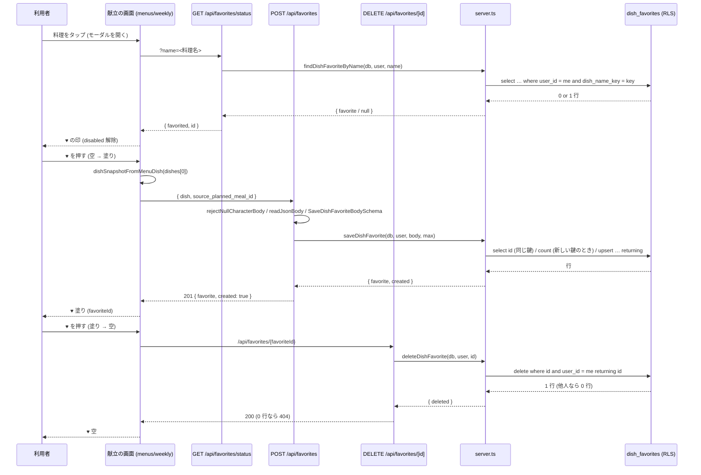
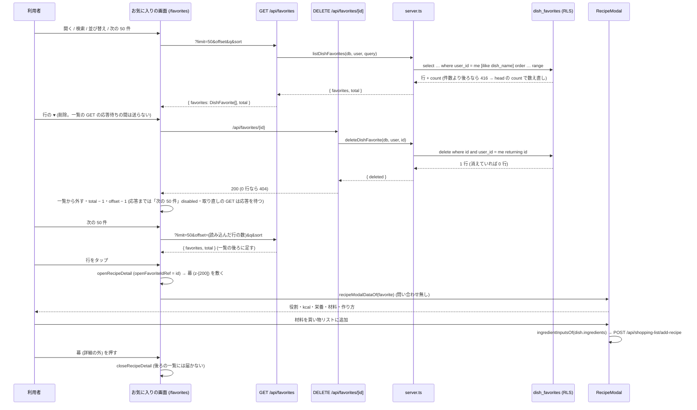

# 献立の料理のお気に入り (♥) を料理そのものごと保存する (#2011) 設計

| 版 | 日付 | 内容 |
|---|---|---|
| v1.0 | 2026-10-25 | 新設 (Issue #2011 の設計ゲート・A 型 4 相。献立の料理の ♥ を、料理そのもの (材料・作り方・栄養) の写しとして本人だけの表 `dish_favorites` に保存し、お気に入りの画面から詳細を開く) |
| v1.1 | 2026-10-25 | 設計ゲート R1 の修正 (1 冊にまとめ直す・DB の CHECK を Zod より緩い安全弁に・鍵の長さを Zod で見る・同時の ♥ の応答・server の単体テストの偽物・段分け・番兵の追随。§22) |
| v1.2 | 2026-10-25 | 設計ゲート R2 の修正 (材料の 3 つの形 (構造の形・長い 1 行・短い行) を写しが受ける・材料 1 行の上限を本番の実測で決め直す・jsonb の上限の再計算・献立の ♥ の応答を押した時点のモーダルに限る・同じ料理を開き直したときに ♥ の状態を引き直す。§22) |
| v1.3 | 2026-10-25 | 設計ゲート R3 の修正 (お気に入りの詳細に幕を足す・削除の応答で詳細を閉じる判定を応答の時点の行で行う・詳細の状態遷移表を足す。§22) |
| v1.4 | 2026-10-25 | 設計ゲート R4 の修正 (♥ の取得中の disabled を読んだ時点で skip していた e2e の 2 本目と、取得の前の値を読む探索の e2e を、disabled の解除を待つ形に直す (§7.16)・e2e の利用者と献立の事実 (F-34・F-35)。§22) |
| v1.5 | 2026-10-25 | 設計ゲート R5 の修正 (お気に入りの画面で削除の 200 / 404 のあと次のページの offset を 1 戻す・一覧の GET と削除を重ねない・一覧に無い行 (詳細だけが出していた行) の削除は読み直しで件数をそろえる・一覧のページングと削除の状態遷移表 §9.3 (d) を足す。§22) |

要件の正本は Issue #2011 の本文とコメント。本書はその上で決めた範囲と設計で、Issue と食い違ったら本書が正。
ファイル名は cross/22 (cross/ の既存は 01〜09・12・13a・13b・14〜21。10・11・13 は欠番)。

前提 (本書が従う条件):

- オーナーの選択 (2026-10-24 夜・選択式): ♥ を押した献立の料理を、材料・作り方・栄養ごと自分だけのお気に入りとして保存し、お気に入りの画面から詳細も開けるようにする。
- 本番の DB には書き込まない (本書の事実は 2026-10-25 の SELECT だけ。§3.4)。
- ローンチ前。本番の `recipe_likes` は 0 行・`recipes` は 0 行 (2026-10-25 の SELECT。§3.4)。お気に入りの機能は一度も動いていないので、既存の行の移行は無い。正しい形にしてよい。
- `recipe_likes` (公開レシピへの「いいね」) の表・RLS・外部キー・トリガー・関数は、本書では変えない (消すのは削除の migration で、名指しの承認が要る。§21 Q-1)。公開レシピの「いいね」の API (`/api/recipes/[id]/like`) と `isLiked` も変えない。
- Next.js の API で service_role を使わない (本書の決め。書いた時点の cross/02 §3.3 の文「service_role を使う場所: Supabase Edge Function のみ」に合わせた。今の §3.3 は Next.js の `getSupabaseAdmin()` も挙げる)。RLS は本人の行だけ (cross/02 §4.1 の self-ownership)。
- 範囲外: 献立の生成 (generate-menu-v4 / v5) にお気に入りを好みとして渡すこと・AI 相談の `like_recipe` で献立の料理を保存すること・モバイルのネイティブの画面 (お気に入りは Web の `/favorites` を WebView で開く)・公開レシピの「いいね」をお気に入りの画面に並べること。新しい要求は発明しない (§21 に候補として残す)。

---

## 0. 外形固定と分冊判定 (相 1)

### 0.1 発注と決めること

発注 (Issue #2011): 献立の画面の料理のモーダルの ♥ を押しても保存されない。献立の料理は AI が作った名前だけで `recipes` の行を持たず、画面は料理の名前を id として `/api/recipes/[id]/like` に送る。`recipe_likes.recipe_id` は uuid で `recipes(id)` への外部キー (NOT NULL) なので入らない (#2010 の後は 404。前は 500)。お気に入りの画面も名前で消し、詳細は `recipe_uuid` が無いので開けない。

本書が答えを出すこと:

| # | 決めること | 答え (§6) |
|---|---|---|
| 1 | 保存の形: 料理のお気に入りの新しい表か、非公開の `recipes` の行を作って `recipe_likes` で指すか。公開レシピの「いいね」と同じ画面・同じ表で扱うか | 新しい表 `dish_favorites` (本人だけ・料理の写しを jsonb で持つ)。`recipe_likes` とは分ける。お気に入りの画面は `dish_favorites` だけを出す (§6.1) |
| 2 | 何を同じ料理と見るか (二度 ♥・作り直しで同じ名前の別の中身)。♥ の状態の引き方 | 本人ごとに正規化した料理名 (`dish_name_key`) で 1 件。♥ の状態は名前で引く (`GET /api/favorites/status?name=`)。同じ名前を ♥ したら「保存済み」として扱い、もう一度押すと消える (§6.2) |
| 3 | お気に入りの画面: 一覧・検索・並び替え・削除・詳細。公開レシピの「いいね」との並べ方 | 一覧は写しごと返す (詳細の API は作らない)。検索は名前の部分一致・並びは 新しい順 / 古い順 / 名前順・削除は id・詳細は献立と同じ `RecipeModal` で材料・作り方・栄養を出す。公開レシピの「いいね」は並べない (§6.3) |
| 4 | 既存の壊れた導線の片付け (`recipe_uuid`・外部キー 2 本・トリガーと関数・`refreshLikeCount`・AI 相談の `like_recipe`・`isLiked`) | 本書では消さない (削除の migration は名指しの承認が要る。§21 Q-1)。献立の画面とお気に入りの画面が `/api/recipes/[id]/like` を呼ぶのをやめる (§6.4) |
| 5 | 退会・書き出し・RLS・件数の上限 | 退会は `auth.users` の CASCADE で消える。書き出しは `ACCOUNT_EXPORT_TABLES` に足す。RLS は本人の行だけ。上限は 1 人 300 件 (環境変数で上書き可) (§6.5) |
| 6 | プライバシーポリシーの記載 | 第3条の「レシピ」の行 (『いいねや保存をしたレシピ』) に含まれる。文は変えない。表 → 行の対応 (T-34) に 1 行足す (§6.6) |
| 7 | モジュラーモノリスの切り方・Zod の正典・エラー表 | `src/modules/dish-favorites/` (`core.ts` = 定数・Zod・純関数、`server.ts` = DB の操作)。UI は `core` だけ、route は `core` と `server` を import する (§6.7・§8) |

### 0.2 要件行列

| # | 要件 | 根拠 | 本書の置き場 |
|---|---|---|---|
| R-1 | 献立の料理のモーダルの ♥ を押すと、その料理 (名前・役割・kcal・栄養・材料・作り方) が本人のお気に入りとして保存される | #2011・冒頭の前提の 1 項目め (料理を材料・作り方・栄養ごと保存) | §7.3・§7.4・§7.5 (POST)・§7.9 |
| R-2 | もう一度 ♥ を押すと消える。モーダルを開き直したとき (同じ料理を開き直したときも)・ページを読み直したときの ♥ の印は保存の状態と一致する。押したあとにモーダルを閉じたり別の料理を開いたりしても、その応答はいま開いているモーダルの印・id を変えない | #2011・`tests/e2e/bug-31-favorite-button.spec.ts` | §7.5 (status・DELETE)・§7.8・§7.9・§7.16・§9.3 (b)・§12 (再読込の確かめ方) |
| R-3 | お気に入りの画面で、保存した料理を一覧 (件数つき)・名前で検索・並び替え (新しい順 / 古い順 / 名前順)・削除できる。消したあとに「次の50件を表示」で次のページを読んでも、行が抜けたり重なったりしない (削除と一覧の取得が重なっても) | #2011・`src/app/(main)/favorites/page.tsx` の今の機能 | §7.5 (GET)・§7.10・§9.1 (a3)・§9.3 (d) |
| R-4 | お気に入りの画面から、料理の詳細 (材料・作り方・栄養) を開ける。材料を買い物リストに足せる。本番の献立の料理の材料の 3 つの形 (構造の形・長い 1 行・短い行。§3.4 F-31) のどれでも保存でき、材料が写しに残る。詳細は今と同じく幕 (半透明の黒) の上に開き、幕を押すと閉じ、開いている間は後ろの一覧に届かない (F-33)。詳細の ♥ で消した応答は、そのときに詳細が出している行が消した行のときだけ詳細を閉じる | 冒頭の前提の 1 項目め (お気に入りの画面から詳細を開ける)・`FavoriteRecipeModal` の今の機能 | §7.3・§7.10・§7.12・§9.3 (c) |
| R-5 | 献立が作り直されて同じ名前の別の中身になっても、お気に入りの写しは変わらない。献立 (planned_meals) が消えても残る | #2011「料理そのものを保存」 | §3.1 F-9・§6.2・§9.3 |
| R-6 | 同じ名前を二度 ♥ しても 1 件 (重ならない)。同時に 2 か所から押しても 1 件 | §0.1 の 2 | §7.1 (UNIQUE)・§7.4 (upsert)・§9.3 |
| R-7 | 他人のお気に入りは読めない・消せない・数えられない (RLS)。未ログインは 401 | cross/02 §4.1・`recipe_likes` の『Anyone can view likes』を繰り返さない | §7.1・§7.14 |
| R-8 | 1 人が保存できる件数に上限がある (既定 300。環境変数 `DISH_FAVORITES_MAX_PER_USER` で上書き)。超えると 409 で理由の文を返し、♥ は戻る | §0.1 の 5 | §7.3・§7.4・§7.5・§10 |
| R-9 | 保存する料理の中身の大きさに上限がある (Zod と DB の CHECK。§13)。外れる本文は 400 | マジックナンバー禁止・jsonb の肥大化の防止 | §7.1・§7.3 |
| R-10 | 退会で消える (CASCADE)。個人データの書き出しに `dish_favorites` が出る | #1131・#1175 | §7.1・§7.7・§16 |
| R-11 | プライバシーポリシーの第3条の表に対応する行がある (文は変えない) | cross/20 F-42・T-34 | §6.6・§17 |
| R-12 | `recipe_likes`・公開レシピの「いいね」の API・`isLiked`・AI 相談の `like_recipe`・献立の生成の `recipe_likes` の読み取りは変えない | 前提 | §18 |
| R-13 | 既存の e2e (bug-104・bug-31) が見る文言・`data-testid`・応答の形 (`favorites` の配列と `total`) を保つ | `tests/e2e/bug-104-favorites-system.spec.ts`・`bug-31-favorite-button.spec.ts` | §7.10・§7.16・§16 |
| R-14 | 本文を読む route は NULL 文字と壊れた JSON を 400 にし、一覧の route は件数より後ろのページを 500 にしない。失敗の文は日本語の固定の文 | #1657・#1917 の見張り (§16) | §7.5 |
| R-15 | 新しい migration は追加だけ (既存の表・行に触らない)。戻し口を対で置く。番号はマージの直前に確定する | 設計書の規約 | §7.1・§7.2 |
| R-16 | 画像は保存しない (料理の画像は献立の非公開バケットの署名付き URL で、献立と一緒に消える) | cross/19 | §6.2 |
| R-17 | 保存した料理の表示は献立のモーダルと同じ部品 (`RecipeModal`) で行う (材料・作り方・栄養の描き方を 2 か所に持たない) | 保守 | §7.12 |

### 0.3 ユーザーシナリオ (29 本。トレースは §4.3)

| # | シナリオ | 期待 |
|---|---|---|
| S-1 | 献立の料理「肉じゃが」のモーダルを開き、♥ を押す | `POST /api/favorites` が 201。♥ が塗られる。お気に入りに「肉じゃが」が材料・作り方・栄養ごと入る |
| S-2 | モーダルを閉じて、同じ「肉じゃが」をもう一度開く | `GET /api/favorites/status?name=肉じゃが` が `{ favorited: true, id }`。♥ は塗られたまま |
| S-3 | 塗られた ♥ をもう一度押す | `DELETE /api/favorites/{id}` が 200。♥ が空になり、一覧から消える |
| S-4 | 「肉じゃが」を保存したあと、その食事を「AIで変更」で作り直し、別の材料の「肉じゃが」が出る。そのモーダルを開く | ♥ は塗られている (名前で引く)。保存してある写しは最初の「肉じゃが」のまま |
| S-5 | S-4 の状態で ♥ を押す | DELETE で最初の写しが消え、♥ は空になる。もう一度押すと新しい「肉じゃが」が保存される |
| S-6 | お気に入りの画面を開く | `GET /api/favorites?limit=50&offset=0&sort=newest` が `{ favorites, total }`。新しい順の一覧と「N 件」 |
| S-7 | 一覧の 1 行をタップする | 一覧が持つ写しで `RecipeModal` が開く (問い合わせ無し)。役割・kcal・栄養・材料・作り方が出る。「材料を買い物リストに追加」が `/api/shopping-list/add-recipe` に POST する |
| S-8 | 一覧の行の ♥ (削除) を押す | `DELETE /api/favorites/{id}` が 200。行が消え、「N 件」が 1 減る |
| S-9 | 検索に「じゃが」を入れ、並びを「名前順」にする | `q=じゃが&sort=name`。`dish_name` の部分一致で絞り、`dish_name_key` の昇順 |
| S-10 | 一覧の最後のページで最後の 1 件を消し、同じ offset で読み直す | PostgREST の 416 を `resolveBeyondLastPage` が受け、空のページと本当の件数を返す (500 にしない) |
| S-11 | 300 件保存している人が 301 件目の ♥ を押す | `POST` が 409 `CONFLICT_DISH_FAVORITES_LIMIT`。♥ は戻り、理由の文が出る |
| S-12 | 本文が壊れている・料理の名前が空・材料が 51 件・NULL 文字を含む | 400 (壊れた JSON / 検証 / NULL 文字)。♥ は戻る |
| S-13 | 未ログインで 4 つの route を呼ぶ | すべて 401 `{ error: 'ログインが必要です' }`。DB に触れない |
| S-14 | 他人のお気に入りの id を DELETE する・他人の一覧を読もうとする | RLS で 0 行。DELETE は 404、一覧は自分の分だけ |
| S-15 | お気に入りを持つ人が退会する | `auth.users` の削除で CASCADE。書き出し (`/api/account/export`) には `dish_favorites` が本人の分だけ出る |
| S-16 | 2 つのタブで同じ「肉じゃが」のモーダルを開いておき、(a) 両方の ♥ を同時に押す / (b) タブ A で保存したあと、開いたままのタブ B (♥ は空のまま) で押す | UNIQUE (user_id, dish_name_key) と upsert で、どちらも 1 行 (同じ id。写しは後に届いた内容)。(a) は両方の確認 (`saveDishFavorite` の upsert の前の select) が相手の保存より先に走れば両方とも「行なし」を見て、両方とも 201 `created: true` (片方の確認が相手の保存の後に走れば、その片方は (b) と同じ)。(b) はタブ B の確認が行を見つけるので 200 `created: false`。どちらのタブも ♥ は塗られ、`favoriteId` は同じ id |
| S-17 | お気に入りを保存した食事を献立から消す・週を作り直す | お気に入りは残る (写し。`source_planned_meal_id` は参照だけで外部キーを張らない) |
| S-18 | 公開レシピの画面で ♥ (いいね) を押す | 今までどおり `recipe_likes` (uuid)。本書の表には入らない・お気に入りの画面にも出ない |
| S-19 | 料理の名前が空白だけ・101 文字以上・NULL 文字を含む・NFKC で正規化すると 101 文字以上になる (例: 「㌀」(U+3300) は「アパート」の 4 文字になるので、30 個で鍵が 120 文字) | status は 400 `VALIDATION_ERROR` (DB に渡さない)。POST も 400 (NULL 文字は本文の検査で `INVALID_CHARACTER`)。DB の CHECK (23514 → 500) には届かない |
| S-20 | 材料も作り方も無い料理 (買う・外食の献立の料理) を ♥ する | 保存できる (空の配列)。詳細は「材料情報なし」「作り方」の案内 |
| S-21 | 材料が構造の形 (`{ name, amount_g, note }` の配列。本番の料理の 6 割。F-31) の料理を ♥ し、お気に入りの画面で詳細を開いて「材料を買い物リストに追加」を押す | 201。写しの `ingredients` は構造の形のまま (名前・分量 g・メモ)。詳細は `ingredients_md` の表。買い物リストには `{ name, amount: '<分量>g' }` が材料の数だけ入る |
| S-22 | 材料が 1 つの長い文 (100 文字を超える 1 行。本番の料理の 16%。F-31) の料理を ♥ する | 201 (1 行の上限は 2000 文字)。詳細は献立のモーダルと同じく長い 1 行を分けた表。買い物リストは献立の画面と同じ正規表現で分ける (`ingredientInputsOf`。重複は除かない。§9.2『買い物リストへの追加』) |
| S-23 | 料理 A のモーダルで ♥ を押し、応答が返る前に閉じて、保存済みの料理 B を開く | A の応答は捨てる (B のモーダルの ♥ の印・`favoriteId`・取得中の印を変えない)。B の ♥ は B の status のとおり塗り・`favoriteId` = B の id。A の保存は DB では応答どおり (A は S1) |
| S-24 | 保存済みの料理 X のモーダルで「材料を買い物リストに追加」を押す (成功するとモーダルが閉じ、`selectedRecipe` は X のまま) → 同じ料理 X をもう一度タップ | 開くたびに status を引き直す。♥ は塗り・`favoriteId` = X の id (押すと DELETE) |
| S-25 | お気に入りの画面で行 F の詳細を開いたまま、詳細の外 (後ろの一覧の別の行・行の ♥・検索欄・下のナビの位置) を押す | 詳細の後ろは幕で暗い。押した所は幕が受けて詳細が閉じる (今の詳細と同じ)。後ろの行は開かず、行の ♥ の削除も検索も起きない |
| S-26 | お気に入りの画面で行 F の詳細の ♥ を押し、応答が返る前に詳細を閉じて、別の行 G の詳細を開く | 応答を待つ間はどの詳細の ♥ も押せない (disabled)。F の削除の応答 (200) は一覧から F を外し件数を 1 減らすが、G の詳細は閉じない。F の詳細を開いたままなら、応答で閉じる |
| S-27 | 51 件以上を保存している利用者が、お気に入りの画面の 1 ページ目で行 F の ♥ (または F の詳細の ♥) を押して消し、「次の50件を表示」を押す | 削除 (200。404 も同じ) で一覧から F が外れ「N 件」が 1 減り、次のページの GET は `offset=49` (読み込んだ 50 行 − 消した 1 行)。サーバーで 1 つ前に詰まった元の 51 件目も一覧に出る (抜けない・重ならない)。k 件消せば `offset` は 50 − k |
| S-28 | (a) 行 F の ♥ の応答の前に、「次の50件を表示」・並び替え・検索語の確定・上の更新ボタンを押す / (b)「次の50件を表示」や検索の応答の前に、行の ♥・詳細の ♥ を押す | (a) 削除の応答待ちの間は「次の50件を表示」は押せない (disabled)。並び替え・検索・更新の GET は削除の応答のあとに送られ、F の無い一覧と本当の件数になる。(b) 一覧の GET の応答待ちの間の ♥ は何も送らない (応答のあとに押せば消える) |
| S-29 | お気に入りの画面で検索語を入れてすぐ (debounce の 300ms の前に) 行 F の詳細を開き、F を含まない検索の結果が届いたあと (詳細 F は開いたまま)、詳細の ♥ で F を消す | 削除 (200) で詳細が閉じる。一覧 (検索の結果) と次のページの `offset` は変えない (読み込んだ先頭の部分は詰まらない)。1 ページ目を読み直して件数をそろえる (F が検索語に当たっていれば「N 件」が 1 減り、当たっていなければ変わらない) |

### 0.4 分冊判定

目安 (設計書 800 行超 / 消費先レーン 3 以上 / 共有面 2 つ以上) のうち、行数と共有面 (`src/lib/account-export-tables.ts`・`src/lib/env.ts`・`tests/legal-text-1901.test.ts` の表 → 行の対応) に当たる。ただし核 (表・モジュール・API) は 1 本の契約で閉じ、配線は献立のモーダル 1 か所とお気に入りの画面 1 枚 (どちらも「繋ぐだけ」) なので、**1 冊**にし、実装は段で分ける (§15: 段 A = DB・`core.ts`・書き出し、段 B1 = `server.ts`・環境変数・API、段 B2 = 画面)。段ごとに 2 枚レビューを閉じる。

- 本書の範囲は 1 冊で閉じる: 表・migration・モジュール・API 4 本・献立の ♥・お気に入りの画面 (一覧・検索・並び替え・削除・詳細)・テスト・段分けのすべてを本書が持ち、ほかの設計書を前提にしない。
- 核と配線を別の冊に分けるなら、切り方は 核 = §7.1〜§7.4・§7.6・§7.7・§7.13・§7.14 と §7.15 の core / server の単体テスト、配線 = §7.5・§7.8〜§7.12 と route・部品の単体テスト になる (§15 の段の境とは一致しない。段 B1 が `server.ts` と route の両方を持つ)。分けるかどうかは設計ゲートの運用の判断で、本書の中身はどちらでも変わらない。

### 0.5 用語

| 語 | 意味 |
|---|---|
| 料理 (dish) | 献立の 1 食 (`planned_meals`) の `dishes` (jsonb の配列) の 1 要素。名前・役割 (main / side / soup / rice …)・kcal・栄養・材料・作り方を持つ。`recipes` の行は無い |
| 料理の写し (DishSnapshot) | ♥ を押した時点の料理を、本書の Zod (§7.3) の形に写したもの。`dish_favorites.dish` に入る |
| お気に入り (dish favorite) | `dish_favorites` の 1 行 (本人 × 正規化した料理名で 1 件) |
| 料理名の鍵 (dish_name_key) | 表示名の空白を 1 つにまとめ、NFKC に正規化し、小文字にしたもの。同じ料理の判定に使う |
| 公開レシピの「いいね」 | `recipe_likes` の行 (uuid の `recipes` を指す)。本書では変えない |

### 0.6 読み方

- 実装は §7 の正典コードを写す。§8 の facade 契約と §13 の定数の名前を変えない。
- 表 3 点 (§9) とエラー表 (§10) は、レビューが最初に自分で作り直して突き合わせる対象。
- 本書の TS のブロックは、`// tsc:skip` を 1 行目に持つものを除き、そのまま型検査を通る形で書いてある (import を省かない)。`// tsc:skip` のブロックは、本書が新設するファイル (`./core`・`@/modules/dish-favorites/*`) を import するものと、既存ファイルの差分の断片。
- migration のファイル名は置き場 (`<番号はマージ時に確定>`・`<同じ番号>`) で書く。マージの後に番号を書き入れるときは、本書の名指しを全部同時に書き換える (`tests/helpers/design-doc-migration-number.ts` の規則。§7.13 の C-8 が本書に当てる)。マージの後に `20261025110000` を全部同時に書き入れた。

---

## 1. 目的・スコープ

- 目的: 献立の料理の ♥ を、料理そのものを保存する機能として動かす。保存した料理をお気に入りの画面で一覧・検索・削除し、詳細 (材料・作り方・栄養) を開けるようにする。
- 対象: 新しい表 `dish_favorites` (migration と戻し口)・モジュール `src/modules/dish-favorites/`・API 4 本 (`GET / POST /api/favorites`・`GET /api/favorites/status`・`DELETE /api/favorites/[id]`)・献立の画面の ♥ の配線・お気に入りの画面 3 ファイル・環境変数 1 つ・個人データの書き出しの 1 行・テスト。
- 対象外: §冒頭の前提のとおり。`recipe_likes` 系の片付けは §21 Q-1。

## 2. 関連要件・既存設計

| 文書 | 関係 |
|---|---|
| Issue #2011 | 要件の正本 |
| `docs/design/cross/02-rls-patterns.md` §3.1・§3.4・§4.1 | RLS の必須化・TRUNCATE を付けない・self-ownership の雛形 (本書の §7.1 はこの形) |
| `docs/design/cross/04-api-conventions.md` §4.1・§5.2 | エラーコードの接頭辞 (`CONFLICT_` = 409)・flat の本文の形 |
| `docs/design/cross/19-private-photo-buckets.md` | 料理の画像は非公開バケットの署名付き URL。本書は画像を写さない (R-16) |
| `docs/design/cross/20-terms-privacy-text.md` §2.2 F-42・T-34 | 利用者に紐づく表 → 第3条の行の対応。本書は `dish_favorites` を「レシピ」の行に対応させる (§6.6・§17) |
| `docs/design/cross/21-recipe-author-display-name.md` | `recipe_likes` と `viewer-lookups.ts` を触る別の設計。本書は `recipe_likes` と `viewer-lookups.ts` に触らないので衝突しない (§18) |
| `docs/design/cross/15-data-subject-requests.md`・#1131 | 書き出しの許可一覧 (`ACCOUNT_EXPORT_TABLES`) に足す |

## 3. 現状の事実 (origin/main `edff659e4`・本番の読み取り 2026-10-25)

### 3.1 API・画面・lib

| # | 事実 | 場所 |
|---|---|---|
| F-1 | 献立の画面は、料理のモーダルを開くと `GET /api/recipes/{料理名}/like` で ♥ の状態を引き (失敗の応答では印を変えない。取得中の印 `isFavoriteLoading` は立てないので、♥ は取得中も押せる)、♥ の押下で `POST` / `DELETE` を楽観的更新で送る (失敗で戻す。押下中だけ `isFavoriteLoading` を立てる。`RecipeModal` の ♥ は `disabled={isFavoriteLoading}`) | `src/app/(main)/menus/weekly/page.tsx:1924-1935` (コメント 1 行と useEffect)・`:3485-3502`・`_components/modals/RecipeModal.tsx:330` |
| F-2 | モーダルを開くとき、料理 (`dishesArray[idx]`) の新形式 (`calories_kcal` など) を優先し旧形式 (`cal` など) から埋めた `normalizedDish` を作り、`selectedRecipeData = { ...normalizedDish, imageUrl, dishes: [normalizedDish], allIngredients }` にする。`selectedRecipe` は料理名 | 同 `:5432-5472` |
| F-3 | ♥ の状態は `recipeReducer` の `isFavorite` / `isFavoriteLoading` (`FAVORITE_SET` / `FAVORITE_LOADING_SET`)。`RECIPE_SELECT` は payload が null のときだけ `isFavorite` を戻す | `src/app/(main)/menus/weekly/_state/reducers/recipeReducer.ts:26-27`・`:57-70` |
| F-4 | `RecipeModal` は `selectedRecipe` (名前)・`selectedRecipeData` (any)・`isFavorite`・`isFavoriteLoading`・`onToggleFavorite`・`onAddToShoppingList` を受け、役割・kcal・画像・栄養の 27 行 (`:243-280`。「エネルギー」(`calories_kcal`) と、写しの栄養 29 項目のうち `fiber_soluble_g`・`fiber_insoluble_g`・`magnesium_mg` を除く 26 項目。`protein_g`・`fat_g`・`carbs_g` のどれかが 0 でないときだけ描く)・材料 (`dishes[0].ingredientsMd` か `ingredients` から表)・作り方 (`dishes[0].recipeStepsMd` か `recipeSteps`) を描く。♥ は `data-testid="favorite-button"`・`aria-pressed` | `src/app/(main)/menus/weekly/_components/modals/RecipeModal.tsx:122-150`・`:330-346` |
| F-5 | いいねの API: GET は UUID でない id に `{ liked: false }`、POST・DELETE は 404。POST は `recipe_likes` へ upsert し、外部キー違反 (`recipe_likes_recipe_id_fkey`) を 404 にする。`refreshLikeCount` は `recipe_id` で数え、`recipes.name` で UPDATE する #258 の名残 (uuid では当たらない) | `src/app/api/recipes/[id]/like/route.ts:18-40`・`:47-52`・`:64-70`・`:104-109` |
| F-6 | お気に入りの一覧 API は `recipe_likes` を `user_id` で絞り、`q` は `recipe_id` の ilike、並びは `created_at` / `recipe_id`、列の無い本番 (42703) に 3 段で退く。返す形は `{ favorites: [{ id, recipeName, recipeUuid, likedAt }], total }`。416 は先頭 1 件で total を取り直す | `src/app/api/favorites/route.ts:22-35`・`:65-70`・`:80-96` |
| F-7 | お気に入りの画面は `PAGE_SIZE = 50`、削除は `DELETE /api/recipes/{名前}/like`、詳細は `FavoriteRecipeModal` が `recipeUuid` があるときだけ `/api/recipes/{uuid}` を取り、無ければ「詳細情報が保存されていません」。`recipe_uuid` はどの導線も書かない | `src/app/(main)/favorites/page.tsx:30`・`:106-120`・`_components/FavoriteRecipeModal.tsx:8-11`・`:95-105` |
| F-8 | 一覧の 1 行 `FavoriteListItem` は `item.recipeName`・`item.likedAt` を描き、「レシピを見る」と「お気に入りから削除」の 2 つの `<button>` を兄弟で並べる (#1050) | `src/app/(main)/favorites/_components/FavoriteListItem.tsx:16-27`・`:52-60` |
| F-9 | 献立の作り直し: `meal/regenerate` は `planned_meals` を insert と update で書き換える。`day/regenerate`・`v4/generate` は insert 中心。同じ料理名でも中身は変わり得る。`dishes` の中に料理の一意の id は無い | `src/app/api/ai/menu/meal/regenerate/route.ts:100`・`:130`・`supabase/baseline/prod_schema.sql:5904` (dishes の COMMENT) |
| F-10 | 料理の型 `DishDetail`: `name`・`role?`・`ingredient?`・`ingredients?: string[]`・`recipeSteps?: string[]`・`ingredientsMd?`・`recipeStepsMd?`・`displayOrder?`・画像の列・栄養 30 項目 (`calories_kcal` と、`protein_g` … `polyunsaturated_fat_g` の 29 項目)。`LegacyDishDetail` は旧形式の短いキー (`cal`・`protein` … `folicAcid`) を足す。ただし `ingredients` の型 (`string[]`) は実データと合わない: 献立の生成 (Edge Function) は材料を `{ name, amount_g, note }` の配列で書く (F-31) | `types/domain.ts:642-704`・`src/app/(main)/menus/weekly/_state/types.ts:8-33`・`supabase/functions/_shared/meal-generator.ts:228`・`meal-generator-v5.ts:584` (プロンプトの形 `"ingredients": [{ "name": "食材名", "amount_g": 数値, "note": "任意" }]`) |
| F-11 | AI 相談の `like_recipe` は `recipe_likes` を `recipe_id` と `user_id` で select (`.single()`) し、無ければ insert する。プロンプトは `recipeId` を uuid と説明する | `src/lib/ai/consultation-action-executor.ts:1335-1359` (origin/main `32f1d64bf`。#2013 の前の `edff659e4` では `:1319-1343`。中身は同じ)・`src/app/api/ai/consultation/sessions/[sessionId]/messages/route.ts:748` |
| F-12 | 公開レシピの `isLiked` は `recipe_likes.recipe_id` で引く (`loadRecipeViewerLookups`)。cross/21 がこのファイルを差し替える設計を持つ | `src/lib/recipes/viewer-lookups.ts:53-75` |
| F-13 | 個人データの書き出し: `recipe_likes` は `self('user_id')`・`orderBy: ['user_id', 'recipe_id']`。新しい表は同じ配列に行を足す。分類漏れは `tests/account-export-tables.test.ts` が本番のスナップショットと新しい migration から見つける | `src/lib/account-export-tables.ts:1-15`・`:182-183` |
| F-14 | プライバシーポリシー第3条の「レシピ」の行は『いいねや保存をしたレシピ、ユーザーが登録したレシピとコメント』。表 → 行の対応は `tests/legal-text-1901.test.ts` の `PRIVACY_DATA_TABLES` (`recipe_likes: 'レシピ'` など) が、書き出しの許可一覧と除外一覧の全表について閉じる (T-34) | `src/lib/legal/privacy-text.ts:213`・`tests/legal-text-1901.test.ts:127-200`・`:872-880` |
| F-15 | 献立の生成 (Edge Function) は `recipe_likes.recipe_id` を 30 件読み、好みの文脈に使う (uuid なので今は料理名として意味を持たない) | `supabase/functions/generate-menu-v4/index.ts:1211-1225`・`generate-menu-v5/index.ts:1995-2000` |
| F-16 | モバイル: お気に入りのネイティブの画面は無い (#1598 で消した)。献立とお気に入りは Web の画面を WebView で開く。通知の行き先 `/favorites` はある | `apps/mobile/README.md:66-75`・`apps/mobile/__tests__/lib/notification-route.test.ts:91` |
| F-17 | 環境変数で上書きできる上限の前例: `MENU_PLANS_ADD_MAX_DATE_OFFSET_DAYS` (読む場所を 1 つに決め、`src/lib/env.ts` に `readOnlyBy` で載せ、`.env.example` に書く) | `src/lib/menu-plan-date-offset.ts:1-32`・`src/lib/env.ts:417-424`・`.env.example:273-275` |
| F-18 | 本文の読み方の決まり: NULL 文字は `rejectNullCharacterBody` を handler の最初に (`src/__tests__/api/null-character-routes.test.ts` の表)、壊れた JSON は `readJsonBody` で 400 (`tests/api-invalid-json-scan.test.ts`)、一覧の 416 は `resolveBeyondLastPage` (`tests/api-list-range-scan.test.ts`)、失敗の文は `src/lib/api/error-responses.ts` の日本語 (`tests/api-error-japanese-scan.test.ts`。`src/app/api/favorites` は見張りの範囲) | `src/lib/http-params.ts:60-75`・`src/lib/api/list-range.ts`・`tests/helpers/api-error-japanese-scope.ts:46` |
| F-19 | `src/modules/` は無い (facade の前例は無い)。`@/*` は `./src/*` と `./*` に解決する | `tsconfig.json:25-29` |
| F-20 | 公開の紹介ページの主張 `favorites` (『気に入ったレシピをお気に入りに残せる (献立のレシピのハートから)』) の根拠は `src/app/(main)/favorites/page.tsx` と `src/app/api/favorites/route.ts` | `src/components/marketing/landing-copy.ts:885` |
| F-33 | 幕 (詳細の後ろの半透明の黒): `RecipeModal` はパネル (`motion.div`・`fixed … z-[201]`) を `FocusTrap` (`allowOutsideClick: true`) で包むだけで、幕を描かない。献立の画面は `{activeModal && (<> <motion.div className="fixed inset-0 z-[200]" style={{ background: 'rgba(0,0,0,0.5)' }} onClick={() => setActiveModal(null)} /> …)}` の共有の幕を敷く (`useDialogA11y` の冒頭の注記も「バックドロップは page.tsx 側の共有 {activeModal && ...} が担う」)。今のお気に入りの詳細は `BottomSheet` を使い、その幕 (`rgba(0,0,0,0.5)`・`closeOnOverlayClick` の既定 true で押すと閉じる・`overlayClassName="z-[210]"`) が一覧を覆う。お気に入りの画面の上の帯は `position: sticky`・`zIndex: 50`、`(main)` の下のナビと横のメニューは `z-50` | `src/app/(main)/menus/weekly/_components/modals/RecipeModal.tsx:144-162`・`src/app/(main)/menus/weekly/page.tsx:6224-6232`・`src/components/common/useDialogA11y.ts:4-6`・`src/app/(main)/favorites/_components/FavoriteRecipeModal.tsx:16`・`:170-175`・`src/components/common/BottomSheet.tsx:78`・`:146-150`・`src/app/(main)/favorites/page.tsx:146-148`・`src/app/(main)/MainLayout.tsx:50`・`:230` |
| F-36 | お気に入りの画面の一覧のページング: `offset` は次のページの GET の offset。GET の応答で `setOffset(nextOffset + fetched.length)`・`setHasMore(fetched.length === PAGE_SIZE)`。検索語・並び替えが変わると effect が `setOffset(0)` のあと `fetchFavorites(0)`。上の更新ボタンは `fetchFavorites(0)`。「次の50件を表示」は `fetchFavorites(offset)`・`disabled={loadingMore}`。`handleRemove` は一覧と `total` を減らすが `offset` に触れない。一覧の GET どうし・GET と削除の応答の順の見張りは無く、どの GET も `finally` で `loading`・`loadingMore`・`isSearching` を 3 つとも下ろす。今は削除が必ず 404 (F-7) で一覧を変えないので、削除と `offset` の食い違いには届かない | `src/app/(main)/favorites/page.tsx:66-99` (`:89`・`:90`・`:93-98`)・`:101-104`・`:106-121`・`:189`・`:320-340` (`:322`・`:323`) |

### 3.2 DB (ベースライン `supabase/baseline/prod_schema.sql`)

| # | 事実 | 場所 |
|---|---|---|
| F-21 | `recipe_likes`: `user_id uuid NOT NULL`・`recipe_id uuid NOT NULL`・`created_at`・`recipe_uuid uuid`・`id uuid NOT NULL`。PK (user_id, recipe_id)。外部キー 3 本 (`recipe_id` → recipes CASCADE・`recipe_uuid` → recipes CASCADE・`user_id` → auth.users CASCADE) | `:6086-6094`・`:7404-7405`・`:9276-9287` |
| F-22 | `recipe_likes` の RLS: 『Anyone can view likes』(SELECT TO authenticated USING true) のほか、本人の INSERT / DELETE / ALL / SELECT。トリガー `trg_sync_recipe_like_count` と関数 `sync_recipe_like_count` (`recipe_uuid` が NULL なら何もしない)・`increment / decrement_recipe_like_count` | `:9590`・`:9739`・`:9787`・`:9864`・`:10064`・`:8538`・`:3365-3399`・`:1478-1495`・`:1884-1901` |
| F-23 | `recipes`: `id`・`user_id` (NULL 可)・`name`・`ingredients jsonb`・`steps text[]`・`is_public`・`like_count` など。RLS は本人の管理と公開の閲覧 | `:6114-6141`・`:9894`・`:10072` |
| F-24 | `planned_meals.dishes` は jsonb (配列形式。画面はオブジェクト形式も受ける)。`dish_name text NOT NULL`。料理ごとの id は無い | `:5834-5898`・`:5904` |
| F-25 | `update_updated_at_column()` (BEFORE UPDATE で `updated_at` を入れるトリガー関数) がある (`trg_recipes_updated_at` が使う) | `:3600`・`:8526` |
| F-26 | 新しい表の権限の定型: `CREATE TABLE IF NOT EXISTS` → `ENABLE ROW LEVEL SECURITY` → 既定の権限を `REVOKE ALL ... FROM PUBLIC, anon, authenticated` で外してから必要なものだけ `GRANT`。anon / authenticated に `GRANT ALL` / `TRUNCATE` を書かない。戻し口は `DROP TABLE IF EXISTS` だけ。1 行目 `-- migration:`・2 行目 `-- 戻し方:`・戻し口の 1 行目 `-- rollback:` | `supabase/migrations/20261024100000_apple_sign_in_tokens.sql`・`20261016220000_data_subject_requests.sql:85-100`・cross/02 §3.4 |
| F-27 | 最新の migration は `20261024140000_announcements_moderation_flags_select_only.sql` (番号はマージの直前に確定する) | `supabase/migrations/` |

### 3.3 既存のテストと番兵

§16 に全列挙する。要点: `tests/api/favorites-route.test.ts` (一覧 API の単体)・`src/app/(main)/favorites/_components/__tests__/FavoriteListItem.test.ts`・`FavoriteRecipeModal.test.ts`・`tests/e2e/bug-104-favorites-system.spec.ts`・`bug-31-favorite-button.spec.ts`・`tests/e2e/.exploration/recipe-shopping-explore.spec.ts` (S3)・`tests/route-invalid-input-1917.test.ts:331-410` (いいねの route。変えない)。

| # | 事実 | 場所 |
|---|---|---|
| F-34 | ♥ (`data-testid="favorite-button"`) を読む・押す e2e は 5 本 (§16)。そのうち `bug-31-favorite-button.spec.ts` (2 本) と `refactor-baseline/weekly-characterization.spec.ts:446-480` は `tourPendingUser` で走る。`tourPendingUser` は試験ごとに `createFreshUser` で作り、終わりに `cleanupFreshUser` (`admin.deleteUser`。CASCADE で本人の行も消える) で消す利用者で、fixture は献立を作らない。献立が無いと「レシピを見る」が無く、bug-31 は 2 本とも冒頭の `test.skip(true, 'No recipe available for E2E user')` で抜け、特性テストは注記を足して return する。W5C-12・B5-5・探索 S3 は固定の試験用アカウント (`E2E_USER_EMAIL`) で、保存した行は走行をまたいで残る | `tests/e2e/fixtures/fresh-user.ts:577-624`・`tests/e2e/bug-31-favorite-button.spec.ts:20-24`・`:79-83`・`weekly-characterization.spec.ts:456-462`・`w5-9-multitab-realtime-adversarial.spec.ts:30-37` (`loginInContext`)・`tests/e2e/fixtures/auth.ts:518` (`login`) |
| F-35 | `playwright.config.ts` は `testDir: "./tests/e2e"` で `testIgnore` を持たないので、`tests/e2e/.exploration/` の spec も `npm run test:e2e` で走る。`expect` の既定の待ちは 10 秒。Playwright の `click()` は押す前に要素が enabled になるのを待つ (操作の待ち)。`isDisabled()`・`getAttribute()` は待たずに、その時点の値を返す | `playwright.config.ts:18-21`・`package.json` の `test:e2e` |

### 3.4 本番の読み取り (2026-10-25。SELECT だけ。書き込みなし)

| # | 事実 | 読み方 |
|---|---|---|
| F-28 | `recipe_likes` 0 行・`recipes` 0 行。`dish_favorites` という表は無い。`recipe_likes` のポリシーは 5 本 (F-22 のとおり)・外部キーは 3 本 | `count(*)`・`information_schema.tables`・`pg_policies`・`pg_constraint` |
| F-29 | `planned_meals` のうち `dishes` を持つ行は 727 (すべて配列形式。1 食の最大 5 品)。`dishes` の 1 食あたり平均 5,858 バイト・最大 10,840 バイト | `jsonb_typeof`・`octet_length` |
| F-30 | 料理 2,333 件: 名前の最大 24 文字・材料の最大 14 件・作り方の最大 6 手順・`ingredientsMd` の最大 290 文字・`recipeStepsMd` の最大 280 文字・1 料理の最大 3,904 バイト (平均 1,823)。`ingredients` を持つ 2,277・`ingredientsMd` 1,806・`recipeSteps` 2,099・`recipeStepsMd` 1,806・`image_url` 1,267。旧形式の `cal` を持つ料理は 0。作り方の要素はすべて文字列で、1 手順の最長は 429 文字 | `jsonb_array_elements` で数えた。§13 の上限の根拠 |
| F-31 | 料理 2,333 件の材料 (`ingredients`) の形は 4 つで、1 つの料理の中で形が混ざるものは 0: (i) 構造の形 `{ name, amount_g, note }` の配列 = 1,445 件 (要素 6,433。キーは `name` (文字列・最長 11 文字・空は 0)・`amount_g` (数・0.1〜400・小数は 1 桁まで)・`note` (文字列・最長 19 文字。キーが無い要素もある) の 3 つだけ。1,445 件すべてが `ingredientsMd` を持つ) / (ii) 1 つの長い文の 1 要素 = 371 件 (どれも 200 文字を超え、最長 677 文字。100 文字を超える要素は 379 個。371 件とも `ingredientsMd`・`recipeStepsMd` を持たない) / (iii) 短い行 (「名前 分量」) の文字列の配列 = 415 件 / (iv) 材料なし (キーが無い・空の配列) = 102 件。値そのものは本書に写さない (形と数だけ) | `jsonb_typeof`・`jsonb_object_keys`・`char_length` で数えた。§7.3 の `DishIngredientSchema` と §13 の材料の上限の根拠 |
| F-32 | 献立の画面の「材料を買い物リストに追加」(`addRecipeToShoppingList`) は材料を `string[]` として扱い、`ing.match(…)` で名前と分量に分ける。(i) の構造の形の料理では `match` が無いので例外になり、`catch` が `alert("追加に失敗しました")` を出す (既存の不具合。本書の範囲外で、本書は献立の画面のこの関数を変えない。§21 Q-8)。材料は `selectedRecipeData.dishes` の各料理の `ingredients` と、旧形式のフォールバックの `selectedRecipeData.ingredients` の両方から集め、`[...new Set(…)]` で同じ文字列を 1 つにしてから分ける。F-2 のとおり `selectedRecipeData` は `{ ...normalizedDish, dishes: [normalizedDish] }` なので同じ料理の材料の列が 2 回集まり、この重複の除去がそれを 1 回に戻す。分ける正規表現は関数の中に直に書かれている (本書の `INGREDIENT_AMOUNT_PATTERN` (§7.3) はこれと同じ文字列の写し)。本番の料理で、1 つの料理の材料に同じ要素 (文字列は同じ文字列・構造の形は同じ `name` と `amount_g`) が 2 つ以上あるものは 0 件 (材料を持つ 2,231 件中)。成功のときは `setActiveModal(null)` だけを呼び、`selectedRecipe` は残る (閉じるボタンの `onClose` だけが両方を戻す) | `src/app/(main)/menus/weekly/page.tsx:3506-3565` (2 か所から集める `:3510-3524`・重複の除去 `:3527`・正規表現 `:3537`)・`:6353`。重複の数は `planned_meals.dishes` の料理ごとに要素を数えた |

---

## 4. 構想 (相 2)

### 4.1 構造 (構造 A)

```
献立の画面 (menus/weekly/page.tsx)                      お気に入りの画面 (favorites/page.tsx)
  モーダルを開く → GET /api/favorites/status?name=      一覧 → GET /api/favorites?limit&offset&q&sort
  ♥ 押す (空→塗り) → POST /api/favorites { dish }       行の ♥ → DELETE /api/favorites/[id]
  ♥ 押す (塗り→空) → DELETE /api/favorites/[id]         行をタップ → 幕 + 一覧の写しで RecipeModal (問い合わせ無し)
          │                                                       │
          └──────── core.ts (純関数: 料理 → 写し / 写し → RecipeModal の形 / 材料 → 買い物リストの入力) ─┘
                                        │
                     route 4 本 (src/app/api/favorites/**)
                                        │
                     server.ts (list / findByName / save / delete。RLS の効く client を受け取る)
                                        │
                     public.dish_favorites (本人 × dish_name_key で 1 行・dish jsonb = 写し)
```

- **表**: `dish_favorites` (§7.1)。1 行 = 本人 × 料理名の鍵。`dish` (jsonb) に料理の写し (§7.3 の `DishSnapshot`) を入れる。`source_planned_meal_id` は「どの食事から保存したか」の参照だけ (外部キーを張らない。献立が消えても残す)。
- **同じ料理の判定**: 本人ごとの `dish_name_key` (表示名の空白を 1 つに・NFKC・小文字)。UNIQUE (user_id, dish_name_key)。
- **写しの中身**: 名前・役割・kcal・栄養 29 項目 (kcal を除く)・材料 (配列と markdown。配列の要素は 1 行の文字列か構造の形 `{ name, amount_g, note }` で、献立の料理の形のまま写す。F-31)・作り方 (配列と markdown)。画像は写さない (R-16)。
- **モジュール**: `src/modules/dish-favorites/core.ts` (定数・Zod・純関数。ブラウザでも使える) と `server.ts` (DB の操作。route だけが使う)。UI は `core` だけを import する。モジュールは `src/app` を import しない。
- **API**: `/api/favorites` の下に 4 本。既存の `GET /api/favorites` は `dish_favorites` を読む形に書き換える (応答の形は `{ favorites, total }` のまま、行の形は snake_case に改める)。
- **♥ の状態**: 名前で引く (status)。保存済みなら `favoriteId` を画面が持ち、押下で DELETE に使う。
- **一覧**: 写しごと返す (1 行 ≈ 2 KB。50 行で ≈ 100 KB。F-30)。詳細の API を作らない (一覧の行をそのまま `RecipeModal` に渡す)。
- **上限**: `saveDishFavorite` が、新しい名前のときだけ件数を数えて上限と比べる (同じ名前の上書きは数えない)。

### 4.2 動き

1. **モーダルを開く**: モーダルが開くたびに (同じ料理を開き直したときも) `GET /api/favorites/status?name=<名前>` を呼ぶ。応答 `{ favorited, id }` で `isFavorite` と `favoriteId` を入れる。読み込み中は `isFavoriteLoading` を立てる (♥ は disabled)。開く・閉じる・別の料理を選ぶたびに「モーダルの回」(`favoriteSessionRef`) を 1 つ進め、前の回の status・POST・DELETE の応答は捨てる (いまのモーダルの印・id・取得中の印に触れない)。
2. **♥ 押す (空 → 塗り)**: `selectedRecipeData.dishes[0]` を `dishSnapshotFromMenuDish` で写しにし、`POST /api/favorites { dish, source_planned_meal_id }`。201 / 200 の `favorite.id` を `favoriteId` に入れる。4xx / 5xx / 例外は ♥ を戻し、409・400 は本文の `error` を見せる。
3. **♥ 押す (塗り → 空)**: `DELETE /api/favorites/{favoriteId}`。200 と 404 (もう無い) は空にする。ほかは戻す。
4. **一覧**: `GET /api/favorites` は本人の行を `created_at` (newest / oldest) か `dish_name_key` (name) で並べ、`q` は `dish_name` の ilike。`resolveBeyondLastPage` で 416 を空のページにする。
5. **詳細**: 一覧の行 (`DishFavorite`) を `recipeModalDataOf` で `RecipeModal` の `selectedRecipeData` の形にして開く。後ろには `FavoriteRecipeModal` が描く幕 (`z-[200]`) を敷き、幕を押すと閉じる (開いている間は後ろの一覧に届かない。F-33)。♥ は塗り固定で、押すと削除 (6 と同じ DELETE) し、応答 (200 / 404) の時点で詳細がその行を出していれば閉じる (応答待ちの間はどの詳細の ♥ も disabled)。買い物リストは `ingredientInputsOf(dish.ingredients)` を `/api/shopping-list/add-recipe` に送る。
6. **削除**: `DELETE /api/favorites/[id]` は RLS で本人の行だけ消える。0 行なら 404。

### 4.3 シナリオのトレース (§4.1 の構造で手で走らせた記録)

| # | 走らせた結果 | 通る場所 |
|---|---|---|
| S-1 | 開く → status が `{ favorited: false, id: null }` → ♥ 押下 → `dishSnapshotFromMenuDish(dishes[0])` → POST → `saveDishFavorite`: 鍵 `肉じゃが` の行なし → 件数 0 < 300 → upsert → 201 `{ favorite, created: true }` → `favoriteId` に id。写しは名前・役割・kcal・栄養・材料・作り方 | §7.3・§7.4・§7.5・§7.9 |
| S-2 | 開く → status: `findDishFavoriteByName` が鍵で 1 行 → `{ favorited: true, id }` → ♥ 塗り・`favoriteId` あり | §7.5 status・§7.9 |
| S-3 | ♥ 押下 (塗り) → DELETE id → `deleteDishFavorite` が 1 行消す → 200 → ♥ 空・`favoriteId` null。一覧を読み直すと無い | §7.5 [id]・§7.9 |
| S-4 | 作り直し (F-9) で `planned_meals.dishes` が別の中身に。開く → status は名前で引くので `favorited: true`。表の `dish` は最初の写しのまま (何も書いていない) | §6.2・§9.3 (行 S1 × 作り直し) |
| S-5 | ♥ 押下 → DELETE (最初の写しが消える) → 空。再度押下 → POST (新しい中身) → 201。表は新しい写し | §9.3 |
| S-6 | `GET /api/favorites?limit=50&offset=0&sort=newest` → `listDishFavorites` → `created_at desc, id` → `{ favorites: DishFavorite[], total }` → 「N 件」 | §7.5 GET・§7.10 |
| S-7 | 行をタップ → `selectedFavorite` に行 → `FavoriteRecipeModal` が `recipeModalDataOf(favorite)` を `RecipeModal` に渡す → 役割・kcal・栄養 (`protein_g` などが 0 でなければ)・材料 (`ingredients_md` があれば表、無ければ `ingredients` を `ingredientLineOf` で 1 行の文字列にしたものから表)・作り方。買い物リストは `ingredientInputsOf` → POST → 「N 件の材料を買い物リストに追加しました」 | §7.12・§7.3 |
| S-8 | 行の ♥ (`removingId` null・`fetchesInFlightRef` 0) → DELETE id → 200 → 一覧から外し `total - 1`・`offset - 1` (次のページの GET の offset。S-27) | §7.10 (4) |
| S-9 | `q=じゃが&sort=name` → `ilike('dish_name', '%じゃが%')`・`order('dish_name_key')` → 名前順 | §7.4 |
| S-10 | offset が件数以上 → PostgREST 416 → `resolveBeyondLastPage` が同じ絞り込みで head の count → `{ favorites: [], total }` | §7.4・F-18 |
| S-11 | 300 行ある → POST (新しい名前) → `countDishFavorites` = 300 ≥ 300 → `{ ok: false, reason: 'limit' }` → 409 `{ error: 上限の文, code: CONFLICT_DISH_FAVORITES_LIMIT }` → 画面は ♥ を戻し `error` を alert | §7.4・§7.5・§10 |
| S-12 | 壊れた JSON → `readJsonBody` が `{ ok: false }` → 400 `API_INVALID_JSON_MESSAGE`。名前が空 → `SaveDishFavoriteBodySchema.safeParse` 失敗 → 400 `DISH_FAVORITE_INVALID_MESSAGE`。材料 51 件 → 同じ 400。NULL 文字 → `rejectNullCharacterBody` が認証の前に 400 `INVALID_CHARACTER` | §7.5・F-18 |
| S-13 | `supabase.auth.getUser()` が user null → 401 `API_UNAUTHENTICATED_MESSAGE`。`from` は呼ばれない | §7.5 |
| S-14 | DELETE 他人の id → RLS (`dish_favorites_self_delete`) で 0 行 → `deleted: false` → 404 `API_NOT_FOUND_MESSAGE`。一覧は `user_id = auth.uid()` の行だけ (RLS と `eq('user_id')` の二重) | §7.1・§7.4・§7.14 |
| S-15 | 退会 → `auth.users` の DELETE → `dish_favorites_user_id_fkey` CASCADE。書き出しは `ACCOUNT_EXPORT_TABLES` の `{ table: 'dish_favorites', scope: self('user_id'), orderBy: ['created_at', 'id'] }` | §7.1・§7.7・§16 |
| S-16 | (a) タブ A と B が同時に POST → 両方の `saveDishFavorite` の確認 (`select id … maybeSingle`) が「行なし」(`existing.data === null`) → 両方が件数を数える (< 上限) → 両方 upsert → UNIQUE で先の 1 本が INSERT・後の 1 本が待ってから `ON CONFLICT DO UPDATE` (写しは後の本文) → 両方とも `created: existing.data === null` = true で 201。1 行・同じ id。(b) タブ A の保存 (201) のあと、タブ B が古い印 (空) のまま POST → B の確認が行を見つける → 件数を数えずに upsert (`ON CONFLICT DO UPDATE`) → `created: false` で 200。どちらも B の ♥ は塗られ `favoriteId` は A と同じ id | §7.1・§7.4・§9.3 |
| S-17 | 食事を消す・週を作り直す → `planned_meals` が消える / 変わる。`dish_favorites` は外部キーを持たないので残る。`source_planned_meal_id` は指す先の無い uuid になるだけ (読まない) | §7.1 |
| S-18 | 公開レシピの ♥ → `POST /api/recipes/{uuid}/like` → `recipe_likes` (変えない)。`GET /api/favorites` は `dish_favorites` だけ読むので出ない | §18 |
| S-19 | status `name=`・空白だけ・101 文字・NULL 文字を含む・「㌀」× 30 (表示名 30 文字・鍵 120 文字) → `DishNameSchema.safeParse` 失敗 (NULL 文字は 1 つ目の `refine`、鍵の長さは `pipe` の中の `refine`) → 400 `DISH_FAVORITE_NAME_INVALID_MESSAGE`。DB には問い合わせない。POST も `dish.name` で同じ検証 → 400 `DISH_FAVORITE_INVALID_MESSAGE` (NULL 文字はその前に `rejectNullCharacterBody` が 400 `INVALID_CHARACTER`)。DB の CHECK `dish_favorites_dish_name_length`・`_key_length` に届く値は無い | §7.3・§7.5・§9.3・§10 |
| S-20 | 材料も作り方も無い料理 → 写しは `ingredients: []`・`recipe_steps: []`・md null → 保存できる。`RecipeModal` は「材料情報なし」と作り方の案内文を出す | §7.3・F-4 |
| S-21 | `dishSnapshotFromMenuDish` の `ingredientListOf` が `{ name, amount_g, note }` を `{ name (前後の空白を除く), amount_g (0 以上の数か null), note (空でない文字列か null) }` に写す → `DishIngredientSchema` の構造の形の枝 (name 1〜100 文字・note 200 文字以下) を通る → 201。詳細: `ingredients_md` があるのでその表 (無いときは `ingredientLineOf` が「名前 分量g (メモ)」の行にして `RecipeModal` が表にする)。買い物リスト: `ingredientInputsOf` が構造の形を `{ name, amount: '<amount_g>g' }` (amount_g が null なら amount null) にする → POST | §7.3・§7.12・F-31 |
| S-22 | `ingredientListOf` が長い 1 行をそのまま (前後の空白だけ除いて) 写す → 1 行の枝 (1〜2000 文字) を通る (本番の最長 677 文字) → 201。詳細: `recipeModalDataOf` の `ingredients` は 1 行のまま → `RecipeModal` の `formatIngredientsToMarkdown` が先頭の要素の 100 文字超を分けて表にする (献立と同じ)。買い物リスト: `ingredientInputsOf` は献立の画面と同じ正規表現で分け、分けられなければ 1 件 (`{ name: 行, amount: null }`)。献立の画面と違い重複の除去 (`new Set`) はしない (写しの材料を 1 回だけ読む。F-32) | §7.3・§13・F-31・F-32 |
| S-23 | A の ♥ → `handleToggleFavorite` が押した時点の回 `session` を控える → POST A 送信 → 閉じる (`RECIPE_SELECT null`。status の effect が回を進め、取得中の印を下ろす) → B をタップ (回を進めて status B) → status B が返り (回が同じ) `isFavorite=true`・`favoriteId=B.id` → POST A が返る: `favoriteSessionRef.current !== session` なので何もしない (B の印・id・取得中の印はそのまま。alert も出さない)。B の塗りの ♥ を押すと DELETE B.id | §7.9 (3)(4)・§9.3 (b) |
| S-24 | X の status で `isFavorite=true`・`favoriteId=X.id` → 買い物リストに追加 → 成功で `setActiveModal(null)` (`selectedRecipe` は X のまま。開いているかの印 `isRecipeModalOpen` が false になり、status の effect が回を進める) → X をタップ: `RECIPE_SELECT X` は名前が同じなので印と id を保つ → `setActiveModal('recipe')` で `isRecipeModalOpen` が true → effect が回を進めて status X を引き直す (取得中は ♥ disabled) → `{ favorited: true, id }` | §7.8・§7.9 (3)・§9.3 (b) |
| S-25 | 行 F の「レシピを見る」→ `openRecipeDetail(F)` (`openFavoriteIdRef` = F.id・`selectedFavorite` F・`isRecipeModalOpen` true) → `FavoriteRecipeModal` が `AnimatePresence` の下に幕 (`favorite-recipe-backdrop`・`fixed inset-0 z-[200]`) と `RecipeModal` (`z-[201]`) を描く → 後ろの行 G・行の ♥・検索欄・ナビ (どれも `z-50` 以下か重なりの順で下) の位置を押す → 幕の `onClick` → `onClose` = `closeRecipeDetail` (`openFavoriteIdRef` null・`isRecipeModalOpen` false) → 幕とパネルが `exit` で消える。G の `openRecipeDetail`・`handleRemove`・検索の `setSearchQuery` はどれも呼ばれない | §7.10 (3)(6)・§7.12・§9.3 (c)・F-33 |
| S-26 | F の詳細の ♥ → `onRemove` → `handleRemove(F)` (`removingId` F.id。`isRemoving` = `removingId !== null` で ♥ disabled) → DELETE F 送信 → 幕を押す (`closeRecipeDetail`。ref null) → G の「レシピを見る」(ref G.id。G の詳細の ♥ も `removingId !== null` で disabled) → DELETE F 200 → 一覧から F を外し `total` − 1・`offset` − 1 → `openFavoriteIdRef.current` (G.id) ≠ F.id なので `closeRecipeDetail` を呼ばない (G の詳細は開いたまま) → `finally` で `removingId` null (G の ♥ が押せるようになる)。閉じずに待てば ref = F.id なので 200 で閉じる | §7.10 (3)(4)(6)・§9.3 (c) |
| S-27 | 1 ページ目: `GET ?limit=50&offset=0` → 50 行・`total` 51 → `offset` 50・`hasMore` true → 行 F の ♥ → `handleRemove(F)` (`removingId` null・`fetchesInFlightRef` 0 なので送る。`removingId` F.id・`removalRef` に Promise。「次の50件を表示」は `removingId !== null` で disabled) → DELETE 200 → 一覧から F を外し `total` 50・`offset` 49 → `finally` で `removalRef` null・`removingId` null (ボタンが押せる) → 「次の50件を表示」→ `fetchFavorites(49)` → `GET ?offset=49` → サーバーの 50 行のうち 50 行目 (元の 51 件目) の 1 行 → 一覧 50 行・`offset` 50・`hasMore` false。「50 件」と表示の行の数が合う | §7.10 (3a)(4)(7)・§9.3 (d) |
| S-28 | (a) DELETE F の応答待ち (`removalRef` あり) に並び替え → effect が `setOffset(0)`・`fetchFavorites(0)` → `fetchesInFlightRef` 1・`isSearching` true → `removalRef` を待つ (GET はまだ送らない) → DELETE 200 → 後始末 (一覧から F・`total` − 1・`offset` は 0 のまま) → `removalRef` null・待ちが解ける → `GET ?offset=0&sort=oldest` (削除のあとの DB を読む) → 一覧・`total`・`offset` を置き換える。「次の50件を表示」は DELETE の応答まで disabled。(b) 「次の50件を表示」の GET の応答待ち (`fetchesInFlightRef` 1) に行 F の ♥ → `handleRemove` が `fetchesInFlightRef.current > 0` で return (DELETE を送らない) → GET の応答で一覧に足し `offset` = 送った offset + k・`fetchesInFlightRef` 0 → もう一度 ♥ → DELETE | §7.10 (3a)(4)(7)・§9.3 (d) |
| S-29 | 検索語を入れる → 行 F の「レシピを見る」(`openFavoriteIdRef` F.id) → 300ms 後に `debouncedQuery` が変わり effect が `setOffset(0)`・`fetchFavorites(0)` → 応答 (F を含まない k 行) で `favoritesRef`・一覧・`total`・`offset` を置き換える (詳細 F は開いたまま) → 詳細の ♥ → `handleRemove(F)` (`removingId` null・`fetchesInFlightRef` 0 なので送る) → DELETE 200 → `favoritesRef` に F が無い → 一覧・`total`・`offset` はそのまま → `fetchesInFlightRef` 0 なので `fetchFavorites(0)` (`fetchesInFlightRef` 1・`removalRef` を待つ) → `openFavoriteIdRef` = F.id なので `closeRecipeDetail` → `finally` で `removalRef` を解く → `GET ?offset=0&q=…` → 一覧・`total`・`offset` を置き換える。削除の応答の前に並び替えなどで読み直しが待っていれば (`fetchesInFlightRef` 1)、`handleRemove` は読み直しを足さず、待っていた 1 本が送られる | §7.10 (3a)(4)・§9.3 (d) |

---

## 5. 構造裁定 (相 3・1 回だけ)

### 5.1 代替案の比較

| 案 | 中身 | 利点 | 欠点 | 裁定 |
|---|---|---|---|---|
| A (採用) | 新しい表 `dish_favorites` (本人 × 料理名の鍵で 1 行・写しを jsonb で持つ)。`recipe_likes` と分ける | 本人だけの RLS を最初から正しく張れる。`recipes` の公開 / いいね数 / コメント / 運営の非表示 (hidden_at) の仕組みを持ち込まない。写しは自己完結で献立の変化に影響されない。既存の `recipe_likes` の壊れた列・外部キー・トリガーに触らない (削除の承認を待たずに動かせる) | 表が 1 つ増える (書き出し・T-34・FK の一覧の追随が要る) | 採用 |
| B | ♥ のたびに非公開の `recipes` の行 (`is_public = false`) を作り、`recipe_likes.recipe_id` で指す | 既存の表と API (詳細は `/api/recipes/{uuid}`) をそのまま使える | `recipes` は公開レシピの表で、`like_count` の同期トリガー・コメント・通報・運営の非表示・作者名 (cross/21) の対象になる。`recipe_likes` の『Anyone can view likes』が本人の献立の料理名を全ログインユーザーに読ませる (RLS を直す = 既存の変更)。`recipes.ingredients jsonb`・`steps text[]` は栄養 29 項目と markdown を持たず、写しが欠ける。`recipes` の行と `recipe_likes` の行の 2 つを消す整合が要る | 不採用 |
| C | A の表で、同じ料理の判定を中身の指紋 (名前 + 材料 + 作り方の sha256) にする | 作り直しで中身が変わった料理を別のお気に入りとして持てる (♥ の印が中身と一致する) | 指紋を画面とサーバーで同じに計算する関数 (非同期の Web Crypto) が要り、status も中身を送る形になる。同じ名前が一覧に何件も並ぶ (名前順・検索で見分けられない)。上限に早く達する | 不採用 (§5.2) |

### 5.2 F の問い (縁の発生源を消すより単純な構造は無いか)

縁の発生源は「献立の料理には一意の id が無く、作り直しで同じ名前の別の中身が生まれる」(F-9)。これを消す案は (i) 料理に id を振る (献立の生成・作り直し・画面の全経路を変える。本書の範囲を超える) か (ii) 判定を中身の指紋にする (案 C) か (iii) 判定を名前に固定して「同じ名前は 1 件・♥ は名前の保存の有無」と定める (案 A) のどれか。(iii) は縁を「名前で 1 件」という 1 つの規則に畳み、画面・API・表のどこにも指紋や id の配線を足さない。作り直しのあとの「♥ は塗られているが写しは前の中身」(S-4) は、この規則の帰結として §9.1 に書き、利用者には「押すと消える・もう一度押すと今の中身が保存される」(S-5) で説明できる。よって (iii) = 案 A を確定する。

### 5.3 確定

構造 A (新しい表 `dish_favorites`・名前の鍵で 1 件・写しを jsonb・モジュール `core` / `server`・API 4 本・`RecipeModal` の再利用)。以後の仕上げ (§6〜§21) で構造を蒸し返さない。構造への疑義が出たら blocking ではなく「裁定への差し戻し事由」として扱う。

---

## 6. 決めたこと (0.1 の 1〜7 への答え)

### 6.1 保存の形 (決めること 1)

- 新しい表 `public.dish_favorites` (§7.1)。`recipe_likes` とは別。
- お気に入りの画面 (`/favorites`) と `GET /api/favorites` は `dish_favorites` だけを出す。公開レシピの「いいね」(`recipe_likes`) は出さない (本番 0 行・公開レシピの一覧の画面は無い。並べる要求があれば §21 Q-2)。
- 画面の見出し「お気に入りレシピ」・検索の placeholder「レシピ名で検索...」・空の文言・「N 件」は変えない (R-13)。

### 6.2 同じ料理の判定と ♥ の状態 (決めること 2)

- 同じ料理 = 本人ごとの `dish_name_key` (`dishNameKeyOf`: 空白の連続を 1 つの半角空白にまとめ、前後を除き、NFKC で正規化し、小文字にする)。表示名 `dish_name` は空白をまとめて前後を除いたもの (幅と大文字小文字はそのまま)。
- 同じ名前を ♥ したとき: `saveDishFavorite` は upsert (`ON CONFLICT (user_id, dish_name_key) DO UPDATE` で `dish`・`source_planned_meal_id`・`updated_at` を置き換える)。画面の経路では、同じ名前が保存済みなら ♥ は塗られていて押下は DELETE になるので、POST の上書きは、別のタブで同じ料理を保存したあと古い印 (空) のまま押したとき・2 つのタブで同時に押したときだけ起きる (S-16)。応答の `created` は、upsert の前の確認で行が無かったか (同時押しでは両方とも true になりうる)。画面は `created` を読まない (どちらの応答でも `favorite.id` を `favoriteId` に入れる)。
- 作り直しで同じ名前の別の中身になったとき: ♥ は塗られたまま (名前で引く)。写しは前の中身。押すと消え、もう一度押すと今の中身が保存される (S-4・S-5)。
- ♥ の状態の引き方: `GET /api/favorites/status?name=<料理名>` → `{ favorited: boolean, id: string | null }`。画面は `favoriteId` を持ち、DELETE に使う。
- 材料は献立の料理の形のまま写す (F-31 の 3 つの形をどれも受ける): 要素は 1 行の文字列 (短い行も長い 1 行も。1〜2000 文字) か構造の形 `{ name, amount_g, note }` (`DishIngredientSchema`)。形を文字列に寄せて写さないのは、分量 (g の数) を数のまま残すため。画面は `ingredientLineOf` (表示の 1 行) と `ingredientInputsOf` (買い物リストの 1 件) で 2 つの形を同じに扱う。
- ♥ の状態は、モーダルが開くたびに引き直す (同じ料理を開き直したときも)。押した ♥ の応答は、押した時点のモーダル (回) がまだ続いているときだけ印と id に入れる (§7.9・§9.3 (b))。
- 写しに画像を入れない (R-16)。`RecipeModal` は `imageUrl` が無く `image_status` も無ければ画像の枠を描かない (F-4)。
- `source_planned_meal_id` は参照だけ (外部キー無し・画面は読まない)。献立の作り直しで指す先が消えても残す (S-17)。

### 6.3 お気に入りの画面 (決めること 3)

- 一覧 = `GET /api/favorites`。1 行 = `DishFavorite` (`id`・`dish_name`・`dish` (写し)・`source_planned_meal_id`・`created_at`・`updated_at`)。写しごと返すので詳細の API は無い。
- 検索 `q` は `dish_name` の部分一致 (ilike)。長さは `DISH_FAVORITES_QUERY_MAX_CHARS` (100) で切る。並びは `newest` (`created_at` 降順) / `oldest` (昇順) / `name` (`dish_name_key` 昇順)。どれも `id` で安定にする。未知の `sort` は `newest`。
- ページングは `limit` (1〜200・既定 100) と `offset` (0〜100000) を `clampIntParam` で丸める (#1226 と同じ値。§13)。画面は 50 件ずつ。件数より後ろの offset は空のページと本当の件数 (`resolveBeyondLastPage`)。
- 削除は `DELETE /api/favorites/[id]`。200 と 404 (もう無い) のどちらでも一覧から外し、「N 件」と次のページの `offset` を 1 ずつ戻す (サーバーで詰まった行が次のページで抜けないように。消した行が一覧に無い (詳細だけが出していた) ときは一覧と `offset` を変えず、1 ページ目を読み直して件数をそろえる)。削除と一覧の取得 (次のページ・検索・並び替え・更新) は重ねない (§7.10 (3a)(4)(7)・§9.3 (d))。
- 詳細は一覧の行をそのまま `RecipeModal` に渡し、後ろに幕を敷く (§7.12。幕を押すと閉じ、開いている間は後ろの一覧に届かない。今の `BottomSheet` の幕と同じ振る舞い。F-33)。♥ は塗り固定で、押すと削除し、応答の時点で詳細がその行を出していれば閉じる (§7.10 (3)(4)・§9.3 (c))。買い物リストの追加は `/api/shopping-list/add-recipe` に `{ ingredients: ingredientInputsOf(dish.ingredients) }` (構造の形は `{ name, amount: '<amount_g>g' }`。1 行の文字列は献立の画面と同じ正規表現で名前と分量に分ける。メモ (`note`) は買い物リストに送らない)。

### 6.4 既存の壊れた導線 (決めること 4)

- 献立の画面とお気に入りの画面は `/api/recipes/[id]/like` を呼ばなくなる。route そのものは公開レシピの「いいね」のために残す (変えない)。
- `recipe_likes.recipe_uuid`・外部キー 2 本目・`trg_sync_recipe_like_count`・`sync_recipe_like_count`・`increment / decrement_recipe_like_count`・`refreshLikeCount` の #258 の名残・『Anyone can view likes』は本書では触らない。消すなら削除の migration で、§21 Q-1 の選択肢。
- AI 相談の `like_recipe`・`isLiked` (`viewer-lookups.ts`)・献立の生成の `recipe_likes` の読み取りは変えない (R-12・§18)。

### 6.5 退会・書き出し・RLS・上限 (決めること 5)

- 退会: `user_id` → `auth.users(id) ON DELETE CASCADE`。`tests/integration/security/auth-users-fk-on-delete.test.ts` の `EXPECTED_ACTIONS` に `'dish_favorites.user_id': 'CASCADE'` を足す (§16)。`prepare_account_deletion` は触らない (CASCADE で足りる)。
- 書き出し: `ACCOUNT_EXPORT_TABLES` に `{ table: 'dish_favorites', scope: self('user_id'), orderBy: ['created_at', 'id'] }` (§7.7)。秘密の列・他人を指す列は無い。
- RLS: cross/02 §4.1 の self-ownership を 4 本 (`TO authenticated`・`user_id = (SELECT auth.uid())`)。anon は権限ごと外す。service_role は既定のまま。
- 上限: `DISH_FAVORITES_MAX_PER_USER_DEFAULT = 300`。環境変数 `DISH_FAVORITES_MAX_PER_USER` (正の整数) で上書き (読む場所は `server.ts` の 1 か所)。根拠 §13。数えるのは新しい名前の POST だけ (同じ名前の上書きは件数を増やさない)。同時の POST で上限を 1〜2 件超えうる (数えてから入れるまでの隙間) が、上限は保存の肥大化を防ぐ安全弁で厳密さは要らない。
- 監査ログは書かない (本人が自分の記録を消す操作で、cross/CLAUDE.md の「破壊的・課金的・セキュリティ系」に当たらない。`recipe_likes` の削除も書いていない)。

### 6.6 プライバシーポリシー (決めること 6)

- 第3条の「レシピ」の行『いいねや保存をしたレシピ、ユーザーが登録したレシピとコメント』の「保存をしたレシピ」が本書の写しを含む。文は変えない。版も上げない。
- 表 → 行の対応 (T-34): `tests/legal-text-1901.test.ts` の `PRIVACY_DATA_TABLES` に `dish_favorites: 'レシピ'` を足す (段 A。`ACCOUNT_EXPORT_TABLES` に足すと、対応が無い表として赤になるため同じ PR)。cross/20 の同じ対応の写しに 1 行足す (§17)。
- 第4条の利用目的『本サービスの提供 (… 記録の保存と表示 …)』に含まれる。第6条 (AI 事業者への送信) には当たらない (お気に入りを AI に送る経路は本書には無い。§21 Q-3)。

### 6.7 モジュールと契約 (決めること 7)

- `src/modules/dish-favorites/core.ts`: 定数 (§13)・Zod (`DishIngredientItemSchema`・`DishIngredientSchema`・`DishSnapshotSchema`・`SaveDishFavoriteBodySchema`・`DishFavoriteSchema`・`DishFavoriteRowSchema`・`DishNameSchema`・`DishFavoriteSortSchema`)・純関数 (`displayDishNameOf`・`dishNameKeyOf`・`dishFavoritesQueryOf`・`dishSnapshotFromMenuDish`・`menuDishIngredientsOf` (#2023。献立の料理の材料を `ingredientInputsOf` に渡せる形にそろえる)・`ingredientLineOf`・`recipeModalDataOf`・`ingredientInputsOf`・`toDishFavorite`・`dishJsonByteLength`)・失敗の文とコード。import は `zod` だけ。
- `src/modules/dish-favorites/server.ts`: `dishFavoritesMaxPerUser`・`listDishFavorites`・`findDishFavoriteByName`・`countDishFavorites`・`saveDishFavorite`・`deleteDishFavorite`。RLS の効く client (`Pick<SupabaseClient, 'from'>`) を受け取る。`process.env.DISH_FAVORITES_MAX_PER_USER` を読む唯一の場所。
- 依存の向き: `src/app/api/favorites/**` → `core` + `server`。`src/app/(main)/favorites/**`・`menus/weekly/page.tsx`・`src/app/(main)/menus/weekly/_state/recipeShoppingList.ts` (#2023) → `core` だけ。モジュールは `src/app`・`src/components` を import しない。
- 契約の逐語は §8。エラー表は §10。

---

## 7. 正典コード

### 7.1 `supabase/migrations/20261025110000_dish_favorites.sql`

```sql
-- migration: 20261025110000_dish_favorites.sql
-- 戻し方: supabase/rollbacks/20261025110000_dish_favorites.down.sql
-- 献立の料理のお気に入り (docs/design/cross/22-dish-favorites.md §7.1。Issue #2011)。
-- 献立の料理は recipes の行を持たないので、♥ を押した時点の料理そのもの (名前・役割・kcal・栄養・材料・作り方) の写しを
-- 本人だけの表に置く。1 行 = 本人 × 正規化した料理名 (dish_name_key)。同じ名前は 1 件 (UNIQUE)。
-- 写し (dish) の形は src/modules/dish-favorites/core.ts の DishSnapshotSchema が決め、route が検証してから入れる。
-- source_planned_meal_id は保存したときの食事 (planned_meals.id) の参照だけで、外部キーは張らない (献立を作り直しても・消しても写しを残す)。
-- RLS は本人の行だけ (cross/02 §4.1 の self-ownership)。anon は権限ごと外す。service_role は既定のまま。
-- 権限の定型 (#1039/#1020・cross/02 §3.4): 既定の権限を REVOKE ALL で外してから、authenticated に SELECT / INSERT / UPDATE / DELETE だけを付ける (TRUNCATE と ALL は付けない)。
-- 退会で auth.users の行が消えると CASCADE で消える (tests/integration/security/auth-users-fk-on-delete.test.ts の EXPECTED_ACTIONS)。
-- 個人データの書き出しは src/lib/account-export-tables.ts の ACCOUNT_EXPORT_TABLES (self('user_id'))。
-- 既存データへの影響: なし (表を作るだけ)。冪等: CREATE TABLE IF NOT EXISTS・CREATE INDEX IF NOT EXISTS・DROP ... IF EXISTS のあとの CREATE。
-- 確認: tests/dish-favorites-migration-contract.test.ts (静的)・tests/integration/rls/dish-favorites.test.ts (実 DB)

SET LOCAL lock_timeout = '10s';

CREATE TABLE IF NOT EXISTS public.dish_favorites (
  id uuid NOT NULL DEFAULT gen_random_uuid(),
  user_id uuid NOT NULL REFERENCES auth.users(id) ON DELETE CASCADE,
  dish_name text NOT NULL,
  dish_name_key text NOT NULL,
  dish jsonb NOT NULL,
  source_planned_meal_id uuid,
  created_at timestamptz NOT NULL DEFAULT pg_catalog.now(),
  updated_at timestamptz NOT NULL DEFAULT pg_catalog.now(),
  CONSTRAINT dish_favorites_pkey PRIMARY KEY (id),
  CONSTRAINT dish_favorites_user_dish_name_key UNIQUE (user_id, dish_name_key),
  -- 名前と鍵の長さの上限は core.ts の DISH_FAVORITE_NAME_MAX_CHARS (100) と同じ値 (本番の料理名の最大は 24 文字。§3.4 F-30)。
  -- route は DishNameSchema で表示名と鍵の両方を 100 以下 (UTF-16 の長さ。char_length の数え方 (コードポイント) 以上) に絞ってから入れるので、ここには当たらない (安全弁)
  CONSTRAINT dish_favorites_dish_name_length CHECK (pg_catalog.char_length(dish_name) BETWEEN 1 AND 100),
  CONSTRAINT dish_favorites_dish_name_key_length CHECK (pg_catalog.char_length(dish_name_key) BETWEEN 1 AND 100),
  CONSTRAINT dish_favorites_dish_object CHECK (pg_catalog.jsonb_typeof(dish) = 'object'),
  -- 写しの大きさの安全弁は core.ts の DISH_FAVORITE_DISH_DB_MAX_BYTES (65536) と同じ値。route が先に見る上限
  -- DISH_FAVORITE_DISH_MAX_BYTES (32768。JSON.stringify の UTF-8 の長さ) より、jsonb の文字列で長くなる分
  -- (区切りの後の空白と、数を全桁で書く分) の上限 DISH_FAVORITE_DISH_JSONB_TEXT_EXTRA_MAX_BYTES (32768) だけ緩い (§13)。
  -- route が通した写しはここに当たらない (本番の 1 料理の最大は 3,904 バイト。§3.4 F-30)
  CONSTRAINT dish_favorites_dish_size CHECK (pg_catalog.octet_length(dish::text) <= 65536)
);

-- 一覧の既定の並び (本人の行を created_at の降順)
CREATE INDEX IF NOT EXISTS idx_dish_favorites_user_created_at ON public.dish_favorites (user_id, created_at DESC);

-- updated_at はベースラインの update_updated_at_column() (recipes などと同じ) で入れる
DROP TRIGGER IF EXISTS trg_dish_favorites_updated_at ON public.dish_favorites;
CREATE TRIGGER trg_dish_favorites_updated_at
  BEFORE UPDATE ON public.dish_favorites
  FOR EACH ROW EXECUTE FUNCTION public.update_updated_at_column();

ALTER TABLE public.dish_favorites ENABLE ROW LEVEL SECURITY;

REVOKE ALL ON TABLE public.dish_favorites FROM PUBLIC, anon, authenticated;
GRANT SELECT, INSERT, UPDATE, DELETE ON TABLE public.dish_favorites TO authenticated;

DROP POLICY IF EXISTS dish_favorites_self_select ON public.dish_favorites;
CREATE POLICY dish_favorites_self_select ON public.dish_favorites
  FOR SELECT TO authenticated
  USING (user_id = (SELECT auth.uid()));

DROP POLICY IF EXISTS dish_favorites_self_insert ON public.dish_favorites;
CREATE POLICY dish_favorites_self_insert ON public.dish_favorites
  FOR INSERT TO authenticated
  WITH CHECK (user_id = (SELECT auth.uid()));

DROP POLICY IF EXISTS dish_favorites_self_update ON public.dish_favorites;
CREATE POLICY dish_favorites_self_update ON public.dish_favorites
  FOR UPDATE TO authenticated
  USING (user_id = (SELECT auth.uid()))
  WITH CHECK (user_id = (SELECT auth.uid()));

DROP POLICY IF EXISTS dish_favorites_self_delete ON public.dish_favorites;
CREATE POLICY dish_favorites_self_delete ON public.dish_favorites
  FOR DELETE TO authenticated
  USING (user_id = (SELECT auth.uid()));

COMMENT ON TABLE public.dish_favorites IS
  '献立の料理のお気に入り (docs/design/cross/22-dish-favorites.md)。1 行 = 本人 × 正規化した料理名。dish に ♥ を押した時点の料理の写し (名前・役割・kcal・栄養・材料・作り方) を持つ。本人だけが読み書きする。退会で消える';
COMMENT ON COLUMN public.dish_favorites.dish_name IS '料理の表示名 (空白を 1 つにまとめ前後を除いたもの)。一覧の検索 (ilike) に使う';
COMMENT ON COLUMN public.dish_favorites.dish_name_key IS '同じ料理の判定の鍵 (表示名を NFKC に正規化し小文字にしたもの。src/modules/dish-favorites/core.ts の dishNameKeyOf)。本人ごとに一意';
COMMENT ON COLUMN public.dish_favorites.dish IS '料理の写し (src/modules/dish-favorites/core.ts の DishSnapshotSchema の形。画像は持たない)';
COMMENT ON COLUMN public.dish_favorites.source_planned_meal_id IS '保存したときの食事 (planned_meals.id) の参照。外部キーは張らない (献立が消えても写しを残す)。画面は読まない';
```

### 7.2 `supabase/rollbacks/20261025110000_dish_favorites.down.sql`

```sql
-- rollback: 20261025110000_dish_favorites.sql
-- 献立の料理のお気に入りの表を外す。本番に戻す必要があるときは、この内容を新しい migration として PR 経由で適用する。
-- ⚠️ 先にアプリを戻すこと: src/modules/dish-favorites/server.ts (route 4 本) と個人データの書き出し (ACCOUNT_EXPORT_TABLES) が表を読む
--    (表が無いと、お気に入りの一覧・♥ の状態・保存・削除と、書き出しが 500 になる)。
-- 影響: 保存していたお気に入りはすべて消える。
-- 何度流しても同じ結果になる (DROP ... IF EXISTS。ポリシー・索引・トリガーは表と一緒に消える)。
-- anon / authenticated への GRANT は書かない (cross/02 §3.4)。

SET LOCAL lock_timeout = '10s';

DROP TABLE IF EXISTS public.dish_favorites;
```

### 7.3 `src/modules/dish-favorites/core.ts` (新。全文。import は `zod` だけ。ブラウザでも使う)

```ts
// src/modules/dish-favorites/core.ts
// 献立の料理のお気に入り (docs/design/cross/22-dish-favorites.md)。定数・Zod の正典・純関数。
// このファイルは zod 以外を import しない (画面 (client) と route の両方から使う。DB の操作は ./server.ts)。
import { z } from 'zod';

// ───────────────────────────── 定数 (§13) ─────────────────────────────

/** 料理の名前の長さの上限 (文字)。本番の料理名の最大は 24 文字 (2026-10-25)。DB の CHECK dish_favorites_dish_name_length と同じ値 */
export const DISH_FAVORITE_NAME_MAX_CHARS = 100;
/** 役割 (main / side / soup / rice …) の長さの上限 (文字)。既存の値は 4〜5 文字の英語か 2 文字の日本語 */
export const DISH_FAVORITE_ROLE_MAX_CHARS = 20;
/** 材料の件数の上限。本番の最大は 14 件 */
export const DISH_FAVORITE_INGREDIENTS_MAX_ITEMS = 50;
/**
 * 材料 1 行 (文字列の要素) の長さの上限 (文字)。本番の材料の文字列は「鶏むね肉 200g」のような短い行と、材料全体を 1 つの長い文に
 * した 1 要素 (料理 371 件。どれも 200 文字超・最長 677 文字。2026-10-25) の 2 通り。最長の約 3 倍。写し全体は DISH_FAVORITE_DISH_MAX_BYTES が別に守る
 */
export const DISH_FAVORITE_INGREDIENT_MAX_CHARS = 2000;
/** 材料の構造の形の名前 (name) の長さの上限 (文字)。本番の最長は 11 文字。料理名の上限と同じ */
export const DISH_FAVORITE_INGREDIENT_NAME_MAX_CHARS = 100;
/** 材料の構造の形のメモ (note。「みじん切り」など) の長さの上限 (文字)。本番の最長は 19 文字 */
export const DISH_FAVORITE_INGREDIENT_NOTE_MAX_CHARS = 200;
/** 材料の分量 (amount_g) の単位。献立の生成は分量を g で書く (supabase/functions/_shared/meal-generator.ts のプロンプト) */
export const DISH_FAVORITE_INGREDIENT_AMOUNT_UNIT = 'g';
/** 作り方の手順の件数の上限。本番の最大は 6 手順 */
export const DISH_FAVORITE_STEPS_MAX_ITEMS = 30;
/** 作り方 1 手順の長さの上限 (文字) */
export const DISH_FAVORITE_STEP_MAX_CHARS = 1000;
/** 材料・作り方の markdown の長さの上限 (文字)。本番の最大は 290 文字 */
export const DISH_FAVORITE_MARKDOWN_MAX_CHARS = 8000;
/**
 * 写し (dish) の大きさの上限 (バイト。JSON.stringify の UTF-8 の長さ = dishJsonByteLength)。本番の 1 料理の最大は 3,904 バイト。
 * route (POST /api/favorites) がこの値で先に 400 にする。DB の CHECK はこれより緩い DISH_FAVORITE_DISH_DB_MAX_BYTES
 */
export const DISH_FAVORITE_DISH_MAX_BYTES = 32768;
/**
 * jsonb の文字列 (dish::text) が JSON.stringify より長くなる分の上限 (バイト)。DishSnapshotSchema の形で数えた上限は 27,759 バイト:
 *   - 数 80 個 (calories_kcal と栄養 29 項目の 30 個 + 構造の形の材料 50 件の amount_g): jsonb は数を指数を使わず全桁で書く
 *     (例: 5e-324 は 0.000…5 の 326 文字)。有限の double の全桁は 342 文字以下なので 80 × 342 = 27,360
 *   - 区切りの後の空白 (1 か所 1 バイト): 写しの鍵 36 個の「: 」と鍵の間 35 の「, 」・材料の要素の間 49・作り方の要素の間 29 で 149、
 *     構造の形の材料 1 件の中 (鍵 3 個の「: 」と鍵の間 2 の「, 」) が 5 × 50 = 250。計 399
 *   - 文字列の書き方 (エスケープ) は JSON.stringify と同じで、長さは変わらない
 * 余裕を見て 32768 にする
 */
export const DISH_FAVORITE_DISH_JSONB_TEXT_EXTRA_MAX_BYTES = 32768;
/**
 * DB の CHECK dish_favorites_dish_size (octet_length(dish::text)) の値 (バイト)。安全弁で、route が通した写しは当たらない
 * (DISH_FAVORITE_DISH_MAX_BYTES + DISH_FAVORITE_DISH_JSONB_TEXT_EXTRA_MAX_BYTES。migration には 65536 と書く。C-3 が一致を見る)
 */
export const DISH_FAVORITE_DISH_DB_MAX_BYTES = DISH_FAVORITE_DISH_MAX_BYTES + DISH_FAVORITE_DISH_JSONB_TEXT_EXTRA_MAX_BYTES;
/**
 * 1 人が保存できるお気に入りの件数の既定の上限。保存の肥大化を防ぐ安全弁 (300 件 × 最大 32 KB でも 1 人 10 MB 以内。
 * 画面は 50 件ずつ読むので 6 ページ)。運用で変えるときは環境変数 DISH_FAVORITES_MAX_PER_USER (正の整数。読むのは ./server.ts)
 */
export const DISH_FAVORITES_MAX_PER_USER_DEFAULT = 300;
/** 一覧の limit の下限・上限・既定と offset の上限 (GET /api/favorites。#1226 のテストが固定している既存の値) */
export const DISH_FAVORITES_LIST_LIMIT_MIN = 1;
export const DISH_FAVORITES_LIST_LIMIT_MAX = 200;
export const DISH_FAVORITES_LIST_LIMIT_DEFAULT = 100;
export const DISH_FAVORITES_LIST_OFFSET_MAX = 100000;
/** 一覧の検索語 (q) の長さの上限 (文字)。料理名の上限と同じ */
export const DISH_FAVORITES_QUERY_MAX_CHARS = DISH_FAVORITE_NAME_MAX_CHARS;
/** お気に入りの画面が 1 回に読む件数 (既存の PAGE_SIZE) */
export const DISH_FAVORITES_PAGE_SIZE = 50;

/** 一覧の並び (GET /api/favorites の sort) */
export const DISH_FAVORITE_SORTS = ['newest', 'oldest', 'name'] as const;
export const DishFavoriteSortSchema = z.enum(DISH_FAVORITE_SORTS);
export type DishFavoriteSort = z.infer<typeof DishFavoriteSortSchema>;
export const DISH_FAVORITE_SORT_DEFAULT: DishFavoriteSort = 'newest';

// ───────────────────────────── 失敗の文とコード (§10) ─────────────────────────────

/** 400: 本文の料理 (dish) が正典の形でない */
export const DISH_FAVORITE_INVALID_MESSAGE = '料理の内容が正しくありません';
/** 400: 料理の名前が無い・空・長すぎる (status の name・POST の dish.name) */
export const DISH_FAVORITE_NAME_INVALID_MESSAGE = '料理の名前を指定してください';
/** 400 の code (src/lib/http-params.ts の INVALID_ID_PARAM_CODE と同じ語) */
export const DISH_FAVORITE_VALIDATION_CODE = 'VALIDATION_ERROR';
/** 409 の code: 保存できる件数の上限 (cross/04 §4.1 の CONFLICT_ 系。[NEW]) */
export const DISH_FAVORITES_LIMIT_CODE = 'CONFLICT_DISH_FAVORITES_LIMIT';
/** 409: 保存できる件数の上限に達した */
export function dishFavoritesLimitMessage(max: number): string {
  return `お気に入りに保存できる件数の上限 (${max} 件) に達しています。ほかのお気に入りを削除してからお試しください`;
}

// ───────────────────────────── 名前の正規化 ─────────────────────────────

/**
 * NULL 文字 (U+0000)。Postgres の text は保存できず、問い合わせの値 (eq・ilike) に入ると DB が拒んで route が 500 になる
 * (src/lib/api/null-character.ts と同じ理由)。本文は route が rejectNullCharacterBody で先に断る。URL の値 (status の name・一覧の q) はここで扱う
 */
const NULL_CHARACTER = '\u0000';

/** 料理の表示名: 空白 (全角を含む) の連続を 1 つの半角空白にまとめ、前後を除く。幅と大文字小文字はそのまま */
export function displayDishNameOf(raw: string): string {
  return raw.replace(/\s+/g, ' ').trim();
}

/** 同じ料理の判定の鍵: 表示名を NFKC に正規化 (全角英数と半角カナをそろえる) し、小文字にする。DB の dish_name_key */
export function dishNameKeyOf(raw: string): string {
  return displayDishNameOf(raw).normalize('NFKC').toLowerCase();
}

/**
 * 料理の名前 (NULL 文字を含む値は通さない。入力は表示名に正規化してから長さを見る)。
 * 表示名と鍵 (dishNameKeyOf。NFKC は文字を増やすことがある: 「㌀」(U+3300) は「アパート」の 4 文字) の両方が
 * 1〜DISH_FAVORITE_NAME_MAX_CHARS 文字 (UTF-16 の長さ) のものだけを通す。DB の CHECK (char_length。コードポイントの数) には当たらない
 */
export const DishNameSchema = z
  .string()
  .refine((raw) => !raw.includes(NULL_CHARACTER))
  .transform(displayDishNameOf)
  .pipe(
    z
      .string()
      .min(1)
      .max(DISH_FAVORITE_NAME_MAX_CHARS)
      .refine((name) => dishNameKeyOf(name).length <= DISH_FAVORITE_NAME_MAX_CHARS),
  );

/**
 * 一覧の検索語 (GET /api/favorites の q): NULL 文字を除き、前後の空白を除いて、先頭 DISH_FAVORITES_QUERY_MAX_CHARS 文字で切る。
 * 無い (null) ・空なら空 (絞らない)。一覧の route は不正な値を 400 にせず丸める (limit / offset / sort と同じ。§10)
 */
export function dishFavoritesQueryOf(raw: string | null): string {
  return (raw ?? '').split(NULL_CHARACTER).join('').trim().slice(0, DISH_FAVORITES_QUERY_MAX_CHARS);
}

// ───────────────────────────── 写し (DishSnapshot) の Zod ─────────────────────────────

/** 栄養の 1 項目: 0 以上の有限の数か null (z.number() は NaN / Infinity を通さない) */
const nutrientSchema = z.number().min(0).nullable().default(null);

/** 栄養の項目 (types/domain.ts の DishDetail と同じ名前・単位。calories_kcal は別に持つ) */
const nutrientShape = {
  protein_g: nutrientSchema,
  fat_g: nutrientSchema,
  carbs_g: nutrientSchema,
  sodium_g: nutrientSchema,
  sugar_g: nutrientSchema,
  fiber_g: nutrientSchema,
  fiber_soluble_g: nutrientSchema,
  fiber_insoluble_g: nutrientSchema,
  potassium_mg: nutrientSchema,
  calcium_mg: nutrientSchema,
  phosphorus_mg: nutrientSchema,
  magnesium_mg: nutrientSchema,
  iron_mg: nutrientSchema,
  zinc_mg: nutrientSchema,
  iodine_ug: nutrientSchema,
  cholesterol_mg: nutrientSchema,
  vitamin_a_ug: nutrientSchema,
  vitamin_b1_mg: nutrientSchema,
  vitamin_b2_mg: nutrientSchema,
  vitamin_b6_mg: nutrientSchema,
  vitamin_b12_ug: nutrientSchema,
  vitamin_c_mg: nutrientSchema,
  vitamin_d_ug: nutrientSchema,
  vitamin_e_mg: nutrientSchema,
  vitamin_k_ug: nutrientSchema,
  folic_acid_ug: nutrientSchema,
  saturated_fat_g: nutrientSchema,
  monounsaturated_fat_g: nutrientSchema,
  polyunsaturated_fat_g: nutrientSchema,
} as const;

export type DishFavoriteNutrientKey = keyof typeof nutrientShape;
/** 栄養の項目名の一覧 (29 項目。calories_kcal を除く。写しを作る・RecipeModal の形にするときに回す) */
export const DISH_FAVORITE_NUTRIENT_KEYS = Object.keys(nutrientShape) as ReadonlyArray<DishFavoriteNutrientKey>;

const textLine = (maxChars: number) => z.string().trim().min(1).max(maxChars);

/** 空白だけの文字列を null にそろえる、上限つきの任意の文字列 (役割・材料のメモ) */
const optionalText = (maxChars: number) =>
  z
    .string()
    .trim()
    .max(maxChars)
    .nullable()
    .default(null)
    .transform((value) => (value ? value : null));

/**
 * 材料 1 件の構造の形。献立の生成 (Edge Function) が書く { name, amount_g, note } (§3.4 F-31)。
 * amount_g は g の数 (0 以上の有限の数) か null。ほかのキーは落とす (z.object の既定)
 */
export const DishIngredientItemSchema = z.object({
  name: textLine(DISH_FAVORITE_INGREDIENT_NAME_MAX_CHARS),
  amount_g: z.number().min(0).nullable().default(null),
  note: optionalText(DISH_FAVORITE_INGREDIENT_NOTE_MAX_CHARS),
});
export type DishIngredientItem = z.infer<typeof DishIngredientItemSchema>;

/** 材料 1 件: 1 行の文字列 (「鶏むね肉 200g」・材料全体の長い 1 行) か構造の形 (F-31 の 3 つの形をどれも受ける) */
export const DishIngredientSchema = z.union([textLine(DISH_FAVORITE_INGREDIENT_MAX_CHARS), DishIngredientItemSchema]);
export type DishIngredient = z.infer<typeof DishIngredientSchema>;
export type DishIngredientInput = z.input<typeof DishIngredientSchema>;

/** 料理の写し。dish_favorites.dish の形 (正典)。画像は持たない */
export const DishSnapshotSchema = z.object({
  name: DishNameSchema,
  role: optionalText(DISH_FAVORITE_ROLE_MAX_CHARS),
  calories_kcal: nutrientSchema,
  ...nutrientShape,
  ingredients: z.array(DishIngredientSchema).max(DISH_FAVORITE_INGREDIENTS_MAX_ITEMS).default([]),
  ingredients_md: z.string().max(DISH_FAVORITE_MARKDOWN_MAX_CHARS).nullable().default(null),
  recipe_steps: z.array(textLine(DISH_FAVORITE_STEP_MAX_CHARS)).max(DISH_FAVORITE_STEPS_MAX_ITEMS).default([]),
  recipe_steps_md: z.string().max(DISH_FAVORITE_MARKDOWN_MAX_CHARS).nullable().default(null),
});
export type DishSnapshot = z.infer<typeof DishSnapshotSchema>;
export type DishSnapshotInput = z.input<typeof DishSnapshotSchema>;

/** UUID の形 (src/lib/http-params.ts の isUuid と同じ。版と変種のビットは見ない) */
const UUID_PATTERN = /^[0-9a-f]{8}-[0-9a-f]{4}-[0-9a-f]{4}-[0-9a-f]{4}-[0-9a-f]{12}$/i;
const uuidSchema = z.string().regex(UUID_PATTERN);

/** POST /api/favorites の本文 */
export const SaveDishFavoriteBodySchema = z.object({
  dish: DishSnapshotSchema,
  source_planned_meal_id: uuidSchema.nullable().default(null),
});
export type SaveDishFavoriteBody = z.infer<typeof SaveDishFavoriteBodySchema>;

/** API が返すお気に入りの 1 件 (dish_favorites の行から user_id と dish_name_key を除いたもの) */
export const DishFavoriteSchema = z.object({
  id: uuidSchema,
  dish_name: z.string(),
  dish: DishSnapshotSchema,
  source_planned_meal_id: uuidSchema.nullable(),
  created_at: z.string(),
  updated_at: z.string(),
});
export type DishFavorite = z.infer<typeof DishFavoriteSchema>;

/** dish_favorites の行 (server.ts が select した行の検証に使う) */
export const DishFavoriteRowSchema = DishFavoriteSchema.extend({
  user_id: uuidSchema,
  dish_name_key: z.string(),
});
export type DishFavoriteRow = z.infer<typeof DishFavoriteRowSchema>;

/** 行から API の形へ (user_id と dish_name_key を落とす) */
export function toDishFavorite(row: DishFavoriteRow): DishFavorite {
  return {
    id: row.id,
    dish_name: row.dish_name,
    dish: row.dish,
    source_planned_meal_id: row.source_planned_meal_id,
    created_at: row.created_at,
    updated_at: row.updated_at,
  };
}

/** 写しの JSON の大きさ (バイト。JSON.stringify の UTF-8 の長さ)。route が DISH_FAVORITE_DISH_MAX_BYTES と比べる (DB の CHECK はこれより緩い) */
export function dishJsonByteLength(dish: DishSnapshot): number {
  return new TextEncoder().encode(JSON.stringify(dish)).length;
}

// ───────────────────────────── 献立の料理 → 写し ─────────────────────────────

/** 旧形式の短いキー (src/app/(main)/menus/weekly/_state/types.ts の LegacyDishDetail)。新形式が無いときに読む */
const LEGACY_NUTRIENT_KEYS: Readonly<Partial<Record<DishFavoriteNutrientKey | 'calories_kcal', string>>> = {
  calories_kcal: 'cal',
  protein_g: 'protein',
  fat_g: 'fat',
  carbs_g: 'carbs',
  fiber_g: 'fiber',
  sugar_g: 'sugar',
  sodium_g: 'sodium',
  potassium_mg: 'potassium',
  calcium_mg: 'calcium',
  phosphorus_mg: 'phosphorus',
  iron_mg: 'iron',
  zinc_mg: 'zinc',
  cholesterol_mg: 'cholesterol',
  vitamin_a_ug: 'vitaminA',
  vitamin_b1_mg: 'vitaminB1',
  vitamin_b2_mg: 'vitaminB2',
  vitamin_b6_mg: 'vitaminB6',
  vitamin_b12_ug: 'vitaminB12',
  vitamin_c_mg: 'vitaminC',
  vitamin_d_ug: 'vitaminD',
  vitamin_e_mg: 'vitaminE',
  vitamin_k_ug: 'vitaminK',
  folic_acid_ug: 'folicAcid',
};

/** 0 以上の有限の数か、それを表す文字列なら数。それ以外 (無い・負・NaN・文字列でない) は null (写しに入れない) */
function nonNegativeNumberOrNull(value: unknown): number | null {
  const n = typeof value === 'number' ? value : typeof value === 'string' && value.trim() !== '' ? Number(value) : Number.NaN;
  return Number.isFinite(n) && n >= 0 ? n : null;
}

/** 文字列の配列から、空でない文字列だけを前後の空白を除いて集める。配列でなければ空 (作り方に使う) */
function stringListOf(value: unknown): string[] {
  if (!Array.isArray(value)) return [];
  return value
    .filter((item): item is string => typeof item === 'string')
    .map((item) => item.trim())
    .filter((item) => item !== '');
}

/** 空でない文字列ならそれ、そうでなければ null */
function stringOrNull(value: unknown): string | null {
  return typeof value === 'string' && value.trim() !== '' ? value : null;
}

/**
 * 材料の配列を写す (§3.4 F-31 の形をどれも受ける)。配列でなければ空。
 *   - 文字列: 前後の空白を除き、空でなければそのまま 1 行として (短い行も長い 1 行も)
 *   - オブジェクト: name が空でない文字列なら { name (前後の空白を除く), amount_g (0 以上の数か null), note (空でない文字列か null) }
 *   - それ以外 (数・null・配列・name の無いオブジェクト): 捨てる
 */
function ingredientListOf(value: unknown): DishIngredientInput[] {
  if (!Array.isArray(value)) return [];
  const items: DishIngredientInput[] = [];
  for (const item of value) {
    if (typeof item === 'string') {
      const line = item.trim();
      if (line !== '') items.push(line);
      continue;
    }
    if (item === null || typeof item !== 'object' || Array.isArray(item)) continue;
    const record = item as Readonly<Record<string, unknown>>;
    const name = typeof record.name === 'string' ? record.name.trim() : '';
    if (name === '') continue;
    items.push({ name, amount_g: nonNegativeNumberOrNull(record.amount_g), note: stringOrNull(record.note) });
  }
  return items;
}

/** 新形式のキーを優先し、無ければ旧形式のキーを読む (menus/weekly/page.tsx の normalizedDish と同じ規則) */
function nutrientOf(dish: Readonly<Record<string, unknown>>, key: DishFavoriteNutrientKey | 'calories_kcal'): number | null {
  const current = nonNegativeNumberOrNull(dish[key]);
  if (current !== null) return current;
  const legacyKey = LEGACY_NUTRIENT_KEYS[key];
  return legacyKey === undefined ? null : nonNegativeNumberOrNull(dish[legacyKey]);
}

/**
 * 献立の画面が持つ料理 (selectedRecipeData.dishes[0]。DishDetail / LegacyDishDetail の形) を、POST /api/favorites の dish に写す。
 * 検証はしない (サーバーが DishSnapshotSchema で検証して 400 を返す)。name は dish.name が無ければ nameFallback (モーダルの見出し)。
 */
export function dishSnapshotFromMenuDish(dish: Readonly<Record<string, unknown>>, nameFallback = ''): DishSnapshotInput {
  const nutrients = Object.fromEntries(DISH_FAVORITE_NUTRIENT_KEYS.map((key) => [key, nutrientOf(dish, key)])) as Record<
    DishFavoriteNutrientKey,
    number | null
  >;
  return {
    name: typeof dish.name === 'string' && dish.name.trim() !== '' ? dish.name : nameFallback,
    role: stringOrNull(dish.role),
    calories_kcal: nutrientOf(dish, 'calories_kcal'),
    ...nutrients,
    ingredients: ingredientListOf(dish.ingredients),
    ingredients_md: stringOrNull(dish.ingredientsMd),
    recipe_steps: stringListOf(dish.recipeSteps),
    recipe_steps_md: stringOrNull(dish.recipeStepsMd),
  };
}

/**
 * 献立の料理の材料 (DishDetail.ingredients。型は string[] だが実データは構造の形もある。F-10・F-31) を、ingredientInputsOf に渡せる形にそろえる。
 * 読み方は dishSnapshotFromMenuDish の ingredientListOf と同じ (文字列は前後の空白を除き空なら捨てる・構造の形は name が空でなければ
 * { name, amount_g (0 以上の数か null), note (空でない文字列か null) }・それ以外は捨てる)。長さの上限では切らない (検証はしない)。
 * 献立の画面の「材料を買い物リストに追加」が使う (#2023・§21 Q-8)
 */
export function menuDishIngredientsOf(value: unknown): DishIngredient[] {
  return ingredientListOf(value).map((item) =>
    typeof item === 'string' ? item : { name: item.name, amount_g: item.amount_g ?? null, note: item.note ?? null },
  );
}

// ───────────────────────────── 写し → 画面 ─────────────────────────────

/** 構造の形の分量の表示 (「200g」)。amount_g が null なら null */
function amountTextOf(item: DishIngredientItem): string | null {
  return item.amount_g === null ? null : `${item.amount_g}${DISH_FAVORITE_INGREDIENT_AMOUNT_UNIT}`;
}

/**
 * 材料 1 件の表示の 1 行。文字列はそのまま、構造の形は「名前 分量g (メモ)」(分量・メモは無ければ付けない)。
 * RecipeModal の formatIngredientsToMarkdown は材料を文字列の配列として扱う (ingredients_md が無いときの表) ので、画面にはこの行を渡す
 */
export function ingredientLineOf(item: DishIngredient): string {
  if (typeof item === 'string') return item;
  const amount = amountTextOf(item);
  const parts = [item.name, amount, item.note === null ? null : `(${item.note})`].filter((part): part is string => part !== null);
  return parts.join(' ');
}

/**
 * お気に入りの 1 件を、献立の RecipeModal の selectedRecipeData の形にする
 * (role・calories_kcal・栄養は直下、材料と作り方は dishes[0] の ingredientsMd / recipeStepsMd と直下の ingredients / recipeSteps。画像は無し)。
 * 材料は ingredientLineOf の 1 行の文字列の配列にする (RecipeModal は文字列の配列として読む)
 */
export function recipeModalDataOf(favorite: DishFavorite): Record<string, unknown> {
  const { dish } = favorite;
  const nutrients = Object.fromEntries(DISH_FAVORITE_NUTRIENT_KEYS.map((key) => [key, dish[key]]));
  const ingredientLines = dish.ingredients.map(ingredientLineOf);
  const dishForModal: Record<string, unknown> = {
    name: dish.name,
    role: dish.role ?? undefined,
    calories_kcal: dish.calories_kcal,
    ...nutrients,
    ingredients: ingredientLines,
    recipeSteps: dish.recipe_steps,
    ingredientsMd: dish.ingredients_md ?? undefined,
    recipeStepsMd: dish.recipe_steps_md ?? undefined,
  };
  return { ...dishForModal, imageUrl: null, dishes: [dishForModal], allIngredients: ingredientLines };
}

/** 買い物リストに足す 1 件 (POST /api/shopping-list/add-recipe の ingredients の要素) */
export interface ShoppingIngredientInput {
  name: string;
  amount: string | null;
}

/** 「鶏むね肉 200g」を { name: '鶏むね肉', amount: '200g' } に分ける (献立の画面の「材料を買い物リストに追加」も menus/weekly/_state/recipeShoppingList.ts から ingredientInputsOf を通してこの定数を使う。#2023) */
const INGREDIENT_AMOUNT_PATTERN = /^(.+?)\s+(\d+.*|少々|適量|適宜)$/;

/**
 * 写しの材料を買い物リストの入力にする。構造の形は { name, amount: '<amount_g>g' (null なら null) } (メモは送らない)。
 * 文字列は INGREDIENT_AMOUNT_PATTERN で名前と分量に分け、分けられなければ { name: 行, amount: null } (長い 1 行もこの規則のまま。分け方は献立の画面と同じ)。
 * 重複は除かない: 献立の画面の new Set は同じ料理の材料の列を 2 回集めた分を戻すためのもので (F-32)、ここは写しの材料を 1 回だけ読む。
 */
export function ingredientInputsOf(ingredients: ReadonlyArray<DishIngredient>): ShoppingIngredientInput[] {
  return ingredients.map((item) => {
    if (typeof item !== 'string') return { name: item.name, amount: amountTextOf(item) };
    const match = INGREDIENT_AMOUNT_PATTERN.exec(item);
    return match ? { name: match[1], amount: match[2] } : { name: item, amount: null };
  });
}
```

### 7.4 `src/modules/dish-favorites/server.ts` (新。全文。route だけが import する)

```ts
// tsc:skip (本書が新設する ./core を import する。型は §7.3 のとおり)
// src/modules/dish-favorites/server.ts
// 献立の料理のお気に入りの DB の操作 (docs/design/cross/22-dish-favorites.md §7.4)。RLS の効く client を受け取る (service_role は使わない)。
// 失敗は固定の形で返し、DB の生のエラーは呼び出し側 (route) が internalError で構造化ログにだけ残す。
import type { SupabaseClient } from '@supabase/supabase-js';
import { listCountOptions, resolveBeyondLastPage } from '@/lib/api/list-range';
import {
  DISH_FAVORITES_MAX_PER_USER_DEFAULT,
  DishFavoriteRowSchema,
  dishNameKeyOf,
  displayDishNameOf,
  toDishFavorite,
  type DishFavorite,
  type DishFavoriteSort,
  type SaveDishFavoriteBody,
} from './core';

/** route が渡す、RLS の効く Supabase クライアント (from だけを使う) */
export type DishFavoritesDb = Pick<SupabaseClient, 'from'>;

export const DISH_FAVORITES_TABLE = 'dish_favorites';
/** select する列 (DishFavoriteRowSchema と同じ) */
const ROW_COLUMNS = 'id, user_id, dish_name, dish_name_key, dish, source_planned_meal_id, created_at, updated_at';
/** upsert の衝突の鍵 (UNIQUE dish_favorites_user_dish_name_key) */
const UPSERT_CONFLICT_TARGET = 'user_id,dish_name_key';
/** 行の形が正典と違うときの失敗の文 (ログ用。本文には出ない) */
const ROW_SHAPE_FAILURE_MESSAGE = 'dish_favorites の行の形が正典 (DishFavoriteRowSchema) と違います';

/**
 * 1 人が保存できる件数の上限。環境変数 DISH_FAVORITES_MAX_PER_USER が正の整数ならその値、
 * 未設定・正の整数でない (空・0・負・小数・数字でない) ときは DISH_FAVORITES_MAX_PER_USER_DEFAULT (src/lib/env.ts の一覧に readOnlyBy で載せる)
 */
export function dishFavoritesMaxPerUser(value: string | undefined = process.env.DISH_FAVORITES_MAX_PER_USER): number {
  if (value === undefined || value.trim() === '') return DISH_FAVORITES_MAX_PER_USER_DEFAULT;
  const parsed = Number(value);
  return Number.isSafeInteger(parsed) && parsed > 0 ? parsed : DISH_FAVORITES_MAX_PER_USER_DEFAULT;
}

export interface ListDishFavoritesQuery {
  /** 名前の部分一致 (空なら絞らない)。route が core.ts の dishFavoritesQueryOf で正規化 (NULL 文字を除き長さを切る) してから渡す */
  q: string;
  sort: DishFavoriteSort;
  offset: number;
  limit: number;
}

export type ListDishFavoritesResult =
  | { ok: true; favorites: DishFavorite[]; total: number }
  | { ok: false; error: unknown };

export type FindDishFavoriteResult = { ok: true; favorite: DishFavorite | null } | { ok: false; error: unknown };

export type CountDishFavoritesResult = { ok: true; count: number } | { ok: false; error: unknown };

export type SaveDishFavoriteResult =
  | { ok: true; favorite: DishFavorite; created: boolean }
  | { ok: false; reason: 'limit'; max: number }
  | { ok: false; reason: 'db'; error: unknown };

export type DeleteDishFavoriteResult = { ok: true; deleted: boolean } | { ok: false; error: unknown };

/** 行の配列を正典の形で読む。1 行でも形が違えば失敗 (DB に正典の外の行がある = 不具合) */
function parseRows(rows: unknown): { ok: true; favorites: DishFavorite[] } | { ok: false; error: Error } {
  const favorites: DishFavorite[] = [];
  for (const row of Array.isArray(rows) ? rows : []) {
    const parsed = DishFavoriteRowSchema.safeParse(row);
    if (!parsed.success) return { ok: false, error: new Error(ROW_SHAPE_FAILURE_MESSAGE) };
    favorites.push(toDishFavorite(parsed.data));
  }
  return { ok: true, favorites };
}

/** 一覧と数え直しを同じ絞り込みから作る (絞り込みを 2 か所に書かない。src/lib/api/list-range.ts の決まり) */
function selectRows(db: DishFavoritesDb, userId: string, query: ListDishFavoritesQuery, options: { head?: boolean } = {}) {
  let builder = db.from(DISH_FAVORITES_TABLE).select(ROW_COLUMNS, listCountOptions(options.head)).eq('user_id', userId);
  if (query.q !== '') builder = builder.ilike('dish_name', `%${query.q}%`);
  return builder;
}

/** 本人のお気に入りの一覧 (RLS に加えて user_id でも絞る)。件数より後ろのページは空のページと本当の件数 */
export async function listDishFavorites(
  db: DishFavoritesDb,
  userId: string,
  query: ListDishFavoritesQuery,
  routeName: string,
): Promise<ListDishFavoritesResult> {
  let ordered = selectRows(db, userId, query);
  switch (query.sort) {
    case 'oldest':
      ordered = ordered.order('created_at', { ascending: true });
      break;
    case 'name':
      ordered = ordered.order('dish_name_key', { ascending: true });
      break;
    default:
      ordered = ordered.order('created_at', { ascending: false });
  }
  const listed = await resolveBeyondLastPage(
    await ordered.order('id', { ascending: true }).range(query.offset, query.offset + query.limit - 1),
    () => selectRows(db, userId, query, { head: true }),
    routeName,
  );
  if (listed.error) return { ok: false, error: listed.error };
  const parsed = parseRows(listed.data ?? []);
  if (!parsed.ok) return { ok: false, error: parsed.error };
  return { ok: true, favorites: parsed.favorites, total: listed.count ?? 0 };
}

/** 料理名で本人のお気に入りを引く (同じ料理の判定は dishNameKeyOf)。無ければ null */
export async function findDishFavoriteByName(db: DishFavoritesDb, userId: string, name: string): Promise<FindDishFavoriteResult> {
  const { data, error } = await db
    .from(DISH_FAVORITES_TABLE)
    .select(ROW_COLUMNS)
    .eq('user_id', userId)
    .eq('dish_name_key', dishNameKeyOf(name))
    .maybeSingle();
  if (error) return { ok: false, error };
  if (data === null) return { ok: true, favorite: null };
  const parsed = parseRows([data]);
  if (!parsed.ok) return { ok: false, error: parsed.error };
  return { ok: true, favorite: parsed.favorites[0] };
}

/** 本人のお気に入りの件数 (行を取らずに数える) */
export async function countDishFavorites(db: DishFavoritesDb, userId: string): Promise<CountDishFavoritesResult> {
  const { count, error } = await db.from(DISH_FAVORITES_TABLE).select('id', { count: 'exact', head: true }).eq('user_id', userId);
  if (error) return { ok: false, error };
  return { ok: true, count: count ?? 0 };
}

/**
 * 料理の写しを保存する。同じ名前 (dish_name_key) の行があれば写しを置き換え (created: false)、無ければ件数を上限と比べてから作る (created: true)。
 * 同時の 2 回の POST は UNIQUE と upsert で 1 行になる (後の内容が残る)。上限は新しい名前のときだけ数える (安全弁。§6.5)。
 */
export async function saveDishFavorite(
  db: DishFavoritesDb,
  userId: string,
  body: SaveDishFavoriteBody,
  maxPerUser: number,
): Promise<SaveDishFavoriteResult> {
  const dishName = displayDishNameOf(body.dish.name);
  const dishNameKey = dishNameKeyOf(body.dish.name);

  const existing = await db
    .from(DISH_FAVORITES_TABLE)
    .select('id')
    .eq('user_id', userId)
    .eq('dish_name_key', dishNameKey)
    .maybeSingle();
  if (existing.error) return { ok: false, reason: 'db', error: existing.error };

  if (existing.data === null) {
    const counted = await countDishFavorites(db, userId);
    if (!counted.ok) return { ok: false, reason: 'db', error: counted.error };
    if (counted.count >= maxPerUser) return { ok: false, reason: 'limit', max: maxPerUser };
  }

  const { data, error } = await db
    .from(DISH_FAVORITES_TABLE)
    .upsert(
      {
        user_id: userId,
        dish_name: dishName,
        dish_name_key: dishNameKey,
        dish: { ...body.dish, name: dishName },
        source_planned_meal_id: body.source_planned_meal_id,
      },
      { onConflict: UPSERT_CONFLICT_TARGET },
    )
    .select(ROW_COLUMNS)
    .single();
  if (error) return { ok: false, reason: 'db', error };
  const parsed = parseRows([data]);
  if (!parsed.ok) return { ok: false, reason: 'db', error: parsed.error };
  return { ok: true, favorite: parsed.favorites[0], created: existing.data === null };
}

/** 本人のお気に入りを id で消す。RLS で他人の行は 0 行 (deleted: false → route は 404) */
export async function deleteDishFavorite(db: DishFavoritesDb, userId: string, id: string): Promise<DeleteDishFavoriteResult> {
  const { data, error } = await db.from(DISH_FAVORITES_TABLE).delete().eq('id', id).eq('user_id', userId).select('id');
  if (error) return { ok: false, error };
  return { ok: true, deleted: Array.isArray(data) && data.length > 0 };
}
```

### 7.5 route 3 ファイル (`src/app/api/favorites/**`)

#### 7.5.1 `src/app/api/favorites/route.ts` (GET を書き換え・POST を新設。全文)

```ts
// tsc:skip (本書が新設する @/modules/dish-favorites/* を import する)
import { NextResponse } from 'next/server';
import { createClient } from '@/lib/supabase/server';
import { internalError } from '@/lib/api/errors';
import { API_INVALID_JSON_MESSAGE, API_UNAUTHENTICATED_MESSAGE } from '@/lib/api/error-responses';
import { rejectNullCharacterBody } from '@/lib/api/reject-null-character';
import { clampIntParam, readJsonBody } from '@/lib/http-params';
import {
  DISH_FAVORITES_LIST_LIMIT_DEFAULT,
  DISH_FAVORITES_LIST_LIMIT_MAX,
  DISH_FAVORITES_LIST_LIMIT_MIN,
  DISH_FAVORITES_LIST_OFFSET_MAX,
  DISH_FAVORITES_LIMIT_CODE,
  DISH_FAVORITE_DISH_MAX_BYTES,
  DISH_FAVORITE_INVALID_MESSAGE,
  DISH_FAVORITE_SORT_DEFAULT,
  DISH_FAVORITE_VALIDATION_CODE,
  DishFavoriteSortSchema,
  SaveDishFavoriteBodySchema,
  dishFavoritesLimitMessage,
  dishFavoritesQueryOf,
  dishJsonByteLength,
} from '@/modules/dish-favorites/core';
import { dishFavoritesMaxPerUser, listDishFavorites, saveDishFavorite } from '@/modules/dish-favorites/server';

const GET_ROUTE_NAME = 'GET /api/favorites';
const POST_ROUTE_NAME = 'POST /api/favorites';

/**
 * GET /api/favorites
 * ログインユーザーの、献立の料理のお気に入り (dish_favorites) の一覧 (docs/design/cross/22-dish-favorites.md §7.5.1)。
 * 以前は recipe_likes を料理名で読んでいた (#109 / #302)。応答の形 { favorites, total } は同じ。行の形は DishFavorite (snake_case)。
 * limit / offset は clampIntParam で丸める (#1226)。件数より後ろのページは resolveBeyondLastPage (server.ts) が空のページにする。
 */
export async function GET(request: Request) {
  const supabase = await createClient();
  const { data: { user }, error: userError } = await supabase.auth.getUser();
  if (userError || !user) return NextResponse.json({ error: API_UNAUTHENTICATED_MESSAGE }, { status: 401 });

  const { searchParams } = new URL(request.url);
  const limit = clampIntParam(searchParams.get('limit'), {
    min: DISH_FAVORITES_LIST_LIMIT_MIN,
    max: DISH_FAVORITES_LIST_LIMIT_MAX,
    default: DISH_FAVORITES_LIST_LIMIT_DEFAULT,
  });
  const offset = clampIntParam(searchParams.get('offset'), { min: 0, max: DISH_FAVORITES_LIST_OFFSET_MAX, default: 0 });
  // 検索語は NULL 文字を除き、前後の空白を除き、先頭 DISH_FAVORITES_QUERY_MAX_CHARS 文字で切る (DB に NULL 文字を渡すと 500 になる。400 にはせず丸める)
  const q = dishFavoritesQueryOf(searchParams.get('q'));
  const sortParsed = DishFavoriteSortSchema.safeParse(searchParams.get('sort'));
  const sort = sortParsed.success ? sortParsed.data : DISH_FAVORITE_SORT_DEFAULT;

  const listed = await listDishFavorites(supabase, user.id, { q, sort, offset, limit }, GET_ROUTE_NAME);
  if (!listed.ok) return internalError(GET_ROUTE_NAME, listed.error, { userId: user.id, table: 'dish_favorites' });
  return NextResponse.json({ favorites: listed.favorites, total: listed.total });
}

/**
 * POST /api/favorites
 * 献立の料理の写し (body.dish) を本人のお気に入りに保存する。同じ名前があれば写しを置き換えて 200、無ければ 201。
 * 本文: { dish: DishSnapshot, source_planned_meal_id?: uuid | null } (core.ts の SaveDishFavoriteBodySchema)。
 */
export async function POST(request: Request) {
  // 本文の文字列に NULL 文字 (U+0000) があると、DB (text / jsonb) に届いたところで拒まれて 500 になる。本文を読む handler はどれも、認証・DB に触れる前に 400 で断る (#1657。一覧と例外は src/__tests__/api/null-character-routes.test.ts)
  const nullCharacterRejection = await rejectNullCharacterBody(request);
  if (nullCharacterRejection) return nullCharacterRejection;

  const supabase = await createClient();
  const { data: { user }, error: userError } = await supabase.auth.getUser();
  if (userError || !user) return NextResponse.json({ error: API_UNAUTHENTICATED_MESSAGE }, { status: 401 });

  const read = await readJsonBody(request);
  if (!read.ok) return NextResponse.json({ error: API_INVALID_JSON_MESSAGE }, { status: 400 });
  const parsed = SaveDishFavoriteBodySchema.safeParse(read.body);
  if (!parsed.success || dishJsonByteLength(parsed.data.dish) > DISH_FAVORITE_DISH_MAX_BYTES) {
    return NextResponse.json({ error: DISH_FAVORITE_INVALID_MESSAGE, code: DISH_FAVORITE_VALIDATION_CODE }, { status: 400 });
  }

  const saved = await saveDishFavorite(supabase, user.id, parsed.data, dishFavoritesMaxPerUser());
  if (!saved.ok) {
    if (saved.reason === 'limit') {
      return NextResponse.json({ error: dishFavoritesLimitMessage(saved.max), code: DISH_FAVORITES_LIMIT_CODE }, { status: 409 });
    }
    return internalError(POST_ROUTE_NAME, saved.error, { userId: user.id, table: 'dish_favorites' });
  }
  return NextResponse.json({ favorite: saved.favorite, created: saved.created }, { status: saved.created ? 201 : 200 });
}
```

#### 7.5.2 `src/app/api/favorites/status/route.ts` (新。全文)

```ts
// tsc:skip (本書が新設する @/modules/dish-favorites/* を import する)
import { NextResponse } from 'next/server';
import { createClient } from '@/lib/supabase/server';
import { internalError } from '@/lib/api/errors';
import { API_UNAUTHENTICATED_MESSAGE } from '@/lib/api/error-responses';
import { DISH_FAVORITE_NAME_INVALID_MESSAGE, DISH_FAVORITE_VALIDATION_CODE, DishNameSchema } from '@/modules/dish-favorites/core';
import { findDishFavoriteByName } from '@/modules/dish-favorites/server';

const ROUTE_NAME = 'GET /api/favorites/status';

/**
 * GET /api/favorites/status?name=<料理名>
 * 献立の画面が料理のモーダルを開いたときに、その名前の料理が本人のお気に入りに保存されているかを引く (docs/design/cross/22-dish-favorites.md §7.5.2)。
 * 応答: { favorited: boolean, id: string | null } (id は DELETE /api/favorites/[id] に使う)。
 * 同じ料理の判定は名前の鍵 (dishNameKeyOf)。名前が無い・空・長すぎるときは 400。
 */
export async function GET(request: Request) {
  const supabase = await createClient();
  const { data: { user }, error: userError } = await supabase.auth.getUser();
  if (userError || !user) return NextResponse.json({ error: API_UNAUTHENTICATED_MESSAGE }, { status: 401 });

  const name = DishNameSchema.safeParse(new URL(request.url).searchParams.get('name') ?? '');
  if (!name.success) {
    return NextResponse.json({ error: DISH_FAVORITE_NAME_INVALID_MESSAGE, code: DISH_FAVORITE_VALIDATION_CODE }, { status: 400 });
  }

  const found = await findDishFavoriteByName(supabase, user.id, name.data);
  if (!found.ok) return internalError(ROUTE_NAME, found.error, { userId: user.id, table: 'dish_favorites' });
  return NextResponse.json({ favorited: found.favorite !== null, id: found.favorite?.id ?? null });
}
```

#### 7.5.3 `src/app/api/favorites/[id]/route.ts` (新。全文)

```ts
// tsc:skip (本書が新設する @/modules/dish-favorites/* を import する)
import { NextResponse } from 'next/server';
import { createClient } from '@/lib/supabase/server';
import { internalError } from '@/lib/api/errors';
import { API_NOT_FOUND_MESSAGE, API_UNAUTHENTICATED_MESSAGE } from '@/lib/api/error-responses';
import { isUuid } from '@/lib/http-params';
import { deleteDishFavorite } from '@/modules/dish-favorites/server';

const ROUTE_NAME = 'DELETE /api/favorites/[id]';

/**
 * DELETE /api/favorites/[id]
 * 本人のお気に入りを 1 件消す (docs/design/cross/22-dish-favorites.md §7.5.3)。
 * UUID の形でない id は DB に渡さず 404 (uuid 型の列に渡すと 22P02 で 500 になる。#1917 の続き)。RLS で他人の行は 0 行 → 404 (在るかどうかを見せない)。
 */
export async function DELETE(_request: Request, props: { params: Promise<{ id: string }> }) {
  const { id } = await props.params;
  const supabase = await createClient();
  const { data: { user }, error: userError } = await supabase.auth.getUser();
  if (userError || !user) return NextResponse.json({ error: API_UNAUTHENTICATED_MESSAGE }, { status: 401 });

  if (!isUuid(id)) return NextResponse.json({ error: API_NOT_FOUND_MESSAGE }, { status: 404 });

  const deleted = await deleteDishFavorite(supabase, user.id, id);
  if (!deleted.ok) return internalError(ROUTE_NAME, deleted.error, { userId: user.id, table: 'dish_favorites' });
  if (!deleted.deleted) return NextResponse.json({ error: API_NOT_FOUND_MESSAGE }, { status: 404 });
  return NextResponse.json({ success: true });
}
```

### 7.6 環境変数 (`src/lib/env.ts` の `SERVER_ENV_VARS`・`.env.example`。断片)

```ts
// tsc:skip (src/lib/env.ts の SERVER_ENV_VARS に足す 1 項目の断片。MENU_PLANS_ADD_MAX_DATE_OFFSET_DAYS の行の次に置く)
  DISH_FAVORITES_MAX_PER_USER: {
    required: false,
    description:
      '献立の料理のお気に入り (dish_favorites) を 1 人が保存できる件数の上限 (正の整数) (#2011。docs/design/cross/22-dish-favorites.md §13)',
    whenMissing: '上限は 300 件 (DISH_FAVORITES_MAX_PER_USER_DEFAULT)。正の整数でない値も 300 件',
    // 読み方 (正の整数でなければ既定値) を 1 か所に置く
    readOnlyBy: 'src/modules/dish-favorites/server.ts',
  },
```

`.env.example` (`MENU_PLANS_ADD_MAX_DATE_OFFSET_DAYS` の塊の次に):

```
# 献立の料理のお気に入り (dish_favorites) を 1 人が保存できる件数の上限 (正の整数)。超える保存は 409。
#   未設定 / 正の整数でない: 300 (既定)
# DISH_FAVORITES_MAX_PER_USER=300
```

### 7.7 個人データの書き出し (`src/lib/account-export-tables.ts` の `ACCOUNT_EXPORT_TABLES`。断片)

```ts
// tsc:skip (既存の配列に足す 1 行の断片。recipe_likes の行の次に置く)
  // 献立の料理のお気に入り (dish_favorites。docs/design/cross/22-dish-favorites.md §6.5)。RLS は本人だけだが、ほかの表と同じく user_id で絞る。
  // 並びは created_at + 主キー id (ページの境目で重複・欠落しない)
  { table: 'dish_favorites', scope: self('user_id'), orderBy: ['created_at', 'id'] },
```

### 7.8 `src/app/(main)/menus/weekly/_state/reducers/recipeReducer.ts` (差分)

```ts
// tsc:skip (既存ファイルの差分の断片)
// RecipeState に 1 欄
  /** 保存済みのお気に入りの id (DELETE /api/favorites/[id] に使う)。未保存・未取得は null (#2011) */
  favoriteId: string | null;

// RecipeAction に 1 種
  | { type: 'FAVORITE_ID_SET'; payload: string | null }

// initialRecipeState に 1 欄
  favoriteId: null,

// reducer: RECIPE_SELECT は、料理が変わったとき (別の名前・閉じる (null)) だけ ♥ の状態と id を両方とも未取得に戻す。
// 同じ名前を選び直したとき (買い物リストに足してモーダルが閉じ、selectedRecipe が残ったまま同じ料理を開く。F-32) は両方を保つ
// (どちらの場合も、モーダルが開くたびに page.tsx の status の取得 (§7.9 (3)) が引き直して入れ直す。取得中は ♥ が disabled)
    case 'RECIPE_SELECT': {
      const sameRecipe = action.payload !== null && action.payload === state.selectedRecipe;
      return {
        ...state,
        selectedRecipe: action.payload,
        isFavorite: sameRecipe ? state.isFavorite : false,
        favoriteId: sameRecipe ? state.favoriteId : null,
      };
    }

// reducer: 1 case
    case 'FAVORITE_ID_SET':
      return { ...state, favoriteId: action.payload };
```

`RECIPE_RESET` は `initialRecipeState` を返すので `favoriteId` も null に戻る (変更なし)。今の reducer は「payload が null のときだけ `isFavorite` を戻し、別の名前でも前の値を保つ」(F-3) が、設計後は「別の名前・null で戻し、同じ名前で保つ」になる (別の名前で前の料理の印が見えるのは status の応答までの間だけだったが、♥ が disabled の間も印は前の料理のものだった。設計後は未取得 (空) から始まる)。

### 7.9 `src/app/(main)/menus/weekly/page.tsx` (差分。5 か所)

```ts
// tsc:skip (既存ファイルの差分の断片)
// (1) import に 1 つ
import { dishSnapshotFromMenuDish } from '@/modules/dish-favorites/core';

// (2) recipeReducer から分解する所 (:787-796 の並び) に 1 対と、モーダルの回の印 (ref) と、モーダルが開いているかの印
  const favoriteId = recipe.favoriteId;
  const setFavoriteId = useCallback((v: string | null) => dispatchRecipe({ type: 'FAVORITE_ID_SET', payload: v }), []);
  /**
   * 料理のモーダルの回 (#2011)。モーダルが開く・閉じる・別の料理になるたびに status の effect (3) が 1 つ進める。
   * status・POST・DELETE の応答は、送った時点の回と今の回が同じときだけ ♥ の印・favoriteId・取得中の印に入れる
   * (押したあとに閉じて別の料理を開くと、前の料理の応答が今の料理の印と id を書き換えるため)
   */
  const favoriteSessionRef = useRef(0);
  /** 料理のモーダルが開いているか (買い物リストの追加は activeModal だけを閉じ selectedRecipe を残す。F-32) */
  const isRecipeModalOpen = activeModal === 'recipe' && selectedRecipe !== null;

// (3) :1924-1935 (コメント 1 行と useEffect) を置き換える (♥ の状態を dish_favorites から名前で引く。モーダルが開くたびに引き直す。取得中は ♥ を disabled にする)
  useEffect(() => {
    favoriteSessionRef.current += 1;
    const session = favoriteSessionRef.current;
    if (!isRecipeModalOpen || !selectedRecipe) {
      // 閉じた: 前の回の取得・押下の応答は捨てられるので、取得中の印をここで下ろす
      setIsFavoriteLoading(false);
      return;
    }
    setIsFavoriteLoading(true);
    fetch(`/api/favorites/status?name=${encodeURIComponent(selectedRecipe)}`)
      .then((res) => (res.ok ? res.json() : null))
      .then((data: { favorited?: boolean; id?: string | null } | null) => {
        if (favoriteSessionRef.current !== session || !data) return;
        setIsFavorite(data.favorited === true);
        setFavoriteId(typeof data.id === 'string' ? data.id : null);
      })
      .catch(() => {/* 取得失敗は無視 (印は今の値のまま) */})
      .finally(() => { if (favoriteSessionRef.current === session) setIsFavoriteLoading(false); });
  }, [selectedRecipe, isRecipeModalOpen]);

// (4) :3485-3502 の handleToggleFavorite を置き換える
  // お気に入りトグル (楽観的更新 + 失敗時ロールバック)。保存は料理の写しを POST、解除は id で DELETE (#2011)。
  // 応答は押した時点のモーダルの回がまだ続いているときだけ反映する (閉じた・別の料理を開いたあとの応答は捨てる。alert も出さない)
  const handleToggleFavorite = async () => {
    if (!selectedRecipe || isFavoriteLoading) return;
    const session = favoriteSessionRef.current;
    const isCurrentSession = () => favoriteSessionRef.current === session;
    const prev = isFavorite;
    setIsFavorite(!prev);
    setIsFavoriteLoading(true);
    try {
      if (prev) {
        if (!favoriteId) { setIsFavorite(prev); return; }
        const res = await fetch(`/api/favorites/${encodeURIComponent(favoriteId)}`, { method: 'DELETE' });
        if (!isCurrentSession()) return;
        // 404 = もう消えている。どちらも「未保存」が正しい状態
        if (res.ok || res.status === 404) { setFavoriteId(null); } else { setIsFavorite(prev); }
        return;
      }
      const dish = (selectedRecipeData?.dishes as unknown[] | undefined)?.[0];
      const body = {
        dish: dishSnapshotFromMenuDish(dish && typeof dish === 'object' ? (dish as Record<string, unknown>) : {}, selectedRecipe),
        source_planned_meal_id: typeof selectedRecipeData?.plannedMealId === 'string' ? selectedRecipeData.plannedMealId : null,
      };
      const res = await fetch('/api/favorites', { method: 'POST', headers: { 'Content-Type': 'application/json' }, body: JSON.stringify(body) });
      if (!isCurrentSession()) return;
      if (res.ok) {
        const data = (await res.json()) as { favorite?: { id?: string } };
        if (!isCurrentSession()) return;
        setFavoriteId(typeof data.favorite?.id === 'string' ? data.favorite.id : null);
      } else {
        setIsFavorite(prev);
        // 409 (上限) と 400 (内容) は理由の文を見せる (本文の error は日本語の固定の文)
        if (res.status === 409 || res.status === 400) {
          const err = (await res.json().catch(() => null)) as { error?: string } | null;
          if (isCurrentSession() && err?.error) alert(err.error);
        }
      }
    } catch {
      if (isCurrentSession()) setIsFavorite(prev);
    } finally {
      if (isCurrentSession()) setIsFavoriteLoading(false);
    }
  };

// (5) :5463-5471 の setSelectedRecipeData に、保存したときの食事の id を 1 欄足す (写しの source_planned_meal_id に使う)
                    setSelectedRecipeData({
                      ...normalizedDish,
                      imageUrl: dish.image_url ?? (mealCoverRepresentsDish(dishesArray, idx) ? meal.imageUrl : null) ?? null,
                      dishes: [normalizedDish],
                      allIngredients: dishesArray.flatMap(dd => dd.ingredients || []),
                      // お気に入りの写しの source_planned_meal_id (#2011。参照だけ)
                      plannedMealId: meal.id,
                    });
```

`RecipeModal` は変えない (♥ の `data-testid`・`aria-pressed`・`disabled` は今のまま。F-4)。

### 7.10 `src/app/(main)/favorites/page.tsx` (差分。見た目・文言・並び替え・検索の debounce は変えない)

```ts
// tsc:skip (既存ファイルの差分の断片)
// (1) import。型と定数はモジュールから
import { FavoriteRecipeModal } from "./_components/FavoriteRecipeModal";
import { FavoriteListItem } from "./_components/FavoriteListItem";
import { DISH_FAVORITES_PAGE_SIZE, type DishFavorite, type DishFavoriteSort } from "@/modules/dish-favorites/core";

// (2) ローカルの型と定数を置き換える (FavoriteItem・SortOption・PAGE_SIZE を消す)
type FavoriteItem = DishFavorite;
type SortOption = DishFavoriteSort;
const PAGE_SIZE = DISH_FAVORITES_PAGE_SIZE;
// 買い物リストに足したときの知らせの 3 つの文 (SHOPPING_LIST_ADDED_MESSAGE・SHOPPING_LIST_ADD_FAILED_MESSAGE・
// SHOPPING_LIST_NO_INGREDIENTS_MESSAGE) は page.tsx に置かない。FavoriteRecipeModal.tsx (§7.12) だけが持ち、
// page は onNotice (§7.10 (6)) で受けた文を画面の下に短く出す (RecipeModal には文を出す場所が無いため)。
// page が自分で組み立てる知らせの文は無い。
/** 知らせを消すまでの時間 (ミリ秒)。読める長さで、次の操作の邪魔にならない程度 */
const NOTICE_HIDE_MS = 3000;

// (3) state に 1 つと ref に 1 つ。詳細を開く・閉じるは openRecipeDetail・closeRecipeDetail だけが行う
  const [notice, setNotice] = useState<string | null>(null);
  useEffect(() => {
    if (!notice) return;
    const timer = setTimeout(() => setNotice(null), NOTICE_HIDE_MS);
    return () => clearTimeout(timer);
  }, [notice]);
  /**
   * 詳細がいま出している行の id (閉じていれば null)。削除の応答の時点で読む。
   * handleRemove の閉包の selectedFavorite は押した時点の値なので、それで比べると、
   * 応答の前に詳細を閉じて別の行を開いたとき、その別の行の詳細を閉じてしまう (§9.3 (c)・S-26)
   */
  const openFavoriteIdRef = useRef<string | null>(null);
  // 既存の openRecipeDetail (今の :123-126) を置き換える
  const openRecipeDetail = (item: FavoriteItem) => {
    openFavoriteIdRef.current = item.id;
    setSelectedFavorite(item);
    setIsRecipeModalOpen(true);
  };
  /** selectedFavorite は閉じるアニメーションの間も中身を保つため残す (今と同じ) */
  const closeRecipeDetail = () => {
    openFavoriteIdRef.current = null;
    setIsRecipeModalOpen(false);
  };

// (3a) 一覧の GET と削除の DELETE を重ねない (§9.3 (d))。ref を 3 つ足し、既存の fetchFavorites (今の :66-99) を置き換える。
//      変えるのは「応答待ちの GET の本数を数える」「削除の応答待ちがあれば、その後始末が済んでから GET を送る」
//      「一覧を変えるときは favoritesRef にも同じ配列を入れる」の 3 点だけ
//      (params・応答の読み方・loading / isSearching / loadingMore の立て方と下ろし方・依存の [debouncedQuery, sort] は今のまま)
  /** 応答待ちの一覧の GET の本数 (最初の読み込み・取り直し・次のページ)。0 でない間は handleRemove が何も送らない */
  const fetchesInFlightRef = useRef(0);
  /**
   * 応答待ちの削除 (handleRemove の後始末 (一覧・total・offset) が済むと解ける Promise。無ければ null)。
   * 一覧の GET はこれを待ってから送る。先に送ると、消す前の一覧が後から届いて消した行が戻ったり、
   * 消したあとの一覧に削除の後始末が重なって total と offset が 1 ずつずれたりする
   */
  const removalRef = useRef<Promise<void> | null>(null);
  /**
   * 一覧 (favorites) の写し。一覧を変える 3 か所 (取り直し・次のページ・削除) で state と同じ配列を同時に入れる。
   * 削除の応答で「消した行が読み込んだ一覧にあったか」を描画を待たずに読む (詳細だけが出していた行は一覧に無いことがある。(4))
   */
  const favoritesRef = useRef<FavoriteItem[]>([]);
  const fetchFavorites = useCallback(async (nextOffset = 0) => {
    fetchesInFlightRef.current += 1;
    if (nextOffset === 0) {
      if (isFirstFetchRef.current) {
        setLoading(true);
      } else {
        setIsSearching(true);
      }
    } else {
      setLoadingMore(true);
    }
    try {
      // 待つのは取り直し (nextOffset 0) だけになる: 次のページは削除の応答待ちの間に押せない ((7))。
      // 取り直しの応答は一覧・total・offset を置き換えるので、削除の後始末のあとに届けば正しい
      const pendingRemoval = removalRef.current;
      if (pendingRemoval) await pendingRemoval;
      const params = new URLSearchParams({ limit: String(PAGE_SIZE), offset: String(nextOffset), sort });
      if (debouncedQuery) params.set("q", debouncedQuery);
      const res = await fetch(`/api/favorites?${params}`);
      if (!res.ok) throw new Error("Failed to fetch favorites");
      const data = await res.json();
      const fetched: FavoriteItem[] = data.favorites ?? [];
      const nextFavorites = nextOffset === 0 ? fetched : [...favoritesRef.current, ...fetched];
      favoritesRef.current = nextFavorites;
      setFavorites(nextFavorites);
      setTotal(data.total ?? 0);
      setOffset(nextOffset + fetched.length);
      setHasMore(fetched.length === PAGE_SIZE);
    } catch (err) {
      console.error(err);
    } finally {
      fetchesInFlightRef.current -= 1;
      setLoading(false);
      setLoadingMore(false);
      setIsSearching(false);
      isFirstFetchRef.current = false;
    }
  }, [debouncedQuery, sort]);

// (4) handleRemove: 名前の DELETE /api/recipes/{name}/like を、id の DELETE /api/favorites/{id} に。200 と 404 (もう無い) のとき:
//     - 消した行が読み込んだ一覧にあれば、一覧から外し、total と offset を 1 ずつ戻す。offset は次のページの GET の offset で、
//       サーバーでは消した行の後ろが 1 つ前に詰まるので、戻さないと「次の50件を表示」で次のページの先頭の 1 行が読まれない
//       (k 件消せば k 行。S-27・H-5)
//     - 一覧に無ければ (詳細を開いたあとに検索語が確定して一覧が置き換わり、詳細だけが出していた行。S-29)、一覧と offset は
//       そのまま (読み込んだ先頭の部分は詰まらない)。total に入っていたかは分からないので 1 ページ目から読み直す。
//       読み直しが既に削除の応答を待っていれば (fetchesInFlightRef が 0 でない)、それが最新の検索語と並びで読むので足さない (H-9・H-10)
//     詳細がいま消した行を出しているときだけ閉じる (応答の時点の openFavoriteIdRef で比べる)。
//     削除の応答待ち (removingId) と一覧の GET の応答待ち (fetchesInFlightRef) の間は何も送らない (§9.3 (c)(d)・H-7)
  const handleRemove = async (item: FavoriteItem) => {
    if (removingId || fetchesInFlightRef.current > 0) return;
    setRemovingId(item.id);
    let settleRemoval = () => {};
    removalRef.current = new Promise<void>((resolve) => {
      settleRemoval = () => resolve();
    });
    try {
      const res = await fetch(`/api/favorites/${encodeURIComponent(item.id)}`, { method: "DELETE" });
      if (res.ok || res.status === 404) {
        const remaining = favoritesRef.current.filter((f) => f.id !== item.id);
        if (remaining.length < favoritesRef.current.length) {
          favoritesRef.current = remaining;
          setFavorites(remaining);
          setTotal((prev) => Math.max(0, prev - 1));
          setOffset((prev) => Math.max(0, prev - 1));
        } else if (fetchesInFlightRef.current === 0) {
          // この fetchFavorites は押した時点の検索語と並びのもの。そのあとに変わっていれば effect の読み直しが
          // removalRef を待っている (fetchesInFlightRef が 0 でない) のでここには来ない。送るのは finally で removalRef が解けてから
          void fetchFavorites(0);
        }
        if (openFavoriteIdRef.current === item.id) closeRecipeDetail();
      }
    } catch (err) {
      console.error(err);
    } finally {
      // 後始末 (上の set*) のあとで解く。待っている取り直しの GET はここから送られる (§9.3 (d) の「取り直しの待ち」)
      removalRef.current = null;
      settleRemoval();
      setRemovingId(null);
    }
  };

// (5) FavoriteListItem の呼び出しは同じ (item の形が DishFavorite になる。§7.11)。formatDate は item.created_at に使う

// (6) モーダルの呼び出し。isRemoving はどの行の削除の応答待ちでも true (handleRemove は応答待ちの間の 2 本目を
//     `if (removingId) return` で黙って捨てるので、押せない印 (♥ の disabled) をそれに合わせる)
//     onRemove は押した時点の openFavoriteIdRef を読み、詳細がいま selectedFavorite を出していなければ何もしない。
//     閉じる途中 (exit のアニメーションの間) のパネルは AnimatePresence が最後に開いていたときの props のまま描くので、
//     その ♥ の onRemove と handleRemove は古い閉包 (removingId も古い値) のまま押せる。この見張りが無いと
//     閉じる途中に 2 回押せて DELETE が 2 本出て、200 と 404 の両方で total を 1 ずつ減らす (§9.3 (c)・H-4)
      <FavoriteRecipeModal
        isOpen={isRecipeModalOpen}
        favorite={selectedFavorite}
        isRemoving={removingId !== null}
        onRemove={() => {
          if (!selectedFavorite || openFavoriteIdRef.current !== selectedFavorite.id) return;
          void handleRemove(selectedFavorite);
        }}
        onNotice={setNotice}
        onClose={closeRecipeDetail}
      />
      {notice && (
        <div role="status" style={{ position: "fixed", left: 16, right: 16, bottom: 96, padding: "10px 14px", borderRadius: 12, background: colors.text, color: colors.card, fontSize: 13, zIndex: 300, pointerEvents: "none" }}>
          {notice}
        </div>
      )}

// (7) 「次の50件を表示」(今の :320-340): disabled に削除の応答待ちを足す。応答の前に押せると、offset が (4) で 1 戻る前の値で
//     GET が出て、次のページの先頭の 1 行が読まれない (§9.3 (d)・H-6)。onClick・style (cursor・opacity は loadingMore のまま)・文言は今のまま
                <button
                  onClick={() => fetchFavorites(offset)}
                  disabled={loadingMore || removingId !== null}
```

`fetchFavorites` の `params` (`limit`・`offset`・`sort`・`q`) と応答の読み方 (`data.favorites`・`data.total`) は変えない (変えるのは (3a) の 3 点だけ)。見出し「お気に入りレシピ」・「{total} 件」・placeholder「レシピ名で検索...」・空の 2 文・「次の50件を表示」の文言と見た目も変えない (R-13)。

- `useRef` は今の import (`:3` の `React, { useState, useEffect, useCallback, useRef }`) にある。`FavoriteListItem` の `onOpen={() => openRecipeDetail(item)}`・`onRemove={() => handleRemove(item)}`・`isRemoving={removingId === item.id}` (一覧の行の ♥) は今のまま。
- 詳細を開く・閉じるは (3) の 2 つの関数だけが行う (`setIsRecipeModalOpen` を直接呼ぶ所をほかに作らない)。`openFavoriteIdRef` は「詳細がいま出している行」を、`removingId` は「応答待ちの削除の行」を持ち、詳細の開閉と削除の応答の組み合わせは §9.3 (c) の表のとおりになる。部品のテストの H-1〜H-4 (§12) が画面を描いて確かめる。
- 閉じる途中 (§9.3 (c)): `open` が false になったあとも、`AnimatePresence` は幕とパネルを `exit` のアニメーションが終わるまで DOM に残し、パネルは最後に開いていたときの props のまま描く (`framer-motion` の `AnimatePresence` は離れる子を前の要素のまま描く)。`RecipeModal` の `FocusTrap` (`active` を渡していない) と `useDialogA11y` (`isOpen` を渡していない) も、残っている間は有効のまま。そのため、閉じる途中に押せるのはパネルの中 (閉じるボタン・♥・「材料を買い物リストに追加」) と幕と Esc だけで、後ろの一覧 (行の「レシピを見る」・行の ♥・検索) には届かない。パネルの ♥ は (6) の見張り (`openFavoriteIdRef.current` が null) で何もしない。閉じるボタン・幕・Esc は `closeRecipeDetail` を入れ直すだけ。「材料を買い物リストに追加」は開いているときと同じく POST して知らせを出す (詳細の開閉にも一覧にも触れない)。
- 一覧の GET と削除 (§9.3 (d)): (3a)(4)(7) で、削除の応答待ちと一覧の GET の送信・応答待ちが重ならない (削除の応答待ちの間は「次の50件を表示」が disabled・取り直しの GET は `removalRef` を待ってから送る・一覧の GET の応答待ちの間は `handleRemove` が何も送らない)。そのため一覧・`total`・`offset` を変える応答は 1 つずつ届き、静止 (一覧の GET の応答待ちも削除の応答待ちも無い) のとき `offset` = 一覧の行の数 (サーバーの並びの先頭から読み込んだ行の数) が保たれる。例外は検索語・並び替えの取り直しが失敗したときで、effect が 0 にした `offset` が残る (今と同じ。このとき「次の50件を表示」は `offset=0` の取り直しになり、行は抜けも重なりもしない)。消した行が一覧に無いこと (詳細を開いたあとに検索語が確定して一覧が置き換わり、詳細だけがその行を出していたとき。S-29) は `favoritesRef` で応答の時点に見分け、一覧・`offset` はそのまま、件数は 1 ページ目の読み直しでそろえる。`favoritesRef` は `favorites` を変える 3 か所で同じ配列を入れるので、描画の前でも一覧と同じ (`favorites` の閉包は描画の時点の値なので使わない)。一覧の GET の応答待ちの間に押した行の ♥・詳細の ♥ は、今の「別の行の削除の応答待ちの間の行の ♥」と同じく何も送らず、見た目も変えない (詳細の ♥ の `isRemoving` は `removingId !== null` のまま)。一覧の GET どうしの重なり (取り直しの応答待ちの間の「次の50件を表示」・検索語の打ち直しで並ぶ 2 本の取り直し) の応答の順は今と同じく見張らない (F-36。本書は変えない)。部品のテストの H-5〜H-10 (§12) が画面を描いて確かめる。

### 7.11 `src/app/(main)/favorites/_components/FavoriteListItem.tsx` (差分)

```ts
// tsc:skip (既存ファイルの差分の断片)
// (1) 行の型を DishFavorite に (recipeName → dish_name・likedAt → created_at。recipeUuid は無くなる)
import type { DishFavorite } from "@/modules/dish-favorites/core";
export type FavoriteListItemData = Pick<DishFavorite, "id" | "dish_name" | "created_at">;

// (2) 描画の 3 か所
        aria-label={`${item.dish_name} のレシピを見る`}
            {item.dish_name}
            {formatDate(item.created_at)} に追加
```

2 つの `<button>` の構造・`aria-label="お気に入りから削除"`・`disabled={isRemoving}`・`borderRadius: 16` は変えない (#1050 と e2e の locator)。

### 7.12 `src/app/(main)/favorites/_components/FavoriteRecipeModal.tsx` (全文の差し替え。献立の `RecipeModal` を使う)

```ts
// tsc:skip (本書が新設する @/modules/dish-favorites/core を import する)
"use client";

// src/app/(main)/favorites/_components/FavoriteRecipeModal.tsx
// お気に入りの詳細 (docs/design/cross/22-dish-favorites.md §7.12)。
// 以前 (#1050 UX2-06) は recipe_uuid があるときだけ /api/recipes/{uuid} を取り、無ければ「詳細情報が保存されていません」を出していた。
// いまは一覧の 1 件 (DishFavorite) が料理の写し (材料・作り方・栄養) を持つので、問い合わせずに献立のモーダル (RecipeModal) で描く
// (材料・作り方・栄養の描き方を 2 か所に持たない)。♥ は塗り固定で、押すとお気に入りから消して閉じる。
// RecipeModal はパネル (z-[201]) だけで幕を持たない (献立の画面では page.tsx の共有の幕 z-[200] が後ろに敷かれる)。
// ここでも同じ幕を RecipeModal の兄弟として描く: 後ろの一覧を暗くし、押すと閉じ、開いている間は一覧の行・♥・検索に届かない
// (以前の BottomSheet の幕と同じ振る舞い)。
import React from "react";
import { AnimatePresence, motion } from "framer-motion";
import { RecipeModal } from "@/app/(main)/menus/weekly/_components/modals/RecipeModal";
import { ingredientInputsOf, recipeModalDataOf, type DishFavorite } from "@/modules/dish-favorites/core";

/**
 * 詳細の後ろに敷く幕の色。献立の画面の共有の幕 (menus/weekly/page.tsx の {activeModal && …}) と、
 * 以前の詳細が使っていた BottomSheet の幕と同じ半透明の黒
 */
const FAVORITE_RECIPE_BACKDROP_BACKGROUND = "rgba(0,0,0,0.5)";

/** 買い物リストに足したときの知らせ。文はこのファイルだけが持つ (page.tsx は onNotice で受けた文をそのまま出す) */
const SHOPPING_LIST_ADDED_MESSAGE = (count: number) => `${count}件の材料を買い物リストに追加しました`;
const SHOPPING_LIST_ADD_FAILED_MESSAGE = "買い物リストへの追加に失敗しました";
const SHOPPING_LIST_NO_INGREDIENTS_MESSAGE = "材料情報がありません";

export interface FavoriteRecipeModalProps {
  isOpen: boolean;
  favorite: DishFavorite | null;
  /** 削除の応答待ち (どの行の削除でも。page は removingId !== null を渡す。♥ を disabled にする) */
  isRemoving: boolean;
  /** ♥ (塗り) を押した = お気に入りから消す */
  onRemove: () => void;
  /** 買い物リストの結果の知らせ (page が出す) */
  onNotice: (message: string) => void;
  onClose: () => void;
}

export function FavoriteRecipeModal({ isOpen, favorite, isRemoving, onRemove, onNotice, onClose }: FavoriteRecipeModalProps) {
  const handleAddToShoppingList = async () => {
    if (!favorite) return;
    const ingredients = ingredientInputsOf(favorite.dish.ingredients);
    if (ingredients.length === 0) {
      onNotice(SHOPPING_LIST_NO_INGREDIENTS_MESSAGE);
      return;
    }
    try {
      const res = await fetch("/api/shopping-list/add-recipe", {
        method: "POST",
        headers: { "Content-Type": "application/json" },
        body: JSON.stringify({ ingredients }),
      });
      onNotice(res.ok ? SHOPPING_LIST_ADDED_MESSAGE(ingredients.length) : SHOPPING_LIST_ADD_FAILED_MESSAGE);
    } catch {
      onNotice(SHOPPING_LIST_ADD_FAILED_MESSAGE);
    }
  };

  return (
    <AnimatePresence>
      {isOpen && favorite && (
        <motion.div
          key="favorite-recipe-backdrop"
          data-testid="favorite-recipe-backdrop"
          initial={{ opacity: 0 }}
          animate={{ opacity: 1 }}
          exit={{ opacity: 0 }}
          onClick={() => onClose()}
          className="fixed inset-0 z-[200]"
          style={{ background: FAVORITE_RECIPE_BACKDROP_BACKGROUND }}
        />
      )}
      {isOpen && favorite && (
        <RecipeModal
          key={favorite.id}
          selectedRecipe={favorite.dish_name}
          selectedRecipeData={recipeModalDataOf(favorite)}
          isFavorite={true}
          isFavoriteLoading={isRemoving}
          onClose={onClose}
          onToggleFavorite={onRemove}
          onAddToShoppingList={() => { void handleAddToShoppingList(); }}
        />
      )}
    </AnimatePresence>
  );
}
```

- `RecipeModal` の位置 (`fixed bottom-20 lg:bottom-0 … lg:left-64`) は `(main)` の layout の前提で、`/favorites` も同じ layout の下なのでそのまま使える。
- 幕 (F-33): `RecipeModal` は幕を描かない。献立の画面は `page.tsx` の `{activeModal && …}` が `fixed inset-0 z-[200]`・`rgba(0,0,0,0.5)`・押すと閉じる幕を `RecipeModal` (`z-[201]`) の後ろに敷く。本書は同じ形の幕を `FavoriteRecipeModal` が `RecipeModal` の兄弟として描く (`AnimatePresence` の直下に、鍵の違う 2 つの子 `favorite-recipe-backdrop` と `favorite.id`)。幕は `z-[200]` なので、お気に入りの画面の上の帯 (`position: sticky`・`zIndex: 50`)・下のナビ (`z-50`)・横のメニュー (`z-50`)・一覧の行の上に乗り、`RecipeModal` のパネル (`z-[201]`) と知らせ (`zIndex: 300`。§7.10 (6)) の下に入る。知らせは `pointerEvents: "none"` なので、知らせの上を押しても下のパネルか幕が受ける (知らせが押す先を隠さない)。開いている間、詳細の外を押すと幕が受けて `onClose` を呼び、後ろの一覧の行・行の ♥・検索・並び替え・「次の50件を表示」・ナビには届かない。キーボードのフォーカスは `RecipeModal` の `FocusTrap` が詳細の中に留める (`allowOutsideClick: true` はクリックを止めないだけで、詳細の外のクリックは幕が受ける)。Esc は `RecipeModal` の `useDialogA11y` が `onClose` を呼ぶ (§9.3 (c))。
- 閉じるときは幕とパネルの両方が `exit` のアニメーションで消える。消える途中で幕を押すと `onClose` がもう一度呼ばれるが、page の `closeRecipeDetail` (§7.10 (3)) は同じ値を入れ直すだけなので何も変わらない (§9.3 (c) の「閉じる途中」の行)。消える途中のパネルは最後に開いていたときの props のまま描かれ、`FocusTrap`・`useDialogA11y` も残っている間は有効なので、閉じる途中に届く出来事はパネルの中・幕・Esc だけ (後ろの一覧には届かない)。パネルの ♥ は page の `onRemove` の見張り (§7.10 (6)) で何もしない。
- 知らせの 3 つの文の定数は、このファイルだけが持つ (`page.tsx` には置かない。§7.10 (2))。page は `onNotice` で受けた文をそのまま出す。置き場を分けたければ、3 つの文を `core.ts` ではなく `_components/shopping-list-notice.ts` に置いてよい (core は UI の文を持たない)。

### 7.13 `tests/dish-favorites-migration-contract.test.ts` (新。DB を使わない静的な検査。全文)

```ts
// tsc:skip (本書が新設する src/modules/dish-favorites/core.ts を import する。ほかの import は main に実在する)
/**
 * 献立の料理のお気に入りの表 dish_favorites の migration (と、その戻し口) のソース走査 contract テスト (DB は使わない)
 * 設計: docs/design/cross/22-dish-favorites.md §7.1・§7.2
 *
 * 本物の DB での RLS・外部キー・権限は tests/integration/rls/dish-favorites.test.ts と
 * tests/integration/security/auth-users-fk-on-delete.test.ts (EXPECTED_ACTIONS)・db-privilege-hardening.test.ts が確かめる。
 *   C-1. migration と戻し口が 1 本ずつ・同じ番号で対。1 行目・2 行目・戻し口の 1 行目が自分の番号を指す
 *   C-2. 表の列と制約 (PK id・UNIQUE (user_id, dish_name_key)・user_id は auth.users ON DELETE CASCADE・CHECK 4 本・dish jsonb NOT NULL)
 *   C-3. CHECK の上限の値が core.ts の定数と同じ (名前と鍵 100 文字・写し 65536 バイト = route の上限 32768 + jsonb の文字列で長くなる分 32768)
 *   C-4. RLS を有効にし、REVOKE ALL FROM PUBLIC, anon, authenticated のあと authenticated に SELECT, INSERT, UPDATE, DELETE だけ GRANT (ALL / TRUNCATE / anon への GRANT は無い)
 *   C-5. ポリシーは self の 4 本 (SELECT / INSERT / UPDATE / DELETE。TO authenticated・user_id = (SELECT auth.uid()))
 *   C-6. 既存の行に触る文 (UPDATE / INSERT / DELETE / TRUNCATE) と、既存の表への ALTER が無い (追加だけ)。lock_timeout がある
 *   C-7. 戻し口は DROP TABLE IF EXISTS だけ。コメントに、記録の無い決定の帰属の語を書かない
 *   C-8. 設計書 (cross/22) が名指す migration と戻し口のファイル名の番号が、すべて置き場のままか、すべて実在する番号 (混ざらない)
 */
import fs from 'node:fs';
import path from 'node:path';
import { describe, expect, it } from 'vitest';
import { collectMigrationNameMentions, findMigrationNumberProblems } from './helpers/design-doc-migration-number';
import {
  DISH_FAVORITE_DISH_DB_MAX_BYTES,
  DISH_FAVORITE_DISH_JSONB_TEXT_EXTRA_MAX_BYTES,
  DISH_FAVORITE_DISH_MAX_BYTES,
  DISH_FAVORITE_NAME_MAX_CHARS,
} from '../src/modules/dish-favorites/core';

const ROOT = path.resolve(__dirname, '..');
const MIGRATIONS_DIR = path.join(ROOT, 'supabase/migrations');
const ROLLBACKS_DIR = path.join(ROOT, 'supabase/rollbacks');
const DESIGN_DOC_PATH = path.join(ROOT, 'docs/design/cross/22-dish-favorites.md');
const MIGRATION_NAME = 'dish_favorites';
const MIGRATION_SUFFIX = `_${MIGRATION_NAME}.sql`;
const ROLLBACK_SUFFIX = `_${MIGRATION_NAME}.down.sql`;
const TABLE = 'public.dish_favorites';
/** self のポリシー 4 本 (§7.1) */
const SELF_POLICIES = ['dish_favorites_self_select', 'dish_favorites_self_insert', 'dish_favorites_self_update', 'dish_favorites_self_delete'] as const;

/** `--` から行末までのコメントを除く (この 2 つのファイルでは、文字列リテラルの中に `--` は出てこない) */
function stripLineComments(sql: string): string {
  return sql
    .split('\n')
    .map((line) => line.replace(/--.*$/, ''))
    .join('\n');
}

const migrationFiles = fs.readdirSync(MIGRATIONS_DIR).filter((name) => name.endsWith(MIGRATION_SUFFIX));
const rollbackFiles = fs.readdirSync(ROLLBACKS_DIR).filter((name) => name.endsWith(ROLLBACK_SUFFIX));

describe('dish_favorites の migration と戻し口のファイル (C-1)', () => {
  it('migration と戻し口が 1 本ずつあり、同じ版の番号で対になっている', () => {
    expect(migrationFiles).toHaveLength(1);
    expect(rollbackFiles).toHaveLength(1);
    const migrationVersion = migrationFiles[0].slice(0, -MIGRATION_SUFFIX.length);
    const rollbackVersion = rollbackFiles[0].slice(0, -ROLLBACK_SUFFIX.length);
    expect(migrationVersion).toMatch(/^\d{14}$/);
    expect(rollbackVersion).toBe(migrationVersion);
  });
});

const migrationRaw = fs.readFileSync(path.join(MIGRATIONS_DIR, migrationFiles[0]), 'utf8');
const rollbackRaw = fs.readFileSync(path.join(ROLLBACKS_DIR, rollbackFiles[0]), 'utf8');
const migration = stripLineComments(migrationRaw);
const rollback = stripLineComments(rollbackRaw);

describe('dish_favorites の migration の書き方', () => {
  it('C-1: 1 行目と 2 行目は自分の番号を指す (見出し -- migration: と 戻し方の案内)。戻し口の 1 行目も', () => {
    const [first, second] = migrationRaw.split('\n');
    expect(first).toBe(`-- migration: ${migrationFiles[0]}`);
    expect(second).toBe(`-- 戻し方: supabase/rollbacks/${rollbackFiles[0]}`);
    expect(rollbackRaw.split('\n')[0]).toBe(`-- rollback: ${migrationFiles[0]}`);
  });

  it('C-2: CREATE TABLE IF NOT EXISTS public.dish_favorites の列と制約', () => {
    expect(migration).toMatch(/CREATE\s+TABLE\s+IF\s+NOT\s+EXISTS\s+public\.dish_favorites\s*\(/i);
    expect(migration).toMatch(/\bid\s+uuid\s+NOT\s+NULL\s+DEFAULT\s+gen_random_uuid\(\)/i);
    expect(migration).toMatch(/user_id\s+uuid\s+NOT\s+NULL\s+REFERENCES\s+auth\.users\s*\(id\)\s+ON\s+DELETE\s+CASCADE/i);
    expect(migration).toMatch(/dish_name\s+text\s+NOT\s+NULL/i);
    expect(migration).toMatch(/dish_name_key\s+text\s+NOT\s+NULL/i);
    expect(migration).toMatch(/\bdish\s+jsonb\s+NOT\s+NULL/i);
    expect(migration).toMatch(/source_planned_meal_id\s+uuid\s*,/i);
    expect(migration).not.toMatch(/source_planned_meal_id\s+uuid\s+(?:NOT\s+NULL|REFERENCES)/i);
    expect(migration).toMatch(/CONSTRAINT\s+dish_favorites_pkey\s+PRIMARY\s+KEY\s*\(\s*id\s*\)/i);
    expect(migration).toMatch(/CONSTRAINT\s+dish_favorites_user_dish_name_key\s+UNIQUE\s*\(\s*user_id\s*,\s*dish_name_key\s*\)/i);
    expect(migration).toMatch(/CONSTRAINT\s+dish_favorites_dish_object\s+CHECK\s*\(\s*pg_catalog\.jsonb_typeof\(dish\)\s*=\s*'object'\s*\)/i);
    expect(migration).toMatch(/CREATE\s+TRIGGER\s+trg_dish_favorites_updated_at\s+BEFORE\s+UPDATE\s+ON\s+public\.dish_favorites/i);
    expect(migration).toMatch(/EXECUTE\s+FUNCTION\s+public\.update_updated_at_column\(\)/i);
    expect(migration).toMatch(/CREATE\s+INDEX\s+IF\s+NOT\s+EXISTS\s+idx_dish_favorites_user_created_at\s+ON\s+public\.dish_favorites\s*\(\s*user_id\s*,\s*created_at\s+DESC\s*\)/i);
  });

  it('C-3: CHECK の上限は core.ts の定数と同じ値 (名前の文字数・写しのバイト数。写しは route の上限より jsonb の文字列で長くなる分だけ緩い)', () => {
    expect(DISH_FAVORITE_DISH_DB_MAX_BYTES).toBe(DISH_FAVORITE_DISH_MAX_BYTES + DISH_FAVORITE_DISH_JSONB_TEXT_EXTRA_MAX_BYTES);
    const nameCheck = new RegExp(
      `CONSTRAINT\\s+dish_favorites_dish_name_length\\s+CHECK\\s*\\(\\s*pg_catalog\\.char_length\\(dish_name\\)\\s+BETWEEN\\s+1\\s+AND\\s+${DISH_FAVORITE_NAME_MAX_CHARS}\\s*\\)`,
      'i',
    );
    const keyCheck = new RegExp(
      `CONSTRAINT\\s+dish_favorites_dish_name_key_length\\s+CHECK\\s*\\(\\s*pg_catalog\\.char_length\\(dish_name_key\\)\\s+BETWEEN\\s+1\\s+AND\\s+${DISH_FAVORITE_NAME_MAX_CHARS}\\s*\\)`,
      'i',
    );
    const sizeCheck = new RegExp(
      `CONSTRAINT\\s+dish_favorites_dish_size\\s+CHECK\\s*\\(\\s*pg_catalog\\.octet_length\\(dish::text\\)\\s*<=\\s*${DISH_FAVORITE_DISH_DB_MAX_BYTES}\\s*\\)`,
      'i',
    );
    expect(migration).toMatch(nameCheck);
    expect(migration).toMatch(keyCheck);
    expect(migration).toMatch(sizeCheck);
  });

  it('C-4: RLS を有効にし、REVOKE ALL のあと authenticated に SELECT, INSERT, UPDATE, DELETE だけを付ける (ALL / TRUNCATE / anon への GRANT は無い)', () => {
    expect(migration).toMatch(/ALTER\s+TABLE\s+public\.dish_favorites\s+ENABLE\s+ROW\s+LEVEL\s+SECURITY\s*;/i);
    expect(migration).toMatch(/REVOKE\s+ALL\s+ON\s+TABLE\s+public\.dish_favorites\s+FROM\s+PUBLIC\s*,\s*anon\s*,\s*authenticated\s*;/i);
    const grants = [...migration.matchAll(/GRANT\s+([^;]*?)\s+ON\s+TABLE\s+([\w.]+)\s+TO\s+([^;]+);/gi)].map((m) => ({
      privileges: m[1].split(',').map((p) => p.trim().toUpperCase()).sort(),
      table: m[2],
      grantees: m[3].split(',').map((g) => g.trim()),
    }));
    expect(grants).toEqual([{ privileges: ['DELETE', 'INSERT', 'SELECT', 'UPDATE'], table: TABLE, grantees: ['authenticated'] }]);
    expect(migration).not.toMatch(/\bGRANT\s+ALL\b/i);
    expect(migration).not.toMatch(/\bTRUNCATE\b/i);
  });

  it('C-5: ポリシーは self の 4 本 (TO authenticated・user_id = (SELECT auth.uid()))', () => {
    const policies = [...migration.matchAll(/CREATE\s+POLICY\s+(\w+)\s+ON\s+public\.dish_favorites\s+FOR\s+(\w+)\s+TO\s+authenticated\s+([\s\S]*?);/gi)].map((m) => ({
      name: m[1],
      command: m[2].toUpperCase(),
      clause: m[3].replace(/\s+/g, ' ').trim(),
    }));
    expect(policies.map((p) => p.name)).toEqual([...SELF_POLICIES]);
    expect(policies.map((p) => p.command)).toEqual(['SELECT', 'INSERT', 'UPDATE', 'DELETE']);
    const self = 'user_id = (SELECT auth.uid())';
    expect(policies[0].clause).toBe(`USING (${self})`);
    expect(policies[1].clause).toBe(`WITH CHECK (${self})`);
    expect(policies[2].clause).toBe(`USING (${self}) WITH CHECK (${self})`);
    expect(policies[3].clause).toBe(`USING (${self})`);
    for (const name of SELF_POLICIES) expect(migration).toMatch(new RegExp(`DROP\\s+POLICY\\s+IF\\s+EXISTS\\s+${name}\\s+ON\\s+public\\.dish_favorites\\s*;`, 'i'));
  });

  it('C-6: 既存の行に触る文と既存の表への ALTER が無い (追加だけ)。lock_timeout がある', () => {
    expect(migration).not.toMatch(/^\s*(UPDATE|DELETE\s+FROM|INSERT\s+INTO|TRUNCATE)\b/im);
    const altered = [...migration.matchAll(/ALTER\s+TABLE\s+(?:ONLY\s+)?([\w.]+)/gi)].map((match) => match[1]);
    expect(altered).toEqual([TABLE]);
    expect(migration).toMatch(/^SET\s+LOCAL\s+lock_timeout\s*=\s*'10s'\s*;/im);
    expect(rollback).toMatch(/^SET\s+LOCAL\s+lock_timeout\s*=\s*'10s'\s*;/im);
  });

  it('C-7: 戻し口は DROP TABLE IF EXISTS だけ。コメントに、記録の無い決定の帰属や確かめられない手続きを書かない', () => {
    const statements = rollback
      .split(';')
      .map((statement) => statement.trim())
      .filter((statement) => statement !== '' && !/^SET\s+LOCAL\b/i.test(statement));
    expect(statements).toEqual([`DROP TABLE IF EXISTS ${TABLE}`]);
    expect(rollback).not.toMatch(/\bGRANT\b/i);
    for (const raw of [migrationRaw, rollbackRaw]) {
      expect(raw).not.toMatch(/オーナー判断|オーナーが決め|税理士/);
    }
  });
});

describe('設計書 (cross/22) が名指す dish_favorites の migration と戻し口の番号 (C-8)', () => {
  const doc = fs.readFileSync(DESIGN_DOC_PATH, 'utf8');
  const realVersion = migrationFiles[0].slice(0, -MIGRATION_SUFFIX.length);
  /** §7.1・§7.2 の SQL の見出しの行 (行は 1 から) */
  const headerLines = doc
    .split('\n')
    .map((text, index) => ({ line: index + 1, prefix: /^-- (?:migration|戻し方|rollback): /.exec(text)?.[0], text }))
    .filter((header) => header.prefix !== undefined && header.text.includes(`_${MIGRATION_NAME}.`));

  it('§7.1・§7.2 の SQL の見出し 3 行 (migration の見出し・戻し方の案内・戻し口の見出し) が、この名前のファイルを名指す', () => {
    expect(headerLines.map((header) => header.prefix)).toEqual(['-- migration: ', '-- 戻し方: ', '-- rollback: ']);
  });

  it('名指しの番号は、すべて置き場のままか、すべて実在する migration の番号 (一部だけ書き換えて対の見出しが食い違わない)', () => {
    const mentions = collectMigrationNameMentions(doc, MIGRATION_NAME);
    const mentionedLines = new Set(mentions.map((mention) => mention.line));
    expect(headerLines.filter((header) => !mentionedLines.has(header.line))).toEqual([]);
    expect(findMigrationNumberProblems(mentions, realVersion)).toEqual([]);
  });
});
```

### 7.14 `tests/integration/rls/dish-favorites.test.ts` (新。ローカル Supabase。PostgREST を直接呼ぶ。全文)

```ts
/**
 * dish_favorites の RLS・権限・制約を実 DB で確かめる (docs/design/cross/22-dish-favorites.md §7.14)
 *
 *   I-1. 本人は自分の行を INSERT / SELECT / UPDATE / DELETE できる
 *   I-2. 他人の行は SELECT で 0 行・UPDATE / DELETE で 0 行 (エラーにならず、行は変わらない)。他人の user_id で INSERT すると 42501
 *   I-3. anon は SELECT / INSERT ともに権限が無い (42501)
 *   I-4. UNIQUE (user_id, dish_name_key): 同じ鍵の 2 行目は 23505。upsert (on_conflict) は 1 行のまま写しを置き換える
 *   I-5. CHECK: 名前が空・101 文字・dish がオブジェクトでない・写しが jsonb の文字列で 65536 バイト超 は 23514
 *   I-6. 退会 (auth.users の削除) で行が消える (CASCADE)
 *   I-7. updated_at は UPDATE で進む (トリガー。前の値より厳密に後)
 *   I-8. route が通す最大の写し (JSON.stringify で 32768 バイト・数 80 個 (栄養 30 個と構造の形の材料 50 件の amount_g) が jsonb の文字列で最も長くなる値) は CHECK に当たらない
 *
 * 前提: ローカル Supabase (bash scripts/supabase-local.sh start && bash scripts/supabase-local.sh env .env.local)
 *   npx vitest run --config vitest.integration.config.ts tests/integration/rls/dish-favorites.test.ts
 * 作った行と利用者は afterAll で消す。本番には接続しない。
 */
import { randomUUID } from 'node:crypto';
import { createClient, type SupabaseClient } from '@supabase/supabase-js';
import { afterAll, beforeAll, describe, expect, it } from 'vitest';
import ws from 'ws';

const url = process.env.NEXT_PUBLIC_SUPABASE_URL!;
const anonKey = process.env.NEXT_PUBLIC_SUPABASE_ANON_KEY!;
const serviceKey = process.env.SUPABASE_SERVICE_ROLE_KEY!;

if (!url || !anonKey || !serviceKey) {
  throw new Error('NEXT_PUBLIC_SUPABASE_URL / NEXT_PUBLIC_SUPABASE_ANON_KEY / SUPABASE_SERVICE_ROLE_KEY が未設定です。');
}

const TABLE = 'dish_favorites';
/** Postgres のエラーコード */
const PG_INSUFFICIENT_PRIVILEGE = '42501';
const PG_UNIQUE_VIOLATION = '23505';
const PG_CHECK_VIOLATION = '23514';
/** 名前の上限 (core.ts の DISH_FAVORITE_NAME_MAX_CHARS と同じ値。DB の CHECK を直接見るので数を書く) */
const NAME_MAX_CHARS = 100;
/** route が見る写しの上限 (core.ts の DISH_FAVORITE_DISH_MAX_BYTES と同じ値。JSON.stringify の UTF-8 の長さ) */
const DISH_MAX_BYTES = 32768;
/** DB の CHECK dish_favorites_dish_size の値 (core.ts の DISH_FAVORITE_DISH_DB_MAX_BYTES と同じ値。jsonb の文字列の長さ) */
const DISH_DB_MAX_BYTES = 65536;
/** markdown の長さの上限 (core.ts の DISH_FAVORITE_MARKDOWN_MAX_CHARS と同じ値) */
const MARKDOWN_MAX_CHARS = 8000;
/** 材料の件数の上限 (core.ts の DISH_FAVORITE_INGREDIENTS_MAX_ITEMS と同じ値) */
const INGREDIENTS_MAX_ITEMS = 50;
/** 写しの数の項目 (core.ts の DishSnapshotSchema の calories_kcal と栄養 29 項目。構造の形の材料の amount_g は I-8 が別に埋める) */
const NUMBER_KEYS = [
  'calories_kcal',
  'protein_g',
  'fat_g',
  'carbs_g',
  'sodium_g',
  'sugar_g',
  'fiber_g',
  'fiber_soluble_g',
  'fiber_insoluble_g',
  'potassium_mg',
  'calcium_mg',
  'phosphorus_mg',
  'magnesium_mg',
  'iron_mg',
  'zinc_mg',
  'iodine_ug',
  'cholesterol_mg',
  'vitamin_a_ug',
  'vitamin_b1_mg',
  'vitamin_b2_mg',
  'vitamin_b6_mg',
  'vitamin_b12_ug',
  'vitamin_c_mg',
  'vitamin_d_ug',
  'vitamin_e_mg',
  'vitamin_k_ug',
  'folic_acid_ug',
  'saturated_fat_g',
  'monounsaturated_fat_g',
  'polyunsaturated_fat_g',
] as const;

function client(key: string): SupabaseClient {
  return createClient(url, key, {
    auth: { autoRefreshToken: false, persistSession: false },
    realtime: { transport: ws as unknown as typeof WebSocket },
  });
}

const admin = client(serviceKey);

interface TestUser {
  id: string;
  email: string;
  db: SupabaseClient;
}

async function createUser(tag: string): Promise<TestUser> {
  const email = `dish-fav-${tag}-${randomUUID()}@example.com`;
  const password = `Pw-${randomUUID()}`;
  const created = await admin.auth.admin.createUser({ email, password, email_confirm: true });
  if (created.error || !created.data.user) throw new Error(`createUser: ${created.error?.message}`);
  const db = client(anonKey);
  const signed = await db.auth.signInWithPassword({ email, password });
  if (signed.error) throw new Error(`signIn: ${signed.error.message}`);
  return { id: created.data.user.id, email, db };
}

/** 最小の写し (core.ts の DishSnapshotSchema の形。材料は 1 行の文字列と構造の形の両方) */
function dishOf(name: string): Record<string, unknown> {
  return {
    name,
    role: 'main',
    calories_kcal: 320,
    ingredients: ['じゃがいも 2個', { name: '牛肉', amount_g: 150, note: null }],
    recipe_steps: ['切る', '煮る'],
    ingredients_md: null,
    recipe_steps_md: null,
  };
}

function rowOf(userId: string, name: string, key = name): Record<string, unknown> {
  return { user_id: userId, dish_name: name, dish_name_key: key, dish: dishOf(name) };
}

let alice: TestUser;
let bob: TestUser;

beforeAll(async () => {
  alice = await createUser('alice');
  bob = await createUser('bob');
});

afterAll(async () => {
  for (const user of [alice, bob]) {
    if (!user) continue;
    await admin.from(TABLE).delete().eq('user_id', user.id);
    await admin.auth.admin.deleteUser(user.id);
  }
});

describe('dish_favorites: 本人の行 (I-1・I-7)', () => {
  it('I-1: 本人は INSERT / SELECT / UPDATE / DELETE できる', async () => {
    const inserted = await alice.db.from(TABLE).insert(rowOf(alice.id, 'I-1 肉じゃが')).select('id, dish_name, updated_at').single();
    expect(inserted.error).toBeNull();
    const id = inserted.data!.id as string;

    const read = await alice.db.from(TABLE).select('id').eq('id', id);
    expect(read.data).toHaveLength(1);

    const updated = await alice.db.from(TABLE).update({ dish: dishOf('I-1 肉じゃが (改)') }).eq('id', id).select('updated_at').single();
    expect(updated.error).toBeNull();
    // I-7: updated_at はトリガーで進む。INSERT と UPDATE は別の要求 (別のトランザクション) なので now() は厳密に後になる。
    // マイクロ秒まで比べるため DB で比べる (トリガーが無ければ updated_at は INSERT の値のままで、0 行になる)
    const advanced = await alice.db.from(TABLE).select('id').eq('id', id).gt('updated_at', inserted.data!.updated_at as string);
    expect(advanced.error).toBeNull();
    expect(advanced.data).toHaveLength(1);

    const deleted = await alice.db.from(TABLE).delete().eq('id', id).select('id');
    expect(deleted.data).toHaveLength(1);
  });
});

describe('dish_favorites: 他人と anon (I-2・I-3)', () => {
  let bobRowId: string;

  beforeAll(async () => {
    const inserted = await admin.from(TABLE).insert(rowOf(bob.id, 'I-2 bob の料理')).select('id').single();
    bobRowId = inserted.data!.id as string;
  });

  it('I-2: 他人の行は SELECT で 0 行、UPDATE / DELETE で 0 行 (行は変わらない)', async () => {
    const read = await alice.db.from(TABLE).select('id').eq('id', bobRowId);
    expect(read.error).toBeNull();
    expect(read.data).toEqual([]);

    const updated = await alice.db.from(TABLE).update({ dish_name: 'alice が書き換え' }).eq('id', bobRowId).select('id');
    expect(updated.error).toBeNull();
    expect(updated.data).toEqual([]);

    const deleted = await alice.db.from(TABLE).delete().eq('id', bobRowId).select('id');
    expect(deleted.error).toBeNull();
    expect(deleted.data).toEqual([]);

    const still = await admin.from(TABLE).select('dish_name').eq('id', bobRowId).single();
    expect(still.data?.dish_name).toBe('I-2 bob の料理');
  });

  it('I-2: 他人の user_id で INSERT すると 42501 (WITH CHECK)', async () => {
    const inserted = await alice.db.from(TABLE).insert(rowOf(bob.id, 'I-2 なりすまし'));
    expect(inserted.error?.code).toBe(PG_INSUFFICIENT_PRIVILEGE);
  });

  it('I-3: anon は SELECT も INSERT もできない (42501)', async () => {
    const anon = client(anonKey);
    const read = await anon.from(TABLE).select('id').limit(1);
    expect(read.error?.code).toBe(PG_INSUFFICIENT_PRIVILEGE);
    const inserted = await anon.from(TABLE).insert(rowOf(alice.id, 'I-3 anon'));
    expect(inserted.error?.code).toBe(PG_INSUFFICIENT_PRIVILEGE);
  });
});

describe('dish_favorites: 制約 (I-4・I-5・I-8)', () => {
  it('I-4: 同じ鍵の 2 行目は 23505。upsert は 1 行のまま写しを置き換える', async () => {
    const first = await alice.db.from(TABLE).insert(rowOf(alice.id, 'I-4 カレー', 'i-4 カレー')).select('id').single();
    expect(first.error).toBeNull();
    const second = await alice.db.from(TABLE).insert(rowOf(alice.id, 'I-4 カレー', 'i-4 カレー'));
    expect(second.error?.code).toBe(PG_UNIQUE_VIOLATION);

    const upserted = await alice.db
      .from(TABLE)
      .upsert({ ...rowOf(alice.id, 'I-4 カレー', 'i-4 カレー'), dish: dishOf('I-4 カレー (2 回目)') }, { onConflict: 'user_id,dish_name_key' })
      .select('id, dish')
      .single();
    expect(upserted.error).toBeNull();
    expect(upserted.data!.id).toBe(first.data!.id);
    expect((upserted.data!.dish as { name: string }).name).toBe('I-4 カレー (2 回目)');
    const rows = await alice.db.from(TABLE).select('id').eq('dish_name_key', 'i-4 カレー');
    expect(rows.data).toHaveLength(1);
  });

  it.each([
    ['名前が空', { dish_name: '', dish_name_key: 'x' }],
    ['名前が上限 + 1 文字', { dish_name: 'あ'.repeat(NAME_MAX_CHARS + 1), dish_name_key: 'y' }],
    ['dish がオブジェクトでない', { dish_name: 'I-5 配列', dish_name_key: 'i-5 配列', dish: ['not', 'an', 'object'] }],
    ['写しが上限を超える', { dish_name: 'I-5 大きい', dish_name_key: 'i-5 大きい', dish: { name: 'I-5 大きい', recipe_steps_md: 'x'.repeat(DISH_DB_MAX_BYTES) } }],
  ])('I-5: %s は 23514', async (_name, patch) => {
    const inserted = await alice.db.from(TABLE).insert({ ...rowOf(alice.id, 'I-5'), ...patch });
    expect(inserted.error?.code).toBe(PG_CHECK_VIOLATION);
  });

  it('I-8: route が通す最大の写し (JSON.stringify で 32768 バイト・数 80 個 (栄養 30 個と構造の形の材料 50 件の amount_g) が jsonb の文字列で最も長くなる値) は CHECK に当たらない', async () => {
    // Number.MIN_VALUE は JSON.stringify では '5e-324' (6 バイト) だが、jsonb の文字列では 0.000…5 (326 バイト) になる。
    // 材料は構造の形を上限の件数まで並べ、どの amount_g も Number.MIN_VALUE にする (jsonb の文字列で長くなる数と区切りの空白が最も多い形)。
    // markdown は Zod の上限 (MARKDOWN_MAX_CHARS 文字) の中で埋める: 材料の md を 3 バイトの文字で上限まで、残りを作り方の md に 1 バイトの文字で
    const ingredients = Array.from({ length: INGREDIENTS_MAX_ITEMS }, () => ({ name: 'x', amount_g: Number.MIN_VALUE, note: null }));
    const base: Record<string, unknown> = {
      ...dishOf('I-8 大きい'),
      ingredients,
      ingredients_md: 'あ'.repeat(MARKDOWN_MAX_CHARS),
      recipe_steps_md: '',
    };
    for (const key of NUMBER_KEYS) base[key] = Number.MIN_VALUE;
    const padding = DISH_MAX_BYTES - Buffer.byteLength(JSON.stringify(base), 'utf8');
    expect(padding).toBeGreaterThan(0);
    expect(padding).toBeLessThanOrEqual(MARKDOWN_MAX_CHARS);
    const dish = { ...base, recipe_steps_md: 'x'.repeat(padding) };
    expect(Buffer.byteLength(JSON.stringify(dish), 'utf8')).toBe(DISH_MAX_BYTES);

    const inserted = await alice.db.from(TABLE).insert({ ...rowOf(alice.id, 'I-8 大きい', 'i-8 大きい'), dish }).select('id').single();
    expect(inserted.error).toBeNull();
  });
});

describe('dish_favorites: 退会 (I-6)', () => {
  it('I-6: auth.users の削除で行が消える (CASCADE)', async () => {
    const carol = await createUser('carol');
    const inserted = await carol.db.from(TABLE).insert(rowOf(carol.id, 'I-6 消える料理')).select('id').single();
    expect(inserted.error).toBeNull();
    const removed = await admin.auth.admin.deleteUser(carol.id);
    expect(removed.error).toBeNull();
    const after = await admin.from(TABLE).select('id').eq('id', inserted.data!.id as string);
    expect(after.data).toEqual([]);
  });
});
```

### 7.15 単体テスト (テストの新設 7 ファイル・書き換え 3 ファイル・偽物の新設 1 ファイル)。it 名は §12

| ファイル | 中身 | 作り方 | 段 |
|---|---|---|---|
| `tests/dish-favorites-core.test.ts` (新) | §7.3 の純関数と Zod (U-1〜U-16) | import は `@/modules/dish-favorites/core` だけ。DB もモックも要らない | A |
| `tests/helpers/scripted-supabase.ts` (新) | §7.15.1 の偽物 (全文) | 共有の `tests/helpers/fake-supabase.ts` (`ilike`・`upsert` が無く、結果に `status` が無い) と `tests/helpers/recording-supabase.ts` (結果は `data` と `error` だけで `count`・`status` を返せない) は**変えない**。`server.ts` と route の単体テストはこの新しい偽物を使う | B1 |
| `tests/dish-favorites-server.test.ts` (新) | §7.4 の関数 (V-1〜V-10) | `createScriptedSupabase` (§7.15.1) に `from` の呼び出し順の結果を並べ、`scripted.db as unknown as DishFavoritesDb` を渡す。引数の検査は `scripted.queries[n].calls` (メソッド名と引数の列)。`resolveBeyondLastPage` が import する `@/lib/db-logger` は `vi.mock` で差し替える (`tests/api/favorites-route.test.ts` の形) | B1 |
| `tests/api/favorites-route.test.ts` (書き換え) | §7.5.1 の GET (G-1〜G-7) と POST (P-1〜P-10) | `@/lib/supabase/server` の `createClient` の偽物は今のまま (`{ auth: { getUser }, from: mocks.from }`)。G-2・G-3 (#1226 の limit / offset のクランプの表) は今の `setupFavoritesQuery` (select / eq / ilike / order を自分に返し range が結果を返す) をそのまま使う (`listDishFavorites` は `select → eq → (ilike) → order → order → range` と呼び、`range` の結果を待つだけなので形が合う。行は `[]`)。G-4〜G-7 と P-* は `mocks.from.mockImplementation(scripted.db.from)` で §7.15.1 の偽物に切り替える。POST の並べ方は、新しい名前 = [確認 `{ data: null }`・件数 `{ count: n }`・upsert `{ data: 行 }`]、同じ名前 = [確認 `{ data: { id } }`・upsert `{ data: 行 }`] | B1 |
| `tests/api/favorites-status-route.test.ts` (新) | §7.5.2 (T-1〜T-5) | 同上 (`createClient` の偽物 + §7.15.1) | B1 |
| `tests/api/favorites-id-route.test.ts` (新) | §7.5.3 (D-1〜D-5) | 同上 | B1 |
| `src/app/(main)/favorites/_components/__tests__/FavoriteRecipeModal.test.ts` (書き換え) | §7.12 (M-1〜M-5) | 今の `createRoot` + `React.createElement` の形のまま。`RecipeModal` は `vi.mock('@/app/(main)/menus/weekly/_components/modals/RecipeModal')` で props を記録する偽物にする (framer-motion・focus-trap を描かない)。幕は偽物にしない (`FavoriteRecipeModal` が自分で描く `motion.div`。jsdom で `div` として描かれる): M-5 は `container.querySelector('[data-testid="favorite-recipe-backdrop"]')` があること・`className` に `fixed`・`inset-0`・`z-[200]` を含むこと (パネルの `z-[201]` の下・一覧の `z-50` の上) を見て、`act(() => backdrop.dispatchEvent(new MouseEvent('click', { bubbles: true })))` のあと `onClose` が 1 回・`onRemove` が 0 回。M-1 は同じ `querySelector` が null | B2 |
| `src/app/(main)/favorites/__tests__/page.detail.test.ts` (新) | §7.10 (3)(4)(6) の詳細の開閉と削除の応答 (H-1〜H-4)・§7.10 (3a)(4)(7) の一覧のページングと削除の順序 (H-5〜H-10) | `src/app/(main)/health/graphs/__tests__/page.a11y.test.ts` の形 (`createRoot` + `React.createElement`・`IS_REACT_ACT_ENVIRONMENT`・`vi.mock('next/navigation', () => ({ useRouter: () => ({ back: vi.fn(), push: vi.fn() }) }))`)。`vi.mock('../_components/FavoriteRecipeModal', …)` で `FavoriteRecipeModal` を「描くたびに props を配列に積み、null を返す」偽物にし、最後の props (`isOpen`・`favorite`・`isRemoving`・`onRemove`・`onClose`) を見る。`FavoriteListItem` は本物 (行の `aria-label` 「{dish_name} のレシピを見る」のボタンを押して開く)。`fetch` は `vi.stubGlobal` で、`GET /api/favorites?…` に `{ ok: true, status: 200, json: async () => ({ favorites: [F, G], total: 2 }) }` (F・G は `DishFavorite` の形の固定値。`fetchFavorites` は `res.ok` と `res.json()` だけを読む)、`DELETE /api/favorites/{F.id}` には外から解決する Promise (`let resolveDelete: (r: { ok: boolean; status: number }) => void`。`handleRemove` は `res.ok` と `res.status` だけを読む) を返し、応答の時点をテストが決める。描いたあと・応答を解決したあとは `settle()` で待つ (ファイルの中の関数 `const settle = () => act(async () => { await new Promise<void>((resolve) => setTimeout(resolve, 0)); });`。1 回の macrotask を待つので、その前の microtask (`fetch`・`res.json()`・`removalRef` の待ち) はすべて流れる。検索の debounce (300ms) は進まない)。H-2 は ① F の「レシピを見る」 ② 最後の props の `onRemove()` (`isRemoving` true を確かめる) ③ `onClose()` ④ G の「レシピを見る」 ⑤ `resolveDelete({ ok: true, status: 200 })` と `settle()` ⑥ 最後の props が `isOpen: true`・`favorite.id === G.id`・`isRemoving: false`、一覧の行が G だけ、画面の「1 件」。H-1 は ③④ を飛ばして ⑥ が `isOpen: false` (404 の `{ ok: false, status: 404 }` でも同じ)。H-4 は ① F の「レシピを見る」 ② そのときの props の `onRemove` を控える ③ 最後の props の `onClose()` (最後の props が `isOpen: false` になる) ④ 控えた `onRemove` を 2 回呼ぶ (閉じる途中のパネルが古い props のまま押される場面の写し。§9.3 (c)) ⑤ `fetch` の DELETE の呼び出しが 0 回・最後の props の `isRemoving: false`・画面の「2 件」。H-5〜H-8 は `fetch` の偽物を次のものにする: 1 本目の GET (`offset=0`) は `DISH_FAVORITES_PAGE_SIZE` 行 (`P0`〜`P49`。`DishFavorite` の形で `id`・`dish_name` だけ違う固定値) と `total: DISH_FAVORITES_PAGE_SIZE + 1` を返し (「次の50件を表示」が出る)、2 本目からの GET は外から解決する Promise (`let resolveGet: (r: { ok: boolean; status: number; json: () => Promise<unknown> }) => void`) を返す。DELETE は H-1〜H-4 と同じ `resolveDelete`。呼び出しは `calls` に `{ method, url }` で順に積み、URL の `offset`・`sort` は `new URL(url, "http://localhost").searchParams` で読む。行の ♥ は `aria-label="お気に入りから削除"` のボタン (先頭が `P0`)、「次の50件を表示」は文言で探すボタン、並び替えは `select` (`value` を `"oldest"` にして `change` を `{ bubbles: true }` で dispatch)。H-5 は ① `P0` の行の ♥ ② `resolveDelete({ ok: true, status: 200 })`・`settle()` ③ 行が `DISH_FAVORITES_PAGE_SIZE - 1`・画面の「{`DISH_FAVORITES_PAGE_SIZE`} 件」 ④「次の50件を表示」を押す ⑤ 最後の GET の `offset` が `String(DISH_FAVORITES_PAGE_SIZE - 1)` (② を `{ ok: false, status: 404 }` にしても同じ)。H-6 は ① `P0` の行の ♥ (応答待ち) ②「次の50件を表示」が `disabled`・`button.click()` しても GET の数が増えない ③ `resolveDelete({ ok: true, status: 200 })`・`settle()` ④ `disabled` が外れる。H-7 は ①「次の50件を表示」(2 本目の GET が応答待ち) ② `P0` の行の ♥ を押す ③ DELETE の呼び出しが 0 回・`P0` の行の ♥ は disabled でない ④ `resolveGet({ ok: true, status: 200, json: async () => ({ favorites: [], total: DISH_FAVORITES_PAGE_SIZE + 1 }) })`・`settle()` ⑤ `P0` の行の ♥ を押すと DELETE が 1 回。H-8 は ① `P0` の行の ♥ (応答待ち) ② 並び替えを `oldest` に・`settle()` ③ `sort=oldest` の GET がまだ無い ④ `resolveDelete({ ok: true, status: 200 })`・`settle()` ⑤ `sort=oldest` の GET が 1 本あり、`calls` の中で DELETE より後。H-9・H-10 は 1 本目の GET を H-1〜H-4 と同じ `{ favorites: [F, G], total: 2 }` にし、2 本目からの GET は H-5〜H-8 と同じく `resolveGet` で解決する。H-9 は ① F の「レシピを見る」 ② 並び替えを `oldest` に (画面では詳細の幕が並び替えを隠すが、一覧が置き換わる経路は検索語の確定と同じ `fetchFavorites(0)` なので、テストは並び替えで起こす) ③ `resolveGet({ ok: true, status: 200, json: async () => ({ favorites: [G], total: 2 }) })`・`settle()` (一覧の行が G だけ・最後の props は `isOpen: true`・`favorite.id === F.id`) ④ 最後の props の `onRemove()` ⑤ `resolveDelete({ ok: true, status: 200 })`・`settle()` ⑥ 最後の props が `isOpen: false`・一覧の行は G だけ・画面の「2 件」・`calls` の DELETE より後の GET が 1 本 (`offset=0`・`sort=oldest`) ⑦ `resolveGet({ ok: true, status: 200, json: async () => ({ favorites: [G], total: 1 }) })`・`settle()` で画面の「1 件」。H-10 は H-9 の ①〜④ のあと ⑤ 並び替えを `name` に・`settle()` (GET の数は増えない) ⑥ `resolveDelete({ ok: true, status: 200 })`・`settle()` ⑦ `calls` の DELETE より後の GET が 1 本だけで `sort=name` | B2 |
| `src/app/(main)/favorites/_components/__tests__/FavoriteListItem.test.ts` (書き換え) | 行の形の変更 (L-1) | 既存の 6 本の it はそのまま。fixture の `recipeName` → `dish_name`・`likedAt` → `created_at`・`recipeUuid` を消す | B2 |
| `src/__tests__/app/menus/weekly/state/recipeReducer.test.ts` (新) | §7.8 の reducer (R-1〜R-4) | `recipeReducer` と `initialRecipeState` を import して直接呼ぶ (同じ階層の `weekViewReducer.test.ts` の形)。DOM もモックも要らない | B2 |
| `src/__tests__/app/menus/weekly/dish-favorite-wiring.test.ts` (新) | §7.9 の配線 (W-1〜W-5) | page.tsx は巨大なクライアントコンポーネントで全体を描けないので、同じ階層の `request-watch-guard.test.ts` の形でソースを読む: コメントの行を除き (`stripCommentLines`)、`sliceBetween` (どちらも `request-watch-guard.test.ts` の中の関数なので、新しいファイルにも同じものを書く) で `const handleToggleFavorite = async () => {` から `const addRecipeToShoppingList` の前まで・status の effect (`favoriteSessionRef.current += 1;` から `}, [selectedRecipe, isRecipeModalOpen]);` まで) を切り出して、正規表現で順序と有無を見る | B2 |

#### 7.15.1 `tests/helpers/scripted-supabase.ts` (新。全文)

```ts
/**
 * from(...) を呼んだ順に、決めておいた結果を 1 つずつ返す Supabase の偽クライアント (docs/design/cross/22-dish-favorites.md §7.15.1)。
 *
 * ほかの偽クライアントとの使い分け:
 *   - tests/helpers/fake-supabase.ts: 表ごとの結果の列。ilike・upsert を持たず、結果に status が無い
 *   - tests/helpers/recording-supabase.ts: どのメソッドも受けるが、結果は data と error だけ (count・status を返せない)
 *   - こちら: どのメソッドも受けて記録し (Proxy)、await・maybeSingle()・single() で、その from の結果 (data・error・count・status) を返す。
 *     一覧の 416 の数え直し (resolveBeyondLastPage は status と count を読む) と、upsert・ilike の引数の検査に使う
 *
 * 結果が足りないとき (並べた数より多く from を呼んだとき) は例外にする (呼び出しの数をテストが決める)。
 */

/** 1 回の from(...) の結果 (supabase-js の応答のうち、呼び出し側が読む項目) */
export interface ScriptedResult {
  data?: unknown;
  error?: unknown;
  count?: number | null;
  status?: number;
}

/** builder に掛けた呼び出し 1 つ (メソッド名と引数) */
export interface ScriptedCall {
  method: string;
  args: unknown[];
}

/** from(...) 1 回分の記録 */
export interface ScriptedQuery {
  table: string;
  calls: ScriptedCall[];
}

/** 結果が無い項目を補う (supabase-js と同じく、無い data・error・count は null。status は 200) */
const HTTP_OK = 200;

function settled(result: ScriptedResult): Required<ScriptedResult> {
  return { data: result.data ?? null, error: result.error ?? null, count: result.count ?? null, status: result.status ?? HTTP_OK };
}

export interface ScriptedSupabase {
  /** route や server.ts に渡す偽物 (from だけを持つ) */
  db: { from: (table: string) => unknown };
  /** from を呼んだ順の記録 */
  queries: ScriptedQuery[];
}

export function createScriptedSupabase(results: ReadonlyArray<ScriptedResult>): ScriptedSupabase {
  const queue = [...results];
  const queries: ScriptedQuery[] = [];

  function from(table: string): unknown {
    const next = queue.shift();
    if (next === undefined) throw new Error(`scripted-supabase: from('${table}') に返す結果がありません`);
    const result = settled(next);
    const query: ScriptedQuery = { table, calls: [] };
    queries.push(query);

    const builder: unknown = new Proxy(
      {},
      {
        get(_target, prop) {
          if (typeof prop === 'symbol') return undefined;
          if (prop === 'then') {
            return (onFulfilled?: (value: Required<ScriptedResult>) => unknown, onRejected?: (reason: unknown) => unknown) =>
              Promise.resolve(result).then(onFulfilled, onRejected);
          }
          if (prop === 'maybeSingle' || prop === 'single') {
            return (...args: unknown[]) => {
              query.calls.push({ method: prop, args });
              return Promise.resolve(result);
            };
          }
          return (...args: unknown[]) => {
            query.calls.push({ method: prop, args });
            return builder;
          };
        },
      },
    );
    return builder;
  }

  return { db: { from }, queries };
}
```

- `server.ts` の関数ごとの `from` の数: `listDishFavorites` = 1 (一覧。416 のときだけ +1 = 数え直し)・`findDishFavoriteByName` = 1・`countDishFavorites` = 1・`saveDishFavorite` = 2 (確認・upsert。新しい名前のときは間に件数で 3)・`deleteDishFavorite` = 1。テストはこの数だけ結果を並べる。
- V-3 の並べ方: [`{ error: { code: 'PGRST103', message: 'Requested range not satisfiable' }, status: 416 }`・`{ count: 7 }`] → `{ ok: true, favorites: [], total: 7 }`、`queries[1].calls[0]` が `{ method: 'select', args: [ROW_COLUMNS の文字列, { count: 'exact', head: true }] }`、`queries[1].calls` に `ilike` が `queries[0]` と同じ引数で入る (q があるとき)。
- 行の値は `DishFavoriteRowSchema` を通る形にする (`id`・`user_id` は uuid の形・`dish` は `DishSnapshotSchema.parse({ name: '肉じゃが' })` の結果・`created_at`・`updated_at` は ISO の文字列)。

### 7.16 既存の e2e 2 本の差分 (段 B2。♥ の取得中の disabled が解けてから読む)

§7.9 (3) は、モーダルが開くたびに取得中の印 (`isFavoriteLoading`) を立て、status の応答 (失敗・例外を含む) まで ♥ を disabled にする (今は取得中の印を立てず、♥ は取得中も押せる。F-1)。Playwright の `click()` は enabled になるのを待ってから押す (F-35) ので、押すだけの所は変わらない。変わるのは、♥ が見えた直後に `isDisabled()` / `getAttribute('aria-pressed')` でその時点の値を読み、その値で skip や expect の結果が決まる所で、♥ を使う e2e 5 本 (F-34・§16) のうち次の 2 本がそれに当たる。ほかの 3 本は変えない: B5-5 は読む前に disabled の解除を待ち、W5C-12 と特性テストは見えた直後に読む値を注記の文か「true / false のどちらか」の確認にしか使わない (§16 の各行)。

(1) `tests/e2e/bug-31-favorite-button.spec.ts`。2 本目「favorite state persists after page reload」は、♥ が見えた直後に `isDisabled()` を読み、disabled なら `test.skip` で抜ける (:100-105)。設計後は開いた直後の ♥ は取得中で disabled なので、献立のある利用者で走らせても毎回 skip になり (skip は緑に数えられる)、再読込後の保持を確かめない。1 本目 (:44) と同じく disabled の解除を待つ形にする。あわせて、♥ を押したあと保存の応答を待たずに閉じて読み直すと、読み直しの status が保存より先に DB に届きうるので、押下中の disabled の解除 (= POST の応答) を待ってから閉じる。2 本とも `tourPendingUser` (献立を作らない。F-34) で走るので、ふだんの走行では今と同じく冒頭の「No recipe available for E2E user」で skip する。直すのは、献立のある利用者で走らせたときに ♥ まで届いて確かめるため (再読込の自動の確かめの全体は §12 の末尾)。

```ts
// tsc:skip (既存ファイルの差分の断片)
// (1a) :10 (import { test, expect } from "./fixtures/fresh-user";) の次に定数を 1 つ
/**
 * ♥ の取得 (GET /api/favorites/status) と押下 (POST / DELETE) の応答で ♥ の disabled が解けるまでの待ちの上限 (#2011)。
 * モーダルを開くたびに status を引き直し、取得中と押下中は ♥ が disabled になる。
 * 1 本目の今の待ち (:44 の 10 秒) と multi-context-parallel-ops.spec.ts の B5-5 (:394・:410) の待ちと同じ値
 */
const FAVORITE_REQUEST_SETTLE_TIMEOUT_MS = 10_000;

// (1b) 1 本目の :44 を定数にする (値は同じ)
    await expect(favBtn).not.toBeDisabled({ timeout: FAVORITE_REQUEST_SETTLE_TIMEOUT_MS });

// (1c) 2 本目の :100-105 (コメント 1 行・isDisabled() を読む 1 行・disabled なら skip する if の 4 行) を置き換える
    // モーダルを開くたびに ♥ の状態 (GET /api/favorites/status) を取り直し、取得中は disabled になる (#2011)。
    // disabled のまま読んで skip すると、再読込後の保持を確かめずに緑になるので、1 本目と同じく解除を待つ
    await expect(favBtn).not.toBeDisabled({ timeout: FAVORITE_REQUEST_SETTLE_TIMEOUT_MS });

// (1d) 2 本目の :117 (await expect(favBtn).toHaveAttribute("aria-pressed", "true");) の次に 2 行。
    // aria-pressed は押した時点で塗る (楽観的更新)。押下中は disabled なので、解除 = POST の応答 (保存が DB に入った) を待ってから閉じる
    await expect(favBtn).not.toBeDisabled({ timeout: FAVORITE_REQUEST_SETTLE_TIMEOUT_MS });
```

2 本目のほかの行は変えない (読み直したあとの :142 の `toHaveAttribute("aria-pressed", "true", { timeout: 5_000 })` は値がそろうまで待つ。:111・:116・:145 の `click()` は enabled を待つ)。

(2) `tests/e2e/.exploration/recipe-shopping-explore.spec.ts` の「S3: ハートボタン: クリックで aria-pressed 変化確認」(:153-212)。♥ が見えた直後に押す前の `aria-pressed` を読み (:189)、押して 1 秒後の値と違うことを `expect` で見る (:202・:211)。固定の試験用アカウントで走り、保存した行が走行をまたいで残る (F-34) ので、設計後に保存済みの料理で開くと、押す前の値を status の応答の前 (`false`) に読み、押すと DELETE で `false` になって「変わらない」で赤になる (今は ♥ の保存の応答が 404 で ♥ が戻るので、献立のある走行では赤になりうる)。status の応答と disabled の解除を待ってから、押す前の値を読む。

```ts
// tsc:skip (既存ファイルの差分の断片)
// (2a) :34 (const SS_DIR = path.resolve(__dirname, "recipe-shopping");) の次に定数を 1 つ (名前・値・根拠は (1a) と同じ)
/**
 * ♥ の取得 (GET /api/favorites/status) と押下 (POST / DELETE) の応答で ♥ の disabled が解けるまでの待ちの上限 (#2011)。
 * bug-31-favorite-button.spec.ts の同じ名前の定数と同じ値
 */
const FAVORITE_REQUEST_SETTLE_TIMEOUT_MS = 10_000;

// (2b) S3 の :171 (await recipeBtn.click();) の直前に、status の応答の待ちを先に張る
  // モーダルを開くと ♥ の状態 (GET /api/favorites/status) を引き、取得中は ♥ が disabled (#2011)。
  // 押す前の aria-pressed を取得の前に読むと、保存済みの料理で「押しても変わらない」に見えるので、応答を待ってから読む。
  // モーダルが開かずに下の if で return するときに待ちの失敗が残らないよう、失敗は null にする
  const favoriteStatusResponse = page
    .waitForResponse((res) => res.url().includes('/api/favorites/status'), { timeout: FAVORITE_REQUEST_SETTLE_TIMEOUT_MS })
    .catch(() => null);

// (2c) :183-187 (if (!favVisible) { … return; }) の次、:189 (const ariaBeforeClick = …) の前に 2 行
  await favoriteStatusResponse;
  await expect(favBtn).not.toBeDisabled({ timeout: FAVORITE_REQUEST_SETTLE_TIMEOUT_MS });
```

S3 のほかの行と、同じファイルのほかのシナリオ (S1・S2・S4〜S11) は変えない。status の応答が来ないまま待ちが切れても (null)、次の `not.toBeDisabled` が取得中の印の解除を待つ。

---

## 8. facade 契約

| 面 | 契約 (逐語) | 変更 |
|---|---|---|
| SQL | `public.dish_favorites (id uuid PK, user_id uuid NOT NULL → auth.users ON DELETE CASCADE, dish_name text NOT NULL, dish_name_key text NOT NULL, dish jsonb NOT NULL, source_planned_meal_id uuid NULL, created_at timestamptz NOT NULL, updated_at timestamptz NOT NULL)`。UNIQUE (user_id, dish_name_key)。CHECK 4 本 (名前と鍵 1〜100 文字・dish はオブジェクト・`octet_length(dish::text) <= 65536`。どれも route の検証より緩い安全弁)。RLS self 4 本。GRANT: authenticated に SELECT / INSERT / UPDATE / DELETE | 新設 |
| TS (core) | `export const DishSnapshotSchema` / `export type DishSnapshot = z.infer<typeof DishSnapshotSchema>` / `export type DishSnapshotInput = z.input<typeof DishSnapshotSchema>` | 新設 |
| TS (core) | `export const DishIngredientItemSchema = z.object({ name: 1〜100 文字, amount_g: 0 以上の数 / null (既定 null), note: 200 文字以下 / null (既定 null・空は null) })` / `export type DishIngredientItem` / `export const DishIngredientSchema = z.union([1〜2000 文字の 1 行, DishIngredientItemSchema])` / `export type DishIngredient` / `export type DishIngredientInput` (`/` は union) | 新設 |
| TS (core) | `export const SaveDishFavoriteBodySchema = z.object({ dish: DishSnapshotSchema, source_planned_meal_id: uuid.nullable().default(null) })` / `export type SaveDishFavoriteBody` | 新設 |
| TS (core) | `export const DishFavoriteSchema` (`id`・`dish_name`・`dish`・`source_planned_meal_id`・`created_at`・`updated_at`) / `export type DishFavorite` / `export const DishFavoriteRowSchema = DishFavoriteSchema.extend({ user_id, dish_name_key })` / `export type DishFavoriteRow` / `export function toDishFavorite(row: DishFavoriteRow): DishFavorite` | 新設 |
| TS (core) | `export const DishNameSchema` (NULL 文字を含む値を通さず、表示名に正規化して、表示名と鍵 (`dishNameKeyOf`) の両方が 1〜100 文字のものだけ) / `export function dishFavoritesQueryOf(raw: string / null): string` (`/` は union。一覧の q: NULL 文字を除き、前後の空白を除き、先頭 100 文字) / `export const DISH_FAVORITE_SORTS = ['newest', 'oldest', 'name'] as const` / `export const DishFavoriteSortSchema` / `export type DishFavoriteSort` / `export const DISH_FAVORITE_SORT_DEFAULT: DishFavoriteSort = 'newest'` | 新設 |
| TS (core) | `export function displayDishNameOf(raw: string): string` / `export function dishNameKeyOf(raw: string): string` | 新設 |
| TS (core) | `export function dishSnapshotFromMenuDish(dish: Readonly<Record<string, unknown>>, nameFallback?: string): DishSnapshotInput` / `export function menuDishIngredientsOf(value: unknown): DishIngredient[]` (#2023) | 新設 |
| TS (core) | `export function recipeModalDataOf(favorite: DishFavorite): Record<string, unknown>` / `export function ingredientLineOf(item: DishIngredient): string` / `export function ingredientInputsOf(ingredients: ReadonlyArray<DishIngredient>): ShoppingIngredientInput[]` / `export interface ShoppingIngredientInput { name: string; amount: string / null }` (`/` は union) | 新設 |
| TS (core) | `export function dishJsonByteLength(dish: DishSnapshot): number` / `export const DISH_FAVORITE_NUTRIENT_KEYS: ReadonlyArray<DishFavoriteNutrientKey>` / `export type DishFavoriteNutrientKey` | 新設 |
| TS (core) | 定数 §13 と失敗の文・コード §10 (`DISH_FAVORITE_INVALID_MESSAGE`・`DISH_FAVORITE_NAME_INVALID_MESSAGE`・`DISH_FAVORITE_VALIDATION_CODE`・`DISH_FAVORITES_LIMIT_CODE`・`dishFavoritesLimitMessage(max: number): string`) | 新設 |
| TS (server) | `export type DishFavoritesDb = Pick<SupabaseClient, 'from'>` / `export const DISH_FAVORITES_TABLE = 'dish_favorites'` | 新設 |
| TS (server) | `export function dishFavoritesMaxPerUser(value?: string): number` (環境変数 `DISH_FAVORITES_MAX_PER_USER` を読む唯一の場所) | 新設 |
| TS (server) | `export async function listDishFavorites(db, userId: string, query: ListDishFavoritesQuery, routeName: string): Promise<ListDishFavoritesResult>` / `export interface ListDishFavoritesQuery { q: string; sort: DishFavoriteSort; offset: number; limit: number }` | 新設 |
| TS (server) | `export async function findDishFavoriteByName(db, userId: string, name: string): Promise<FindDishFavoriteResult>` / `export async function countDishFavorites(db, userId: string): Promise<CountDishFavoritesResult>` | 新設 |
| TS (server) | `export async function saveDishFavorite(db, userId: string, body: SaveDishFavoriteBody, maxPerUser: number): Promise<SaveDishFavoriteResult>` (結果: `{ ok: true; favorite; created }` / `{ ok: false; reason: 'limit'; max }` / `{ ok: false; reason: 'db'; error }`) | 新設 |
| TS (server) | `export async function deleteDishFavorite(db, userId: string, id: string): Promise<DeleteDishFavoriteResult>` (`{ ok: true; deleted: boolean }` / `{ ok: false; error }`) | 新設 |
| API | `GET /api/favorites?limit&offset&q&sort` → 200 `{ favorites: DishFavorite[], total: number }` | 行の形を `{ id, recipeName, recipeUuid, likedAt }` から `DishFavorite` に改める (外側の形は同じ) |
| API | `POST /api/favorites` body `SaveDishFavoriteBody` → 201 / 200 `{ favorite: DishFavorite, created: boolean }` | 新設 |
| API | `GET /api/favorites/status?name=` → 200 `{ favorited: boolean, id: string / null }` | 新設 |
| API | `DELETE /api/favorites/[id]` → 200 `{ success: true }` | 新設 |
| API | `GET / POST / DELETE /api/recipes/[id]/like` | 変更なし (公開レシピの「いいね」) |
| 画面 | `RecipeState.favoriteId: string / null`・`RecipeAction { type: 'FAVORITE_ID_SET'; payload: string / null }` | 新設 |
| 画面 | `RECIPE_SELECT`: payload が今の `selectedRecipe` と同じ (null でない) なら `isFavorite`・`favoriteId` を保ち、違う・null なら `false`・`null` に戻す | 変更 (今は null のときだけ `isFavorite` を戻す。F-3) |
| 画面 | `menus/weekly/page.tsx`: `favoriteSessionRef` (モーダルの回)・`isRecipeModalOpen`。status はモーダルが開くたびに引き、status・POST・DELETE の応答は送った時点の回と同じときだけ反映 | 新設 (§7.9) |
| 画面 | `FavoriteRecipeModalProps { isOpen; favorite: DishFavorite / null; isRemoving: boolean; onRemove(); onNotice(message: string); onClose() }`。開いているときは `RecipeModal` の後ろに幕 (`data-testid="favorite-recipe-backdrop"`・`fixed inset-0 z-[200]`) を描き、幕を押すと `onClose` | 差し替え |
| 画面 | `favorites/page.tsx`: `openFavoriteIdRef` (詳細がいま出している行の id)・`openRecipeDetail(item)` / `closeRecipeDetail()` (詳細の開閉はこの 2 つだけ)。削除の応答 (200 / 404) は、消した行が一覧にあれば一覧から外し `total` と `offset` を 1 ずつ戻し (0 未満にしない)、`openFavoriteIdRef.current === item.id` のときだけ詳細を閉じる。`isRemoving` = `removingId !== null`。一覧の GET と削除を重ねない: `fetchesInFlightRef` (応答待ちの一覧の GET の本数。0 でない間は `handleRemove` が何も送らない)・`removalRef` (応答待ちの削除。`fetchFavorites` はこれが解けてから GET を送る)・`favoritesRef` (一覧の写し。消した行が一覧に無いときは一覧・`total`・`offset` を変えず、取り直しが待っていなければ `fetchFavorites(0)`)・「次の50件を表示」は `disabled={loadingMore \|\| removingId !== null}` | 変更 (§7.10) |
| 画面 | `FavoriteListItemData = Pick<DishFavorite, 'id' / 'dish_name' / 'created_at'>` (`/` は union) | `recipeName` / `recipeUuid` / `likedAt` → `dish_name` / `created_at` |
| 環境変数 | `DISH_FAVORITES_MAX_PER_USER` (任意・正の整数・`readOnlyBy: 'src/modules/dish-favorites/server.ts'`) | 新設 |
| 書き出し | `ACCOUNT_EXPORT_TABLES` に `{ table: 'dish_favorites', scope: self('user_id'), orderBy: ['created_at', 'id'] }` | 新設 (行) |

---

## 9. 表 3 点

### 9.1 ①全パターン表

(a) 料理の状態 × 操作 → 結果 (本人の視点。`K` = その料理名の鍵の行が本人にあるか)

| 料理の状態 | モーダルを開く (status) | ♥ を押す | お気に入りの一覧 | 一覧の詳細 (幕の上に開く。§9.3 (c)) | 一覧の ♥ (削除) |
|---|---|---|---|---|---|
| A: 保存していない (K なし) | `{ favorited: false, id: null }`。♥ 空 | POST → 201 `created: true`。♥ 塗り・`favoriteId` | 出ない | — | — |
| B: 同じ名前・同じ中身を保存済み (K あり) | `{ favorited: true, id }`。♥ 塗り | DELETE id → 200。♥ 空・一覧から消える | 出る (写し = 今の料理) | 同じ内容 | DELETE → 消える |
| C: 同じ名前・別の中身を保存済み (K あり。作り直し後) | `{ favorited: true, id }`。♥ 塗り | DELETE id → 200 (前の写しが消える)。もう一度押すと POST → 201 で今の中身 | 出る (写し = 前の中身) | 前の内容 | DELETE → 消える |
| D: 上限 (300) に達している・K なし | `{ favorited: false, id: null }` | POST → 409 `CONFLICT_DISH_FAVORITES_LIMIT`。♥ は戻り、理由の文 | 300 件 | — | DELETE → 消える (以後 POST できる) |
| E: 上限に達している・K あり | `{ favorited: true, id }` | DELETE → 200 (件数が減る) | 出る | 出る | DELETE |
| F: 材料・作り方の無い料理 (買う・外食) | A か B と同じ | POST → 201 (`ingredients: []`・`recipe_steps: []`) | 出る | 「材料情報なし」と作り方の案内文 | DELETE |
| M: 材料が構造の形 `{ name, amount_g, note }` (本番の料理 1,445 件。F-31) | A か B と同じ | POST → 201。写しの `ingredients` は構造の形のまま (`amount_g` は数) | 出る | `ingredients_md` の表 (無ければ `ingredientLineOf` の「名前 分量g (メモ)」の行の表)。買い物リストは `{ name, amount: '<amount_g>g' }` | DELETE |
| N: 材料が 1 つの長い文 (100 文字超・2000 文字以下。本番の料理 371 件・最長 677 文字。F-31) | A か B と同じ | POST → 201 (1 行のまま写す) | 出る | 献立のモーダルと同じく、長い 1 行を `RecipeModal` が分けた表。買い物リストは献立の画面と同じ正規表現で分ける (分けられなければ 1 件。重複は除かない。§9.2) | DELETE |
| O: 材料が上限の外 (1 行が 2000 文字超・51 件以上・構造の形の名前が空 / 101 文字以上・メモが 201 文字以上・`amount_g` が負)。本番の料理には無い (F-30・F-31) | A と同じ | POST → 400 `VALIDATION_ERROR` (`DISH_FAVORITE_INVALID_MESSAGE` を `alert`)。♥ は戻る | 出ない | — | — |
| G: 名前が空白だけ・101 文字以上・NULL 文字を含む・鍵 (NFKC) が 101 文字以上 | status → 400 `VALIDATION_ERROR` (印は変えない) | POST → 400 (NULL 文字は `INVALID_CHARACTER`)。♥ は戻る | — | — | — |
| I: 別のタブで同じ名前を保存済み・このタブの印は空のまま (K あり) | (開いた時点の印 = 空) | POST → 200 `created: false` (写しを置き換える)。♥ 塗り・`favoriteId` = 既存の id | 出る (写し = 後の内容) | 後の内容 | DELETE → 消える |
| J: 写しが大きい (`dishJsonByteLength` が 32768 超)・K なし | A と同じ (status は名前だけを見る。`{ favorited: false, id: null }`) | POST → 400 `VALIDATION_ERROR` (`DISH_FAVORITE_INVALID_MESSAGE` を `alert`)。♥ は戻る。DB の CHECK (65536) には届かない | 出ない | — | — |
| H: 未ログイン | 401 (印は変えない) | 401。♥ は戻る | 401 (画面は空のまま) | — | 401 |
| L: DB の失敗 (読み込み・upsert・削除・行の形が正典と違う) | 500 `INTERNAL_ERROR` (印は変えない・取得中の disabled は解ける) | POST / DELETE → 500。♥ は戻る (文は出さない) | 500 (画面は前の一覧のまま。`fetchFavorites` は `console.error` だけ) | — | 500 (一覧から外さない) |

「一覧の詳細」の列の詳細は、どの行でも幕 (§7.12・F-33) の上に開く: 開いている間、詳細の外を押すと幕が受けて閉じ、後ろの一覧 (行・行の ♥・検索・並び替え・「次の50件を表示」) には届かない。詳細の ♥ は「一覧の ♥ (削除)」の列と同じ DELETE で、応答の時点で詳細がその行を出していれば閉じる (§9.3 (c))。閉じる途中 (`exit` のアニメーションの間) も幕が残って後ろの一覧には届かず、消える途中のパネルの ♥ は何も送らない (§9.3 (c) の「閉じる途中」の行)。

行の記号の `K` は料理名の鍵と紛れるので使わない。J・O は「K あり」では起きない (♥ が塗られていて押下は DELETE。I のように古い印 (空) のまま押したときは POST になり、同じ 400 で写しは変わらない。§9.3 (a) の S1 × `POST` の 400 の行)。M・N・O は材料の形の行で、A〜E (保存の有無と上限) と組み合わさる (M・N の POST は A・D・I の結果と同じで、201 / 409 / 200 になる)。

(a2) 一覧の検索・並び替え × 結果 (`GET /api/favorites`。どの行も本人の行だけ。S-9)

| 入力 | 結果 | 根拠 |
|---|---|---|
| `q` なし・空・空白だけ | 絞らない | `dishFavoritesQueryOf` が空を返す (§7.3) |
| `q` = 部分一致の語 (例「じゃが」) | `dish_name` の ilike で絞る。`total` は絞ったあとの件数 | §7.4・S-9 |
| `q` に NULL 文字 (U+0000) を含む | NULL 文字を除いた語で絞る (DB に渡さない・500 にしない) | `dishFavoritesQueryOf`・§10 |
| `q` が 101 文字以上 (前後の空白を除いたあと) | 先頭 100 文字で切った語で絞る | `DISH_FAVORITES_QUERY_MAX_CHARS`・§10 |
| `sort` = `newest` / なし / 未知の値 | `created_at` の降順 (`id` で安定) | `DISH_FAVORITE_SORT_DEFAULT` |
| `sort` = `oldest` | `created_at` の昇順 (`id` で安定) | §7.4 |
| `sort` = `name` | `dish_name_key` の昇順 (`id` で安定) | §7.4・S-9 |
| `limit` / `offset` が不正・範囲外 | 丸める (limit 1〜200 既定 100・offset 0〜100000) | `clampIntParam`・§13 |
| `offset` が件数より後ろ | 200 `{ favorites: [], total }` (416 を空のページに) | `resolveBeyondLastPage` |
| 未ログイン / DB の失敗 | 401 / 500 (表 (a) の H・L) | §10 |

(a3) お気に入りの画面の一覧のページング × 削除 (画面。1 ページ = `DISH_FAVORITES_PAGE_SIZE` (50) 行。§7.10 (3a)(4)(7)・§9.3 (d))

| 場面 | 結果 | 根拠 |
|---|---|---|
| 1 ページ目 (50 行) を読み、そのうち k 件を消してから「次の50件を表示」 | `GET ?offset=50−k`。サーバーで k 行前に詰まった行も読まれる (抜けない・重ならない)。「N 件」は消した数だけ減る | §7.10 (4)・S-27・H-5 |
| 2 ページ目まで (100 行) 読み、1 ページ目の 1 行を消してから「次の50件を表示」 | `GET ?offset=99` | §7.10 (4) |
| ちょうど 50 件を読み (`hasMore` true)、1 件消してから「次の50件を表示」 | `GET ?offset=49` (= 件数) → 空のページと本当の件数 (`resolveBeyondLastPage`。S-10) → `hasMore` false でボタンが消える | §7.4・§7.10 (4) |
| 最後のページまで読んだあと (`hasMore` false) に消す | 一覧と「N 件」が減る。ボタンは出ないまま | §7.10 (4) |
| 消すのが 404 (別のタブで消した) | 200 と同じ (一覧から外し、`total` と `offset` を 1 戻す。読み込んだ時点で一覧にあった行が DB から消えているので、サーバーの並びは 200 と同じく 1 つ前に詰まっている) | §7.10 (4) |
| 消すのが失敗 (500 / 例外) | 一覧・`total`・`offset` を変えない | §7.10 (4) |
| 削除の応答待ちの間に「次の50件を表示」 | 押せない (disabled) | §7.10 (7)・H-6 |
| 削除の応答待ちの間に検索語の確定・並び替え・上の更新ボタン | GET は削除の応答 (後始末) のあとに送り、消したあとの一覧と件数になる | §7.10 (3a)・S-28・H-8 |
| 一覧の GET の応答待ちの間 (最初の読み込み・取り直し・次のページ) に行の ♥・詳細の ♥ | 何も送らない (見た目は変えない)。応答のあとに押せば消せる | §7.10 (4)・S-28・H-7 |
| 検索語を入れてすぐ (debounce の前に) 行 F の詳細を開き、F を含まない検索の結果が届いたあとに、詳細の ♥ で F を消す | 詳細は閉じる。一覧 (検索の結果) と `offset` は変えない (読み込んだ先頭の部分は詰まらない)。件数は 1 ページ目の読み直しでそろう (F が検索語に当たれば 1 減り、当たらなければ変わらない)。読み直しが既に削除の応答を待っていれば、その 1 本だけ | §7.10 (4)・S-29・H-9・H-10 |
| 一覧の GET どうしの重なり (取り直しの応答待ちの間の「次の50件を表示」・検索語の打ち直しで並ぶ 2 本の取り直し) | 今と同じ (応答の順は見張らない。本書は変えない) | F-36 |

(b) 消費経路 (書く側・読む側・表示・他)

| 経路 | 読む / 書く | 何を | 本書で |
|---|---|---|---|
| `POST /api/favorites` | 書く | `dish_favorites` に upsert (本人の行) | 新設 (§7.5.1) |
| `DELETE /api/favorites/[id]` | 書く | 本人の行を 1 件 DELETE | 新設 (§7.5.3) |
| 退会 (`auth.users` の DELETE) | 書く | CASCADE で全行 | 外部キー (§7.1) |
| `GET /api/favorites` | 読む | 本人の行の一覧 + 件数 | 書き換え (§7.5.1) |
| `GET /api/favorites/status` | 読む | 名前の鍵で 1 行 | 新設 (§7.5.2) |
| 個人データの書き出し (`generateAccountExport`) | 読む | 本人の全行 (`self('user_id')`) | `ACCOUNT_EXPORT_TABLES` の 1 行 (§7.7) |
| 献立の画面の ♥ | 表示 | `isFavorite`・`favoriteId` (status と POST / DELETE の結果) | §7.8・§7.9 |
| お気に入りの画面の一覧・詳細・削除 | 表示 | `DishFavorite[]`・`RecipeModal` (材料は `ingredientLineOf` の行) と後ろの幕 (`favorite-recipe-backdrop`。押すと閉じる・開いている間は後ろの一覧に届かない) | §7.10〜§7.12・§9.3 (c) |
| お気に入りの詳細の「材料を買い物リストに追加」 | 読む (写しの材料) → 既存の `POST /api/shopping-list/add-recipe` | `ingredientInputsOf(dish.ingredients)` (構造の形・1 行の文字列のどちらも。文字列の分け方は献立の画面と同じ `ingredientInputsOf` (同じ正規表現)。重複の除去はしない) | §7.12 (route は変えない) |
| 公開レシピの「いいね」(`recipe_likes`) の API・`isLiked`・AI 相談の `like_recipe`・献立の生成 | — | `dish_favorites` を読まない・書かない | 変更なし (§18) |
| モバイル | 表示 | Web の `/favorites`・献立の画面を WebView で | 変更なし |
| 既存の e2e (♥ を読む・押す 5 本。F-34) | 読む (DOM) | ♥ の `aria-pressed`・`disabled` (取得中・押下中は disabled) | bug-31 の 2 本目と探索 S3 は disabled の解除を待ってから読むように直す (§7.16)。W5C-12・B5-5・特性テストは変えない (§16) |

### 9.2 ②状態比較表 (現行 vs 設計後)

| 面 | 現行 (origin/main `edff659e4`) | 設計後 |
|---|---|---|
| 献立の ♥ を押す | `POST /api/recipes/{料理名}/like` → 404 (保存されない。♥ は戻る) | `POST /api/favorites { dish }` → 201 (料理の写しが保存される。♥ 塗り) |
| モーダルを開いたときの ♥ | `GET /api/recipes/{料理名}/like` → `{ liked: false }` (常に空) | `GET /api/favorites/status?name=` → 保存の有無 (名前の鍵) |
| モーダルを開いてから status の応答までの ♥ | 押せる (取得中の印を立てない。F-1)。印は開く前の値 (`RECIPE_SELECT` は null のときだけ戻す。F-3) | disabled (取得中の印 `isFavoriteLoading` を開くたびに立て、応答 (失敗・例外を含む) で下ろす。§7.9 (3))。印は未取得の空 (同じ料理の開き直しは前の値)。e2e はこの間に ♥ の値を読まず、disabled の解除を待つ (§7.16) |
| ♥ をもう一度押す | `DELETE /api/recipes/{料理名}/like` → 404 | `DELETE /api/favorites/{id}` → 200 |
| お気に入りの一覧 | `recipe_likes` (本番 0 行。入れる経路が無い) | `dish_favorites` の本人の行 (写しごと) |
| 一覧の行の形 | `{ id, recipeName, recipeUuid: null, likedAt }` | `{ id, dish_name, dish, source_planned_meal_id, created_at, updated_at }` |
| 一覧の検索・並び | `recipe_id` の ilike・`created_at` / `recipe_id` | `dish_name` の ilike・`created_at` / `dish_name_key` (+ `id` で安定) |
| 一覧の検索語 `q` の正規化 | 前後の空白を除くだけ (`src/app/api/favorites/route.ts:60`)。NULL 文字・長い値もそのまま DB に渡る | `dishFavoritesQueryOf`: NULL 文字を除き、前後の空白を除き、先頭 100 文字 (`DISH_FAVORITES_QUERY_MAX_CHARS`) で切る (§7.3・§7.5.1・§10) |
| 削除の鍵 | 料理の名前。お気に入りの画面は `DELETE /api/recipes/{料理名}/like` を呼ぶ (`src/app/(main)/favorites/page.tsx:111`) → uuid でないので 404 (消えない) | 行の `id` (uuid)。`DELETE /api/favorites/[id]` が `deleteDishFavorite(db, userId, id)` を呼ぶ。id は一覧の行の `id` か、status の応答の `id` (画面の `favoriteId`) |
| ♥ の状態の鍵 | 料理の名前を `recipe_likes.recipe_id` (uuid) に当てる (常に当たらない) | 料理名の鍵 `dish_name_key` (`findDishFavoriteByName`)。名前が不正 (空白だけ・101 文字以上・NULL 文字を含む・鍵が 101 文字以上) なら status は 400 で DB に問い合わせない |
| 写しの大きさの上限 | — | route: `dishJsonByteLength` (JSON.stringify の UTF-8) ≤ 32768 で 400。DB: `octet_length(dish::text)` ≤ 65536 (安全弁。jsonb の文字列で長くなる分の上限 32768 だけ緩いので、route が通した写しは当たらない。§13) |
| 列が無いときの 3 段の退避 (#302) | ある (`recipe_likes` の `id` / `recipe_uuid` が本番に無いときの名残) | 無い (新しい表の列は決まっている) |
| 一覧の詳細 | `recipeUuid` があるときだけ `/api/recipes/{uuid}`。常に null なので「詳細情報が保存されていません」 | 一覧の行の写しで `RecipeModal` (材料・作り方・栄養の 27 行 (F-4)。写しは栄養 29 項目をすべて持ち、`RecipeModal` が描かない 3 項目も書き出しには出る) |
| 詳細の後ろの幕 | `BottomSheet` の幕 (`rgba(0,0,0,0.5)`・`z-[210]`。押すと閉じる・Esc で閉じる。開いている間は後ろの一覧に届かない。F-33) | `FavoriteRecipeModal` が描く幕 (`rgba(0,0,0,0.5)`・`fixed inset-0 z-[200]`・`RecipeModal` のパネルは `z-[201]`。押すと閉じる・Esc は `RecipeModal` の `useDialogA11y` で閉じる。開いている間と閉じる途中 (`exit` のアニメーションの間) は後ろの一覧に届かない。§7.12・§9.3 (c)) |
| 詳細の ♥ (削除) | 無い (詳細は削除の操作を持たない) | 押すと `DELETE /api/favorites/{id}` (一覧の GET の応答待ちの間は何も送らない)。応答待ちの間はどの詳細の ♥ も disabled (`removingId !== null`)。200 / 404 で一覧から外し (`total`・`offset` も 1 戻す。その行が一覧に無ければ一覧と `offset` は変えず 1 ページ目を読み直す。S-29)、応答の時点で詳細がその行を出していれば (`openFavoriteIdRef`) 閉じる。ほかの失敗は詳細を開いたまま。閉じる途中のパネル (古い props のまま描かれる) の ♥ は何も送らない (押した時点の `openFavoriteIdRef` が null。H-4) (§7.10 (3)(4)(6)) |
| 一覧からの削除 | `DELETE /api/recipes/{料理名}/like` → 404 (消えない。一覧・`total`・`offset` は変わらない) | `DELETE /api/favorites/{id}` → 200 (404 も同じ扱い)。一覧から外し、`total` と次のページの `offset` を 1 ずつ戻す (0 未満にしない。§7.10 (4)・S-27) |
| 削除と一覧の GET の重なり | 削除が必ず 404 で一覧を変えないので、食い違いは起きない。一覧の GET と削除の応答の順の見張りは無い (F-36) | 重ねない: 削除の応答待ちの間は「次の50件を表示」を押せず (disabled)、取り直し (検索語・並び替え・更新ボタン) の GET は削除の後始末のあとに送る。一覧の GET の応答待ちの間は行の ♥・詳細の ♥ は何も送らない (§7.10 (3a)(4)(7)・§9.3 (d)・S-28)。一覧の GET どうしの重なりは今と同じ |
| 写しの材料の形 | (保存できないので無い) | 献立の料理の形のまま: 1 行の文字列 (短い行・長い 1 行。1〜2000 文字) か構造の形 `{ name, amount_g, note }` (F-31 の 3 つの形をどれも保存できる) |
| 買い物リストへの追加 (お気に入りから) | 詳細が開けないので届かない | `ingredientInputsOf(dish.ingredients)` → `/api/shopping-list/add-recipe` (構造の形は `{ name, amount: '<amount_g>g' }`)。献立の画面の追加との差: 献立の画面は同じ料理の材料の列を 2 か所から集めて `new Set` で 1 回に戻すが、本書は写しの材料を 1 回だけ読み、重複を除かない (料理の中に同じ要素が 2 つあれば 2 件のまま。本番では 0 件。F-32) |
| 献立のモーダルの ♥ の応答の反映 | 応答の時点のモーダルが押した時点と同じかを見ない (閉じて別の料理を開いたあとでも印を書き換える) | 押した時点のモーダルの回 (`favoriteSessionRef`) が続いているときだけ反映。前の回の応答は捨てる |
| 同じ料理のモーダルを開き直したときの ♥ | `RECIPE_SELECT` が同じ名前なら印を保つ。status の effect は `selectedRecipe` が変わったときだけ走る | `RECIPE_SELECT` は同じ名前なら印と id を保つ。status はモーダルが開くたびに引き直す (`isRecipeModalOpen` を effect の依存に) |
| 同じ料理の判定 | (保存できないので無い) | 本人 × `dish_name_key` で 1 件 |
| 件数の上限 | 無い | 300 (環境変数で上書き) |
| RLS | `recipe_likes`: 『Anyone can view likes』(全ログイン利用者が全員の行を読める) | `dish_favorites`: 本人だけ (self 4 本)。anon は権限なし |
| 退会 | `recipe_likes.user_id` CASCADE | `dish_favorites.user_id` CASCADE |
| 書き出し | `recipe_likes` | `recipe_likes` + `dish_favorites` |
| プライバシーポリシー第3条の対応 (T-34) | `recipe_likes: 'レシピ'` | + `dish_favorites: 'レシピ'` |
| `like_count` の同期 (`refreshLikeCount`・トリガー・関数) | 当たらない (uuid) | 変えない (お気に入りの経路は通らない) |
| AI 相談の `like_recipe`・公開レシピの `isLiked` | `recipe_likes` (uuid) | 変えない |
| 環境変数 | — | `DISH_FAVORITES_MAX_PER_USER` |
| モバイル | Web の画面を WebView で | 同じ |

### 9.3 ③状態遷移表

(a) DB の行 (本人 × 料理名の鍵 K の行の状態 × 出来事 → 遷移先・ガード・副作用)

状態: `S0` = K の行なし / `S1` = K の行あり (写し = 保存時の料理)。

| 状態 | 出来事 | ガード | 遷移先 | 副作用 (応答・画面) |
|---|---|---|---|---|
| S0 | `POST` (dish.name の鍵 = K) | 本文が正典の形 (名前は `DishNameSchema`)・`dishJsonByteLength` ≤ 32768・upsert の前の確認で行なし・件数 < 上限 | S1 (写し = 本文) | 201 `{ favorite, created: true }`。♥ 塗り・`favoriteId`。同時の POST (S-16 (a)) では 2 本とも 201 で、行は 1 つ (後の本文。同じ id) |
| S0 | `POST` | 件数 ≥ 上限 | S0 | 409 `CONFLICT_DISH_FAVORITES_LIMIT`。♥ 戻る・理由の文 |
| S0 | `POST` | 本文が形でない・名前が空 / 101 文字以上 / 鍵が 101 文字以上・写しが 32768 バイト超 | S0 | 400 `VALIDATION_ERROR` (壊れた JSON は `API_INVALID_JSON_MESSAGE`・NULL 文字は `INVALID_CHARACTER`)。♥ 戻る。DB の CHECK には届かない |
| S0 | `GET status?name=K` | 名前が `DishNameSchema` を通る (NULL 文字なし・表示名と鍵が 1〜100 文字) | S0 | `{ favorited: false, id: null }`。♥ 空 |
| S0 | `DELETE /[id]` (この K の id は無い) | id が uuid の形 | S0 | 404。画面は「未保存」にそろえる |
| S0 | 献立の作り直し・削除 | — | S0 | 何もしない |
| S1 | `POST` (同じ K) | 本文が正典の形・upsert の前の確認で行あり (件数は数えない) | S1 (写し = 本文で置き換え・id は同じ) | 200 `{ favorite, created: false }`。画面の経路では、別のタブで保存したあと古い印 (空) のまま押したときに起きる (S-16 (b))。♥ 塗り・`favoriteId` = 既存の id |
| S1 | `POST` (同じ K) | 本文が形でない・写しが大きい (壊れた JSON・NULL 文字を含む本文も) | S1 (写しは変わらない) | 400 `VALIDATION_ERROR` (壊れた JSON は `API_INVALID_JSON_MESSAGE`・NULL 文字は `INVALID_CHARACTER`)。upsert しない。♥ は戻る (塗りのまま) |
| S1 | `GET status?name=K` | 名前が `DishNameSchema` を通る | S1 | `{ favorited: true, id }`。♥ 塗り・`favoriteId` |
| S1 | `DELETE /[id]` (この K の id) | 本人の行 | S0 | 200。♥ 空・一覧から消える・`favoriteId` null |
| S1 | `DELETE /[id]` を他人が | RLS で 0 行 | S1 | 404 (他人には在るかどうかを見せない) |
| S1 | 献立の作り直し (同じ名前・別の中身) | — | S1 (写しは変わらない) | 次に開くと ♥ 塗り・写しは前の中身 (S-4) |
| S1 | 献立の作り直し (名前が変わる)・食事の削除 | — | S1 | 何もしない (`source_planned_meal_id` は指す先が無くなるだけ) |
| S1 | 一覧 `GET` | — | S1 | 行が出る (写しごと) |
| S0 / S1 | 退会 | — | 行なし | CASCADE |
| S0 / S1 | 未ログインの呼び出し | — | 変わらない | 401 |
| S0 / S1 | `GET status?name=` (名前が無い・空白だけ・101 文字以上・NULL 文字を含む・鍵が 101 文字以上) | `DishNameSchema` を通らない | 変わらない | 400 `VALIDATION_ERROR` (`DISH_FAVORITE_NAME_INVALID_MESSAGE`)。DB に問い合わせない。♥ の印は変えない (S-19) |
| S0 / S1 | 一覧 `GET` (q に NULL 文字・101 文字以上) | — | 変わらない | 200。q は `dishFavoritesQueryOf` で NULL 文字を除き 100 文字で切ってから絞る (500 にしない) |
| S0 / S1 | DB の失敗 (status・一覧・POST・DELETE) | — | 変わらない | 500 `INTERNAL_ERROR` (原因は構造化ログ)。POST は ♥ を戻す |

表に無い遷移を作ったら blocking (`POST` が S0 で上限を数えずに入れる・`DELETE` が RLS の外で消す・作り直しが写しを書き換える など)。

(b) 献立の画面の ♥ (モーダルの状態 × 出来事 → 遷移先・ガード・副作用。§7.8・§7.9)

状態の欄: `open` = `isRecipeModalOpen`・`name` = `selectedRecipe`・`fav` / `id` = `isFavorite` / `favoriteId`・`busy` = `isFavoriteLoading`・`n` = `favoriteSessionRef.current` (モーダルの回)。応答の「回が同じ」= 送った時点の回 = 今の `n`。

| 状態 | 出来事 | ガード | 遷移先 | 副作用 |
|---|---|---|---|---|
| 閉 (`open` false) | 料理 Y をタップ (`RECIPE_SELECT Y` → `setActiveModal('recipe')`) | Y が今の `name` と違う (前が null を含む) | 取得中 (`open` true・`name` Y・`fav` false・`id` null・`busy` true・`n` + 1) | `GET status?name=Y` |
| 閉 (`open` false・`name` X が残る。買い物リストの追加で閉じた。F-32) | 同じ料理 X をタップ | X が今の `name` と同じ | 取得中 (`fav`・`id` は前の値のまま・`busy` true・`n` + 1) | `GET status?name=X` (開き直しでも引き直す。S-24) |
| 取得中 | status の応答 200 | 回が同じ | 開・塗り (`favorited` true) / 開・空 (false) | `fav`・`id` を応答で入れ、`busy` false |
| 取得中 | status の応答が 400 / 401 / 500 / 例外 | 回が同じ | 開 (`fav`・`id` は今の値のまま) | `busy` false |
| どれでも | status の応答 (どれでも) | 回が違う | 変わらない | 捨てる |
| 開・空 | ♥ を押す | `busy` false | 押下中 (`fav` true・`busy` true。押した時点の回を控える) | `POST /api/favorites` (写し) |
| 開・塗り | ♥ を押す | `busy` false・`id` あり | 押下中 (`fav` false・`busy` true) | `DELETE /api/favorites/{id}` |
| 開・塗り | ♥ を押す | `busy` false・`id` なし (POST の応答に id が無かったとき) | 開・塗り (`fav` を戻す・`busy` false) | 何も送らない |
| 取得中 / 押下中 | ♥ を押す | `busy` true (`RecipeModal` の ♥ は `disabled`。`handleToggleFavorite` も `isFavoriteLoading` で return) | 変わらない | 何も送らない。e2e は disabled の解除を待ってから ♥ の値を読む (§7.16) |
| 押下中 (POST) | 応答 201 / 200 | 回が同じ | 開・塗り | `id` = `favorite.id`・`busy` false |
| 押下中 (POST) | 応答 409 / 400 | 回が同じ | 開・空 | `alert(error)`・`busy` false |
| 押下中 (POST) | 応答がほかの失敗 / 例外 | 回が同じ | 開・空 | `busy` false |
| 押下中 (DELETE) | 応答 200 / 404 | 回が同じ | 開・空 | `id` null・`busy` false |
| 押下中 (DELETE) | 応答がほかの失敗 / 例外 | 回が同じ | 開・塗り | `busy` false |
| どれでも | POST / DELETE の応答 (どれでも) | 回が違う (押したあとに閉じた・別の料理を開いた) | 変わらない (今のモーダルの `fav`・`id`・`busy` に触れない) | 捨てる (alert も出さない)。DB は応答どおり (§9.3 (a)。S-23) |
| 開 / 取得中 / 押下中 | 閉じるボタン・Esc (`onClose`: `setActiveModal(null)`・`RECIPE_SELECT null`) | — | 閉 (`name` null・`fav` false・`id` null・`busy` false・`n` + 1) | 進行中の応答は回が違うので捨てられる |
| 開 / 取得中 / 押下中 | 「材料を買い物リストに追加」が成功 (`setActiveModal(null)` だけ。F-32) | — | 閉 (`name`・`fav`・`id` は保つ・`busy` false・`n` + 1) | 進行中の応答は捨てられる |

表に無い遷移を作ったら blocking (回が違う応答が `fav`・`id`・`busy` を変える・開き直しで status を引かない・別の料理を選んだのに前の `id` が残る など)。押したあとに閉じて同じ料理を開き直したとき、捨てた応答の保存 / 削除が DB に入ったかどうかは、開き直しの status が引き直す (status が POST より先に DB に届いた場合は空のまま見え、次の押下が `POST` → 200 `created: false` か `DELETE` → 404 になり、どちらも正しい状態にそろう。S-16 (b) と同じ)。

(c) お気に入りの画面の詳細 (詳細の状態 × 出来事 → 遷移先・ガード・副作用。§7.10・§7.12)

状態の欄: `open` = `isRecipeModalOpen`・`sel` = `selectedFavorite`・`ref` = `openFavoriteIdRef.current`・`rm` = `removingId`・`get` = `fetchesInFlightRef.current` (応答待ちの一覧の GET の本数)。一覧・`total`・`offset` (次のページの GET の offset) の数とページングの遷移は (d)。「閉じる途中」= `open` false になったあと、幕とパネルが `exit` のアニメーションで残っている間 (`ref` は必ず null)。この間、パネルは最後に開いていたときの props のまま描かれ (`AnimatePresence` は離れる子を前の要素のまま描く)、`RecipeModal` の `FocusTrap` と `useDialogA11y` (Esc) も有効のまま。幕 (`fixed inset-0 z-[200]`) も残ってクリックを受ける。

| 状態 | 出来事 | ガード | 遷移先 | 副作用 |
|---|---|---|---|---|
| 閉 (`open` false・`ref` null) | 行 F の「レシピを見る」(`openRecipeDetail(F)`) | — | 開 F (`open` true・`sel` F・`ref` F.id。`rm` はそのまま) | 幕と `RecipeModal` を描く (問い合わせ無し。S-7)。`rm` が null でなければ ♥ は disabled |
| 閉 | 行 F の ♥ (削除) | `rm` null・`get` 0 | 閉 (`rm` F.id。行の ♥ は disabled) | `DELETE /api/favorites/{F.id}` (S-8)。「次の50件を表示」は応答まで disabled ((d)) |
| 閉 | 行 G の ♥ (削除) | `rm` が null でない (別の行の削除の応答待ち) | 閉 (変わらない) | 何も送らない (`if (removingId) return`。今と同じ) |
| 閉 | 行 F の ♥ (削除) | `rm` null・`get` > 0 (一覧の GET の応答待ち: 最初の読み込み・取り直し・次のページ) | 閉 (変わらない) | 何も送らない (`fetchesInFlightRef.current > 0` で return。H-7)。行の ♥ は disabled にならない。GET の応答のあとに押せば、この表の「閉」× 行 F の ♥ (ガード `rm` null・`get` 0) の行 |
| 開 F | 幕を押す (詳細の外のどこでも。後ろの行・行の ♥・検索欄・並び替え・「次の50件を表示」・上の帯・ナビの位置を含む) | — | 閉じる途中 (`open` false・`ref` null・`sel` F は残す) | `onClose` = `closeRecipeDetail`。後ろの要素には届かない (S-25) |
| 開 F | 閉じるボタン・Esc | — | 閉じる途中 | `onClose` = `closeRecipeDetail` (`RecipeModal` の閉じるボタン・`useDialogA11y`) |
| 開 F | Tab / Shift+Tab | — | 開 F | フォーカスは `RecipeModal` の `FocusTrap` が詳細の中に留める (後ろの一覧に行かない) |
| 開 F | 詳細の ♥ (塗り) | `rm` null (`isRemoving` false)・`get` 0・`ref` = F.id (開いている間は必ず成り立つ) | 開 F・削除中 (`rm` F.id。♥ disabled) | `onRemove` → `handleRemove(F)` → `DELETE /api/favorites/{F.id}` |
| 開 F | 詳細の ♥ | `rm` が null でない | 開 F (変わらない) | ♥ は disabled なので押せない |
| 開 F | 詳細の ♥ | `rm` null・`get` > 0 (開く前に始まった一覧の GET の応答待ち。検索語の debounce が詳細を開いたあとに確定したときなど) | 開 F (変わらない) | 何も送らない (`handleRemove` が `fetchesInFlightRef.current > 0` で return。♥ は disabled にならない)。GET の応答のあとに押せば上の「詳細の ♥ (塗り)」の行 |
| 開 F | 「材料を買い物リストに追加」 | 材料 (`ingredientInputsOf`) が 1 件以上 | 開 F | `POST /api/shopping-list/add-recipe` → `onNotice` (成功 / 失敗の文。§7.12)。詳細は閉じない |
| 開 F | 「材料を買い物リストに追加」 | 材料が 0 件 | 開 F | `onNotice(材料情報がありません)`。POST しない |
| 開 F・削除中 (`rm` F.id。詳細の ♥ で消した・行の ♥ で消してから応答の前に F を開いた) | 削除の応答 200 / 404 | `ref` = F.id (詳細がいま F を出している) | 閉じる途中 (`rm` null) | 一覧から F を外し `total` − 1・`offset` − 1 (F が一覧に無ければ一覧・`total`・`offset` は変えず 1 ページ目を読み直す。(d)・S-29)。`closeRecipeDetail` |
| 開 G / 閉 / 閉じる途中 (`rm` F.id。応答の前に閉じた・別の行 G を開いた・閉じたまま行の ♥ で消した) | 削除の応答 200 / 404 | `ref` ≠ F.id (null を含む) | 開 G のまま / 閉のまま / 閉じる途中のまま (`rm` null) | 一覧から F を外し `total` − 1・`offset` − 1 (F が一覧に無いときは (d))。詳細には触れない (S-26) |
| 開 (F でも G でも) / 閉 / 閉じる途中 (`rm` F.id) | 削除の応答がほかの失敗 / 例外 | — | 変わらない (`rm` null) | 一覧・`total`・`offset` は変えない (`console.error` だけ)。F の詳細を開いていれば ♥ は塗りのまま押せるようになる |
| 閉じる途中 | 幕を押す | — | 閉じる途中 (変わらない) | `closeRecipeDetail` がもう一度呼ばれる (`ref` null・`open` false を入れ直すだけ) |
| 閉じる途中 | パネルの閉じるボタン・Esc | — | 閉じる途中 (変わらない) | `closeRecipeDetail` がもう一度呼ばれる (同上。Esc は消える途中の `RecipeModal` の `useDialogA11y` が受ける) |
| 閉じる途中 | Tab / Shift+Tab | — | 閉じる途中 (変わらない) | フォーカスは消える途中のパネルの `FocusTrap` が留める (後ろの一覧に行かない)。`exit` が終わってパネルが DOM から消えると `FocusTrap` が外れる |
| 閉じる途中 | 行 G (F を含む) の「レシピを見る」・行 G の ♥ (削除)・検索欄・並び替え・「次の50件を表示」の位置を押す | — | 閉じる途中 (変わらない) | 後ろの要素には届かない: 幕がクリックを受けて上の「幕を押す」の行になる (`openRecipeDetail`・`handleRemove` は呼ばれない)。キーボードでも上の Tab の行のとおり届かない。`exit` が終わってから「閉」の行の出来事として押せる |
| 閉じる途中 | パネルの ♥ (古い props のまま。最後に開いていたときの `isRemoving` が false なら押せる見た目) | `ref` null (`ref` ≠ `sel`.id) | 閉じる途中 (変わらない。`rm` もそのまま) | 何も送らない (§7.10 (6) の `onRemove` が押した時点の `openFavoriteIdRef` を読んで return。H-4)。古い閉包の `handleRemove` の `if (removingId) return` は押した時点の `rm` を見ないので、この見張りが無いと 2 回押せて DELETE が 2 本出て、`total` を 2 減らす |
| 閉じる途中 | パネルの「材料を買い物リストに追加」 | 開 F の 2 行と同じ (材料が 1 件以上 / 0 件) | 閉じる途中 (変わらない) | 開 F の 2 行と同じ (`POST /api/shopping-list/add-recipe` → `onNotice` / `onNotice(材料情報がありません)`)。知らせは page が出す (`zIndex: 300`) ので閉じたあとも読める。詳細の開閉にも一覧にも触れない |
| 閉じる途中 | `exit` のアニメーションが終わる | — | 閉 | 幕とパネルが DOM から消え、一覧に届くようになる |

表に無い遷移を作ったら blocking (詳細が開いている間・閉じる途中に後ろの一覧の行・行の ♥・検索が反応する・幕が無い / 押しても閉じない・削除の応答が、詳細がいま出していない行の削除で詳細を閉じる・応答待ちの間に詳細の ♥ が押せる・閉じる途中のパネルの ♥ が DELETE を送る・一覧の GET の応答待ちの間に行の ♥・詳細の ♥ が DELETE を送る・削除の 200 / 404 で `offset` を戻さない など)。

(d) お気に入りの画面の一覧 (ページングと削除の順序。§7.10 (3a)(4)(7))

状態の欄: `n` = 一覧の行の数 (`favorites.length`。`favoritesRef.current` も同じ配列)・`off` = `offset` (次のページの GET の offset)・`get` = `fetchesInFlightRef.current` (応答待ちの一覧の GET の本数)・`rm` = `removingId` (`removalRef` は `rm` が null でない間だけ Promise を持つ)・`more` = `hasMore`。状態の名前: 「静止」= `get` 0・`rm` null / 「次のページの取得中」・「取り直しの取得中」= `get` > 0・`rm` null / 「削除中」= `rm` F.id・`get` 0 / 「取り直しの待ち」= `rm` F.id・`get` > 0 (削除の応答待ちの間に始まった取り直しが `removalRef` を待っている。次のページは削除の応答待ちの間に始まらず、削除は一覧の GET の応答待ちの間に始まらないので、`rm` と `get` > 0 が重なるのはこの形だけ)。「取り直し」= `fetchFavorites(0)` (最初の読み込み・検索語の確定 (debounce 300ms)・並び替え・上の更新ボタン・一覧に無い行の削除のあと (§7.10 (4))。検索語・並び替えのときは effect が先に `off` を 0 にする。今と同じ)。

一覧の GET と削除が重ならないので、一覧・`total`・`off` を変える出来事は 1 つずつ届き、静止のとき `off` = `n` (サーバーの並びの先頭から `n` 行を読み込んである) が保たれる: 取り直しの応答は `off` = 届いた行の数、次のページの応答は `off` = 送った `off` + 届いた行の数、削除の 200 / 404 は消した行が一覧にあれば `n` − 1・`off` − 1、無ければ `n` も `off` も変えない (読み込んだ先頭の部分は詰まらない)。例外は検索語・並び替えの取り直しが失敗したときで、effect が 0 にした `off` が残る (今と同じ。このとき「次の50件を表示」は `fetchFavorites(0)` で取り直しになり、行は抜けも重なりもしない)。

| 状態 | 出来事 | ガード | 遷移先 | 副作用 |
|---|---|---|---|---|
| 静止 (`more` true) | 「次の50件を表示」 | `loadingMore` false・`rm` null (`disabled={loadingMore \|\| removingId !== null}`) | 次のページの取得中 (`get` + 1・`loadingMore` true) | `GET ?offset=off` (S-27・H-5) |
| 次のページの取得中 | 応答 200 (k 行) | — | 静止 (`n` + k・`off` = 送った `off` + k・`more` は k = 50 のとき true) | 一覧の後ろに足す・`total` は応答の値 |
| 次のページの取得中 | 応答の失敗 / 例外 | — | 静止 (`n`・`off`・`more` は変わらない) | `console.error` |
| 静止 | 取り直し | `rm` null | 取り直しの取得中 (`get` + 1) | `GET ?offset=0` (今と同じ) |
| 取り直しの取得中 | 応答 200 (k 行) | — | 静止 (`n` = k・`off` = k・`more` は k = 50 のとき true) | 一覧・`total` を置き換える |
| 取り直しの取得中 | 応答の失敗 / 例外 | — | 静止 (一覧・`total`・`more` は前のまま。`off` は effect が 0 にしたときは 0) | `console.error` (今と同じ) |
| 次のページの取得中 / 取り直しの取得中 | 行 F の ♥・詳細の ♥ | `get` > 0 | 変わらない | 何も送らない (`handleRemove` が `fetchesInFlightRef.current > 0` で return。見た目は変えない。H-7) |
| 静止 | 行 F の ♥・詳細の ♥ (§9.3 (c)) | `rm` null・`get` 0 | 削除中 (`rm` F.id・`removalRef` に Promise) | `DELETE /api/favorites/{F.id}`。「次の50件を表示」は disabled になる |
| 削除中 / 取り直しの待ち | 行 G の ♥・詳細の ♥ | `rm` が null でない | 変わらない | 何も送らない (今と同じ。詳細の ♥ は disabled) |
| 削除中 / 取り直しの待ち | 「次の50件を表示」 | `rm` が null でない | 変わらない | ボタンは disabled で何も送らない (H-6) |
| 削除中 | 応答 200 / 404 | F が一覧にある (`favoritesRef`) | 静止 (`n` − 1・`off` − 1 (0 未満にしない)・`total` − 1。`more` は変わらない) | 一覧から F を外す・詳細は §9.3 (c)・`removalRef` を null にして解く。次の「次の50件を表示」は `offset` = 消したあとの `off` で送る (H-5) |
| 削除中 | 応答 200 / 404 | F が一覧に無い (詳細だけが出していた行。S-29) | 取り直しの取得中 (`get` + 1・`rm` null。`n`・`off`・`total` はその場では変えない) | `fetchFavorites(0)` (押した時点の検索語と並び) が `removalRef` の解けたあとに `GET ?offset=0` を送る・詳細は §9.3 (c) (H-9) |
| 削除中 | 応答の失敗 / 例外 | — | 静止 (`n`・`off`・`total` は変わらない) | `console.error`・`removalRef` を null にして解く |
| 削除中 / 取り直しの待ち | 取り直し | `rm` が null でない | 取り直しの待ち (`get` + 1。GET はまだ送らない) | `fetchFavorites(0)` が `removalRef` を待つ (H-8) |
| 取り直しの待ち | 削除の応答 (200 / 404 / 失敗 / 例外) | — | 取り直しの取得中 (`rm` null) | 削除の後始末 (F が一覧にあれば上の「削除中」の 200 / 404 の行と同じ数の変化。F が一覧に無くても読み直しは足さない (待っている取り直しが最新の検索語と並びで読む。H-10)) が済んでから、待っていた取り直しが `GET ?offset=0` を送る (削除のあとの DB を読む。2 本以上待っていればどれも送る) |

表に無い遷移を作ったら blocking (削除の 200 / 404 で一覧にある行の `off` を戻さない・一覧に無い行の削除で `n`・`off`・`total` を変える・削除の応答待ちの間に次のページの GET を送る・削除の応答待ちの間に取り直しの GET を送る・一覧の GET の応答待ちの間に DELETE を送る・取り直しの待ちが削除の後始末の前に解ける など)。一覧の GET どうしの重なり (取り直しの取得中の「次の50件を表示」・取り直しの取得中のもう一度の取り直し) は今の画面と同じで、応答の順を見張らない (F-36。本書は変えない)。

---

## 10. エラー表

| route | 状況 | status | 本文 (flat) | 定数 |
|---|---|---|---|---|
| 全 4 本 | 未ログイン | 401 | `{ error: 'ログインが必要です' }` | `API_UNAUTHENTICATED_MESSAGE` |
| `POST /api/favorites` | 本文に NULL 文字 | 400 | `{ error: <固定の文>, code: 'INVALID_CHARACTER' }` | `rejectNullCharacterBody` (src/lib/api/reject-null-character.ts) |
| `POST /api/favorites` | JSON として読めない | 400 | `{ error: 'リクエストボディが不正です' }` | `API_INVALID_JSON_MESSAGE` |
| `POST /api/favorites` | `SaveDishFavoriteBodySchema` に合わない (名前が空・101 文字・鍵 (NFKC) が 101 文字以上・材料 51 件・材料 1 行が 2001 文字以上・構造の形の材料の名前が空 / 101 文字以上・メモが 201 文字以上・`amount_g` が負・栄養が負・uuid でない source) / 写しが 32768 バイト超 (`dishJsonByteLength`)。どれも DB の CHECK (23514) より先に断るので、CHECK に当たる 500 は起きない (§7.1・I-8) | 400 | `{ error: '料理の内容が正しくありません', code: 'VALIDATION_ERROR' }` | `DISH_FAVORITE_INVALID_MESSAGE`・`DISH_FAVORITE_VALIDATION_CODE` |
| `POST /api/favorites` | 新しい名前で件数 ≥ 上限 | 409 | `{ error: 'お気に入りに保存できる件数の上限 (300 件) に達しています。ほかのお気に入りを削除してからお試しください', code: 'CONFLICT_DISH_FAVORITES_LIMIT' }` | `dishFavoritesLimitMessage(max)`・`DISH_FAVORITES_LIMIT_CODE` ([NEW]。cross/04 §4.2 CONFLICT 系に 1 行。§17) |
| `GET /api/favorites/status` | `name` が無い・空白だけ・101 文字以上・NULL 文字 (U+0000) を含む・鍵 (NFKC) が 101 文字以上 | 400 | `{ error: '料理の名前を指定してください', code: 'VALIDATION_ERROR' }` | `DISH_FAVORITE_NAME_INVALID_MESSAGE` |
| `DELETE /api/favorites/[id]` | id が uuid の形でない / 本人の行が無い (他人の行・消した行) | 404 | `{ error: '対象が見つかりません' }` | `API_NOT_FOUND_MESSAGE` |
| 全 4 本 | DB の失敗 (読み込み・upsert・削除・行の形が正典と違う) | 500 | `{ error: '処理中にエラーが発生しました', code: 'INTERNAL_ERROR' }` (原因は構造化ログにだけ) | `internalError` (src/lib/api/errors.ts) |
| `GET /api/favorites` | 件数より後ろの offset (416) | 200 | `{ favorites: [], total }` | `resolveBeyondLastPage` |
| `GET /api/favorites` | `limit` / `offset` / `sort` が不正 | 200 | 丸めて返す (limit 1〜200 既定 100・offset 0〜100000・未知の sort は newest) | `clampIntParam`・`DISH_FAVORITE_SORT_DEFAULT` |
| `GET /api/favorites` | `q` に NULL 文字 (U+0000) を含む | 200 | NULL 文字を除いた語で絞って返す (DB に NULL 文字を渡さない。渡すと DB が拒んで 500 になる) | `dishFavoritesQueryOf` |
| `GET /api/favorites` | `q` が 101 文字以上 (前後の空白を除いたあと) | 200 | 先頭 100 文字で切った語で絞って返す | `dishFavoritesQueryOf`・`DISH_FAVORITES_QUERY_MAX_CHARS` |

画面の扱い: 献立の ♥ は 409・400 のとき本文の `error` を `alert` で見せ、ほかの失敗は印を戻すだけ (今の形)。ただし押したあとにモーダルを閉じた・別の料理を開いた (回が違う) 応答は、どの status でも印を変えず `alert` も出さない (§9.3 (b))。お気に入りの画面の削除は 200 と 404 を「消えた」として扱う。

---

## 11. シーケンス





---

## 12. テスト一覧 (it 名)

| 種別 | ファイル | it 名 |
|---|---|---|
| 単体 (core) | `tests/dish-favorites-core.test.ts` (新) | U-1「displayDishNameOf は空白 (全角を含む) の連続を 1 つの半角空白にまとめ、前後を除く」/ U-2「dishNameKeyOf は NFKC と小文字にそろえる (全角英数・半角カナ・大文字の違いで同じ鍵になる)」/ U-3「DishNameSchema は空白だけ・101 文字・NULL 文字を含む値・鍵 (dishNameKeyOf) が 101 文字以上になる値 (「㌀」× 30) を通さず、正規化した表示名を返す (表示名 100 文字・鍵 100 文字ちょうどは通す)」/ U-4「DishSnapshotSchema は栄養 29 項目・calories_kcal・材料・作り方の既定値 (null・[]) を補い、負の栄養・NaN・材料 51 件・材料 1 行 2001 文字・作り方 31 件・markdown 8001 文字を通さない (材料 1 行 2000 文字ちょうどは通す)」/ U-5「SaveDishFavoriteBodySchema は source_planned_meal_id を省略すると null、uuid でない値を通さない」/ U-6「dishSnapshotFromMenuDish は新形式のキーを優先し、無ければ旧形式 (cal・protein … folicAcid) から埋め、負・NaN・文字列でない値は null にする」/ U-7「dishSnapshotFromMenuDish は ingredients の空でない文字列 (前後の空白を除く) と name のある構造の形 ({ name, amount_g, note }。amount_g は 0 以上の数か null・note は空なら null) を集めて数・null・name の無いオブジェクトを捨て、recipeSteps の空でない文字列を集め、ingredientsMd・recipeStepsMd を写す。name が無ければ nameFallback」/ U-8「dishSnapshotFromMenuDish の結果は DishSnapshotSchema を通る (本番の 4 つの形 (F-31) を作った例で: 構造の形の材料 14 件 + ingredientsMd / 677 文字の 1 行の材料 1 件 (md なし) / 短い行の配列 / 材料なし。どれも材料が写しに残る)」/ U-9「recipeModalDataOf は role・calories_kcal・栄養を直下に、ingredientsMd・recipeStepsMd・ingredients・recipeSteps を dishes[0] に、imageUrl は null にし、ingredients と allIngredients は ingredientLineOf の文字列の配列にする」/ U-10「ingredientInputsOf は『鶏むね肉 200g』『塩 少々』を name と amount に分け、分量の無い行は amount null。構造の形は { name, amount: '<amount_g>g' } (amount_g が null なら amount null・note は送らない)。同じ行が 2 つあれば 2 件のまま (重複を除かない)」/ U-11「toDishFavorite は user_id と dish_name_key を落とす」/ U-12「dishJsonByteLength は UTF-8 のバイト数 (日本語は 1 文字 3 バイト)」/ U-13「DISH_FAVORITE_NUTRIENT_KEYS は 29 項目で types/domain.ts の DishDetail の栄養の名前 (calories_kcal を除く) と同じ集合」/ U-14「dishFavoritesQueryOf は null を空に、NULL 文字を除き、前後の空白を除き、101 文字以上を先頭 100 文字に切る」/ U-15「DishIngredientSchema は 1 行の文字列と構造の形の両方を通し、構造の形のほかのキーを落とし、name が空・101 文字・note が 201 文字・amount_g が負 / NaN の要素を通さない (note の空白だけは null)」/ U-16「ingredientLineOf は文字列をそのまま返し、構造の形を『名前 分量g (メモ)』にする (分量が null・メモが null の部分は付けない)」|
| 単体 (server) | `tests/dish-favorites-server.test.ts` (新) | V-1「dishFavoritesMaxPerUser は正の整数の環境変数を使い、未設定・空・0・負・小数・数字でない値は既定の 300」/ V-2「listDishFavorites は user_id で絞り、q の ilike・sort ごとの order (newest = created_at desc / oldest = asc / name = dish_name_key) と id の order・range を掛ける」/ V-3「listDishFavorites は 416 のとき同じ絞り込みの head の count で数え直し、空の一覧と件数を返す」/ V-4「listDishFavorites は DB の失敗と、正典の形でない行を失敗にする (0 件にしない)」/ V-5「findDishFavoriteByName は dish_name_key (dishNameKeyOf) で maybeSingle し、無ければ null」/ V-6「saveDishFavorite は同じ鍵の行が無ければ件数を数え、上限以上なら limit (upsert しない)」/ V-7「saveDishFavorite は同じ鍵の行があれば件数を数えずに upsert し created: false」/ V-8「saveDishFavorite は onConflict user_id,dish_name_key で upsert し、dish_name を表示名・dish.name も表示名にそろえる」/ V-9「saveDishFavorite は DB の失敗 (確認・件数・upsert) を reason: 'db' で返す」/ V-10「deleteDishFavorite は id と user_id で delete し、returning が 0 行なら deleted: false」|
| 単体 (route) | `tests/api/favorites-route.test.ts` (書き換え) | G-1「未ログインは 401 で、DB には問い合わせない」/ G-2「limit は 1〜200 に丸め、未指定・数字でない値は 100 (#1226 の表をそのまま)」/ G-3「offset は 0〜100000 に丸める (#1226 の表をそのまま)」/ G-4「q は dish_name の部分一致、sort は newest / oldest / name、未知の sort は newest」/ G-7「q の NULL 文字を除き 100 文字で切ってから ilike に渡す (200。DB に NULL 文字が渡らない)」/ G-5「自分の dish_favorites を DishFavorite の形で返し total を添える (user_id・dish_name_key は本文に出ない)」/ G-6「DB の失敗は 500 で、生のエラー文を本文に出さない (#1172)」/ P-1「POST は NULL 文字の本文を認証の前に 400 INVALID_CHARACTER にする」/ P-2「POST は未ログインを 401」/ P-3「POST は壊れた JSON を 400 (リクエストボディが不正です)」/ P-4「POST は正典の形でない本文 (名前が空・鍵が 101 文字以上になる名前・材料 51 件・材料 1 行 2001 文字・構造の形の材料の name が空・負の栄養) を 400 VALIDATION_ERROR で、DB に問い合わせない」/ P-10「POST は構造の形の材料と 677 文字の 1 行の材料をそのまま upsert に渡して 201 を返す (材料を落とさない)」/ P-5「POST は写しが 32768 バイトを超えると 400 VALIDATION_ERROR で、DB に問い合わせない (from を呼ばない)」/ P-6「POST は新しい名前 (確認で行なし) を 201 { favorite, created: true } で返す」/ P-7「POST は保存済みの名前 (確認で行あり) を件数を数えずに 200 { favorite, created: false } で返す」/ P-8「POST は上限で 409 CONFLICT_DISH_FAVORITES_LIMIT と件数入りの文を返す (DISH_FAVORITES_MAX_PER_USER を立てた値で)」/ P-9「POST は DB の失敗を 500 にする」|
| 単体 (route) | `tests/api/favorites-status-route.test.ts` (新) | T-1「未ログインは 401」/ T-2「name が無い・空白だけ・101 文字・NULL 文字を含む・鍵が 101 文字以上は 400 VALIDATION_ERROR で DB に問い合わせない」/ T-3「保存済みなら { favorited: true, id }」/ T-4「未保存なら { favorited: false, id: null }」/ T-5「DB の失敗は 500」|
| 単体 (route) | `tests/api/favorites-id-route.test.ts` (新) | D-1「未ログインは 401」/ D-2「uuid の形でない id は DB に渡さず 404」/ D-3「本人の行を消して 200 { success: true }」/ D-4「0 行 (他人・消した行) は 404」/ D-5「DB の失敗は 500」|
| 部品 | `src/app/(main)/favorites/_components/__tests__/FavoriteRecipeModal.test.ts` (書き換え) | M-1「favorite が null・isOpen=false のときは RecipeModal も幕 (favorite-recipe-backdrop) も描かない」/ M-2「RecipeModal に dish_name・recipeModalDataOf(favorite)・isFavorite=true・isFavoriteLoading=isRemoving を渡す」/ M-3「onToggleFavorite が onRemove を呼ぶ」/ M-4「材料を買い物リストに追加は ingredientInputsOf の形で /api/shopping-list/add-recipe に POST し、結果を onNotice に渡す (成功 / 失敗 / 材料なし)」/ M-5「開いているときは RecipeModal の後ろに幕 (favorite-recipe-backdrop・fixed inset-0 z-[200]) を描き、幕を押すと onClose を 1 回呼ぶ (onRemove は呼ばない)」|
| 部品 (画面) | `src/app/(main)/favorites/__tests__/page.detail.test.ts` (新) | H-1「詳細の ♥ (onRemove) は DELETE /api/favorites/{id} を送り、応答待ちの間は isRemoving=true、200 で詳細を閉じて一覧からその行を外し件数を 1 減らす (404 も同じ)」/ H-2「詳細の ♥ の応答の前に詳細を閉じて別の行の詳細を開くと、削除の応答 (200) はその別の行の詳細を閉じない (isOpen=true・favorite はその別の行のまま。一覧からは消した行だけを外す)」/ H-3「削除の応答待ちの間は、別の行の詳細を開いても isRemoving=true で、応答のあと false に戻る」/ H-4「詳細を閉じたあと (閉じる途中)、開いていたときの props の onRemove を 2 回呼んでも DELETE を送らず、isRemoving は false のまま・件数も変わらない」/ H-5「一覧の行の ♥ で 1 件消した (200) あとの「次の50件を表示」は、offset = 読み込んだ行の数 − 1 で GET を送り、件数は 1 減る (404 も同じ)」/ H-6「削除の応答待ちの間は「次の50件を表示」が disabled で GET を送らず、応答のあとに押せるようになる」/ H-7「一覧の GET の応答待ちの間 (「次の50件を表示」を押したあと) に行の ♥ を押しても DELETE を送らず、GET の応答のあとに押すと送る」/ H-8「削除の応答待ちの間に並び替えを変えると、一覧の GET は削除の応答のあとに送る」/ H-9「詳細を開いたあとに一覧が置き換わり、詳細の行が一覧に無いとき、詳細の ♥ の削除 (200) は一覧と件数を変えずに詳細を閉じ、1 ページ目の GET を DELETE のあとに 1 本送る」/ H-10「H-9 の削除の応答の前に並び替えを変えると、削除の応答のあとの GET は並び替えの 1 本だけ (読み直しを足さない)」|
| 部品 | `src/app/(main)/favorites/_components/__tests__/FavoriteListItem.test.ts` (書き換え) | 既存 6 本の it 名は変えない。fixture を DishFavorite の形に (L-1「dish_name と created_at を描く」を 1 本足す) |
| 単体 (reducer) | `src/__tests__/app/menus/weekly/state/recipeReducer.test.ts` (新) | R-1「RECIPE_SELECT で別の料理を選ぶと isFavorite は false・favoriteId は null に戻る」/ R-2「RECIPE_SELECT で今と同じ料理を選び直すと isFavorite と favoriteId を保つ (買い物リストの追加で閉じたあとの開き直し)」/ R-3「RECIPE_SELECT null で isFavorite は false・favoriteId は null に戻る」/ R-4「FAVORITE_ID_SET は favoriteId だけを変え、RECIPE_RESET は favoriteId を null に戻す」|
| 配線 (ソース) | `src/__tests__/app/menus/weekly/dish-favorite-wiring.test.ts` (新) | W-1「status の effect はモーダルの回 (favoriteSessionRef) を進め、依存は [selectedRecipe, isRecipeModalOpen] (同じ料理を開き直しても引き直す)」/ W-2「status の応答は回が同じときだけ setIsFavorite・setFavoriteId・setIsFavoriteLoading(false) を呼ぶ」/ W-3「handleToggleFavorite は押した時点の回を控え、DELETE・POST・res.json の await のあとで isCurrentSession() を見てから setIsFavorite・setFavoriteId・alert を呼ぶ」/ W-4「handleToggleFavorite の catch と finally は isCurrentSession() のときだけ setIsFavorite(prev)・setIsFavoriteLoading(false) を呼ぶ」/ W-5「page.tsx は /api/recipes/…/like を呼ばず、/api/favorites/status・/api/favorites・/api/favorites/{id} を呼ぶ」|
| 契約 (静的) | `tests/dish-favorites-migration-contract.test.ts` (新) | §7.13 の C-1〜C-8 |
| 結合 (実 DB) | `tests/integration/rls/dish-favorites.test.ts` (新) | §7.14 の I-1〜I-8 (I-7 は I-1 の it の中の検査。I-8 は「route が通す最大の写し (数 80 個が jsonb の文字列で最も長くなる値) は CHECK に当たらない」) |
| 結合 (既存) | `tests/integration/security/auth-users-fk-on-delete.test.ts` | `EXPECTED_ACTIONS` に `'dish_favorites.user_id': 'CASCADE'` (D の集合の一致) |
| 結合 (既存) | `tests/integration/security/account-export-scope.test.ts` | 種に A・B の `dish_favorites` を 1 行ずつ足し、`row_counts` に `dish_favorites: 1`。「他人の文字列が入らない」は B の料理名を `mark('DISH-FAV')` で |
| e2e (既存) | `tests/e2e/bug-104-favorites-system.spec.ts` | 既存 7 本は変えない (いいねの route の 3 本もそのまま)。E-1「POST /api/favorites に料理の写しを送ると 201 で、GET /api/favorites に出て、DELETE /api/favorites/{id} で消える」を足す (API だけ。献立の生成に依らない) |
| e2e (既存) | `tests/e2e/bug-31-favorite-button.spec.ts` | it 名は変えない (「clicking heart button toggles aria-pressed and heart fill color」・「favorite state persists after page reload」)。2 本目の「disabled なら skip」を disabled の解除の待ちに置き換え、♥ を押したあと POST の応答 (押下中の disabled の解除) を待ってから閉じる。1 本目の待ちは同じ定数に (§7.16 (1))。`tourPendingUser` は献立を作らないので、ふだんの走行では今と同じく 2 本とも「No recipe available for E2E user」で skip する (F-34) |
| e2e (既存) | `tests/e2e/.exploration/recipe-shopping-explore.spec.ts` | it 名は変えない (「S3: ハートボタン: クリックで aria-pressed 変化確認」)。押す前の `aria-pressed` を、status の応答と disabled の解除を待ってから読む (§7.16 (2)) |

R-2 の『ページを読み直したときの ♥ の印は保存の状態と一致する』の自動の確かめ: 読み直しは画面を最初から描き直すので、(i) 保存が DB に残る (I-1・E-1)、(ii) status が保存の有無と id を返す (T-3・T-4)、(iii) モーダルを開くたびに status を引いて印と id を入れる (W-1・W-2)、(iv) 印は未取得の空から始まる (reducer のテストの R-1・R-3) の組で確かめる。e2e の bug-31 の 2 本目は、献立のある利用者で走らせたときに読み直しを通しで確かめる (ふだんの走行は献立が無く skip。F-34)。本番では §19 の 5 で確かめる。

---

## 13. 定数一覧 (名前付きの値と根拠)

| 名前 | 値 | 置き場所 | 根拠 |
|---|---|---|---|
| `DISH_FAVORITE_NAME_MAX_CHARS` | 100 | core.ts・DB の CHECK (`dish_favorites_dish_name_length`・`_key_length`) | 本番の料理名の最大 24 文字 (F-30) の 4 倍。`planned_meals.dish_name` に上限は無いが、100 を超える名前は料理名として壊れている |
| `DISH_FAVORITE_ROLE_MAX_CHARS` | 20 | core.ts | 既存の役割は英語 4〜5 文字か日本語 2 文字 (`getDishConfig`) |
| `DISH_FAVORITE_INGREDIENTS_MAX_ITEMS` | 50 | core.ts | 本番の最大 14 件 (F-30) の 3 倍強 |
| `DISH_FAVORITE_INGREDIENT_MAX_CHARS` | 2000 | core.ts | 材料の文字列の要素 1 つの長さ。本番は短い行 (「鶏むね肉 200g」) と、材料全体を 1 つの長い文にした 1 要素 (料理 371 件・どれも 200 文字超・最長 677 文字。F-31) の 2 通りで、最長の約 3 倍。写し全体の大きさは `DISH_FAVORITE_DISH_MAX_BYTES` が別に守る |
| `DISH_FAVORITE_INGREDIENT_NAME_MAX_CHARS` | 100 | core.ts | 構造の形の材料の名前。本番の最長 11 文字 (F-31)。料理名の上限と同じ |
| `DISH_FAVORITE_INGREDIENT_NOTE_MAX_CHARS` | 200 | core.ts | 構造の形の材料のメモ (「みじん切り」など)。本番の最長 19 文字 (F-31) の約 10 倍 |
| `DISH_FAVORITE_INGREDIENT_AMOUNT_UNIT` | `'g'` | core.ts | 構造の形の `amount_g` の単位。献立の生成は分量を g で書く (F-10)。表示の 1 行と買い物リストの分量に付ける |
| `DISH_FAVORITE_STEPS_MAX_ITEMS` | 30 | core.ts | 本番の最大 6 手順 (F-30) の 5 倍 |
| `DISH_FAVORITE_STEP_MAX_CHARS` | 1000 | core.ts | 1 手順の文 |
| `DISH_FAVORITE_MARKDOWN_MAX_CHARS` | 8000 | core.ts | 本番の最大 290 文字 (F-30)。材料 50 件 × 1 行 (約 60 文字) と手順 30 件 × 200 文字でも収まる |
| `DISH_FAVORITE_DISH_MAX_BYTES` | 32768 | core.ts (route が `dishJsonByteLength` と比べる) | 本番の 1 料理の最大 3,904 バイト (F-30) の 8 倍。Zod の上限を全部使うと (markdown 2 本 × 8000 文字 × 3 バイト ≈ 48 KB) これを超えるので、route が先にバイト数を見る |
| `DISH_FAVORITE_DISH_JSONB_TEXT_EXTRA_MAX_BYTES` | 32768 | core.ts | jsonb の文字列 (`dish::text`) が JSON.stringify より長くなる分の上限。数 80 個 (栄養 30 個と構造の形の材料 50 件の `amount_g`) を全桁で書く分 (有限の double は 342 文字以下 → 80 × 342 = 27,360) と区切りの後の空白 (写しの鍵 36 の「: 」・要素の間 35 + 49 + 29 の「, 」= 149 と、構造の形の材料 1 件の中の 5 × 50 = 250 で 399) の和 27,759 に余裕を見た値。文字列のエスケープは JSON.stringify と同じ長さ |
| `DISH_FAVORITE_DISH_DB_MAX_BYTES` | 65536 (= 32768 + 32768) | core.ts・DB の CHECK (`dish_favorites_dish_size`。migration には 65536 と書く。C-3 が一致を見る) | DB の安全弁。route が通した写しは当たらない (I-8 が実 DB で確かめる)。route を通らない書き込み (service_role の手作業など) の肥大化を止める |
| `DISH_FAVORITES_MAX_PER_USER_DEFAULT` | 300 | core.ts (読むのは server.ts の `dishFavoritesMaxPerUser`) | 安全弁。300 × 最大 32 KB でも 1 人 10 MB 以内、典型 (2 KB) で 600 KB。画面は 50 件ずつで 6 ページ。運用は環境変数 `DISH_FAVORITES_MAX_PER_USER` |
| `DISH_FAVORITES_LIST_LIMIT_MIN` / `_MAX` / `_DEFAULT` | 1 / 200 / 100 | core.ts | `GET /api/favorites` の既存の値 (#1226。`tests/api/favorites-route.test.ts` の表が固定) |
| `DISH_FAVORITES_LIST_OFFSET_MAX` | 100000 | core.ts | 同上 |
| `DISH_FAVORITES_QUERY_MAX_CHARS` | = `DISH_FAVORITE_NAME_MAX_CHARS` | core.ts | 検索語は料理名の一部 |
| `DISH_FAVORITES_PAGE_SIZE` | 50 | core.ts (お気に入りの画面の `PAGE_SIZE`) | 既存の値 (#263) |
| `DISH_FAVORITE_SORTS` / `DISH_FAVORITE_SORT_DEFAULT` | `['newest', 'oldest', 'name']` / `'newest'` | core.ts | 既存の並び |
| `DISH_FAVORITE_NUTRIENT_KEYS` | 栄養の項目名 29 個 (`protein_g` … `polyunsaturated_fat_g`。`calories_kcal` を除く) | core.ts (`nutrientShape` のキーから作る) | `types/domain.ts` の `DishDetail` の栄養の名前 (F-10。U-13 が集合の一致を見る) |
| `NULL_CHARACTER` (export しない) | `'\u0000'` | core.ts | Postgres の text は U+0000 を保存できない (`src/lib/api/null-character.ts` と同じ理由)。`DishNameSchema` が通さず、`dishFavoritesQueryOf` が除く |
| `NOTICE_HIDE_MS` | 3000 | favorites/page.tsx | 知らせを読める長さ。次の操作の邪魔にならない |
| `FAVORITE_RECIPE_BACKDROP_BACKGROUND` (export しない) | `'rgba(0,0,0,0.5)'` | favorites/_components/FavoriteRecipeModal.tsx | 献立の画面の共有の幕 (`menus/weekly/page.tsx:6231`) と今の `BottomSheet` の幕 (`BottomSheet.tsx:147`) と同じ色 (F-33) |
| `UPSERT_CONFLICT_TARGET` | `'user_id,dish_name_key'` | server.ts | UNIQUE `dish_favorites_user_dish_name_key` |
| `PG_INSUFFICIENT_PRIVILEGE` / `PG_UNIQUE_VIOLATION` / `PG_CHECK_VIOLATION` | `'42501'` / `'23505'` / `'23514'` | 結合テスト | Postgres のエラーコード |
| `NAME_MAX_CHARS` / `DISH_MAX_BYTES` / `DISH_DB_MAX_BYTES` / `MARKDOWN_MAX_CHARS` / `INGREDIENTS_MAX_ITEMS` / `NUMBER_KEYS` | 100 / 32768 / 65536 / 8000 / 50 / 数の項目 30 個 | 結合テスト (§7.14) | core.ts の同じ意味の定数 (`DISH_FAVORITE_NAME_MAX_CHARS`・`DISH_FAVORITE_DISH_MAX_BYTES`・`DISH_FAVORITE_DISH_DB_MAX_BYTES`・`DISH_FAVORITE_MARKDOWN_MAX_CHARS`・`DISH_FAVORITE_INGREDIENTS_MAX_ITEMS`・`calories_kcal` と `DISH_FAVORITE_NUTRIENT_KEYS`) と同じ値 (結合テストは DB の CHECK を直接見るので数を書く。値は C-3 と U-4・U-13 が core.ts 側で固定する) |
| `HTTP_OK` | 200 | `tests/helpers/scripted-supabase.ts` | 結果に status を書かないときの既定 (supabase-js の成功の応答) |
| `FAVORITE_REQUEST_SETTLE_TIMEOUT_MS` (export しない) | 10000 (`10_000`) | `tests/e2e/bug-31-favorite-button.spec.ts`・`tests/e2e/.exploration/recipe-shopping-explore.spec.ts` (それぞれのファイルに 1 つ。§7.16) | ♥ の取得 (status) と押下 (POST / DELETE) の応答で disabled が解けるまでの待ちの上限。bug-31 の 1 本目の今の待ち (:44) と B5-5 (`multi-context-parallel-ops.spec.ts:394`・`:410`) と同じ 10 秒 |

環境変数は 1 つ (`DISH_FAVORITES_MAX_PER_USER`)。`src/lib/env.ts` の一覧と `.env.example` に載せる (§7.6)。

---

## 14. 新設一覧

| 種別 | 名前 | 置き場所 |
|---|---|---|
| ファイル | `20261025110000_dish_favorites.sql` | `supabase/migrations/` |
| ファイル | `20261025110000_dish_favorites.down.sql` | `supabase/rollbacks/` |
| テーブル | `public.dish_favorites` (列 8: `id`・`user_id`・`dish_name`・`dish_name_key`・`dish`・`source_planned_meal_id`・`created_at`・`updated_at`) | DB |
| 制約 | `dish_favorites_pkey`・`dish_favorites_user_dish_name_key`・`dish_favorites_dish_name_length`・`dish_favorites_dish_name_key_length`・`dish_favorites_dish_object`・`dish_favorites_dish_size`・`dish_favorites_user_id_fkey` (REFERENCES の既定の名前) | DB |
| 索引 | `idx_dish_favorites_user_created_at` | DB |
| トリガー | `trg_dish_favorites_updated_at` (既存の `update_updated_at_column()`) | DB |
| RLS ポリシー | `dish_favorites_self_select`・`_insert`・`_update`・`_delete` | DB |
| ファイル | `src/modules/dish-favorites/core.ts`・`src/modules/dish-favorites/server.ts` | `src/modules/` (新しいディレクトリ) |
| route | `GET /api/favorites/status` (`src/app/api/favorites/status/route.ts`)・`DELETE /api/favorites/[id]` (`src/app/api/favorites/[id]/route.ts`)・`POST /api/favorites` (`src/app/api/favorites/route.ts` に足す) | `src/app/api/favorites/` |
| 定数 | §13 の core.ts の export 23 個 (`DISH_FAVORITE_NAME_MAX_CHARS`・`DISH_FAVORITE_ROLE_MAX_CHARS`・`DISH_FAVORITE_INGREDIENTS_MAX_ITEMS`・`DISH_FAVORITE_INGREDIENT_MAX_CHARS`・`DISH_FAVORITE_INGREDIENT_NAME_MAX_CHARS`・`DISH_FAVORITE_INGREDIENT_NOTE_MAX_CHARS`・`DISH_FAVORITE_INGREDIENT_AMOUNT_UNIT`・`DISH_FAVORITE_STEPS_MAX_ITEMS`・`DISH_FAVORITE_STEP_MAX_CHARS`・`DISH_FAVORITE_MARKDOWN_MAX_CHARS`・`DISH_FAVORITE_DISH_MAX_BYTES`・`DISH_FAVORITE_DISH_JSONB_TEXT_EXTRA_MAX_BYTES`・`DISH_FAVORITE_DISH_DB_MAX_BYTES`・`DISH_FAVORITES_MAX_PER_USER_DEFAULT`・`DISH_FAVORITES_LIST_LIMIT_MIN`・`DISH_FAVORITES_LIST_LIMIT_MAX`・`DISH_FAVORITES_LIST_LIMIT_DEFAULT`・`DISH_FAVORITES_LIST_OFFSET_MAX`・`DISH_FAVORITES_QUERY_MAX_CHARS`・`DISH_FAVORITES_PAGE_SIZE`・`DISH_FAVORITE_SORTS`・`DISH_FAVORITE_SORT_DEFAULT`・`DISH_FAVORITE_NUTRIENT_KEYS`) + 失敗の文とコード 5 個 (`DISH_FAVORITE_INVALID_MESSAGE`・`DISH_FAVORITE_NAME_INVALID_MESSAGE`・`DISH_FAVORITE_VALIDATION_CODE`・`DISH_FAVORITES_LIMIT_CODE`・`dishFavoritesLimitMessage`)。export しない定数は `NULL_CHARACTER`・`UUID_PATTERN`・`LEGACY_NUTRIENT_KEYS`・`INGREDIENT_AMOUNT_PATTERN` (core.ts)・`ROW_COLUMNS`・`UPSERT_CONFLICT_TARGET`・`ROW_SHAPE_FAILURE_MESSAGE` (server.ts) | `core.ts`・`server.ts` |
| エラーコード | `CONFLICT_DISH_FAVORITES_LIMIT` (409) [NEW] | cross/04 §4.2 CONFLICT 系 (§17) |
| 型 / Zod | `DishIngredientItemSchema`・`DishIngredientItem`・`DishIngredientSchema`・`DishIngredient`・`DishIngredientInput`・`DishSnapshotSchema`・`DishSnapshot`・`DishSnapshotInput`・`SaveDishFavoriteBodySchema`・`SaveDishFavoriteBody`・`DishFavoriteSchema`・`DishFavorite`・`DishFavoriteRowSchema`・`DishFavoriteRow`・`DishNameSchema`・`DishFavoriteSortSchema`・`DishFavoriteSort`・`DishFavoriteNutrientKey`・`ShoppingIngredientInput` | `core.ts` |
| 関数 (core) | `displayDishNameOf`・`dishNameKeyOf`・`dishFavoritesQueryOf`・`dishSnapshotFromMenuDish`・`menuDishIngredientsOf` (#2023)・`ingredientLineOf`・`recipeModalDataOf`・`ingredientInputsOf`・`toDishFavorite`・`dishJsonByteLength`・`dishFavoritesLimitMessage` | `core.ts` |
| 関数 (server) | `dishFavoritesMaxPerUser`・`listDishFavorites`・`findDishFavoriteByName`・`countDishFavorites`・`saveDishFavorite`・`deleteDishFavorite` と型 `DishFavoritesDb`・`ListDishFavoritesQuery`・`ListDishFavoritesResult`・`FindDishFavoriteResult`・`CountDishFavoritesResult`・`SaveDishFavoriteResult`・`DeleteDishFavoriteResult`・定数 `DISH_FAVORITES_TABLE` | `server.ts` |
| 環境変数 | `DISH_FAVORITES_MAX_PER_USER` | `src/lib/env.ts` (SERVER_ENV_VARS)・`.env.example` |
| 欄 / 操作 | `RecipeState.favoriteId`・`RecipeAction FAVORITE_ID_SET` | `menus/weekly/_state/reducers/recipeReducer.ts` |
| 欄 | `selectedRecipeData.plannedMealId` (献立の画面がモーダルに渡す値) | `menus/weekly/page.tsx` |
| ref / 値 | `favoriteSessionRef` (モーダルの回)・`isRecipeModalOpen` (料理のモーダルが開いているか) | `menus/weekly/page.tsx` (§7.9 (2)) |
| props | `FavoriteRecipeModalProps` (`favorite: DishFavorite`・`isRemoving`・`onRemove`・`onNotice`) / `FavoriteListItemData = Pick<DishFavorite, …>` | `favorites/_components/` |
| 定数 (e2e。export しない) | `FAVORITE_REQUEST_SETTLE_TIMEOUT_MS` (2 つのファイルにそれぞれ 1 つ。§7.16・§13) | `tests/e2e/bug-31-favorite-button.spec.ts`・`tests/e2e/.exploration/recipe-shopping-explore.spec.ts` |
| 定数 (画面。export しない) | `SHOPPING_LIST_ADDED_MESSAGE`・`SHOPPING_LIST_ADD_FAILED_MESSAGE`・`SHOPPING_LIST_NO_INGREDIENTS_MESSAGE` (FavoriteRecipeModal.tsx だけ。§7.10 (2)・§7.12)・`NOTICE_HIDE_MS` (page.tsx)・`FAVORITE_RECIPE_BACKDROP_BACKGROUND` (FavoriteRecipeModal.tsx) | `favorites/page.tsx`・`favorites/_components/FavoriteRecipeModal.tsx` |
| ref / 関数 / 印 | `openFavoriteIdRef`・`openRecipeDetail` (今の関数の置き換え)・`closeRecipeDetail` (新)・state `notice`・`fetchesInFlightRef`・`removalRef`・`favoritesRef` (一覧の GET と削除を重ねない・消した行が一覧にあったかを読む。`fetchFavorites` は置き換え) / 幕の `data-testid="favorite-recipe-backdrop"` | `favorites/page.tsx` (§7.10 (3)(3a)) / `FavoriteRecipeModal.tsx` (§7.12) |
| 書き出しの行 | `{ table: 'dish_favorites', scope: self('user_id'), orderBy: ['created_at', 'id'] }` | `src/lib/account-export-tables.ts` |
| 対応の行 | `dish_favorites: 'レシピ'` | `tests/legal-text-1901.test.ts` の `PRIVACY_DATA_TABLES`・cross/20 の写し (§17) |
| 外部キーの動作の行 | `'dish_favorites.user_id': 'CASCADE'` | `tests/integration/security/auth-users-fk-on-delete.test.ts` の `EXPECTED_ACTIONS` |
| 表の行 | `{ file: 'favorites/route.ts', method: 'POST', load: … }` | `src/__tests__/api/null-character-routes.test.ts` の `ENTRIES` |
| ファイル (テスト) | `tests/dish-favorites-core.test.ts`・`tests/dish-favorites-server.test.ts`・`tests/api/favorites-status-route.test.ts`・`tests/api/favorites-id-route.test.ts`・`tests/dish-favorites-migration-contract.test.ts`・`tests/integration/rls/dish-favorites.test.ts` | `tests/` |
| ファイル (テスト) | `src/__tests__/app/menus/weekly/state/recipeReducer.test.ts`・`src/__tests__/app/menus/weekly/dish-favorite-wiring.test.ts` | `src/__tests__/app/menus/weekly/` |
| ファイル (テスト) | `src/app/(main)/favorites/__tests__/page.detail.test.ts` (H-1〜H-10) | `src/app/(main)/favorites/__tests__/` (新しいディレクトリ) |
| ファイル (テストの偽物) | `tests/helpers/scripted-supabase.ts` (`createScriptedSupabase`・型 `ScriptedResult`・`ScriptedCall`・`ScriptedQuery`・`ScriptedSupabase`。§7.15.1) | `tests/helpers/` |
| 既存ファイルの変更 (新設ではない) | `src/app/api/favorites/route.ts` (GET の書き換え)・`src/app/(main)/menus/weekly/page.tsx` (§7.9)・`recipeReducer.ts` (§7.8)・`src/app/(main)/favorites/page.tsx` (§7.10)・`FavoriteListItem.tsx` (§7.11)・`FavoriteRecipeModal.tsx` (§7.12)・`src/lib/env.ts`・`.env.example` (§7.6)・`src/lib/account-export-tables.ts` (§7.7)・`src/types/database.types.ts`・`packages/shared/src/database.types.ts` (生成し直し)・`tests/api/favorites-route.test.ts`・`FavoriteRecipeModal.test.ts`・`FavoriteListItem.test.ts`・`tests/legal-text-1901.test.ts`・`tests/legal-claims-1901.ts` (privacy-3#6 の evidence の表の列挙。§16)・`src/__tests__/lib/env.test.ts` (readOnlyBy の一覧の 1 行。§16)・`tests/integration/security/auth-users-fk-on-delete.test.ts`・`account-export-scope.test.ts`・`src/__tests__/api/null-character-routes.test.ts`・`tests/e2e/bug-104-favorites-system.spec.ts`・`tests/e2e/bug-31-favorite-button.spec.ts`・`tests/e2e/.exploration/recipe-shopping-explore.spec.ts` (§7.16)。共有のテストの偽物 `tests/helpers/fake-supabase.ts`・`tests/helpers/recording-supabase.ts` は変えない (§7.15) | — |
| 設計書 | `docs/design/cross/22-dish-favorites.md` (本書) | `docs/design/cross/` |

新しい Storage のパス・RPC・cron は無い。関数 (トリガー関数を含む) と関数の権限も足さない・変えない (トリガーは既存の `update_updated_at_column()` を使う。ベースラインの `prod_function_acl.sql`・`catalog/catalog_functions.csv` は本書では変わらない。§16)。`RecipeModal`・`/api/recipes/[id]/like`・`recipe_likes`・`viewer-lookups.ts`・`consultation-action-executor.ts`・AI 相談の system prompt (`src/app/api/ai/consultation/sessions/[sessionId]/messages/route.ts`)・`AIChatBubble.tsx`・Edge Functions は変えない (§18)。

---

## 15. 段分け (実装 WF は 3 段。段ごとに 2 枚レビューを閉じる)

| 段 | 中身 (§・ファイル) | 前提 | 本番の順序 |
|---|---|---|---|
| A (DB・core・書き出し) | §7.1 migration・§7.2 戻し口・§7.3 `core.ts` (C-3 が定数を読む。純関数と Zod だけで route はまだ無い)・§7.7 書き出しの 1 行・§7.13 契約テスト (C-1〜C-8)・§7.14 結合テスト (I-1〜I-8)・§7.15 の `tests/dish-favorites-core.test.ts` (U-1〜U-16)・`database.types.ts` 2 本の生成し直し・`tests/legal-text-1901.test.ts` の対応 1 行・`tests/legal-claims-1901.ts` の evidence の 1 語・`auth-users-fk-on-delete.test.ts` の `EXPECTED_ACTIONS` 1 行・`account-export-scope.test.ts` の種と件数 | 無し (追加だけの migration) | ① 段 A の migration を本番へ適用 (追加だけ。適用の確認は §19 の 1〜4) → ② 段 A の PR をマージ (番号は直前に確定。§7.1) |
| B1 (server・環境変数・API) | §7.4 `server.ts`・§7.6 環境変数 (`src/lib/env.ts` の 1 項目・`.env.example` の 3 行・`src/__tests__/lib/env.test.ts` の readOnlyBy の一覧の 1 行)・§7.5 route 3 ファイル・§7.15.1 `tests/helpers/scripted-supabase.ts`・§7.15 の `tests/dish-favorites-server.test.ts` (V-1〜V-10)・route の単体テスト 3 本 (`tests/api/favorites-route.test.ts` の書き換え・`favorites-status-route.test.ts`・`favorites-id-route.test.ts`)・`src/__tests__/api/null-character-routes.test.ts` の表の 1 行・e2e の E-1 | 段 A が本番に適用済み・main に入っていること (表が無いと `GET /api/favorites` が 500) | ③ 段 B1 の PR をマージ (= `GET /api/favorites` が `dish_favorites` を読む。画面はまだ `/api/recipes/[id]/like` を呼ぶが、今までどおり 404 で何も壊れない) |
| B2 (画面) | §7.8 reducer・§7.9 献立の画面・§7.10〜§7.12 お気に入りの画面 3 ファイル・§7.15 の部品のテスト 2 本の書き換え (`FavoriteRecipeModal.test.ts` (M-1〜M-5)・`FavoriteListItem.test.ts`)・reducer のテスト (R-1〜R-4)・献立の画面の配線テスト (W-1〜W-5)・お気に入りの画面のテスト (`page.detail.test.ts`。H-1〜H-10) の新設 3 本・§7.16 の既存の e2e 2 本 (`tests/e2e/bug-31-favorite-button.spec.ts` の 2 本目の待ち (1 本目の :44 も同じ定数に)・`tests/e2e/.exploration/recipe-shopping-explore.spec.ts` の S3 の待ち) | 段 B1 が main に入っていること (status / POST / DELETE が無いと ♥ が動かない) | ④ 段 B2 の PR をマージ (= 公開。確認は §19 の 5〜8) |

- 段内レビューの範囲は上の表の「中身」の列の §・ファイルだけ。最後の横断整合 (B2 の後) は段の境 (A の `core.ts` と B1 の `server.ts`・route の import、B1 の API と B2 の画面の fetch) と §9 の表 3 点を見る。
- A・B1・B2 は同じ worktree で積んでもよいが、PR は分ける (A の本番の適用を B1 のマージの前に確かめるため)。B1 と B2 を 1 本の WF の 2 段にしてもよい (段内で 2 枚レビュー・最後に横断整合 1 回)。
- 変更するファイルの数: 段 A = 12 前後 (製品 5・テスト 7)、段 B1 = 13 前後 (製品 6・テスト 7)、段 B2 = 12 (製品 5・テスト 7)。どの段も 15 ファイル・1,500 行以内。
- 戻すとき: B2 → B1 のコードを戻してから、A の戻し口を流す (§7.2 の注意)。
- `tests/account-export-tables.test.ts` は、migration のファイルが置かれた時点で `dish_favorites` を「分類が要る表」に数えるので、§7.7 の行は migration と同じ PR (段 A)。`tests/legal-text-1901.test.ts` の T-34 は `ACCOUNT_EXPORT_TABLES` の表を対応の表と突き合わせるので、対応の 1 行も段 A。
- `src/__tests__/lib/env.test.ts` の readOnlyBy の一覧は `src/lib/env.ts` の一覧と完全一致を見て、`readOnlyBy` のファイルが実在することも見るので、§7.6 の 1 項目・`server.ts`・一覧の 1 行は同じ PR (段 B1)。

---

## 16. 既存の番兵 (契約テスト・走査テスト) の追随表

本設計が足す・変える・移すものの名前 (`dish_favorites`・`DISH_FAVORITE*`・`/api/favorites`・`favorites/route.ts`・`FavoriteRecipeModal`・`FavoriteListItem`・`recipeName`・`likedAt`・`recipeUuid`・`FAVORITE_SET`・`DISH_FAVORITES_MAX_PER_USER`・`recipe_likes`・`/api/recipes/[id]/like`・`favorite-button`・`aria-pressed`・`RecipeModal` の ♥ の props (`isFavorite`・`onToggleFavorite`)) を grep の語にして `tests/`・`src/__tests__/`・`src/app/(main)/favorites/_components/__tests__/`・`apps/mobile/__tests__/`・`scripts/`・`supabase/baseline/` を走査した結果 (2026-10-25・origin/main `edff659e4`)。

| 番兵 | grep の語 | 反応 | 直し方 | 段 |
|---|---|---|---|---|
| `tests/account-export-tables.test.ts` | `DATA_SUBJECT_COLUMNS`・`loadSchemaModel`・`applyMigration`・`分類` | migration が置かれると `dish_favorites` (user_id を持つ) が「分類が要る表」に数えられ、`ACCOUNT_EXPORT_TABLES` にも `ACCOUNT_EXPORT_EXCLUDED` にも無いと赤。並びが主キー (`id`) を含まないと赤。秘密っぽい列名 (`SENSITIVE_NAME`) と他人を指す列は無い | §7.7 の行 (`orderBy: ['created_at', 'id']`) | A |
| `tests/account-export.test.ts` | `ACCOUNT_EXPORT_TABLES.map((t) => t.table)`・`createFakePostgrest` | `json.data` の鍵が `ACCOUNT_EXPORT_TABLES` の順。種に無い表は偽物が `[]` を返すので緑のまま | 変更なし (A・B の `dish_favorites` を種に足し「B の行が入らない」を 1 行足すのは任意) | A |
| `tests/integration/security/account-export-scope.test.ts:130-160, 500-540` | `insert('recipe_likes'`・`row_counts`・`expect(empty).toEqual(['family_groups'])` | 「family_groups 以外は全表に本人の行がある」なので、種に `dish_favorites` が無いと `empty` に入って赤。`row_counts` に無いと `toMatchObject` は緑だが、種を足すなら件数も書く | 種に A・B それぞれ `insert('dish_favorites', { user_id: uid, dish_name: mark('DISH-FAV'), dish_name_key: …, dish: { name: … } })` を 1 行、`row_counts` に `dish_favorites: 1` | A |
| `tests/integration/security/auth-users-fk-on-delete.test.ts:195-230` | `EXPECTED_ACTIONS`・`'recipe_likes.user_id': 'CASCADE'` | D: auth.users を指す外部キーの集合と一覧の鍵の集合が一致しないと赤 (`dish_favorites.user_id` が増える) | `'dish_favorites.user_id': 'CASCADE'` を `recipe_likes.user_id` の行の次に | A |
| `tests/database-types-migrations-contract.test.ts:150-240` | `Tables`・`CREATE TABLE`・`expectedTables` | migration の `CREATE TABLE public.dish_favorites` が 2 つの型ファイルの `Tables` に無いと赤。写しがずれると赤 | ローカルの Supabase で型を生成し直し、2 つのファイルに同じ内容を置く (`__InternalSupabase` は残す) | A |
| `tests/migration-file-version-integrity.test.ts:53-109` | `-- migration:`・`-- rollback:`・`supabase/rollbacks/`・`withSqlExtension` | 1 行目の見出しがファイル名と違う・案内した戻し口が無い・戻し口の見出しが対の migration を指さないと赤 | §7.1・§7.2 の形 (戻し口の 1 行目は `-- rollback: 20261025110000_dish_favorites.sql`)。番号の確定で 4 か所を同時に | A |
| `tests/db-privilege-hardening-migration-contract.test.ts` (規則 5) | `GRANT ALL`・`TRUNCATE`・`EARLIER_ROLLBACKS_GRANTING_TRUNCATE` | `20261022190000` より後の戻し口が利用者へ表の TRUNCATE (ALL を含む) を付けると赤 | §7.2 は DROP だけ (GRANT を書かない)。§7.1 も `GRANT ALL` / `TRUNCATE` を書かない (C-4 が重ねて見る) | A |
| `tests/integration/security/db-privilege-hardening.test.ts` T-1〜T-4 | `has_table_privilege`・`TRUNCATE` | public の全表で anon / authenticated に TRUNCATE があると赤 | §7.1 は REVOKE ALL のあと 4 権限だけ GRANT (TRUNCATE は付かない) | A |
| `tests/legal-text-1901.test.ts:127-200, 872-880` | `PRIVACY_DATA_TABLES`・`PRIVACY_DATA_EXCLUDED`・`T-34` | `ACCOUNT_EXPORT_TABLES` に足した表が対応の表に無いと赤 | `dish_favorites: 'レシピ'` を `recipe_likes: 'レシピ'` の次に。cross/20 の写しも (§17) | A |
| `tests/legal-claims-1901.ts:246` (`privacy-3#6`) | `privacy-3#6`・`F-42 (recipes・recipe_collections・recipe_collection_items・recipe_likes・recipe_comments)` | 「レシピ」の行の主張の根拠。`tests/legal-text-1901.test.ts` (`:1068-1081`) が見るのは `fragment` が本文に 1 回あること・`chars` (字数)・evidence の `F-n` / `P-n` が cross/20 の行にあること・evidence のパスが実在すること。括弧の中の表の列挙は数えない。第3条の文を変えないので `fragment`・`chars` は変わらず緑のまま | 文 (`fragment`・`chars`) は変えない。evidence の F-42 の括弧に `dish_favorites` を `recipe_likes` の次に足す (T-34 の対応 `dish_favorites: 'レシピ'` と揃える。見張りは列挙を数えないが、根拠の記述を実際の表と合わせる) | A |
| `tests/public-claims-guard.test.ts` | `evidence`・`landing-copy` の `favorites` | 主張の根拠のパス (`src/app/(main)/favorites/page.tsx`・`src/app/api/favorites/route.ts`) が実在すれば緑。文は変えない | 変更なし (パスは残る) | — |
| `docs/design/marketing/01-landing-site.md` を読む番兵 (`tests/landing-axe-states-doc-1867.test.ts`・`tests/landing-pricing-doc-1911.test.ts`・`tests/landing-page-1867.test.ts`・`tests/e2e-landing-suite.test.ts`・`tests/guide-screenshots-zoom-clip-1867.test.ts`) | `01-landing-site`・`favorites`・`page.tsx:` | 見るのは E-20 の行・料金の記述・U-n / E-n の番兵・画像の切り取りで、`favorites` の主張の行 (marketing/01 の主張表の行 500・正典コードの行 2250) と、その根拠の行番号 (`favorites/page.tsx:180`・`:302`) はどれも見ない (2026-10-25 の grep で `favorites` と `page.tsx:` は 0 件)。§7.10 で `favorites/page.tsx` の行がずれても赤にならない | 変更なし (行番号の指し先の追随は §17。marketing/01 §9.7 の alt を読む `tests/public-claims-guard.test.ts` は上の行) | — |
| `tests/helpers/schema-snapshot.ts` | `CREATE TABLE`・`PRIMARY KEY`・`REFERENCES` | migration の列・主キー・外部キーの読み取り (ベストエフォート)。表の中の `CONSTRAINT … PRIMARY KEY (id)` と列の `REFERENCES auth.users(id)` を読む | §7.1 は表の中に PK と REFERENCES を書く (apple_sign_in_tokens と同じ形) | A |
| `src/__tests__/api/null-character-routes.test.ts:134, 281, 457` | `ENTRIES`・`EXCLUDED`・`BODY_READ_PATTERN`・`readJsonBody(` | 本文を読む handler (`readJsonBody(` を含む) が表にも EXCLUDED にも無いと赤。表にあるのに `rejectNullCharacterBody` を呼ばないと赤 | `ENTRIES` に `{ file: 'favorites/route.ts', method: 'POST', load: async () => (await import('@/app/api/favorites/route')).POST }` (flat の形。`shopping-list/add-recipe` の行の近く) | B1 |
| `tests/api-invalid-json-scan.test.ts` | `request.json()`・`readJsonBody` | `request.json()` を route 全体の try で読み 500 にすると赤 | §7.5.1 は `readJsonBody` で読み `{ ok: false }` を 400 | B1 |
| `tests/api-read-not-found-scan.test.ts` (A〜D) | `.single()`・`.maybeSingle()`・`404`・`isUuid` | 動的な route の handler で `.from` / `.rpc` を呼ぶのに id を確かめないと赤。`error || !row` を 404 にすると赤 | §7.5.3 は `isUuid(id)` を先に見る (handler は `.from` を呼ばない)。§7.4 は `maybeSingle` の error を失敗にし、`null` だけを「無い」にする | B1 |
| `tests/api-list-range-scan.test.ts` | `.range(`・`resolveBeyondLastPage(`・`isBeyondLastPage(`・`416`・`'PGRST103'` | `src/app/api` で `.range(` を使うファイルが扱いを持たないと赤。**`.range(` が `server.ts` (src/modules) に移るので、`favorites/route.ts` には `.range(` が無くなり、この見張りの対象から外れる** (走査は `src/app/api` だけ) | §7.4 が `resolveBeyondLastPage` を使う (V-3 が確かめる)。見張りの範囲を `src/modules` に広げる改定は §21 Q-6 | B1 |
| `tests/api-error-japanese-scan.test.ts`・`tests/helpers/api-error-japanese-scope.ts:46` | `JAPANESE_ERROR_API_DIRS`・`'src/app/api/favorites'` | `src/app/api/favorites` の下の route の失敗の文に英語だけの文や例外の文面があると赤 | §7.5 の文はすべて `error-responses.ts` と `core.ts` の日本語の固定の文 | B1 |
| `tests/api-error-english-field-names.test.ts`・`tests/helpers/api-error-text-scan.ts` | `findErrorTexts`・`englishIdentifiersOutsideParentheses`・`resolveConst` | `src/app/api` の route (相手が機械の配下を除く) の失敗の本文の文に、括弧の外の英字の項目名・役割名があると赤 (import した定数もたどって値にする)。§7.5 の route が本文に入れる文は `error-responses.ts` の固定の文 (`API_UNAUTHENTICATED_MESSAGE`・`API_INVALID_JSON_MESSAGE`・`API_NOT_FOUND_MESSAGE`)・`rejectNullCharacterBody` の `NULL_CHARACTER_ERROR_MESSAGE` (`src/lib/api/null-character.ts`) と `core.ts` の `DISH_FAVORITE_INVALID_MESSAGE`・`DISH_FAVORITE_NAME_INVALID_MESSAGE`・`dishFavoritesLimitMessage(max)` (数だけを差し込む) で、どれも英字の項目名を含まない。`server.ts` の `ROW_SHAPE_FAILURE_MESSAGE` は本文に出さない (`internalError` が固定の文にする) | 変更なし | — |
| `tests/api-raw-error-message-scan.test.ts`・`tests/lib-raw-error-message-scan.test.ts` | `error.message`・`details`・`hint` | 本文に DB の生の文を入れると赤 | `internalError` と固定の文だけ。`server.ts` は `error` を返すだけで文を作らない | B1 |
| `src/__tests__/lib/env.test.ts:439-553` (「値を読む場所が決まっている変数」の it。配列は `:442-493`) | `readOnlyBy`・`sealed`・`MENU_PLANS_ADD_MAX_DATE_OFFSET_DAYS` | `ENV_VARS` のうち `readOnlyBy` を持つ全項目の `[name, readOnlyBy]` を並べ替えたものと、手で書いた配列の完全一致 (`toEqual`) を見る。§7.6 で `DISH_FAVORITES_MAX_PER_USER` を足すと配列に無いので赤。あわせて `required: false`・`whenMissing` があること・`readOnlyBy` のファイルが実在することを見る | 配列の `['CSP_REPORT_ONLY', 'src/lib/security/csp.ts']` と `['DSR_RESPONSE_DUE_DAYS', 'src/lib/data-subject-requests/config.ts']` の間に、根拠のコメント 1 行 (`// #2011 献立の料理のお気に入りの件数の上限。正の整数でなければ既定値にする読み方を 1 か所に置く`) と `['DISH_FAVORITES_MAX_PER_USER', 'src/modules/dish-favorites/server.ts'],` を足す (並べ替えの順で `CSP_` と `DSR_` の間)。it の題名の変数の列挙にも `DISH_FAVORITES_MAX_PER_USER` を `CSP_REPORT_ONLY` の次に足す。同じ it の `@ts-expect-error` の列挙 (`getOptionalEnv` に渡せないこと) に `// @ts-expect-error DISH_FAVORITES_MAX_PER_USER の値を読むのは src/modules/dish-favorites/server.ts だけ (#2011)` と `getOptionalEnv('DISH_FAVORITES_MAX_PER_USER');` の 2 行を `DSR_RESPONSE_DUE_DAYS` の 2 行の次に足す | B1 |
| `tests/env-source-scan.test.ts` (1・4・6・9) | `process.env`・`ENV_VARS`・`.env.example`・`readOnlyBy` | 本番コードが名前で読む変数が `src/lib/env.ts` の一覧に無い・`.env.example` に無い・`readOnlyBy` 以外のファイルが読むと赤 | §7.6 の一覧の 1 項目 (`readOnlyBy: 'src/modules/dish-favorites/server.ts'`) と `.env.example` の 3 行。読むのは `server.ts` だけ | B1 |
| `tests/postgrest-embed-relationship-scan.test.ts` | `.select('`・`MIN_CHECKED_EMBEDS` | 埋め込み (`表名(列)`) を使うと関係の有無を見る。本書は埋め込みを使わない | 変更なし | — |
| `tests/supabase-service-role-client-scan.test.ts` | `createClient(`・`SUPABASE_JS_CLIENT_ALLOWLIST` | service_role のクライアントを自前で作ると赤 | 作らない (RLS の client だけ) | — |
| `tests/next15-async-request-api-scan.test.ts` | `params`・`await` | `props.params` を await しないと赤 | §7.5.3 は `await props.params` | B1 |
| `tests/jst-today-source-scan.test.ts` | `new Date()`・`todayLocal` | 今日の日付を自前で作ると赤 | 作らない (`created_at` は DB の既定) | — |
| `tests/api/favorites-route.test.ts` (既存) | `recipe_likes`・`recipeName`・`recipeUuid`・`likedAt`・`42703`・`'id, recipe_id, recipe_uuid, created_at'` | `from('recipe_likes')`・列の退避・行の形を期待する it が赤 (「変えていない挙動」の 4 本と 416 の 3 本)。limit / offset のクランプの表 (28 本) は range の引数だけを見るので、`dish_favorites` の空の結果を返せば緑 | §7.15 のとおり書き換え (G-1〜G-7・P-1〜P-10)。クランプの表 (G-2・G-3) は今の `setupFavoritesQuery` のまま | B1 |
| `tests/route-invalid-input-1917.test.ts:331-410` | `/api/recipes/[id]/like`・`recipe_likes_recipe_id_fkey` | いいねの route の単体。route を変えないので緑のまま | 変更なし | — |
| `tests/recipe-viewer-lookups-1917.test.ts`・`tests/recipes-route.test.ts`・`tests/recipe-author-name-1649.test.ts`・`tests/recipe-detail-hidden-404.test.ts`・`tests/api-security-cluster.test.ts`・`tests/integration/security/recipes-api-logged-in.test.ts` | `recipe_likes` | 公開レシピの `isLiked` の単体・結合。`viewer-lookups.ts` と route を変えないので緑のまま | 変更なし | — |
| `src/app/(main)/favorites/_components/__tests__/FavoriteListItem.test.ts` | `recipeName`・`likedAt`・`recipeUuid` | fixture の形が `FavoriteListItemData` と合わず型で赤 (描画は `item.dish_name` を読むので文言の it も赤) | fixture を `{ id, dish_name, created_at }` に。it 名は変えない。L-1 を足す | B2 |
| `src/app/(main)/favorites/_components/__tests__/FavoriteRecipeModal.test.ts` | `recipeUuid`・`/api/recipes/`・`favorite-recipe-no-uuid`・`favorite-recipe-loading` | 4 つの describe (表示制御・uuid 無し・取得成功・再試行) が props と DOM の変化で赤 | §7.15 のとおり書き換え (M-1〜M-5) | B2 |
| `tests/e2e/bug-104-favorites-system.spec.ts` | `お気に入りレシピ`・`レシピ名で検索...`・`お気に入りレシピはまだありません`・`に一致するレシピが見つかりませんでした`・`0 件`・`border-radius: 16px`・`/api/favorites`・`/api/recipes/:name/like` | 見出し・placeholder・空の文・行の角丸・`{ favorites, total }` の形・いいねの route の 404 を見る。どれも変えないので緑のまま | 変更なし + E-1 を足す | B1 (E-1) |
| `tests/e2e/bug-31-favorite-button.spec.ts` | `favorite-button`・`aria-pressed` | ♥ の `data-testid`・`aria-pressed`・disabled の解除・再読込後の保持。`RecipeModal` を変えないので DOM は同じ。2 本目は ♥ が見えた直後に `isDisabled()` を読み、disabled なら `test.skip` で抜ける (:100-105)。設計後は開いた直後の ♥ が取得中で disabled (§7.9 (3)) なので、献立のある利用者で走らせても毎回 skip になり、再読込後の保持を確かめずに緑になる (1 本目は :44 で解除を待つので変わらない)。`tourPendingUser` は献立を作らないので、ふだんの走行では origin/main でも設計後でも 2 本とも冒頭の「No recipe available for E2E user」で skip する (F-34) | §7.16 (1): 2 本目の skip を `not.toBeDisabled` の待ちに置き換え、♥ を押したあと POST の応答を待ってから閉じる。待ちの値は定数 `FAVORITE_REQUEST_SETTLE_TIMEOUT_MS` (1 本目の :44 も同じ定数に) | B2 |
| `tests/e2e/w5-9-multitab-realtime-adversarial.spec.ts:703-785` (W5C-12) | `favorite-button`・`aria-pressed`・`W5C-12` | 2 つのコンテキストで同じ料理のモーダルを開き ♥ を同時に押し、2 秒後の `aria-pressed` が食い違えば注記 (`issue`) を足すだけ (expect は「レシピを見る」のあとの ♥ の表示だけ)。今は両方 404 で ♥ が戻り、注記なしで緑。設計後は S-16 (a) のとおり両方 201 (または片方 200) で同じ id・両方とも塗り (`true`) で注記は出ない。初めから保存済みなら両方 DELETE が 200 / 404 で両方とも空。片付けはタブ A が塗りのときだけ A の ♥ を 1 回押す (A の `favoriteId` = 共通の id の DELETE で行が消える)。♥ が見えた直後に読む `pressedBeforeA` (:749) は取得の前の値のことがあるが、注記の文に入るだけで expect には使わない。同時の `click()` は disabled の解除 (status の応答) を待ってから押す (F-35)。`RecipeModal` の DOM は変えない | 変更なし | — |
| `tests/e2e/multi-context-parallel-ops.spec.ts:360-450` (B5-5) | `favorite-button`・`aria-pressed`・`not.toBeDisabled`・`B5-5` | W5C-12 と同じ形 (2 コンテキストで同時に ♥ → `aria-pressed` の食い違いを注記するだけ)。加えて ♥ が `disabled` でなくなるのを待つ (status の取得中は disabled。§7.9 (3) の `finally` で解ける。status が 400 / 500 でも解ける)。設計後は S-16 (a) で両方とも塗り。片付けは W5C-12 と同じ | 変更なし | — |
| `tests/e2e/refactor-baseline/weekly-characterization.spec.ts:446-480` | `favorite-button`・`aria-pressed` | 献立の画面の特性テスト。♥ が見えること・`aria-pressed` が `true` / `false` のどちらかであること・押したあとも属性があることを見る (反転は見ない)。`RecipeModal` の DOM を変えないので緑のまま。`tourPendingUser` は献立を作らないので、ふだんの走行では「レシピを見る」が無く注記を足して return する (F-34)。献立がある場合も、押す前に読む `aria-pressed` (:471) は取得の前の値 (`false`) のことがあるが見るのは true / false のどちらかであることだけで、`click()` は disabled の解除を待ってから押す (F-35)。押すと本当に保存されるが、利用者は試験の終わりに消える (CASCADE で行も消える) ので次の走行に残らない | 変更なし | — |
| `tests/e2e/.exploration/recipe-shopping-explore.spec.ts:153-212` (S3) | `favorite-button`・`aria-pressed`・`S3` | 探索の e2e (`npm run test:e2e` で走る。F-35)。♥ (無ければ `aria-pressed` と svg を持つボタン) が見えた直後に押す前の `aria-pressed` を読み (:189)、押して 1 秒後の値と違うことを expect で見る (:211)。固定の試験用アカウントで行が走行をまたいで残る (F-34) ので、設計後に保存済みの料理で開くと、押す前の値を status の応答の前 (`false`) に読み、押すと DELETE で `false` になって赤になる。今は ♥ の保存の応答が 404 で ♥ が戻るので、献立のある走行では赤になりうる | §7.16 (2): モーダルを開く前に status の応答の待ちを張り、♥ が見えたあと応答と disabled の解除を待ってから押す前の値を読む。定数 `FAVORITE_REQUEST_SETTLE_TIMEOUT_MS` | B2 |
| `src/__tests__/app/menus/weekly/` のソース走査の配線テスト (下の 15 行・16 本。page.tsx を `fs` か構文木で読むもの全部。2026-10-25 に origin/main `6455ff46b` で読んだ。page.tsx とこの 16 本は `edff659e4` から変わっていない。部品を描くだけで page.tsx を読まない `modal-contracts`・`progress-todo-card-cancel`・`recipe-modal-plan-skipped` (下の行) と、page.tsx を読まない `state/` の 7 本は対象外) | `selectedRecipe`・`isFavorite`・`setIsFavorite`・`handleToggleFavorite`・`alert(`・`useEffect(() => {`・`useCallback(`・`useState` | ♥ の配線 (status の effect・`handleToggleFavorite`) を切り出すテストは無い (2026-10-25 の grep で 0 件)。§7.9 の差分 5 か所 ((1) import・(2) `setFavoriteId` の `useCallback`・`favoriteSessionRef` の `useRef`・`isRecipeModalOpen` の `const`・(3) :1925 の effect の置き換え・(4) `handleToggleFavorite` の置き換え・(5) `setSelectedRecipeData` の 1 欄) がどの番兵の切り出し・数え上げに入るかを下の各行に書く | 下の各行 | B2 |
| `src/__tests__/app/menus/weekly/static-guard.test.ts` | `const\s*\[\s*<名前>\s*,` (35 の名前の `useState` の再宣言)・`usePantryStore` など store の import | §7.9 は `useState` を足さない ((2) は `useCallback`・`useRef`・`const`)。35 の名前のどれも宣言しない。import は足すだけ ((1)) | 変更なし・緑 | B2 |
| `src/__tests__/app/menus/weekly/ux2-01-02-error-handling-wiring.test.ts` | `onError: (error) => {`・`setSuccessMessage({ title: 'エラー'`・`^\s*alert\(` (V4 の生成・入り直しの失敗の分岐の中) | 見るのは V4 の生成の `onError`・入り直しとポーリングの失敗の分岐・自動の片付けの 2 か所の `setSuccessMessage` の数だけ。§7.9 の 5 か所はどれにも入らない ((4) の `alert(err.error)` は `handleToggleFavorite` の中) | 変更なし・緑 | B2 |
| `src/__tests__/app/menus/weekly/ux2-02-remaining-alerts-wiring.test.ts` | `extractFunctionBody` (括弧の対で関数の本体を切る)・`alert\(` (7 つの名指しの関数の中だけ) | 名指しは `regenerateShoppingList`・`handleGenerateSingleMeal`・`handleRegenerateMeal`・`subscribeToRegenerateStatus`・`analyzePhotoWithAI`・`generateMealImage`・`handleImprove`。本体は括弧の対で切るので、(4) の `handleToggleFavorite` (直前は `handleVariantChange` の `alert('更新に失敗しました')`、直後は `addRecipeToShoppingList`) の `alert(err.error)` はどの本体にも入らない | 変更なし・緑 | B2 |
| `src/__tests__/app/menus/weekly/request-watch-guard.test.ts` | `sliceBetween` (`const cleanupRealtime = useCallback(` から `}, []);`・`const subscribeToRequestStatus = useCallback(` から `}, [cleanupRealtime, …`)・`resumePendingGeneration(`・`RESUME_PATH_COUNT` | 切り出しの印はどれも生成の監視の関数で、§7.9 の 5 か所はどの区間にも入らない ((2) は :787-803 で `cleanupRealtime` (:1476) より前、(3) は :1925、(4) は :3485) | 変更なし・緑 | B2 |
| `src/__tests__/app/menus/weekly/poll-tick-watch-guard.test.ts:19-150` | `stripCommentLines`・`blockAfter`・`useEffect(() => {` (`const cleanupRealtime = useCallback(` の後の最初のもの = アンマウントの片付け)・`startPolling(targetDate` の数 | アンマウントの片付けは `cleanupRealtime` (:1476) の直後の :1489 の effect で、(3) で置き換える effect (:1925) はそれより後なので `unmountCode` は変わらない。ほかの切り出し (`startPolling`・`subscribeToRequestStatus`・`handleV4Generate`・`subscribeToRegenerateStatus`・`handleImprove`・`subscribeToShoppingListRequest`・`handleCancelGeneration`) にも §7.9 の 5 か所は入らない | 変更なし・緑 | B2 |
| `src/__tests__/app/menus/weekly/poll-progress-while-generating.test.ts:437-560` | `[...pageCode.matchAll(/const (set\w+) = useCallback\(/g)]`・`callbackSourceOf`・`typeof \w+ === 'function'`・`setGenerationProgressWhileGenerating(` の数 | **反応する**: (2) の `const setFavoriteId = useCallback((v: string \| null) => dispatchRecipe({ type: 'FAVORITE_ID_SET', payload: v }), []);` が「page.tsx の useCallback の setter のどれも関数形を受けない」の走査 (:536-542) に 1 本増える。本体に `typeof … === 'function'` が無いので緑のまま。setter の本数は「`VALUE_ONLY_SETTERS` (6) より多い」なので増えても緑。`setFavoriteId` は値だけ受け deps が空の形 (既存の `setIsFavorite` と同じ) | 変更なし・緑 (`setFavoriteId` を関数形で書かない) | B2 |
| `src/__tests__/app/menus/weekly/progress-if-empty-stale-setter.test.ts:35, 213-243` | `const ${name} = useCallback(` (`setGenerationProgress` だけ)・`setGenerationProgressIfEmpty`・`GEN_PROGRESS_IF_EMPTY` | 名指しは `setGenerationProgress` だけで、(2) の `setFavoriteId` は切り出されない。禁止の語は §7.9 に無い | 変更なし・緑 | B2 |
| `src/__tests__/app/menus/weekly/pending-restore-progress.test.ts:32, 141-172` | `phases={generationProgress?.isUltimateMode ? …}`・`const pendingIsUltimateMode = isUltimateModeWeeklyMenuRequest(pendingUltimateMode);` (2 か所)・`setWeekStart(new Date(pendingStartDate))` | 見るのは入り直しの 2 か所と進捗カードの段で、§7.9 の 5 か所はどれも触れない | 変更なし・緑 | B2 |
| `src/__tests__/app/menus/weekly/pending-restore-no-overwrite.test.ts:35, 209-229` | `const resumePendingGeneration = useCallback(` から `}, []);`・`^\s*resumePendingGeneration\(pendingIsUltimateMode\);$` の数 (2) | 同上。(2) の `useCallback(…, [])` は `resumePendingGeneration` より前 (:787-803) なので区間に入らない | 変更なし・緑 | B2 |
| `src/__tests__/app/menus/weekly/v4-progress-ultimate-mode.test.ts:27, 124-180` | `convertV4ProgressToUIFormat(`・`ultimateMode: pendingUltimateMode`・`startPolling(targetDate, requestId, ultimateMode, watch)` の数 (3)・`restoredUltimateMode` | 生成の進捗の配線だけ。§7.9 は `convertV4ProgressToUIFormat`・`startPolling` を書かない | 変更なし・緑 | B2 |
| `src/__tests__/app/menus/weekly/cancel-generation-modal-reachability.test.ts:27-122` | 構文木で `<CancelGenerationConfirmModal` が `{activeModal && (...)}` の JSX の中に無いことと import | (2) の `const isRecipeModalOpen = activeModal === 'recipe' && selectedRecipe !== null;` は JSX ではなく (`JsxExpression` でない)、門の判定 (`isActiveModalGate`) に当たらない。JSX は変えない | 変更なし・緑 | B2 |
| `src/__tests__/app/menus/weekly/ux2-11-cancel-generation-wiring.test.ts:27-82` | `<ProgressTodoCard`・`<CancelGenerationConfirmModal`・`const handleCancelGeneration = useCallback(async () => {` | 生成の中止の配線だけ。§7.9 は触れない | 変更なし・緑 | B2 |
| `src/__tests__/app/menus/weekly/family-menu-wiring.test.ts:9-104` | `const loadFamilyData = useCallback(`・`<FamilyViewSwitcher`・`const \[(\w+), \w+\] = useState` (名前が `familyMenu` などの state) | §7.9 は `useState` を足さない。家族の献立の配線に触れない | 変更なし・緑 | B2 |
| `src/__tests__/app/menus/weekly/add-days-str-tz-safety.test.ts:22-37`・`date-query-tz-safety.test.ts:22-34` | `function addDaysStr(dateStr: string, days: number): string {`・`UX2-16: ?date= があれば…` のコメントの後の 500 文字・`new Date(dateStr)`・`new Date(date)` | 日付の 2 か所だけ。§7.9 は `new Date(` を書かない | 変更なし・緑 | B2 |
| `src/__tests__/app/menus/weekly/regenerate-improve-polling-guard.test.ts:23-77` | `extractFunctionBody` (`subscribeToRegenerateStatus`・`onImprove`)・`/api/ai/menu/weekly/status?requestId=`・`5 * 60 * 1000` | 再生成・改善の監視だけ。§7.9 の 5 か所は本体に入らない | 変更なし・緑 | B2 |
| `tests/request-error-display-screens.test.ts:28-45, 51-62` | `FALLBACK_OF_STORED_ERROR` (`.error_message` / `.errorMessage` / `error_message` / `errorMessageSnake` / `.result?.error` の直後の `\|\|` / `??`)・`weeklyMenuRequestErrorMessageForDisplay(` の数 (9 以上)・`shoppingListRequestErrorMessageForDisplay(` の数 (2 以上) | (4) が読むのは `err?.error`・`err.error` (`error` の後に `\|\|` / `??` が無く、`.result?.` でもない) と `data.favorite?.id`・(3) は `data.favorited`・`data.id` で、どれも `FALLBACK_OF_STORED_ERROR` に当たらない。絞り込みの関数の呼び出しは増えも減りもしない (今の page.tsx は `weeklyMenuRequestErrorMessageForDisplay(` が 9 か所) | 変更なし・緑 (♥ の失敗の文に既定の文を `\|\|` / `??` で添えない) | B2 |
| `tests/ai-consent-stored-failure-readers.test.ts:55-80, 204-216` | `READER_FILES` (page.tsx を含む)・`FAILURE_FIELDS` (`error_message`・`errorMessage`)・`.result.error` | 失敗の欄を読む場所の構文木の検査。(4) の `err.error` は `error` だが前が `.result` でないので数えない。§7.9 は `error_message`・`errorMessage` を読まない | 変更なし・緑 | B2 |
| `tests/ai-consent-entry-points.test.ts:82-110, 248-251` | `isAiUrl` (`/api/ai/…`・`/api/shopping-list/regenerate`)・page.tsx の `mustEnsure` / `notSending` / `automatic` | AI の API を呼ぶ関数の分類。§7.9 が呼ぶ `/api/favorites/status`・`/api/favorites`・`/api/favorites/{id}` は AI の URL でないので、分類に足す関数は無い | 変更なし・緑 | B2 |
| `tests/nutrition-feedback-watch.test.ts:631-680` | `const fetchNutritionFeedback = async` から次の `useEffect(` まで | `fetchNutritionFeedback` は :2562 で、(3) の effect (:1925) より後。区間の終わりの `useEffect(` も変わらない | 変更なし・緑 | B2 |
| `tests/meal-image-plan-gate-source.test.ts:63-68` | `dish\.image_url\s*\?\?\s*\(mealCoverRepresentsDish\(dishesArray,\s*idx\)\s*\?\s*meal\.imageUrl\s*:\s*null\)`・`import { mealCoverRepresentsDish } from "@/lib/meal-image";` | (5) は `imageUrl: dish.image_url ?? (mealCoverRepresentsDish(dishesArray, idx) ? meal.imageUrl : null) ?? null,` の行を変えずに、その後ろに `plannedMealId: meal.id,` を 1 行足すだけ | 変更なし・緑 (`imageUrl` の行を書き換えない) | B2 |
| `tests/meal-types-no-handwritten-1446.test.ts:79, 168-193, 324-350` | 食事の区分 5 値の手書きの配列・union・比較の連鎖・`type MealType =`・any へのキャスト | §7.9 は食事の区分の文字列を書かない (比べるのは `activeModal === 'recipe'`)。キャストは `as unknown[] \| undefined`・`as Record<string, unknown>`・`as { … }` で any は無い | 変更なし・緑 | B2 |
| `tests/eslint-location-assign-relative-destination.test.ts:36-38` | `EXPECTED_SUPPRESSIONS` (page.tsx は 2)・ESLint の抑止の数 | §7.9 は `eslint-disable` を書かない・`location.assign` を使わない | 変更なし・緑 | B2 |
| `src/__tests__/lib/ai/weekly-menu-ultimate-mode-parity.test.ts:51-56`・`src/app/(main)/menus/weekly/_components/modals/__tests__/min-font-size.a11y.test.ts:142-160` | `@homegohan/shared` からの判定の import (page.tsx)・weekly の下の全ファイルの 11px 未満の文字サイズ | (1) は import を足すだけで `@homegohan/shared` の import を消さない。§7.9 は `className`・`fontSize` を書かない (§7.8 の `recipeReducer.ts` も同じ) | 変更なし・緑 | B2 |
| `src/__tests__/app/menus/weekly/recipe-modal-plan-skipped.test.tsx` | `RecipeModal`・`isFavorite`・`isFavoriteLoading`・`onToggleFavorite` | `RecipeModal` の props を組んで料理画像の枠の文を見る単体。本書は `RecipeModal` の props と描画を変えない (§7.9 の末尾。§7.12 も同じ props で使う) ので緑のまま | 変更なし | — |
| `tests/helpers/mobile-removed-1598.ts`・`tests/design-doc-removed-mobile-screens.test.ts`・`tests/docs-mobile-removed-references.test.ts`・`tests/mobile-removed-files-references.test.ts` | `apps/mobile/app/`・消した画面の名前 | 設計書・README が消したモバイルの画面をいまあるものとして名指しすると赤 | 本書はモバイルの画面のパスを名指ししない (F-16 は README の行を指す) | 設計 |
| `apps/mobile/__tests__/lib/notification-route.test.ts:91`・`apps/mobile/__tests__/home/tab-layout.test.tsx` | `'/favorites'`・`favorites` | 通知の行き先 `/favorites` と、タブに `favorites` が無いこと。どちらも変えない | 変更なし | — |
| `tests/docs-table-column-count.test.ts` | `docs/`・`\|` | 本書の表の行が見出しと違う数の区切りを持つと赤 | 本書の表はセルの中の union を `/` で書く・`\|` をコードの span に入れる | 設計 |
| `tests/design-doc-version-header-matches-history.test.ts` | `\| 版 \| v` | 表紙の版の行 (`\| 版 \| vX.Y (日付) \|`) を持つ冊が対象。本書は cross/21 と同じ改定履歴の表 (対象外) | 変更なし | — |
| `tests/design-doc-migration-number.test.ts`・`tests/helpers/design-doc-migration-number.ts` | `<番号はマージ時に確定>`・`<同じ番号>`・`.down.sql` | 設計書への当てはめは本書の §7.13 C-8 が行う (mobile/08 と同じ形)。置き場と番号が混ざると赤 | 本書の名指しは全部、実在する番号 `20261025110000` (全部同時に書き入れた) | 設計・A |
| `tests/design-doc-fact-consistency.test.ts`・`tests/design-doc-followup-owned-edits.test.ts`・`tests/design-doc-followup-anchors-1917.test.ts`・`tests/design-doc-stale-claims-1912.test.ts`・`tests/design-doc-push-paths-resolve.test.ts` | (名指しした冊だけ) | 本書は名指しに無い。§17 の追随表は逐語の書き換えの行を持たない (行を足す形だけ) | 変更なし | — |
| `tests/no-pending-wording-1911.test.ts`・`tests/public-claims-guard.test.ts` | `準備中`・`予定です` | `src` の文言に未完成・予定の語があると赤 | §7.10〜§7.12 の文言に入れない | B2 |
| `scripts/baseline/*` (`catalog_policies.csv`・`catalog_tables.csv` の drift)・`supabase/baseline/prod_table_acl.sql`・`tests/backup-db.test.ts:830-878` | `catalog_policies.csv`・`prod_table_acl.sql`・`recipe_likes` | 次にベースラインを作り直すときに `dish_favorites` の表・ポリシー・索引 (`catalog_*.csv`・`prod_schema.sql`) と表の権限 (`prod_table_acl.sql` の `REVOKE ALL ... FROM PUBLIC, anon, authenticated, service_role` と GRANT の行) が控えに入る。`tests/backup-db.test.ts` の golden は `build_restore_fixups.py` の出力と `prod_table_acl.sql` などをつないだものの一致を見るだけで、migration の表が控えにあるかは見ないので、段 A では反応しない | 変更なし (控えは手で直さない。作り直しは `scripts/baseline/build_baseline.py`) | — |
| `supabase/baseline/prod_function_acl.sql:56-57`・`:105-106`・`:240-241` (`decrement_recipe_like_count`・`increment_recipe_like_count`・`sync_recipe_like_count` の `REVOKE ALL ... FROM PUBLIC, anon, authenticated, service_role` と `GRANT EXECUTE ... TO "service_role"`)・`supabase/baseline/catalog/catalog_functions.csv:19`・`:30`・`:71` (同じ 3 本)・`:86` と `prod_function_acl.sql:310-314` (`update_updated_at_column`)。読むのは `scripts/baseline/build_baseline.py`・`build_restore_fixups.py`・`drift_compare.py`・`verify_baseline.py`・`tests/backup-db.test.ts:830-878` (golden) | `recipe_like_count`・`update_updated_at_column`・`prod_function_acl.sql`・`catalog_functions.csv` | 反応しない。本書の migration (§7.1) は関数を作らず・変えず・関数の権限 (`REVOKE` / `GRANT ... ON FUNCTION` / `ON ROUTINE`) も書かない: トリガー `trg_dish_favorites_updated_at` は既存の `update_updated_at_column()` を呼ぶだけで、`recipe_likes` の関数 3 本とトリガー `trg_sync_recipe_like_count` は §21 Q-1 の (a) (触らない) のまま。次にベースラインを作り直しても、この 2 ファイルの中身は本書では変わらない (3 本と `update_updated_at_column` の行は今の行のまま。`dish_favorites` が入るのは表の控え。上の行と §17 の `supabase/baseline/` の行) | 変更なし。Q-1 の (b) / (c) で関数を消すときは、その migration の後のベースラインの作り直しでこの行が消える (本書の範囲外) | — |
| 走査テスト (as any・マジックナンバー) | `as any`・数のリテラル | 本書の TS に `as any` は無い。数は §13 の定数。既存の `favorites/route.ts` の `let q: any` は GET の書き換えで消える | §13 の形を守る | A・B1・B2 |

---

## 17. 他の文書への追随表 (本書では編集しない。実装 PR・docs PR で着地した。残るのは cross/02 §4.1 の任意の行と、次のベースラインの更新の行)

| 文書 | 箇所 | 直すこと | 期日 |
|---|---|---|---|
| `docs/design/cross/CLAUDE.md` | ファイル一覧の表 | `22-dish-favorites.md` の行を足す (「献立の料理のお気に入り (料理の写しを本人だけの表 `dish_favorites` に・名前の鍵で 1 件・お気に入りの画面の詳細)」/ #2011)。「10・11 は欠番」の文はそのまま。`21-recipe-author-display-name.md` の行が無ければ cross/21 §17 の行と一緒に | 済み (cross/CLAUDE.md のファイル一覧の表に 22 の行) |
| `docs/design/cross/04-api-conventions.md` | §4.2 CONFLICT 系の表 | `CONFLICT_DISH_FAVORITES_LIMIT` の行 (「献立の料理のお気に入りの件数の上限 (`POST /api/favorites`。cross/22 §10)」/ 409) を `[NEW]` で足す | 済み (cross/04 §4.2 の `CONFLICT_DISH_FAVORITES_LIMIT` の行) |
| `docs/design/cross/20-terms-privacy-text.md` | T-34 の表 → 行の対応の写し (`recipe_likes: 'レシピ'` の行の近く) と §2.2 F-42 の説明 | `dish_favorites: 'レシピ'` の 1 行を足す。F-42 の「書き込む処理が無い表は 15」は変わらない (`dish_favorites` は route が書く) | 済み (cross/20 の T-34 の写しに `dish_favorites: 'レシピ'`) |
| `docs/design/cross/02-rls-patterns.md` | §4.1 self-ownership の「用途」 | 実例に `dish_favorites` (cross/22 §7.1) を 1 語足す | 未着地 (任意) |
| `docs/design/cross/21-recipe-author-display-name.md` | §18 既存実装との関連 | 「献立の料理のお気に入りは `recipe_likes` を使わず `dish_favorites` (cross/22)。`viewer-lookups.ts` の `likedRecipeIds` は公開レシピの「いいね」だけ」の 1 行 (cross/21 のマージ後) | 済み (cross/21 §18 の「献立の料理のお気に入り (cross/22)」の行) |
| `docs/design/marketing/01-landing-site.md` | 主張表の `favorites` の行 (行 500) の根拠の列と、正典コードの `favorites` の主張 (行 2250) | 行 500 の根拠の行番号 `src/app/(main)/favorites/page.tsx:180` (`お気に入りレシピ`)・`:302` (`週間献立のレシピからハートを押して追加できます`) を、§7.10 の差分 (import・定数・state の追加) で動いた後の行に直す (文言は変えないので、引用の文はそのまま)。主張の文 (『気に入ったレシピをお気に入りに残せる (献立のレシピのハートから)』) と行 2250 の evidence のパス 2 本は変えない (パスは残り、♥ から保存できるようになるので文は本書の後も正しい) | 済み (行 500 の根拠は `:237`・`:359`) |
| `docs/design/cross/18-csp-nonce.md` | T-2 の行 (`src/app/(main)/favorites/page.tsx:347` の素の `<style>`) | 行番号を §7.10 の差分で動いた後の行に直す (`<style>` の扱い = 据え置きは変わらない。§7.10 は `<style>` に触れない) | 済み (T-2 の行は `:405`) |
| `docs/design/cross/20-terms-privacy-text.md` | §2.2 F-54 の「画面にあるのは」の文と根拠の列 | 『週間献立のいいね (お気に入りの画面はいいねを外す)』は、本書の後は `recipes` / `recipe_likes` の入口ではなくなる (献立の ♥ とお気に入りの画面は `dish_favorites` の API を呼ぶ。§7.9・§7.10)。この語句を外すか「献立の ♥ は `dish_favorites` に保存 (cross/22)」に書き換え、根拠の `src/app/(main)/menus/weekly/page.tsx:3492` と `src/app/(main)/favorites/page.tsx:111` (どちらも `/api/recipes/…/like` を呼ぶ行で、§7.9・§7.10 で無くなる) を外す。T-34 の行 (上) とは別の箇所 | 済み (cross/20 §2.2 F-54 の文と根拠の列) |
| `apps/mobile/README.md` | 行 75 の「お気に入り … は Web の画面で確認する」 | 変えない (お気に入りは引き続き Web の `/favorites`) | — |
| Issue #2011 | 本文 | 設計の内容 (表・API・画面・段) をオーケストレーターが書き込む (リンクだけにしない) | Issue #2011 のコメント (2026-10-25) に設計の通過と段の着地を記録 (本文は書き換えていない) |
| `supabase/baseline/` (`prod_schema.sql`・`prod_table_acl.sql`・`catalog_*.csv`) | 控え | 次にベースラインを作り直すときに `dish_favorites` の表・制約・ポリシー・索引・トリガーと表の権限 (authenticated に SELECT / INSERT / UPDATE / DELETE。anon は無し) が入る (手で直さない) | 次のベースラインの更新 (まだ。`prod_schema.sql` に `dish_favorites` は 0 件) |

---

## 18. 既存実装との関連

| 既存 | 扱い | 理由 |
|---|---|---|
| `src/app/api/favorites/route.ts` (GET) | 書き換え (§7.5.1)。`recipe_likes` を読まない。#302 の 3 段の退避は消す | 新しい表の列は決まっている |
| `src/app/api/recipes/[id]/like/route.ts` | 変えない | 公開レシピの「いいね」(uuid)。献立とお気に入りの画面が呼ばなくなるだけ |
| `src/app/api/recipes/[id]/route.ts` (行 30 のコメント「自分のいいね (recipe_likes) は埋め込まない」) | 変えない | 公開レシピの詳細の API。`recipe_likes` の読み取りは `viewer-lookups.ts` のまま (#1917)。本書の経路は通らず、コメントの記述も本書の後で正しいまま |
| `refreshLikeCount` (同 route の #258 の名残) | 変えない | 本書の経路は通らない。片付けは §21 Q-1 |
| `recipe_likes` の表・`recipe_uuid`・外部キー 2 本・`trg_sync_recipe_like_count`・`sync_recipe_like_count`・`increment / decrement_recipe_like_count`・『Anyone can view likes』 | 変えない (ベースラインの控え `supabase/baseline/prod_function_acl.sql`・`catalog/catalog_functions.csv` の 3 本の行も変わらない。§16) | 削除の migration は名指しの承認が要る (§21 Q-1) |
| `src/lib/recipes/viewer-lookups.ts` (`likedRecipeIds`) | 変えない | 公開レシピの `isLiked`。cross/21 が差し替える設計を持つ (本書と衝突しない) |
| `src/lib/ai/consultation-action-executor.ts` の `like_recipe` | 変えない | uuid の公開レシピ向け。献立の料理を AI 相談から保存する要求は無い (§21 Q-4) |
| `src/app/api/ai/consultation/sessions/[sessionId]/messages/route.ts:748` (AI 相談の system prompt の『like_recipe: レシピにいいね (params: { recipeId: "uuid" })』) | 変えない | 語の衝突の判定 = 衝突しない。『いいね』は uuid の公開レシピを `recipe_likes` に書く操作 (F-11) の説明で、本書の後も同じ操作を指すので文は正しいまま。献立の ♥ は『いいね』と名乗らない (`RecipeModal` の ♥ の `aria-label` は本書の前も後も『お気に入りに追加』/『お気に入りから削除』。お気に入りの画面の見出しは『お気に入りレシピ』) ので、AI に料理名を渡して保存させる説明にはならない。本書の後は `like_recipe` の結果がお気に入りの画面に出ない (一覧は `dish_favorites` だけを読む。本書の前は一覧が `recipe_likes` を読んでいた。本番の `recipe_likes`・`recipes` は 0 行 (F-28) なので、出なくなる行は無い)。AI 相談から献立の料理をお気に入りに保存する経路は作らない (§21 Q-4)。説明の文を変えるのは Q-4 で操作を変えるとき |
| `src/components/AIChatBubble.tsx:88` (操作 `like_recipe` の表示『レシピにいいね』・`Heart` のアイコン) | 変えない | 上の行と同じ判定 (衝突しない)。表示は AI 相談の操作の名前で、献立の ♥ (お気に入り) の文言には使われない。アイコンが同じハートでも、押す先は AI 相談の操作の確認で、お気に入りの画面にも献立の ♥ の印にも触れない (本書の後に `like_recipe` で公開レシピに付けた『いいね』はお気に入りの画面に出ない。上の行) |
| `supabase/functions/generate-menu-v4 / v5` の `recipe_likes` の読み取り | 変えない | `dish_favorites` を生成の好みに使う要求は無い (§21 Q-3) |
| `src/app/(main)/menus/weekly/_components/modals/RecipeModal.tsx` | 変えない。お気に入りの画面からも使う (§7.12) | ♥ の `data-testid`・`aria-pressed`・描画を 1 か所に |
| `src/app/(main)/favorites/page.tsx`・`FavoriteListItem.tsx`・`FavoriteRecipeModal.tsx` | 差分 (§7.10〜§7.12)。見た目と文言は保つ | R-13 |
| `src/app/(main)/menus/weekly/page.tsx`・`recipeReducer.ts` | 差分 (§7.8・§7.9) | ♥ の配線の置き換え |
| `src/app/(main)/menus/weekly/page.tsx` の `addRecipeToShoppingList` (材料を名前と分量に分ける正規表現・`new Set` の重複の除去) | 本書では変えない。重複の除去は写さない (F-32)。#2023 (Q-8) で献立の画面が `_state/recipeShoppingList.ts` から `menuDishIngredientsOf` → `ingredientInputsOf` を使う形になり、正規表現は `core.ts` の `INGREDIENT_AMOUNT_PATTERN` の 1 か所になった (重複の除去は献立の画面の側に残る) | ♥ の配線の範囲外 (Q-8)。分け方は `core.ts` の U-10 と献立の画面の回帰テスト (`src/__tests__/app/menus/weekly/recipe-shopping-list.test.ts`) が守る |
| `src/lib/account-export-tables.ts`・`src/lib/env.ts`・`.env.example` | 1 行 / 1 項目 / 3 行 (§7.6・§7.7) | 書き出し・環境変数の一覧 |
| `src/lib/legal/privacy-text.ts` | 変えない | 第3条「レシピ」の行の「保存をしたレシピ」に含まれる (§6.6) |
| `src/components/marketing/landing-copy.ts` の `favorites` の主張 | 変えない | 根拠のパスは残る (F-20) |
| モバイル (`apps/mobile`) | 変えない | Web の画面を WebView で開く (F-16) |
| `src/types/database.types.ts`・`packages/shared/src/database.types.ts` | 生成し直し (段 A) | `tests/database-types-migrations-contract.test.ts` |

## 19. 受入条件と本番の確認 (オーケストレーターが行う。本書のコードは本番に書き込まない)

段 A の適用のあと (SELECT だけ):

1. `SELECT policyname, cmd, roles FROM pg_policies WHERE schemaname = 'public' AND tablename = 'dish_favorites' ORDER BY policyname` が self の 4 本 (`{authenticated}`)。
2. `SELECT grantee, privilege_type FROM information_schema.role_table_grants WHERE table_schema = 'public' AND table_name = 'dish_favorites' ORDER BY 1, 2` が `authenticated` に DELETE / INSERT / SELECT / UPDATE (TRUNCATE なし)、`anon` に無し、`service_role` に既定の分。
3. `SELECT conname, contype FROM pg_constraint WHERE conrelid = 'public.dish_favorites'::regclass ORDER BY 1` が PK・UNIQUE・CHECK 4 本・FK 1 本 (`confdeltype = 'c'`)。
4. `SELECT relrowsecurity FROM pg_class WHERE oid = 'public.dish_favorites'::regclass` が true。

段 B2 のマージ (= 公開) のあと (試験用のアカウントで。作った行は用済み後に消すか id を報告する):

5. 献立の料理のモーダルで ♥ → ネットワークに `POST /api/favorites` 201。閉じて開き直すと `GET /api/favorites/status` が `favorited: true`、♥ が塗られている。ページを読み直しても同じ。
6. `/favorites` に行が出る。行をタップすると、後ろの一覧が幕で暗くなり、材料・作り方・栄養が出る (問い合わせ無し)。詳細の外 (暗い所) を押すと閉じ、後ろの行は開かない。「材料を買い物リストに追加」で知らせが出る。材料が構造の形の料理 (F-31) で、買い物リストに名前と「<分量>g」が入る。
7. 行の ♥ で `DELETE /api/favorites/{id}` 200、行が消える。献立のモーダルの ♥ も空に戻る。
8. 本番の `dish_favorites` に試験の行だけがあり、`user_id` が試験用のアカウント (`SELECT user_id, dish_name FROM public.dish_favorites`)。確認後に消す。

## 20. 性能・安全の考慮

- 一覧は `(user_id, created_at DESC)` の索引で引く。名前順は UNIQUE 索引 `(user_id, dish_name_key)` が効く。`ilike` の部分一致は本人の行 (最大 300) の走査で足りる。
- 1 ページの応答は最大 200 行 × 写し (本番の最大 3.9 KB・上限 32 KB)。画面は 50 行 (≈ 100〜200 KB) ずつ。
- 上限 (300) は同時の POST で 1〜2 件超えうる (安全弁。§6.5)。厳密にするなら BEFORE INSERT のトリガーで数える改定 (§21 Q-5)。
- RLS は本人だけ。anon は権限ごと外す。service_role は使わない。`user_id` は `auth.uid()` を WITH CHECK で強制する (他人の行を作れない)。
- 本文の大きさ: `SaveDishFavoriteBodySchema` の上限 (§13) と `dishJsonByteLength` ≤ 32 KB。Next.js の既定の本文の上限より小さい。 DB の CHECK (名前と鍵の長さ・`octet_length(dish::text)` ≤ 65536) は route の検証より緩い安全弁で、route が通した値は当たらない (表示名と鍵は UTF-16 の長さで 100 以下 = コードポイントでも 100 以下。写しは jsonb の文字列で長くなる分の上限を足した値。§13・I-8)。
- route の検証を通って DB が拒む値として残るのは、対になっていないサロゲート (`\ud800` など) を含む文字列だけ (JSON の文字列としては読めるが、Postgres の json は受けない)。画面の経路では生じない (写しの元の `planned_meals.dishes` は Postgres が保存できた文字列) ので、検証は足さず、§10 の「DB の失敗」(500。原因は構造化ログ) として扱う。
- `q` の `%` / `_` は ilike のワイルドカードとして働く (既存の挙動と同じ。本人の行にしか当たらないので漏れは無い)。
- 写しは本人の献立から作られた本人のデータで、他人の情報・秘密を含まない (書き出しに出してよい。§6.5)。

## 21. 未解決事項 (設計は上の既定で進める)

| # | 事項 | 本書の置き方 | 誰が決めるか (解消したものは解消の経緯) |
|---|---|---|---|
| Q-1 | `recipe_likes` の壊れた導線の片付け (`recipe_uuid` 列・外部キー 2 本目・`trg_sync_recipe_like_count` と関数 3 本・`refreshLikeCount` の #258 の名残・『Anyone can view likes』の広い SELECT)。選択肢: (a) 触らない (本書の既定。公開レシピの「いいね」は uuid で動く) / (b) 別の Issue で削除の migration を設計する (列と外部キーとトリガーを消し、SELECT を本人だけにする。cross/21 の `viewer-lookups.ts` の説明の書き換えも伴う) / (c) `recipe_likes` ごと消して公開レシピの「いいね」をやめる (`like_count`・`isLiked`・AI 相談の `like_recipe`・生成の読み取りが対象) | (a) で進める。(b)(c) は削除の migration で、名指しの承認が要る | オーナー |
| Q-2 | 公開レシピの「いいね」(`recipe_likes`) をお気に入りの画面に並べて出すか | 出さない (本番 0 行・公開レシピの一覧の画面は無い)。出すなら 2 つ目の区分 (タブ) の設計 | オーナー |
| Q-3 | 献立の生成 (generate-menu-v4 / v5) が `recipe_likes` を好みに使っている (uuid なので今は何も当たらない)。`dish_favorites` の料理名を好みとして渡すか | 渡さない (本書の範囲外)。渡すなら Edge Function の読み取りを `dish_favorites.dish_name` に変える別の発注 | オーナー |
| Q-4 | AI 相談の `like_recipe` で献立の料理を保存できるようにするか (今は uuid の公開レシピ向け) | しない。するなら操作の params に料理の写しを渡す設計 | オーナー |
| Q-5 | 上限 300 の値と、同時の POST で 1〜2 件超えうること | 300 と安全弁のまま。値は環境変数で変えられる | オーナー (値) |
| Q-6 | `tests/api-list-range-scan.test.ts` の走査の範囲が `src/app/api` だけで、`.range(` を `src/modules` に置く本書の形は見張りの外になる | 本書の V-3 が `resolveBeyondLastPage` を使うことを確かめる。走査の範囲に `src/modules` を足す改定は見張りの PR で (段 B1 と同時でよい) | — (実装者の判断で段 B1 に含めてよい) |
| Q-7 | 同じ名前・別の中身の扱い (名前で 1 件・♥ は名前で引く。S-4・S-5) | §5 で確定した構造の帰結。変えるなら構造裁定への差し戻し | オーナー (異議があれば) |
| Q-8 | 献立の画面の「材料を買い物リストに追加」(`addRecipeToShoppingList`) は、材料が構造の形の料理 (本番の 6 割。F-31) で例外になり「追加に失敗しました」を出す (F-32。本書の前からある不具合) | 本書では変えない (♥ の配線の範囲外)。直すなら別の Issue で、本書の `ingredientInputsOf` (構造の形と 1 行の文字列の両方を受ける) を献立の画面からも使う形にできる (そのとき正規表現の 2 か所は 1 か所になる。献立の画面は材料の列を 2 か所から集めるので、重複の除去はその側に残す。§18) | #2023 で解消 (献立の画面は `_state/recipeShoppingList.ts` の `addRecipeIngredientsToShoppingList` が `menuDishIngredientsOf` → 重複の除去 → `ingredientInputsOf` で送る) |
| Q-9 | `types/domain.ts` の `DishDetail.ingredients?: string[]` が実データ (構造の形) と合わない (F-10) | 本書では変えない (型を直すと献立の画面の材料の扱いの全経路に波及する)。本書の `dishSnapshotFromMenuDish` は `unknown` として読むので型に依らない | #2023 では型を変えない (献立の画面の追加は材料を `unknown` として `menuDishIngredientsOf` で読むので型に依らない)。残りはオーケストレーター |

## 22. 改定履歴

| 版 | 日付 | 内容 |
|---|---|---|
| v1.0 | 2026-10-25 | 新設 (A 型 4 相。構造 A = 新しい表 `dish_favorites` (本人 × 料理名の鍵で 1 件・写しを jsonb)・モジュール `core` / `server`・API 4 本・`RecipeModal` の再利用。段 A / B1 / B2。`recipe_likes` の片付けはオーナーに聞く (Q-1)) |
| v1.1 | 2026-10-25 | 設計ゲート R1 の修正。① 核と配線の 2 冊に分けていたのを 1 冊に戻す (API 4 本・献立の ♥・お気に入りの画面・段 B1 / B2 を本書に戻し、`cross/22b` は作らない。§0.4)。② DB の CHECK `dish_favorites_dish_size` を route の上限 (JSON.stringify で 32768) より緩い 49152 に (jsonb の文字列で長くなる分の上限 16384。定数 `DISH_FAVORITE_DISH_JSONB_TEXT_EXTRA_MAX_BYTES`・`DISH_FAVORITE_DISH_DB_MAX_BYTES`。結合テスト I-8)。③ `DishNameSchema` が鍵 (NFKC) の長さも見る。④ 同時の ♥ (S-16) の応答を正典のコードに合わせる (両方 201 になりうる・200 は古い印のまま押したとき)。⑤ server と route の単体テストの偽物を新設の `tests/helpers/scripted-supabase.ts` に (共有の偽物は変えない)。⑥ 段分けで `server.ts`・環境変数・単体テストの段を明記。⑦ I-7 を厳密に後で見る。⑧ 番兵の追随表に `src/__tests__/lib/env.test.ts` の readOnlyBy の一覧を足す。⑨ 一覧の `q` を `dishFavoritesQueryOf` で作る・`RecipeModal` の栄養の行数を実数 (27) に |
| v1.2 | 2026-10-25 | 設計ゲート R2 の修正。① 写しの材料が本番の 3 つの形 (構造の形 `{ name, amount_g, note }`・材料全体の長い 1 行・短い行。F-31) をどれも受ける (`DishIngredientItemSchema`・`DishIngredientSchema`・`ingredientListOf`・`ingredientLineOf`。構造の形を空の配列にしていた・長い 1 行を 400 にしていたのを直す)。② 材料 1 行の上限 `DISH_FAVORITE_INGREDIENT_MAX_CHARS` を 200 から 2000 に (本番の最長 677 文字)。構造の形の名前・メモの上限と分量の単位の定数を足す。③ jsonb の文字列で長くなる分の上限を数 80 個で数え直し 32768 に、DB の CHECK を 65536 に (I-8 も構造の形の材料 50 件で)。④ 献立の ♥ の応答をモーダルの回 (`favoriteSessionRef`) が同じときだけ反映 (閉じて別の料理を開いたあとの応答が印と id を書き換えていた)。⑤ status をモーダルが開くたびに引き直し (`isRecipeModalOpen` を依存に)、`RECIPE_SELECT` は同じ名前なら印と id を保つ (買い物リストの追加で閉じたあとの開き直しで ♥ が空になっていた)。⑥ 表 3 点に材料の形の行 (M・N・O) と献立の ♥ の状態遷移 (§9.3 (b)) を足す。⑦ シナリオ S-21〜S-24・テスト U-15・U-16・P-10・R-1〜R-4・W-1〜W-5 を足す |
| v1.3 | 2026-10-25 | 設計ゲート R3 の修正。① お気に入りの詳細 (§7.12) に幕を足す: `RecipeModal` は幕を持たず (献立の画面は page.tsx の共有の幕を敷く。F-33)、§7.12 を写すと幕が消え、詳細を開いたまま後ろの一覧の行・行の ♥ を押せた。`FavoriteRecipeModal` が `RecipeModal` の兄弟として `fixed inset-0 z-[200]`・`rgba(0,0,0,0.5)` (`FAVORITE_RECIPE_BACKDROP_BACKGROUND`)・押すと `onClose` の幕を描く。② 表の構成で見つけた同じ面の欠陥を直す: 削除の応答で詳細を閉じる判定が押した時点の `selectedFavorite` (閉包) を見ていて、応答の前に閉じて別の行を開くとその詳細を閉じていた → 応答の時点の `openFavoriteIdRef` で比べる。`openRecipeDetail` / `closeRecipeDetail` に開閉をまとめる。詳細の ♥ は応答待ちの間どの行でも disabled (`removingId !== null`。2 本目は今も `if (removingId) return` で捨てられる)。③ 表 3 点に詳細の幕と削除の応答を足す (§9.1 (a) の注記・(b)・§9.2 の 2 行・§9.3 (c) の新しい遷移表)。④ シナリオ S-25・S-26 (26 本)・テスト M-5・H-1〜H-3 (新しいテストファイル `src/app/(main)/favorites/__tests__/page.detail.test.ts`)・R-4・§8・§11・§13・§14・§15・§16・§19 を追随 |
| v1.4 | 2026-10-25 | 設計ゲート R4 の修正。① §7.9 (3) はモーダルを開くたびに ♥ を取得中の disabled にするので、`tests/e2e/bug-31-favorite-button.spec.ts` の 2 本目 (♥ が見えた直後に `isDisabled()` を読み、disabled なら skip。:100-105) が、献立のある利用者で走らせても毎回 skip になり再読込後の保持を確かめなくなっていた。§16 の「変更なし・本書で初めて通る」を直し、2 本目を disabled の解除の待ちに置き換える (§7.16 (1)。押したあと POST の応答を待ってから閉じる・1 本目の待ちも同じ定数 `FAVORITE_REQUEST_SETTLE_TIMEOUT_MS`)。② 同じ型 (♥ の値を取得の前に読む e2e) を ♥ を使う e2e 5 本で洗い、§16 に無かった探索の `tests/e2e/.exploration/recipe-shopping-explore.spec.ts` の S3 (固定の試験用アカウントで行が残り、保存済みの料理で赤になる) を足して直す (§7.16 (2))。W5C-12・B5-5・特性テストは取得の前の値を expect に使わないので変えない (§16 に理由)。③ e2e の利用者と献立の事実を F-34 (`tourPendingUser` は献立を作らず試験の終わりに消える・固定の試験用アカウントは行が残る)・F-35 (`.exploration/` も走る・`click()` は enabled を待つ) に足し、特性テストの行の「データのある環境では行が残る」を直す。④ R-2 の再読込の自動の確かめを §12 の末尾に書く (I-1・E-1・T-3・T-4・W-1・W-2・reducer の R-1・R-3。bug-31 はふだん献立が無く skip)。⑤ 表 3 点に追随 (§9.1 (b) に e2e の行・§9.2 に「開いてから status の応答までの ♥」の行・§9.3 (b) に取得中 / 押下中の ♥ の押下の行)。§0.2・§3.3・§12〜§15 も追随。F-1 の effect の行を `:1924-1935` に (useEffect は :1925 から)。⑥ §16 に、走査で漏れていた `tests/api-error-english-field-names.test.ts` の行 (変更なし) を足す |
| v1.5 | 2026-10-25 | 設計ゲート R5 の修正。① お気に入りの画面の削除 (行の ♥・詳細の ♥) の 200 / 404 で一覧と `total` だけを減らし、次のページの GET の `offset` を戻していなかった。51 件以上で 1 ページ目の行を消してから「次の50件を表示」を押すと、サーバーで 1 つ前に詰まった行が読まれず一覧から抜けていた (k 件消せば k 行)。`handleRemove` の成功の枝で `offset` を 1 戻す (0 未満にしない。§7.10 (4))。② 同じ数 (一覧・`total`・`offset`) を食い違わせる経路を洗って直す: (i) 削除と一覧の GET の重なり → 重ねない形にする (削除の応答待ちの間は「次の50件を表示」を disabled に (§7.10 (7))、取り直し (検索語・並び替え・更新ボタン) の GET は削除の後始末のあとに送る (`removalRef`)、一覧の GET の応答待ちの間は削除を送らない (`fetchesInFlightRef`)。§7.10 (3a)(4))。(ii) 消した行が一覧に無いとき (詳細を開いたあとに検索語が確定して一覧が置き換わった。S-29) も `total` と `offset` を 1 戻していた → `favoritesRef` (一覧の写し) で見分け、一覧と `offset` は変えず、件数は 1 ページ目の読み直しでそろえる (読み直しが既に待っていれば足さない)。一覧の GET どうしの重なりは今と同じ (F-36)。③ 表 3 点を追随 (§9.1 (a3) の新しい表・§9.2 の「一覧からの削除」「詳細の ♥ (削除)」の行と「削除と一覧の GET の重なり」の新しい行・§9.3 (c) の状態の欄と削除の行と `get` の 2 行・新しい §9.3 (d))。④ 事実 F-36・シナリオ S-27〜S-29 (29 本)・テスト H-5〜H-10 (`page.detail.test.ts` に足す。待ちを `settle()` に)・§0.2 R-3・§7.15・§8・§11・§12・§14・§15 を追随 |
