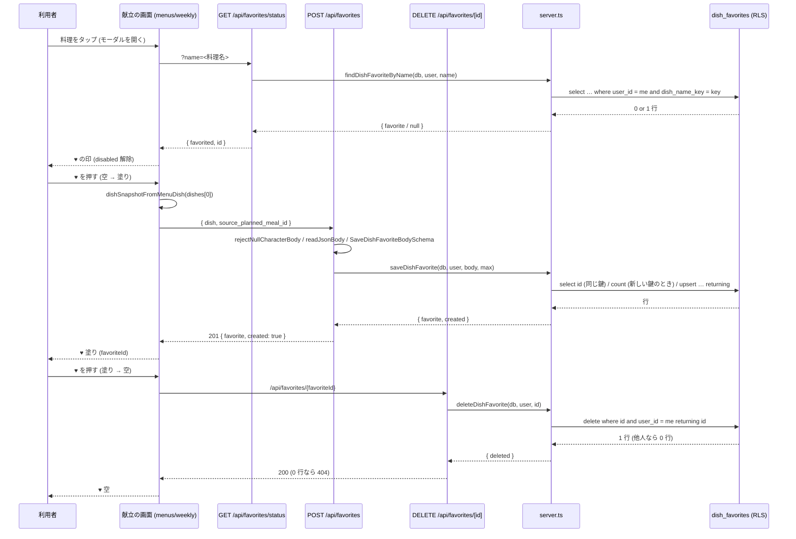
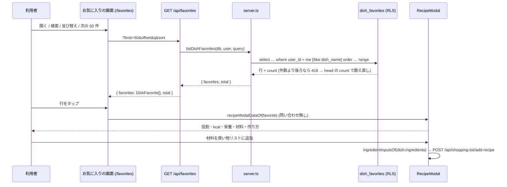

# 献立の料理のお気に入り (♥) を料理そのものごと保存する (#2011) 設計

| 版 | 日付 | 内容 |
|---|---|---|
| v1.0 | 2026-10-25 | 新設 (Issue #2011 の設計ゲート・A 型 4 相。献立の料理の ♥ を、料理そのもの (材料・作り方・栄養) の写しとして本人だけの表 `dish_favorites` に保存し、お気に入りの画面から詳細を開く) |

要件の正本は Issue #2011 の本文とコメント。本書はその上で決めた範囲と設計で、Issue と食い違ったら本書が正。
ファイル名は cross/22 (cross/ の既存は 01〜09・12・13a・13b・14〜21。10・11・13 は欠番)。

前提 (本書が従う条件):

- オーナーの選択 (2026-10-24 夜・選択式): ♥ を押した献立の料理を、材料・作り方・栄養ごと自分だけのお気に入りとして保存し、お気に入りの画面から詳細も開けるようにする。
- 本番の DB には書き込まない (本書の事実は 2026-10-25 の SELECT だけ。§3.4)。
- ローンチ前。本番の `recipe_likes` は 0 行・`recipes` は 0 行 (2026-10-25 の SELECT。§3.4)。お気に入りの機能は一度も動いていないので、既存の行の移行は無い。正しい形にしてよい。
- `recipe_likes` (公開レシピへの「いいね」) の表・RLS・外部キー・トリガー・関数は、本書では変えない (消すのは削除の migration で、名指しの承認が要る。§21 Q-1)。公開レシピの「いいね」の API (`/api/recipes/[id]/like`) と `isLiked` も変えない。
- Next.js の API で service_role を使わない (cross/02 §3.3)。RLS は本人の行だけ (cross/02 §4.1 の self-ownership)。
- 範囲外: 献立の生成 (generate-menu-v4 / v5) にお気に入りを好みとして渡すこと・AI 相談の `like_recipe` で献立の料理を保存すること・モバイルのネイティブの画面 (お気に入りは Web の `/favorites` を WebView で開く)・公開レシピの「いいね」をお気に入りの画面に並べること。新しい要求は発明しない (§21 に候補として残す)。

---

## 0. 外形固定と分冊判定 (相 1)

### 0.1 発注と決めること

発注 (Issue #2011): 献立の画面の料理のモーダルの ♥ を押しても保存されない。献立の料理は AI が作った名前だけで `recipes` の行を持たず、画面は料理の名前を id として `/api/recipes/[id]/like` に送る。`recipe_likes.recipe_id` は uuid で `recipes(id)` への外部キー (NOT NULL) なので入らない (#2010 の後は 404。前は 500)。お気に入りの画面も名前で消し、詳細は `recipe_uuid` が無いので開けない。

本書が答えを出すこと:

| # | 決めること | 答え (§6) |
|---|---|---|
| 1 | 保存の形: 料理のお気に入りの新しい表か、非公開の `recipes` の行を作って `recipe_likes` で指すか。公開レシピの「いいね」と同じ画面・同じ表で扱うか | 新しい表 `dish_favorites` (本人だけ・料理の写しを jsonb で持つ)。`recipe_likes` とは分ける。お気に入りの画面は `dish_favorites` だけを出す (§6.1) |
| 2 | 何を同じ料理と見るか (二度 ♥・作り直しで同じ名前の別の中身)。♥ の状態の引き方 | 本人ごとに正規化した料理名 (`dish_name_key`) で 1 件。♥ の状態は名前で引く (`GET /api/favorites/status?name=`)。同じ名前を ♥ したら「保存済み」として扱い、もう一度押すと消える (§6.2) |
| 3 | お気に入りの画面: 一覧・検索・並び替え・削除・詳細。公開レシピの「いいね」との並べ方 | 一覧は写しごと返す (詳細の API は作らない)。検索は名前の部分一致・並びは 新しい順 / 古い順 / 名前順・削除は id・詳細は献立と同じ `RecipeModal` で材料・作り方・栄養を出す。公開レシピの「いいね」は並べない (§6.3) |
| 4 | 既存の壊れた導線の片付け (`recipe_uuid`・外部キー 2 本・トリガーと関数・`refreshLikeCount`・AI 相談の `like_recipe`・`isLiked`) | 本書では消さない (削除の migration は名指しの承認が要る。§21 Q-1)。献立の画面とお気に入りの画面が `/api/recipes/[id]/like` を呼ぶのをやめる (§6.4) |
| 5 | 退会・書き出し・RLS・件数の上限 | 退会は `auth.users` の CASCADE で消える。書き出しは `ACCOUNT_EXPORT_TABLES` に足す。RLS は本人の行だけ。上限は 1 人 300 件 (環境変数で上書き可) (§6.5) |
| 6 | プライバシーポリシーの記載 | 第3条の「レシピ」の行 (『いいねや保存をしたレシピ』) に含まれる。文は変えない。表 → 行の対応 (T-34) に 1 行足す (§6.6) |
| 7 | モジュラーモノリスの切り方・Zod の正典・エラー表 | `src/modules/dish-favorites/` (`core.ts` = 定数・Zod・純関数、`server.ts` = DB の操作)。UI は `core` だけ、route は `core` と `server` を import する (§6.7・§8) |

### 0.2 要件行列

| # | 要件 | 根拠 | 本書の置き場 |
|---|---|---|---|
| R-1 | 献立の料理のモーダルの ♥ を押すと、その料理 (名前・役割・kcal・栄養・材料・作り方) が本人のお気に入りとして保存される | #2011・オーナーの選択 | §7.3・§7.4・§7.5 (POST)・§7.9 |
| R-2 | もう一度 ♥ を押すと消える。モーダルを開き直したとき・ページを読み直したときの ♥ の印は保存の状態と一致する | #2011・`tests/e2e/bug-31-favorite-button.spec.ts` | §7.5 (status・DELETE)・§7.9・§9.3 |
| R-3 | お気に入りの画面で、保存した料理を一覧 (件数つき)・名前で検索・並び替え (新しい順 / 古い順 / 名前順)・削除できる | #2011・`src/app/(main)/favorites/page.tsx` の今の機能 | §7.5 (GET)・§7.10 |
| R-4 | お気に入りの画面から、料理の詳細 (材料・作り方・栄養) を開ける。材料を買い物リストに足せる | オーナーの選択・`FavoriteRecipeModal` の今の機能 | §7.12 |
| R-5 | 献立が作り直されて同じ名前の別の中身になっても、お気に入りの写しは変わらない。献立 (planned_meals) が消えても残る | #2011「料理そのものを保存」 | §3.1 F-9・§6.2・§9.3 |
| R-6 | 同じ名前を二度 ♥ しても 1 件 (重ならない)。同時に 2 か所から押しても 1 件 | §0.1 の 2 | §7.1 (UNIQUE)・§7.4 (upsert)・§9.3 |
| R-7 | 他人のお気に入りは読めない・消せない・数えられない (RLS)。未ログインは 401 | cross/02 §4.1・`recipe_likes` の『Anyone can view likes』を繰り返さない | §7.1・§7.14 |
| R-8 | 1 人が保存できる件数に上限がある (既定 300。環境変数 `DISH_FAVORITES_MAX_PER_USER` で上書き)。超えると 409 で理由の文を返し、♥ は戻る | §0.1 の 5 | §7.3・§7.4・§7.5・§10 |
| R-9 | 保存する料理の中身の大きさに上限がある (Zod と DB の CHECK。§13)。外れる本文は 400 | マジックナンバー禁止・jsonb の肥大化の防止 | §7.1・§7.3 |
| R-10 | 退会で消える (CASCADE)。個人データの書き出しに `dish_favorites` が出る | #1131・#1175 | §7.1・§7.7・§16 |
| R-11 | プライバシーポリシーの第3条の表に対応する行がある (文は変えない) | cross/20 F-42・T-34 | §6.6・§17 |
| R-12 | `recipe_likes`・公開レシピの「いいね」の API・`isLiked`・AI 相談の `like_recipe`・献立の生成の `recipe_likes` の読み取りは変えない | 前提 | §18 |
| R-13 | 既存の e2e (bug-104・bug-31) が見る文言・`data-testid`・応答の形 (`favorites` の配列と `total`) を保つ | `tests/e2e/bug-104-favorites-system.spec.ts`・`bug-31-favorite-button.spec.ts` | §7.10・§16 |
| R-14 | 本文を読む route は NULL 文字と壊れた JSON を 400 にし、一覧の route は件数より後ろのページを 500 にしない。失敗の文は日本語の固定の文 | #1657・#1917 の見張り (§16) | §7.5 |
| R-15 | 新しい migration は追加だけ (既存の表・行に触らない)。戻し口を対で置く。番号はマージの直前に確定する | 設計書の規約 | §7.1・§7.2 |
| R-16 | 画像は保存しない (料理の画像は献立の非公開バケットの署名付き URL で、献立と一緒に消える) | cross/19 | §6.2 |
| R-17 | 保存した料理の表示は献立のモーダルと同じ部品 (`RecipeModal`) で行う (材料・作り方・栄養の描き方を 2 か所に持たない) | 保守 | §7.12 |

### 0.3 ユーザーシナリオ (20 本。トレースは §4.3)

| # | シナリオ | 期待 |
|---|---|---|
| S-1 | 献立の料理「肉じゃが」のモーダルを開き、♥ を押す | `POST /api/favorites` が 201。♥ が塗られる。お気に入りに「肉じゃが」が材料・作り方・栄養ごと入る |
| S-2 | モーダルを閉じて、同じ「肉じゃが」をもう一度開く | `GET /api/favorites/status?name=肉じゃが` が `{ favorited: true, id }`。♥ は塗られたまま |
| S-3 | 塗られた ♥ をもう一度押す | `DELETE /api/favorites/{id}` が 200。♥ が空になり、一覧から消える |
| S-4 | 「肉じゃが」を保存したあと、その食事を「AIで変更」で作り直し、別の材料の「肉じゃが」が出る。そのモーダルを開く | ♥ は塗られている (名前で引く)。保存してある写しは最初の「肉じゃが」のまま |
| S-5 | S-4 の状態で ♥ を押す | DELETE で最初の写しが消え、♥ は空になる。もう一度押すと新しい「肉じゃが」が保存される |
| S-6 | お気に入りの画面を開く | `GET /api/favorites?limit=50&offset=0&sort=newest` が `{ favorites, total }`。新しい順の一覧と「N 件」 |
| S-7 | 一覧の 1 行をタップする | 一覧が持つ写しで `RecipeModal` が開く (問い合わせ無し)。役割・kcal・栄養・材料・作り方が出る。「材料を買い物リストに追加」が `/api/shopping-list/add-recipe` に POST する |
| S-8 | 一覧の行の ♥ (削除) を押す | `DELETE /api/favorites/{id}` が 200。行が消え、「N 件」が 1 減る |
| S-9 | 検索に「じゃが」を入れ、並びを「名前順」にする | `q=じゃが&sort=name`。`dish_name` の部分一致で絞り、`dish_name_key` の昇順 |
| S-10 | 一覧の最後のページで最後の 1 件を消し、同じ offset で読み直す | PostgREST の 416 を `resolveBeyondLastPage` が受け、空のページと本当の件数を返す (500 にしない) |
| S-11 | 300 件保存している人が 301 件目の ♥ を押す | `POST` が 409 `CONFLICT_DISH_FAVORITES_LIMIT`。♥ は戻り、理由の文が出る |
| S-12 | 本文が壊れている・料理の名前が空・材料が 51 件・NULL 文字を含む | 400 (壊れた JSON / 検証 / NULL 文字)。♥ は戻る |
| S-13 | 未ログインで 4 つの route を呼ぶ | すべて 401 `{ error: 'ログインが必要です' }`。DB に触れない |
| S-14 | 他人のお気に入りの id を DELETE する・他人の一覧を読もうとする | RLS で 0 行。DELETE は 404、一覧は自分の分だけ |
| S-15 | お気に入りを持つ人が退会する | `auth.users` の削除で CASCADE。書き出し (`/api/export`) には `dish_favorites` が本人の分だけ出る |
| S-16 | 2 つのタブで同じ「肉じゃが」の ♥ を同時に押す | UNIQUE (user_id, dish_name_key) と upsert で 1 行。片方は 201 `created: true`、もう片方は 200 `created: false` (写しは後の内容) |
| S-17 | お気に入りを保存した食事を献立から消す・週を作り直す | お気に入りは残る (写し。`source_planned_meal_id` は参照だけで外部キーを張らない) |
| S-18 | 公開レシピの画面で ♥ (いいね) を押す | 今までどおり `recipe_likes` (uuid)。本書の表には入らない・お気に入りの画面にも出ない |
| S-19 | 料理の名前が空白だけ・101 文字以上 | status は 400 `VALIDATION_ERROR`。POST も 400 |
| S-20 | 材料も作り方も無い料理 (買う・外食の献立の料理) を ♥ する | 保存できる (空の配列)。詳細は「材料情報なし」「作り方」の案内 |

### 0.4 分冊判定

目安 (設計書 800 行超 / 消費先レーン 3 以上 / 共有面 2 つ以上) のうち、行数と共有面 (`src/lib/account-export-tables.ts`・`src/lib/env.ts`・`tests/legal-text-1901.test.ts` の表 → 行の対応) に当たる。ただし核 (表・モジュール・API) は 1 本の契約で閉じ、配線は献立のモーダル 1 か所とお気に入りの画面 1 枚 (どちらも「繋ぐだけ」) なので、**1 冊**にし、実装は段で分ける (§15: 段 A = DB と型、段 B1 = モジュールと API、段 B2 = 画面)。段ごとに 2 枚レビューを閉じる。

### 0.5 用語

| 語 | 意味 |
|---|---|
| 料理 (dish) | 献立の 1 食 (`planned_meals`) の `dishes` (jsonb の配列) の 1 要素。名前・役割 (main / side / soup / rice …)・kcal・栄養・材料・作り方を持つ。`recipes` の行は無い |
| 料理の写し (DishSnapshot) | ♥ を押した時点の料理を、本書の Zod (§7.3) の形に写したもの。`dish_favorites.dish` に入る |
| お気に入り (dish favorite) | `dish_favorites` の 1 行 (本人 × 正規化した料理名で 1 件) |
| 料理名の鍵 (dish_name_key) | 表示名の空白を 1 つにまとめ、NFKC に正規化し、小文字にしたもの。同じ料理の判定に使う |
| 公開レシピの「いいね」 | `recipe_likes` の行 (uuid の `recipes` を指す)。本書では変えない |

### 0.6 読み方

- 実装は §7 の正典コードを写す。§8 の facade 契約と §13 の定数の名前を変えない。
- 表 3 点 (§9) とエラー表 (§10) は、レビューが最初に自分で作り直して突き合わせる対象。
- 本書の TS のブロックは、`// tsc:skip` を 1 行目に持つものを除き、そのまま型検査を通る形で書いてある (import を省かない)。`// tsc:skip` のブロックは、本書が新設するファイル (`./core`・`@/modules/dish-favorites/*`) を import するものと、既存ファイルの差分の断片。
- migration のファイル名は置き場 (`<番号はマージ時に確定>`・`<同じ番号>`) で書く。マージの後に番号を書き入れるときは、本書の名指しを全部同時に書き換える (`tests/helpers/design-doc-migration-number.ts` の規則。§7.13 の C-8 が本書に当てる)。

---

## 1. 目的・スコープ

- 目的: 献立の料理の ♥ を、料理そのものを保存する機能として動かす。保存した料理をお気に入りの画面で一覧・検索・削除し、詳細 (材料・作り方・栄養) を開けるようにする。
- 対象: 新しい表 `dish_favorites` (migration と戻し口)・モジュール `src/modules/dish-favorites/`・API 4 本 (`GET / POST /api/favorites`・`GET /api/favorites/status`・`DELETE /api/favorites/[id]`)・献立の画面の ♥ の配線・お気に入りの画面 3 ファイル・環境変数 1 つ・個人データの書き出しの 1 行・テスト。
- 対象外: §冒頭の前提のとおり。`recipe_likes` 系の片付けは §21 Q-1。

## 2. 関連要件・既存設計

| 文書 | 関係 |
|---|---|
| Issue #2011 | 要件の正本 |
| `docs/design/cross/02-rls-patterns.md` §3.1・§3.4・§4.1 | RLS の必須化・TRUNCATE を付けない・self-ownership の雛形 (本書の §7.1 はこの形) |
| `docs/design/cross/04-api-conventions.md` §4.1・§5.2 | エラーコードの接頭辞 (`CONFLICT_` = 409)・flat の本文の形 |
| `docs/design/cross/19-private-photo-buckets.md` | 料理の画像は非公開バケットの署名付き URL。本書は画像を写さない (R-16) |
| `docs/design/cross/20-terms-privacy-text.md` §2.2 F-42・T-34 | 利用者に紐づく表 → 第3条の行の対応。本書は `dish_favorites` を「レシピ」の行に対応させる (§6.6・§17) |
| `docs/design/cross/21-recipe-author-display-name.md` | `recipe_likes` と `viewer-lookups.ts` を触る別の設計。本書は `recipe_likes` と `viewer-lookups.ts` に触らないので衝突しない (§18) |
| `docs/design/cross/15-data-subject-requests.md`・#1131 | 書き出しの許可一覧 (`ACCOUNT_EXPORT_TABLES`) に足す |

## 3. 現状の事実 (origin/main `edff659e4`・本番の読み取り 2026-10-25)

### 3.1 API・画面・lib

| # | 事実 | 場所 |
|---|---|---|
| F-1 | 献立の画面は、料理のモーダルを開くと `GET /api/recipes/{料理名}/like` で ♥ の状態を引き (失敗の応答では印を変えない)、♥ の押下で `POST` / `DELETE` を楽観的更新で送る (失敗で戻す) | `src/app/(main)/menus/weekly/page.tsx:1926-1935`・`:3485-3502` |
| F-2 | モーダルを開くとき、料理 (`dishesArray[idx]`) の新形式 (`calories_kcal` など) を優先し旧形式 (`cal` など) から埋めた `normalizedDish` を作り、`selectedRecipeData = { ...normalizedDish, imageUrl, dishes: [normalizedDish], allIngredients }` にする。`selectedRecipe` は料理名 | 同 `:5432-5472` |
| F-3 | ♥ の状態は `recipeReducer` の `isFavorite` / `isFavoriteLoading` (`FAVORITE_SET` / `FAVORITE_LOADING_SET`)。`RECIPE_SELECT` は payload が null のときだけ `isFavorite` を戻す | `src/app/(main)/menus/weekly/_state/reducers/recipeReducer.ts:26-27`・`:57-70` |
| F-4 | `RecipeModal` は `selectedRecipe` (名前)・`selectedRecipeData` (any)・`isFavorite`・`isFavoriteLoading`・`onToggleFavorite`・`onAddToShoppingList` を受け、役割・kcal・画像・栄養 28 項目・材料 (`dishes[0].ingredientsMd` か `ingredients` から表)・作り方 (`dishes[0].recipeStepsMd` か `recipeSteps`) を描く。♥ は `data-testid="favorite-button"`・`aria-pressed` | `src/app/(main)/menus/weekly/_components/modals/RecipeModal.tsx:122-150`・`:330-346` |
| F-5 | いいねの API: GET は UUID でない id に `{ liked: false }`、POST・DELETE は 404。POST は `recipe_likes` へ upsert し、外部キー違反 (`recipe_likes_recipe_id_fkey`) を 404 にする。`refreshLikeCount` は `recipe_id` で数え、`recipes.name` で UPDATE する #258 の名残 (uuid では当たらない) | `src/app/api/recipes/[id]/like/route.ts:18-40`・`:47-52`・`:64-70`・`:104-109` |
| F-6 | お気に入りの一覧 API は `recipe_likes` を `user_id` で絞り、`q` は `recipe_id` の ilike、並びは `created_at` / `recipe_id`、列の無い本番 (42703) に 3 段で退く。返す形は `{ favorites: [{ id, recipeName, recipeUuid, likedAt }], total }`。416 は先頭 1 件で total を取り直す | `src/app/api/favorites/route.ts:22-35`・`:65-70`・`:80-96` |
| F-7 | お気に入りの画面は `PAGE_SIZE = 50`、削除は `DELETE /api/recipes/{名前}/like`、詳細は `FavoriteRecipeModal` が `recipeUuid` があるときだけ `/api/recipes/{uuid}` を取り、無ければ「詳細情報が保存されていません」。`recipe_uuid` はどの導線も書かない | `src/app/(main)/favorites/page.tsx:30`・`:106-120`・`_components/FavoriteRecipeModal.tsx:8-11`・`:95-105` |
| F-8 | 一覧の 1 行 `FavoriteListItem` は `item.recipeName`・`item.likedAt` を描き、「レシピを見る」と「お気に入りから削除」の 2 つの `<button>` を兄弟で並べる (#1050) | `src/app/(main)/favorites/_components/FavoriteListItem.tsx:16-27`・`:52-60` |
| F-9 | 献立の作り直し: `meal/regenerate` は `planned_meals` を insert と update で書き換える。`day/regenerate`・`v4/generate` は insert 中心。同じ料理名でも中身は変わり得る。`dishes` の中に料理の一意の id は無い | `src/app/api/ai/menu/meal/regenerate/route.ts:100`・`:130`・`supabase/baseline/prod_schema.sql:5904` (dishes の COMMENT) |
| F-10 | 料理の型 `DishDetail`: `name`・`role?`・`ingredient?`・`ingredients?: string[]`・`recipeSteps?: string[]`・`ingredientsMd?`・`recipeStepsMd?`・`displayOrder?`・画像の列・栄養 29 項目 (`calories_kcal`・`protein_g` … `polyunsaturated_fat_g`)。`LegacyDishDetail` は旧形式の短いキー (`cal`・`protein` … `folicAcid`) を足す | `types/domain.ts:642-704`・`src/app/(main)/menus/weekly/_state/types.ts:8-33` |
| F-11 | AI 相談の `like_recipe` は `recipe_likes` を `recipe_id` と `user_id` で select (`.single()`) し、無ければ insert する。プロンプトは `recipeId` を uuid と説明する | `src/lib/ai/consultation-action-executor.ts:1319-1343`・`src/app/api/ai/consultation/sessions/[sessionId]/messages/route.ts:748` |
| F-12 | 公開レシピの `isLiked` は `recipe_likes.recipe_id` で引く (`loadRecipeViewerLookups`)。cross/21 がこのファイルを差し替える設計を持つ | `src/lib/recipes/viewer-lookups.ts:53-75` |
| F-13 | 個人データの書き出し: `recipe_likes` は `self('user_id')`・`orderBy: ['user_id', 'recipe_id']`。新しい表は同じ配列に行を足す。分類漏れは `tests/account-export-tables.test.ts` が本番のスナップショットと新しい migration から見つける | `src/lib/account-export-tables.ts:1-15`・`:182-183` |
| F-14 | プライバシーポリシー第3条の「レシピ」の行は『いいねや保存をしたレシピ、ユーザーが登録したレシピとコメント』。表 → 行の対応は `tests/legal-text-1901.test.ts` の `PRIVACY_DATA_TABLES` (`recipe_likes: 'レシピ'` など) が、書き出しの許可一覧と除外一覧の全表について閉じる (T-34) | `src/lib/legal/privacy-text.ts:213`・`tests/legal-text-1901.test.ts:127-200`・`:872-880` |
| F-15 | 献立の生成 (Edge Function) は `recipe_likes.recipe_id` を 30 件読み、好みの文脈に使う (uuid なので今は料理名として意味を持たない) | `supabase/functions/generate-menu-v4/index.ts:1211-1225`・`generate-menu-v5/index.ts:1995-2000` |
| F-16 | モバイル: お気に入りのネイティブの画面は無い (#1598 で消した)。献立とお気に入りは Web の画面を WebView で開く。通知の行き先 `/favorites` はある | `apps/mobile/README.md:66-75`・`apps/mobile/__tests__/lib/notification-route.test.ts:91` |
| F-17 | 環境変数で上書きできる上限の前例: `MENU_PLANS_ADD_MAX_DATE_OFFSET_DAYS` (読む場所を 1 つに決め、`src/lib/env.ts` に `readOnlyBy` で載せ、`.env.example` に書く) | `src/lib/menu-plan-date-offset.ts:1-32`・`src/lib/env.ts:417-424`・`.env.example:273-275` |
| F-18 | 本文の読み方の決まり: NULL 文字は `rejectNullCharacterBody` を handler の最初に (`src/__tests__/api/null-character-routes.test.ts` の表)、壊れた JSON は `readJsonBody` で 400 (`tests/api-invalid-json-scan.test.ts`)、一覧の 416 は `resolveBeyondLastPage` (`tests/api-list-range-scan.test.ts`)、失敗の文は `src/lib/api/error-responses.ts` の日本語 (`tests/api-error-japanese-scan.test.ts`。`src/app/api/favorites` は見張りの範囲) | `src/lib/http-params.ts:60-75`・`src/lib/api/list-range.ts`・`tests/helpers/api-error-japanese-scope.ts:46` |
| F-19 | `src/modules/` は無い (facade の前例は無い)。`@/*` は `./src/*` と `./*` に解決する | `tsconfig.json:25-29` |
| F-20 | 公開の紹介ページの主張 `favorites` (『気に入ったレシピをお気に入りに残せる (献立のレシピのハートから)』) の根拠は `src/app/(main)/favorites/page.tsx` と `src/app/api/favorites/route.ts` | `src/components/marketing/landing-copy.ts:885` |

### 3.2 DB (ベースライン `supabase/baseline/prod_schema.sql`)

| # | 事実 | 場所 |
|---|---|---|
| F-21 | `recipe_likes`: `user_id uuid NOT NULL`・`recipe_id uuid NOT NULL`・`created_at`・`recipe_uuid uuid`・`id uuid NOT NULL`。PK (user_id, recipe_id)。外部キー 3 本 (`recipe_id` → recipes CASCADE・`recipe_uuid` → recipes CASCADE・`user_id` → auth.users CASCADE) | `:6086-6094`・`:7404-7405`・`:9276-9287` |
| F-22 | `recipe_likes` の RLS: 『Anyone can view likes』(SELECT TO authenticated USING true) のほか、本人の INSERT / DELETE / ALL / SELECT。トリガー `trg_sync_recipe_like_count` と関数 `sync_recipe_like_count` (`recipe_uuid` が NULL なら何もしない)・`increment / decrement_recipe_like_count` | `:9590`・`:9739`・`:9787`・`:9864`・`:10064`・`:8538`・`:3365-3399`・`:1478-1495`・`:1884-1901` |
| F-23 | `recipes`: `id`・`user_id` (NULL 可)・`name`・`ingredients jsonb`・`steps text[]`・`is_public`・`like_count` など。RLS は本人の管理と公開の閲覧 | `:6114-6141`・`:9894`・`:10072` |
| F-24 | `planned_meals.dishes` は jsonb (配列形式。画面はオブジェクト形式も受ける)。`dish_name text NOT NULL`。料理ごとの id は無い | `:5834-5898`・`:5904` |
| F-25 | `update_updated_at_column()` (BEFORE UPDATE で `updated_at` を入れるトリガー関数) がある (`trg_recipes_updated_at` が使う) | `:3600`・`:8526` |
| F-26 | 新しい表の権限の定型: `CREATE TABLE IF NOT EXISTS` → `ENABLE ROW LEVEL SECURITY` → 既定の権限を `REVOKE ALL ... FROM PUBLIC, anon, authenticated` で外してから必要なものだけ `GRANT`。anon / authenticated に `GRANT ALL` / `TRUNCATE` を書かない。戻し口は `DROP TABLE IF EXISTS` だけ。1 行目 `-- migration:`・2 行目 `-- 戻し方:`・戻し口の 1 行目 `-- rollback:` | `supabase/migrations/20261024100000_apple_sign_in_tokens.sql`・`20261016220000_data_subject_requests.sql:85-100`・cross/02 §3.4 |
| F-27 | 最新の migration は `20261024140000_announcements_moderation_flags_select_only.sql` (番号はマージの直前に確定する) | `supabase/migrations/` |

### 3.3 既存のテストと番兵

§16 に全列挙する。要点: `tests/api/favorites-route.test.ts` (一覧 API の単体)・`src/app/(main)/favorites/_components/__tests__/FavoriteListItem.test.ts`・`FavoriteRecipeModal.test.ts`・`tests/e2e/bug-104-favorites-system.spec.ts`・`bug-31-favorite-button.spec.ts`・`tests/route-invalid-input-1917.test.ts:331-410` (いいねの route。変えない)。

### 3.4 本番の読み取り (2026-10-25。SELECT だけ。書き込みなし)

| # | 事実 | 読み方 |
|---|---|---|
| F-28 | `recipe_likes` 0 行・`recipes` 0 行。`dish_favorites` という表は無い。`recipe_likes` のポリシーは 5 本 (F-22 のとおり)・外部キーは 3 本 | `count(*)`・`information_schema.tables`・`pg_policies`・`pg_constraint` |
| F-29 | `planned_meals` のうち `dishes` を持つ行は 727 (すべて配列形式。1 食の最大 5 品)。`dishes` の 1 食あたり平均 5,858 バイト・最大 10,840 バイト | `jsonb_typeof`・`octet_length` |
| F-30 | 料理 2,333 件: 名前の最大 24 文字・材料の最大 14 件・作り方の最大 6 手順・`ingredientsMd` の最大 290 文字・`recipeStepsMd` の最大 280 文字・1 料理の最大 3,904 バイト (平均 1,823)。`ingredients` を持つ 2,277・`ingredientsMd` 1,806・`recipeSteps` 2,099・`recipeStepsMd` 1,806・`image_url` 1,267。旧形式の `cal` を持つ料理は 0 | `jsonb_array_elements` で数えた。§13 の上限の根拠 |

---

## 4. 構想 (相 2)

### 4.1 構造 (構造 A)

```
献立の画面 (menus/weekly/page.tsx)                      お気に入りの画面 (favorites/page.tsx)
  モーダルを開く → GET /api/favorites/status?name=      一覧 → GET /api/favorites?limit&offset&q&sort
  ♥ 押す (空→塗り) → POST /api/favorites { dish }       行の ♥ → DELETE /api/favorites/[id]
  ♥ 押す (塗り→空) → DELETE /api/favorites/[id]         行をタップ → 一覧の写しで RecipeModal (問い合わせ無し)
          │                                                       │
          └──────── core.ts (純関数: 料理 → 写し / 写し → RecipeModal の形 / 材料 → 買い物リストの入力) ─┘
                                        │
                     route 4 本 (src/app/api/favorites/**)
                                        │
                     server.ts (list / findByName / save / delete。RLS の効く client を受け取る)
                                        │
                     public.dish_favorites (本人 × dish_name_key で 1 行・dish jsonb = 写し)
```

- **表**: `dish_favorites` (§7.1)。1 行 = 本人 × 料理名の鍵。`dish` (jsonb) に料理の写し (§7.3 の `DishSnapshot`) を入れる。`source_planned_meal_id` は「どの食事から保存したか」の参照だけ (外部キーを張らない。献立が消えても残す)。
- **同じ料理の判定**: 本人ごとの `dish_name_key` (表示名の空白を 1 つに・NFKC・小文字)。UNIQUE (user_id, dish_name_key)。
- **写しの中身**: 名前・役割・kcal・栄養 28 項目・材料 (配列と markdown)・作り方 (配列と markdown)。画像は写さない (R-16)。
- **モジュール**: `src/modules/dish-favorites/core.ts` (定数・Zod・純関数。ブラウザでも使える) と `server.ts` (DB の操作。route だけが使う)。UI は `core` だけを import する。モジュールは `src/app` を import しない。
- **API**: `/api/favorites` の下に 4 本。既存の `GET /api/favorites` は `dish_favorites` を読む形に書き換える (応答の形は `{ favorites, total }` のまま、行の形は snake_case に改める)。
- **♥ の状態**: 名前で引く (status)。保存済みなら `favoriteId` を画面が持ち、押下で DELETE に使う。
- **一覧**: 写しごと返す (1 行 ≈ 2 KB。50 行で ≈ 100 KB。F-30)。詳細の API を作らない (一覧の行をそのまま `RecipeModal` に渡す)。
- **上限**: `saveDishFavorite` が、新しい名前のときだけ件数を数えて上限と比べる (同じ名前の上書きは数えない)。

### 4.2 動き

1. **モーダルを開く**: `selectedRecipe` (名前) が決まると `GET /api/favorites/status?name=<名前>` を呼ぶ。応答 `{ favorited, id }` で `isFavorite` と `favoriteId` を入れる。読み込み中は `isFavoriteLoading` を立てる (♥ は disabled)。
2. **♥ 押す (空 → 塗り)**: `selectedRecipeData.dishes[0]` を `dishSnapshotFromMenuDish` で写しにし、`POST /api/favorites { dish, source_planned_meal_id }`。201 / 200 の `favorite.id` を `favoriteId` に入れる。4xx / 5xx / 例外は ♥ を戻し、409・400 は本文の `error` を見せる。
3. **♥ 押す (塗り → 空)**: `DELETE /api/favorites/{favoriteId}`。200 と 404 (もう無い) は空にする。ほかは戻す。
4. **一覧**: `GET /api/favorites` は本人の行を `created_at` (newest / oldest) か `dish_name_key` (name) で並べ、`q` は `dish_name` の ilike。`resolveBeyondLastPage` で 416 を空のページにする。
5. **詳細**: 一覧の行 (`DishFavorite`) を `recipeModalDataOf` で `RecipeModal` の `selectedRecipeData` の形にして開く。♥ は塗り固定で、押すと削除 (3 と同じ DELETE) して閉じる。買い物リストは `ingredientInputsOf(dish.ingredients)` を `/api/shopping-list/add-recipe` に送る。
6. **削除**: `DELETE /api/favorites/[id]` は RLS で本人の行だけ消える。0 行なら 404。

### 4.3 シナリオのトレース (§4.1 の構造で手で走らせた記録)

| # | 走らせた結果 | 通る場所 |
|---|---|---|
| S-1 | 開く → status が `{ favorited: false, id: null }` → ♥ 押下 → `dishSnapshotFromMenuDish(dishes[0])` → POST → `saveDishFavorite`: 鍵 `肉じゃが` の行なし → 件数 0 < 300 → upsert → 201 `{ favorite, created: true }` → `favoriteId` に id。写しは名前・役割・kcal・栄養・材料・作り方 | §7.3・§7.4・§7.5・§7.9 |
| S-2 | 開く → status: `findDishFavoriteByName` が鍵で 1 行 → `{ favorited: true, id }` → ♥ 塗り・`favoriteId` あり | §7.5 status・§7.9 |
| S-3 | ♥ 押下 (塗り) → DELETE id → `deleteDishFavorite` が 1 行消す → 200 → ♥ 空・`favoriteId` null。一覧を読み直すと無い | §7.5 [id]・§7.9 |
| S-4 | 作り直し (F-9) で `planned_meals.dishes` が別の中身に。開く → status は名前で引くので `favorited: true`。表の `dish` は最初の写しのまま (何も書いていない) | §6.2・§9.3 (行 S1 × 作り直し) |
| S-5 | ♥ 押下 → DELETE (最初の写しが消える) → 空。再度押下 → POST (新しい中身) → 201。表は新しい写し | §9.3 |
| S-6 | `GET /api/favorites?limit=50&offset=0&sort=newest` → `listDishFavorites` → `created_at desc, id` → `{ favorites: DishFavorite[], total }` → 「N 件」 | §7.5 GET・§7.10 |
| S-7 | 行をタップ → `selectedFavorite` に行 → `FavoriteRecipeModal` が `recipeModalDataOf(favorite)` を `RecipeModal` に渡す → 役割・kcal・栄養 (`protein_g` などが 0 でなければ)・材料 (`ingredients_md` があれば表、無ければ `ingredients` から表)・作り方。買い物リストは `ingredientInputsOf` → POST → 「N 件の材料を買い物リストに追加しました」 | §7.12・§7.3 |
| S-8 | 行の ♥ → DELETE id → 200 → 一覧から外し `total - 1` | §7.10 |
| S-9 | `q=じゃが&sort=name` → `ilike('dish_name', '%じゃが%')`・`order('dish_name_key')` → 名前順 | §7.4 |
| S-10 | offset が件数以上 → PostgREST 416 → `resolveBeyondLastPage` が同じ絞り込みで head の count → `{ favorites: [], total }` | §7.4・F-18 |
| S-11 | 300 行ある → POST (新しい名前) → `countDishFavorites` = 300 ≥ 300 → `{ ok: false, reason: 'limit' }` → 409 `{ error: 上限の文, code: CONFLICT_DISH_FAVORITES_LIMIT }` → 画面は ♥ を戻し `error` を alert | §7.4・§7.5・§10 |
| S-12 | 壊れた JSON → `readJsonBody` が `{ ok: false }` → 400 `API_INVALID_JSON_MESSAGE`。名前が空 → `SaveDishFavoriteBodySchema.safeParse` 失敗 → 400 `DISH_FAVORITE_INVALID_MESSAGE`。材料 51 件 → 同じ 400。NULL 文字 → `rejectNullCharacterBody` が認証の前に 400 `INVALID_CHARACTER` | §7.5・F-18 |
| S-13 | `supabase.auth.getUser()` が user null → 401 `API_UNAUTHENTICATED_MESSAGE`。`from` は呼ばれない | §7.5 |
| S-14 | DELETE 他人の id → RLS (`dish_favorites_self_delete`) で 0 行 → `deleted: false` → 404 `API_NOT_FOUND_MESSAGE`。一覧は `user_id = auth.uid()` の行だけ (RLS と `eq('user_id')` の二重) | §7.1・§7.4・§7.14 |
| S-15 | 退会 → `auth.users` の DELETE → `dish_favorites_user_id_fkey` CASCADE。書き出しは `ACCOUNT_EXPORT_TABLES` の `{ table: 'dish_favorites', scope: self('user_id'), orderBy: ['created_at', 'id'] }` | §7.1・§7.7・§16 |
| S-16 | タブ A と B が同時に POST → 両方「行なし」→ 両方 upsert → UNIQUE で片方が INSERT・片方が `ON CONFLICT DO UPDATE` → A は `created: true` (201)・B は `created: false` (200)。1 行。`favoriteId` は同じ id | §7.1・§7.4・§9.3 |
| S-17 | 食事を消す・週を作り直す → `planned_meals` が消える / 変わる。`dish_favorites` は外部キーを持たないので残る。`source_planned_meal_id` は指す先の無い uuid になるだけ (読まない) | §7.1 |
| S-18 | 公開レシピの ♥ → `POST /api/recipes/{uuid}/like` → `recipe_likes` (変えない)。`GET /api/favorites` は `dish_favorites` だけ読むので出ない | §18 |
| S-19 | status `name=`・空白だけ・101 文字 → `DishNameSchema.safeParse` 失敗 → 400 `DISH_FAVORITE_NAME_INVALID_MESSAGE`。POST も `dish.name` で同じ検証 | §7.3・§7.5 |
| S-20 | 材料も作り方も無い料理 → 写しは `ingredients: []`・`recipe_steps: []`・md null → 保存できる。`RecipeModal` は「材料情報なし」と作り方の案内文を出す | §7.3・F-4 |

---

## 5. 構造裁定 (相 3・1 回だけ)

### 5.1 代替案の比較

| 案 | 中身 | 利点 | 欠点 | 裁定 |
|---|---|---|---|---|
| A (採用) | 新しい表 `dish_favorites` (本人 × 料理名の鍵で 1 行・写しを jsonb で持つ)。`recipe_likes` と分ける | 本人だけの RLS を最初から正しく張れる。`recipes` の公開 / いいね数 / コメント / 運営の非表示 (hidden_at) の仕組みを持ち込まない。写しは自己完結で献立の変化に影響されない。既存の `recipe_likes` の壊れた列・外部キー・トリガーに触らない (削除の承認を待たずに動かせる) | 表が 1 つ増える (書き出し・T-34・FK の一覧の追随が要る) | 採用 |
| B | ♥ のたびに非公開の `recipes` の行 (`is_public = false`) を作り、`recipe_likes.recipe_id` で指す | 既存の表と API (詳細は `/api/recipes/{uuid}`) をそのまま使える | `recipes` は公開レシピの表で、`like_count` の同期トリガー・コメント・通報・運営の非表示・作者名 (cross/21) の対象になる。`recipe_likes` の『Anyone can view likes』が本人の献立の料理名を全ログインユーザーに読ませる (RLS を直す = 既存の変更)。`recipes.ingredients jsonb`・`steps text[]` は栄養 28 項目と markdown を持たず、写しが欠ける。`recipes` の行と `recipe_likes` の行の 2 つを消す整合が要る | 不採用 |
| C | A の表で、同じ料理の判定を中身の指紋 (名前 + 材料 + 作り方の sha256) にする | 作り直しで中身が変わった料理を別のお気に入りとして持てる (♥ の印が中身と一致する) | 指紋を画面とサーバーで同じに計算する関数 (非同期の Web Crypto) が要り、status も中身を送る形になる。同じ名前が一覧に何件も並ぶ (名前順・検索で見分けられない)。上限に早く達する | 不採用 (§5.2) |

### 5.2 F の問い (縁の発生源を消すより単純な構造は無いか)

縁の発生源は「献立の料理には一意の id が無く、作り直しで同じ名前の別の中身が生まれる」(F-9)。これを消す案は (i) 料理に id を振る (献立の生成・作り直し・画面の全経路を変える。本書の範囲を超える) か (ii) 判定を中身の指紋にする (案 C) か (iii) 判定を名前に固定して「同じ名前は 1 件・♥ は名前の保存の有無」と定める (案 A) のどれか。(iii) は縁を「名前で 1 件」という 1 つの規則に畳み、画面・API・表のどこにも指紋や id の配線を足さない。作り直しのあとの「♥ は塗られているが写しは前の中身」(S-4) は、この規則の帰結として §9.1 に書き、利用者には「押すと消える・もう一度押すと今の中身が保存される」(S-5) で説明できる。よって (iii) = 案 A を確定する。

### 5.3 確定

構造 A (新しい表 `dish_favorites`・名前の鍵で 1 件・写しを jsonb・モジュール `core` / `server`・API 4 本・`RecipeModal` の再利用)。以後の仕上げ (§6〜§21) で構造を蒸し返さない。構造への疑義が出たら blocking ではなく「裁定への差し戻し事由」として扱う。

---

## 6. 決めたこと (0.1 の 1〜7 への答え)

### 6.1 保存の形 (決めること 1)

- 新しい表 `public.dish_favorites` (§7.1)。`recipe_likes` とは別。
- お気に入りの画面 (`/favorites`) と `GET /api/favorites` は `dish_favorites` だけを出す。公開レシピの「いいね」(`recipe_likes`) は出さない (本番 0 行・公開レシピの一覧の画面は無い。並べる要求があれば §21 Q-2)。
- 画面の見出し「お気に入りレシピ」・検索の placeholder「レシピ名で検索...」・空の文言・「N 件」は変えない (R-13)。

### 6.2 同じ料理の判定と ♥ の状態 (決めること 2)

- 同じ料理 = 本人ごとの `dish_name_key` (`dishNameKeyOf`: 空白の連続を 1 つの半角空白にまとめ、前後を除き、NFKC で正規化し、小文字にする)。表示名 `dish_name` は空白をまとめて前後を除いたもの (幅と大文字小文字はそのまま)。
- 同じ名前を ♥ したとき: `saveDishFavorite` は upsert (`ON CONFLICT (user_id, dish_name_key) DO UPDATE` で `dish`・`source_planned_meal_id`・`updated_at` を置き換える)。画面の経路では、同じ名前が保存済みなら ♥ は塗られていて押下は DELETE になるので、POST の上書きは同時押し (S-16) のときだけ起きる。
- 作り直しで同じ名前の別の中身になったとき: ♥ は塗られたまま (名前で引く)。写しは前の中身。押すと消え、もう一度押すと今の中身が保存される (S-4・S-5)。
- ♥ の状態の引き方: `GET /api/favorites/status?name=<料理名>` → `{ favorited: boolean, id: string | null }`。画面は `favoriteId` を持ち、DELETE に使う。
- 写しに画像を入れない (R-16)。`RecipeModal` は `imageUrl` が無く `image_status` も無ければ画像の枠を描かない (F-4)。
- `source_planned_meal_id` は参照だけ (外部キー無し・画面は読まない)。献立の作り直しで指す先が消えても残す (S-17)。

### 6.3 お気に入りの画面 (決めること 3)

- 一覧 = `GET /api/favorites`。1 行 = `DishFavorite` (`id`・`dish_name`・`dish` (写し)・`source_planned_meal_id`・`created_at`・`updated_at`)。写しごと返すので詳細の API は無い。
- 検索 `q` は `dish_name` の部分一致 (ilike)。長さは `DISH_FAVORITES_QUERY_MAX_CHARS` (100) で切る。並びは `newest` (`created_at` 降順) / `oldest` (昇順) / `name` (`dish_name_key` 昇順)。どれも `id` で安定にする。未知の `sort` は `newest`。
- ページングは `limit` (1〜200・既定 100) と `offset` (0〜100000) を `clampIntParam` で丸める (#1226 と同じ値。§13)。画面は 50 件ずつ。件数より後ろの offset は空のページと本当の件数 (`resolveBeyondLastPage`)。
- 削除は `DELETE /api/favorites/[id]`。200 と 404 (もう無い) のどちらでも一覧から外す。
- 詳細は一覧の行をそのまま `RecipeModal` に渡す (§7.12)。♥ は塗り固定で、押すと削除して閉じる。買い物リストの追加は `/api/shopping-list/add-recipe` に `{ ingredients: ingredientInputsOf(dish.ingredients) }`。

### 6.4 既存の壊れた導線 (決めること 4)

- 献立の画面とお気に入りの画面は `/api/recipes/[id]/like` を呼ばなくなる。route そのものは公開レシピの「いいね」のために残す (変えない)。
- `recipe_likes.recipe_uuid`・外部キー 2 本目・`trg_sync_recipe_like_count`・`sync_recipe_like_count`・`increment / decrement_recipe_like_count`・`refreshLikeCount` の #258 の名残・『Anyone can view likes』は本書では触らない。消すなら削除の migration で、§21 Q-1 の選択肢。
- AI 相談の `like_recipe`・`isLiked` (`viewer-lookups.ts`)・献立の生成の `recipe_likes` の読み取りは変えない (R-12・§18)。

### 6.5 退会・書き出し・RLS・上限 (決めること 5)

- 退会: `user_id` → `auth.users(id) ON DELETE CASCADE`。`tests/integration/security/auth-users-fk-on-delete.test.ts` の `EXPECTED_ACTIONS` に `'dish_favorites.user_id': 'CASCADE'` を足す (§16)。`prepare_account_deletion` は触らない (CASCADE で足りる)。
- 書き出し: `ACCOUNT_EXPORT_TABLES` に `{ table: 'dish_favorites', scope: self('user_id'), orderBy: ['created_at', 'id'] }` (§7.7)。秘密の列・他人を指す列は無い。
- RLS: cross/02 §4.1 の self-ownership を 4 本 (`TO authenticated`・`user_id = (SELECT auth.uid())`)。anon は権限ごと外す。service_role は既定のまま。
- 上限: `DISH_FAVORITES_MAX_PER_USER_DEFAULT = 300`。環境変数 `DISH_FAVORITES_MAX_PER_USER` (正の整数) で上書き (読む場所は `server.ts` の 1 か所)。根拠 §13。数えるのは新しい名前の POST だけ (同じ名前の上書きは件数を増やさない)。同時の POST で上限を 1〜2 件超えうる (数えてから入れるまでの隙間) が、上限は保存の肥大化を防ぐ安全弁で厳密さは要らない。
- 監査ログは書かない (本人が自分の記録を消す操作で、cross/CLAUDE.md の「破壊的・課金的・セキュリティ系」に当たらない。`recipe_likes` の削除も書いていない)。

### 6.6 プライバシーポリシー (決めること 6)

- 第3条の「レシピ」の行『いいねや保存をしたレシピ、ユーザーが登録したレシピとコメント』の「保存をしたレシピ」が本書の写しを含む。文は変えない。版も上げない。
- 表 → 行の対応 (T-34): `tests/legal-text-1901.test.ts` の `PRIVACY_DATA_TABLES` に `dish_favorites: 'レシピ'` を足す (段 A。`ACCOUNT_EXPORT_TABLES` に足すと、対応が無い表として赤になるため同じ PR)。cross/20 の同じ対応の写しに 1 行足す (§17)。
- 第4条の利用目的『本サービスの提供 (… 記録の保存と表示 …)』に含まれる。第6条 (AI 事業者への送信) には当たらない (お気に入りを AI に送る経路は本書には無い。§21 Q-3)。

### 6.7 モジュールと契約 (決めること 7)

- `src/modules/dish-favorites/core.ts`: 定数 (§13)・Zod (`DishSnapshotSchema`・`SaveDishFavoriteBodySchema`・`DishFavoriteSchema`・`DishFavoriteRowSchema`・`DishNameSchema`・`DishFavoriteSortSchema`)・純関数 (`displayDishNameOf`・`dishNameKeyOf`・`dishSnapshotFromMenuDish`・`recipeModalDataOf`・`ingredientInputsOf`・`toDishFavorite`・`dishJsonByteLength`)・失敗の文とコード。import は `zod` だけ。
- `src/modules/dish-favorites/server.ts`: `dishFavoritesMaxPerUser`・`listDishFavorites`・`findDishFavoriteByName`・`countDishFavorites`・`saveDishFavorite`・`deleteDishFavorite`。RLS の効く client (`Pick<SupabaseClient, 'from'>`) を受け取る。`process.env.DISH_FAVORITES_MAX_PER_USER` を読む唯一の場所。
- 依存の向き: `src/app/api/favorites/**` → `core` + `server`。`src/app/(main)/favorites/**`・`menus/weekly/page.tsx` → `core` だけ。モジュールは `src/app`・`src/components` を import しない。
- 契約の逐語は §8。エラー表は §10。

---

## 7. 正典コード

### 7.1 `supabase/migrations/<番号はマージ時に確定>_dish_favorites.sql`

```sql
-- migration: <番号はマージ時に確定>_dish_favorites.sql
-- 戻し方: supabase/rollbacks/<同じ番号>_dish_favorites.down.sql
-- 献立の料理のお気に入り (docs/design/cross/22-dish-favorites.md §7.1。Issue #2011)。
-- 献立の料理は recipes の行を持たないので、♥ を押した時点の料理そのもの (名前・役割・kcal・栄養・材料・作り方) の写しを
-- 本人だけの表に置く。1 行 = 本人 × 正規化した料理名 (dish_name_key)。同じ名前は 1 件 (UNIQUE)。
-- 写し (dish) の形は src/modules/dish-favorites/core.ts の DishSnapshotSchema が決め、route が検証してから入れる。
-- source_planned_meal_id は保存したときの食事 (planned_meals.id) の参照だけで、外部キーは張らない (献立を作り直しても・消しても写しを残す)。
-- RLS は本人の行だけ (cross/02 §4.1 の self-ownership)。anon は権限ごと外す。service_role は既定のまま。
-- 権限の定型 (#1039/#1020・cross/02 §3.4): 既定の権限を REVOKE ALL で外してから、authenticated に SELECT / INSERT / UPDATE / DELETE だけを付ける (TRUNCATE と ALL は付けない)。
-- 退会で auth.users の行が消えると CASCADE で消える (tests/integration/security/auth-users-fk-on-delete.test.ts の EXPECTED_ACTIONS)。
-- 個人データの書き出しは src/lib/account-export-tables.ts の ACCOUNT_EXPORT_TABLES (self('user_id'))。
-- 既存データへの影響: なし (表を作るだけ)。冪等: CREATE TABLE IF NOT EXISTS・CREATE INDEX IF NOT EXISTS・DROP ... IF EXISTS のあとの CREATE。
-- 確認: tests/dish-favorites-migration-contract.test.ts (静的)・tests/integration/rls/dish-favorites.test.ts (実 DB)

SET LOCAL lock_timeout = '10s';

CREATE TABLE IF NOT EXISTS public.dish_favorites (
  id uuid NOT NULL DEFAULT gen_random_uuid(),
  user_id uuid NOT NULL REFERENCES auth.users(id) ON DELETE CASCADE,
  dish_name text NOT NULL,
  dish_name_key text NOT NULL,
  dish jsonb NOT NULL,
  source_planned_meal_id uuid,
  created_at timestamptz NOT NULL DEFAULT pg_catalog.now(),
  updated_at timestamptz NOT NULL DEFAULT pg_catalog.now(),
  CONSTRAINT dish_favorites_pkey PRIMARY KEY (id),
  CONSTRAINT dish_favorites_user_dish_name_key UNIQUE (user_id, dish_name_key),
  -- 名前の長さの上限は core.ts の DISH_FAVORITE_NAME_MAX_CHARS (100) と同じ値 (本番の料理名の最大は 24 文字。§3.4 F-30)
  CONSTRAINT dish_favorites_dish_name_length CHECK (pg_catalog.char_length(dish_name) BETWEEN 1 AND 100),
  CONSTRAINT dish_favorites_dish_name_key_length CHECK (pg_catalog.char_length(dish_name_key) BETWEEN 1 AND 100),
  CONSTRAINT dish_favorites_dish_object CHECK (pg_catalog.jsonb_typeof(dish) = 'object'),
  -- 写しの大きさの上限は core.ts の DISH_FAVORITE_DISH_MAX_BYTES (32768) と同じ値 (本番の 1 料理の最大は 3,904 バイト。§3.4 F-30)
  CONSTRAINT dish_favorites_dish_size CHECK (pg_catalog.octet_length(dish::text) <= 32768)
);

-- 一覧の既定の並び (本人の行を created_at の降順)
CREATE INDEX IF NOT EXISTS idx_dish_favorites_user_created_at ON public.dish_favorites (user_id, created_at DESC);

-- updated_at はベースラインの update_updated_at_column() (recipes などと同じ) で入れる
DROP TRIGGER IF EXISTS trg_dish_favorites_updated_at ON public.dish_favorites;
CREATE TRIGGER trg_dish_favorites_updated_at
  BEFORE UPDATE ON public.dish_favorites
  FOR EACH ROW EXECUTE FUNCTION public.update_updated_at_column();

ALTER TABLE public.dish_favorites ENABLE ROW LEVEL SECURITY;

REVOKE ALL ON TABLE public.dish_favorites FROM PUBLIC, anon, authenticated;
GRANT SELECT, INSERT, UPDATE, DELETE ON TABLE public.dish_favorites TO authenticated;

DROP POLICY IF EXISTS dish_favorites_self_select ON public.dish_favorites;
CREATE POLICY dish_favorites_self_select ON public.dish_favorites
  FOR SELECT TO authenticated
  USING (user_id = (SELECT auth.uid()));

DROP POLICY IF EXISTS dish_favorites_self_insert ON public.dish_favorites;
CREATE POLICY dish_favorites_self_insert ON public.dish_favorites
  FOR INSERT TO authenticated
  WITH CHECK (user_id = (SELECT auth.uid()));

DROP POLICY IF EXISTS dish_favorites_self_update ON public.dish_favorites;
CREATE POLICY dish_favorites_self_update ON public.dish_favorites
  FOR UPDATE TO authenticated
  USING (user_id = (SELECT auth.uid()))
  WITH CHECK (user_id = (SELECT auth.uid()));

DROP POLICY IF EXISTS dish_favorites_self_delete ON public.dish_favorites;
CREATE POLICY dish_favorites_self_delete ON public.dish_favorites
  FOR DELETE TO authenticated
  USING (user_id = (SELECT auth.uid()));

COMMENT ON TABLE public.dish_favorites IS
  '献立の料理のお気に入り (docs/design/cross/22-dish-favorites.md)。1 行 = 本人 × 正規化した料理名。dish に ♥ を押した時点の料理の写し (名前・役割・kcal・栄養・材料・作り方) を持つ。本人だけが読み書きする。退会で消える';
COMMENT ON COLUMN public.dish_favorites.dish_name IS '料理の表示名 (空白を 1 つにまとめ前後を除いたもの)。一覧の検索 (ilike) に使う';
COMMENT ON COLUMN public.dish_favorites.dish_name_key IS '同じ料理の判定の鍵 (表示名を NFKC に正規化し小文字にしたもの。src/modules/dish-favorites/core.ts の dishNameKeyOf)。本人ごとに一意';
COMMENT ON COLUMN public.dish_favorites.dish IS '料理の写し (src/modules/dish-favorites/core.ts の DishSnapshotSchema の形。画像は持たない)';
COMMENT ON COLUMN public.dish_favorites.source_planned_meal_id IS '保存したときの食事 (planned_meals.id) の参照。外部キーは張らない (献立が消えても写しを残す)。画面は読まない';
```

### 7.2 `supabase/rollbacks/<同じ番号>_dish_favorites.down.sql`

```sql
-- rollback: <同じ番号>_dish_favorites.sql
-- 献立の料理のお気に入りの表を外す。本番に戻す必要があるときは、この内容を新しい migration として PR 経由で適用する。
-- ⚠️ 先にアプリを戻すこと: src/modules/dish-favorites/server.ts (route 4 本) と個人データの書き出し (ACCOUNT_EXPORT_TABLES) が表を読む
--    (表が無いと、お気に入りの一覧・♥ の状態・保存・削除と、書き出しが 500 になる)。
-- 影響: 保存していたお気に入りはすべて消える。
-- 何度流しても同じ結果になる (DROP ... IF EXISTS。ポリシー・索引・トリガーは表と一緒に消える)。
-- anon / authenticated への GRANT は書かない (cross/02 §3.4)。

SET LOCAL lock_timeout = '10s';

DROP TABLE IF EXISTS public.dish_favorites;
```

### 7.3 `src/modules/dish-favorites/core.ts` (新。全文。import は `zod` だけ。ブラウザでも使う)

```ts
// src/modules/dish-favorites/core.ts
// 献立の料理のお気に入り (docs/design/cross/22-dish-favorites.md)。定数・Zod の正典・純関数。
// このファイルは zod 以外を import しない (画面 (client) と route の両方から使う。DB の操作は ./server.ts)。
import { z } from 'zod';

// ───────────────────────────── 定数 (§13) ─────────────────────────────

/** 料理の名前の長さの上限 (文字)。本番の料理名の最大は 24 文字 (2026-10-25)。DB の CHECK dish_favorites_dish_name_length と同じ値 */
export const DISH_FAVORITE_NAME_MAX_CHARS = 100;
/** 役割 (main / side / soup / rice …) の長さの上限 (文字)。既存の値は 4〜5 文字の英語か 2 文字の日本語 */
export const DISH_FAVORITE_ROLE_MAX_CHARS = 20;
/** 材料の件数の上限。本番の最大は 14 件 */
export const DISH_FAVORITE_INGREDIENTS_MAX_ITEMS = 50;
/** 材料 1 件の長さの上限 (文字)。「鶏むね肉 200g」のような 1 行 */
export const DISH_FAVORITE_INGREDIENT_MAX_CHARS = 200;
/** 作り方の手順の件数の上限。本番の最大は 6 手順 */
export const DISH_FAVORITE_STEPS_MAX_ITEMS = 30;
/** 作り方 1 手順の長さの上限 (文字) */
export const DISH_FAVORITE_STEP_MAX_CHARS = 1000;
/** 材料・作り方の markdown の長さの上限 (文字)。本番の最大は 290 文字 */
export const DISH_FAVORITE_MARKDOWN_MAX_CHARS = 8000;
/** 写し (dish の JSON) の大きさの上限 (バイト)。本番の 1 料理の最大は 3,904 バイト。DB の CHECK dish_favorites_dish_size と同じ値 */
export const DISH_FAVORITE_DISH_MAX_BYTES = 32768;
/**
 * 1 人が保存できるお気に入りの件数の既定の上限。保存の肥大化を防ぐ安全弁 (300 件 × 最大 32 KB でも 1 人 10 MB 以内。
 * 画面は 50 件ずつ読むので 6 ページ)。運用で変えるときは環境変数 DISH_FAVORITES_MAX_PER_USER (正の整数。読むのは ./server.ts)
 */
export const DISH_FAVORITES_MAX_PER_USER_DEFAULT = 300;
/** 一覧の limit の下限・上限・既定と offset の上限 (GET /api/favorites。#1226 のテストが固定している既存の値) */
export const DISH_FAVORITES_LIST_LIMIT_MIN = 1;
export const DISH_FAVORITES_LIST_LIMIT_MAX = 200;
export const DISH_FAVORITES_LIST_LIMIT_DEFAULT = 100;
export const DISH_FAVORITES_LIST_OFFSET_MAX = 100000;
/** 一覧の検索語 (q) の長さの上限 (文字)。料理名の上限と同じ */
export const DISH_FAVORITES_QUERY_MAX_CHARS = DISH_FAVORITE_NAME_MAX_CHARS;
/** お気に入りの画面が 1 回に読む件数 (既存の PAGE_SIZE) */
export const DISH_FAVORITES_PAGE_SIZE = 50;

/** 一覧の並び (GET /api/favorites の sort) */
export const DISH_FAVORITE_SORTS = ['newest', 'oldest', 'name'] as const;
export const DishFavoriteSortSchema = z.enum(DISH_FAVORITE_SORTS);
export type DishFavoriteSort = z.infer<typeof DishFavoriteSortSchema>;
export const DISH_FAVORITE_SORT_DEFAULT: DishFavoriteSort = 'newest';

// ───────────────────────────── 失敗の文とコード (§10) ─────────────────────────────

/** 400: 本文の料理 (dish) が正典の形でない */
export const DISH_FAVORITE_INVALID_MESSAGE = '料理の内容が正しくありません';
/** 400: 料理の名前が無い・空・長すぎる (status の name・POST の dish.name) */
export const DISH_FAVORITE_NAME_INVALID_MESSAGE = '料理の名前を指定してください';
/** 400 の code (src/lib/http-params.ts の INVALID_ID_PARAM_CODE と同じ語) */
export const DISH_FAVORITE_VALIDATION_CODE = 'VALIDATION_ERROR';
/** 409 の code: 保存できる件数の上限 (cross/04 §4.1 の CONFLICT_ 系。[NEW]) */
export const DISH_FAVORITES_LIMIT_CODE = 'CONFLICT_DISH_FAVORITES_LIMIT';
/** 409: 保存できる件数の上限に達した */
export function dishFavoritesLimitMessage(max: number): string {
  return `お気に入りに保存できる件数の上限 (${max} 件) に達しています。ほかのお気に入りを削除してからお試しください`;
}

// ───────────────────────────── 名前の正規化 ─────────────────────────────

/** 料理の表示名: 空白 (全角を含む) の連続を 1 つの半角空白にまとめ、前後を除く。幅と大文字小文字はそのまま */
export function displayDishNameOf(raw: string): string {
  return raw.replace(/\s+/g, ' ').trim();
}

/** 同じ料理の判定の鍵: 表示名を NFKC に正規化 (全角英数と半角カナをそろえる) し、小文字にする。DB の dish_name_key */
export function dishNameKeyOf(raw: string): string {
  return displayDishNameOf(raw).normalize('NFKC').toLowerCase();
}

/** 料理の名前 (入力は表示名に正規化してから長さを見る) */
export const DishNameSchema = z
  .string()
  .transform(displayDishNameOf)
  .pipe(z.string().min(1).max(DISH_FAVORITE_NAME_MAX_CHARS));

// ───────────────────────────── 写し (DishSnapshot) の Zod ─────────────────────────────

/** 栄養の 1 項目: 0 以上の有限の数か null (z.number() は NaN / Infinity を通さない) */
const nutrientSchema = z.number().min(0).nullable().default(null);

/** 栄養の項目 (types/domain.ts の DishDetail と同じ名前・単位。calories_kcal は別に持つ) */
const nutrientShape = {
  protein_g: nutrientSchema,
  fat_g: nutrientSchema,
  carbs_g: nutrientSchema,
  sodium_g: nutrientSchema,
  sugar_g: nutrientSchema,
  fiber_g: nutrientSchema,
  fiber_soluble_g: nutrientSchema,
  fiber_insoluble_g: nutrientSchema,
  potassium_mg: nutrientSchema,
  calcium_mg: nutrientSchema,
  phosphorus_mg: nutrientSchema,
  magnesium_mg: nutrientSchema,
  iron_mg: nutrientSchema,
  zinc_mg: nutrientSchema,
  iodine_ug: nutrientSchema,
  cholesterol_mg: nutrientSchema,
  vitamin_a_ug: nutrientSchema,
  vitamin_b1_mg: nutrientSchema,
  vitamin_b2_mg: nutrientSchema,
  vitamin_b6_mg: nutrientSchema,
  vitamin_b12_ug: nutrientSchema,
  vitamin_c_mg: nutrientSchema,
  vitamin_d_ug: nutrientSchema,
  vitamin_e_mg: nutrientSchema,
  vitamin_k_ug: nutrientSchema,
  folic_acid_ug: nutrientSchema,
  saturated_fat_g: nutrientSchema,
  monounsaturated_fat_g: nutrientSchema,
  polyunsaturated_fat_g: nutrientSchema,
} as const;

export type DishFavoriteNutrientKey = keyof typeof nutrientShape;
/** 栄養の項目名の一覧 (28 項目。写しを作る・RecipeModal の形にするときに回す) */
export const DISH_FAVORITE_NUTRIENT_KEYS = Object.keys(nutrientShape) as ReadonlyArray<DishFavoriteNutrientKey>;

const textLine = (maxChars: number) => z.string().trim().min(1).max(maxChars);

/** 料理の写し。dish_favorites.dish の形 (正典)。画像は持たない */
export const DishSnapshotSchema = z.object({
  name: DishNameSchema,
  role: z
    .string()
    .trim()
    .max(DISH_FAVORITE_ROLE_MAX_CHARS)
    .nullable()
    .default(null)
    .transform((value) => (value ? value : null)),
  calories_kcal: nutrientSchema,
  ...nutrientShape,
  ingredients: z.array(textLine(DISH_FAVORITE_INGREDIENT_MAX_CHARS)).max(DISH_FAVORITE_INGREDIENTS_MAX_ITEMS).default([]),
  ingredients_md: z.string().max(DISH_FAVORITE_MARKDOWN_MAX_CHARS).nullable().default(null),
  recipe_steps: z.array(textLine(DISH_FAVORITE_STEP_MAX_CHARS)).max(DISH_FAVORITE_STEPS_MAX_ITEMS).default([]),
  recipe_steps_md: z.string().max(DISH_FAVORITE_MARKDOWN_MAX_CHARS).nullable().default(null),
});
export type DishSnapshot = z.infer<typeof DishSnapshotSchema>;
export type DishSnapshotInput = z.input<typeof DishSnapshotSchema>;

/** UUID の形 (src/lib/http-params.ts の isUuid と同じ。版と変種のビットは見ない) */
const UUID_PATTERN = /^[0-9a-f]{8}-[0-9a-f]{4}-[0-9a-f]{4}-[0-9a-f]{4}-[0-9a-f]{12}$/i;
const uuidSchema = z.string().regex(UUID_PATTERN);

/** POST /api/favorites の本文 */
export const SaveDishFavoriteBodySchema = z.object({
  dish: DishSnapshotSchema,
  source_planned_meal_id: uuidSchema.nullable().default(null),
});
export type SaveDishFavoriteBody = z.infer<typeof SaveDishFavoriteBodySchema>;

/** API が返すお気に入りの 1 件 (dish_favorites の行から user_id と dish_name_key を除いたもの) */
export const DishFavoriteSchema = z.object({
  id: uuidSchema,
  dish_name: z.string(),
  dish: DishSnapshotSchema,
  source_planned_meal_id: uuidSchema.nullable(),
  created_at: z.string(),
  updated_at: z.string(),
});
export type DishFavorite = z.infer<typeof DishFavoriteSchema>;

/** dish_favorites の行 (server.ts が select した行の検証に使う) */
export const DishFavoriteRowSchema = DishFavoriteSchema.extend({
  user_id: uuidSchema,
  dish_name_key: z.string(),
});
export type DishFavoriteRow = z.infer<typeof DishFavoriteRowSchema>;

/** 行から API の形へ (user_id と dish_name_key を落とす) */
export function toDishFavorite(row: DishFavoriteRow): DishFavorite {
  return {
    id: row.id,
    dish_name: row.dish_name,
    dish: row.dish,
    source_planned_meal_id: row.source_planned_meal_id,
    created_at: row.created_at,
    updated_at: row.updated_at,
  };
}

/** 写しの JSON の大きさ (バイト)。DB の CHECK (DISH_FAVORITE_DISH_MAX_BYTES) に当たる前に route が見る */
export function dishJsonByteLength(dish: DishSnapshot): number {
  return new TextEncoder().encode(JSON.stringify(dish)).length;
}

// ───────────────────────────── 献立の料理 → 写し ─────────────────────────────

/** 旧形式の短いキー (src/app/(main)/menus/weekly/_state/types.ts の LegacyDishDetail)。新形式が無いときに読む */
const LEGACY_NUTRIENT_KEYS: Readonly<Partial<Record<DishFavoriteNutrientKey | 'calories_kcal', string>>> = {
  calories_kcal: 'cal',
  protein_g: 'protein',
  fat_g: 'fat',
  carbs_g: 'carbs',
  fiber_g: 'fiber',
  sugar_g: 'sugar',
  sodium_g: 'sodium',
  potassium_mg: 'potassium',
  calcium_mg: 'calcium',
  phosphorus_mg: 'phosphorus',
  iron_mg: 'iron',
  zinc_mg: 'zinc',
  cholesterol_mg: 'cholesterol',
  vitamin_a_ug: 'vitaminA',
  vitamin_b1_mg: 'vitaminB1',
  vitamin_b2_mg: 'vitaminB2',
  vitamin_b6_mg: 'vitaminB6',
  vitamin_b12_ug: 'vitaminB12',
  vitamin_c_mg: 'vitaminC',
  vitamin_d_ug: 'vitaminD',
  vitamin_e_mg: 'vitaminE',
  vitamin_k_ug: 'vitaminK',
  folic_acid_ug: 'folicAcid',
};

/** 0 以上の有限の数か、それを表す文字列なら数。それ以外 (無い・負・NaN・文字列でない) は null (写しに入れない) */
function nonNegativeNumberOrNull(value: unknown): number | null {
  const n = typeof value === 'number' ? value : typeof value === 'string' && value.trim() !== '' ? Number(value) : Number.NaN;
  return Number.isFinite(n) && n >= 0 ? n : null;
}

/** 文字列の配列から、空でない文字列だけを前後の空白を除いて集める。配列でなければ空 */
function stringListOf(value: unknown): string[] {
  if (!Array.isArray(value)) return [];
  return value
    .filter((item): item is string => typeof item === 'string')
    .map((item) => item.trim())
    .filter((item) => item !== '');
}

/** 空でない文字列ならそれ、そうでなければ null */
function stringOrNull(value: unknown): string | null {
  return typeof value === 'string' && value.trim() !== '' ? value : null;
}

/** 新形式のキーを優先し、無ければ旧形式のキーを読む (menus/weekly/page.tsx の normalizedDish と同じ規則) */
function nutrientOf(dish: Readonly<Record<string, unknown>>, key: DishFavoriteNutrientKey | 'calories_kcal'): number | null {
  const current = nonNegativeNumberOrNull(dish[key]);
  if (current !== null) return current;
  const legacyKey = LEGACY_NUTRIENT_KEYS[key];
  return legacyKey === undefined ? null : nonNegativeNumberOrNull(dish[legacyKey]);
}

/**
 * 献立の画面が持つ料理 (selectedRecipeData.dishes[0]。DishDetail / LegacyDishDetail の形) を、POST /api/favorites の dish に写す。
 * 検証はしない (サーバーが DishSnapshotSchema で検証して 400 を返す)。name は dish.name が無ければ nameFallback (モーダルの見出し)。
 */
export function dishSnapshotFromMenuDish(dish: Readonly<Record<string, unknown>>, nameFallback = ''): DishSnapshotInput {
  const nutrients = Object.fromEntries(DISH_FAVORITE_NUTRIENT_KEYS.map((key) => [key, nutrientOf(dish, key)])) as Record<
    DishFavoriteNutrientKey,
    number | null
  >;
  return {
    name: typeof dish.name === 'string' && dish.name.trim() !== '' ? dish.name : nameFallback,
    role: stringOrNull(dish.role),
    calories_kcal: nutrientOf(dish, 'calories_kcal'),
    ...nutrients,
    ingredients: stringListOf(dish.ingredients),
    ingredients_md: stringOrNull(dish.ingredientsMd),
    recipe_steps: stringListOf(dish.recipeSteps),
    recipe_steps_md: stringOrNull(dish.recipeStepsMd),
  };
}

// ───────────────────────────── 写し → 画面 ─────────────────────────────

/**
 * お気に入りの 1 件を、献立の RecipeModal の selectedRecipeData の形にする
 * (role・calories_kcal・栄養は直下、材料と作り方は dishes[0] の ingredientsMd / recipeStepsMd と直下の ingredients / recipeSteps。画像は無し)
 */
export function recipeModalDataOf(favorite: DishFavorite): Record<string, unknown> {
  const { dish } = favorite;
  const nutrients = Object.fromEntries(DISH_FAVORITE_NUTRIENT_KEYS.map((key) => [key, dish[key]]));
  const dishForModal: Record<string, unknown> = {
    name: dish.name,
    role: dish.role ?? undefined,
    calories_kcal: dish.calories_kcal,
    ...nutrients,
    ingredients: dish.ingredients,
    recipeSteps: dish.recipe_steps,
    ingredientsMd: dish.ingredients_md ?? undefined,
    recipeStepsMd: dish.recipe_steps_md ?? undefined,
  };
  return { ...dishForModal, imageUrl: null, dishes: [dishForModal], allIngredients: dish.ingredients };
}

/** 買い物リストに足す 1 件 (POST /api/shopping-list/add-recipe の ingredients の要素) */
export interface ShoppingIngredientInput {
  name: string;
  amount: string | null;
}

/** 「鶏むね肉 200g」を { name: '鶏むね肉', amount: '200g' } に分ける (menus/weekly/page.tsx の買い物リストの追加と同じ規則) */
const INGREDIENT_AMOUNT_PATTERN = /^(.+?)\s+(\d+.*|少々|適量|適宜)$/;

export function ingredientInputsOf(ingredients: ReadonlyArray<string>): ShoppingIngredientInput[] {
  return ingredients.map((line) => {
    const match = INGREDIENT_AMOUNT_PATTERN.exec(line);
    return match ? { name: match[1], amount: match[2] } : { name: line, amount: null };
  });
}
```

### 7.4 `src/modules/dish-favorites/server.ts` (新。全文。route だけが import する)

```ts
// tsc:skip (本書が新設する ./core を import する。型は §7.3 のとおり)
// src/modules/dish-favorites/server.ts
// 献立の料理のお気に入りの DB の操作 (docs/design/cross/22-dish-favorites.md §7.4)。RLS の効く client を受け取る (service_role は使わない)。
// 失敗は固定の形で返し、DB の生のエラーは呼び出し側 (route) が internalError で構造化ログにだけ残す。
import type { SupabaseClient } from '@supabase/supabase-js';
import { listCountOptions, resolveBeyondLastPage } from '@/lib/api/list-range';
import {
  DISH_FAVORITES_MAX_PER_USER_DEFAULT,
  DishFavoriteRowSchema,
  dishNameKeyOf,
  displayDishNameOf,
  toDishFavorite,
  type DishFavorite,
  type DishFavoriteSort,
  type SaveDishFavoriteBody,
} from './core';

/** route が渡す、RLS の効く Supabase クライアント (from だけを使う) */
export type DishFavoritesDb = Pick<SupabaseClient, 'from'>;

export const DISH_FAVORITES_TABLE = 'dish_favorites';
/** select する列 (DishFavoriteRowSchema と同じ) */
const ROW_COLUMNS = 'id, user_id, dish_name, dish_name_key, dish, source_planned_meal_id, created_at, updated_at';
/** upsert の衝突の鍵 (UNIQUE dish_favorites_user_dish_name_key) */
const UPSERT_CONFLICT_TARGET = 'user_id,dish_name_key';
/** 行の形が正典と違うときの失敗の文 (ログ用。本文には出ない) */
const ROW_SHAPE_FAILURE_MESSAGE = 'dish_favorites の行の形が正典 (DishFavoriteRowSchema) と違います';

/**
 * 1 人が保存できる件数の上限。環境変数 DISH_FAVORITES_MAX_PER_USER が正の整数ならその値、
 * 未設定・正の整数でない (空・0・負・小数・数字でない) ときは DISH_FAVORITES_MAX_PER_USER_DEFAULT (src/lib/env.ts の一覧に readOnlyBy で載せる)
 */
export function dishFavoritesMaxPerUser(value: string | undefined = process.env.DISH_FAVORITES_MAX_PER_USER): number {
  if (value === undefined || value.trim() === '') return DISH_FAVORITES_MAX_PER_USER_DEFAULT;
  const parsed = Number(value);
  return Number.isSafeInteger(parsed) && parsed > 0 ? parsed : DISH_FAVORITES_MAX_PER_USER_DEFAULT;
}

export interface ListDishFavoritesQuery {
  /** 名前の部分一致 (空なら絞らない)。route が長さを切ってから渡す */
  q: string;
  sort: DishFavoriteSort;
  offset: number;
  limit: number;
}

export type ListDishFavoritesResult =
  | { ok: true; favorites: DishFavorite[]; total: number }
  | { ok: false; error: unknown };

export type FindDishFavoriteResult = { ok: true; favorite: DishFavorite | null } | { ok: false; error: unknown };

export type CountDishFavoritesResult = { ok: true; count: number } | { ok: false; error: unknown };

export type SaveDishFavoriteResult =
  | { ok: true; favorite: DishFavorite; created: boolean }
  | { ok: false; reason: 'limit'; max: number }
  | { ok: false; reason: 'db'; error: unknown };

export type DeleteDishFavoriteResult = { ok: true; deleted: boolean } | { ok: false; error: unknown };

/** 行の配列を正典の形で読む。1 行でも形が違えば失敗 (DB に正典の外の行がある = 不具合) */
function parseRows(rows: unknown): { ok: true; favorites: DishFavorite[] } | { ok: false; error: Error } {
  const favorites: DishFavorite[] = [];
  for (const row of Array.isArray(rows) ? rows : []) {
    const parsed = DishFavoriteRowSchema.safeParse(row);
    if (!parsed.success) return { ok: false, error: new Error(ROW_SHAPE_FAILURE_MESSAGE) };
    favorites.push(toDishFavorite(parsed.data));
  }
  return { ok: true, favorites };
}

/** 一覧と数え直しを同じ絞り込みから作る (絞り込みを 2 か所に書かない。src/lib/api/list-range.ts の決まり) */
function selectRows(db: DishFavoritesDb, userId: string, query: ListDishFavoritesQuery, options: { head?: boolean } = {}) {
  let builder = db.from(DISH_FAVORITES_TABLE).select(ROW_COLUMNS, listCountOptions(options.head)).eq('user_id', userId);
  if (query.q !== '') builder = builder.ilike('dish_name', `%${query.q}%`);
  return builder;
}

/** 本人のお気に入りの一覧 (RLS に加えて user_id でも絞る)。件数より後ろのページは空のページと本当の件数 */
export async function listDishFavorites(
  db: DishFavoritesDb,
  userId: string,
  query: ListDishFavoritesQuery,
  routeName: string,
): Promise<ListDishFavoritesResult> {
  let ordered = selectRows(db, userId, query);
  switch (query.sort) {
    case 'oldest':
      ordered = ordered.order('created_at', { ascending: true });
      break;
    case 'name':
      ordered = ordered.order('dish_name_key', { ascending: true });
      break;
    default:
      ordered = ordered.order('created_at', { ascending: false });
  }
  const listed = await resolveBeyondLastPage(
    await ordered.order('id', { ascending: true }).range(query.offset, query.offset + query.limit - 1),
    () => selectRows(db, userId, query, { head: true }),
    routeName,
  );
  if (listed.error) return { ok: false, error: listed.error };
  const parsed = parseRows(listed.data ?? []);
  if (!parsed.ok) return { ok: false, error: parsed.error };
  return { ok: true, favorites: parsed.favorites, total: listed.count ?? 0 };
}

/** 料理名で本人のお気に入りを引く (同じ料理の判定は dishNameKeyOf)。無ければ null */
export async function findDishFavoriteByName(db: DishFavoritesDb, userId: string, name: string): Promise<FindDishFavoriteResult> {
  const { data, error } = await db
    .from(DISH_FAVORITES_TABLE)
    .select(ROW_COLUMNS)
    .eq('user_id', userId)
    .eq('dish_name_key', dishNameKeyOf(name))
    .maybeSingle();
  if (error) return { ok: false, error };
  if (data === null) return { ok: true, favorite: null };
  const parsed = parseRows([data]);
  if (!parsed.ok) return { ok: false, error: parsed.error };
  return { ok: true, favorite: parsed.favorites[0] };
}

/** 本人のお気に入りの件数 (行を取らずに数える) */
export async function countDishFavorites(db: DishFavoritesDb, userId: string): Promise<CountDishFavoritesResult> {
  const { count, error } = await db.from(DISH_FAVORITES_TABLE).select('id', { count: 'exact', head: true }).eq('user_id', userId);
  if (error) return { ok: false, error };
  return { ok: true, count: count ?? 0 };
}

/**
 * 料理の写しを保存する。同じ名前 (dish_name_key) の行があれば写しを置き換え (created: false)、無ければ件数を上限と比べてから作る (created: true)。
 * 同時の 2 回の POST は UNIQUE と upsert で 1 行になる (後の内容が残る)。上限は新しい名前のときだけ数える (安全弁。§6.5)。
 */
export async function saveDishFavorite(
  db: DishFavoritesDb,
  userId: string,
  body: SaveDishFavoriteBody,
  maxPerUser: number,
): Promise<SaveDishFavoriteResult> {
  const dishName = displayDishNameOf(body.dish.name);
  const dishNameKey = dishNameKeyOf(body.dish.name);

  const existing = await db
    .from(DISH_FAVORITES_TABLE)
    .select('id')
    .eq('user_id', userId)
    .eq('dish_name_key', dishNameKey)
    .maybeSingle();
  if (existing.error) return { ok: false, reason: 'db', error: existing.error };

  if (existing.data === null) {
    const counted = await countDishFavorites(db, userId);
    if (!counted.ok) return { ok: false, reason: 'db', error: counted.error };
    if (counted.count >= maxPerUser) return { ok: false, reason: 'limit', max: maxPerUser };
  }

  const { data, error } = await db
    .from(DISH_FAVORITES_TABLE)
    .upsert(
      {
        user_id: userId,
        dish_name: dishName,
        dish_name_key: dishNameKey,
        dish: { ...body.dish, name: dishName },
        source_planned_meal_id: body.source_planned_meal_id,
      },
      { onConflict: UPSERT_CONFLICT_TARGET },
    )
    .select(ROW_COLUMNS)
    .single();
  if (error) return { ok: false, reason: 'db', error };
  const parsed = parseRows([data]);
  if (!parsed.ok) return { ok: false, reason: 'db', error: parsed.error };
  return { ok: true, favorite: parsed.favorites[0], created: existing.data === null };
}

/** 本人のお気に入りを id で消す。RLS で他人の行は 0 行 (deleted: false → route は 404) */
export async function deleteDishFavorite(db: DishFavoritesDb, userId: string, id: string): Promise<DeleteDishFavoriteResult> {
  const { data, error } = await db.from(DISH_FAVORITES_TABLE).delete().eq('id', id).eq('user_id', userId).select('id');
  if (error) return { ok: false, error };
  return { ok: true, deleted: Array.isArray(data) && data.length > 0 };
}
```

### 7.5 route 3 ファイル (`src/app/api/favorites/**`)

#### 7.5.1 `src/app/api/favorites/route.ts` (GET を書き換え・POST を新設。全文)

```ts
// tsc:skip (本書が新設する @/modules/dish-favorites/* を import する)
import { NextResponse } from 'next/server';
import { createClient } from '@/lib/supabase/server';
import { internalError } from '@/lib/api/errors';
import { API_INVALID_JSON_MESSAGE, API_UNAUTHENTICATED_MESSAGE } from '@/lib/api/error-responses';
import { rejectNullCharacterBody } from '@/lib/api/reject-null-character';
import { clampIntParam, readJsonBody } from '@/lib/http-params';
import {
  DISH_FAVORITES_LIST_LIMIT_DEFAULT,
  DISH_FAVORITES_LIST_LIMIT_MAX,
  DISH_FAVORITES_LIST_LIMIT_MIN,
  DISH_FAVORITES_LIST_OFFSET_MAX,
  DISH_FAVORITES_LIMIT_CODE,
  DISH_FAVORITES_QUERY_MAX_CHARS,
  DISH_FAVORITE_DISH_MAX_BYTES,
  DISH_FAVORITE_INVALID_MESSAGE,
  DISH_FAVORITE_SORT_DEFAULT,
  DISH_FAVORITE_VALIDATION_CODE,
  DishFavoriteSortSchema,
  SaveDishFavoriteBodySchema,
  dishFavoritesLimitMessage,
  dishJsonByteLength,
} from '@/modules/dish-favorites/core';
import { dishFavoritesMaxPerUser, listDishFavorites, saveDishFavorite } from '@/modules/dish-favorites/server';

const GET_ROUTE_NAME = 'GET /api/favorites';
const POST_ROUTE_NAME = 'POST /api/favorites';

/**
 * GET /api/favorites
 * ログインユーザーの、献立の料理のお気に入り (dish_favorites) の一覧 (docs/design/cross/22-dish-favorites.md §7.5.1)。
 * 以前は recipe_likes を料理名で読んでいた (#109 / #302)。応答の形 { favorites, total } は同じ。行の形は DishFavorite (snake_case)。
 * limit / offset は clampIntParam で丸める (#1226)。件数より後ろのページは resolveBeyondLastPage (server.ts) が空のページにする。
 */
export async function GET(request: Request) {
  const supabase = await createClient();
  const { data: { user }, error: userError } = await supabase.auth.getUser();
  if (userError || !user) return NextResponse.json({ error: API_UNAUTHENTICATED_MESSAGE }, { status: 401 });

  const { searchParams } = new URL(request.url);
  const limit = clampIntParam(searchParams.get('limit'), {
    min: DISH_FAVORITES_LIST_LIMIT_MIN,
    max: DISH_FAVORITES_LIST_LIMIT_MAX,
    default: DISH_FAVORITES_LIST_LIMIT_DEFAULT,
  });
  const offset = clampIntParam(searchParams.get('offset'), { min: 0, max: DISH_FAVORITES_LIST_OFFSET_MAX, default: 0 });
  const q = (searchParams.get('q') ?? '').trim().slice(0, DISH_FAVORITES_QUERY_MAX_CHARS);
  const sortParsed = DishFavoriteSortSchema.safeParse(searchParams.get('sort'));
  const sort = sortParsed.success ? sortParsed.data : DISH_FAVORITE_SORT_DEFAULT;

  const listed = await listDishFavorites(supabase, user.id, { q, sort, offset, limit }, GET_ROUTE_NAME);
  if (!listed.ok) return internalError(GET_ROUTE_NAME, listed.error, { userId: user.id, table: 'dish_favorites' });
  return NextResponse.json({ favorites: listed.favorites, total: listed.total });
}

/**
 * POST /api/favorites
 * 献立の料理の写し (body.dish) を本人のお気に入りに保存する。同じ名前があれば写しを置き換えて 200、無ければ 201。
 * 本文: { dish: DishSnapshot, source_planned_meal_id?: uuid | null } (core.ts の SaveDishFavoriteBodySchema)。
 */
export async function POST(request: Request) {
  // 本文の文字列に NULL 文字 (U+0000) があると、DB (text / jsonb) に届いたところで拒まれて 500 になる。本文を読む handler はどれも、認証・DB に触れる前に 400 で断る (#1657。一覧と例外は src/__tests__/api/null-character-routes.test.ts)
  const nullCharacterRejection = await rejectNullCharacterBody(request);
  if (nullCharacterRejection) return nullCharacterRejection;

  const supabase = await createClient();
  const { data: { user }, error: userError } = await supabase.auth.getUser();
  if (userError || !user) return NextResponse.json({ error: API_UNAUTHENTICATED_MESSAGE }, { status: 401 });

  const read = await readJsonBody(request);
  if (!read.ok) return NextResponse.json({ error: API_INVALID_JSON_MESSAGE }, { status: 400 });
  const parsed = SaveDishFavoriteBodySchema.safeParse(read.body);
  if (!parsed.success || dishJsonByteLength(parsed.data.dish) > DISH_FAVORITE_DISH_MAX_BYTES) {
    return NextResponse.json({ error: DISH_FAVORITE_INVALID_MESSAGE, code: DISH_FAVORITE_VALIDATION_CODE }, { status: 400 });
  }

  const saved = await saveDishFavorite(supabase, user.id, parsed.data, dishFavoritesMaxPerUser());
  if (!saved.ok) {
    if (saved.reason === 'limit') {
      return NextResponse.json({ error: dishFavoritesLimitMessage(saved.max), code: DISH_FAVORITES_LIMIT_CODE }, { status: 409 });
    }
    return internalError(POST_ROUTE_NAME, saved.error, { userId: user.id, table: 'dish_favorites' });
  }
  return NextResponse.json({ favorite: saved.favorite, created: saved.created }, { status: saved.created ? 201 : 200 });
}
```

#### 7.5.2 `src/app/api/favorites/status/route.ts` (新。全文)

```ts
// tsc:skip (本書が新設する @/modules/dish-favorites/* を import する)
import { NextResponse } from 'next/server';
import { createClient } from '@/lib/supabase/server';
import { internalError } from '@/lib/api/errors';
import { API_UNAUTHENTICATED_MESSAGE } from '@/lib/api/error-responses';
import { DISH_FAVORITE_NAME_INVALID_MESSAGE, DISH_FAVORITE_VALIDATION_CODE, DishNameSchema } from '@/modules/dish-favorites/core';
import { findDishFavoriteByName } from '@/modules/dish-favorites/server';

const ROUTE_NAME = 'GET /api/favorites/status';

/**
 * GET /api/favorites/status?name=<料理名>
 * 献立の画面が料理のモーダルを開いたときに、その名前の料理が本人のお気に入りに保存されているかを引く (docs/design/cross/22-dish-favorites.md §7.5.2)。
 * 応答: { favorited: boolean, id: string | null } (id は DELETE /api/favorites/[id] に使う)。
 * 同じ料理の判定は名前の鍵 (dishNameKeyOf)。名前が無い・空・長すぎるときは 400。
 */
export async function GET(request: Request) {
  const supabase = await createClient();
  const { data: { user }, error: userError } = await supabase.auth.getUser();
  if (userError || !user) return NextResponse.json({ error: API_UNAUTHENTICATED_MESSAGE }, { status: 401 });

  const name = DishNameSchema.safeParse(new URL(request.url).searchParams.get('name') ?? '');
  if (!name.success) {
    return NextResponse.json({ error: DISH_FAVORITE_NAME_INVALID_MESSAGE, code: DISH_FAVORITE_VALIDATION_CODE }, { status: 400 });
  }

  const found = await findDishFavoriteByName(supabase, user.id, name.data);
  if (!found.ok) return internalError(ROUTE_NAME, found.error, { userId: user.id, table: 'dish_favorites' });
  return NextResponse.json({ favorited: found.favorite !== null, id: found.favorite?.id ?? null });
}
```

#### 7.5.3 `src/app/api/favorites/[id]/route.ts` (新。全文)

```ts
// tsc:skip (本書が新設する @/modules/dish-favorites/* を import する)
import { NextResponse } from 'next/server';
import { createClient } from '@/lib/supabase/server';
import { internalError } from '@/lib/api/errors';
import { API_NOT_FOUND_MESSAGE, API_UNAUTHENTICATED_MESSAGE } from '@/lib/api/error-responses';
import { isUuid } from '@/lib/http-params';
import { deleteDishFavorite } from '@/modules/dish-favorites/server';

const ROUTE_NAME = 'DELETE /api/favorites/[id]';

/**
 * DELETE /api/favorites/[id]
 * 本人のお気に入りを 1 件消す (docs/design/cross/22-dish-favorites.md §7.5.3)。
 * UUID の形でない id は DB に渡さず 404 (uuid 型の列に渡すと 22P02 で 500 になる。#1917 の続き)。RLS で他人の行は 0 行 → 404 (在るかどうかを見せない)。
 */
export async function DELETE(_request: Request, props: { params: Promise<{ id: string }> }) {
  const { id } = await props.params;
  const supabase = await createClient();
  const { data: { user }, error: userError } = await supabase.auth.getUser();
  if (userError || !user) return NextResponse.json({ error: API_UNAUTHENTICATED_MESSAGE }, { status: 401 });

  if (!isUuid(id)) return NextResponse.json({ error: API_NOT_FOUND_MESSAGE }, { status: 404 });

  const deleted = await deleteDishFavorite(supabase, user.id, id);
  if (!deleted.ok) return internalError(ROUTE_NAME, deleted.error, { userId: user.id, table: 'dish_favorites' });
  if (!deleted.deleted) return NextResponse.json({ error: API_NOT_FOUND_MESSAGE }, { status: 404 });
  return NextResponse.json({ success: true });
}
```

### 7.6 環境変数 (`src/lib/env.ts` の `SERVER_ENV_VARS`・`.env.example`。断片)

```ts
// tsc:skip (src/lib/env.ts の SERVER_ENV_VARS に足す 1 項目の断片。MENU_PLANS_ADD_MAX_DATE_OFFSET_DAYS の行の次に置く)
  DISH_FAVORITES_MAX_PER_USER: {
    required: false,
    description:
      '献立の料理のお気に入り (dish_favorites) を 1 人が保存できる件数の上限 (正の整数) (#2011。docs/design/cross/22-dish-favorites.md §13)',
    whenMissing: '上限は 300 件 (DISH_FAVORITES_MAX_PER_USER_DEFAULT)。正の整数でない値も 300 件',
    // 読み方 (正の整数でなければ既定値) を 1 か所に置く
    readOnlyBy: 'src/modules/dish-favorites/server.ts',
  },
```

`.env.example` (`MENU_PLANS_ADD_MAX_DATE_OFFSET_DAYS` の塊の次に):

```
# 献立の料理のお気に入り (dish_favorites) を 1 人が保存できる件数の上限 (正の整数)。超える保存は 409。
#   未設定 / 正の整数でない: 300 (既定)
# DISH_FAVORITES_MAX_PER_USER=300
```

### 7.7 個人データの書き出し (`src/lib/account-export-tables.ts` の `ACCOUNT_EXPORT_TABLES`。断片)

```ts
// tsc:skip (既存の配列に足す 1 行の断片。recipe_likes の行の次に置く)
  // 献立の料理のお気に入り (dish_favorites。docs/design/cross/22-dish-favorites.md §6.5)。RLS は本人だけだが、ほかの表と同じく user_id で絞る。
  // 並びは created_at + 主キー id (ページの境目で重複・欠落しない)
  { table: 'dish_favorites', scope: self('user_id'), orderBy: ['created_at', 'id'] },
```

### 7.8 `src/app/(main)/menus/weekly/_state/reducers/recipeReducer.ts` (差分)

```ts
// tsc:skip (既存ファイルの差分の断片)
// RecipeState に 1 欄
  /** 保存済みのお気に入りの id (DELETE /api/favorites/[id] に使う)。未保存・未取得は null (#2011) */
  favoriteId: string | null;

// RecipeAction に 1 種
  | { type: 'FAVORITE_ID_SET'; payload: string | null }

// initialRecipeState に 1 欄
  favoriteId: null,

// reducer: RECIPE_SELECT は、料理が変わったら ♥ の状態と id を両方とも未取得に戻す (status の応答で入れ直す)
    case 'RECIPE_SELECT':
      return { ...state, selectedRecipe: action.payload, isFavorite: false, favoriteId: null };

// reducer: 1 case
    case 'FAVORITE_ID_SET':
      return { ...state, favoriteId: action.payload };
```

`RECIPE_RESET` は `initialRecipeState` を返すので `favoriteId` も null に戻る (変更なし)。

### 7.9 `src/app/(main)/menus/weekly/page.tsx` (差分。3 か所)

```ts
// tsc:skip (既存ファイルの差分の断片)
// (1) import に 2 つ
import { dishSnapshotFromMenuDish } from '@/modules/dish-favorites/core';

// (2) recipeReducer から分解する所 (:787-796 の並び) に 1 対
  const favoriteId = recipe.favoriteId;
  const setFavoriteId = useCallback((v: string | null) => dispatchRecipe({ type: 'FAVORITE_ID_SET', payload: v }), []);

// (3) :1926-1935 の useEffect を置き換える (♥ の状態を dish_favorites から名前で引く。取得中は ♥ を disabled にする)
  useEffect(() => {
    if (!selectedRecipe) return;
    let cancelled = false;
    setIsFavoriteLoading(true);
    fetch(`/api/favorites/status?name=${encodeURIComponent(selectedRecipe)}`)
      .then((res) => (res.ok ? res.json() : null))
      .then((data: { favorited?: boolean; id?: string | null } | null) => {
        if (cancelled || !data) return;
        setIsFavorite(data.favorited === true);
        setFavoriteId(typeof data.id === 'string' ? data.id : null);
      })
      .catch(() => {/* 取得失敗は無視 (印は未取得のまま) */})
      .finally(() => { if (!cancelled) setIsFavoriteLoading(false); });
    return () => { cancelled = true; };
  }, [selectedRecipe]);

// (4) :3485-3502 の handleToggleFavorite を置き換える
  // お気に入りトグル (楽観的更新 + 失敗時ロールバック)。保存は料理の写しを POST、解除は id で DELETE (#2011)
  const handleToggleFavorite = async () => {
    if (!selectedRecipe || isFavoriteLoading) return;
    const prev = isFavorite;
    setIsFavorite(!prev);
    setIsFavoriteLoading(true);
    try {
      if (prev) {
        if (!favoriteId) { setIsFavorite(prev); return; }
        const res = await fetch(`/api/favorites/${encodeURIComponent(favoriteId)}`, { method: 'DELETE' });
        // 404 = もう消えている。どちらも「未保存」が正しい状態
        if (res.ok || res.status === 404) { setFavoriteId(null); } else { setIsFavorite(prev); }
        return;
      }
      const dish = (selectedRecipeData?.dishes as unknown[] | undefined)?.[0];
      const body = {
        dish: dishSnapshotFromMenuDish(dish && typeof dish === 'object' ? (dish as Record<string, unknown>) : {}, selectedRecipe),
        source_planned_meal_id: typeof selectedRecipeData?.plannedMealId === 'string' ? selectedRecipeData.plannedMealId : null,
      };
      const res = await fetch('/api/favorites', { method: 'POST', headers: { 'Content-Type': 'application/json' }, body: JSON.stringify(body) });
      if (res.ok) {
        const data = (await res.json()) as { favorite?: { id?: string } };
        setFavoriteId(typeof data.favorite?.id === 'string' ? data.favorite.id : null);
      } else {
        setIsFavorite(prev);
        // 409 (上限) と 400 (内容) は理由の文を見せる (本文の error は日本語の固定の文)
        if (res.status === 409 || res.status === 400) {
          const err = (await res.json().catch(() => null)) as { error?: string } | null;
          if (err?.error) alert(err.error);
        }
      }
    } catch {
      setIsFavorite(prev);
    } finally {
      setIsFavoriteLoading(false);
    }
  };

// (5) :5463-5471 の setSelectedRecipeData に、保存したときの食事の id を 1 欄足す (写しの source_planned_meal_id に使う)
                    setSelectedRecipeData({
                      ...normalizedDish,
                      imageUrl: dish.image_url ?? (mealCoverRepresentsDish(dishesArray, idx) ? meal.imageUrl : null) ?? null,
                      dishes: [normalizedDish],
                      allIngredients: dishesArray.flatMap(dd => dd.ingredients || []),
                      // お気に入りの写しの source_planned_meal_id (#2011。参照だけ)
                      plannedMealId: meal.id,
                    });
```

`RecipeModal` は変えない (♥ の `data-testid`・`aria-pressed`・`disabled` は今のまま。F-4)。

### 7.10 `src/app/(main)/favorites/page.tsx` (差分。見た目・文言・並び替え・検索の debounce は変えない)

```ts
// tsc:skip (既存ファイルの差分の断片)
// (1) import。型と定数はモジュールから
import { FavoriteRecipeModal } from "./_components/FavoriteRecipeModal";
import { FavoriteListItem } from "./_components/FavoriteListItem";
import { DISH_FAVORITES_PAGE_SIZE, type DishFavorite, type DishFavoriteSort } from "@/modules/dish-favorites/core";

// (2) ローカルの型と定数を置き換える (FavoriteItem・SortOption・PAGE_SIZE を消す)
type FavoriteItem = DishFavorite;
type SortOption = DishFavoriteSort;
const PAGE_SIZE = DISH_FAVORITES_PAGE_SIZE;
/** 買い物リストに足したときの知らせ (RecipeModal には文を出す場所が無いので、画面の下に短く出す) */
const SHOPPING_LIST_ADDED_MESSAGE = (count: number) => `${count}件の材料を買い物リストに追加しました`;
const SHOPPING_LIST_ADD_FAILED_MESSAGE = "買い物リストへの追加に失敗しました";
const SHOPPING_LIST_NO_INGREDIENTS_MESSAGE = "材料情報がありません";
/** 知らせを消すまでの時間 (ミリ秒)。読める長さで、次の操作の邪魔にならない程度 */
const NOTICE_HIDE_MS = 3000;

// (3) state に 1 つ
  const [notice, setNotice] = useState<string | null>(null);
  useEffect(() => {
    if (!notice) return;
    const timer = setTimeout(() => setNotice(null), NOTICE_HIDE_MS);
    return () => clearTimeout(timer);
  }, [notice]);

// (4) handleRemove: 名前の DELETE /api/recipes/{name}/like を、id の DELETE /api/favorites/{id} に。200 と 404 (もう無い) は一覧から外す
  const handleRemove = async (item: FavoriteItem) => {
    if (removingId) return;
    setRemovingId(item.id);
    try {
      const res = await fetch(`/api/favorites/${encodeURIComponent(item.id)}`, { method: "DELETE" });
      if (res.ok || res.status === 404) {
        setFavorites((prev) => prev.filter((f) => f.id !== item.id));
        setTotal((prev) => Math.max(0, prev - 1));
        if (selectedFavorite?.id === item.id) setIsRecipeModalOpen(false);
      }
    } catch (err) {
      console.error(err);
    } finally {
      setRemovingId(null);
    }
  };

// (5) FavoriteListItem の呼び出しは同じ (item の形が DishFavorite になる。§7.11)。formatDate は item.created_at に使う

// (6) モーダルの呼び出し
      <FavoriteRecipeModal
        isOpen={isRecipeModalOpen}
        favorite={selectedFavorite}
        isRemoving={selectedFavorite !== null && removingId === selectedFavorite.id}
        onRemove={() => { if (selectedFavorite) void handleRemove(selectedFavorite); }}
        onNotice={setNotice}
        onClose={() => setIsRecipeModalOpen(false)}
      />
      {notice && (
        <div role="status" style={{ position: "fixed", left: 16, right: 16, bottom: 96, padding: "10px 14px", borderRadius: 12, background: colors.text, color: colors.card, fontSize: 13, zIndex: 300 }}>
          {notice}
        </div>
      )}
```

`fetchFavorites` の `params` (`limit`・`offset`・`sort`・`q`) と応答の読み方 (`data.favorites`・`data.total`) は変えない。見出し「お気に入りレシピ」・「{total} 件」・placeholder「レシピ名で検索...」・空の 2 文・「次の50件を表示」も変えない (R-13)。

### 7.11 `src/app/(main)/favorites/_components/FavoriteListItem.tsx` (差分)

```ts
// tsc:skip (既存ファイルの差分の断片)
// (1) 行の型を DishFavorite に (recipeName → dish_name・likedAt → created_at。recipeUuid は無くなる)
import type { DishFavorite } from "@/modules/dish-favorites/core";
export type FavoriteListItemData = Pick<DishFavorite, "id" | "dish_name" | "created_at">;

// (2) 描画の 3 か所
        aria-label={`${item.dish_name} のレシピを見る`}
            {item.dish_name}
            {formatDate(item.created_at)} に追加
```

2 つの `<button>` の構造・`aria-label="お気に入りから削除"`・`disabled={isRemoving}`・`borderRadius: 16` は変えない (#1050 と e2e の locator)。

### 7.12 `src/app/(main)/favorites/_components/FavoriteRecipeModal.tsx` (全文の差し替え。献立の `RecipeModal` を使う)

```ts
// tsc:skip (本書が新設する @/modules/dish-favorites/core を import する)
"use client";

// src/app/(main)/favorites/_components/FavoriteRecipeModal.tsx
// お気に入りの詳細 (docs/design/cross/22-dish-favorites.md §7.12)。
// 以前 (#1050 UX2-06) は recipe_uuid があるときだけ /api/recipes/{uuid} を取り、無ければ「詳細情報が保存されていません」を出していた。
// いまは一覧の 1 件 (DishFavorite) が料理の写し (材料・作り方・栄養) を持つので、問い合わせずに献立のモーダル (RecipeModal) で描く
// (材料・作り方・栄養の描き方を 2 か所に持たない)。♥ は塗り固定で、押すとお気に入りから消して閉じる。
import React from "react";
import { AnimatePresence } from "framer-motion";
import { RecipeModal } from "@/app/(main)/menus/weekly/_components/modals/RecipeModal";
import { ingredientInputsOf, recipeModalDataOf, type DishFavorite } from "@/modules/dish-favorites/core";

/** 買い物リストに足したときの知らせ。page.tsx の定数と同じ文 (page が onNotice で受けて出す) */
const SHOPPING_LIST_ADDED_MESSAGE = (count: number) => `${count}件の材料を買い物リストに追加しました`;
const SHOPPING_LIST_ADD_FAILED_MESSAGE = "買い物リストへの追加に失敗しました";
const SHOPPING_LIST_NO_INGREDIENTS_MESSAGE = "材料情報がありません";

export interface FavoriteRecipeModalProps {
  isOpen: boolean;
  favorite: DishFavorite | null;
  /** 削除の応答待ち (♥ を disabled にする) */
  isRemoving: boolean;
  /** ♥ (塗り) を押した = お気に入りから消す */
  onRemove: () => void;
  /** 買い物リストの結果の知らせ (page が出す) */
  onNotice: (message: string) => void;
  onClose: () => void;
}

export function FavoriteRecipeModal({ isOpen, favorite, isRemoving, onRemove, onNotice, onClose }: FavoriteRecipeModalProps) {
  const handleAddToShoppingList = async () => {
    if (!favorite) return;
    const ingredients = ingredientInputsOf(favorite.dish.ingredients);
    if (ingredients.length === 0) {
      onNotice(SHOPPING_LIST_NO_INGREDIENTS_MESSAGE);
      return;
    }
    try {
      const res = await fetch("/api/shopping-list/add-recipe", {
        method: "POST",
        headers: { "Content-Type": "application/json" },
        body: JSON.stringify({ ingredients }),
      });
      onNotice(res.ok ? SHOPPING_LIST_ADDED_MESSAGE(ingredients.length) : SHOPPING_LIST_ADD_FAILED_MESSAGE);
    } catch {
      onNotice(SHOPPING_LIST_ADD_FAILED_MESSAGE);
    }
  };

  return (
    <AnimatePresence>
      {isOpen && favorite && (
        <RecipeModal
          key={favorite.id}
          selectedRecipe={favorite.dish_name}
          selectedRecipeData={recipeModalDataOf(favorite)}
          isFavorite={true}
          isFavoriteLoading={isRemoving}
          onClose={onClose}
          onToggleFavorite={onRemove}
          onAddToShoppingList={() => { void handleAddToShoppingList(); }}
        />
      )}
    </AnimatePresence>
  );
}
```

- `RecipeModal` の位置 (`fixed bottom-20 lg:bottom-0 … lg:left-64`) は `(main)` の layout の前提で、`/favorites` も同じ layout の下なのでそのまま使える。
- `page.tsx` 側の 3 つの文の定数 (§7.10 (2)) は、このファイルの定数と同じ文にする (`onNotice` に渡すのはこのファイルの文。page の定数は page が自分で出す文のため)。実装で重複を避けたければ、3 つの文を `core.ts` ではなく `_components/shopping-list-notice.ts` に置いてよい (core は UI の文を持たない)。

### 7.13 `tests/dish-favorites-migration-contract.test.ts` (新。DB を使わない静的な検査。全文)

```ts
// tsc:skip (本書が新設する src/modules/dish-favorites/core.ts を import する。ほかの import は main に実在する)
/**
 * 献立の料理のお気に入りの表 dish_favorites の migration (と、その戻し口) のソース走査 contract テスト (DB は使わない)
 * 設計: docs/design/cross/22-dish-favorites.md §7.1・§7.2
 *
 * 本物の DB での RLS・外部キー・権限は tests/integration/rls/dish-favorites.test.ts と
 * tests/integration/security/auth-users-fk-on-delete.test.ts (EXPECTED_ACTIONS)・db-privilege-hardening.test.ts が確かめる。
 *   C-1. migration と戻し口が 1 本ずつ・同じ番号で対。1 行目・2 行目・戻し口の 1 行目が自分の番号を指す
 *   C-2. 表の列と制約 (PK id・UNIQUE (user_id, dish_name_key)・user_id は auth.users ON DELETE CASCADE・CHECK 4 本・dish jsonb NOT NULL)
 *   C-3. CHECK の上限の値が core.ts の定数と同じ (名前 100 文字・写し 32768 バイト)
 *   C-4. RLS を有効にし、REVOKE ALL FROM PUBLIC, anon, authenticated のあと authenticated に SELECT, INSERT, UPDATE, DELETE だけ GRANT (ALL / TRUNCATE / anon への GRANT は無い)
 *   C-5. ポリシーは self の 4 本 (SELECT / INSERT / UPDATE / DELETE。TO authenticated・user_id = (SELECT auth.uid()))
 *   C-6. 既存の行に触る文 (UPDATE / INSERT / DELETE / TRUNCATE) と、既存の表への ALTER が無い (追加だけ)。lock_timeout がある
 *   C-7. 戻し口は DROP TABLE IF EXISTS だけ。コメントに、記録の無い決定の帰属の語を書かない
 *   C-8. 設計書 (cross/22) が名指す migration と戻し口のファイル名の番号が、すべて置き場のままか、すべて実在する番号 (混ざらない)
 */
import fs from 'node:fs';
import path from 'node:path';
import { describe, expect, it } from 'vitest';
import { collectMigrationNameMentions, findMigrationNumberProblems } from './helpers/design-doc-migration-number';
import { DISH_FAVORITE_DISH_MAX_BYTES, DISH_FAVORITE_NAME_MAX_CHARS } from '../src/modules/dish-favorites/core';

const ROOT = path.resolve(__dirname, '..');
const MIGRATIONS_DIR = path.join(ROOT, 'supabase/migrations');
const ROLLBACKS_DIR = path.join(ROOT, 'supabase/rollbacks');
const DESIGN_DOC_PATH = path.join(ROOT, 'docs/design/cross/22-dish-favorites.md');
const MIGRATION_NAME = 'dish_favorites';
const MIGRATION_SUFFIX = `_${MIGRATION_NAME}.sql`;
const ROLLBACK_SUFFIX = `_${MIGRATION_NAME}.down.sql`;
const TABLE = 'public.dish_favorites';
/** self のポリシー 4 本 (§7.1) */
const SELF_POLICIES = ['dish_favorites_self_select', 'dish_favorites_self_insert', 'dish_favorites_self_update', 'dish_favorites_self_delete'] as const;

/** `--` から行末までのコメントを除く (この 2 つのファイルでは、文字列リテラルの中に `--` は出てこない) */
function stripLineComments(sql: string): string {
  return sql
    .split('\n')
    .map((line) => line.replace(/--.*$/, ''))
    .join('\n');
}

const migrationFiles = fs.readdirSync(MIGRATIONS_DIR).filter((name) => name.endsWith(MIGRATION_SUFFIX));
const rollbackFiles = fs.readdirSync(ROLLBACKS_DIR).filter((name) => name.endsWith(ROLLBACK_SUFFIX));

describe('dish_favorites の migration と戻し口のファイル (C-1)', () => {
  it('migration と戻し口が 1 本ずつあり、同じ版の番号で対になっている', () => {
    expect(migrationFiles).toHaveLength(1);
    expect(rollbackFiles).toHaveLength(1);
    const migrationVersion = migrationFiles[0].slice(0, -MIGRATION_SUFFIX.length);
    const rollbackVersion = rollbackFiles[0].slice(0, -ROLLBACK_SUFFIX.length);
    expect(migrationVersion).toMatch(/^\d{14}$/);
    expect(rollbackVersion).toBe(migrationVersion);
  });
});

const migrationRaw = fs.readFileSync(path.join(MIGRATIONS_DIR, migrationFiles[0]), 'utf8');
const rollbackRaw = fs.readFileSync(path.join(ROLLBACKS_DIR, rollbackFiles[0]), 'utf8');
const migration = stripLineComments(migrationRaw);
const rollback = stripLineComments(rollbackRaw);

describe('dish_favorites の migration の書き方', () => {
  it('C-1: 1 行目と 2 行目は自分の番号を指す (見出し -- migration: と 戻し方の案内)。戻し口の 1 行目も', () => {
    const [first, second] = migrationRaw.split('\n');
    expect(first).toBe(`-- migration: ${migrationFiles[0]}`);
    expect(second).toBe(`-- 戻し方: supabase/rollbacks/${rollbackFiles[0]}`);
    expect(rollbackRaw.split('\n')[0]).toBe(`-- rollback: ${migrationFiles[0]}`);
  });

  it('C-2: CREATE TABLE IF NOT EXISTS public.dish_favorites の列と制約', () => {
    expect(migration).toMatch(/CREATE\s+TABLE\s+IF\s+NOT\s+EXISTS\s+public\.dish_favorites\s*\(/i);
    expect(migration).toMatch(/\bid\s+uuid\s+NOT\s+NULL\s+DEFAULT\s+gen_random_uuid\(\)/i);
    expect(migration).toMatch(/user_id\s+uuid\s+NOT\s+NULL\s+REFERENCES\s+auth\.users\s*\(id\)\s+ON\s+DELETE\s+CASCADE/i);
    expect(migration).toMatch(/dish_name\s+text\s+NOT\s+NULL/i);
    expect(migration).toMatch(/dish_name_key\s+text\s+NOT\s+NULL/i);
    expect(migration).toMatch(/\bdish\s+jsonb\s+NOT\s+NULL/i);
    expect(migration).toMatch(/source_planned_meal_id\s+uuid\s*,/i);
    expect(migration).not.toMatch(/source_planned_meal_id\s+uuid\s+(?:NOT\s+NULL|REFERENCES)/i);
    expect(migration).toMatch(/CONSTRAINT\s+dish_favorites_pkey\s+PRIMARY\s+KEY\s*\(\s*id\s*\)/i);
    expect(migration).toMatch(/CONSTRAINT\s+dish_favorites_user_dish_name_key\s+UNIQUE\s*\(\s*user_id\s*,\s*dish_name_key\s*\)/i);
    expect(migration).toMatch(/CONSTRAINT\s+dish_favorites_dish_object\s+CHECK\s*\(\s*pg_catalog\.jsonb_typeof\(dish\)\s*=\s*'object'\s*\)/i);
    expect(migration).toMatch(/CREATE\s+TRIGGER\s+trg_dish_favorites_updated_at\s+BEFORE\s+UPDATE\s+ON\s+public\.dish_favorites/i);
    expect(migration).toMatch(/EXECUTE\s+FUNCTION\s+public\.update_updated_at_column\(\)/i);
    expect(migration).toMatch(/CREATE\s+INDEX\s+IF\s+NOT\s+EXISTS\s+idx_dish_favorites_user_created_at\s+ON\s+public\.dish_favorites\s*\(\s*user_id\s*,\s*created_at\s+DESC\s*\)/i);
  });

  it('C-3: CHECK の上限は core.ts の定数と同じ値 (名前の文字数・写しのバイト数)', () => {
    const nameCheck = new RegExp(
      `CONSTRAINT\\s+dish_favorites_dish_name_length\\s+CHECK\\s*\\(\\s*pg_catalog\\.char_length\\(dish_name\\)\\s+BETWEEN\\s+1\\s+AND\\s+${DISH_FAVORITE_NAME_MAX_CHARS}\\s*\\)`,
      'i',
    );
    const keyCheck = new RegExp(
      `CONSTRAINT\\s+dish_favorites_dish_name_key_length\\s+CHECK\\s*\\(\\s*pg_catalog\\.char_length\\(dish_name_key\\)\\s+BETWEEN\\s+1\\s+AND\\s+${DISH_FAVORITE_NAME_MAX_CHARS}\\s*\\)`,
      'i',
    );
    const sizeCheck = new RegExp(
      `CONSTRAINT\\s+dish_favorites_dish_size\\s+CHECK\\s*\\(\\s*pg_catalog\\.octet_length\\(dish::text\\)\\s*<=\\s*${DISH_FAVORITE_DISH_MAX_BYTES}\\s*\\)`,
      'i',
    );
    expect(migration).toMatch(nameCheck);
    expect(migration).toMatch(keyCheck);
    expect(migration).toMatch(sizeCheck);
  });

  it('C-4: RLS を有効にし、REVOKE ALL のあと authenticated に SELECT, INSERT, UPDATE, DELETE だけを付ける (ALL / TRUNCATE / anon への GRANT は無い)', () => {
    expect(migration).toMatch(/ALTER\s+TABLE\s+public\.dish_favorites\s+ENABLE\s+ROW\s+LEVEL\s+SECURITY\s*;/i);
    expect(migration).toMatch(/REVOKE\s+ALL\s+ON\s+TABLE\s+public\.dish_favorites\s+FROM\s+PUBLIC\s*,\s*anon\s*,\s*authenticated\s*;/i);
    const grants = [...migration.matchAll(/GRANT\s+([^;]*?)\s+ON\s+TABLE\s+([\w.]+)\s+TO\s+([^;]+);/gi)].map((m) => ({
      privileges: m[1].split(',').map((p) => p.trim().toUpperCase()).sort(),
      table: m[2],
      grantees: m[3].split(',').map((g) => g.trim()),
    }));
    expect(grants).toEqual([{ privileges: ['DELETE', 'INSERT', 'SELECT', 'UPDATE'], table: TABLE, grantees: ['authenticated'] }]);
    expect(migration).not.toMatch(/\bGRANT\s+ALL\b/i);
    expect(migration).not.toMatch(/\bTRUNCATE\b/i);
  });

  it('C-5: ポリシーは self の 4 本 (TO authenticated・user_id = (SELECT auth.uid()))', () => {
    const policies = [...migration.matchAll(/CREATE\s+POLICY\s+(\w+)\s+ON\s+public\.dish_favorites\s+FOR\s+(\w+)\s+TO\s+authenticated\s+([\s\S]*?);/gi)].map((m) => ({
      name: m[1],
      command: m[2].toUpperCase(),
      clause: m[3].replace(/\s+/g, ' ').trim(),
    }));
    expect(policies.map((p) => p.name)).toEqual([...SELF_POLICIES]);
    expect(policies.map((p) => p.command)).toEqual(['SELECT', 'INSERT', 'UPDATE', 'DELETE']);
    const self = 'user_id = (SELECT auth.uid())';
    expect(policies[0].clause).toBe(`USING (${self})`);
    expect(policies[1].clause).toBe(`WITH CHECK (${self})`);
    expect(policies[2].clause).toBe(`USING (${self}) WITH CHECK (${self})`);
    expect(policies[3].clause).toBe(`USING (${self})`);
    for (const name of SELF_POLICIES) expect(migration).toMatch(new RegExp(`DROP\\s+POLICY\\s+IF\\s+EXISTS\\s+${name}\\s+ON\\s+public\\.dish_favorites\\s*;`, 'i'));
  });

  it('C-6: 既存の行に触る文と既存の表への ALTER が無い (追加だけ)。lock_timeout がある', () => {
    expect(migration).not.toMatch(/^\s*(UPDATE|DELETE\s+FROM|INSERT\s+INTO|TRUNCATE)\b/im);
    const altered = [...migration.matchAll(/ALTER\s+TABLE\s+(?:ONLY\s+)?([\w.]+)/gi)].map((match) => match[1]);
    expect(altered).toEqual([TABLE]);
    expect(migration).toMatch(/^SET\s+LOCAL\s+lock_timeout\s*=\s*'10s'\s*;/im);
    expect(rollback).toMatch(/^SET\s+LOCAL\s+lock_timeout\s*=\s*'10s'\s*;/im);
  });

  it('C-7: 戻し口は DROP TABLE IF EXISTS だけ。コメントに、記録の無い決定の帰属や確かめられない手続きを書かない', () => {
    const statements = rollback
      .split(';')
      .map((statement) => statement.trim())
      .filter((statement) => statement !== '' && !/^SET\s+LOCAL\b/i.test(statement));
    expect(statements).toEqual([`DROP TABLE IF EXISTS ${TABLE}`]);
    expect(rollback).not.toMatch(/\bGRANT\b/i);
    for (const raw of [migrationRaw, rollbackRaw]) {
      expect(raw).not.toMatch(/オーナー判断|オーナーが決め|税理士/);
    }
  });
});

describe('設計書 (cross/22) が名指す dish_favorites の migration と戻し口の番号 (C-8)', () => {
  const doc = fs.readFileSync(DESIGN_DOC_PATH, 'utf8');
  const realVersion = migrationFiles[0].slice(0, -MIGRATION_SUFFIX.length);
  /** §7.1・§7.2 の SQL の見出しの行 (行は 1 から) */
  const headerLines = doc
    .split('\n')
    .map((text, index) => ({ line: index + 1, prefix: /^-- (?:migration|戻し方|rollback): /.exec(text)?.[0], text }))
    .filter((header) => header.prefix !== undefined && header.text.includes(`_${MIGRATION_NAME}.`));

  it('§7.1・§7.2 の SQL の見出し 3 行 (migration の見出し・戻し方の案内・戻し口の見出し) が、この名前のファイルを名指す', () => {
    expect(headerLines.map((header) => header.prefix)).toEqual(['-- migration: ', '-- 戻し方: ', '-- rollback: ']);
  });

  it('名指しの番号は、すべて置き場のままか、すべて実在する migration の番号 (一部だけ書き換えて対の見出しが食い違わない)', () => {
    const mentions = collectMigrationNameMentions(doc, MIGRATION_NAME);
    const mentionedLines = new Set(mentions.map((mention) => mention.line));
    expect(headerLines.filter((header) => !mentionedLines.has(header.line))).toEqual([]);
    expect(findMigrationNumberProblems(mentions, realVersion)).toEqual([]);
  });
});
```

### 7.14 `tests/integration/rls/dish-favorites.test.ts` (新。ローカル Supabase。PostgREST を直接呼ぶ。全文)

```ts
/**
 * dish_favorites の RLS・権限・制約を実 DB で確かめる (docs/design/cross/22-dish-favorites.md §7.14)
 *
 *   I-1. 本人は自分の行を INSERT / SELECT / UPDATE / DELETE できる
 *   I-2. 他人の行は SELECT で 0 行・UPDATE / DELETE で 0 行 (エラーにならず、行は変わらない)。他人の user_id で INSERT すると 42501
 *   I-3. anon は SELECT / INSERT ともに権限が無い (42501)
 *   I-4. UNIQUE (user_id, dish_name_key): 同じ鍵の 2 行目は 23505。upsert (on_conflict) は 1 行のまま写しを置き換える
 *   I-5. CHECK: 名前が空・101 文字・dish がオブジェクトでない・写しが 32768 バイト超 は 23514
 *   I-6. 退会 (auth.users の削除) で行が消える (CASCADE)
 *   I-7. updated_at は UPDATE で進む (トリガー)
 *
 * 前提: ローカル Supabase (bash scripts/supabase-local.sh start && bash scripts/supabase-local.sh env .env.local)
 *   npx vitest run --config vitest.integration.config.ts tests/integration/rls/dish-favorites.test.ts
 * 作った行と利用者は afterAll で消す。本番には接続しない。
 */
import { randomUUID } from 'node:crypto';
import { createClient, type SupabaseClient } from '@supabase/supabase-js';
import { afterAll, beforeAll, describe, expect, it } from 'vitest';
import ws from 'ws';

const url = process.env.NEXT_PUBLIC_SUPABASE_URL!;
const anonKey = process.env.NEXT_PUBLIC_SUPABASE_ANON_KEY!;
const serviceKey = process.env.SUPABASE_SERVICE_ROLE_KEY!;

if (!url || !anonKey || !serviceKey) {
  throw new Error('NEXT_PUBLIC_SUPABASE_URL / NEXT_PUBLIC_SUPABASE_ANON_KEY / SUPABASE_SERVICE_ROLE_KEY が未設定です。');
}

const TABLE = 'dish_favorites';
/** Postgres のエラーコード */
const PG_INSUFFICIENT_PRIVILEGE = '42501';
const PG_UNIQUE_VIOLATION = '23505';
const PG_CHECK_VIOLATION = '23514';
/** 名前の上限 (core.ts の DISH_FAVORITE_NAME_MAX_CHARS と同じ値。DB の CHECK を直接見るので数を書く) */
const NAME_MAX_CHARS = 100;
/** 写しの上限 (core.ts の DISH_FAVORITE_DISH_MAX_BYTES と同じ値) */
const DISH_MAX_BYTES = 32768;

function client(key: string): SupabaseClient {
  return createClient(url, key, {
    auth: { autoRefreshToken: false, persistSession: false },
    realtime: { transport: ws as unknown as typeof WebSocket },
  });
}

const admin = client(serviceKey);

interface TestUser {
  id: string;
  email: string;
  db: SupabaseClient;
}

async function createUser(tag: string): Promise<TestUser> {
  const email = `dish-fav-${tag}-${randomUUID()}@example.com`;
  const password = `Pw-${randomUUID()}`;
  const created = await admin.auth.admin.createUser({ email, password, email_confirm: true });
  if (created.error || !created.data.user) throw new Error(`createUser: ${created.error?.message}`);
  const db = client(anonKey);
  const signed = await db.auth.signInWithPassword({ email, password });
  if (signed.error) throw new Error(`signIn: ${signed.error.message}`);
  return { id: created.data.user.id, email, db };
}

/** 最小の写し (core.ts の DishSnapshotSchema の形) */
function dishOf(name: string): Record<string, unknown> {
  return { name, role: 'main', calories_kcal: 320, ingredients: ['じゃがいも 2個', '牛肉 150g'], recipe_steps: ['切る', '煮る'], ingredients_md: null, recipe_steps_md: null };
}

function rowOf(userId: string, name: string, key = name): Record<string, unknown> {
  return { user_id: userId, dish_name: name, dish_name_key: key, dish: dishOf(name) };
}

let alice: TestUser;
let bob: TestUser;

beforeAll(async () => {
  alice = await createUser('alice');
  bob = await createUser('bob');
});

afterAll(async () => {
  for (const user of [alice, bob]) {
    if (!user) continue;
    await admin.from(TABLE).delete().eq('user_id', user.id);
    await admin.auth.admin.deleteUser(user.id);
  }
});

describe('dish_favorites: 本人の行 (I-1・I-7)', () => {
  it('I-1: 本人は INSERT / SELECT / UPDATE / DELETE できる', async () => {
    const inserted = await alice.db.from(TABLE).insert(rowOf(alice.id, 'I-1 肉じゃが')).select('id, dish_name, updated_at').single();
    expect(inserted.error).toBeNull();
    const id = inserted.data!.id as string;

    const read = await alice.db.from(TABLE).select('id').eq('id', id);
    expect(read.data).toHaveLength(1);

    const updated = await alice.db.from(TABLE).update({ dish: dishOf('I-1 肉じゃが (改)') }).eq('id', id).select('updated_at').single();
    expect(updated.error).toBeNull();
    // I-7: updated_at はトリガーで進む
    expect(new Date(updated.data!.updated_at as string).getTime()).toBeGreaterThanOrEqual(new Date(inserted.data!.updated_at as string).getTime());

    const deleted = await alice.db.from(TABLE).delete().eq('id', id).select('id');
    expect(deleted.data).toHaveLength(1);
  });
});

describe('dish_favorites: 他人と anon (I-2・I-3)', () => {
  let bobRowId: string;

  beforeAll(async () => {
    const inserted = await admin.from(TABLE).insert(rowOf(bob.id, 'I-2 bob の料理')).select('id').single();
    bobRowId = inserted.data!.id as string;
  });

  it('I-2: 他人の行は SELECT で 0 行、UPDATE / DELETE で 0 行 (行は変わらない)', async () => {
    const read = await alice.db.from(TABLE).select('id').eq('id', bobRowId);
    expect(read.error).toBeNull();
    expect(read.data).toEqual([]);

    const updated = await alice.db.from(TABLE).update({ dish_name: 'alice が書き換え' }).eq('id', bobRowId).select('id');
    expect(updated.error).toBeNull();
    expect(updated.data).toEqual([]);

    const deleted = await alice.db.from(TABLE).delete().eq('id', bobRowId).select('id');
    expect(deleted.error).toBeNull();
    expect(deleted.data).toEqual([]);

    const still = await admin.from(TABLE).select('dish_name').eq('id', bobRowId).single();
    expect(still.data?.dish_name).toBe('I-2 bob の料理');
  });

  it('I-2: 他人の user_id で INSERT すると 42501 (WITH CHECK)', async () => {
    const inserted = await alice.db.from(TABLE).insert(rowOf(bob.id, 'I-2 なりすまし'));
    expect(inserted.error?.code).toBe(PG_INSUFFICIENT_PRIVILEGE);
  });

  it('I-3: anon は SELECT も INSERT もできない (42501)', async () => {
    const anon = client(anonKey);
    const read = await anon.from(TABLE).select('id').limit(1);
    expect(read.error?.code).toBe(PG_INSUFFICIENT_PRIVILEGE);
    const inserted = await anon.from(TABLE).insert(rowOf(alice.id, 'I-3 anon'));
    expect(inserted.error?.code).toBe(PG_INSUFFICIENT_PRIVILEGE);
  });
});

describe('dish_favorites: 制約 (I-4・I-5)', () => {
  it('I-4: 同じ鍵の 2 行目は 23505。upsert は 1 行のまま写しを置き換える', async () => {
    const first = await alice.db.from(TABLE).insert(rowOf(alice.id, 'I-4 カレー', 'i-4 カレー')).select('id').single();
    expect(first.error).toBeNull();
    const second = await alice.db.from(TABLE).insert(rowOf(alice.id, 'I-4 カレー', 'i-4 カレー'));
    expect(second.error?.code).toBe(PG_UNIQUE_VIOLATION);

    const upserted = await alice.db
      .from(TABLE)
      .upsert({ ...rowOf(alice.id, 'I-4 カレー', 'i-4 カレー'), dish: dishOf('I-4 カレー (2 回目)') }, { onConflict: 'user_id,dish_name_key' })
      .select('id, dish')
      .single();
    expect(upserted.error).toBeNull();
    expect(upserted.data!.id).toBe(first.data!.id);
    expect((upserted.data!.dish as { name: string }).name).toBe('I-4 カレー (2 回目)');
    const rows = await alice.db.from(TABLE).select('id').eq('dish_name_key', 'i-4 カレー');
    expect(rows.data).toHaveLength(1);
  });

  it.each([
    ['名前が空', { dish_name: '', dish_name_key: 'x' }],
    ['名前が上限 + 1 文字', { dish_name: 'あ'.repeat(NAME_MAX_CHARS + 1), dish_name_key: 'y' }],
    ['dish がオブジェクトでない', { dish_name: 'I-5 配列', dish_name_key: 'i-5 配列', dish: ['not', 'an', 'object'] }],
    ['写しが上限を超える', { dish_name: 'I-5 大きい', dish_name_key: 'i-5 大きい', dish: { name: 'I-5 大きい', recipe_steps_md: 'x'.repeat(DISH_MAX_BYTES) } }],
  ])('I-5: %s は 23514', async (_name, patch) => {
    const inserted = await alice.db.from(TABLE).insert({ ...rowOf(alice.id, 'I-5'), ...patch });
    expect(inserted.error?.code).toBe(PG_CHECK_VIOLATION);
  });
});

describe('dish_favorites: 退会 (I-6)', () => {
  it('I-6: auth.users の削除で行が消える (CASCADE)', async () => {
    const carol = await createUser('carol');
    const inserted = await carol.db.from(TABLE).insert(rowOf(carol.id, 'I-6 消える料理')).select('id').single();
    expect(inserted.error).toBeNull();
    const removed = await admin.auth.admin.deleteUser(carol.id);
    expect(removed.error).toBeNull();
    const after = await admin.from(TABLE).select('id').eq('id', inserted.data!.id as string);
    expect(after.data).toEqual([]);
  });
});
```

### 7.15 単体テスト (新設 3 ファイル・書き換え 3 ファイル)。it 名は §12

| ファイル | 中身 | 作り方 |
|---|---|---|
| `tests/dish-favorites-core.test.ts` (新) | §7.3 の純関数と Zod (U-1〜U-12) | import は `@/modules/dish-favorites/core` だけ。DB もモックも要らない |
| `tests/dish-favorites-server.test.ts` (新) | §7.4 の 5 関数 (V-1〜V-10) | `tests/helpers/fake-supabase.ts` の `createFakeSupabase` で `from` の呼び出し順の結果を並べる。`resolveBeyondLastPage` のログは `@/lib/db-logger` を `vi.mock` (`tests/api/favorites-route.test.ts` の形) |
| `tests/api/favorites-route.test.ts` (書き換え) | §7.5.1 の GET (R-1〜R-6) と POST (P-1〜P-8) | 今のファイルの `setupFavoritesQuery` (select / eq / ilike / order / range を自分に返し range が結果を返す) を、`dish_favorites` の行 (uuid の id・`dish` を持つ) を返す形に直す。POST は `from` に `select → eq → eq → maybeSingle` (既存の確認)・`select(count head)` (件数)・`upsert → select → single` の 3 段を並べる |
| `tests/api/favorites-status-route.test.ts` (新) | §7.5.2 (T-1〜T-5) | 同上 |
| `tests/api/favorites-id-route.test.ts` (新) | §7.5.3 (D-1〜D-5) | 同上 |
| `src/app/(main)/favorites/_components/__tests__/FavoriteRecipeModal.test.ts` (書き換え) | §7.12 (M-1〜M-4) | 今の `createRoot` + `React.createElement` の形のまま。`RecipeModal` は `vi.mock('@/app/(main)/menus/weekly/_components/modals/RecipeModal')` で props を記録する偽物にする (framer-motion・focus-trap を描かない) |
| `src/app/(main)/favorites/_components/__tests__/FavoriteListItem.test.ts` (書き換え) | 行の形の変更 (L-1) | 既存の 6 本の it はそのまま。fixture の `recipeName` → `dish_name`・`likedAt` → `created_at`・`recipeUuid` を消す |

---

## 8. facade 契約

| 面 | 契約 (逐語) | 変更 |
|---|---|---|
| SQL | `public.dish_favorites (id uuid PK, user_id uuid NOT NULL → auth.users ON DELETE CASCADE, dish_name text NOT NULL, dish_name_key text NOT NULL, dish jsonb NOT NULL, source_planned_meal_id uuid NULL, created_at timestamptz NOT NULL, updated_at timestamptz NOT NULL)`。UNIQUE (user_id, dish_name_key)。CHECK 4 本。RLS self 4 本。GRANT: authenticated に SELECT / INSERT / UPDATE / DELETE | 新設 |
| TS (core) | `export const DishSnapshotSchema` / `export type DishSnapshot = z.infer<typeof DishSnapshotSchema>` / `export type DishSnapshotInput = z.input<typeof DishSnapshotSchema>` | 新設 |
| TS (core) | `export const SaveDishFavoriteBodySchema = z.object({ dish: DishSnapshotSchema, source_planned_meal_id: uuid.nullable().default(null) })` / `export type SaveDishFavoriteBody` | 新設 |
| TS (core) | `export const DishFavoriteSchema` (`id`・`dish_name`・`dish`・`source_planned_meal_id`・`created_at`・`updated_at`) / `export type DishFavorite` / `export const DishFavoriteRowSchema = DishFavoriteSchema.extend({ user_id, dish_name_key })` / `export type DishFavoriteRow` / `export function toDishFavorite(row: DishFavoriteRow): DishFavorite` | 新設 |
| TS (core) | `export const DishNameSchema` (表示名に正規化して 1〜100 文字) / `export const DISH_FAVORITE_SORTS = ['newest', 'oldest', 'name'] as const` / `export const DishFavoriteSortSchema` / `export type DishFavoriteSort` / `export const DISH_FAVORITE_SORT_DEFAULT: DishFavoriteSort = 'newest'` | 新設 |
| TS (core) | `export function displayDishNameOf(raw: string): string` / `export function dishNameKeyOf(raw: string): string` | 新設 |
| TS (core) | `export function dishSnapshotFromMenuDish(dish: Readonly<Record<string, unknown>>, nameFallback?: string): DishSnapshotInput` | 新設 |
| TS (core) | `export function recipeModalDataOf(favorite: DishFavorite): Record<string, unknown>` / `export function ingredientInputsOf(ingredients: ReadonlyArray<string>): ShoppingIngredientInput[]` / `export interface ShoppingIngredientInput { name: string; amount: string / null }` (`/` は union) | 新設 |
| TS (core) | `export function dishJsonByteLength(dish: DishSnapshot): number` / `export const DISH_FAVORITE_NUTRIENT_KEYS: ReadonlyArray<DishFavoriteNutrientKey>` / `export type DishFavoriteNutrientKey` | 新設 |
| TS (core) | 定数 §13 と失敗の文・コード §10 (`DISH_FAVORITE_INVALID_MESSAGE`・`DISH_FAVORITE_NAME_INVALID_MESSAGE`・`DISH_FAVORITE_VALIDATION_CODE`・`DISH_FAVORITES_LIMIT_CODE`・`dishFavoritesLimitMessage(max: number): string`) | 新設 |
| TS (server) | `export type DishFavoritesDb = Pick<SupabaseClient, 'from'>` / `export const DISH_FAVORITES_TABLE = 'dish_favorites'` | 新設 |
| TS (server) | `export function dishFavoritesMaxPerUser(value?: string): number` (環境変数 `DISH_FAVORITES_MAX_PER_USER` を読む唯一の場所) | 新設 |
| TS (server) | `export async function listDishFavorites(db, userId: string, query: ListDishFavoritesQuery, routeName: string): Promise<ListDishFavoritesResult>` / `export interface ListDishFavoritesQuery { q: string; sort: DishFavoriteSort; offset: number; limit: number }` | 新設 |
| TS (server) | `export async function findDishFavoriteByName(db, userId: string, name: string): Promise<FindDishFavoriteResult>` / `export async function countDishFavorites(db, userId: string): Promise<CountDishFavoritesResult>` | 新設 |
| TS (server) | `export async function saveDishFavorite(db, userId: string, body: SaveDishFavoriteBody, maxPerUser: number): Promise<SaveDishFavoriteResult>` (結果: `{ ok: true; favorite; created }` / `{ ok: false; reason: 'limit'; max }` / `{ ok: false; reason: 'db'; error }`) | 新設 |
| TS (server) | `export async function deleteDishFavorite(db, userId: string, id: string): Promise<DeleteDishFavoriteResult>` (`{ ok: true; deleted: boolean }` / `{ ok: false; error }`) | 新設 |
| API | `GET /api/favorites?limit&offset&q&sort` → 200 `{ favorites: DishFavorite[], total: number }` | 行の形を `{ id, recipeName, recipeUuid, likedAt }` から `DishFavorite` に改める (外側の形は同じ) |
| API | `POST /api/favorites` body `SaveDishFavoriteBody` → 201 / 200 `{ favorite: DishFavorite, created: boolean }` | 新設 |
| API | `GET /api/favorites/status?name=` → 200 `{ favorited: boolean, id: string / null }` | 新設 |
| API | `DELETE /api/favorites/[id]` → 200 `{ success: true }` | 新設 |
| API | `GET / POST / DELETE /api/recipes/[id]/like` | 変更なし (公開レシピの「いいね」) |
| 画面 | `RecipeState.favoriteId: string / null`・`RecipeAction { type: 'FAVORITE_ID_SET'; payload: string / null }` | 新設 |
| 画面 | `FavoriteRecipeModalProps { isOpen; favorite: DishFavorite / null; isRemoving: boolean; onRemove(); onNotice(message: string); onClose() }` | 差し替え |
| 画面 | `FavoriteListItemData = Pick<DishFavorite, 'id' / 'dish_name' / 'created_at'>` (`/` は union) | `recipeName` / `recipeUuid` / `likedAt` → `dish_name` / `created_at` |
| 環境変数 | `DISH_FAVORITES_MAX_PER_USER` (任意・正の整数・`readOnlyBy: 'src/modules/dish-favorites/server.ts'`) | 新設 |
| 書き出し | `ACCOUNT_EXPORT_TABLES` に `{ table: 'dish_favorites', scope: self('user_id'), orderBy: ['created_at', 'id'] }` | 新設 (行) |

---

## 9. 表 3 点

### 9.1 ①全パターン表

(a) 料理の状態 × 操作 → 結果 (本人の視点。`K` = その料理名の鍵の行が本人にあるか)

| 料理の状態 | モーダルを開く (status) | ♥ を押す | お気に入りの一覧 | 一覧の詳細 | 一覧の ♥ (削除) |
|---|---|---|---|---|---|
| A: 保存していない (K なし) | `{ favorited: false, id: null }`。♥ 空 | POST → 201 `created: true`。♥ 塗り・`favoriteId` | 出ない | — | — |
| B: 同じ名前・同じ中身を保存済み (K あり) | `{ favorited: true, id }`。♥ 塗り | DELETE id → 200。♥ 空・一覧から消える | 出る (写し = 今の料理) | 同じ内容 | DELETE → 消える |
| C: 同じ名前・別の中身を保存済み (K あり。作り直し後) | `{ favorited: true, id }`。♥ 塗り | DELETE id → 200 (前の写しが消える)。もう一度押すと POST → 201 で今の中身 | 出る (写し = 前の中身) | 前の内容 | DELETE → 消える |
| D: 上限 (300) に達している・K なし | `{ favorited: false, id: null }` | POST → 409 `CONFLICT_DISH_FAVORITES_LIMIT`。♥ は戻り、理由の文 | 300 件 | — | DELETE → 消える (以後 POST できる) |
| E: 上限に達している・K あり | `{ favorited: true, id }` | DELETE → 200 (件数が減る) | 出る | 出る | DELETE |
| F: 材料・作り方の無い料理 (買う・外食) | A か B と同じ | POST → 201 (`ingredients: []`・`recipe_steps: []`) | 出る | 「材料情報なし」と作り方の案内文 | DELETE |
| G: 名前が空白だけ・101 文字以上 | status → 400 `VALIDATION_ERROR` (印は変えない) | POST → 400。♥ は戻る | — | — | — |
| H: 未ログイン | 401 (印は変えない) | 401。♥ は戻る | 401 (画面は空のまま) | — | 401 |

(b) 消費経路 (書く側・読む側・表示・他)

| 経路 | 読む / 書く | 何を | 本書で |
|---|---|---|---|
| `POST /api/favorites` | 書く | `dish_favorites` に upsert (本人の行) | 新設 (§7.5.1) |
| `DELETE /api/favorites/[id]` | 書く | 本人の行を 1 件 DELETE | 新設 (§7.5.3) |
| 退会 (`auth.users` の DELETE) | 書く | CASCADE で全行 | 外部キー (§7.1) |
| `GET /api/favorites` | 読む | 本人の行の一覧 + 件数 | 書き換え (§7.5.1) |
| `GET /api/favorites/status` | 読む | 名前の鍵で 1 行 | 新設 (§7.5.2) |
| 個人データの書き出し (`generateAccountExport`) | 読む | 本人の全行 (`self('user_id')`) | `ACCOUNT_EXPORT_TABLES` の 1 行 (§7.7) |
| 献立の画面の ♥ | 表示 | `isFavorite`・`favoriteId` (status と POST / DELETE の結果) | §7.8・§7.9 |
| お気に入りの画面の一覧・詳細・削除 | 表示 | `DishFavorite[]`・`RecipeModal` | §7.10〜§7.12 |
| 公開レシピの「いいね」(`recipe_likes`) の API・`isLiked`・AI 相談の `like_recipe`・献立の生成 | — | `dish_favorites` を読まない・書かない | 変更なし (§18) |
| モバイル | 表示 | Web の `/favorites`・献立の画面を WebView で | 変更なし |

### 9.2 ②状態比較表 (現行 vs 設計後)

| 面 | 現行 (origin/main `edff659e4`) | 設計後 |
|---|---|---|
| 献立の ♥ を押す | `POST /api/recipes/{料理名}/like` → 404 (保存されない。♥ は戻る) | `POST /api/favorites { dish }` → 201 (料理の写しが保存される。♥ 塗り) |
| モーダルを開いたときの ♥ | `GET /api/recipes/{料理名}/like` → `{ liked: false }` (常に空) | `GET /api/favorites/status?name=` → 保存の有無 (名前の鍵) |
| ♥ をもう一度押す | `DELETE /api/recipes/{料理名}/like` → 404 | `DELETE /api/favorites/{id}` → 200 |
| お気に入りの一覧 | `recipe_likes` (本番 0 行。入れる経路が無い) | `dish_favorites` の本人の行 (写しごと) |
| 一覧の行の形 | `{ id, recipeName, recipeUuid: null, likedAt }` | `{ id, dish_name, dish, source_planned_meal_id, created_at, updated_at }` |
| 一覧の検索・並び | `recipe_id` の ilike・`created_at` / `recipe_id` | `dish_name` の ilike・`created_at` / `dish_name_key` (+ `id` で安定) |
| 列が無いときの 3 段の退避 (#302) | ある (`recipe_likes` の `id` / `recipe_uuid` が本番に無いときの名残) | 無い (新しい表の列は決まっている) |
| 一覧の詳細 | `recipeUuid` があるときだけ `/api/recipes/{uuid}`。常に null なので「詳細情報が保存されていません」 | 一覧の行の写しで `RecipeModal` (材料・作り方・栄養 28 項目) |
| 一覧からの削除 | `DELETE /api/recipes/{料理名}/like` → 404 (消えない) | `DELETE /api/favorites/{id}` → 200 |
| 買い物リストへの追加 (お気に入りから) | 詳細が開けないので届かない | `ingredientInputsOf(dish.ingredients)` → `/api/shopping-list/add-recipe` |
| 同じ料理の判定 | (保存できないので無い) | 本人 × `dish_name_key` で 1 件 |
| 件数の上限 | 無い | 300 (環境変数で上書き) |
| RLS | `recipe_likes`: 『Anyone can view likes』(全ログイン利用者が全員の行を読める) | `dish_favorites`: 本人だけ (self 4 本)。anon は権限なし |
| 退会 | `recipe_likes.user_id` CASCADE | `dish_favorites.user_id` CASCADE |
| 書き出し | `recipe_likes` | `recipe_likes` + `dish_favorites` |
| プライバシーポリシー第3条の対応 (T-34) | `recipe_likes: 'レシピ'` | + `dish_favorites: 'レシピ'` |
| `like_count` の同期 (`refreshLikeCount`・トリガー・関数) | 当たらない (uuid) | 変えない (お気に入りの経路は通らない) |
| AI 相談の `like_recipe`・公開レシピの `isLiked` | `recipe_likes` (uuid) | 変えない |
| 環境変数 | — | `DISH_FAVORITES_MAX_PER_USER` |
| モバイル | Web の画面を WebView で | 同じ |

### 9.3 ③状態遷移表 (本人 × 料理名の鍵 K の行の状態 × 出来事 → 遷移先・ガード・副作用)

状態: `S0` = K の行なし / `S1` = K の行あり (写し = 保存時の料理)。

| 状態 | 出来事 | ガード | 遷移先 | 副作用 (応答・画面) |
|---|---|---|---|---|
| S0 | `POST` (dish.name の鍵 = K) | 本文が正典の形・写し ≤ 32 KB・件数 < 上限 | S1 (写し = 本文) | 201 `{ favorite, created: true }`。♥ 塗り・`favoriteId` |
| S0 | `POST` | 件数 ≥ 上限 | S0 | 409 `CONFLICT_DISH_FAVORITES_LIMIT`。♥ 戻る・理由の文 |
| S0 | `POST` | 本文が形でない・名前が空・写しが大きい | S0 | 400 `VALIDATION_ERROR` (壊れた JSON は `API_INVALID_JSON_MESSAGE`・NULL 文字は `INVALID_CHARACTER`)。♥ 戻る |
| S0 | `GET status?name=K` | 名前が 1〜100 文字 | S0 | `{ favorited: false, id: null }`。♥ 空 |
| S0 | `DELETE /[id]` (この K の id は無い) | id が uuid の形 | S0 | 404。画面は「未保存」にそろえる |
| S0 | 献立の作り直し・削除 | — | S0 | 何もしない |
| S1 | `POST` (同じ K) | 本文が正典の形 (件数は数えない) | S1 (写し = 本文で置き換え) | 200 `{ favorite, created: false }` (同時押しでだけ起きる。S-16) |
| S1 | `GET status?name=K` | — | S1 | `{ favorited: true, id }`。♥ 塗り・`favoriteId` |
| S1 | `DELETE /[id]` (この K の id) | 本人の行 | S0 | 200。♥ 空・一覧から消える・`favoriteId` null |
| S1 | `DELETE /[id]` を他人が | RLS で 0 行 | S1 | 404 (他人には在るかどうかを見せない) |
| S1 | 献立の作り直し (同じ名前・別の中身) | — | S1 (写しは変わらない) | 次に開くと ♥ 塗り・写しは前の中身 (S-4) |
| S1 | 献立の作り直し (名前が変わる)・食事の削除 | — | S1 | 何もしない (`source_planned_meal_id` は指す先が無くなるだけ) |
| S1 | 一覧 `GET` | — | S1 | 行が出る (写しごと) |
| S0 / S1 | 退会 | — | 行なし | CASCADE |
| S0 / S1 | 未ログインの呼び出し | — | 変わらない | 401 |

表に無い遷移を作ったら blocking (`POST` が S0 で上限を数えずに入れる・`DELETE` が RLS の外で消す・作り直しが写しを書き換える など)。

---

## 10. エラー表

| route | 状況 | status | 本文 (flat) | 定数 |
|---|---|---|---|---|
| 全 4 本 | 未ログイン | 401 | `{ error: 'ログインが必要です' }` | `API_UNAUTHENTICATED_MESSAGE` |
| `POST /api/favorites` | 本文に NULL 文字 | 400 | `{ error: <固定の文>, code: 'INVALID_CHARACTER' }` | `rejectNullCharacterBody` (src/lib/api/reject-null-character.ts) |
| `POST /api/favorites` | JSON として読めない | 400 | `{ error: 'リクエストボディが不正です' }` | `API_INVALID_JSON_MESSAGE` |
| `POST /api/favorites` | `SaveDishFavoriteBodySchema` に合わない (名前が空・101 文字・材料 51 件・栄養が負・uuid でない source) / 写しが 32768 バイト超 | 400 | `{ error: '料理の内容が正しくありません', code: 'VALIDATION_ERROR' }` | `DISH_FAVORITE_INVALID_MESSAGE`・`DISH_FAVORITE_VALIDATION_CODE` |
| `POST /api/favorites` | 新しい名前で件数 ≥ 上限 | 409 | `{ error: 'お気に入りに保存できる件数の上限 (300 件) に達しています。ほかのお気に入りを削除してからお試しください', code: 'CONFLICT_DISH_FAVORITES_LIMIT' }` | `dishFavoritesLimitMessage(max)`・`DISH_FAVORITES_LIMIT_CODE` ([NEW]。cross/04 §4.2 CONFLICT 系に 1 行。§17) |
| `GET /api/favorites/status` | `name` が無い・空白だけ・101 文字以上 | 400 | `{ error: '料理の名前を指定してください', code: 'VALIDATION_ERROR' }` | `DISH_FAVORITE_NAME_INVALID_MESSAGE` |
| `DELETE /api/favorites/[id]` | id が uuid の形でない / 本人の行が無い (他人の行・消した行) | 404 | `{ error: '対象が見つかりません' }` | `API_NOT_FOUND_MESSAGE` |
| 全 4 本 | DB の失敗 (読み込み・upsert・削除・行の形が正典と違う) | 500 | `{ error: '処理中にエラーが発生しました', code: 'INTERNAL_ERROR' }` (原因は構造化ログにだけ) | `internalError` (src/lib/api/errors.ts) |
| `GET /api/favorites` | 件数より後ろの offset (416) | 200 | `{ favorites: [], total }` | `resolveBeyondLastPage` |
| `GET /api/favorites` | `limit` / `offset` / `sort` が不正 | 200 | 丸めて返す (limit 1〜200 既定 100・offset 0〜100000・未知の sort は newest) | `clampIntParam`・`DISH_FAVORITE_SORT_DEFAULT` |

画面の扱い: 献立の ♥ は 409・400 のとき本文の `error` を `alert` で見せ、ほかの失敗は印を戻すだけ (今の形)。お気に入りの画面の削除は 200 と 404 を「消えた」として扱う。

---

## 11. シーケンス





---

## 12. テスト一覧 (it 名)

| 種別 | ファイル | it 名 |
|---|---|---|
| 単体 (core) | `tests/dish-favorites-core.test.ts` (新) | U-1「displayDishNameOf は空白 (全角を含む) の連続を 1 つの半角空白にまとめ、前後を除く」/ U-2「dishNameKeyOf は NFKC と小文字にそろえる (全角英数・半角カナ・大文字の違いで同じ鍵になる)」/ U-3「DishNameSchema は空白だけ・101 文字を通さず、正規化した表示名を返す」/ U-4「DishSnapshotSchema は栄養 28 項目・calories_kcal・材料・作り方の既定値 (null・[]) を補い、負の栄養・NaN・材料 51 件・作り方 31 件・markdown 8001 文字を通さない」/ U-5「SaveDishFavoriteBodySchema は source_planned_meal_id を省略すると null、uuid でない値を通さない」/ U-6「dishSnapshotFromMenuDish は新形式のキーを優先し、無ければ旧形式 (cal・protein … folicAcid) から埋め、負・NaN・文字列でない値は null にする」/ U-7「dishSnapshotFromMenuDish は ingredients・recipeSteps の空でない文字列だけを集め、ingredientsMd・recipeStepsMd を写す。name が無ければ nameFallback」/ U-8「dishSnapshotFromMenuDish の結果は DishSnapshotSchema を通る (本番の形の料理 3 例: 材料と md あり / 配列だけ / 何も無い)」/ U-9「recipeModalDataOf は role・calories_kcal・栄養を直下に、ingredientsMd・recipeStepsMd・ingredients・recipeSteps を dishes[0] に、imageUrl は null にする」/ U-10「ingredientInputsOf は『鶏むね肉 200g』『塩 少々』を name と amount に分け、分量の無い行は amount null」/ U-11「toDishFavorite は user_id と dish_name_key を落とす」/ U-12「dishJsonByteLength は UTF-8 のバイト数 (日本語は 1 文字 3 バイト)」/ U-13「DISH_FAVORITE_NUTRIENT_KEYS は 28 項目で types/domain.ts の DishDetail の栄養の名前 (calories_kcal を除く) と同じ集合」|
| 単体 (server) | `tests/dish-favorites-server.test.ts` (新) | V-1「dishFavoritesMaxPerUser は正の整数の環境変数を使い、未設定・空・0・負・小数・数字でない値は既定の 300」/ V-2「listDishFavorites は user_id で絞り、q の ilike・sort ごとの order (newest = created_at desc / oldest = asc / name = dish_name_key) と id の order・range を掛ける」/ V-3「listDishFavorites は 416 のとき同じ絞り込みの head の count で数え直し、空の一覧と件数を返す」/ V-4「listDishFavorites は DB の失敗と、正典の形でない行を失敗にする (0 件にしない)」/ V-5「findDishFavoriteByName は dish_name_key (dishNameKeyOf) で maybeSingle し、無ければ null」/ V-6「saveDishFavorite は同じ鍵の行が無ければ件数を数え、上限以上なら limit (upsert しない)」/ V-7「saveDishFavorite は同じ鍵の行があれば件数を数えずに upsert し created: false」/ V-8「saveDishFavorite は onConflict user_id,dish_name_key で upsert し、dish_name を表示名・dish.name も表示名にそろえる」/ V-9「saveDishFavorite は DB の失敗 (確認・件数・upsert) を reason: 'db' で返す」/ V-10「deleteDishFavorite は id と user_id で delete し、returning が 0 行なら deleted: false」|
| 単体 (route) | `tests/api/favorites-route.test.ts` (書き換え) | R-1「未ログインは 401 で、DB には問い合わせない」/ R-2「limit は 1〜200 に丸め、未指定・数字でない値は 100 (#1226 の表をそのまま)」/ R-3「offset は 0〜100000 に丸める (#1226 の表をそのまま)」/ R-4「q は dish_name の部分一致、sort は newest / oldest / name、未知の sort は newest」/ R-5「自分の dish_favorites を DishFavorite の形で返し total を添える (user_id・dish_name_key は本文に出ない)」/ R-6「DB の失敗は 500 で、生のエラー文を本文に出さない (#1172)」/ P-1「POST は NULL 文字の本文を認証の前に 400 INVALID_CHARACTER にする」/ P-2「POST は未ログインを 401」/ P-3「POST は壊れた JSON を 400 (リクエストボディが不正です)」/ P-4「POST は正典の形でない本文 (名前が空・材料 51 件・負の栄養) を 400 VALIDATION_ERROR」/ P-5「POST は写しが 32768 バイトを超えると 400 VALIDATION_ERROR (DB の CHECK に当てない)」/ P-6「POST は新しい名前を 201 { favorite, created: true } で返す」/ P-7「POST は同じ名前を 200 { favorite, created: false } で返す」/ P-8「POST は上限で 409 CONFLICT_DISH_FAVORITES_LIMIT と件数入りの文を返す (DISH_FAVORITES_MAX_PER_USER を立てた値で)」/ P-9「POST は DB の失敗を 500 にする」|
| 単体 (route) | `tests/api/favorites-status-route.test.ts` (新) | T-1「未ログインは 401」/ T-2「name が無い・空白だけ・101 文字は 400 VALIDATION_ERROR で DB に問い合わせない」/ T-3「保存済みなら { favorited: true, id }」/ T-4「未保存なら { favorited: false, id: null }」/ T-5「DB の失敗は 500」|
| 単体 (route) | `tests/api/favorites-id-route.test.ts` (新) | D-1「未ログインは 401」/ D-2「uuid の形でない id は DB に渡さず 404」/ D-3「本人の行を消して 200 { success: true }」/ D-4「0 行 (他人・消した行) は 404」/ D-5「DB の失敗は 500」|
| 部品 | `src/app/(main)/favorites/_components/__tests__/FavoriteRecipeModal.test.ts` (書き換え) | M-1「favorite が null・isOpen=false のときは RecipeModal を描かない」/ M-2「RecipeModal に dish_name・recipeModalDataOf(favorite)・isFavorite=true・isFavoriteLoading=isRemoving を渡す」/ M-3「onToggleFavorite が onRemove を呼ぶ」/ M-4「材料を買い物リストに追加は ingredientInputsOf の形で /api/shopping-list/add-recipe に POST し、結果を onNotice に渡す (成功 / 失敗 / 材料なし)」|
| 部品 | `src/app/(main)/favorites/_components/__tests__/FavoriteListItem.test.ts` (書き換え) | 既存 6 本の it 名は変えない。fixture を DishFavorite の形に (L-1「dish_name と created_at を描く」を 1 本足す) |
| 契約 (静的) | `tests/dish-favorites-migration-contract.test.ts` (新) | §7.13 の C-1〜C-8 |
| 結合 (実 DB) | `tests/integration/rls/dish-favorites.test.ts` (新) | §7.14 の I-1〜I-7 |
| 結合 (既存) | `tests/integration/security/auth-users-fk-on-delete.test.ts` | `EXPECTED_ACTIONS` に `'dish_favorites.user_id': 'CASCADE'` (D の集合の一致) |
| 結合 (既存) | `tests/integration/security/account-export-scope.test.ts` | 種に A・B の `dish_favorites` を 1 行ずつ足し、`row_counts` に `dish_favorites: 1`。「他人の文字列が入らない」は B の料理名を `mark('DISH-FAV')` で |
| e2e (既存) | `tests/e2e/bug-104-favorites-system.spec.ts` | 既存 7 本は変えない (いいねの route の 3 本もそのまま)。E-1「POST /api/favorites に料理の写しを送ると 201 で、GET /api/favorites に出て、DELETE /api/favorites/{id} で消える」を足す (API だけ。献立の生成に依らない) |
| e2e (既存) | `tests/e2e/bug-31-favorite-button.spec.ts` | 変えない (♥ の `aria-pressed` と再読込後の保持。本書で初めて通るようになる) |

---

## 13. 定数一覧 (名前付きの値と根拠)

| 名前 | 値 | 置き場所 | 根拠 |
|---|---|---|---|
| `DISH_FAVORITE_NAME_MAX_CHARS` | 100 | core.ts・DB の CHECK (`dish_favorites_dish_name_length`・`_key_length`) | 本番の料理名の最大 24 文字 (F-30) の 4 倍。`planned_meals.dish_name` に上限は無いが、100 を超える名前は料理名として壊れている |
| `DISH_FAVORITE_ROLE_MAX_CHARS` | 20 | core.ts | 既存の役割は英語 4〜5 文字か日本語 2 文字 (`getDishConfig`) |
| `DISH_FAVORITE_INGREDIENTS_MAX_ITEMS` | 50 | core.ts | 本番の最大 14 件 (F-30) の 3 倍強 |
| `DISH_FAVORITE_INGREDIENT_MAX_CHARS` | 200 | core.ts | 「鶏むね肉 200g」のような 1 行。表の 1 セル |
| `DISH_FAVORITE_STEPS_MAX_ITEMS` | 30 | core.ts | 本番の最大 6 手順 (F-30) の 5 倍 |
| `DISH_FAVORITE_STEP_MAX_CHARS` | 1000 | core.ts | 1 手順の文 |
| `DISH_FAVORITE_MARKDOWN_MAX_CHARS` | 8000 | core.ts | 本番の最大 290 文字 (F-30)。材料 50 件 × 1 行 (約 60 文字) と手順 30 件 × 200 文字でも収まる |
| `DISH_FAVORITE_DISH_MAX_BYTES` | 32768 | core.ts・DB の CHECK (`dish_favorites_dish_size`) | 本番の 1 料理の最大 3,904 バイト (F-30) の 8 倍。Zod の上限を全部使っても (markdown 2 本 × 8000 文字 × 3 バイト ≈ 48 KB) を超えるので、route が先にバイト数を見る |
| `DISH_FAVORITES_MAX_PER_USER_DEFAULT` | 300 | core.ts (読むのは server.ts の `dishFavoritesMaxPerUser`) | 安全弁。300 × 最大 32 KB でも 1 人 10 MB 以内、典型 (2 KB) で 600 KB。画面は 50 件ずつで 6 ページ。運用は環境変数 `DISH_FAVORITES_MAX_PER_USER` |
| `DISH_FAVORITES_LIST_LIMIT_MIN` / `_MAX` / `_DEFAULT` | 1 / 200 / 100 | core.ts | `GET /api/favorites` の既存の値 (#1226。`tests/api/favorites-route.test.ts` の表が固定) |
| `DISH_FAVORITES_LIST_OFFSET_MAX` | 100000 | core.ts | 同上 |
| `DISH_FAVORITES_QUERY_MAX_CHARS` | = `DISH_FAVORITE_NAME_MAX_CHARS` | core.ts | 検索語は料理名の一部 |
| `DISH_FAVORITES_PAGE_SIZE` | 50 | core.ts (お気に入りの画面の `PAGE_SIZE`) | 既存の値 (#263) |
| `DISH_FAVORITE_SORTS` / `DISH_FAVORITE_SORT_DEFAULT` | `['newest', 'oldest', 'name']` / `'newest'` | core.ts | 既存の並び |
| `NOTICE_HIDE_MS` | 3000 | favorites/page.tsx | 知らせを読める長さ。次の操作の邪魔にならない |
| `UPSERT_CONFLICT_TARGET` | `'user_id,dish_name_key'` | server.ts | UNIQUE `dish_favorites_user_dish_name_key` |
| `PG_INSUFFICIENT_PRIVILEGE` / `PG_UNIQUE_VIOLATION` / `PG_CHECK_VIOLATION` | `'42501'` / `'23505'` / `'23514'` | 結合テスト | Postgres のエラーコード |

環境変数は 1 つ (`DISH_FAVORITES_MAX_PER_USER`)。`src/lib/env.ts` の一覧と `.env.example` に載せる (§7.6)。

---

## 14. 新設一覧

| 種別 | 名前 | 置き場所 |
|---|---|---|
| ファイル | `<番号はマージ時に確定>_dish_favorites.sql` | `supabase/migrations/` |
| ファイル | `<同じ番号>_dish_favorites.down.sql` | `supabase/rollbacks/` |
| テーブル | `public.dish_favorites` (列 8: `id`・`user_id`・`dish_name`・`dish_name_key`・`dish`・`source_planned_meal_id`・`created_at`・`updated_at`) | DB |
| 制約 | `dish_favorites_pkey`・`dish_favorites_user_dish_name_key`・`dish_favorites_dish_name_length`・`dish_favorites_dish_name_key_length`・`dish_favorites_dish_object`・`dish_favorites_dish_size`・`dish_favorites_user_id_fkey` (REFERENCES の既定の名前) | DB |
| 索引 | `idx_dish_favorites_user_created_at` | DB |
| トリガー | `trg_dish_favorites_updated_at` (既存の `update_updated_at_column()`) | DB |
| RLS ポリシー | `dish_favorites_self_select`・`_insert`・`_update`・`_delete` | DB |
| ファイル | `src/modules/dish-favorites/core.ts`・`src/modules/dish-favorites/server.ts` | `src/modules/` (新しいディレクトリ) |
| route | `GET /api/favorites/status` (`src/app/api/favorites/status/route.ts`)・`DELETE /api/favorites/[id]` (`src/app/api/favorites/[id]/route.ts`)・`POST /api/favorites` (`src/app/api/favorites/route.ts` に足す) | `src/app/api/favorites/` |
| 定数 | §13 の 16 個 + 失敗の文とコード 5 個 (`DISH_FAVORITE_INVALID_MESSAGE`・`DISH_FAVORITE_NAME_INVALID_MESSAGE`・`DISH_FAVORITE_VALIDATION_CODE`・`DISH_FAVORITES_LIMIT_CODE`・`dishFavoritesLimitMessage`) | `core.ts` |
| エラーコード | `CONFLICT_DISH_FAVORITES_LIMIT` (409) [NEW] | cross/04 §4.2 CONFLICT 系 (§17) |
| 型 / Zod | `DishSnapshotSchema`・`DishSnapshot`・`DishSnapshotInput`・`SaveDishFavoriteBodySchema`・`SaveDishFavoriteBody`・`DishFavoriteSchema`・`DishFavorite`・`DishFavoriteRowSchema`・`DishFavoriteRow`・`DishNameSchema`・`DishFavoriteSortSchema`・`DishFavoriteSort`・`DishFavoriteNutrientKey`・`ShoppingIngredientInput` | `core.ts` |
| 関数 (core) | `displayDishNameOf`・`dishNameKeyOf`・`dishSnapshotFromMenuDish`・`recipeModalDataOf`・`ingredientInputsOf`・`toDishFavorite`・`dishJsonByteLength`・`dishFavoritesLimitMessage` | `core.ts` |
| 関数 (server) | `dishFavoritesMaxPerUser`・`listDishFavorites`・`findDishFavoriteByName`・`countDishFavorites`・`saveDishFavorite`・`deleteDishFavorite` と型 `DishFavoritesDb`・`ListDishFavoritesQuery`・`ListDishFavoritesResult`・`FindDishFavoriteResult`・`CountDishFavoritesResult`・`SaveDishFavoriteResult`・`DeleteDishFavoriteResult`・定数 `DISH_FAVORITES_TABLE` | `server.ts` |
| 環境変数 | `DISH_FAVORITES_MAX_PER_USER` | `src/lib/env.ts` (SERVER_ENV_VARS)・`.env.example` |
| 欄 / 操作 | `RecipeState.favoriteId`・`RecipeAction FAVORITE_ID_SET` | `menus/weekly/_state/reducers/recipeReducer.ts` |
| 欄 | `selectedRecipeData.plannedMealId` (献立の画面がモーダルに渡す値) | `menus/weekly/page.tsx` |
| props | `FavoriteRecipeModalProps` (`favorite: DishFavorite`・`isRemoving`・`onRemove`・`onNotice`) / `FavoriteListItemData = Pick<DishFavorite, …>` | `favorites/_components/` |
| 書き出しの行 | `{ table: 'dish_favorites', scope: self('user_id'), orderBy: ['created_at', 'id'] }` | `src/lib/account-export-tables.ts` |
| 対応の行 | `dish_favorites: 'レシピ'` | `tests/legal-text-1901.test.ts` の `PRIVACY_DATA_TABLES`・cross/20 の写し (§17) |
| 外部キーの動作の行 | `'dish_favorites.user_id': 'CASCADE'` | `tests/integration/security/auth-users-fk-on-delete.test.ts` の `EXPECTED_ACTIONS` |
| 表の行 | `{ file: 'favorites/route.ts', method: 'POST', load: … }` | `src/__tests__/api/null-character-routes.test.ts` の `ENTRIES` |
| ファイル (テスト) | `tests/dish-favorites-core.test.ts`・`tests/dish-favorites-server.test.ts`・`tests/api/favorites-status-route.test.ts`・`tests/api/favorites-id-route.test.ts`・`tests/dish-favorites-migration-contract.test.ts`・`tests/integration/rls/dish-favorites.test.ts` | `tests/` |
| 既存ファイルの変更 (新設ではない) | `src/app/api/favorites/route.ts` (GET の書き換え)・`src/app/(main)/menus/weekly/page.tsx` (§7.9)・`recipeReducer.ts` (§7.8)・`src/app/(main)/favorites/page.tsx` (§7.10)・`FavoriteListItem.tsx` (§7.11)・`FavoriteRecipeModal.tsx` (§7.12)・`src/lib/env.ts`・`.env.example` (§7.6)・`src/lib/account-export-tables.ts` (§7.7)・`src/types/database.types.ts`・`packages/shared/src/database.types.ts` (生成し直し)・`tests/api/favorites-route.test.ts`・`FavoriteRecipeModal.test.ts`・`FavoriteListItem.test.ts`・`tests/legal-text-1901.test.ts`・`tests/integration/security/auth-users-fk-on-delete.test.ts`・`account-export-scope.test.ts`・`src/__tests__/api/null-character-routes.test.ts`・`tests/e2e/bug-104-favorites-system.spec.ts` | — |
| 設計書 | `docs/design/cross/22-dish-favorites.md` (本書) | `docs/design/cross/` |

新しい Storage のパス・RPC・cron は無い。`RecipeModal`・`/api/recipes/[id]/like`・`recipe_likes`・`viewer-lookups.ts`・`consultation-action-executor.ts`・Edge Functions は変えない。

---
