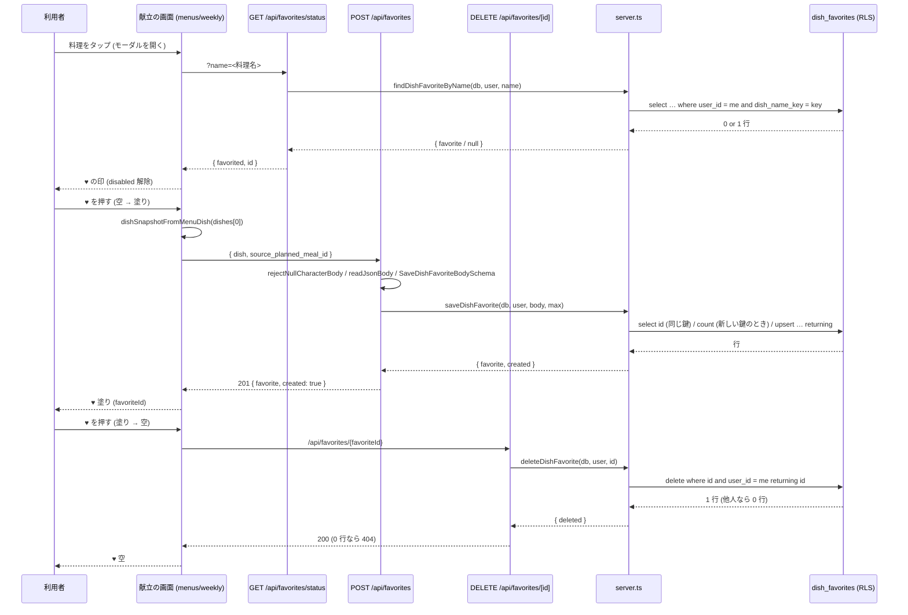
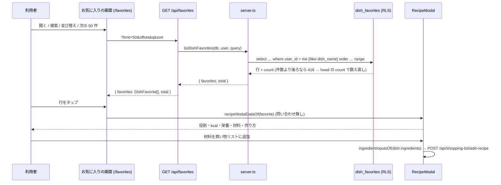

# 献立の料理のお気に入り (♥) を料理そのものごと保存する (#2011) 設計 — 配線 (API・献立の ♥・お気に入りの画面)

> **核の冊 `docs/design/cross/22-dish-favorites.md` (cross/22) がマージされた後に、核の実コードを参照して書き直して設計ゲートに通す (いまは叩き台の写し)。**

本書は、叩き台 cross/22 v1.0 (2026-10-25・2,171 行) を正典の分冊の決まりで 2 冊に分けたうちの配線の冊。叩き台の配線の部分 (API 4 本・献立の ♥・お気に入りの画面・既存の route の書き換え・それらのテスト・段 B1 / B2) を、中身を変えずに移した。分冊の判定は核の冊 cross/22 §0.4。

- 前提 (本書が従う条件)・要件の正本・用語 (§0.5)・読み方 (§0.6。TS のブロックの `// tsc:skip` の決まりを含む)・構想 (§4.1) と構造裁定 (§5)・正典コードの核 (§7.1〜§7.4・§7.6・§7.7・§7.13・§7.14)・エラー表 (§10)・定数 (§13)・状態遷移表 (§9.3)・未解決事項 (§21) は核の冊 cross/22 にある。
- 節の番号は叩き台 v1.0 の番号のまま (付け直していない)。本書に無い番号の節と、本書の表に無い行は、核の冊 cross/22 の同じ番号の節にある。移した文の中の「§7.3」「§13」などの名指しは、本書に無ければ核の冊の同じ番号の節を指す。
- 移した文の中の「本書」は叩き台 (2 冊を合わせたもの) を指す。

---

## 0. 外形固定と分冊判定 (相 1)

### 0.1 発注と決めること

| # | 決めること | 答え (§6) |
|---|---|---|
| 3 | お気に入りの画面: 一覧・検索・並び替え・削除・詳細。公開レシピの「いいね」との並べ方 | 一覧は写しごと返す (詳細の API は作らない)。検索は名前の部分一致・並びは 新しい順 / 古い順 / 名前順・削除は id・詳細は献立と同じ `RecipeModal` で材料・作り方・栄養を出す。公開レシピの「いいね」は並べない (§6.3) |
| 4 | 既存の壊れた導線の片付け (`recipe_uuid`・外部キー 2 本・トリガーと関数・`refreshLikeCount`・AI 相談の `like_recipe`・`isLiked`) | 本書では消さない (削除の migration は名指しの承認が要る。§21 Q-1)。献立の画面とお気に入りの画面が `/api/recipes/[id]/like` を呼ぶのをやめる (§6.4) |

### 0.2 要件行列

| # | 要件 | 根拠 | 本書の置き場 |
|---|---|---|---|
| R-2 | もう一度 ♥ を押すと消える。モーダルを開き直したとき・ページを読み直したときの ♥ の印は保存の状態と一致する | #2011・`tests/e2e/bug-31-favorite-button.spec.ts` | §7.5 (status・DELETE)・§7.9・§9.3 |
| R-3 | お気に入りの画面で、保存した料理を一覧 (件数つき)・名前で検索・並び替え (新しい順 / 古い順 / 名前順)・削除できる | #2011・`src/app/(main)/favorites/page.tsx` の今の機能 | §7.5 (GET)・§7.10 |
| R-4 | お気に入りの画面から、料理の詳細 (材料・作り方・栄養) を開ける。材料を買い物リストに足せる | オーナーの選択・`FavoriteRecipeModal` の今の機能 | §7.12 |
| R-13 | 既存の e2e (bug-104・bug-31) が見る文言・`data-testid`・応答の形 (`favorites` の配列と `total`) を保つ | `tests/e2e/bug-104-favorites-system.spec.ts`・`bug-31-favorite-button.spec.ts` | §7.10・§16 |
| R-14 | 本文を読む route は NULL 文字と壊れた JSON を 400 にし、一覧の route は件数より後ろのページを 500 にしない。失敗の文は日本語の固定の文 | #1657・#1917 の見張り (§16) | §7.5 |
| R-17 | 保存した料理の表示は献立のモーダルと同じ部品 (`RecipeModal`) で行う (材料・作り方・栄養の描き方を 2 か所に持たない) | 保守 | §7.12 |

### 0.3 ユーザーシナリオ (20 本。トレースは §4.3)

| # | シナリオ | 期待 |
|---|---|---|
| S-1 | 献立の料理「肉じゃが」のモーダルを開き、♥ を押す | `POST /api/favorites` が 201。♥ が塗られる。お気に入りに「肉じゃが」が材料・作り方・栄養ごと入る |
| S-2 | モーダルを閉じて、同じ「肉じゃが」をもう一度開く | `GET /api/favorites/status?name=肉じゃが` が `{ favorited: true, id }`。♥ は塗られたまま |
| S-3 | 塗られた ♥ をもう一度押す | `DELETE /api/favorites/{id}` が 200。♥ が空になり、一覧から消える |
| S-6 | お気に入りの画面を開く | `GET /api/favorites?limit=50&offset=0&sort=newest` が `{ favorites, total }`。新しい順の一覧と「N 件」 |
| S-7 | 一覧の 1 行をタップする | 一覧が持つ写しで `RecipeModal` が開く (問い合わせ無し)。役割・kcal・栄養・材料・作り方が出る。「材料を買い物リストに追加」が `/api/shopping-list/add-recipe` に POST する |
| S-8 | 一覧の行の ♥ (削除) を押す | `DELETE /api/favorites/{id}` が 200。行が消え、「N 件」が 1 減る |
| S-13 | 未ログインで 4 つの route を呼ぶ | すべて 401 `{ error: 'ログインが必要です' }`。DB に触れない |
| S-18 | 公開レシピの画面で ♥ (いいね) を押す | 今までどおり `recipe_likes` (uuid)。本書の表には入らない・お気に入りの画面にも出ない |

---

## 3. 現状の事実 (origin/main `edff659e4`・本番の読み取り 2026-10-25)

### 3.1 API・画面・lib

| # | 事実 | 場所 |
|---|---|---|
| F-1 | 献立の画面は、料理のモーダルを開くと `GET /api/recipes/{料理名}/like` で ♥ の状態を引き (失敗の応答では印を変えない)、♥ の押下で `POST` / `DELETE` を楽観的更新で送る (失敗で戻す) | `src/app/(main)/menus/weekly/page.tsx:1926-1935`・`:3485-3502` |
| F-2 | モーダルを開くとき、料理 (`dishesArray[idx]`) の新形式 (`calories_kcal` など) を優先し旧形式 (`cal` など) から埋めた `normalizedDish` を作り、`selectedRecipeData = { ...normalizedDish, imageUrl, dishes: [normalizedDish], allIngredients }` にする。`selectedRecipe` は料理名 | 同 `:5432-5472` |
| F-3 | ♥ の状態は `recipeReducer` の `isFavorite` / `isFavoriteLoading` (`FAVORITE_SET` / `FAVORITE_LOADING_SET`)。`RECIPE_SELECT` は payload が null のときだけ `isFavorite` を戻す | `src/app/(main)/menus/weekly/_state/reducers/recipeReducer.ts:26-27`・`:57-70` |
| F-4 | `RecipeModal` は `selectedRecipe` (名前)・`selectedRecipeData` (any)・`isFavorite`・`isFavoriteLoading`・`onToggleFavorite`・`onAddToShoppingList` を受け、役割・kcal・画像・栄養 28 項目・材料 (`dishes[0].ingredientsMd` か `ingredients` から表)・作り方 (`dishes[0].recipeStepsMd` か `recipeSteps`) を描く。♥ は `data-testid="favorite-button"`・`aria-pressed` | `src/app/(main)/menus/weekly/_components/modals/RecipeModal.tsx:122-150`・`:330-346` |
| F-5 | いいねの API: GET は UUID でない id に `{ liked: false }`、POST・DELETE は 404。POST は `recipe_likes` へ upsert し、外部キー違反 (`recipe_likes_recipe_id_fkey`) を 404 にする。`refreshLikeCount` は `recipe_id` で数え、`recipes.name` で UPDATE する #258 の名残 (uuid では当たらない) | `src/app/api/recipes/[id]/like/route.ts:18-40`・`:47-52`・`:64-70`・`:104-109` |
| F-6 | お気に入りの一覧 API は `recipe_likes` を `user_id` で絞り、`q` は `recipe_id` の ilike、並びは `created_at` / `recipe_id`、列の無い本番 (42703) に 3 段で退く。返す形は `{ favorites: [{ id, recipeName, recipeUuid, likedAt }], total }`。416 は先頭 1 件で total を取り直す | `src/app/api/favorites/route.ts:22-35`・`:65-70`・`:80-96` |
| F-7 | お気に入りの画面は `PAGE_SIZE = 50`、削除は `DELETE /api/recipes/{名前}/like`、詳細は `FavoriteRecipeModal` が `recipeUuid` があるときだけ `/api/recipes/{uuid}` を取り、無ければ「詳細情報が保存されていません」。`recipe_uuid` はどの導線も書かない | `src/app/(main)/favorites/page.tsx:30`・`:106-120`・`_components/FavoriteRecipeModal.tsx:8-11`・`:95-105` |
| F-8 | 一覧の 1 行 `FavoriteListItem` は `item.recipeName`・`item.likedAt` を描き、「レシピを見る」と「お気に入りから削除」の 2 つの `<button>` を兄弟で並べる (#1050) | `src/app/(main)/favorites/_components/FavoriteListItem.tsx:16-27`・`:52-60` |
| F-16 | モバイル: お気に入りのネイティブの画面は無い (#1598 で消した)。献立とお気に入りは Web の画面を WebView で開く。通知の行き先 `/favorites` はある | `apps/mobile/README.md:66-75`・`apps/mobile/__tests__/lib/notification-route.test.ts:91` |
| F-20 | 公開の紹介ページの主張 `favorites` (『気に入ったレシピをお気に入りに残せる (献立のレシピのハートから)』) の根拠は `src/app/(main)/favorites/page.tsx` と `src/app/api/favorites/route.ts` | `src/components/marketing/landing-copy.ts:885` |

### 3.3 既存のテストと番兵

§16 に全列挙する。要点: `tests/api/favorites-route.test.ts` (一覧 API の単体)・`src/app/(main)/favorites/_components/__tests__/FavoriteListItem.test.ts`・`FavoriteRecipeModal.test.ts`・`tests/e2e/bug-104-favorites-system.spec.ts`・`bug-31-favorite-button.spec.ts`・`tests/route-invalid-input-1917.test.ts:331-410` (いいねの route。変えない)。

---

## 4. 構想 (相 2)

### 4.2 動き

1. **モーダルを開く**: `selectedRecipe` (名前) が決まると `GET /api/favorites/status?name=<名前>` を呼ぶ。応答 `{ favorited, id }` で `isFavorite` と `favoriteId` を入れる。読み込み中は `isFavoriteLoading` を立てる (♥ は disabled)。
2. **♥ 押す (空 → 塗り)**: `selectedRecipeData.dishes[0]` を `dishSnapshotFromMenuDish` で写しにし、`POST /api/favorites { dish, source_planned_meal_id }`。201 / 200 の `favorite.id` を `favoriteId` に入れる。4xx / 5xx / 例外は ♥ を戻し、409・400 は本文の `error` を見せる。
3. **♥ 押す (塗り → 空)**: `DELETE /api/favorites/{favoriteId}`。200 と 404 (もう無い) は空にする。ほかは戻す。
4. **一覧**: `GET /api/favorites` は本人の行を `created_at` (newest / oldest) か `dish_name_key` (name) で並べ、`q` は `dish_name` の ilike。`resolveBeyondLastPage` で 416 を空のページにする。
5. **詳細**: 一覧の行 (`DishFavorite`) を `recipeModalDataOf` で `RecipeModal` の `selectedRecipeData` の形にして開く。♥ は塗り固定で、押すと削除 (3 と同じ DELETE) して閉じる。買い物リストは `ingredientInputsOf(dish.ingredients)` を `/api/shopping-list/add-recipe` に送る。
6. **削除**: `DELETE /api/favorites/[id]` は RLS で本人の行だけ消える。0 行なら 404。

### 4.3 シナリオのトレース (§4.1 の構造で手で走らせた記録)

| # | 走らせた結果 | 通る場所 |
|---|---|---|
| S-1 | 開く → status が `{ favorited: false, id: null }` → ♥ 押下 → `dishSnapshotFromMenuDish(dishes[0])` → POST → `saveDishFavorite`: 鍵 `肉じゃが` の行なし → 件数 0 < 300 → upsert → 201 `{ favorite, created: true }` → `favoriteId` に id。写しは名前・役割・kcal・栄養・材料・作り方 | §7.3・§7.4・§7.5・§7.9 |
| S-2 | 開く → status: `findDishFavoriteByName` が鍵で 1 行 → `{ favorited: true, id }` → ♥ 塗り・`favoriteId` あり | §7.5 status・§7.9 |
| S-3 | ♥ 押下 (塗り) → DELETE id → `deleteDishFavorite` が 1 行消す → 200 → ♥ 空・`favoriteId` null。一覧を読み直すと無い | §7.5 [id]・§7.9 |
| S-6 | `GET /api/favorites?limit=50&offset=0&sort=newest` → `listDishFavorites` → `created_at desc, id` → `{ favorites: DishFavorite[], total }` → 「N 件」 | §7.5 GET・§7.10 |
| S-7 | 行をタップ → `selectedFavorite` に行 → `FavoriteRecipeModal` が `recipeModalDataOf(favorite)` を `RecipeModal` に渡す → 役割・kcal・栄養 (`protein_g` などが 0 でなければ)・材料 (`ingredients_md` があれば表、無ければ `ingredients` から表)・作り方。買い物リストは `ingredientInputsOf` → POST → 「N 件の材料を買い物リストに追加しました」 | §7.12・§7.3 |
| S-8 | 行の ♥ → DELETE id → 200 → 一覧から外し `total - 1` | §7.10 |
| S-13 | `supabase.auth.getUser()` が user null → 401 `API_UNAUTHENTICATED_MESSAGE`。`from` は呼ばれない | §7.5 |
| S-18 | 公開レシピの ♥ → `POST /api/recipes/{uuid}/like` → `recipe_likes` (変えない)。`GET /api/favorites` は `dish_favorites` だけ読むので出ない | §18 |

---

## 6. 決めたこと (0.1 の 1〜7 への答え)

### 6.1 保存の形 (決めること 1)

- 画面の見出し「お気に入りレシピ」・検索の placeholder「レシピ名で検索...」・空の文言・「N 件」は変えない (R-13)。

### 6.3 お気に入りの画面 (決めること 3)

- 一覧 = `GET /api/favorites`。1 行 = `DishFavorite` (`id`・`dish_name`・`dish` (写し)・`source_planned_meal_id`・`created_at`・`updated_at`)。写しごと返すので詳細の API は無い。
- 検索 `q` は `dish_name` の部分一致 (ilike)。長さは `DISH_FAVORITES_QUERY_MAX_CHARS` (100) で切る。並びは `newest` (`created_at` 降順) / `oldest` (昇順) / `name` (`dish_name_key` 昇順)。どれも `id` で安定にする。未知の `sort` は `newest`。
- ページングは `limit` (1〜200・既定 100) と `offset` (0〜100000) を `clampIntParam` で丸める (#1226 と同じ値。§13)。画面は 50 件ずつ。件数より後ろの offset は空のページと本当の件数 (`resolveBeyondLastPage`)。
- 削除は `DELETE /api/favorites/[id]`。200 と 404 (もう無い) のどちらでも一覧から外す。
- 詳細は一覧の行をそのまま `RecipeModal` に渡す (§7.12)。♥ は塗り固定で、押すと削除して閉じる。買い物リストの追加は `/api/shopping-list/add-recipe` に `{ ingredients: ingredientInputsOf(dish.ingredients) }`。

### 6.4 既存の壊れた導線 (決めること 4)

- 献立の画面とお気に入りの画面は `/api/recipes/[id]/like` を呼ばなくなる。route そのものは公開レシピの「いいね」のために残す (変えない)。
- `recipe_likes.recipe_uuid`・外部キー 2 本目・`trg_sync_recipe_like_count`・`sync_recipe_like_count`・`increment / decrement_recipe_like_count`・`refreshLikeCount` の #258 の名残・『Anyone can view likes』は本書では触らない。消すなら削除の migration で、§21 Q-1 の選択肢。
- AI 相談の `like_recipe`・`isLiked` (`viewer-lookups.ts`)・献立の生成の `recipe_likes` の読み取りは変えない (R-12・§18)。

---

## 7. 正典コード

### 7.5 route 3 ファイル (`src/app/api/favorites/**`)

#### 7.5.1 `src/app/api/favorites/route.ts` (GET を書き換え・POST を新設。全文)

```ts
// tsc:skip (本書が新設する @/modules/dish-favorites/* を import する)
import { NextResponse } from 'next/server';
import { createClient } from '@/lib/supabase/server';
import { internalError } from '@/lib/api/errors';
import { API_INVALID_JSON_MESSAGE, API_UNAUTHENTICATED_MESSAGE } from '@/lib/api/error-responses';
import { rejectNullCharacterBody } from '@/lib/api/reject-null-character';
import { clampIntParam, readJsonBody } from '@/lib/http-params';
import {
  DISH_FAVORITES_LIST_LIMIT_DEFAULT,
  DISH_FAVORITES_LIST_LIMIT_MAX,
  DISH_FAVORITES_LIST_LIMIT_MIN,
  DISH_FAVORITES_LIST_OFFSET_MAX,
  DISH_FAVORITES_LIMIT_CODE,
  DISH_FAVORITES_QUERY_MAX_CHARS,
  DISH_FAVORITE_DISH_MAX_BYTES,
  DISH_FAVORITE_INVALID_MESSAGE,
  DISH_FAVORITE_SORT_DEFAULT,
  DISH_FAVORITE_VALIDATION_CODE,
  DishFavoriteSortSchema,
  SaveDishFavoriteBodySchema,
  dishFavoritesLimitMessage,
  dishJsonByteLength,
} from '@/modules/dish-favorites/core';
import { dishFavoritesMaxPerUser, listDishFavorites, saveDishFavorite } from '@/modules/dish-favorites/server';

const GET_ROUTE_NAME = 'GET /api/favorites';
const POST_ROUTE_NAME = 'POST /api/favorites';

/**
 * GET /api/favorites
 * ログインユーザーの、献立の料理のお気に入り (dish_favorites) の一覧 (docs/design/cross/22-dish-favorites.md §7.5.1)。
 * 以前は recipe_likes を料理名で読んでいた (#109 / #302)。応答の形 { favorites, total } は同じ。行の形は DishFavorite (snake_case)。
 * limit / offset は clampIntParam で丸める (#1226)。件数より後ろのページは resolveBeyondLastPage (server.ts) が空のページにする。
 */
export async function GET(request: Request) {
  const supabase = await createClient();
  const { data: { user }, error: userError } = await supabase.auth.getUser();
  if (userError || !user) return NextResponse.json({ error: API_UNAUTHENTICATED_MESSAGE }, { status: 401 });

  const { searchParams } = new URL(request.url);
  const limit = clampIntParam(searchParams.get('limit'), {
    min: DISH_FAVORITES_LIST_LIMIT_MIN,
    max: DISH_FAVORITES_LIST_LIMIT_MAX,
    default: DISH_FAVORITES_LIST_LIMIT_DEFAULT,
  });
  const offset = clampIntParam(searchParams.get('offset'), { min: 0, max: DISH_FAVORITES_LIST_OFFSET_MAX, default: 0 });
  const q = (searchParams.get('q') ?? '').trim().slice(0, DISH_FAVORITES_QUERY_MAX_CHARS);
  const sortParsed = DishFavoriteSortSchema.safeParse(searchParams.get('sort'));
  const sort = sortParsed.success ? sortParsed.data : DISH_FAVORITE_SORT_DEFAULT;

  const listed = await listDishFavorites(supabase, user.id, { q, sort, offset, limit }, GET_ROUTE_NAME);
  if (!listed.ok) return internalError(GET_ROUTE_NAME, listed.error, { userId: user.id, table: 'dish_favorites' });
  return NextResponse.json({ favorites: listed.favorites, total: listed.total });
}

/**
 * POST /api/favorites
 * 献立の料理の写し (body.dish) を本人のお気に入りに保存する。同じ名前があれば写しを置き換えて 200、無ければ 201。
 * 本文: { dish: DishSnapshot, source_planned_meal_id?: uuid | null } (core.ts の SaveDishFavoriteBodySchema)。
 */
export async function POST(request: Request) {
  // 本文の文字列に NULL 文字 (U+0000) があると、DB (text / jsonb) に届いたところで拒まれて 500 になる。本文を読む handler はどれも、認証・DB に触れる前に 400 で断る (#1657。一覧と例外は src/__tests__/api/null-character-routes.test.ts)
  const nullCharacterRejection = await rejectNullCharacterBody(request);
  if (nullCharacterRejection) return nullCharacterRejection;

  const supabase = await createClient();
  const { data: { user }, error: userError } = await supabase.auth.getUser();
  if (userError || !user) return NextResponse.json({ error: API_UNAUTHENTICATED_MESSAGE }, { status: 401 });

  const read = await readJsonBody(request);
  if (!read.ok) return NextResponse.json({ error: API_INVALID_JSON_MESSAGE }, { status: 400 });
  const parsed = SaveDishFavoriteBodySchema.safeParse(read.body);
  if (!parsed.success || dishJsonByteLength(parsed.data.dish) > DISH_FAVORITE_DISH_MAX_BYTES) {
    return NextResponse.json({ error: DISH_FAVORITE_INVALID_MESSAGE, code: DISH_FAVORITE_VALIDATION_CODE }, { status: 400 });
  }

  const saved = await saveDishFavorite(supabase, user.id, parsed.data, dishFavoritesMaxPerUser());
  if (!saved.ok) {
    if (saved.reason === 'limit') {
      return NextResponse.json({ error: dishFavoritesLimitMessage(saved.max), code: DISH_FAVORITES_LIMIT_CODE }, { status: 409 });
    }
    return internalError(POST_ROUTE_NAME, saved.error, { userId: user.id, table: 'dish_favorites' });
  }
  return NextResponse.json({ favorite: saved.favorite, created: saved.created }, { status: saved.created ? 201 : 200 });
}
```

#### 7.5.2 `src/app/api/favorites/status/route.ts` (新。全文)

```ts
// tsc:skip (本書が新設する @/modules/dish-favorites/* を import する)
import { NextResponse } from 'next/server';
import { createClient } from '@/lib/supabase/server';
import { internalError } from '@/lib/api/errors';
import { API_UNAUTHENTICATED_MESSAGE } from '@/lib/api/error-responses';
import { DISH_FAVORITE_NAME_INVALID_MESSAGE, DISH_FAVORITE_VALIDATION_CODE, DishNameSchema } from '@/modules/dish-favorites/core';
import { findDishFavoriteByName } from '@/modules/dish-favorites/server';

const ROUTE_NAME = 'GET /api/favorites/status';

/**
 * GET /api/favorites/status?name=<料理名>
 * 献立の画面が料理のモーダルを開いたときに、その名前の料理が本人のお気に入りに保存されているかを引く (docs/design/cross/22-dish-favorites.md §7.5.2)。
 * 応答: { favorited: boolean, id: string | null } (id は DELETE /api/favorites/[id] に使う)。
 * 同じ料理の判定は名前の鍵 (dishNameKeyOf)。名前が無い・空・長すぎるときは 400。
 */
export async function GET(request: Request) {
  const supabase = await createClient();
  const { data: { user }, error: userError } = await supabase.auth.getUser();
  if (userError || !user) return NextResponse.json({ error: API_UNAUTHENTICATED_MESSAGE }, { status: 401 });

  const name = DishNameSchema.safeParse(new URL(request.url).searchParams.get('name') ?? '');
  if (!name.success) {
    return NextResponse.json({ error: DISH_FAVORITE_NAME_INVALID_MESSAGE, code: DISH_FAVORITE_VALIDATION_CODE }, { status: 400 });
  }

  const found = await findDishFavoriteByName(supabase, user.id, name.data);
  if (!found.ok) return internalError(ROUTE_NAME, found.error, { userId: user.id, table: 'dish_favorites' });
  return NextResponse.json({ favorited: found.favorite !== null, id: found.favorite?.id ?? null });
}
```

#### 7.5.3 `src/app/api/favorites/[id]/route.ts` (新。全文)

```ts
// tsc:skip (本書が新設する @/modules/dish-favorites/* を import する)
import { NextResponse } from 'next/server';
import { createClient } from '@/lib/supabase/server';
import { internalError } from '@/lib/api/errors';
import { API_NOT_FOUND_MESSAGE, API_UNAUTHENTICATED_MESSAGE } from '@/lib/api/error-responses';
import { isUuid } from '@/lib/http-params';
import { deleteDishFavorite } from '@/modules/dish-favorites/server';

const ROUTE_NAME = 'DELETE /api/favorites/[id]';

/**
 * DELETE /api/favorites/[id]
 * 本人のお気に入りを 1 件消す (docs/design/cross/22-dish-favorites.md §7.5.3)。
 * UUID の形でない id は DB に渡さず 404 (uuid 型の列に渡すと 22P02 で 500 になる。#1917 の続き)。RLS で他人の行は 0 行 → 404 (在るかどうかを見せない)。
 */
export async function DELETE(_request: Request, props: { params: Promise<{ id: string }> }) {
  const { id } = await props.params;
  const supabase = await createClient();
  const { data: { user }, error: userError } = await supabase.auth.getUser();
  if (userError || !user) return NextResponse.json({ error: API_UNAUTHENTICATED_MESSAGE }, { status: 401 });

  if (!isUuid(id)) return NextResponse.json({ error: API_NOT_FOUND_MESSAGE }, { status: 404 });

  const deleted = await deleteDishFavorite(supabase, user.id, id);
  if (!deleted.ok) return internalError(ROUTE_NAME, deleted.error, { userId: user.id, table: 'dish_favorites' });
  if (!deleted.deleted) return NextResponse.json({ error: API_NOT_FOUND_MESSAGE }, { status: 404 });
  return NextResponse.json({ success: true });
}
```

### 7.8 `src/app/(main)/menus/weekly/_state/reducers/recipeReducer.ts` (差分)

```ts
// tsc:skip (既存ファイルの差分の断片)
// RecipeState に 1 欄
  /** 保存済みのお気に入りの id (DELETE /api/favorites/[id] に使う)。未保存・未取得は null (#2011) */
  favoriteId: string | null;

// RecipeAction に 1 種
  | { type: 'FAVORITE_ID_SET'; payload: string | null }

// initialRecipeState に 1 欄
  favoriteId: null,

// reducer: RECIPE_SELECT は、料理が変わったら ♥ の状態と id を両方とも未取得に戻す (status の応答で入れ直す)
    case 'RECIPE_SELECT':
      return { ...state, selectedRecipe: action.payload, isFavorite: false, favoriteId: null };

// reducer: 1 case
    case 'FAVORITE_ID_SET':
      return { ...state, favoriteId: action.payload };
```

`RECIPE_RESET` は `initialRecipeState` を返すので `favoriteId` も null に戻る (変更なし)。

### 7.9 `src/app/(main)/menus/weekly/page.tsx` (差分。3 か所)

```ts
// tsc:skip (既存ファイルの差分の断片)
// (1) import に 1 つ
import { dishSnapshotFromMenuDish } from '@/modules/dish-favorites/core';

// (2) recipeReducer から分解する所 (:787-796 の並び) に 1 対
  const favoriteId = recipe.favoriteId;
  const setFavoriteId = useCallback((v: string | null) => dispatchRecipe({ type: 'FAVORITE_ID_SET', payload: v }), []);

// (3) :1926-1935 の useEffect を置き換える (♥ の状態を dish_favorites から名前で引く。取得中は ♥ を disabled にする)
  useEffect(() => {
    if (!selectedRecipe) return;
    let cancelled = false;
    setIsFavoriteLoading(true);
    fetch(`/api/favorites/status?name=${encodeURIComponent(selectedRecipe)}`)
      .then((res) => (res.ok ? res.json() : null))
      .then((data: { favorited?: boolean; id?: string | null } | null) => {
        if (cancelled || !data) return;
        setIsFavorite(data.favorited === true);
        setFavoriteId(typeof data.id === 'string' ? data.id : null);
      })
      .catch(() => {/* 取得失敗は無視 (印は未取得のまま) */})
      .finally(() => { if (!cancelled) setIsFavoriteLoading(false); });
    return () => { cancelled = true; };
  }, [selectedRecipe]);

// (4) :3485-3502 の handleToggleFavorite を置き換える
  // お気に入りトグル (楽観的更新 + 失敗時ロールバック)。保存は料理の写しを POST、解除は id で DELETE (#2011)
  const handleToggleFavorite = async () => {
    if (!selectedRecipe || isFavoriteLoading) return;
    const prev = isFavorite;
    setIsFavorite(!prev);
    setIsFavoriteLoading(true);
    try {
      if (prev) {
        if (!favoriteId) { setIsFavorite(prev); return; }
        const res = await fetch(`/api/favorites/${encodeURIComponent(favoriteId)}`, { method: 'DELETE' });
        // 404 = もう消えている。どちらも「未保存」が正しい状態
        if (res.ok || res.status === 404) { setFavoriteId(null); } else { setIsFavorite(prev); }
        return;
      }
      const dish = (selectedRecipeData?.dishes as unknown[] | undefined)?.[0];
      const body = {
        dish: dishSnapshotFromMenuDish(dish && typeof dish === 'object' ? (dish as Record<string, unknown>) : {}, selectedRecipe),
        source_planned_meal_id: typeof selectedRecipeData?.plannedMealId === 'string' ? selectedRecipeData.plannedMealId : null,
      };
      const res = await fetch('/api/favorites', { method: 'POST', headers: { 'Content-Type': 'application/json' }, body: JSON.stringify(body) });
      if (res.ok) {
        const data = (await res.json()) as { favorite?: { id?: string } };
        setFavoriteId(typeof data.favorite?.id === 'string' ? data.favorite.id : null);
      } else {
        setIsFavorite(prev);
        // 409 (上限) と 400 (内容) は理由の文を見せる (本文の error は日本語の固定の文)
        if (res.status === 409 || res.status === 400) {
          const err = (await res.json().catch(() => null)) as { error?: string } | null;
          if (err?.error) alert(err.error);
        }
      }
    } catch {
      setIsFavorite(prev);
    } finally {
      setIsFavoriteLoading(false);
    }
  };

// (5) :5463-5471 の setSelectedRecipeData に、保存したときの食事の id を 1 欄足す (写しの source_planned_meal_id に使う)
                    setSelectedRecipeData({
                      ...normalizedDish,
                      imageUrl: dish.image_url ?? (mealCoverRepresentsDish(dishesArray, idx) ? meal.imageUrl : null) ?? null,
                      dishes: [normalizedDish],
                      allIngredients: dishesArray.flatMap(dd => dd.ingredients || []),
                      // お気に入りの写しの source_planned_meal_id (#2011。参照だけ)
                      plannedMealId: meal.id,
                    });
```

`RecipeModal` は変えない (♥ の `data-testid`・`aria-pressed`・`disabled` は今のまま。F-4)。

### 7.10 `src/app/(main)/favorites/page.tsx` (差分。見た目・文言・並び替え・検索の debounce は変えない)

```ts
// tsc:skip (既存ファイルの差分の断片)
// (1) import。型と定数はモジュールから
import { FavoriteRecipeModal } from "./_components/FavoriteRecipeModal";
import { FavoriteListItem } from "./_components/FavoriteListItem";
import { DISH_FAVORITES_PAGE_SIZE, type DishFavorite, type DishFavoriteSort } from "@/modules/dish-favorites/core";

// (2) ローカルの型と定数を置き換える (FavoriteItem・SortOption・PAGE_SIZE を消す)
type FavoriteItem = DishFavorite;
type SortOption = DishFavoriteSort;
const PAGE_SIZE = DISH_FAVORITES_PAGE_SIZE;
/** 買い物リストに足したときの知らせ (RecipeModal には文を出す場所が無いので、画面の下に短く出す) */
const SHOPPING_LIST_ADDED_MESSAGE = (count: number) => `${count}件の材料を買い物リストに追加しました`;
const SHOPPING_LIST_ADD_FAILED_MESSAGE = "買い物リストへの追加に失敗しました";
const SHOPPING_LIST_NO_INGREDIENTS_MESSAGE = "材料情報がありません";
/** 知らせを消すまでの時間 (ミリ秒)。読める長さで、次の操作の邪魔にならない程度 */
const NOTICE_HIDE_MS = 3000;

// (3) state に 1 つ
  const [notice, setNotice] = useState<string | null>(null);
  useEffect(() => {
    if (!notice) return;
    const timer = setTimeout(() => setNotice(null), NOTICE_HIDE_MS);
    return () => clearTimeout(timer);
  }, [notice]);

// (4) handleRemove: 名前の DELETE /api/recipes/{name}/like を、id の DELETE /api/favorites/{id} に。200 と 404 (もう無い) は一覧から外す
  const handleRemove = async (item: FavoriteItem) => {
    if (removingId) return;
    setRemovingId(item.id);
    try {
      const res = await fetch(`/api/favorites/${encodeURIComponent(item.id)}`, { method: "DELETE" });
      if (res.ok || res.status === 404) {
        setFavorites((prev) => prev.filter((f) => f.id !== item.id));
        setTotal((prev) => Math.max(0, prev - 1));
        if (selectedFavorite?.id === item.id) setIsRecipeModalOpen(false);
      }
    } catch (err) {
      console.error(err);
    } finally {
      setRemovingId(null);
    }
  };

// (5) FavoriteListItem の呼び出しは同じ (item の形が DishFavorite になる。§7.11)。formatDate は item.created_at に使う

// (6) モーダルの呼び出し
      <FavoriteRecipeModal
        isOpen={isRecipeModalOpen}
        favorite={selectedFavorite}
        isRemoving={selectedFavorite !== null && removingId === selectedFavorite.id}
        onRemove={() => { if (selectedFavorite) void handleRemove(selectedFavorite); }}
        onNotice={setNotice}
        onClose={() => setIsRecipeModalOpen(false)}
      />
      {notice && (
        <div role="status" style={{ position: "fixed", left: 16, right: 16, bottom: 96, padding: "10px 14px", borderRadius: 12, background: colors.text, color: colors.card, fontSize: 13, zIndex: 300 }}>
          {notice}
        </div>
      )}
```

`fetchFavorites` の `params` (`limit`・`offset`・`sort`・`q`) と応答の読み方 (`data.favorites`・`data.total`) は変えない。見出し「お気に入りレシピ」・「{total} 件」・placeholder「レシピ名で検索...」・空の 2 文・「次の50件を表示」も変えない (R-13)。

### 7.11 `src/app/(main)/favorites/_components/FavoriteListItem.tsx` (差分)

```ts
// tsc:skip (既存ファイルの差分の断片)
// (1) 行の型を DishFavorite に (recipeName → dish_name・likedAt → created_at。recipeUuid は無くなる)
import type { DishFavorite } from "@/modules/dish-favorites/core";
export type FavoriteListItemData = Pick<DishFavorite, "id" | "dish_name" | "created_at">;

// (2) 描画の 3 か所
        aria-label={`${item.dish_name} のレシピを見る`}
            {item.dish_name}
            {formatDate(item.created_at)} に追加
```

2 つの `<button>` の構造・`aria-label="お気に入りから削除"`・`disabled={isRemoving}`・`borderRadius: 16` は変えない (#1050 と e2e の locator)。

### 7.12 `src/app/(main)/favorites/_components/FavoriteRecipeModal.tsx` (全文の差し替え。献立の `RecipeModal` を使う)

```ts
// tsc:skip (本書が新設する @/modules/dish-favorites/core を import する)
"use client";

// src/app/(main)/favorites/_components/FavoriteRecipeModal.tsx
// お気に入りの詳細 (docs/design/cross/22-dish-favorites.md §7.12)。
// 以前 (#1050 UX2-06) は recipe_uuid があるときだけ /api/recipes/{uuid} を取り、無ければ「詳細情報が保存されていません」を出していた。
// いまは一覧の 1 件 (DishFavorite) が料理の写し (材料・作り方・栄養) を持つので、問い合わせずに献立のモーダル (RecipeModal) で描く
// (材料・作り方・栄養の描き方を 2 か所に持たない)。♥ は塗り固定で、押すとお気に入りから消して閉じる。
import React from "react";
import { AnimatePresence } from "framer-motion";
import { RecipeModal } from "@/app/(main)/menus/weekly/_components/modals/RecipeModal";
import { ingredientInputsOf, recipeModalDataOf, type DishFavorite } from "@/modules/dish-favorites/core";

/** 買い物リストに足したときの知らせ。page.tsx の定数と同じ文 (page が onNotice で受けて出す) */
const SHOPPING_LIST_ADDED_MESSAGE = (count: number) => `${count}件の材料を買い物リストに追加しました`;
const SHOPPING_LIST_ADD_FAILED_MESSAGE = "買い物リストへの追加に失敗しました";
const SHOPPING_LIST_NO_INGREDIENTS_MESSAGE = "材料情報がありません";

export interface FavoriteRecipeModalProps {
  isOpen: boolean;
  favorite: DishFavorite | null;
  /** 削除の応答待ち (♥ を disabled にする) */
  isRemoving: boolean;
  /** ♥ (塗り) を押した = お気に入りから消す */
  onRemove: () => void;
  /** 買い物リストの結果の知らせ (page が出す) */
  onNotice: (message: string) => void;
  onClose: () => void;
}

export function FavoriteRecipeModal({ isOpen, favorite, isRemoving, onRemove, onNotice, onClose }: FavoriteRecipeModalProps) {
  const handleAddToShoppingList = async () => {
    if (!favorite) return;
    const ingredients = ingredientInputsOf(favorite.dish.ingredients);
    if (ingredients.length === 0) {
      onNotice(SHOPPING_LIST_NO_INGREDIENTS_MESSAGE);
      return;
    }
    try {
      const res = await fetch("/api/shopping-list/add-recipe", {
        method: "POST",
        headers: { "Content-Type": "application/json" },
        body: JSON.stringify({ ingredients }),
      });
      onNotice(res.ok ? SHOPPING_LIST_ADDED_MESSAGE(ingredients.length) : SHOPPING_LIST_ADD_FAILED_MESSAGE);
    } catch {
      onNotice(SHOPPING_LIST_ADD_FAILED_MESSAGE);
    }
  };

  return (
    <AnimatePresence>
      {isOpen && favorite && (
        <RecipeModal
          key={favorite.id}
          selectedRecipe={favorite.dish_name}
          selectedRecipeData={recipeModalDataOf(favorite)}
          isFavorite={true}
          isFavoriteLoading={isRemoving}
          onClose={onClose}
          onToggleFavorite={onRemove}
          onAddToShoppingList={() => { void handleAddToShoppingList(); }}
        />
      )}
    </AnimatePresence>
  );
}
```

- `RecipeModal` の位置 (`fixed bottom-20 lg:bottom-0 … lg:left-64`) は `(main)` の layout の前提で、`/favorites` も同じ layout の下なのでそのまま使える。
- `page.tsx` 側の 3 つの文の定数 (§7.10 (2)) は、このファイルの定数と同じ文にする (`onNotice` に渡すのはこのファイルの文。page の定数は page が自分で出す文のため)。実装で重複を避けたければ、3 つの文を `core.ts` ではなく `_components/shopping-list-notice.ts` に置いてよい (core は UI の文を持たない)。

### 7.15 単体テスト (新設 3 ファイル・書き換え 3 ファイル)。it 名は §12

| ファイル | 中身 | 作り方 |
|---|---|---|
| `tests/api/favorites-route.test.ts` (書き換え) | §7.5.1 の GET (R-1〜R-6) と POST (P-1〜P-8) | 今のファイルの `setupFavoritesQuery` (select / eq / ilike / order / range を自分に返し range が結果を返す) を、`dish_favorites` の行 (uuid の id・`dish` を持つ) を返す形に直す。POST は `from` に `select → eq → eq → maybeSingle` (既存の確認)・`select(count head)` (件数)・`upsert → select → single` の 3 段を並べる |
| `tests/api/favorites-status-route.test.ts` (新) | §7.5.2 (T-1〜T-5) | 同上 |
| `tests/api/favorites-id-route.test.ts` (新) | §7.5.3 (D-1〜D-5) | 同上 |
| `src/app/(main)/favorites/_components/__tests__/FavoriteRecipeModal.test.ts` (書き換え) | §7.12 (M-1〜M-4) | 今の `createRoot` + `React.createElement` の形のまま。`RecipeModal` は `vi.mock('@/app/(main)/menus/weekly/_components/modals/RecipeModal')` で props を記録する偽物にする (framer-motion・focus-trap を描かない) |
| `src/app/(main)/favorites/_components/__tests__/FavoriteListItem.test.ts` (書き換え) | 行の形の変更 (L-1) | 既存の 6 本の it はそのまま。fixture の `recipeName` → `dish_name`・`likedAt` → `created_at`・`recipeUuid` を消す |

---

## 8. facade 契約

| 面 | 契約 (逐語) | 変更 |
|---|---|---|
| API | `GET /api/favorites?limit&offset&q&sort` → 200 `{ favorites: DishFavorite[], total: number }` | 行の形を `{ id, recipeName, recipeUuid, likedAt }` から `DishFavorite` に改める (外側の形は同じ) |
| API | `POST /api/favorites` body `SaveDishFavoriteBody` → 201 / 200 `{ favorite: DishFavorite, created: boolean }` | 新設 |
| API | `GET /api/favorites/status?name=` → 200 `{ favorited: boolean, id: string / null }` | 新設 |
| API | `DELETE /api/favorites/[id]` → 200 `{ success: true }` | 新設 |
| API | `GET / POST / DELETE /api/recipes/[id]/like` | 変更なし (公開レシピの「いいね」) |
| 画面 | `RecipeState.favoriteId: string / null`・`RecipeAction { type: 'FAVORITE_ID_SET'; payload: string / null }` | 新設 |
| 画面 | `FavoriteRecipeModalProps { isOpen; favorite: DishFavorite / null; isRemoving: boolean; onRemove(); onNotice(message: string); onClose() }` | 差し替え |
| 画面 | `FavoriteListItemData = Pick<DishFavorite, 'id' / 'dish_name' / 'created_at'>` (`/` は union) | `recipeName` / `recipeUuid` / `likedAt` → `dish_name` / `created_at` |

---

## 9. 表 3 点

### 9.1 ①全パターン表

(a) 料理の状態 × 操作 → 結果 (本人の視点。`K` = その料理名の鍵の行が本人にあるか)

| 料理の状態 | モーダルを開く (status) | ♥ を押す | お気に入りの一覧 | 一覧の詳細 | 一覧の ♥ (削除) |
|---|---|---|---|---|---|
| A: 保存していない (K なし) | `{ favorited: false, id: null }`。♥ 空 | POST → 201 `created: true`。♥ 塗り・`favoriteId` | 出ない | — | — |
| B: 同じ名前・同じ中身を保存済み (K あり) | `{ favorited: true, id }`。♥ 塗り | DELETE id → 200。♥ 空・一覧から消える | 出る (写し = 今の料理) | 同じ内容 | DELETE → 消える |
| C: 同じ名前・別の中身を保存済み (K あり。作り直し後) | `{ favorited: true, id }`。♥ 塗り | DELETE id → 200 (前の写しが消える)。もう一度押すと POST → 201 で今の中身 | 出る (写し = 前の中身) | 前の内容 | DELETE → 消える |
| D: 上限 (300) に達している・K なし | `{ favorited: false, id: null }` | POST → 409 `CONFLICT_DISH_FAVORITES_LIMIT`。♥ は戻り、理由の文 | 300 件 | — | DELETE → 消える (以後 POST できる) |
| E: 上限に達している・K あり | `{ favorited: true, id }` | DELETE → 200 (件数が減る) | 出る | 出る | DELETE |
| F: 材料・作り方の無い料理 (買う・外食) | A か B と同じ | POST → 201 (`ingredients: []`・`recipe_steps: []`) | 出る | 「材料情報なし」と作り方の案内文 | DELETE |
| G: 名前が空白だけ・101 文字以上 | status → 400 `VALIDATION_ERROR` (印は変えない) | POST → 400。♥ は戻る | — | — | — |
| H: 未ログイン | 401 (印は変えない) | 401。♥ は戻る | 401 (画面は空のまま) | — | 401 |

(b) 消費経路 (書く側・読む側・表示・他)

| 経路 | 読む / 書く | 何を | 本書で |
|---|---|---|---|
| `POST /api/favorites` | 書く | `dish_favorites` に upsert (本人の行) | 新設 (§7.5.1) |
| `DELETE /api/favorites/[id]` | 書く | 本人の行を 1 件 DELETE | 新設 (§7.5.3) |
| `GET /api/favorites` | 読む | 本人の行の一覧 + 件数 | 書き換え (§7.5.1) |
| `GET /api/favorites/status` | 読む | 名前の鍵で 1 行 | 新設 (§7.5.2) |
| 献立の画面の ♥ | 表示 | `isFavorite`・`favoriteId` (status と POST / DELETE の結果) | §7.8・§7.9 |
| お気に入りの画面の一覧・詳細・削除 | 表示 | `DishFavorite[]`・`RecipeModal` | §7.10〜§7.12 |
| モバイル | 表示 | Web の `/favorites`・献立の画面を WebView で | 変更なし |

### 9.2 ②状態比較表 (現行 vs 設計後)

| 面 | 現行 (origin/main `edff659e4`) | 設計後 |
|---|---|---|
| 献立の ♥ を押す | `POST /api/recipes/{料理名}/like` → 404 (保存されない。♥ は戻る) | `POST /api/favorites { dish }` → 201 (料理の写しが保存される。♥ 塗り) |
| モーダルを開いたときの ♥ | `GET /api/recipes/{料理名}/like` → `{ liked: false }` (常に空) | `GET /api/favorites/status?name=` → 保存の有無 (名前の鍵) |
| ♥ をもう一度押す | `DELETE /api/recipes/{料理名}/like` → 404 | `DELETE /api/favorites/{id}` → 200 |
| お気に入りの一覧 | `recipe_likes` (本番 0 行。入れる経路が無い) | `dish_favorites` の本人の行 (写しごと) |
| 一覧の行の形 | `{ id, recipeName, recipeUuid: null, likedAt }` | `{ id, dish_name, dish, source_planned_meal_id, created_at, updated_at }` |
| 列が無いときの 3 段の退避 (#302) | ある (`recipe_likes` の `id` / `recipe_uuid` が本番に無いときの名残) | 無い (新しい表の列は決まっている) |
| 一覧の詳細 | `recipeUuid` があるときだけ `/api/recipes/{uuid}`。常に null なので「詳細情報が保存されていません」 | 一覧の行の写しで `RecipeModal` (材料・作り方・栄養 28 項目) |
| 一覧からの削除 | `DELETE /api/recipes/{料理名}/like` → 404 (消えない) | `DELETE /api/favorites/{id}` → 200 |
| 買い物リストへの追加 (お気に入りから) | 詳細が開けないので届かない | `ingredientInputsOf(dish.ingredients)` → `/api/shopping-list/add-recipe` |
| モバイル | Web の画面を WebView で | 同じ |

---

## 10. エラー表

画面の扱い: 献立の ♥ は 409・400 のとき本文の `error` を `alert` で見せ、ほかの失敗は印を戻すだけ (今の形)。お気に入りの画面の削除は 200 と 404 を「消えた」として扱う。

---

## 11. シーケンス





---

## 12. テスト一覧 (it 名)

| 種別 | ファイル | it 名 |
|---|---|---|
| 単体 (route) | `tests/api/favorites-route.test.ts` (書き換え) | R-1「未ログインは 401 で、DB には問い合わせない」/ R-2「limit は 1〜200 に丸め、未指定・数字でない値は 100 (#1226 の表をそのまま)」/ R-3「offset は 0〜100000 に丸める (#1226 の表をそのまま)」/ R-4「q は dish_name の部分一致、sort は newest / oldest / name、未知の sort は newest」/ R-5「自分の dish_favorites を DishFavorite の形で返し total を添える (user_id・dish_name_key は本文に出ない)」/ R-6「DB の失敗は 500 で、生のエラー文を本文に出さない (#1172)」/ P-1「POST は NULL 文字の本文を認証の前に 400 INVALID_CHARACTER にする」/ P-2「POST は未ログインを 401」/ P-3「POST は壊れた JSON を 400 (リクエストボディが不正です)」/ P-4「POST は正典の形でない本文 (名前が空・材料 51 件・負の栄養) を 400 VALIDATION_ERROR」/ P-5「POST は写しが 32768 バイトを超えると 400 VALIDATION_ERROR (DB の CHECK に当てない)」/ P-6「POST は新しい名前を 201 { favorite, created: true } で返す」/ P-7「POST は同じ名前を 200 { favorite, created: false } で返す」/ P-8「POST は上限で 409 CONFLICT_DISH_FAVORITES_LIMIT と件数入りの文を返す (DISH_FAVORITES_MAX_PER_USER を立てた値で)」/ P-9「POST は DB の失敗を 500 にする」|
| 単体 (route) | `tests/api/favorites-status-route.test.ts` (新) | T-1「未ログインは 401」/ T-2「name が無い・空白だけ・101 文字は 400 VALIDATION_ERROR で DB に問い合わせない」/ T-3「保存済みなら { favorited: true, id }」/ T-4「未保存なら { favorited: false, id: null }」/ T-5「DB の失敗は 500」|
| 単体 (route) | `tests/api/favorites-id-route.test.ts` (新) | D-1「未ログインは 401」/ D-2「uuid の形でない id は DB に渡さず 404」/ D-3「本人の行を消して 200 { success: true }」/ D-4「0 行 (他人・消した行) は 404」/ D-5「DB の失敗は 500」|
| 部品 | `src/app/(main)/favorites/_components/__tests__/FavoriteRecipeModal.test.ts` (書き換え) | M-1「favorite が null・isOpen=false のときは RecipeModal を描かない」/ M-2「RecipeModal に dish_name・recipeModalDataOf(favorite)・isFavorite=true・isFavoriteLoading=isRemoving を渡す」/ M-3「onToggleFavorite が onRemove を呼ぶ」/ M-4「材料を買い物リストに追加は ingredientInputsOf の形で /api/shopping-list/add-recipe に POST し、結果を onNotice に渡す (成功 / 失敗 / 材料なし)」|
| 部品 | `src/app/(main)/favorites/_components/__tests__/FavoriteListItem.test.ts` (書き換え) | 既存 6 本の it 名は変えない。fixture を DishFavorite の形に (L-1「dish_name と created_at を描く」を 1 本足す) |
| e2e (既存) | `tests/e2e/bug-104-favorites-system.spec.ts` | 既存 7 本は変えない (いいねの route の 3 本もそのまま)。E-1「POST /api/favorites に料理の写しを送ると 201 で、GET /api/favorites に出て、DELETE /api/favorites/{id} で消える」を足す (API だけ。献立の生成に依らない) |
| e2e (既存) | `tests/e2e/bug-31-favorite-button.spec.ts` | 変えない (♥ の `aria-pressed` と再読込後の保持。本書で初めて通るようになる) |

---

## 13. 定数一覧 (名前付きの値と根拠)

| 名前 | 値 | 置き場所 | 根拠 |
|---|---|---|---|
| `NOTICE_HIDE_MS` | 3000 | favorites/page.tsx | 知らせを読める長さ。次の操作の邪魔にならない |

---

## 14. 新設一覧

| 種別 | 名前 | 置き場所 |
|---|---|---|
| route | `GET /api/favorites/status` (`src/app/api/favorites/status/route.ts`)・`DELETE /api/favorites/[id]` (`src/app/api/favorites/[id]/route.ts`)・`POST /api/favorites` (`src/app/api/favorites/route.ts` に足す) | `src/app/api/favorites/` |
| 欄 / 操作 | `RecipeState.favoriteId`・`RecipeAction FAVORITE_ID_SET` | `menus/weekly/_state/reducers/recipeReducer.ts` |
| 欄 | `selectedRecipeData.plannedMealId` (献立の画面がモーダルに渡す値) | `menus/weekly/page.tsx` |
| props | `FavoriteRecipeModalProps` (`favorite: DishFavorite`・`isRemoving`・`onRemove`・`onNotice`) / `FavoriteListItemData = Pick<DishFavorite, …>` | `favorites/_components/` |
| 表の行 | `{ file: 'favorites/route.ts', method: 'POST', load: … }` | `src/__tests__/api/null-character-routes.test.ts` の `ENTRIES` |
| ファイル (テスト) | `tests/api/favorites-status-route.test.ts`・`tests/api/favorites-id-route.test.ts` | `tests/` |
| 既存ファイルの変更 (新設ではない) | `src/app/api/favorites/route.ts` (GET の書き換え)・`src/app/(main)/menus/weekly/page.tsx` (§7.9)・`recipeReducer.ts` (§7.8)・`src/app/(main)/favorites/page.tsx` (§7.10)・`FavoriteListItem.tsx` (§7.11)・`FavoriteRecipeModal.tsx` (§7.12)・`tests/api/favorites-route.test.ts`・`FavoriteRecipeModal.test.ts`・`FavoriteListItem.test.ts`・`src/__tests__/api/null-character-routes.test.ts`・`tests/e2e/bug-104-favorites-system.spec.ts` | — |

---

## 15. 段分け (実装 WF は 3 段。段ごとに 2 枚レビューを閉じる)

| 段 | 中身 | 前提 | 本番の順序 |
|---|---|---|---|
| B1 (モジュールと API) | §7.4 `server.ts`・§7.5 route 3 ファイル・§7.6 環境変数・`src/__tests__/api/null-character-routes.test.ts` の表の 1 行・§7.15 の単体テスト (core・server・route 3 本)・e2e の E-1 | 段 A が本番に適用済み・main に入っていること (表が無いと `GET /api/favorites` が 500) | ③ 段 B1 の PR をマージ (= `GET /api/favorites` が `dish_favorites` を読む。画面はまだ `/api/recipes/[id]/like` を呼ぶが、今までどおり 404 で何も壊れない) |
| B2 (画面) | §7.8 reducer・§7.9 献立の画面・§7.10〜§7.12 お気に入りの画面 3 ファイル・部品のテスト 2 本の書き換え | 段 B1 が main に入っていること (status / POST / DELETE が無いと ♥ が動かない) | ④ 段 B2 の PR をマージ (= 公開。確認は §19 の 5〜8) |

- A・B1・B2 は同じ worktree で積んでもよいが、PR は分ける (A の本番の適用を B1 のマージの前に確かめるため)。B1 と B2 を 1 本の WF の 2 段にしてもよい (段内で 2 枚レビュー・最後に横断整合 1 回)。
- 変更するファイルの数: 段 A = 10 前後 (製品 5・テスト 5)、段 B1 = 11 前後 (製品 6・テスト 5)、段 B2 = 7 (製品 5・テスト 2)。どの段も 15 ファイル・1,500 行以内。
- 戻すとき: B2 → B1 のコードを戻してから、A の戻し口を流す (§7.2 の注意)。

---

## 16. 既存の番兵 (契約テスト・走査テスト) の追随表

走査の語と範囲 (2026-10-25・origin/main `edff659e4`) は核の冊 cross/22 §16 の冒頭のとおり。ここには段 B1 / B2 と配線の画面・route に関わる行を移した。

| 番兵 | grep の語 | 反応 | 直し方 | 段 |
|---|---|---|---|---|
| `tests/legal-claims-1901.ts:246`・`tests/public-claims-guard.test.ts` | `privacy-3#6`・`evidence`・`landing-copy` の `favorites` | 主張の根拠のパス (`src/app/(main)/favorites/page.tsx`・`src/app/api/favorites/route.ts`) が実在すれば緑。文は変えない | 変更なし (パスは残る) | — |
| `src/__tests__/api/null-character-routes.test.ts:134, 281, 457` | `ENTRIES`・`EXCLUDED`・`BODY_READ_PATTERN`・`readJsonBody(` | 本文を読む handler (`readJsonBody(` を含む) が表にも EXCLUDED にも無いと赤。表にあるのに `rejectNullCharacterBody` を呼ばないと赤 | `ENTRIES` に `{ file: 'favorites/route.ts', method: 'POST', load: async () => (await import('@/app/api/favorites/route')).POST }` (flat の形。`shopping-list/add-recipe` の行の近く) | B1 |
| `tests/api-invalid-json-scan.test.ts` | `request.json()`・`readJsonBody` | `request.json()` を route 全体の try で読み 500 にすると赤 | §7.5.1 は `readJsonBody` で読み `{ ok: false }` を 400 | B1 |
| `tests/api-read-not-found-scan.test.ts` (A〜D) | `.single()`・`.maybeSingle()`・`404`・`isUuid` | 動的な route の handler で `.from` / `.rpc` を呼ぶのに id を確かめないと赤。`error || !row` を 404 にすると赤 | §7.5.3 は `isUuid(id)` を先に見る (handler は `.from` を呼ばない)。§7.4 は `maybeSingle` の error を失敗にし、`null` だけを「無い」にする | B1 |
| `tests/api-list-range-scan.test.ts` | `.range(`・`resolveBeyondLastPage(`・`isBeyondLastPage(`・`416`・`'PGRST103'` | `src/app/api` で `.range(` を使うファイルが扱いを持たないと赤。**`.range(` が `server.ts` (src/modules) に移るので、`favorites/route.ts` には `.range(` が無くなり、この見張りの対象から外れる** (走査は `src/app/api` だけ) | §7.4 が `resolveBeyondLastPage` を使う (V-3 が確かめる)。見張りの範囲を `src/modules` に広げる改定は §21 Q-6 | B1 |
| `tests/api-error-japanese-scan.test.ts`・`tests/helpers/api-error-japanese-scope.ts:46` | `JAPANESE_ERROR_API_DIRS`・`'src/app/api/favorites'` | `src/app/api/favorites` の下の route の失敗の文に英語だけの文や例外の文面があると赤 | §7.5 の文はすべて `error-responses.ts` と `core.ts` の日本語の固定の文 | B1 |
| `tests/api-raw-error-message-scan.test.ts`・`tests/lib-raw-error-message-scan.test.ts` | `error.message`・`details`・`hint` | 本文に DB の生の文を入れると赤 | `internalError` と固定の文だけ。`server.ts` は `error` を返すだけで文を作らない | B1 |
| `tests/next15-async-request-api-scan.test.ts` | `params`・`await` | `props.params` を await しないと赤 | §7.5.3 は `await props.params` | B1 |
| `tests/api/favorites-route.test.ts` (既存) | `recipe_likes`・`recipeName`・`recipeUuid`・`likedAt`・`42703`・`'id, recipe_id, recipe_uuid, created_at'` | `from('recipe_likes')`・列の退避・行の形を期待する it が赤 (「変えていない挙動」の 4 本と 416 の 3 本)。limit / offset のクランプの表 (28 本) は range の引数だけを見るので、`dish_favorites` の空の結果を返せば緑 | §7.15 のとおり書き換え (R-1〜R-6・P-1〜P-9)。クランプの表はそのまま | B1 |
| `tests/route-invalid-input-1917.test.ts:331-410` | `/api/recipes/[id]/like`・`recipe_likes_recipe_id_fkey` | いいねの route の単体。route を変えないので緑のまま | 変更なし | — |
| `src/app/(main)/favorites/_components/__tests__/FavoriteListItem.test.ts` | `recipeName`・`likedAt`・`recipeUuid` | fixture の形が `FavoriteListItemData` と合わず型で赤 (描画は `item.dish_name` を読むので文言の it も赤) | fixture を `{ id, dish_name, created_at }` に。it 名は変えない。L-1 を足す | B2 |
| `src/app/(main)/favorites/_components/__tests__/FavoriteRecipeModal.test.ts` | `recipeUuid`・`/api/recipes/`・`favorite-recipe-no-uuid`・`favorite-recipe-loading` | 4 つの describe (表示制御・uuid 無し・取得成功・再試行) が props と DOM の変化で赤 | §7.15 のとおり書き換え (M-1〜M-4) | B2 |
| `tests/e2e/bug-104-favorites-system.spec.ts` | `お気に入りレシピ`・`レシピ名で検索...`・`お気に入りレシピはまだありません`・`に一致するレシピが見つかりませんでした`・`0 件`・`border-radius: 16px`・`/api/favorites`・`/api/recipes/:name/like` | 見出し・placeholder・空の文・行の角丸・`{ favorites, total }` の形・いいねの route の 404 を見る。どれも変えないので緑のまま | 変更なし + E-1 を足す | B1 (E-1) |
| `tests/e2e/bug-31-favorite-button.spec.ts` | `favorite-button`・`aria-pressed` | ♥ の `data-testid`・`aria-pressed`・disabled の解除・再読込後の保持。`RecipeModal` を変えないので DOM は同じ。再読込後の保持は本書で初めて通る (今は保存されないので、データのある環境では落ちていた) | 変更なし | — |
| `apps/mobile/__tests__/lib/notification-route.test.ts:91`・`apps/mobile/__tests__/home/tab-layout.test.tsx` | `'/favorites'`・`favorites` | 通知の行き先 `/favorites` と、タブに `favorites` が無いこと。どちらも変えない | 変更なし | — |
| `tests/no-pending-wording-1911.test.ts`・`tests/public-claims-guard.test.ts` | `準備中`・`予定です` | `src` の文言に未完成・予定の語があると赤 | §7.10〜§7.12 の文言に入れない | B2 |

---

## 17. 他の文書への追随表 (本書では編集しない。実装 PR または docs PR で)

| 文書 | 箇所 | 直すこと | 期日 |
|---|---|---|---|
| `docs/design/cross/04-api-conventions.md` | §4.2 CONFLICT 系の表 | `CONFLICT_DISH_FAVORITES_LIMIT` の行 (「献立の料理のお気に入りの件数の上限 (`POST /api/favorites`。cross/22 §10)」/ 409) を `[NEW]` で足す | 段 B1 のマージと同日 |
| `docs/design/cross/21-recipe-author-display-name.md` | §18 既存実装との関連 | 「献立の料理のお気に入りは `recipe_likes` を使わず `dish_favorites` (cross/22)。`viewer-lookups.ts` の `likedRecipeIds` は公開レシピの「いいね」だけ」の 1 行 (cross/21 のマージ後) | 段 B1 のマージと同日 |
| `apps/mobile/README.md` | 行 75 の「お気に入り … は Web の画面で確認する」 | 変えない (お気に入りは引き続き Web の `/favorites`) | — |

---

## 18. 既存実装との関連

| 既存 | 扱い | 理由 |
|---|---|---|
| `src/app/api/favorites/route.ts` (GET) | 書き換え (§7.5.1)。`recipe_likes` を読まない。#302 の 3 段の退避は消す | 新しい表の列は決まっている |
| `src/app/api/recipes/[id]/like/route.ts` | 変えない | 公開レシピの「いいね」(uuid)。献立とお気に入りの画面が呼ばなくなるだけ |
| `refreshLikeCount` (同 route の #258 の名残) | 変えない | 本書の経路は通らない。片付けは §21 Q-1 |
| `src/app/(main)/menus/weekly/_components/modals/RecipeModal.tsx` | 変えない。お気に入りの画面からも使う (§7.12) | ♥ の `data-testid`・`aria-pressed`・描画を 1 か所に |
| `src/app/(main)/favorites/page.tsx`・`FavoriteListItem.tsx`・`FavoriteRecipeModal.tsx` | 差分 (§7.10〜§7.12)。見た目と文言は保つ | R-13 |
| `src/app/(main)/menus/weekly/page.tsx`・`recipeReducer.ts` | 差分 (§7.8・§7.9) | ♥ の配線の置き換え |
| `src/components/marketing/landing-copy.ts` の `favorites` の主張 | 変えない | 根拠のパスは残る (F-20) |
| モバイル (`apps/mobile`) | 変えない | Web の画面を WebView で開く (F-16) |

## 19. 受入条件と本番の確認 (オーケストレーターが行う。本書のコードは本番に書き込まない)

段 B2 のマージ (= 公開) のあと (試験用のアカウントで。作った行は用済み後に消すか id を報告する):

5. 献立の料理のモーダルで ♥ → ネットワークに `POST /api/favorites` 201。閉じて開き直すと `GET /api/favorites/status` が `favorited: true`、♥ が塗られている。ページを読み直しても同じ。
6. `/favorites` に行が出る。行をタップすると材料・作り方・栄養が出る (問い合わせ無し)。「材料を買い物リストに追加」で知らせが出る。
7. 行の ♥ で `DELETE /api/favorites/{id}` 200、行が消える。献立のモーダルの ♥ も空に戻る。
8. 本番の `dish_favorites` に試験の行だけがあり、`user_id` が試験用のアカウント (`SELECT user_id, dish_name FROM public.dish_favorites`)。確認後に消す。

## 20. 性能・安全の考慮

- 1 ページの応答は最大 200 行 × 写し (本番の最大 3.9 KB・上限 32 KB)。画面は 50 行 (≈ 100〜200 KB) ずつ。
- 本文の大きさ: `SaveDishFavoriteBodySchema` の上限 (§13) と `dishJsonByteLength` ≤ 32 KB。Next.js の既定の本文の上限より小さい。

## 21. 未解決事項 (設計は上の既定で進める)

| # | 事項 | 本書の置き方 | 誰が決めるか |
|---|---|---|---|
| Q-2 | 公開レシピの「いいね」(`recipe_likes`) をお気に入りの画面に並べて出すか | 出さない (本番 0 行・公開レシピの一覧の画面は無い)。出すなら 2 つ目の区分 (タブ) の設計 | オーナー |
