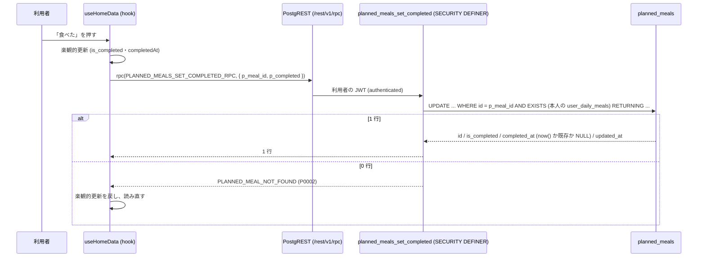
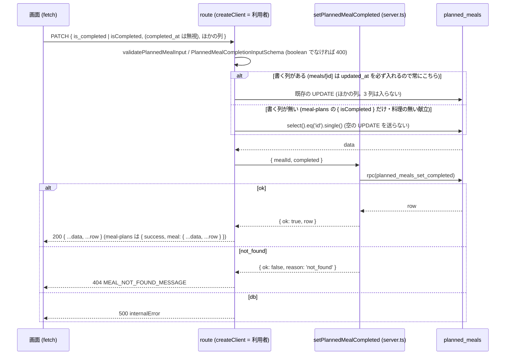
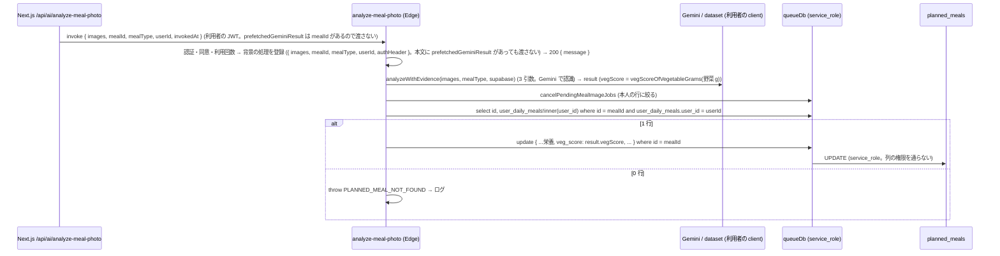
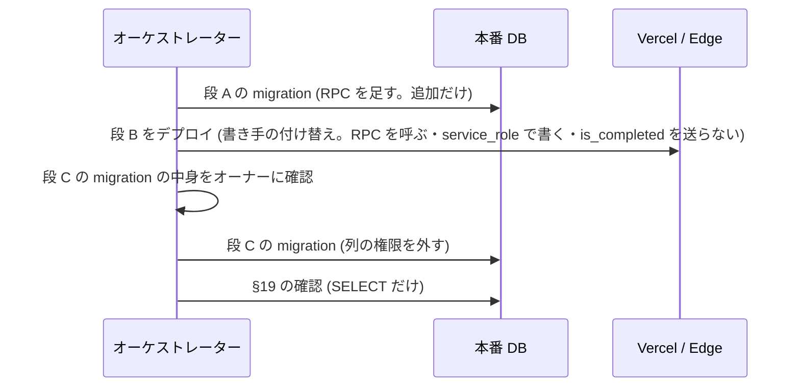

# 比較ランキングと組織のチャレンジの値 (planned_meals の veg_score・is_completed・completed_at) をサーバの計算値だけにする (#2025) 設計

| 版 | 日付 | 内容 |
|---|---|---|
| v1.0 | 2026-10-25 | 新設 (Issue #2025 の設計ゲート・A 型 4 相。`planned_meals` の `veg_score`・`is_completed`・`completed_at` を利用者 (authenticated) の INSERT / UPDATE の権限から外し、完了の操作は SECURITY DEFINER の RPC `planned_meals_set_completed` 1 本に、野菜スコアは写真の解析の Edge Function が service_role で書く 1 か所に寄せる) |

要件の正本は Issue #2025 の本文とコメント (2026-10-25 時点でコメントは無い)。本書はその上で決めた範囲と設計で、Issue と食い違ったら本書が正。
ファイル名は cross/23 (cross/ の既存は 01〜09・12・13a・13b・14〜22・24。10・11 は欠番、13 は 13a・13b に分かれている)。

前提 (本書が従う条件):

- オーナーの選択 (2026-10-25・選択式): 「サーバの計算値だけ使う」。集計に使う値はサーバが計算した値だけにする。利用者の書き込みからこの列を外す (権限を外す migration)。migration の中身は、マージの前にオーナーへ確認する。
- 本番の DB には書き込まない (本書の事実は 2026-10-25 の SELECT だけ。§3.5)。
- ローンチ前で利用者はゼロ。正しい形にしてよい。本番の `planned_meals` は 748 行・`veg_score` は全行 NULL・`is_completed = true` は 6 行 (§3.5)。既存の行の値は変えない (移行の UPDATE は無い)。
- 前例に合わせる: #1999 (`20261024110000_health_streaks_user_writes_daily_record_only.sql`。利用者が書ける `health_streaks` の種類を `daily_record` だけに絞った。ファイル冒頭の見出しは #1917 と書いてあるが、作った commit `99584308d` は #1999) と、運営の直接の書き込みを閉じた `20261024140000_announcements_moderation_flags_select_only.sql` (ポリシーを SELECT だけにし、表の書き込みの権限を REVOKE して二重に閉じる) と、cross/02 §3.3 (service_role は Edge Function に限る)・§3.4 (TRUNCATE を付け直さない)・§4.1 (self-ownership)。
- `health_streaks` の 2 種類 (`meal_record` / `breakfast`) は #1999 で閉じてある。本書は `planned_meals` の 3 列だけを扱う。
- 範囲外 (新しい要求は発明しない。候補は §21): `planned_meals` の RLS ポリシー `Users can manage own planned meals` の式・DELETE の権限・ほかの列の値の検査 (トリガー `trg_planned_meals_validate_values` の対象の列)・`veg_score` を DB の CHECK やトリガーで範囲検査すること・写真から記録した食事 (`POST /api/meal-plans/add-from-photo`) に野菜スコアを付けること・比較ランキングの指標の意味の変更 (`nutrition_score` は尺度の定数に追随させるだけ)・組織のチャレンジの SQL (`update_org_challenge_progress`) の変更・モバイルの古いビルドを動かし続けること。

---

## 0. 外形固定と分冊判定 (相 1)

### 0.1 発注と決めること

発注 (Issue #2025): 比較ランキング (segment の集計 `calculate-segment-stats`) と組織のチャレンジ (`update_org_challenge_progress`) が指標に使う献立の値 `planned_meals.veg_score`・`is_completed` を、利用者が PostgREST から自分で好きな値に書き換えられる (RLS `Users can manage own planned meals` は FOR ALL で列を絞らず、表の INSERT / UPDATE の権限が authenticated にある)。`POST /api/ai/nutrition` は栄養素 4 つだけを検証し、`veg_score` は範囲を見ずに書く。#1999 の `health_streaks` と同じ型の問題。

本書が答えを出すこと:

| # | 決めること | 答え (§6) |
|---|---|---|
| 1 | 3 列 (`veg_score`・`is_completed`・`completed_at`) を書く経路の全列挙と、書き手ごとの client (利用者のセッションか、サーバ = route の service_role / Edge Function の service_role か) | §3.1 の 13 経路の表。利用者のセッションで 3 列を書いている経路は 9 本 (モバイルのホーム・Web のホーム・食事の詳細 → `PATCH /api/meals/[id]`・献立表 → `PATCH /api/meal-plans/meals/[id]`・AI 相談の `complete_meal`・`POST /api/ai/nutrition` の 2 分岐・写真の解析の Edge Function (利用者の JWT で書いている)・週間生成のスナップショットの復元 (生成の失敗時の `weekly/request` と、止まった生成の後片付けの `weekly/status`・`weekly/pending`・`weekly/cleanup` の 4 route))。ほかに新規作成の 3 route が `is_completed: false` を利用者のセッションで送る |
| 2 | `is_completed` は利用者が「食べた」を記録する操作そのもの。何をサーバの計算値と見るか | 完了の操作は本人の操作として残す (「食べた」は利用者の申告で、サーバが写真などから計算できる値ではない)。書く口は SECURITY DEFINER の RPC `planned_meals_set_completed(p_meal_id, p_completed)` の 1 本だけで、本人の行かどうかは関数の中で確かめる (§6.2)。サーバが決めるのは **完了の時刻 `completed_at` (DB の `now()`) と、`is_completed` ⇄ `completed_at` の対の整合** だけ (完了なら時刻あり・未完了なら NULL。利用者は時刻を偽れず、対を崩せない)。**`is_completed` の値そのものは段 C の後も利用者が決める** (本人の行なら、献立の日 (未来の日を含む) を問わず完了にできる。PostgREST の直接の書き込みが RPC に替わるだけ)。集計 (`calculate-segment-stats` の `breakfast_rate`・`menu_execution_rate`、組織のチャレンジ `update_org_challenge_progress` の `breakfast_rate`・`cooking_rate`・`veg_score` (完了した食事だけを平均する)) は `is_completed` だけを条件にし、`completed_at` はどの集計も読まない。したがって **これらの指標の「完了」は段 C の後も自己申告のまま** で、Issue #2025 の症状のうち `breakfast_rate` を自分で上げられる点は本書の段 A〜C では閉じない。集計の側の検証を足すかは **§21 Q-2 (未決・オーナーの判断が要る)**。段 A〜C は Q-2 のどの答えでも変わらない (§21) |
| 3 | `veg_score` の計算の正本・範囲・型 | 正本 = 写真の解析の `nutrition-pipeline.ts` の `estimateVegetableScore` (料理の材料のうち野菜の g の合計 ÷ 120 g × 100 を四捨五入し 0〜100 に収める)。範囲 0〜100 の整数 (列は `integer`)。NULL = まだ計算していない。書くのは `analyze-meal-photo` の背景の処理 1 か所 (service_role・本人の行であることを確かめてから。解析の入力は写真だけで、利用者が送る解析の結果 `prefetchedGeminiResult` は `mealId` の経路では使わない)。`POST /api/ai/nutrition` は `veg_score` を書かない (利用者の入力の分岐は利用者の値そのもの、AI の分岐は別のモデルの 1〜5 点で正本と尺度が違う) (§6.3) |
| 4 | 権限の外し方 (列の GRANT か、RLS の WITH CHECK か、トリガーか) | **列の権限**: 表の INSERT / UPDATE を anon / authenticated から REVOKE し、authenticated に 3 列を除く 56 列の INSERT (列) / UPDATE (列) を GRANT し直す。RLS のポリシー・SELECT・DELETE・service_role は変えない (§6.4・§5) |
| 5 | モバイルの古いビルドが直接書いていた場合に壊れないか (版の互換) | 古いビルドの完了の切り替えは 42501 で失敗し、既存の失敗時の処理 (楽観的更新を戻して読み直す) で画面は元に戻る。壊れるのはその操作だけで、ほかの画面は変わらない。ローンチ前で利用者はゼロなので、互換のための猶予は作らない (§6.5) |
| 6 | モジュラーモノリスの切り方・Zod の正典・エラー表・テスト | 共通の定数と RPC の名前は `packages/shared/src/planned-meals-integrity.ts` (Web・モバイル・テストが読む)。Web は `src/modules/planned-meals-integrity/` (`core.ts` = Zod・文言、`server.ts` = RPC の呼び出し)。Edge は `supabase/functions/_shared/veg-score.ts` (尺度と計算)。エラー表は §10。テストは §12 (§6.6) |
| 7 | 段分けと本番への当て方 (権限を外す migration は、書き手を付け替えた後にしか当てられない) | migration を 2 本に分ける。段 A = RPC を足す migration (追加だけ) + 共通の定数、段 B = 書き手の付け替え (Web・モバイル・Edge)、段 C = 権限を外す migration。段 C のマージの前にオーナーへ migration の中身を確認する (§15) |

### 0.2 要件行列

| # | 要件 | 根拠 | 本書の置き場 |
|---|---|---|---|
| R-1 | 利用者 (authenticated) のセッションは、PostgREST の INSERT / UPDATE / upsert のどれでも `planned_meals.veg_score`・`is_completed`・`completed_at` に値を入れられない (42501)。他の 56 列は今までどおり書ける | #2025・オーナーの選択 | §7.3・§7.20 |
| R-2 | 利用者は自分の献立を「食べた」「食べていない」に切り替えられる (Web のホーム・食事の詳細・献立表・モバイルのホーム・AI 相談)。切り替えの口は RPC `planned_meals_set_completed` 1 本で、`completed_at` は DB の `now()` (完了) か NULL (未完了)。すでに完了している行をもう一度完了にしても `completed_at` は変わらない | §0.1 の 2 | §7.1・§7.8〜§7.10・§7.14 |
| R-3 | 他人の献立・存在しない id・UUID の形でない id は `PLANNED_MEAL_NOT_FOUND` (route は 404 の固定の文)。未ログインは RPC を実行できない (42501) | cross/02 §4.1 | §7.1・§7.8・§10 |
| R-4 | `veg_score` は `estimateVegetableScore` の値 (0〜100 の整数) だけが入る。書くのは `analyze-meal-photo` の背景の処理で、service_role の client で、本人の行であることを確かめてから書く。他人の `mealId` を渡しても書かない。解析の入力は写真だけで、利用者が送った解析の結果 (`prefetchedGeminiResult`。料理と材料の g) は `mealId` の経路では使わない (Edge の背景の処理に渡さず、Next.js の route も `mealId` のときは Edge へ渡さない) | §0.1 の 3 | §7.6・§7.15・§7.16 |
| R-5 | `POST /api/ai/nutrition` は `veg_score` を書かない (利用者の `nutritionData.veg_score` は捨てる。AI の応答の `veg_score` も書かず、プロンプトからも外す)。栄養素 4 列・`quality_tags`・`dishes` などは今までどおり | §0.1 の 3 | §7.13 |
| R-6 | 新規作成の 3 route (`POST /api/meals`・`POST /api/meal-plans/meals`・`POST /api/meal-plans/add-from-photo`) は `is_completed` を送らない (DB の既定 false)。応答の `is_completed` は false のまま | R-1 の帰結 | §7.11 |
| R-7 | 週間生成のスナップショットの復元 (生成の失敗時の `weekly/request` と、止まった生成の後片付けの `weekly/status`・`weekly/pending`・`weekly/cleanup`) は、消した行の `is_completed`・`completed_at`・`veg_score` を落とさずに戻す。4 route とも `restoreOwnPlannedMealsSnapshot` を通し、行の `daily_meal_id` が本人の日であることを利用者のセッション (RLS) で確かめてから service_role の client で戻す。本人の日でない行は戻さない | R-1 の帰結・#1042 | §7.12 |
| R-8 | 比較ランキングの `veg_score_avg` は 0〜100 の平均 (小数第 1 位)、`nutrition_score` は `veg_score_avg` を 0〜100 に正規化した整数 (尺度の定数から導く。0〜100 なら係数 1)。組織のチャレンジの `veg_score` (`targetMax` 100) と同じ尺度 | §0.1 の 3 | §7.6・§7.17・§13 |
| R-9 | service_role (Edge Function の献立の生成・保存・集計・運営) は今までどおり 3 列を読み書きできる | #1999 と同じ | §7.3・§7.20 |
| R-10 | RLS のポリシー・SELECT・DELETE・REFERENCES・TRIGGER の権限・既存のトリガー・既存の行は変えない。TRUNCATE を付け直さない (cross/02 §3.4) | 範囲・前例 | §7.3・§7.4 |
| R-11 | migration は 2 本とも戻し口を対で置き、冪等で、`lock_timeout` を持つ。段 A の migration は追加だけ (RPC の作成)。段 C の migration は権限だけ (行に触れない)。番号はマージの直前に確定する | 設計書の規約 | §7.1〜§7.4 |
| R-12 | `src/types/database.types.ts` と `packages/shared/src/database.types.ts` に RPC の型が入る (`tests/database-types-migrations-contract.test.ts`) | 既存の番兵 | §7.18・§16 |
| R-13 | 3 列を利用者のセッションで書く経路が src・apps/mobile に戻らないことを、ソース走査のテストが見張る。Edge の `analyze-meal-photo` の書き込みが service_role であることも見張る | 再発防止 | §7.21 |
| R-14 | 本文を読む route の 400 (壊れた JSON・NULL 文字) と 401・404・500 の既存の形を保つ。`is_completed` / `isCompleted` が boolean でない本文は 400 の固定の文 | #1657・#1917 | §7.9・§10 |
| R-15 | 文言・`data-testid`・応答の形 (`PATCH /api/meals/[id]` は行そのもの、`PATCH /api/meal-plans/meals/[id]` は `{ success, meal }`) は変えない。応答の `is_completed`・`completed_at` は RPC が返した値 | 既存の画面と e2e | §7.9 |
| R-16 | 本番への当て方: 段 A の migration → 段 B のデプロイ (Vercel・Edge) → 段 C の migration の順。段 C を先に当てると、古いコードの完了の切り替え・写真の上書きが 42501 で失敗する | §0.1 の 7 | §15・§19 |

### 0.3 ユーザーシナリオ (26 本。トレースは §4.3)

| # | シナリオ | 期待 |
|---|---|---|
| S-1 | Web のホームで今日の昼食の「食べた」を押す | `supabase.rpc('planned_meals_set_completed', { p_meal_id, p_completed: true })`。行は `is_completed = true`・`completed_at = now()` (DB の時刻)。画面は楽観的更新のまま |
| S-2 | S-1 の直後にもう一度押す (未完了に戻す) | RPC `p_completed: false`。`is_completed = false`・`completed_at = NULL` |
| S-3 | モバイル (本書の後のビルド) のホームで「食べた」を押す | S-1 と同じ RPC。`apps/mobile/src/hooks/useHomeData.ts` が `supabase.rpc` を呼ぶ |
| S-4 | モバイルの古いビルド (`.from('planned_meals').update({ is_completed, completed_at })`) で「食べた」を押す | PostgREST が 42501 (permission denied for table planned_meals)。既存の失敗時の処理で楽観的更新を戻し `fetchAll()` で読み直す。行は変わらない |
| S-5 | Web の食事の詳細 (`/meals/[id]`) で「食べた」を押す。画面は今までどおり `is_completed` と端末の時刻の `completed_at` を `PATCH /api/meals/[id]` に送る | route は `completed_at` を無視し、RPC で完了にする。応答の `completed_at` は DB の時刻。`allowedFields` から `is_completed`・`completed_at` は消えている |
| S-6 | 献立表 (`/menus/weekly`) で完了を切り替える (`PATCH /api/meal-plans/meals/[id]` の本文は `{ isCompleted }` だけ。料理の無い献立もある) | route が RPC で切り替え、`meal` に RPC の値を載せて 200 で返す。ほかの列の変更が無いので既存の UPDATE は流さず、行を読み直す (空の UPDATE は PostgREST が 0 行にして `.single()` が失敗するため) |
| S-7 | AI 相談で「昼食を食べたことにして」→ `complete_meal` | `runConsultationAction` が `setPlannedMealCompleted` (RPC) で切り替える。他人の id は `{ error: '権限がありません' }` のまま |
| S-8 | 利用者が PostgREST で自分の行の `veg_score` を 100 に UPDATE する | 42501。行は変わらない |
| S-9 | 利用者が PostgREST で `is_completed: true, veg_score: 100` を含む行を INSERT する (upsert も) | 42501。行はできない |
| S-10 | 利用者が PostgREST で自分の行の `dish_name`・`memo`・`calories_kcal` を UPDATE する。新しい行を 3 列なしで INSERT する | 今までどおり通る (他の 56 列の権限は残る)。`is_completed` は既定 false |
| S-11 | 写真の解析 (`analyze-meal-photo` を `mealId` つきで呼ぶ。本人の献立) | 背景の処理が service_role の client で本人の行であることを確かめ、`veg_score = estimateVegetableScore(...)` (0〜100) と栄養の列を書く |
| S-12 | 写真の解析を他人の `mealId` で呼ぶ | 本人の行として見つからないので書かない (例外を記録して終わる。今までは RLS で 0 行だった) |
| S-13 | `POST /api/ai/nutrition` に `nutritionData: { calories_kcal: 500, veg_score: 100 }` | 200。栄養素だけ書き `veg_score` は書かない (update の本文に `veg_score` の鍵が無い) |
| S-14 | `POST /api/ai/nutrition` に `imageUrl` (AI の推定) | AI の応答の栄養素・`quality_tags`・`dishes` を書き、`veg_score` は書かない。プロンプトに `veg_score` は無い |
| S-15 | `POST /api/meals` で献立を作る | insert の本文に `is_completed` が無い。応答の `is_completed` は false |
| S-16 | 週間の献立の生成を頼み、今日の朝食 (完了済み・写真のスコアつき) を含む 7 日分を消したあと生成が失敗する (または生成が止まり、状態の確認・後片付けの route が止まったと判定する) | 復元は本人の日の確認のあと service_role の client で行い、`is_completed = true`・`completed_at`・`veg_score` がそのまま戻る |
| S-17 | 比較ランキングの集計 (`calculate-segment-stats`) が `veg_score` 80・60 の 2 食を読む | `veg_score_avg = 70`・`nutrition_score = 70` (0〜100 の尺度。係数 1) |
| S-18 | 組織のチャレンジの日次の集計 (`update_org_challenge_progress`) | 変えない。`veg_score` の平均は 0〜100 の値をそのまま平均する (今までと同じ SQL) |
| S-19 | 未ログイン (anon) が RPC を呼ぶ | 42501 (EXECUTE が無い)。行は変わらない |
| S-20 | 他人の献立の id で RPC を呼ぶ | 例外 `PLANNED_MEAL_NOT_FOUND` (SQLSTATE P0002)。route は 404 の固定の文 (`MEAL_NOT_FOUND_MESSAGE`)。行は変わらない |
| S-21 | `PATCH /api/meals/[id]` に `is_completed: 'yes'` (boolean でない) | 400 `{ error: PLANNED_MEAL_COMPLETION_INVALID_MESSAGE }`。DB に触れない |
| S-22 | 段 C の migration の戻し口を流す | authenticated の列の権限を消し、anon / authenticated に表の INSERT / UPDATE を付け直す (本番のベースラインの形)。TRUNCATE は付けない |
| S-23 | 段 A の migration の戻し口を流す | 関数 `planned_meals_set_completed(uuid, boolean)` を消す。表・権限・行は変わらない |
| S-24 | すでに完了している行 (`completed_at` あり) に RPC `p_completed: true` | `is_completed = true` のまま、`completed_at` は元の値 (今の時刻で上書きしない) |
| S-25 | service_role (`save-meal.ts`) が `is_completed: false` で INSERT し、`generate-menu-v5` が `is_completed` を読む | 今までどおり通る (service_role の権限は変えない) |
| S-26 | 写真の解析を `mealId` と `prefetchedGeminiResult` (「キャベツ 120 g」のような料理と材料の g) を一緒に送って呼ぶ (Next.js の `POST /api/ai/analyze-meal-photo` 経由でも、Edge を JWT で直接でも) | Next.js の route は `mealId` があるので Edge へ `prefetchedGeminiResult` を渡さない。Edge の背景の処理も受け取らず、写真を Gemini で解析し直した結果で `veg_score` を書く (利用者の g は使わない)。`mealId` 無し (同期・書き込み無し) の経路は今までどおり `prefetchedGeminiResult` を使う |

### 0.4 分冊判定

目安 (設計書 800 行超 / 消費先レーン 3 以上 / 共有面 2 つ以上) のうち、行数と消費先 (Web の route と hook・モバイルの hook・Edge Function の 3 本) と共有面 (`planned_meals` の権限・`packages/shared`・`supabase/functions/_shared`) に当たる。ただし核 (migration 2 本・RPC・共通の定数) は 1 本の契約で閉じ、配線は「既存の書き手を RPC か service_role に付け替えるだけ」で判断の余地が無いので、**1 冊**にし、実装は段で分ける (§15: 段 A = RPC の migration と共通の定数、段 B = 書き手の付け替え、段 C = 権限の migration)。段ごとに 2 枚レビューを閉じ、段の間に本番への適用 (段 A の migration・段 B のデプロイ) を挟む。

### 0.5 用語

| 語 | 意味 |
|---|---|
| 3 列 | `planned_meals.veg_score` (野菜スコア・integer)・`is_completed` (食べた印・boolean DEFAULT false)・`completed_at` (食べた時刻・timestamptz) |
| 利用者のセッション | anon key + 利用者の JWT (Cookie か Authorization) の client。RLS と列の権限が効く。Web の `createClient()` (`lib/supabase/server.ts`・`lib/supabase/client.ts`)・モバイルの `supabase`・Edge Function が `Authorization` ヘッダを付けて作る client |
| service_role | RLS と列の権限を通らない client。Web の `getSupabaseAdmin()`・Edge Function の `SERVICE_ROLE_JWT` / `SUPABASE_SERVICE_ROLE_KEY` の client |
| 完了の RPC | `public.planned_meals_set_completed(p_meal_id uuid, p_completed boolean)`。SECURITY DEFINER。本人の行だけを完了 / 未完了にし、`completed_at` を DB の時刻で書く |
| 野菜スコアの正本 | `supabase/functions/_shared/nutrition-pipeline.ts` の `estimateVegetableScore` (本書で `_shared/veg-score.ts` の `vegScoreOfVegetableGrams` を使う形にする) |
| 尺度 | `VEG_SCORE_MIN = 0`・`VEG_SCORE_MAX = 100`・満点の野菜の量 `VEG_SCORE_FULL_MARK_GRAMS = 120` |

### 0.6 読み方

- 実装は §7 の正典コードを写す。§8 の facade 契約と §13 の定数の名前を変えない。
- 表 3 点 (§9) とエラー表 (§10) は、レビューが最初に自分で作り直して突き合わせる対象。
- migration のファイル名の番号は置き場 (`<番号はマージ時に確定>`・`<同じ番号>`) で書く。マージの直前に `origin/main` の `supabase/migrations` の最大より大きい番号で確定し、設計書の置き場を全部その番号に書き換える (`tests/helpers/design-doc-migration-number.ts` の規則。混ざると赤)。

---

## 1. 目的・スコープ

- 目的: 比較ランキングと組織のチャレンジが指標に使う `planned_meals` の 3 列を、利用者が PostgREST から直接書けない形にし、書く口をサーバの処理 (完了の RPC・写真の解析の service_role) に限る。`veg_score` はサーバの計算値だけになる。`is_completed` は口が RPC に限られ `completed_at` がサーバの時刻になるが、完了にするかどうかは本人の申告のまま (§0.1 の 2・§21 Q-2)。
- 対象: `planned_meals` の INSERT / UPDATE の権限 (列単位)・完了の RPC・3 列を書く既存の経路の付け替え (Web の route 11 本 = 完了の PATCH 2 本・作成 3 本・`/api/ai/nutrition`・写真の解析 `/api/ai/analyze-meal-photo` (`mealId` のときは `prefetchedGeminiResult` を Edge へ渡さない)・週間生成の復元の 4 本 (と `src/lib/planned-meals-snapshot.ts` の 1 関数)、Web の hook 1 本・モバイルの hook 1 本・AI 相談の 1 アクション・Edge Function 3 本)・野菜スコアの尺度の定数・比較ランキングの `nutrition_score` の係数・テスト。
- 対象外: 冒頭の前提の「範囲外」のとおり。

## 2. 関連要件・既存設計

| 文書 | 関係 |
|---|---|
| Issue #2025 | 要件の正本 (症状・根拠・オーナーの選択・進め方) |
| cross/02 §3.3・§3.4・§4.1・§10 | service_role の使い方 (Edge Function に限る。Next.js の route では `getSupabaseAdmin()` を所有権の確認の後にだけ使う)・TRUNCATE を付け直さない・self-ownership・RLS のテストの形 |
| `20261024110000_health_streaks_user_writes_daily_record_only.sql` (#1999) とそのテスト 2 本 | 同じ型の前例 (ポリシーで種類を絞る)。本書は列の権限で絞る (理由は §5) |
| `20261024140000_announcements_moderation_flags_select_only.sql` | 表の書き込みの権限を REVOKE する形・戻し口の書き方・同じ型の全域の探索の記録の書き方 |
| `20261022150000_family_invites_rpc_only_writes.sql`・`20261022180000_org_tables_rpc_only_writes.sql` | 書き込みを SECURITY DEFINER の RPC に限る形 |
| `20261008110000_planned_meals_value_checks.sql` (#1205) | `planned_meals` の既存のトリガー (`trg_planned_meals_validate_values`。`veg_score` は対象外のまま) |
| `20261014100100_org_challenge_progress.sql` (#1132) | 組織のチャレンジの集計 (`veg_score` の平均。変えない) |
| cross/22 | 設計書の形 (本書はこれに倣う) |

## 3. 現状の事実 (origin/main `7f61035f5`・本番の読み取り 2026-10-25)

### 3.1 3 列を書く経路 (13 経路。1 = 利用者のセッション・S = service_role)

| # | 経路 | 書く列 | client | file:line (origin/main) | 本書の後 |
|---|---|---|---|---|---|
| W-1 | モバイルのホームの完了の切り替え `toggleMealCompletion` | `is_completed`・`completed_at` | 利 | `apps/mobile/src/hooks/useHomeData.ts:661-662` (`.update({ is_completed, completed_at }).eq('id')`) | RPC (§7.14) |
| W-2 | Web のホームの完了の切り替え `toggleMealCompletion` | `is_completed`・`completed_at` | 利 (ブラウザの client) | `src/hooks/useHomeData.ts:930-936` | RPC (§7.14) |
| W-3 | Web の食事の詳細の `toggleCompletion` → `PATCH /api/meals/[id]` | `is_completed`・`completed_at` (本文から `allowedFields` で通す) | 利 (route の `createClient()`) | `src/app/(main)/meals/[id]/page.tsx:189-197` → `src/app/api/meals/[id]/route.ts:113-116` | route が RPC (§7.9) |
| W-4 | 献立表の `handleUpdateMeal(..., { isCompleted })` → `PATCH /api/meal-plans/meals/[id]` | `is_completed`・`completed_at` (`isCompleted` から) | 利 | `src/app/(main)/menus/weekly/page.tsx:2866` → `src/app/api/meal-plans/meals/[id]/route.ts:93-96` | route が RPC (§7.9) |
| W-5 | AI 相談の `complete_meal` | `is_completed` | 利 (`execute` / `messages` の route が `createClient()` を渡す) | `src/lib/ai/consultation-action-executor.ts:1032-1053` | RPC (§7.10) |
| W-6 | `POST /api/ai/nutrition` の `nutritionData` の分岐 | `veg_score` (`nutritionData.veg_score` を検証せずそのまま)・`quality_tags` | 利 | `src/app/api/ai/nutrition/route.ts:98-106` | `veg_score` を書かない (§7.13) |
| W-7 | `POST /api/ai/nutrition` の `imageUrl` の分岐 (fast LLM。プロンプトは `veg_score` 1〜5) | `veg_score` (`result.veg_score`) | 利 | `src/app/api/ai/nutrition/route.ts:149・213` | `veg_score` を書かない (§7.13) |
| W-8 | 写真の解析の背景の処理 `analyzeMealPhotoBackgroundTask` | `veg_score` (`result.vegScore` = 0〜100)・栄養の列・`dishes` など | **利** (anon key + 利用者の `Authorization` で作った client。`:172-176`。ジョブの取り消しだけ service_role `:233-236`) | `supabase/functions/analyze-meal-photo/index.ts:247-262`。呼ぶのは献立表の写真から入力 `analyzePhotoWithAI` (`src/app/(main)/menus/weekly/page.tsx:4357-4364` が `mealId: photoEditMeal.id` を送る) → `POST /api/ai/analyze-meal-photo` (`src/app/api/ai/analyze-meal-photo/route.ts:102-110` が利用者のセッションの client で `functions.invoke` し、`mealId` と JWT で確かめた `userId` を渡す。本文の `prefetchedGeminiResult` もそのまま渡す `:68・107`)。Edge は本文の `prefetchedGeminiResult` を背景の処理に渡し (`index.ts:56-62・123-132`)、`analyzeWithEvidence` はそれがあると Gemini の認識を飛ばして利用者の料理と材料の g を使う (`:180` → `nutrition-pipeline.ts:785-804`)。このため `veg_score` は利用者が送った g で決まりうる | service_role + 本人の行の確認 + `mealId` の経路では `prefetchedGeminiResult` を使わない (§7.15) |
| W-9 | `POST /api/meals` (献立の作成) | `is_completed: false` | 利 | `src/app/api/meals/route.ts:240` | 送らない (§7.11) |
| W-10 | `POST /api/meal-plans/meals` | `is_completed: false` | 利 | `src/app/api/meal-plans/meals/route.ts:185` | 送らない (§7.11) |
| W-11 | `POST /api/meal-plans/add-from-photo` | `is_completed: false` | 利 | `src/app/api/meal-plans/add-from-photo/route.ts:178` | 送らない (§7.11) |
| W-12 | 週間生成のスナップショットの復元 `restorePlannedMealsSnapshot` (`select('*')` の行をそのまま INSERT)。呼ぶのは 4 route: 生成の失敗時 (`src/app/api/ai/menu/weekly/request/route.ts:312`。snapshot は同じ要求の中で読んだ行) と、止まった生成の後片付け (`weekly/status/route.ts:91`・`weekly/pending/route.ts:87`・`weekly/cleanup/route.ts:110`。snapshot は `weekly_menu_requests.generated_data.snapshot` から `extractPlannedMealsSnapshot` で取り出す) | 3 列を含む全列 | 利 (4 route とも `createClient()` の `supabase` を渡す) | `src/lib/planned-meals-snapshot.ts:147・160` | 本人の日を確かめてから service_role で戻す (`restoreOwnPlannedMealsSnapshot`。§7.12) |
| W-13 | 献立の生成と保存 (`generate-menu-v4` / `v5` → `_shared/save-meal.ts`) | `is_completed: false` の INSERT・`status` の判定で `is_completed` を読む | S | `supabase/functions/_shared/save-meal.ts:662・706・725`・`generate-menu-v5/index.ts:1862・1906・3481` | 変えない |

補足:
- `veg_score` を書く経路は W-6・W-7・W-8 の 3 本だけ。`save-meal.ts`・`meal-image.ts` (`writePlannedMealDishesWithOptimisticLock` は `dishes`・`image_url`・`updated_at` だけ)・`planned-meals-snapshot.ts` (写し) は `veg_score` を指定しない。モバイルの `apps/mobile/app/meals/new.tsx` の直接の INSERT (`20261008110000` のコメントが述べる) は origin/main に無い (#1598 で画面ごと削除した)。
- `POST /api/ai/nutrition` を呼ぶ画面は src・apps/mobile に無い (route 自身の `internalError` の文だけ)。`tests/planned-meal-nutrient-validation-routes.test.ts`・`tests/ai-consent-enforcement-routes.test.ts` が route を直接呼ぶ。
- Web の写真の記録 (`src/app/(main)/meals/new/page.tsx:552`) は `POST /api/ai/analyze-meal-photo` を `mealId` 無し (= 同期) で呼び、応答の `vegScore` を画面に出すだけで、保存 (`POST /api/meal-plans/add-from-photo`) には `veg_score` を渡さない。
- `prefetchedGeminiResult` を送る画面は食事の記録の画面 (`src/app/(main)/meals/new/page.tsx:558`。判別 `classify-photo` が返した解析の結果を送り返す) だけで、`mealId` 無し (同期・書き込み無し) で呼ぶ。献立表の写真から入力 (`mealId` つき) は送らない。したがって `mealId` と `prefetchedGeminiResult` を一緒に受け取る口は画面には要らず、利用者が本文を作って送ったときにだけ使われる (Next.js の route 経由でも、Edge を JWT で直接でも)。
- `mealId` つきで呼ぶ経路は 1 本ある: 献立表 (`/menus/weekly`) の写真から入力 (`src/app/(main)/menus/weekly/page.tsx:4357-4364`) → `POST /api/ai/analyze-meal-photo` (`route.ts:102-110`) → Edge `analyze-meal-photo` の背景の処理 (W-8)。`veg_score` に値が入るのはこの経路だけで、本番の `veg_score` が全行 NULL なのは、本番でこの経路がまだ使われていないため (2026-10-25 の SELECT。§3.5)。apps/mobile に `analyze-meal-photo` を呼ぶ箇所は無い。
- 止まった生成の後片付けが使う `weekly_menu_requests.generated_data.snapshot` は、利用者からは書けない (`20261011010000_ai_queue_service_role_writes.sql` が `weekly_menu_requests` の INSERT / UPDATE / DELETE を anon / authenticated から外した。書くのは `getAiQueueWriter()` と Edge Function の service_role)。中身は `weekly/request` が利用者のセッションの `select('*')` で読んだ本人の行。
- 読み手 (変えない): `supabase/functions/calculate-segment-stats/index.ts:349・386-394・416-425` (service_role。`veg_score_avg`・`nutrition_score = round(vegAvg × 20)`・`breakfast_rate`・`menu_execution_rate`)、`update_org_challenge_progress` (`20261014100100_org_challenge_progress.sql:155・174`。`avg(pm.veg_score)`)、`src/app/api/badges/route.ts:54-77`、`src/hooks/useHomeData.ts:573-585` (`veg_score` で並べる)、`apps/mobile/src/hooks/useHomeData.ts:386-410`、`src/lib/org-challenges.ts:53-62` (`targetMax: 100`。注釈に「写真の解析は 0〜100 点、AI の推定は 1〜5 点」)、`generate-menu-v4` / `v5` の `status: meal.is_completed ? "completed" : ...`、`src/lib/membership/family-menu.ts:147` (SECURITY DEFINER の `family_menu_planned_meals`) と、その応答を検める zod `src/schemas/membership/family-menu.ts:31・77` (`FamilyMenuMealSchema` / `FamilyMenuRpcRowSchema` の `is_completed`)、`src/app/api/ai/menu/day/regenerate/route.ts:103-106・122` (`is_completed` を select し、完了の食事を作り直しの対象から外す)、`src/app/api/ai/menu/v4/generate/route.ts:255・296`・`v5/generate/route.ts:228・262`・`src/app/api/ai/consultation/sessions/route.ts:95`・`sessions/[sessionId]/messages/route.ts:177・186・274`・`src/app/api/ai/nutrition-analysis/route.ts:82`・`src/app/api/export/meals/route.ts:70・119`・`src/app/api/support/users/[id]/route.ts:84` (`is_completed` を読む)、`lib/converter.ts:487・498` (`toPlannedMeal` が `is_completed`・`veg_score` を写す。`veg_score` は `|| null` なので 0 は null になる。指標の集計はこの関数を通らない)、`apps/mobile/src/components/menu/V4GenerateModal.tsx:106・127`。なお `lib/converter.ts:306` (`toMealNutritionEstimate`) の `veg_score` は別の表 `meal_nutrition_estimates` の列で、本書の対象外。

### 3.2 DB (`20251126124224_create_meal_planner_tables.sql`。本番と同じ)

- 表 `public.planned_meals` (`:5850-5910`)。59 列 (本番の `information_schema.columns` も 59)。3 列: `is_completed boolean DEFAULT false`・`completed_at timestamptz`・`veg_score integer`。所有者 (`user_id`) は無く、`daily_meal_id → user_daily_meals(user_id, day_date, is_sandbox)`。
- RLS: 有効 (FORCE は無し)。ポリシーは `Users can manage own planned meals` の 1 本 (`:9900`。FOR の無い形 = ALL・TO public・USING は `EXISTS (SELECT 1 FROM user_daily_meals WHERE id = planned_meals.daily_meal_id AND user_id = auth.uid())`・WITH CHECK 無し = USING と同じ)。本番の `pg_policies` も同じ (`roles = {public}`・`with_check = null`)。
- 権限 (`:13797-13800`): `REVOKE ALL FROM PUBLIC, anon, authenticated, service_role` のあと、anon・authenticated・service_role に `INSERT, SELECT, UPDATE, DELETE, TRUNCATE, REFERENCES, TRIGGER, MAINTAIN`。`20261022190000_db_privilege_hardening.sql` が anon / authenticated の TRUNCATE を外した。本番の `role_table_grants`: anon / authenticated = `DELETE, INSERT, REFERENCES, SELECT, TRIGGER, UPDATE`、service_role = それ + TRUNCATE。列単位の GRANT / REVOKE は無い (本番の `column_privileges` は表の権限の写し)。
- トリガー 3 本 (本番と同じ): `trg_fill_planned_meals_magnesium_mg` (BEFORE INSERT OR UPDATE)・`trg_planned_meals_updated_at` (BEFORE UPDATE)・`trg_planned_meals_validate_values` (BEFORE INSERT OR UPDATE OF meal_type, calories_kcal, protein_g, fat_g, carbs_g。SQLSTATE 23514。`veg_score` は対象外)。
- ベースラインより後に `planned_meals` の列・権限・ポリシーを変えた migration は無い (`ALTER TABLE ... planned_meals`・`GRANT|REVOKE ... planned_meals` は grep で 0 件。`20261016241000_family_menu_view_functions.sql` は関数の EXECUTE だけ)。
- 既存の SECURITY DEFINER の RPC の形 (本書が倣う): `20261022150000_family_invites_rpc_only_writes.sql` (SECURITY DEFINER・`SET search_path`・`REVOKE ALL ON FUNCTION ... FROM PUBLIC, anon, authenticated, service_role` → `GRANT EXECUTE ... TO` 必要な役割だけ。`tests/integration/security/anon-definer-execute.test.ts` の A1 が、anon が実行できる DEFINER 関数を許可一覧の 2 本に限る)。

### 3.3 Web・モバイル・Edge の client

- Web の route: `createClient()` (`lib/supabase/server.ts`。Cookie / Authorization を使う。RLS が効く) と `getSupabaseAdmin()` (service_role。`tests/supabase-service-role-client-scan.test.ts` が、これ以外の service_role の `createClient` を src・lib で禁じる)。Web のホーム: `lib/supabase/client.ts` の `createClient()` (ブラウザ)。
- モバイル: `apps/mobile/src/lib/supabase.ts` の `supabase` (anon key + 端末のセッション)。`.rpc()` を呼ぶ箇所は今は無い (supabase-js の `SupabaseClient` なので呼べる)。
- Edge: `analyze-meal-photo` は利用者の `Authorization` で client を作り、`analyzeWithEvidence` (dataset の検索) と Storage のアップロードと `planned_meals` の UPDATE に使う。service_role の client は `meal_image_jobs` の取り消しにだけ作る。`calculate-segment-stats`・`save-meal.ts`・`generate-menu-*` は service_role。
- `packages/shared` は zod を持たない (定数と純関数だけ)。Edge Function は `packages/shared` を import しない (`_shared/ai-chat-flag.ts` の注のとおり、同じ値を両方に置き、テストで一致を見る)。

### 3.4 既存のテストと番兵 (本書の変更に反応するもの。直し方は §16)

- 実 DB: `tests/integration/rls/planned-meals-value-checks.test.ts` の 4 つの it (利用者のセッションが `is_completed` を書く。`:576-591` = 1 行ずつの切り替え (`:579`・`:584`・`:588`)・`:602-610` = 同じ日の食事の一括更新 (`:605` の `.update({ is_completed: true }).eq('daily_meal_id', …)`)・`:618-633` = 範囲外の値を同じ値で書き直す本文に `is_completed: true` (`:628`)・`:674-689` = migration を流し直した後の切り替え (`:683`))・`tests/integration/rls/stats-edge-functions-user-daily-meals.test.ts:148-150・382-383・594` (service_role で 3 列を seed・`:594` は service_role の UPDATE。`nutrition_score` の期待値 80/60/40/20 は `veg_score` 4/3/2/1 × 20)・`org-challenge-progress.test.ts:211-212`・`org-challenge-diff-privacy.test.ts:306`・`security/badges-api.test.ts:126・150`・`security/support-routes.test.ts:119` (service_role で seed。影響なし)。
- 単体: `tests/calculate-segment-stats-planned-meals.test.ts:131-134・437-438・648-649・812` (`nutrition_score = veg × 20`)・`tests/planned-meal-nutrient-validation-routes.test.ts:527-531・548・564` (`veg_score` が update の本文に入ることを期待) と `:292-301`・`:423-428` (完了の切り替えの本文が update に入ることを期待。偽物の client に `rpc` が無い)・`tests/meal-image-skip-routes.test.ts:130-180・513・525` (route の偽物の DB に `rpc` が無い)・`tests/analyze-meal-photo-sugar.test.ts:430-454` (planned_meals の update が 1 か所で `veg_score` を手書きすること。本書の後も同じ)。
- 静的: `tests/migration-file-version-integrity.test.ts` (見出し・戻し口の対)・`tests/database-types-migrations-contract.test.ts` (新しい関数が型ファイル 2 本にあること)・`tests/db-privilege-hardening-migration-contract.test.ts` (後の migration と戻し口が利用者へ表の TRUNCATE / ALL を付けないこと)・`tests/operator-write-policy-ledger.test.ts` (運営ロールのポリシー。本書は触らない)・`tests/supabase-service-role-client-scan.test.ts`・`tests/env-source-scan.test.ts`・`tests/postgrest-embed-relationship-scan.test.ts` (src・lib の埋め込み。Edge は見ない)・`tests/edge-function-verify-jwt.test.ts` (config は変えない)・`tests/ai-queue-writes-contract.test.ts:216-217` (`analyze-meal-photo/index.ts` の取り消しの client を `const queueDb = createClient(...)` と `supabase: queueDb` の名前で見る。§7.15 は名前を保つ)・`tests/image-route-contracts.test.ts:263-312` (`mealId` 無しで `prefetchedGeminiResult` を Edge へ渡すこと。§7.15 は `mealId` 無しなら今までどおり渡す)。
- モバイル: `apps/mobile/__tests__/home/home.test.tsx` は `toggleMealCompletion` を jest.fn で差し替える (hook の中身は見ない)。
- 週間生成の復元: `src/__tests__/api/ai/menu/weekly-request.test.ts:153-155・245-246`・`weekly-status.test.ts:103-108・209`・`weekly-pending.test.ts:104-109・196`・`weekly-cleanup.test.ts:109-114・186・255-256` (`restorePlannedMealsSnapshot` を差し替え、利用者のセッションの client で呼ばれることを期待)・`src/__tests__/lib/planned-meals-snapshot.test.ts` (関数そのもの)。

### 3.5 本番の読み取り (2026-10-25。Supabase MCP の SELECT だけ。書き込みなし)

| 項目 | 値 |
|---|---|
| `planned_meals` の行数 | 748 |
| `veg_score` が NULL でない行 | 0 (min / max / avg は null) |
| `is_completed = true` / `false` / NULL | 6 / 742 / 0 |
| ポリシー | `Users can manage own planned meals` (ALL・`{public}`・USING のみ) の 1 本 |
| 表の権限 | §3.2 のとおり (anon / authenticated に INSERT・UPDATE あり。TRUNCATE 無し) |
| 列の権限 (3 列) | anon / authenticated / postgres / service_role とも `INSERT, REFERENCES, SELECT, UPDATE` (表の権限の写し。列単位の設定は無い) |
| トリガー | §3.2 の 3 本 |
| 列数 | 59 (ベースラインの CREATE TABLE と同じ並び) |

---

## 4. 構想 (相 2)

### 4.1 構造 (構造 A: 列の権限で閉じ、書く口を 2 つに限る)

```
利用者のセッション (Web / モバイル / route の createClient)
  ├─ INSERT / UPDATE: 3 列を除く 56 列 ……… 列の権限 (段 C の migration)。3 列を含むと 42501
  ├─ SELECT / DELETE: 今までどおり (RLS の USING で本人の行だけ)
  └─ 完了の切り替え ──→ RPC planned_meals_set_completed(p_meal_id, p_completed)  ……… SECURITY DEFINER (段 A)
                           本人の行 (user_daily_meals.user_id = auth.uid()) だけ UPDATE
                           is_completed = p_completed, completed_at = now() | 既存 | NULL
                           無ければ PLANNED_MEAL_NOT_FOUND (P0002)
サーバ (service_role)
  ├─ analyze-meal-photo の背景の処理: 写真を Gemini で解析 (利用者の prefetchedGeminiResult は使わない) → 本人の行を確かめ → veg_score = vegScoreOfVegetableGrams(野菜 g) ほかを UPDATE
  ├─ save-meal.ts / generate-menu: is_completed: false の INSERT (今までどおり)
  ├─ 週間生成の復元 (weekly/request・status・pending・cleanup): 行の daily_meal_id が本人の日か利用者のセッションで確かめ → 本人の行だけをそのまま INSERT
  └─ calculate-segment-stats / update_org_challenge_progress: 3 列を読む (今までどおり)
尺度 (0〜100・満点 120 g):
  ├─ supabase/functions/_shared/veg-score.ts  (Edge: 計算と係数)
  └─ packages/shared/src/planned-meals-integrity.ts (Web / モバイル: 定数・RPC の名前と引数・エラーの判定)
      ↑ 値の一致は tests/veg-score-scale-contract.test.ts が見る
```

- 閉じ方は「列の権限」の 1 枚。RLS のポリシーは変えない (行の所有は今までどおり USING が守る)。列の権限は PostgREST の INSERT / UPDATE / upsert すべてに効き、後で誰かが書き込みのポリシーを足しても 3 列は開かない。
- 完了の口は RPC 1 本。Web の hook・モバイルの hook は `supabase.rpc` を直接呼び、route 2 本と AI 相談は `src/modules/planned-meals-integrity/server.ts` の `setPlannedMealCompleted` を通して同じ RPC を呼ぶ。
- 野菜スコアの口は Edge の 1 か所。`POST /api/ai/nutrition` からは `veg_score` を外す (呼ぶ画面も無い)。
- 尺度は定数にし、`nutrition_score` の係数は定数から導く (`100 / VEG_SCORE_MAX`)。

### 4.2 動き

1. 段 A の migration で RPC を作る (既存の経路はまだ直接書いている。RPC は誰も呼ばない)。
2. 段 B で書き手を付け替える。デプロイ後、完了の切り替えは RPC、写真の上書きは service_role、作成は `is_completed` を送らない。この時点でも利用者は PostgREST で 3 列を書ける (穴は段 C で閉じる)。
3. 段 C の migration で列の権限を外す。以後、利用者のセッションから 3 列を含む INSERT / UPDATE は 42501。

### 4.3 シナリオのトレース (§4.1 の構造で手で走らせた記録)

| # | トレース | 結果 |
|---|---|---|
| S-1 | hook → `supabase.rpc('planned_meals_set_completed', { p_meal_id, p_completed: true })` → 関数: `auth.uid()` あり → UPDATE (EXISTS で本人) → `completed_at = now()` → RETURNING 1 行 → FOUND | 期待どおり |
| S-2 | 同じ RPC `p_completed: false` → `completed_at = NULL` | 期待どおり |
| S-3 | モバイルの hook → `supabase.rpc(...)` (S-1 と同じ) | 期待どおり |
| S-4 | 古いビルド → PostgREST `PATCH /rest/v1/planned_meals?id=eq.…` 本文 `{ is_completed, completed_at }` → 列の権限で 42501 → hook の `if (error)` → 楽観的更新を戻し `fetchAll()` | 期待どおり (操作だけ失敗) |
| S-5 | page → `PATCH /api/meals/[id]` `{ is_completed, completed_at }` → route: `allowedFields` に無いので `updateData` に入らない → `completion = PlannedMealCompletionInputSchema.safeParse(body.is_completed)` → 既存の UPDATE (`updated_at` 等) → `setPlannedMealCompleted(supabase, { mealId, completed })` → RPC → 応答 `{ ...data, ...row }` | 期待どおり (`completed_at` は DB の時刻) |
| S-6 | page → `PATCH /api/meal-plans/meals/[id]` `{ isCompleted }` → route: `isCompleted` を Zod で読む → `updateData` は空 (料理の無い献立) か `dishes`・`image_url` だけ (料理のある献立は `buildDishImagePayload` が書き戻す) → 空なら `select().eq('id').single()` で行を読む / 空でなければ既存の UPDATE → RPC → `meal: { ...data, ...row }` | 期待どおり (空の UPDATE を PostgREST に送らない) |
| S-7 | executor `complete_meal` → `setPlannedMealCompleted(supabase, { mealId, completed: isCompleted !== false })` → not_found → `result = { error: '権限がありません' }` / ok → `result = { mealId, completed }` | 期待どおり |
| S-8 | PostgREST UPDATE `veg_score` → 列の権限 → 42501 | 期待どおり |
| S-9 | PostgREST INSERT に `is_completed`・`veg_score` → 42501 (upsert は INSERT の権限で止まる) | 期待どおり |
| S-10 | PostgREST UPDATE `dish_name` → 56 列の権限で通る。INSERT (3 列なし) → 通り `is_completed` は既定 false | 期待どおり |
| S-11 | 献立表の写真から入力 → `POST /api/ai/analyze-meal-photo` (`mealId`・JWT の `userId`) → Edge: 利用者の client で解析 → `queueDb` (service_role) で `select id, user_daily_meals!inner(user_id)` + `eq('user_daily_meals.user_id', userId)` → 1 行 → `queueDb.update({ ..., veg_score: result.vegScore })` | 期待どおり |
| S-12 | 同上 → 0 行 → `throw new Error(PLANNED_MEAL_NOT_FOUND_CODE)` → 既存の catch がログに残す | 期待どおり (書かない) |
| S-13 | route: `validatePlannedMealInput` → update の本文は `{ ...validation.nutrients, quality_tags, updated_at }` | 期待どおり |
| S-14 | route: プロンプトに `veg_score` 無し → `updatePayload` に `veg_score` 無し | 期待どおり |
| S-15 | route: `insertData` に `is_completed` 無し → DB の DEFAULT false → `.select().single()` の応答は false | 期待どおり |
| S-16 | route: `select('*')` (利用者の RLS) で snapshot → 削除 → 生成が失敗 (または status / pending / cleanup が止まったと判定し `generated_data.snapshot` を取り出す) → `restoreOwnPlannedMealsSnapshot({ userDb: supabase, writer: getSupabaseAdmin(), snapshot })` → `userDb` で `user_daily_meals` の本人の日を読む → 本人の日の行だけ `restorePlannedMealsSnapshot(writer, …)` → service_role の INSERT (3 列を含む) | 期待どおり |
| S-17 | `fetchBulkData` → `vegScoreSum / vegScoreCount = 70` → `veg_score_avg = 70.0`・`nutrition_score = round(70 × NUTRITION_SCORE_PER_VEG_SCORE) = 70` | 期待どおり |
| S-18 | SQL は変えない。`avg(pm.veg_score)` は 0〜100 の値の平均 | 期待どおり |
| S-19 | anon → `/rest/v1/rpc/planned_meals_set_completed` → EXECUTE 無し → 42501 | 期待どおり |
| S-20 | 本人の JWT・他人の id → 関数の UPDATE が 0 行 → `RAISE EXCEPTION 'PLANNED_MEAL_NOT_FOUND' USING ERRCODE = 'P0002'` → `server.ts` が `isPlannedMealNotFoundRpcError` → route 404 | 期待どおり |
| S-21 | route: `safeParse('yes')` 失敗 → 400 (DB に触れる前) | 期待どおり |
| S-22 | 戻し口: `REVOKE INSERT (56 列), UPDATE (56 列) ... FROM authenticated` → `GRANT INSERT, UPDATE ON TABLE ... TO anon, authenticated` | 期待どおり |
| S-23 | 戻し口: `DROP FUNCTION IF EXISTS public.planned_meals_set_completed(uuid, boolean)` | 期待どおり |
| S-24 | 関数の CASE: `pm.is_completed IS TRUE AND pm.completed_at IS NOT NULL` → 既存の `completed_at` を保つ | 期待どおり |
| S-25 | service_role は表の権限を変えていない → 通る | 期待どおり |
| S-26 | Next.js: `forwardedPrefetchedGeminiResult = mealId ? undefined : prefetchedGeminiResult` → invoke の本文に渡らない。Edge を直接: ハンドラは `analyzeMealPhotoBackgroundTask({ images, mealId, mealType, userId, authHeader })` (prefetch の鍵が無い) → 背景の処理は `analyzeWithEvidence(images, mealType, supabase)` (3 引数) → Gemini の認識 → `vegScore` は写真の解析の g から → S-11 と同じ書き込み | 期待どおり (利用者の g は `veg_score` に届かない) |

---

## 5. 構造裁定 (相 3・1 回だけ)

### 5.1 代替案の比較

| 案 | 内容 | 長所 | 短所 | 判定 |
|---|---|---|---|---|
| A (採用) | 列の権限 (表の INSERT / UPDATE を REVOKE → 56 列を GRANT) + 完了の RPC + 写真の解析は service_role | 3 列は PostgREST のどの書き方でも 42501。ポリシーを足されても開かない (二重に閉じる前例と同じ考え)。RLS は触らない。RPC で `completed_at` と対の整合がサーバの計算値になる | 56 列の列挙が要る (後で列を足す migration は同じファイルで GRANT が要る。§7.19 の契約テストが見張る)。書き手 9 本の付け替え | 採る |
| B | RLS の WITH CHECK で 3 列の変更を禁じる (`is_completed IS NOT DISTINCT FROM (SELECT is_completed FROM planned_meals WHERE id = …)` のように旧値と比べる) | ポリシーだけで済む | WITH CHECK から旧の行を引く副問い合わせは同じ行を読むので RLS の再帰になり、書き方が複雑で読み手が迷う。INSERT では旧値が無く、`is_completed = false AND veg_score IS NULL` のような固定の式が要る。後で FOR ALL のポリシーを足すと開く | 採らない |
| C | トリガーで `current_user IN ('authenticated', 'anon')` のときだけ 3 列の変更を 42501 にする (`guard_organizations_privileged` の型) | 列挙が要らない。既存の型 | 守りが「関数の本文」に隠れ、権限の表 (`information_schema`) に現れない。トリガーは `session_replication_role = replica` で動かない。完了の RPC は別に要る (SECURITY DEFINER の中は `current_user = postgres` なので通る) | 採らない |
| D | 完了の切り替えも route の service_role (`getSupabaseAdmin()`) で書く (RPC 無し) | DB の関数が増えない | Web の hook・モバイルの hook が route 経由になり、モバイルは Next.js を経由する client が要る (今は PostgREST を直接呼ぶ)。cross/02 §3.3 は route の service_role を禁じ、所有権の確認を route ごとに書くことになる | 採らない |
| E | `veg_score` も RPC (`planned_meals_set_veg_score`) にする | 口が揃う | 利用者が EXECUTE できる RPC なら値を入れられるので意味が無く、service_role だけが呼べる RPC は service_role の UPDATE と同じ | 採らない |

### 5.2 F の問い (縁の発生源を消すより単純な構造は無いか)

- 発生源は「利用者のセッションが表の列を区別せずに書ける」こと。列の権限はその発生源そのものを消す (A)。ポリシー (B) やトリガー (C) は書き込みの経路の途中で止める形で、発生源は残る。
- 完了の操作を「本人の操作」として残す以上、`is_completed` の値そのものは本人が決める。サーバが決めるのは時刻と対の整合だけで、`completed_at` はどの集計も読まない。`is_completed` を条件にする指標 (`breakfast_rate`・`menu_execution_rate`・組織のチャレンジの `breakfast_rate`・`cooking_rate`・`veg_score`) は段 C の後も自己申告のまま。集計の側の検証 (未来の日の完了を拒む・完了の時刻を見る・写真の解析を条件にする等) は指標の意味の変更で、どれを採るかはオーナーの判断が要る (§21 Q-2・未決)。構造 A はどの答えとも両立する (完了の書き込みの口が RPC 1 本に集まるので、日付の検査を足すなら §7.1 の関数に 1 条件を足すだけ)。
- 写真の解析の入力も発生源になる: 利用者が送る `prefetchedGeminiResult` (料理と材料の g) が `veg_score` の計算に届く。`mealId` の経路でそれを使わないのが、発生源を消す最も単純な形 (`mealId` つきの画面は送っていない。§7.15)。
- `POST /api/ai/nutrition` から `veg_score` を外すのは、口を 1 つにする最も単純な形 (呼ぶ画面も無い)。

### 5.3 確定

構造 A で確定する。以後 §7〜§15 は A を機械的に展開したもので、構造の疑義が出たら blocking ではなく本節への差し戻しの事由として扱う。

---

## 6. 決めたこと (0.1 の 1〜7 への答え)

### 6.1 書き手の全列挙 (決めること 1)

§3.1 の表。利用者のセッションで 3 列を書く 9 本 (W-1〜W-7・W-8・W-12) と `is_completed: false` を送る 3 本 (W-9〜W-11) を §7 で付け替える。service_role の W-13 は変えない。

### 6.2 完了 (決めること 2)

- 完了 / 未完了は本人の操作。口は `planned_meals_set_completed(p_meal_id uuid, p_completed boolean)` (§7.1)。
- サーバの計算値 = `completed_at`。完了にするとき、すでに完了していて時刻があればその時刻を保ち、無ければ `now()`。未完了にするときは NULL。利用者は時刻を指定できない (route は本文の `completed_at` を無視する)。
- 本人の行の判定は関数の中の `EXISTS (SELECT 1 FROM public.user_daily_meals d WHERE d.id = pm.daily_meal_id AND d.user_id = auth.uid())` (RLS の USING と同じ式)。0 行なら `PLANNED_MEAL_NOT_FOUND` (P0002)。
- EXECUTE は authenticated と service_role だけ (PUBLIC・anon から外す。`anon-definer-execute.test.ts` A1 の規則)。
- `is_sandbox` の日 (ハンズオンのお試し) の献立も切り替えられる (今までと同じ。集計は `is_sandbox = false` で絞る)。
- 献立の日 (`user_daily_meals.day_date`) は見ない。本人の行なら未来の日の献立も完了にでき、集計はそれを完了として数える (今までと同じ。`completed_at` を読む集計は無い)。これを変えるかは §21 Q-2 (未決・オーナーの判断が要る)。

### 6.3 野菜スコア (決めること 3)

- 正本 = `estimateVegetableScore` (`nutrition-pipeline.ts`)。本書で `_shared/veg-score.ts` の `vegScoreOfVegetableGrams(grams)` = `clamp(round(grams / VEG_SCORE_FULL_MARK_GRAMS × VEG_SCORE_MAX), VEG_SCORE_MIN, VEG_SCORE_MAX)` を使う形にする (値は今と同じ。`grams` が有限でない・負のときは今の NaN でなく 0)。
- 型 integer・範囲 0〜100・NULL = 未計算。範囲は書き手 (この 1 関数) が守る。DB の CHECK / トリガーは足さない (§21 Q-1 に候補)。
- 書くのは `analyze-meal-photo` の背景の処理だけ。service_role の client で、本人の行であることを `user_daily_meals!inner(user_id)` で確かめてから書く (RLS を通らない client なので、確認は必須)。
- 計算の入力は写真の解析 (Gemini の認識) の料理と材料の g。利用者が送る解析の結果 (`prefetchedGeminiResult`) は `mealId` の経路では使わない (Edge の背景の処理に渡さない・Next.js の route も渡さない。§7.15)。
- `POST /api/ai/nutrition` は 2 分岐とも `veg_score` を書かず、プロンプトからも外す。`quality_tags` は今までどおり (指標でない)。
- 集計: `veg_score_avg` は値の平均 (小数第 1 位)。`nutrition_score = round(vegAvg × NUTRITION_SCORE_PER_VEG_SCORE)` (`= 100 / VEG_SCORE_MAX = 1`)。`src/lib/org-challenges.ts` の `targetMax` は `VEG_SCORE_MAX` を読む (値 100 は同じ)。

### 6.4 権限の外し方 (決めること 4)

- 段 C の migration (§7.3): `REVOKE INSERT, UPDATE ON TABLE public.planned_meals FROM anon, authenticated;` → `GRANT INSERT (56 列), UPDATE (56 列) ON TABLE public.planned_meals TO authenticated;`。anon には付け直さない (anon が書ける経路は無い。ポリシーは `auth.uid()` が NULL で 0 行)。
- 表レベルの権限が残ると列の REVOKE は効かない (PostgreSQL は表の権限か列の権限のどちらかがあれば許す) ので、表の権限を外してから列を付ける。
- SELECT・DELETE・REFERENCES・TRIGGER・MAINTAIN と service_role・postgres の権限、RLS のポリシー、トリガーは変えない。TRUNCATE は付け直さない。
- 戻し口 (§7.4): 列の権限を外し、表の INSERT / UPDATE を anon / authenticated に付け直す (本番のベースラインの形)。

### 6.5 版の互換 (決めること 5)

- 古いモバイルのビルド (W-1 の直接の UPDATE) は、段 C の後は完了の切り替えが 42501 で失敗し、既存の失敗時の処理 (`console.error` → 楽観的更新を戻す → `fetchAll()`) で画面が元に戻る。ほかの画面 (読むだけ) は影響なし。
- 古い Web (Vercel のデプロイで入れ替わる) は段 B で同時に変わる。
- 猶予 (古い書き方も通す期間) は作らない。ローンチ前で利用者はゼロ。段の順 (A → B → C) で、新しいコードが古い DB で動かない窓 (RPC が無い) と、古いコードが新しい DB で動かない窓 (権限が無い) を作らない (§15)。

### 6.6 モジュールと契約 (決めること 6)

| 置き場 | 中身 | 読む側 |
|---|---|---|
| `packages/shared/src/planned-meals-integrity.ts` (新) | 3 列の名前・RPC の名前と引数の組み立て・`PLANNED_MEAL_NOT_FOUND` の判定・尺度の定数 (Web / モバイル用の写し) | Web の hook・route・モジュール、モバイルの hook、テスト |
| `src/modules/planned-meals-integrity/core.ts` (新) | Zod (route の本文の `is_completed` / `isCompleted`・RPC の返す行)・文言 | route・`server.ts`・テスト |
| `src/modules/planned-meals-integrity/server.ts` (新) | `setPlannedMealCompleted(db, { mealId, completed })` (RPC の呼び出しと結果の形) | route 2 本・AI 相談の executor |
| `src/lib/planned-meals-snapshot.ts` (既存に追記) | `restoreOwnPlannedMealsSnapshot({ userDb, writer, snapshot })` (本人の日の確認 + service_role の復元) | 週間生成の 4 route (§7.12) |
| `supabase/functions/_shared/veg-score.ts` (新) | 尺度の定数・`vegScoreOfVegetableGrams`・`NUTRITION_SCORE_PER_VEG_SCORE` | `nutrition-pipeline.ts`・`calculate-segment-stats` |

UI (page・hook) は `@homegohan/shared` だけを読み、`server.ts` を import しない。

### 6.7 段分けと本番への当て方 (決めること 7)

§15。段 A (RPC の migration + 共通の定数 + 型の生成物) → 本番に段 A の migration が当たってから段 B (書き手の付け替え) をデプロイ → 段 B が本番で動いてから段 C (権限の migration) をマージ。段 C の migration の中身はマージの前にオーナーへ確認する。

---

## 7. 正典コード

### 7.1 `supabase/migrations/<番号はマージ時に確定>_planned_meals_set_completed_rpc.sql` (段 A。追加だけ)

```sql
-- migration: <番号はマージ時に確定>_planned_meals_set_completed_rpc.sql
-- 戻し方: supabase/rollbacks/<同じ番号>_planned_meals_set_completed_rpc.down.sql
-- #2025 (1/2): 献立 (planned_meals) の「食べた」の切り替えを、本人の行だけを書く SECURITY DEFINER の関数 1 本にする。
--
-- 背景:
--   比較ランキング (calculate-segment-stats の breakfast_rate / menu_execution_rate / veg_score_avg / nutrition_score) と
--   組織のチャレンジ (update_org_challenge_progress) は planned_meals.is_completed / veg_score を指標に使う。
--   本番のベースライン (20251126124224_create_meal_planner_tables.sql) の
--     :9900  "Users can manage own planned meals"  FOR ALL・TO public・USING (本人の user_daily_meals の行)・WITH CHECK 無し
--     :13798-13799  anon / authenticated への INSERT, SELECT, UPDATE, DELETE, ... の表の権限
--   により、利用者は PostgREST から自分の行のどの列でも書けた (#1999 の health_streaks と同じ型)。
--   完了の切り替えはアプリの 5 か所が利用者のセッションで直接 UPDATE していた (apps/mobile/src/hooks/useHomeData.ts・
--   src/hooks/useHomeData.ts・PATCH /api/meals/[id]・PATCH /api/meal-plans/meals/[id]・AI 相談の complete_meal)。
--
-- 変更 (この migration は関数を 1 本足すだけ。表・ポリシー・権限・行は変えない):
--   public.planned_meals_set_completed(p_meal_id uuid, p_completed boolean)
--     - SECURITY DEFINER (所有者 postgres の権限で書く)。search_path は空にし、表・関数は schema つきで書く
--     - 本人の行 (user_daily_meals.user_id = auth.uid()) だけを UPDATE。他人の行・無い行は PLANNED_MEAL_NOT_FOUND (P0002)
--     - is_completed = p_completed。completed_at は、完了にするときは「すでに完了で時刻があればその時刻、無ければ now()」、
--       未完了にするときは NULL (時刻は利用者が指定できない = サーバの計算値)
--     - 返すのは書いた行の id / is_completed / completed_at / updated_at (updated_at はトリガー trg_planned_meals_updated_at が進める)
--     - EXECUTE は authenticated と service_role だけ (PUBLIC・anon から外す。tests/integration/security/anon-definer-execute.test.ts の A1)
--   利用者のセッションから is_completed / completed_at / veg_score を直接書く権限は、次の migration
--   (<番号はマージ時に確定>_planned_meals_score_columns_server_only.sql) が外す。アプリの書き手の付け替え (この関数を呼ぶ形) は
--   その前にデプロイする (docs/design/cross/23-planned-meals-score-integrity.md §15)。
--
-- 既存データへの影響: なし。
-- 冪等: CREATE OR REPLACE FUNCTION と REVOKE / GRANT のため、2 回続けて適用してもエラーにならない。
-- ロック: 表には触れない (関数の作成とカタログの権限だけ)。
-- 確認: tests/integration/rls/planned-meals-score-integrity.test.ts (実 DB)
--       tests/planned-meals-score-integrity-migration-contract.test.ts (静的)

SET LOCAL lock_timeout = '10s';

CREATE OR REPLACE FUNCTION public.planned_meals_set_completed(p_meal_id uuid, p_completed boolean)
RETURNS TABLE (id uuid, is_completed boolean, completed_at timestamptz, updated_at timestamptz)
LANGUAGE plpgsql
SECURITY DEFINER
SET search_path = ''
AS $$
DECLARE
  v_user_id uuid := auth.uid();
BEGIN
  IF v_user_id IS NULL THEN
    RAISE EXCEPTION 'PLANNED_MEAL_UNAUTHENTICATED' USING ERRCODE = '42501';
  END IF;
  IF p_meal_id IS NULL OR p_completed IS NULL THEN
    RAISE EXCEPTION 'PLANNED_MEAL_INVALID_ARGUMENT' USING ERRCODE = '22023';
  END IF;

  RETURN QUERY
  UPDATE public.planned_meals AS pm
     SET is_completed = p_completed,
         completed_at = CASE
           WHEN NOT p_completed THEN NULL
           WHEN pm.is_completed IS TRUE AND pm.completed_at IS NOT NULL THEN pm.completed_at
           ELSE now()
         END
   WHERE pm.id = p_meal_id
     AND EXISTS (
       SELECT 1 FROM public.user_daily_meals AS d
        WHERE d.id = pm.daily_meal_id AND d.user_id = v_user_id
     )
  RETURNING pm.id, pm.is_completed, pm.completed_at, pm.updated_at;

  IF NOT FOUND THEN
    RAISE EXCEPTION 'PLANNED_MEAL_NOT_FOUND' USING ERRCODE = 'P0002';
  END IF;
END;
$$;

COMMENT ON FUNCTION public.planned_meals_set_completed(uuid, boolean) IS
  '#2025: 献立 (planned_meals) の「食べた」を本人の行だけ切り替える。completed_at は完了なら既存の時刻か now()、未完了なら NULL。他人の行・無い行は PLANNED_MEAL_NOT_FOUND (P0002)。docs/design/cross/23-planned-meals-score-integrity.md §7.1';

REVOKE ALL ON FUNCTION public.planned_meals_set_completed(uuid, boolean) FROM PUBLIC, anon, authenticated, service_role;
GRANT EXECUTE ON FUNCTION public.planned_meals_set_completed(uuid, boolean) TO authenticated, service_role;
```

書き方の注:
- `RETURN QUERY UPDATE ... RETURNING` は 1 行も返さないと `FOUND` が false になる (PL/pgSQL の `RETURN QUERY` は返した行があれば `FOUND` を true にする)。
- `RETURNS TABLE` の列名 (`id` など) は関数の中では変数になるので、表の列は必ず `pm.` を付けて書く。
- `search_path = ''` でも `now()`・`auth.uid()` は解決する (`pg_catalog` は常に引かれ、`auth.uid()` は schema つき)。
- `SET LOCAL lock_timeout` は前例 (`20261024110000`) と同じ。表のロックは取らないが、形をそろえる。

### 7.2 `supabase/rollbacks/<同じ番号>_planned_meals_set_completed_rpc.down.sql`

```sql
-- rollback: <同じ番号>_planned_meals_set_completed_rpc.sql
-- #2025 (1/2) で足した、献立の「食べた」を切り替える SECURITY DEFINER の関数 planned_meals_set_completed(uuid, boolean) を消す。
-- 表・ポリシー・権限・行には触れていないので、戻すのは関数だけ。
-- 本番に戻す必要があるときは、この内容を新しい migration として PR 経由で適用する (本番への直接 SQL は禁止。CLAUDE.md)。
--
-- 影響:
--   - 戻すと、アプリの完了の切り替え (hook・route・AI 相談) は RPC が無いので失敗する (PostgREST の PGRST202)。
--     先に 2/2 (<同じ番号>_planned_meals_score_columns_server_only.sql) を戻し、アプリを直接 UPDATE する版に戻してから流す。
--
-- 何度流しても同じ結果になる (冪等: DROP FUNCTION IF EXISTS)。

SET LOCAL lock_timeout = '10s';

DROP FUNCTION IF EXISTS public.planned_meals_set_completed(uuid, boolean);
```

### 7.3 `supabase/migrations/<番号はマージ時に確定>_planned_meals_score_columns_server_only.sql` (段 C。権限だけ)

```sql
-- migration: <番号はマージ時に確定>_planned_meals_score_columns_server_only.sql
-- 戻し方: supabase/rollbacks/<同じ番号>_planned_meals_score_columns_server_only.down.sql
-- #2025 (2/2): 比較ランキングと組織のチャレンジが指標に使う planned_meals の 3 列 (veg_score / is_completed / completed_at) を、
--   利用者 (anon / authenticated) の INSERT / UPDATE の権限から外す。書けるのはサーバだけにする。
--
-- 背景:
--   本番のベースライン (20251126124224_create_meal_planner_tables.sql) の :13798-13799 で anon / authenticated は planned_meals の
--   INSERT / UPDATE を表ごと持ち、:9900 のポリシー "Users can manage own planned meals" (FOR ALL・列を絞らない) で自分の行の
--   どの列でも書けた。利用者は veg_score に好きな値を入れ、is_completed / completed_at も好きに書けた (#1999 の health_streaks と同じ型)。
--   20261022190000_db_privilege_hardening.sql は TRUNCATE だけを外した。ベースラインより後に planned_meals の列・権限・ポリシーを
--   変えた migration は無い (origin/main で grep した)。
--
--   3 列を書く経路 (origin/main で git grep した。docs/design/cross/23-planned-meals-score-integrity.md §3.1):
--     - 完了の切り替え (モバイルのホーム・Web のホーム・PATCH /api/meals/[id]・PATCH /api/meal-plans/meals/[id]・AI 相談の
--       complete_meal) は、1/2 (<番号はマージ時に確定>_planned_meals_set_completed_rpc.sql) の SECURITY DEFINER の関数
--       planned_meals_set_completed を呼ぶ形に付け替え済み (所有者の権限で書くので、この変更の影響を受けない)
--     - 野菜スコア (veg_score) を書くのは写真の解析 (supabase/functions/analyze-meal-photo) の背景の処理だけで、service_role の
--       client で本人の行を確かめてから書く形に付け替え済み。POST /api/ai/nutrition は veg_score を書かない
--     - 新規作成の route (POST /api/meals・POST /api/meal-plans/meals・POST /api/meal-plans/add-from-photo) は is_completed を送らない
--       (列の既定 false)。週間生成の失敗時の復元 (src/lib/planned-meals-snapshot.ts) は service_role で戻す
--     - 献立の生成と保存 (supabase/functions/_shared/save-meal.ts・generate-menu-v4 / v5) と集計 (calculate-segment-stats・
--       update_org_challenge_progress) は service_role (変えない)
--
-- 変更:
--   1. planned_meals の INSERT / UPDATE を anon と authenticated から外す (表の権限が残っていると列の権限は効かない:
--      PostgreSQL は表の権限か列の権限のどちらかがあれば許す)。
--   2. authenticated に、3 列を除く 56 列の INSERT (列) / UPDATE (列) を付け直す (ベースラインの CREATE TABLE の 59 列から
--      is_completed / completed_at / veg_score を除いた並び)。anon には付け直さない (anon が planned_meals を書く経路は無く、
--      ポリシーは auth.uid() が NULL で 0 行)。
--   後で planned_meals に列を足す migration は、同じファイルで authenticated にその列の INSERT (列) / UPDATE (列) を GRANT する
--   (tests/planned-meals-score-integrity-migration-contract.test.ts が見張る)。
--   SELECT・DELETE・REFERENCES・TRIGGER・MAINTAIN と service_role・postgres の権限、RLS のポリシー、トリガーは変えない。
--   TRUNCATE は付け直さない (20261022190000 の規則)。
--
-- 効き方: 利用者のセッションから 3 列を含む INSERT / UPDATE / upsert は 42501 (permission denied for table planned_meals) で止まる
--   (PostgREST では 403・supabase-js では error.code = '42501')。3 列を含まない INSERT / UPDATE は今までどおり通る。
--   古いモバイルのビルドの完了の切り替え (直接の UPDATE) は失敗し、既存の失敗時の処理で画面が元に戻る (ローンチ前で利用者はゼロ)。
--
-- 既存データへの影響: なし (権限だけの変更。行は消さない・変えない)。
-- 冪等: REVOKE / GRANT は何度流しても同じ結果になる。
-- ロック: GRANT / REVOKE は planned_meals の ACCESS EXCLUSIVE を一瞬取る (カタログの書き換えだけで、行には触れない)。
-- 確認: tests/integration/rls/planned-meals-score-integrity.test.ts (実 DB)
--       tests/planned-meals-score-integrity-migration-contract.test.ts (静的)

-- 表のロックを長く待たない (待ちが続いたら失敗させて流し直す。20261024110000 と同じ)
SET LOCAL lock_timeout = '10s';

-- 1. 表ごとの INSERT / UPDATE を外す
REVOKE INSERT, UPDATE ON TABLE public.planned_meals FROM anon, authenticated;

-- 2. 3 列 (is_completed / completed_at / veg_score) を除く 56 列を authenticated に付け直す
GRANT INSERT (
  id, meal_type, dish_name, recipe_url, image_url, description, ingredients,
  calories_kcal, protein_g, fat_g, carbs_g, actual_meal_id, created_at, updated_at,
  mode, dishes, is_simple, cooking_time_minutes, memo, quality_tags, display_order,
  sodium_g, sugar_g, fiber_g, fiber_soluble_g, fiber_insoluble_g, potassium_mg, calcium_mg,
  phosphorus_mg, iron_mg, zinc_mg, iodine_ug, cholesterol_mg, vitamin_b1_mg, vitamin_b2_mg,
  vitamin_b6_mg, vitamin_b12_ug, folic_acid_ug, vitamin_c_mg, vitamin_a_ug, vitamin_d_ug,
  vitamin_k_ug, vitamin_e_mg, saturated_fat_g, monounsaturated_fat_g, polyunsaturated_fat_g,
  amino_acid_g, recipe_steps, is_generating, source_type, source_dataset_version,
  source_menu_set_external_id, generation_metadata, magnesium_mg, daily_meal_id, catalog_product_id
), UPDATE (
  id, meal_type, dish_name, recipe_url, image_url, description, ingredients,
  calories_kcal, protein_g, fat_g, carbs_g, actual_meal_id, created_at, updated_at,
  mode, dishes, is_simple, cooking_time_minutes, memo, quality_tags, display_order,
  sodium_g, sugar_g, fiber_g, fiber_soluble_g, fiber_insoluble_g, potassium_mg, calcium_mg,
  phosphorus_mg, iron_mg, zinc_mg, iodine_ug, cholesterol_mg, vitamin_b1_mg, vitamin_b2_mg,
  vitamin_b6_mg, vitamin_b12_ug, folic_acid_ug, vitamin_c_mg, vitamin_a_ug, vitamin_d_ug,
  vitamin_k_ug, vitamin_e_mg, saturated_fat_g, monounsaturated_fat_g, polyunsaturated_fat_g,
  amino_acid_g, recipe_steps, is_generating, source_type, source_dataset_version,
  source_menu_set_external_id, generation_metadata, magnesium_mg, daily_meal_id, catalog_product_id
) ON TABLE public.planned_meals TO authenticated;
```

### 7.4 `supabase/rollbacks/<同じ番号>_planned_meals_score_columns_server_only.down.sql`

```sql
-- rollback: <同じ番号>_planned_meals_score_columns_server_only.sql
-- #2025 (2/2) で外した planned_meals の利用者の INSERT / UPDATE の権限を元に戻す。
-- 列ごとの権限 (authenticated の 56 列) を外し、表ごとの INSERT / UPDATE を anon と authenticated に付け直す
-- (本番のベースライン 20251126124224_create_meal_planner_tables.sql:13798-13799 の形。SELECT・DELETE・REFERENCES・TRIGGER・
-- MAINTAIN は本冊が触れていないので付け直さない)。
-- TRUNCATE は付け直さない: 本冊の適用の直前の時点で、20261022190000_db_privilege_hardening.sql が anon / authenticated から
-- 外してある (本冊は TRUNCATE に触れていない)。
-- (tests/planned-meals-score-integrity-migration-contract.test.ts が、流した後の状態が本冊の直前の状態と同じことを見る)
--
-- 本番に戻す必要があるときは、この内容を新しい migration として PR 経由で適用する (本番への直接 SQL は禁止。CLAUDE.md)。
--
-- 影響:
--   - 戻すと、利用者が PostgREST から自分の行の veg_score / is_completed / completed_at を直接書けるようになり、
--     比較ランキングと組織のチャレンジの指標に任意の値を入れられる穴が再び開く。
--   - アプリ (完了は RPC、野菜スコアは service_role で書く) は、戻しても戻さなくても動く。先にアプリを戻す必要は無い。
--
-- 何度流しても同じ結果になる (冪等: REVOKE / GRANT は何度流しても同じ)。

SET LOCAL lock_timeout = '10s';

REVOKE INSERT (
  id, meal_type, dish_name, recipe_url, image_url, description, ingredients,
  calories_kcal, protein_g, fat_g, carbs_g, actual_meal_id, created_at, updated_at,
  mode, dishes, is_simple, cooking_time_minutes, memo, quality_tags, display_order,
  sodium_g, sugar_g, fiber_g, fiber_soluble_g, fiber_insoluble_g, potassium_mg, calcium_mg,
  phosphorus_mg, iron_mg, zinc_mg, iodine_ug, cholesterol_mg, vitamin_b1_mg, vitamin_b2_mg,
  vitamin_b6_mg, vitamin_b12_ug, folic_acid_ug, vitamin_c_mg, vitamin_a_ug, vitamin_d_ug,
  vitamin_k_ug, vitamin_e_mg, saturated_fat_g, monounsaturated_fat_g, polyunsaturated_fat_g,
  amino_acid_g, recipe_steps, is_generating, source_type, source_dataset_version,
  source_menu_set_external_id, generation_metadata, magnesium_mg, daily_meal_id, catalog_product_id
), UPDATE (
  id, meal_type, dish_name, recipe_url, image_url, description, ingredients,
  calories_kcal, protein_g, fat_g, carbs_g, actual_meal_id, created_at, updated_at,
  mode, dishes, is_simple, cooking_time_minutes, memo, quality_tags, display_order,
  sodium_g, sugar_g, fiber_g, fiber_soluble_g, fiber_insoluble_g, potassium_mg, calcium_mg,
  phosphorus_mg, iron_mg, zinc_mg, iodine_ug, cholesterol_mg, vitamin_b1_mg, vitamin_b2_mg,
  vitamin_b6_mg, vitamin_b12_ug, folic_acid_ug, vitamin_c_mg, vitamin_a_ug, vitamin_d_ug,
  vitamin_k_ug, vitamin_e_mg, saturated_fat_g, monounsaturated_fat_g, polyunsaturated_fat_g,
  amino_acid_g, recipe_steps, is_generating, source_type, source_dataset_version,
  source_menu_set_external_id, generation_metadata, magnesium_mg, daily_meal_id, catalog_product_id
) ON TABLE public.planned_meals FROM authenticated;

GRANT INSERT, UPDATE ON TABLE public.planned_meals TO anon, authenticated;
```

列の並びは 4 か所とも同じ (ベースラインの CREATE TABLE の順から 3 列を抜いたもの)。`tests/planned-meals-score-integrity-migration-contract.test.ts` (§7.19) が、ベースラインの列から機械で作った一覧と 4 か所の一致を見る。

### 7.5 `packages/shared/src/planned-meals-integrity.ts` (新。全文。何も import しない。Web・モバイル・テストが読む)

`packages/shared/src/index.ts` に `export * from './planned-meals-integrity';` を 1 行足す (`./billing-plans` の行の次)。

```ts
// packages/shared/src/planned-meals-integrity.ts
// 献立 (planned_meals) の、サーバだけが書く 3 列と完了の RPC (docs/design/cross/23-planned-meals-score-integrity.md)。
// Web (src) とモバイル (apps/mobile) の両方から読むので、zod も supabase-js も import しない。
// Edge Function は packages/shared を import できないので、尺度の値は supabase/functions/_shared/veg-score.ts にも置く
// (値の一致は tests/veg-score-scale-contract.test.ts が見る)。

/**
 * 利用者 (authenticated) のセッションからは INSERT / UPDATE できない列。
 * 比較ランキング (calculate-segment-stats) と組織のチャレンジ (update_org_challenge_progress) が指標に使う 2 列と、
 * 完了の時刻 (完了の RPC だけが書く)。migration <番号はマージ時に確定>_planned_meals_score_columns_server_only.sql が
 * 列の権限から外す。
 */
export const PLANNED_MEALS_SERVER_ONLY_COLUMNS = ['is_completed', 'completed_at', 'veg_score'] as const;

export type PlannedMealsServerOnlyColumn = (typeof PLANNED_MEALS_SERVER_ONLY_COLUMNS)[number];

/** 完了の切り替えの RPC (SECURITY DEFINER。本人の行だけ。migration <番号はマージ時に確定>_planned_meals_set_completed_rpc.sql) */
export const PLANNED_MEALS_SET_COMPLETED_RPC = 'planned_meals_set_completed';

/** RPC の引数 (DB の関数の引数名と同じ) */
export interface PlannedMealsSetCompletedArgs {
  p_meal_id: string;
  p_completed: boolean;
}

/** RPC の引数を組み立てる (hook・route・テストで引数名を手書きしない) */
export function plannedMealsSetCompletedArgs(mealId: string, completed: boolean): PlannedMealsSetCompletedArgs {
  return { p_meal_id: mealId, p_completed: completed };
}

/** RPC が返す 1 行 (RETURNS TABLE)。completed_at / updated_at は ISO 8601 の文字列か null */
export interface PlannedMealsSetCompletedRow {
  id: string;
  is_completed: boolean;
  completed_at: string | null;
  updated_at: string | null;
}

/**
 * RPC が「本人の行として見つからない」ときに RAISE する文 (他人の行・無い行)。SQLSTATE は P0002 (no_data_found)。
 * supabase-js の error は { code: 'P0002', message: 'PLANNED_MEAL_NOT_FOUND' } の形で届く
 */
export const PLANNED_MEAL_NOT_FOUND_CODE = 'PLANNED_MEAL_NOT_FOUND';
export const PLANNED_MEAL_NOT_FOUND_SQLSTATE = 'P0002';

/** supabase-js / PostgREST のエラーが、RPC の PLANNED_MEAL_NOT_FOUND か */
export function isPlannedMealNotFoundRpcError(error: unknown): boolean {
  if (!error || typeof error !== 'object') return false;
  const { code, message } = error as { code?: unknown; message?: unknown };
  if (code === PLANNED_MEAL_NOT_FOUND_SQLSTATE) return true;
  return typeof message === 'string' && message.includes(PLANNED_MEAL_NOT_FOUND_CODE);
}

/**
 * 野菜スコアの尺度 (写真の解析 supabase/functions/_shared/nutrition-pipeline.ts の estimateVegetableScore が書く値の範囲)。
 * 計算の正本は supabase/functions/_shared/veg-score.ts (ここは Web / モバイル用の写し)。
 * 組織のチャレンジ (src/lib/org-challenges.ts) の目標値の範囲と、比較ランキングの nutrition_score の正規化がこの値を使う
 */
export const VEG_SCORE_MIN = 0;
export const VEG_SCORE_MAX = 100;

/** 野菜スコアとして DB に入ってよい値 (0〜100 の整数) か。null は「未計算」で、ここでは false */
export function isVegScore(value: unknown): value is number {
  return typeof value === 'number' && Number.isInteger(value) && value >= VEG_SCORE_MIN && value <= VEG_SCORE_MAX;
}
```

### 7.6 `supabase/functions/_shared/veg-score.ts` (新。全文。Deno。何も import しない)

```ts
// supabase/functions/_shared/veg-score.ts
// 野菜スコア (planned_meals.veg_score) の尺度と計算の正本 (docs/design/cross/23-planned-meals-score-integrity.md §6.3)。
// 書くのは analyze-meal-photo の背景の処理 (service_role) だけ。読むのは calculate-segment-stats (nutrition_score の正規化)。
// Web / モバイルは packages/shared/src/planned-meals-integrity.ts の写し (VEG_SCORE_MIN / VEG_SCORE_MAX) を読む。
// 値の一致は tests/veg-score-scale-contract.test.ts が見る。

/** 野菜スコアの下限・上限 (整数の点)。DB の列は integer */
export const VEG_SCORE_MIN = 0;
export const VEG_SCORE_MAX = 100;

/**
 * 満点 (VEG_SCORE_MAX) に当たる 1 食の野菜の量 (g)。
 * 以前の estimateVegetableScore の式 `round(vegetableGrams / 120 * 100)` の 120 を名前にしたもの。尺度の定義そのもので、
 * 変えると過去の値と比べられなくなるので、環境変数では変えない (変えるときは設計書を改定する)
 */
export const VEG_SCORE_FULL_MARK_GRAMS = 120;

/**
 * 比較ランキングの nutrition_score (0〜100 の整数) を veg_score_avg から求める係数。
 * 尺度が 0〜100 なので 1 (以前は 1〜5 点を前提に 20 を掛けていた)
 */
export const NUTRITION_SCORE_PER_VEG_SCORE = 100 / VEG_SCORE_MAX;

function clampVegScore(value: number): number {
  return Math.min(VEG_SCORE_MAX, Math.max(VEG_SCORE_MIN, value));
}

/**
 * 1 食の野菜の量 (g の合計) から野菜スコア (0〜100 の整数) を求める。
 * 有限でない・負の量は 0 (以前は NaN が通り抜けた)。
 */
export function vegScoreOfVegetableGrams(vegetableGrams: number): number {
  if (!Number.isFinite(vegetableGrams) || vegetableGrams <= 0) return VEG_SCORE_MIN;
  return clampVegScore(Math.round((vegetableGrams / VEG_SCORE_FULL_MARK_GRAMS) * VEG_SCORE_MAX));
}

/** 比較ランキングの nutrition_score: veg_score_avg (0〜100) を 0〜100 の整数に正規化する。平均が無い (0 件) ときは 0 */
export function nutritionScoreOfVegScoreAverage(vegScoreAverage: number): number {
  if (!Number.isFinite(vegScoreAverage)) return VEG_SCORE_MIN;
  return clampVegScore(Math.round(vegScoreAverage * NUTRITION_SCORE_PER_VEG_SCORE));
}
```

### 7.7 `src/modules/planned-meals-integrity/core.ts` (新。全文。zod と `@homegohan/shared` だけを import する)

```ts
// tsc:skip (本書が新設する @homegohan/shared の planned-meals-integrity を import する。型は §7.5 のとおり)
// src/modules/planned-meals-integrity/core.ts
// 献立の完了の RPC の入出力の Zod の正典と文言 (docs/design/cross/23-planned-meals-score-integrity.md §7.7)。
// route と server.ts から使う。DB の操作は ./server.ts。
import { z } from 'zod';
import type { PlannedMealsSetCompletedRow } from '@homegohan/shared';

/**
 * route の本文の完了の指定 (PATCH /api/meals/[id] の is_completed・PATCH /api/meal-plans/meals/[id] の isCompleted)。
 * boolean だけ。undefined は「指定なし」(route が safeParse の前に見分ける)。文字列の 'true' や 1 は通さない
 */
export const PlannedMealCompletionInputSchema = z.boolean();

/** RPC planned_meals_set_completed が返す 1 行 (RETURNS TABLE)。PostgREST は配列で返す */
export const PlannedMealsSetCompletedRowSchema = z.object({
  id: z.string().uuid(),
  is_completed: z.boolean(),
  completed_at: z.string().nullable(),
  updated_at: z.string().nullable(),
}) satisfies z.ZodType<PlannedMealsSetCompletedRow>;

export type PlannedMealCompletionRow = z.infer<typeof PlannedMealsSetCompletedRowSchema>;

/** 本文の is_completed / isCompleted が boolean でないときの 400 の文 (固定。値は載せない) */
export const PLANNED_MEAL_COMPLETION_INVALID_MESSAGE = '完了の指定は true か false で送ってください';

/** RPC の返す行の形が正典と違うときの失敗の文 (ログ用。本文には出ない) */
export const PLANNED_MEAL_COMPLETION_ROW_SHAPE_FAILURE_MESSAGE =
  'planned_meals_set_completed の返す行の形が正典 (PlannedMealsSetCompletedRowSchema) と違います';
```

### 7.8 `src/modules/planned-meals-integrity/server.ts` (新。全文。route と AI 相談の executor だけが import する)

```ts
// tsc:skip (本書が新設する ./core と @homegohan/shared の planned-meals-integrity を import する)
// src/modules/planned-meals-integrity/server.ts
// 献立の完了の切り替え (RPC planned_meals_set_completed の呼び出し)。RLS の効く利用者の client を受け取る (service_role は使わない)。
// 失敗は固定の形で返し、DB の生のエラーは呼び出し側 (route) が internalError で構造化ログにだけ残す。
import type { SupabaseClient } from '@supabase/supabase-js';
import {
  PLANNED_MEALS_SET_COMPLETED_RPC,
  isPlannedMealNotFoundRpcError,
  plannedMealsSetCompletedArgs,
} from '@homegohan/shared';
import { isUuid } from '@/lib/http-params';
import {
  PLANNED_MEAL_COMPLETION_ROW_SHAPE_FAILURE_MESSAGE,
  PlannedMealsSetCompletedRowSchema,
  type PlannedMealCompletionRow,
} from './core';

/** route・executor が渡す、利用者のセッションの Supabase クライアント (rpc だけを使う) */
export type PlannedMealsIntegrityDb = Pick<SupabaseClient, 'rpc'>;

export type SetPlannedMealCompletedResult =
  | { ok: true; row: PlannedMealCompletionRow }
  /** 本人の行として無い (他人の行・消えた行・UUID の形でない id)。route は 404、AI 相談は '権限がありません' */
  | { ok: false; reason: 'not_found' }
  /** DB の失敗 (RPC が無い・接続の失敗・行の形が違う)。route は 500 */
  | { ok: false; reason: 'db'; error: unknown };

/**
 * 献立を完了 / 未完了にする。completed_at は DB が決める (完了なら既存の時刻か now()、未完了なら NULL)。
 * UUID の形でない id は DB に渡さず not_found (uuid 型の引数に渡すと 22P02 になるため)。
 */
export async function setPlannedMealCompleted(
  db: PlannedMealsIntegrityDb,
  params: { mealId: string; completed: boolean },
): Promise<SetPlannedMealCompletedResult> {
  if (!isUuid(params.mealId)) return { ok: false, reason: 'not_found' };
  const { data, error } = await db.rpc(
    PLANNED_MEALS_SET_COMPLETED_RPC,
    plannedMealsSetCompletedArgs(params.mealId, params.completed),
  );
  if (error) {
    if (isPlannedMealNotFoundRpcError(error)) return { ok: false, reason: 'not_found' };
    return { ok: false, reason: 'db', error };
  }
  // RETURNS TABLE は配列で届く (supabase-js の型の都合で単体のこともあるので両方を受ける)
  const rows: unknown[] = Array.isArray(data) ? data : data === null || data === undefined ? [] : [data];
  const parsed = PlannedMealsSetCompletedRowSchema.safeParse(rows[0]);
  if (!parsed.success) {
    return { ok: false, reason: 'db', error: new Error(PLANNED_MEAL_COMPLETION_ROW_SHAPE_FAILURE_MESSAGE) };
  }
  return { ok: true, row: parsed.data };
}
```

### 7.9 route 2 本の差分 (完了は RPC。本文の `completed_at` は無視)

#### 7.9.1 `src/app/api/meals/[id]/route.ts` の PATCH (差分。5 か所)

```ts
// tsc:skip (既存ファイルの差分の断片)
// (1) import に足す
import { setPlannedMealCompleted } from '@/modules/planned-meals-integrity/server';
import { PLANNED_MEAL_COMPLETION_INVALID_MESSAGE, PlannedMealCompletionInputSchema } from '@/modules/planned-meals-integrity/core';

// (2) 本文の検証 (validatePlannedMealInput の直後)。is_completed が無ければ null。boolean でなければ 400 (DB に触れる前)
//     completed_at は本文にあっても読まない (時刻は DB が決める)
const completionInput = body.is_completed === undefined ? null : PlannedMealCompletionInputSchema.safeParse(body.is_completed);
if (completionInput && !completionInput.success) {
  return NextResponse.json({ error: PLANNED_MEAL_COMPLETION_INVALID_MESSAGE }, { status: 400 });
}

// (3) allowedFields から 'is_completed', 'completed_at' を外す (列の権限が無く、送ると 42501 になる)
const allowedFields = [
  'dish_name', 'mode', 'description', 'image_url', 'ingredients',
  'calories_kcal', 'protein_g', 'fat_g', 'carbs_g',
  'dishes', 'is_simple', 'cooking_time_minutes', 'source_type'
];

// (4) 既存の update (updateData) と画像のジョブの処理はそのまま。その後、完了の指定があれば RPC で切り替え、応答の行に載せる
//     (既存の update の `data` の後ろ・`enqueueMealImageJobs` の前に置く)
let completionRow: Record<string, unknown> = {};
if (completionInput) {
  const completion = await setPlannedMealCompleted(supabase, { mealId: params.id, completed: completionInput.data });
  if (!completion.ok) {
    if (completion.reason === 'not_found') {
      return NextResponse.json({ error: MEAL_NOT_FOUND_MESSAGE }, { status: 404 });
    }
    return internalError('PATCH /api/meals/[id]', completion.error, { userId: user.id, requestId: requestId ?? undefined });
  }
  completionRow = completion.row;
}

// (5) 応答: 行に RPC の値 (is_completed / completed_at / updated_at) を重ねる
return NextResponse.json({
  ...data,
  ...completionRow,
  ...(imageGenerationThrottled ? { imageGenerationThrottled: true } : {}),
  ...aiDailyLimitSkippedField(imageUsage),
});
```

順序: 既存の UPDATE (ほかの列) → 完了の RPC → 画像のジョブ。既存の UPDATE が失敗したら今までどおり 500 で終わり、RPC は呼ばない。RPC が失敗したら (他の列は保存済みのまま) 404 / 500 を返す。画面は失敗時に楽観的更新を戻して読み直す (今までと同じ)。

この route の既存の UPDATE は、本文が完了の指定だけでも空にならない: `updateData.updated_at = new Date().toISOString()` を必ず入れている (origin/main の `src/app/api/meals/[id]/route.ts:124`。本書でも消さない)。そのため §7.9.2 の (4) のような分岐は要らない。

#### 7.9.2 `src/app/api/meal-plans/meals/[id]/route.ts` の PATCH (差分。6 か所)

```ts
// tsc:skip (既存ファイルの差分の断片)
// (1) import に足す (7.9.1 と同じ 2 行)
import { setPlannedMealCompleted } from '@/modules/planned-meals-integrity/server';
import { PLANNED_MEAL_COMPLETION_INVALID_MESSAGE, PlannedMealCompletionInputSchema } from '@/modules/planned-meals-integrity/core';

// (2) validatePlannedMealInput の直後
const completionInput = isCompleted === undefined ? null : PlannedMealCompletionInputSchema.safeParse(isCompleted);
if (completionInput && !completionInput.success) {
  return NextResponse.json({ error: PLANNED_MEAL_COMPLETION_INVALID_MESSAGE }, { status: 400 });
}

// (3) updateData から is_completed / completed_at の 2 行を消す (次の 4 行を削除)
//   if (isCompleted !== undefined) {
//     updateData.is_completed = isCompleted;
//     updateData.completed_at = isCompleted ? new Date().toISOString() : null;
//   }

// (4) 既存の update (`const { data, error } = await supabase.from('planned_meals').update(updateData).eq('id', existingMeal.id).select().single();`)
//     を次の 4 行に置き換える。続く `if (error) { ... refundAiUsage ...; throw error; }` はそのまま。
//     この route の updateData は、本文に書く列が無いと空になる (完了の指定だけの本文 { isCompleted } で、料理の無い献立。
//     料理のある献立は buildDishImagePayload の dishes / image_url が入る)。updated_at は入れていない。
//     空の UPDATE を PostgREST に送ると、PostgREST は問い合わせを `WHERE false` にして 0 行を返し、.single() が PGRST116 で失敗する (500)。
//     そのときは行を読むだけにする (応答の meal は今までどおり行の全列)
const hasColumnUpdates = Object.keys(updateData).length > 0;
const { data, error } = hasColumnUpdates
  ? await supabase.from('planned_meals').update(updateData).eq('id', existingMeal.id).select().single()
  : await supabase.from('planned_meals').select().eq('id', existingMeal.id).single();

// (5) (4) の `if (error) { ... }` の後ろ・画像のジョブの前
let completionRow: Record<string, unknown> = {};
if (completionInput) {
  const completion = await setPlannedMealCompleted(supabase, { mealId: existingMeal.id, completed: completionInput.data });
  if (!completion.ok) {
    if (completion.reason === 'not_found') {
      return NextResponse.json({ error: MEAL_NOT_FOUND_MESSAGE }, { status: 404 });
    }
    throw completion.error;
  }
  completionRow = completion.row;
}

// (6) 応答
return NextResponse.json({
  success: true,
  meal: { ...data, ...completionRow },
  ...(imageGenerationThrottled ? { imageGenerationThrottled: true } : {}),
  ...aiDailyLimitSkippedField(imageUsage),
});
```

- `throw completion.error` は、この route の既存の `catch` が `internalError('PATCH /api/meal-plans/meals/[id]', error, { userId })` で 500 にする形に合わせたもの (既存の `if (error) throw error;` と同じ)。
- (4) で `updated_at` を足して UPDATE を空にしない形は採らない: `tests/catalog-meal-route-contracts.test.ts:179・247` が update の本文を `toHaveBeenCalledWith({ ... })` の完全一致で見ており、`updated_at` が増えると赤になる (`updated_at` はトリガー `trg_planned_meals_updated_at` が進めるので、本文に入れる意味も無い)。
- 読むだけの分岐 (`hasColumnUpdates` が false) で、読む前に行が消えていたら `.single()` が PGRST116 で失敗し、既存の `if (error)` → 500 (既存の UPDATE の分岐で行が消えていたときと同じ)。
- 本文が `{}` (どの鍵も無い) のときも読むだけの分岐に入り、200 で行を返す (今までは空の UPDATE で 500 だった)。画面は `{}` を送らない。
- 本物の PostgREST で確かめる it は §7.20 の I-14 (`{ isCompleted }` だけの本文・料理の無い献立で 200・行が完了になる)。偽物の DB の単体テストは空の UPDATE でも行を返すので、この分岐の要否を検出できない。

### 7.10 `src/lib/ai/consultation-action-executor.ts` の `complete_meal` (差し替え)

```ts
// tsc:skip (既存ファイルの差分の断片。import は先頭に足す)
import { setPlannedMealCompleted } from '@/modules/planned-meals-integrity/server';
import { AI_ACTION_COMPLETE_MEAL_FAILED_MESSAGE } from '@/lib/ai/ai-api-messages';

    case 'complete_meal': {
      const { mealId, isCompleted } = action.action_params;
      // 本人の行かどうかは RPC (planned_meals_set_completed) が確かめる。他人の行・無い行・UUID の形でない id は not_found
      const completion = await setPlannedMealCompleted(supabase, {
        mealId: typeof mealId === 'string' ? mealId : '',
        completed: isCompleted !== false,
      });
      if (!completion.ok) {
        if (completion.reason === 'not_found') {
          result = { error: '権限がありません' };
          break;
        }
        success = false;
        result = { mealId, error: AI_ACTION_COMPLETE_MEAL_FAILED_MESSAGE };
        break;
      }
      success = true;
      result = { mealId, completed: completion.row.is_completed };
      break;
    }
```

- 既存の所有権の確認 (`select id, user_daily_meals!inner(user_id)`) は消す (RPC が同じ式で確かめる)。
- `result.error` の文 '権限がありません' は既存のまま (`tests/consultation-action-raw-error-text.test.ts`・`src/lib/ai/ai-api-messages.ts` の決まり: route の外の文は固定の日本語)。DB の失敗の文 '食事の完了を更新できませんでした' は新設 (§13)。`src/lib/ai/ai-api-messages.ts` の「相談の提案の実行の値の検証」の節に定数 `AI_ACTION_COMPLETE_MEAL_FAILED_MESSAGE` として置き、executor はそれを読む (直書きしない)。

### 7.11 新規作成の 3 route (差分。`is_completed: false` の 1 行を消す)

```ts
// tsc:skip (既存ファイルの差分の断片)
// src/app/api/meals/route.ts (insertData)・src/app/api/meal-plans/meals/route.ts (insertData)・
// src/app/api/meal-plans/add-from-photo/route.ts (insertData) の 3 か所から、次の 1 行を消す
//   is_completed: false,
// 列の既定 (DEFAULT false) が入る。応答の is_completed (.select().single() / newMeal.is_completed) は false のまま
```

### 7.12 週間生成のスナップショットの復元 (`src/lib/planned-meals-snapshot.ts` に 1 関数を足し、4 route の呼び出しを差し替える)

利用者の権限では `is_completed` / `completed_at` / `veg_score` を INSERT できない (42501) ので、消した行を完了の印・時刻・野菜スコアごと戻すには service_role で書く。service_role は RLS を通らないので、書く前に行の `daily_meal_id` が本人の日であることを利用者のセッション (RLS で本人の日しか読めない) で確かめる (cross/02 §3.3: route の service_role は所有権の確認の後にだけ)。4 route の snapshot はどれも本人の行 (`weekly/request` は同じ要求の中で利用者のセッションの `select('*')` で読んだ行、ほかの 3 本は利用者から書けない `weekly_menu_requests.generated_data.snapshot` の中のその行。§3.1 補足) だが、確かめを 1 か所に置き、4 route が同じ関数を通る。

```ts
// tsc:skip (既存ファイル src/lib/planned-meals-snapshot.ts への追記。同じファイルの restorePlannedMealsSnapshot・SLOT_LOOKUP_CHUNK_SIZE・型を使う)
/**
 * #2025: 献立のスナップショットを、本人の日 (user_daily_meals) に属する行だけ service_role (writer) で書き戻す。
 *
 * planned_meals の is_completed / completed_at / veg_score は利用者のセッションから INSERT できない
 * (docs/design/cross/23-planned-meals-score-integrity.md §7.3)。消した行を完了の印・時刻・野菜スコアごと戻すため、
 * 書くのは writer。writer は RLS を通らないので、書く前に userDb (利用者のセッション。RLS で本人の日しか読めない) で
 * daily_meal_id が本人の日かを確かめ、本人の日でない行・daily_meal_id の無い行は書かずに failed に数える。
 * 確かめる問い合わせが失敗したときは 1 行も書かない (全部を failed に数える)。
 */
export async function restoreOwnPlannedMealsSnapshot(params: {
  userDb: Pick<SupabaseClient, 'from'>;
  writer: Pick<SupabaseClient, 'from'>;
  snapshot: PlannedMealSnapshotRow[];
}): Promise<RestorePlannedMealsResult> {
  const { userDb, writer, snapshot } = params;
  if (snapshot.length === 0) return { restored: 0, skipped: 0, failed: 0 };

  const dailyMealIds = Array.from(
    new Set(
      snapshot
        .map((row) => row?.daily_meal_id)
        .filter((id): id is string => typeof id === 'string' && id.length > 0),
    ),
  );
  const ownDailyMealIds = new Set<string>();
  for (let i = 0; i < dailyMealIds.length; i += SLOT_LOOKUP_CHUNK_SIZE) {
    const ids = dailyMealIds.slice(i, i + SLOT_LOOKUP_CHUNK_SIZE);
    const { data, error } = await userDb.from('user_daily_meals').select('id').in('id', ids);
    if (error) {
      console.error(
        `[restoreOwnPlannedMealsSnapshot] ownership lookup failed for daily_meals ${ids.join(',')}:`,
        error.message,
      );
      return { restored: 0, skipped: 0, failed: snapshot.length };
    }
    for (const row of (data ?? []) as Array<{ id: string }>) ownDailyMealIds.add(row.id);
  }

  const ownRows = snapshot.filter(
    (row) => typeof row?.daily_meal_id === 'string' && ownDailyMealIds.has(row.daily_meal_id),
  );
  const notOwn = snapshot.length - ownRows.length;
  if (ownRows.length === 0) return { restored: 0, skipped: 0, failed: notOwn };
  const result = await restorePlannedMealsSnapshot(writer, ownRows);
  return { ...result, failed: result.failed + notOwn };
}
```

4 route の差分 (import と呼び出しの 1 行ずつ。応答・ログ・件数の扱いは今のまま):

```ts
// tsc:skip (既存ファイルの差分の断片)
// (1) src/app/api/ai/menu/weekly/request/route.ts
//   import { createClient, getSupabaseAdmin } from '@/lib/supabase/server';   (getSupabaseAdmin を足す)
//   import { restoreOwnPlannedMealsSnapshot, type PlannedMealSnapshotRow } from '@/lib/planned-meals-snapshot';
          const restoreResult = await restoreOwnPlannedMealsSnapshot({ userDb: supabase, writer: getSupabaseAdmin(), snapshot: deletedMealsSnapshot });

// (2) src/app/api/ai/menu/weekly/status/route.ts (getSupabaseAdmin は import 済み)
//   import { restoreOwnPlannedMealsSnapshot, extractPlannedMealsSnapshot } from '@/lib/planned-meals-snapshot';
          restoreResult = await restoreOwnPlannedMealsSnapshot({ userDb: supabase, writer: getSupabaseAdmin(), snapshot });

// (3) src/app/api/ai/menu/weekly/pending/route.ts・(4) src/app/api/ai/menu/weekly/cleanup/route.ts
//   import { createClient, getSupabaseAdmin } from '@/lib/supabase/server';   (getSupabaseAdmin を足す)
//   import { restoreOwnPlannedMealsSnapshot, extractPlannedMealsSnapshot } from '@/lib/planned-meals-snapshot';
            restoreResult = await restoreOwnPlannedMealsSnapshot({ userDb: supabase, writer: getSupabaseAdmin(), snapshot });   // pending
    const restoreResult = await restoreOwnPlannedMealsSnapshot({ userDb: supabase, writer: getSupabaseAdmin(), snapshot });  // cleanup
// どの呼び出しの前にも、その行の役割を述べる 1 行の注を置く:
//   // planned_meals の 3 列は利用者から INSERT できない (#2025)。本人の日を確かめてから service role で戻す
```

- `restorePlannedMealsSnapshot` と `fetchOccupiedSlots` は変えない (受け取った client で空きを調べて INSERT する。`restoreOwnPlannedMealsSnapshot` からは writer が渡る)。`restorePlannedMealsSnapshot` を route から直接呼ぶことは、§7.21 の項目 6 が禁じる。
- cleanup は要求ごとに直列に復元する今の形 (#1203) を保つ (`for ... of` の中で `await`)。

### 7.13 `src/app/api/ai/nutrition/route.ts` の差分 (`veg_score` を書かない。3 か所)

```ts
// tsc:skip (既存ファイルの差分の断片)
// (1) nutritionData の分岐の update: veg_score の 1 行を消す (quality_tags は残す)
      const { error: updateError } = await supabase
        .from('planned_meals')
        .update({
          // 検証済みの値（送られていない項目は含まれず、既存の値を残す）
          ...validation.nutrients,
          // 野菜スコアは利用者から受け取らない (#2025。サーバの計算値 = 写真の解析だけが書く)
          quality_tags: nutritionData.quality_tags,
          updated_at: new Date().toISOString(),
        })
        .eq('id', plannedMealId);

// (2) プロンプトから `"veg_score": number (1-5),` の行を消す (応答の形は calories_kcal / protein_g / fat_g / carbs_g / quality_tags / dishes)

// (3) imageUrl の分岐の updatePayload から `veg_score: result.veg_score,` の 1 行を消す
        const updatePayload: Record<string, unknown> = {
          ...aiNutrients,
          // 野菜スコアは書かない (#2025。fast LLM の 1〜5 点は写真の解析の 0〜100 点と尺度が違い、正本ではない)
          quality_tags: result.quality_tags,
          dishes: photoDishes.length > 0 ? photoDishes : existing.dishes ?? null,
          image_url: imageUrl,
          updated_at: new Date().toISOString(),
        };
```

応答 (`{ success: true, nutritionData }` / `{ success: true, nutritionData: result }`) の形は変えない (AI の応答に `veg_score` が入っていてもそのまま返すが、保存はしない)。

- 足す 2 行の注は列の名前 (`veg_score`) を書かず「野菜スコア」と書く。§7.21 の項目 4 は route のファイル全体 (注を含む) に `veg_score` の文字列が 0 件であることを見る (差分の後に残る `veg_score` は、消す 3 か所 (origin/main の `:102`・`:149`・`:213`) のほかに無い)。

### 7.14 hook 2 本の差分 (完了は RPC)

#### 7.14.1 `src/hooks/useHomeData.ts` (Web のホーム)

```ts
// tsc:skip (既存ファイルの差分の断片)
// import に足す (formatLocalDate と同じ行から)
import { formatLocalDate, pantryExpiringSoonUntil, PLANNED_MEALS_SET_COMPLETED_RPC, plannedMealsSetCompletedArgs } from "@homegohan/shared";

    // DB更新 (完了は RPC。completed_at は DB が決める。#2025)
    const { error } = await supabase.rpc(PLANNED_MEALS_SET_COMPLETED_RPC, plannedMealsSetCompletedArgs(mealId, newStatus));
```

楽観的更新 (`completedAt: newStatus ? new Date().toISOString() : null`) と失敗時の戻し・`fetchHomeData()` は今のまま (画面の時刻は読み直しで DB の値に置き換わる)。

#### 7.14.2 `apps/mobile/src/hooks/useHomeData.ts` (モバイルのホーム)

```ts
// tsc:skip (既存ファイルの差分の断片)
// import に足す (formatCalendarDate と同じ行から)
import { formatCalendarDate, pantryExpiringSoonUntil, todayCalendarDate, todayLocal, PLANNED_MEALS_SET_COMPLETED_RPC, plannedMealsSetCompletedArgs } from "@homegohan/shared";

    const { error } = await supabase.rpc(PLANNED_MEALS_SET_COMPLETED_RPC, plannedMealsSetCompletedArgs(mealId, newStatus));
```

楽観的更新・失敗時の戻し・`fetchAll()` は今のまま。

### 7.15 写真の解析の差分 (`supabase/functions/analyze-meal-photo/index.ts`: 背景の処理の書き込みを service_role に・`mealId` の経路では `prefetchedGeminiResult` を使わない / `src/app/api/ai/analyze-meal-photo/route.ts`: `mealId` のときは `prefetchedGeminiResult` を Edge へ渡さない)

`veg_score` を書くのは `mealId` の経路 (背景の処理) だけで、その値は解析の結果の料理と材料の g から `estimateVegetableScore` で出す (§6.3)。origin/main では、本文の `prefetchedGeminiResult` (画面が判別 `classify-photo` から受け取った解析の結果を送り返す口。料理の名前と材料の `amount_g` を含む) があると、`analyzeWithEvidence` は Gemini の認識を飛ばしてその値を使う (`nutrition-pipeline.ts:785-804`・`normalizeGeminiAnalysisResult` は材料の名前と `amount_g` を利用者の値のまま通す `:640-647`)。Edge は利用者の JWT で直接呼べる (`index.ts` の同意の判定の注のとおり) ので、`mealId` と一緒に「キャベツ 120 g」のような `prefetchedGeminiResult` を送れば `veg_score` を 0〜100 の好きな値にできる。`mealId` つきで呼ぶ唯一の画面 (献立表の写真から入力 `src/app/(main)/menus/weekly/page.tsx:4357-4364`) は `prefetchedGeminiResult` を送らない。送るのは食事の記録の画面 (`src/app/(main)/meals/new/page.tsx:558`) で、`mealId` 無し (= 同期。DB に書かず結果を返すだけ) の経路。そこで、**`mealId` の経路では `prefetchedGeminiResult` を使わない** (Edge の背景の処理に渡さず、Next.js の route も `mealId` のときは Edge へ渡さない。二重に閉じる)。`mealId` 無しの経路は今までどおり使う (書き込みが無いので指標に届かない)。

置き場 (Edge): 4 か所。(1) ファイルの先頭 (import の後) に定数を 1 行足す。(2) ハンドラの `analyzeMealPhotoBackgroundTask({ ... })` の呼び出しから `prefetchedGeminiResult,` の 1 行を消す。(3) `analyzeMealPhotoBackgroundTask` の引数の分割代入と型から `prefetchedGeminiResult` を消し、`analyzeWithEvidence` を 3 引数で呼ぶ。(4) `analyzeMealPhotoBackgroundTask` の外側の `try {` の中の、origin/main の `// planned_mealsを更新（全栄養素）` の行 (`:229`) から `if (updateError) throw updateError` の行 (`:266`) までを、下のブロックに置き換える (字下げは今のファイルと同じ 4 字)。利用者の client (`supabase`。関数の先頭で作る) は解析 (`analyzeWithEvidence`) と Storage のアップロードに使い続け、変えない。service_role の client の変数名は今の `queueDb` のまま使う (`tests/ai-queue-writes-contract.test.ts:216-217` が `const queueDb = createClient(SUPABASE_URL, SERVICE_ROLE_JWT ?? SUPABASE_SERVICE_ROLE_KEY)` と `cancelPendingMealImageJobs({ supabase: queueDb, ... })` をこのファイルに求めるので、名前を変えるとその番兵が赤になる。§16)。

```ts
// tsc:skip (Deno の既存ファイルの差分の断片)
// (1) ファイルの先頭 (import の後) に足す。値は packages/shared/src/planned-meals-integrity.ts の PLANNED_MEAL_NOT_FOUND_CODE と同じ
//     (Edge は packages/shared を import しない。一致は tests/veg-score-scale-contract.test.ts が見る)
/** 写真の解析の対象の献立が、本人の行として見つからない (他人の mealId・消えた献立)。#2025 */
const PLANNED_MEAL_NOT_FOUND_CODE = 'PLANNED_MEAL_NOT_FOUND'

// (2) ハンドラの背景の処理の登録 (origin/main の :123-132。直前の既存のコメントは残す)。prefetchedGeminiResult を渡さない
    // mealId の経路は planned_meals (veg_score を含む) に書くので、利用者が送った解析の結果 (prefetchedGeminiResult) を使わず、
    // 写真から解析し直す。料理と材料の g を利用者が指定できると veg_score を好きな値にできる (#2025)
    const backgroundPromise = analyzeMealPhotoBackgroundTask({
      images: imageDataArray,
      mealId,
      mealType,
      userId: user.id,
      authHeader
    }).catch((error) => {
      console.error('Background task error:', error)
    })

// (3) 背景の処理の引数と解析の呼び出し (origin/main の :155-180)。prefetchedGeminiResult の引数と型を消す
async function analyzeMealPhotoBackgroundTask({
  images,
  mealId,
  mealType,
  userId,
  authHeader
}: {
  images: ImageInput[];
  mealId: string;
  mealType?: string;
  userId: string;
  authHeader: string;
}) {
  // (関数の先頭の console.log と利用者の client の作成は今のまま)
  try {
    // v2パイプラインで解析 (mealId の経路は Gemini で認識する。prefetchedGeminiResult を使わない。#2025)
    const result = await analyzeWithEvidence(images, mealType || 'lunch', supabase)

// (4) 外側の try の中の、planned_meals を更新する部分 (origin/main の :229-266 を置き換える)
    // planned_meals の書き込みは service_role の client (queueDb) で行う。利用者の権限では veg_score を書けない (#2025)。
    // service_role は RLS を通らないので、書く前に本人の行であることを必ず確かめる (save-meal.ts の「最終防衛線」と同じ考え)。
    // 鍵が無いと createClient が投げ、外側の catch がログに残す (書き込まない)。
    // 変数名 queueDb は今の取り消しの client と同じ (tests/ai-queue-writes-contract.test.ts がこの名前で取り消しの client を見る)
    const queueDb = createClient(
      Deno.env.get('SUPABASE_URL') ?? '',
      Deno.env.get('SERVICE_ROLE_JWT') ?? Deno.env.get('SUPABASE_SERVICE_ROLE_KEY') ?? '',
    )

    try {
      // meal_image_jobs は利用者 (authenticated) から書けない (#1465)。本人 (JWT で確かめた userId) の行に絞って service role で取り消す。
      // 取り消しの失敗は今までどおり警告だけにして、写真の上書きは続ける
      await cancelPendingMealImageJobs({
        supabase: queueDb,
        userId,
        plannedMealId: mealId,
        reason: 'photo overwrite',
      })
    } catch (cancelError) {
      console.warn('Failed to cancel pending meal image jobs for photo update:', cancelError)
    }

    // 本人の行か (user_daily_meals.user_id = userId)。無ければ書かずに終える (他人の mealId・消えた献立)
    const { data: owned, error: ownedError } = await queueDb
      .from('planned_meals')
      .select('id, user_daily_meals!inner(user_id)')
      .eq('id', mealId)
      .eq('user_daily_meals.user_id', userId)
      .maybeSingle()
    if (ownedError) throw ownedError
    if (!owned) throw new Error(PLANNED_MEAL_NOT_FOUND_CODE)

    const { error: updateError } = await queueDb
      .from('planned_meals')
      .update({
        dish_name: dishName || '写真から入力',
        dishes: photoDishes,
        image_url: imageUrl,
        description: result.praiseComment,
        // 栄養素 (基本・拡張・糖質)。書く列は meal-photo-update.ts に集約している。
        // 糖質 (sugar_g) を炭水化物・食物繊維と一緒に上書きしないと、上書き前の AI 献立の古い糖質が残る (#1146)
        ...buildPhotoOverwriteNutrition(result),
        // 野菜スコア (0〜100。_shared/veg-score.ts の尺度。#2025 の正本)
        veg_score: result.vegScore,
        // メタデータ
        is_simple: result.dishes.length <= 1,
        mode: 'cook',
        updated_at: new Date().toISOString(),
      })
      .eq('id', mealId)

    if (updateError) throw updateError
```

置き場 (Next.js の route `src/app/api/ai/analyze-meal-photo/route.ts`): 本文の分割代入 (`:68-75`) の後に 1 文を足し、`functions.invoke` の本文 (`:107`) とログ (`:131`) の `prefetchedGeminiResult` をその変数に替える。`mealId` 無し (同期) のときは今までどおり渡す (`tests/image-route-contracts.test.ts` の「forwards prefetched Gemini meal analysis when provided」は `mealId` 無しで、そのまま通る)。

```ts
// tsc:skip (Next.js の既存ファイルの差分の断片)
    // mealId の経路 (Edge の背景の処理が planned_meals の veg_score を書く) では、画面から来た解析の結果を Edge へ渡さない。
    // 利用者が料理と材料の g を指定できると veg_score を好きな値にできる (#2025)。Edge の側でも使わない (二重に閉じる。cross/23 §7.15)
    const forwardedPrefetchedGeminiResult = mealId ? undefined : prefetchedGeminiResult;

    // (invoke の本文)
        prefetchedGeminiResult: forwardedPrefetchedGeminiResult,

    // (console.info のログ)
      usedPrefetchedGeminiResult: Boolean(forwardedPrefetchedGeminiResult?.dishes?.length),
```

- 鍵 (`SERVICE_ROLE_JWT` / `SUPABASE_SERVICE_ROLE_KEY`) が無いとき: 今までは `queueDb` の作成の失敗が内側の `catch` で警告になり、利用者の client で update していた。本書の後は `queueDb` を内側の `try` の外 (外側の `try` の中) で作るので、`createClient` の例外が外側の `catch` に届き、ログに残して書かない (service_role でしか書けないため)。`queueDb` は今と同じ式で作るので、鍵についての前提は今と変わらない (本番の鍵の有無は本書では確かめていない。§19 の 4 が本番で `veg_score` が入ることを確かめる)。内側の `try` の中で作ると、その後の本人の確認と update から見えない。
- 既存の外側の `catch` (`createLogger('analyze-meal-photo').withUser(userId).error(...)`) はそのまま。他人の `mealId` は今まで RLS で黙って 0 行だったが、本書の後はこの例外がログに残る (書き込みは起きない)。
- `update` の本文の列は今までと同じ (`tests/analyze-meal-photo-sugar.test.ts` の「update は 1 か所・栄養の列は `buildPhotoOverwriteNutrition(result)`・`veg_score` は手書き」はそのまま通る。`select` は update に数えない)。
- `mealId` の経路の解析は Gemini で行う (`prefetchedGeminiResult` を送っても使わない)。利用回数の数え方 (Next.js の印・Edge の `consumeEdgeAiUsage`) は今のまま (`prefetchedGeminiResult` の有無で数え方は変わらない。`tests/ai-usage-photo-auto-grant.test.ts` の 2 の「偽の prefetchedGeminiResult を送っても数える」のとおり)。
- `tests/planned-meals-score-integrity-writers-scan.test.ts` (§7.21) の項目 2 は、`queueDb` の作成 (`createClient(` の 2 つの引数 `SUPABASE_URL`・`SERVICE_ROLE_JWT` ?? `SUPABASE_SERVICE_ROLE_KEY`)・本人の確認の 2 つの条件・`if (!owned) throw new Error(PLANNED_MEAL_NOT_FOUND_CODE)`・`await queueDb` の update の順を、空白と改行の違いを無視して見る (字下げは問わない)。項目 7 は、背景の処理の登録と背景の処理の関数に `prefetchedGeminiResult` が無く、関数の中の `analyzeWithEvidence` が 3 引数であることを AST で見る。Next.js の route が `mealId` のときに渡さないことは `tests/image-route-contracts.test.ts` の追記の it (§7.22) が振る舞いで見る。

### 7.16 `supabase/functions/_shared/nutrition-pipeline.ts` の差分 (`estimateVegetableScore` を尺度の正本に寄せる)

```ts
// tsc:skip (Deno の既存ファイルの差分の断片)
import { vegScoreOfVegetableGrams } from './veg-score.ts'

// estimateVegetableScore を export し、式を veg-score.ts に寄せる (値は今までと同じ。有限でない量は 0)
export function estimateVegetableScore(dishes: AnalyzedDish[]): number {
  const vegetableGrams = dishes.reduce((sum, dish) => (
    sum + dish.ingredients.reduce((dishSum, ingredient) => (
      dishSum + (isVegetableIngredient(ingredient.name, ingredient.matched?.name) ? ingredient.amount_g : 0)
    ), 0)
  ), 0)

  return vegScoreOfVegetableGrams(vegetableGrams)
}
```

`export` にするのは `tests/veg-score-scale-contract.test.ts` から直接呼ぶため (`nutrition-pipeline.ts` は supabase-js と Gemini の module を import するので、テストは `vegScoreOfVegetableGrams` の方を主に確かめ、`estimateVegetableScore` は「その関数を呼ぶ」ことを AST で見る)。

### 7.17 `supabase/functions/calculate-segment-stats/index.ts` の差分 (`nutrition_score` の係数)

```ts
// tsc:skip (Deno の既存ファイルの差分の断片)
import { nutritionScoreOfVegScoreAverage } from '../_shared/veg-score.ts';

    case 'nutrition_score': {
      const sum = bulk.vegScoreSum.get(userId) ?? 0;
      const cnt = bulk.vegScoreCount.get(userId) ?? 0;
      // veg_score は 0〜100 (写真の解析の尺度。#2025)。以前は 1〜5 点を前提に × 20 していた
      return cnt > 0 ? nutritionScoreOfVegScoreAverage(sum / cnt) : 0;
    }
```

`veg_score_avg` の分岐 (`Math.round((sum / cnt) * 10) / 10`) は変えない。

### 7.18 `src/types/database.types.ts`・`packages/shared/src/database.types.ts` (段 A で生成し直す。追記の形)

`Functions` の節に次が入る (`supabase gen types` の出力。手書きしない。`tests/database-types-migrations-contract.test.ts` の「型の作り直し方」の手順で生成し、2 本を同じ中身にする)。

```ts
// tsc:skip (生成物の断片。アルファベット順で planner_* の後・plan_* の前後の位置は生成に従う)
      planned_meals_set_completed: {
        Args: { p_completed: boolean; p_meal_id: string }
        Returns: {
          id: string
          is_completed: boolean
          completed_at: string
          updated_at: string
        }[]
      }
```

`completed_at` / `updated_at` の null の有無は生成物のとおりにする (RETURNS TABLE の列は NOT NULL の情報を持たないので、生成は `string` と出す。アプリは §7.7 の Zod (`nullable()`) で読む)。

### 7.19 `tests/planned-meals-score-integrity-migration-contract.test.ts` (新。DB を使わない静的な検査。全文)

```ts
// tsc:skip (本書が新設する packages/shared/src/planned-meals-integrity.ts を @homegohan/shared から import する。ほかの import は main に実在する)
// @vitest-environment node
/**
 * #2025: planned_meals の 3 列 (is_completed / completed_at / veg_score) をサーバの計算値だけにする migration 2 本 (と戻し口) の
 * contract テスト (DB には接続しない)。設計: docs/design/cross/23-planned-meals-score-integrity.md §7.1〜§7.4
 *
 * 本物の DB での振る舞い (利用者の 3 列の書き込みが 42501・RPC が本人の行だけ・service_role は通る・戻し口) は
 * tests/integration/rls/planned-meals-score-integrity.test.ts が確かめる。ここでは文面だけで崩れやすい所を確かめる。
 *   C-1. migration と戻し口が、2 本とも 1 本ずつ・同じ番号で対。1 行目 (-- migration:) と 2 行目 (-- 戻し方:) と戻し口の 1 行目 (-- rollback:) が自分の番号を指す。
 *        RPC の migration は権限の migration より小さい番号 (先に当てる)
 *   C-2. RPC の migration: 関数 planned_meals_set_completed(uuid, boolean) を 1 本だけ作る (SECURITY DEFINER・search_path 空・RETURNS TABLE の 4 列)。
 *        本文は本人の行 (user_daily_meals.user_id = auth.uid()) だけを UPDATE し、無ければ PLANNED_MEAL_NOT_FOUND (P0002)。
 *        EXECUTE を PUBLIC, anon, authenticated, service_role から外し、authenticated, service_role にだけ付ける。表・ポリシー・権限・行に触れない
 *   C-3. RPC の戻し口は DROP FUNCTION IF EXISTS だけ
 *   C-4. 権限の migration: 文は lock_timeout・REVOKE INSERT, UPDATE (anon, authenticated)・GRANT INSERT (列), UPDATE (列) TO authenticated の 3 つだけ。
 *        列の一覧 (INSERT と UPDATE) は、ベースラインの CREATE TABLE の列から 3 列を除いたものと同じ (並びも)。anon への GRANT・ALL・TRUNCATE は無い。
 *        ポリシー・トリガー・行に触れない
 *   C-5. 権限の戻し口: 列の権限を外し (同じ列の一覧)、表の INSERT, UPDATE を anon, authenticated に付け直す。TRUNCATE / ALL は付けない
 *   C-6. 同じ型の機械検査: 権限の migration より後に planned_meals に列を足す migration は、同じファイルで authenticated へその列の INSERT (列) / UPDATE (列) を GRANT する
 *   C-7. どの migration も planned_meals のポリシーを ALTER POLICY で変えず、RLS を切らず、3 列を authenticated / anon / PUBLIC へ列単位で GRANT しない
 *   C-8. 設計書 (cross/23) が名指す migration と戻し口のファイル名の番号が、2 本とも、すべて置き場のままか、すべて実在する番号 (混ざらない)
 *   C-9. 3 列の名前 (PLANNED_MEALS_SERVER_ONLY_COLUMNS) が、権限の migration が除いた列と同じ
 *   C-10. 組織のチャレンジの集計 (update_org_challenge_progress) は変えない: 2 本の migration と戻し口は、その関数を作り直さず、消さない
 *         (集計の振る舞いは tests/integration/rls/org-challenge-progress.test.ts が今までどおり確かめる)
 */
import fs from 'node:fs';
import path from 'node:path';
import { describe, expect, it } from 'vitest';
import { PLANNED_MEALS_SERVER_ONLY_COLUMNS, PLANNED_MEALS_SET_COMPLETED_RPC } from '@homegohan/shared';
import { collectMigrationNameMentions, findMigrationNumberProblems } from './helpers/design-doc-migration-number';

const ROOT = path.resolve(__dirname, '..');
const MIGRATIONS_DIR = path.join(ROOT, 'supabase', 'migrations');
const ROLLBACKS_DIR = path.join(ROOT, 'supabase', 'rollbacks');
const DESIGN_DOC_PATH = path.join(ROOT, 'docs', 'design', 'cross', '23-planned-meals-score-integrity.md');
const BASELINE_FILE = '20251126124224_create_meal_planner_tables.sql';
const RPC_MIGRATION_NAME = 'planned_meals_set_completed_rpc';
const PRIVILEGE_MIGRATION_NAME = 'planned_meals_score_columns_server_only';
const TABLE = 'planned_meals';
const FUNCTION_SIGNATURE = `public.${PLANNED_MEALS_SET_COMPLETED_RPC}(uuid, boolean)`;
/** 組織のチャレンジの日次の集計の関数 (本書では変えない。C-10) */
const ORG_CHALLENGE_PROGRESS_FUNCTION = 'update_org_challenge_progress';
/** 利用者から外す 3 列 (packages/shared の正典と同じであることを C-9 が見る) */
const SERVER_ONLY_COLUMNS = ['is_completed', 'completed_at', 'veg_score'] as const;
const VERSION = /^\d{14}$/;

/** `--` から行末までのコメントを除く (この 4 ファイルでは、文字列リテラルの中に `--` は出てこない) */
const stripLineComments = (sql: string): string => sql.replace(/--.*$/gm, '');
/** ドル引用 ($$ ... $$) の中身を除く (関数の本文の中の文を、文として数えない) */
const stripDollarQuoted = (sql: string): string => sql.replace(/(\$[A-Za-z_]*\$)[\s\S]*?\1/g, '$$$$');
/** コメントと関数の本文を除き、空白を 1 つに詰めて、文 (セミコロン区切り) に分ける */
const statements = (sql: string): string[] =>
  stripDollarQuoted(stripLineComments(sql)).replace(/\s+/g, ' ').split(';').map((s) => s.trim()).filter((s) => s.length > 0);

const migrationFiles = fs.readdirSync(MIGRATIONS_DIR).filter((f) => f.endsWith('.sql')).sort();
const readMigration = (file: string): string => fs.readFileSync(path.join(MIGRATIONS_DIR, file), 'utf8');

function pairOf(name: string): { migration: string; rollback: string; version: string } {
  // モジュールの読み込み時に走るので expect でなく例外で止める (1 本ずつ・同じ番号の対であることは C-1 でも見る)
  const migrations = migrationFiles.filter((f) => f.endsWith(`_${name}.sql`));
  const rollbacks = fs.readdirSync(ROLLBACKS_DIR).filter((f) => f.endsWith(`_${name}.down.sql`));
  if (migrations.length !== 1) throw new Error(`${name} の migration は 1 本のはず: ${migrations.join(', ')}`);
  if (rollbacks.length !== 1) throw new Error(`${name} の戻し口は 1 本のはず: ${rollbacks.join(', ')}`);
  const version = migrations[0].slice(0, 14);
  if (!VERSION.test(version)) throw new Error(`${name} の版の番号が 14 桁でない: ${migrations[0]}`);
  if (rollbacks[0].slice(0, 14) !== version) throw new Error(`${name} の戻し口の番号が migration と違う: ${rollbacks[0]}`);
  return { migration: migrations[0], rollback: rollbacks[0], version };
}

const rpc = pairOf(RPC_MIGRATION_NAME);
const priv = pairOf(PRIVILEGE_MIGRATION_NAME);
const rpcMigrationRaw = readMigration(rpc.migration);
const rpcRollbackRaw = fs.readFileSync(path.join(ROLLBACKS_DIR, rpc.rollback), 'utf8');
const privMigrationRaw = readMigration(priv.migration);
const privRollbackRaw = fs.readFileSync(path.join(ROLLBACKS_DIR, priv.rollback), 'utf8');

/** ベースラインの CREATE TABLE planned_meals の列 (宣言の順) */
function baselineColumns(): string[] {
  const create = /CREATE TABLE IF NOT EXISTS "public"\."planned_meals" \(([\s\S]*?)\n\);/.exec(readMigration(BASELINE_FILE));
  if (!create) throw new Error('ベースラインの CREATE TABLE planned_meals が見つからない');
  return [...create[1].matchAll(/^\s+"([a-z_0-9]+)" /gm)].map((m) => m[1]);
}
const EXPECTED_WRITABLE_COLUMNS = baselineColumns().filter((c) => !(SERVER_ONLY_COLUMNS as readonly string[]).includes(c));

/** `GRANT|REVOKE INSERT (...), UPDATE (...) ON TABLE public.planned_meals TO|FROM <roles>` を分解する */
function parseColumnPrivilege(statement: string): { verb: string; insert: string[]; update: string[]; roles: string } | null {
  const m = /^(GRANT|REVOKE) INSERT \(([^)]*)\), UPDATE \(([^)]*)\) ON TABLE public\.planned_meals (?:TO|FROM) (.+)$/.exec(statement);
  if (!m) return null;
  const cols = (s: string) => s.split(',').map((c) => c.trim());
  return { verb: m[1], insert: cols(m[2]), update: cols(m[3]), roles: m[4] };
}

describe('#2025 C-1: migration と戻し口の対・見出し・順', () => {
  it('2 本とも 1 行目・2 行目・戻し口の 1 行目が自分の番号を指す', () => {
    for (const [pair, migrationRaw, rollbackRaw] of [
      [rpc, rpcMigrationRaw, rpcRollbackRaw],
      [priv, privMigrationRaw, privRollbackRaw],
    ] as const) {
      const [first, second] = migrationRaw.split('\n');
      expect(first).toBe(`-- migration: ${pair.migration}`);
      expect(second).toBe(`-- 戻し方: supabase/rollbacks/${pair.rollback}`);
      expect(rollbackRaw.split('\n')[0]).toBe(`-- rollback: ${pair.migration}`);
    }
  });

  it('RPC の migration は権限の migration より小さい番号 (先に当てる。段 A → 段 C)', () => {
    expect(rpc.version < priv.version).toBe(true);
  });
});

describe('#2025 C-2・C-3: RPC の migration と戻し口', () => {
  const sql = stripLineComments(rpcMigrationRaw);

  it('関数 planned_meals_set_completed(uuid, boolean) を 1 本だけ作る (SECURITY DEFINER・search_path 空・RETURNS TABLE の 4 列)', () => {
    const creates = [...sql.matchAll(/CREATE OR REPLACE FUNCTION public\.([a-z_]+)\(/g)].map((m) => m[1]);
    expect(creates).toEqual([PLANNED_MEALS_SET_COMPLETED_RPC]);
    expect(sql).toMatch(new RegExp(String.raw`CREATE OR REPLACE FUNCTION public\.${PLANNED_MEALS_SET_COMPLETED_RPC}\(p_meal_id uuid, p_completed boolean\)\s+RETURNS TABLE \(id uuid, is_completed boolean, completed_at timestamptz, updated_at timestamptz\)`));
    const header = sql.slice(0, sql.indexOf('AS $$'));
    expect(header).toMatch(/SECURITY DEFINER/);
    expect(header).toMatch(/SET search_path = ''/);
  });

  it('本文は本人の行 (user_daily_meals.user_id = auth.uid()) だけを UPDATE し、無ければ PLANNED_MEAL_NOT_FOUND (P0002)。completed_at は now() か既存か NULL', () => {
    const body = /AS \$\$([\s\S]*?)\$\$;/.exec(sql)?.[1] ?? '';
    const compact = body.replace(/\s+/g, ' ');
    expect(compact).toContain('v_user_id uuid := auth.uid()');
    expect(compact).toContain('UPDATE public.planned_meals AS pm SET is_completed = p_completed');
    expect(compact).toContain('WHEN NOT p_completed THEN NULL');
    expect(compact).toContain('WHEN pm.is_completed IS TRUE AND pm.completed_at IS NOT NULL THEN pm.completed_at');
    expect(compact).toContain('ELSE now()');
    expect(compact).toContain('WHERE d.id = pm.daily_meal_id AND d.user_id = v_user_id');
    expect(compact).toContain("RAISE EXCEPTION 'PLANNED_MEAL_NOT_FOUND' USING ERRCODE = 'P0002'");
    expect(compact).toContain('RETURNING pm.id, pm.is_completed, pm.completed_at, pm.updated_at');
    // veg_score には触れない
    expect(compact).not.toMatch(/veg_score/);
  });

  it('EXECUTE を PUBLIC, anon, authenticated, service_role から外し、authenticated, service_role にだけ付ける。表・ポリシー・権限・行に触れない', () => {
    const outside = statements(rpcMigrationRaw);
    expect(outside).toContain("SET LOCAL lock_timeout = '10s'");
    expect(outside).toContain(`REVOKE ALL ON FUNCTION ${FUNCTION_SIGNATURE} FROM PUBLIC, anon, authenticated, service_role`);
    expect(outside).toContain(`GRANT EXECUTE ON FUNCTION ${FUNCTION_SIGNATURE} TO authenticated, service_role`);
    expect(outside.filter((s) => /^(GRANT|REVOKE)\b/.test(s))).toHaveLength(2);
    expect(sql).not.toMatch(/\b(CREATE|ALTER|DROP) POLICY\b/);
    expect(sql).not.toMatch(/\bON TABLE\b/);
    // 行に触れる文が関数の外に無い (関数の本文の UPDATE は statements() が除くので数えない。本文の中身は 1 つ前の it が見る)
    expect(outside.filter((s) => /^(INSERT|UPDATE|DELETE|TRUNCATE)\b/i.test(s))).toEqual([]);
  });

  it('C-3: 戻し口は DROP FUNCTION IF EXISTS だけ', () => {
    expect(statements(rpcRollbackRaw)).toEqual([
      "SET LOCAL lock_timeout = '10s'",
      `DROP FUNCTION IF EXISTS ${FUNCTION_SIGNATURE}`,
    ]);
  });
});

describe('#2025 C-4・C-5: 権限の migration と戻し口', () => {
  const migration = statements(privMigrationRaw);
  const rollback = statements(privRollbackRaw);

  it('C-4: 文は lock_timeout・表の INSERT, UPDATE の REVOKE・56 列の GRANT の 3 つだけ', () => {
    expect(migration).toHaveLength(3);
    expect(migration[0]).toBe("SET LOCAL lock_timeout = '10s'");
    expect(migration[1]).toBe('REVOKE INSERT, UPDATE ON TABLE public.planned_meals FROM anon, authenticated');
    const grant = parseColumnPrivilege(migration[2]);
    expect(grant).not.toBeNull();
    expect(grant!.verb).toBe('GRANT');
    expect(grant!.roles).toBe('authenticated');
    expect(grant!.insert).toEqual(EXPECTED_WRITABLE_COLUMNS);
    expect(grant!.update).toEqual(EXPECTED_WRITABLE_COLUMNS);
    expect(EXPECTED_WRITABLE_COLUMNS).toHaveLength(baselineColumns().length - SERVER_ONLY_COLUMNS.length);
  });

  it('C-4: ポリシー・トリガー・行に触れず、ALL / TRUNCATE / anon への GRANT が無い', () => {
    const sql = stripLineComments(privMigrationRaw);
    expect(sql).not.toMatch(/\b(CREATE|ALTER|DROP) (POLICY|TRIGGER)\b/);
    expect(sql).not.toMatch(/\bROW LEVEL SECURITY\b/);
    expect(sql).not.toMatch(/^\s*(INSERT INTO|UPDATE|DELETE FROM|TRUNCATE)\s/m);
    expect(sql).not.toMatch(/\b(ALL|TRUNCATE)\b/);
    expect(migration.filter((s) => /^GRANT\b/.test(s) && /\banon\b/.test(s))).toEqual([]);
  });

  it('C-5: 戻し口は列の権限を外し (同じ列の一覧)、表の INSERT, UPDATE を anon, authenticated に付け直す。TRUNCATE / ALL は無い', () => {
    expect(rollback).toHaveLength(3);
    expect(rollback[0]).toBe("SET LOCAL lock_timeout = '10s'");
    const revoke = parseColumnPrivilege(rollback[1]);
    expect(revoke).not.toBeNull();
    expect(revoke!.verb).toBe('REVOKE');
    expect(revoke!.roles).toBe('authenticated');
    expect(revoke!.insert).toEqual(EXPECTED_WRITABLE_COLUMNS);
    expect(revoke!.update).toEqual(EXPECTED_WRITABLE_COLUMNS);
    expect(rollback[2]).toBe('GRANT INSERT, UPDATE ON TABLE public.planned_meals TO anon, authenticated');
    expect(stripLineComments(privRollbackRaw)).not.toMatch(/\b(ALL|TRUNCATE)\b/);
  });
});

describe('#2025 C-6・C-7: 同じ型の機械検査', () => {
  it('C-6: 権限の migration より後に planned_meals に列を足す migration は、同じファイルで authenticated へその列の INSERT (列) / UPDATE (列) を GRANT する', () => {
    const later = migrationFiles.filter((f) => f > priv.migration);
    const offenders: string[] = [];
    for (const file of later) {
      const sql = stripLineComments(readMigration(file)).replace(/\s+/g, ' ');
      const added = [...sql.matchAll(/ALTER TABLE (?:ONLY )?(?:"?public"?\.)?"?planned_meals"? ADD COLUMN (?:IF NOT EXISTS )?"?([a-z_0-9]+)"?/gi)].map((m) => m[1]);
      for (const col of added) {
        const granted = new RegExp(String.raw`GRANT [^;]*INSERT \([^)]*\b${col}\b[^)]*\)[^;]*UPDATE \([^)]*\b${col}\b[^)]*\) ON TABLE public\.planned_meals TO authenticated`).test(sql);
        if (!granted) offenders.push(`${file}: ${col}`);
      }
    }
    expect(offenders, '列を足したら、同じ migration で authenticated に INSERT (列) / UPDATE (列) を付ける (付けないと利用者はその列を書けない)').toEqual([]);
  });

  it('C-7: どの migration も planned_meals のポリシーを ALTER POLICY で変えず、RLS を切らず、3 列を利用者へ列単位で GRANT しない', () => {
    for (const file of migrationFiles) {
      const sql = stripLineComments(readMigration(file)).replace(/\s+/g, ' ');
      expect(sql, file).not.toMatch(/ALTER POLICY "[^"]+" ON (?:"?public"?\.)?"?planned_meals"?\b/i);
      expect(sql, file).not.toMatch(/ALTER TABLE (?:ONLY )?(?:"?public"?\.)?"?planned_meals"? (?:DISABLE|NO FORCE) ROW LEVEL SECURITY/i);
      for (const col of SERVER_ONLY_COLUMNS) {
        const grantsColumnToUsers = new RegExp(String.raw`GRANT [^;]*\(([^)]*)\)[^;]*ON TABLE (?:"?public"?\.)?"?planned_meals"? TO [^;]*\b(?:anon|authenticated|PUBLIC)\b`, 'gi');
        for (const m of sql.matchAll(grantsColumnToUsers)) {
          expect(m[0].includes(col), `${file}: ${col} を利用者に GRANT している`).toBe(false);
        }
      }
    }
  });
});

describe('#2025 C-8・C-9: 設計書と正典の一致', () => {
  it('C-8: 設計書が名指す 2 本のファイル名の番号は、すべて置き場のままか、すべて実在する番号 (混ざらない)', () => {
    const doc = fs.readFileSync(DESIGN_DOC_PATH, 'utf8');
    for (const [name, pair] of [[RPC_MIGRATION_NAME, rpc], [PRIVILEGE_MIGRATION_NAME, priv]] as const) {
      const mentions = collectMigrationNameMentions(doc, name);
      expect(mentions.length, `${name} の名指し`).toBeGreaterThan(0);
      expect(findMigrationNumberProblems(mentions, pair.version)).toEqual([]);
    }
  });

  it('C-9: packages/shared の 3 列は、権限の migration が除いた列と同じ', () => {
    expect([...PLANNED_MEALS_SERVER_ONLY_COLUMNS].sort()).toEqual([...SERVER_ONLY_COLUMNS].sort());
    const grant = parseColumnPrivilege(statements(privMigrationRaw)[2])!;
    for (const col of PLANNED_MEALS_SERVER_ONLY_COLUMNS) {
      expect(grant.insert).not.toContain(col);
      expect(grant.update).not.toContain(col);
      expect(baselineColumns()).toContain(col);
    }
  });
});

describe('#2025 C-10: 組織のチャレンジの集計は変えない', () => {
  it('C-10: 2 本の migration と戻し口は update_org_challenge_progress を作り直さず、消さない', () => {
    for (const [label, raw] of [
      [rpc.migration, rpcMigrationRaw],
      [rpc.rollback, rpcRollbackRaw],
      [priv.migration, privMigrationRaw],
      [priv.rollback, privRollbackRaw],
    ] as const) {
      expect(stripLineComments(raw), label).not.toContain(ORG_CHALLENGE_PROGRESS_FUNCTION);
    }
  });
});
```

### 7.20 `tests/integration/rls/planned-meals-score-integrity.test.ts` (新。ローカル Supabase。PostgREST / RPC を直接呼ぶ。全文)

```ts
// tsc:skip (本書が新設する @homegohan/shared の planned-meals-integrity と、src/lib/planned-meals-snapshot.ts に足す restoreOwnPlannedMealsSnapshot (§7.12) を import する。ほかの import は main に実在する)
/**
 * #2025: planned_meals の 3 列 (is_completed / completed_at / veg_score) を利用者が書けなくし、完了は RPC
 * planned_meals_set_completed だけにする (migration <番号はマージ時に確定>_planned_meals_set_completed_rpc.sql と
 * <番号はマージ時に確定>_planned_meals_score_columns_server_only.sql)。設計: docs/design/cross/23-planned-meals-score-integrity.md §7.20
 *
 * 修正前は RLS "Users can manage own planned meals" (FOR ALL) と表の INSERT / UPDATE の権限で、利用者が PostgREST から
 * 自分の行の veg_score / is_completed に任意の値を入れ、比較ランキング (veg_score_avg / breakfast_rate) と組織のチャレンジの
 * veg_score を操作できた。
 *
 * 確かめること (I-n はこのファイルの it の番号。括弧の S-n は設計書 §0.3 のシナリオ):
 *   - I-1 (S-1・S-3): 本人は RPC で自分の献立を完了にできる。completed_at は DB の時刻 (呼ぶ前後の時刻の間)。updated_at が進む
 *   - I-2 (S-2・S-24): もう一度 RPC で完了にしても completed_at は変わらない。未完了にすると NULL
 *   - I-3 (S-20): 他人の献立の id・無い id は RPC が PLANNED_MEAL_NOT_FOUND (P0002)。行は変わらない
 *   - I-4 (S-19): 未認証 (anon) は RPC を実行できない (42501)
 *   - I-5 (S-4・S-8・S-10): 本人でも PostgREST の UPDATE で 3 列は書けない (42501・行は変わらない)。他の列 (dish_name) は書ける
 *   - I-6 (S-9・S-10): 本人でも PostgREST の INSERT / upsert に 3 列を含めると 42501 (行はできない)。3 列を含まなければ作れ、is_completed は false
 *   - I-7: anon の INSERT / UPDATE も 42501
 *   - I-8 (S-25): service_role は今までどおり 3 列を読み書きできる (集計・献立の生成の口は残る)
 *   - I-9: 列の権限の実体: authenticated の INSERT / UPDATE できる列 = 全列 − 3 列。anon の INSERT / UPDATE は無い。SELECT は全列
 *   - I-10 (S-16): 週間生成の復元 (restoreOwnPlannedMealsSnapshot) は、本人の日の行を service_role で 3 列ごと戻し、本人の日でない行は戻さない
 *   - I-11 (S-11・S-12): 写真の解析の Edge Function と同じ本人の行の確認 (service_role・user_daily_meals!inner(user_id)・user_daily_meals.user_id) は、
 *          本人の mealId で 1 行、他人の mealId で 0 行 (Edge は 0 行なら書かない。Edge のソースが同じ問い合わせを使うことは
 *          tests/planned-meals-score-integrity-writers-scan.test.ts の項目 2 が見る)
 *   - I-12 (S-22): 権限の戻し口を 1 つのトランザクションで流して巻き戻す (DB には残らない): authenticated の 3 列の UPDATE と、
 *          anon / authenticated の表の INSERT / UPDATE が戻る。TRUNCATE は付かない。RPC は残る。巻き戻ったあとの DB は本冊が当たったまま
 *   - I-13 (S-23): RPC の戻し口を同じく流して巻き戻す: 関数が消え、planned_meals の列の権限は変わらない。巻き戻ったあとの DB は関数があるまま
 *   - I-14 (S-6): PATCH /api/meal-plans/meals/[id] の route の関数を、本物の PostgREST につないだ利用者の client で呼ぶ。本文が { isCompleted } だけ
 *          (料理の無い献立。route の updateData が空になる形) でも 200 で、行が完了 / 未完了になる (空の UPDATE を PostgREST に送ると
 *          0 行になり .single() が失敗して 500 になる。偽物の DB の単体テストではこれを検出できない)
 *   - I-15 (S-5): PATCH /api/meals/[id] の route の関数を同じく呼ぶ。本文の completed_at (端末の時刻) は無視され、行の completed_at は DB の時刻
 *
 * 前提: ローカル Supabase (scripts/supabase-local.sh)。Next の開発サーバーは要らない。
 *   bash scripts/supabase-local.sh start && bash scripts/supabase-local.sh env .env.local
 *   npx vitest run --config vitest.integration.config.ts tests/integration/rls/planned-meals-score-integrity.test.ts
 * 戻し口の確認は、ローカルスタックの postgres-meta (/pg/query、service_role キーが必要) を使う。本番には接続しない。
 */
import { randomBytes } from 'node:crypto';
import fs from 'node:fs';
import path from 'node:path';
import { createClient, type SupabaseClient } from '@supabase/supabase-js';
import { afterAll, beforeAll, describe, expect, it, vi } from 'vitest';
import ws from 'ws';
import {
  PLANNED_MEALS_SERVER_ONLY_COLUMNS,
  PLANNED_MEALS_SET_COMPLETED_RPC,
  PLANNED_MEAL_NOT_FOUND_CODE,
  PLANNED_MEAL_NOT_FOUND_SQLSTATE,
  VEG_SCORE_MAX,
  plannedMealsSetCompletedArgs,
} from '@homegohan/shared';
import { restoreOwnPlannedMealsSnapshot, type PlannedMealSnapshotRow } from '@/lib/planned-meals-snapshot';

const url = process.env.NEXT_PUBLIC_SUPABASE_URL!;
const anonKey = process.env.NEXT_PUBLIC_SUPABASE_ANON_KEY!;
const serviceKey = process.env.SUPABASE_SERVICE_ROLE_KEY!;

if (!url || !anonKey || !serviceKey) {
  throw new Error('NEXT_PUBLIC_SUPABASE_URL / NEXT_PUBLIC_SUPABASE_ANON_KEY / SUPABASE_SERVICE_ROLE_KEY が未設定です。');
}

function client(key: string, accessToken?: string): SupabaseClient {
  return createClient(url, key, {
    auth: { autoRefreshToken: false, persistSession: false },
    realtime: { transport: ws as unknown as typeof WebSocket },
    ...(accessToken ? { global: { headers: { Authorization: `Bearer ${accessToken}` } } } : {}),
  });
}

const srAdmin = client(serviceKey);
const anon = () => client(anonKey);
const asUser = (jwt: string) => client(anonKey, jwt);

// I-14・I-15 で呼ぶ route (PATCH /api/meal-plans/meals/[id]・PATCH /api/meals/[id]) の createClient の代わり。
// 本物の PostgREST につないだ、サインイン済みの利用者の client (it の中で入れる)。route は it の中で動的に import する
let routeUserClient: SupabaseClient | null = null;
vi.mock('@/lib/supabase/server', () => ({
  createClient: async () => {
    if (!routeUserClient) throw new Error('routeUserClient を it の中で入れてから route を呼ぶ');
    return routeUserClient;
  },
  getSupabaseAdmin: () => srAdmin,
}));

const TABLE = 'planned_meals';
/** 権限の無い書き込み・RLS の WITH CHECK に反した書き込みの SQLSTATE */
const INSUFFICIENT_PRIVILEGE = '42501';
/** 操作に使う野菜スコア (順位を上げようとする値) */
const FORGED_VEG_SCORE = VEG_SCORE_MAX;
/** service_role が書く野菜スコア (正本の尺度の中の値) */
const SERVER_VEG_SCORE = 80;
/** 献立の日 (JST の暦日。集計の対象かどうかはここでは見ない) */
const DAY_DATE = '2026-01-10';
/** 復元を確かめる日 (DAY_DATE と別の日にし、復元の「空きのスロット」の判定に他の it の行が入らないようにする) */
const RESTORE_DAY_DATE = '2026-01-11';
/** 写真の解析の Edge Function が本人の行を確かめる問い合わせ (§7.15 と同じ文字列。writers-scan の項目 2 が Edge の側を見る) */
const PHOTO_OWNERSHIP_SELECT = 'id, user_daily_meals!inner(user_id)';
const PHOTO_OWNERSHIP_USER_FILTER = 'user_daily_meals.user_id';
/** 結合テストの準備と後片付けの時間の上限 (ミリ秒) */
const SETUP_TIMEOUT_MS = 120_000;
const TEST_TIMEOUT_MS = 60_000;
/** DB の時刻と Node の時刻の差として許す幅 (ミリ秒) */
const CLOCK_SKEW_TOLERANCE_MS = 60_000;
/** 端末が送ってくる完了の時刻の例 (route が無視して DB の時刻にすることを確かめる。今の時刻から遠い値) */
const CLIENT_COMPLETED_AT = '2000-01-01T00:00:00.000Z';

interface TestUser {
  id: string;
  jwt: string;
  /** サインイン済みの利用者の client (route の createClient の代わり。auth.getUser() が本人を返す) */
  session: SupabaseClient;
}

const RUN = `${Date.now()}_${randomBytes(3).toString('hex')}`;
const PASSWORD = `${randomBytes(18).toString('base64url')}Aa1!`;
const createdUserIds: string[] = [];
let seq = 0;

async function createUser(label: string): Promise<TestUser> {
  const email = `rls-pm-score-${label}-${RUN}-${++seq}@homegohan.test`;
  const { data, error } = await srAdmin.auth.admin.createUser({ email, password: PASSWORD, email_confirm: true });
  if (error || !data.user) throw new Error(`createUser ${label}: ${error?.message}`);
  createdUserIds.push(data.user.id);
  const session = anon();
  const signIn = await session.auth.signInWithPassword({ email, password: PASSWORD });
  if (signIn.error || !signIn.data.session) throw new Error(`signIn ${label}: ${signIn.error?.message}`);
  return { id: data.user.id, jwt: signIn.data.session.access_token, session };
}

/** service_role で user_daily_meals の 1 日を作る */
async function seedDay(userId: string, dayDate: string = DAY_DATE): Promise<string> {
  const { data, error } = await srAdmin.from('user_daily_meals').insert({ user_id: userId, day_date: dayDate }).select('id').single();
  if (error || !data) throw new Error(`seed user_daily_meals: ${error?.message}`);
  return data.id as string;
}

/** service_role で献立の行を作る (3 列は既定のまま) */
async function seedMeal(dailyMealId: string, label: string): Promise<string> {
  const { data, error } = await srAdmin
    .from(TABLE)
    .insert({ daily_meal_id: dailyMealId, meal_type: 'lunch', dish_name: `it2025-${label}` })
    .select('id')
    .single();
  if (error || !data) throw new Error(`seed ${TABLE} ${label}: ${error?.message}`);
  return data.id as string;
}

/** service_role で行を読む (RLS と列の権限の影響を受けない) */
async function mealRow(id: string): Promise<Record<string, unknown> | null> {
  const { data, error } = await srAdmin.from(TABLE).select('id, dish_name, is_completed, completed_at, veg_score, updated_at').eq('id', id).maybeSingle();
  if (error) throw new Error(`read ${TABLE}: ${error.message}`);
  return data as Record<string, unknown> | null;
}

async function pgRequest(query: string): Promise<{ ok: boolean; status: number; body: unknown }> {
  const res = await fetch(`${url}/pg/query`, {
    method: 'POST',
    headers: { apikey: serviceKey, Authorization: `Bearer ${serviceKey}`, 'Content-Type': 'application/json' },
    body: JSON.stringify({ query }),
  });
  return { ok: res.ok, status: res.status, body: await res.json().catch(() => null) };
}

async function pgQuery<T = Record<string, unknown>>(query: string): Promise<T[]> {
  const res = await pgRequest(query);
  if (!res.ok) throw new Error(`pg/query ${res.status}: ${JSON.stringify(res.body)}`);
  return res.body as T[];
}

const ROOT = path.resolve(__dirname, '../../..');
const ROLLBACKS_DIR = path.join(ROOT, 'supabase', 'rollbacks');
const readRollback = (name: string): string => {
  const file = fs.readdirSync(ROLLBACKS_DIR).find((f) => f.endsWith(`_${name}.down.sql`));
  if (!file) throw new Error(`戻し口 ${name} が無い`);
  return fs.readFileSync(path.join(ROLLBACKS_DIR, file), 'utf-8');
};
/** 巻き戻すトランザクションの結果を例外の文に載せる目印 */
const ROLLBACK_RESULT_MARKER = 'PLANNED_MEALS_SCORE_ROLLBACK_RESULT:';

/** authenticated の planned_meals の列ごとの権限・anon / authenticated の表の権限・RPC の有無を json の 1 行で読む SQL */
const STATE_JSON = `json_build_object(
    'authUpdatable', (SELECT coalesce(json_agg(column_name::text ORDER BY column_name), '[]'::json) FROM information_schema.column_privileges
                        WHERE table_schema = 'public' AND table_name = '${TABLE}' AND grantee = 'authenticated' AND privilege_type = 'UPDATE'),
    'tableGrants', (SELECT coalesce(json_agg((grantee || ':' || privilege_type)::text ORDER BY grantee, privilege_type), '[]'::json)
                      FROM information_schema.table_privileges
                     WHERE table_schema = 'public' AND table_name = '${TABLE}' AND grantee IN ('anon', 'authenticated')),
    'rpcExists', (SELECT count(*) FROM pg_proc p JOIN pg_namespace n ON n.oid = p.pronamespace
                    WHERE n.nspname = 'public' AND p.proname = '${PLANNED_MEALS_SET_COMPLETED_RPC}')
  )`;

interface DbState {
  authUpdatable: string[];
  /** '<grantee>:<privilege_type>' (例 'authenticated:INSERT') */
  tableGrants: string[];
  rpcExists: number;
}

/** 戻し口が付け直す表の権限 (本番のベースラインの形。TRUNCATE は付けない) */
const RESTORED_TABLE_WRITE_GRANTS = ['anon:INSERT', 'anon:UPDATE', 'authenticated:INSERT', 'authenticated:UPDATE'] as const;

function findMarkedText(body: unknown): string | null {
  if (typeof body === 'string') return body.includes(ROLLBACK_RESULT_MARKER) ? body : null;
  if (body && typeof body === 'object') {
    for (const value of Object.values(body as Record<string, unknown>)) {
      const found = findMarkedText(value);
      if (found) return found;
    }
  }
  return null;
}

/** sql (戻し口) を流し、状態を返す。全部が 1 つのトランザクションで、最後の例外 (結果を載せる) で巻き戻る */
async function stateAfterRolledBack(sql: string): Promise<DbState> {
  const report = `
DO $report$
BEGIN
  RAISE EXCEPTION '${ROLLBACK_RESULT_MARKER}%', ${STATE_JSON}::text;
END
$report$;`;
  const res = await pgRequest(`${sql}\n${report}`);
  expect(res.ok, '結果の例外が返らなかった (トランザクションが巻き戻っていない恐れ)').toBe(false);
  const text = findMarkedText(res.body);
  if (text === null) throw new Error(`戻し口が例外で止まった: ${JSON.stringify(res.body)}`);
  const json = text.slice(text.indexOf(ROLLBACK_RESULT_MARKER) + ROLLBACK_RESULT_MARKER.length);
  // 結果は 1 段の配列を持つ 1 つのオブジェクト。最後の } までが結果
  return JSON.parse(json.slice(0, json.lastIndexOf('}') + 1)) as DbState;
}

async function currentState(): Promise<DbState> {
  const [row] = await pgQuery<{ state: string }>(`SELECT ${STATE_JSON}::text AS state;`);
  return JSON.parse(row.state) as DbState;
}

let owner: TestUser;
let other: TestUser;
let ownerDayId: string;
let otherDayId: string;
let ownerMealId: string;
let otherMealId: string;

beforeAll(async () => {
  [owner, other] = await Promise.all([createUser('owner'), createUser('other')]);
  [ownerDayId, otherDayId] = await Promise.all([seedDay(owner.id), seedDay(other.id)]);
  [ownerMealId, otherMealId] = await Promise.all([seedMeal(ownerDayId, 'owner'), seedMeal(otherDayId, 'other')]);
}, SETUP_TIMEOUT_MS);

afterAll(async () => {
  if (createdUserIds.length > 0) await srAdmin.from('user_daily_meals').delete().in('user_id', createdUserIds);
  for (const id of createdUserIds) await srAdmin.auth.admin.deleteUser(id);
}, SETUP_TIMEOUT_MS);

describe('#2025 planned_meals: 完了は RPC だけ', () => {
  it('I-1 (S-1・S-3): 本人は RPC で自分の献立を完了にでき、completed_at は DB の時刻、updated_at が進む', async () => {
    const before = await mealRow(ownerMealId);
    const from = Date.now();
    const { data, error } = await asUser(owner.jwt).rpc(PLANNED_MEALS_SET_COMPLETED_RPC, plannedMealsSetCompletedArgs(ownerMealId, true));
    const to = Date.now();
    expect(error).toBeNull();
    const rows = (Array.isArray(data) ? data : [data]) as Array<Record<string, unknown>>;
    expect(rows).toHaveLength(1);
    expect(rows[0]).toMatchObject({ id: ownerMealId, is_completed: true });
    const completedAt = Date.parse(String(rows[0].completed_at));
    // DB と Node の時計の差を CLOCK_SKEW_TOLERANCE_MS まで許す
    expect(completedAt).toBeGreaterThanOrEqual(from - CLOCK_SKEW_TOLERANCE_MS);
    expect(completedAt).toBeLessThanOrEqual(to + CLOCK_SKEW_TOLERANCE_MS);
    const after = await mealRow(ownerMealId);
    expect(after).toMatchObject({ is_completed: true, completed_at: rows[0].completed_at });
    expect(Date.parse(String(after!.updated_at))).toBeGreaterThanOrEqual(Date.parse(String(before!.updated_at)));
  }, TEST_TIMEOUT_MS);

  it('I-2 (S-2・S-24): もう一度完了にしても completed_at は変わらない。未完了にすると NULL', async () => {
    const first = await mealRow(ownerMealId);
    const again = await asUser(owner.jwt).rpc(PLANNED_MEALS_SET_COMPLETED_RPC, plannedMealsSetCompletedArgs(ownerMealId, true));
    expect(again.error).toBeNull();
    expect(await mealRow(ownerMealId)).toMatchObject({ is_completed: true, completed_at: first!.completed_at });
    const undone = await asUser(owner.jwt).rpc(PLANNED_MEALS_SET_COMPLETED_RPC, plannedMealsSetCompletedArgs(ownerMealId, false));
    expect(undone.error).toBeNull();
    expect(await mealRow(ownerMealId)).toMatchObject({ is_completed: false, completed_at: null });
  }, TEST_TIMEOUT_MS);

  it('I-3 (S-20): 他人の献立・無い id は PLANNED_MEAL_NOT_FOUND (P0002)。行は変わらない', async () => {
    const before = await mealRow(otherMealId);
    const foreign = await asUser(owner.jwt).rpc(PLANNED_MEALS_SET_COMPLETED_RPC, plannedMealsSetCompletedArgs(otherMealId, true));
    expect(foreign.error?.code).toBe(PLANNED_MEAL_NOT_FOUND_SQLSTATE);
    expect(foreign.error?.message).toContain(PLANNED_MEAL_NOT_FOUND_CODE);
    expect(await mealRow(otherMealId)).toEqual(before);
    const missing = await asUser(owner.jwt).rpc(PLANNED_MEALS_SET_COMPLETED_RPC, plannedMealsSetCompletedArgs('00000000-0000-4000-8000-000000000000', true));
    expect(missing.error?.code).toBe(PLANNED_MEAL_NOT_FOUND_SQLSTATE);
  }, TEST_TIMEOUT_MS);

  it('I-4 (S-19): 未認証 (anon) は RPC を実行できない (42501)', async () => {
    const { error } = await anon().rpc(PLANNED_MEALS_SET_COMPLETED_RPC, plannedMealsSetCompletedArgs(ownerMealId, true));
    expect(error?.code).toBe(INSUFFICIENT_PRIVILEGE);
    expect(await mealRow(ownerMealId)).toMatchObject({ is_completed: false });
  }, TEST_TIMEOUT_MS);
});

describe('#2025 planned_meals: 3 列は利用者のセッションから書けない', () => {
  it('I-5 (S-4・S-8・S-10): 本人でも PostgREST の UPDATE で 3 列は書けない (42501・行は変わらない)。他の列は書ける', async () => {
    const db = asUser(owner.jwt);
    const before = await mealRow(ownerMealId);
    for (const payload of [
      { veg_score: FORGED_VEG_SCORE },
      { is_completed: true },
      { completed_at: new Date().toISOString() },
      { is_completed: true, completed_at: new Date().toISOString() },
      { dish_name: 'mixed', veg_score: FORGED_VEG_SCORE },
    ]) {
      const { error } = await db.from(TABLE).update(payload).eq('id', ownerMealId);
      expect(error?.code, JSON.stringify(payload)).toBe(INSUFFICIENT_PRIVILEGE);
    }
    expect(await mealRow(ownerMealId)).toEqual(before);
    const ok = await db.from(TABLE).update({ dish_name: 'it2025-renamed' }).eq('id', ownerMealId).select('id');
    expect(ok.error).toBeNull();
    expect(ok.data).toEqual([{ id: ownerMealId }]);
    expect(await mealRow(ownerMealId)).toMatchObject({ dish_name: 'it2025-renamed' });
  }, TEST_TIMEOUT_MS);

  it('I-6 (S-9・S-10): 本人でも INSERT / upsert に 3 列を含めると 42501。含めなければ作れ、is_completed は false', async () => {
    const db = asUser(owner.jwt);
    const base = { daily_meal_id: ownerDayId, meal_type: 'dinner', dish_name: 'it2025-insert' };
    for (const column of PLANNED_MEALS_SERVER_ONLY_COLUMNS) {
      const value = column === 'veg_score' ? FORGED_VEG_SCORE : column === 'is_completed' ? true : new Date().toISOString();
      const inserted = await db.from(TABLE).insert({ ...base, [column]: value });
      expect(inserted.error?.code, `${column} の INSERT`).toBe(INSUFFICIENT_PRIVILEGE);
      const upserted = await db.from(TABLE).upsert({ ...base, [column]: value });
      expect(upserted.error?.code, `${column} の upsert`).toBe(INSUFFICIENT_PRIVILEGE);
    }
    const { count } = await srAdmin.from(TABLE).select('id', { count: 'exact', head: true }).eq('daily_meal_id', ownerDayId).eq('dish_name', base.dish_name);
    expect(count).toBe(0);
    const ok = await db.from(TABLE).insert(base).select('id, is_completed, completed_at, veg_score').single();
    expect(ok.error).toBeNull();
    expect(ok.data).toMatchObject({ is_completed: false, completed_at: null, veg_score: null });
  }, TEST_TIMEOUT_MS);

  it('I-7: anon の INSERT / UPDATE は 42501', async () => {
    const inserted = await anon().from(TABLE).insert({ daily_meal_id: ownerDayId, meal_type: 'snack', dish_name: 'it2025-anon' });
    expect(inserted.error?.code).toBe(INSUFFICIENT_PRIVILEGE);
    const updated = await anon().from(TABLE).update({ dish_name: 'it2025-anon' }).eq('id', ownerMealId);
    expect(updated.error?.code).toBe(INSUFFICIENT_PRIVILEGE);
  }, TEST_TIMEOUT_MS);

  it('I-8 (S-25): service_role は今までどおり 3 列を読み書きできる', async () => {
    const { data, error } = await srAdmin
      .from(TABLE)
      .update({ veg_score: SERVER_VEG_SCORE, is_completed: true, completed_at: '2026-01-10T03:00:00Z' })
      .eq('id', otherMealId)
      .select('veg_score, is_completed');
    expect(error).toBeNull();
    expect(data).toEqual([{ veg_score: SERVER_VEG_SCORE, is_completed: true }]);
    const inserted = await srAdmin.from(TABLE).insert({ daily_meal_id: otherDayId, meal_type: 'breakfast', dish_name: 'it2025-sr', is_completed: false }).select('id');
    expect(inserted.error).toBeNull();
  }, TEST_TIMEOUT_MS);

  it('I-9: 列の権限の実体 (information_schema): authenticated の INSERT / UPDATE は全列 − 3 列、anon は無し、SELECT は全列', async () => {
    const rows = await pgQuery<{ grantee: string; privilege_type: string; column_name: string }>(`
      SELECT grantee, privilege_type, column_name FROM information_schema.column_privileges
       WHERE table_schema = 'public' AND table_name = '${TABLE}' AND grantee IN ('anon', 'authenticated')
    `);
    const all = (await pgQuery<{ column_name: string }>(`SELECT column_name FROM information_schema.columns WHERE table_schema = 'public' AND table_name = '${TABLE}'`)).map((r) => r.column_name);
    const expectedWritable = all.filter((c) => !(PLANNED_MEALS_SERVER_ONLY_COLUMNS as readonly string[]).includes(c)).sort();
    const of = (grantee: string, privilege: string) => rows.filter((r) => r.grantee === grantee && r.privilege_type === privilege).map((r) => r.column_name).sort();
    expect(of('authenticated', 'INSERT')).toEqual(expectedWritable);
    expect(of('authenticated', 'UPDATE')).toEqual(expectedWritable);
    expect(of('authenticated', 'SELECT')).toEqual([...all].sort());
    expect(of('anon', 'INSERT')).toEqual([]);
    expect(of('anon', 'UPDATE')).toEqual([]);
    expect(of('anon', 'SELECT')).toEqual([...all].sort());
  }, TEST_TIMEOUT_MS);
});

describe('#2025 サーバの書き手 (service_role) の本人の確認', () => {
  it('I-10 (S-16): 週間生成の復元は、本人の日の行を service_role で 3 列ごと戻し、本人の日でない行は戻さない', async () => {
    const [ownerRestoreDayId, otherRestoreDayId] = await Promise.all([seedDay(owner.id, RESTORE_DAY_DATE), seedDay(other.id, RESTORE_DAY_DATE)]);
    const [ownerRestoreMealId, otherRestoreMealId] = await Promise.all([
      seedMeal(ownerRestoreDayId, 'restore-owner'),
      seedMeal(otherRestoreDayId, 'restore-other'),
    ]);
    // 本人の行: RPC で完了にし、野菜スコアは service_role が書いた値を持つ (写真の解析の後の状態)
    const completed = await asUser(owner.jwt).rpc(PLANNED_MEALS_SET_COMPLETED_RPC, plannedMealsSetCompletedArgs(ownerRestoreMealId, true));
    expect(completed.error).toBeNull();
    const scored = await srAdmin.from(TABLE).update({ veg_score: SERVER_VEG_SCORE }).eq('id', ownerRestoreMealId);
    expect(scored.error).toBeNull();
    // snapshot: 本人の行は weekly/request と同じく利用者のセッションの select('*')。他人の行は本人の日でない行の代わり
    const ownerRead = await asUser(owner.jwt).from(TABLE).select('*').eq('id', ownerRestoreMealId).single();
    const otherRead = await srAdmin.from(TABLE).select('*').eq('id', otherRestoreMealId).single();
    expect(ownerRead.error).toBeNull();
    expect(otherRead.error).toBeNull();
    const ownerSnapshot = ownerRead.data as PlannedMealSnapshotRow;
    const otherSnapshot = otherRead.data as PlannedMealSnapshotRow;
    const removed = await srAdmin.from(TABLE).delete().in('id', [ownerRestoreMealId, otherRestoreMealId]);
    expect(removed.error).toBeNull();

    const result = await restoreOwnPlannedMealsSnapshot({ userDb: asUser(owner.jwt), writer: srAdmin, snapshot: [ownerSnapshot, otherSnapshot] });

    expect(result).toEqual({ restored: 1, skipped: 0, failed: 1 });
    expect(await mealRow(ownerRestoreMealId)).toMatchObject({
      is_completed: true,
      completed_at: ownerSnapshot.completed_at,
      veg_score: SERVER_VEG_SCORE,
    });
    expect(await mealRow(otherRestoreMealId)).toBeNull();
  }, TEST_TIMEOUT_MS);

  it('I-11 (S-11・S-12): 写真の解析と同じ本人の行の確認は、本人の mealId で 1 行、他人の mealId で 0 行', async () => {
    const own = await srAdmin.from(TABLE).select(PHOTO_OWNERSHIP_SELECT).eq('id', ownerMealId).eq(PHOTO_OWNERSHIP_USER_FILTER, owner.id).maybeSingle();
    expect(own.error).toBeNull();
    expect(own.data).toMatchObject({ id: ownerMealId });
    const foreign = await srAdmin.from(TABLE).select(PHOTO_OWNERSHIP_SELECT).eq('id', otherMealId).eq(PHOTO_OWNERSHIP_USER_FILTER, owner.id).maybeSingle();
    expect(foreign.error).toBeNull();
    expect(foreign.data).toBeNull();
  }, TEST_TIMEOUT_MS);
});

describe('#2025 完了の route を本物の PostgREST で (route の関数を直接呼ぶ。Next の開発サーバーは要らない)', () => {
  it('I-14 (S-6): PATCH /api/meal-plans/meals/[id] に { isCompleted } だけを送ると、料理の無い献立でも 200 で行が完了 / 未完了になる', async () => {
    // seedMeal の献立は dishes が NULL (料理が無い) ので、route の updateData はほかの列を持たない
    const mealId = await seedMeal(ownerDayId, 'route-meal-plans');
    routeUserClient = owner.session;
    const { PATCH } = await import('@/app/api/meal-plans/meals/[id]/route');
    const call = (isCompleted: boolean) =>
      PATCH(
        new Request(`http://localhost/api/meal-plans/meals/${mealId}`, { method: 'PATCH', body: JSON.stringify({ isCompleted }) }),
        { params: Promise.resolve({ id: mealId }) },
      );

    const done = await call(true);
    expect(done.status).toBe(200);
    const doneBody = (await done.json()) as { success: boolean; meal: Record<string, unknown> };
    expect(doneBody.success).toBe(true);
    expect(doneBody.meal).toMatchObject({ id: mealId, is_completed: true });
    expect(doneBody.meal.completed_at).not.toBeNull();
    expect(await mealRow(mealId)).toMatchObject({ is_completed: true, completed_at: doneBody.meal.completed_at });

    const undone = await call(false);
    expect(undone.status).toBe(200);
    expect(await mealRow(mealId)).toMatchObject({ is_completed: false, completed_at: null });
  }, TEST_TIMEOUT_MS);

  it('I-15 (S-5): PATCH /api/meals/[id] の本文の completed_at (端末の時刻) は無視され、行の completed_at は DB の時刻', async () => {
    const mealId = await seedMeal(ownerDayId, 'route-meals');
    routeUserClient = owner.session;
    const { PATCH } = await import('@/app/api/meals/[id]/route');
    const from = Date.now();
    const res = await PATCH(
      new Request(`http://localhost/api/meals/${mealId}`, {
        method: 'PATCH',
        body: JSON.stringify({ is_completed: true, completed_at: CLIENT_COMPLETED_AT }),
      }),
      { params: Promise.resolve({ id: mealId }) },
    );
    const to = Date.now();
    expect(res.status).toBe(200);
    const body = (await res.json()) as Record<string, unknown>;
    expect(body).toMatchObject({ id: mealId, is_completed: true });
    const row = await mealRow(mealId);
    expect(row).toMatchObject({ is_completed: true, completed_at: body.completed_at });
    const completedAt = Date.parse(String(row!.completed_at));
    expect(completedAt).not.toBe(Date.parse(CLIENT_COMPLETED_AT));
    expect(completedAt).toBeGreaterThanOrEqual(from - CLOCK_SKEW_TOLERANCE_MS);
    expect(completedAt).toBeLessThanOrEqual(to + CLOCK_SKEW_TOLERANCE_MS);
  }, TEST_TIMEOUT_MS);
});

describe('#2025 戻し口を流したときの状態 (1 つのトランザクションで流して巻き戻す)', () => {
  it('I-12 (S-22): 権限の戻し口で authenticated の 3 列の UPDATE と、anon / authenticated の表の INSERT / UPDATE が戻る。TRUNCATE は付かない。巻き戻ったあとの DB は本冊が当たったまま', async () => {
    const after = await stateAfterRolledBack(readRollback('planned_meals_score_columns_server_only'));
    for (const column of PLANNED_MEALS_SERVER_ONLY_COLUMNS) expect(after.authUpdatable).toContain(column);
    for (const grant of RESTORED_TABLE_WRITE_GRANTS) expect(after.tableGrants).toContain(grant);
    expect(after.tableGrants.filter((g) => g.endsWith(':TRUNCATE'))).toEqual([]);
    expect(after.rpcExists).toBe(1);

    const now = await currentState();
    for (const column of PLANNED_MEALS_SERVER_ONLY_COLUMNS) expect(now.authUpdatable).not.toContain(column);
    for (const grant of RESTORED_TABLE_WRITE_GRANTS) expect(now.tableGrants).not.toContain(grant);
  }, TEST_TIMEOUT_MS);

  it('I-13 (S-23): RPC の戻し口で関数が消え、planned_meals の列の権限は変わらない。巻き戻ったあとの DB は関数があるまま', async () => {
    const before = await currentState();
    const after = await stateAfterRolledBack(readRollback('planned_meals_set_completed_rpc'));
    expect(after.rpcExists).toBe(0);
    expect(after.authUpdatable).toEqual(before.authUpdatable);
    expect(after.tableGrants).toEqual(before.tableGrants);

    expect((await currentState()).rpcExists).toBe(1);
  }, TEST_TIMEOUT_MS);
});
```

### 7.21 `tests/planned-meals-score-integrity-writers-scan.test.ts` (新。ソース走査。DB を使わない)

```ts
// tsc:skip (本書が新設する @homegohan/shared の planned-meals-integrity を import する。ほかの import は main に実在する)
// @vitest-environment node
/**
 * #2025: planned_meals の 3 列 (is_completed / completed_at / veg_score) を、利用者のセッションの client で書く経路が
 * 本番コードに戻らないことの走査 (設計: docs/design/cross/23-planned-meals-score-integrity.md §7.21)。
 *
 *   1. src・lib・apps/mobile/src・apps/mobile/app の本番コード (.ts / .tsx。テスト・__tests__ は除く) で、
 *      `.from('planned_meals')` に続く insert / update / upsert のオブジェクトリテラルに 3 列の鍵が無い。
 *      例外は無い (service_role で書く週間生成の復元は、行の変数を渡すので鍵は現れない)。
 *      見つけ方が空振りしていないことは、件数の下限ではなく、決まった文面 (DETECTOR_PROBES) を同じ関数に通して確かめる
 *      (オブジェクトリテラルで書く箇所の数はリポジトリの変更で増減するので、数で見張らない)
 *   2. supabase/functions/analyze-meal-photo/index.ts の planned_meals の update は、service_role の client (queueDb。取り消しと同じ client) で行い、
 *      その直前に本人の行の確認 (user_daily_meals!inner(user_id) と eq('user_daily_meals.user_id', userId)) と、
 *      見つからないときに書かずに抜ける throw がある (同じ問い合わせが本物の DB で他人の行を 0 行にすることは
 *      tests/integration/rls/planned-meals-score-integrity.test.ts の I-11 が見る)。文面はコメントを除き、空白と改行を詰めてから比べる
 *      (字下げ・改行の位置は問わない)
 *   3. supabase/functions/_shared/nutrition-pipeline.ts の estimateVegetableScore は vegScoreOfVegetableGrams を呼び、
 *      数の式 (/ 120 * 100) を自分で書かない
 *   4. src/app/api/ai/nutrition/route.ts に veg_score が現れない (本文・プロンプト・update)
 *   5. 完了の RPC を呼ぶ箇所は、名前を PLANNED_MEALS_SET_COMPLETED_RPC で、引数を plannedMealsSetCompletedArgs で書く
 *      (文字列 'planned_meals_set_completed' の直書きは packages/shared だけ)
 *   6. 献立のスナップショットの復元は restoreOwnPlannedMealsSnapshot (本人の日の確認 + service_role) だけ。
 *      restorePlannedMealsSnapshot を直接呼ぶのは src/lib/planned-meals-snapshot.ts の中だけで、
 *      restoreOwnPlannedMealsSnapshot を呼ぶのは週間生成の 4 route で、どれも userDb に supabase、writer に getSupabaseAdmin() を渡す
 *   7. analyze-meal-photo/index.ts の mealId の経路 (planned_meals に書く背景の処理) は、利用者が送った解析の結果
 *      (prefetchedGeminiResult) を使わない: 背景の処理の登録 (analyzeMealPhotoBackgroundTask の呼び出し) の引数に無く、
 *      背景の処理の関数の中にその語が無く、関数の中の analyzeWithEvidence は 3 引数 (4 つ目の prefetch を渡さない)。AST で見る
 *      (Next.js の route が mealId のときに Edge へ渡さないことは tests/image-route-contracts.test.ts の追記の it が振る舞いで見る)
 */
import fs from 'node:fs';
import path from 'node:path';
import ts from 'typescript';
import { describe, expect, it } from 'vitest';
import { PLANNED_MEALS_SERVER_ONLY_COLUMNS, PLANNED_MEALS_SET_COMPLETED_RPC } from '@homegohan/shared';

const ROOT = path.resolve(__dirname, '..');
const SCAN_ROOTS = ['src', 'lib', 'apps/mobile/src', 'apps/mobile/app'] as const;
const PHOTO_FUNCTION = 'supabase/functions/analyze-meal-photo/index.ts';
const PIPELINE = 'supabase/functions/_shared/nutrition-pipeline.ts';
const NUTRITION_ROUTE = 'src/app/api/ai/nutrition/route.ts';
const SHARED_MODULE = 'packages/shared/src/planned-meals-integrity.ts';
const SNAPSHOT_LIB = 'src/lib/planned-meals-snapshot.ts';
/** 写真の解析の背景の処理の関数の名前と、その中で呼ぶ解析の関数の名前 (§7.15) */
const PHOTO_BACKGROUND_TASK = 'analyzeMealPhotoBackgroundTask';
const PHOTO_ANALYZE_FUNCTION = 'analyzeWithEvidence';
/** 利用者が送る解析の結果の鍵 (mealId の経路では使わない。§7.15) */
const PREFETCHED_RESULT_KEY = 'prefetchedGeminiResult';
/** analyzeWithEvidence(images, mealType, supabase) の引数の数 (4 つ目の prefetch を渡さない) */
const PHOTO_ANALYZE_ARGUMENT_COUNT = 3;
/** 献立のスナップショットを復元する route (§7.12) */
const SNAPSHOT_RESTORE_ROUTES = [
  'src/app/api/ai/menu/weekly/request/route.ts',
  'src/app/api/ai/menu/weekly/status/route.ts',
  'src/app/api/ai/menu/weekly/pending/route.ts',
  'src/app/api/ai/menu/weekly/cleanup/route.ts',
] as const;
const WRITE_METHODS = new Set(['insert', 'update', 'upsert']);
/**
 * 項目 1 の見つけ方の自己点検: 1 行の連鎖・改行した連鎖・insert / upsert の 3 通りで、3 列の鍵を拾えること
 * (src・lib・apps/mobile に今あるオブジェクトリテラルの書き込みの数に頼らない)
 */
const DETECTOR_PROBES: ReadonlyArray<{ source: string; keys: string[] }> = [
  { source: "await supabase.from('planned_meals').update({ is_completed: true, dish_name: 'x' }).eq('id', id);", keys: ['is_completed', 'dish_name'] },
  { source: "await supabase\n  .from('planned_meals')\n  .insert({ veg_score: 100 })\n  .select();", keys: ['veg_score'] },
  { source: "await db.from(\"planned_meals\").upsert({ completed_at: now, memo });", keys: ['completed_at', 'memo'] },
];

/** ブロックコメントと行コメントを除く (URL の :// は残す)。注に関数名が出てきても呼び出しと数えない */
const stripComments = (text: string): string => text.replace(/\/\*[\s\S]*?\*\//g, '').replace(/(^|[^:])\/\/.*$/gm, '$1');

function listSources(dir: string): string[] {
  const out: string[] = [];
  for (const entry of fs.readdirSync(dir, { withFileTypes: true })) {
    const full = path.join(dir, entry.name);
    if (entry.isDirectory()) {
      if (entry.name === 'node_modules' || entry.name === '__tests__' || entry.name === '.next') continue;
      out.push(...listSources(full));
    } else if (/\.(ts|tsx)$/.test(entry.name) && !/\.(test|spec)\.(ts|tsx)$/.test(entry.name) && !entry.name.endsWith('.d.ts')) {
      out.push(full);
    }
  }
  return out;
}

function parse(file: string): ts.SourceFile {
  return ts.createSourceFile(file, fs.readFileSync(file, 'utf8'), ts.ScriptTarget.Latest, true, file.endsWith('.tsx') ? ts.ScriptKind.TSX : ts.ScriptKind.TS);
}

/** `.from('planned_meals')` を含む式の連鎖の中の insert / update / upsert のオブジェクトリテラルの鍵 */
function plannedMealsWriteKeys(sf: ts.SourceFile): Array<{ line: number; keys: string[] }> {
  const found: Array<{ line: number; keys: string[] }> = [];
  const visit = (node: ts.Node) => {
    if (ts.isCallExpression(node) && ts.isPropertyAccessExpression(node.expression) && WRITE_METHODS.has(node.expression.name.text)) {
      const chain = node.expression.expression.getText(sf);
      if (/\.from\(\s*['"]planned_meals['"]\s*\)/.test(chain)) {
        const [arg] = node.arguments;
        if (arg && ts.isObjectLiteralExpression(arg)) {
          const keys = arg.properties.flatMap((p) => (ts.isPropertyAssignment(p) || ts.isShorthandPropertyAssignment(p)) && p.name && (ts.isIdentifier(p.name) || ts.isStringLiteral(p.name)) ? [p.name.text] : []);
          found.push({ line: sf.getLineAndCharacterOfPosition(node.getStart(sf)).line + 1, keys });
        }
      }
    }
    ts.forEachChild(node, visit);
  };
  visit(sf);
  return found;
}

describe('#2025 利用者のセッションで 3 列を書く経路が無い', () => {
  it('1: src・lib・apps/mobile の planned_meals の insert / update / upsert に is_completed / completed_at / veg_score の鍵が無い', () => {
    // 見つけ方が空振りしていないこと (決まった文面で 3 通りの書き方を拾える)
    for (const probe of DETECTOR_PROBES) {
      const sf = ts.createSourceFile('probe.ts', probe.source, ts.ScriptTarget.Latest, true, ts.ScriptKind.TS);
      expect(plannedMealsWriteKeys(sf).map((write) => write.keys), probe.source).toEqual([probe.keys]);
    }
    const offenders: string[] = [];
    let scannedFiles = 0;
    for (const root of SCAN_ROOTS) {
      for (const file of listSources(path.join(ROOT, root))) {
        scannedFiles += 1;
        for (const write of plannedMealsWriteKeys(parse(file))) {
          const hit = write.keys.filter((k) => (PLANNED_MEALS_SERVER_ONLY_COLUMNS as readonly string[]).includes(k));
          if (hit.length > 0) offenders.push(`${path.relative(ROOT, file)}:${write.line} ${hit.join(', ')}`);
        }
      }
    }
    expect(scannedFiles).toBeGreaterThan(0);
    expect(offenders, '3 列は RPC (完了) か service_role (野菜スコア) でしか書けない').toEqual([]);
  });

  it('2: analyze-meal-photo の planned_meals の update は service_role の queueDb で、直前に本人の行の確認がある', () => {
    // コメントを除き、空白と改行を 1 つの空白に詰める (字下げ・改行の位置は問わない)
    const code = stripComments(fs.readFileSync(path.join(ROOT, PHOTO_FUNCTION), 'utf8')).replace(/\s+/g, ' ');
    expect(code).toMatch(
      /const queueDb = createClient\( ?Deno\.env\.get\('SUPABASE_URL'\) \?\? '', ?Deno\.env\.get\('SERVICE_ROLE_JWT'\) \?\? Deno\.env\.get\('SUPABASE_SERVICE_ROLE_KEY'\) \?\? '',? ?\)/,
    );
    const ownership = code.search(/await queueDb ?\.from\('planned_meals'\) ?\.select\('id, user_daily_meals!inner\(user_id\)'\)/);
    const update = code.search(/await queueDb ?\.from\('planned_meals'\) ?\.update\(\{/);
    expect(ownership).toBeGreaterThan(-1);
    expect(update).toBeGreaterThan(ownership);
    const between = code.slice(ownership, update);
    expect(between).toMatch(/\.eq\('id', mealId\) ?\.eq\('user_daily_meals\.user_id', userId\)/);
    // 見つからなければ書かずに抜ける (他人の mealId・消えた献立)
    expect(between).toContain('if (!owned) throw new Error(PLANNED_MEAL_NOT_FOUND_CODE)');
    // planned_meals の update は queueDb の 1 か所だけ (利用者の client (supabase) で update しない)
    expect(code.match(/\.from\('planned_meals'\) ?\.update\(/g)).toHaveLength(1);
    expect(code).not.toMatch(/await supabase ?\.from\('planned_meals'\) ?\.update\(/);
  });

  it('3: estimateVegetableScore は vegScoreOfVegetableGrams を呼び、数の式を自分で書かない', () => {
    const text = fs.readFileSync(path.join(ROOT, PIPELINE), 'utf8');
    const fn = /export function estimateVegetableScore\([\s\S]*?\n\}/.exec(text)?.[0] ?? '';
    expect(fn).toContain('return vegScoreOfVegetableGrams(vegetableGrams)');
    expect(fn).not.toMatch(/\/ 120|\* 100|clamp\(/);
    expect(text).toMatch(/import \{\s*vegScoreOfVegetableGrams\s*\} from ['"]\.\/veg-score\.ts['"]/);
  });

  it('4: POST /api/ai/nutrition に veg_score が現れない', () => {
    expect(fs.readFileSync(path.join(ROOT, NUTRITION_ROUTE), 'utf8')).not.toMatch(/veg_score/);
  });

  it('5: 完了の RPC の名前の直書きは packages/shared だけ', () => {
    const offenders: string[] = [];
    for (const root of [...SCAN_ROOTS, 'packages/shared/src']) {
      for (const file of listSources(path.join(ROOT, root))) {
        const rel = path.relative(ROOT, file);
        if (rel === SHARED_MODULE) continue;
        if (fs.readFileSync(file, 'utf8').includes(`'${PLANNED_MEALS_SET_COMPLETED_RPC}'`)) offenders.push(rel);
      }
    }
    expect(offenders).toEqual([]);
  });

  it('6: 献立のスナップショットの復元は restoreOwnPlannedMealsSnapshot だけで、4 route は userDb に supabase、writer に getSupabaseAdmin() を渡す', () => {
    const direct: string[] = [];
    const callers: string[] = [];
    for (const root of SCAN_ROOTS) {
      for (const file of listSources(path.join(ROOT, root))) {
        const rel = path.relative(ROOT, file);
        if (rel === SNAPSHOT_LIB) continue;
        const code = stripComments(fs.readFileSync(file, 'utf8'));
        if (/\brestorePlannedMealsSnapshot\s*\(/.test(code)) direct.push(rel);
        if (/\brestoreOwnPlannedMealsSnapshot\s*\(/.test(code)) callers.push(rel);
      }
    }
    expect(direct, '利用者のセッションで 3 列を含む行を INSERT すると 42501 で戻らない').toEqual([]);
    expect(callers.sort()).toEqual([...SNAPSHOT_RESTORE_ROUTES].sort());
    for (const route of SNAPSHOT_RESTORE_ROUTES) {
      expect(stripComments(fs.readFileSync(path.join(ROOT, route), 'utf8')), route).toMatch(
        /restoreOwnPlannedMealsSnapshot\(\{\s*userDb: supabase,\s*writer: getSupabaseAdmin\(\),/,
      );
    }
  });

  it('7: analyze-meal-photo の mealId の経路 (背景の処理) は prefetchedGeminiResult を使わない', () => {
    const sf = parse(path.join(ROOT, PHOTO_FUNCTION));
    const registrations: ts.CallExpression[] = [];
    const tasks: ts.FunctionDeclaration[] = [];
    const visit = (node: ts.Node) => {
      if (ts.isCallExpression(node) && ts.isIdentifier(node.expression) && node.expression.text === PHOTO_BACKGROUND_TASK) registrations.push(node);
      if (ts.isFunctionDeclaration(node) && node.name?.text === PHOTO_BACKGROUND_TASK) tasks.push(node);
      ts.forEachChild(node, visit);
    };
    visit(sf);
    // 登録は 1 か所で、引数のオブジェクトリテラルに prefetchedGeminiResult の鍵が無い
    expect(registrations).toHaveLength(1);
    const [arg] = registrations[0].arguments;
    expect(arg !== undefined && ts.isObjectLiteralExpression(arg)).toBe(true);
    const keys = arg !== undefined && ts.isObjectLiteralExpression(arg)
      ? arg.properties.flatMap((p) => (p.name && (ts.isIdentifier(p.name) || ts.isStringLiteral(p.name)) ? [p.name.text] : []))
      : [];
    expect(keys).toContain('mealId');
    expect(keys).not.toContain(PREFETCHED_RESULT_KEY);
    // 背景の処理の関数は 1 本で、その中にその語が無い (引数・型・呼び出しのどれにも)
    expect(tasks).toHaveLength(1);
    expect(stripComments(tasks[0].getText(sf))).not.toContain(PREFETCHED_RESULT_KEY);
    // 関数の中の解析の呼び出しは 1 か所で、3 引数
    const analyzeCalls: ts.CallExpression[] = [];
    const visitTask = (node: ts.Node) => {
      if (ts.isCallExpression(node) && ts.isIdentifier(node.expression) && node.expression.text === PHOTO_ANALYZE_FUNCTION) analyzeCalls.push(node);
      ts.forEachChild(node, visitTask);
    };
    visitTask(tasks[0]);
    expect(analyzeCalls.map((call) => call.arguments.length)).toEqual([PHOTO_ANALYZE_ARGUMENT_COUNT]);
  });
});
```

### 7.22 単体テスト (新設 6 ファイル・書き換え 12 ファイル)。it 名は §12

| ファイル | 内容 |
|---|---|
| `tests/veg-score-scale-contract.test.ts` (新) | `packages/shared` と `_shared/veg-score.ts` の `VEG_SCORE_MIN` / `VEG_SCORE_MAX` の一致 (ファイルの文面から読む。Deno の module は Node で import しない)・`PLANNED_MEAL_NOT_FOUND_CODE` の文面が `analyze-meal-photo/index.ts` の定数と同じ・`vegScoreOfVegetableGrams` の境界 (0 / 60 / 120 / 240 / NaN / 負) と `nutritionScoreOfVegScoreAverage` の値 (`_shared/veg-score.ts` を `ts.transpileModule` で読んで評価する) |
| `src/__tests__/modules/planned-meals-integrity/core.test.ts` (新) | `PlannedMealCompletionInputSchema` (true / false は通る。'true'・1・null は通らない)・`PlannedMealsSetCompletedRowSchema` (RPC の行・null の `completed_at`・uuid でない id は通らない) |
| `src/__tests__/modules/planned-meals-integrity/server.test.ts` (新) | `setPlannedMealCompleted`: UUID でない id は rpc を呼ばず not_found / rpc の引数 (`PLANNED_MEALS_SET_COMPLETED_RPC`・`{ p_meal_id, p_completed }`) / P0002 の error → not_found / ほかの error → db / 配列と単体の data を同じに読む / 形が違う行は db |
| `tests/planned-meal-completion-routes.test.ts` (新) | `PATCH /api/meals/[id]`・`PATCH /api/meal-plans/meals/[id]`・AI 相談の `complete_meal` の 3 経路: 完了の指定が無ければ rpc を呼ばない / boolean でなければ 400 で DB に触れない / 本文の `completed_at` は update に入らない / rpc の行が応答に重なる / not_found は 404 (AI 相談は '権限がありません') / rpc の失敗は 500 (AI 相談は固定の文) / 既存の update が失敗したら rpc を呼ばない / `PATCH /api/meal-plans/meals/[id]` に完了の指定だけ (料理の無い献立) を送ると update を呼ばず `select` で行を読み、rpc の行を重ねて 200。作成の 3 route の insert に `is_completed` が無い。偽物の DB は `tests/helpers/recording-supabase.ts` (`rpc` を記録する) |
| `src/__tests__/hooks/useHomeData-completion.test.ts` (新) | Web のホームの `toggleMealCompletion` が `supabase.rpc(PLANNED_MEALS_SET_COMPLETED_RPC, { p_meal_id, p_completed })` を呼び、`.from('planned_meals').update` を呼ばない。失敗時に楽観的更新を戻して `fetchHomeData` を呼ぶ (`@/lib/supabase/client` を差し替える) |
| `apps/mobile/__tests__/hooks/useHomeData-completion.test.ts` (新) | モバイルのホームの `toggleMealCompletion` が `supabase.rpc(...)` を呼び、失敗時に戻して `fetchAll` を呼ぶ (`../lib/supabase` を jest で差し替える) |
| `tests/planned-meal-nutrient-validation-routes.test.ts` (書き換え) | §16 |
| `tests/meal-image-skip-routes.test.ts` (書き換え) | §16 |
| `tests/calculate-segment-stats-planned-meals.test.ts` (書き換え) | §16 |
| `tests/integration/rls/planned-meals-value-checks.test.ts`・`stats-edge-functions-user-daily-meals.test.ts` (書き換え。2 ファイル) | §16 |
| `src/__tests__/api/ai/menu/weekly-request.test.ts`・`weekly-status.test.ts`・`weekly-pending.test.ts`・`weekly-cleanup.test.ts` (書き換え。4 ファイル) | `restorePlannedMealsSnapshot` の差し替えを `restoreOwnPlannedMealsSnapshot` の差し替えに替え、`{ userDb: <利用者のセッションの偽物>, writer: <getSupabaseAdmin() の偽物>, snapshot }` で呼ばれることを見る。呼ばない場合の期待 (`not.toHaveBeenCalled`) と件数の集計・応答の形は今のまま (§16) |
| `src/__tests__/lib/planned-meals-snapshot.test.ts` (追記) | `restoreOwnPlannedMealsSnapshot`: 空の snapshot は問い合わせない / 本人の日の行だけ writer で INSERT し、本人の日でない行と `daily_meal_id` の無い行は failed に数え writer に渡さない / 本人の日の問い合わせが失敗したら writer を呼ばず全部を failed / 問い合わせは `SLOT_LOOKUP_CHUNK_SIZE` ごと / writer 側の skipped・failed を足し合わせる |
| `tests/image-route-contracts.test.ts` (追記) | `POST /api/ai/analyze-meal-photo` に `mealId` と `prefetchedGeminiResult` を一緒に送ると、`functions.invoke` の本文の `prefetchedGeminiResult` が `undefined` (Edge へ渡さない)。`expect((mockInvoke.mock.calls[0][1] as { body: Record<string, unknown> }).body.prefetchedGeminiResult).toBeUndefined()` と、本文の `mealId` が送った値であることを見る。既存の「forwards prefetched Gemini meal analysis when provided」(`mealId` 無し) は変えない (§16) |
| `tests/e2e/b11-performance.spec.ts` (書き換え) | B11-4a の数え方の route を `**/rest/v1/planned_meals*` に加えて `**/rest/v1/rpc/planned_meals_set_completed*` も数える形に (完了の切り替えが RPC になると今の route に当たらず、数が 0 のまま通ってしまう) (§16) |

---

## 8. facade 契約

| 公開 | シグネチャ | 置き場 | 呼ぶ側 | 失敗 |
|---|---|---|---|---|
| `planned_meals_set_completed` (DB) | `(p_meal_id uuid, p_completed boolean) RETURNS TABLE (id uuid, is_completed boolean, completed_at timestamptz, updated_at timestamptz)` | §7.1 | authenticated (hook・route・AI 相談)・service_role | `PLANNED_MEAL_NOT_FOUND` (P0002)・`PLANNED_MEAL_UNAUTHENTICATED` (42501)・`PLANNED_MEAL_INVALID_ARGUMENT` (22023)・anon は EXECUTE 無しの 42501 |
| `PLANNED_MEALS_SERVER_ONLY_COLUMNS` | `readonly ['is_completed', 'completed_at', 'veg_score']` | `@homegohan/shared` (§7.5) | テスト・走査 | – |
| `PLANNED_MEALS_SET_COMPLETED_RPC` | `'planned_meals_set_completed'` | `@homegohan/shared` | hook 2 本・`server.ts`・テスト | – |
| `plannedMealsSetCompletedArgs` | `(mealId: string, completed: boolean) => { p_meal_id: string; p_completed: boolean }` | `@homegohan/shared` | hook 2 本・`server.ts` | – |
| `isPlannedMealNotFoundRpcError` | `(error: unknown) => boolean` | `@homegohan/shared` | `server.ts` | – |
| `PLANNED_MEAL_NOT_FOUND_CODE` / `PLANNED_MEAL_NOT_FOUND_SQLSTATE` | `'PLANNED_MEAL_NOT_FOUND'` / `'P0002'` | `@homegohan/shared` | `server.ts`・テスト | – |
| `VEG_SCORE_MIN` / `VEG_SCORE_MAX` / `isVegScore` | `0` / `100` / `(value: unknown) => value is number` | `@homegohan/shared` (写し) と `_shared/veg-score.ts` (正本) | `src/lib/org-challenges.ts` (`targetMax`)・テスト | – |
| `VEG_SCORE_FULL_MARK_GRAMS` / `NUTRITION_SCORE_PER_VEG_SCORE` | `120` / `100 / VEG_SCORE_MAX` | `_shared/veg-score.ts` | `nutrition-pipeline.ts`・`calculate-segment-stats` | – |
| `vegScoreOfVegetableGrams` | `(vegetableGrams: number) => number` (0〜100 の整数) | `_shared/veg-score.ts` | `estimateVegetableScore` | – (有限でない・負は 0) |
| `nutritionScoreOfVegScoreAverage` | `(vegScoreAverage: number) => number` (0〜100 の整数) | `_shared/veg-score.ts` | `calculate-segment-stats` | – |
| `estimateVegetableScore` | `(dishes: AnalyzedDish[]) => number` (export に変える。中身は同じ) | `nutrition-pipeline.ts` | `analyzeWithEvidence`・テスト | – |
| `PlannedMealCompletionInputSchema` | `z.ZodBoolean` | `src/modules/planned-meals-integrity/core.ts` | route 2 本 | 400 `PLANNED_MEAL_COMPLETION_INVALID_MESSAGE` |
| `PlannedMealsSetCompletedRowSchema` / `PlannedMealCompletionRow` | §7.7 | `core.ts` | `server.ts` | `PLANNED_MEAL_COMPLETION_ROW_SHAPE_FAILURE_MESSAGE` (db) |
| `setPlannedMealCompleted` | `(db: Pick<SupabaseClient, 'rpc'>, params: { mealId: string; completed: boolean }) => Promise<SetPlannedMealCompletedResult>` | `server.ts` | route 2 本・`consultation-action-executor.ts` | `{ ok: false, reason: 'not_found' }` / `{ ok: false, reason: 'db', error }` |
| `AI_ACTION_COMPLETE_MEAL_FAILED_MESSAGE` | `'食事の完了を更新できませんでした'` | `src/lib/ai/ai-api-messages.ts` | executor | – |
| `restoreOwnPlannedMealsSnapshot` | `(params: { userDb: Pick<SupabaseClient, 'from'>; writer: Pick<SupabaseClient, 'from'>; snapshot: PlannedMealSnapshotRow[] }) => Promise<RestorePlannedMealsResult>` | `src/lib/planned-meals-snapshot.ts` (§7.12) | `weekly/request`・`weekly/status`・`weekly/pending`・`weekly/cleanup` の route・テスト | 例外を投げない。本人の日でない行・本人の日の問い合わせの失敗は `failed` に数える |

変えない契約: `PATCH /api/meals/[id]` (本文の鍵・応答は行そのもの)・`PATCH /api/meal-plans/meals/[id]` (本文 `isCompleted`・応答 `{ success, meal }`)・`POST /api/ai/nutrition` (本文・応答)・AI 相談の `complete_meal` の `action_params` と `result` の形・RLS のポリシー・`calculate-segment-stats` の指標のコード・`update_org_challenge_progress`。

---

## 9. 表 3 点

### 9.1 ①全パターン表 (書き手 × 列 × client → 本書の後の経路と結果)

| 書き手 (§3.1) | 列 | client (今) | 本書の後の経路 | 結果 |
|---|---|---|---|---|
| W-1 モバイルのホーム | `is_completed`・`completed_at` | 利 | RPC | 本人の行だけ。`completed_at` は DB |
| W-2 Web のホーム | 同 | 利 (ブラウザ) | RPC | 同 |
| W-3 食事の詳細 → `PATCH /api/meals/[id]` | 同 | 利 (route) | route → `setPlannedMealCompleted` → RPC。本文の `completed_at` は無視 | 同。他の列は従来の UPDATE |
| W-4 献立表 → `PATCH /api/meal-plans/meals/[id]` | 同 | 利 (route) | 同 (`isCompleted`)。ほかに書く列が無ければ既存の UPDATE を流さず行を読む (§7.9.2 の (4)) | 同。他の列があれば従来の UPDATE |
| W-5 AI 相談 `complete_meal` | `is_completed` | 利 (route が渡す) | `setPlannedMealCompleted` → RPC | 同。not_found は '権限がありません' |
| W-6 `/api/ai/nutrition` (`nutritionData`) | `veg_score` | 利 | `veg_score` を書かない | 栄養素・`quality_tags` だけ |
| W-7 `/api/ai/nutrition` (`imageUrl`) | `veg_score` | 利 | `veg_score` を書かない (プロンプトからも外す) | 栄養素・`quality_tags`・`dishes` など |
| W-8 `analyze-meal-photo` の背景の処理 | `veg_score` ほか | 利 (JWT) | service_role `queueDb` + 本人の行の確認。解析は写真から (Gemini)。`prefetchedGeminiResult` は Next.js の route が `mealId` のとき渡さず、Edge の背景の処理も受け取らない | 本人の行だけ。`veg_score` 0〜100 (写真の解析の g から) |
| W-8 の入口 Next.js `POST /api/ai/analyze-meal-photo` | (書かない。Edge へ転送) | 利 (route) | `mealId` のときは `prefetchedGeminiResult` を転送しない。`mealId` 無しは今までどおり転送 | `mealId` 無しの同期の応答は今までどおり |
| W-9〜W-11 作成 3 route | `is_completed: false` | 利 | 送らない | 列の既定 false |
| W-12 週間生成の復元 (request・status・pending・cleanup の 4 route) | 3 列を含む全列 | 利 | `restoreOwnPlannedMealsSnapshot`: 利用者のセッションで本人の日を確かめ → service_role (`getSupabaseAdmin()`) で INSERT | 本人の日の行は消した値のまま戻る。本人の日でない行は戻さない (failed) |
| W-13 `save-meal.ts`・`generate-menu-*` | `is_completed: false`・読み | S | 変えない | 通る |
| (新) 利用者の PostgREST 直接 | 3 列を含む INSERT / UPDATE / upsert | 利 | 列の権限 | 42501 |
| (新) 利用者の PostgREST 直接 | 3 列を含まない INSERT / UPDATE | 利 | 56 列の権限 | 通る |
| (新) anon の PostgREST 直接 | INSERT / UPDATE | anon | 権限無し | 42501 (今までは RLS で 0 行 / 42501) |
| 読み手 `calculate-segment-stats` | 3 列の SELECT | S | 変えない (`nutrition_score` の係数だけ。§7.17) | 通る |
| 読み手 `update_org_challenge_progress` (SQL) | `veg_score` の SELECT | S (関数の中) | 変えない | 通る |
| 読み手 `src/app/api/badges/route.ts` | `is_completed` の SELECT | 利 (route) | 変えない | 通る |
| 読み手 hook 2 本 (`src/hooks/useHomeData.ts`・`apps/mobile/src/hooks/useHomeData.ts`) | `veg_score`・`is_completed` の SELECT | 利 | 変えない (書く側だけ RPC。§7.14) | 通る |
| 読み手 家族の献立 (`family_menu_planned_meals`・`src/lib/membership/family-menu.ts`・zod `src/schemas/membership/family-menu.ts:31・77`) | `is_completed` の SELECT | SECURITY DEFINER (利用者のセッションが RPC で呼ぶ) | 変えない (列の SELECT の権限は変えない) | 通る |
| 読み手 `src/app/api/export/meals/route.ts`・`src/app/api/ai/consultation/sessions/route.ts`・`sessions/[sessionId]/messages/route.ts`・`src/app/api/ai/menu/day/regenerate/route.ts`・`src/app/api/ai/nutrition-analysis/route.ts`・`src/app/api/ai/menu/v4/generate/route.ts`・`v5/generate/route.ts` | `is_completed` の SELECT | 利 (route の `createClient()`) | 変えない | 通る |
| 読み手 `src/app/api/support/users/[id]/route.ts` | `is_completed` の SELECT | S (認可の後の `getSupabaseAdmin()`) | 変えない | 通る |
| 読み手 `generate-menu-v4` / `v5`・`_shared/save-meal.ts` (W-13 の読みの側)・`lib/converter.ts`・`apps/mobile/src/components/menu/V4GenerateModal.tsx` | `is_completed`・`veg_score` の読み | S / 利 | 変えない | 通る |

### 9.2 ②状態比較表 (現行 vs 設計後)

| 観点 | 現行 | 設計後 |
|---|---|---|
| authenticated の `planned_meals` の INSERT / UPDATE | 表ごと (全 59 列) | 列ごと (56 列。3 列を除く) |
| anon の INSERT / UPDATE | 表ごと (RLS で実質 0 行) | 無し (42501) |
| SELECT / DELETE / REFERENCES / TRIGGER / MAINTAIN・service_role・postgres | – | 変えない |
| RLS のポリシー | `Users can manage own planned meals` (ALL・USING のみ) | 変えない |
| 完了の書き手 | 利用者のセッションの直接 UPDATE 5 か所 | RPC 1 本 (hook 2 本と `server.ts` 経由の 3 か所から) |
| `completed_at` の値 | 端末の時刻 (W-1〜W-4) か無し (W-5) | DB の `now()` か既存か NULL |
| `is_completed` と `completed_at` の対 | 崩れうる (W-5 は時刻を書かない) | 常に対 (完了 ⇔ 時刻あり) |
| `veg_score` の書き手 | W-6 (利用者の値・検証なし)・W-7 (1〜5)・W-8 (0〜100・利用者の JWT) | W-8 だけ (0〜100・service_role・本人の行の確認) |
| W-8 (`mealId` の経路) の解析の入力 | 写真、または利用者が送った `prefetchedGeminiResult` (料理と材料の g を利用者が決められる) | 写真だけ (Gemini の認識。`prefetchedGeminiResult` は Next.js も Edge も使わない) |
| `is_completed` の値を決める主体 | 利用者 (PostgREST の直接の書き込み) | 利用者 (RPC。本人の行なら献立の日を問わない)。自己申告のまま (§21 Q-2・未決) |
| `completed_at` を読む集計 | 無し | 無し (変えない。集計は `is_completed` だけを見る) |
| `veg_score` の尺度 | 混在 (コードの注釈のとおり) | 0〜100 (`VEG_SCORE_MIN` / `MAX`) |
| `nutrition_score` | `round(vegAvg × 20)` (1〜5 を前提) | `round(vegAvg × (100 / VEG_SCORE_MAX))` = `round(vegAvg)` |
| `veg_score_avg`・`breakfast_rate`・`menu_execution_rate`・組織のチャレンジの SQL | – | 変えない (`breakfast_rate`・`menu_execution_rate`・組織のチャレンジの `breakfast_rate`・`cooking_rate`・`veg_score` の「完了」の条件は自己申告のまま。§21 Q-2) |
| 作成 3 route の insert | `is_completed: false` を送る | 送らない (既定 false) |
| `PATCH /api/meal-plans/meals/[id]` の本文が `{ isCompleted }` だけ (料理の無い献立) | `is_completed`・`completed_at` を UPDATE | 既存の UPDATE を流さず行を読み、RPC (空の UPDATE を PostgREST に送らない) |
| `analyze-meal-photo` の service_role の鍵が無いとき | 取り消しだけ失敗 (警告) し、利用者の client で上書き | 書かずにログ |
| 週間生成の復元 (4 route) の client | 利用者のセッション | 本人の日の確認は利用者のセッション、INSERT は service_role (`restoreOwnPlannedMealsSnapshot`) |
| `POST /api/ai/nutrition` のプロンプト | `veg_score (1-5)` を求める | 求めない |
| 古いモバイルの完了の切り替え | 通る | 42501 → 楽観的更新を戻す |
| DB の関数 | – | `planned_meals_set_completed` (SECURITY DEFINER。authenticated・service_role) |
| 型の生成物 | – | `Functions.planned_meals_set_completed` |

### 9.3 ③状態遷移表

#### (a) 献立の行の完了の状態 × 操作 (RPC)

状態: 未完了 = `is_completed = false, completed_at = NULL` / 完了 = `is_completed = true, completed_at = T` / 不整合 (既存データにだけありうる) = `true, NULL` または `false, T`。

| 状態 | 操作 | ガード | 遷移先 | 副作用 |
|---|---|---|---|---|
| 未完了 | RPC `p_completed = true` (本人) | 本人の行 | 完了 (`T = now()`) | `updated_at` が進む (トリガー) |
| 完了 | RPC `true` (本人) | 本人の行 | 完了 (`T` のまま) | `updated_at` が進む |
| 完了 | RPC `false` (本人) | 本人の行 | 未完了 | 同 |
| 未完了 | RPC `false` (本人) | 本人の行 | 未完了 (変わらず) | 同 |
| 不整合 `true, NULL` | RPC `true` | 本人の行 | 完了 (`T = now()`) | 対が直る |
| 不整合 `false, T` | RPC `true` | 本人の行 | 完了 (`T = now()`。古い T は捨てる) | 対が直る |
| 不整合 `true, NULL` | RPC `false` | 本人の行 | 未完了 (`completed_at = NULL` のまま) | 対が直る。`updated_at` が進む |
| 不整合 `false, T` | RPC `false` | 本人の行 | 未完了 (`completed_at = NULL`。古い T は捨てる) | 対が直る。`updated_at` が進む |
| 未完了 | RPC `true` (本人・献立の日が未来) | 本人の行 (献立の日は見ない) | 完了 (`T = now()`) | 集計はこの行を完了として数える (自己申告。§21 Q-2・未決) |
| 任意 | RPC (他人・無い id・UUID でない) | 本人の行でない | 変わらず | `PLANNED_MEAL_NOT_FOUND` (P0002)。UUID でない id は `server.ts` が DB に渡さない |
| 任意 | RPC (anon) | EXECUTE 無し | 変わらず | 42501 |
| 任意 | RPC (`p_meal_id` / `p_completed` が NULL) | 引数 | 変わらず | `PLANNED_MEAL_INVALID_ARGUMENT` (22023) |
| 任意 | 利用者の PostgREST UPDATE で `is_completed` / `completed_at` | 列の権限 | 変わらず | 42501 |
| 任意 | service_role の UPDATE | – | 書いたとおり (対の整合は書き手の責任) | – |

#### (b) 野菜スコアの状態 × 操作

| 状態 | 操作 | ガード | 遷移先 | 副作用 |
|---|---|---|---|---|
| NULL | `analyze-meal-photo` (`mealId` あり・本人) | `queueDb` の本人の行の確認。解析は写真から (Gemini) | 0〜100 の整数 (写真の解析の g から) | 栄養の列・`dishes`・`image_url` も上書き |
| 任意 | `analyze-meal-photo` (`mealId` あり・本人) + 利用者の `prefetchedGeminiResult` | Next.js の route は転送しない・Edge の背景の処理は受け取らない | 写真の解析の値 (利用者の g は使わない) | 同 |
| 0〜100 | 同 | 同 | 新しい値 | 同 |
| 任意 | `analyze-meal-photo` (他人の `mealId`) | 本人の行の確認で 0 行 | 変わらず | 例外 `PLANNED_MEAL_NOT_FOUND` をログに残す |
| 任意 | `POST /api/ai/nutrition` (どちらの分岐も) | – | 変わらず (`veg_score` を書かない) | 栄養素・`quality_tags` などだけ |
| 任意 | 利用者の PostgREST INSERT / UPDATE で `veg_score` | 列の権限 | 変わらず | 42501 |
| 任意 | 週間生成の復元 (4 route・本人の日の行) | `restoreOwnPlannedMealsSnapshot` の本人の日の確認 → service_role | 消した時の値 | – |
| 任意 | 週間生成の復元 (本人の日でない行・本人の日の問い合わせの失敗) | 同 | 戻らない | `failed` に数える |
| 任意 | service_role の UPDATE | – | 書いたとおり | – |

#### (c) 権限の状態 × migration

| 状態 | 操作 | 遷移先 |
|---|---|---|
| ベースライン (表ごとの INSERT / UPDATE・RPC 無し) | 段 A の migration | RPC あり・権限は変わらず |
| RPC あり・表ごとの権限 | 段 C の migration | RPC あり・authenticated は 56 列・anon は無し |
| RPC あり・56 列 | 段 C の戻し口 | RPC あり・表ごとの権限 (anon・authenticated) |
| RPC あり・表ごとの権限 | 段 A の戻し口 | ベースライン |
| RPC あり・56 列 | 段 A の戻し口 (順序外) | RPC 無し・56 列 (アプリの完了の切り替えが PGRST202 で失敗する。§7.2 の注のとおり、先に段 C を戻す) |

---

## 10. エラー表

| 場所 | 条件 | コード / SQLSTATE | HTTP | 本文 (固定の文) | 画面 |
|---|---|---|---|---|---|
| RPC | 他人の行・無い行 | `PLANNED_MEAL_NOT_FOUND` / P0002 | route 404 | `MEAL_NOT_FOUND_MESSAGE` (既存。`@/lib/api/user-api-error-messages`) | hook: 楽観的更新を戻して読み直す。AI 相談: `{ error: '権限がありません' }` |
| RPC | anon | – / 42501 (EXECUTE 無し) | PostgREST 401 / 403 | – | hook: 戻す |
| RPC | `auth.uid()` が NULL (authenticated なのに) | `PLANNED_MEAL_UNAUTHENTICATED` / 42501 | – | – | 起きない (防御) |
| RPC | 引数 NULL | `PLANNED_MEAL_INVALID_ARGUMENT` / 22023 | route 500 | `internalError` の固定の文 | 起きない (`server.ts` が uuid と boolean を保証) |
| route 2 本 | `is_completed` / `isCompleted` が boolean でない | – | 400 | `PLANNED_MEAL_COMPLETION_INVALID_MESSAGE` = '完了の指定は true か false で送ってください' | 既存の失敗の表示 |
| route 2 本 | UUID の形でない id | – | 404 | `MEAL_NOT_FOUND_MESSAGE` (既存の判定のまま) | 同 |
| route 2 本 | RPC の DB の失敗・行の形が違う | `PLANNED_MEAL_COMPLETION_ROW_SHAPE_FAILURE_MESSAGE` (ログ) | 500 | `internalError` (既存) | 同 |
| `PATCH /api/meal-plans/meals/[id]` | 書く列が無いときの行の読み直し (§7.9.2 の (4)) の失敗・その間に行が消えた (PGRST116) | – | 500 | `internalError` (既存の `if (error) throw error` → catch) | 同 (既存の UPDATE の分岐で行が消えたときと同じ) |
| AI 相談 `complete_meal` | not_found | – | 200 (`success: false`) | `result.error = '権限がありません'` (既存) | AI の返事 |
| AI 相談 `complete_meal` | DB の失敗 | – | 200 (`success: false`) | `AI_ACTION_COMPLETE_MEAL_FAILED_MESSAGE` = '食事の完了を更新できませんでした' | AI の返事 |
| PostgREST (利用者) | 3 列を含む INSERT / UPDATE / upsert | – / 42501 `permission denied for table planned_meals` | 403 | – | 古いビルド: 戻す |
| Edge `analyze-meal-photo` | 他人の `mealId`・消えた献立 | `Error('PLANNED_MEAL_NOT_FOUND')` | – (背景) | – | ログ (`createLogger('analyze-meal-photo')`) |
| Edge `analyze-meal-photo` | service_role の鍵 (`SERVICE_ROLE_JWT` / `SUPABASE_SERVICE_ROLE_KEY`) が無い | `createClient` の例外 (`supabaseKey is required.`) | – (背景) | – | 外側の `catch` がログに残し、書き込まない (今までは取り消しだけ失敗して利用者の client で書いていた。§7.15 の注) |
| `restoreOwnPlannedMealsSnapshot` (週間生成の 4 route) | 本人の日の問い合わせの失敗 | – (`console.error` に `[restoreOwnPlannedMealsSnapshot] ownership lookup failed`) | 各 route の今の応答のまま (復元の件数の `failed` に数える) | – | 今の復元の失敗と同じ (献立は戻らない) |
| 同 | 本人の日でない行・`daily_meal_id` の無い行 | – | 同 | – | その行は戻さない (`failed`) |
| 戻し口の順序外 (段 A を先に戻す) | アプリの RPC が無い | PGRST202 | route 500 / hook 失敗 | – | §7.2 の注 |

---

## 11. シーケンス

### 11.1 完了の切り替え (Web のホーム・モバイルのホーム)



### 11.2 完了の切り替え (`PATCH /api/meals/[id]`・`PATCH /api/meal-plans/meals/[id]`)



### 11.3 写真の解析 (`analyze-meal-photo`・`mealId` あり)



### 11.4 段の順 (本番)



---

## 12. テスト一覧 (it 名)

### 12.1 静的 (DB を使わない)

| ファイル | it |
|---|---|
| `tests/planned-meals-score-integrity-migration-contract.test.ts` (§7.19) | C-1 `2 本とも 1 行目・2 行目・戻し口の 1 行目が自分の番号を指す` / C-1 `RPC の migration は権限の migration より小さい番号 (先に当てる。段 A → 段 C)` / C-2 `関数 planned_meals_set_completed(uuid, boolean) を 1 本だけ作る (SECURITY DEFINER・search_path 空・RETURNS TABLE の 4 列)` / C-2 `本文は本人の行 (user_daily_meals.user_id = auth.uid()) だけを UPDATE し、無ければ PLANNED_MEAL_NOT_FOUND (P0002)。completed_at は now() か既存か NULL` / C-2 `EXECUTE を PUBLIC, anon, authenticated, service_role から外し、authenticated, service_role にだけ付ける。表・ポリシー・権限・行に触れない` / C-3 `戻し口は DROP FUNCTION IF EXISTS だけ` / C-4 `文は lock_timeout・表の INSERT, UPDATE の REVOKE・56 列の GRANT の 3 つだけ` / C-4 `ポリシー・トリガー・行に触れず、ALL / TRUNCATE / anon への GRANT が無い` / C-5 `戻し口は列の権限を外し (同じ列の一覧)、表の INSERT, UPDATE を anon, authenticated に付け直す。TRUNCATE / ALL は無い` / C-6 `権限の migration より後に planned_meals に列を足す migration は、同じファイルで authenticated へその列の INSERT (列) / UPDATE (列) を GRANT する` / C-7 `どの migration も planned_meals のポリシーを ALTER POLICY で変えず、RLS を切らず、3 列を利用者へ列単位で GRANT しない` / C-8 `設計書が名指す 2 本のファイル名の番号は、すべて置き場のままか、すべて実在する番号 (混ざらない)` / C-9 `packages/shared の 3 列は、権限の migration が除いた列と同じ` / C-10 `2 本の migration と戻し口は update_org_challenge_progress を作り直さず、消さない` |
| `tests/planned-meals-score-integrity-writers-scan.test.ts` (§7.21) | `1: src・lib・apps/mobile の planned_meals の insert / update / upsert に is_completed / completed_at / veg_score の鍵が無い` / `2: analyze-meal-photo の planned_meals の update は service_role の queueDb で、直前に本人の行の確認がある` / `3: estimateVegetableScore は vegScoreOfVegetableGrams を呼び、数の式を自分で書かない` / `4: POST /api/ai/nutrition に veg_score が現れない` / `5: 完了の RPC の名前の直書きは packages/shared だけ` / `6: 献立のスナップショットの復元は restoreOwnPlannedMealsSnapshot だけで、4 route は userDb に supabase、writer に getSupabaseAdmin() を渡す` / `7: analyze-meal-photo の mealId の経路 (背景の処理) は prefetchedGeminiResult を使わない` |
| `tests/veg-score-scale-contract.test.ts` | `packages/shared と _shared/veg-score.ts の VEG_SCORE_MIN / VEG_SCORE_MAX は同じ値` / `PLANNED_MEAL_NOT_FOUND_CODE は analyze-meal-photo/index.ts の定数と同じ文` / `vegScoreOfVegetableGrams: 0 g → 0・60 g → 50・120 g → 100・240 g → 100 (上限)・NaN / 負 → 0・整数を返す` / `nutritionScoreOfVegScoreAverage: 70 → 70・100 → 100・0 → 0・NaN → 0 (係数は 100 / VEG_SCORE_MAX)` / `src/lib/org-challenges.ts の veg_score の targetMax は VEG_SCORE_MAX` |
| `src/__tests__/modules/planned-meals-integrity/core.test.ts` | `PlannedMealCompletionInputSchema: true / false は通る。'true'・1・null・undefined は通らない` / `PlannedMealsSetCompletedRowSchema: RPC の行 (completed_at が null でも) は通る。uuid でない id・boolean でない is_completed は通らない` |
| `src/__tests__/modules/planned-meals-integrity/server.test.ts` | `UUID の形でない id は rpc を呼ばず not_found` / `rpc を PLANNED_MEALS_SET_COMPLETED_RPC と { p_meal_id, p_completed } で 1 回呼ぶ` / `P0002 / PLANNED_MEAL_NOT_FOUND の error は not_found` / `ほかの error は db (error をそのまま持つ)` / `data が配列でも単体でも同じ行を返す` / `行の形が違えば db (PLANNED_MEAL_COMPLETION_ROW_SHAPE_FAILURE_MESSAGE)` |
| `tests/planned-meal-completion-routes.test.ts` | 3 経路 (`PATCH /api/meals/[id]`・`PATCH /api/meal-plans/meals/[id]`・AI 相談 `complete_meal`) × `完了の指定が無ければ rpc を呼ばない (ほかの列の update は今までどおり)` / `boolean でない完了の指定は 400 で DB に触れない (AI 相談は対象外)` / `本文の completed_at は update の本文に入らない (PATCH /api/meals/[id])` / `rpc の行 (is_completed / completed_at / updated_at) が応答に重なる` / `not_found は 404 MEAL_NOT_FOUND_MESSAGE (AI 相談は '権限がありません')` / `rpc の失敗は 500 internalError (AI 相談は AI_ACTION_COMPLETE_MEAL_FAILED_MESSAGE で success: false)` / `ほかの列の update が失敗したら rpc を呼ばない` / `完了の指定だけで書く列が無いとき (PATCH /api/meal-plans/meals/[id]・料理の無い献立) は update を呼ばず select で行を読み、rpc の行を重ねて 200` / `insertData に is_completed が無い (POST /api/meals・POST /api/meal-plans/meals・POST /api/meal-plans/add-from-photo)` |
| `src/__tests__/hooks/useHomeData-completion.test.ts` | `toggleMealCompletion は supabase.rpc(PLANNED_MEALS_SET_COMPLETED_RPC, { p_meal_id, p_completed }) を呼び、planned_meals を update しない` / `rpc が失敗したら楽観的更新を戻し fetchHomeData を呼ぶ` |
| `apps/mobile/__tests__/hooks/useHomeData-completion.test.ts` | `toggleMealCompletion は supabase.rpc(...) を呼び、planned_meals を update しない` / `rpc が失敗したら楽観的更新を戻し fetchAll を呼ぶ` |
| `tests/planned-meal-nutrient-validation-routes.test.ts` (書き換え) | `nutritionData の veg_score は update の本文に入らない (栄養素と quality_tags だけ)` / `AI の応答の veg_score は update の本文に入らない。プロンプトに veg_score が無い` |
| `src/__tests__/lib/planned-meals-snapshot.test.ts` (追記) | `restoreOwnPlannedMealsSnapshot: 空の snapshot は問い合わせずに 0 件` / `本人の日の行だけ writer で INSERT し、本人の日でない行と daily_meal_id の無い行は failed に数えて writer に渡さない` / `本人の日の問い合わせが失敗したら writer を呼ばず、全部を failed に数える` / `本人の日の問い合わせは SLOT_LOOKUP_CHUNK_SIZE ごとに分ける` / `writer 側の skipped・failed に本人の日でない行の数を足す` |
| `src/__tests__/api/ai/menu/weekly-request.test.ts`・`weekly-status.test.ts`・`weekly-pending.test.ts`・`weekly-cleanup.test.ts` (書き換え) | 既存の復元の it の期待を `restoreOwnPlannedMealsSnapshot` が `{ userDb: <利用者のセッションの偽物>, writer: <getSupabaseAdmin() の偽物>, snapshot }` で呼ばれる形に (it 名は今のまま。cleanup の直列の it も同じ) |
| `tests/image-route-contracts.test.ts` (追記) | `analyze-meal-photo: mealId があるときは prefetchedGeminiResult を Edge Function へ渡さない (#2025)` |
| `tests/e2e/b11-performance.spec.ts` (書き換え) | B11-4a (it 名は今のまま。数える route に `**/rest/v1/rpc/planned_meals_set_completed*` を足す) |
| `tests/calculate-segment-stats-planned-meals.test.ts` (書き換え) | `nutrition_score は veg_score_avg (0〜100) を四捨五入した値 (係数 1)` (fixture の veg_score を 80 / 60 / 40 / 20 にし、`m-veg` = [80, 80, 60, 40, 20]・`m-nut` = [80, 80, 60, 40, 20]) |

### 12.2 実 DB (ローカル Supabase)

| ファイル | it |
|---|---|
| `tests/integration/rls/planned-meals-score-integrity.test.ts` (§7.20) | I-1〜I-15 (§7.20 の冒頭のとおり。括弧の中の S-n が §0.3 のシナリオ) |
| `tests/integration/rls/planned-meals-value-checks.test.ts` (書き換え) | 4 つの it (§16 の行): `★既存の範囲外の行: 本人が RPC で is_completed を切り替えられる (範囲外の値は触らない)` (`:576-591`。直接の UPDATE 3 回を RPC に) / `★既存の範囲外の行: 同じ日の食事の一括更新 (範囲外の行を含む) も通る` (`:602-610`。it 名は今のまま。一括で書く列を `is_completed` から `memo` に) / `★既存の範囲外の行: 範囲外の値を同じ値で書き直しても通る (値が変わらない列は検査しない)` (`:618-633`。it 名は今のまま。本文から `is_completed: true` を外す) / `★migration を (範囲外の行があるまま) 流し直しても失敗せず、トリガーは有効のまま。そのあとも範囲外の行を更新できる` (`:674-689`。it 名は今のまま。`:683` の直接の UPDATE を RPC に) |
| `tests/integration/rls/stats-edge-functions-user-daily-meals.test.ts` (書き換え) | seed の `veg_score` を 80 / 60 / 40 / 20 にし、`metricIds.veg` = [80, 80, 60, 40, 20]・`metricIds.nut` = [80, 80, 60, 40, 20] |
| `tests/integration/rls/org-challenge-progress.test.ts` (変えない) | 既存の it のまま緑 (S-18: 組織のチャレンジの SQL は変えない。seed は service_role で 3 列を書くので段 C の後も通る。静的な側は §7.19 の C-10) |

### 12.3 シナリオ ⇄ テスト (§0.3 の S-n をどのテストが確かめるか)

I-n は §7.20、C-n は §7.19、走査 n は §7.21 の項目。

| シナリオ | 確かめるテスト |
|---|---|
| S-1 | I-1 (RPC の振る舞い)・`src/__tests__/hooks/useHomeData-completion.test.ts` (Web のホームが RPC を呼ぶ) |
| S-2 | I-2・`src/__tests__/hooks/useHomeData-completion.test.ts` |
| S-3 | I-1・`apps/mobile/__tests__/hooks/useHomeData-completion.test.ts` |
| S-4 | I-5 (`is_completed` / `completed_at` の直接の UPDATE が 42501)・`apps/mobile/__tests__/hooks/useHomeData-completion.test.ts` (失敗時に戻して読み直す) |
| S-5 | `tests/planned-meal-completion-routes.test.ts` (`PATCH /api/meals/[id]`)・I-15 (本物の PostgREST で、本文の `completed_at` を無視して DB の時刻) |
| S-6 | `tests/planned-meal-completion-routes.test.ts` (`PATCH /api/meal-plans/meals/[id]`)・I-14 (本物の PostgREST で、`{ isCompleted }` だけの本文・料理の無い献立が 200) |
| S-7 | `tests/planned-meal-completion-routes.test.ts` (AI 相談 `complete_meal`) |
| S-8 | I-5 |
| S-9 | I-6 |
| S-10 | I-5 (`dish_name` は書ける)・I-6 (3 列なしの INSERT は通り `is_completed` は false) |
| S-11 | I-11 (本人の `mealId` で 1 行)・走査 2 (Edge が同じ問い合わせと service_role の `queueDb` を使う)・§19 の 4 (本番) |
| S-12 | I-11 (他人の `mealId` で 0 行)・走査 2 (0 行なら update の前に throw) |
| S-13 | `tests/planned-meal-nutrient-validation-routes.test.ts` (書き換え)・走査 4 |
| S-14 | `tests/planned-meal-nutrient-validation-routes.test.ts` (書き換え)・走査 4 |
| S-15 | `tests/planned-meal-completion-routes.test.ts` (insertData)・走査 1 |
| S-16 | I-10 (本物の DB で 3 列ごと戻る・本人の日でない行は戻らない)・`src/__tests__/lib/planned-meals-snapshot.test.ts` (追記)・`src/__tests__/api/ai/menu/weekly-*.test.ts` の 4 本 (書き換え)・走査 6 |
| S-17 | `tests/calculate-segment-stats-planned-meals.test.ts` (書き換え)・`tests/integration/rls/stats-edge-functions-user-daily-meals.test.ts` (書き換え)・`tests/veg-score-scale-contract.test.ts` |
| S-18 | C-10・`tests/integration/rls/org-challenge-progress.test.ts` (変えない。緑のまま) |
| S-19 | I-4 |
| S-20 | I-3・`src/__tests__/modules/planned-meals-integrity/server.test.ts` (P0002 → not_found)・`tests/planned-meal-completion-routes.test.ts` (404) |
| S-21 | `tests/planned-meal-completion-routes.test.ts` (400)・`src/__tests__/modules/planned-meals-integrity/core.test.ts` |
| S-22 | I-12・C-5 |
| S-23 | I-13・C-3 |
| S-24 | I-2・C-2 |
| S-25 | I-8 |
| S-26 | `tests/image-route-contracts.test.ts` (追記。Next.js の route が `mealId` のとき渡さない)・走査 7 (Edge の背景の処理が受け取らず、`analyzeWithEvidence` が 3 引数) |

---

## 13. 定数一覧 (名前付きの値と根拠)

| 名前 | 値 | 置き場 | 根拠 |
|---|---|---|---|
| `PLANNED_MEALS_SERVER_ONLY_COLUMNS` | `['is_completed', 'completed_at', 'veg_score']` | `packages/shared/src/planned-meals-integrity.ts` | 指標の 2 列 + 完了の時刻 (§6.2) |
| `PLANNED_MEALS_SET_COMPLETED_RPC` | `'planned_meals_set_completed'` | 同 | §7.1 の関数名 |
| `PLANNED_MEAL_NOT_FOUND_CODE` / `PLANNED_MEAL_NOT_FOUND_SQLSTATE` | `'PLANNED_MEAL_NOT_FOUND'` / `'P0002'` | 同 (Edge は `index.ts` に同じ文を定義) | P0002 = no_data_found。route の 404 に写す |
| `VEG_SCORE_MIN` / `VEG_SCORE_MAX` | `0` / `100` | `packages/shared/src/planned-meals-integrity.ts` (写し)・`supabase/functions/_shared/veg-score.ts` (正本) | 写真の解析の尺度 (`estimateVegetableScore` の `clamp(..., 0, 100)`)。組織のチャレンジの `targetMax` と同じ |
| `VEG_SCORE_FULL_MARK_GRAMS` | `120` | `_shared/veg-score.ts` | 既存の式の 120 (満点に当たる 1 食の野菜の量)。尺度の定義なので環境変数にしない |
| `NUTRITION_SCORE_PER_VEG_SCORE` | `100 / VEG_SCORE_MAX` (= 1) | `_shared/veg-score.ts` | `nutrition_score` を 0〜100 に正規化する係数。以前の 20 は 1〜5 を前提にしていた |
| `PLANNED_MEAL_COMPLETION_INVALID_MESSAGE` | `'完了の指定は true か false で送ってください'` | `src/modules/planned-meals-integrity/core.ts` | 400 の固定の文 (値を載せない。#1917 の決まり) |
| `PLANNED_MEAL_COMPLETION_ROW_SHAPE_FAILURE_MESSAGE` | `'planned_meals_set_completed の返す行の形が正典 (PlannedMealsSetCompletedRowSchema) と違います'` | 同 | ログ用 |
| `AI_ACTION_COMPLETE_MEAL_FAILED_MESSAGE` | `'食事の完了を更新できませんでした'` | `src/lib/ai/ai-api-messages.ts` | AI 相談の `result.error` は固定の日本語 (`tests/consultation-action-raw-error-text.test.ts`) |
| `lock_timeout` | `'10s'` | migration 2 本・戻し口 2 本 | 前例 (`20261024110000` ほか) と同じ |
| 権限の列の数 | 56 (= 59 − 3) | §7.3・§7.4 | ベースラインの CREATE TABLE。契約テストが機械で数える |
| テストの `FORGED_VEG_SCORE` / `SERVER_VEG_SCORE` / `DAY_DATE` / `SETUP_TIMEOUT_MS` / `TEST_TIMEOUT_MS` | `VEG_SCORE_MAX` / `80` / `'2026-01-10'` / `120_000` / `60_000` | §7.20 | 前例のテストと同じ値 |
| テストの `RESTORE_DAY_DATE` | `'2026-01-11'` | §7.20 | `DAY_DATE` と別の日 (復元の空きのスロットの判定に他の it の行を入れない) |
| テストの `CLOCK_SKEW_TOLERANCE_MS` / `CLIENT_COMPLETED_AT` | `60_000` / `'2000-01-01T00:00:00.000Z'` | §7.20 | DB と Node の時計の差として許す幅 (I-1・I-15) / 端末が送る完了の時刻の例 (今の時刻から遠い値。I-15 が無視されることを見る) |
| テストの `DETECTOR_PROBES` | 3 つの文面 (1 行の update・改行した insert・upsert) | §7.21 | 項目 1 の見つけ方の自己点検 (件数の下限で見張らない) |
| テストの `PHOTO_OWNERSHIP_SELECT` / `PHOTO_OWNERSHIP_USER_FILTER` | `'id, user_daily_meals!inner(user_id)'` / `'user_daily_meals.user_id'` | §7.20 | §7.15 の Edge の問い合わせと同じ文字列 (§7.21 の項目 2 が Edge の側を見る) |
| テストの `RESTORED_TABLE_WRITE_GRANTS` | `['anon:INSERT', 'anon:UPDATE', 'authenticated:INSERT', 'authenticated:UPDATE']` | §7.20 | 段 C の戻し口が付け直す表の権限 (§7.4) |
| テストの `ORG_CHALLENGE_PROGRESS_FUNCTION` | `'update_org_challenge_progress'` | §7.19 | 本書で変えない集計の関数の名前 (C-10) |
| テストの `SNAPSHOT_LIB` / `SNAPSHOT_RESTORE_ROUTES` | `'src/lib/planned-meals-snapshot.ts'` / 週間生成の 4 route | §7.21 | §7.12 の置き場と呼ぶ側 |
| テストの `PHOTO_BACKGROUND_TASK` / `PHOTO_ANALYZE_FUNCTION` / `PREFETCHED_RESULT_KEY` / `PHOTO_ANALYZE_ARGUMENT_COUNT` | `'analyzeMealPhotoBackgroundTask'` / `'analyzeWithEvidence'` / `'prefetchedGeminiResult'` / `3` | §7.21 | 項目 7 が見る Edge の関数の名前・本文の鍵・`analyzeWithEvidence(images, mealType, supabase)` の引数の数 (§7.15) |

---

## 14. 新設一覧

| 種類 | 名前 | 段 |
|---|---|---|
| migration | `supabase/migrations/<番号はマージ時に確定>_planned_meals_set_completed_rpc.sql` + `supabase/rollbacks/<同じ番号>_planned_meals_set_completed_rpc.down.sql` | A |
| migration | `supabase/migrations/<番号はマージ時に確定>_planned_meals_score_columns_server_only.sql` + `supabase/rollbacks/<同じ番号>_planned_meals_score_columns_server_only.down.sql` | C |
| DB の関数 | `public.planned_meals_set_completed(uuid, boolean)` | A |
| ファイル | `packages/shared/src/planned-meals-integrity.ts` (+ `index.ts` の 1 行) | A |
| ファイル | `supabase/functions/_shared/veg-score.ts` | A |
| ファイル | `src/modules/planned-meals-integrity/core.ts`・`server.ts` | B |
| 定数 | §13 の全部 | A / B |
| 関数 (TS) | `plannedMealsSetCompletedArgs`・`isPlannedMealNotFoundRpcError`・`isVegScore`・`vegScoreOfVegetableGrams`・`nutritionScoreOfVegScoreAverage`・`setPlannedMealCompleted`・`restoreOwnPlannedMealsSnapshot` (`src/lib/planned-meals-snapshot.ts` に追記) | A / B |
| 型 | `PlannedMealsServerOnlyColumn`・`PlannedMealsSetCompletedArgs`・`PlannedMealsSetCompletedRow`・`PlannedMealCompletionRow`・`PlannedMealsIntegrityDb`・`SetPlannedMealCompletedResult` | A / B |
| Zod | `PlannedMealCompletionInputSchema`・`PlannedMealsSetCompletedRowSchema` | B |
| 型の生成物 | `Functions.planned_meals_set_completed` (2 ファイル) | A |
| テスト (新) | `tests/planned-meals-score-integrity-migration-contract.test.ts`・`tests/integration/rls/planned-meals-score-integrity.test.ts`・`tests/planned-meals-score-integrity-writers-scan.test.ts`・`tests/veg-score-scale-contract.test.ts`・`src/__tests__/modules/planned-meals-integrity/core.test.ts`・`server.test.ts`・`tests/planned-meal-completion-routes.test.ts`・`src/__tests__/hooks/useHomeData-completion.test.ts`・`apps/mobile/__tests__/hooks/useHomeData-completion.test.ts` | A / B / C (§15) |

route・テーブル・列・Storage のパス・環境変数の新設は無い。

---

## 15. 段分け (実装 WF は 3 段。段ごとに 2 枚レビューを閉じ、段の間に本番への適用を挟む)

| 段 | 中身 | 触るファイル | 本番 |
|---|---|---|---|
| A (DB の口と共通の定数。追加だけ) | §7.1・§7.2 の migration と戻し口 / §7.5 `packages/shared` (+ `index.ts`) / §7.6 `_shared/veg-score.ts` / §7.18 型の生成物 2 ファイル / テスト: §7.19 の C-1〜C-3・C-8 (RPC の分)・C-10 (RPC の分)・§7.20 の I-1〜I-4・I-8・I-13 (RPC の戻し口)・`tests/veg-score-scale-contract.test.ts` の定数の一致と `vegScoreOfVegetableGrams` / `nutritionScoreOfVegScoreAverage` の it (`PLANNED_MEAL_NOT_FOUND_CODE` と `analyze-meal-photo/index.ts` の一致・`org-challenges.ts` の `targetMax` の it は段 B で足す) | `supabase/migrations/*`・`supabase/rollbacks/*`・`packages/shared/src/planned-meals-integrity.ts`・`packages/shared/src/index.ts`・`supabase/functions/_shared/veg-score.ts`・`src/types/database.types.ts`・`packages/shared/src/database.types.ts`・テスト | マージで migration が当たる (追加だけ。アプリはまだ RPC を呼ばない) |
| B (書き手の付け替え) | §7.7・§7.8 モジュール / §7.9 route 2 本 / §7.10 executor + `ai-api-messages.ts` の定数 / §7.11 作成 3 route / §7.12 週間生成の復元 (`planned-meals-snapshot.ts` の `restoreOwnPlannedMealsSnapshot` と 4 route) / §7.13 nutrition route / §7.14 hook 2 本 / §7.15 Edge analyze-meal-photo と Next.js の `src/app/api/ai/analyze-meal-photo/route.ts` / §7.16 pipeline / §7.17 segment stats / `src/lib/org-challenges.ts` の `targetMax: VEG_SCORE_MAX` と注釈 / テスト: §7.21・§7.22 の単体と書き換え (`tests/planned-meal-nutrient-validation-routes.test.ts`・`tests/meal-image-skip-routes.test.ts`・`tests/calculate-segment-stats-planned-meals.test.ts`・`tests/integration/rls/planned-meals-value-checks.test.ts`・`stats-edge-functions-user-daily-meals.test.ts`・`src/__tests__/api/ai/menu/weekly-*.test.ts` の 4 本・`src/__tests__/lib/planned-meals-snapshot.test.ts`・`tests/image-route-contracts.test.ts`・`tests/e2e/b11-performance.spec.ts`)・§7.20 の I-10・I-11・I-14・I-15 | §16 の表の「段 B」の行 | マージで Vercel と Edge Function がデプロイされる。この時点で古い書き方の経路は無くなるが、利用者の権限はまだ残る |
| C (権限を外す) | §7.3・§7.4 の migration と戻し口 / テスト: §7.19 の C-4〜C-7・C-9・C-10 (権限の分)・§7.20 の I-5〜I-7・I-9・I-12 (権限の戻し口) | `supabase/migrations/*`・`supabase/rollbacks/*`・`tests/planned-meals-score-integrity-migration-contract.test.ts`・`tests/integration/rls/planned-meals-score-integrity.test.ts` (段 C で赤になる既存のテストは段 B で書き換え済み: §16 の段 B の行。段 C の PR は既存のテストを書き換えない) | **マージの前にオーナーへ migration の中身を確認する。** 段 B が本番で動いていることを確かめてからマージする (§19) |

- 段 A の全件テストは、`tests/planned-meals-score-integrity-migration-contract.test.ts` の C-4〜C-7・C-9 が権限の migration を要求するので、段 A の時点ではその describe を `describe.skip` にせず、**C-4〜C-7・C-9 の describe を段 C の PR で足す** (段 A の PR には C-1〜C-3・C-8・C-10 の RPC の分だけ入れる。C-1 の「2 本とも」と C-10 の 4 ファイルは段 C で 2 本に広げる)。§7.20 も同じく、段 A では RPC の it (I-1〜I-4・I-8・I-13)、段 B で I-10・I-11、段 C で 3 列の it (I-5〜I-7・I-9・I-12) を足す。
- 段 B の `tests/integration/rls/planned-meals-value-checks.test.ts` の書き換え (4 つの it。§16) は、段 A の RPC がローカルにあり、書き換えた本文は 3 列を含まないので、段 B (権限はまだ表ごと) でも段 C の後でも通る。段 C で 42501 になる利用者のセッションの 3 列の書き込みは、このファイルに残さない (§16 の行の「残る書き込み」の確認)。
- どの段も、全件 (`npx vitest run`)・`npx tsc --noEmit`・lint・結合テスト (ローカル Supabase) を 270k で流す。

---

## 16. 既存の番兵 (契約テスト・走査テスト) の追随表

本書が足す・変える・移すものの名前を grep の語にして tests/ (e2e を含む)・src/__tests__/・apps/mobile/__tests__/・scripts/ で反応する番兵を全列挙した (origin/main `7f61035f5` で `git grep`。語 = `is_completed`・`isCompleted`・`completed_at`・`veg_score`・`vegScore`・`restorePlannedMealsSnapshot`・`planned-meals-snapshot`・`prefetchedGeminiResult`・`queueDb`・変える route と Edge Function のパス (`analyze-meal-photo` を含む))。「反応」= 本書の変更で赤くなる、検査が空振りする、または前提が変わる。反応しないものも、語に当たったファイルは行として残す。

| 番兵 | grep の語 | 反応 | 直し方 | 段 |
|---|---|---|---|---|
| `tests/integration/rls/planned-meals-value-checks.test.ts:576-591・602-610・618-633・674-689` | `is_completed`・`asUser(userJwt).from('planned_meals').update` | 赤 (段 C の後、利用者のセッションの `is_completed` / `completed_at` の書き込み 6 か所 (`:579`・`:584`・`:588`・`:605`・`:628`・`:683`) が 42501 になる) | import に `import { PLANNED_MEALS_SET_COMPLETED_RPC, plannedMealsSetCompletedArgs } from '@homegohan/shared';` を足し、4 つの it を次のとおり書き換える (it 名と、範囲外の値が残る期待は今のまま)。(1) `:576-591` (本人が切り替えられる): 3 回の直接の UPDATE を `asUser(userJwt).rpc(PLANNED_MEALS_SET_COMPLETED_RPC, plannedMealsSetCompletedArgs(<id>, true / false / true))` に (`allBadId` を true → false、`calorieBadId` を true)。期待 (`error` が null・`readRowText` の `is_completed`) はそのまま。(2) `:602-610` (同じ日の食事の一括更新): RPC は 1 行ずつなので 1 文の複数行の更新を写せない。この it が見ているのは「範囲外の行を含む一括の UPDATE がトリガーで拒否されない」ことなので、一括で書く列を `is_completed` からトリガーの対象でない `memo` に替える (`.update({ memo: 'bulk' }).eq('daily_meal_id', dailyMealId)`。期待は 2 行とも `memo: 'bulk'` と、範囲外の値がそのまま)。トリガー `trg_planned_meals_validate_values` は `UPDATE OF meal_type, calories_kcal, protein_g, fat_g, carbs_g` なので、`is_completed` のときと同じくトリガーは動かない。(3) `:618-633` (同じ値で書き直しても通る): 本文から `is_completed: true` を外し (`:628` の 1 行)、期待を `toMatchObject(ALL_BAD)` に (`is_completed` を見ない)。行全体を送り返すクライアントは、段 C の後は 3 列を含めると 42501 になる (R-1。I-5 が見る)。(4) `:674-689` (流し直した後も更新できる): `:683` の直接の UPDATE を `asUser(userJwt).rpc(PLANNED_MEALS_SET_COMPLETED_RPC, plannedMealsSetCompletedArgs(legacyId, true))` に。`:613` の service_role の UPDATE はそのまま。残る書き込みの確認: 書き換えの後、このファイルで利用者のセッション (`asUser(` / `insertAsUser(`) が書く本文に `is_completed`・`completed_at`・`veg_score` の鍵が 0 件 | B |
| `tests/integration/rls/stats-edge-functions-user-daily-meals.test.ts:148-150・231-232・382-383・594` | `veg_score`・`nutrition_score`・`metricIds.nut` | 赤 (`nutrition_score` の係数が 20 → 1) | seed の `veg` を 4/3/2/1 → 80/60/40/20 にし、`metricIds.veg` の期待を `[80, 80, 60, 40, 20]`、`metricIds.nut` を `[80, 80, 60, 40, 20]` に。seed (`:144-152`) と `:594` の UPDATE は service_role (`sr`) のまま (3 列を書ける。段 C で赤にならない) | B |
| `tests/calculate-segment-stats-planned-meals.test.ts:131-134・437-438・648-649・761・812` | `nutrition_score`・`"m-nut"`・`veg_score` | 赤 (同上) | `pm(...)` の `vegScore` を 80/60/40/20 に、`"m-veg"` と `"m-nut"` の期待を `[80, 80, 60, 40, 20]` に。順位・差の期待 (`ranking("m-veg")` など) は値の並びが同じなので変わらない見込みだが、実行して確かめる | B |
| `tests/planned-meal-nutrient-validation-routes.test.ts:524-534・540-560・562-570` | `veg_score` | 赤 (`veg_score` が update の本文に入ることを期待) | `:531` を `expect('veg_score' in payload).toBe(false)` に。`:548`・`:564` の AI の応答の `veg_score` はそのまま渡し、本文に無いことを見る。プロンプトに `veg_score` が無いことを 1 件足す | B |
| `tests/planned-meal-nutrient-validation-routes.test.ts:50-55・292-301・423-428` | `is_completed`・`isCompleted`・`supabaseClient` | 赤 (route が完了を RPC で切り替えるが、偽物の `supabaseClient` (`:52-55`) に `rpc` が無い。`:292-301` は update の本文に `is_completed`・`completed_at` が入ることを `toEqual` で期待。`:423-428` は `{ isCompleted: true }` だけの本文で update が呼ばれることを期待するが、§7.9.2 の (4) で、料理の無い献立 (`:376-385` の `existing` は `dishes: null`) は update を呼ばず読むだけになる) | `const mockRpc = vi.fn(async (_fn: string, args: { p_meal_id: string; p_completed: boolean }) => ({ data: [{ id: args.p_meal_id, is_completed: args.p_completed, completed_at: null, updated_at: null }], error: null }));` を置き、`supabaseClient` に `rpc: mockRpc` を足す。`:292-301` (it 名は今のまま): update の本文の期待を `{ updated_at: expect.any(String) }` に (`is_completed`・`completed_at` は入らない) し、`mockRpc` が `(PLANNED_MEALS_SET_COMPLETED_RPC, { p_meal_id: MEAL_ID, p_completed: true })` で 1 回呼ばれることを足す。`:423-428` (it 名は今のまま): `update` が呼ばれないこと・`mockRpc` が `(PLANNED_MEALS_SET_COMPLETED_RPC, { p_meal_id: MEAL_ID, p_completed: true })` で 1 回呼ばれること・200 を見る (`calories_kcal` を書かないことは、update を呼ばないことで満たす) | B |
| `tests/meal-image-skip-routes.test.ts:130-180・203・513・525・534` | `makeUserDb`・`is_completed: true`・`isCompleted: true`・`complete_meal` | 赤 (route が `supabase.rpc` を呼ぶが偽物に `rpc` が無い) | `makeUserDb()` に `rpc: async (fn, args) => { h.state.writes.push({ table: \`rpc:${fn}\`, op: 'rpc', payload: args }); return { data: [{ id: MEAL_ID, is_completed: args.p_completed, completed_at: null, updated_at: null }], error: null }; }` を足す。`saves` の抽出 (`:48`) は `planned_meals` の insert / update だけを数えるので、toggle の段の期待 (画像のジョブを積まない) は変わらない | B |
| `tests/analyze-meal-photo-sugar.test.ts:430-454` | `findUpdatePayloads(parseIndex(), "planned_meals")`・`"veg_score"` | 反応しない見込み (update は 1 か所のまま。`veg_score` は手書きのまま。`select` は update に数えない)。実行して確かめる | – | B |
| `tests/ai-queue-writes-contract.test.ts:206-219` (Edge の取り消しの it) | `queueDb`・`analyze-meal-photo/index.ts`・`cancelPendingMealImageJobs` | 反応しない (§7.15 は service_role の client の変数名を `queueDb` のまま使い、`const queueDb = createClient(SUPABASE_URL, SERVICE_ROLE_JWT ?? SUPABASE_SERVICE_ROLE_KEY ?? '')` と `cancelPendingMealImageJobs({ supabase: queueDb, userId, ... })` の 1 か所を保つので、`:216` の toMatch と `:217` の `[true]` はそのまま通る。名前を変えると両方赤になる)。`queueDb は getAiQueueWriter() だけから作る` の it は src・lib・shared・packages・apps/mobile だけを見る (`APP_DIRS`) ので Edge は対象外。実行して確かめる | – | B |
| `tests/image-route-contracts.test.ts:224-261・263-312・846-880` | `prefetchedGeminiResult`・`analyze-meal-photo`・`mealId` | 反応しない (どれも今のまま通る: `:242` と `:297` は `mealId` 無しで、`:297` は `prefetchedGeminiResult` が渡ることを期待する。§7.15 は `mealId` 無しなら今までどおり渡す。`:867` は `mealId` つきだが `objectContaining({ mealId, invokedAt })` で、`prefetchedGeminiResult` を送っていない)。`mealId` と `prefetchedGeminiResult` を一緒に送る it を追記する (§7.22) | it を 1 つ追記 | B |
| `tests/ai-usage-photo-auto-grant.test.ts:175-178・213-218` | `prefetchedGeminiResult` | 反応しない (`mealId` を送らない。同期の経路は今までどおり `prefetchedGeminiResult` を渡す。数え方は変えない)。実行して確かめる | – | B |
| `tests/ai-consent-enforcement-edge.test.ts:395-398`・`tests/edge-function-cors.test.ts:281` | `analyze-meal-photo/index.ts` | 反応しない (同意の判定と CORS はハンドラの入口で、背景の処理の引数と書き込みの client に触れない)。実行して確かめる | – | B |
| `tests/database-types-migrations-contract.test.ts` | `Functions`・`CREATE OR REPLACE FUNCTION` | 赤 (型ファイル 2 本に `planned_meals_set_completed` が無い) | §7.18 の手順で型を生成し直し、2 本を同じ中身にする | A |
| `tests/migration-file-version-integrity.test.ts` | `-- migration:`・`-- rollback:`・`supabase/rollbacks/` | 形が違えば赤 | §7.1〜§7.4 の見出しと戻し口の名前を守る (番号はマージの直前に確定) | A / C |
| `tests/db-privilege-hardening-migration-contract.test.ts` (「この migration より後の migration / 戻し口が利用者へ表の TRUNCATE (ALL を含む) を付け直していない」) | `GRANT`・`TRUNCATE`・`ALL` | 反応しない (§7.3・§7.4 は `INSERT (列), UPDATE (列)` と `INSERT, UPDATE` だけ。`parseGrant` の privileges に ALL / TRUNCATE は出ない) | – (C-4・C-5 が ALL / TRUNCATE の無いことを別に見る) | C |
| `tests/integration/security/anon-definer-execute.test.ts` A1 | `prosecdef`・`has_function_privilege('anon'` | 赤になりうる (新しい DEFINER 関数に anon の EXECUTE が残ると) | §7.1 の `REVOKE ALL ... FROM PUBLIC, anon, authenticated, service_role` で外す。`EXPECTED_ACL` に `{ sig: 'planned_meals_set_completed(uuid,boolean)', anon: false, authenticated: true, serviceRole: true, why: '献立の「食べた」を本人の行だけ切り替える RPC (cross/23 §7.1)' }` を足す (任意だが推奨) | A |
| `tests/integration/security/db-privilege-hardening.test.ts` | `TRUNCATE` | 反応しない (TRUNCATE に触れない) | – | – |
| `tests/operator-write-policy-ledger.test.ts`・`tests/integration/rls/operator-write-policy-ledger.test.ts` | 運営ロールのポリシー | 反応しない (ポリシーを変えない) | – | – |
| `tests/supabase-service-role-client-scan.test.ts` | `createClient(`・`SUPABASE_SERVICE_ROLE_KEY` (src・lib) | 反応しない (Web は `getSupabaseAdmin()` を使う。Edge は走査の外) | – | B |
| `tests/env-source-scan.test.ts` | `process.env` | 反応しない (Web に環境変数を足さない) | – | – |
| `tests/postgrest-embed-relationship-scan.test.ts` | `!inner(` (src・lib) | 反応しない (src に新しい埋め込みは無い。Edge の `user_daily_meals!inner(user_id)` は走査の外で、既存の `save-meal.ts` と同じ形) | – | B |
| `tests/edge-function-verify-jwt.test.ts` | `verify_jwt`・`CRON_SECRET` | 反応しない (config.toml と認証の形を変えない) | – | – |
| `tests/consultation-action-raw-error-text.test.ts`・`tests/consultation-action-validation-messages.test.ts` | `result.error`・`'権限がありません'` | 反応しうる (`result.error` の文の一覧に固定の文しか無いことを見る) | 新しい文は `src/lib/ai/ai-api-messages.ts` の定数 `AI_ACTION_COMPLETE_MEAL_FAILED_MESSAGE` として置き、executor は定数を読む。一覧に 1 件足す (そのテストが文を列挙している場合) | B |
| `tests/route-invalid-input-1917.test.ts:507・510` | `PATCH /api/meal-plans/meals/[id]`・`PATCH /api/meals/[id]` | 反応しない見込み (壊れた JSON・UUID でない id の 400 / 404 は変えない)。実行して確かめる | – | B |
| `src/__tests__/api/null-character-routes.test.ts` | 本文を読む route の一覧 | 反応しない (route を足さない) | – | – |
| `tests/health-streaks-sandbox-1802.test.ts`・`tests/ai-consent-skipped.test.ts` ほか `useHomeData` を読むテスト | `useHomeData` | 反応しない見込み (health_streaks の書き手・同意の判定を見る)。実行して確かめる | – | B |
| `apps/mobile/__tests__/home/home.test.tsx:122` | `toggleMealCompletion: jest.fn()` | 反応しない (hook を差し替える) | – | – |
| `tests/faq-guide-wording-1859.test.ts:104-105` | `status: meal.is_completed ? "completed"` (generate-menu-v4 / v5) | 反応しない (読み手は変えない) | – | – |
| `tests/legal-text-1901.test.ts`・`tests/legal-claims-1901.ts` | `planned_meals` (プライバシーポリシーの表 → 行の対応) | 反応しない (表・列を足さない) | – | – |
| `tests/schema-checked-db.test.ts`・`tests/helpers/schema-checked-db.ts` | `planned_meals` | 反応しない (スキーマの形は変えない)。route のテストで `createSchemaDb` を使うなら `rpc` が無いので `recording-supabase` を使う (§7.22) | – | B |
| `tests/dish-favorites-migration-contract.test.ts` C-8 の形 | `collectMigrationNameMentions` | 本書の C-8 (§7.19) が cross/23 に同じ検査を掛ける | – | A / C |
| `src/__tests__/api/ai/menu/weekly-request.test.ts:153-155・245-246`・`weekly-status.test.ts:103-108・209`・`weekly-pending.test.ts:104-109・196`・`weekly-cleanup.test.ts:109-114・186・255-256` | `restorePlannedMealsSnapshot`・`planned-meals-snapshot` | 赤 (route が `restoreOwnPlannedMealsSnapshot` を呼ぶ。request は module を丸ごと差し替えているので関数が無い。ほか 3 本は `restorePlannedMealsSnapshot` が利用者のセッションで呼ばれることを期待している) | 差し替えを `restoreOwnPlannedMealsSnapshot` に替え、`{ userDb: <利用者のセッションの偽物>, writer: <getSupabaseAdmin() の偽物>, snapshot }` で呼ばれることを見る。`not.toHaveBeenCalled` の期待・件数・応答の形・cleanup の直列 (#1203) の期待は今のまま | B |
| `src/__tests__/lib/planned-meals-snapshot.test.ts` | `restorePlannedMealsSnapshot` | 反応しない (`restorePlannedMealsSnapshot` は変えない) | `restoreOwnPlannedMealsSnapshot` の it を追記 (§12.1) | B |
| `src/__tests__/api/ai/menu/weekly-status-planner-badge.test.ts:72-74` | `planned-meals-snapshot` | 反応しない見込み (`generated_data` は `{ weeklyRequest: true }` だけで snapshot が無く、復元を呼ばない)。実行して確かめる | – | B |
| `tests/integration/rls/weekly-menu-cleanup-stale.test.ts`・`weekly-menu-status-pending-stale.test.ts` | `weekly/cleanup`・`weekly/status`・`weekly/pending` | 反応しない見込み (snapshot を作らない。`getSupabaseAdmin` は `routeAdmin` に差し替え済み)。実行して確かめる | – | B |
| `src/__tests__/app/menus/weekly/pending-restore-no-overwrite.test.ts`・`pending-restore-progress.test.ts` ほか `src/__tests__/app/menus/weekly/*` | `weekly/pending`・`weekly/status` | 反応しない (画面の生成中の表示の扱い。復元の関数を呼ばない) | – | – |
| `tests/integration/security/badges-api.test.ts:126・150` | `is_completed` | 反応しない (service_role で seed する) | – | – |
| `tests/integration/rls/org-challenge-progress.test.ts:211-212` | `is_completed`・`veg_score` | 反応しない (service_role で seed する。集計の SQL は変えない。S-18 の確認として緑のまま) | – | – |
| `tests/integration/rls/org-challenge-diff-privacy.test.ts:306`・`tests/integration/security/support-routes.test.ts:119`・`tests/integration/rls/challenge-participants-org-scope.test.ts`・`tests/integration/security/org-challenges-api.test.ts` | `is_completed`・`veg_score` | 反応しない (service_role で seed する、またはチャレンジの種類の名前の `veg_score`) | – | – |
| `src/__tests__/api/ai/menu/day-regenerate.test.ts:158-239` | `is_completed` | 反応しない (偽物の DB の行の `is_completed` を読むだけ。day/regenerate は読み手で変えない) | – | – |
| `src/__tests__/lib/membership/family-menu.test.ts`・`family-menu-rpc-types.test.ts`・`src/__tests__/components/membership/family-menu-rows.test.tsx`・`src/__tests__/hooks/useFamilyMenu.test.ts`・`src/__tests__/api/family/menu.test.ts` | `is_completed` | 反応しない (家族の献立の読み取りの形。SECURITY DEFINER の `family_menu_planned_meals` は変えない) | – | – |
| `src/__tests__/app/meals/detail-meal-type-visual.test.tsx:53-54` | `is_completed`・`completed_at` | 反応しない (画面の行の fixture。画面が `PATCH /api/meals/[id]` に送る本文は変えない) | – | – |
| `tests/api-read-errors-1917.test.ts:402-405` | `PATCH /api/meal-plans/meals/[id]`・`isCompleted` | 反応しない見込み (`PATCH /api/meal-plans/meals/[id]` の行は読み取りの失敗の 500・行が無いときの 404・UUID でない id の 404 の 3 つの it だけで、どれも所有の確認の読み取り (§7.9.2 の (4) より前) で返る。「読んでから書くまでに消えた」の describe (`:633-656`) にこの route は入っていない)。偽物の DB は `rpc` を持つ (`:134`。`{ data: null, error: null }` を返す) が、届かない。実行して確かめる | – | B |
| `tests/catalog-meal-route-contracts.test.ts:179・247`・`tests/meal-image-route-contracts.test.ts:146`・`tests/ai-usage-contract.test.ts`・`tests/route-invalid-input-1917.test.ts`・`src/__tests__/api/null-character-routes.test.ts` | `PATCH /api/meal-plans/meals/[id]` (変える route のパス) | 反応しない (どれも完了の指定を送らない。`:179`・`:247` は update の本文を `toHaveBeenCalledWith({ ... })` の完全一致で見るが、本文に書く列があるので §7.9.2 の (4) は既存の UPDATE を通り、本文の鍵も変わらない。`updated_at` を足さない理由は §7.9.2 の注) | – | B |
| `tests/ai-consent-enforcement-routes.test.ts:452・640` | `is_completed` | 反応しない見込み (同意の判定の前の偽物の行)。実行して確かめる | – | B |
| `tests/badges-route.test.ts:515`・`tests/schema-checked-db.test.ts:90-93`・`tests/support-routes.test.ts:107-110`・`tests/catalog-meal-route-contracts.test.ts:52`・`tests/consultation-prompt-meal-type-order-1631.test.ts:144` | `is_completed` | 反応しない (読み手の問い合わせ・偽物の行) | – | – |
| `tests/org-challenges-lib.test.ts:144-149` | `veg_score`・`targetMax` | 反応しない (`targetMax: VEG_SCORE_MAX` は 100 のまま。説明の文 (`description`) は変えない) | – | B |
| `tests/org-admin-routes.test.ts`・`tests/org-challenge-member-routes.test.ts`・`tests/org-challenge-pages.test.tsx` | `veg_score` (チャレンジの種類) | 反応しない | – | – |
| `apps/mobile/__tests__/settings/export-rows.test.tsx:5` | `is_completed` (注) | 反応しない | – | – |
| `tests/handson-tour-unit/*`・`tests/integration/handson-tour/*`・`tests/api/onboarding-complete-route.test.ts`・`tests/catalog-import-run-finalize.test.ts` | `completed_at` (別の表の列) | 反応しない (語が同じ別の列) | – | – |
| `tests/e2e/b11-performance.spec.ts:360-370・404-420` (B11-4a) | `**/rest/v1/planned_meals*`・`is_completed` | 空振り (Web のホームの完了の切り替えが `/rest/v1/rpc/planned_meals_set_completed` になり、今の route に当たらず数が 0 のまま通る) | 数える route に `**/rest/v1/rpc/planned_meals_set_completed*` を足す (POST を数える) | B |
| `tests/e2e/w5-9-multitab-realtime-adversarial.spec.ts:80` ほか e2e の画面の操作 | `is_completed` | 反応しない見込み (画面の操作で切り替える。書き方の経路は RPC になるが、画面の結果は同じ)。段 B の後の e2e で確かめる | – | B |
| `scripts/guide-screenshots/seed.ts:262-263` | `is_completed`・`completed_at` | 反応しない (service_role の client で seed する) | – | – |

## 17. 他の文書への追随表 (本書では編集しない。実装 PR または docs PR で)

| 文書 | 直す点 | 誰が・いつ |
|---|---|---|
| `docs/design/cross/CLAUDE.md` のファイル一覧 | 本書 `23-planned-meals-score-integrity.md` の行 (「`planned_meals` の `veg_score` / `is_completed` / `completed_at` をサーバの計算値だけにする (列の権限・完了の RPC・写真の解析の service_role)」・要件参照 #2025) を `22-dish-favorites.md` の行の次に足す (origin/main `7f61035f5` の一覧は 22 まで。`24-freeze-notify-mail.md` の行も無いが、それは cross/24 の追随)。欠番の注 (「10・11 は欠番」) はそのまま | オーケストレーターの docs PR (設計のマージと同日) |
| `docs/design/cross/02-rls-patterns.md` §8 | `planned_meals` の行を足す (ドメインは「献立 (meal planner)」。適用パターン = self (user_daily_meals 経由の USING) + **列の権限** (3 列は authenticated の INSERT / UPDATE から外す。`<番号はマージ時に確定>_planned_meals_score_columns_server_only.sql`)。完了は RPC `planned_meals_set_completed`)。§10 の表に「列の権限が information_schema のとおりか (`tests/integration/rls/planned-meals-score-integrity.test.ts` I-9)」を 1 行 | オーケストレーターの docs PR (段 C のマージと同日) |
| `src/lib/org-challenges.ts:55-56` の注釈 | 「書き込み元によって尺度が違う (写真の解析は 0〜100 点、AI の推定は 1〜5 点)」を「野菜スコアは写真の解析が書く 0〜100 点 (`VEG_SCORE_MIN` / `VEG_SCORE_MAX`。cross/23 §6.3)」に。`targetMax: VEG_SCORE_MAX` | 段 B の実装 PR (コード) |
| `supabase/migrations/20261014100100_org_challenge_progress.sql:47-49` の注釈 | 「尺度が違う」の記述は古くなるが、適用済みの migration は書き換えない (`tests/database-types-migrations-contract.test.ts` の注と同じ規則)。cross/02 §8 の行で現在形を示す | 直さない (記録) |
| `supabase/migrations/20261008110000_planned_meals_value_checks.sql` の冒頭 | 「モバイルは Supabase クライアントで planned_meals へ直接 INSERT し (apps/mobile/app/meals/new.tsx)」は、#1598 でその画面を削除したので origin/main では既に無い経路。適用済みの migration は書き換えない | 直さない (記録) |
| `tests/integration/security/anon-definer-execute.test.ts` の `EXPECTED_ACL` | §16 の行のとおり 1 行足す | 段 A の実装 PR |
| DB の列のコメント `COMMENT ON COLUMN public.planned_meals.veg_score IS '野菜スコア（1-5）'` (`20251126124224_create_meal_planner_tables.sql:5928`) | 本書の尺度 (0〜100) と食い違う。本書の 2 本の migration は権限と RPC だけに閉じる (§7.19 の C-2・C-4 が文を数える) ので、ここでは直さない | 直さない (記録)。直すかは §21 Q-7 |
| `src/lib/ai/ai-api-messages.ts` | `AI_ACTION_COMPLETE_MEAL_FAILED_MESSAGE` を「相談の提案の実行の値の検証」の節に足す | 段 B の実装 PR |

## 18. 既存実装との関連

| 資産 | 状態 | 対応 |
|---|---|---|
| RLS `Users can manage own planned meals` | 保持 | 変えない (行の所有は USING が守る) |
| `planned_meals` の表の権限 (anon / authenticated の INSERT / UPDATE) | 置換 | 段 C で列の権限に (§7.3) |
| トリガー 3 本 (`trg_fill_planned_meals_magnesium_mg`・`trg_planned_meals_updated_at`・`trg_planned_meals_validate_values`) | 保持 | 変えない。RPC の UPDATE でも `updated_at` が進む |
| `apps/mobile/src/hooks/useHomeData.ts`・`src/hooks/useHomeData.ts` の `toggleMealCompletion` | 変更 | 直接の UPDATE → RPC (§7.14) |
| `PATCH /api/meals/[id]`・`PATCH /api/meal-plans/meals/[id]` | 変更 | 完了は RPC。本文の鍵と応答の形は保つ (§7.9) |
| `consultation-action-executor.ts` の `complete_meal` | 変更 | RPC (§7.10) |
| `POST /api/meals`・`POST /api/meal-plans/meals`・`POST /api/meal-plans/add-from-photo` | 変更 | `is_completed: false` を送らない (§7.11) |
| `src/app/api/ai/menu/weekly/request/route.ts`・`weekly/status/route.ts`・`weekly/pending/route.ts`・`weekly/cleanup/route.ts` の復元 | 変更 | `restoreOwnPlannedMealsSnapshot` (本人の日の確認 + service_role) で戻す (§7.12) |
| `src/lib/planned-meals-snapshot.ts` | 追記 | `restoreOwnPlannedMealsSnapshot` を足す。`restorePlannedMealsSnapshot`・`extractPlannedMealsSnapshot` は保持 |
| `POST /api/ai/nutrition` | 変更 | `veg_score` を書かない (§7.13)。route は残す (呼ぶ画面は無いが、テストと互換のため消さない。消すかは §21 Q-4) |
| `analyze-meal-photo/index.ts` | 変更 | 書き込みを service_role (`queueDb`) に。`mealId` の経路 (背景の処理) では `prefetchedGeminiResult` を使わない (§7.15) |
| `src/app/api/ai/analyze-meal-photo/route.ts` | 変更 | `mealId` のときは `prefetchedGeminiResult` を Edge へ渡さない (§7.15)。`mealId` 無しは今までどおり |
| `nutrition-pipeline.ts` の `estimateVegetableScore` | 変更 | export + `vegScoreOfVegetableGrams` (§7.16。値は同じ) |
| `calculate-segment-stats/index.ts` の `nutrition_score` | 変更 | 係数 20 → `NUTRITION_SCORE_PER_VEG_SCORE` (§7.17) |
| `update_org_challenge_progress` (SQL)・badges・family menu・`generate-menu-*`・`save-meal.ts` | 保持 | 変えない |
| `is_completed` だけを読む route・zod (`export/meals`・`consultation/sessions` と `messages`・`day/regenerate`・`nutrition-analysis`・`v4` / `v5/generate`・`support/users/[id]`・`src/schemas/membership/family-menu.ts`) | 保持 | 変えない (列の SELECT の権限は変えない。§9.1) |
| `src/lib/org-challenges.ts` | 変更 | `targetMax: VEG_SCORE_MAX` と注釈 |

## 19. 受入条件と本番の確認 (オーケストレーターが行う。本書のコードは本番に書き込まない)

段 A のマージの後 (SELECT だけ):
1. `SELECT proname, prosecdef, proconfig FROM pg_proc WHERE proname = 'planned_meals_set_completed'` → 1 行・`prosecdef = true`・`search_path=` を含む。
2. `SELECT has_function_privilege('anon', 'public.planned_meals_set_completed(uuid, boolean)', 'EXECUTE')` → false。`authenticated`・`service_role` → true。

段 B のデプロイの後 (本番で、試験用の利用者で行う。本番での操作は、オーケストレーターがその時点の承認の範囲で行う):
3. Web のホームで「食べた」を押し、`SELECT is_completed, completed_at FROM planned_meals WHERE id = …` で `completed_at` が DB の時刻 (端末の時刻でない) になっている。もう一度押して NULL に戻る。
4. 献立表 (`/menus/weekly`) の写真から入力 (`mealId` つきの経路。§3.1 W-8) で解析した後、`SELECT veg_score FROM planned_meals WHERE id = …` で `veg_score` が 0〜100 の整数で入っている (背景の処理が終わるまで待つ)。Edge Function のログに `PLANNED_MEAL_NOT_FOUND` が無い。
5. Vercel のランタイムログに `planned_meals` の 42501 が無い。

段 C のマージの前:
6. §7.3 の migration の中身をオーナーへ提示し、確認を得る (Issue #2025 の「migration の中身は、マージの前にオーナーへ確認する」)。
7. 段 B のデプロイが本番で動いていること (3 の確認) を確かめる。

段 C のマージの後 (SELECT だけ):
8. `SELECT grantee, privilege_type, count(*) FROM information_schema.column_privileges WHERE table_name = 'planned_meals' AND grantee IN ('anon','authenticated') GROUP BY 1, 2` → authenticated の INSERT / UPDATE が 56、SELECT が 59 (DELETE / REFERENCES / TRIGGER は表の権限)。anon の INSERT / UPDATE は 0。
9. `SELECT column_name FROM information_schema.column_privileges WHERE table_name = 'planned_meals' AND grantee = 'authenticated' AND privilege_type = 'UPDATE' AND column_name IN ('is_completed','completed_at','veg_score')` → 0 行。
10. 3 の操作をもう一度 (RPC は列の権限の影響を受けない)。
11. 以後の比較ランキングの集計 (`calculate-segment-stats` の次の回) が失敗していない (`app_logs`・`cron.job_run_details`)。

## 20. 性能・安全の考慮

- RPC は 1 行の UPDATE (主キー + `user_daily_meals` の主キーの EXISTS)。今の直接 UPDATE (RLS の同じ EXISTS) と同じ重さ。
- 列の権限はカタログで判定され、行ごとの負荷は無い。PostgREST はスキーマのキャッシュを持つので、権限の変更後に PostgREST が再読み込みするまで (Supabase は自動) 少し遅れることがある。
- SECURITY DEFINER の関数は `search_path = ''` で、表・関数を schema つきで書く (検索パスの差し替えを防ぐ)。入力は uuid と boolean で、文字列を組み立てない。
- `analyze-meal-photo` の service_role の書き込みは、本人の行の確認 (`user_daily_meals!inner(user_id)` + `eq('user_daily_meals.user_id', userId)`) を必ず通す。`userId` は関数の入口で JWT から確かめた値。
- `analyze-meal-photo` の `mealId` の経路は、利用者が送る解析の結果 (`prefetchedGeminiResult`) を使わず写真を Gemini で解析し直す (§7.15)。この経路を呼ぶ画面 (献立表の写真から入力) は今も送っていないので、解析の時間と AI の費用は今と変わらない。利用者が `mealId` と一緒に送った場合だけ、Gemini の認識の 1 回が増える (利用回数の数え方は今のまま)。
- 週間生成の復元 (4 route) の service_role は、`restoreOwnPlannedMealsSnapshot` が利用者のセッションで本人の日と確かめた `daily_meal_id` の行だけを戻す (確かめられなければ 1 行も書かない。新しい行の `daily_meal_id` を作らない)。
- 古いモバイルのビルドの失敗 (42501) はログに残るだけで、ほかの操作に波及しない。
- 戻し口は 2 本とも冪等。順序は新しい順 (段 C → 段 A)。

## 21. 未解決事項 (設計は上の既定で進める。選択肢つき。Q-2 だけは既定が無く、オーナーの判断を待つ。段 A〜C は Q-2 の答えに依らない)

| # | 項目 | 選択肢 | 既定 (本書) |
|---|---|---|---|
| Q-1 | `veg_score` の範囲 (0〜100) を DB でも守るか (`trg_planned_meals_validate_values` に `veg_score` を足す。service_role の書き手が誤った尺度の値を書いたときの砦) | (a) 足さない (書き手は 1 関数で、値は `vegScoreOfVegetableGrams` が収める) / (b) 別の小さな migration でトリガーの対象に足す (戻し口は `20261008110000` の定義に戻す) | (a)。(b) は別 Issue の候補 |
| Q-2 | **未決・オーナーの判断が要る。** `is_completed` を条件にする指標 (比較ランキングの `breakfast_rate`・`menu_execution_rate`、組織のチャレンジの `breakfast_rate`・`cooking_rate`・`veg_score`) の「完了」は、段 C の後も本人の申告のまま (RPC は本人の行なら献立の日 (未来を含む) を問わず完了にでき、`completed_at` はどの集計も読まない。§0.1 の 2)。Issue #2025 の症状のうち「`breakfast_rate` を自分で上げられる」は、どれかを採らないと閉じない | (a) 足さない (「食べた」は本人の申告として受け入れる。段 A〜C のまま) / (b) RPC で未来の日の献立を完了にさせない (`user_daily_meals.day_date` が JST の今日より後なら例外。§7.1 の関数に 1 条件を足す。集計は変えない。過去の日の後からの記録は今までどおり) / (c) 集計で `completed_at` を見る (完了の時刻が献立の日より前なら数えない等。`calculate-segment-stats` の select に `completed_at` を足し、`update_org_challenge_progress` を CREATE OR REPLACE する。指標の意味の変更) / (d) 写真の解析を通った献立だけを完了として数える (指標の意味の大きな変更) | **既定なし (未決)**。段 A〜C (列の権限・RPC・書き手の付け替え) はどの答えでも変わらないので、答えを待たずに進められる。(b) を段 A のマージの前に選べば §7.1 の関数に同じ PR で足す。後なら別の小さな migration (RPC の CREATE OR REPLACE) と設計の追記。(c)・(d) は別の設計 |
| Q-3 | 写真から記録した食事 (`POST /api/meal-plans/add-from-photo`・食事の記録の画面 `meals/new` の同期の `analyze-meal-photo`) に野菜スコアが付かない (今もそう。値が入るのは献立表の写真から入力 (`mealId` つき・W-8) だけ) | (a) そのまま / (b) `add-from-photo` がサーバで `vegScoreOfVegetableGrams` を計算して書く (service_role か RPC が要る) | (a)。(b) は別 Issue の候補 (指標に値が入る経路を増やす判断) |
| Q-4 | `POST /api/ai/nutrition` を残すか (呼ぶ画面が無い) | (a) 残す (本書は `veg_score` を外すだけ) / (b) route とテストを消す | (a)。(b) は別 Issue |
| Q-5 | anon の `planned_meals` の DELETE の権限 (INSERT / UPDATE と同じく経路は無い) | (a) 本書では触らない / (b) 段 C で `REVOKE DELETE ... FROM anon` も足す | (a) (発注の範囲 = 3 列の書き込み) |
| Q-6 | `tests/integration/security/anon-definer-execute.test.ts` の `EXPECTED_ACL` に新しい関数の行を足すか | (a) 足す (推奨。A1 の規則は行が無くても効く) / (b) 足さない | (a) |
| Q-7 | DB の列のコメント `planned_meals.veg_score` の「野菜スコア（1-5）」(§17) を本書の尺度 (0〜100) に合わせるか | (a) 本書では直さない (2 本の migration を権限と RPC だけに閉じる) / (b) 別の小さな migration で `COMMENT ON COLUMN` を直す (戻し口は元の文に戻す) | (a)。(b) は別 Issue の候補 |

## 22. 改定履歴

| 版 | 日付 | 内容 |
|---|---|---|
| v1.0 | 2026-10-25 | 新設 (A 型 4 相。発注者の選択「サーバの計算値だけ使う」に基づき、列の権限 + 完了の RPC + 写真の解析の service_role の構造 A で確定。migration 2 本・段 A → B → C) |
