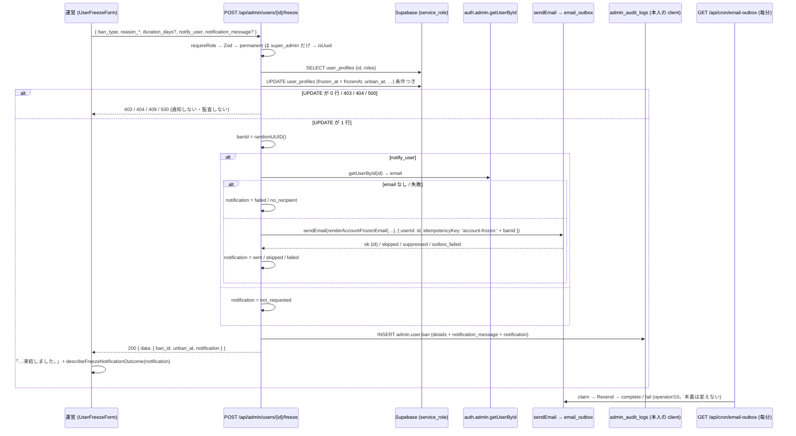

# 運営の凍結の「利用者に通知する」で凍結の通知メールを送る (#2026) 設計

| 版 | 日付 | 内容 |
|---|---|---|
| v1.0 | 2026-10-25 | 新設 (Issue #2026 の設計ゲート・A 型 4 相。凍結の API が受けるだけだった `notify_user` と `notification_message` を、凍結した本人への通知メール (送信待ち `email_outbox` に 1 通) として動かし、画面にチェックと任意のメッセージの欄を足す) |

要件の正本は Issue #2026 の本文とコメント。本書はその上で決めた範囲と設計で、Issue と食い違ったら本書が正。
ファイル名は cross/24 (cross/ の既存は 01〜09・12・13a・13b・14〜22。10・11 は欠番、13 は 13a・13b に引き継がれている (cross/CLAUDE.md の注記のとおり)。23 は別の案件の設計 (`cross/23-…`。本書の起票時点で origin/main には無く、その案件の設計のブランチにある) が使う番号で、本書は使わない)。

前提 (本書が従う条件):

- オーナーの選択 (2026-10-25・選択式): 「通知メールを実装する」。チェックが入っていれば、凍結を知らせるメールを送る。
- ローンチ前で利用者はゼロ。既存の凍結の行の移行は無い。
- 本番の DB には書き込まない (本書は本番を読んでもいない。事実はすべて origin/main `03734bcd1` のコードと migration から取った)。
- メールの送り出しは既存の仕組み (`sendEmail` → 送信待ち `email_outbox` → 毎分の worker `GET /api/cron/email-outbox`。operator/10) を使う。新しい表・migration・環境変数・RPC は作らない。
- 範囲外: 凍結の解除 (DELETE) で知らせること (§20 Q-1)・モデレーション経由の BAN (`applyUserBan`) で知らせること (§20 Q-3)・一時 BAN の自動解除の通知 (§20 Q-1)・HTML の本文・モバイルのネイティブの運営画面 (無い。§3.1 F-15)。新しい要求は発明しない (§20 に候補として残す)。

---

## 0. 外形固定と分冊判定 (相 1)

### 0.1 発注と決めること

発注 (Issue #2026): 運営が利用者を凍結するとき、`notify_user` (既定 true) と `notification_message` は監査ログに残る。しかし利用者への通知は送られない。監査には「知らせた」と読める記録が残るのに、凍結された人には何も届かない。

本書が答えを出すこと:

| # | 決めること | 答え (§6) |
|---|---|---|
| 1 | 送り方: `email_outbox` に積むのか、ほかの方法か。凍結の処理と同じトランザクションにするのか (凍結は成功したがメールは積めなかった、の扱い) | `sendEmail` で `email_outbox` に 1 通積む。凍結の UPDATE のあとの best-effort で、同じトランザクションにはしない。積めなくても凍結は 200 のままで、結果を応答の `data.notification` と監査の `details.notification` に残す (§6.1) |
| 2 | 文面: 件名・本文の固定の文・運営の任意のメッセージの差し込み方・期間 (`duration_days`・`unban_at`)・問い合わせ先 | 件名「【ほめゴハン】アカウントが凍結されました」。本文は凍結の日時 (日本時間)・種類 (一時 / 無期限) と解除の予定・運営からのメッセージ (あるときだけの段)・凍結中にできること・お問い合わせ先。理由カテゴリと詳細理由は載せない (§6.2・§7.2) |
| 3 | 凍結の解除 (unban) で知らせるか | 本書では送らない (解除の API と画面は変えない)。候補は §20 Q-1 (§6.3) |
| 4 | 画面の項目と既定 | `UserFreezeForm` にチェック「利用者に凍結をメールで知らせる」(既定 on = API の既定 `notify_user: true` と同じ) と、チェックが on のときだけ出る任意のメッセージの欄 (1000 文字まで)。結果の文を「済み」の表示に添える (§6.4・§7.6) |
| 5 | 監査の details に送った事実を残すか | 残す: `notification_message` (送るときだけ) と `notification { status, reason, outbox_id }` (§6.5) |
| 6 | `notification_message` の上限 1000 を名前付き定数に | `FREEZE_NOTIFICATION_MESSAGE_MAX_LENGTH` (`src/lib/admin/users-schemas.ts`)。環境変数にはしない (§6.6・§13) |
| 7 | モバイルの運営画面の有無 | 無い。凍結の画面は Web の `/admin/users/[id]/freeze` だけ (§3.1 F-15)。本書はモバイルに触れない (§6.7) |
| 8 | 設計書 operator/02・03 との整合・Zod の canonical・エラー表・テスト | §7.1 (Zod)・§8・§10・§12・§17 (02・03 への追随表) |

### 0.2 要件行列

| # | 要件 | 根拠 | 本書の置き場 |
|---|---|---|---|
| R-1 | `POST /api/admin/users/{id}/freeze` が `notify_user: true` (省略時も) で凍結に成功したとき、凍結した本人の登録メールアドレス (auth.users) へ、凍結を知らせるメールを 1 通、送信待ち (`email_outbox`) に積む | 前提のオーナーの選択・#2026 | §7.4・§7.5 |
| R-2 | `notify_user: false` のときは何も送らない (宛先も引かない) | 「チェックが入っていれば」送る | §7.5・§9.1 P-1 |
| R-3 | メールは凍結が実際に書けたとき (UPDATE が 1 行) だけ送る。403 / 404 / 409 / 500 では送らない | 凍結されていない人に「凍結されました」を送らない | §7.5・§9.3 (a) |
| R-4 | メールが積めなくても凍結は成功 (200) のまま。結果は応答 `data.notification` (`sent` / `skipped` / `failed` / `not_requested` と `reason`) と監査 `details.notification` に残る | 決めること 1・5。`sendTicketReplyEmail` (#1183) と同じ扱い | §7.3・§7.5・§9.1 |
| R-5 | 本文は固定の日本語の文に、凍結の日時 (日本時間)・一時 BAN なら解除の予定 (日本時間) と自動解除の説明・無期限なら解除の予定が無いこと・運営のメッセージ (あるときだけ)・凍結中にできること (書き出し・退会・有料プランの解約・お問い合わせ)・`/frozen` と `/contact` へのリンク・問い合わせ先のメールアドレスを入れる。理由カテゴリ・詳細理由・運営者の名前・本人の名前は入れない | 利用規約第16条 2 項・3 項・4 項 (§3.2 F-8) と矛盾させない | §7.2 |
| R-6 | 運営の任意のメッセージは前後の空白を除いて 1〜`FREEZE_NOTIFICATION_MESSAGE_MAX_LENGTH` (1000) 文字。空なら「無し」。本文の「▼ 運営からのメッセージ」の段にそのまま入れる (テキストのメールなのでエスケープはしない。改行はそのまま) | 決めること 2・6 | §7.1・§7.2 |
| R-7 | 画面にチェック (既定 on) と、on のときだけ出るメッセージの欄を足す。送る本文は API の `FreezeBodySchema` に通る形 (`notify_user` は常に送る。`notification_message` は on で空でないときだけ送る) | 決めること 4 | §7.6 |
| R-8 | 画面は成功の文に通知の結果を添える (`sent` = 送信待ちに登録・`not_requested` = 送っていない・`skipped` / `failed` = 未送信と理由)。API の失敗の本文 (`details`) は読まない | 決めること 4。`describeReplyEmailOutcome` (#1183) と同じ形 | §7.3・§7.6 |
| R-9 | 送信待ちの行は `user_id` = 凍結した本人 (退会で伏せられる)・`idempotency_key` = `account-frozen:<ban_id>`・`redact_after_send` = false・`template` = `account_frozen` | operator/10 §6.3 の `SendEmailOptions`・秘密を含まない文面 | §7.4 |
| R-10 | 宛先停止リスト (`email_blacklist`) に載っている宛先へは送らない (`sendEmail` が止める → `failed` / `send_failed`) | `sendEmail` の既存の規則 (#1184) | §9.1 P-6 |
| R-11 | `RESEND_API_KEY` が無い環境 (開発・結合テスト) では登録せず `skipped` / `not_configured` | `sendEmail` の既存の規則 | §9.1 P-5 |
| R-12 | ログに宛先のメールアドレスを残さない (`sendEmail` のマスクに任せ、本書の sender は `ban_id`・対象の id・template だけを残す) | operator/10 R-09・#1152 の前例 | §7.4 |
| R-13 | 既存の見張り (template 名の走査・秘密の宣言の走査・site-config の走査・送信の回数制限の契約・監査の網羅・NULL 文字・英字の項目名) をすべて通す | §16 | §16 |
| R-14 | 解除 (DELETE)・モデレーションの BAN (`applyUserBan`)・middleware・`/frozen` の画面・`isAccountFrozen` は変えない | 前提の範囲外 | §18 |
| R-15 | 新しい migration・環境変数・表・RPC を作らない | 前提 | §14 |

### 0.3 ユーザーシナリオ (18 本。トレースは §4.3・テストとの対応は §12.1)

| # | シナリオ | 期待 |
|---|---|---|
| S-1 | admin が利用者 U を一時 BAN 7 日で凍結する。チェック on・メッセージ無し | 200 `{ ban_id, unban_at, notification: { status: 'sent' } }`。`email_outbox` に queued 1 行 (`template` `account_frozen`・`user_id` U・`to_email` U の登録アドレス・`idempotency_key` `account-frozen:<ban_id>`)。本文に「一時的な凍結」「解除の予定: <unban_at 日本時間>」。「運営からのメッセージ」の段は無い。監査 `admin.user.ban` の `details.notification.status` = `sent`・`outbox_id` = 行の id。画面は「7 日間の一時 BAN で凍結しました。通知メールを送信待ちに登録しました」 |
| S-2 | S-1 でメッセージ「投稿内容について確認が取れるまで利用を停止しています。」を書く | 本文に「▼ 運営からのメッセージ」の段とその文。監査 `details.notification_message` にその文 |
| S-3 | super_admin が永久 BAN で凍結する。チェック on | 本文は「無期限の凍結」「解除の予定はありません」。`unban_at` null |
| S-4 | チェックを外して凍結する | 200 `notification: { status: 'not_requested' }`。`sendEmail` も `getUserById` も呼ばれない。`email_outbox` に行は無い。監査 `details.notify_user` false・`details.notification_message` null・`details.notification.status` `not_requested`。画面は「…凍結しました。通知メールは送っていません」 |
| S-5 | チェック on でメッセージを 1001 文字書く | 画面が送らずに「利用者へのメッセージは 1000 文字以内で入力してください」。API に直接送れば 400 `VALIDATION_ERROR` (凍結しない・監査なし) |
| S-6 | チェック on でメッセージを空白だけにする | 画面は `notification_message` を送らない。API に直接 `"   "` を送れば trim で空 → 「無し」として扱う (段は入らない) |
| S-7 | 対象の登録アドレスが無い (電話番号だけの登録) か、`getUserById` が失敗する | 200 `notification: { status: 'failed', reason: 'no_recipient' }`。`sendEmail` は呼ばれない。監査に同じ結果。画面は「メール未送信: 利用者のメールアドレスを取得できなかったため…」 |
| S-8 | `RESEND_API_KEY` が無い環境で凍結する | 200 `notification: { status: 'skipped', reason: 'not_configured' }`。行は無い (warn ログ)。画面は「メール未送信: メール送信の設定が未完了のため…」 |
| S-9 | 対象のアドレスが宛先停止リスト (`email_blacklist`) に載っている | 200 `notification: { status: 'failed', reason: 'send_failed' }`。`email_outbox` に dead (`last_error_code` `suppressed`) 1 行。画面は「メール未送信: メールの送信に失敗しました…」 |
| S-10 | `email_outbox` への INSERT が失敗する (DB の失敗) | 200 `failed` / `send_failed`。凍結は済んでいる。監査に同じ結果。app_logs に error |
| S-11 | 対象が super_admin | 403 `OP_TARGET_PROTECTED`。送らない (宛先も引かない) |
| S-12 | 読んでから書くまでに対象が super_admin になった (UPDATE が 0 行) | 409 `CONFLICT_STALE_DATA`。送らない。監査も無い (今までどおり) |
| S-13 | 対象が無い (UUID でない id を含む) | 404。送らない |
| S-14 | 本文に NULL 文字を含むメッセージ | 400 `INVALID_CHARACTER` (認証・DB の前)。送らない |
| S-15 | 凍結された本人がメールを受け取り、リンクからログインする | middleware が `/frozen` へ移す (本文のリンク `<サイト URL>/frozen` と同じ画面)。「サポートに問い合わせる」で `/contact` へ (本文のもう 1 つのリンク) |
| S-16 | 凍結された本人が、メールが届く前に退会する | `prepare_account_deletion` が `email_outbox` の行の宛先・件名・本文を伏せる (queued は dead)。worker は送らない (operator/10 §5.3) |
| S-17 | worker が Resend の一時的な失敗 (5xx) を受ける | 1 分 → 5 分 → … と最大 6 回再試行。使い切れば dead で運用メール `ops_email_dead_letter` に数えられ、super_admin が `/super-admin/email-outbox` で再送できる (operator/10。本書は変えない) |
| S-18 | 凍結中の対象をもう一度凍結する (期間を延ばす) | 今までどおり上書きして 200。`ban_id` が新しいので Idempotency-Key も新しく、2 通目が送られる (§20 Q-2) |

### 0.4 分冊判定

目安 (設計書 800 行超 / 消費先レーン 3 以上 / 共有面 2 つ以上) のうち、行数だけに当たる (消費先は route 1 本と画面 1 枚、共有面は `FreezeBodySchema` 1 つ)。核 (文面・sender・route) と配線 (画面) は小さく、API の既定が `notify_user: true` なので核だけを先に出すと今の画面 (チェックが無い) から送るたびにメールが出る。**1 冊・1 段・1 PR** にし、核と画面を同時に出す (§15)。

### 0.5 用語

| 語 | 意味 |
|---|---|
| 凍結 (BAN) | `user_profiles.frozen_at` が入っている状態。一時 BAN は `unban_at` を持ち、過ぎると自動解除扱い (`isAccountFrozen`) |
| 通知メール | 本書が足す、凍結した本人への 1 通。文面の名前 (`email_outbox.template`) は `account_frozen` |
| 送信待ち | `email_outbox` の行。`sendEmail` が積み、worker が送る。`sent` は「送信待ちに受け付けた」で、届いたかどうかは含まない (operator/10・#1183 の `email.status` と同じ語) |
| 通知の結果 (`FreezeNotificationOutcome`) | `{ status: 'sent' / 'skipped' / 'failed' / 'not_requested', reason? }` (`/` は union)。API の応答と監査と画面が同じ形を使う |
| 運営からのメッセージ | `notification_message`。運営が凍結の画面で書く任意の文。本文の 1 つの段に入る |

### 0.6 読み方

- 実装は §7 の正典コードを写す。§8 の facade 契約と §13 の定数の名前を変えない。
- 表 3 点 (§9) とエラー表 (§10) は、レビューが最初に自分で作り直して突き合わせる対象。
- 本書の TS のブロックは、`// tsc:skip` を 1 行目に持つものを除き、そのまま型検査を通る形で書いてある (import を省かない)。`// tsc:skip` のブロックは、本書が新設したファイル (`@/lib/emails/account/account-frozen`・`@/lib/admin/freeze-notification-status`。書いた時点は無く、#2030 で main に入った) を import するものと、既存ファイルの差分の断片。
- 本書の file:line は origin/main `03734bcd1` (2026-10-25) の時点。

---

## 1. 目的・スコープ

- 目的: 監査に「知らせた」と残るのに届かない通知を、本当に届く通知にする。凍結した本人が、凍結の事実・種類・解除の予定・問い合わせ先をメールで知れるようにする。
- 対象: `FreezeBodySchema` の定数化 (1 ファイル)・文面 (1 ファイル・新)・通知の結果の型と画面の文 (1 ファイル・新)・sender (1 ファイル・新)・route の POST (1 ファイル)・画面 `UserFreezeForm` (1 ファイル)・テスト (新設 4・改定 7。続きの #2036 で新設 1。§7.7)・設計書 operator/02・03・07 と cross/CLAUDE.md への追随表 (§17)。
- 対象外: 冒頭の前提のとおり。

## 2. 関連要件・既存設計

| 文書 | 関係 |
|---|---|
| Issue #2026 | 要件の正本 |
| `docs/design/operator/02-api-spec.md` §4 (`POST /api/admin/users/{id}/freeze`・行 173-198) | 書き換え前の API の記述。「`notify_user` は監査に残すだけ・`notification_message` は使わない」(行 192) を本書の形に直す (§17) |
| `docs/design/operator/03-ui-spec.md` §6 (凍結の画面・行 143-149) | 「通知メッセージの欄は無い」(行 148) を本書の形に直す (§17) |
| `docs/design/operator/07-audit-monitoring.md` §4.1 (行 149) | `admin.user.ban` の details の説明に通知の結果を足す (§17) |
| `docs/design/operator/10-logs-and-mail-retry.md` §6 | `sendEmail` → `email_outbox` → worker の正典。本書はこの経路をそのまま使う。dead の通知 (§8) は `ops_` 以外の template を数えるので、本書の `account_frozen` も数えられる |
| `docs/design/cross/20-terms-privacy-text.md` F-20・利用規約第16条 | 凍結の条文。本文の文はこれと矛盾させない (理由の開示の義務は無い・凍結中にできること・自動解除・心当たりが無ければお問い合わせ)。条文は変えない |
| `docs/design/cross/16-auth-history-sessions.md` §18 | 本人へ知らせるメール (`login_new_device`) の前例。文面の置き場 (`src/lib/emails/account/`)・日本時間の書き方・リンクの作り方 (`getSiteUrl()` + 固定のパス) を踏襲 |
| `docs/design/cross/04-api-conventions.md` | エラーコードは足さない (既存の 400 / 401 / 403 / 404 / 409 / 500 のまま) |

## 3. 現状の事実 (origin/main `03734bcd1`・2026-10-25)

### 3.1 API・画面・lib

| # | 事実 | 場所 |
|---|---|---|
| F-1 | `FreezeBodySchema`: `ban_type`・`reason_category`・`reason_detail` (1〜`FREEZE_REASON_MAX_LENGTH` = 2000)・`duration_days` (1〜365)・`notify_user: z.boolean().optional().default(true)`・`notification_message: z.string().max(1000).optional()`。1000 は名前の無い数。`UnfreezeBodySchema` は `reason` だけ | `src/lib/admin/users-schemas.ts:161-181` |
| F-2 | POST: `requireRole(['admin','super_admin'])` → Zod → permanent は super_admin だけ → temporary は `duration_days` 必須 → `isUuid` → profile 読み → super_admin は 403 `OP_TARGET_PROTECTED` → `unbanAt` を計算 → 条件つき UPDATE (`frozen_at: new Date().toISOString()`・`frozen_reason`・`frozen_by`・`unban_at`) → 0 行なら読み直して 404 / 409 `CONFLICT_STALE_DATA` → `banId = crypto.randomUUID()` → `recordAdminAudit('admin.user.ban', details { ban_id, ban_type, reason_category, reason_detail, duration_days, notify_user, unban_at }, severity 'warn')` → `{ data: { ban_id, unban_at } }`。`notification_message` は details にも入らず、送る処理も無い。UPDATE と監査は別の呼び出しでトランザクションは無い。凍結中の対象を再び凍結する分岐は無い (上書き) | `src/app/api/admin/users/[id]/freeze/route.ts:59-240` (`unbanAt` :158・UPDATE :165-168・`banId` :213・監査 :214-232・応答 :234-239) |
| F-3 | DELETE: `UnfreezeBodySchema` → 凍結中 (`frozen_at IS NOT NULL`) のときだけ UPDATE で `frozen_*`・`unban_at` を NULL に → 0 行なら 404 / 409 → `recordAdminAudit('admin.user.unban', details { reason })`。利用者へ知らせる処理は無く、知らせるかどうかの入力も無い | 同 `:242-366` |
| F-4 | 画面 `UserFreezeForm`: state は `reasonCategory`・`reasonDetail`・`banType`・`durationDays` (既定 '7')・`unfreezeReason`・`submitting`・`error`・`done`。`send()` は boolean を返し、応答の JSON は失敗のときだけ読む。送る本文は `ban_type`・`reason_category`・`reason_detail`・`duration_days` (temporary のとき) で、`notify_user` も `notification_message` も送らない (grep `notify` 0 件)。成功の文は「永久 BAN で凍結しました」/「N 日間の一時 BAN で凍結しました」 | `src/components/admin/UserFreezeForm.tsx:73-157` (`send` :80・`handleFreeze` :111・本文 :130・`setDone` :156)・期間の欄 `:325`・注意の帯 `:344` |
| F-5 | ページ `src/app/admin/users/[id]/freeze/page.tsx` は `GET /api/admin/users/{id}` で `is_banned` を読み、`UserFreezeForm` に `userId`・`isBanned`・`isSuperAdmin` を渡す。利用者の詳細 `/admin/users/[id]` は `ban_history` (監査 `admin.user.ban` / `unban` の行) を super_admin にだけ出す | `src/app/admin/users/[id]/freeze/page.tsx`・`src/app/api/admin/users/[id]/route.ts:130, 158`・`src/app/admin/users/[id]/page.tsx:184` |
| F-6 | `sendEmail(envelope, options)` は Resend を呼ばず、封筒を検証 → `RESEND_API_KEY` が無ければ `skipped` (`not_configured`) → 停止リストに載っていれば dead の行を残して `suppressed` の失敗 → `email_outbox` に `queued` で 1 行 (`template`・`to_email`・`from_email`・`reply_to`・`subject`・`text_body`・`html_body`・`user_id`・`idempotency_key`・`redact_after_send`) → `{ ok: true, id }`。例外を投げない。`options` は `idempotencyKey` / `userId` / `redactAfterSend` | `src/lib/emails/send.ts:60-69, 92` |
| F-7 | `EmailEnvelopeSchema`: `to` (email)・`from` (既定 `getEmailFrom()`)・`subject` (1〜100)・`text` (1〜)・`html?`・`reply_to?`・`template?`・`contains_secret?: literal(true)`。`template` は文面 (`render*Email`) が必ず入れる | `src/lib/emails/envelope.ts:10-27` |
| F-8 | 本人へ知らせるメールの前例 2 本: `renderAccountDeletedEmail` (`src/lib/emails/account/account-deleted.ts:59-61`。`template: 'account_deleted'`・日本時間の `Intl.DateTimeFormat`・`getSupportEmail()`・`emailSignature()`) と `renderLoginNewDeviceEmail` (`src/lib/emails/account/login-new-device.ts`。リンクは `getSiteUrl()` + 固定のパスの定数)。文面は `src/lib/emails/account/` に置く | 同左 |
| F-9 | 運営の操作から本人へ送る前例: `sendTicketReplyEmail` (`src/lib/admin/send-ticket-reply-email.ts`)。宛先は `getSupabaseAdmin().auth.admin.getUserById(ticket.user_id)` の `user.email` (:67)。結果は `ReplyEmailOutcome { status: 'sent' / 'skipped' / 'failed', reason?: 'not_configured' / 'no_recipient' / 'send_failed' }` (`src/lib/admin/support-reply-email-status.ts:14-46`。画面は `describeReplyEmailOutcome` で「メール未送信: …」の文にする)。`result.skipped` → skipped (:101)、`isEmailFailure(result)` → failed (:107)。例外を外に出さない (:116)。route は返信の保存のあとに呼び、応答に `email` を載せる。送信回数の制限 (invite-throttle) の除外は `tests/email-send-throttle-contract.test.ts:74` | 同左 |
| F-10 | 退会の完了メール (`src/lib/account-deletion-notification.ts:83, 132`) は `getUserById` で宛先を控え、`redactAfterSend: true`・`userId` 無しで送る (削除の後だから)。本書の宛先は生きている本人なので `userId` を渡し、`redactAfterSend` は渡さない | 同左 |
| F-11 | `email_outbox` の列・RLS (全拒否・service_role だけ)・`user_id` は `auth.users` への FK `ON DELETE SET NULL`。`prepare_account_deletion` が退会時に宛先・件名・本文を伏せる (queued は dead)。status は `queued` / `sent` / `dead`。queued は作成から 7 日 (`EMAIL_OUTBOX_QUEUED_MAX_AGE_MS`) で `expired`。dead の通知は `ops_` 以外の template を数える (`OPS_EMAIL_TEMPLATE_PREFIX`) | `supabase/migrations/20261016234000_email_outbox.sql:25-86`・`src/lib/emails/outbox.ts:36, 40` |
| F-12 | `createLogger(routeName).withUser(userId)` は `debug` / `info` / `warn` / `error(message, error?, metadata?)` を返す。`recordAdminAudit` の `details` は `Record<string, unknown>` | `src/lib/db-logger.ts:139, 198`・`src/lib/admin/audit.ts:64, 136` |
| F-13 | 凍結中の判定 `isAccountFrozen` (純関数)。middleware は `/api` を 403 `AUTH_ACCOUNT_FROZEN` で止め (例外は `FROZEN_ALLOWED_API_PATHS`・`isNativeBridgeCodeApiPath`・`isFrozenContactSubmitRequest`)、画面を `/frozen` へ移す。`/frozen` の文は「利用規約違反等の理由により…凍結されています。一時的な凍結の場合は、解除予定日時の経過後に自動的にアクセスが回復します。…凍結中でも、データの書き出しと退会、有料プランの解約はできます」。`/contact` は凍結中も開ける | `src/lib/auth/frozen.ts:25`・`lib/supabase/middleware.ts:224-249, 372-377`・`src/app/frozen/page.tsx:48-56` |
| F-14 | `getSiteUrl()` / `getEmailFrom()` / `getSupportEmail()` が送信元・問い合わせ先・サイトの URL の唯一の出どころ。文面にドメインを書かない (`tests/site-config-guard.test.ts`) | `src/lib/site-config.ts:114, 134, 148` |
| F-15 | モバイル (`apps/mobile`) に運営の凍結の画面・API の呼び出しは無い (`admin/users` を含むのは `__tests__/lib/api-error.test.ts` だけ)。利用者側の凍結の画面は Web の `/frozen` を WebView で開く | `apps/mobile/app/frozen.tsx` |
| F-16 | モデレーションの BAN は `applyUserBan` (`src/lib/admin/user-ban.ts:100`) で、`notify_user` を持たない。呼び出しは `src/app/api/admin/moderation/[type]/[id]/route.ts:508` だけ | 同左 |
| F-17 | Zod は v4 (`package.json` の `"zod": "^4.6.7"`)。`z.string().trim().max(n)` は並べた順に適用される (trim のあとに長さ) | `package.json:57` |

### 3.2 法務の文

| # | 事実 | 場所 |
|---|---|---|
| F-18 | 利用規約第16条: 1 項「事前に通知することなく…凍結を行うことがあります」、2 項「凍結中は、本サービスの機能を利用できません。ただし、凍結中でも、データの書き出し、退会、有料プランの解約、お問い合わせの送信は行うことができます」、3 項「一時的な凍結は、当社が定めた解除の日時が経過すると自動的に解除されます。凍結に心当たりがない場合や、詳細を確認したい場合は、お問い合わせからご連絡ください」、4 項「凍結の判断の根拠となった情報を…開示する義務を負いません」。事後の通知メールは 1 項と矛盾しない (事前の通知を約束しないだけ)。本文の文は 2・3 項の語で書き、4 項のとおり理由は載せない | `src/lib/legal/terms-text.ts:355-364`・cross/20 F-20 (`:214`) |
| F-19 | プライバシーポリシーは凍結の通知メールに触れない (第13条 3 項・第14条 6 項は凍結中の書き出し・退会・請求の受付)。登録メールアドレスへの通知の送付は第3条・第5条の利用目的 (サービスの提供・連絡) の範囲で、文は変えない | `src/lib/legal/privacy-text.ts:448-478` |

### 3.3 既存のテストと番兵

§16 に全列挙する。要点: `tests/admin-user-freeze-form.test.tsx` (送る本文を `toEqual` で固定・本物の route につなぐ)・`tests/admin-user-freeze-route-1917.test.ts` (POST は認可の失敗まで)・`tests/user-freeze-super-admin-race.test.ts` (POST の成功と 409 / 404)・`src/__tests__/lib/emails/template-names.test.ts` (`template: '…',` の行を数える)・`secret-templates.test.ts` (全文面を秘密あり / なしの表と突き合わせる)・`templates-site-config.test.ts` (`account/` の全ファイルが `TEMPLATES` に載る)・`tests/email-send-throttle-contract.test.ts` (`sendEmail` を呼ぶファイルは除外の理由が要る)・`tests/admin-mutation-audit-coverage-1571.test.ts` (`recordAdminAudit` を handler の本体で・引数はリテラル)・`tests/lib-raw-error-message-scan.test.ts` (`src/lib` の戻り値に `error.message` を入れない)・`src/__tests__/api/null-character-routes.test.ts`・`tests/api-error-english-field-names.test.ts`。

---

## 4. 構想 (相 2)

### 4.1 構造 (構造 A)

```
凍結の画面 UserFreezeForm (チェック notify_user + 任意の notification_message)
   │ POST /api/admin/users/{id}/freeze  { ban_type, reason_category, reason_detail, duration_days?, notify_user, notification_message? }
   ▼
route POST (src/app/api/admin/users/[id]/freeze/route.ts)
   1. 認可 → Zod (FreezeBodySchema) → 403 / 404 / 条件つき UPDATE (今までどおり)
   2. UPDATE が 1 行 → banId
   3. notify_user なら sendFreezeNotificationEmail(...)  ── best-effort。例外を投げない
   │        └ getSupabaseAdmin().auth.admin.getUserById(userId) → 宛先
   │        └ renderAccountFrozenEmail(vars) → 封筒 (template 'account_frozen')
   │        └ sendEmail(封筒, { userId, idempotencyKey: 'account-frozen:<banId>' }) → email_outbox に queued 1 行
   │        → { outcome: { status, reason? }, outbox_id }
   4. recordAdminAudit('admin.user.ban', details { …今までの 7 項目, notification_message, notification: { status, reason, outbox_id } })
   5. 200 { data: { ban_id, unban_at, notification: outcome } }
   ▼
画面: 「…凍結しました。」 + describeFreezeNotificationOutcome(data.notification)

worker GET /api/cron/email-outbox (毎分。operator/10。本書は変えない) → Resend → 本人の受信箱
```

- **送り方**: 既存の `sendEmail` (送信待ちへの登録だけ)。Resend を直接呼ばない。再試行・dead・再送・退会時の伏せ字は operator/10 の仕組みがそのまま効く。
- **順番**: 凍結の UPDATE → 通知 → 監査 → 応答。監査が通知の結果 (`outbox_id` を含む) を持てるように、通知を監査より先に行う。通知は best-effort で、失敗は結果として残す (例外は sender の中で止める)。
- **宛先**: `auth.users` の登録アドレスを `getUserById` で 1 人分だけ引く (#1204 の決まり。F-9)。`user_profiles` に email の列は無い。
- **文面**: `src/lib/emails/account/account-frozen.ts` の `renderAccountFrozenEmail`。テキストだけ。理由は載せない (F-18 の 4 項)。
- **結果の型**: `src/lib/admin/freeze-notification-status.ts` (サーバー専用の import を持たず、画面からも読める) の `FreezeNotificationOutcome`。API の応答・監査・画面が同じ形。
- **sender**: `src/lib/admin/send-freeze-notification-email.ts`。`sendTicketReplyEmail` と同じ骨格 (宛先 → 封筒 → `sendEmail` → 結果。例外は外に出さない)。
- **画面**: チェック (既定 on) と、on のときだけ出るメッセージの欄。`send()` の戻り値を `{ ok: true, json } / { ok: false }` に広げ、成功の文に通知の結果の文を添える。

### 4.2 動き

1. **画面で凍結する**: 今までの検証 (カテゴリ・詳細・期間) のあと、`notify_user` を本文に入れ、on でメッセージが空でなければ前後の空白を除いて `notification_message` に入れる (1000 文字超は送らずに知らせる)。`FreezeBodySchema.safeParse` を通して POST。
2. **route**: 今までどおり凍結し、UPDATE が 1 行なら `banId` を作る。`notify_user` が true なら sender を呼び、false なら `FREEZE_NOTIFICATION_NOT_REQUESTED`。監査の details に `notification_message` (true のときの文、無ければ null。false なら null) と `notification` (`status`・`reason` (無ければ null)・`outbox_id` (無ければ null)) を足す。応答の `data` に `notification` (`status`・`reason?`) を足す。
3. **sender**: `getUserById` → 無い / 失敗 / 例外 → `failed` / `no_recipient`。あれば `renderAccountFrozenEmail({ to_email, frozen_at, unban_at, operator_message })` を `sendEmail(…, { userId, idempotencyKey })` に渡す。`skipped` → `skipped` / `not_configured`。`isEmailFailure` → `failed` / `send_failed`。`ok` → `sent` と `outbox_id`。想定外の例外 → `failed` / `send_failed`。ログは `ban_id`・`target_id`・`template` だけ (宛先は書かない)。
4. **画面の「済み」**: `data.notification` を `freezeNotificationOutcomeOf` で読み、`describeFreezeNotificationOutcome` の文を凍結の文に添える。読めなければ「通知メールの結果を確認できませんでした」。
5. **worker**: 今までどおり。

### 4.3 シナリオのトレース (§4.1 の構造で手で走らせた記録)

| # | 走らせた結果 | 通る場所 |
|---|---|---|
| S-1 | 画面: 検証を通り `{ ban_type: 'temporary', reason_category, reason_detail, duration_days: 7, notify_user: true }` を POST → route: UPDATE 1 行 → `banId` → sender: `getUserById(U)` が `user.email` → `renderAccountFrozenEmail({ to_email, frozen_at, unban_at: frozen_at + 7 日, operator_message: null })` → 本文に「凍結の種類: 一時的な凍結」「解除の予定: <日本時間>」、段「▼ 運営からのメッセージ」は無い → `sendEmail(封筒, { userId: U, idempotencyKey: 'account-frozen:<banId>' })` → `email_outbox` に queued (`template` `account_frozen`・`user_id` U・`redact_after_send` false) → `{ ok: true, id }` → `{ outcome: { status: 'sent' }, outbox_id: id }` → 監査 details に `notification_message: null`・`notification: { status: 'sent', reason: null, outbox_id: id }` → 200 `data.notification = { status: 'sent' }` → 画面「7 日間の一時 BAN で凍結しました。通知メールを送信待ちに登録しました (届くまで数分かかることがあります)」 | §7.2・§7.4・§7.5・§7.6 |
| S-2 | 画面が `notification_message: '投稿内容について…'` (trim 済み) を足す → Zod の `.trim().max(1000)` を通る → sender の `operator_message` に入る → 本文に「▼ 運営からのメッセージ」の段 → 監査 `notification_message` にその文 | §7.1・§7.2・§7.5 |
| S-3 | `ban_type: 'permanent'` (super_admin) → `unbanAt` null → `renderAccountFrozenEmail` の `unban_at: null` → 「凍結の種類: 無期限の凍結」「解除の予定はありません」 | §7.2 |
| S-4 | 画面が `notify_user: false` を送る (メッセージの欄は出ていない) → route: `freezeData.notify_user` が false → sender を呼ばない → `notification = FREEZE_NOTIFICATION_NOT_REQUESTED` → 監査 `notify_user: false`・`notification_message: null`・`notification: { status: 'not_requested', reason: null, outbox_id: null }` → 200 → 画面「…凍結しました。通知メールは送っていません」 | §7.5・§7.6 |
| S-5 | 画面: `message.trim().length > FREEZE_NOTIFICATION_MESSAGE_MAX_LENGTH` → 「利用者へのメッセージは 1000 文字以内で入力してください」を出して送らない。API に直接 1001 文字 → `FreezeBodySchema.safeParse` が失敗 → 400 `VALIDATION_ERROR` (`details` は flatten) → 凍結しない | §7.1・§7.6・§10 |
| S-6 | 画面: `message.trim() === ''` → `notification_message` を本文に入れない。API に直接 `"   "` → Zod の trim で `''` → route は `freezeData.notification_message \|\| null` で null → 段は無い・監査は null | §7.1・§7.5 |
| S-7 | sender: `getUserById` が `{ data: { user: { email: null } } }` → `failed` / `no_recipient` (warn)。`error` を返す・例外 → 同じ (error ログ)。`sendEmail` は呼ばれない → 監査 `notification: { status: 'failed', reason: 'no_recipient', outbox_id: null }` → 200 → 画面「メール未送信: 利用者のメールアドレスを取得できなかったため、通知されていません。凍結は済んでいます」 | §7.3・§7.4 |
| S-8 | `sendEmail` が `{ ok: false, skipped: true, error.code 'not_configured' }` → `skipped` / `not_configured` (warn) → 画面「メール未送信: メール送信の設定が未完了のため、通知されていません。凍結は済んでいます」 | §7.3・§7.4・F-6 |
| S-9 | `sendEmail` が停止リストで `{ ok: false, skipped: false, error.code 'suppressed' }` (dead の行を残す) → `isEmailFailure` → `logEmailFailures` (suppressed だけなので warn) → `failed` / `send_failed` → 画面「メール未送信: メールの送信に失敗しました。凍結は済んでいますが、利用者には通知されていません」 | §7.4・F-6 |
| S-10 | `sendEmail` が `outbox_failed` → `logEmailFailures` (error) → `failed` / `send_failed`。監査に同じ結果 | §7.4 |
| S-11 | route: profile の roles に super_admin → 403 `OP_TARGET_PROTECTED` を返す。sender に届かない | F-2・§9.3 (a) |
| S-12 | route: UPDATE 0 行 → 読み直し → 409。sender に届かない。監査も無い | F-2・§9.3 (a) |
| S-13 | route: `isUuid` 偽 → 404。sender に届かない | F-2 |
| S-14 | `rejectNullCharacterBody` が本文の全文字列を見て 400 `INVALID_CHARACTER`。認証・DB・sender に届かない | `src/__tests__/api/null-character-routes.test.ts:156` |
| S-15 | メールのリンク `${getSiteUrl()}/frozen` を開く → 未ログインなら `/login` → ログイン → middleware が `isAccountFrozen` 真で `/frozen` へ → 「サポートに問い合わせる」→ `/contact` (メールのもう 1 つのリンクと同じ) | F-13 |
| S-16 | 退会 → `prepare_account_deletion` が `email_outbox` の `user_id` = 本人の行を伏せる (queued → dead)。worker は取らない。`user_id` を渡しているのでこの段に入る | F-11 |
| S-17 | worker: `fail_email_outbox` が `retryable` で `queued` に戻し、`next_attempt_at` を 1 分 → 5 分 → … に。6 回目で dead → `email_outbox_dead_counts` が `account_frozen` を数え、運用メール → `/super-admin/email-outbox` で requeue | operator/10 §5.2・§8・§9.2 |
| S-18 | route: 凍結中の対象でも UPDATE の条件は super_admin でないことだけなので 1 行 → 新しい `banId` → 新しい Idempotency-Key → 2 通目が queued。1 通目が未送信 (queued) でも別の行 | F-2・§20 Q-2 |

---

## 5. 構造裁定 (相 3・1 回だけ)

### 5.1 代替案の比較

| 案 | 中身 | 利点 | 欠点 |
|---|---|---|---|
| **A (採用)**: route の中で `sendEmail` (best-effort)。結果を応答と監査に残す | §4.1 | 既存の経路 (`sendTicketReplyEmail`・退会の完了メール) と同じ骨格で、新しい表・RPC・cron が要らない。失敗が運営の画面にその場で見える。再試行・dead・再送・退会時の伏せ字は worker と DB の既存の仕組み | 凍結と送信待ちへの登録が 1 トランザクションでない (凍結は済んだが積めなかった、が起きる)。ただし結果が応答と監査に残り、運営は画面で知って手で対応できる (ローンチ前で件数も小さい) |
| B: 凍結の UPDATE と `email_outbox` への INSERT を 1 つの RPC (plpgsql) にして原子にする | `freeze_user_and_queue_email(...)` を新設 | 「凍結したのにメールが積まれない」が無くなる | 新しい migration と RPC (`email_outbox` の列の検査・停止リストの引き当て・`RESEND_API_KEY` の有無を DB に持ち込むか、無視するか) が要る。`sendEmail` の規則 (停止リスト・`not_configured`・ログ) を DB に写すことになり、operator/10 の「登録は `sendEmail` だけ」の決まりを破る。宛先 (auth.users) の読み取りも DB 側に要る。本書の規模 (1 通の通知) に対して縁が大きい |
| C: 監査 `admin.user.ban` の行を cron が拾って送る (通知を監査から派生させる) | 新しい cron が `notify_user` が true で未送信の監査行を探す | route は何も変えない | 監査ログに「送ったか」の状態列が要る (監査は UPDATE 不可。cross/CLAUDE.md §6) ので、別の表が要る。二段の送信待ち (監査 → cron → `email_outbox` → worker) になり、遅れと失敗の場所が増える。運営の画面に結果が出ない |

### 5.2 F の問い (縁の発生源を消すより単純な構造は無いか)

縁は「凍結は済んだがメールは積めなかった」の 1 つ。消すには B (原子化) しかないが、B は `sendEmail` の規則を DB に写す大きな縁を新しく作る。A はこの縁を「結果として残す」ことで扱い、運営がその場で知る。`sendTicketReplyEmail` (返信は保存済みだがメールは未送信) と同じ扱いで、既存の決まりの中に収まる。これより単純な構造は無い。

### 5.3 確定

構造 A で確定する。以後の周で構造の蒸し返しはしない (構造の疑義は「裁定への差し戻し事由」として別に扱う)。

---

## 6. 決めたこと (0.1 の 1〜8 への答え)

### 6.1 送り方 (決めること 1)

- `sendEmail` で `email_outbox` に 1 通積む。凍結の UPDATE が 1 行だったときだけ (403 / 404 / 409 / 500 では送らない)。
- 凍結とは別の呼び出し (トランザクションにしない)。積めなくても凍結は 200 のまま。結果は `data.notification` と監査 `details.notification` に残す。
- `sendEmail` の `options`: `userId` = 凍結した本人 (退会時の伏せ字と `/super-admin/email-outbox` の絞り込みに使う)・`idempotencyKey` = `account-frozen:<ban_id>`・`redactAfterSend` は渡さない (秘密を含まない。送った文面を運営が追えるように残す)。
- 時間の上限は設けない (`sendTicketReplyEmail` と同じ。`sendEmail` の停止リストの引き当ては 3 秒で打ち切られ、ほかは 1 回ずつの HTTP の呼び出し。退会の完了メールの 5 秒の上限は、退会の route の 60 秒の中で Storage の掃除のあとに送る都合のもので、本書には当たらない)。

### 6.2 文面 (決めること 2)

- 件名: `【ほめゴハン】アカウントが凍結されました` (`ACCOUNT_FROZEN_EMAIL_SUBJECT`。100 字以内)。
- 本文 (テキストだけ。§7.2 が正典): 凍結の日時 (日本時間) → 種類と解除の予定 (一時: 解除の予定の日時 (日本時間) と「過ぎると自動的に解除されます」/ 無期限: 「解除の予定はありません」) → 運営からのメッセージ (あるときだけ「▼ 運営からのメッセージ」の段) → 凍結中にできること (F-18 の 2 項の語) と `/frozen` のリンク → 心当たりが無ければお問い合わせ (`/contact` のリンクと `getSupportEmail()`) → 署名。
- 載せないもの: 理由カテゴリ・詳細理由 (F-18 の 4 項。運営が伝えたいことはメッセージで書く)・運営者の名前・本人の名前・`ban_id`。
- 運営のメッセージの差し込み: 前後の空白を除いた文をそのまま 1 つの段に入れる。改行はそのまま (テキストのメール)。HTML は作らないのでエスケープは無い。
- `contains_secret` は書かない (リンクはサイトの URL + 固定のパス 2 つ。トークン無し)。
- `template` は `account_frozen` (snake_case・`account_` は本人へのアカウントの知らせの前例 `account_deleted` と同じ接頭辞)。

### 6.3 凍結の解除 (決めること 3)

本書では送らない。理由: (a) `UnfreezeBodySchema` に知らせるかどうかの入力が無く、発注 (#2026) は凍結の `notify_user` の話である、(b) 一時 BAN の自動解除も何も送らないので、手動の解除だけに送ると自動解除と非対称になる、(c) 解除された本人は次のログインで通常の画面に入れるので、知らせなくても使えないままにはならない。解除・自動解除の通知を足すなら新しい要求として §20 Q-1 で選ぶ。DELETE の route と解除の画面は変えない。

### 6.4 画面の項目と既定 (決めること 4)

- チェック `notify_user`「利用者に凍結をメールで知らせる (アカウントの登録メールアドレス宛)」。既定 on (API の `default(true)` と同じ。今までの画面は本文に入れていなかったので API は true で動いていたが送らなかった。本書で「on = 送る」になる)。
- チェックが on のときだけ、任意のメッセージの欄 `notification_message` (textarea・1000 文字まで・前後の空白を除いた文字数を「{文字数} / 1000 文字」で出す) を出す。説明の文: 「メールには、凍結の日時・種類・解除の予定・凍結中にできること・お問い合わせ先が入ります。理由カテゴリと詳細理由は入りません。」。欄の placeholder: 「ここに書いた文は「運営からのメッセージ」としてそのままメールの本文に入ります」 (§7.6)。
- 成功の文: 今までの「永久 BAN で凍結しました」/「N 日間の一時 BAN で凍結しました」のあとに `describeFreezeNotificationOutcome(data.notification)` の文を 1 文添える (§7.3)。
- 解除のフォームは変えない。

### 6.5 監査の details (決めること 5)

`admin.user.ban` の details に 2 項目を足す (今までの 7 項目はそのまま):

| 項目 | 値 |
|---|---|
| `notification_message` | `notify_user` が true のときの、前後の空白を除いたメッセージ (無ければ null)。false なら null (受け取っていても残さない) |
| `notification` | `{ status: 'sent' / 'skipped' / 'failed' / 'not_requested', reason: 'not_configured' / 'no_recipient' / 'send_failed' / null, outbox_id: uuid / null }` (`/` は union)。`status` と `reason` は応答の `data.notification` と同じ値、`outbox_id` は `sent` のときの `email_outbox.id` |

宛先のメールアドレスは監査に残さない (運営のユーザー詳細は `canViewUserEmail` のロールにだけ出す決まり (`src/lib/admin/user-emails.ts`) があり、監査を読める super_admin はそれを満たすが、監査は 7 年残るので入れない)。

### 6.6 定数と環境変数 (決めること 6)

- `FREEZE_NOTIFICATION_MESSAGE_MAX_LENGTH = 1000` を `src/lib/admin/users-schemas.ts` に置き、Zod と画面の両方が読む (`FREEZE_REASON_MAX_LENGTH` と同じ置き方)。
- 環境変数にはしない: 入力の形の上限 (`FREEZE_REASON_MAX_LENGTH`・`FREEZE_DURATION_DAYS_MAX` と同じ種類) で、運用で変える値ではない。画面 (ブラウザ) とサーバーが同じ値を見る必要があり、サーバー側だけの環境変数にすると食い違う。

### 6.7 モバイル (決めること 7)

運営の凍結の画面はモバイルに無い (F-15)。本書はモバイルを変えない。凍結された本人の受け取りは通常のメールで、アプリの画面は `/frozen` の WebView のまま。

### 6.8 契約の置き場 (決めること 8)

- Zod の正典: `src/lib/admin/users-schemas.ts` の `FreezeBodySchema` (§7.1)。
- 文面: `src/lib/emails/account/account-frozen.ts` (§7.2)。
- 結果の型と画面の文: `src/lib/admin/freeze-notification-status.ts` (§7.3)。
- sender: `src/lib/admin/send-freeze-notification-email.ts` (§7.4)。
- route と画面は既存のファイルの差分 (§7.5・§7.6)。
- エラーコードは足さない (§10)。

---

## 7. 正典コード

### 7.1 `src/lib/admin/users-schemas.ts` (差分。「凍結 (BAN)」の節だけ。ほかの節は変えない)

`FREEZE_DURATION_DAYS_MAX` の直後に定数を 1 つ足し、`FreezeBodySchema` の `notification_message` を書き換える。下のブロックは、その節を独立のモジュールとして型検査できる形で写したもの (実ファイルでは `z` の import は既にある)。

```ts
import { z } from 'zod';

/** 凍結・凍結解除の理由の文字数の上限 (operator/02-api-spec.md §4。凍結の画面 src/components/admin/UserFreezeForm.tsx も送る前にこれで確かめる) */
export const FREEZE_REASON_MAX_LENGTH = 2000;
/** 一時 BAN の日数の下限 (1 日) */
export const FREEZE_DURATION_DAYS_MIN = 1;
/** 一時 BAN の日数の上限 (365 日。モデレーションの一時 BAN と同じ範囲) */
export const FREEZE_DURATION_DAYS_MAX = 365;
/**
 * 凍結の通知メールに載せる運営からのメッセージ (notification_message) の文字数の上限 (#2026。cross/24 §6.6・§13)。
 * 前後の空白を除いたあとの UTF-16 の長さ。メールの本文の 1 つの段に入る量で、監査 admin.user.ban の details にも同じ文を残すので、
 * 監査の行が膨らまないようにこの長さに留める。画面 (UserFreezeForm) も送る前にこれで確かめる。入力の形の上限なので環境変数にはしない
 */
export const FREEZE_NOTIFICATION_MESSAGE_MAX_LENGTH = 1000;

export const FreezeBodySchema = z.object({
  ban_type: z.enum(['temporary', 'permanent']),
  reason_category: z.enum(['spam', 'abuse', 'policy_violation', 'other']),
  reason_detail: z.string().min(1).max(FREEZE_REASON_MAX_LENGTH),
  duration_days: z.number().int().min(FREEZE_DURATION_DAYS_MIN).max(FREEZE_DURATION_DAYS_MAX).optional(),
  /** true なら凍結した本人の登録メールアドレスへ通知メールを送信待ちに積む (cross/24)。省略時 true */
  notify_user: z.boolean().optional().default(true),
  /**
   * 通知メールの「▼ 運営からのメッセージ」の段に入れる任意の文 (cross/24 §7.2)。前後の空白を除いてから長さを見る
   * (trim を max より先に並べる。Zod は検査を並べた順に適用する)。空 (空白だけ) は「無し」として扱う (route が `|| null` にする)。
   * notify_user が false なら受け取っても使わず、監査にも残さない
   */
  notification_message: z.string().trim().max(FREEZE_NOTIFICATION_MESSAGE_MAX_LENGTH).optional(),
});

export type FreezeBody = z.infer<typeof FreezeBodySchema>;

export const UnfreezeBodySchema = z.object({
  reason: z.string().min(1).max(FREEZE_REASON_MAX_LENGTH),
});

export type UnfreezeBody = z.infer<typeof UnfreezeBodySchema>;
```

### 7.2 `src/lib/emails/account/account-frozen.ts` (新。全文)

```ts
// src/lib/emails/account/account-frozen.ts
// 運営がアカウントを凍結したことを、凍結された本人に知らせるメール (#2026。設計の正典 docs/design/cross/24-freeze-notify-mail.md §7.2)。
// 送るのは運営の凍結の API (POST /api/admin/users/[id]/freeze) が notify_user: true で凍結に成功した直後の 1 通だけ
// (src/lib/admin/send-freeze-notification-email.ts)。sendEmail は送信待ち (email_outbox) に登録して返り、届けるのは GET /api/cron/email-outbox の worker。
// 文面は秘密 (受け取った人だけが使えるトークンを含むリンク #1708) を含まないので contains_secret を書かない (false も書かない)。
// 本文に入る値は、凍結の日時・解除の予定の日時 (日本時間)・運営が書いたメッセージだけ。理由カテゴリ・詳細理由・運営者の名前・本人の名前は入れない
// (利用規約第16条 4 項: 凍結の判断の根拠を開示する義務は無い。伝えたいことは運営がメッセージに書く)。
import type { EmailEnvelope } from '@/lib/emails/envelope';
import { emailSignature } from '@/lib/emails/common';
import { getEmailFrom, getSiteUrl, getSupportEmail } from '@/lib/site-config';

/** 本文に書く日時のタイムゾーン (利用者は日本向け。本文にも「日本時間」と書く) */
const DISPLAY_TIME_ZONE = 'Asia/Tokyo';
/** 例: 2026年10月25日 10:00 */
const FROZEN_AT_FORMAT = new Intl.DateTimeFormat('ja-JP', {
  timeZone: DISPLAY_TIME_ZONE,
  year: 'numeric',
  month: 'long',
  day: 'numeric',
  hour: '2-digit',
  minute: '2-digit',
  hourCycle: 'h23',
});

/** 文面の名前 (email_outbox.template)。封筒の template の literal と同じ値 (src/__tests__/lib/emails/account/account-frozen.test.ts が確かめる) */
export const ACCOUNT_FROZEN_EMAIL_TEMPLATE = 'account_frozen';
/** 件名 (EmailEnvelopeSchema の上限 100 字以内) */
export const ACCOUNT_FROZEN_EMAIL_SUBJECT = '【ほめゴハン】アカウントが凍結されました';
/** 凍結中の利用者の画面。ログインすると middleware がここへ移す (lib/supabase/middleware.ts) */
export const FROZEN_PAGE_PATH = '/frozen';
/** お問い合わせの画面。未ログインでも、凍結中でも開ける (#1871) */
export const CONTACT_PAGE_PATH = '/contact';

export interface AccountFrozenEmailVars {
  /** 宛先 (凍結された本人の auth.users の登録メールアドレス) */
  to_email: string;
  /** 凍結した日時 (user_profiles.frozen_at に書いた値) */
  frozen_at: Date;
  /** 一時 BAN の解除の予定 (user_profiles.unban_at)。永久 BAN は null */
  unban_at: Date | null;
  /** 運営が凍結の画面で書いた任意のメッセージ (前後の空白を除いたもの)。無ければ null */
  operator_message: string | null;
}

/** 日時を日本時間の「2026年10月25日 10:00」の形にする */
export function formatAccountFrozenAt(date: Date): string {
  return FROZEN_AT_FORMAT.format(date);
}

/** 凍結の種類と解除の予定の段 (一時 BAN は解除の予定の日時と自動解除の説明、永久 BAN は予定が無いこと) */
export function accountFrozenPeriodLines(unbanAt: Date | null): string {
  if (unbanAt === null) {
    return `凍結の種類: 無期限の凍結
解除の予定はありません。`;
  }
  return `凍結の種類: 一時的な凍結
解除の予定: ${formatAccountFrozenAt(unbanAt)} (日本時間)
解除の予定の日時が過ぎると、自動的に解除されます。`;
}

/**
 * アカウントの凍結を本人に知らせるメール
 * subject: 「【ほめゴハン】アカウントが凍結されました」
 *
 * 載せるのは凍結の日時・種類と解除の予定・運営からのメッセージ (あるときだけ)・凍結中にできること (利用規約第16条 2 項の語)・
 * 凍結中の画面とお問い合わせのリンク・問い合わせ先だけ。
 */
export function renderAccountFrozenEmail(vars: AccountFrozenEmailVars): EmailEnvelope {
  const operatorMessage = vars.operator_message === null ? '' : `
▼ 運営からのメッセージ
${vars.operator_message}
`;
  return {
    template: 'account_frozen',
    to: vars.to_email,
    from: getEmailFrom(),
    subject: ACCOUNT_FROZEN_EMAIL_SUBJECT,
    text: `${formatAccountFrozenAt(vars.frozen_at)} (日本時間) に、このメールアドレスで登録されているほめゴハンのアカウントは、利用規約に基づき凍結されました。

${accountFrozenPeriodLines(vars.unban_at)}
${operatorMessage}
凍結中は、ほめゴハンの機能をご利用いただけません。ただし、データの書き出し・退会・有料プランの解約・お問い合わせの送信は、凍結中も行えます。
ログインすると凍結中のご案内の画面が開きます: ${getSiteUrl()}${FROZEN_PAGE_PATH}

凍結に心当たりがない場合や、詳細を確認したい場合は、お問い合わせからご連絡ください。
お問い合わせ: ${getSiteUrl()}${CONTACT_PAGE_PATH}
メール: ${getSupportEmail()}

${emailSignature()}
`,
  };
}
```

本文の形 (S-1 の例。`operator_message` が null のときは「▼ 運営からのメッセージ」の段が無く、空行が 1 つ):

```text
2026年10月25日 10:00 (日本時間) に、このメールアドレスで登録されているほめゴハンのアカウントは、利用規約に基づき凍結されました。

凍結の種類: 一時的な凍結
解除の予定: 2026年11月1日 10:00 (日本時間)
解除の予定の日時が過ぎると、自動的に解除されます。

凍結中は、ほめゴハンの機能をご利用いただけません。ただし、データの書き出し・退会・有料プランの解約・お問い合わせの送信は、凍結中も行えます。
ログインすると凍結中のご案内の画面が開きます: https://homegohan-app.vercel.app/frozen

凍結に心当たりがない場合や、詳細を確認したい場合は、お問い合わせからご連絡ください。
お問い合わせ: https://homegohan-app.vercel.app/contact
メール: support@homegohan.app

─────────────────
ほめゴハン
https://homegohan-app.vercel.app
```

(上の例の URL とアドレスは `getSiteUrl()` / `getSupportEmail()` の既定値。コードには書かない。F-14)

### 7.3 `src/lib/admin/freeze-notification-status.ts` (新。全文。画面からも import するのでサーバー専用のモジュールを import しない)

```ts
/**
 * 凍結の通知メールの結果 (#2026。docs/design/cross/24-freeze-notify-mail.md §7.3)
 *
 * POST /api/admin/users/[id]/freeze が応答の data.notification に載せ、監査 admin.user.ban の details.notification にも同じ status / reason を残し、
 * 凍結の画面 (src/components/admin/UserFreezeForm.tsx) が「済み」の文に添える。
 * クライアントコンポーネントからも import されるため、サーバー専用のモジュール (supabase/server・db-logger・emails/send など) は import しないこと。
 * 形は #1183 のサポートの返信メールの結果 (src/lib/admin/support-reply-email-status.ts) と同じで、not_requested (チェックを外した) を足したもの。
 */

/**
 * sent は送信待ち (email_outbox) に受け付けた (届いたかどうかは含まない。送るのは worker: #1193)。
 * skipped はメール送信の設定が無く登録していない。failed は登録の時点で分かる失敗。not_requested は notify_user が false で送らなかった
 */
export type FreezeNotificationStatus = 'sent' | 'skipped' | 'failed' | 'not_requested';

export type FreezeNotificationReason =
  /** メール送信の設定 (RESEND_API_KEY) が無く、送信を試みていない */
  | 'not_configured'
  /** 凍結した本人のメールアドレスを取得できなかった (登録アドレスが無い・auth.users を引けなかった) */
  | 'no_recipient'
  /**
   * 送信待ちに登録できなかった、または宛先停止リスト・文面の不備で送らなかった
   * (登録したあとの送信の失敗はここには出ない。worker の再試行・dead の通知・/super-admin/email-outbox の再送で扱う)
   */
  | 'send_failed';

export interface FreezeNotificationOutcome {
  status: FreezeNotificationStatus;
  /** status が sent / not_requested 以外のときの理由 */
  reason?: FreezeNotificationReason;
}

/** notify_user が false のときの結果 (route がそのまま応答に載せる) */
export const FREEZE_NOTIFICATION_NOT_REQUESTED: FreezeNotificationOutcome = { status: 'not_requested' };

const STATUSES: ReadonlySet<string> = new Set<FreezeNotificationStatus>(['sent', 'skipped', 'failed', 'not_requested']);
const REASONS: ReadonlySet<string> = new Set<FreezeNotificationReason>(['not_configured', 'no_recipient', 'send_failed']);

/** 送れなかった理由ごとの、画面に出す文 (凍結そのものは済んでいることを必ず添える) */
const NOT_SENT_MESSAGES: Record<FreezeNotificationReason, string> = {
  not_configured: 'メール未送信: メール送信の設定が未完了のため、利用者には通知されていません。凍結は済んでいます',
  no_recipient: 'メール未送信: 利用者のメールアドレスを取得できなかったため、通知されていません。凍結は済んでいます',
  send_failed: 'メール未送信: メールの送信に失敗しました。凍結は済んでいますが、利用者には通知されていません',
};

/** 送った・送らなかったときの文 */
export const FREEZE_NOTIFICATION_SENT_MESSAGE = '通知メールを送信待ちに登録しました (届くまで数分かかることがあります)';
export const FREEZE_NOTIFICATION_NOT_REQUESTED_MESSAGE = '通知メールは送っていません';
/**
 * 通知の結果 (監査 admin.user.ban の details.notification) を読める画面。super_admin だけが開け、行を展開すると details を描く
 * (src/app/super-admin/audit-logs/page.tsx)。利用者の詳細 (/admin/users/[id]) の監査ログは super_admin にだけ出し、
 * action_type・severity・日時だけで details を描かないので、読めないときの文はそこを指さない
 */
export const FREEZE_NOTIFICATION_AUDIT_LOGS_PATH = '/super-admin/audit-logs';
/** 凍結の監査の種別 (POST /api/admin/users/[id]/freeze が details.notification とともに記録する) */
export const FREEZE_NOTIFICATION_AUDIT_ACTION_TYPE = 'admin.user.ban';
/** 応答に結果が無い・読めないときの文 (古い API との食い違いなど)。結果を確かめられる画面と、その画面で探す行を名指す */
export const FREEZE_NOTIFICATION_UNKNOWN_MESSAGE = `通知メールの結果を確認できませんでした (super_admin の監査ログ閲覧 ${FREEZE_NOTIFICATION_AUDIT_LOGS_PATH} で ${FREEZE_NOTIFICATION_AUDIT_ACTION_TYPE} の行を展開し、details の notification を確認してください)`;

/**
 * 応答の data.notification を読む。形が合わなければ null (画面は FREEZE_NOTIFICATION_UNKNOWN_MESSAGE を出す)。
 * status だけを見て、reason は表にある値のときだけ残す
 */
export function freezeNotificationOutcomeOf(value: unknown): FreezeNotificationOutcome | null {
  if (typeof value !== 'object' || value === null) return null;
  const { status, reason } = value as { status?: unknown; reason?: unknown };
  if (typeof status !== 'string' || !STATUSES.has(status)) return null;
  const outcome: FreezeNotificationOutcome = { status: status as FreezeNotificationStatus };
  if (typeof reason === 'string' && REASONS.has(reason)) outcome.reason = reason as FreezeNotificationReason;
  return outcome;
}

/** 凍結の画面の「済み」の文に添える 1 文。null (読めない) のときは FREEZE_NOTIFICATION_UNKNOWN_MESSAGE */
export function describeFreezeNotificationOutcome(outcome: FreezeNotificationOutcome | null): string {
  if (outcome === null) return FREEZE_NOTIFICATION_UNKNOWN_MESSAGE;
  if (outcome.status === 'sent') return FREEZE_NOTIFICATION_SENT_MESSAGE;
  if (outcome.status === 'not_requested') return FREEZE_NOTIFICATION_NOT_REQUESTED_MESSAGE;
  if (outcome.reason !== undefined) return NOT_SENT_MESSAGES[outcome.reason];
  // 理由が読み取れないときは status から推定する (describeReplyEmailOutcome と同じ)
  return outcome.status === 'skipped' ? NOT_SENT_MESSAGES.not_configured : NOT_SENT_MESSAGES.send_failed;
}
```

### 7.4 `src/lib/admin/send-freeze-notification-email.ts` (新。全文。route だけが import する)

```ts
// tsc:skip — 本書が新設した @/lib/emails/account/account-frozen と @/lib/admin/freeze-notification-status を import する (書いた時点は無かったファイル。#2030 で main に入った)
/**
 * 凍結の通知メールを、凍結した本人へ送信待ちに積む (#2026。docs/design/cross/24-freeze-notify-mail.md §7.4)
 *
 * - 呼び出し側 (POST /api/admin/users/[id]/freeze) が requireRole で認可を済ませ、凍結の UPDATE が 1 行だったとき、
 *   notify_user が true のときだけ呼ぶこと。403 / 404 / 409 / 500 では呼ばない (凍結されていない人に送らない)。
 * - 宛先は auth.users のメールアドレス。service_role の auth.admin.getUserById で 1 人分だけ取得する
 *   (listUsers は引数なしだと先頭 50 件しか返さず、51 人目以降を取りこぼすため使わない: #1204)。user_profiles に email の列は無い。
 * - 例外は投げない。送れなかった場合も結果 (skipped / failed) で返し、構造化ログ (app_logs) に記録する。
 *   凍結は済んでいるので、通知の失敗で凍結そのものを失敗させない (route は 200 のまま。結果は応答と監査に残る)。
 * - 送信待ち (email_outbox) に登録できたら sent と outbox_id を返す。登録したあとの送信の失敗はここでは分からない
 *   (worker が再試行し、届けられなければ dead の通知と /super-admin/email-outbox で運営が扱う: docs/design/operator/10-logs-and-mail-retry.md §6・§8)。
 * - ログに宛先のメールアドレスを残さない (sendEmail がマスクした宛先で残す)。ここで残すのは ban_id・対象の id・template だけ。
 * - 送信回数の制限 (invite-throttle) を通さない理由 (tests/email-send-throttle-contract.test.ts の EXEMPT_EMAIL_SENDERS):
 *   運営 (admin / super_admin) 専用の route が requireRole を通した後にだけ呼び、宛先は凍結した本人の登録アドレスに固定で、
 *   運営も利用者も宛先を指定できない。1 回の凍結につき 1 通 (Idempotency-Key account-frozen:<ban_id>)。
 */
import { getSupabaseAdmin } from '@/lib/supabase/server';
import { sendEmail } from '@/lib/emails/send';
import { isEmailFailure, logEmailFailures, type SendEmailResult } from '@/lib/emails/send-result';
import { ACCOUNT_FROZEN_EMAIL_TEMPLATE, renderAccountFrozenEmail } from '@/lib/emails/account/account-frozen';
import type { FreezeNotificationOutcome } from '@/lib/admin/freeze-notification-status';

/** 文面の template の名前 (email_outbox.template)。文面の側の定数と同じ値 */
export const FREEZE_NOTIFICATION_EMAIL_TEMPLATE = ACCOUNT_FROZEN_EMAIL_TEMPLATE;
/** Resend の Idempotency-Key の接頭辞。1 回の凍結 (ban_id) につき 1 通 (再試行・再送でも同じ鍵) */
export const FREEZE_NOTIFICATION_IDEMPOTENCY_PREFIX = 'account-frozen:';

export function freezeNotificationIdempotencyKey(banId: string): string {
  return `${FREEZE_NOTIFICATION_IDEMPOTENCY_PREFIX}${banId}`;
}

/** createLogger(...).withUser(actorId) が返すロガーのうち、ここで使う分 */
export interface FreezeNotificationLogger {
  warn: (message: string, metadata?: Record<string, unknown>) => void;
  error: (message: string, error?: unknown, metadata?: Record<string, unknown>) => void;
}

export interface SendFreezeNotificationEmailParams {
  /** 凍結した本人 (宛先の引き当てと email_outbox.user_id) */
  userId: string;
  /** 監査 admin.user.ban の ban_id。Idempotency-Key に使う */
  banId: string;
  /** user_profiles.frozen_at に書いた日時 */
  frozenAt: Date;
  /** user_profiles.unban_at に書いた日時。永久 BAN は null */
  unbanAt: Date | null;
  /** 運営のメッセージ (Zod が前後の空白を除いたもの)。無ければ null */
  operatorMessage: string | null;
  logger: FreezeNotificationLogger;
}

export interface SendFreezeNotificationEmailResult {
  outcome: FreezeNotificationOutcome;
  /** status が sent のときの email_outbox.id。ほかは null */
  outbox_id: string | null;
}

/** エラーから、ログに残してよい短い手がかり (コード・HTTP ステータス・名前) だけを取り出す。メッセージ本文は含めない */
function errorHints(error: unknown): Record<string, unknown> {
  if (typeof error !== 'object' || error === null) return {};
  const { code, status, name } = error as { code?: unknown; status?: unknown; name?: unknown };
  const hints: Record<string, unknown> = {};
  if (typeof code === 'string') hints.error_code = code;
  if (typeof status === 'number') hints.error_status = status;
  if (typeof name === 'string') hints.error_name = name;
  return hints;
}

async function deliverFreezeNotificationEmail(params: SendFreezeNotificationEmailParams): Promise<SendFreezeNotificationEmailResult> {
  const { userId, banId, frozenAt, unbanAt, operatorMessage, logger } = params;
  const logMeta = { ban_id: banId, target_id: userId, template: FREEZE_NOTIFICATION_EMAIL_TEMPLATE };

  // 1) 宛先 (凍結した本人のメールアドレス) を auth.users から取得する
  let recipient: string | undefined;
  try {
    const { data, error } = await getSupabaseAdmin().auth.admin.getUserById(userId);
    if (error) throw error;
    recipient = data.user?.email || undefined;
  } catch (err) {
    logger.error('freeze notification email: recipient lookup failed', err, { ...logMeta, ...errorHints(err) });
    return { outcome: { status: 'failed', reason: 'no_recipient' }, outbox_id: null };
  }
  if (!recipient) {
    logger.warn('freeze notification email: the user has no email address', logMeta);
    return { outcome: { status: 'failed', reason: 'no_recipient' }, outbox_id: null };
  }

  // 2) 文面を組み立てて送信待ちに登録する。sendEmail は失敗で例外を投げず、結果 (ok / skipped / error) で返す
  //    (失敗は sendEmail も app_logs に記録する。ここでは、どの凍結 (ban_id) の通知かが分かる形でも残す)。
  //    userId は退会時の伏せ字と送信待ちの画面の絞り込みに使う (email_outbox.user_id)。
  //    redactAfterSend は渡さない (秘密を含まない文面。送った文面を運営が /super-admin/email-outbox で追えるように残す)
  let result: SendEmailResult;
  try {
    result = await sendEmail(
      renderAccountFrozenEmail({ to_email: recipient, frozen_at: frozenAt, unban_at: unbanAt, operator_message: operatorMessage }),
      { userId, idempotencyKey: freezeNotificationIdempotencyKey(banId) },
    );
  } catch (err) {
    // 文面の組み立てなど、想定外の例外
    logger.error('freeze notification email: send failed', err, { ...logMeta, ...errorHints(err) });
    return { outcome: { status: 'failed', reason: 'send_failed' }, outbox_id: null };
  }
  // RESEND_API_KEY が無く、送らなかった (sendEmail が app_logs に警告を残している)
  if (result.skipped) {
    logger.warn('freeze notification email skipped: email sending is not configured', logMeta);
    return { outcome: { status: 'skipped', reason: 'not_configured' }, outbox_id: null };
  }
  // 封筒の不備・宛先停止リスト・送信待ちへの登録の失敗 (outbox_failed)。
  // 宛先停止リストで止めた (suppressed) ときは意図した動きなのでログは warn、ほかの失敗は error (#1577 の 7)。結果はどちらも failed
  if (isEmailFailure(result)) {
    logEmailFailures(logger, 'freeze notification email: send failed', [result.error], { ...logMeta, error_code: result.error.code });
    return { outcome: { status: 'failed', reason: 'send_failed' }, outbox_id: null };
  }

  // 送信待ちに受け付けた (送るのは worker。届いたかどうかは含まない)
  return { outcome: { status: 'sent' }, outbox_id: result.id };
}

export async function sendFreezeNotificationEmail(params: SendFreezeNotificationEmailParams): Promise<SendFreezeNotificationEmailResult> {
  try {
    return await deliverFreezeNotificationEmail(params);
  } catch (err) {
    // ここに来るのは想定外の例外だけ (ロガーが投げた等)。凍結は済んでいるので失敗させない
    try {
      params.logger.error('freeze notification email: unexpected error', err, { ban_id: params.banId, target_id: params.userId });
    } catch {
      // ログの出力自体の失敗でも、結果は返す
    }
    return { outcome: { status: 'failed', reason: 'send_failed' }, outbox_id: null };
  }
}
```

### 7.5 `src/app/api/admin/users/[id]/freeze/route.ts` (差分。POST だけ。DELETE は変えない)

(1) import に 3 行足す (既存の import の並びの最後):

```ts
// tsc:skip — 既存ファイルの差分の断片
import { createLogger } from '@/lib/db-logger';
import { sendFreezeNotificationEmail } from '@/lib/admin/send-freeze-notification-email';
import { FREEZE_NOTIFICATION_NOT_REQUESTED, type FreezeNotificationOutcome } from '@/lib/admin/freeze-notification-status';
```

(2) 冒頭の説明のコメントに 1 段落足す (DELETE の段落の前):

```ts
// tsc:skip — 既存ファイルの差分の断片 (コメント)
 * 通知メール (POST。#2026。docs/design/cross/24-freeze-notify-mail.md): notify_user (省略時 true) なら、凍結の UPDATE が 1 行だったあとに
 * sendFreezeNotificationEmail で凍結した本人の登録アドレスへ 1 通を送信待ち (email_outbox) に積む。best-effort で、積めなくても 200 のまま。
 * 結果は応答の data.notification と監査 admin.user.ban の details.notification に残す。notification_message は本文の「▼ 運営からのメッセージ」の段。
 * 403 / 404 / 409 / 500 では送らない (凍結されていない人に送らない)。
```

(3) 凍結の日時を 1 つの `Date` にそろえる。`unbanAt` の計算 (`:153-159`) と UPDATE (`:165-168`) を次の形にする (`new Date()` の数は今と同じ 2 つのまま: `frozenAt` と `unbanDate`):

```ts
// tsc:skip — 既存ファイルの差分の断片
  // 凍結の日時。UPDATE の frozen_at と通知メールの本文の両方に使う (同じ値にする)
  const frozenAt = new Date();

  // 凍結期限計算 (#1030: unban_at 列に永続化するため UPDATE より先に計算する)
  let unbanAt: string | null = null;
  let unbanDate: Date | null = null;
  if (freezeData.ban_type === 'temporary' && freezeData.duration_days) {
    unbanDate = new Date(frozenAt);
    unbanDate.setDate(unbanDate.getDate() + freezeData.duration_days);
    unbanAt = unbanDate.toISOString();
  }

  // frozen_at / frozen_reason / frozen_by / unban_at を UPDATE (roles には手を加えない)
  // (以下のコメントは今のまま)
  const freezeUpdate = supabaseAdmin
    .from('user_profiles')
    .update({
      frozen_at: frozenAt.toISOString(),
      frozen_reason: `[${freezeData.reason_category}] ${freezeData.reason_detail}`,
      frozen_by: actor.id,
      unban_at: unbanAt,
    } as Record<string, unknown>)
    .eq('id', id);
```

(4) 監査の直前 (`:213` の `const banId = crypto.randomUUID();` の直後) に通知を入れ、監査の details と応答を広げる。今の `:213-239` を次に置き換える:

```ts
// tsc:skip — 既存ファイルの差分の断片
  const banId = crypto.randomUUID();

  // 通知メール (best-effort。cross/24 §6.1)。notify_user が false なら宛先も引かない。
  // 運営のメッセージは Zod が前後の空白を除いているので、空なら「無し」
  const notificationMessage = freezeData.notification_message || null;
  let notification: FreezeNotificationOutcome = FREEZE_NOTIFICATION_NOT_REQUESTED;
  let notificationOutboxId: string | null = null;
  if (freezeData.notify_user) {
    const sent = await sendFreezeNotificationEmail({
      userId: id,
      banId,
      frozenAt,
      unbanAt: unbanDate,
      operatorMessage: notificationMessage,
      logger: createLogger(POST_ROUTE_NAME).withUser(actor.id),
    });
    notification = sent.outcome;
    notificationOutboxId = sent.outbox_id;
  }

  // 監査ログ INSERT (operator/02-api-spec.md §3.3)。通知の結果も残す (cross/24 §6.5)
  await recordAdminAudit({
    supabase,
    actorId: actor.id,
    actionType: 'admin.user.ban',
    targetId: id,
    targetType: 'user',
    details: {
      ban_id: banId,
      ban_type: freezeData.ban_type,
      reason_category: freezeData.reason_category,
      reason_detail: freezeData.reason_detail,
      duration_days: freezeData.duration_days,
      notify_user: freezeData.notify_user,
      unban_at: unbanAt,
      notification_message: freezeData.notify_user ? notificationMessage : null,
      notification: {
        status: notification.status,
        reason: notification.reason ?? null,
        outbox_id: notificationOutboxId,
      },
    },
    severity: 'warn',
    request,
    routeName: 'api/admin/users/[id]/freeze POST',
  });

  return NextResponse.json({
    data: {
      ban_id: banId,
      unban_at: unbanAt,
      notification,
    },
  });
```

`recordAdminAudit` の引数はオブジェクトのリテラルのまま、`request` を渡したまま (`tests/admin-mutation-audit-coverage-1571.test.ts` (b))。通知の呼び出しは route ファイルの `POST` の本体で直接行う。

### 7.6 `src/components/admin/UserFreezeForm.tsx` (差分)

(1) import:

```ts
// tsc:skip — 既存ファイルの差分の断片
import {
  FREEZE_DURATION_DAYS_MAX,
  FREEZE_DURATION_DAYS_MIN,
  FREEZE_NOTIFICATION_MESSAGE_MAX_LENGTH,
  FREEZE_REASON_MAX_LENGTH,
  FreezeBodySchema,
  UnfreezeBodySchema,
  type FreezeBody,
} from '@/lib/admin/users-schemas';
import { describeFreezeNotificationOutcome, freezeNotificationOutcomeOf } from '@/lib/admin/freeze-notification-status';
```

(2) 冒頭の説明のコメントの「凍結: POST …」の行を次にし、通知の 1 行を足す:

```ts
// tsc:skip — 既存ファイルの差分の断片 (コメント)
 * - 凍結: POST /api/admin/users/{id}/freeze に { ban_type, reason_category, reason_detail, duration_days?, notify_user, notification_message? }。
 *   duration_days は一時 BAN のときだけ (数値で)。永久 BAN は super_admin のときだけ選べる (API も 403 で断る)
 * - 通知 (#2026。docs/design/cross/24-freeze-notify-mail.md §6.4): 「利用者に凍結をメールで知らせる」のチェック (既定 on) を notify_user として必ず送り、
 *   on で任意のメッセージが空でなければ前後の空白を除いて notification_message として送る (FREEZE_NOTIFICATION_MESSAGE_MAX_LENGTH 文字まで)。
 *   成功の文には応答の data.notification の結果 (送信待ちに登録した / 送っていない / 未送信と理由) を添える
```

(3) state を 2 つ足す (`unfreezeReason` の次):

```ts
// tsc:skip — 既存ファイルの差分の断片
  /** 利用者に凍結をメールで知らせるか (API の notify_user。既定 on) */
  const [notifyUser, setNotifyUser] = useState(true);
  /** 通知メールに入れる運営からのメッセージ (任意) */
  const [notificationMessage, setNotificationMessage] = useState('');
```

(4) `send()` の戻り値を広げる (`Promise<boolean>` → 成功のときに応答の JSON を返す)。`if (res.ok) return true;` を `if (res.ok) return { ok: true, json };` に、ほかの `return false` を `return { ok: false };` にし、型を `Promise<{ ok: true; json: unknown } | { ok: false }>` にする。`handleUnfreeze` の `if (await send('DELETE', body, '凍結解除'))` は `if ((await send('DELETE', body, '凍結解除')).ok)` に。

(5) `handleFreeze` の検証と本文 (`FreezeBodySchema.safeParse` の前。`:130-153` の `body` の組み立てのあと):

```ts
// tsc:skip — 既存ファイルの差分の断片
    body.notify_user = notifyUser;
    const message = notificationMessage.trim();
    if (notifyUser && message.length > FREEZE_NOTIFICATION_MESSAGE_MAX_LENGTH) {
      setError(`利用者へのメッセージは ${FREEZE_NOTIFICATION_MESSAGE_MAX_LENGTH} 文字以内で入力してください`);
      return;
    }
    if (notifyUser && message !== '') {
      body.notification_message = message;
    }
```

成功のとき (`:155-157`):

```ts
// tsc:skip — 既存ファイルの差分の断片
    const sent = await send('POST', body, '凍結');
    if (sent.ok) {
      const data = (sent.json as { data?: { notification?: unknown } } | null)?.data;
      const notice = describeFreezeNotificationOutcome(freezeNotificationOutcomeOf(data?.notification));
      setDone(`${temporaryDays === null ? '永久 BAN で凍結しました' : `${temporaryDays} 日間の一時 BAN で凍結しました`}。${notice}`);
      router.refresh();
    }
```

(6) JSX: 期間の欄 (`:325-342`) と注意の帯 (`:344`) の間に、チェックとメッセージの欄を足す:

```tsx
// tsc:skip — 既存ファイルの差分の断片 (JSX)
      <div className="mb-4">
        <label className="flex items-center gap-2 text-sm cursor-pointer">
          <input
            id="notify_user"
            name="notify_user"
            type="checkbox"
            checked={notifyUser}
            onChange={(e) => setNotifyUser(e.target.checked)}
            disabled={submitting}
          />
          利用者に凍結をメールで知らせる (アカウントの登録メールアドレス宛)
        </label>
        <p className="mt-1 text-xs text-gray-500">
          メールには、凍結の日時・種類・解除の予定・凍結中にできること・お問い合わせ先が入ります。理由カテゴリと詳細理由は入りません。
        </p>
      </div>

      {notifyUser && (
        <div className="mb-6">
          <label htmlFor="notification_message" className="block text-sm font-medium text-gray-700 mb-1">
            利用者へのメッセージ (任意・{FREEZE_NOTIFICATION_MESSAGE_MAX_LENGTH} 文字まで)
          </label>
          <textarea
            id="notification_message"
            name="notification_message"
            rows={4}
            maxLength={FREEZE_NOTIFICATION_MESSAGE_MAX_LENGTH}
            value={notificationMessage}
            onChange={(e) => setNotificationMessage(e.target.value)}
            disabled={submitting}
            placeholder="ここに書いた文は「運営からのメッセージ」としてそのままメールの本文に入ります"
            className="w-full rounded-lg border border-gray-300 px-3 py-2 text-sm focus:outline-none focus:ring-2 focus:ring-orange-400"
          />
          <p className="mt-1 text-xs text-gray-500">
            {notificationMessage.trim().length} / {FREEZE_NOTIFICATION_MESSAGE_MAX_LENGTH} 文字
          </p>
        </div>
      )}
```

`maxLength` はブラウザの入力の上限 (UTF-16 の長さ)。`trim` のあとの長さはサーバーの Zod と同じ数え方 (UTF-16) で、画面の `message.length > MAX` の検査は `maxLength` の補助 (貼り付けで超えたとき)。解除のフォーム・注意の帯・ボタンは変えない。

### 7.7 テスト (新設 5 ファイル (うち 1 本は続きの #2036)・改定 7 ファイル。it 名は §12)

| ファイル | 形 |
|---|---|
| `src/__tests__/lib/emails/account/account-frozen.test.ts` (新) | `src/__tests__/lib/emails/account/login-new-device.test.ts` と同じ形。`renderAccountFrozenEmail` を本物で呼び、封筒・本文の段・日本時間・リンク・`EmailEnvelopeSchema`・`contains_secret` 無しを見る。`vi.stubEnv('NEXT_PUBLIC_APP_URL', …)` でリンクの基点を確かめる |
| `src/__tests__/lib/admin/freeze-notification-status.test.ts` (新) | `freezeNotificationOutcomeOf` と `describeFreezeNotificationOutcome` の表 |
| `src/__tests__/lib/admin/send-freeze-notification-email.test.ts` (新) | `src/__tests__/lib/admin/send-ticket-reply-email.test.ts` と同じ形。`vi.mock('@/lib/emails/send')` (`sendEmail` を差し替え)・`vi.mock('@/lib/supabase/server')` (`getSupabaseAdmin` が `auth.admin.getUserById` の偽物を返す)。ロガーは配列に積む偽物 |
| `tests/freeze-notification-unknown-message-target.test.ts` (新。#2036) | `describeFreezeNotificationOutcome(null)` が `FREEZE_NOTIFICATION_UNKNOWN_MESSAGE` を返すこと・文が名指す画面 (`FREEZE_NOTIFICATION_AUDIT_LOGS_PATH`) が実在して super_admin だけが開け、行の details を描くこと・利用者の詳細 (`src/app/admin/users/[id]/page.tsx`) を指さないこと・名指す種別 (`FREEZE_NOTIFICATION_AUDIT_ACTION_TYPE`) が凍結の route の記録する種別と同じことを、ファイルを読んで見る (コメントを除いた本文で) |
| `tests/admin-user-freeze-notify-2026.test.ts` (新) | route の POST を本物で呼ぶ。`createSchemaDb` (`user_profiles`・`admin_audit_logs`。`tests/user-freeze-super-admin-race.test.ts` と同じ)・`getSupabaseAdmin` は `from` + `auth.admin.getUserById` の偽物・`vi.mock('@/lib/emails/send')`・`vi.mock('@/lib/db-logger')` (ログを配列に)。応答の `data.notification`・監査の `details`・`sendEmail` の封筒と options・呼ばれない分岐を見る |
| `tests/admin-user-freeze-form.test.tsx` (改) | `vi.mock('@/lib/admin/send-freeze-notification-email')` を足し (既定は `{ outcome: { status: 'sent' }, outbox_id: 'ob-1' }`)、送る本文の `toEqual` に `notify_user: true` を足す。チェック・メッセージ・成功の文の it を足す |
| `tests/user-freeze-super-admin-race.test.ts` (改) | `vi.mock('@/lib/admin/send-freeze-notification-email')` を足す。200 のときだけ呼ばれ、409 / 404 では呼ばれないことを見る |
| `src/__tests__/lib/emails/secret-templates.test.ts` (改) | `PUBLIC_TEMPLATES` に `account_frozen: []` |
| `src/__tests__/lib/emails/templates-site-config.test.ts` (改) | `TEMPLATES` に `account/account-frozen` (`mentionsSupport: true`) |
| `tests/email-send-throttle-contract.test.ts` (改) | `EXEMPT_EMAIL_SENDERS` に `src/lib/admin/send-freeze-notification-email.ts` |
| `tests/integration/operator/admin-users.test.ts` (改) | `notify_user: true` の it を 1 本足す (I-1) |
| `tests/design-doc-followup-owned-edits.test.ts` (改) | `OWNED_EDITS` に本書 §17 の operator/02 行 192 の書き換えの 1 項目を足す (§16 の該当行が逐語の項目。it は既存のまま) |

---

## 8. facade 契約

| 面 | 契約 (逐語) | 変更 |
|---|---|---|
| Zod | `export const FREEZE_NOTIFICATION_MESSAGE_MAX_LENGTH = 1000` / `FreezeBodySchema.notification_message: z.string().trim().max(FREEZE_NOTIFICATION_MESSAGE_MAX_LENGTH).optional()` (ほかの項目は変えない。`notify_user` は `z.boolean().optional().default(true)` のまま) | 改 (`max(1000)` → 定数・`trim`) |
| 文面 | `export const ACCOUNT_FROZEN_EMAIL_TEMPLATE = 'account_frozen'` / `export const ACCOUNT_FROZEN_EMAIL_SUBJECT = '【ほめゴハン】アカウントが凍結されました'` / `export const FROZEN_PAGE_PATH = '/frozen'` / `export const CONTACT_PAGE_PATH = '/contact'` / `export interface AccountFrozenEmailVars { to_email: string; frozen_at: Date; unban_at: Date / null; operator_message: string / null }` (`/` は union) / `export function formatAccountFrozenAt(date: Date): string` / `export function accountFrozenPeriodLines(unbanAt: Date / null): string` / `export function renderAccountFrozenEmail(vars: AccountFrozenEmailVars): EmailEnvelope` (封筒の `template` は literal `'account_frozen'`・`contains_secret` 無し・`html` 無し) | 新設 |
| 結果の型 | `export type FreezeNotificationStatus = 'sent' / 'skipped' / 'failed' / 'not_requested'` / `export type FreezeNotificationReason = 'not_configured' / 'no_recipient' / 'send_failed'` / `export interface FreezeNotificationOutcome { status: FreezeNotificationStatus; reason?: FreezeNotificationReason }` / `export const FREEZE_NOTIFICATION_NOT_REQUESTED: FreezeNotificationOutcome` / `export function freezeNotificationOutcomeOf(value: unknown): FreezeNotificationOutcome / null` / `export function describeFreezeNotificationOutcome(outcome: FreezeNotificationOutcome / null): string` / 文の定数 `FREEZE_NOTIFICATION_SENT_MESSAGE`・`FREEZE_NOTIFICATION_NOT_REQUESTED_MESSAGE`・`FREEZE_NOTIFICATION_UNKNOWN_MESSAGE` / 読めないときの文が名指す画面と種別 `FREEZE_NOTIFICATION_AUDIT_LOGS_PATH`・`FREEZE_NOTIFICATION_AUDIT_ACTION_TYPE` | 新設 |
| sender | `export const FREEZE_NOTIFICATION_EMAIL_TEMPLATE` (= `ACCOUNT_FROZEN_EMAIL_TEMPLATE`) / `export const FREEZE_NOTIFICATION_IDEMPOTENCY_PREFIX = 'account-frozen:'` / `export function freezeNotificationIdempotencyKey(banId: string): string` / `export interface FreezeNotificationLogger { warn; error }` / `export interface SendFreezeNotificationEmailParams { userId: string; banId: string; frozenAt: Date; unbanAt: Date / null; operatorMessage: string / null; logger: FreezeNotificationLogger }` / `export interface SendFreezeNotificationEmailResult { outcome: FreezeNotificationOutcome; outbox_id: string / null }` / `export async function sendFreezeNotificationEmail(params: SendFreezeNotificationEmailParams): Promise<SendFreezeNotificationEmailResult>` (例外を投げない) | 新設 |
| API | `POST /api/admin/users/{id}/freeze` body `FreezeBody` → 200 `{ data: { ban_id: uuid, unban_at: string / null, notification: FreezeNotificationOutcome } }`。400 / 401 / 403 / 404 / 409 / 500 は今までどおり (通知は行わない) | 改 (`data.notification` を足す) |
| 監査 | `admin.user.ban` の `details` に `notification_message: string / null` と `notification: { status, reason: FreezeNotificationReason / null, outbox_id: uuid / null }` | 改 (2 項目を足す) |
| `email_outbox` の行 | `template 'account_frozen'`・`user_id` = 凍結した本人・`idempotency_key` = `account-frozen:<ban_id>`・`redact_after_send false`・`subject` = `ACCOUNT_FROZEN_EMAIL_SUBJECT`・`html_body null` | 新しい文面 (表は変えない) |
| 画面 | `UserFreezeForm`: チェック `#notify_user` (既定 checked)・textarea `#notification_message` (チェックが on のときだけ)・送る本文に `notify_user` (常に) と `notification_message` (on で空でないとき)・成功の文 = 今までの文 + 「。」 + `describeFreezeNotificationOutcome(freezeNotificationOutcomeOf(data.notification))` | 改 |
| API | `DELETE /api/admin/users/{id}/freeze` | 変更なし |
| lib | `applyUserBan`・`isAccountFrozen`・middleware・`/frozen` | 変更なし |

---

## 9. 表 3 点

### 9.1 ①全パターン表

(a) 入力の組み合わせ × 凍結の結果 → 通知の結果 (`POST /api/admin/users/{id}/freeze`。`M` = `notification_message` (trim 後)、`E` = 対象の登録メールアドレス)

| # | `notify_user` | `M` | 凍結 | `E`・`sendEmail` | 応答 `data.notification` | 監査 `details` (`notification_message` / `notification`) | `email_outbox` |
|---|---|---|---|---|---|---|---|
| P-1 | false | 任意 (無視) | 200 | 引かない・呼ばない | `{ status: 'not_requested' }` | null / `{ not_requested, null, null }` | 行なし |
| P-2 | true (省略も) | 無し (省略・空・空白だけ) | 200 | あり・`ok` | `{ status: 'sent' }` | null / `{ sent, null, <id> }` | queued 1 行。本文に「▼ 運営からのメッセージ」無し |
| P-3 | true | あり (1〜1000) | 200 | あり・`ok` | `{ status: 'sent' }` | `M` / `{ sent, null, <id> }` | queued 1 行。本文に段あり |
| P-4 | true | 任意 | 200 | 無い (`email` null)・`getUserById` が error・例外・`getSupabaseAdmin` が例外 | `{ status: 'failed', reason: 'no_recipient' }` | `M` または null / `{ failed, no_recipient, null }` | 行なし |
| P-5 | true | 任意 | 200 | あり・`skipped` (`RESEND_API_KEY` 無し) | `{ status: 'skipped', reason: 'not_configured' }` | 〃 / `{ skipped, not_configured, null }` | 行なし |
| P-6 | true | 任意 | 200 | あり・`suppressed` (停止リスト) | `{ status: 'failed', reason: 'send_failed' }` | 〃 / `{ failed, send_failed, null }` | dead 1 行 (`last_error_code` `suppressed`。`sendEmail` が残す) |
| P-7 | true | 任意 | 200 | あり・`outbox_failed` / `invalid_envelope` / `sendEmail` が例外 | `{ status: 'failed', reason: 'send_failed' }` | 〃 / `{ failed, send_failed, null }` | 行なし |
| P-8 | 任意 | 1001 文字以上 (trim 後) | 400 `VALIDATION_ERROR` | 引かない | — (`error`) | 監査なし | 行なし |
| P-9 | 任意 | NULL 文字を含む | 400 `INVALID_CHARACTER` (認証の前) | 引かない | — | 監査なし | 行なし |
| P-10 | 任意 | 任意 | 400 `INVALID_JSON` / 401 `AUTH_UNAUTHENTICATED` / 403 `OP_PERMISSION_DENIED` / 403 `OP_TARGET_PROTECTED` / 404 / 409 `CONFLICT_STALE_DATA` / 500 | 引かない | — | 監査なし (今までどおり) | 行なし |
| P-11 | true | 任意 | 200 (凍結中の対象を再び凍結。上書き) | あり・`ok` | `{ status: 'sent' }` | `{ sent, null, <新しい id> }` | queued がもう 1 行 (新しい `ban_id` の鍵。§20 Q-2) |
| P-12 | `"true"` (文字列)・数 | 任意 | 400 `VALIDATION_ERROR` (`z.boolean()`) | 引かない | — | 監査なし | 行なし |
| P-13 | 任意 | 任意 | 400 `VALIDATION_ERROR` (`ban_type` が `temporary` で `duration_days` が無い。route の Zod のあとの検査。§10) | 引かない | — | 監査なし | 行なし |

(b) 消費経路 (書く側・読む側・表示・他)

| 経路 | 読む / 書く | 何を | 本書で |
|---|---|---|---|
| `POST /api/admin/users/{id}/freeze` | 書く | `user_profiles` (今までどおり)・`email_outbox` に 1 行 (`sendEmail` 経由)・`admin_audit_logs` (details 2 項目を足す) | §7.5 |
| `GET /api/cron/email-outbox` (worker) | 読む・書く | `email_outbox` の queued を取って Resend へ。`account_frozen` もほかの文面と同じ扱い | 変更なし |
| `email_outbox_dead_counts` → 運用メール `ops_email_dead_letter` | 読む | dead の `account_frozen` を数える (`ops_` でない) | 変更なし |
| `/super-admin/email-outbox` (`GET /api/super-admin/email-outbox`・requeue) | 読む・書く | `account_frozen` の行も一覧に出て再送できる (本文は画面に出ない) | 変更なし |
| `prepare_account_deletion` (退会) | 書く | `user_id` = 本人の行の宛先・件名・本文を伏せる | 変更なし (`userId` を渡すことで対象に入る) |
| `GET /api/admin/users/{id}` の `ban_history` → `/admin/users/[id]` (super_admin) | 読む | 監査の行。details の中身は画面に出さない (行の `action_type`・日時だけ) | 変更なし |
| `UserFreezeForm` | 書く・表示 | `notify_user`・`notification_message` を送り、`data.notification` を文にする | §7.6 |
| `DELETE /api/admin/users/{id}/freeze`・解除のフォーム | — | 通知を送らない | 変更なし |
| モデレーションの BAN (`applyUserBan`) | — | 通知を送らない | 変更なし (§20 Q-3) |
| middleware・`/frozen`・`isAccountFrozen` | — | 本文のリンク先。文は変えない | 変更なし |
| 利用規約・プライバシーポリシー | — | 第16条の語を本文で使う。文は変えない | 変更なし |

### 9.2 ②状態比較表 (現行 vs 設計後)

| 面 | 現行 (origin/main `03734bcd1`) | 設計後 |
|---|---|---|
| `FreezeBodySchema.notification_message` | `z.string().max(1000).optional()` (1000 は名前の無い数。trim しない) | `z.string().trim().max(FREEZE_NOTIFICATION_MESSAGE_MAX_LENGTH).optional()` |
| `notify_user: true` の凍結 | 監査に `notify_user: true` を残すだけ。何も送らない | 凍結した本人の登録アドレスへ `account_frozen` を送信待ちに積む。結果を応答と監査に残す |
| `notify_user: false` の凍結 | 監査に false を残すだけ | 同じ (`notification.status` `not_requested` が加わる) |
| `notification_message` | 受け取るが使わない (監査にも無い) | 本文の「▼ 運営からのメッセージ」の段に入り、監査の `details.notification_message` に残る (true のときだけ) |
| 応答 | `{ data: { ban_id, unban_at } }` | `{ data: { ban_id, unban_at, notification } }` |
| 監査 `admin.user.ban` の details | 7 項目 | 9 項目 (`notification_message`・`notification` を足す) |
| 凍結の日時 | UPDATE の `frozen_at: new Date().toISOString()` (`unbanDate` とは別の `new Date()`) | `frozenAt` 1 つを UPDATE と本文と `unbanDate` の起点に使う |
| 画面の項目 | カテゴリ・詳細・種別・期間 | + チェック「利用者に凍結をメールで知らせる」(既定 on) + on のときの任意のメッセージ (1000 文字まで) |
| 画面が送る本文 | `notify_user` も `notification_message` も送らない (API は既定 true) | `notify_user` を常に送る。`notification_message` は on で空でないときだけ |
| 画面の成功の文 | 「永久 BAN で凍結しました」/「N 日間の一時 BAN で凍結しました」 | 同じ文 + 「。」 + 通知の結果の 1 文 |
| 文面 `src/lib/emails/account/` | `account-deleted.ts`・`login-new-device.ts` | + `account-frozen.ts` (`account_frozen`) |
| 送信の入口 (`sendEmail` を呼ぶ `src/lib/admin/`) | `send-ticket-reply-email.ts` | + `send-freeze-notification-email.ts` |
| operator/02 §4 の記述 | 「`notify_user` は監査の details に残すだけ、`notification_message` は受け取るが使わない。利用者へ凍結を知らせる処理は無い」 | §17 の文に差し替え |
| operator/03 §6 の記述 | 「通知メッセージの欄は無い」 | §17 の文に差し替え |
| cross/CLAUDE.md のファイル一覧 | 本書の行が無い | `24-freeze-notify-mail.md` の行を足す (欠番の注記は変えない。§17) |
| 解除 (DELETE)・モデレーションの BAN・middleware・`/frozen`・法務の文・モバイル | — | 変更なし |

### 9.3 ③状態遷移表

(a) `user_profiles` の凍結の状態 × 操作 → 遷移先・ガード・副作用 (本書で変わるのは副作用の「通知」の列だけ)

| 状態 | 操作 | 遷移先 | ガード | 副作用 (今まで) | 副作用 (本書で足す) |
|---|---|---|---|---|---|
| 凍結なし (`frozen_at` NULL) | POST (temporary) | 一時 BAN (`frozen_at`・`unban_at`) | 対象あり・super_admin でない・条件つき UPDATE が 1 行 | 監査 `admin.user.ban` | `notify_user` なら通知 (結果を監査と応答に) |
| 凍結なし | POST (permanent) | 永久 BAN (`unban_at` NULL) | + 実行者が super_admin | 監査 | 同上 (本文は「無期限」) |
| 凍結なし | POST → UPDATE 0 行 | 凍結なし | 読み直して対象あり → 409 / 無し → 404 | 無し | 無し (通知しない) |
| 凍結なし | POST → 対象が super_admin | 凍結なし | 403 | 無し | 無し |
| 一時 BAN / 永久 BAN | POST | 上書き (新しい `frozen_at`・`unban_at`) | 同上 | 監査 | 通知 (新しい `ban_id`。2 通目) |
| 一時 BAN (`unban_at` が過去 = 自動解除扱い) | POST | 上書き | 同上 | 監査 | 通知 |
| 一時 BAN / 永久 BAN | DELETE | 凍結なし | `frozen_at IS NOT NULL` の条件つき UPDATE が 1 行 | 監査 `admin.user.unban` | 無し (変えない) |
| 凍結なし | DELETE | 凍結なし | 0 行 → 409 / 404 | 無し | 無し |
| 一時 BAN | 時間の経過 (`unban_at` を過ぎる) | 自動解除扱い (行は変わらない) | `isAccountFrozen` | 無し | 無し (§20 Q-1) |
| どの状態 | 退会 | 行が消える (CASCADE) | — | `prepare_account_deletion` | `email_outbox` の本人の行を伏せる (既存) |

(b) 通知の結果の決まり方 (route の中。1 回の POST で 1 本の道を通る)

| 段 | 状態 | 次の段へのガード | 結果 (`status` / `reason` / `outbox_id`) |
|---|---|---|---|
| 0 | 凍結の UPDATE が 1 行 | `notify_user` が false | `not_requested` / — / null (sender を呼ばない) |
| 0 | 〃 | `notify_user` が true | 段 1 へ |
| 1 | 宛先を引く (`getUserById`) | error・例外・`email` が無い | `failed` / `no_recipient` / null |
| 1 | 〃 | `email` あり | 段 2 へ |
| 2 | `sendEmail` | 例外 | `failed` / `send_failed` / null |
| 2 | 〃 | `skipped` (`not_configured`) | `skipped` / `not_configured` / null |
| 2 | 〃 | `ok: false` (`suppressed` / `outbox_failed` / `invalid_envelope`) | `failed` / `send_failed` / null |
| 2 | 〃 | `ok: true` | `sent` / — / `id` |
| 任意 | 想定外の例外 (ロガーが投げる等) | — | `failed` / `send_failed` / null |

(c) `email_outbox` の行 (`account_frozen`) の遷移は operator/10 §7.3 のとおり (queued → sent / dead。dead → requeue で queued。退会で伏せ字)。本書は変えない。

(d) `UserFreezeForm` の状態 × 操作

| 状態 | 操作 | 遷移先 | 副作用 |
|---|---|---|---|
| 入力中 (チェック on・欄あり) | チェックを外す | 入力中 (チェック off・欄なし) | `notificationMessage` の値は捨てない (再び on にすると戻る)。送るときは off なら送らない |
| 入力中 (チェック off) | チェックを入れる | 入力中 (チェック on・欄あり) | — |
| 入力中 | 「凍結する」(検証を通る) | 送信中 (`submitting`。ボタン・欄は disabled) | POST |
| 入力中 | 「凍結する」(メッセージが 1000 文字超・on) | 入力中 (`error`) | 送らない |
| 送信中 | 200 | 済み (`done` = 凍結の文 + 通知の文) | `router.refresh()` |
| 送信中 | 409 `CONFLICT_STALE_DATA` | 入力中 (`error` = API の文) | `router.refresh()` (今までどおり) |
| 送信中 | ほかの失敗・通信の失敗 | 入力中 (`error`) | 今までどおり |
| 済み | — | — | 「ユーザー詳細へ戻る」 |

---

## 10. エラー表

新しいエラーコードは無い。`POST /api/admin/users/{id}/freeze` の応答の集合は今までと同じ (cross/04 §4.2)。通知の失敗は 200 の `data.notification` の `reason` で表す。

| 状況 | HTTP | code | 文 (本文) | 通知 | 監査 |
|---|---|---|---|---|---|
| 本文に NULL 文字 | 400 | `INVALID_CHARACTER` | `rejectNullCharacterBody` の固定の文 | 無し | 無し |
| JSON が読めない | 400 | `INVALID_JSON` | 「リクエストボディが不正です」 | 無し | 無し |
| Zod の失敗 (`notification_message` が 1001 文字以上・`notify_user` が boolean でない・ほか) | 400 | `VALIDATION_ERROR` | 「バリデーションエラー」+ `details` (flatten。画面は読まない) | 無し | 無し |
| temporary で `duration_days` 無し | 400 | `VALIDATION_ERROR` | 「一時 BAN の場合は日数 (duration_days) が必須です」 | 無し | 無し |
| 未認証 | 401 | `AUTH_UNAUTHENTICATED` | 「認証が必要です」 | 無し | 無し |
| ロール不足・二段階認証の未完了・permanent を admin が | 403 | `OP_PERMISSION_DENIED` | `operatorForbiddenMessageOf` / 「永久 BAN はスーパー管理者 (super_admin) のみ実行可能です」 | 無し | 無し |
| 対象が super_admin | 403 | `OP_TARGET_PROTECTED` | 「スーパー管理者 (super_admin) のユーザーを凍結することはできません」 | 無し | 無し |
| 対象が無い (UUID でない id を含む) | 404 | `NOT_FOUND` | 「ユーザーが見つかりません」 | 無し | 無し |
| 読んでから書くまでに対象が変わった | 409 | `CONFLICT_STALE_DATA` | `STALE_FREEZE_TARGET_RESPONSE` の文 | 無し | 無し |
| DB の失敗 (読み・UPDATE・読み直し) | 500 | `INTERNAL_ERROR` | 「凍結処理に失敗しました」 | 無し | 無し |
| 凍結は成功・宛先が引けない | 200 | — | `data.notification = { status: 'failed', reason: 'no_recipient' }` | 送らない | あり (`notification` に同じ) |
| 凍結は成功・`RESEND_API_KEY` 無し | 200 | — | `{ status: 'skipped', reason: 'not_configured' }` | 登録しない | あり |
| 凍結は成功・停止リスト・登録の失敗・封筒の不備・例外 | 200 | — | `{ status: 'failed', reason: 'send_failed' }` | 送らない (停止リストは dead の行) | あり |
| 凍結は成功・`notify_user` false | 200 | — | `{ status: 'not_requested' }` | 送らない | あり |
| 凍結は成功・積めた | 200 | — | `{ status: 'sent' }` | queued 1 行 | あり (`outbox_id`) |

画面の文 (API の本文ではない。`tests/api-error-english-field-names.test.ts` の対象外):

| 状況 | 文 |
|---|---|
| メッセージが 1000 文字超 (on) | 「利用者へのメッセージは 1000 文字以内で入力してください」(`FREEZE_NOTIFICATION_MESSAGE_MAX_LENGTH` を差し込む) |
| `sent` | `FREEZE_NOTIFICATION_SENT_MESSAGE` |
| `not_requested` | `FREEZE_NOTIFICATION_NOT_REQUESTED_MESSAGE` |
| `skipped` / `failed` | `NOT_SENT_MESSAGES[reason]` (§7.3) |
| 応答に `notification` が無い・読めない | `FREEZE_NOTIFICATION_UNKNOWN_MESSAGE` |

## 11. シーケンス



## 12. テスト一覧 (it 名)

| ファイル | it 名 |
|---|---|
| `src/__tests__/lib/emails/account/account-frozen.test.ts` (新) | `T-1 template は account_frozen (ACCOUNT_FROZEN_EMAIL_TEMPLATE と同じ値)、宛先は to_email、件名は ACCOUNT_FROZEN_EMAIL_SUBJECT` / `T-2 凍結の日時を日本時間で出す (UTC 15:05 → 翌日 00:05)` / `T-3 一時 BAN: 「一時的な凍結」と解除の予定の日時 (日本時間) と自動解除の文を出す` / `T-4 永久 BAN: 「無期限の凍結」「解除の予定はありません」を出し、解除の予定の行は無い` / `T-5 運営のメッセージがあれば「▼ 運営からのメッセージ」の段にそのまま (改行を含めて) 入り、無ければ段が無い` / `T-6 リンクは getSiteUrl() + /frozen と getSiteUrl() + /contact の 2 つだけで、問い合わせ先は getSupportEmail()` / `T-7 本文に理由カテゴリ・詳細理由・ban_id・宛先のアドレスを書かない (vars に無いものは入らない)` / `T-8 EmailEnvelopeSchema を通り、html を持たず、contains_secret を持たない` / `T-9 利用規約第16条の語 (「データの書き出し」「退会」「有料プランの解約」「お問い合わせ」「自動的に解除」) を本文に含む` |
| `src/__tests__/lib/admin/freeze-notification-status.test.ts` (新) | `D-1 freezeNotificationOutcomeOf: 4 つの status を読み、表にある reason だけ残す` / `D-2 freezeNotificationOutcomeOf: オブジェクトでない・status が無い・未知の status は null` / `D-3 describeFreezeNotificationOutcome: sent / not_requested / 3 つの reason / reason の無い skipped・failed / null の 8 通り` |
| `src/__tests__/lib/admin/send-freeze-notification-email.test.ts` (新) | `N-1 本人の登録アドレス宛に renderAccountFrozenEmail の封筒を送り、sent と outbox_id を返す` / `N-2 sendEmail の 2 つ目の引数は { userId, idempotencyKey: 'account-frozen:' + banId }` / `N-3 宛先は userId を auth.admin.getUserById で 1 人分だけ引く (listUsers は呼ばない)` / `N-4 operatorMessage を封筒の本文に入れ、null なら段が無い` / `N-5 RESEND_API_KEY 未設定 (sendEmail が skipped): skipped / not_configured・outbox_id null・warn を残す` / `N-6 outbox_failed: failed / send_failed・error を残す` / `N-7 suppressed: failed / send_failed・warn (error でない) を残す` / `N-8 sendEmail が例外: failed / send_failed` / `N-9 getUserById が error: failed / no_recipient・sendEmail を呼ばない` / `N-10 email が無い (null / 空): failed / no_recipient・warn` / `N-11 getUserById が例外・getSupabaseAdmin が例外: failed / no_recipient` / `N-12 ログの metadata に宛先のアドレスを含めない (ban_id・target_id・template だけ)` / `N-13 ロガーが例外を投げても failed を返し、外に投げない` / `N-14 FREEZE_NOTIFICATION_EMAIL_TEMPLATE は封筒の template と同じ値` |
| `tests/freeze-notification-unknown-message-target.test.ts` (新。#2036) | `読めないとき (null) の文は FREEZE_NOTIFICATION_UNKNOWN_MESSAGE で、監査ログ閲覧の道と監査の種別を含む` / `利用者の詳細の監査ログは details を描かないので、文はそこを指さない` / `文が指す画面は実在し、super_admin だけが開け、行の details を描く` / `文が名指す監査の種別は、凍結の route が通知の結果 (notification) を残す種別と同じ` |
| `tests/admin-user-freeze-notify-2026.test.ts` (新) | `R-1 notify_user 省略: 凍結のあと sendEmail が account_frozen の封筒で 1 回呼ばれ、200 の data.notification が sent、監査の details に notification { sent, null, outbox_id } と notification_message null` / `R-2 notification_message あり: 本文に段が入り、監査の notification_message に trim 後の文` / `R-3 notify_user false: getUserById も sendEmail も呼ばれず、not_requested。notification_message を送っても監査は null` / `R-4 notification_message が空白だけ: 「無し」として扱う (段なし・監査 null)` / `R-5 notification_message が 1001 文字・ban_type temporary で duration_days 無し: どちらも 400 VALIDATION_ERROR で凍結しない・送らない・監査なし` / `R-6 対象が super_admin (403)・UPDATE が 0 行 (409)・対象なし (404): getUserById も sendEmail も呼ばれない` / `R-7 getUserById が email 無し: 200・failed / no_recipient・監査に同じ・sendEmail を呼ばない` / `R-8 sendEmail が skipped: 200・skipped / not_configured` / `R-9 sendEmail が outbox_failed: 200・failed / send_failed・凍結は済んでいる (frozen_at あり)` / `R-10 UPDATE の frozen_at と封筒の frozen_at が同じ時刻、unban_at が frozen_at + duration_days` / `R-11 permanent: 封筒の unban_at が null` / `R-12 recordAdminAudit は通知のあとに 1 回だけ (順番)` / `R-13 凍結中の対象をもう一度凍結: 200・sendEmail が 2 回目も呼ばれ、2 回目の idempotencyKey は新しい ban_id の account-frozen:<ban_id> で 1 回目と違う` / `R-14 notification_message に NULL 文字: 400 INVALID_CHARACTER で凍結しない・getUserById も sendEmail も呼ばれない` |
| `tests/admin-user-freeze-form.test.tsx` (改) | 既存の `凍結: JSON で POST する…` の `toEqual` に `notify_user: true` を足す (`永久 BAN (super_admin)…` も同様) / `F-1 チェックは既定で on で、メッセージの欄が出る` / `F-2 チェックを外すとメッセージの欄が消え、notify_user: false を送り notification_message を送らない` / `F-3 メッセージを書くと trim して notification_message に入れる。空白だけなら送らない` / `F-4 メッセージが 1001 文字 (on) は送らずに知らせる。ちょうど 1000 文字は送る` / `F-5 成功の文に通知の結果を添える: sent / not_requested / failed (no_recipient) / 応答に notification が無い` / `F-6 本物の route (sender は差し替え) で、チェック on なら sender が { userId, banId, frozenAt, unbanAt, operatorMessage } で呼ばれ、off なら呼ばれない` |
| `tests/user-freeze-super-admin-race.test.ts` (改) | 既存の it に `sender が呼ばれた / 呼ばれない` の expect を足す: 200 の 3 本 (割り込みなし・roles NULL・super_admin 以外の変更) は 1 回、409 の 3 本と 404 は 0 回 |
| `src/__tests__/lib/emails/secret-templates.test.ts` (改) | `PUBLIC_TEMPLATES` に `account_frozen: []` (it は既存のまま) |
| `src/__tests__/lib/emails/templates-site-config.test.ts` (改) | `TEMPLATES` に `{ file: 'account/account-frozen', name: 'account-frozen', render: () => renderAccountFrozenEmail({ to_email: 'taro@example.com', frozen_at: new Date('2026-10-25T01:00:00.000Z'), unban_at: new Date('2026-11-01T01:00:00.000Z'), operator_message: null }), mentionsSupport: true }` (it は既存のまま) |
| `tests/email-send-throttle-contract.test.ts` (改) | `EXEMPT_EMAIL_SENDERS` に `src/lib/admin/send-freeze-notification-email.ts` と §7.4 の冒頭の理由 (it は既存のまま) |
| `tests/integration/operator/admin-users.test.ts` (改) | `I-1 notify_user: true で凍結すると 200 で data.notification.status が sent か skipped (RESEND_API_KEY の有無) で、監査の details.notification.status が同じ値。sent なら email_outbox に template account_frozen・user_id = 対象の行が 1 行` |

### 12.1 シナリオ ⇄ テスト

§0.3 の 18 本を、どの it が受け持つかの対応。新しいテストが無いシナリオは、受け持つ既存のテストと理由を書く。

| シナリオ | 受け持つ it (§12) | 既存のテスト・手動の確認 |
|---|---|---|
| S-1 | R-1・N-1・N-2・N-3・T-1・T-3・F-5 (sent)・F-6・I-1 | — |
| S-2 | R-2・N-4・T-5・F-3 | — |
| S-3 | R-11・T-4 | — |
| S-4 | R-3・F-2・F-5 (not_requested)・F-6 | — |
| S-5 | R-5・F-4 | — |
| S-6 | R-4・F-3 | — |
| S-7 | R-7・N-9・N-10・N-11・F-5 (no_recipient) | — |
| S-8 | R-8・N-5 | — |
| S-9 | N-7 | — |
| S-10 | R-9・N-6 | — |
| S-11 | R-6 | `tests/user-freeze-super-admin-race.test.ts` (改。§12) |
| S-12 | R-6 | 同上 (409 の 3 本で sender が呼ばれない) |
| S-13 | R-6 | 同上 (404) |
| S-14 | R-14 | `src/__tests__/api/null-character-routes.test.ts:155-156` (POST が最初に `rejectNullCharacterBody` を呼ぶ。変えない) |
| S-15 | T-6 (本文のリンクが `getSiteUrl()` + `/frozen` と `/contact`) | 新しい it は足さない (本書はリンク先の画面と middleware を変えないので、遷移は既存のテストが受け持つ): `lib/supabase/__tests__/middleware.test.ts:234` (凍結中に保護ページへ行くと `/frozen` へ)・`src/__tests__/app/frozen-contact-flow.test.tsx` (`/frozen` から `/contact`)。メールのリンクを開いて凍結の画面に移ることは §19 の 2 で手で確かめる |
| S-16 | N-2 (`userId` を渡す = 伏せ字の対象に入る) | 伏せ字そのものは既存の `tests/integration/security/account-deletion.test.ts:931` (本人宛の `email_outbox` の行を伏せ、queued は dead)。本書は変えない |
| S-17 | — | 再試行・dead・再送は既存の `src/__tests__/api/cron/email-outbox.test.ts`・`src/__tests__/lib/emails/outbox.test.ts` (template を区別しない)。本書は変えない |
| S-18 | R-13 | — |

## 13. 定数一覧 (名前付きの値と根拠)

| 名前 | 置き場 | 値 | 根拠 | 変え方 |
|---|---|---|---|---|
| `FREEZE_NOTIFICATION_MESSAGE_MAX_LENGTH` | `src/lib/admin/users-schemas.ts` | 1000 | 既存の Zod の上限をそのまま名前にした。メールの 1 つの段に入る量で、監査の details にも同じ文を残す。入力の形の上限なので環境変数にしない (§6.6) | 定数 (変えるときは本書) |
| `ACCOUNT_FROZEN_EMAIL_TEMPLATE` | `src/lib/emails/account/account-frozen.ts` | `'account_frozen'` | 本人へのアカウントの知らせの前例 `account_deleted` と同じ接頭辞。snake_case (template-names の走査) | 変えない |
| `ACCOUNT_FROZEN_EMAIL_SUBJECT` | 同上 | `'【ほめゴハン】アカウントが凍結されました'` | 前例の件名の形。100 字以内 | 定数 |
| `FROZEN_PAGE_PATH` / `CONTACT_PAGE_PATH` | 同上 | `'/frozen'` / `'/contact'` | middleware が移す画面・凍結中も開ける画面 (F-13) | 定数 |
| `DISPLAY_TIME_ZONE` (ローカル) | 同上 | `'Asia/Tokyo'` | 前例 2 本と同じ | 定数 |
| `FREEZE_NOTIFICATION_IDEMPOTENCY_PREFIX` | `src/lib/admin/send-freeze-notification-email.ts` | `'account-frozen:'` | 不審なログインの通知の `login-alert:<session_id>` と同じ形。1 回の凍結 (`ban_id`) につき 1 通 | 変えない |
| `FREEZE_NOTIFICATION_NOT_REQUESTED` | `src/lib/admin/freeze-notification-status.ts` | `{ status: 'not_requested' }` | `notify_user: false` の結果 | 変えない |
| 画面の文 3 つ (`FREEZE_NOTIFICATION_*_MESSAGE`) と `NOT_SENT_MESSAGES` | 同上 | §7.3 | 凍結は済んでいることを必ず添える | 定数 |
| `FREEZE_NOTIFICATION_AUDIT_LOGS_PATH` | 同上 | `'/super-admin/audit-logs'` | 通知の結果 (監査 `admin.user.ban` の `details.notification`) を読める画面。super_admin だけが開け、行を展開すると details を描く。`FREEZE_NOTIFICATION_UNKNOWN_MESSAGE` が名指す (#2036) | 定数 |
| `FREEZE_NOTIFICATION_AUDIT_ACTION_TYPE` | 同上 | `'admin.user.ban'` | 凍結の route (`POST /api/admin/users/[id]/freeze`) が `details.notification` とともに記録する監査の種別。`FREEZE_NOTIFICATION_UNKNOWN_MESSAGE` が名指す (#2036) | 定数 |

環境変数: 新設しない。既存の `RESEND_API_KEY`・`EMAIL_FROM`・`NEXT_PUBLIC_SUPPORT_EMAIL`・`NEXT_PUBLIC_APP_URL`・`EMAIL_OUTBOX_*` をそのまま使う。

## 14. 新設一覧

| 種別 | 名前 | 置き場所 |
|---|---|---|
| ファイル | `src/lib/emails/account/account-frozen.ts` | 文面 (§7.2) |
| ファイル | `src/lib/admin/freeze-notification-status.ts` | 結果の型と画面の文 (§7.3) |
| ファイル | `src/lib/admin/send-freeze-notification-email.ts` | sender (§7.4) |
| ファイル | `src/__tests__/lib/emails/account/account-frozen.test.ts`・`src/__tests__/lib/admin/freeze-notification-status.test.ts`・`src/__tests__/lib/admin/send-freeze-notification-email.test.ts`・`tests/admin-user-freeze-notify-2026.test.ts`・`tests/freeze-notification-unknown-message-target.test.ts` (#2036) | テスト (§12) |
| 定数 | `FREEZE_NOTIFICATION_MESSAGE_MAX_LENGTH`・`ACCOUNT_FROZEN_EMAIL_TEMPLATE`・`ACCOUNT_FROZEN_EMAIL_SUBJECT`・`FROZEN_PAGE_PATH`・`CONTACT_PAGE_PATH`・`FREEZE_NOTIFICATION_EMAIL_TEMPLATE`・`FREEZE_NOTIFICATION_IDEMPOTENCY_PREFIX`・`FREEZE_NOTIFICATION_NOT_REQUESTED`・`FREEZE_NOTIFICATION_SENT_MESSAGE`・`FREEZE_NOTIFICATION_NOT_REQUESTED_MESSAGE`・`FREEZE_NOTIFICATION_AUDIT_LOGS_PATH`・`FREEZE_NOTIFICATION_AUDIT_ACTION_TYPE`・`FREEZE_NOTIFICATION_UNKNOWN_MESSAGE` | §13 |
| 関数 | `formatAccountFrozenAt`・`accountFrozenPeriodLines`・`renderAccountFrozenEmail`・`freezeNotificationOutcomeOf`・`describeFreezeNotificationOutcome`・`freezeNotificationIdempotencyKey`・`sendFreezeNotificationEmail` | §8 |
| 型 | `AccountFrozenEmailVars`・`FreezeNotificationStatus`・`FreezeNotificationReason`・`FreezeNotificationOutcome`・`FreezeNotificationLogger`・`SendFreezeNotificationEmailParams`・`SendFreezeNotificationEmailResult` | §8 |
| 文面の名前 (`email_outbox.template`) | `account_frozen` | DB の値 (表の変更なし) |
| 応答の項目 | `data.notification` (`POST /api/admin/users/{id}/freeze`) | §8 |
| 監査の details の項目 | `notification_message`・`notification` (`admin.user.ban`) | §6.5 |
| 画面の項目 | `#notify_user` (checkbox)・`#notification_message` (textarea) | §7.6 |
| テーブル・列・RLS・migration・route・エラーコード・環境変数 | 無し | — |

## 15. 段分け (1 段・1 PR。レビューは 2 枚同時 1 回 + 横断整合)

| 段 | 中身 (§・ファイル) | 前提 | 本番の順序 |
|---|---|---|---|
| A (全部) | §7.1 定数と Zod・§7.2 文面・§7.3 結果の型・§7.4 sender・§7.5 route・§7.6 画面・§7.7 / §12 のテスト (新設 4・改定 7)・§16 の番兵の追随 (`secret-templates`・`templates-site-config`・`email-send-throttle-contract`・`admin-user-freeze-form`・`user-freeze-super-admin-race`・`admin-users` の結合・`design-doc-followup-owned-edits`)・§17 の operator/02・03・07 と cross/CLAUDE.md の追随 (同じ PR で行う。§17 の operator/02 行 192 の書き換えは `tests/design-doc-followup-owned-edits.test.ts` の `OWNED_EDITS` に足す) | 無し (migration なし。`email_outbox` は本番に適用済み #1193) | ① PR をマージ → ② Vercel の本番 → ③ §19 の確認 |

- 核 (route) と画面を分けない理由: API の既定が `notify_user: true` なので、route だけ先に出すと今の画面 (チェックが無い) から凍結するたびにメールが出る (§0.4)。
- 変更は src 6 ファイル (変更 3・新設 3) + テスト 11 ファイル (新設 4・改定 7) + docs 4 ファイル (operator/02・03・07・cross/CLAUDE.md。本書は実装の PR では変えない) = 21 ファイル。15 ファイル超なので、レビューの 1 枠は「スコープ担当 (src と新設のテスト) + 横断整合担当 (既存の番兵の追随と docs)」の 2 パネルで構成する。

## 16. 既存の番兵 (契約テスト・走査テスト) の追随表

本設計が足す・変える・移すものの名前 (`FreezeBodySchema`・`notify_user`・`notification_message`・`FREEZE_NOTIFICATION_MESSAGE_MAX_LENGTH`・`admin.user.ban`・`freeze/route.ts`・`UserFreezeForm`・`render\w+Email`・`template: '`・`contains_secret`・`@/lib/emails/send`・`sendEmail(`・`getUserById`・`account_frozen`・`account-frozen`・`src/lib/admin/`・`recordAdminAudit`・`ban_id`・`unban_at`・`data.notification`・`notification`) を grep の語にして `tests/`・`src/__tests__/`・`apps/mobile/__tests__/` を洗った結果。

| 番兵 | grep の語 | 反応 | 直し方 | 段 |
|---|---|---|---|---|
| `src/__tests__/lib/emails/template-names.test.ts:27-33` | `render\w+Email(`・`template: '…',`・`toBeGreaterThanOrEqual(15)` | `src/lib/emails` 配下の `render*Email` を走査し、封筒に `template: '<snake_case>',` の行がちょうど 1 つ・全文面で一意であることを見る。§7.2 は literal `template: 'account_frozen',` を 1 行持つ (定数で書くと 0 件で赤) | 変更なし (§7.2 の形を守る) | A |
| `src/__tests__/lib/emails/secret-templates.test.ts:31-59` | `PUBLIC_TEMPLATES`・`SECRET_TEMPLATES`・`account_deleted:` | 走査した全文面が 2 つの表のどちらかに載っていないと件数の検査で赤。文面のコードの `_url` / `_link` / `_token` / `_code` で終わる識別子が表の行と一致しないと赤。`contains_secret: true` は秘密ありだけ | `PUBLIC_TEMPLATES` に `account_frozen: [], // 凍結の通知 (cross/24 §7.2)。リンクは getSiteUrl() + 固定のパス 2 つ (FROZEN_PAGE_PATH / CONTACT_PAGE_PATH。識別子が _url で終わらないので走査は拾わない)。秘密なし` を `login_new_device` の行の次に。§7.2 の識別子は `to_email`・`frozen_at`・`unban_at`・`operator_message`・`FROZEN_PAGE_PATH`・`CONTACT_PAGE_PATH` で、どれも走査の形に当たらない (リンクの項目の配列は空) | A |
| `src/__tests__/lib/emails/templates-site-config.test.ts:64, 349` | `TEMPLATES`・`readdirSync(path.join(EMAILS_DIR, 'account'))` | `account/` の全ファイルが `TEMPLATES` に載っていないと赤。載せた文面は既定の送信元・署名・問い合わせ先・環境変数での切り替え・`EmailEnvelopeSchema` を見る | `TEMPLATES` に §12 の 1 項目 (`file: 'account/account-frozen'`・`mentionsSupport: true`)。import に `renderAccountFrozenEmail` | A |
| `tests/email-send-throttle-contract.test.ts:44-91, 259-265` | `EXEMPT_EMAIL_SENDERS`・`isEmailSendModule`・`sendEmail(` | `src/` (`src/lib/emails` を除く) で `@/lib/emails/send` の `sendEmail` を呼ぶファイルが、invite-throttle を通さず除外にも無いと赤。除外に載せたファイルが実在し、送っていることも見る | `EXEMPT_EMAIL_SENDERS` に `'src/lib/admin/send-freeze-notification-email.ts': '運営 (admin / super_admin) 専用の POST /api/admin/users/[id]/freeze が requireRole を通し、凍結の UPDATE が 1 行だったあとにだけ呼ぶ (#2026)。宛先は凍結した本人の auth.users 上の登録アドレス (auth.admin.getUserById で引く) に固定で、運営も利用者も宛先を指定できない。1 回の凍結につき 1 通 (Idempotency-Key account-frozen:<ban_id>) で、本文の運営のメッセージは 1000 文字まで'` を `send-ticket-reply-email.ts` の行の次に | A |
| `tests/lib-raw-error-message-scan.test.ts:55, 200` | `ALLOWED`・`.message`・`.details`・`.hint` | `src/lib` の戻り値のオブジェクトに `error.message` 等を入れると赤。§7.4 は固定の値だけを返し、エラーはログに渡す (`logger.error(…, err, …)` は数えない) | 変更なし (ALLOWED に足さない) | A |
| `tests/admin-mutation-audit-coverage-1571.test.ts:74-75` | `freeze/route.ts POST`・`recordAdminAudit`・`request` | POST の本体で `recordAdminAudit` を呼び、引数がリテラルで `request` を渡していれば緑。§7.5 はそのまま | 変更なし | A |
| `tests/admin-view-audit-1326.test.ts` (b) | `admin_audit_logs`・`x-forwarded-for` | route が監査表へ直接 INSERT・`x-forwarded-for` を直読みすると赤。§7.5 はしない | 変更なし | — |
| `src/__tests__/api/null-character-routes.test.ts:77, 155-156` | `admin/users/[id]/freeze/route.ts`・`rejectNullCharacterBody` | POST が `rejectNullCharacterBody(request, { shape: 'nested' })` を最初に呼ぶことを見る。§7.5 は変えない (`notification_message` の NULL 文字もここで 400) | 変更なし | — |
| `tests/api-error-english-field-names.test.ts`・`tests/api-error-japanese-scan.test.ts` | `findErrorTexts`・`src/app/api/admin` | route の失敗の本文の文を見る。§7.5 は失敗の文を足さない (`data.notification` は 200 の本文) | 変更なし | — |
| `tests/api-error-details-not-on-screen.test.ts` | `fieldErrors`・`formErrors`・`src/components` | 画面が Zod の `details` を読むと赤。§7.6 は `data.notification` だけを読む | 変更なし | — |
| `tests/site-config-guard.test.ts` | `@homegohan.app`・`https://homegohan` | 文面にドメインを直接書くと赤。§7.2 は `getSiteUrl()` / `getEmailFrom()` / `getSupportEmail()` だけ | 変更なし | — |
| `tests/jst-today-source-scan.test.ts` (規則 I) | `Intl.DateTimeFormat`・`timeZone` | サーバーのコード (`src/lib`) で `Intl.DateTimeFormat` に `timeZone` を指定しないと赤。§7.2 は `timeZone: DISPLAY_TIME_ZONE` | 変更なし | — |
| `tests/admin-user-freeze-form.test.tsx:49, 204, 230, 261-273` | `getSupabaseAdmin: () => ({ from … })`・`expect(body).toEqual({ ban_type … })`・`auditActions()` | 送る本文の `toEqual` が `notify_user: true` を含まないので赤 (2 か所: `:204`・`:230`)。「本物の route」の 2 本は、偽物の `getSupabaseAdmin` に `auth` が無く sender の中で `TypeError` → `failed` / `no_recipient` で 200 のまま緑だが、意図しない道。`createLogger` は本物で app_logs へ書こうとする | `toEqual` に `notify_user: true` を足す (2 か所)。`vi.mock('@/lib/admin/send-freeze-notification-email', () => ({ sendFreezeNotificationEmail: mocks.sendFreezeNotificationEmail }))` (既定 `{ outcome: { status: 'sent' }, outbox_id: 'ob-1' }`)・`vi.mock('@/lib/db-logger')` (配列に積む) を足す。F-1〜F-6 を足す (§12) | A |
| `tests/user-freeze-super-admin-race.test.ts:66-71, 102` | `serviceClient = () => ({ from })`・`getSupabaseAdmin: () => serviceClient()` | 200 の it (3 本) で sender に届き、`auth` が無いので `TypeError` → `failed` で 200 のまま緑。本物の `createLogger` が動く | `vi.mock('@/lib/admin/send-freeze-notification-email')` と `vi.mock('@/lib/db-logger')` を足し、200 の 3 本に `toHaveBeenCalledTimes(1)`、409 の 3 本と 404 に `not.toHaveBeenCalled()` を足す (§12) | A |
| `tests/admin-user-freeze-route-1917.test.ts:115, 142` | `FREEZE_BODY`・`h.getSupabaseAdmin.mockImplementation` | POST の it は認可の失敗 (401 / 403) までで DB にも sender にも届かない。DELETE は変えない | 変更なし | — |
| `tests/api-read-errors-1917.test.ts:252-263` | `POST /api/admin/users/[id]/freeze` | UUID でない id → 404 で sender に届かない | 変更なし | — |
| `tests/integration/operator/admin-users.test.ts:230-345`・`admin-moderation-detail.test.ts:993-1005`・`auth-boundary.test.ts:59` | `notify_user: false` | 既存の it は `notify_user: false` を送るので `not_requested` で緑。`details` の `toMatchObject` は `ban_type`・`reason_category` だけ | I-1 を `admin-users.test.ts` に足す (§12) | A |
| `tests/e2e/w5-12-admin-adversarial.spec.ts:47-56, 367-410` | `VALID_FREEZE_BODY` | `notify_user` 無し (既定 true) だが対象は `NON_EXISTING_UUID` → 404 で送らない | 変更なし | — |
| `tests/e2e/admin/admin-detail-pages.spec.ts:203-230` (D-3) | `凍結する`・`reason_category` | 画面の要素の存在を見るだけ。チェックが増えても緑 | 変更なし | — |
| `tests/no-native-form-post-1917.test.ts:54-62`・`tests/operator-page-guard-wiring.test.ts:67` | `UserFreezeForm`・`freeze/page.tsx` | ページは変えない | 変更なし | — |
| `src/__tests__/lib/emails/send.test.ts`・`outbox.test.ts`・`outbox-store.test.ts` | `sendEmail`・`email_outbox` | 送信の本体は変えない | 変更なし | — |
| `tests/database-types-migrations-contract.test.ts`・`tests/migration-file-version-integrity.test.ts`・`tests/account-export-tables.test.ts`・`tests/integration/security/auth-users-fk-on-delete.test.ts` | `CREATE TABLE`・`-- migration:`・`EXPECTED_ACTIONS` | migration を足さないので反応しない | 変更なし | — |
| `tests/env-source-scan.test.ts`・`src/__tests__/lib/env.test.ts` | `process.env`・`readOnlyBy` | 環境変数を足さず、§7.4 は `process.env` を読まない | 変更なし | — |
| `tests/design-doc-followup-owned-edits.test.ts:31-54` | `OWNED_EDITS`・`docs/design/operator/02-api-spec.md` | 追随表の逐語の書き換えは、載せた行だけ見る。本書の §17 の operator/02 行 192 の書き換えを載せる | `OWNED_EDITS` に `{ owner: 'docs/design/cross/24-freeze-notify-mail.md', target: 'docs/design/operator/02-api-spec.md', pattern: /「(`notify_user` \(省略時 true\) は監査の details に残すだけ[^」]*)」→「([^」]*)」/ }` を足す (§17 の行が「A」→「B」の形で前後の文を持つ。後の文は件名の入れ子の「【ほめゴハン】…」を含むので、`([^」]*)` が取るのは最初の `」` まで = 直す文の逐語の頭。それも書き換えの後の operator/02 に逐語で残るので、検査は前後どちらでも通る。§17 の行 194・196 と §2 の行はこの pattern に当たらないので、当たるのは 1 行だけ) | A |
| `tests/design-doc-version-header-matches-history.test.ts` | `\| 版 \| v` | 表紙に `\| 版 \| vX.Y \|` の行を持つ冊だけ。本書は改定履歴の表だけ (cross/22 と同じ形) なので対象外 | 変更なし | — |
| `apps/mobile/__tests__/**` | `freeze`・`frozen` | 利用者側の凍結の画面 (WebView) のテスト。運営の凍結は無い | 変更なし | — |

## 17. 他の文書への追随表 (本書では編集しない。実装の PR (#2030) と続きの docs の PR で着地した。期日の欄は着地の記録)

| 文書 | 行 | 直し方 (「今の文」→「直す文」。逐語) | 期日 |
|---|---|---|---|
| `docs/design/operator/02-api-spec.md` | 192 | 「`notify_user` (省略時 true) は監査の details に残すだけ、`notification_message` (1000 文字まで) は受け取るが使わない。利用者へ凍結を知らせる処理は無い (画面はどちらも送らない)」→「`notify_user` (省略時 true) なら、凍結の UPDATE が 1 行だったあとに凍結した本人の登録メールアドレス (auth.users) へ通知メール (`template` `account_frozen`。件名「【ほめゴハン】アカウントが凍結されました」) を送信待ち (`email_outbox`) に積む。`notification_message` (前後の空白を除いて `FREEZE_NOTIFICATION_MESSAGE_MAX_LENGTH` = 1000 文字まで) は本文の「▼ 運営からのメッセージ」の段に入る (空なら段は無い)。送るのは `src/lib/admin/send-freeze-notification-email.ts` で best-effort (積めなくても 200)。結果は応答の `data.notification` と監査の details に残る。403 / 404 / 409 / 500 では送らない (cross/24)」 | 済み (#2030 ほか) |
| `docs/design/operator/02-api-spec.md` | 194 | 「**レスポンス**: `200 { "data": { "ban_id": "uuid", "unban_at": "2026-05-13T00:00:00Z" } }`」→「**レスポンス**: `200 { "data": { "ban_id": "uuid", "unban_at": "2026-05-13T00:00:00Z", "notification": { "status": "sent" } } }`。`notification.status` は `sent` (送信待ちに受け付けた。送るのは worker) / `skipped` (`RESEND_API_KEY` が無く未送信) / `failed` (宛先を取得できない・送信待ちに登録できない・宛先停止リスト・文面の不備) / `not_requested` (`notify_user` が false)。`sent`・`not_requested` 以外は `notification.reason` (`not_configured` / `no_recipient` / `send_failed`) も返す (cross/24 §7.3)」 | 済み (#2030 ほか) |
| `docs/design/operator/02-api-spec.md` | 196 | 「**副作用**: `admin_audit_logs` INSERT (`admin.user.ban`・severity='warn')。」で始まる行の末尾に「details は `ban_id`・`ban_type`・`reason_category`・`reason_detail`・`duration_days`・`notify_user`・`unban_at`・`notification_message` (true のときの文、無ければ null)・`notification { status, reason, outbox_id }` (cross/24 §6.5。この details は `POST /api/admin/users/{id}/freeze` の監査。モデレーションの BAN は `admin.user.ban` を書かない — 監査は `admin.moderation.{action}`)。」を足す (行は増やさない。同じ行の末尾に) | 済み (#2030 ほか) |
| `docs/design/operator/03-ui-spec.md` | 148 | 「- 通知メッセージの欄は無い (API は `notification_message` を受け取るが使わず、利用者へ知らせる処理も無い)」→「- 「利用者に凍結をメールで知らせる (アカウントの登録メールアドレス宛)」のチェック (既定 on。API の `notify_user`) と、on のときだけ出る「利用者へのメッセージ (任意・1000 文字まで)」の欄 (API の `notification_message`。メールの「▼ 運営からのメッセージ」の段に入る)。成功の文に通知の結果 (送信待ちに登録した / 送っていない / 未送信と理由) を添える (cross/24 §6.4)」 | 済み (#2030 ほか) |
| `docs/design/operator/07-audit-monitoring.md` | 149 | `admin.user.ban` の行の末尾に「details に `notification_message` と `notification { status, reason, outbox_id }` (凍結の通知メールの結果。cross/24 §6.5)」を足す (行は増やさない) | 済み (#2030 ほか) |
| `docs/design/cross/CLAUDE.md` | 表の最後の行 (03734bcd1 では 28 行 = `21-…` の行。その後 origin/main `61e4163a3` までに #2027 が 29 行に `22-dish-favorites.md` の行を足した) と欠番の注記 (03734bcd1 では 30 行・`61e4163a3` では 31 行・`4e342f3f3` では 32 行・origin/main `5191495d9` では 33 行) | ファイル一覧の表に 1 行 (1 列目 `24-freeze-notify-mail.md`・2 列目「運営の凍結の通知メール (凍結した本人へ `account_frozen` を送信待ちに積む・画面のチェックと任意のメッセージ・監査と応答に結果)」・3 列目 `#2026`) を、表の最後の行の次に足す (足した。origin/main `5191495d9` では 23 の行の次の 31 行)。欠番の注記の今の文「10・11 は欠番 (13a は分冊前の 13 の番号を引き継いでいる)。」は変えない (13 は 13a・13b に引き継がれていて欠番として数えない。23 は別の案件の設計 `cross/23-…` が使う番号で、その冊の追随が自分の行を足す。本書の実装の PR の時点で 23 の行がまだ無くても、注記に 23 を足さない) | 済み (#2030 ほか) |
| `docs/design/operator/10-logs-and-mail-retry.md` | — | 変更なし (template の一覧表を持たない。`account_frozen` は `ops_` でないので dead の通知に数えられる、という既存の規則のまま) | — |
| `docs/design/cross/20-terms-privacy-text.md`・利用規約・プライバシーポリシー | — | 変更なし (F-18・F-19。事後の通知メールは第16条 1 項の「事前に通知することなく」と矛盾せず、第16条 2・3 項の語を本文に使う。条文に通知メールの約束は足さない) | — |

## 18. 既存実装との関連

| 分類 | 対象 |
|---|---|
| 保持 (変えない) | `DELETE /api/admin/users/{id}/freeze`・`UnfreezeBodySchema`・解除のフォーム・`applyUserBan` とモデレーションの route・`isAccountFrozen`・middleware の凍結の分岐・`/frozen`・`/frozen/account`・`/frozen/billing`・`sendEmail`・`email_outbox` と RPC・worker・dead の通知・`/super-admin/email-outbox`・`prepare_account_deletion`・`GET /api/admin/users/{id}` と利用者の詳細の画面・法務の文・モバイル |
| 変更 | `src/lib/admin/users-schemas.ts` (定数 1 つ・`notification_message` の Zod)・`src/app/api/admin/users/[id]/freeze/route.ts` (POST の通知と監査と応答)・`src/components/admin/UserFreezeForm.tsx` (チェック・欄・成功の文・`send` の戻り値)・テスト 7 ファイル (§7.7)・docs 4 冊 (§17 の operator/02・03・07・cross/CLAUDE.md) |
| 新規 | `src/lib/emails/account/account-frozen.ts`・`src/lib/admin/freeze-notification-status.ts`・`src/lib/admin/send-freeze-notification-email.ts`・テスト 5 ファイル (§7.7。1 本は #2036) |

## 19. 受入条件と本番の確認 (本番の DB と送信を伴う 2〜5 は、オーナーが行うか、オーナーの承認を得て行う。本書のコードは本番の DB に直接書き込まない)

1. マージ前 (270k の全件): §12 のテストがすべて緑。`tsc`・lint が緑。§16 の番兵がすべて緑。
2. 本番 (Vercel) の反映後、試験用の利用者 (捨てアカウント) を admin が一時 BAN 1 日・チェック on・メッセージありで凍結する → 画面に「1 日間の一時 BAN で凍結しました。通知メールを送信待ちに登録しました…」→ `email_outbox` に `template` `account_frozen`・`user_id` = 試験用の利用者の queued の行が 1 行 (Supabase MCP の SELECT) → 1〜2 分で `sent` になり、試験用の受信箱に件名「【ほめゴハン】アカウントが凍結されました」のメールが届き、本文に凍結の日時・「一時的な凍結」・解除の予定・「▼ 運営からのメッセージ」の段・2 つのリンク・問い合わせ先がある → リンクの `/frozen` を開き、ログインすると凍結の画面に移る。
3. 監査 (`/super-admin/audit-logs` または SELECT): `admin.user.ban` の details に `notification_message`・`notification { status: 'sent', reason: null, outbox_id }` があり、`outbox_id` が 2 の行の id。
4. 解除してから、チェック off で凍結する → 「…通知メールは送っていません」。`email_outbox` に新しい行は無い。監査の `notification.status` が `not_requested`。
5. 用済みの試験用の利用者は解除し、退会 (または削除) する。`email_outbox` の行が伏せられる (`to_email` が `redacted@redacted.invalid`)。
6. 本番の `RESEND_API_KEY` が設定済みであること (2 で `skipped` になったら設定を確かめる。コードの問題ではない)。

## 20. 未解決事項 (§Q。本書では決めない。選択を待つ事項)

| # | 事項 | 選択肢 | 本書の暫定 |
|---|---|---|---|
| Q-1 | 凍結の解除で本人に知らせるか (手動の解除 `DELETE` と、一時 BAN の自動解除の両方) | (a) 知らせない / (b) 手動の解除だけ、解除のフォームにチェックを足して知らせる (`UnfreezeBodySchema` に `notify_user` と文面 `account_unfrozen`) / (c) 自動解除も、worker か cron で知らせる (新しい cron と「送った印」の列が要る) | (a)。§6.3 の理由。(b)(c) を選ぶなら別の設計 (A 型) |
| Q-2 | 凍結中の対象をもう一度凍結 (期間の延長・種別の変更) したとき、2 通目を送るか | (a) 送る (今の形。新しい `ban_id`) / (b) 凍結中なら送らない (route が `frozen_at` を読んで分岐) / (c) 「凍結の内容が変わりました」の別の文面 | (a)。運営はチェックを外せば送らずに済む |
| Q-3 | モデレーション経由の BAN (`applyUserBan`。`POST /api/admin/moderation/[type]/[id]`) でも本人に知らせるか | (a) 知らせない (今の形) / (b) 同じ文面を送る (モデレーションの body に `notify_user` を足し、route から `sendFreezeNotificationEmail` を呼ぶ) | (a)。#2026 の範囲外。(b) は sender をそのまま使える |
| Q-4 | 利用者の詳細 (`/admin/users/[id]`) の `ban_history` に通知の結果 (送った / 送れなかった) を出すか | (a) 出さない (今の形。監査の details は画面に出していない) / (b) 行に「通知: 送信待ちに登録 / 未送信 (理由)」を添える | (a) |
| Q-5 | HTML の本文 (`html`) を付けるか | (a) テキストだけ (今の全文面と同じ) / (b) HTML も | (a) |
