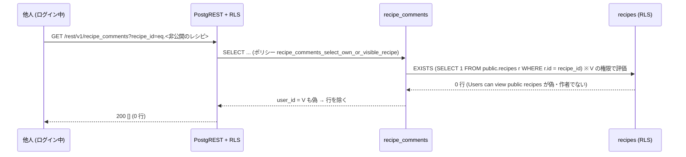
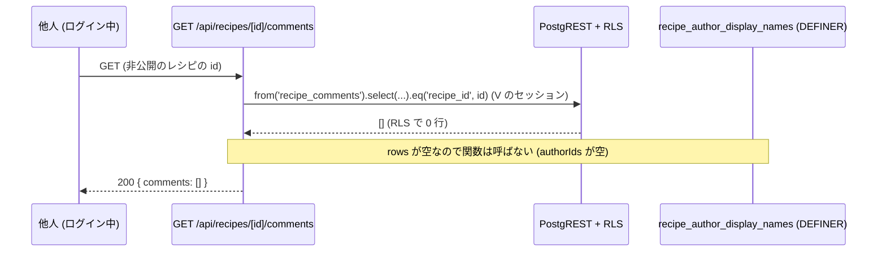

# 公開レシピのコメントの読み取りの範囲を絞る (#2166 X1) 設計

| 版 | 日付 | 内容 |
|---|---|---|
| v1.0 | 2026-11-01 | 新設 (Issue #2166 の X1 の設計ゲート・A 型 4 相。`recipe_comments` の SELECT のポリシー `Anyone can view comments` (ログインした誰でも全行) を、「そのコメントのレシピを読める人」と「そのコメントを書いた本人」だけに絞る migration と戻し口、契約テスト・結合テストを書き切る) |
| v1.1 | 2026-11-01 | マージ後の追随: migration の名指しを 20261101100000 に確定した (#2177)・行番号の参照を名前の参照にした・§9.1 (b) の E-3 の P-7a を直した。前提の本番への適用の文を来歴にし、§16 に #2174 のテスト 2 本を足した |
| v1.2 | 2026-11-01 | 整合ゲートの候補の追随 (#2183 docs-1101g): 適用を将来の手順として書いた文 (決めること 9・R-15・§6.9・§15・§19) を、PR #2176 (c7e5c019) と run 41270869190 の来歴にした・残った行番号の参照 (§3.2 の E-2・E-4・§3.4 の F-12〜F-14・§9 のエラー表) を名前の参照にした・E-4 のコメントの引用と F-12 の it 名を今の文にした |

要件の正本は Issue #2166 の本文 (X1 の節) とコメント。本書はその上で決めた範囲と設計で、Issue と食い違ったら本書が正。
ファイル名は cross/25 (cross/ の既存は 01〜09・12・13a・13b・14〜24。10・11 は欠番、13 は 13a・13b に引き継がれている (cross/CLAUDE.md の注記のとおり))。

前提 (本書が従う条件):

- 範囲は `recipe_comments` の SELECT のポリシーだけ。INSERT / UPDATE / DELETE のポリシー・表の権限 (GRANT)・レシピの API のコード・画面・作者名の関数は変えない。範囲外の候補は §21 に残す (新しい要求を発明しない)。
- 権限を絞る migration。本書は承認の要否と、適用の前提 (観測・告知の要否) を §19 に書く。migration 20261101100000 は PR #2176 (c7e5c019) で main に入り、Deploy Supabase Migrations (run 41270869190) で本番に当たった。
- Issue #2166 の本文は (a) を推奨する。本書は (a) の式に「コメントを書いた本人の行」の句を足した (a') を採る (理由は §5)。
- 本番の DB には書き込まない。本書は本番を Supabase MCP の SELECT で読んだ (2026-11-01。§3.5)。事実はすべて origin/main `0577f909f` (2026-11-01) のコードと migration、本番の読み取りから取った。
- 新しい表・列・関数・環境変数・RPC・画面は作らない。
- 実名 (利用者・報告者) を書かない。

---

## 0. 外形固定と分冊判定 (相 1)

### 0.1 発注と決めること

発注 (Issue #2166 X1): `recipe_comments` の SELECT のポリシーは `Anyone can view comments` (`FOR SELECT TO authenticated USING (true)`) で、ログインした利用者は PostgREST を直接呼ぶと、非公開に戻したレシピや運営が隠したレシピへのコメントの本文・`user_id`・`recipe_id` を読める。作者名の関数 `recipe_author_display_names` の (b) は id 単位で名前を返すので、公開の作者のコメントなら名前も引ける。プライバシーポリシー第9条の「公開の状態のレシピへのコメント」より広い。API (`GET /api/recipes/[id]/comments`) は RLS の上で動くので API からは見えないが、直接の読み取りは止まらない。選択肢は (a 推奨) SELECT を「そのコメントのレシピを読める人だけ」にする / (b) 自分のコメントと公開の状態のレシピへのコメントだけ / (c) 現状維持。

本書が答えを出すこと:

| # | 決めること | 答え (§6) |
|---|---|---|
| 1 | SELECT の USING の式 | `(user_id = auth.uid()) OR (EXISTS (SELECT 1 FROM public.recipes r WHERE r.id = recipe_comments.recipe_id))`。レシピの見え方の判定は `recipes` の RLS に委ねる (§6.1) |
| 2 | コメントを書いた本人の行を、レシピの見え方に関わらず残すか | 残す (`user_id = auth.uid()`)。本人の書き出し・削除・訂正と、`INSERT ... RETURNING` の整合のため (§6.2) |
| 3 | ポリシーの名前と作り方 (`ALTER POLICY` で式だけ替えるか、消して作り直すか) | 消して `recipe_comments_select_own_or_visible_recipe` を作る (名前が意味を持つ。番兵の語になる) (§6.3) |
| 4 | 対象ロール (`TO authenticated` のままか、anon にも開くか) | `TO authenticated` のまま。未ログインは今までどおり 0 行 (§6.4) |
| 5 | 戻し口 | `supabase/rollbacks/20261101100000_recipe_comments_select_scope.down.sql`。ベースラインの定義に逐語で戻す (§6.5・§7.2) |
| 6 | テスト (契約・結合・API) | 契約 (静的) 1 本 (新)・結合 (実 DB・PostgREST 直) 1 本 (新)・API の結合 2 件 (既存の `recipes-api-logged-in.test.ts` に追記) (§6.6・§12) |
| 7 | 消費経路の閉包 (設計後に読めなくなる正当な読み手が無いか) | 無い。RLS の上の読み手は 4 経路で、どれも「見えるレシピのコメント」か「本人の行」しか要らない。SECURITY DEFINER の関数と service_role は RLS を通らない (§6.7・§9.1 (b)) |
| 8 | プライバシーポリシー第9条との一致 | 作者のいるレシピでは一致する (他人に見えるのは、公開で隠されていないレシピへのコメントだけ。本人の行と作者のレシピのコメントは第9条の射程の外側で、第三者提供ではない)。例外が 1 つある。作者のいない非公開で隠されていないレシピ (P-7a) は、`recipes` の RLS がレシピそのものを全員に返す。なので、そのコメントも他人に見える。これは `recipes` 側の規則で、本書の範囲の外 (§21 Q-5)。本番の行は 0 で、この状態を作るアプリの経路は無い (§6.8) |
| 9 | 承認の要否と適用の前提 | 要る (権限を絞る migration)。前提 = 本番の `recipe_comments` が 0 行 (2026-11-01) なので告知は要らない。20261101100000 は PR #2176 (c7e5c019) で main に入り、Deploy Supabase Migrations (run 41270869190) で本番に当たった (§6.9・§19) |
| 10 | 他の文書の追随 | cross/CLAUDE.md の表に 1 行・cross/21 の F-16・F-19b・§7.12 の文 (§17) |

### 0.2 要件行列

| # | 要件 | 根拠 | 本書の置き場 |
|---|---|---|---|
| R-1 | ログインした利用者が PostgREST を直接呼んでも、他人の非公開のレシピ・運営が隠したレシピへの他人のコメントは読めない (エラーにならず 0 行)。対象は `recipes` の RLS がその人に返さないレシピ。作者のいない非公開で隠されていないレシピ (P-7a) は、`recipes` の RLS が全員に返すので対象外 (§6.8・§21 Q-5) | Issue #2166 X1・第9条 | §7.1・§9.1 (a) |
| R-2 | 公開で隠されていないレシピへのコメントは、今までどおりログインした誰でも読める | 第9条 2 文目・cross/21 の K-公開 | §7.1・§9.1 (a) |
| R-3 | レシピの作者は、自分のレシピ (非公開・隠したものを含む) へのコメントを読める | `recipes` の RLS が作者に自分の行を見せる (cross/21 F-16) と整合 | §6.1・§9.1 (a) |
| R-4 | コメントを書いた本人は、自分のコメントをレシピの見え方に関わらず読める・書き出せる・消せる・直せる | 書き出し `src/lib/account-export-tables.ts` の `self('user_id')`・`Users can delete own comments`・`Users can update own comments` | §6.2・§9.1 (a) |
| R-5 | 未ログイン (anon) は今までどおり 0 行 | 第9条 2 文目「ログインしているユーザーに対して」・cross/21 S-2 | §6.4 |
| R-6 | `POST /api/recipes/[id]/comments` の `insert(...).select(...).single()` (RETURNING) が、設計の前後で同じ結果になる (本人の行は SELECT のポリシーを通る) | PostgreSQL の RLS: RETURNING のある INSERT は新しい行に SELECT のポリシーを当て、通らなければ 42501 | §4.2・§6.2・§10 |
| R-7 | 作者名の関数 `recipe_author_display_names` (SECURITY DEFINER)・service_role の経路・外部キーの CASCADE は影響を受けない | `recipe_comments` は FORCE ROW LEVEL SECURITY でない (本番の読み取り)・所有者 postgres | §6.7・§9.1 (b) |
| R-8 | INSERT / UPDATE / DELETE のポリシーと、表の権限 (anon / authenticated / service_role の GRANT) は変えない | 前提 (範囲) | §7.1・§16 |
| R-9 | migration は冪等 (2 回流してもエラーにならない)・`lock_timeout` 10 秒・1 行目の見出しと 2 行目の戻し方・戻し口の 1 行目の見出しが対になる | `tests/migration-file-version-integrity.test.ts`・20261024140000 の形 | §7.1・§7.2 |
| R-10 | 戻し口は、この migration の直前の定義 (ベースライン :9602) に逐語で戻し、GRANT を書かない | 20261022190000 より後の戻し口の規律 | §7.2 |
| R-11 | 結合テストで、非公開・隠したレシピのコメントが他人に 0 行・本人と作者には見える・公開のレシピのコメントは今どおり、を確かめる。直す前の形 (migration 無し) で赤くなる | Issue #2166 X1 の直し方 | §7.5・§12 |
| R-12 | 契約テストで、migration と戻し口の文面・ポリシーの最終の状態・`recipes` の SELECT のポリシー (本書の判定の土台) の定義・RLS の上の読み手の閉包を機械で見張る | cross/21・cross/23 の契約テストの形 | §7.4・§12 |
| R-13 | `src/lib/account-export-tables.ts` のコメント「recipe_likes / recipe_comments は RLS 上「誰でも閲覧可」」を事実に直す (絞り込み `self('user_id')` は変えない) | 記述が事実と食い違う | §7.6 |
| R-14 | migration のファイル名の番号は `20261101100000` (マージの直前に origin/main の `supabase/migrations` の最大 `20261101090000` より大きい番号で確定した) | `tests/helpers/design-doc-migration-number.ts` | §7.1・§7.2・§15 |
| R-15 | 権限を絞る migration で、名指しの承認が要る。20261101100000 は PR #2176 (c7e5c019) で main に入り、Deploy Supabase Migrations (run 41270869190) で本番に当たった | 前提 | §19 |
| R-16 | マジックナンバーを書かない。テストで値を RegExp に入れるときは特殊文字を逃がす | 共通の規律 | §7.3〜§7.5・§13 |

### 0.3 ユーザーシナリオ (17 本。トレースは §4.3・テストとの対応は §12.1)

登場する人: A = レシピの作者、C = コメントを書いた人 (A ではない)、V = ほかのログインした利用者 (A でも C でもない)、anon = 未ログイン、SR = service_role (運営の道具・テストの準備)。レシピ P = A の公開レシピ (`is_public` true・`hidden_at` NULL)。

| # | シナリオ | 期待 (設計後) |
|---|---|---|
| S-1 | C が P にコメントを書く。V が PostgREST で `recipe_comments` を読む | V は C のコメントを読める (今までどおり) |
| S-2 | A が P を非公開に戻す (`PUT /api/recipes/[id]` で `isPublic: false`)。V が PostgREST で読む | V には C のコメントが 0 行 (今までは読めた) |
| S-3 | S-2 の状態で C が PostgREST で読む | C は自分のコメントを読める |
| S-4 | S-2 の状態で A が PostgREST で読む | A は C のコメントを読める (自分のレシピ) |
| S-5 | 運営が P を隠す (`hidden_at`)。V・C・A が読む | V は 0 行。C は自分の行。A は読める |
| S-6 | 運営が隠すのを戻す・A が公開に戻す | V は再び読める (行は消えていない) |
| S-7 | anon が PostgREST で `recipe_comments` を読む (公開のレシピのコメントを含む) | 0 行 (今までどおり) |
| S-8 | V が `GET /api/recipes/[id]/comments` を A の非公開のレシピの id で呼ぶ | 200 `{ comments: [] }` (今までは C のコメントが返った)。`GET /api/recipes/[id]` は 404 (今までどおり) |
| S-9 | V が `GET /api/recipes/[id]` を P の id で呼ぶ | 200。埋め込みの `recipe_comments` に C のコメント (今までどおり) |
| S-10 | C が `GET /api/account/export` で書き出す (C のコメントのうち 1 件は A の非公開のレシピへのもの) | `recipe_comments` に自分のコメントが全部出る (非公開のレシピへのものを含む。今までどおり) |
| S-11 | C が、非公開に戻された P への自分のコメントを PostgREST で `delete().eq('id', …)` する | 1 行消える (今までどおり)。`update()` も同じ |
| S-12 | C が、見えないレシピ (A の非公開) の id へ `POST /api/recipes/[id]/comments` を送る | 今までどおり 200 (INSERT のポリシーはレシピの見え方を見ない (cross/21 F-19b)。RETURNING は本人の行の句を通る)。コメントは C と A にだけ見える (§21 Q-1) |
| S-13 | V が自分のセッションで C のコメント (P への) を `update()` / `delete()` する | 0 行 (今までどおり。UPDATE / DELETE のポリシーは本人の行だけ) |
| S-14 | 作者のいない公開レシピ (`user_id` NULL。退会した作者のもの・システムのレシピ) へのコメントを V が読む。運営がそのレシピを隠す | 隠す前は読める。隠した後は 0 行 (書き手本人だけ読める) |
| S-15 | 作者名の関数 `recipe_author_display_names` が (b) で、公開レシピへのコメントの書き手の名前を返す。`GET /api/recipes/[id]/comments` が RLS の読み取りのあとに関数を呼ぶ | 返る (関数は DEFINER で RLS を通らない。cross/21 I-4 のまま) |
| S-16 | 戻し口を流す | `Anyone can view comments` (USING true) に戻り、V が S-2 の状態のコメントを再び読める。アプリは戻しても動く |
| S-17 | 作者のいない非公開のレシピ (`user_id` NULL・`is_public` false・`hidden_at` NULL。service_role が `is_public` を指定せずに入れた行。§3.1 F-20) へのコメントを V が読む。運営がそのレシピを隠す | 隠す前は読める (今までどおり。`recipes` の RLS がレシピを全員に返すため。§6.8・§21 Q-5)。隠した後は 0 行 (書き手本人だけ読める) |

### 0.4 分冊判定

目安 (設計書 800 行超 / 消費先レーン 3 以上 / 共有面 2 つ以上) のうち、行数だけに当たる。触るのは migration 1 本と戻し口 1 本・テスト 3 ファイル・製品コードのコメント 1 行で、消費先レーンは 1 (RLS の読み手は 4 経路あるが、どれもコードを変えない)、共有面は `recipe_comments` のポリシー 1 つ。**1 冊・1 段・1 PR** にする (§15)。

### 0.5 用語

| 語 | 意味 |
|---|---|
| 読めるレシピ | `recipes` の SELECT の RLS (`Users can view public recipes` と、作者には `Users can manage own recipes`) が、呼んだ人に返す行。次の 3 種類がある。(1) 作者のいる、公開で隠されていないレシピ。(2) 作者のいない (`user_id` NULL)、隠されていないレシピ。`is_public` は見ないので、非公開も含む (P-5・P-7a)。(3) 作者本人の自分のレシピ (非公開・隠したものを含む) |
| 本人の行 | `recipe_comments.user_id = auth.uid()` の行 (コメントを書いた人から見た自分のコメント) |
| 他人 (V) | ログインしているが、そのコメントの書き手でも、そのレシピの作者でもない利用者。運営のロール (admin など) を持つ人が自分のセッションで読むときも同じ (運営の画面は service_role で読む) |
| 直接の読み取り | PostgREST (`/rest/v1/recipe_comments`) を利用者の JWT で呼ぶこと。Web・モバイルのアプリにこの経路は無い (§3.2) が、JWT を持つ人は誰でも呼べる |
| (a) / (a') / (b) / (c) | Issue #2166 X1 の選択肢。(a') = (a) の式に本人の行の句を足したもの (本書の採用。§5) |

### 0.6 読み方

- 実装は §7 の正典コードを写す。§8 の契約 (ポリシーの名前・式・ロール) と §13 の定数の名前を変えない。
- 実装の枝では本書を編集しない。番号の書き入れ (`20261101100000`) は、マージの後にオーケストレーターが docs の PR で当てた。本書に直すべき点は design-doc.patch に出し、deviations で報告する (§15)。
- 表 3 点 (§9) とエラー表 (§10) は、レビューが最初に自分で作り直して突き合わせる対象。
- 本書の TS のブロックは、`// tsc:skip` を 1 行目に持つものを除き、そのまま型検査を通る形で書いてある (import を省かない)。`// tsc:skip` のブロックは、テストの補助 (`tests/helpers/`・`tests/integration/helpers/`) を相対パスで import するテストファイルと、既存ファイルの差分の断片。
- 本書の file:line は origin/main `0577f909f` (2026-11-01) の時点。

---

## 1. 目的・スコープ

- 目的: ログインした利用者が直接の読み取りで、非公開に戻したレシピ・運営が隠したレシピへの他人のコメントを読める状態をやめ、コメントの読み取りの範囲をプライバシーポリシー第9条の文 (公開の状態のレシピへのコメント) と一致させる。
- 対象: migration 1 本 (新)・戻し口 1 本 (新)・テストの補助 1 ファイル (新)・契約テスト 1 ファイル (新)・結合テスト 1 ファイル (新)・既存の結合テスト 2 ファイルの追記と it 名の直し・製品コードのコメント 1 行・他の文書への追随表 (§17)。
- 対象外: 冒頭の前提のとおり。INSERT のポリシーにレシピの見え方の条件を足すこと (§21 Q-1)・UPDATE のポリシーの WITH CHECK (§21 Q-2)・anon にコメントを開くこと (§21 Q-3)・コメントを描く画面 (無い。cross/21 F-13)。

## 2. 関連要件・既存設計

| 文書 | 関係 |
|---|---|
| Issue #2166 (X1 の節) | 要件の正本。(a) を推奨し、権限を絞る migration としてオーナーの名指しの承認を待つことを書く |
| `docs/design/cross/21-recipe-author-display-name.md` F-16・F-19b・F-19c・§4.3 S-2・§7.12 | `recipe_comments` の SELECT が `Anyone can view comments` (USING true) であることと、作者名の関数の (b) がコメントの書き手を見ること、未ログインのコメントが 0 件であることを記録する。F-16・F-19b・§7.12 の文は本書の後に古くなる (§17) |
| `docs/design/cross/20-terms-privacy-text.md` §7 (第8条 3 項・第9条の文 ⇄ 製品の根拠)・F-60 | 第9条 2 文目「公開の状態のレシピへのコメントには、ログインしているユーザーに対して、ニックネームが作者名として表示されます」。本書は文を変えない (§6.8) |
| `docs/design/cross/02-rls-patterns.md` §3.3 | Next.js の API は service_role を使わず RLS の上で読む。本書の読み手の閉包の前提 |
| `supabase/migrations/20261009000500_hide_moderated_content.sql` (4) | `recipes` の SELECT のポリシーの現定義 (`ALTER POLICY`)。本書の判定の土台 (§6.1)。`ALTER POLICY` で式だけを替えた先例 |
| `supabase/migrations/20261024140000_announcements_moderation_flags_select_only.sql` と戻し口・契約テスト | 権限を絞る migration の先例 (DROP + CREATE で名前を付け直す・戻し口は直前の定義に逐語で戻す・契約テストは migration を番号順に流した状態を見る) |
| `supabase/migrations/20261101090000_recipe_author_display_names.sql` | 本書の時点の origin/main の最大の migration。作者名の関数 (DEFINER) と索引 `idx_recipe_comments_user_id` |
| `supabase/baseline/catalog/catalog_policies.csv:329-332`・`catalog_tables.csv:97`・`prod_table_acl.sql:382-385` | 本番のベースライン (ポリシー 4 本・RLS 有効・FORCE でない・権限)。取り直すまで変えない (§17) |

## 3. 現状の事実 (origin/main `0577f909f`・本番の読み取り 2026-11-01)

### 3.1 DB

| # | 事実 | 根拠 |
|---|---|---|
| F-1 | `recipe_comments` の列: `id uuid` (PK・`gen_random_uuid()`)・`recipe_id uuid`・`user_id uuid`・`content text NOT NULL`・`rating integer` (CHECK 1〜5)・`created_at timestamptz` (`now()`)。`updated_at` は無い | `supabase/baseline/prod_schema.sql:6056-6064` |
| F-2 | ポリシー 4 本: SELECT `Anyone can view comments` (TO authenticated・USING true)・INSERT `Users can create comments` (TO authenticated・WITH CHECK `user_id = auth.uid()`)・DELETE `Users can delete own comments` (TO authenticated・USING `user_id = auth.uid()`)・UPDATE `Users can update own comments` (TO authenticated・USING `user_id = auth.uid()`。WITH CHECK 無し = USING と同じ式が新しい行にも当たる)。RLS は有効・FORCE ではない。ベースライン以後に `recipe_comments` のポリシーを変えた migration は無い (20261101090000 は索引だけ) | `supabase/migrations/20251126124224_create_meal_planner_tables.sql:9602, 9719, 9739, 9960, 10785`・本番の `pg_policies`・`pg_class.relforcerowsecurity = false` (2026-11-01) |
| F-3 | 表の権限: anon・authenticated・service_role に INSERT / SELECT / UPDATE / DELETE / TRUNCATE / REFERENCES / TRIGGER / MAINTAIN (ベースライン)。TRUNCATE は 20261022190000 が anon / authenticated から外した。anon は SELECT の権限はあるが、ポリシーが `TO authenticated` なので 0 行 | `supabase/baseline/prod_table_acl.sql:382-385`・`20261022190000_db_privilege_hardening.sql` |
| F-4 | `recipes` の SELECT のポリシー `Users can view public recipes` (TO 句なし = public。anon も当たる): `(hidden_at IS NULL OR auth.uid() = user_id) AND (user_id IS NULL OR is_public = true OR auth.uid() = user_id)`。加えて `Users can manage own recipes` (ALL・public・`auth.uid() = user_id`) が作者に自分の行を見せる。permissive の OR。本番も同じ 2 本。`user_id` が NULL の行は 2 つ目の括弧が `is_public` に関わらず真になる。なので、作者のいないレシピは隠されていなければ非公開でも全員 (anon を含む) に見える (20261010000100 の冒頭の注「user_id が NULL の行は RLS … で全員に見える」と同じ) | `20261009000500_hide_moderated_content.sql:169-173`・`20251126124224:9910, 10088`・本番の `pg_policies` |
| F-5 | 外部キー: `recipe_comments_recipe_id_fkey` → `recipes(id)` ON DELETE CASCADE・`recipe_comments_user_id_fkey` → `auth.users(id)` ON DELETE CASCADE。レシピの削除・退会でコメントは消える。外部キーの動きは RLS を通らない | `prod_schema.sql:9251-9257`・cross/21 F-17・F-19c |
| F-6 | 索引: `idx_recipe_comments_recipe_id` (`recipe_id`)・`idx_recipe_comments_user_id` (`user_id`。20261101090000)・主キー。`recipes` は主キーと `idx_recipes_user_id`・`idx_recipes_hidden_at` (部分索引) | `prod_schema.sql:8174`・`20261101090000:49-50`・`20261009000500` |
| F-7 | 作者名の関数 `public.recipe_author_display_names(uuid[])` は SECURITY DEFINER (所有者 postgres)・`SET search_path = ''`・STABLE。(b) の EXISTS は `public.recipe_comments` と `public.recipes` を定義者の権限で読み、公開で隠されていないレシピへのコメントの書き手だけを見る。EXECUTE は anon・authenticated | `20261101090000:58-115` |
| F-8 | 本番の `recipe_comments` と `recipes` のポリシーは origin/main の定義と一致する。`recipe_comments` の SELECT は `qual = true`・`roles = {authenticated}` | 本番の `pg_policies` (Supabase MCP の SELECT・2026-11-01) |
| F-20 | 作者のいないレシピのでき方。`recipes.user_id` は NULL を許し、`recipes.is_public` は `boolean DEFAULT false` (NULL も許す)。利用者が作るレシピは `Users can manage own recipes` の WITH CHECK で `user_id` が本人になる (`POST /api/recipes`)。退会では、`prepare_account_deletion` が退会の直前に本人の非公開レシピを消し、残った公開レシピだけが外部キー (ON DELETE SET NULL) で `user_id` NULL になる。なので P-1 は P-5 に、P-3 は P-6 になる。作者のいない非公開のレシピ (P-7a・P-7b) ができるのは、service_role か SQL で `is_public` を true にせずに作者のいない行を入れたとき、または作者のいない行の `is_public` を false にしたときだけ。アプリのコード (`src`・`supabase/functions`・`scripts`) に、そういう書き込みは無い | `prod_schema.sql` の `recipes` の定義・`20251126124224:9910`・`20261010000100_auth_users_fk_on_delete.sql` の冒頭の注 (D)・`git grep "from('recipes')"` origin/main |

### 3.2 消費経路 (`recipe_comments` を読む・書く所の全列挙。`git grep` origin/main)

`src`・`lib`・`apps`・`packages`・`supabase/functions`・`scripts`・`components` を `recipe_comments` で洗った (型の生成物 `database.types.ts` を除く)。当たったのは次の 6 箇所で、運営の画面・API (`src/app/admin`・`src/app/api/admin`・`src/app/super-admin`・`src/app/api/super-admin`)・Edge Function・モバイル・スクリプトには 0 件。モバイルはレシピのコメントの API も呼ばない (`apps/mobile` に `/comments` の参照が無い)。

| # | 経路 | client | 読む / 書く | 何を | レシピの見え方の判定 |
|---|---|---|---|---|---|
| E-1 | `GET /api/recipes/[id]/comments` (`comments/route.ts` の `GET` の `from('recipe_comments')`) | 利用者のセッション (RLS) | 読む | `recipe_comments` を `eq('recipe_id', id)` で。未認証は 401。`id` が UUID でなければ 404 | しない (レシピを読まずにコメントだけ読む。cross/21 F-19b) |
| E-2 | `POST /api/recipes/[id]/comments` (同ファイルの `POST` の `insert(…).select('id, content, rating, created_at').single()`) | 利用者のセッション (RLS) | 書く | `insert({ recipe_id, user_id: 本人, content, rating }).select('id, content, rating, created_at').single()`。外部キー違反 (レシピが無い) は 404 | しない (INSERT のポリシーは `user_id = auth.uid()` だけ) |
| E-3 | `GET /api/recipes/[id]` (`src/app/api/recipes/[id]/route.ts` の `GET` が `orderEmbeddedListBy(` に渡す `select('*, recipe_comments(id, content, rating, created_at, user_id)')`。埋め込んだコメントは `LIST_ORDERS.recipeComments` の鍵で並べる (#2174)) | 利用者のセッション (RLS。未ログインは anon) | 読む | `recipes` の `select('*, recipe_comments(id, content, rating, created_at, user_id)')` の埋め込み。レシピが見えなければ `maybeSingle` が null → 404 | `recipes` の RLS (見えるレシピの埋め込みだけ) |
| E-4 | アカウントの書き出し `GET /api/account/export` (`src/lib/account-export-tables.ts` の `ACCOUNT_EXPORT_TABLES` の `recipe_comments` の行・`src/lib/account-export.ts`) | 利用者のセッション (RLS) | 読む | `{ table: 'recipe_comments', scope: self('user_id') }` = 自分の `user_id` の行だけ。`recipe_likes` の行の上のコメントは「recipe_comments は「読めるレシピのコメントと自分のコメント」(cross/25)。どちらも必ず user_id で絞る」 | しない (本人の行) |
| E-5 | `src/lib/api/list-order.ts` の `LIST_ORDERS.recipeComments` | — | — | 並び (`created_at` 降順 + `id`) の定義だけ。E-1 (`orderListBy`) と E-3 (`orderEmbeddedListBy`) が使う | — |
| E-6 | 作者名の関数 `recipe_author_display_names` (b) (F-7) | DEFINER (RLS を通らない) | 読む | `recipe_comments` と `recipes` を JOIN し、公開で隠されていないレシピへのコメントの書き手かを見る。E-1・E-2・E-3 と `GET /api/recipes` が RLS のクライアントで `rpc` として呼ぶ (`src/lib/recipes/viewer-lookups.ts`) | 関数の中で `is_public = true AND hidden_at IS NULL` を直接見る |

RLS を通らない書き手: 結合テスト・e2e の準備と後片付け (service_role)・外部キーの CASCADE (レシピの削除 `DELETE /api/recipes/[id]`・退会 `auth.admin.deleteUser`)・運営の隠した内容の完全削除 (`supabase/functions/_shared/hidden-content-purge.ts`。`recipes` を service_role で消し、コメントは CASCADE)。`prepare_account_deletion` (20261010000100) は `recipe_comments` に触れない (CASCADE に任せる)。

### 3.3 法務の文

| # | 事実 | 根拠 |
|---|---|---|
| F-9 | 第9条の 1〜2 文目: 「ユーザーが公開の状態にしたレシピには、ニックネームが作者名として表示され、ログインしていない方を含め、誰でも閲覧できる状態になります（利用規約第13条）。公開の状態のレシピへのコメントには、ログインしているユーザーに対して、ニックネームが作者名として表示されます。」 | `src/lib/legal/privacy-text.ts:371`・cross/20 §7 |
| F-10 | 第8条 3 項の 2 文目: 「公開の状態のレシピとそのレシピへのコメントの作者名の表示は、その表示を定めた本ポリシーの版へのユーザーの同意と、ユーザー自身がレシピを公開の状態にし、またはコメントを書いたことに基づいて行います（第9条）。」 | `src/lib/legal/privacy-text.ts` (privacy-8)・cross/21 §7.12 |
| F-11 | 主張の表 (`tests/legal-claims-1901.ts:368`) の `privacy-9#13` (「公開の状態のレシピへのコメン…」) の根拠は cross/21 §3.2・§6.3 と `viewer-lookups.ts`。cross/21 §7.12 の表の「第9条 2 文目」の行は「`recipe_comments` の SELECT は authenticated だけ (F-16)」と書く | `tests/legal-claims-1901.ts:368`・cross/21 §7.12 の表の「第9条 2 文目」の行 |

### 3.4 既存のテストと番兵 (本書の変更に反応するもの。直し方は §16)

| # | 事実 | 根拠 |
|---|---|---|
| F-12 | `tests/integration/security/account-export-scope.test.ts` の it「A の JWT で、B の公開レシピへの B のコメント (読めるレシピのコメント) と B のいいね (誰でも閲覧可) が読める」は、B が自分の公開レシピに書いたコメントを A が読む (設計後も読める) | 同ファイルの `targetRecipe` の定義 (B なら自分の公開レシピ) |
| F-13 | `tests/integration/security/recipes-api-logged-in.test.ts` は、作者本人の非公開レシピへの本人のコメントを本人が読む (設計後も読める) | 同ファイルの it「GET /api/recipes/[id]/comments: 200…」・「POST /api/recipes/[id]/comments: 200…」と describe「他人から見た非公開のレシピのコメント」 |
| F-14 | `tests/integration/security/recipe-author-display-names.test.ts` の I-10 は、レシピを非公開・隠した後にコメントの行が残ることを `supabaseAdmin` で読む (設計後も通る)。コメントの読み取りはどれも service_role か関数経由 | 同ファイルの it「I-10: 非公開に戻す・隠すと…」 |
| F-15 | `tests/account-export-tables.test.ts:467` は `recipe_comments` を「RLS が他人の行を返しうる表」に数え、絞り込みがあることを見る (設計後も他人の行 (公開レシピのコメント) は返るので、そのまま) | 同ファイル |
| F-16 | 単体テスト (`tests/api-security-cluster.test.ts`・`tests/recipe-viewer-lookups-1917.test.ts`・`tests/route-invalid-input-1917.test.ts`・`tests/recipe-author-name-1649.test.ts`・`tests/recipe-detail-hidden-404.test.ts`・`tests/list-order-tiebreak-2134.test.ts`・`tests/postgrest-embed-relationship-scan.test.ts`) は DB を偽物にするので RLS に反応しない | 各ファイルの `recipe_comments` の参照 |
| F-17 | migration の番兵: `tests/migration-file-version-integrity.test.ts` (見出し・戻し口の対)・`tests/database-types-migrations-contract.test.ts` (CREATE TABLE / FUNCTION だけ)・`tests/operator-write-policy-ledger.test.ts` (運営ロールで判定する書き込みのポリシーだけ)・`tests/db-privilege-hardening-migration-contract.test.ts` (後の migration / 戻し口が利用者へ TRUNCATE / ALL を付け直さない)・`tests/anon-invoker-execute-migration-contract.test.ts` (CREATE FUNCTION だけ)・3 本の `NEXT_BRANCH_VERSION = '20261101090000'` (自分の番号がそれより小さいことを見るだけ) | 各ファイル |
| F-18 | 結合テストの収集: `vitest.integration.config.ts` は `tests/integration/**/*.test.ts` を含み、CI (`.github/workflows/security-regression.yml`) と `scripts/local-ci.sh` は `tests/integration/rls`・`tests/integration/security` をパスの部分一致で渡す。`tests/integration-ci-coverage.test.ts` が新しいファイルの収集漏れを見張る | 各ファイル |
| F-19 | 設計書の番兵: `tests/docs-table-column-count.test.ts` (表の列の数)・`tests/design-doc-version-header-matches-history.test.ts` (版の表)・`tests/helpers/design-doc-migration-number.ts` (migration の番号の置き場。当てはめは契約テストが行う) | 各ファイル |

### 3.5 本番の読み取り (2026-11-01。Supabase MCP の SELECT だけ。書き込みなし)

| 項目 | 値 |
|---|---|
| `recipe_comments` の行数 | 0 |
| `recipes` の行数 (公開で隠されていない / 非公開 / 隠した / 作者のいない) | 0 (0 / 0 / 0 / 0) |
| `recipe_comments`・`recipes` の `relforcerowsecurity` | false (どちらも) |
| `recipe_comments` の `relrowsecurity` | true |
| `recipe_comments`・`recipes` の `pg_policies` | origin/main の定義と一致 (F-2・F-4) |
| 本番の migration 台帳の最大 | `20261101090000` |

行が 0 なので、既存の行の見え方が変わる利用者はいない (告知は要らない。§19)。

---

## 4. 構想 (相 2)

### 4.1 構造 (構造 A: レシピの見え方は `recipes` の RLS に委ね、本人の行を残す)

```
recipe_comments の SELECT (TO authenticated)
  USING (
       user_id = auth.uid()                                              -- 本人の行 (レシピの見え方に関わらず)
    OR EXISTS (SELECT 1 FROM public.recipes r WHERE r.id = recipe_comments.recipe_id)   -- そのレシピを読める人
  )
                                  │
                                  ▼ (呼んだ人の権限で評価 = recipes の RLS が効く)
recipes の SELECT: Users can view public recipes  (hidden_at IS NULL OR 作者) AND (作者なし OR 公開 OR 作者)
                   Users can manage own recipes    作者 (ALL)
```

- 判定を 1 か所に置く: レシピが「読める」かどうかの規則 (公開・非公開・運営が隠した・作者のいないもの) は `recipes` の RLS が持つ。コメントのポリシーはその規則を写さず、`EXISTS` で参照する。`recipes` の規則が将来変わっても (例: 保管期間の後の完全削除・家族への共有)、コメントは自動で追随する。
- 本人の行を残す: `user_id = auth.uid()` を OR で足す。本人が自分のコメントを読む・書き出す・消す・直す経路 (E-4・`Users can delete own comments`・`Users can update own comments`) と、`POST` の RETURNING (E-2) が、レシピの見え方に左右されない。
- 書き手は変えない: INSERT / UPDATE / DELETE のポリシーと GRANT はそのまま。

### 4.2 動き (PostgreSQL の RLS の規則のうち、本書が頼るもの)

1. SELECT のポリシーは `SELECT` だけでなく、**読む必要のある行**すべてに当たる: `UPDATE` / `DELETE` の `WHERE` (PostgREST の `.eq('id', …)`) が表の列を参照する行、`INSERT ... RETURNING` (`.insert(...).select(...)`) が返す新しい行。通らない行は、`SELECT` / `UPDATE` / `DELETE` では黙って除かれ (0 行)、`INSERT ... RETURNING` では 42501 (`new row violates row-level security policy`) になる。本人の行の句はこの 3 つを設計の前後で同じ結果にする (R-6)。
2. ポリシーの式の中の副問い合わせ (`EXISTS (SELECT 1 FROM public.recipes …)`) は、問い合わせた利用者の権限で評価され、`recipes` の RLS が当たる。`recipes` のポリシーは `recipe_comments` を参照しないので、循環しない。同じ形の先例: `recipe_collection_items` の SELECT のポリシー (`EXISTS (SELECT 1 FROM user_profiles …)`。ベースライン :9606)。
3. 表の所有者 (postgres) と `BYPASSRLS` のロール (service_role) は、FORCE ROW LEVEL SECURITY でない表の RLS を通らない (F-7・F-8)。SECURITY DEFINER の関数は所有者の権限で動く。外部キーの確認と CASCADE も RLS を通らない。
4. `DROP POLICY IF EXISTS` → `CREATE POLICY` は 1 つのトランザクションで当たる (supabase の migration は 1 ファイル 1 トランザクション)。途中の状態 (ポリシーが無い = 0 行) は外から見えない。

### 4.3 シナリオのトレース (§4.1 の構造で手で走らせた記録)

| # | 走らせた結果 | 判定の枝 |
|---|---|---|
| S-1 | V が読む → 行 (C のコメント・P) → `user_id = V`? 偽 → `EXISTS (recipes P)`: V から P は `hidden_at IS NULL AND is_public` で見える → 真 → 返る | EXISTS (公開) |
| S-2 | P が非公開 → V から P は `is_public = false`・`auth.uid() ≠ A` → `Users can view public recipes` 偽・`Users can manage own recipes` 偽 → EXISTS 偽。`user_id = V` 偽 → 0 行 | 両方偽 |
| S-3 | C が読む → `user_id = C` 真 → 返る (EXISTS を評価するまでもなく) | 本人の行 |
| S-4 | A が読む → `user_id = A` 偽 → EXISTS: A から P は `auth.uid() = user_id` → 真 → 返る | EXISTS (作者) |
| S-5 | P が隠された (`hidden_at` あり・`is_public` true) → V: `hidden_at IS NULL OR auth.uid() = A` 偽 → EXISTS 偽 → 0 行。C: 本人の行 → 返る。A: `auth.uid() = user_id` → 真 → 返る | 隠し |
| S-6 | `hidden_at` NULL・`is_public` true に戻る → S-1 と同じ。コメントの行は変わっていない (ポリシーは行を消さない) | 復帰 |
| S-7 | anon → ポリシーは `TO authenticated` → anon に当たるポリシーが無い → 0 行 (権限は SELECT があるので 42501 ではない) | ロール |
| S-8 | E-1: V のセッションで `eq('recipe_id', 非公開 P)` → S-2 と同じで 0 行 → `rows = []` → 関数は呼ばない (`authorIds` 空) → 200 `{ comments: [] }`。E-3: `recipes` が 0 行 → 404 | E-1・E-3 |
| S-9 | E-3: P は見える → 埋め込みの `recipe_comments` に S-1 の判定 → C のコメントが入る → 関数で名前 | E-3 |
| S-10 | E-4: `eq('user_id', C)` の上に SELECT のポリシー → 本人の行は全部通る (レシピの見え方に関わらず) → 今までと同じ行数 | 本人の行 |
| S-11 | `delete().eq('id', x)`: `WHERE` が行を読む → SELECT のポリシー (本人の行 → 真) と DELETE のポリシー (`user_id = C` → 真) → 1 行。`update()` も同じ (USING と、WITH CHECK 相当の USING が新しい行にも当たる) | 本人の行 |
| S-12 | E-2: INSERT の WITH CHECK `user_id = C` → 真 → 行ができる。RETURNING で新しい行に SELECT のポリシー → `user_id = C` → 真 → 返る → 200。((a) の素の式なら EXISTS 偽で 42501 → route の `throw error` → 500。§5) | 本人の行 (RETURNING) |
| S-13 | V が C の行を `update()` / `delete()`: `WHERE` の読み取りは SELECT のポリシーで通る (P が公開なら) が、UPDATE / DELETE のポリシー `user_id = V` が偽 → 0 行。P が非公開なら SELECT の段で 0 行。どちらも今までどおり | 書き手のポリシー |
| S-14 | `user_id` NULL のレシピ: V から `(hidden_at IS NULL OR auth.uid() = NULL) AND (user_id IS NULL OR …)` → 隠れていなければ真 → コメントが返る。隠したら `auth.uid() = NULL` は NULL (偽) → EXISTS 偽 → 0 行。書き手 C には本人の行 | 作者なし |
| S-15 | 関数 (b) は DEFINER → `recipe_comments` の RLS を通らない → 今までどおり。E-1 は RLS で読めた行の `user_id` だけを渡すので、見えないレシピのコメントの書き手の名前を引く機会が無い (今までは引けた = Issue の「公開の作者のコメントなら名前も引ける」) | DEFINER |
| S-16 | 戻し口: 新しいポリシーを消し、`Anyone can view comments` (USING true) を作る → V が S-2 の行を読める。アプリは E-1〜E-4 とも RLS の結果を使うだけで、どちらの定義でも動く | 戻し口 |
| S-17 | `user_id` NULL・`is_public` false・`hidden_at` NULL のレシピ: V から `(hidden_at IS NULL → 真) AND (user_id IS NULL → 真)` → `is_public` を見ずに真 → EXISTS 真 → コメントが返る (今までも返った)。隠したら S-14 と同じで 0 行。作者名の関数 (b) は `is_public = true AND hidden_at IS NULL` を見るので、このコメントの書き手の名前は返さない (本文と `user_id` は読める) | 作者なし (非公開) |

---

## 5. 構造裁定 (相 3・1 回だけ)

### 5.1 代替案の比較

| 案 | 式 / 形 | 長所 | 短所 | 判定 |
|---|---|---|---|---|
| (a) Issue の推奨 | `USING (EXISTS (SELECT 1 FROM public.recipes r WHERE r.id = recipe_comments.recipe_id))` | 判定が 1 か所 (`recipes` の RLS)。短い | 書き手本人が、他人の非公開・隠したレシピへの自分のコメントを読めない → 書き出し (E-4) から自分のデータが消える・自分のコメントを消せない・直せない (`WHERE` の読み取りが SELECT で止まる)・`POST` の RETURNING が 42501 → 500 (E-2・S-12)。Issue の結合テストの条件「本人と作者には見える」を満たさない | 不採用 |
| **(a') 本書** | `USING ((user_id = auth.uid()) OR (EXISTS (…)))` | (a) の長所 + 本人の行が残る (R-4・R-6)。INSERT / UPDATE / DELETE のポリシーの「本人の行」と同じ語で揃う | (a) より 1 句長い | **採用** |
| (b) | `USING ((user_id = auth.uid()) OR (EXISTS (SELECT 1 FROM public.recipes r WHERE r.id = recipe_comments.recipe_id AND r.is_public = true AND r.hidden_at IS NULL)))` (公開かつ隠されていない、を直接書く) | `recipes` の RLS に依らず読める (RLS の評価が 1 段減る) | 作者が自分の非公開のレシピへの他人のコメントを読めない (作者には自分のレシピの全部が見える、という `recipes` の規則と食い違う。Issue の条件「作者には見える」も満たさない)。`recipes` の規則の写しになり、`recipes` 側が変わるたびに両方を直す (cross/23 の「判定を 2 か所に置かない」と同じ理由で避ける) | 不採用 |
| (c) 現状維持 | `USING (true)` | 変更なし | 第9条より広い状態が残る (Issue の指摘そのもの) | 不採用 |
| (d) API だけで絞る | DB は変えず、E-1 でレシピの見え方を先に確かめる | migration 不要 (承認も不要) | 直接の読み取りは止まらない (Issue の影響の本体)。E-1 は今も RLS の上で正しい | 不採用 |
| (e) 読み取りを DEFINER の関数か VIEW に寄せ、表の SELECT を閉じる | `recipe_comments` の SELECT を消し、関数 `recipe_comments_for_viewer(recipe_id)` を作る | 読める列を絞れる | 新しい関数・型の生成・E-1〜E-4 の書き換え・anon の許可一覧など、範囲が大きい。列を絞る要求は無い (E-1 は `user_id` を返さず名前だけにしている) | 不採用 |

### 5.2 F の問い (縁の発生源を消すより単純な構造は無いか)

縁の発生源は「コメントの見え方がレシピの見え方と別の表で決まる」こと。(a') はレシピの見え方の判定を `recipes` の RLS に委ねて縁を 1 本にし、残る縁は「書き手本人」の 1 句だけで、これは INSERT / UPDATE / DELETE のポリシーがもともと持つ語 (`user_id = auth.uid()`) と同じ。これより単純な構造 ((a)) は本人の経路 (書き出し・削除・訂正・RETURNING) を壊すので、(a') が最も単純で閉じている。

### 5.3 確定

構造 A = (a') で確定する。以後の仕上げ (§6〜§16) はこの構造の展開で、構造の蒸し返しはしない (構造への疑義は blocking でなく §21 への差し戻し事由)。

---

## 6. 決めたこと (0.1 の 1〜10 への答え)

### 6.1 SELECT の式 (決めること 1)

`((user_id = auth.uid()) OR (EXISTS (SELECT 1 FROM public.recipes r WHERE r.id = recipe_comments.recipe_id)))`。

- `recipes` は `public.` で完全修飾する (ポリシーの式は作成時に解決され、`pg_policies.qual` には `recipes r` と出る。§7.5 I-9)。
- `auth.uid()` は `recipe_comments` のほかの 3 本のポリシーと同じ書き方 (`(SELECT auth.uid())` の形にはしない。§20)。
- `recipes` 側の判定 (F-4) により、「読める人」は次のとおり。ログインした誰でも = 作者のいる公開で隠されていないレシピ (P-1) と、作者のいない隠されていないレシピ (P-5・P-7a。`is_public` に関わらない)。作者本人 = 自分のレシピ (非公開・隠したものも)。

### 6.2 本人の行 (決めること 2)

残す。理由は §5.1 の (a) の短所のとおり: 書き出し (E-4) の自分のデータ・自分のコメントの削除と訂正 (`WHERE` の読み取り)・`POST` の RETURNING (E-2)。本人の行は「第三者提供」ではない (本人への表示) ので第9条の射程の外側で、文と矛盾しない (§6.8)。

### 6.3 ポリシーの名前と作り方 (決めること 3)

`Anyone can view comments` を `DROP POLICY IF EXISTS` で消し、`recipe_comments_select_own_or_visible_recipe` を `CREATE POLICY` で作る。`ALTER POLICY ... USING (...)` で式だけを替える (20261009000500 の形) と、名前「誰でも読める」が事実と食い違ったまま残り、番兵の語にならない。名前は 20261024140000 以後の形 (`<表>_<種類>_<誰>`。`moderation_flags_admin_select` と同じ) に揃える。新しい名前も先に `DROP POLICY IF EXISTS` して冪等にする。

### 6.4 対象ロール (決めること 4)

`TO authenticated` のまま。未ログインは 0 行 (S-7)。第9条 2 文目は「ログインしているユーザーに対して」で、cross/21 §6.3 の未ログインの扱い (一覧・詳細の作者名は出す。コメントは出さない) も変えない。anon に開く案は §21 Q-3。

### 6.5 戻し口 (決めること 5)

`supabase/rollbacks/20261101100000_recipe_comments_select_scope.down.sql`。新しいポリシーを消し、`Anyone can view comments` をベースライン (`20251126124224:9602`) と同じ定義 (`FOR SELECT TO authenticated USING (true)`) で作り直す。GRANT は書かない (本書の migration も触れていない。20261022190000 より後の戻し口の規律)。

### 6.6 テスト (決めること 6)

| テスト | 種類 | 置き場 |
|---|---|---|
| 契約 (静的。DB を使わない) | 新 | `tests/recipe-comments-select-scope-migration-contract.test.ts` (§7.4) |
| 結合 (実 DB。PostgREST を直接呼ぶ。開発サーバー不要) | 新 | `tests/integration/rls/recipe-comments-select-scope.test.ts` (§7.5) |
| API の結合 (開発サーバー) | 既存に追記 | `tests/integration/security/recipes-api-logged-in.test.ts` に A-1・A-2 (§7.7) |
| 補助 (正典の値。何も import しない) | 新 | `tests/helpers/recipe-comments-select-scope.ts` (§7.3) |

結合テストは、migration を流す前の DB では I-2・I-3・I-4・I-6・I-8・I-9 (1 つ目の it)・I-11 と A-1 が赤になる (他人に見える・ポリシーの名前が違う)。I-10 は I-6 が途中で落ちて `publicVisible` が非公開のまま残ると、連鎖で赤になる。

### 6.7 消費経路の閉包 (決めること 7)

§3.2 の 6 経路を 1 つずつ確かめた結果、設計後に読めなくなる正当な読み手は無い:

| 経路 | 設計後に読む行 | 足りるか |
|---|---|---|
| E-1 `GET /api/recipes/[id]/comments` | 見えるレシピのコメント + 本人の行 | 足りる。見えないレシピのコメントを他人に返すのは、Issue が止めたい挙動 (今は RLS が全行を返し、API がそのまま返している = API からも読めていた。S-8) |
| E-2 `POST` の RETURNING | 本人の行 | 足りる (S-12) |
| E-3 `GET /api/recipes/[id]` の埋め込み | 見えるレシピのコメント (レシピが見える時点で EXISTS は真) | 足りる (S-9) |
| E-4 書き出し | 本人の行 | 足りる (S-10) |
| E-5 並びの定義 | — | 影響なし |
| E-6 作者名の関数 | DEFINER (全行) | 影響なし (S-15) |
| 運営の画面・API | `recipe_comments` を読まない (0 件) | 影響なし |
| 退会・レシピの削除・完全削除 | CASCADE / service_role | 影響なし |

### 6.8 第9条との一致 (決めること 8)

| 文 | 設計後の挙動 |
|---|---|
| 第9条 2 文目「公開の状態のレシピへのコメントには、ログインしているユーザーに対して、ニックネームが作者名として表示されます」 | 他人 (V) が読めるコメントは、`recipes` の RLS が誰にでも返すレシピへのものだけ。作者のいるレシピでは、公開で隠されていないもの (P-1) へのコメントだけ (S-1・S-2・S-5)。作者のいないレシピでは、隠されていないもの (P-5・P-7a) へのコメント (S-14・S-17)。未ログインは 0 行 (S-7)。作者名は関数 (b) が「公開かつ隠されていない」で返す (cross/21 §6.1)。なので P-7a のコメントに書き手の名前は出ない |
| 作者のいない非公開で隠されていないレシピ (P-7a) へのコメント | 設計の前も後も他人に見える (本文・`user_id`・`recipe_id`。名前は出ない)。`recipes` の RLS がレシピそのものを全員 (anon を含む) に返すので、(a') の EXISTS も真になるため。「公開の状態」より広いのはこの 1 状態だけで、原因はコメントでなく `recipes` 側の規則 (作者のいない行は `is_public` を見ない。F-4)。コメントのポリシーに `is_public` を直接書けば閉じるが、それは (b) の写しになる (§5.1 で不採用)。なので本書では変えない。`recipes` 側を変えれば、構造 A によりコメントも自動で追随する (§21 Q-5)。この状態を作るアプリの経路は無く (F-20)、本番の行も 0 (§3.5)。結合テスト I-2・I-10 が、この挙動を今の形で固定する (§7.5 の `systemPrivate`) |
| 第8条 3 項 2 文目 (作者名の表示の根拠) | 変わらない (関数の K-同意・K-公開) |
| 本人の行・作者のレシピのコメント | 本人への表示・自分のレシピへのコメントの表示で、第三者提供ではない。第9条は「公開の状態のレシピへのコメント」が他人に表示される範囲を書いた文で、これらを禁じていない。文は変えない |

主張の表 (`tests/legal-claims-1901.ts:368` の `privacy-9#13`) の根拠に本書を足すかは §17 (任意)。

### 6.9 承認と適用の前提 (決めること 9)

- 承認: 要る (権限を絞る migration)。マージが本番への適用 (CI の `deploy-supabase-migrations.yml`) を兼ねる (PR #2176・run 41270869190)。
- 前提: (1) 本番の `recipe_comments` が 0 行 (2026-11-01) なので、見え方が変わる利用者はいない。適用 (マージ) の直前にもう一度 SELECT で行数を読み、0 でなければ「他人の非公開・隠したレシピへのコメント」の件数を数えて承認の材料に添える。告知は要らない (行が無い。あっても、第9条の文どおりの範囲に戻すだけで、利用者の同意の範囲を広げない)。(2) ローカルの全件 (契約・結合・API) が緑。(3) 適用後に本番の `pg_policies` を SELECT で読み、§19 の形になっていることを確かめる。

### 6.10 他の文書の追随 (決めること 10)

§17 のとおり。本書は他の文書を編集しない。

---

## 7. 正典コード

### 7.1 `supabase/migrations/20261101100000_recipe_comments_select_scope.sql` (新。全文。番号はマージの直前に origin/main の `supabase/migrations` の最大より大きい値として確定した。1 行目・2 行目・戻し口の 1 行目は同じ番号)

```sql
-- migration: 20261101100000_recipe_comments_select_scope.sql
-- 戻し方: supabase/rollbacks/20261101100000_recipe_comments_select_scope.down.sql
-- #2166 X1 (docs/design/cross/25-recipe-comments-select-scope.md): 公開レシピのコメントの読み取りの範囲を、
-- 「そのコメントのレシピを読める人」と「そのコメントを書いた本人」に絞る。
--
-- 背景:
--   recipe_comments の SELECT のポリシーは本番のベースライン (20251126124224_create_meal_planner_tables.sql の
--   "Anyone can view comments" FOR SELECT TO authenticated USING (true)) のままで、ログインした利用者は PostgREST を直接呼ぶと、
--   非公開に戻したレシピや運営が隠したレシピへのコメントの本文・user_id・recipe_id を読めた。レシピの API
--   (GET /api/recipes/[id]/comments・GET /api/recipes/[id] の埋め込み) は RLS の上で動くので、コメントの API も見えないレシピの
--   コメントをそのまま返していた。プライバシーポリシー第9条 (公開の状態のレシピへのコメントには、ログインしているユーザーに対して、
--   ニックネームが作者名として表示されます) より広い。recipe_comments のポリシーを変えた migration はほかに無い
--   (20261101090000 は索引 idx_recipe_comments_user_id を足しただけ)。
--
-- 変更 (表の行・列・権限 (GRANT)・ほかのポリシーには触れない):
--   1. "Anyone can view comments" を消し、recipe_comments_select_own_or_visible_recipe (FOR SELECT TO authenticated) を作る。
--        USING ((user_id = auth.uid()) OR (EXISTS (SELECT 1 FROM public.recipes r WHERE r.id = recipe_comments.recipe_id)))
--      - EXISTS の中の recipes は、呼んだ人の権限で読む (recipes の RLS "Users can view public recipes" が公開・本人・隠しを判定する:
--        (hidden_at IS NULL OR auth.uid() = user_id) AND (user_id IS NULL OR is_public = true OR auth.uid() = user_id)。20261009000500。
--        作者には "Users can manage own recipes" (ALL) も当たる)。レシピを読める人 = ログインした誰でも (作者のいる公開で隠されて
--        いないレシピと、作者のいない隠されていないレシピ。作者のいないレシピは is_public を見ない)・作者本人 (非公開・隠した自分のレシピ)。
--      - user_id = auth.uid() は、コメントを書いた本人の行をレシピの見え方に関わらず残す (非公開に戻された・隠されたレシピへの
--        自分のコメントを、本人が読む・書き出す (GET /api/account/export)・消す・直すため。INSERT ... RETURNING は新しい行に
--        SELECT のポリシーを当てるので、この句が無いと見えないレシピへの POST /api/recipes/[id]/comments が 42501 → 500 になる)。
--      - TO authenticated は変えない (未ログインは今までどおり 0 行。第9条の「ログインしているユーザーに対して」)。
--   影響を受けない読み手: 作者名の関数 recipe_author_display_names (SECURITY DEFINER・所有者 postgres。20261101090000) と
--   service_role (運営の道具・テストの準備と後片付け) は RLS を通らない (recipe_comments は FORCE ROW LEVEL SECURITY ではない)。
--   外部キー recipe_comments_recipe_id_fkey・recipe_comments_user_id_fkey (ON DELETE CASCADE) の動きも RLS を通らない。
--   INSERT ("Users can create comments")・UPDATE ("Users can update own comments")・DELETE ("Users can delete own comments") の
--   ポリシーと、表の権限 (anon / authenticated / service_role) は変えない。
-- 既存データへの影響: なし (ポリシーだけの変更。行は消さない・変えない。本番の読み取り 2026-11-01: recipe_comments 0 行・recipes 0 行)。
-- 冪等: DROP POLICY IF EXISTS のあとに CREATE POLICY。2 回続けて適用してもエラーにならない。
-- ロック: DROP / CREATE POLICY は recipe_comments に ACCESS EXCLUSIVE を取る。表は小さく、一瞬で終わる。lock_timeout を 10 秒にし、
--   待ちが長ければ失敗させる (再実行で直る)。
-- 確認: tests/integration/rls/recipe-comments-select-scope.test.ts (実 DB)
--       tests/recipe-comments-select-scope-migration-contract.test.ts (静的)
--       tests/integration/security/recipes-api-logged-in.test.ts の A-1・A-2 (API)

SET LOCAL lock_timeout = '10s';

DROP POLICY IF EXISTS "Anyone can view comments" ON public.recipe_comments;
DROP POLICY IF EXISTS recipe_comments_select_own_or_visible_recipe ON public.recipe_comments;
CREATE POLICY recipe_comments_select_own_or_visible_recipe ON public.recipe_comments FOR SELECT TO authenticated USING ((user_id = auth.uid()) OR (EXISTS (SELECT 1 FROM public.recipes r WHERE r.id = recipe_comments.recipe_id)));
```

`CREATE POLICY` の文は 1 行で書く (契約テスト C-4 と、ほかの契約テストの解析器 (行頭の `CREATE POLICY <名前> ON public.<表> ` を 1 行で読む) の前提)。

### 7.2 `supabase/rollbacks/20261101100000_recipe_comments_select_scope.down.sql` (新。全文)

```sql
-- rollback: 20261101100000_recipe_comments_select_scope.sql
-- #2166 X1 (docs/design/cross/25-recipe-comments-select-scope.md) で絞った recipe_comments の SELECT のポリシーを、この migration の
-- 直前の形 (本番のベースライン 20251126124224_create_meal_planner_tables.sql の "Anyone can view comments" FOR SELECT TO authenticated
-- USING (true)) に戻す。
-- 影響: 戻すと、ログインした利用者が PostgREST から非公開・隠したレシピへの他人のコメントを再び読める (第9条より広い状態に戻る)。
--   アプリ (レシピの API は RLS の上で読み、作者名の関数は DEFINER) は、戻しても戻さなくても動く。先にコードを戻す必要は無い。
-- 表の権限 (GRANT) には触れない (本冊の migration も触れていない。20261022190000 より後の戻し口の規律: TRUNCATE / ALL を付け直さない)。
-- 冪等: 作り直す前に DROP POLICY IF EXISTS する。2 回流しても同じ結果になる。
-- 本番に戻す必要があるときは、この内容を新しい migration として PR 経由で適用する (本番への直接 SQL は禁止。CLAUDE.md)。

SET LOCAL lock_timeout = '10s';

DROP POLICY IF EXISTS recipe_comments_select_own_or_visible_recipe ON public.recipe_comments;
DROP POLICY IF EXISTS "Anyone can view comments" ON public.recipe_comments;
CREATE POLICY "Anyone can view comments" ON public.recipe_comments FOR SELECT TO authenticated USING (true);
```

### 7.3 `tests/helpers/recipe-comments-select-scope.ts` (新。全文。何も import しない。契約テストと結合テストが共有する正典の値)

```ts
// tests/helpers/recipe-comments-select-scope.ts
/**
 * cross/25 (#2166 X1): recipe_comments の SELECT の範囲を絞る migration の正典の値。
 * tests/recipe-comments-select-scope-migration-contract.test.ts (静的) と
 * tests/integration/rls/recipe-comments-select-scope.test.ts (実 DB) が同じ値を見る (何も import しない)。
 * 値は docs/design/cross/25-recipe-comments-select-scope.md §7.1・§7.2・§13 と同じ。実装の枝では設計書を編集しない。
 * 値を変えたときは、設計書の訂正を design-doc.patch に出し、報告の deviations に書く (訂正はオーケストレーターが当てる)。
 */

/** 対象の表 */
export const RECIPE_COMMENTS_TABLE = 'recipe_comments';
/** migration のファイル名の、番号の後ろの名前 (`20261101100000_recipe_comments_select_scope.sql` の番号の後ろ) */
export const RECIPE_COMMENTS_SELECT_SCOPE_MIGRATION_NAME = 'recipe_comments_select_scope';
/** 本書の直前の SELECT のポリシー (本番のベースライン。USING (true)) */
export const RECIPE_COMMENTS_LEGACY_SELECT_POLICY = 'Anyone can view comments';
/** 本書が作る SELECT のポリシー */
export const RECIPE_COMMENTS_SELECT_POLICY = 'recipe_comments_select_own_or_visible_recipe';
/** 本書が作る SELECT のポリシーの USING の式 (migration に書く形) */
export const RECIPE_COMMENTS_SELECT_USING =
  '((user_id = auth.uid()) OR (EXISTS (SELECT 1 FROM public.recipes r WHERE r.id = recipe_comments.recipe_id)))';
/** migration の CREATE POLICY の文 (1 行・逐語) */
export const RECIPE_COMMENTS_SELECT_POLICY_STATEMENT =
  `CREATE POLICY ${RECIPE_COMMENTS_SELECT_POLICY} ON public.${RECIPE_COMMENTS_TABLE} FOR SELECT TO authenticated USING ${RECIPE_COMMENTS_SELECT_USING};`;
/** 戻し口の CREATE POLICY の文 (1 行・逐語。ベースライン :9602 の定義を引用符を外した形で) */
export const RECIPE_COMMENTS_LEGACY_SELECT_POLICY_STATEMENT =
  `CREATE POLICY "${RECIPE_COMMENTS_LEGACY_SELECT_POLICY}" ON public.${RECIPE_COMMENTS_TABLE} FOR SELECT TO authenticated USING (true);`;
/**
 * pg_policies.qual に出る形 (PostgreSQL が式を整形し直したもの: public. が落ち、括弧と改行が足される)。
 * 実測の qual を foldSql に通した形と比べる (この定数は foldSql を通した後の形で書いてある)。
 * 実装で実測と違えば (意味の同じ整形の差)、実測に合わせてこの定数だけを直す。設計書 §7.3 の訂正は design-doc.patch に出し、
 * deviations で報告する (実装の枝では設計書を編集しない)
 */
export const RECIPE_COMMENTS_SELECT_QUAL =
  '((user_id = auth.uid()) OR (EXISTS (SELECT 1 FROM recipes r WHERE (r.id = recipe_comments.recipe_id))))';
/** 本書が触らない recipe_comments のほかのポリシー (名前 → 種類。pg_policies.cmd の値) */
export const RECIPE_COMMENTS_OTHER_POLICIES: ReadonlyArray<readonly [name: string, command: 'INSERT' | 'UPDATE' | 'DELETE']> = [
  ['Users can create comments', 'INSERT'],
  ['Users can delete own comments', 'DELETE'],
  ['Users can update own comments', 'UPDATE'],
];
/** 本書の判定の土台: recipes の SELECT のポリシーと、その最新の定義を持つ migration */
export const RECIPES_PUBLIC_SELECT_POLICY = 'Users can view public recipes';
export const RECIPES_PUBLIC_SELECT_MIGRATION = '20261009000500_hide_moderated_content.sql';
/** recipes の SELECT のポリシーの USING (20261009000500 の ALTER POLICY。空白を畳んだ形) */
export const RECIPES_PUBLIC_SELECT_USING =
  '((hidden_at IS NULL OR auth.uid() = user_id) AND (user_id IS NULL OR is_public = true OR auth.uid() = user_id))';
/** 本番のベースライン (ポリシーを最初に作ったファイル) と、その中の SELECT のポリシーの文 */
export const BASELINE_MIGRATION = '20251126124224_create_meal_planner_tables.sql';
/** migration の文面の規律: ロックの待ちの上限 (20261023100000 以後の migration と同じ) */
export const MIGRATION_LOCK_TIMEOUT_STATEMENT = "SET LOCAL lock_timeout = '10s';";
/** PostgreSQL の権限不足 (RLS の WITH CHECK・SELECT のポリシーに通らない RETURNING) */
export const INSUFFICIENT_PRIVILEGE_SQLSTATE = '42501';

/** 空白 (改行を含む) を 1 つに畳み、括弧の内側の空白を除く (式の比較用) */
export function foldSql(sql: string): string {
  return sql.replace(/\s+/g, ' ').replace(/\(\s/g, '(').replace(/\s\)/g, ')').trim();
}

/** 二重引用符の識別子を外す (ベースラインの `"public"."recipe_comments"`・`"authenticated"` と、本書の書き方を比べるため) */
export function unquoteIdentifiers(sql: string): string {
  return sql.replace(/"/g, '');
}

/** RegExp に埋めるときに特殊文字を逃がす (CodeQL js/incomplete-sanitization の形) */
export function escapeRegExp(text: string): string {
  return text.replace(/[.*+?^${}()|[\]\\]/g, '\\$&');
}
```

### 7.4 `tests/recipe-comments-select-scope-migration-contract.test.ts` (新。DB を使わない静的な検査。全文)

```ts
// tsc:skip (テストの補助 ./helpers/recipe-comments-select-scope と ./helpers/design-doc-migration-number を相対パスで import する。どちらも main か本書の段で実在する)
// @vitest-environment node
/**
 * cross/25 (#2166 X1): recipe_comments の SELECT のポリシーを「そのレシピを読める人」と「書いた本人」に絞る migration
 * (*_recipe_comments_select_scope.sql) と戻し口の contract テスト (DB には接続しない)。
 * 設計: docs/design/cross/25-recipe-comments-select-scope.md §7.1〜§7.4
 *
 * 本物の DB での振る舞い (他人に 0 行・本人と作者に見える・公開は今どおり・戻し口) は
 * tests/integration/rls/recipe-comments-select-scope.test.ts が確かめる。ここでは文面だけで崩れやすい所を確かめる。
 *   C-1 migration はちょうど 1 本。1 行目の見出しと 2 行目の「戻し方」がファイル名と一致し、戻し口が実在して、その 1 行目が対の migration を指す
 *       (tests/migration-file-version-integrity.test.ts の決まり)。番号は本番のベースラインより大きい
 *   C-2 migration の文 (コメントを除く) は、lock_timeout・旧ポリシーの DROP IF EXISTS・新ポリシーの DROP IF EXISTS・CREATE POLICY の 4 文だけ。
 *       GRANT / REVOKE / ALTER TABLE / CREATE FUNCTION / INSERT / UPDATE / DELETE を書かない
 *   C-3 migration を番号順に流した後の recipe_comments のポリシーは、新しい SELECT 1 本と、変えない INSERT / UPDATE / DELETE の 3 本。
 *       本冊の直前は旧 SELECT 1 本と同じ 3 本 (番兵: 読み取りが旧ポリシーを拾っている)
 *   C-4 CREATE POLICY の文は正典の 1 行と逐語で同じ (FOR SELECT・TO authenticated・USING の式。WITH CHECK 無し)
 *   C-5 戻し口の文は、lock_timeout・新ポリシーの DROP・旧ポリシーの DROP・旧ポリシーの CREATE の 4 文だけで、CREATE はベースラインの
 *       定義 (引用符を外した形) と逐語で同じ。GRANT を書かない
 *   C-6 判定の土台: recipes の SELECT のポリシーに最後に効く文は 20261009000500 の ALTER POLICY で、USING の式が正典と同じ
 *       (recipes 側を変える migration が入ったら、ここが赤になり、コメントの見え方の再検討を求める)
 *   C-7 RLS の上の読み手の閉包: アプリのコードで recipe_comments に触れるファイルは決まった 4 本だけ (運営の画面・Edge・モバイルに無い)
 *   C-8 src/lib/account-export-tables.ts の recipe_comments は self('user_id') のままで、「誰でも閲覧可」の古い注が無い
 *   C-9 設計書 cross/25 の migration のファイル名の番号は、すべて置き場か、すべて実在する番号 (混ざっていない)
 */
import fs from 'node:fs';
import path from 'node:path';
import { describe, expect, it } from 'vitest';
import { collectMigrationNameMentions, findMigrationNumberProblems } from './helpers/design-doc-migration-number';
import {
  BASELINE_MIGRATION,
  MIGRATION_LOCK_TIMEOUT_STATEMENT,
  RECIPE_COMMENTS_LEGACY_SELECT_POLICY,
  RECIPE_COMMENTS_LEGACY_SELECT_POLICY_STATEMENT,
  RECIPE_COMMENTS_OTHER_POLICIES,
  RECIPE_COMMENTS_SELECT_POLICY,
  RECIPE_COMMENTS_SELECT_POLICY_STATEMENT,
  RECIPE_COMMENTS_SELECT_SCOPE_MIGRATION_NAME,
  RECIPE_COMMENTS_TABLE,
  RECIPES_PUBLIC_SELECT_MIGRATION,
  RECIPES_PUBLIC_SELECT_POLICY,
  RECIPES_PUBLIC_SELECT_USING,
  escapeRegExp,
  foldSql,
  unquoteIdentifiers,
} from './helpers/recipe-comments-select-scope';

const ROOT = path.resolve(__dirname, '..');
const MIGRATIONS_DIR = path.join(ROOT, 'supabase', 'migrations');
const ROLLBACKS_DIR = path.join(ROOT, 'supabase', 'rollbacks');
const DESIGN_DOC = path.join(ROOT, 'docs', 'design', 'cross', '25-recipe-comments-select-scope.md');
const EXPORT_TABLES = path.join(ROOT, 'src', 'lib', 'account-export-tables.ts');
/** 版の番号 = YYYYMMDDHHMMSS の 14 桁 (tests/migration-file-version-integrity.test.ts と同じ形) */
const VERSION_LENGTH = 14;
/** RLS の上で recipe_comments に触れるアプリのコード (リポジトリの根からの相対。設計書 §3.2 E-1〜E-5) */
const EXPECTED_READERS = [
  'src/app/api/recipes/[id]/comments/route.ts',
  'src/app/api/recipes/[id]/route.ts',
  'src/lib/account-export-tables.ts',
  'src/lib/api/list-order.ts',
] as const;
/** 読み手を探すディレクトリ (運営の画面・Edge Function・モバイルを含む) */
const READER_DIRS = ['src', 'lib', 'apps', 'packages', 'supabase/functions', 'components'] as const;
/** 読み手の走査の対象 (型の生成物とテストは除く) */
const READER_FILE = /\.(?:ts|tsx)$/;
const GENERATED_TYPES = /database\.types\.ts$/;
const TEST_FILE = /(?:^|\/)(?:__tests__|tests)\/|\.(?:test|spec)\.tsx?$/;
/** 書き出しの表の行 (設計書 §7.6。注の古い文が無いこと) */
const EXPORT_SPEC_LINE = "{ table: 'recipe_comments', scope: self('user_id') }";
const STALE_EXPORT_NOTE = '誰でも閲覧可';

/** SQL の行コメント (-- ...) を取り除く */
const stripSqlComments = (sql: string): string => sql.replace(/--.*$/gm, '');
/** TS の行コメント (行頭か空白のあとの //) とブロックコメントを取り除く (文字列の中の // は壊れうるが、語の検出には足りる) */
const stripTsComments = (text: string): string => text.replace(/\/\*[\s\S]*?\*\//g, '').replace(/(^|\s)\/\/.*$/gm, '$1');
/** SQL を文 (; で終わる) に分け、空白を畳む */
const statementsOf = (sql: string): string[] =>
  stripSqlComments(sql)
    .split(';')
    .map((s) => foldSql(s))
    .filter((s) => s.length > 0)
    .map((s) => `${s};`);
const read = (file: string): string => fs.readFileSync(file, 'utf-8');

const migrationFiles = fs.readdirSync(MIGRATIONS_DIR).filter((f) => f.endsWith('.sql')).sort();
const ownMigrations = migrationFiles.filter((f) => f.endsWith(`_${RECIPE_COMMENTS_SELECT_SCOPE_MIGRATION_NAME}.sql`));
const MIGRATION_FILE = ownMigrations[0] ?? '';
const MIGRATION_STEM = MIGRATION_FILE.replace(/\.sql$/, '');
const ROLLBACK_FILE = `${MIGRATION_STEM}.down.sql`;
const migrationSql = MIGRATION_FILE ? read(path.join(MIGRATIONS_DIR, MIGRATION_FILE)) : '';
const rollbackPath = path.join(ROLLBACKS_DIR, ROLLBACK_FILE);
const rollbackSql = fs.existsSync(rollbackPath) ? read(rollbackPath) : '';
const migrations = migrationFiles.map((file) => ({ file, sql: stripSqlComments(read(path.join(MIGRATIONS_DIR, file))) }));
const migrationIndex = migrations.findIndex(({ file }) => file === MIGRATION_FILE);

const tableRef = (table: string) => String.raw`(?:"?public"?\.)?"?${table}"?(?=[\s;])`;
const POLICY_NAME = String.raw`(?:"([^"]+)"|([A-Za-z_][\w]*))`;

/** 表 table のポリシー (名前 → 種類) を、migration を書かれた順に流して求める (CREATE / DROP / ALTER ... RENAME) */
function policiesAfter(table: string, files: ReadonlyArray<{ sql: string }>): Map<string, string> {
  const state = new Map<string, string>();
  const ref = tableRef(table);
  const createPolicy = new RegExp(String.raw`CREATE\s+POLICY\s+${POLICY_NAME}\s+ON\s+${ref}\s*(?:AS\s+\w+\s+)?(?:FOR\s+(ALL|SELECT|INSERT|UPDATE|DELETE))?`, 'gi');
  const dropPolicy = new RegExp(String.raw`DROP\s+POLICY\s+(?:IF\s+EXISTS\s+)?${POLICY_NAME}\s+ON\s+${ref}`, 'gi');
  const renamePolicy = new RegExp(String.raw`ALTER\s+POLICY\s+${POLICY_NAME}\s+ON\s+${ref}\s+RENAME\s+TO\s+${POLICY_NAME}`, 'gi');
  for (const { sql } of files) {
    const events: Array<{ at: number; apply: () => void }> = [];
    for (const m of sql.matchAll(createPolicy)) {
      const name = m[1] ?? m[2];
      const command = (m[3] ?? 'ALL').toUpperCase();
      events.push({ at: m.index ?? 0, apply: () => state.set(name, command) });
    }
    for (const m of sql.matchAll(dropPolicy)) {
      const name = m[1] ?? m[2];
      events.push({ at: m.index ?? 0, apply: () => state.delete(name) });
    }
    for (const m of sql.matchAll(renamePolicy)) {
      const from = m[1] ?? m[2];
      const to = m[3] ?? m[4];
      events.push({
        at: m.index ?? 0,
        apply: () => {
          const command = state.get(from);
          if (command !== undefined) {
            state.delete(from);
            state.set(to, command);
          }
        },
      });
    }
    for (const event of events.sort((a, b) => a.at - b.at)) event.apply();
  }
  return state;
}

const sortedEntries = (m: ReadonlyMap<string, string>) => [...m.entries()].sort(([a], [b]) => a.localeCompare(b));
const expectedFinal = sortedEntries(new Map<string, string>([...RECIPE_COMMENTS_OTHER_POLICIES, [RECIPE_COMMENTS_SELECT_POLICY, 'SELECT']]));
const expectedBefore = sortedEntries(new Map<string, string>([...RECIPE_COMMENTS_OTHER_POLICIES, [RECIPE_COMMENTS_LEGACY_SELECT_POLICY, 'SELECT']]));

/** ディレクトリ以下の TS ファイルを再帰で (リポジトリの根からの相対。区切りは /) */
function listTsFiles(dir: string): string[] {
  const abs = path.join(ROOT, dir);
  if (!fs.existsSync(abs)) return [];
  const out: string[] = [];
  for (const entry of fs.readdirSync(abs, { withFileTypes: true })) {
    const rel = `${dir}/${entry.name}`;
    if (entry.isDirectory()) {
      if (entry.name === 'node_modules' || entry.name === '.next' || entry.name === 'dist') continue;
      out.push(...listTsFiles(rel));
    } else if (READER_FILE.test(entry.name)) {
      out.push(rel);
    }
  }
  return out;
}

describe('C-1: migration と戻し口の対', () => {
  it('migration はちょうど 1 本で、番号は本番のベースラインより大きい', () => {
    expect(ownMigrations).toHaveLength(1);
    expect(MIGRATION_FILE.slice(0, VERSION_LENGTH) > BASELINE_MIGRATION.slice(0, VERSION_LENGTH)).toBe(true);
  });

  it('1 行目の見出しと 2 行目の「戻し方」がファイル名を指し、戻し口が実在して 1 行目が対の migration を指す', () => {
    const [first, second] = migrationSql.split('\n');
    expect(first).toBe(`-- migration: ${MIGRATION_FILE}`);
    expect(second).toBe(`-- 戻し方: supabase/rollbacks/${ROLLBACK_FILE}`);
    expect(fs.existsSync(rollbackPath), `${ROLLBACK_FILE} が無い`).toBe(true);
    expect(rollbackSql.split('\n')[0]).toBe(`-- rollback: ${MIGRATION_FILE}`);
  });
});

describe('C-2 / C-4: migration の文', () => {
  it('C-2: lock_timeout・旧ポリシーの DROP IF EXISTS・新ポリシーの DROP IF EXISTS・CREATE POLICY の 4 文だけ', () => {
    expect(statementsOf(migrationSql)).toEqual([
      MIGRATION_LOCK_TIMEOUT_STATEMENT,
      `DROP POLICY IF EXISTS "${RECIPE_COMMENTS_LEGACY_SELECT_POLICY}" ON public.${RECIPE_COMMENTS_TABLE};`,
      `DROP POLICY IF EXISTS ${RECIPE_COMMENTS_SELECT_POLICY} ON public.${RECIPE_COMMENTS_TABLE};`,
      foldSql(RECIPE_COMMENTS_SELECT_POLICY_STATEMENT),
    ]);
    expect(stripSqlComments(migrationSql)).not.toMatch(/\b(GRANT|REVOKE|ALTER\s+TABLE|CREATE\s+(?:OR\s+REPLACE\s+)?FUNCTION|INSERT\s+INTO|UPDATE\s+public|DELETE\s+FROM)\b/i);
  });

  it('C-4: CREATE POLICY の文は正典の 1 行と逐語で同じ (FOR SELECT・TO authenticated・USING の式・WITH CHECK 無し)', () => {
    const lines = stripSqlComments(migrationSql).split('\n').filter((l) => l.startsWith(`CREATE POLICY ${RECIPE_COMMENTS_SELECT_POLICY} ON public.${RECIPE_COMMENTS_TABLE} `));
    expect(lines).toEqual([RECIPE_COMMENTS_SELECT_POLICY_STATEMENT]);
    expect(lines[0]).toContain(' FOR SELECT TO authenticated USING ');
    expect(lines[0]).not.toMatch(/WITH\s+CHECK/i);
  });
});

describe('C-3: migration を番号順に流した後の recipe_comments のポリシー', () => {
  it('新しい SELECT 1 本と、変えない INSERT / UPDATE / DELETE の 3 本', () => {
    expect(sortedEntries(policiesAfter(RECIPE_COMMENTS_TABLE, migrations))).toEqual(expectedFinal);
  });

  it('番兵: 本冊の直前は旧 SELECT 1 本と同じ 3 本 (読み取りが旧ポリシーを拾っている)', () => {
    expect(migrationIndex, `${MIGRATION_FILE} が supabase/migrations に無い`).toBeGreaterThan(0);
    expect(sortedEntries(policiesAfter(RECIPE_COMMENTS_TABLE, migrations.slice(0, migrationIndex)))).toEqual(expectedBefore);
  });
});

describe('C-5: 戻し口', () => {
  it('lock_timeout・新ポリシーの DROP・旧ポリシーの DROP・旧ポリシーの CREATE の 4 文だけで、GRANT を書かない', () => {
    expect(statementsOf(rollbackSql)).toEqual([
      MIGRATION_LOCK_TIMEOUT_STATEMENT,
      `DROP POLICY IF EXISTS ${RECIPE_COMMENTS_SELECT_POLICY} ON public.${RECIPE_COMMENTS_TABLE};`,
      `DROP POLICY IF EXISTS "${RECIPE_COMMENTS_LEGACY_SELECT_POLICY}" ON public.${RECIPE_COMMENTS_TABLE};`,
      foldSql(RECIPE_COMMENTS_LEGACY_SELECT_POLICY_STATEMENT),
    ]);
    expect(stripSqlComments(rollbackSql)).not.toMatch(/\bGRANT\b/i);
  });

  it('旧ポリシーの CREATE は本番のベースラインの定義と逐語で同じ (引用符を外した形で比べる)', () => {
    const baseline = stripSqlComments(read(path.join(MIGRATIONS_DIR, BASELINE_MIGRATION)))
      .split('\n')
      .filter((l) => new RegExp(String.raw`^CREATE POLICY "${escapeRegExp(RECIPE_COMMENTS_LEGACY_SELECT_POLICY)}" ON `).test(l));
    expect(baseline).toHaveLength(1);
    expect(unquoteIdentifiers(foldSql(baseline[0]))).toBe(unquoteIdentifiers(foldSql(RECIPE_COMMENTS_LEGACY_SELECT_POLICY_STATEMENT)));
    // 戻し口が流した後は、本冊の直前と同じポリシーの集合になる
    expect(sortedEntries(policiesAfter(RECIPE_COMMENTS_TABLE, [...migrations, { sql: stripSqlComments(rollbackSql) }]))).toEqual(expectedBefore);
  });
});

describe('C-6: 判定の土台 (recipes の SELECT のポリシー)', () => {
  it('recipes の SELECT のポリシーに最後に効く文は 20261009000500 の ALTER POLICY で、USING の式が正典と同じ', () => {
    const touches = migrations.flatMap(({ file, sql }) =>
      [...sql.matchAll(new RegExp(String.raw`\b(CREATE|ALTER|DROP)\s+POLICY\s+(?:IF\s+EXISTS\s+)?"${escapeRegExp(RECIPES_PUBLIC_SELECT_POLICY)}"\s+ON\s+${tableRef('recipes')}[^;]*;`, 'gi'))].map((m) => ({ file, statement: foldSql(m[0]) })),
    );
    expect(touches.length).toBeGreaterThanOrEqual(2);
    const last = touches[touches.length - 1];
    expect(last.file).toBe(RECIPES_PUBLIC_SELECT_MIGRATION);
    const using = /\bUSING\s+(\(.*\))\s*;$/.exec(last.statement)?.[1] ?? '';
    expect(foldSql(using)).toBe(RECIPES_PUBLIC_SELECT_USING);
  });
});

describe('C-7 / C-8: RLS の上の読み手の閉包と書き出しの注', () => {
  it('C-7: アプリのコードで recipe_comments に触れるのは決まった 4 本だけ (運営の画面・Edge・モバイルに無い)', () => {
    const readers = READER_DIRS.flatMap(listTsFiles)
      .filter((file) => !GENERATED_TYPES.test(file) && !TEST_FILE.test(file))
      .filter((file) => stripTsComments(read(path.join(ROOT, file))).includes(RECIPE_COMMENTS_TABLE))
      .sort();
    expect(readers).toEqual([...EXPECTED_READERS].sort());
  });

  it('C-8: 書き出しの recipe_comments は self(user_id) のままで、「誰でも閲覧可」の古い注が無い', () => {
    const text = read(EXPORT_TABLES);
    expect(text).toContain(EXPORT_SPEC_LINE);
    expect(text).not.toContain(STALE_EXPORT_NOTE);
  });
});

describe('C-9: 設計書 cross/25 の migration の番号', () => {
  it('すべて置き場か、すべて実在する番号 (混ざっていない)', () => {
    const mentions = collectMigrationNameMentions(read(DESIGN_DOC), RECIPE_COMMENTS_SELECT_SCOPE_MIGRATION_NAME);
    expect(mentions.length).toBeGreaterThan(0);
    expect(findMigrationNumberProblems(mentions, MIGRATION_FILE.slice(0, VERSION_LENGTH))).toEqual([]);
  });
});
```

### 7.5 `tests/integration/rls/recipe-comments-select-scope.test.ts` (新。ローカル Supabase。PostgREST を直接呼ぶ。開発サーバー不要。全文)

```ts
// tsc:skip (テストの補助 ../../helpers/recipe-comments-select-scope・../helpers/setup-transient-retry を相対パスで import する。どちらも main か本書の段で実在する)
/**
 * cross/25 (#2166 X1): recipe_comments の SELECT のポリシーを「そのコメントのレシピを読める人」と「書いた本人」に絞る migration
 * (*_recipe_comments_select_scope.sql) の実 DB での振る舞い。設計: docs/design/cross/25-recipe-comments-select-scope.md §7.5
 *
 * 修正前 (migration を流す前) は I-2・I-3・I-4・I-6・I-8・I-9・I-11 が赤になる (他人に全行が見える・ポリシーの名前が違う)。I-6 が途中で落ちると I-10 も連鎖で赤になる。
 *
 * 登場する人 (設計書 §0.3): A = レシピの作者、C = コメントを書いた人、V = ほかのログインした利用者、anon = 未ログイン、SR = service_role。
 * レシピ (system* の 3 つは作者なし。ほかは A のもの): publicVisible・privateRecipe・publicHidden・privateHidden・systemVisible・systemPrivate・systemHidden。
 *   systemPrivate は作者なし・非公開・隠していない (設計書 §9.1 の P-7a)。recipes の RLS が全員に返すので、コメントも他人に見える (設計書 §6.8)。
 * コメント: C が 7 つのレシピすべてに 1 件ずつ。V が publicVisible と privateRecipe に 1 件ずつ。
 *
 * 確かめること (I-n はこのファイルの it の番号。括弧の S-n は設計書 §0.3 のシナリオ):
 *   - I-1 (S-7): anon は 0 行 (エラーにならない)
 *   - I-2 (S-1・S-2・S-5・S-14・S-17): V は、誰にでも読めるレシピ (作者のいる公開で隠されていないもの・作者のいない隠されていないもの) のコメントと、自分のコメントだけを読める
 *   - I-3 (S-3): C は自分のコメントを全部 (非公開・隠したレシピへのものを含む) と、公開のレシピへの V のコメントを読める
 *   - I-4 (S-4・S-5): A は自分のレシピ (非公開・隠したものを含む) へのコメントを全部読める。作者のいない隠したレシピのコメントは読めない
 *   - I-5: SR は全行を読める
 *   - I-6 (S-2・S-6): A が非公開に戻す・公開に戻す、運営が隠す・戻すで、V の見え方が追随する。行は消えない
 *   - I-7 (S-11・S-13): C は見えないレシピへの自分のコメントを消せる・直せる。V は C のコメントを消せない・直せない (0 行)
 *   - I-8 (S-12): C は見えないレシピへ INSERT ... RETURNING (insert().select()) できる (本人の行の句が RETURNING を通す)
 *   - I-9: カタログ: recipe_comments のポリシーは 4 本で、SELECT は新しい名前・TO authenticated・USING が正典の形。recipes のポリシーは変わっていない
 *   - I-10 (S-9・S-17): PostgREST の埋め込み (recipes → recipe_comments) は、見えるレシピとそのコメントだけを返す
 *   - I-11 (S-16): 戻し口を 1 つのトランザクションで流して巻き戻す (DB には残らない): 旧ポリシー (USING true) に戻る。巻き戻ったあとの DB は本冊が当たったまま
 *
 * 前提: ローカル Supabase (scripts/supabase-local.sh)。Next の開発サーバーは要らない (PostgREST を直接呼ぶ)。
 *   bash scripts/supabase-local.sh start && bash scripts/supabase-local.sh env .env.local
 *   npx vitest run --config vitest.integration.config.ts tests/integration/rls/recipe-comments-select-scope.test.ts
 * カタログと戻し口の確認は、ローカルスタックの postgres-meta (/pg/query、service_role キーが必要) を使う。本番には接続しない。
 * 作った行とユーザーは afterAll で消す。
 */
import { randomBytes } from 'node:crypto';
import fs from 'node:fs';
import path from 'node:path';
import { createClient, type SupabaseClient } from '@supabase/supabase-js';
import { afterAll, beforeAll, describe, expect, it } from 'vitest';
import ws from 'ws';
import {
  INSUFFICIENT_PRIVILEGE_SQLSTATE,
  RECIPE_COMMENTS_LEGACY_SELECT_POLICY,
  RECIPE_COMMENTS_OTHER_POLICIES,
  RECIPE_COMMENTS_SELECT_POLICY,
  RECIPE_COMMENTS_SELECT_QUAL,
  RECIPE_COMMENTS_SELECT_SCOPE_MIGRATION_NAME,
  RECIPE_COMMENTS_TABLE,
  RECIPES_PUBLIC_SELECT_POLICY,
  RECIPES_PUBLIC_SELECT_USING,
  foldSql,
} from '../../helpers/recipe-comments-select-scope';
import { retryIdempotentSetup } from '../helpers/setup-transient-retry';

const url = process.env.NEXT_PUBLIC_SUPABASE_URL!;
const anonKey = process.env.NEXT_PUBLIC_SUPABASE_ANON_KEY!;
const serviceKey = process.env.SUPABASE_SERVICE_ROLE_KEY!;

if (!url || !anonKey || !serviceKey) {
  throw new Error('NEXT_PUBLIC_SUPABASE_URL / NEXT_PUBLIC_SUPABASE_ANON_KEY / SUPABASE_SERVICE_ROLE_KEY が未設定です。');
}

function client(key: string, accessToken?: string): SupabaseClient {
  return createClient(url, key, {
    auth: { autoRefreshToken: false, persistSession: false },
    realtime: { transport: ws as unknown as typeof WebSocket },
    ...(accessToken ? { global: { headers: { Authorization: `Bearer ${accessToken}` } } } : {}),
  });
}

const srAdmin = client(serviceKey);
const anon = () => client(anonKey);
const asUser = (jwt: string) => client(anonKey, jwt);

async function pgRequest(query: string): Promise<{ ok: boolean; status: number; body: unknown }> {
  const res = await fetch(`${url}/pg/query`, {
    method: 'POST',
    headers: { apikey: serviceKey, Authorization: `Bearer ${serviceKey}`, 'Content-Type': 'application/json' },
    body: JSON.stringify({ query }),
  });
  return { ok: res.ok, status: res.status, body: await res.json().catch(() => null) };
}

/** ローカルスタックの postgres-meta でカタログを読む (読み取り専用の確認にだけ使う) */
async function pgQuery<T = Record<string, unknown>>(query: string): Promise<T[]> {
  const res = await pgRequest(query);
  if (!res.ok) throw new Error(`pg/query ${res.status}: ${JSON.stringify(res.body)}`);
  return res.body as T[];
}

const ROOT = path.resolve(__dirname, '../../..');
const ROLLBACKS_DIR = path.join(ROOT, 'supabase', 'rollbacks');
const readRollback = (): string => {
  const file = fs.readdirSync(ROLLBACKS_DIR).find((f) => f.endsWith(`_${RECIPE_COMMENTS_SELECT_SCOPE_MIGRATION_NAME}.down.sql`));
  if (!file) throw new Error(`戻し口 ${RECIPE_COMMENTS_SELECT_SCOPE_MIGRATION_NAME} が無い`);
  return fs.readFileSync(path.join(ROLLBACKS_DIR, file), 'utf-8');
};
/** 巻き戻すトランザクションの結果を例外の文に載せる目印 */
const ROLLBACK_RESULT_MARKER = 'RECIPE_COMMENTS_SELECT_SCOPE_ROLLBACK_RESULT:';

type PolicyRow = { policyname: string; roles: string; cmd: string; qual: string | null; with_check: string | null };
/** recipe_comments のポリシーを json の 1 行で読む SQL (結果の json は PolicyRow の配列) */
const POLICIES_JSON = `(SELECT coalesce(json_agg(json_build_object('policyname', policyname, 'roles', roles::text, 'cmd', cmd, 'qual', qual, 'with_check', with_check) ORDER BY policyname), '[]'::json)
   FROM pg_policies WHERE schemaname = 'public' AND tablename = '${RECIPE_COMMENTS_TABLE}')`;

function findMarkedText(body: unknown): string | null {
  if (typeof body === 'string') return body.includes(ROLLBACK_RESULT_MARKER) ? body : null;
  if (body && typeof body === 'object') {
    for (const value of Object.values(body as Record<string, unknown>)) {
      const found = findMarkedText(value);
      if (found) return found;
    }
  }
  return null;
}

/** 戻し口を流し、その直後の recipe_comments のポリシーを例外の文に載せて、トランザクションごと巻き戻す */
async function policiesAfterRolledBack(sql: string): Promise<PolicyRow[]> {
  const report = `
DO $report$
BEGIN
  RAISE EXCEPTION '${ROLLBACK_RESULT_MARKER}%', ${POLICIES_JSON}::text;
END
$report$;`;
  const res = await pgRequest(`${sql}\n${report}`);
  expect(res.ok, '結果の例外が返らなかった (トランザクションが巻き戻っていない恐れ)').toBe(false);
  const text = findMarkedText(res.body);
  if (text === null) throw new Error(`戻し口が例外で止まった: ${JSON.stringify(res.body)}`);
  const json = text.slice(text.indexOf(ROLLBACK_RESULT_MARKER) + ROLLBACK_RESULT_MARKER.length);
  return JSON.parse(json.slice(0, json.lastIndexOf(']') + 1)) as PolicyRow[];
}

async function currentPolicies(): Promise<PolicyRow[]> {
  const [row] = await pgQuery<{ policies: string }>(`SELECT ${POLICIES_JSON}::text AS policies;`);
  return JSON.parse(row.policies) as PolicyRow[];
}

// ---------------------------------------------------------------
// テストユーザー・レシピ・コメント
// ---------------------------------------------------------------
interface TestUser {
  id: string;
  jwt: string;
}

const TS = Date.now();
const PASSWORD = `${randomBytes(18).toString('base64url')}Aa1!`;
const createdUserIds: string[] = [];
const createdRecipeIds: string[] = [];
const RECIPE_NAME = (key: string) => `cross25 recipe ${key} ${TS}`;
const COMMENT = (who: string, key: string) => `cross25 comment ${who} ${key} ${TS}`;
/** 評価 (recipe_comments の検査は 1〜5) */
const RATING = 4;
const LONG = 120_000;

async function createUser(label: string): Promise<TestUser> {
  const email = `cross25-${label}-${TS}@homegohan.test`;
  const { data, error } = await srAdmin.auth.admin.createUser({ email, password: PASSWORD, email_confirm: true });
  if (error || !data.user) throw new Error(`createUser ${label}: ${error?.message}`);
  createdUserIds.push(data.user.id);
  const { error: profileError } = await retryIdempotentSetup(srAdmin, `createUser ${label}: user_profiles の upsert`, (db) =>
    db.from('user_profiles').upsert({ id: data.user.id, nickname: `cross25-${label}`, age_group: '30s', gender: 'other' }, { onConflict: 'id' }),
  );
  if (profileError) throw new Error(`profile ${label}: ${profileError.message}`);
  // サインインは使い捨てのクライアントで行う (srAdmin でサインインすると service_role でなくなる)
  const signIn = await anon().auth.signInWithPassword({ email, password: PASSWORD });
  if (signIn.error || !signIn.data.session) throw new Error(`signIn ${label}: ${signIn.error?.message}`);
  return { id: data.user.id, jwt: signIn.data.session.access_token };
}

async function insertRecipe(userId: string | null, key: string, isPublic: boolean, hidden: boolean): Promise<string> {
  const { data, error } = await srAdmin
    .from('recipes')
    .insert({ user_id: userId, name: RECIPE_NAME(key), is_public: isPublic })
    .select('id')
    .single();
  if (error || !data) throw new Error(`insert recipe ${key}: ${error?.message}`);
  const id = data.id as string;
  createdRecipeIds.push(id);
  if (hidden) await setRecipe(id, { hidden_at: new Date().toISOString(), hidden_reason: 'moderation:delete_only' });
  return id;
}

/** レシピの公開・隠しの状態を運営 (service_role) の権限で書く (hidden_* は特権列。本人は書けない) */
async function setRecipe(id: string, patch: { is_public?: boolean; hidden_at?: string | null; hidden_reason?: string | null }) {
  const { error } = await srAdmin.from('recipes').update(patch).eq('id', id);
  if (error) throw new Error(`update recipe ${id}: ${error.message}`);
}

async function insertComment(userId: string, recipeId: string, content: string): Promise<string> {
  const { data, error } = await srAdmin
    .from(RECIPE_COMMENTS_TABLE)
    .insert({ recipe_id: recipeId, user_id: userId, content, rating: RATING })
    .select('id')
    .single();
  if (error || !data) throw new Error(`insert comment ${content}: ${error?.message}`);
  return data.id as string;
}

/** この実行のコメントだけを読み、本文の並び (JS の既定の sort = 符号位置の順。期待値の .sort() と同じ) で返す (db は読む人のクライアント) */
async function contentsAs(db: SupabaseClient): Promise<string[]> {
  const { data, error } = await db.from(RECIPE_COMMENTS_TABLE).select('content').like('content', `cross25 comment % ${TS}`);
  if (error) throw new Error(`select recipe_comments: ${error.message}`);
  return (data ?? []).map((r) => r.content as string).sort();
}

/** ポリシーの (名前, 種類) を名前の符号位置の順に並べる (DB の照合順に頼らない。両辺を同じ順にして比べる) */
const byPolicyName = (rows: ReadonlyArray<readonly [string, string]>): Array<[string, string]> =>
  rows.map(([name, cmd]) => [name, cmd] as [string, string]).sort(([a], [b]) => (a < b ? -1 : a > b ? 1 : 0));

let author: TestUser; // A
let commenter: TestUser; // C
let viewer: TestUser; // V
const recipes = { publicVisible: '', privateRecipe: '', publicHidden: '', privateHidden: '', systemVisible: '', systemPrivate: '', systemHidden: '' };
type RecipeKey = keyof typeof recipes;
const RECIPE_KEYS = Object.keys(recipes) as RecipeKey[];
const commentIds: Record<string, string> = {};

/** C が 7 つ全部に書いたコメントの本文 */
const C_ALL = () => RECIPE_KEYS.map((k) => COMMENT('C', k)).sort();
/** 誰にでも読めるレシピ (作者のいる公開で隠されていないもの・作者のいない隠されていないもの) のコメント (C と V の分) */
const READABLE_BY_ANYONE = () =>
  [COMMENT('C', 'publicVisible'), COMMENT('C', 'systemVisible'), COMMENT('C', 'systemPrivate'), COMMENT('V', 'publicVisible')].sort();

beforeAll(async () => {
  [author, commenter, viewer] = await Promise.all([createUser('author'), createUser('commenter'), createUser('viewer')]);
  recipes.publicVisible = await insertRecipe(author.id, 'publicVisible', true, false);
  recipes.privateRecipe = await insertRecipe(author.id, 'privateRecipe', false, false);
  recipes.publicHidden = await insertRecipe(author.id, 'publicHidden', true, true);
  recipes.privateHidden = await insertRecipe(author.id, 'privateHidden', false, true);
  recipes.systemVisible = await insertRecipe(null, 'systemVisible', true, false);
  recipes.systemPrivate = await insertRecipe(null, 'systemPrivate', false, false);
  recipes.systemHidden = await insertRecipe(null, 'systemHidden', true, true);
  for (const key of RECIPE_KEYS) commentIds[`C:${key}`] = await insertComment(commenter.id, recipes[key], COMMENT('C', key));
  commentIds['V:publicVisible'] = await insertComment(viewer.id, recipes.publicVisible, COMMENT('V', 'publicVisible'));
  commentIds['V:privateRecipe'] = await insertComment(viewer.id, recipes.privateRecipe, COMMENT('V', 'privateRecipe'));
}, LONG);

afterAll(async () => {
  // コメントはレシピの削除 (ON DELETE CASCADE) でも消えるが、先に明示的に消す。途中で落ちて id を控えそこねた行も本文で拾う
  await srAdmin.from(RECIPE_COMMENTS_TABLE).delete().like('content', `cross25 comment % ${TS}`);
  if (createdRecipeIds.length > 0) await srAdmin.from('recipes').delete().in('id', createdRecipeIds);
  await srAdmin.from('recipes').delete().like('name', `cross25 recipe % ${TS}`);
  for (const id of createdUserIds) {
    await srAdmin.from('user_profiles').delete().eq('id', id);
    await srAdmin.auth.admin.deleteUser(id);
  }
}, LONG);

describe('I-1〜I-5: 読める行', () => {
  it('I-1 (S-7): anon は 0 行 (エラーにならない)', async () => {
    const { data, error } = await anon().from(RECIPE_COMMENTS_TABLE).select('id').like('content', `cross25 comment % ${TS}`);
    expect(error).toBeNull();
    expect(data).toEqual([]);
  });

  it('I-2 (S-1・S-2・S-5・S-14・S-17): V は誰にでも読めるレシピのコメント (作者のいない非公開のものを含む) と、自分のコメントだけを読める', async () => {
    expect(await contentsAs(asUser(viewer.jwt))).toEqual([...READABLE_BY_ANYONE(), COMMENT('V', 'privateRecipe')].sort());
  });

  it('I-3 (S-3): C は自分のコメントを全部 (非公開・隠したレシピへのものを含む) と、公開のレシピへの V のコメントを読める', async () => {
    expect(await contentsAs(asUser(commenter.jwt))).toEqual([...C_ALL(), COMMENT('V', 'publicVisible')].sort());
  });

  it('I-4 (S-4・S-5): A は自分のレシピへのコメントを全部読める。作者のいない隠したレシピのコメントは読めない', async () => {
    const own = ['publicVisible', 'privateRecipe', 'publicHidden', 'privateHidden'] as const;
    const expected = [
      ...own.map((k) => COMMENT('C', k)),
      COMMENT('C', 'systemVisible'),
      COMMENT('C', 'systemPrivate'),
      COMMENT('V', 'publicVisible'),
      COMMENT('V', 'privateRecipe'),
    ].sort();
    expect(await contentsAs(asUser(author.jwt))).toEqual(expected);
  });

  it('I-5: service_role は全行を読める', async () => {
    expect(await contentsAs(srAdmin)).toEqual([...C_ALL(), COMMENT('V', 'publicVisible'), COMMENT('V', 'privateRecipe')].sort());
  });
});

describe('I-6: レシピの状態の切り替えに追随する (行は消えない)', () => {
  it('I-6 (S-2・S-6): 非公開に戻す → 公開に戻す、隠す → 戻す で V の見え方が変わる', async () => {
    const seesC = async (key: RecipeKey) => (await contentsAs(asUser(viewer.jwt))).includes(COMMENT('C', key));
    expect(await seesC('publicVisible'), '切り替える前').toBe(true);
    await setRecipe(recipes.publicVisible, { is_public: false });
    expect(await seesC('publicVisible'), '本人が非公開に戻した').toBe(false);
    await setRecipe(recipes.publicVisible, { is_public: true });
    expect(await seesC('publicVisible'), '公開に戻した').toBe(true);
    await setRecipe(recipes.publicVisible, { hidden_at: new Date().toISOString(), hidden_reason: 'moderation:delete_only' });
    expect(await seesC('publicVisible'), '運営が隠した').toBe(false);
    await setRecipe(recipes.publicVisible, { hidden_at: null, hidden_reason: null });
    expect(await seesC('publicVisible'), '隠すのを戻した').toBe(true);
    // 行は消えていない (見え方だけが変わる)
    const { count } = await srAdmin.from(RECIPE_COMMENTS_TABLE).select('id', { count: 'exact', head: true }).eq('recipe_id', recipes.publicVisible);
    expect(count).toBe(2);
  }, LONG);
});

describe('I-7〜I-8: 本人の行 (書き出し・削除・訂正・RETURNING)', () => {
  it('I-7 (S-11・S-13): C は見えないレシピへの自分のコメントを直せる・消せる。V は C のコメントを直せない・消せない (0 行)', async () => {
    const own = commentIds['C:privateHidden'];
    const updated = await asUser(commenter.jwt).from(RECIPE_COMMENTS_TABLE).update({ content: COMMENT('C', 'privateHidden-edited') }).eq('id', own).select('id');
    expect(updated.error).toBeNull();
    expect(updated.data).toEqual([{ id: own }]);
    const deleted = await asUser(commenter.jwt).from(RECIPE_COMMENTS_TABLE).delete().eq('id', own).select('id');
    expect(deleted.error).toBeNull();
    expect(deleted.data).toEqual([{ id: own }]);

    const target = commentIds['C:publicVisible'];
    const vUpdate = await asUser(viewer.jwt).from(RECIPE_COMMENTS_TABLE).update({ content: 'x' }).eq('id', target).select('id');
    expect(vUpdate.error).toBeNull();
    expect(vUpdate.data).toEqual([]);
    const vDelete = await asUser(viewer.jwt).from(RECIPE_COMMENTS_TABLE).delete().eq('id', target).select('id');
    expect(vDelete.error).toBeNull();
    expect(vDelete.data).toEqual([]);
    const { data: kept } = await srAdmin.from(RECIPE_COMMENTS_TABLE).select('content').eq('id', target).single();
    expect(kept).toEqual({ content: COMMENT('C', 'publicVisible') });
  });

  it('I-8 (S-12): C は見えないレシピへ insert().select() (RETURNING) できる。他人の user_id では 42501 (INSERT のポリシーは変えない)', async () => {
    const content = COMMENT('C', 'privateHidden-posted');
    const { data, error } = await asUser(commenter.jwt)
      .from(RECIPE_COMMENTS_TABLE)
      .insert({ recipe_id: recipes.privateHidden, user_id: commenter.id, content, rating: RATING })
      .select('id, content')
      .single();
    expect(error).toBeNull();
    expect(data).toMatchObject({ content });
    // V には見えない・A には見える
    expect(await contentsAs(asUser(viewer.jwt))).not.toContain(content);
    expect(await contentsAs(asUser(author.jwt))).toContain(content);
    // 他人の user_id を名乗る INSERT は今までどおり WITH CHECK で 42501 (行はできない)
    const forged = await asUser(commenter.jwt)
      .from(RECIPE_COMMENTS_TABLE)
      .insert({ recipe_id: recipes.publicVisible, user_id: viewer.id, content: COMMENT('C', 'forged'), rating: RATING })
      .select('id');
    expect(forged.error?.code).toBe(INSUFFICIENT_PRIVILEGE_SQLSTATE);
    expect(await contentsAs(srAdmin)).not.toContain(COMMENT('C', 'forged'));
  });
});

describe('I-9: カタログ', () => {
  it('recipe_comments のポリシーは 4 本。SELECT は新しい名前・TO authenticated・USING が正典の形・WITH CHECK 無し', async () => {
    const rows = await currentPolicies();
    expect(byPolicyName(rows.map((r) => [r.policyname, r.cmd] as const))).toEqual(
      byPolicyName([...RECIPE_COMMENTS_OTHER_POLICIES, [RECIPE_COMMENTS_SELECT_POLICY, 'SELECT'] as const]),
    );
    const select = rows.find((r) => r.policyname === RECIPE_COMMENTS_SELECT_POLICY)!;
    expect(select.roles).toBe('{authenticated}');
    expect(foldSql(select.qual ?? '')).toBe(foldSql(RECIPE_COMMENTS_SELECT_QUAL));
    expect(select.with_check).toBeNull();
    expect(rows.some((r) => r.policyname === RECIPE_COMMENTS_LEGACY_SELECT_POLICY)).toBe(false);
  });

  it('recipes の SELECT のポリシーは変わっていない (本書の判定の土台)', async () => {
    const [row] = await pgQuery<{ roles: string; qual: string }>(
      `SELECT roles::text AS roles, qual FROM pg_policies WHERE schemaname = 'public' AND tablename = 'recipes' AND policyname = '${RECIPES_PUBLIC_SELECT_POLICY}';`,
    );
    expect(row.roles).toBe('{public}');
    // pg_policies は括弧を足して整形する。括弧と空白を除いた語の並びで比べる
    const words = (s: string) => s.replace(/[()\s]/g, '');
    expect(words(row.qual)).toBe(words(RECIPES_PUBLIC_SELECT_USING));
  });
});

describe('I-10: PostgREST の埋め込み', () => {
  it('I-10 (S-9・S-17): V の recipes → recipe_comments の埋め込みは、見えるレシピとそのコメントだけ', async () => {
    const { data, error } = await asUser(viewer.jwt)
      .from('recipes')
      .select('id, recipe_comments(content)')
      .like('name', `cross25 recipe % ${TS}`);
    expect(error).toBeNull();
    const byId = new Map((data ?? []).map((r) => [r.id as string, ((r.recipe_comments ?? []) as Array<{ content: string }>).map((c) => c.content).sort()]));
    expect([...byId.keys()].sort()).toEqual([recipes.publicVisible, recipes.systemVisible, recipes.systemPrivate].sort());
    expect(byId.get(recipes.publicVisible)).toEqual([COMMENT('C', 'publicVisible'), COMMENT('V', 'publicVisible')].sort());
    expect(byId.get(recipes.systemVisible)).toEqual([COMMENT('C', 'systemVisible')]);
    expect(byId.get(recipes.systemPrivate)).toEqual([COMMENT('C', 'systemPrivate')]);
  });
});

describe('I-11: 戻し口', () => {
  it('I-11 (S-16): 戻し口を 1 つのトランザクションで流して巻き戻す。旧ポリシー (USING true) に戻り、巻き戻ったあとは本冊が当たったまま', async () => {
    const after = await policiesAfterRolledBack(readRollback());
    expect(byPolicyName(after.map((r) => [r.policyname, r.cmd] as const))).toEqual(
      byPolicyName([...RECIPE_COMMENTS_OTHER_POLICIES, [RECIPE_COMMENTS_LEGACY_SELECT_POLICY, 'SELECT'] as const]),
    );
    const legacy = after.find((r) => r.policyname === RECIPE_COMMENTS_LEGACY_SELECT_POLICY)!;
    expect(legacy.roles).toBe('{authenticated}');
    expect(legacy.qual).toBe('true');
    // 巻き戻ったあと
    const now = await currentPolicies();
    expect(now.some((r) => r.policyname === RECIPE_COMMENTS_SELECT_POLICY)).toBe(true);
    expect(now.some((r) => r.policyname === RECIPE_COMMENTS_LEGACY_SELECT_POLICY)).toBe(false);
  }, LONG);
});
```

### 7.6 `src/lib/account-export-tables.ts` の差分 (コメント 1 行だけ。行の定義は変えない)

今の行 :182 「`// recipe_likes / recipe_comments は RLS 上「誰でも閲覧可」。必ず user_id で絞る`」を、次の 1 行に置き換える (:183 以下の `{ table: 'recipe_likes', … }`・`{ table: 'recipe_comments', scope: self('user_id') }` は変えない)。契約テスト C-8 が「誰でも閲覧可」の語がファイルに無いことと `self('user_id')` を見るので、「誰でも閲覧可」の語を残さない (`recipe_likes` の注は「誰でも読める」と書く。この語はファイルの中でこの行にしか無い)。

```ts
// tsc:skip — 既存ファイルの差分の断片 (コメントの 1 行)
  // recipe_likes は RLS 上、誰でも読める。recipe_comments は「読めるレシピのコメントと自分のコメント」(cross/25)。どちらも必ず user_id で絞る
```

### 7.7 `tests/integration/security/recipes-api-logged-in.test.ts` の差分 (他人 `other` を足し、A-1・A-2 を追記。既存の it は変えない)

```ts
// tsc:skip — 既存ファイルの差分の断片
// (1) 冒頭の let に足す
let other: TestUser;

// (2) beforeAll の owner の作成の次に足す (nickname は要らない)
  other = await createTestUserWithRoles({ email: `sec-recipes-api-other-${TS}@homegohan.test`, roles: ['user'] });

// (3) afterAll の cleanupTestUser(owner.userId) の次に足す
  if (other) await cleanupTestUser(other.userId);

// (4) describe を 1 つ足す (既存の describe の後)
describe('他人から見た非公開のレシピのコメント (cross/25。#2166 X1)', () => {
  it('A-1: GET /api/recipes/[id]/comments: 他人には非公開のレシピのコメントが 0 件 (200。以前は作者のコメントが返った)', async () => {
    const res = await apiCall<CommentsBody>('GET', `/api/recipes/${recipeId}/comments`, other.jwt);

    expect(res.status, `応答本文: ${JSON.stringify(res.body)}`).toBe(200);
    expect(res.body.comments).toEqual([]);
  });

  it('A-2: GET /api/recipes/[id]: 他人には非公開のレシピが 404 (今までどおり)', async () => {
    const res = await apiCall('GET', `/api/recipes/${recipeId}`, other.jwt);

    expect(res.status).toBe(404);
  });
});
```

### 7.8 `tests/integration/security/account-export-scope.test.ts` の差分 (it 名の語だけ。検査は変えない)

```ts
// tsc:skip — 既存ファイルの差分の断片 (it 名の 1 行)
  it('A の JWT で、B の公開レシピへの B のコメント (読めるレシピのコメント) と B のいいね (誰でも閲覧可) が読める', async () => {
```

(:462 の it 名を置き換える。B のコメントは B の公開レシピへのもの (:152) なので設計後も読める。検査の本文は変えない。)

---

## 8. facade 契約

| 面 | 契約 (逐語) | 変更 |
|---|---|---|
| RLS (SELECT) | `CREATE POLICY recipe_comments_select_own_or_visible_recipe ON public.recipe_comments FOR SELECT TO authenticated USING ((user_id = auth.uid()) OR (EXISTS (SELECT 1 FROM public.recipes r WHERE r.id = recipe_comments.recipe_id)));` | 新 (旧 `Anyone can view comments` を消す) |
| RLS (INSERT / UPDATE / DELETE) | `Users can create comments` (WITH CHECK `user_id = auth.uid()`)・`Users can update own comments` (USING `user_id = auth.uid()`)・`Users can delete own comments` (USING `user_id = auth.uid()`) | 変更なし |
| 表の権限 | anon / authenticated / service_role の GRANT | 変更なし |
| 戻し口 | `CREATE POLICY "Anyone can view comments" ON public.recipe_comments FOR SELECT TO authenticated USING (true);` (ベースライン :9602 と同じ定義) | 新 (ファイル) |
| テストの補助 | `tests/helpers/recipe-comments-select-scope.ts` の export (§7.3): `RECIPE_COMMENTS_TABLE`・`RECIPE_COMMENTS_SELECT_SCOPE_MIGRATION_NAME`・`RECIPE_COMMENTS_LEGACY_SELECT_POLICY`・`RECIPE_COMMENTS_SELECT_POLICY`・`RECIPE_COMMENTS_SELECT_USING`・`RECIPE_COMMENTS_SELECT_POLICY_STATEMENT`・`RECIPE_COMMENTS_LEGACY_SELECT_POLICY_STATEMENT`・`RECIPE_COMMENTS_SELECT_QUAL`・`RECIPE_COMMENTS_OTHER_POLICIES`・`RECIPES_PUBLIC_SELECT_POLICY`・`RECIPES_PUBLIC_SELECT_MIGRATION`・`RECIPES_PUBLIC_SELECT_USING`・`BASELINE_MIGRATION`・`MIGRATION_LOCK_TIMEOUT_STATEMENT`・`INSUFFICIENT_PRIVILEGE_SQLSTATE`・`foldSql(sql: string): string`・`unquoteIdentifiers(sql: string): string`・`escapeRegExp(text: string): string` | 新 |
| API | `GET /api/recipes/[id]/comments`・`POST /api/recipes/[id]/comments`・`GET /api/recipes/[id]`・`GET /api/account/export` の入出力・状態コード | 変更なし (返る行が RLS で絞られるだけ) |
| 関数 | `recipe_author_display_names(uuid[])` | 変更なし |
| 型の生成物 | `database.types.ts` (表・関数を足さない) | 変更なし |

---

## 9. 表 3 点

### 9.1 ①全パターン表

(a) レシピの状態 × 読む人 → `recipe_comments` の行の見え方 (直接の読み取りと、RLS の上の API に共通。各セルは 現行 → 設計後。○ = 読める・× = 0 行。「非公開」は `is_public` が false か NULL)

| # | レシピの状態 (`is_public` / `hidden_at` / `user_id`) | anon | 他人 (V) | 書き手 (C。自分の行) | 作者 (A) | SR / DEFINER |
|---|---|---|---|---|---|---|
| P-1 | 公開・隠されていない・作者あり | × → × | ○ → ○ | ○ → ○ | ○ → ○ | ○ → ○ |
| P-2 | 非公開・隠されていない・作者あり | × → × | ○ → × | ○ → ○ | ○ → ○ | ○ → ○ |
| P-3 | 公開・隠した・作者あり | × → × | ○ → × | ○ → ○ | ○ → ○ | ○ → ○ |
| P-4 | 非公開・隠した・作者あり | × → × | ○ → × | ○ → ○ | ○ → ○ | ○ → ○ |
| P-5 | 公開・隠されていない・作者なし (`user_id` NULL。退会後・システム) | × → × | ○ → ○ | ○ → ○ | — | ○ → ○ |
| P-6 | 公開・隠した・作者なし | × → × | ○ → × | ○ → ○ | — | ○ → ○ |
| P-7a | 非公開・隠されていない・作者なし (service_role が入れた行だけ。F-20) | × → × | ○ → ○ | ○ → ○ | — | ○ → ○ |
| P-7b | 非公開・隠した・作者なし | × → × | ○ → × | ○ → ○ | — | ○ → ○ |
| P-8 | レシピが消えた (`DELETE /api/recipes/[id]`・完全削除) | 行なし (CASCADE) | 行なし | 行なし | 行なし | 行なし |
| P-9 | コメントの書き手が退会 | 行なし (CASCADE) | 行なし | — | 行なし | 行なし |

「他人 (V)」には、運営のロールを持つ人の自分のセッションも含む (運営の画面は service_role で読むので SR の列)。「書き手 (C)」は自分の行だけで、同じレシピへの他人の行は V の列。「作者 (A)」は自分のレシピへの全部の行 (`recipes` の RLS が作者に自分の行を見せるため)。P-7a の V が ○ → ○ なのは、`recipes` の RLS が作者のいない行の `is_public` を見ず、隠されていなければ全員に返すから (F-4。(a') の EXISTS が真)。第9条との関係は §6.8、`recipes` 側を変えるかは §21 Q-5。

(b) 経路 × 状態 → 設計後の結果 (§3.2 の E-n)

| 経路 | 読む側 | P-1・P-5・P-7a (誰にでも読めるレシピ) | P-2〜P-4・P-6・P-7b (他人には見えないレシピ) | 本書で |
|---|---|---|---|---|
| 直接の読み取り (`/rest/v1/recipe_comments`) | V | 全行 | 本人の行だけ (0 行) | §7.1 |
| 〃 | C | 全行 | 自分の行 | §7.1 |
| 〃 | A | 全行 | 全行 (自分のレシピ) | §7.1 |
| 〃 | anon | 0 行 | 0 行 | 変更なし |
| E-1 `GET /api/recipes/[id]/comments` | V | 200・全部 | 200・`[]` (今までは全部) | 変更なし (コード) |
| 〃 | A / C | 200・全部 / 自分の行 | 同左 | 変更なし |
| 〃 | anon | 401 | 401 | 変更なし |
| E-2 `POST /api/recipes/[id]/comments` の RETURNING | 書き手 | 200 | 200 (本人の行) | 変更なし |
| E-3 `GET /api/recipes/[id]` の埋め込み | V | P-1・P-5 は 200・全部。P-7a は 404 (route の `GET` が `!data.is_public && data.user_id !== user?.id` で 404 にする。前から同じ) | 404 (レシピが見えない) | 変更なし |
| 〃 | A | 200・全部 | 200・全部 | 変更なし |
| E-4 書き出し | 本人 | 自分の行 | 自分の行 | 変更なし (注の 1 行だけ §7.6) |
| E-5 並びの定義 (`LIST_ORDERS.recipeComments`) | — (読まない。E-1・E-3 の並びを決めるだけ) | 影響なし | 影響なし | 変更なし |
| E-6 作者名の関数 (b) | DEFINER | 公開の書き手の名前 | 返さない (関数の K-公開) | 変更なし |
| 運営の画面・API | — | 読まない | 読まない | — |
| 退会・削除・完全削除 | CASCADE / SR | 消える | 消える | 変更なし |

### 9.2 ②状態比較表 (現行 vs 設計後)

| 面 | 現行 (origin/main `0577f909f`) | 設計後 |
|---|---|---|
| `recipe_comments` の SELECT のポリシー | `Anyone can view comments` (TO authenticated・USING true) | `recipe_comments_select_own_or_visible_recipe` (TO authenticated・USING 本人の行 OR 読めるレシピ) |
| 他人の非公開・隠したレシピへの他人のコメント (直接の読み取り。P-2〜P-4) | 読める | 0 行 |
| 公開で隠されていないレシピへのコメント (P-1・P-5) | ログインした誰でも読める | 同じ |
| 作者のいない非公開で隠されていないレシピへのコメント (P-7a) | ログインした誰でも読める | 同じ (`recipes` の RLS がレシピを全員に返すため。§6.8・§21 Q-5) |
| 作者のいない隠したレシピへのコメント (P-6・P-7b) | ログインした誰でも読める | 書き手本人だけ |
| 自分のコメント (レシピの見え方に関わらず) | 読める・書き出せる・消せる・直せる | 同じ |
| 作者から見た自分のレシピへのコメント | 読める | 同じ |
| 未ログイン | 0 行 | 同じ |
| `GET /api/recipes/[id]/comments` を他人が非公開のレシピの id で | 200・コメントが返る | 200・`[]` |
| `POST /api/recipes/[id]/comments` を見えないレシピの id で | 200 | 同じ (§21 Q-1) |
| INSERT / UPDATE / DELETE のポリシー・GRANT | 本人の行 | 変更なし |
| 作者名の関数 | DEFINER で全行 | 同じ |
| `pg_policies` の `recipe_comments` の行 | 4 本 (旧 SELECT) | 4 本 (新 SELECT) |
| 戻し口 | 無い | `20261101100000_recipe_comments_select_scope.down.sql` |
| `src/lib/account-export-tables.ts:182` の注 | 「recipe_likes / recipe_comments は RLS 上「誰でも閲覧可」」 | §7.6 の文 |
| cross/21 F-16・F-19b・§7.12 | 「`Anyone can view comments` (USING true)」 | §17 の文に差し替え (別の docs PR) |
| cross/CLAUDE.md のファイル一覧 | 24 まで | `25-recipe-comments-select-scope.md` の行 (§17) |
| `supabase/baseline/catalog/catalog_policies.csv:329` | 旧 SELECT | 変えない (取り直すまで本番の過去の写し) |

### 9.3 ③状態遷移表

(a) レシピの状態 × 操作 → コメントの見え方の遷移 (V / C / A)。行は消えない・変わらない (副作用は無い)

| 状態 | 操作 | 遷移先 | ガード (誰が) | V から | C から | A から |
|---|---|---|---|---|---|---|
| P-1 公開 | 作者が非公開に戻す (`PUT /api/recipes/[id]` `isPublic: false`) | P-2 | 作者 (RLS `Users can manage own recipes`) | ○ → × | ○ | ○ |
| P-2 非公開 | 作者が公開にする | P-1 | 作者 | × → ○ | ○ | ○ |
| P-1 公開 | 運営が隠す (`hideModeratedContent`。service_role) | P-3 | 運営 (本人は `hidden_*` を書けない。トリガー) | ○ → × | ○ | ○ |
| P-3 隠した | 運営が戻す (`POST /api/admin/moderation/{type}/{id}/restore`) | P-1 | 運営 | × → ○ | ○ | ○ |
| P-3 隠した | 作者が非公開に戻す (`PUT /api/recipes/[id]` `isPublic: false`。route は `hidden_at` を見ずに `is_public` を書く (`src/app/api/recipes/[id]/route.ts` の `PUT` の `updateData.is_public = body.isPublic`)) | P-4 | 作者 (RLS `Users can manage own recipes`。トリガー `trg_recipes_guard_hidden_columns` は `hidden_*` の列の更新だけに当たり、`is_public` は止めない) | × のまま | ○ | ○ |
| P-2 非公開 | 運営が隠す | P-4 | 運営 | × | ○ | ○ |
| P-4 非公開・隠した | 作者が公開にする (`PUT /api/recipes/[id]` `isPublic: true`。route の `PUT` は `hidden_at` を見ない) | P-3 | 作者 (P-3 → P-4 と同じ) | × のまま (隠されているので) | ○ | ○ |
| P-4 非公開・隠した | 運営が戻す | P-2 | 運営 | × のまま (非公開なので) | ○ | ○ |
| P-5 作者なし・公開 | 運営が隠す | P-6 | 運営 | ○ → × | ○ | — |
| P-6 作者なし・隠した | 運営が戻す | P-5 | 運営 | × → ○ | ○ | — |
| P-5 作者なし・公開 | service_role が `is_public` を false にする (アプリの経路は無い。F-20) | P-7a | service_role | ○ → ○ (`recipes` の RLS は作者のいない行の `is_public` を見ない) | ○ | — |
| P-7a 作者なし・非公開 | service_role が `is_public` を true にする | P-5 | service_role | ○ → ○ | ○ | — |
| P-7a 作者なし・非公開 | 運営が隠す | P-7b | 運営 | ○ → × | ○ | — |
| P-7b 作者なし・非公開・隠した | 運営が戻す | P-7a | 運営 | × → ○ | ○ | — |
| P-1 公開 | 作者が退会 (`recipes.user_id` → NULL。F-20) | P-5 | 退会の処理 | ○ → ○ | ○ | — |
| P-3 公開・隠した | 作者が退会 (`recipes.user_id` → NULL。公開なので消されない) | P-6 | 退会の処理 | × のまま | ○ | — (作者は隠した行を読めたが、退会で消える) |
| P-2・P-4 非公開 | 作者が退会 (`prepare_account_deletion` が退会の直前に消す) | P-8 (行なし。コメントも CASCADE) | 退会の処理 | 行なし | 行なし | — |
| どの状態 | 作者がレシピを消す (`DELETE /api/recipes/[id]`) | P-8 | 作者 | 行なし | 行なし | 行なし |
| P-3・P-4・P-6・P-7b | 保管期間の後の完全削除 (`hidden-content-purge`。service_role) | P-8 | 運営の cron | 行なし | 行なし | 行なし |
| どの状態 | コメントの書き手が退会 | P-9 (その人の行だけ) | 退会の処理 (CASCADE) | 行なし | — | 行なし |
| どの状態 | 書き手が自分のコメントを消す (直接の DELETE) | その行だけ無し | 書き手 (SELECT で本人の行 + DELETE `user_id = auth.uid()`) | — | — | — |
| P-2〜P-4・P-6・P-7b | 書き手が自分のコメントを直す (直接の UPDATE) | 同じ状態 (本文が変わる) | 書き手 | × のまま | ○ | P-2〜P-4 は ○。P-6・P-7b は作者なしで — |
| どの状態 | 他人 (V) が C の行を消す・直す | 変わらない (0 行) | UPDATE / DELETE のポリシーが偽 | — | — | — |
| どの状態 | 作者 (A) が自分のレシピへの C の行を消す・直す (直接の DELETE / UPDATE) | 変わらない (0 行に当たる。エラーにならない) | UPDATE / DELETE のポリシーは `user_id = auth.uid()` だけで、レシピの作者の句は無い (`20251126124224:9739, 9960`。本書は変えない)。A は C の行を SELECT で読めるが、消せない・直せない | 変わらない | ○ のまま | ○ のまま (読めるだけ) |
| P-1〜P-4 | 作者 (A) が自分のレシピに `POST` で書く | 行が 1 つ増える (その行では A が書き手 C でもある) | INSERT の WITH CHECK `user_id = auth.uid()`。RETURNING は本人の行の句 | P-1 なら ○ / P-2〜P-4 なら × | ○ (A 本人) | ○ |
| どの状態 (見えないレシピ) | C が `POST` で書く | 行が 1 つ増える (C と A にだけ見える) | INSERT の WITH CHECK `user_id = auth.uid()`。RETURNING は本人の行の句 | × | ○ | ○ |

(b) ポリシーの状態 × 操作 → 状態 (migration と戻し口)

| 状態 | 操作 | 遷移先 | 結果 |
|---|---|---|---|
| 旧 (`Anyone can view comments`) | migration を当てる | 新 (`recipe_comments_select_own_or_visible_recipe`) | 4 本 (INSERT / UPDATE / DELETE は変わらない) |
| 新 | migration をもう一度当てる | 新 | 変わらない (DROP IF EXISTS → CREATE。冪等) |
| 新 | 戻し口を流す | 旧 | 4 本 (旧 SELECT) |
| 旧 | 戻し口をもう一度流す | 旧 | 変わらない (冪等) |
| 旧 / 新 | ロックが 10 秒取れない | 変わらない (55P03 で失敗) | 流し直す |
| 新 | `recipes` の SELECT のポリシーが変わる (別の案件) | 新のまま (式は同じ) | コメントの見え方は `recipes` に追随する。契約テスト C-6 が赤になり、再検討を求める |

---

## 10. エラー表

| 状況 | 現行 | 設計後 | 根拠 |
|---|---|---|---|
| anon が `recipe_comments` を SELECT | 0 行 (エラー無し) | 同じ | ポリシーが `TO authenticated`。権限 (SELECT) はある |
| V が見えないレシピのコメントを SELECT | 行が返る | 0 行 (エラー無し) | SELECT のポリシーで除かれる |
| V が C の行を UPDATE / DELETE (`.eq('id', …)`) | 0 行 (エラー無し) | 同じ | UPDATE / DELETE のポリシー。見えないレシピなら SELECT の段で 0 行 |
| C が見えないレシピへ `insert().select()` | 201 相当 (行が返る) | 同じ | 本人の行の句 (無ければ 42501 `new row violates row-level security policy for table "recipe_comments"`) |
| C が他人の `user_id` で INSERT | 42501 | 同じ | INSERT の WITH CHECK |
| `POST /api/recipes/[id]/comments` でレシピが無い | 404 (外部キー違反 23503 を route が 404 に) | 同じ | `comments/route.ts` の `POST` の `POSTGRES_FOREIGN_KEY_VIOLATION` の分岐 |
| `GET /api/recipes/[id]/comments` 未認証 / UUID でない id / DB の失敗 | 401 / 404 / 500 | 同じ | route |
| `GET /api/recipes/[id]` でレシピが見えない | 404 (`maybeSingle` が null) | 同じ | `src/app/api/recipes/[id]/route.ts` の `GET` の `if (!data)` |
| migration のロックが 10 秒取れない | — | 55P03 `lock_not_available` で失敗 → 流し直す | `SET LOCAL lock_timeout = '10s'` |
| `DROP POLICY IF EXISTS` で無いポリシー | — | NOTICE だけ (エラー無し) | 冪等 |

---

## 11. シーケンス





---

## 12. テスト一覧 (it 名)

| ファイル | it 名 |
|---|---|
| `tests/recipe-comments-select-scope-migration-contract.test.ts` (新。静的) | `C-1 migration はちょうど 1 本で、番号は本番のベースラインより大きい` / `C-1 1 行目の見出しと 2 行目の「戻し方」がファイル名を指し、戻し口が実在して 1 行目が対の migration を指す` / `C-2 lock_timeout・旧ポリシーの DROP IF EXISTS・新ポリシーの DROP IF EXISTS・CREATE POLICY の 4 文だけ` / `C-4 CREATE POLICY の文は正典の 1 行と逐語で同じ (FOR SELECT・TO authenticated・USING の式・WITH CHECK 無し)` / `C-3 新しい SELECT 1 本と、変えない INSERT / UPDATE / DELETE の 3 本` / `C-3 番兵: 本冊の直前は旧 SELECT 1 本と同じ 3 本 (読み取りが旧ポリシーを拾っている)` / `C-5 lock_timeout・新ポリシーの DROP・旧ポリシーの DROP・旧ポリシーの CREATE の 4 文だけで、GRANT を書かない` / `C-5 旧ポリシーの CREATE は本番のベースラインの定義と逐語で同じ (引用符を外した形で比べる)` / `C-6 recipes の SELECT のポリシーに最後に効く文は 20261009000500 の ALTER POLICY で、USING の式が正典と同じ` / `C-7 アプリのコードで recipe_comments に触れるのは決まった 4 本だけ (運営の画面・Edge・モバイルに無い)` / `C-8 書き出しの recipe_comments は self(user_id) のままで、「誰でも閲覧可」の古い注が無い` / `C-9 すべて置き場か、すべて実在する番号 (混ざっていない)` |
| `tests/integration/rls/recipe-comments-select-scope.test.ts` (新。実 DB) | `I-1 (S-7): anon は 0 行 (エラーにならない)` / `I-2 (S-1・S-2・S-5・S-14・S-17): V は誰にでも読めるレシピのコメント (作者のいない非公開のものを含む) と、自分のコメントだけを読める` / `I-3 (S-3): C は自分のコメントを全部 (非公開・隠したレシピへのものを含む) と、公開のレシピへの V のコメントを読める` / `I-4 (S-4・S-5): A は自分のレシピへのコメントを全部読める。作者のいない隠したレシピのコメントは読めない` / `I-5: service_role は全行を読める` / `I-6 (S-2・S-6): 非公開に戻す → 公開に戻す、隠す → 戻す で V の見え方が変わる` / `I-7 (S-11・S-13): C は見えないレシピへの自分のコメントを直せる・消せる。V は C のコメントを直せない・消せない (0 行)` / `I-8 (S-12): C は見えないレシピへ insert().select() (RETURNING) できる。他人の user_id では 42501 (INSERT のポリシーは変えない)` / `I-9 recipe_comments のポリシーは 4 本。SELECT は新しい名前・TO authenticated・USING が正典の形・WITH CHECK 無し` / `I-9 recipes の SELECT のポリシーは変わっていない (本書の判定の土台)` / `I-10 (S-9・S-17): V の recipes → recipe_comments の埋め込みは、見えるレシピとそのコメントだけ` / `I-11 (S-16): 戻し口を 1 つのトランザクションで流して巻き戻す。旧ポリシー (USING true) に戻り、巻き戻ったあとは本冊が当たったまま` |
| `tests/integration/security/recipes-api-logged-in.test.ts` (既存に追記) | `A-1: GET /api/recipes/[id]/comments: 他人には非公開のレシピのコメントが 0 件 (200。以前は作者のコメントが返った)` / `A-2: GET /api/recipes/[id]: 他人には非公開のレシピが 404 (今までどおり)` |
| `tests/integration/security/account-export-scope.test.ts` (既存。it 名だけ) | `A の JWT で、B の公開レシピへの B のコメント (読めるレシピのコメント) と B のいいね (誰でも閲覧可) が読める` |

直す前の形で赤になるもの (R-11): I-2・I-3・I-4・I-6・I-8・I-9・I-11・A-1 (I-10 は I-6 の連鎖で赤) と、契約テスト C-1〜C-5・C-8・C-9 (migration が無い・注が古い)。

### 12.1 シナリオ ⇄ テスト

| シナリオ | テスト |
|---|---|
| S-1 | I-2・I-10・(既存) `account-export-scope.test.ts` の B のコメントの it |
| S-2 | I-2・I-6・A-1 |
| S-3 | I-3 |
| S-4 | I-4 |
| S-5 | I-2・I-3・I-4・I-6 |
| S-6 | I-6 |
| S-7 | I-1 |
| S-8 | A-1・A-2 |
| S-9 | I-10・(既存) `recipes-api-logged-in.test.ts` の詳細の it |
| S-10 | (既存) `account-export-scope.test.ts` の `recipe_comments: 1` (A のコメントは B の公開レシピへのもの。本人の行は見え方に関わらず出る) |
| S-11 | I-7 |
| S-12 | I-8 |
| S-13 | I-7 |
| S-14 | I-2・I-4・I-10 |
| S-15 | (既存) `recipe-author-display-names.test.ts` I-4・I-8 (関数は DEFINER のまま)・C-7 (読み手の閉包) |
| S-16 | I-11・C-5 |
| S-17 | I-2・I-4・I-10 (`systemPrivate`) |

---

## 13. 定数一覧 (名前付きの値と根拠)

| 名前 | 値 | 置き場 | 根拠 |
|---|---|---|---|
| migration の名前 | `recipe_comments_select_scope` (ファイル名 `20261101100000_recipe_comments_select_scope.sql`) | §7.1・`RECIPE_COMMENTS_SELECT_SCOPE_MIGRATION_NAME` | 内容 (SELECT の範囲) を表す |
| 新しいポリシー | `recipe_comments_select_own_or_visible_recipe` | §7.1・`RECIPE_COMMENTS_SELECT_POLICY` | `<表>_<種類>_<誰>` の形 (20261024140000 以後) |
| 旧ポリシー | `Anyone can view comments` | §7.2・`RECIPE_COMMENTS_LEGACY_SELECT_POLICY` | ベースライン :9602 |
| USING の式 | `((user_id = auth.uid()) OR (EXISTS (SELECT 1 FROM public.recipes r WHERE r.id = recipe_comments.recipe_id)))` | §7.1・`RECIPE_COMMENTS_SELECT_USING` | §6.1 |
| `lock_timeout` | `'10s'` | §7.1・§7.2・`MIGRATION_LOCK_TIMEOUT_STATEMENT` | 20261023100000 以後の migration と同じ (表は小さく一瞬で終わる。待ちが長ければ失敗させて流し直す) |
| 権限不足の SQLSTATE | `42501` | `INSUFFICIENT_PRIVILEGE_SQLSTATE` | PostgreSQL |
| 版の番号の桁数 | 14 | 契約テストの `VERSION_LENGTH` | `YYYYMMDDHHMMSS` (`tests/migration-file-version-integrity.test.ts`) |
| 結合テストの評価 | 4 | `RATING` | CHECK 1〜5 の中の値 |
| 結合テストの長い処理の時間切れ | 120 000 ms | `LONG` | `vitest.integration.config.ts` の既定と同じ |
| 環境変数 | 無し (足さない) | — | 運用で変える値が無い |

---

## 14. 新設一覧

| 種類 | 名前 | 節 |
|---|---|---|
| migration | `supabase/migrations/20261101100000_recipe_comments_select_scope.sql` | §7.1 |
| 戻し口 | `supabase/rollbacks/20261101100000_recipe_comments_select_scope.down.sql` | §7.2 |
| RLS ポリシー | `recipe_comments_select_own_or_visible_recipe` (`public.recipe_comments`・SELECT・authenticated) | §7.1 |
| テストの補助 | `tests/helpers/recipe-comments-select-scope.ts` | §7.3 |
| 契約テスト | `tests/recipe-comments-select-scope-migration-contract.test.ts` | §7.4 |
| 結合テスト | `tests/integration/rls/recipe-comments-select-scope.test.ts` | §7.5 |
| 設計書 | `docs/design/cross/25-recipe-comments-select-scope.md` (本書) | — |

消すもの: RLS ポリシー `Anyone can view comments` (migration で)。表・列・関数・route・エラーコード・環境変数・Storage のパスは足さない・消さない。

---

## 15. 段分け (1 段・1 PR。レビューは 2 枚同時 + 横断整合。マージ = 本番への適用 (PR #2176))

| 段 | 触るファイル (母集合。これ以外は触らない) |
|---|---|
| 1 (唯一) | `supabase/migrations/20261101100000_recipe_comments_select_scope.sql` (新)・`supabase/rollbacks/20261101100000_recipe_comments_select_scope.down.sql` (新)・`tests/helpers/recipe-comments-select-scope.ts` (新)・`tests/recipe-comments-select-scope-migration-contract.test.ts` (新)・`tests/integration/rls/recipe-comments-select-scope.test.ts` (新)・`tests/integration/security/recipes-api-logged-in.test.ts` (追記)・`tests/integration/security/account-export-scope.test.ts` (it 名 1 行)・`src/lib/account-export-tables.ts` (注 1 行)。設計書 (本書) は実装の枝で編集しない (下の順番 4) |

順番:

1. 実装の枝で上の 8 ファイルを書く。番号は枝を切った時点の origin/main の最大より大きい値で仮に付け、マージの直前にもう一度 origin/main の最大と比べて付け直す (付け直すときは migration の 1 行目・2 行目と戻し口の 1 行目をそろえる。C-1 が見る)。本書の名指しは、実装の枝の間は置き場のままにし (C-9 は番号の名指しが 1 つも無ければ緑)、マージの後に `20261101100000` を全部同時に当てた (順番 4)。本書に直すべき点 (§7.3 の `RECIPE_COMMENTS_SELECT_QUAL` の実測との差など) が見つかったら、設計書を直さず design-doc.patch に出し、deviations で報告する。
2. 全件 (単体・契約) と結合 (`tests/integration/rls`・`tests/integration/security`) が緑。
3. 2 枚同時 PASS → マージ (PR #2176)。CI (`deploy-supabase-migrations.yml`) が本番へ当てた (run 41270869190)。`db:types` の生成し直しは要らない (表・関数を足さない。`tests/database-types-migrations-contract.test.ts` は反応しない)。
4. 整合ゲート: 本番の `pg_policies` を SELECT で読む (§19)。マージの後に、オーケストレーターが docs の PR で次を当てた。本書の migration の名指しへの番号の書き入れ (全部を同時に。C-9 が混ざりを見る)・design-doc.patch の中身・cross/21 と cross/CLAUDE.md の追随 (§17)。

---

## 16. 既存の番兵 (契約テスト・走査テスト) の追随表

本書が足す・変える・消すものの名前を grep の語にして `tests/`・`src/__tests__/`・`apps/mobile/__tests__/`・`scripts/` を洗った (origin/main `0577f909f` で `git grep`。語 = `Anyone can view comments`・`recipe_comments`・`recipe_comments_select`・`誰でも閲覧可`・`-- migration:`・`-- rollback:`・`supabase/rollbacks`・`CREATE POLICY`・`pg_policies`・`20261101090000`・`recipes-api-logged-in`・`account-export-scope`・`docs/design/cross`)。「反応」= 本書の変更で赤くなる、検査が空振りする、または前提が変わる。反応しないものも、語に当たったファイルは行として残す。

| 番兵 | grep の語 | 反応 | 直し方 | 段 |
|---|---|---|---|---|
| `tests/migration-file-version-integrity.test.ts` | `-- migration:`・`-- rollback:`・`supabase/rollbacks/` | 形が違えば赤 (見出しの名前がファイル名と違う・戻し口が無い・1 行目が対を指さない・番号の重複) | §7.1・§7.2 の 1 行目・2 行目・戻し口の 1 行目を守る。番号はマージの直前に確定 | 1 |
| `tests/database-types-migrations-contract.test.ts` | `CREATE TABLE`・`CREATE FUNCTION` | 反応しない (表・関数を足さない。`db:types` は生成し直さない) | – | – |
| `tests/operator-write-policy-ledger.test.ts`・`tests/integration/rls/operator-write-policy-ledger.test.ts` | `CREATE POLICY`・`roles` | 反応しない (本書のポリシーは SELECT で、運営ロールの判定も無い。解析器は本書の 1 行の `CREATE POLICY` を読めるが、型に当たらない) | – (台帳に行は足さない) | – |
| `tests/announcements-moderation-flags-select-only-migration-contract.test.ts`・`tests/db-privilege-hardening-migration-contract.test.ts`・`tests/anon-invoker-execute-migration-contract.test.ts`・`tests/helpers/sql-comment-statements.ts` を使う契約テスト | `GRANT`・`REVOKE`・`TRUNCATE`・`CREATE FUNCTION`・`COMMENT ON` | 反応しない (本書の migration と戻し口は GRANT / REVOKE / 関数 / COMMENT ON を書かない。4 つの表にも触れない) | – | – |
| `tests/last-login-at-column-comment-migration-contract.test.ts`・`tests/object-comments-trigger-names-migration-contract.test.ts`・`tests/account-deletion-guards-comment-family-representative-migration-contract.test.ts` | `NEXT_BRANCH_VERSION = '20261101090000'` | 反応しない (自分の migration の番号が `20261101090000` より小さいことを見るだけ。本書の番号はそれより大きい) | – | – |
| `tests/recipe-author-display-names-migration-contract.test.ts` | `idx_recipe_comments_user_id`・`recipe_author_display_names` | 反応しない (索引と関数を変えない。C-8 は cross/21 の名指しを見る) | – | – |
| `tests/integration/security/anon-definer-execute.test.ts` | `prosecdef`・許可一覧 | 反応しない (関数を足さない。D は `meals` / `organizations` を読む) | – | – |
| `tests/integration/security/operator-mfa-db-gate.test.ts` | `operator_mfa_satisfied`・`DB_GATED_POLICY_MIN_COUNT` | 反応しない (MFA の判定を持つポリシーの数は変わらない) | – | – |
| `tests/integration/rls/hidden-content-visibility.test.ts` D2 | `Users can view public recipes` | 反応しない (`recipes` のポリシーを変えない)。本書の I-9 が同じ定義を見る | – | – |
| `tests/integration/security/account-export-scope.test.ts:462` | `recipe_comments`・`誰でも閲覧可` | 反応しない (B のコメントは B の公開レシピへのもの。it 名の語だけ古い) | it 名を §7.8 に | 1 |
| `tests/integration/security/account-export-scope.test.ts:526` (`recipe_comments: 1`) | `recipe_comments` | 反応しない (A のコメントは B の公開レシピへのもの。本人の行は見え方に関わらず出る) | – | – |
| `tests/integration/security/recipes-api-logged-in.test.ts` | `recipe_comments`・`/comments` | 反応しない (作者本人が自分の非公開レシピの自分のコメントを読む)。A-1・A-2 を足す | §7.7 | 1 |
| `tests/integration/security/recipe-author-display-names.test.ts` I-4・I-8・I-10・I-16・I-17 | `recipe_comments` | 反応しない (コメントの読み取りは `supabaseAdmin` か関数か API の詳細 (公開レシピ) 経由。I-10 の残存の確認は service_role) | – | – |
| `tests/integration/security/auth-users-fk-on-delete.test.ts:208` | `recipe_comments.user_id` | 反応しない (外部キーの動作。RLS を通らない) | – | – |
| `tests/account-export-tables.test.ts:467` | `recipe_comments` | 反応しない (設計後も他人の行 (公開レシピのコメント) は返るので「絞りが要る表」のまま) | – | – |
| `tests/account-export.test.ts`・`tests/api-security-cluster.test.ts`・`tests/recipe-viewer-lookups-1917.test.ts`・`tests/route-invalid-input-1917.test.ts`・`tests/recipe-author-name-1649.test.ts`・`tests/recipe-detail-hidden-404.test.ts`・`tests/list-order-tiebreak-2134.test.ts`・`tests/postgrest-embed-relationship-scan.test.ts` | `recipe_comments` | 反応しない (DB を偽物にする・並びと埋め込みの形を見る) | – | – |
| `tests/recipe-detail-comments-order-2166.test.ts` (#2174) | `recipe_comments`・`LIST_ORDERS.recipeComments` | 反応しない (偽の fetch で URL を見る) | – | – |
| `tests/integration/rls/list-order-tiebreak.test.ts` の埋め込みの並びの確かめ (`EMBEDDED_LIST_PROBES`。#2174) | `recipeComments`・`recipes` | 反応しない (srAdmin で読む) | – | – |
| `tests/legal-text-1901.test.ts`・`tests/legal-claims-1901.ts:368` | `recipe_comments`・`privacy-9#13` | 反応しない (文を変えない。根拠に本書を足すのは任意 §17) | – | – |
| `tests/e2e/api/recipes-comments-rankings.spec.ts` | `/comments` | 反応しない (存在しない id で 200 / 404 を許す) | – | – |
| `tests/integration-ci-coverage.test.ts` | `tests/integration/` | 反応しない (新しい `tests/integration/rls/recipe-comments-select-scope.test.ts` は `tests/integration/rls` の指定に当たる) | – | – |
| `tests/integration-setup-transient-retry.test.ts` | `retryIdempotentSetup` | 反応しない (§7.5 は `user_profiles` の upsert を `retryIdempotentSetup` で行う。ほかの準備は新しい行の INSERT) | – | – |
| `tests/supabase-service-role-client-scan.test.ts`・`tests/env-source-scan.test.ts` | `createClient(`・`process.env` (src・lib) | 反応しない (製品コードは注の 1 行しか変えない) | – | – |
| `tests/docs-table-column-count.test.ts` | `docs/` の表 | 本書の表の列の数が揃っていなければ赤 | 本書の表を揃えて書いた (レビューで確かめる) | – |
| `tests/design-doc-version-header-matches-history.test.ts` | `\| v1.0 \|`・`改定履歴` | 本書は冒頭の版の表と §22 改定履歴の両方を持つ。両方の最後の版が同じ (v1.1) | 改定のたびに両方に行を足す | – |
| `tests/helpers/design-doc-migration-number.ts` | 本書の migration の名指し (`20261101100000`) | 当てはめは本書の C-9 が行う (置き場と番号が混ざると赤) | 番号は `20261101100000` で確定し、本書の名指しは全部この番号にした (§15 の順番 4) | – |
| `tests/design-doc-followup-owned-edits.test.ts` | `OWNED_EDITS` | 反応しない (本書の §17 は cross/21 の行を「A」→「B」の形で持つが、この見張りは載せた行だけを見る。載せない) | – | – |
| `scripts/baseline/*`・`supabase/baseline/**` | `catalog_policies`・`prod_schema.sql` | 反応しない (本番の過去の写し。取り直すまで変えない。`verify` はベースラインだけを当てた DB と比べる) | – | – |
| `apps/mobile/__tests__/**` | `recipe_comments`・`/comments` | 当たらない (モバイルはコメントの API を呼ばない) | – | – |

## 17. 他の文書への追随表 (本書では編集しない。実装の PR の後の docs の PR で)

`docs/` を `recipe_comments`・`Anyone can view comments`・`誰でも閲覧可` で洗った (origin/main `0577f909f` で `git grep`)。当たったのは cross/20・cross/21・cross/22 の 3 冊で、直さないものも、本書の範囲に関わる行は「変更なし」として残す (cross/21 の索引・関数・テストの正典コードの行は本書の変更に関わらないので載せない)。

| 文書 | 行 | 直し方 (「今の文」→「直す文」。逐語) | 期日 |
|---|---|---|---|
| `docs/design/cross/CLAUDE.md` | ファイル一覧の表の最後の行 (`24-freeze-notify-mail.md` の行) の次 | 1 行を足す: 1 列目 `25-recipe-comments-select-scope.md`・2 列目「公開レシピのコメントの読み取りの範囲を絞る (`recipe_comments` の SELECT を「そのコメントのレシピを読める人」と「書いた本人」だけに。migration と戻し口・契約テスト・結合テスト)」・3 列目 `#2166 X1`。欠番の注記「10・11 は欠番 (13a は分冊前の 13 の番号を引き継いでいる)。」は変えない | マージと同日 |
| `docs/design/cross/21-recipe-author-display-name.md` | F-16 (:173) | 「`recipe_comments` の SELECT は `Anyone can view comments` (TO authenticated・USING true) で anon は読めない」→「`recipe_comments` の SELECT は `recipe_comments_select_own_or_visible_recipe` (TO authenticated・USING 本人の行 OR そのレシピを読める人。cross/25) で anon は読めない (本書の時点は `Anyone can view comments` (USING true) だった)」 | マージと同日 |
| `docs/design/cross/21-recipe-author-display-name.md` | F-19b (:178) | 「fix 枝のコメント `GET` もレシピの見え方を見ずに、`recipe_comments` を RLS (authenticated に USING true) で読む」→「コメント `GET` はレシピの見え方を見ずに `recipe_comments` を RLS で読む (本書の時点は authenticated に USING true。cross/25 の後は、読めるレシピのコメントと本人の行だけが返る)」 | マージと同日 |
| `docs/design/cross/21-recipe-author-display-name.md` | §7.12 の表の「第9条 2 文目」の行 | 「`recipe_comments` の SELECT は authenticated だけ (F-16)」→「`recipe_comments` の SELECT は authenticated だけで、読めるレシピのコメントと本人の行に限る (F-16・cross/25)」 | マージと同日 |
| `docs/design/cross/21-recipe-author-display-name.md` | §4.3 のトレースの表の S-2 の行 (「未ログイン → `viewerId` null でも RPC は呼ぶ」で始まる行。§0 のシナリオの表の S-2 ではない方) | 変更なし (「コメントは `recipe_comments` の RLS (authenticated だけ) で 0 件」は設計後も正しい) | — |
| `docs/design/cross/20-terms-privacy-text.md`・`src/lib/legal/privacy-text.ts` | — | 変更なし (第9条・第8条の文は設計後の挙動と一致する。§6.8) | — |
| `tests/legal-claims-1901.ts:368` (`privacy-9#13` の evidence) と、その写し `docs/design/cross/20-terms-privacy-text.md` §10.3 (:2443) | — | 任意: evidence の末尾に「・docs/design/cross/25-recipe-comments-select-scope.md (§6.8)」を足す (T-35 は evidence のパスの実在を見るので、本書が main に入った後に。tests の行と cross/20 §10.3 の写しを同時に)。足さなくても食い違いではない | 任意 |
| `docs/design/cross/20-terms-privacy-text.md` | §10.3 の `privacy-3#6` の写し (:2321)・T-34 の表とカテゴリの対応の写し (`recipe_comments: 'レシピ'`。:2773) | 変更なし (第3条の「レシピ」の行の根拠と、表の分類の写し。SELECT のポリシーに触れない。写し元の `tests/legal-claims-1901.ts:246`・`tests/legal-text-1901.test.ts:158` も §16 のとおり反応しない) | — |
| `docs/design/cross/22-dish-favorites.md` | 追随表の `tests/legal-claims-1901.ts:246` (`privacy-3#6`) の行 (:2825) | 変更なし (evidence の F-42 の表の列挙の記述。SELECT のポリシーに触れない) | — |
| `CLAUDE.md` (ルート) | — | 変更なし (`recipe_comments` の記述は無い) | — |
| `supabase/baseline/catalog/catalog_policies.csv:329`・`prod_schema.sql:9586` | — | 変更なし (本番のスナップショット。取り直しで追随) | — |

## 18. 既存実装との関連

| 分類 | 対象 |
|---|---|
| 保持 (変えない) | `recipe_comments` の INSERT / UPDATE / DELETE のポリシーと GRANT・`recipes` のポリシー・作者名の関数 `recipe_author_display_names`・索引・外部キー・`GET` / `POST /api/recipes/[id]/comments`・`GET /api/recipes/[id]`・`GET /api/account/export` (絞り込み `self('user_id')`)・`src/lib/recipes/viewer-lookups.ts`・`src/lib/api/list-order.ts`・`hidden-content-purge`・`prepare_account_deletion`・法務の文・モバイル |
| 変更 | `src/lib/account-export-tables.ts` (注の 1 行)・`tests/integration/security/recipes-api-logged-in.test.ts` (追記)・`tests/integration/security/account-export-scope.test.ts` (it 名) |
| 新規 | migration・戻し口・テストの補助・契約テスト・結合テスト (§14) |
| 消す | RLS ポリシー `Anyone can view comments` |

## 19. 受入条件と本番の確認 (3 の本番への適用は PR #2176・run 41270869190 で済んだ。本書のコードは本番の DB に直接書き込まない)

1. マージ前 (270k の全件): §12 のテストがすべて緑。`tsc`・lint が緑。§16 の番兵がすべて緑。結合テスト (ローカル Supabase) で I-1〜I-11・A-1・A-2 が緑。migration を流す前のローカル DB で I-2・I-3・I-4・I-6・I-8・I-9・I-11・A-1 が赤になること (直す前の形で赤くなる) を 1 回確かめる (`bash scripts/supabase-local.sh reset` の前後)。
2. 適用の前の材料: 本番の `recipe_comments` の行数と、「他人の非公開・隠したレシピへのコメント」の件数 (Supabase MCP の SELECT。2026-11-01 はどちらも 0)。あわせて、作者のいない非公開で隠されていないレシピ (P-7a。設計後も他人に見える) の件数 (2026-11-01 は `recipes` が 0 行なので 0)。行があれば、設計後に誰から見えなくなるかを件数で添える。
3. マージ (PR #2176) → CI の `deploy-supabase-migrations.yml` が本番へ当てた (run 41270869190。マージが適用を兼ねる。アプリは RLS の結果を使うだけなので、Vercel の反映との順番は問わない)。
4. 適用後 (整合ゲート): 本番の `pg_policies` を SELECT で読み、`recipe_comments` が 4 本 (`recipe_comments_select_own_or_visible_recipe` SELECT `{authenticated}`・`Users can create comments`・`Users can delete own comments`・`Users can update own comments`) で、`Anyone can view comments` が無いこと。`recipes` の 2 本が変わっていないこと。`list_migrations` に本書の番号があること。
5. 戻すとき: §7.2 の内容を新しい migration として PR 経由で当てる (本番への直接 SQL は禁止)。アプリは先に戻さなくてよい。
6. 告知: 要らない (§6.9)。

## 20. 性能・安全の考慮

- 性能: `EXISTS` は `recipes` の主キーで 1 行を引く (索引)。`recipes` の RLS の式は `auth.uid()` と行の列の比較だけ。E-1 は `idx_recipe_comments_recipe_id` で絞った行にだけ当たる。`auth.uid()` を `(SELECT auth.uid())` の形にする最適化は、`recipe_comments` のほかの 3 本と `recipes` のポリシーがどれも素の `auth.uid()` で揃っているので、本書では揃える側を取る (全体の書き換えは別の案件。§21 Q-4)。本番の行数は 0 (2026-11-01)。
- 安全: ポリシーだけの変更で行を消さない・変えない。失敗しても (ロックの待ち) 途中の状態が残らない (1 トランザクション)。戻し口は直前の定義に逐語で戻す。`recipes` のポリシーに依存するので、`recipes` 側の変更は契約テスト C-6 が捕まえて再検討を求める。
- 秘密: 無し。テストは本番に接続しない。

## 21. 未解決事項 (§Q。本書では決めない。選択を待つ事項)

| # | 事項 | 選択肢 | 本書の暫定 |
|---|---|---|---|
| Q-1 | INSERT のポリシー `Users can create comments` がレシピの見え方を見ない (cross/21 F-19b)。見えないレシピ (他人の非公開・隠した) にコメントを書けるのを止めるか | (a) 止めない (今の形。コメントは書き手と作者にだけ見える) / (b) WITH CHECK に `EXISTS (SELECT 1 FROM public.recipes r WHERE r.id = recipe_id)` を足す (見えないレシピへの POST は 42501 → route で 404 に。route の変更が要る) | (a)。Issue #2166 X1 の範囲は SELECT。(b) は別の案件 (B 型。route の 404 の分岐と単体テストを伴う) |
| Q-2 | UPDATE のポリシー `Users can update own comments` に WITH CHECK が無い (USING が新しい行にも当たるので `user_id` は守られるが、`recipe_id` は他のレシピに付け替えられる) | (a) そのまま / (b) WITH CHECK に `recipe_id` を変えない条件 (トリガーか、`recipe_id = (SELECT recipe_id FROM …)`) を足す | (a)。範囲外。コメントを直す API は無い |
| Q-3 | 未ログインにも公開レシピのコメントを読ませるか (第9条 2 文目の「ログインしているユーザーに対して」を変える) | (a) 読ませない (今の形) / (b) ポリシーを `TO anon, authenticated` にし、第9条と cross/21 §6.3 を直す | (a)。文を変えない |
| Q-4 | ポリシーの `auth.uid()` を `(SELECT auth.uid())` の形に揃える全体の書き換え | (a) しない / (b) 全ポリシーをまとめて 1 本の migration で | (a)。行数が増えてから計測の上で |
| Q-5 | `recipes` の SELECT のポリシー `Users can view public recipes` は、作者のいない行 (`user_id` NULL) の `is_public` を見ない。なので、作者のいない非公開で隠されていないレシピ (P-7a) とそのコメントは、全員に見える (レシピは anon にも、コメントはログインした誰にも。§6.8)。`recipes` 側の規則を変えるか | (a) 変えない (今の形。この状態を作るアプリの経路は無く (F-20)、本番の行は 0) / (b) `recipes` の式の 2 つ目の括弧を `(is_public = true OR auth.uid() = user_id)` にし、作者のいない行も `is_public` を見る (`recipes` の権限を絞る migration。名指しの承認と、作者のいないレシピを読む経路の閉包が要る) | (a)。Issue #2166 X1 の範囲は `recipe_comments` の SELECT。(b) を選べば、構造 A によりコメントも自動で追随し、本書の migration は変えなくてよい (契約テスト C-6 が赤になり、`RECIPES_PUBLIC_SELECT_USING` と P-7a の表・I-2・I-4・I-10 の期待を直す) |

## 22. 改定履歴

| 版 | 日付 | 内容 |
|---|---|---|
| v1.0 | 2026-11-01 | 新設 (Issue #2166 の X1 の設計ゲート・A 型 4 相) |
| v1.1 | 2026-11-01 | マージ後の追随: migration の名指しを 20261101100000 に確定した (#2177)・行番号の参照を名前の参照にした・§9.1 (b) の E-3 の P-7a を直した。前提の本番への適用の文を来歴にし、§16 に #2174 のテスト 2 本を足した |
| v1.2 | 2026-11-01 | 整合ゲートの候補の追随 (#2183 docs-1101g): 適用を将来の手順として書いた文 (決めること 9・R-15・§6.9・§15・§19) を、PR #2176 (c7e5c019) と run 41270869190 の来歴にした・残った行番号の参照 (§3.2 の E-2・E-4・§3.4 の F-12〜F-14・§9 のエラー表) を名前の参照にした・E-4 のコメントの引用と F-12 の it 名を今の文にした |
