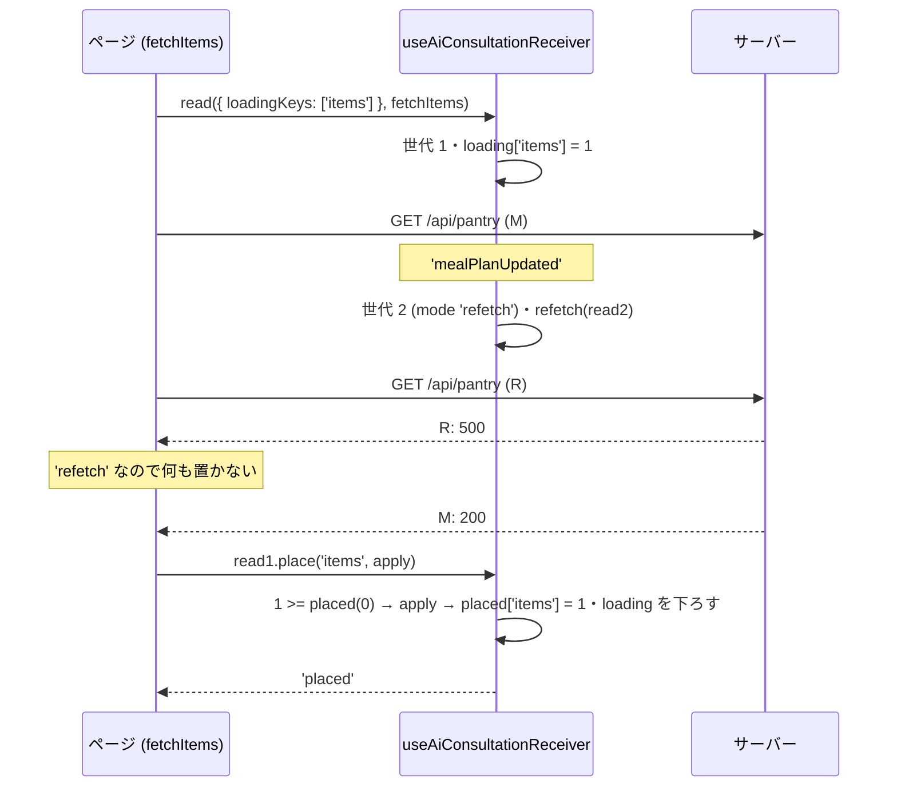
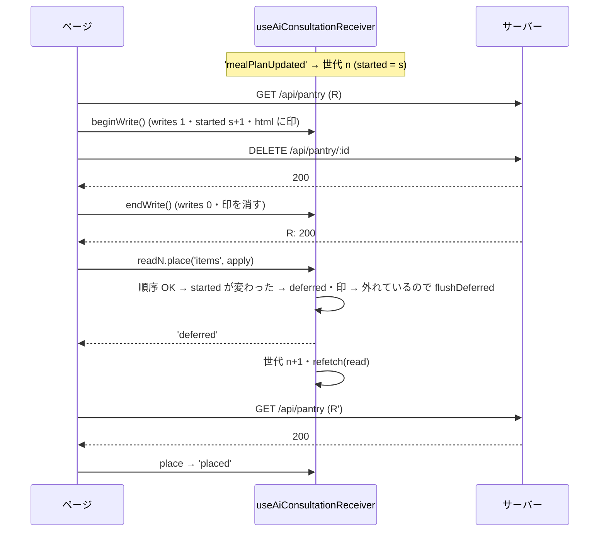
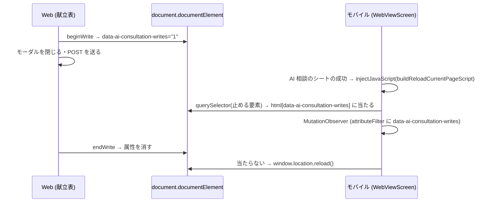

# Web (とモバイル) の AI 相談の取り直しの受け手の契約と、仕組みの一本化 (#2206 G1) 設計

| 版 | 日付 | 内容 |
|---|---|---|
| v1.0 | 2026-11-04 | 新設 (Issue #2206 の G1 の設計ゲート・A 型 4 相。V1 (#2200)・V1b (#2202)・U1+U2 (#2205)・U4 (#2204) で入った「AI 相談の成功のあとに開いているページが自分のデータを取り直す」仕組みの受け手の契約を正典として書き、順序・番兵・書き込みの印・止めた通知の印付けを共通の部品 (`useAiConsultationReceiver`) の中だけで行う構造へ一本化する。機械の番兵を「置くのは `place` の中だけ・書き込みは窓の中だけ」の少数の規則に置き換える。モバイルの読み込み直しが Web の書き込みの印を見るようにする) |

要件の正本は Issue #2206 の本文 (「候補の仕分け」の構造の案と、docs-1103c の「受け手の契約を設計書に書く」の節) と、2026-11-03 のコメント (G1 の行)。本書はその上で決めた範囲と設計で、Issue と食い違ったら本書が正。
ファイル名は cross/26 (cross/ の既存は 01〜09・12・13a・13b・14〜25。10・11 は欠番)。Issue #2206 の本文の「設計書の欠落」の候補は置き場を `cross/26-ai-consultation-refetch.md` と書いているが、本書の名前は `26-ai-consultation-refetch-receivers.md` で確定する (受け手の契約が主題)。

前提 (本書が従う条件):

- 範囲は Web の受け手の共通の部品 `src/hooks/useAiConsultationDataRefetch.ts` (本書で `src/hooks/useAiConsultationReceiver.ts` に置き換える)・それを使う受け手 22 ファイル (§3.2。ページ 18・部品 3・`src/hooks/useHomeData.ts`。設計後は `home/page.tsx` が外れて 21)・機械の番兵 `tests/ai-consultation-refetch-placement-guard-2201.test.ts` (本書で置き換える)・モバイルの読み込み直し `apps/mobile/src/lib/webViewBridge.ts` の `buildReloadCurrentPageScript`。DB・migration・API の route・RLS・監査ログ・Zod のスキーマは増やさず変えない (該当なし)。
- 守ること (Issue #2206 の U1+U2・U4 の契約。本書 §0.2 の R-1〜R-6): 取り直しの失敗は今の表示を残す / 取り直しで全画面のスピナーを出さない / 対象の鍵ごとに置いたものより新しい応答だけを置く / 置く直前に番兵 (モーダル・入力・書き込み中) を見る / 止めた通知は番兵が外れたとき・書き込みが終わったときに 1 回だけ取り直す (オーナーの確認待ちの推奨案 (b)) / U4 の /home の取り直しでは AI を呼ばない (開いたときの読み込みを引き継いだ回は AI つき — ただし本書の構造では「引き継ぐ回」そのものが無くなる。§5.3・§6)。
- 並行して走っている枝 (X1 `fix/ai-chat-timers-x1`・docs-1103c・G3 = /home の縁 (`useHomeData.ts`)・G5 = /health/graphs・/profile/nutrition-targets・/profile の縁) は先にマージされうるので、本書はコードを行番号でなく関数・名前で指す。事実は origin/main `e6b14faa` (2026-11-04) のコードから取った。
- 本番の Supabase には触れない (読み取りも要らない設計)。実名 (利用者・報告者) を書かない。帰属の文言を新しく書かない。
- 製品コードの数値のリテラル (250ms の待ち・300ms の移動の待ち・5 分の控え) は、触る行では名前付きの定数にする (§14)。

---

## 0. 外形固定と分冊判定 (相 1)

### 0.1 発注と決めること

発注 (Issue #2206 G1): 共通の部品 (札の `deferIfHeld`・取得の流れ `useAiConsultationFetchStream` の `latestStarted` / `newerThanPlaced`・`place`・`useAiConsultationPendingWrites`・止めた通知の 1 回の取り直し) を約 21 の受け手がそれぞれ組み合わせている。受け手ごとの書き分けの漏れが審査のたびに 1 件ずつ見つかり、U1+U2 の構造裁定 (F) が 2 周続けて「取り直しの順序と置き方を共通の仕組みに一本化し、各ページから `isLatest` / `deferIfHeld` を外して `place` だけを公開する」を指摘した。本書で (1) 今の受け手の契約を正典として書き、(2) 一本化の構造を設計し、(3) 機械の番兵を少数の規則に置き換える計画まで書き切る。

本書が答えを出すこと:

| # | 決めること | 答え (§6) |
|---|---|---|
| 1 | ページに渡す公開の面 | `useAiConsultationReceiver(refetch)` が返す `{ read, beginWrite, isLoading }` と、`read` / `refetch` の関数が受け取る `{ mode, place(key, apply) }` だけ。`isLatest`・`deferIfHeld`・`beginFetch`・`refetchKey`・`cancelled` の印・世代の数をページに書かない (§6.1・§8) |
| 2 | 順序の決まり | 全部の鍵で「鍵ごとに置いた世代より新しければ置く」(今の `newerThanPlaced`) に統一。`latestStarted` は廃止。失敗した読み取りは何も置かないので鍵を譲る仕組みは要らない (§6.2) |
| 3 | 番兵と書き込みの印を見る場所 | `place` の中だけ。取り直しの読み取り (hook が始めたもの) だけが見る。ページが始めた読み取りは見ない (§6.3) |
| 4 | `placedRef` を進める時点 | `apply` が投げずに戻ってから (§6.2) |
| 5 | 読み込み中の表示 | 鍵ごとに hook が持つ。ページが始めた読み取りが `loadingKeys` で立て、その鍵が置かれたとき・立てた読み取りが終わったときに下ろす。取り直しは立てない・引き継がない (§6.4) |
| 6 | 書き込みの印 | hook が持つ (`beginWrite` → 終わりの関数)。真偽の ref の印と `notifyWriteSettled` は廃止。印が立っている間は `document.documentElement` に `data-ai-consultation-writes` を付け、モバイルの読み込み直しがそれを止める要素として見る (§6.5・§6.9) |
| 7 | 献立表の直接の `setCurrentPlan` (9 か所)・/profile の保存・/meals の削除 | 置き換えは全部ページの読み取り (`receiver.read`) の `place` を通す。書き込み (GET でない送信) は全部 `beginWrite` の窓の中。生成・写真・再生成の「待ち」は窓で囲まない (順序で足りる。§5.3・§6.6) |
| 8 | 献立表の完了の切り替えの 250ms・週のキャッシュ・カレンダーの印・買い物リスト | 送る値と巻き戻しの値は待ちが終わった時点の今の献立 (ref) から / キャッシュヒットでも `place` が読み込み中を下ろす・非 ok は控えに書かない / カレンダーの印は月を鍵にして重なりを無くす / 買い物リストは週の確認と分けて自分の鍵で置く (§6.7) |
| 9 | 家族の画面の移動 | `router.replace` / `router.push` も `place` の中で呼ぶ (古い応答では移らない) (§6.8) |
| 10 | 機械の番兵 | 新しい `tests/ai-consultation-receiver-placement-guard-2206.test.ts` の規則 P1〜P5 (置くのは `place` の中だけ / 書き込みは窓の中だけ / Supabase の読み取りは `error` を受け取る / 捨てる入れ物に後から書かない / 旧 API を使わない)。旧の番兵は段 F で消す (§6.10・§7.7) |
| 11 | 分冊と段 | 1 冊。実装は核 (段 A) → 配線 4 段 (B〜E) → 仕上げ (段 F) の 6 段・6 WF (§0.4・§16) |

### 0.2 要件行列

| # | 要件 | 根拠 | 本書の置き場 |
|---|---|---|---|
| R-1 | 取り直しの失敗 (通信の失敗・5xx・Supabase の error) では今の表示を残す。開いたときの読み込み (と対象の切り替え・書き込みのあとの読み直し) の失敗はこれまでどおり失敗の表示を出す | #2201 U1 | §6.2・§8 (`read.mode`)・§10.2 |
| R-2 | 取り直しでは全画面の読み込み中の表示を出さない。開いたときの読み込みの応答待ちに取り直しが始まり、取り直しが先に置いても・失敗しても、読み込み中のまま止まらず、開いたときの応答が捨てられて空のまま残らない | #2201 U1・Issue #2206 の「開いたときの読み込みの応答待ちに始まった取り直しが失敗すると空のまま残る」 | §4.3 S-1・S-2・§6.4 |
| R-3 | 置くのは、同じ鍵 (対象) で置いたどの応答よりあとに始めた読み取りの応答だけ。鍵は受け手が置き場所ごとに決め、対象を替えて出す表示 (週・選んだ日・食事の id・月) は対象を鍵に含める | #2201 U1 | §6.2・§9 |
| R-4 | 取り直しの応答を置く直前に番兵 (入力の部品・モーダル。`isAiConsultationRefetchBlocked`)・書き込み中・取り直しを始めたあとに書き込みが始まったか、を見る。1 つでも当たれば置かず、止めた通知の印を 1 回だけ付ける。ページが自分で始めた読み取りは見ない | #2201 U1+U2 | §6.3・§7.1 |
| R-5 | 止めた通知は、番兵が外れたとき (DOM の変化)・書き込みが全部終わったときに 1 回だけ取り直す。止めている間に何回来ても 1 回 | #2201 U2 (推奨案 (b)) | §7.1・§10.3 |
| R-6 | /home の取り直しでは AI を呼ばない (点数・課題だけ)。開いたときの読み込みは AI つきで読む。AI つきの読み取りを 2 回読まない | #2201 U4・G3 | §6.6・§9 の /home の行・§20 Q-3 |
| R-7 | 取り直しの経路を通らない置き換え (献立表の生成の完了・1 食の再生成・写真の解析・改善・手入力の保存・並べ替え・追加・削除の後の読み直し、/profile の保存、/meals の削除) が、先に始めた読み取りの古い応答で戻されない | Issue #2206 G1 | §6.6・§7.4・§9 |
| R-8 | 献立表の完了の切り替え (250ms の待ち) は、待ちが終わった時点の献立から送る値と巻き戻しの値を決める | Issue #2206 G1 | §6.7・§7.4 |
| R-9 | 献立表の週のキャッシュ: キャッシュヒットでも読み込み中の表示を下ろす。失敗 (非 ok) の応答を空の週として控えに書かない。止めている間に捨てないのは今までどおり | Issue #2206 G1 | §6.7・§7.4 |
| R-10 | 献立表のカレンダーの印: 鍵の違う重なる範囲の古い応答が AI の足した印を消さない。買い物リストは週を移った応答からも置く | Issue #2206 G1 | §6.7 |
| R-11 | 家族・譲渡の画面は、古い応答で `/family/setup`・ログインへ移らない | Issue #2206 G1 | §6.8 |
| R-12 | 機械の番兵は「置くのは `place` の中だけ」「書き込みは窓の中だけ」などの少数の規則で、受け手の全部の置く場所を数える (今の規則 5 の「関数に 1 つあれば通る」粗さを消す)。旧の API がどの受け手にも残っていないことも数える | Issue #2206 G1 | §6.10・§7.7 |
| R-13 | モバイルの読み込み直しは、ページの書き込みの印が立っている間は読み込み直さず、外れたら 1 回読み込み直す (送ったばかりの POST を取り消さない) | Issue #2206 G1 | §6.9・§7.2 |
| R-14 | 既存の受け手の描画のテスト (`tests/ai-consultation-refetch-reads-2195` ほか) が確かめている挙動のうち、本書が変えると決めたもの以外は変えない (§17 に変えるものを全列挙) | 回帰の防止 | §13・§17 |
| R-15 | 受け手の表 `src/lib/ai/consultation-refetch-coverage.ts` の receiver / excluded は変えない (受け手の集合は同じ)。説明の文だけ追随する | 範囲 | §17・§18 |
| R-16 | マジックナンバーを書かない。新しい定数は名前と根拠を持つ (§14) | 共通の規律 | §14 |

### 0.3 ユーザーシナリオ (18 本。トレースは §4.3・テストとの対応は §13.2)

登場するもの: M = ページが始めた読み取り (開いたとき・対象の切り替え・書き込みのあと)、R = AI 相談の成功の取り直し (hook が始める)、W = ページの書き込み (`beginWrite` の窓)、番兵 = 入力の部品・モーダル。

| # | シナリオ | 期待 (設計後) |
|---|---|---|
| S-1 | /pantry を開いた直後 (M の応答待ち) に AI 相談が成功し、R の応答が M より先に届く | R の一覧を置き、読み込み中の表示を下ろす。あとから届いた M の応答は置かない (古い) |
| S-2 | S-1 で R が失敗する (5xx) | M の応答が届いたら置く (空のまま残らない)。失敗の表示は出ない。読み込み中の表示は M が下ろす |
| S-3 | /home で AI 相談が続けて 2 回成功し、R1 の応答が R2 の応答より後に届く | R2 の値が残る (R1 は古い)。R1 が先に届けば R1 を置き、R2 で置き換える |
| S-4 | 献立表で週を W1 から W2 へ移った直後 (W2 の読み込み待ち) に AI 相談が成功し、R が先に失敗する | W1 の献立を W2 の見出しの下に出さない (読み込み中のまま W2 の応答を待ち、届いたら置く) |
| S-5 | 献立表で食事の完了の切り替え (W の窓) の応答待ちに AI 相談が成功する | 取り直さない (止めた通知)。W が終わったら 1 回取り直す。楽観的な表示は戻らない |
| S-6 | /pantry で R の応答待ちに食材を削除して (W) 終える。そのあと R の応答が届く | R の応答 (削除の前の一覧) を置かず、すぐに 1 回取り直す (削除した食材は戻らない) |
| S-7 | /profile で R の応答待ちに編集のモーダルを開く。R の応答が届く。モーダルを閉じる | R の応答を置かない (打ちかけの値を残す)。閉じたら 1 回取り直す |
| S-8 | /health/streaks を見ている間に AI 相談が成功し、R が通信で失敗する | 今の表示を残す。エラーの表示も読み込み中の表示も出ない |
| S-9 | /menus/weekly で AI 相談が 1 週間の献立の生成を受け付け (status processing)、数十秒後に完了する | 受付のときに 1 回取り直す (まだ献立は無い)。完了を見張りが知ると、もう 1 回取り直して献立を出す。ページ自身の生成の監視 (ポーリング・Realtime) が先に置いていれば、あとから届いた古い応答で戻さない |
| S-10 | モバイルの献立表で、生成のモーダルを閉じて生成の POST を送っている最中に AI 相談のシートが成功を知らせる | 書き込みの印 (`data-ai-consultation-writes`) が外れるまで読み込み直さない。外れたら 1 回読み込み直す (POST は取り消されない) |
| S-11 | 取り直しの応答待ちにページを離れる (アンマウント) | 応答が届いても何も置かず、止めた通知の印も付けない。生成の見張りもやめる |
| S-12 | 献立表で完了を押し、250ms の待ちの間に AI 相談 (complete_meal) が同じ食事の完了を変え、R がそれを置く | 待ちが終わった時点の献立 (R が置いた値) から反転を決めて送る。失敗の巻き戻しも R の後の値に戻す |
| S-13 | 家族を抜けて入り直す数百 ms の間に、/family/dashboard の古い応答 (family_id 無し) が後から届く | `/family/setup` へ移らない (古い応答は置かない = 移らない) |
| S-14 | /meals/[id] で削除が成功して献立表へ移るまでの 300ms に AI 相談の成功が来る | 削除は窓の中なので取り直さない。移ったあとは受け手が無い (「見つかりませんでした」は出ない) |
| S-15 | 献立表で、月のパネルの範囲 (AI の前に読み始めた) の古い応答が、R の同じ月の応答のあとに届く | 鍵が同じ月なので古い応答は置かない (AI が足した印は消えない) |
| S-16 | /health で日を A→B→A と選び直し、最初の A の応答が B のあとに届く | A のパネルに A の記録を出す (鍵は日ごと)。B の記録を出さない |
| S-17 | /profile で保存 (PUT) の応答待ちに、保存の前に始まった R の応答が届く | R の応答を置かない (保存が始まっている)。保存が終わったら 1 回取り直す (保存前の値に戻らない) |
| S-18 | 献立表で週を移り、控え (キャッシュ) に当たる。別に、隣の週の先読みが 5xx になる | 控えの献立を置いて読み込み中を下ろす。5xx の週は控えに書かない (次にその週へ移ったら読む) |

### 0.4 分冊判定

目安 (設計書 800 行超 / 消費先レーン 3 以上 / 共有面 2 つ以上) の 3 つ全部に当たる。しかし核 (共通の部品) と配線 (受け手の移行) は同じ契約の表裏で、分冊すると配線の冊が核の冊の契約を写すだけになる。**1 冊にし、実装を 6 段・6 WF (1 案件 1 WF) に分ける** (§16)。核 (段 A) を先にマージし、配線の各段はマージ済みの核の実コードを参照する。Issue は親 1 + 子 6。

### 0.5 用語

| 語 | 意味 |
|---|---|
| 受け手 | `useAiConsultationReceiver` を呼ぶ src のファイル。設計後は 21 (ページ 17・部品 3 (`CheckupDetailClient.tsx`・`ProfileReminderBanner.tsx`・`nutrition-target-planner.tsx`)・`useHomeData.ts`)。今の hook を使うのは 22 (ページ 18 (`home/page.tsx` を含む)・部品 3・`useHomeData.ts`。§3.2)。/home はページでなく `useHomeData.ts` が受け手になる。閉じた表 `AI_CONSULTATION_REFETCH_PAGES` の receiver は道ごとの 19 で、数え方が違う (§9 の末尾) |
| 読み取り | `receiver.read(options, fn)` で始める 1 回の取得 (ページが始めるもの) と、hook が始める取り直し。どちらも `fn` に `read` (`{ mode, place }`) を渡す |
| 鍵 | 置き場所の名前。受け手が決める文字列。対象を替えて出す表示では対象を含める (`plan:2026-11-02` など) |
| 置く | `read.place(key, apply)` で `apply` を呼ぶこと。応答を state・store・router に反映する唯一の経路 |
| 世代 | 読み取りを始めた順の番号 (受け手ごとに 1 つの数)。置いた世代は鍵ごとに覚える |
| 番兵 | `isAiConsultationRefetchBlocked(document)` (入力の部品・モーダル)。Web の決まりは今までどおり (`src/lib/ai/consultation-data-refetch.ts`) |
| 書き込みの窓 | `const endWrite = receiver.beginWrite()` から `finally` の `endWrite()` まで |
| 止めた通知 | 番兵・書き込みの印で取り直せなかった AI 相談の成功。外れたときに 1 回だけ取り直す |
| 読み込み中の鍵 | `loadingKeys` で立てた鍵。`receiver.isLoading(key)` が true の間、ページは読み込み中の表示を出す |

### 0.6 読み方

- 実装は §7 の正典コードを写す。§8 の契約 (名前・引数・戻り値・決まり) と §14 の定数の名前を変えない。
- 受け手ごとの配線は §9 の表の行に従う。表に無い置き場所を見つけたら、deviations で報告する (表に足すのはオーケストレーター)。
- 表 3 点 (§10) とエラー表 (§11) は、レビューが最初に自分で作り直して突き合わせる対象。
- 本書の TS のブロックは、`// tsc:skip` を 1 行目に持つものを除き、そのまま型検査を通る形で書いてある (import を省かない)。`// tsc:skip` のブロックは既存ファイルの差分の断片と、テストの骨格。
- 本書の関数の名前は origin/main `e6b14faa` の時点。G3・G5 のマージで名前が変わっていたら、変わった名前で読み替えて deviations に書く。

---

## 1. 目的・スコープ

- 目的: AI 相談の成功 (と献立の生成の完了) のあとに開いているページが自分のデータを取り直す仕組みで、順序・番兵・書き込みの印・止めた通知の印付け・読み込み中の表示を共通の部品の中だけで行い、受け手のページは「鍵を決めて `place` で置く」「書き込みを窓で囲む」だけにする。受け手ごとの書き分けの漏れ (§3.5 の 10 件) の発生源を消し、機械の番兵を少数の規則で厳密にする。
- 対象: §3.2 の受け手 22 ファイル (`useHomeData.ts` を含む。設計後は 21)・共通の部品 (新設 1・廃止 1)・機械の番兵 (新設 1・廃止 1)・既存のテストの追随 (§17)・モバイルの読み込み直し (`webViewBridge.ts` の定数 2 つとスクリプト 1 つ) とそのテスト・他の文書への追随表 (§18)。
- 対象外: AI 相談の時間切れ・会話の取り直し (G2)・/home の閉じたお知らせ・aiSkipped・アドバイスの帯 (G3)・完成度の計算し直しと料理画像の積み込み (G4)・/health/graphs・/profile/nutrition-targets・/profile の縁のうち取り直しに関わらないもの (G5)・`ai_action_logs` の RLS (Issue #2206 の 8)・モバイルに献立の生成の完了の見張りを足すこと (Issue #2206 の候補。本書は Web の受け手と、モバイルの読み込み直しの番兵だけ)・見張りの上限を時間で数えること。

## 2. 関連要件・既存設計

| 文書 | 関係 |
|---|---|
| Issue #2195 V1・#2200・#2202 | 受け手の仕組みの導入 (通知 `mealPlanUpdated`・番兵・閉じた表・生成の見張り) |
| Issue #2201 U1+U2 (#2205)・U4 (#2204) | 順序 (札・取得の流れ)・失敗・書き込みの印・止めた通知の 1 回の取り直し・/home の AI を呼ばない取り直し。本書はこれらの契約の正典 |
| Issue #2206 | 本書の発注。G1 の 10 件の欠陥 (§3.5) |
| `src/lib/ai/consultation-data-refetch.ts` | 番兵の決まり (変えない) |
| `src/lib/ai/consultation-generation-watch.ts` | 生成の見張り (変えない) |
| `src/lib/ai/consultation-refetch-coverage.ts` | 受け手の閉じた表 (集合は変えない。説明の文だけ追随) |
| `docs/design/operator/06-ai-llm.md`・`docs/design/cross/13b-legal-consent-mobile.md` | 本書を参照する側 (§18) |
| `docs/design/cross/06-perf-cache.md` | 取り直しの節は無い。本書が正典 |

---

## 3. 現状の事実 (origin/main `e6b14faa`・2026-11-04)

### 3.1 共通の部品 `src/hooks/useAiConsultationDataRefetch.ts` (521 行) の公開の面

| 名前 | 役 | 状態 |
|---|---|---|
| `useAiConsultationDataRefetch(refetch, { writeInFlightRef? })` → `{ beginFetch, notifyWriteSettled }` | 通知の購読・取り直しの札 (`AiConsultationFetchTicket = { isLatest, deferIfHeld }`) の生成・止めた通知・生成の見張り | 世代 (ページに 1 つ)・`deferred` (真偽 1 つ)・`MutationObserver`・見張りの集合 |
| `AiConsultationFetchTicket.deferIfHeld()` | 取り直しの札だけ: 番兵か書き込みの印 (`writeInFlightRef.current`) か「始めたあとに `startedCount` が増えた」で true。一度 true なら以後 true。true のとき `deferRefetch` で印を付ける。`beginFetch` の札は常に false | 札ごとの `deferredByThisTicket` |
| `useAiConsultationFetchStream(order)` → `{ begin(refetchTicket?, key?) → { isLatest, place(apply) } }` | 流れごと・鍵ごとの世代。`place` は順序 (`latestStarted` = 最後に始めたか / `newerThanPlaced` = 置いた世代より新しいか) → 札の `deferIfHeld` → `placedRef` を進める → `apply` | `startedRef`・`placedRef` (鍵ごとの Map) |
| `useAiConsultationRefetchKey({ writeInFlightRef? })` → `{ refetchKey, notifyWriteSettled, refetchTicket() }` | 取得を `useEffect` に書くページ向け。取り直しのたびに数が増える | 最後の札 |
| `useAiConsultationRefetchRun(refetchKey, fullScreenLoading)` → `() => boolean` | その回が取り直しで走ったか (`keyChanged && !fullScreenLoading`) | 前回の鍵・前の描画の loading |
| `useAiConsultationLoading()` → `{ loading, setLoading, refetchReadMode(), settleLoading(ticket) }` | 全画面の読み込み中の表示。`refetchReadMode()` は loading が立っていれば `'mount'` (取り直しが役を引き継ぐ) | `loadingRef` |
| `useAiConsultationPendingWrites()` → `{ begin() → end, subscribeSettled, startedCount, current }` | 重なりうる書き込みの印。0 になったら登録した関数を呼ぶ | `countRef`・`startedRef` |

読み取りの種類と番兵の関係 (今): `beginFetch` の札 (ページ) = 番兵を見ない。取り直しの札 = `deferIfHeld` を呼んだ場所で見る。引き継いだ回 (`refetchReadMode() === 'mount'`) = 呼ばない。

### 3.2 受け手の全列挙 (hook を使う src のファイル 22 = ページ 18・部品 3・`useHomeData.ts`) と、今の書き分け

列挙の規則: `git grep -l 'hooks/useAiConsultationDataRefetch' origin/main -- src` の 26 本から、コメントで名前を挙げるだけの `src/lib/ai` の 4 本 (`consultation-data-refetch.ts`・`consultation-generation-watch.ts`・`consultation-refetch-coverage.ts`・`consultation-reply-reload.ts`。§17 G-17) を除いた 22 本。下の表は `home/page.tsx` と `useHomeData.ts` を #14 の 1 行にまとめるので 21 行。

| # | 受け手 | 今の形 | 順序を見る所 | 番兵 (`deferIfHeld`) | 書き込みの印 | 今の漏れ (仕分けで確かめたもの) |
|---|---|---|---|---|---|---|
| 1 | `src/app/(main)/badges/page.tsx` | `useAiConsultationRefetchKey` + `useEffect` | `cancelled` | 見ない | 無し | 取り直しでも `newlyEarned` を置く (仕様どおり)。番兵を見ない |
| 2 | `src/app/(main)/comparison/page.tsx` | RefetchKey + RefetchRun(key, loading) + `AbortController` | `signal.aborted` | 見ない | 無し | 同じ描画で鍵と期間が変わると取り直しの扱いになる |
| 3 | `src/app/(main)/family/dashboard/page.tsx` | `useAiConsultationLoading` + `beginFetch`・`readDashboard(ticket, mode)` | `isLatest` (段ごと) | 見ない | 無し | `router.replace('/family/setup')`・ログインへの `push` を `isLatest` を見ずに呼ぶ |
| 4 | `src/app/(main)/family/members/page.tsx` | 同上・`loadMembers`・取り直し自身が真偽の ref `writeInFlightRef` を立てる | `isLatest` | 見ない | 真偽の ref (取り直し中は除名・脱退のボタンを止める) | 3 と同じ移動 |
| 5 | `src/app/(main)/family/members/[id]/page.tsx` | 同上・`readMember`・`busyRef` | `isLatest` | 見ない | 真偽の ref (`busyRef`) | 3 と同じ移動 |
| 6 | `src/app/(main)/family/transfer-accept/[proposal_id]/page.tsx` | 同上・`fetchProposal`・`busyRef` | `isLatest` | 見ない | 真偽の ref | ログインへの移動を順序を見ずに |
| 7 | `src/app/(main)/org/transfer-accept/[proposal_id]/page.tsx` | 6 と同型 | `isLatest` | 見ない | 真偽の ref | 同上 |
| 8 | `src/app/(main)/health/blood-tests/page.tsx` | `useAiConsultationDataRefetch(fetchSex)` | `isLatest` | 見ない | 無し | — |
| 9 | `src/app/(main)/health/checkups/[id]/CheckupDetailClient.tsx` | 8 と同型 | `isLatest` | 見ない | 無し | — |
| 10 | `src/app/(main)/health/goals/page.tsx` | Loading + `pendingWrites` + `beginFetch`・`fetchGoals(ticket, mode)` | `isLatest` | refetch のとき | `pendingWrites` (削除だけ) | 引き継いだ回 (mode `'mount'`) は番兵を見ない。作成・編集の書き込みは印の外 (モーダルが番兵) |
| 11 | `src/app/(main)/health/graphs/page.tsx` | Loading + `beginFetch`・`fetchData(ticket, mode)`・Realtime の購読でも `fetchData(beginFetch(), refetchReadMode())` | `isLatest` | 見ない | 無し | — |
| 12 | `src/app/(main)/health/page.tsx` | Loading + `beginFetch`・`fetchData(ticket, mode)`・選んだ日は `selectedDateFetchStream` (`newerThanPlaced`・`begin(null, date)`) | `skipPlacing` (段ごと)・`place` | refetch のとき (`fetchData`)。選んだ日の読み直しは札なし | 無し。記録の保存 (`handleQuickSave`) は印の外 | 選んだ日のパネルは番兵を見ない |
| 13 | `src/app/(main)/health/streaks/page.tsx` | Loading + `beginFetch`・`fetchStreak(ticket, mode)` | `isLatest` | 見ない | 無し | — |
| 14 | `src/app/(main)/home/page.tsx` → `src/hooks/useHomeData.ts` | ページが `useAiConsultationDataRefetch(refetch, { writeInFlightRef: aiConsultationWrites })`。`useHomeData` が Loading・PendingWrites・流れ 3 本 (`homeFetchStream`・`performanceAnalysisStream`・`nutritionAnalysisStream` (鍵 2 つ)) | `isLatest` (利用者・集計・お知らせ)・`place` (活動量・今日の献立・分析) | `place` 経由 (活動量・今日の献立) | `aiConsultationWrites` (完了の切り替え・活動量) | 利用者・集計・お知らせは `isLatest` だけ。巻き戻しの `fetchHomeData()` は mode `'mount'` で札を見ない。チェックインの保存・献立の変更の実行 (POST) は印の外。引き継いだ回は AI つきで読む |
| 15 | `src/app/(main)/meals/[id]/page.tsx` | RefetchKey({ writeInFlightRef: pendingWrites }) + RefetchRun(key, loading) + `useEffect` ×2 | `cancelled` | refetch のとき (catalog の await の後) | `pendingWrites` (完了の切り替えだけ) | 404 は `setMeal(null)` (仕様どおり)。削除 (`handleDelete`) は印の外 |
| 16 | `src/app/(main)/menus/weekly/page.tsx` | 流れ 5 本 (`planFetchStream` (`newerThanPlaced`・週の鍵)・`mealDatesFetchStream` (範囲の鍵)・`familyLoadStream`・`settingsFetchStream`・`pantryFetchStream`) + `pendingWrites` + `aiConsultationRefetchRound` (月のカレンダー・生成中の依頼の確認の effect を走らせ直す) | `place` | `place` 経由 | `pendingWrites` (約 20 か所) | `setCurrentPlan` を直接呼ぶ 9 か所 (生成の完了のポーリング `startPolling`・Realtime `subscribeToRequestStatus`・`handleAddMealWithMode`・`finishRegenerate`・`saveEditMeal` (楽観)・`confirmDeleteMeal`・`saveManualEdit`・写真の解析の結果・`finishImprove`・`reorderMeal`)。生成の POST (`handleGenerateWeekly`) は印の外。完了の 250ms。キャッシュヒットで loading を下ろさない。`fetchWeekData` が非 ok を空で返す。カレンダーの印の鍵が範囲。買い物リストを週の確認の中で置く |
| 17 | `src/app/(main)/pantry/page.tsx` | Loading + `pendingWrites` + `beginFetch`・`fetchItems(ticket, mode)` | `isLatest` | refetch のとき | `pendingWrites` (削除・手入力・写真の保存) | 引き継いだ回は番兵を見ない |
| 18 | `src/app/(main)/profile/page.tsx` | RefetchKey + RefetchRun(key, isLoading) + `useEffect` | `cancelled` | refetch のとき (プロフィールの読みの後だけ) | 無し。`handleSave` (PUT) は印の外 | `setUser` は札を見ない。保存中の古い応答で保存前の値に戻る |
| 19 | `src/app/(main)/profile/nutrition-targets/page.tsx` | RefetchKey + RefetchRun(key, loading) + `useEffect` | `cancelled` | 見ない | 無し | — (再設定の部品 21 が番兵と印を持つ) |
| 20 | `src/components/ProfileReminderBanner.tsx` | RefetchKey + RefetchRun(key) + `useEffect` | `cancelled` | 見ない | 無し | — |
| 21 | `src/components/nutrition/nutrition-target-planner.tsx` | Loading + `pendingWrites` + `beginFetch`・`fetchPlannerData(ticket, mode)` | `isLatest` | refetch のとき | `pendingWrites` (保存) | 引き継いだ回は番兵を見ない |

`useHomeData.ts` は 14 の取り直しの関数と印を作る hook (今の番兵の `DELEGATED_RECEIVERS`)。本書では `useHomeData.ts` 自身が `useAiConsultationReceiver` を呼び、`home/page.tsx` は hook を呼ばなくなる (受け手のファイルは 22 から 21 へ: ページ 17 + 部品 3 + `useHomeData.ts`)。

### 3.3 モバイルの読み込み直し (`apps/mobile/src/lib/webViewBridge.ts`)

- `AI_CONSULTATION_RELOADABLE_PATHS = ['/home', '/menus/weekly', '/comparison', '/profile']`。
- `AI_CONSULTATION_RELOAD_BLOCKING_SELECTOR` = input (hidden を除く。file は数える)・textarea・select・contenteditable・`[role="dialog"]`・`[aria-modal="true"]`・`dialog[open]`。ページごとの追加は `/profile` の `.fixed.inset-0` だけ。
- `AI_CONSULTATION_DEFERRED_RELOAD_OBSERVED_ATTRIBUTES = ['role', 'aria-modal', 'open', 'contenteditable', 'type', 'class']`。
- `buildReloadCurrentPageScript()`: 止める要素が無ければ即 `window.location.reload()`。あれば `MutationObserver` で見張り、外れたら 1 回読み込み直す (`AI_CONSULTATION_DEFERRED_RELOAD_WATCH_KEY` で 1 つに)。**書き込みの印は見ない** (Web の `useAiConsultationPendingWrites` は DOM に出ない)。
- `apps/mobile/src/components/web/WebViewScreen.tsx` が `subscribeAiConsultationDataChanged` で知らせを受け `injectJavaScript` する。マイページは `aiConsultationReloadTiming="onFocus"`。

### 3.4 既存の番兵 (本書の変更に反応するテスト)。直し方は §17

- `tests/ai-consultation-refetch-placement-guard-2201.test.ts` (規則 1〜8。下限 `MIN_COUNTED_MARKER_RECEIVERS = 6`・`MIN_REFETCH_PATH_FETCHERS = 46`・`MIN_REFETCH_PATH_SUPABASE_READS = 38`・`MIN_OPTIMISTIC_WRITE_FUNCTIONS = 8`・`MIN_REFETCH_DISCARDED_CONTAINERS = 1`・`SELF_HELD_RECEIVERS` 4 件・`DELEGATED_RECEIVERS` 1 件・`OPTIMISTIC_WRITE_EXEMPTIONS` 1 件)。
- `tests/ai-consultation-data-refetch-2195.test.tsx` (番兵の決まり・モバイルとの並びの一致・イベントの名前・hook の単体・取得の流れ・読み込みの引き継ぎ・ページの描画・受け手の配線の正規表現・モーダルの `role="dialog"`)。
- `tests/ai-consultation-refetch-coverage-2195.test.ts` (受け手のページは取り直しの hook を使う / 除外は使わない / 受け手の hook は生成の見張りを使う)。
- `tests/ai-consultation-generation-watch-2195.test.tsx` (hook を使って見張りを確かめる)。
- `tests/ai-consultation-refetch-reads-2195.test.tsx`・`tests/ai-consultation-home-refetch-2195.test.tsx`・`tests/ai-consultation-weekly-refetch-2195.test.tsx` (受け手の描画の挙動)。
- `tests/ai-chat-timeout-reload-2201.test.tsx` (hook を import して組み合わせる 1 節)。
- `src/__tests__/app/menus/weekly/family-menu-wiring.test.ts` (`const familyLoadStream = useAiConsultationFetchStream();` を逐語で見る)。
- `apps/mobile/__tests__/components/WebViewScreen.ai-data-reload.test.tsx`・`apps/mobile/__tests__/components/ai-reload-blocking-web-markers.test.ts`・`apps/mobile/__tests__/ai/advisor-sheet-reload-running.test.tsx`。
- `tests/helpers/heavy-unit-test-timeout.ts` (構文木の走査のテストの時間切れの一覧。新しい番兵は同じ型なので足す)。

### 3.5 欠陥の仕分け (Issue #2206 G1 の 10 件) と発生源

| # | 欠陥 | 発生源 | 本書の消し方 |
|---|---|---|---|
| D-1 | 受け手が `isLatest`・`cancelled`・`deferIfHeld`・`place` を自分で組み合わせ、書き分けが漏れる (利用者・集計・お知らせが `isLatest` だけ / 選んだ日・streaks・comparison・badges・404・/profile の成功の経路・引き継いだ回が番兵を見ない / `placedRef` が `apply` の前に進む) | 順序と番兵の判断がページ側にある | ページには `place(key, apply)` だけ。判断は全部 hook の `place` の中 (§6.1〜§6.3) |
| D-2 | 開いたときの読み込みの応答待ちに始まった取り直しが失敗・deferred になると、開いたときの応答が `superseded` で捨てられ空のまま残る (`latestStarted`) | 「最後に始めた取得だけ置く」順序 | 順序を `newerThanPlaced` に統一。失敗・deferred は何も置かないので、先に始めた応答が置ける (§6.2) |
| D-3 | 献立表の手入力の保存・生成の完了・再生成・写真・改善・並べ替え・追加・削除のあとの `setCurrentPlan` が流れを通らない。/profile の保存・/meals の削除が印の外 | 「取り直しの経路」だけを守る設計 | 置き換えは全部ページの読み取りの `place`。書き込みは全部窓の中 (番兵 P1・P2 が数える) (§6.6) |
| D-4 | 完了の切り替えの 250ms の待ちの間に取り直しが同じ食事の完了を変えると、古い値からの反転と巻き戻し | 押した描画の写しから値を決める | 待ちが終わった時点の `currentPlanRef` から決める (§6.7) |
| D-5 | キャッシュヒットで loading を下ろさない・先読みの非 ok を空の週として 5 分持つ | loading の下ろし方がページの分岐に散る・失敗と空の区別が無い | 読み込み中は hook の鍵 (置いたら下ろす)。`fetchWeekData` は非 ok で null (§6.4・§6.7) |
| D-6 | カレンダーの印の鍵が範囲で重なる・買い物リストを週の確認の中で置く | 鍵の切り方 | 月を鍵に・買い物リストは自分の鍵 (§6.7) |
| D-7 | 家族の画面で古い応答が `/family/setup`・ログインへ移す | 移動が `place` の外 | 移動も `place` の中 (§6.8) |
| D-8 | 機械の番兵の粗さ (関数に 1 つあれば通る・印を渡す受け手だけ・献立表の書き込み 20 か所のうち回帰テスト 2 経路) | 守るべき形が「置く場所ごと」でなく「関数ごと」 | P1「置くのは `place` の中だけ」(置く場所ごと)・P2「書き込みは窓の中だけ」(§6.10) |
| D-9 | 設計書が無い | — | 本書 |
| D-10 | モバイルの読み込み直しが書き込みの送信中に走る | 書き込みの印が DOM に無い | `data-ai-consultation-writes` を `html` に出し、モバイルが止める要素に数える (§6.9) |

---

## 4. 構想 (相 2)

### 4.1 構造 (構造 A: 受け手ごとに 1 つの hook が、全部の判断を `place` の中で行う)

```text
                 window 'mealPlanUpdated' ──┐   生成の見張り (完了) ──┐
                                            ▼                         ▼
 ┌────────────────────────── useAiConsultationReceiver(refetch) ──────────────────────────┐
 │ 世代 (1 つの数)   置いた世代 (鍵 → 世代)   読み込み中 (鍵 → 立てた世代)   書き込み (count / started) │
 │ 止めた通知 (1 つ)  MutationObserver        生成の見張りの集合            document の印 (html[data-…-writes]) │
 │                                                                                                        │
 │  read(options, fn) ─── fn({ mode: 'mount', place })         ← ページが始める読み取り (番兵を見ない)      │
 │  (通知) ────────────── refetch({ mode: 'refetch', place })  ← hook が始める取り直し (番兵を見る)          │
 │  beginWrite() → end                                            ← 書き込みの窓                              │
 │  isLoading(key)                                                 ← 読み込み中の表示                          │
 └────────────────────────────────────────────────────────────────────────────────────────┘
                      ▲ place(key, apply)                 ▲ beginWrite
            ┌─────────┴───────────┐           ┌───────────┴──────────┐
            │ 受け手のページ: 鍵を決め、 │           │ 書き込みの関数: 窓で囲む │
            │ 応答は place の中で置く  │           │ (楽観的な更新も中)      │
            └─────────────────────┘           └──────────────────────┘
```

決まり (hook の中だけで判断する):

1. **順序**: `place(key, apply)` は、この読み取りの世代が「鍵 key に置いた世代」より小さければ `'superseded'`。同じ世代 (同じ読み取りが段ごとに置く) と大きい世代は通す。
2. **番兵**: 取り直しの読み取り (`mode: 'refetch'`) だけ、順序を通ったあとに、番兵 (`isAiConsultationRefetchBlocked(document)`) か書き込み中 (`count > 0`) か「始めたあとに書き込みが始まった (`started` が変わった)」なら `'deferred'` を返し、止めた通知の印を 1 回だけ付ける (以後その読み取りの `place` は全部 `'deferred'`)。ページが始めた読み取り (`mode: 'mount'`) は見ない。
3. **置く**: `apply()` を呼び、投げなければ置いた世代を進め、その鍵の読み込み中の印を下ろす。
4. **読み込み中**: ページが始めた読み取りが `loadingKeys` で立てる。下ろすのは「その鍵が置かれた」か「立てた読み取り (その鍵を最後に立てたもの) が終わった」とき。取り直しは立てず、引き継がない (開いたときの読み取りは自分の応答を自分で置くので、引き継ぐ必要が無い)。
5. **書き込みの印**: `beginWrite()` で `count` と `started` を 1 つ増やし、`document.documentElement` に `data-ai-consultation-writes="<全受け手の合計>"` を付ける。終わりで `count` を減らし、0 になったら印を消し、止めた通知があれば 1 回取り直す。
6. **止めた通知**: 通知 (と生成の完了) が来たとき番兵か書き込み中なら印を付けて DOM を見張る。`'deferred'` のときも同じ。外れたら 1 回だけ取り直す。アンマウントで全部やめる。
7. **失敗**: 取り直しの関数が投げても握る (`console.warn`)。ページは読み取りの失敗では `mode === 'mount'` のときだけ失敗の表示を `place` で置き、`'refetch'` なら何も置かない。

### 4.2 動き (受け手の書き方の型)

```text
const receiver = useAiConsultationReceiver((read) => fetchItems(read));

const fetchItems = useCallback(async (read: AiConsultationRead) => {
  try {
    const res = await fetch('/api/pantry');
    if (!res.ok) { if (read.mode === 'mount') read.place(KEY_ITEMS, () => setError(...)); return; }
    const data = await res.json();
    read.place(KEY_ITEMS, () => setItems(data.items ?? []));
  } catch (e) {
    if (read.mode === 'mount') read.place(KEY_ITEMS, () => setError(...));
  }
}, []);

useEffect(() => { void receiver.read({ loadingKeys: [KEY_ITEMS] }, fetchItems); }, [receiver, fetchItems]);
const loading = receiver.isLoading(KEY_ITEMS);

const remove = async (id) => {
  const endWrite = receiver.beginWrite();
  try { await fetch(..., { method: 'DELETE' }); await receiver.read({}, fetchItems); }
  finally { endWrite(); }
};
```

### 4.3 シナリオのトレース (§4.1 の構造で手で走らせた記録)

| # | 走らせた記録 | 結果 |
|---|---|---|
| S-1 | M (世代 1・`loadingKeys: [items]`) 開始 → 通知 → R (世代 2) 開始 → R の応答: `place(items)`: 2 ≥ placed(0) → 番兵無し → apply → placed = 2・loading(items) 下ろす → M の応答: 1 < 2 → `'superseded'` → M 終了: items の立て主は 1 だが印はもう無い | 期待どおり |
| S-2 | S-1 で R が 5xx: R は `mode 'refetch'` なので何も置かない (`'superseded'` も `'placed'` も起きない) → M の応答: 1 ≥ 0 → apply → placed = 1・loading 下ろす | 空のまま残らない |
| S-3 | R1 (2)・R2 (3)。R2 先: placed = 3。R1 後: 2 < 3 → superseded。逆の順: R1 置く (placed = 2) → R2 置く (3) | 期待どおり |
| S-4 | W1 表示中。W2 へ: M2 (`loadingKeys: ['plan:W2']`) 開始・`isLoading('plan:W2')` で全画面。通知 → R (世代 n): `refreshMealPlan` は `plan:W2` の鍵で読み、失敗 → 何も置かない・loading に触れない → M2 の応答: `place('plan:W2')` → apply (`weekStartKeyRef` が W2 なら置く) → loading 下ろす | W1 の献立は出ない |
| S-5 | `toggleMealCompletion` → `beginWrite` (count 1・started +1) → 通知: `isHeld()` true (count) → 印 → 書き込み終了: count 0 → `flushDeferred` → 番兵無し → R 開始 (1 回) | 1 回取り直す。楽観的な表示は書き込みの前に置かれず残る |
| S-6 | R (started = s) 開始 → 削除 `beginWrite` (started = s+1) → 終了 → R の応答: `place`: 順序 OK → `started !== s` → `'deferred'`・印 → `deferRefetch`: `isHeld()` false → すぐ `flushDeferred` → R' 開始 → R' の応答を置く | 削除した食材は戻らない |
| S-7 | R 開始 → モーダル (role=dialog) → R の応答: 番兵 → `'deferred'`・印・`MutationObserver` 開始 → 閉じる → observer → `flushDeferred` → R' | 打ちかけの値は残る。閉じたら 1 回 |
| S-8 | R が reject → hook が `console.warn` で握る。R は何も置いていない | 今の表示が残る |
| S-9 | 通知 (`result.status 'processing'`) → R1 (献立はまだ無い: 応答を置くが同じ) + `watchAiConsultationGeneration` → 完了 → `refetchUnlessHeld` → R2。ページの `startPolling` が先に完了を見つけた場合: ページの読み取り M (世代 m) で `place('plan:W')` → 置く → R2 (世代 > m) の応答も置く (同じ中身)。R2 が先なら M は古い (superseded) | どちらの順でも新しい献立。古い応答で戻らない |
| S-10 | `handleGenerateWeekly`: `beginWrite` → `html[data-ai-consultation-writes="1"]` → モーダルを閉じる → POST。モバイル: 知らせ → `querySelector(止める要素)` が `html[data-…-writes]` に当たる → 見張り → POST 終了で `endWrite` → 属性が消える (observer の `attributeFilter` に入れてある) → `querySelector` が当たらない → reload | 読み込み直しは POST の後 |
| S-11 | アンマウント: `active = false`・observer 停止・見張り停止・`mountedRef = false` → 届いた応答の `place` は `'superseded'`、`deferRefetchRef` は無い関数 | 何も起きない |
| S-12 | 押す → 250ms の待ち → その間に R が `place('plan:W')` で完了済みの献立を置く → 待ち明け: `currentPlanRef.current` から食事を取り `!isCompleted` (= false) を送る。失敗したら `previousMeal` (= R の後の値) に戻す | 古い値の反転にならない |
| S-13 | M_old (世代 1・家族を抜ける前に始めた) の応答 (family_id 無し) が、入り直したあとの M_new (世代 3) が置いたあとに届く → `place('dashboard', () => router.replace('/family/setup'))`: 1 < 3 → superseded | 移らない |
| S-14 | `handleDelete`: `beginWrite` → DELETE → 300ms 待つ → `router.push` → finally `endWrite`。通知は印で止まる。移動でアンマウント → 印の解除は `endWrite` (finally) | 「見つかりませんでした」は出ない |
| S-15 | 月のパネル: M (世代 1・`mealDates:2026-11`) 開始 → 通知 → R (世代 2): `fetchedMonthsRef.clear()` → 同じ月を読み `place('mealDates:2026-11')` → placed = 2 → M の応答: 1 < 2 → superseded | AI の印は消えない |
| S-16 | A (世代 1・`selectedDate:A`) → B (世代 2・`selectedDate:B`) → A (世代 3・`selectedDate:A`)。世代 1 の応答: `place('selectedDate:A')`: 1 ≥ 0 → apply の中で `selectedDateRef === A` → 置く (A の記録)・loading 下ろす → 世代 3 の応答: 3 ≥ 1 → 置く | A のパネルに A の記録 |
| S-17 | R 開始 → `handleSave`: `beginWrite` → PUT の応答待ちに R の応答: `isHeld()` (count) → `'deferred'`・印 → PUT 完了・`setProfile` (窓の中) → `endWrite` → `flushDeferred` → R' | 保存前の値に戻らない |
| S-18 | `fetchPlan`: `read({ loadingKeys: ['plan:W'] })` → 控えに当たる → 同期で `place('plan:W')` → 置く・loading 下ろす (同じ描画の中で立てて下ろす)。先読み: `fetchWeekData` が非 ok で null → `writeNextWeekCache` を呼ばない | 期待どおり |

---

## 5. 構造裁定 (相 3・1 回だけ)

### 5.1 代替案の比較

| 案 | 中身 | 消える発生源 | 残る縁 | 評価 |
|---|---|---|---|---|
| A (採用) | 受け手ごとに 1 つの hook。ページには `read` / `refetch` の関数に渡す `{ mode, place(key, apply) }` と `beginWrite`・`isLoading(key)` だけ。順序は `newerThanPlaced` に統一。読み込み中・書き込みの印・止めた通知は hook の中 | D-1・D-2・D-5・D-8 (発生源)・D-10 | 鍵の切り方 (D-6)・置き換えの経路 (D-3)・250ms (D-4)・移動 (D-7) は配線で直す。対象を替える表示の「いまもその対象か」はページの ref が決める (順序ではない。§6.2) | 判断の置き場が 1 つ。番兵の規則が「`place` の外で置かない」の 1 行で書ける |
| B | 今の部品 (札・流れ・PendingWrites・Loading) を残し、受け手ごとの書き分けを番兵の規則で全部数える | — | 判断がページに残り、規則が受け手の型ごとに増える (今の 8 規則が 10 以上になる)。置く場所ごとに `isLatest` と `deferIfHeld` を書かせる構造は変わらない | U1+U2 で 9 周を要した構造そのもの。不採用 |
| C | A に加え、鍵も hook が持つ (受け手が鍵を宣言し、`place` は鍵なし。対象の切り替えは hook の `setTarget`) | A と同じ + 鍵の書き間違い | 対象を替える表示 (週・日・月・id) の都合を hook が知る必要があり、hook が受け手の画面の構造を抱える | 核が配線を知る向きの依存。不採用 |
| D | 置き換えの経路 (生成の完了・写真・再生成・改善の待ち) も `beginWrite` の窓で囲む (Issue の候補の直し方の 1 つ) | D-3 の「待ちの間の取り直しの古い応答」 | 生成は数十秒〜数分。その間の AI 相談の成功が全部止まり、冷蔵庫・人数・家族も古いまま。モバイルの読み込み直しも印が外れるまで止まる | 順序 (`newerThanPlaced` + 置き換えを `place` に通す) で同じ縁が消えるので、窓は送信 (POST) の間だけにする。不採用 (§5.3 の 2) |

### 5.2 F の問い「縁の発生源を消すより単純な構造は無いか」

- 「取り直しをやめて、AI 相談の成功でページを reload する」(モバイルと同じ): 入力の途中を消すので Web では採れない (V1 で退けた)。
- 「順序を見ない (最後に届いた応答を置く)」: 続けて来た 2 回の通知で古い応答が新しい表示を上書きする (U1 で退けた)。
- 「番兵をやめて、置く前に利用者の変更と比べる (差分だけ置く)」: 受け手ごとに差分の定義が要り、書き分けが増える。不採用。
- A は、判断を hook の 1 か所に集め、ページの責務を「鍵を決めて `place`」「書き込みを窓で囲む」の 2 つにする。これ以上単純にすると (鍵を無くす) 対象を替える表示の順序が決められない。A で確定する。

### 5.3 確定と、Issue の候補の「直し方」からの差分 (以後の蒸し返しは「裁定への差し戻し事由」として別扱い)

1. 順序は `newerThanPlaced` に統一する (候補の「失敗した読み取りは鍵を譲る。あるいは newerThanPlaced にする」のうち後者)。失敗・deferred の読み取りは何も置かず、鍵を譲る仕組みは要らない。
2. 生成・写真・再生成・改善の「待ち」は窓で囲まない。囲むのは送信 (GET でない fetch・Supabase の書き込み・rpc) の間だけ (§5.1 D)。
3. /home の「開いたときの読み込みの役を引き継いだ取り直しは AI つきで読む」は無くなる。開いたときの読み取りは (取り直しに追い越されても) 自分で AI つきの分析を読み、取り直しは AI を付けない。AI つきの読み取りを 2 回読まない (§6.6)。
4. 家族・譲渡の画面が取り直しの間に書き込みのボタンを止める (`AI_CONSULTATION_REFETCH_ACTION`・`aiRefetching`) のをやめる。順序と窓で守れる。`busyRef` は二重押しの守りとして残す。
5. 献立表のカレンダーの印は月を鍵にする (範囲の鍵をやめる)。読む単位も月になる。
6. 機械の番兵は本書の構造が入る段 (A) で新しい規則に置き換え、「それまでの間」の 2 つの検査 (begin / end の対の検査・モバイルのテストの待ち方) は、前者を新しい番兵の P2 に含め、後者を段 A で直す。

---

## 6. 決めたこと (0.1 の 1〜11 への答え)

### 6.1 公開の面 (決めること 1)

`useAiConsultationReceiver(refetch)` だけを export する (型と、DOM の印の定数・テスト用の数の関数を除く)。ページは `const receiver = useAiConsultationReceiver(refetchAfterAiConsultation);` と書き、`receiver.read(...)`・`receiver.beginWrite()`・`receiver.isLoading(...)` をそのまま呼ぶ (分割代入しない。番兵 P1・P2 が `receiver.read(` / `receiver.beginWrite(` の形で数える)。`useAiConsultationDataRefetch`・`useAiConsultationRefetchKey`・`useAiConsultationRefetchRun`・`useAiConsultationLoading`・`useAiConsultationPendingWrites`・`useAiConsultationFetchStream` と `AiConsultationFetchTicket`・`AiConsultationStreamTicket`・`AiConsultationWriteInFlightRef` は段 F で消す。

### 6.2 順序 (決めること 2・4)

- 受け手ごとに 1 つの世代の数。読み取りを始めるたびに 1 増える (ページの読み取りも取り直しも同じ数)。
- 置いた世代は鍵ごとに覚える。`place(key, apply)` は「この読み取りの世代 < 鍵に置いた世代」なら `'superseded'`。同じ読み取りが同じ鍵に段ごとに置くのは通す。
- `apply` が戻ってから置いた世代を進める。`apply` が投げたら進めない (例外はそのまま投げる)。
- 対象を替えて出す表示 (献立表の週・/health の選んだ日・/meals の id・月のカレンダー) は対象を鍵に含める (`planKey(week)` など)。「いまもその対象を出しているか」(別の週へ移ったあとに届いた応答を画面に出さない) は順序ではないので、`apply` の中でページの ref (`weekStartKeyRef`・`selectedDateRef`・`params.id`) を見て置かない。置かなくても置いた世代は進む (その対象を次に出すときは新しい読み取りが置く)。

### 6.3 番兵と書き込みの印を見る場所 (決めること 3)

取り直しの読み取り (`mode: 'refetch'`) の `place` だけが見る。見るのは順序を通ったあと (古い応答で止めた通知の印を付けない)。見るもの: `isAiConsultationRefetchBlocked(document)` / 書き込み中 (`count > 0`) / 取り直しを始めたあとに書き込みが始まった (`started` が変わった)。1 つでも当たれば `'deferred'` を返し、その読み取りでは以後全部 `'deferred'`。止めた通知の印は 1 回。ページが始めた読み取り (`mode: 'mount'`) は見ない (開いたとき・対象の切り替え・書き込みのあとの読み直しの応答は置く)。

### 6.4 読み込み中の表示 (決めること 5)

- `receiver.read({ loadingKeys: [...] }, fn)` が鍵ごとに「立てた読み取りの世代」を覚え、`receiver.isLoading(key)` が true になる。
- 下ろす: その鍵が (どの読み取りでも) 置かれたとき / その鍵を最後に立てた読み取りの `fn` が終わった (投げても) とき。
- 取り直しは立てない。開いたときの読み込みの応答待ちに取り直しが始まっても、開いたときの読み取りは自分の応答を置く (順序が `newerThanPlaced` なので捨てられない) か、失敗なら `mode 'mount'` として失敗の表示を置き、終わりで下ろす。
- 全画面のスピナーも部分の印 (人数の設定・選んだ日のパネル・栄養の分析・パフォーマンスの分析) も同じ仕組み。ページ側の `loading` の state・`setLoading`・`setIsLoadingServingsConfig`・`setLoadingSelectedDate`・`nutritionAnalysis.loading` / `performanceAnalysis.loading` の置き場は `isLoading(key)` に置き換える (§9)。
- 控え (キャッシュ) に当たって同期で置く読み取りは、立てて同じ描画の中で下ろす (スピナーは出ない)。

### 6.5 書き込みの印 (決めること 6)

- `const endWrite = receiver.beginWrite();` … `finally { endWrite(); }`。`endWrite` は 2 回呼んでも 1 回しか効かない。
- 印が立っている間 (全受け手の合計 > 0) は `document.documentElement` に `data-ai-consultation-writes="<合計>"` が付く。0 で消える。Web の番兵 (`isAiConsultationRefetchBlocked`) はこの属性を数えない (Web は hook の数で判断する)。
- 真偽の ref の印 (`writeInFlightRef`) と `notifyWriteSettled` は廃止。家族・譲渡の画面の `busyRef` は二重押しの守りとして残し、書き込みは `beginWrite` で囲む。

### 6.6 置き換えの経路と書き込みの窓 (決めること 7)

- 応答を state・store・router に反映するのは `read.place(key, apply)` の `apply` の中だけ (番兵 P1)。取り直しの経路でない置き換え (献立表の生成の完了のポーリングと Realtime・1 食の再生成の完了・写真の解析の結果・改善の完了・手入力の保存・編集・削除・追加・並べ替えのあとの読み直し) は `receiver.read({}, (read) => ...)` のページの読み取りで読み、`place(planKey(week), …)` で置く。献立表は 1 つの補助 `applyWeekResponse(read, weekKey, response)` にまとめる (§7.4)。
- 書き込み (GET でない fetch・`aiFetch`・Supabase の insert / update / upsert / delete・rpc) は全部 `beginWrite` の窓の中 (番兵 P2)。楽観的な更新も窓の中で置いてよい (P1 は読み取りの経路だけを見る)。
- 窓で囲むのは送信の間だけ。生成・写真・再生成・改善の完了の「待ち」は囲まない (§5.3)。
- /home: `readHomeData` は `read.mode === 'refetch'` なら AI を付けずに読む。開いたとき・ログインの状態の変化・献立の変更の実行のあと・巻き戻しの読み直し (ページの読み取り) は AI つき。開いたときの読み取りは取り直しに追い越されても栄養の分析・パフォーマンスの分析を自分で読む (`isLatest()` の門を外す)。鍵が分かれているので古い応答は置かれない。

### 6.7 献立表の縁 (決めること 8)

| 縁 | 直し方 |
|---|---|
| 完了の切り替えの 250ms | `currentPlanRef` (描画のたびに今の `currentPlan` を写す ref) を持ち、待ちが明けたあとに `currentPlanRef.current` から食事を取って `newCompleted = !meal.isCompleted` を決める。`handleUpdateMeal` の `previousMeal` も呼ばれた時点の `currentPlanRef.current` から取る |
| キャッシュヒットで読み込み中を下ろさない | `fetchPlan` は `receiver.read({ loadingKeys: [planKey(week)] }, …)` で始め、控えに当たっても `place(planKey(week), …)` で置く (置けば下ろす)。ページの `uiFlag.loading` / `setLoading` は週の読み込みの用途では消し、`receiver.isLoading(planKey(weekStartKey))` で描く |
| 先読みの非 ok を空の週として控えに書く | `fetchWeekData` は `res.ok` でなければ `null` を返す (献立 0 件は `{ plan: null, shoppingList }`)。`null` は控えに書かず、画面にも置かない (失敗 = 今の表示を残す。開いたときの失敗は `mode 'mount'` で `setCurrentPlan(null)` を置く) |
| カレンダーの印の鍵が範囲 | `fetchAndCacheMealDates(read, start, end)` は範囲を月 (`YYYY-MM`) に割り、月ごとに `fetchedMonthsRef` を見て、月の初日〜末日を読み、`place(mealDatesKey(month), () => dispatchWeekView(REPLACE_RANGE(月の初日, 月の末日)))`。`'deferred'` なら `fetchedMonthsRef` から外す。取り直しは `fetchedMonthsRef.clear()` のあと、週の窓 `weekWindowOf(weekStart)` (表示中の週の初日の `CALENDAR_MEAL_DATES_DAYS_BEFORE_WEEK` 日前〜`CALENDAR_MEAL_DATES_DAYS_AFTER_WEEK` 日後) と月の窓 `monthWindowOf(displayMonth)` (表示月の初日〜末日の前後 `CALENDAR_MEAL_DATES_MONTH_PADDING_DAYS` 日) にかかる月を同じ `read` で読む (定数と関数は §7.4・§14。値は今の 2 つの effect の数をそのまま名前にしたもの)。`aiConsultationRefetchRound`・`aiConsultationRefetchTicketRef`・`takeWeekRangeRefetchRun`・`takeMonthRangeRefetchRun` は消し、月のカレンダーの 2 つの effect は週・月の変化だけで走る |
| 買い物リスト | GET /api/meal-plans の応答に `shoppingList` があれば、週の確認の外で `place(KEY_SHOPPING_LIST, () => setShoppingList(items))` (空でも置く)。`fetchWeekData` も応答の `shoppingList` をそのまま返す (献立 0 件で `[]` を作らない) |
| 生成中の依頼の確認 | 今の effect の中の `checkPendingRequests` を、名前を変えずに `useCallback` の `checkPendingRequests(read, weekStartKey)` に出し、effect (`void receiver.read({}, (read) => checkPendingRequests(read, formatLocalDate(weekStart)))`) と取り直しの両方から呼ぶ (round の state を消す)。effect の先頭の 4 つのガード (`if (realtimeChannelRef.current \|\| regenerateChannelRef.current) return;`・生成中・確認中・復元中) は同じ字面のまま関数の先頭へ移す。`fetchPlan` の中の生成中の行の確認 (GET /api/ai/menu/weekly/pending → `resumePendingGeneration(pendingIsUltimateMode);` → `subscribeToRequestStatus(…)`) は今までどおり `fetchPlan` に残す (入り直しの経路は 2 つのまま。§17 G-20) |

### 6.8 家族・譲渡の画面の移動 (決めること 9)

`router.replace('/family/setup')`・`router.push(loginPathWithNext(...))` は `read.place(KEY, () => router.replace(...))` の中で呼ぶ。`'placed'` のときだけ `{ redirecting: true }` を返す。古い応答 (`'superseded'`) では移らない。番兵 P1 が `router.replace` / `router.push` も「置く」として数える。

### 6.9 モバイル (決めること 6 の後半)

`apps/mobile/src/lib/webViewBridge.ts` の `AI_CONSULTATION_RELOAD_BLOCKING_SELECTOR` に `html[data-ai-consultation-writes]` を足し、`AI_CONSULTATION_DEFERRED_RELOAD_OBSERVED_ATTRIBUTES` に `'data-ai-consultation-writes'` を足す。スクリプトは変えない (止める要素が無くなったときに 1 回読み込み直す仕組みがそのまま効く)。属性の名前の一致は Web のテストがモバイルの定数を import して確かめる。献立表の `handleGenerateWeekly` は `beginWrite` の窓の中でモーダルを閉じて POST を送る (閉じた瞬間に読み込み直されない)。/home のチェックインの保存・献立の変更の実行の POST も窓で囲む。

### 6.10 機械の番兵 (決めること 10)

新しい `tests/ai-consultation-receiver-placement-guard-2206.test.ts` (§7.7)。受け手 = src の中で `useAiConsultationReceiver(` を呼ぶファイル。規則:

| 規則 | 内容 |
|---|---|
| P1 置くのは `place` の中だけ | 読み取りの経路の関数 (= `useAiConsultationReceiver(` の第 1 引数・`<receiver>.read(` の第 2 引数と、そこから名前でたどれる関数の全部) の中で、`await` のあと (または `.then` / `.catch` / `.finally` に渡した関数の中) に出てくる「置く呼び出し」(`set[A-Z]…(` (`setTimeout`・`setInterval` を除く)・`<x>.set[A-Z]…(`・`router.replace(`・`router.push(`・`dispatch[A-Z]…(`) は、`<read>.place(` の第 2 引数の関数の中にある。`await` の前 (同期) の呼び出しは数えない |
| P2 書き込みは窓の中だけ | 受け手の中の書き込み (`fetch` / `aiFetch` の `method` が `'GET'` でないリテラル・Supabase の `.insert` / `.update` / `.upsert` / `.delete`・`.rpc(`) は、その関数か囲む関数に `const <end> = <receiver>.beginWrite();` があり、同じ関数の `finally` の中で `<end>()` を呼ぶ。例外は一覧に理由を書く (`checkPendingRequests` の止まった依頼の掃除 `POST /api/ai/menu/weekly/cleanup` だけ) |
| P3 Supabase の読み取りは `error` を受け取る | 今の規則 6 をそのまま (読み取りの経路の関数で `data` / `count` を分割代入で受け取るなら `error` も) |
| P4 捨てる入れ物に後から書かない | 今の規則 8 をそのまま (`X.current.clear()` で捨てる入れ物に `await` のあとで `set` / `add` しない) |
| P5 旧 API を使わない | 受け手と `src/hooks`・`src/lib/ai` に `useAiConsultationDataRefetch`・`useAiConsultationRefetchKey`・`useAiConsultationRefetchRun`・`useAiConsultationLoading`・`useAiConsultationPendingWrites`・`useAiConsultationFetchStream`・`isLatest`・`deferIfHeld`・`beginFetch`・`refetchKey`・`notifyWriteSettled`・`writeInFlightRef` の識別子が無い (段 F で有効にする。段 A〜E は「移行済みの受け手に無い」) |
| P6 下限 | 受け手のファイル数 ≥ 21・読み取りの経路の関数 ≥ 実数・`place` の呼び出し ≥ 実数・書き込み ≥ 実数 (実装の段で実数を数えて書く) |

### 6.11 段 (決めること 11)

§16。

---

## 7. 正典コード

### 7.1 `src/hooks/useAiConsultationReceiver.ts` (新・全文)

```ts
"use client";

import { useCallback, useEffect, useMemo, useRef, useState } from "react";
import {
  AI_CONSULTATION_DATA_CHANGED_EVENT,
  AI_CONSULTATION_DEFERRED_REFETCH_OBSERVED_ATTRIBUTES,
  isAiConsultationRefetchBlocked,
} from "@/lib/ai/consultation-data-refetch";
import {
  aiConsultationAcceptedGenerationRequestIdOf,
  watchAiConsultationGeneration,
} from "@/lib/ai/consultation-generation-watch";

/**
 * 読み取りの種類 (#2206 G1)。
 *   - 'mount': ページが始めた読み取り (開いたとき・対象の切り替え・書き込みのあとの読み直し)。応答は番兵を見ずに置く。
 *     失敗は失敗の表示を置く (置くのも place の中)
 *   - 'refetch': AI 相談の成功 (と献立の生成の完了) の取り直し。hook が始める。応答を置く直前に番兵・書き込みの印を見る。
 *     失敗では何も置かない (今の表示を残す)。読み込み中の表示を立てない
 */
export type AiConsultationReadMode = "mount" | "refetch";

/**
 * place の結果。'superseded' = 同じ鍵にもっと新しい読み取りが置いたあと (または hook がもう外れた)。
 * 'deferred' = 取り直しの応答を番兵・書き込みの印で置かなかった (止めた通知の印は付けた。外れたら 1 回取り直す)
 */
export type AiConsultationPlaceResult = "placed" | "superseded" | "deferred";

/** 1 回の読み取りにページが使えるもの (順序・番兵・読み込み中の印の判断は全部 place の中) */
export interface AiConsultationRead {
  readonly mode: AiConsultationReadMode;
  /**
   * 応答を置く。key は置き場所の名前 (対象を替えて出す表示は対象を含める)。apply は state・store・router への反映。
   * 鍵ごとに「置いた世代より新しい (同じ読み取りを含む)」ときだけ apply を呼ぶ。取り直しなら番兵・書き込みの印も見る。
   * apply が戻ってから置いた世代を進め、その鍵の読み込み中の印を下ろす
   */
  readonly place: (key: string, apply: () => void) => AiConsultationPlaceResult;
}

export interface AiConsultationReadOptions {
  /** 読み込み中の表示を立てる鍵。鍵が置かれたとき、またはこの読み取りが終わったときに下ろす */
  readonly loadingKeys?: readonly string[];
}

export type AiConsultationReadFn = (read: AiConsultationRead) => unknown;

export interface AiConsultationReceiver {
  /** ページが読み取りを 1 つ始める。fn が終わる (投げても) までが読み取り */
  readonly read: (options: AiConsultationReadOptions, fn: AiConsultationReadFn) => Promise<void>;
  /** 書き込みを 1 つ始める。返す関数を finally で呼ぶ (2 回呼んでも 1 回しか効かない) */
  readonly beginWrite: () => () => void;
  /** その鍵の読み込み中の表示を出すか */
  readonly isLoading: (key: string) => boolean;
}

/**
 * 書き込みが 1 つでも進んでいる間、document.documentElement に付ける属性 (値は全受け手の合計)。
 * モバイルの読み込み直し (apps/mobile/src/lib/webViewBridge.ts) が止める要素として見る。Web の番兵は見ない
 */
export const AI_CONSULTATION_WRITES_ATTRIBUTE = "data-ai-consultation-writes";

let documentWriteCount = 0;

function syncDocumentWriteAttribute(): void {
  if (typeof document === "undefined") return;
  const root = document.documentElement;
  if (documentWriteCount > 0) root.setAttribute(AI_CONSULTATION_WRITES_ATTRIBUTE, String(documentWriteCount));
  else root.removeAttribute(AI_CONSULTATION_WRITES_ATTRIBUTE);
}

function markDocumentWrite(): () => void {
  documentWriteCount += 1;
  syncDocumentWriteAttribute();
  let ended = false;
  return () => {
    if (ended) return;
    ended = true;
    documentWriteCount -= 1;
    syncDocumentWriteAttribute();
  };
}

/** テスト用: いま進んでいる書き込みの数 (全受け手の合計) */
export function aiConsultationDocumentWriteCountForTests(): number {
  return documentWriteCount;
}

interface ActiveRead {
  readonly read: AiConsultationRead;
  readonly end: () => void;
}

/**
 * AI 相談の成功の取り直しの受け手 (#2206 G1)。受け手のページ・部品・hook はこれだけを使う。
 * refetch は取り直しのたびに呼ばれる (描画のたびに作り直してよい)。
 * 順序・番兵・書き込みの印・止めた通知・読み込み中の印の判断は全部この中 (ページは鍵を決めて place で置き、書き込みを窓で囲む)
 */
export function useAiConsultationReceiver(refetch: AiConsultationReadFn): AiConsultationReceiver {
  const refetchRef = useRef(refetch);
  useEffect(() => {
    refetchRef.current = refetch;
  });

  const mountedRef = useRef(true);
  useEffect(() => {
    mountedRef.current = true;
    return () => {
      mountedRef.current = false;
    };
  }, []);

  /** 最後に始めた読み取りの世代 (ページの読み取りも取り直しも同じ数) */
  const generationRef = useRef(0);
  /** 鍵ごとの、置いた読み取りのうち最も新しい世代 */
  const placedRef = useRef(new Map<string, number>());
  /** 読み込み中の鍵 → それを最後に立てた読み取りの世代 */
  const loadingCarriersRef = useRef(new Map<string, number>());
  const [loadingKeys, setLoadingKeys] = useState<ReadonlySet<string>>(() => new Set<string>());
  const syncLoadingKeys = useCallback(() => {
    if (!mountedRef.current) return;
    setLoadingKeys(new Set(loadingCarriersRef.current.keys()));
  }, []);

  /** 進んでいる書き込みの数と、始めた回数 */
  const writeCountRef = useRef(0);
  const writesStartedRef = useRef(0);
  /** 止めた通知の取り直しを試みる関数 (購読の間だけ入る) */
  const flushDeferredRef = useRef<() => void>(() => undefined);
  /** 取り直しの応答を置かなかったときに、止めた通知の印を付ける関数 (購読の間だけ入る) */
  const deferRefetchRef = useRef<() => void>(() => undefined);

  const isHeld = useCallback(() => isAiConsultationRefetchBlocked(document) || writeCountRef.current > 0, []);

  const beginRead = useCallback(
    (mode: AiConsultationReadMode, keys: readonly string[]): ActiveRead => {
      generationRef.current += 1;
      const generation = generationRef.current;
      const writesStartedAtBegin = writesStartedRef.current;
      /** この取り直しが一度 'deferred' を返したか (以後は全部 'deferred'。印を付けるのは 1 回) */
      let deferred = false;
      for (const key of keys) loadingCarriersRef.current.set(key, generation);
      if (keys.length > 0) syncLoadingKeys();
      const place = (key: string, apply: () => void): AiConsultationPlaceResult => {
        if (!mountedRef.current) return "superseded";
        if (generation < (placedRef.current.get(key) ?? 0)) return "superseded";
        if (mode === "refetch") {
          if (deferred) return "deferred";
          if (isHeld() || writesStartedRef.current !== writesStartedAtBegin) {
            deferred = true;
            deferRefetchRef.current();
            return "deferred";
          }
        }
        apply();
        placedRef.current.set(key, generation);
        if (loadingCarriersRef.current.delete(key)) syncLoadingKeys();
        return "placed";
      };
      const end = () => {
        let changed = false;
        for (const key of keys) {
          if (loadingCarriersRef.current.get(key) !== generation) continue;
          loadingCarriersRef.current.delete(key);
          changed = true;
        }
        if (changed) syncLoadingKeys();
      };
      return { read: { mode, place }, end };
    },
    [isHeld, syncLoadingKeys],
  );

  const read = useCallback(
    async (options: AiConsultationReadOptions, fn: AiConsultationReadFn): Promise<void> => {
      const active = beginRead("mount", options.loadingKeys ?? []);
      try {
        await fn(active.read);
      } finally {
        active.end();
      }
    },
    [beginRead],
  );

  const beginWrite = useCallback((): (() => void) => {
    writeCountRef.current += 1;
    writesStartedRef.current += 1;
    const unmarkDocument = markDocumentWrite();
    let ended = false;
    return () => {
      if (ended) return;
      ended = true;
      writeCountRef.current -= 1;
      unmarkDocument();
      if (writeCountRef.current > 0) return;
      flushDeferredRef.current();
    };
  }, []);

  useEffect(() => {
    /** 購読の間か (離れたあとに届いた応答では印を付けない・取り直さない) */
    let active = true;
    const runRefetch = () => {
      const current = beginRead("refetch", []);
      void (async () => {
        try {
          await refetchRef.current(current.read);
        } catch (error) {
          // 取り直しの失敗はページが今の表示を残す (何も置かない)。ここでは未処理の Promise 拒否にしないだけ
          console.warn("[ai-consultation-refetch] refetch failed:", error);
        } finally {
          current.end();
        }
      })();
    };

    /** 止めた通知があるか (止めている間に何回来ても 1 つ) */
    let deferred = false;
    let observer: MutationObserver | null = null;
    const stopObserving = () => {
      observer?.disconnect();
      observer = null;
    };
    const flushDeferred = () => {
      if (!active || !deferred || isHeld()) return;
      deferred = false;
      stopObserving();
      runRefetch();
    };
    const startObserving = () => {
      if (observer !== null || typeof MutationObserver === "undefined") return;
      observer = new MutationObserver(flushDeferred);
      observer.observe(document.documentElement, {
        childList: true,
        subtree: true,
        attributes: true,
        attributeFilter: [...AI_CONSULTATION_DEFERRED_REFETCH_OBSERVED_ATTRIBUTES],
      });
    };
    /** 取り直しの応答を置かなかった: 印を付け、外れていればすぐ 1 回取り直す */
    const deferRefetch = () => {
      if (!active) return;
      deferred = true;
      if (isHeld()) {
        startObserving();
        return;
      }
      flushDeferred();
    };
    const refetchUnlessHeld = () => {
      if (isHeld()) {
        deferred = true;
        startObserving();
        return;
      }
      runRefetch();
    };
    flushDeferredRef.current = flushDeferred;
    deferRefetchRef.current = deferRefetch;

    /** 見張っている生成の見張りをやめる関数 (離れるときに全部やめる) */
    const stopWatching = new Set<() => void>();
    const onDataChanged = (event: Event) => {
      refetchUnlessHeld();
      const requestId = aiConsultationAcceptedGenerationRequestIdOf(event instanceof CustomEvent ? event.detail : null);
      if (requestId === null) return;
      const stop = watchAiConsultationGeneration(requestId, () => {
        stopWatching.delete(stop);
        refetchUnlessHeld();
      });
      stopWatching.add(stop);
    };
    window.addEventListener(AI_CONSULTATION_DATA_CHANGED_EVENT, onDataChanged);
    return () => {
      active = false;
      window.removeEventListener(AI_CONSULTATION_DATA_CHANGED_EVENT, onDataChanged);
      for (const stop of stopWatching) stop();
      stopWatching.clear();
      deferred = false;
      stopObserving();
      flushDeferredRef.current = () => undefined;
      deferRefetchRef.current = () => undefined;
    };
  }, [beginRead, isHeld]);

  const isLoading = useCallback((key: string) => loadingKeys.has(key), [loadingKeys]);

  return useMemo(() => ({ read, beginWrite, isLoading }), [read, beginWrite, isLoading]);
}
```

### 7.2 `apps/mobile/src/lib/webViewBridge.ts` の差分 (定数 2 つ。スクリプトは変えない)

```ts
// tsc:skip place=apps/mobile/src/lib/webViewBridge.ts
/**
 * Web の受け手 (src/hooks/useAiConsultationReceiver.ts の AI_CONSULTATION_WRITES_ATTRIBUTE) が、書き込みが 1 つでも進んでいる間
 * document.documentElement に付ける属性 (#2206 G1)。モバイルは src を import できないので同じ文字列を書く
 * (一致は tests/ai-consultation-data-refetch-2195.test.tsx が確かめる)。この属性がある間は読み込み直さない
 * (送ったばかりの POST を読み込み直しで取り消さない)。外れたら、ほかの止める要素と同じく 1 回読み込み直す
 */
export const AI_CONSULTATION_WRITES_ATTRIBUTE = 'data-ai-consultation-writes';

export const AI_CONSULTATION_RELOAD_BLOCKING_SELECTOR = [
  'input:not([type="hidden"])',
  'textarea',
  'select',
  '[contenteditable]:not([contenteditable="false"])',
  '[role="dialog"]',
  '[aria-modal="true"]',
  'dialog[open]',
  `html[${AI_CONSULTATION_WRITES_ATTRIBUTE}]`,
].join(', ');

export const AI_CONSULTATION_DEFERRED_RELOAD_OBSERVED_ATTRIBUTES = [
  'role',
  'aria-modal',
  'open',
  'contenteditable',
  'type',
  'class',
  AI_CONSULTATION_WRITES_ATTRIBUTE,
] as const;
```

`buildReloadCurrentPageScript` は変えない: `doc.querySelector(blockingSelector)` が `html[data-ai-consultation-writes]` に当たる間は見張り、`attributeFilter` にこの属性が入るので外れた瞬間に 1 回読み込み直す。

### 7.3 受け手の移行の型: `src/app/(main)/pantry/page.tsx` の差分 (1 鍵・書き込みあり。段 B の全受け手がこの形)

```ts
// tsc:skip place=src/app/(main)/pantry/page.tsx
import { useAiConsultationReceiver, type AiConsultationRead } from "@/hooks/useAiConsultationReceiver";

/** 食材の一覧の置き場所の鍵 (#2206 G1) */
const KEY_ITEMS = "items";

export default function PantryPage() {
  const [items, setItems] = useState<PantryItem[]>([]);
  // useAiConsultationLoading・useAiConsultationPendingWrites は消す

  /**
   * 食材の一覧を読む。開いたとき・保存のあと・AI 相談の成功の取り直しで呼ぶ (#2206 G1)。
   * 応答は read.place の中で置く (順序・番兵・書き込みの印・読み込み中の印の判断は hook)。失敗では今の表示を残す
   * (開いたときの失敗も今までどおり表示を変えない)
   */
  const fetchItems = useCallback(async (read: AiConsultationRead) => {
    try {
      const res = await fetch("/api/pantry");
      if (!res.ok) return;
      const data = await res.json();
      read.place(KEY_ITEMS, () => setItems(data.items || []));
    } catch (err) {
      console.error("Failed to fetch pantry items:", err);
    }
  }, []);

  // AI 相談の提案の実行で冷蔵庫の食材が変わったら取り直す (#2195 V1)。手入力のフォーム・確認のモーダルが出ている間・
  // 書き込みの応答を待つ間は取り直さず、閉じた・終わったあとに 1 回取り直す (#2201 U2。判断は hook の place の中)
  const receiver = useAiConsultationReceiver(fetchItems);
  const loading = receiver.isLoading(KEY_ITEMS);

  useEffect(() => {
    void receiver.read({ loadingKeys: [KEY_ITEMS] }, fetchItems);
  }, [receiver, fetchItems]);

  // 書き込み (削除・手入力の追加と更新・写真の食材の保存・全て置き換え) は全部この形
  const handleSave = async (mode: "append" | "replace") => {
    const endWrite = receiver.beginWrite();
    setSaving(true);
    try {
      const res = await fetch("/api/pantry/from-photo", { method: "POST", headers: JSON_HEADERS, body: JSON.stringify({ ingredients, mode }) });
      if (!res.ok) throw new Error((await res.json()).error || "保存に失敗しました");
      setAnalysisResult(null);
      setPreviewUrl(null);
      await receiver.read({}, fetchItems); // 保存のあとの読み直し (読み込み中の表示は出さない。今までどおり)
    } catch (err) {
      setError(err instanceof Error ? err.message : "保存中にエラーが発生しました");
    } finally {
      setSaving(false);
      endWrite();
    }
  };
  // …
}
```

移行の手順 (段 B〜E の各受け手に共通):

1. 旧 hook の import を `useAiConsultationReceiver` に替え、鍵の定数をファイルの先頭に置く (§9 の表の鍵)。
2. 読み取りの関数の引数を `ticket` / `mode` から `read: AiConsultationRead` に替える。`isLatest()` / `deferIfHeld()` / `cancelled` / `signal.aborted` の分岐を消し、応答を置く所を `read.place(鍵, () => { … })` にする。失敗の表示は `if (read.mode === 'mount') read.place(鍵, () => setError(…))`。`settleLoading` / `setLoading` は消す。
3. `useEffect` の中の取得 (RefetchKey 型) は、関数に切り出して `receiver.read({ loadingKeys }, fn)` で呼ぶ。`useEffect` の依存は対象 (期間・id) と `receiver`・`fn`。
4. 全画面の `loading` の state は `receiver.isLoading(鍵)` に替える (部分の印も同じ)。
5. 書き込み (GET でない fetch・Supabase の書き込み・rpc) を `const endWrite = receiver.beginWrite();` … `finally { endWrite(); }` で囲む。真偽の ref の印と `notifyWriteSettled` は消す (`busyRef` は二重押しの守りとして残す)。
6. 書き込みのあとの読み直しは `receiver.read({ loadingKeys: 今までスピナーを出していたなら [鍵] }, fn)`。
7. 番兵 P1〜P4 と描画のテストを流して、`deviations` に表 (§9) との食い違いを書く。

### 7.4 献立表 `src/app/(main)/menus/weekly/page.tsx` の差分 (主要な関数)

```ts
// tsc:skip place=src/app/(main)/menus/weekly/page.tsx
import { useAiConsultationReceiver, type AiConsultationRead } from "@/hooks/useAiConsultationReceiver";

/** 置き場所の鍵 (#2206 G1)。対象を替えて出すものは対象を含める */
const planKey = (weekStartKey: string) => `plan:${weekStartKey}`;
const mealDatesKey = (monthKey: string) => `mealDates:${monthKey}`; // monthKey = 'YYYY-MM'
const KEY_SHOPPING_LIST = "shoppingList";
const KEY_PANTRY = "pantry";
const KEY_SETTINGS = "settings";
const KEY_FAMILY = "family";
/** 食事の完了の切り替えを送るまでの待ち (ミリ秒)。連打を 1 回にまとめる (#322 の 250ms をそのまま名前に) */
const MEAL_TOGGLE_DEBOUNCE_MS = 250;

/** GET /api/meal-plans の応答。失敗 (非 ok) は null (控えに書かず・画面にも置かない) */
const fetchWeekData = async (weekStartKey: string): Promise<MealPlansWeekResponse | null> => {
  const res = await fetch(`/api/meal-plans?startDate=${weekStartKey}&endDate=${addDaysStr(weekStartKey, 6)}`);
  if (!res.ok) return null;
  return (await res.json()) as MealPlansWeekResponse;
};

/**
 * 週の応答を画面と控えに置く (#2206 G1)。週の読み込み・取り直し・生成の完了・再生成・写真・改善・手入力・編集・削除・追加・
 * 並べ替えのあとの読み直しが全部これを通る (直接の setCurrentPlan を残さない。番兵 P1)。
 * writeWeekCache は読み始める前に取った控えの書き込み口 (createWeekDataCache)。
 * 買い物リストは週に関係なく使っている 1 つなので、週の確認の外で自分の鍵に置く (空でも置く)
 */
const applyWeekResponse = useCallback(
  (read: AiConsultationRead, weekStartKey: string, week: MealPlansWeekResponse, writeWeekCache: WeekDataCacheWriter<WeekCacheData>) => {
    const items: ShoppingListItem[] = week.shoppingList?.items ?? [];
    read.place(KEY_SHOPPING_LIST, () => setShoppingList(items));
    const plan = week.dailyMeals && week.dailyMeals.length > 0 ? { days: week.dailyMeals } : null;
    return read.place(planKey(weekStartKey), () => {
      writeWeekCache({ plan, shoppingList: items });
      // いまもこの週を出しているときだけ画面に置く (順序ではない。別の週へ移ったあとに届いた応答を新しい週の見出しの下に出さない)
      if (weekStartKeyRef.current !== weekStartKey) return;
      setCurrentPlan(plan);
      if (plan) {
        updateCalendarMealDatesFromDailyMeals(week.dailyMeals);
        autoExpandNextMeal(plan, weekDatesRef.current);
      }
    });
  },
  [updateCalendarMealDatesFromDailyMeals],
);

/** 表示中の週を読む (週の読み込み・取り直し・書き込みのあとの読み直し)。読み込み中の印は呼ぶ側が loadingKeys で立てる */
const readDisplayedWeek = useCallback(async (read: AiConsultationRead) => {
  const weekStartKey = weekStartKeyRef.current;
  const writeWeekCache = weekDataCache.current.beginWrite(weekStartKey);
  try {
    const week = await fetchWeekData(weekStartKey);
    if (week === null) {
      if (read.mode === "mount") read.place(planKey(weekStartKey), () => setCurrentPlan(null));
      return;
    }
    applyWeekResponse(read, weekStartKey, week, writeWeekCache);
  } catch (e) {
    console.error("Failed to read meal plan", e);
    if (read.mode === "mount") read.place(planKey(weekStartKey), () => setCurrentPlan(null));
  }
}, [applyWeekResponse]);

/** 週の読み込み (weekStart が変わったとき)。控えに当たれば同期で置く (読み込み中の印は同じ描画の中で立てて下ろす) */
const fetchPlan = useCallback(async () => {
  const weekStartKey = weekStartKeyRef.current;
  await receiver.read({ loadingKeys: [planKey(weekStartKey)] }, async (read) => {
    const cached = weekDataCache.current.get(weekStartKey);
    if (cached && Date.now() - cached.fetchedAt < CACHE_TTL) {
      read.place(planKey(weekStartKey), () => {
        setCurrentPlan(cached.plan);
        setShoppingList(cached.shoppingList);
        if (cached.plan) autoExpandNextMeal(cached.plan, weekDatesRef.current);
      });
    } else {
      await readDisplayedWeek(read);
      // …生成中の行の確認 (GET /api/ai/menu/weekly/pending → resumePendingGeneration(pendingIsUltimateMode); → subscribeToRequestStatus(…)) は
      // 今までどおりここに残す (入り直しの経路 2 つの 1 つ。#1629。checkPendingRequests は呼ばない)…
    }
    prefetchAdjacentWeeks(weekStartKey); // 先読みは fetchWeekData が null を返したら控えに書かない
  });
}, [receiver, readDisplayedWeek]);

/** 月のカレンダーの印を読む範囲 (#2206 G1。今の 2 つの effect の数をそのまま名前にした。運用で変える値ではない) */
/** 週の窓: 表示中の週の初日の何日前から (今の「前後 2 週間」の -14) */
const CALENDAR_MEAL_DATES_DAYS_BEFORE_WEEK = 14;
/** 週の窓: 表示中の週の初日の何日後まで (今の +28。表示中の週を含めて 4 週) */
const CALENDAR_MEAL_DATES_DAYS_AFTER_WEEK = 28;
/** 月の窓: 表示月の初日の前・末日の後に足す日数 (今の ±7) */
const CALENDAR_MEAL_DATES_MONTH_PADDING_DAYS = 7;

const shiftDays = (base: Date, days: number): Date => {
  const shifted = new Date(base);
  shifted.setDate(shifted.getDate() + days);
  return shifted;
};
/** 週の窓 [始まり, 終わり] (今の「週が変わるタイミングで前後 2 週間をプリフェッチ」の effect と同じ範囲) */
const weekWindowOf = (weekStart: Date): [Date, Date] => [
  shiftDays(weekStart, -CALENDAR_MEAL_DATES_DAYS_BEFORE_WEEK),
  shiftDays(weekStart, CALENDAR_MEAL_DATES_DAYS_AFTER_WEEK),
];
/** 月の窓 [始まり, 終わり] (今の「displayMonth が変わったときも追加でフェッチ」の effect と同じ範囲) */
const monthWindowOf = (displayMonth: Date): [Date, Date] => {
  const firstDay = new Date(displayMonth.getFullYear(), displayMonth.getMonth(), 1);
  const lastDay = new Date(displayMonth.getFullYear(), displayMonth.getMonth() + 1, 0); // 翌月の 0 日 = 今月の末日
  return [shiftDays(firstDay, -CALENDAR_MEAL_DATES_MONTH_PADDING_DAYS), shiftDays(lastDay, CALENDAR_MEAL_DATES_MONTH_PADDING_DAYS)];
};
// 2 つの effect は週・月の変化だけで走る: receiver.read({}, (read) => fetchAndCacheMealDates(read, ...weekWindowOf(weekStart))) と
// receiver.read({}, (read) => fetchAndCacheMealDates(read, ...monthWindowOf(displayMonth)))

/** 月のカレンダーの印。範囲を月に割り、月ごとに読む (鍵は月。重なる範囲の古い応答が AI の足した印を消さない) */
const fetchedMonthsRef = useRef<Set<string>>(new Set());
const fetchAndCacheMealDates = useCallback(async (read: AiConsultationRead, startDate: Date, endDate: Date) => {
  for (const monthKey of monthKeysBetween(startDate, endDate)) {
    if (fetchedMonthsRef.current.has(monthKey)) continue;
    fetchedMonthsRef.current.add(monthKey);
    const { first, last } = monthRangeOf(monthKey);
    try {
      const res = await fetch(`/api/meal-plans?startDate=${first}&endDate=${last}`);
      if (!res.ok) { fetchedMonthsRef.current.delete(monthKey); continue; }
      const { dailyMeals } = await res.json();
      const placed = read.place(mealDatesKey(monthKey), () => {
        dispatchWeekView({ type: "CALENDAR_MEAL_DATES_REPLACE_RANGE", payload: { startDate: first, endDate: last, dates: mealDatesOf(dailyMeals) } });
      });
      if (placed === "deferred") fetchedMonthsRef.current.delete(monthKey);
    } catch (error) {
      console.error("Failed to fetch calendar meal dates:", error);
      fetchedMonthsRef.current.delete(monthKey);
    }
  }
}, []);

/** 取り直し (AI 相談の成功・生成の完了)。全部同じ read で読む */
const refetchAfterAiConsultation = useCallback(async (read: AiConsultationRead) => {
  weekDataCache.current.discard();
  fetchedMonthsRef.current.clear();
  await Promise.all([
    readDisplayedWeek(read),
    fetchPantry(read),
    fetchUserSettings(read),
    loadFamilyData(read),
    fetchAndCacheMealDates(read, ...weekWindowOf(weekStartRef.current)),
    fetchAndCacheMealDates(read, ...monthWindowOf(displayMonthRef.current)),
    checkPendingRequests(read, weekStartKeyRef.current),
  ]);
}, [readDisplayedWeek, fetchPantry, fetchUserSettings, loadFamilyData, fetchAndCacheMealDates, checkPendingRequests]);
const receiver = useAiConsultationReceiver(refetchAfterAiConsultation);
const loading = receiver.isLoading(planKey(weekStartKeyRef.current)); // uiFlag.loading の週の読み込みの用途を置き換える

/** 今の献立の写し (完了の切り替えの待ちが明けたときに、押した描画でなく今の献立から値を決める。#2206 G1) */
const currentPlanRef = useRef(currentPlan);
currentPlanRef.current = currentPlan;

const toggleMealCompletion = async (dayId: string, mealId: string) => {
  // …既存の連打の守り…
  await new Promise<void>((resolve) => { /* MEAL_TOGGLE_DEBOUNCE_MS */ });
  if (pendingToggleWeeklyRef.current.has(mealId)) return;
  const meal = currentPlanRef.current?.days?.find((d) => d.id === dayId)?.meals?.find((m) => m.id === mealId);
  if (!meal) return;
  pendingToggleWeeklyRef.current.add(mealId);
  await handleUpdateMeal(dayId, mealId, { isCompleted: !meal.isCompleted }); // previousMeal も currentPlanRef.current から
  pendingToggleWeeklyRef.current.delete(mealId);
};

/** 生成の完了 (ポーリング・Realtime・再生成・改善・写真) のあとの置き換え: ページの読み取りで読み、applyWeekResponse で置く */
const reloadWeekAfterCompletion = (weekStartKey: string, isActive: () => boolean) =>
  receiver.read({}, async (read) => {
    const writeWeekCache = weekDataCache.current.beginWrite(weekStartKey);
    const week = await fetchWeekData(weekStartKey);
    if (!isActive() || week === null) return; // 監視が終わっていたら置かない (#1657 の印はそのまま)
    applyWeekResponse(read, weekStartKey, week, writeWeekCache);
  });

/** 生成の送信: モーダルを閉じる前に窓を開け、POST の応答まで閉じない (モバイルが閉じた瞬間に読み込み直さない) */
const handleGenerateWeekly = async () => {
  if ((await ensureAiConsent()) === "declined") return;
  const endWrite = receiver.beginWrite();
  try {
    setIsGenerating(true);
    setActiveModal(null);
    // …POST /api/ai/menu/weekly/request (または v4) の送信と subscribeToRequestStatus…
  } finally {
    endWrite();
  }
};
```

`fetchPantry`・`fetchUserSettings`・`loadFamilyData` は引数を `read` にし、`<stream>.begin(refetchTicket)` を消して `read.place(KEY_…, …)` で置く (`loadFamilyData` は段ごとに同じ鍵で置き、`'placed'` でなければ次の段へ進まない)。`settingsFetchStream`・`pantryFetchStream`・`familyLoadStream`・`mealDatesFetchStream`・`planFetchStream` は消す。`setIsLoadingServingsConfig` は `receiver.isLoading(KEY_SETTINGS)` で駆動する (`fetchUserSettings` を `receiver.read({ loadingKeys: [KEY_SETTINGS] }, …)` で始める)。`startPolling` / `subscribeToRequestStatus` / `finishRegenerate` / `finishImprove` / 写真の解析の結果の `setCurrentPlan` は `reloadWeekAfterCompletion` (写真は `waitForMealPhotoResult` の `fetchWeek` の最後の応答を `applyWeekResponse` で置く) に替える。`handleAddMealWithMode`・`confirmDeleteMeal`・`saveManualEdit`・`reorderMeal`・`generateMealImage` の読み直しも `receiver.read({}, readDisplayedWeek)` にする (窓は今までどおり)。`saveEditMeal` の楽観的な `setCurrentPlan` は窓の中なのでそのまま (P1 は読み取りの経路だけを見る)。写真の解析の POST (`/api/ai/analyze-meal-photo`) は送信の間だけ窓で囲む。

### 7.5 `src/hooks/useHomeData.ts` の差分 (/home。段 D。G3 のマージ後の名前で読み替える)

```ts
// tsc:skip place=src/hooks/useHomeData.ts
import { useAiConsultationReceiver, type AiConsultationRead } from "@/hooks/useAiConsultationReceiver";

/** 置き場所の鍵 (#2206 G1)。readHomeData の置く場所ごとに 1 つ */
const KEY_USER = "user";
const KEY_ACTIVITY = "activity";
const KEY_TODAY_PLAN = "todayPlan"; // 今日の献立と dailySummary
const KEY_COOKING_STREAK = "cookingStreak";
const KEY_WEEKLY_STATS = "weeklyStats";
const KEY_MONTHLY_STATS = "monthlyStats";
const KEY_EXPIRING_ITEMS = "expiringItems";
const KEY_SHOPPING_REMAINING = "shoppingRemaining";
const KEY_BADGE_INFO = "badgeInfo";
const KEY_BEST_MEAL = "bestMeal";
const KEY_HEALTH_SUMMARY = "healthSummary";
const KEY_ANNOUNCEMENT = "announcement";
const KEY_NUTRITION_SCORE = "nutritionScore"; // 点数・課題・栄養素の比べ
const KEY_NUTRITION_AI = "nutritionAi"; // アドバイス・提案・aiSkipped・今日のアドバイスの帯
const KEY_PERFORMANCE = "performance";

/** ホームの読み取り。開いたとき・ログインの状態の変化・献立の変更の実行のあと・巻き戻しの読み直し (mount) と取り直し (refetch) */
const readHomeData = async (read: AiConsultationRead) => {
  const analysisWithoutAi = read.mode === "refetch"; // 取り直しは AI を呼ばない (#2201 U4)。開いたときは AI つき
  const authUser = await resolveAuthUser();
  if (!authUser) {
    if (read.mode === "mount") read.place(KEY_USER, () => setUser(null));
    return;
  }
  const { data: profile, error: profileError } = await supabase.from("user_profiles").select("nickname, organization_id").eq("id", authUser.id).maybeSingle();
  if (!(read.mode === "refetch" && profileError)) read.place(KEY_USER, () => setUser(/* …今までどおり… */));
  const { data: activity, error: activityError } = await supabase.from("daily_activity_logs").select("*")/* … */.maybeSingle();
  if (activity && !activityError) read.place(KEY_ACTIVITY, () => setActivityLevel(activity.feeling));
  // …今日の献立: read.place(KEY_TODAY_PLAN, () => { setTodayPlan(…); setDailySummary(…); })…
  await Promise.all([
    fetchCookingStreak(authUser.id, read), // 中は read.place(KEY_COOKING_STREAK, …)。失敗 (error) は mode が 'mount' のときだけ 0 を置く
    fetchWeeklyStats(authUser.id, read),
    fetchMonthlyStats(authUser.id, read),
    fetchExpiringItems(authUser.id, read),
    fetchShoppingRemaining(authUser.id, read),
    fetchBadgeInfo(authUser.id, read),
    fetchBestMealThisWeek(authUser.id, read),
    fetchHealthSummary(authUser.id, read),
    fetchNutritionAnalysis(read, { analysisWithoutAi }), // isLatest() の門は消す。鍵が分かれているので古い応答は置かれない
    fetchPerformanceAnalysis(authUser.id, read),
    fetchAnnouncement(read),
  ]);
};

const fetchNutritionAnalysis = async (read: AiConsultationRead, { analysisWithoutAi }: HomeFetchOptions) => {
  try {
    const response = await fetch(analysisWithoutAi ? HOME_NUTRITION_ANALYSIS_WITHOUT_AI_URL : HOME_NUTRITION_ANALYSIS_WITH_AI_URL);
    if (!response.ok) return; // 失敗では今の分析を残す。読み込み中の印は読み取りの終わりで hook が下ろす
    const data = await response.json();
    if (data.success && data.analysis) {
      read.place(KEY_NUTRITION_SCORE, () => setNutritionAnalysis((prev) => ({ ...prev, score: …, issues: …, comparison: … })));
      if (!analysisWithoutAi) {
        read.place(KEY_NUTRITION_AI, () => {
          setNutritionAnalysis((prev) => ({ ...prev, advice: …, suggestion: …, aiSkipped: aiSkippedReasonOf(data) }));
          if (data.advice && !suggestionRef.current) setSuggestion(data.advice);
        });
      }
    } else if (data.success) {
      read.place(KEY_NUTRITION_SCORE, () => { setNutritionAnalysis((prev) => ({ ...prev, ...NO_NUTRITION_ANALYSIS_SCORE_PARTS })); if (analysisWithoutAi) setSuggestion(null); });
      read.place(KEY_NUTRITION_AI, () => setNutritionAnalysis((prev) => ({ ...prev, ...NO_NUTRITION_ANALYSIS_AI_PARTS })));
    }
  } catch (e) {
    console.error("Nutrition analysis fetch error:", e);
  }
};

const receiver = useAiConsultationReceiver(readHomeData);
const loading = receiver.isLoading(KEY_TODAY_PLAN);
const fetchHomeData = () => receiver.read({ loadingKeys: [KEY_TODAY_PLAN, KEY_NUTRITION_SCORE, KEY_PERFORMANCE] }, readHomeData); // 開いたとき・auth の変化・巻き戻し・献立の変更の実行のあと
// 返す nutritionAnalysis / performanceAnalysis の loading は receiver.isLoading(KEY_NUTRITION_SCORE) / isLoading(KEY_PERFORMANCE) を合成する

// 書き込み: toggleMealCompletion・updateActivityLevel (今までどおり窓) + submitPerformanceCheckin・executeNutritionSuggestion (新たに窓で囲む)
```

`home/page.tsx` は `useAiConsultationDataRefetch` の呼び出しと `aiConsultationWrites` の受け取りを消す。`fetchNutritionAnalysis` の「分析できない」の AI の部分の消し方は、`read.place(KEY_NUTRITION_AI, …)` で同じ読み取りの世代として置く (今の「いま始めた読み取りとして消す」の `begin` は要らない。取り直し (世代が新しい) が消せば、それより前の AI つきの応答は `'superseded'`)。

### 7.6 家族・譲渡の画面の差分 (段 C。`family/dashboard` の例。members・members/[id]・transfer-accept ×2 も同じ形)

```ts
// tsc:skip place=src/app/(main)/family/dashboard/page.tsx
const KEY_DASHBOARD = "dashboard";

const readDashboard = useCallback(async (read: AiConsultationRead): Promise<{ redirecting: boolean }> => {
  const loadFailed = () => {
    if (read.mode === "mount") read.place(KEY_DASHBOARD, () => setLoadError(FAMILY_DASHBOARD_LOAD_ERROR));
    return { redirecting: false };
  };
  try {
    const signedIn = await readSignedInUser(supabase);
    if (signedIn.kind === "load-failed") return loadFailed();
    if (signedIn.kind === "signed-out") {
      // 移動も置く (古い応答では移らない。#2206 G1)
      return { redirecting: read.place(KEY_DASHBOARD, () => router.push(loginPathWithNext(FAMILY_DASHBOARD_PATH))) === "placed" };
    }
    const { user } = signedIn;
    const { data: profile, error: profileError } = await supabase.from("user_profiles").select("family_id").eq("id", user.id).single();
    if (profileError) return loadFailed();
    if (!profile?.family_id) {
      return { redirecting: read.place(KEY_DASHBOARD, () => router.replace("/family/setup")) === "placed" };
    }
    // …group・members・names を今までどおり読み (error を受け取る)…
    read.place(KEY_DASHBOARD, () => {
      setFamilyGroup(group as FamilyGroup);
      setMembers((shown) => applyFamilyMemberNames(rows, namesResult.ok ? namesResult.names : read.mode === "refetch" ? keepShownFamilyMemberNames(rows, shown) : new Map()));
      setError(null);
      setLoadError(null);
    });
    return { redirecting: false };
  } catch (loadFailure) {
    console.error("[family/dashboard] load error:", loadFailure);
    return loadFailed();
  }
}, [supabase, router]);

const receiver = useAiConsultationReceiver(readDashboard);
const loading = receiver.isLoading(KEY_DASHBOARD);
const loadDashboard = useCallback(() => receiver.read({ loadingKeys: [KEY_DASHBOARD] }, readDashboard), [receiver, readDashboard]);
```

`family/members`: `refetchAfterAiConsultation` の `writeInFlightRef` / `setActionLoading(AI_CONSULTATION_REFETCH_ACTION)` を消し、除名・脱退の書き込みを `beginWrite` で囲む (今の `writeInFlightRef` は二重押しの守りとして残すが、名前を `busyRef` に替える。P5 が受け手の `writeInFlightRef` を数えるため。hook には渡さない)。`members/[id]`・`transfer-accept` ×2: `busyRef` は残し、承諾・拒否・役割の変更などの書き込みを `beginWrite` で囲む。通信エラーのあとの読み直し `fetchProposal(beginFetch(), 'mount')` は `receiver.read({}, fetchProposal)` (失敗の表示は `read.mode === 'mount'` で出る)。`aiRefetching` の state と「読み直し中」のボタンの無効化は消す。

### 7.7 機械の番兵 `tests/ai-consultation-receiver-placement-guard-2206.test.ts` (新。骨格と規則の定義。構文木の補助は今の番兵の `walk`・`callsTo`・関数のたどりをそのまま移す)

```ts
// tsc:skip place=tests/ai-consultation-receiver-placement-guard-2206.test.ts
/**
 * #2206 G1: 受け手 (useAiConsultationReceiver を呼ぶ src のファイル) の構文木で数える。
 *   P1 置くのは place の中だけ / P2 書き込みは窓の中だけ / P3 Supabase の読み取りは error を受け取る (旧 6) /
 *   P4 捨てる入れ物に後から書かない (旧 8) / P5 旧 API を使わない / P6 下限
 * 検査の限界: P1 は字面の位置 (place の第 2 引数の関数の中か) を見る。条件の読み方は見ない。apply の中で ref を見て置かない分岐
 * (別の週へ移ったあと) が正しいかは描画のテストが確かめる。P2 は beginWrite の変数が finally で呼ばれることまでを見て、
 * 窓が書き込みを囲むか (早い return の前に endWrite を呼んでいないか) は見ない。.then でつないだ書き込みは数える (旧 7 と違う)
 */
const RECEIVER_HOOK_FILE = 'src/hooks/useAiConsultationReceiver.ts';
const RECEIVER_HOOK = 'useAiConsultationReceiver';
const READ_METHOD = 'read';
const BEGIN_WRITE_METHOD = 'beginWrite';
const PLACE_METHOD = 'place';
/** 置く呼び出し: set で始まる名前 (タイマーを除く)・router の移動・reducer の dispatch */
const PLACING_CALLEE = /^(set[A-Z]|dispatch[A-Z]|dispatch$)/;
const NON_PLACING_SET_FUNCTIONS: ReadonlySet<string> = new Set(['setTimeout', 'setInterval']);
const ROUTER_MOVES: ReadonlySet<string> = new Set(['replace', 'push']);
const PROMISE_CALLBACK_METHODS: ReadonlySet<string> = new Set(['then', 'catch', 'finally']);
/** 書き込み: method が GET でない fetch / aiFetch・Supabase の書き込み・rpc */
const SUPABASE_WRITE_METHODS: ReadonlySet<string> = new Set(['insert', 'update', 'upsert', 'delete']);
const HTTP_READ_METHOD = 'GET';
/** P2 の例外 (理由つき) */
const WRITE_WINDOW_EXEMPTIONS: ReadonlyArray<{ file: string; fn: string; url: string; reason: string }> = [
  {
    file: 'src/app/(main)/menus/weekly/page.tsx',
    fn: 'checkPendingRequests',
    url: '/api/ai/menu/weekly/cleanup',
    reason: '止まった生成の依頼の掃除 (#1494)。画面の値を変える書き込みでなく、取り直しと重なっても戻る表示が無い',
  },
];
/** P5: 受け手と src/hooks・src/lib/ai に無い識別子 (段 F で有効。段 A〜E は移行済みの受け手だけ) */
const LEGACY_IDENTIFIERS: readonly string[] = [
  'useAiConsultationDataRefetch', 'useAiConsultationRefetchKey', 'useAiConsultationRefetchRun', 'useAiConsultationLoading',
  'useAiConsultationPendingWrites', 'useAiConsultationFetchStream', 'isLatest', 'deferIfHeld', 'beginFetch', 'refetchKey',
  'notifyWriteSettled', 'writeInFlightRef',
];
/** P6: 検査が何も数えずに緑になるのを防ぐ下限 (実装の段で実数を数えて書く) */
const MIN_RECEIVER_FILES = 21;
const MIN_READ_PATH_FUNCTIONS = 0; // 実数で確定
const MIN_PLACE_CALLS = 0; // 実数で確定
const MIN_WRITES = 0; // 実数で確定

// 受け手の集合: src の中で useAiConsultationReceiver( を呼ぶファイル (import は RECEIVER_HOOK_FILE から)
// 読み取りの経路の根: useAiConsultationReceiver( の第 1 引数 / <receiver>.read( の第 2 引数 (関数のリテラルか識別子 → その宣言)
// たどり: 根から名前で呼ぶ同じファイルの関数の全部 (今の番兵の規則 5 と同じ) と、その中の関数
// P1: 根とたどった関数の中で、await のあと (または then / catch / finally に渡した関数の中) の置く呼び出しは、
//     祖先に `<x>.place(` の第 2 引数の関数を持つ。持たなければ違反 ('<ファイル>:<行> <呼び出し>')
// P2: 受け手の全部の関数で、書き込みの呼び出しは、その関数か囲む関数に `const <v> = <r>.beginWrite()` があり、
//     同じ関数の finally の中に `<v>()` がある。無ければ違反 (例外は一覧と突き合わせ、一覧に無い・当てはまらない行は赤)
// P3・P4: 今の番兵の規則 6・8 の関数をそのまま移す (読み取りの経路の関数 = P1 のたどり)
// P5: 受け手と src/hooks・src/lib/ai のファイルの識別子に LEGACY_IDENTIFIERS が無い
describe('受け手は place の中だけで置き、書き込みは窓の中だけ (#2206 G1)', () => {
  it('受け手のソース (P1〜P4 の違反が無い)', () => { /* report.violations が [] */ });
  it('P6: 受け手のファイル・読み取りの経路の関数・place・書き込みを下限より多く数えている', () => {});
  describe('見分けの空振りを防ぐ (直す前の形を赤にする)', () => {
    it('await のあとに place の外で setter を呼ぶ (直す前の /home の setUser) は赤', () => {});
    it('router.replace を place の外で呼ぶ (直す前の家族の画面) は赤', () => {});
    it('then に渡した関数の中で place の外に置くのは赤', () => {});
    it('await の前の同期の setter (setError(null) など) は赤にしない', () => {});
    it('書き込みの関数 (読み取りの経路でない) の楽観的な setter は赤にしない', () => {});
    it('GET でない fetch を窓の外で await する (直す前の /profile の handleSave) は赤', () => {});
    it('Supabase の rpc / upsert を窓の外で await する (直す前の useHomeData の submitPerformanceCheckin) は赤', () => {});
    it('beginWrite を呼んでも finally で終えない関数は赤', () => {});
    it('例外に書いた書き込みは赤にせず、例外に当てはまる行が無ければ赤', () => {});
    it('receiver を分割代入した受け手 (const { read } = …) は赤 (経路をたどれない)', () => {});
    it('旧 API の識別子が受け手に残っていれば赤', () => {});
    it('直した形は赤にしない', () => {});
  });
});
```

### 7.8 モバイルのテストの待ち方 (`apps/mobile/__tests__/ai/advisor-sheet-reload-running.test.tsx`)

`waitPastRecheck` の実時間の待ち (`setTimeout(resolve, LONGER_THAN_RECHECK_MS)`) と `waitFor` (既定の 50ms 間隔) で読み直しの 30ms を拾う形を、`jest.useFakeTimers()` + `act(() => { jest.advanceTimersByTime(…) })` で時間を進める形にする (読み直しの遅れの定数を import して、その値 + 1 を進める)。`waitFor` は残してよいが、時間に依存する assert の前には必ず時間を進める。Web 側の同型は X1 (`tests/ai-chat-timeout-reload-2201.test.tsx`) が扱う。

---

## 8. facade 契約 (`src/hooks/useAiConsultationReceiver.ts`。名前・引数・戻り値を変えない)

| 名前 | 形 | 決まり |
|---|---|---|
| `useAiConsultationReceiver(refetch)` | `(refetch: AiConsultationReadFn) => AiConsultationReceiver` | 受け手ごとに 1 回呼ぶ。`refetch` は描画のたびに作り直してよい (最新を呼ぶ)。購読は 1 回。`'mealPlanUpdated'` の通知と、受付 (`result.status 'processing'`) の生成の完了で `refetch` を `mode: 'refetch'` の読み取りとして呼ぶ。`refetch` の reject・同期の例外は握る (`console.warn`) |
| `receiver.read(options, fn)` | `(options: { loadingKeys?: readonly string[] }, fn: AiConsultationReadFn) => Promise<void>` | ページの読み取り (`mode: 'mount'`)。`loadingKeys` の鍵を立てる。`fn` が終わる (投げても) までが読み取りで、終わったら自分が最後に立てた鍵を下ろす。`fn` の reject はそのまま返す (ページが catch する) |
| `receiver.beginWrite()` | `() => () => void` | 書き込みの窓を開ける。返す関数を `finally` で呼ぶ (2 回目は何もしない)。開いている間、取り直しは止まり、`html[data-ai-consultation-writes]` が付く。全部閉じたら止めた通知を 1 回取り直す |
| `receiver.isLoading(key)` | `(key: string) => boolean` | その鍵の読み込み中の表示を出すか。鍵の集合が変わるたびに再描画する |
| `read.mode` | `'mount' or 'refetch'` | ページの読み取りは `'mount'`、取り直しは `'refetch'`。ページは失敗の表示 (`'mount'` だけ置く)・AI を呼ぶか (/home)・名前を残すか (家族) に使う |
| `read.place(key, apply)` | `(key: string, apply: () => void) => AiConsultationPlaceResult` | 順序 (鍵ごとに置いた世代より新しい or 同じ読み取り) → (`'refetch'` だけ) 番兵・書き込み中・始めたあとの書き込み → `apply()` → 置いた世代を進める・その鍵の読み込み中を下ろす。hook が外れていれば `'superseded'`。`apply` が投げたら置いた世代は進まず、例外はそのまま |
| `AI_CONSULTATION_WRITES_ATTRIBUTE` | `'data-ai-consultation-writes'` | 書き込みが 1 つでも進んでいる間、`document.documentElement` に付く (値は全受け手の合計)。モバイルの `webViewBridge.ts` が同じ文字列を持つ |
| `aiConsultationDocumentWriteCountForTests()` | `() => number` | テスト用 |

ページ側の契約 (番兵 P1〜P5 が数える):

1. `const receiver = useAiConsultationReceiver(fn);` と書く (分割代入しない)。
2. 応答を state・store・router に反映するのは `read.place(key, apply)` の `apply` の中だけ。読み取りの経路の関数で `await` のあとに `place` の外で置かない。
3. 鍵は受け手が決める。対象を替えて出す表示は対象を鍵に含め、「いまもその対象か」は `apply` の中で ref を見て決める。
4. 書き込み (GET でない送信) は全部 `beginWrite` の窓の中。窓の中では楽観的な更新を置いてよい。
5. 読み込み中の表示は `isLoading(key)`。ページの `loading` の state を持たない。
6. 旧 API の識別子を使わない。

Zod のスキーマ・DB の列・API の route・エラーコード: 本書は増やさない (該当なし)。

---

## 9. 受け手ごとの配線表 (段 B〜E の実装の正本。行 = 受け手。鍵は受け手のファイルの先頭の定数)

| # | 受け手 | 段 | 鍵 | 置く場所 (`apply` の中身) | `loadingKeys` を立てる読み取り | 書き込みの窓 (`beginWrite`) | `read.mode` の使い方 | 特記 |
|---|---|---|---|---|---|---|---|---|
| 1 | /badges | B | `badges` | `setBadges`・`setEarnedCount`・`setNewlyEarnedBadges` (お祝いの `setTimeout` もこの中) | 開いたとき `[badges]` | 無し | 失敗は今までどおり表示を変えない (`console.error` のみ) | `useEffect` の取得を関数に出す |
| 2 | /comparison | B | `rankings` | `setData(result)`。失敗は `mode 'mount'` で `setData(null)` | 開いたとき・期間の切り替え `[rankings]` | 無し | 失敗: `'mount'` は空にして失敗の表示、`'refetch'` は残す | `AbortController` の中断と、各 `await` のあと (失敗の表示を置く前を含む) の `signal.aborted` の早い抜けを残す。期間の切り替えはどちらも `'mount'` の読み取りなので、新しい期間の応答がまだ置かれていない間は古い期間の応答も順序 (§6.2) を通る。古い期間の応答・失敗を置かない守り (§6.2 の「いまもその対象か」) は abort が受け持つ (`src/__tests__/app/comparison/page-fetch-race.test.ts` が見る。§17 G-24)。同じ描画で鍵と期間が変わる問題は消える (取り直しは別の読み取り) |
| 3 | /family/dashboard | C | `dashboard` | 群と一覧と名前・`setError`・`setLoadError`・`router.replace('/family/setup')`・ログインへの `push` | 開いたとき・「再試行」 `[dashboard]` | 無し (書き込みの無い画面) | `loadFailed` は `'mount'` だけ置く。名前の API の失敗は `'refetch'` なら今の名前 | §7.6 |
| 4 | /family/members | C | `members` | 3 と同じ + `setCurrentUserId`・`setCurrentRole` | 同上 | 除名・脱退 (`POST`)。今の `writeInFlightRef` は二重押しの守りとして残すが、名前を `busyRef` に替える (members/[id]・transfer-accept と同じ名前。P5 が受け手の `writeInFlightRef` の識別子を数えるため)。hook には渡さない | 同上 | 取り直し中のボタンの無効化 (`AI_CONSULTATION_REFETCH_ACTION`) を消す |
| 5 | /family/members/[id] | C | `member` | メンバー・自分の役割・同意の記録・`setFamilyId`・移動 | 同上 | 役割の変更・共有の設定・除名などの全部の `POST` / `PATCH` / `DELETE` | 同上 | `busyRef` は残す。`aiRefetching` を消す |
| 6 | /family/transfer-accept/[proposal_id] | C | `proposal` | 提案・`setNotFound`・`setLoadError`・移動 | 同上。通信エラーのあとの読み直しは `[]` | 承諾・拒否 (`POST`) | 同上 | 同上 |
| 7 | /org/transfer-accept/[proposal_id] | C | `proposal` | 6 と同じ | 同上 | 承諾・拒否 | 同上 | 同上 |
| 8 | /health/blood-tests | B | `sex` | `setSex` | 無し (ページの loading は検査の結果の読み込みで、取り直しの鍵ではない) | 無し (この部品の範囲に書き込みは無い) | — | `fetchSex(read)` |
| 9 | /health/checkups/[id] (CheckupDetailClient) | B | `sex` | `setSex` | 無し | 削除 (`DELETE`) は窓で囲む (受け手のファイルにある書き込みなので P2 の対象) | — | 削除の確認が出ていても読み直してよいのは今までどおり (番兵は `role="dialog"` で止めるので、確認がモーダルなら止まる。挙動の変化は描画のテストで確かめる) |
| 10 | /health/goals | B | `goals` | `setGoals` | 開いたとき・作成・編集・削除のあと `[goals]` (今までどおりスピナー) | 作成・編集・削除 (`POST` / `PATCH` / `DELETE`) | 失敗は表示を変えない | 引き継いだ回の番兵の漏れは構造で消える |
| 11 | /health/graphs | B | `graphs` | `setRecords` (読めたときだけ)・`setTargetWeight` | 開いたとき・期間の切り替え `[graphs]` | 無し | `keepShownRecords = read.mode === 'refetch' && (…非 ok)`。Realtime の購読からの読み直しは `receiver.read({}, (read) => fetchData(read, { keepOnFailure: true }))` (今の `refetchReadMode()` の `'refetch'` と同じ扱い) | G5 のマージ後 |
| 12 | /health | C | `today`・`streak`・`goals`・`selectedDateKey(日)` (= `selectedDate:<日>`) | 今日と昨日の記録と `setQuickWeight` / 連続記録と週の記録 / 目標 / 選んだ日の記録 (`apply` の中で `selectedDateRef.current === date` を見る) | 開いたとき・記録の保存のあと `[today, streak, goals]` (スピナーは 3 つのどれかが立っている間)。日を選んだとき `[selectedDateKey(日)]` (パネルの印 `setLoadingSelectedDate` を `isLoading` に) | 記録の保存 (`POST /api/health/records/quick`) | 失敗は表示を変えない | 取り直しは 3 つの鍵と、出している日のパネル (`selectedDateRef`) を同じ `read` で読む |
| 13 | /health/streaks | B | `streak` | `setStreak`・`setNextBadge`・`setDaysToNextBadge`・`setWeeklyRecords`・`setError` | 開いたとき `[streak]` | 無し | 失敗は `'mount'` だけ `setError` | — |
| 14 | /home (`useHomeData.ts`) | D | §7.5 の 15 個 | §7.5 | 開いたとき・auth の変化・巻き戻し・献立の変更の実行のあと `[todayPlan, nutritionScore, performance]`。チェックインの保存のあとの `fetchPerformanceAnalysis` は `[performance]` | 完了の切り替え・活動量 (今までどおり) + チェックインの保存・献立の変更の実行の `POST` | `analysisWithoutAi = mode === 'refetch'`。`'refetch'` の失敗は集計の今の値を残す | `home/page.tsx` は hook を呼ばない。G3 のマージ後に切る |
| 15 | /meals/[id] | B | `mealKey(id)` (= `meal:<id>`)・`servings` | `setMeal` (`apply` の中で `params.id === id` を見る。404 は `setMeal(null)`)・`setServingsConfig` | 開いたとき・id の切り替え `[mealKey(id)]` | 完了の切り替え (今までどおり) + 削除 (`DELETE`。300ms 待って `router.push` するまで窓の中。§14 の `MEAL_DELETE_NAVIGATE_DELAY_MS`) | 失敗: `'mount'` は `setMeal(null)` (今までどおり)、`'refetch'` は 404 だけ `setMeal(null)` | 2 つの `useEffect` を 1 つの読み取りの関数にまとめ、`[params.id]` で `receiver.read` |
| 16 | /menus/weekly | E | `plan:<週>`・`mealDates:<月>`・`shoppingList`・`pantry`・`settings`・`family` | §7.4 | 週の読み込み `[plan:<週>]`。人数の設定 `[settings]` | 全部の書き込み (約 20 か所。今までどおり) + 生成の `POST` + 写真の解析の `POST` | 週の読み込みの失敗は `'mount'` で `setCurrentPlan(null)` | §6.7・§7.4。`ProfileReminderBanner` は自分の受け手 |
| 17 | /pantry | B | `items` | `setItems` | 開いたとき `[items]`。保存のあとは `[]` | 削除・手入力の追加と更新・写真の保存・全て置き換え | 失敗は表示を変えない | §7.3 |
| 18 | /profile | B | `profile`・`badgeCount`・`nutritionTarget` | `setUser`・`setProfile`・`setEditForm` / `setBadgeCount` / `setDbNutritionTarget` | 開いたとき `[profile]` (`isLoading(profile)` が `isLoading` の state の代わり。編集のモーダルの「読み込みが終わるまで入力欄を出さない」もこれで) | `handleSave` (`PUT`。応答の `setProfile` / `setEditForm` も窓の中) | `'refetch'` で auth を確かめられなければ何も置かない | G5 のマージ後 |
| 19 | /profile/nutrition-targets | B | `profile`・`targets` | `setProfile` / `setTargets`・`setError` | 開いたとき `[profile, targets]` | 無し (再設定の部品 21 が持つ) | 失敗は `'mount'` だけ `setError` | G5 のマージ後 |
| 20 | ProfileReminderBanner | B | `banner` | `hide()` / `setCompleteness`・`setMissingFields`・`setIsVisible(true)` | 無し (帯は読み込み中の表示を持たない) | 無し | `'refetch'` で auth・プロフィールを読めなければ何も置かない | `isDismissedRecently()` の分岐は `await` の前なので `place` の外でよい (同期) |
| 21 | nutrition-target-planner | B | `planner` | `setProfile`・`setTargets`・`setFetchedForm`・`setAutoCalculate`・`setManualCalories`・`setTargetWeight`・`setError(null)` | 開いたとき・保存のあと `[planner]` (今までどおりスピナー) | 保存 (今までどおり) | 失敗は `'mount'` だけ `setError` | 入力欄の `AI_CONSULTATION_UNEDITED_INPUTS_ATTRIBUTE` は今までどおり |

受け手の集合 (`AI_CONSULTATION_REFETCH_PAGES` の receiver 19 の道。`/health/checkups/[id]` は部品 `CheckupDetailClient.tsx` の道、`ProfileReminderBanner`・`nutrition-target-planner` は道を持たない部品なので、ファイルの数 21 とは数え方が違う) は変えない。`home/page.tsx` が hook を呼ばなくなっても、`/home` の受け手は `useHomeData.ts` を通して `useAiConsultationReceiver` を使う (閉じた表のテストは「ページから名前でたどれる hook」で数えるので、たどり方を §17 で直す)。

---

## 10. 表 3 点

### 10.1 ①全パターン表 (読み取りの種類 × `place` の時点の状態 → 結果)

読み取りの種類: **PM** = ページ (`loadingKeys` あり) / **PA** = ページ (書き込みのあと・対象の切り替え) / **RE** = 取り直し (通知) / **RS** = 取り直し (生成の完了) / **RF** = 取り直し (止めた通知の流し)。RE・RS・RF は同じ `mode: 'refetch'` なので同じ列。

| `place` の時点の状態 | PM / PA (`'mount'`) | RE / RS / RF (`'refetch'`) |
|---|---|---|
| その鍵に何も置いていない | `'placed'` (読み込み中を下ろす) | 番兵・書き込みが無ければ `'placed'` |
| 同じ読み取りがその鍵にもう置いた (段ごと) | `'placed'` | 同上 |
| より新しい読み取りがその鍵に置いた | `'superseded'` (何もしない) | `'superseded'` (印を付けない) |
| より古い読み取りがその鍵に置いた | `'placed'` (置き換える) | 番兵・書き込みが無ければ `'placed'` |
| 番兵 (入力の部品・モーダル) がある | `'placed'` (見ない) | `'deferred'` + 印 (1 回) + DOM を見張る |
| 書き込み中 (`count > 0`) | `'placed'` | `'deferred'` + 印 + 書き込みの終わりを待つ |
| 始めたあとに書き込みが始まって終わった (`started` が変わった) | `'placed'` | `'deferred'` + 印 + 外れているのですぐ 1 回取り直す |
| この取り直しがもう `'deferred'` を返した | — | `'deferred'` (印は付け直さない) |
| hook が外れた (アンマウント) | `'superseded'` | `'superseded'` |
| `apply` が投げる | 例外・置いた世代は進まない | 同左 |

### 10.2 ②状態比較表 (現行 vs 設計後)

| 観点 | 現行 (origin/main `e6b14faa`) | 設計後 |
|---|---|---|
| 公開の面 | hook 6 つ (`DataRefetch`・`RefetchKey`・`RefetchRun`・`Loading`・`PendingWrites`・`FetchStream`)・札 2 種・印 1 種 | hook 1 つ。`{ read, beginWrite, isLoading }` と `{ mode, place }` |
| 順序の決まり | `latestStarted` (既定) と `newerThanPlaced` (週・選んだ日) の 2 つ。ページが `isLatest` / `cancelled` / `aborted` / `place` を書き分ける | `newerThanPlaced` だけ。`place` の中 |
| 開いたときの応答待ちに取り直しが失敗 | `latestStarted` の受け手は開いたときの応答が捨てられて空 (D-2) | 開いたときの応答を置く |
| 読み込み中の表示 | ページの `loading` (`useAiConsultationLoading` か自前)・取り直しが役を引き継ぐ (`refetchReadMode`・`fullScreenLoading`) | 鍵ごとに hook。立てるのはページの読み取りだけ。置いたら下ろす |
| 番兵を見る場所 | 取り直しの経路で `deferIfHeld` を呼んだ所 (引き継いだ回は呼ばない・ページごとに漏れ) | `place` の中 (取り直しの全部の置く場所) |
| 書き込みの印 | `useAiConsultationPendingWrites` (数える) と真偽の ref の 2 種。`notifyWriteSettled` | `beginWrite` の窓だけ。終わりで自動 |
| DOM の書き込みの印 | 無い (モバイルは見られない。D-10) | `html[data-ai-consultation-writes]` |
| 置き換えの経路 | 献立表 9 か所が流れの外。/profile の保存・/meals の削除が印の外 (D-3) | 全部 `place` と窓 (番兵 P1・P2) |
| 完了の切り替えの値 | 押した描画の写し (D-4) | 待ちが明けた時点の `currentPlanRef` |
| 週のキャッシュ | ヒットで loading を下ろさない・非 ok を空で控える (D-5) | 置けば下ろす・非 ok は `null` |
| カレンダーの印 | 範囲の鍵 (重なる) (D-6) | 月の鍵 |
| 買い物リスト | 週の確認の中 | 自分の鍵・週の確認の外 |
| 家族の移動 | 順序を見ない (D-7) | `place` の中 |
| /home の AI つきの読み取り | 開いたとき + 引き継いだ取り直し (`isLatest()` の門で開いたときを止める) | 開いたとき (とページの読み取り) だけ。取り直しは AI 無し。門は無い |
| 機械の番兵 | 8 規則 (関数ごと・印を渡す受け手だけ) | P1〜P6 (置く場所ごと・全受け手) |
| 受け手の数 (hook を使う src のファイル) | 22 (ページ 18 + 部品 3 + `useHomeData.ts`。/home は `home/page.tsx` が hook を呼び `useHomeData` が委任を受ける) | 21 (ページ 17 + 部品 3 + `useHomeData.ts`)。閉じた表の receiver (道ごと) は 19 のまま |

### 10.3 ③状態遷移表 (hook の状態 × 出来事)

hook の状態: `deferred` (止めた通知の有無)・`observing` (DOM の見張り)・`writes` (進んでいる書き込みの数)・`loading` (立っている鍵)・`placed` (鍵 → 世代)・`watching` (生成の見張りの集合)。

| 状態 | 出来事 | 遷移先 | ガード | 副作用 |
|---|---|---|---|---|
| any | `'mealPlanUpdated'` | — | 番兵無し・`writes = 0` | 取り直しを始める (世代 +1・`refetch` を呼ぶ)。`detail.result` が受付なら `watching` に足す |
| any | `'mealPlanUpdated'` | `deferred = true`・`observing = true` | 番兵あり or `writes > 0` | DOM の見張りを始める (もう見張っていれば何もしない) |
| `watching` にあり | 生成の完了 (`watchAiConsultationGeneration` の `onSettled`) | — / `deferred = true` | 通知と同じ | 見張りを集合から外し、通知と同じ |
| any | `receiver.read(options, fn)` | `loading += options.loadingKeys` (鍵 → 新しい世代) | — | 世代 +1・`fn` を呼ぶ |
| any | `fn` が終わる | `loading -= その読み取りが最後に立てた鍵` | 鍵の立て主がその世代 | — |
| any | ページの読み取りの `fn` が投げる (読み取りの失敗を catch しなかった) | `loading -= その読み取りが最後に立てた鍵` (`finally`) | 鍵の立て主がその世代 | `read()` の Promise がそのまま reject (§11)。`placed` は変えない |
| any | 取り直しの `refetch` が投げる・reject する | — (取り直しは鍵を立てないので `loading` は変わらない) | — | `console.warn` で握る (§11)。`placed`・`deferred` は変えない |
| any | `place(key)` の中で `apply` が投げる | 変わらない (`placed[key]` を進めず、`loading` の `key` も下ろさない) | 順序 OK (+ 取り直しなら番兵・書き込みが無い) | 例外はそのまま `place` の呼び出し元へ。同じ読み取りがもう一度 `place(key)` を呼べば通る (T-18)。下ろさなかった `key` は、その鍵を最後に立てた読み取りの `fn` の終わりで下りる |
| any | `place(key)` が `'placed'` | `placed[key] = 世代`・`loading -= key` | 順序 OK (+ 取り直しなら番兵・書き込みが無い) | `apply()` |
| any | 取り直しの `place` が止められた | `deferred = true`・(番兵あり) `observing = true` | 順序 OK・番兵 or 書き込み | 印は読み取りごとに 1 回。外れていれば即 `flushDeferred` |
| `deferred = true`・`observing = true` | DOM の変化 (`attributeFilter`) | `deferred = false`・`observing = false` | 番兵無し・`writes = 0` | 取り直しを 1 回始める |
| `deferred = true` | `writes` が 0 になる | 同上 | 番兵無し | 同上 |
| any | `beginWrite()` | `writes += 1`・`started += 1`・`html` の属性 | — | — |
| any | 窓の終わり | `writes -= 1`・(0 なら) 属性を消す | 2 回目は無視 | 0 になったら `flushDeferred` |
| any | アンマウント | `deferred = false`・`observing = false`・`watching = {}`・`mounted = false` | — | 購読を外す。以後の `place` は `'superseded'`・`deferRefetch` は無い関数 |

---

## 11. エラー表 (hook にエラーコードは無い。結果と失敗の扱い)

| 事象 | 誰が | 扱い |
|---|---|---|
| `refetch` が reject する・同期で投げる | hook | `console.warn('[ai-consultation-refetch] refetch failed:', error)`。何も置かない。読み込み中・止めた通知に触れない |
| ページの読み取りの `fn` が投げる | hook → ページ | `read()` の Promise がそのまま reject。立てた鍵は `finally` で下ろす (失敗の表示はページが `'mount'` で置く) |
| `apply` が投げる | hook → ページ | 置いた世代を進めず、例外をそのまま。ページは `apply` の中で投げないように書く |
| 取り直しの読み取りで `res.ok` でない・Supabase の `error` | ページ | 何も置かない (今の表示を残す) |
| ページの読み取り (`'mount'`) で失敗 | ページ | 失敗の表示 (`setError` / `setLoadError` / `setCurrentPlan(null)` / `setData(null)`) を `place` で置く。置けば読み込み中は下りる。置かずに終われば `fn` の終わりで下りる |
| 番兵・書き込みで止めた通知がアンマウントまで外れない | hook | 捨てる (アンマウントで `deferred = false`) |
| 生成の見張りが上限 (`AI_CONSULTATION_GENERATION_WATCH_MAX_MS`) を過ぎる | lib | 取り直さない (今までどおり) |
| `beginWrite` の終わりを呼び忘れる | — | 番兵 P2 が赤にする (`finally` の `endWrite()` が無い) |
| 受け手が `place` の外で置く | — | 番兵 P1 が赤にする |

---

## 12. シーケンス

### 12.1 開いた直後の成功で、取り直しが失敗する (S-2)



### 12.2 応答待ちに始めた書き込みと止めた通知 (S-6)



### 12.3 モバイルの読み込み直しと書き込みの印 (S-10)



---

## 13. テスト一覧 (it 名)

### 13.1 新しいテスト

`tests/ai-consultation-receiver-2206.test.tsx` (hook の単体。`renderHook` + `document` の番兵):

| # | it |
|---|---|
| T-1 | AI 相談の成功を受けたら refetch を 1 回呼ぶ (mode は 'refetch') |
| T-2 | 続けて 2 回の成功の、先の取り直しの応答が後から届いても置かない (同じ鍵で新しい世代が置いたあとは 'superseded') |
| T-3 | 先の取り直しの応答が先に届けば置き、後の取り直しで置き換える |
| T-4 | 開いたときの読み取りの応答待ちに始まった取り直しが失敗しても、開いたときの応答を置き、読み込み中の表示を下ろす |
| T-5 | 開いたときの応答待ちに取り直しの応答が先に届いたら置いて読み込み中を下ろし、あとから届いた開いたときの応答は置かない |
| T-6 | 同じ読み取りが同じ鍵に段ごとに置くのは通し、途中で新しい読み取りが置いたら次の段は置かない |
| T-7 | 鍵ごとに別々の順序を持つ (別の鍵の応答で古くならない。A→B→A で A の最初の応答を A の鍵で置く) |
| T-8 | 取り直しの応答を置く時点にモーダルがあれば 'deferred' で置かず、閉じたら 1 回取り直す。印を付けるのは読み取りごとに 1 回 |
| T-9 | 取り直しの応答を置く時点に書き込み中なら 'deferred'、全部終わったら 1 回取り直す |
| T-10 | 取り直しを始めたあとに書き込みを始めて終えていたら 'deferred' で、すぐに 1 回取り直す |
| T-11 | ページの読み取り (mode 'mount') は番兵・書き込み中でも置く |
| T-12 | 古い応答では止めた通知の印を付けない ('superseded' が先) |
| T-13 | 通知の時点で番兵・書き込み中なら取り直さず、外れたら 1 回だけ取り直す (何回来ても 1 回) |
| T-14 | アンマウント後は取り直さず、届いた応答の place は 'superseded'、印も付けない |
| T-15 | refetch が reject しても・同期で投げても握る |
| T-16 | loadingKeys: 立てた鍵は、置かれたとき・立てた読み取りが終わったときに下ろす。別の読み取りが同じ鍵を立て直したら、古い読み取りの終わりでは下ろさない |
| T-17 | 取り直しは読み込み中の鍵を立てない |
| T-18 | apply が投げたら置いた世代は進まず、同じ読み取りがもう一度置ける |
| T-19 | beginWrite の終わりは 2 回呼んでも 1 回しか効かない |
| T-20 | 書き込みが 1 つでも進んでいる間 html に data-ai-consultation-writes (合計) が付き、全部終わったら消える (受け手が 2 つでも合計) |
| T-21 | 生成の受付の通知は、完了を見張って終わったらもう一度取り直す (番兵は完了のときにも効く)。アンマウントで見張りをやめる |
| T-22 | 受け手が聞くイベントの名前は mealPlanUpdated (既存の節を新しい hook に向ける) |
| T-23 | モバイルの止める要素は、Web の番兵の並び + input の type="file" + html[data-ai-consultation-writes]。属性の名前はモバイルの定数と同じ |

`tests/ai-consultation-receiver-placement-guard-2206.test.ts`: §7.7 の it。

`apps/mobile/__tests__/components/WebViewScreen.ai-data-reload.test.tsx` に足す:

| # | it |
|---|---|
| MT-1 | html に data-ai-consultation-writes がある間は読み込み直さず、外れたら 1 回読み込み直す (#2206 G1) |
| MT-2 | 止める要素の一覧に html[data-ai-consultation-writes] があり、見張る属性に data-ai-consultation-writes がある |

### 13.2 シナリオ ⇄ テスト

| シナリオ | 単体 | 描画 (既存を直す。§17) |
|---|---|---|
| S-1 | T-5 | reads-2195「開いたときの読み込みの最中に AI 相談の成功が届いても、読み込み中の表示のまま止まらない」 |
| S-2 | T-4 | reads-2195「開いたときの読み込みの最中に届いた成功の取り直しが失敗したら…」→ 書き換え (§17 の行) |
| S-3 | T-2・T-3 | home-refetch 422 の節 (519 は書き換え) |
| S-4 | T-16 | weekly-refetch「週を移った直後 (週の読み込みの応答待ち) に来た成功の取り直しが失敗しても…」 |
| S-5 | T-9・T-13 | weekly-refetch「食事の完了の切り替えの応答を待つあいだに来た成功では取り直さず…」 |
| S-6 | T-10 | reads-2195「/pantry: 応答を待つあいだに食材を削除して終えていても…」 |
| S-7 | T-8 | reads-2195「/profile: 取り直しの応答を待つあいだに開いた編集の入力を、届いた応答で上書きしない」 |
| S-8 | T-15 | reads-2195「取り直しの失敗では今の表示を残す」 |
| S-9 | T-21 | weekly-refetch 1488 の節・home-refetch 637 |
| S-10 | T-20・MT-1 | — (モバイルの描画) |
| S-11 | T-14 | data-refetch「ページを離れたら…」(新しい hook に向ける) |
| S-12 | — | weekly-refetch「食事の完了の切り替えの待ち (250ms) のあいだに取り直しが置いた献立を…」+ 新しい it「待ちの間に取り直しが同じ食事の完了を変えたら、新しい値から反転を決める」 |
| S-13 | — | reads-2195 に新しい it「家族の画面: 古い応答 (family_id 無し) が後から届いても /family/setup へ移らない」 |
| S-14 | — | reads-2195 に新しい it「/meals/[id]: 削除から献立表へ移るまでに来た成功で『見つかりませんでした』を出さない」 |
| S-15 | T-7 | weekly-refetch 753 (月の鍵に書き換え) + 新しい it「重なる月の古い応答が後から届いても AI の足した印を消さない」 |
| S-16 | T-7 | reads-2195 1742 の節 (そのまま) |
| S-17 | T-9 | reads-2195 に新しい it「/profile: 保存の応答待ちに来た取り直しの応答を置かず、保存が終わったら 1 回取り直す」 |
| S-18 | T-16 | weekly-refetch に新しい it「控えに当たった週は読み込み中の表示を出さない」「先読みの 5xx は控えに書かない」 |

---

## 14. 定数一覧 (新設・名前と根拠)

| 名前 | 置き場 | 値 | 根拠 |
|---|---|---|---|
| `AI_CONSULTATION_WRITES_ATTRIBUTE` | `src/hooks/useAiConsultationReceiver.ts` と `apps/mobile/src/lib/webViewBridge.ts` (同じ文字列) | `'data-ai-consultation-writes'` | 他の `data-ai-consultation-*` の印 (`chat-root`・`unedited-inputs`) と同じ並び。モバイルが src を import できないので 2 か所に書き、テストで一致を見る |
| `MEAL_TOGGLE_DEBOUNCE_MS` | `src/app/(main)/menus/weekly/page.tsx`・`src/hooks/useHomeData.ts` | `250` | 今の `setTimeout(…, 250)` (#322) の名前付け。触る行なので定数にする。運用で変える値ではない |
| `MEAL_DELETE_NAVIGATE_DELAY_MS` | `src/app/(main)/meals/[id]/page.tsx` | `300` | 今の `setTimeout(() => router.push(…), 300)` の名前付け (閉じるアニメーションの待ち) |
| `CALENDAR_MEAL_DATES_DAYS_BEFORE_WEEK` | `src/app/(main)/menus/weekly/page.tsx` | `14` | 月のカレンダーの印を週の窓で読む始まり (表示中の週の初日の何日前)。今の「前後 2 週間をプリフェッチ」の effect の `-14` の名前付け (§7.4) |
| `CALENDAR_MEAL_DATES_DAYS_AFTER_WEEK` | 同上 | `28` | 週の窓の終わり (何日後)。今の `+28` (表示中の週を含めて 4 週) |
| `CALENDAR_MEAL_DATES_MONTH_PADDING_DAYS` | 同上 | `7` | 月の窓で表示月の前後に足す日数。今の「表示月の前後 1 週間」の `±7` |
| 鍵の定数と鍵の関数 (`KEY_*`・`planKey(週)` = `plan:<週>`・`mealDatesKey(月)` = `mealDates:<月>`・`selectedDateKey(日)` = `selectedDate:<日>`・`mealKey(id)` = `meal:<id>`) | 各受け手の先頭 (`selectedDateKey` は /health、`mealKey` は /meals/[id]) | §9 | 置き場所の名前。対象を含む鍵は関数で作り、文字列を手で組まない。受け手の外から参照しない |
| `WRITE_WINDOW_EXEMPTIONS`・`LEGACY_IDENTIFIERS`・`MIN_*` | 番兵 | §7.7 | 例外と下限 |

既存の `CACHE_TTL` (週の控え 5 分)・`AI_CONSULTATION_GENERATION_WATCH_*`・`NEW_BADGE_CELEBRATION_MS` はそのまま。環境変数で上書きする値は無い (運用で変える閾値を増やさない)。

---

## 15. 新設一覧

| 種類 | 名前 | 置き場 | 段 |
|---|---|---|---|
| ファイル | `src/hooks/useAiConsultationReceiver.ts` | §7.1 | A |
| ファイル | `tests/ai-consultation-receiver-2206.test.tsx` | §13.1 | A |
| ファイル | `tests/ai-consultation-receiver-placement-guard-2206.test.ts` | §7.7 | A |
| 関数 | `useAiConsultationReceiver`・`aiConsultationDocumentWriteCountForTests` | hook | A |
| 型 | `AiConsultationRead`・`AiConsultationReadOptions`・`AiConsultationReadFn`・`AiConsultationReceiver` (`AiConsultationReadMode`・`AiConsultationPlaceResult` は旧ファイルと同名。段 F で旧を消す) | hook | A |
| 定数 | `AI_CONSULTATION_WRITES_ATTRIBUTE` (Web・モバイル) | §14 | A |
| DOM の属性 | `data-ai-consultation-writes` (`html`) | §6.5 | A |
| 関数 (献立表) | `applyWeekResponse`・`readDisplayedWeek`・`reloadWeekAfterCompletion`・`checkPendingRequests` (今の effect の中の同名の関数を、名前を変えずに `useCallback` に出す)・`monthKeysBetween`・`monthRangeOf`・`mealDatesOf`・`shiftDays`・`weekWindowOf`・`monthWindowOf` | §7.4 | E |
| ref (献立表) | `currentPlanRef`・`fetchedMonthsRef`・`weekDatesRef`・`displayMonthRef`・`weekStartRef` | §7.4 | E |
| 定数 | `MEAL_TOGGLE_DEBOUNCE_MS`・`MEAL_DELETE_NAVIGATE_DELAY_MS`・`CALENDAR_MEAL_DATES_DAYS_BEFORE_WEEK`・`CALENDAR_MEAL_DATES_DAYS_AFTER_WEEK`・`CALENDAR_MEAL_DATES_MONTH_PADDING_DAYS` | §14 | E・B・E |
| 廃止 (段 F) | `src/hooks/useAiConsultationDataRefetch.ts`・`tests/ai-consultation-refetch-placement-guard-2201.test.ts`・`AI_CONSULTATION_REFETCH_ACTION` (family/members)・`aiRefetching` (members/[id]・transfer-accept ×2)・`aiConsultationRefetchRound`・`aiConsultationRefetchTicketRef`・`takeWeekRangeRefetchRun`・`takeMonthRangeRefetchRun`・`fetchedRangesRef`・流れ 5 本 (献立表)・流れ 3 本と `aiConsultationWrites` の export (`useHomeData`) | — | C〜F |

テーブル・列・route・RLS・Storage・migration・エラーコード: 新設なし。

---

## 16. 段分け (6 段・6 WF・親 Issue 1 + 子 Issue 6。各段は 2 枚同時 PASS → マージ)

| 段 | 内容 | 触るファイル (母集合) | 前提 |
|---|---|---|---|
| A 核 | 新しい hook (§7.1)・単体テスト (§13.1)・新しい番兵 (§7.7。受け手は「新しい hook を使うファイル」なので最初は 0 件。P5 は移行済みの受け手だけ・P6 の下限は 0)・モバイルの定数 2 つ (§7.2) とテスト (MT-1・MT-2・既存の 301・570 の it の並び)・Web の並びの一致のテスト (T-23 を `tests/ai-consultation-data-refetch-2195.test.tsx` の「モバイルの読み込み直しの番兵と同じ並び」の節に)・モバイルのテストの待ち方 (§7.8)・`tests/helpers/heavy-unit-test-timeout.ts` に新しい番兵を足す・coverage のテストの「受け手の hook」を新旧の両方にする (§17) | `src/hooks/useAiConsultationReceiver.ts` (新)・`tests/ai-consultation-receiver-2206.test.tsx` (新)・`tests/ai-consultation-receiver-placement-guard-2206.test.ts` (新)・`apps/mobile/src/lib/webViewBridge.ts`・`apps/mobile/__tests__/components/WebViewScreen.ai-data-reload.test.tsx`・`apps/mobile/__tests__/ai/advisor-sheet-reload-running.test.tsx`・`tests/ai-consultation-data-refetch-2195.test.tsx` (並びの it だけ)・`tests/ai-consultation-refetch-coverage-2195.test.ts`・`tests/helpers/heavy-unit-test-timeout.ts`・`tests/test-speed-ratchet.test.ts` (一覧の本数) | 本書のマージ |
| B 単純な受け手 (13) | /badges・/comparison・/health/blood-tests・CheckupDetailClient・/health/goals・/health/graphs・/health/streaks・/meals/[id]・/pantry・/profile・/profile/nutrition-targets・ProfileReminderBanner・nutrition-target-planner (§9 の B の行・§7.3 の型) | その 13 ファイル + `tests/ai-consultation-refetch-reads-2195.test.tsx`・`tests/ai-consultation-data-refetch-2195.test.tsx` (配線の正規表現・ページの描画の節)・旧番兵の `MIN_*` と `OPTIMISTIC_WRITE_EXEMPTIONS`・新番兵の `MIN_*`。緑のまま通すもの (変えない): `src/__tests__/app/comparison/page-fetch-race.test.ts` (G-24)・`tests/ai-consent-entry-points.test.ts` の /pantry の行 (G-22)・§17.2 の B の受け手の描画のテスト | A のマージ。G5 (graphs・nutrition-targets・profile) のマージ後に枝を切る |
| C 家族・譲渡 + /health (6) | family/dashboard・family/members・family/members/[id]・family/transfer-accept・org/transfer-accept・/health (§7.6・§9 の C の行) | その 6 ファイル + reads-2195・data-refetch-2195 (配線)・旧番兵の `SELF_HELD_RECEIVERS` を `[]`・`MIN_*`。緑のまま通すもの (変えない): `tests/family-member-detail-consent.test.tsx` (G-25)・§17.2 の C の受け手の描画のテスト (家族・譲渡の 9 本) | A のマージ (B と並行可) |
| D /home | `useHomeData.ts`・`home/page.tsx` (§7.5) | その 2 ファイル + `tests/ai-consultation-home-refetch-2195.test.tsx`・data-refetch-2195 (配線)・`src/lib/ai/consultation-refetch-coverage.ts` の `/home` の `nutritionAnalysisWithAi` の文 (引き継ぎの例外を書かない)・旧番兵の `DELEGATED_RECEIVERS` を `[]`・`OPTIMISTIC_WRITE_EXEMPTIONS` を `[]`・`MIN_*`。緑のまま通すもの (変えない): `src/__tests__/hooks/useHomeData-completion.test.ts` (G-26)・`tests/helpers/ai-refetch-read-recorder.ts` を使う home-refetch の判定 (G-27)・`tests/health-streaks-sandbox-1802.test.ts` (G-28) | A のマージ。G3 のマージ後に枝を切る |
| E 献立表 | `menus/weekly/page.tsx` (§7.4) | そのファイル + `tests/ai-consultation-weekly-refetch-2195.test.tsx`・data-refetch-2195 (配線・「献立表の pantry・人数の設定の取得は…」の it)・`src/__tests__/app/menus/weekly/family-menu-wiring.test.ts`・`src/__tests__/app/menus/weekly/photo-result-refetch-wiring.test.ts` (G-18)・`src/lib/ai/consultation-refetch-coverage.ts` の `/menus/weekly` の `adjacentWeekPrefetch` の文 (控えは失敗を書かない)。緑のまま通すもの (変えない): `src/__tests__/app/menus/weekly/` の `poll-progress-while-generating`・`pending-restore-no-overwrite`・`request-watch-guard`・`poll-tick-watch-guard`・`v4-progress-ultimate-mode`・`static-guard` (G-19〜G-21・G-23)・`tests/ai-consent-entry-points.test.ts` の週間献立の行 (G-22)・§17.2 の献立表のソースを読むほかのテスト | A のマージ (B〜D と並行可。ProfileReminderBanner は B) |
| F 仕上げ | 旧 hook と旧番兵の削除・P5 を全受け手と `src/hooks`・`src/lib/ai` に・`tests/ai-consultation-data-refetch-2195.test.tsx` の hook の単体の節 (290〜1096 行の 4 節と「開いたときの読み込み中に始まった取り直しは…」の節) を消す・`tests/ai-consultation-generation-watch-2195.test.tsx`・`tests/ai-chat-timeout-reload-2201.test.tsx` を新しい hook に向ける・lib 4 ファイルのコメントの hook 名 (G-17)・`docs/design/cross/CLAUDE.md` の行 (§18) | 上のファイル群 | B〜E の全部のマージ |

- 各段は同じ worktree で段を積まず、段ごとに別の枝・別の WF・別の PR (並列分割)。A が骨組みの役。
- 各段の受入: 型検査・lint・全件 (`--reporter=json` の実数)・新しい番兵が緑・描画のテストの変更が §17 の行に閉じている。
- 整合ゲートは F のマージ後に 1 回 (段ごとの整合は段 F で畳む)。受入条件 (§19)。

---

## 17. 既存の番兵 (契約テスト・走査テスト・描画テスト) の追随表

grep の語 (本書が足す・変える・消す名前): `useAiConsultationReceiver`・`useAiConsultationDataRefetch`・`useAiConsultationRefetchKey`・`useAiConsultationRefetchRun`・`useAiConsultationLoading`・`useAiConsultationPendingWrites`・`useAiConsultationFetchStream`・`AiConsultationFetchTicket`・`deferIfHeld`・`isLatest`・`beginFetch`・`refetchKey`・`refetchReadMode`・`settleLoading`・`writeInFlightRef`・`notifyWriteSettled`・`latestStarted`・`newerThanPlaced`・`AI_CONSULTATION_RELOAD_BLOCKING_SELECTOR`・`AI_CONSULTATION_DEFERRED_RELOAD_OBSERVED_ATTRIBUTES`・`data-ai-consultation-writes`・`aiConsultationRefetchRound`・`familyLoadStream`・`AI_CONSULTATION_REFETCH_ACTION`・`setCurrentPlan`・`checkPendingRequests`・`resumePendingGeneration`・`startPolling`・`isLoadingServingsConfig`・`AI_CONSULTATION_DATA_CHANGED_EVENT`・`AI_CONSULTATION_REFETCH_PAGES`。`tests/`・`scripts/`・`apps/mobile/__tests__/`・`src/__tests__/` を `git grep` した結果 (G-1〜G-17 は origin/main `e6b14faa`、G-18〜G-29 は origin/main `9bff430c` (2026-11-04)。受け手のパスで引く母集合は §17.2):

### 17.1 追随表

| # | ファイル | 反応する語 | 直し方 | 段 |
|---|---|---|---|---|
| G-1 | `tests/ai-consultation-refetch-placement-guard-2201.test.ts` | 旧 hook 名・`deferIfHeld`・`isLatest`・`SELF_HELD_RECEIVERS`・`DELEGATED_RECEIVERS`・`OPTIMISTIC_WRITE_EXEMPTIONS`・`MIN_*` | 受け手が減るたびに `MIN_*` を実数に下げる (ヘッダの決まりどおり。0 でよい)。段 C で `SELF_HELD_RECEIVERS = []`、段 D で `DELEGATED_RECEIVERS = []`・`OPTIMISTIC_WRITE_EXEMPTIONS = []`。段 F で削除 | B〜F |
| G-2 | `tests/ai-consultation-data-refetch-2195.test.tsx` 「モバイルの読み込み直しの番兵と同じ並び」 | `AI_CONSULTATION_RELOAD_BLOCKING_SELECTOR` | 「Web の並びは、モバイルの並びから input の type="file" と `html[data-ai-consultation-writes]` を外しただけ」に書き換え、属性の名前が Web の定数と同じことを足す (T-23) | A |
| G-3 | 同「useAiConsultationDataRefetch」「世代番号・失敗・書き込みの印」「取り直しの応答を置く時点の番兵」「useAiConsultationRefetchKey」「取得の流れ」「開いたときの読み込み中に始まった取り直しは…」の 6 節 | 旧 hook 名 | 新しい単体テスト (T-1〜T-21) が受け持つ。段 F で削除 | F |
| G-4 | 同「ページが AI 相談の成功で取り直す」「MainLayout が…」「受け手のページのモーダルは role="dialog" を持つ」 | ページの描画 | 挙動は同じ。モックの hook 名だけ替える (移行した受け手から順に) | B〜E |
| G-5 | 同「受け手の配線」 | 配線の正規表現 (`refetchAfterAiConsultation`・`useAiConsultationDataRefetch(refetch, { writeInFlightRef: … })`・`useAiConsultationRefetchKey()`・`fetchItems(ticket, refetchReadMode())` など 7 行 + 「献立表の pantry・人数の設定の取得は、初めの取得と取り直しで同じ関数」) | 行ごとに新しい形 (`const receiver = useAiConsultationReceiver(…)`・`receiver.read({ loadingKeys: […] }, …)`) に書き換える。献立表の it は `fetchPantry(read)` / `fetchUserSettings(read)` と `receiver.read` の形に | B・C・D・E |
| G-6 | `tests/ai-consultation-refetch-coverage-2195.test.ts` 「受け手のページは、取り直しの hook を使う」「除外のページは、取り直しの hook を使わない」「受け手の hook は生成の見張りを使い…」「生成の見張りを使うのは受け手の hook だけ」 | 旧 hook 名・`RECEIVER_HOOK_FILE` | 段 A で hook の名前の集合を新旧の両方にし、hook のファイルを 2 つにする。/home はページから `useHomeData` をたどって hook に届くことを「名前でたどれる hook」として数える (今のたどりで届く。届かなければ段 D で直す)。段 F で旧を外す | A・D・F |
| G-7 | `tests/ai-consultation-generation-watch-2195.test.tsx` | `useAiConsultationDataRefetch` を使う it 群 | 新しい hook に向ける (T-21 と重なる it は単体へ移してよい) | F |
| G-8 | `tests/ai-consultation-refetch-reads-2195.test.tsx` | ページの描画 | 変える it: (a)「開いたときの読み込みの最中に届いた成功の取り直しが失敗したら、開いたときに失敗したのと同じ画面を出す」→「…失敗しても、開いたときの読み込みの応答を置く (空のまま残らない)」(S-2)。(b)「書き込みのある受け手は、書き込みと AI 相談の成功の取り直しを重ねない」の家族・譲渡の行 (取り直し中にボタンを止める前提があれば、書き込みの窓の間に通知が来ても取り直さない・終わったら 1 回、に) 。(c) 足す it: S-13・S-14・S-17。ほかは挙動が同じ | B・C |
| G-9 | `tests/ai-consultation-home-refetch-2195.test.tsx` | `useHomeData` の描画 | 変える it: 「先の取り直しの分析が先に届いても置かず、読み込み中の印も下ろさない (あとの取り直しの分析が届いたら置いて下ろす)」→「先に届いた分析を置き、あとの分析で置き換える」。「開いたときの読み込みの役を引き継いだ取り直しは、栄養の分析を AI つきで読み、今日のアドバイスの帯を出す」→「開いたときの読み込みの途中に取り直しが来ても、開いたときの読み取りが AI つきの分析を 1 回読み、帯を出す。取り直しは AI を読まない」。「取り直しの応答を待つあいだに献立の変更の実行 (AI つきの読み込み) が追い越しても、古い取り直しは栄養の分析を読み始めず…」→「…古い取り直しの分析 (AI 無し) は点数を置かず、変更のあとのアドバイスを置く」(読み始めるが置かない)。「取り直しの読み取りが投げても、読み込み中の表示のまま止まらない」はそのまま | D |
| G-10 | `tests/ai-consultation-weekly-refetch-2195.test.tsx` | 献立表の描画 | 変える it: 「人数の設定の読み込み中の印は、先に始めた読み込みが終わっても、あとに始めた読み込みが終わるまで下ろさない」→「人数の設定の読み込み中の印は、人数を置いたら下ろす (先に届いた応答を置き、あとの応答で置き換える)」。「AI 相談で表示中の月の別の週に献立を作ったら、月のカレンダーに印が出る (取得済みの範囲も読み直す)」→ 月の鍵で読み直す形に。足す it: S-12 の新しい形・S-15・S-18。ほかは挙動が同じ | E |
| G-11 | `tests/ai-chat-timeout-reload-2201.test.tsx` 「Web の取り直し (useAiConsultationDataRefetch) と組み合わせる」 | `useAiConsultationDataRefetch` | 新しい hook に向ける (X1 の枝のマージ後の形で) | F |
| G-12 | `src/__tests__/app/menus/weekly/family-menu-wiring.test.ts` | `const familyLoadStream = useAiConsultationFetchStream();` | `loadFamilyData` が `read.place(KEY_FAMILY, …)` で置く形の正規表現に | E |
| G-13 | `apps/mobile/__tests__/components/WebViewScreen.ai-data-reload.test.tsx` 「読み込み直しを止める要素は、入力の部品 (hidden を除く) と開いているモーダル」「止めている要素の当たり外れを変えうる属性 (…) の変化も見張る」 | `AI_CONSULTATION_RELOAD_BLOCKING_SELECTOR`・観察する属性 | 並びに `html[data-ai-consultation-writes]` と属性を足す。MT-1・MT-2 を足す | A |
| G-14 | `apps/mobile/__tests__/components/ai-reload-blocking-web-markers.test.ts` | Web のモーダルの印 | 変えない (印の種類は増えていない) | — |
| G-15 | `apps/mobile/__tests__/ai/advisor-sheet-reload-running.test.tsx` | 実時間の待ち | §7.8 | A |
| G-16 | `tests/helpers/heavy-unit-test-timeout.ts`・`tests/test-speed-ratchet.test.ts` | 一覧の本数 | 新しい番兵 (構文木の走査) を一覧に足し、本数の it を直す | A |
| G-17 | `src/lib/ai/consultation-refetch-coverage.ts` (コメントと `/home`・`/menus/weekly` の説明の文)・`src/lib/ai/consultation-data-refetch.ts`・`src/lib/ai/consultation-generation-watch.ts`・`src/lib/ai/consultation-reply-reload.ts` (`ReplyActionState.result` のコメントが `src/hooks/useAiConsultationDataRefetch.ts` を名指しする) (コメントの hook 名。4 ファイル) | `useAiConsultationDataRefetch`・引き継ぎの例外 | 文を現在形に (`/home` の `nutritionAnalysisWithAi`: 「取り直しは AI を付けずに読む。開いたときの読み取りは取り直しに追い越されても AI つきで読む」) | D・E・F |
| G-18 | `src/__tests__/app/menus/weekly/photo-result-refetch-wiring.test.ts` (ソースを読む) | `setCurrentPlan(newPlan)` の位置 (「200 のあとは waitForMealPhotoResult で結果を待ってから…置く」「待っているあいだに週が変わっていたら…置かない」「新しい印を置く前に前の印を下ろし…」の 3 つの it)・`weekCacheWriters.get(outcome.week)?.(`・`if (formatLocalDate(displayedWeekStartRef.current) === targetDate) {` | 写真の結果は `applyWeekResponse` で置く (§7.4) ので、3 つの it の目印 `setCurrentPlan(newPlan)` を `applyWeekResponse(` に替える (「待ち `await waitForMealPhotoResult(` のあと」「印の確かめ `if (outcome.status === 'cancelled' \|\| !photoResultWatch.active) return;` のあと」の順の検査はそのまま)。週の確かめは `applyWeekResponse` の中 (`if (weekStartKeyRef.current !== weekStartKey) return;` が `setCurrentPlan(plan)` より前) に移るので、「週が変わっていたら置かない」の it はその順を `applyWeekResponse` の本体で見る形に書き換える。キャッシュの書き込み口は今までどおり `fetchTargetWeek` が読む前に `weekDataCache.current.beginWrite(targetDate)` で取り、待ち終えた応答の書き込み口を `applyWeekResponse` の第 4 引数に渡す (`weekCacheWriters.get(outcome.week)?.(` の目印は `applyWeekResponse(` の引数の形に替える) | E |
| G-19 | `src/__tests__/app/menus/weekly/poll-progress-while-generating.test.ts` 「状態の setter は関数形を受けず…」(`VALUE_ONLY_SETTERS` の `'setCurrentPlan'`) | `setCurrentPlan` の定義 | 変えない。`setCurrentPlan` の定義 (値だけ受ける `useCallback`・deps 空) は本書で変えない (呼ぶ場所が `place` の `apply` の中に移るだけ) | — (E の受入で緑) |
| G-20 | `src/__tests__/app/menus/weekly/pending-restore-no-overwrite.test.ts` 「入り直しの 2 か所 (fetchPlan・checkPendingRequests) がどちらも resumePendingGeneration を呼ぶ」・`src/__tests__/app/menus/weekly/request-watch-guard.test.ts` 「入り直しの 2 つの経路は…」(`RESUME_PATH_COUNT = 2`) | `^\s*resumePendingGeneration\(pendingIsUltimateMode\);$` の数 (2)・その次の行 `subscribeToRequestStatus(\w+, requestId, pendingIsUltimateMode);`・`checkPendingRequests` の名前 | 変えない。§6.7・§7.4 のとおり `fetchPlan` の生成中の行の確認を `fetchPlan` に残し、`checkPendingRequests` は名前を変えずに `useCallback` に出す (経路は 2 つのまま・2 つの行の字面も同じ) | — (E の受入で緑) |
| G-21 | `src/__tests__/app/menus/weekly/poll-tick-watch-guard.test.ts`・`src/__tests__/app/menus/weekly/v4-progress-ultimate-mode.test.ts` | `const startPolling = useCallback((targetDate: string, requestId: string, ultimateMode: boolean, watch: { active: boolean }) => {` などの目印・tick / Realtime / `finishRegenerate` / `finishImprove` の最初の文と「`await` のあと、何かを置く前に印を確かめる」(`awaitsWithoutGuard`)・`if (realtimeChannelRef.current \|\| regenerateChannelRef.current) return;`・`startPolling(targetDate, requestId, ultimateMode, watch)` の数 | 変えない。完了のあとの置き換えを `await reloadWeekAfterCompletion(…)` にしても、その `await` のあと次に置く前に今までどおり `if (!<印>.active) return;` を書く (§7.4)。目印の字面 (関数の宣言の行・`startPolling(` の呼び方 3 か所) を変えない。`checkPendingRequests` を `useCallback` に出すときも、effect の先頭のガードを同じ字面で関数の先頭に移す (§6.7) | — (E の受入で緑) |
| G-22 | `tests/ai-consent-entry-points.test.ts` (構文木で読む) | 週間献立の行の `mustEnsure` (`handleGenerateWeekly` ほか)・`notSending` (`restoreGeneration`・`checkPendingRequests`・`fetchPlan`・`handleCancelGeneration`・`handleV4Generate`・`poll`・`pollRegenerate`・`pollImprove`)・`automatic`。/pantry の行 | 変えない。関数の名前と、その関数の中の `/api/ai/...` の呼び出しを変えない (分類が古くなると赤: 規則 7)。`fetchPlan` は生成中の行の確認 (pending) を中に残す (G-20)。`handleGenerateWeekly` は `beginWrite` の窓を開ける前に `ensureAiConsent()` を呼んで `'declined'` を比べる (§7.4 の形)。/pantry の書き込みを窓で囲んでも AI の呼び出しの持ち主の関数の名前は変えない | — (B・E の受入で緑) |
| G-23 | `src/__tests__/app/menus/weekly/static-guard.test.ts` (`CANONICALIZED_VARIABLE_NAMES` の `'isLoadingServingsConfig'`) | `const [isLoadingServingsConfig,` (useState で持ち直していないか) | 変えない。人数の設定の読み込み中は store (`servingsConfigStore`) の `isLoadingServingsConfig` のまま持ち、§7.4 の `receiver.isLoading(KEY_SETTINGS)` からその store へ写す (`useState` で持ち直さない) | — (E の受入で緑) |
| G-24 | `src/__tests__/app/comparison/page-fetch-race.test.ts` (描画) | `setData`・`setLoading` の効き目 (期間を切り替えたあとの古い応答・古い失敗を出さない・新しい取得が終わるまでスピナー)・`signal` の abort (切り替え・アンマウント)・AbortError で失敗の表示を出さない | 変えない。§9 #2 のとおり `AbortController` と各 `await` のあとの `signal.aborted` の早い抜けを残す (古い期間の応答・失敗は `'mount'` 同士なので順序だけでは止まらない)。スピナーは `isLoading('rankings')` (古い読み取りの終わりでは、鍵の立て主が新しい読み取りなので下ろさない) | — (B の受入で緑) |
| G-25 | `tests/family-member-detail-consent.test.tsx` 「取り直しの同意の記録の読み取りが失敗しても…同意カードを消さない」 | `AI_CONSULTATION_DATA_CHANGED_EVENT` を発火して members/[id] を取り直させる | 変えない。取り直しの失敗は `'refetch'` で何も置かない (§9 #5)。同意の記録は取り直しの `readMember` (1 つの `read`) でも読む | — (C の受入で緑) |
| G-26 | `src/__tests__/hooks/useHomeData-completion.test.ts` (`useHomeData` を描画) | `toggleMealCompletion` の rpc・失敗で楽観的更新を戻し `fetchHomeData` で読み直す (`auth.getSession` の回数)・連打よけの待ち (250ms) | 変えない。`fetchHomeData` は `receiver.read(…, readHomeData)` で今までどおり認証を 1 回読む (§7.5)。待ちは `MEAL_TOGGLE_DEBOUNCE_MS` (値は 250 のまま) | — (D の受入で緑) |
| G-27 | `tests/helpers/ai-refetch-read-recorder.ts` (描画のテストの共通の補助。`AI_CONSULTATION_REFETCH_PAGES` の receiver と `mountReadsNotRefetched` を読む `expectRefetchReadsCoverMount` ほか) | `AI_CONSULTATION_REFETCH_PAGES` | 変えない。hook の名前を持たず、表を読むだけ。/home の `mountReadsNotRefetched.nutritionAnalysisWithAi` の除外は設計後も当たる (取り直しは AI を読まず、開いたときの読み取りは読む。§6.6)。「古い除外」の検査 (開いたときに読み、取り直しで読まない) も緑のまま。表の説明の文の直しは G-17 | — |
| G-28 | `tests/health-streaks-sandbox-1802.test.ts` (`FILES_TOUCHING_HEALTH_STREAKS`。`useHomeData.ts`・`consultation-refetch-coverage.ts` を名前で持つ「ちょうどこの一覧」) | `'health_streaks'` の文字列を持つファイルの一覧 | 変えない。`useHomeData.ts` の `health_streaks` の読み取りは読むだけのまま。新しい hook のファイルと新しい番兵 (テストは走査の外) の本番のコードに `'health_streaks'` の文字列を書かない (書くと一覧がちょうどで無くなり赤) | — |
| G-29 | `tests/org-retry-and-catch-2059.test.tsx`・`tests/plan-detail-write-overlap-2059.test.tsx` (コメントで `writeInFlightRef` を名指し) | `writeInFlightRef` | 変えない。受け手でない画面 (組織・プランの詳細) の自前の印の名前で、本書の印ではない。P5 は受け手と `src/hooks`・`src/lib/ai` だけを見るので当たらない | — |

### 17.2 受け手のソースを読む・受け手を描画するテストの母集合 (列挙の規則と結果)

規則 (段の実装は、自分の段の受け手について同じことを流し直し、ここに無いテストが赤になったら deviations に書く):

1. 受け手 22 ファイル (§3.2) のパスの断片 (`badges/page`・`comparison/page`・`family/dashboard/page`・`family/members/page`・`members/[id]/page`・`family/transfer-accept/[proposal_id]/page`・`org/transfer-accept/[proposal_id]/page`・`blood-tests/page`・`CheckupDetailClient`・`health/goals/page`・`health/graphs/page`・`health/page`・`health/streaks/page`・`home/page`・`useHomeData`・`meals/[id]/page`・`menus/weekly/page`・`pantry/page`・`profile/page`・`nutrition-targets/page`・`ProfileReminderBanner`・`nutrition-target-planner`) で `git grep -lE '<断片>' origin/main -- tests src/__tests__ apps/mobile/__tests__ scripts` を引く。パスを `path.join(<dir>, 'page.tsx')` で組むテストは断片に当たらないので、`readFileSync` を持つテストのうち `'page.tsx'`・`(main)`・部品の名前を含むものも足す。
2. (a) ソースを読む (`readFileSync`・構文木) もの、(b) 受け手を import して描画するもの、に分ける。
3. 本書が変える名前 (§17 の冒頭の grep の語と、§7.3〜§7.6 で消す・移す・中身を変える関数の名前: `fetchPlan`・`refreshMealPlan`・`fetchWeekData`・`startPolling`・`subscribeToRequestStatus`・`finishRegenerate`・`finishImprove`・`fetchAndCacheMealDates`・`fetchUserSettings`・`fetchPantry`・`loadFamilyData`・`toggleMealCompletion`・`handleGenerateWeekly`・`readHomeData`・`fetchHomeData`・`fetchNutritionAnalysis`・`handleSave`・`handleDelete`・`router.replace`・`router.push`・`setLoading(`・`uiFlag.loading`・`weekDataCache`) を含むかを見る。含んで目印が変わるものは §17.1 に直す行を、含んでも変わらないものは §17.1 に「変えない」行を置く。含まないものは下の「変えない」に置く。

結果 (origin/main `9bff430c`、2026-11-04):

| 分け | テスト | 扱い |
|---|---|---|
| (a) 本書の語を含む | `tests/ai-consultation-refetch-placement-guard-2201.test.ts` (G-1)・`tests/ai-consultation-data-refetch-2195.test.tsx` (G-2〜G-5)・`tests/ai-consultation-refetch-coverage-2195.test.ts` (G-6)・`src/__tests__/app/menus/weekly/family-menu-wiring.test.ts` (G-12)・`photo-result-refetch-wiring` (G-18)・`poll-progress-while-generating` (G-19)・`pending-restore-no-overwrite`・`request-watch-guard` (G-20)・`poll-tick-watch-guard`・`v4-progress-ultimate-mode` (G-21)・`tests/ai-consent-entry-points.test.ts` (G-22)・`static-guard` (G-23)・`tests/health-streaks-sandbox-1802.test.ts` (G-28) | §17.1 の行 |
| (a) 本書の語を含むが目印に当たらない | `src/__tests__/app/menus/weekly/recipe-shopping-list.test.ts` (レシピの材料の追加の書き込みの `setShoppingList([...…])`。読み取りの経路でなく、切り出しの終わりの目印 `const handleGenerateWeekly` は残る)・`modal-contracts.test.ts` (store を直に置く)・`cancel-generation-modal-reachability.test.ts`・`regenerate-improve-polling-guard.test.ts`・`ux2-02-remaining-alerts-wiring.test.ts` (コメントの名前だけ)・`src/__tests__/app/pantry/replace-confirm-wiring.test.ts` (「全て置き換え」の確認の配線。`handleSaveIngredients` の名前は変えない)・`tests/request-error-display-screens.test.ts`・`tests/ai-consent-stored-failure-readers.test.ts` (`finishRegenerate`・`finishImprove` の名前をコメントで挙げる。名前は変えない)・`tests/get-user-login-redirect-scan-2086.test.ts` (`getUser` の `error` を見ない `/login` への移動を数える。受け手は `readSignedInUser` のまま) | 変えない |
| (a) 本書の語を含まない | `src/__tests__/app/menus/weekly/` の `add-days-str-tz-safety`・`date-query-tz-safety`・`dish-favorite-wiring`・`pending-restore-progress`・`progress-if-empty-stale-setter`・`progress-todo-card-cancel`・`recipe-modal-plan-skipped`・`ux2-01-02-error-handling-wiring`・`ux2-11-cancel-generation-wiring`・`state/` の 10 本 (`weekDataCache.test.ts` は `createWeekDataCache` を直に確かめる。本書は控えの部品を変えない)・`tests/` の `ai-consent-mobile-entry-points`・`ai-consent-mobile-modal-nesting`・`ai-consent-skipped`・`badges-description-matches-award-contract`・`design-doc-removed-mobile-screens`・`family-groups-no-direct-delete-migration-contract`・`jst-today-source-scan`・`list-order-tiebreak-2134`・`meal-image-plan-gate-source`・`meal-types-no-handwritten-1446`・`mobile-home-hook-removed-2157`・`org-transfer-accept-route-group-2068`・`org-ui-no-english-copy`・`org-write-reject-reread-scan-2080` (組織の画面の書き込みの `fetch` を数える。窓で囲んでも `fetch` は同じ関数の中に残す)・`profile-name-display-wiring-1649`・`profile-post-input-2178`・`public-claims-guard`・`signed-photo-display-scan`・`segment-stats-schedule-sync`・`assign-at-path`・`dish-favorites-core`・`membership-errors`・`use-revoke-blob-urls`・`org-dashboard-subtitle-copy`・`health-photo-entry`・`nutrition-feedback-watch` (断片がほかのファイルの名前にも当たった誤検出を含む) | 変えない。ただし本番のコード全体を走査する番兵 (`jst-today-source-scan`・`list-order-tiebreak-2134`・`signed-photo-display-scan` など) は、新しい hook と移行した受け手の新しい行にも当たるので、各段の全件で緑を確かめる |
| (b) 受け手を描画する | `tests/ai-consultation-refetch-reads-2195.test.tsx` (G-8)・`tests/ai-consultation-home-refetch-2195.test.tsx` (G-9)・`tests/ai-consultation-weekly-refetch-2195.test.tsx` (G-10)・`src/__tests__/app/comparison/page-fetch-race.test.ts` (G-24)・`tests/family-member-detail-consent.test.tsx` (G-25)・`src/__tests__/hooks/useHomeData-completion.test.ts` (G-26) | §17.1 の行 |
| (b) 受け手を描画する (取り直しを見ない) | B: `tests/badges-page-period.test.tsx`・`src/__tests__/app/meals/detail-meal-type-visual.test.tsx`・`src/__tests__/app/pantry/expiry-jst.test.tsx`・`src/__tests__/app/native-account-actions.test.ts` (/profile)・`tests/recipe-author-name-setting-1917.test.tsx` (/profile) (`tests/nutrition-target-planner.test.ts` は名前が似るが `src/lib/nutrition-target-planner` の単体で、部品を描画しない)。C: `src/__tests__/app/family/transfer-accept-page.test.ts`・`src/__tests__/app/org/transfer-accept-page.test.ts`・`tests/family-screens-2080.test.tsx`・`tests/family-screens-reload-2073.test.tsx`・`tests/family-transfer-accept-and-leave-reload-2064.test.tsx`・`tests/membership-getuser-remaining-2093.test.tsx`・`tests/membership-screens-get-user-offline-2086.test.tsx`・`tests/org-transfer-accept-and-write-reload-2064.test.tsx`・`tests/org-transfer-accept-member-2068.test.tsx` | 変えない。開いたとき・再試行・書き込みのあとの読み直しは `'mount'` の読み取りで、置き方・失敗の表示・移動は今までどおり (`aiRefetching`・`AI_CONSULTATION_REFETCH_ACTION` を見る assert はどれにも無い)。各段の受入で緑のまま |

未検査: (b) の「取り直しを見ない」描画のテストは、assert の中身を 1 本ずつは読んでいない (取り直しに関わる語 `aiRefetching`・`読み直し中`・`AI_CONSULTATION`・`mealPlanUpdated`・`writeInFlight` を含まないことだけを確かめた)。赤になったら、その段の deviations に書く。

## 18. 他の文書への追随表 (本書では編集しない。実装の PR か docs の PR で)

| 文書 | 直すこと | 期日 |
|---|---|---|
| `docs/design/cross/CLAUDE.md` | 表に 1 行: `26-ai-consultation-refetch-receivers.md` / Web (とモバイル) の AI 相談の取り直しの受け手の契約と一本化 (`useAiConsultationReceiver`・`place` の中だけで置く・書き込みの窓・`html[data-ai-consultation-writes]`) / #2206 G1 | 本書のマージと同じ docs の PR |
| `docs/design/operator/06-ai-llm.md` §13 (既存実装との関連) | 「AI 相談の成功のあとの取り直しの受け手の契約は cross/26」の 1 行 | 同上 |
| `docs/design/cross/13b-legal-consent-mobile.md` | モバイルの WebView の読み込み直し (`buildReloadCurrentPageScript`) が Web の書き込みの印を見ることの参照 (cross/26 §6.9) を、WebView の節に 1 行 | 同上 |
| Issue #2206 の docs-1103c の節「U1+U2 (#2205) の受け手の契約を設計書に書く」と「`/home` の `mountReadsNotRefetched` の説明に引き継いだ取り直しは AI つきで読む例外を書く」 | 前者は本書が正典 (docs-1103c は本書へのリンクにする)。後者は本書 §5.3 の 3 で例外が無くなるので書かない (段 D で文を直す) | docs-1103c のマージ前にオーケストレーターが調整 |
| `docs/design/cross/06-perf-cache.md` | 取り直しの節は作らない (本書が正典)。参照の 1 行だけ足してよい | 任意 |

## 19. 既存実装との関連・受入条件

- 保持: `src/lib/ai/consultation-data-refetch.ts` (番兵の決まり・属性・セレクタ)・`src/lib/ai/consultation-generation-watch.ts`・`src/lib/ai/consultation-refetch-coverage.ts` の表・`createWeekDataCache`・`AIChatBubble.tsx` の通知・`MainLayout.tsx` の吹き出しの印・モバイルの `buildReloadCurrentPageScript` の本体・`WebViewScreen.tsx`。
- 削除 (段 F): §15 の廃止の行。
- 新規: §15。
- 受入条件 (段 F のマージ後の整合ゲート): (1) 新しい番兵が全受け手 21 ファイルを数え、P1〜P5 の違反 0・P6 の下限が実数 (2) 旧 hook のファイルが無く、`git grep` で `LEGACY_IDENTIFIERS` が `src/` に 0 件 (3) 本番の /pantry・/menus/weekly・/home・/profile で、AI 相談の成功 → 取り直しが 1 回・モーダル中の成功 → 閉じて 1 回、を Network で実測 (4) モバイルの献立表で生成のモーダルを閉じた直後に AI 相談のシートが成功しても POST が送られていることを実機で確認 (5) 描画のテストの変更が §17 の行に閉じている。

## 20. 未解決事項・確認したいこと

| # | 事項 |
|---|---|
| Q-1 | 生成・写真・再生成・改善の「待ち」を窓で囲まない (§5.3 の 2)。Issue #2206 の候補の直し方 (囲む) から変えた。囲むと数分の間の AI 相談の成功が全部止まり、モバイルの読み込み直しも止まる。順序で同じ縁が消える |
| Q-2 | 家族・譲渡の画面の「取り直し中はボタンを止める」をやめる (§5.3 の 4)。描画のテスト (G-8 (b)) の前提が変わる |
| Q-3 | /home の AI つきの読み取り (§5.3 の 3・§6.6): 開いたときの読み取りが取り直しに追い越されても自分で AI つきを読み、取り直しは AI を読まない。G3 (「AI つきの分析を 2 回読む」の直し) と同じ面を触るので、段 D は G3 のマージ後に本書の形へ寄せる。G3 が `isLatest()` の門を別の形にしていたら、段 D で G3 の形を本書の鍵の形に置き換える |
| Q-4 | カレンダーの印を月の鍵にする (§6.7)。読む単位が範囲 (週の窓 `weekWindowOf`・月の窓 `monthWindowOf`。§7.4・§14) から、その窓にかかる月の全日に変わり、1 回の応答が大きくなることがある。GET /api/meal-plans は月の範囲を返せる (今の月の窓も表示月の 1 か月に前後 `CALENDAR_MEAL_DATES_MONTH_PADDING_DAYS` 日を足した範囲) |
| Q-5 | 旧 hook と新 hook が段 A〜E の間は並ぶ (DOM の見張り・生成の見張りの購読が同じページで 2 系統になることは無い: 1 つの受け手はどちらか一方だけを使う)。段 F で消す |
| Q-6 | docs-1103c の枝が「受け手の契約を設計書に書く」「/home の引き継ぎの例外を書く」を別の冊に書くと本書と二重になる (§18)。docs-1103c のマージ前に本書へのリンクにする |
| Q-7 | `tests/ai-consultation-refetch-coverage-2195.test.ts` の「受け手のページは、取り直しの hook を使う」が /home をページから `useHomeData` 経由でたどれるか (今は `home/page.tsx` が直に呼ぶ)。たどれなければ段 D で「ページが使う hook から名前でたどる」に直す (G-6) |
| Q-8 | モバイルに献立の生成の完了の見張りを足すこと・見張りの上限を時間で数えることは本書の範囲外 (Issue #2206 の候補のまま) |
