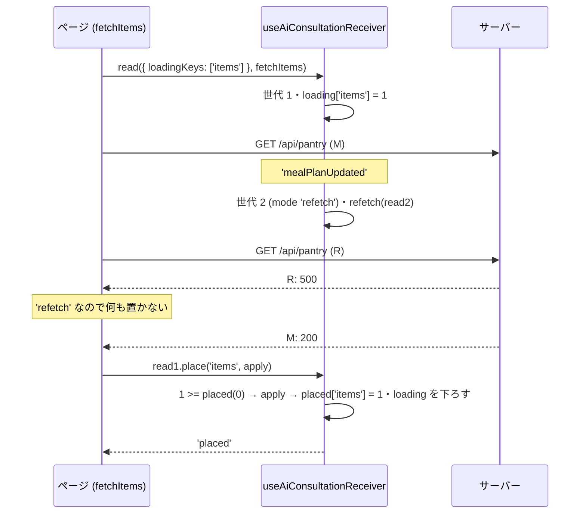
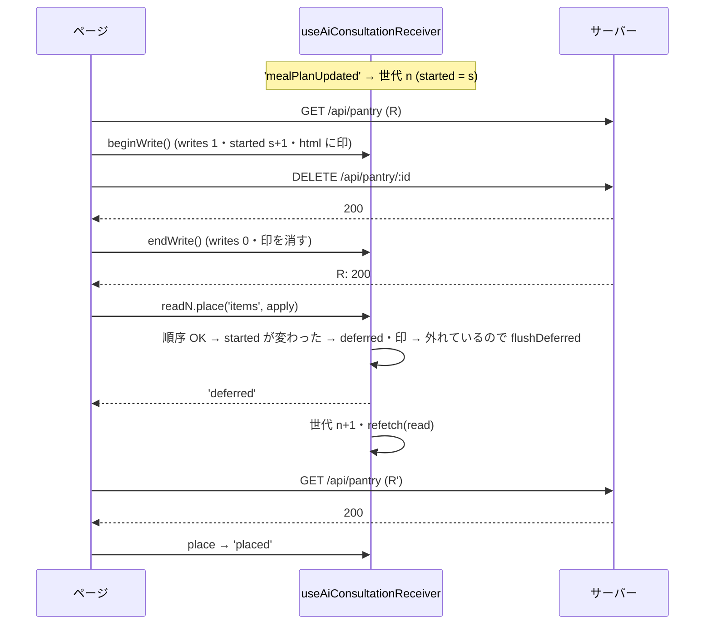
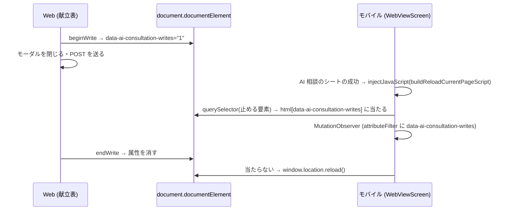

# Web (とモバイル) の AI 相談の取り直しの受け手の契約と、仕組みの一本化 (#2206 G1) 設計

| 版 | 日付 | 内容 |
|---|---|---|
| v1.0 | 2026-11-04 | 新設 (Issue #2206 の G1 の設計ゲート・A 型 4 相。V1 (#2200)・V1b (#2202)・U1+U2 (#2205)・U4 (#2204) で入った「AI 相談の成功のあとに開いているページが自分のデータを取り直す」仕組みの受け手の契約を正典として書き、順序・番兵・書き込みの印・止めた通知の印付けを共通の部品 (`useAiConsultationReceiver`) の中だけで行う構造へ一本化する。機械の番兵を「置くのは `place` の中だけ・書き込みは窓の中だけ」の少数の規則に置き換える。モバイルの読み込み直しが Web の書き込みの印を見るようにする) |
| v1.1 | 2026-11-04 | 段 A (#2221)・B (#2223)・C (#2222)・D (#2224)・E (#2225)・F (#2226) を実装しマージ済み。旧 hook `src/hooks/useAiConsultationDataRefetch.ts` と旧番兵 `tests/ai-consultation-refetch-placement-guard-2201.test.ts` は段 F で削除済み。§3 は基点 `eb1ad85da` の事実の記録。記録の追随 (#2227 docs-1104b。製品の挙動は変えない): §6.10 の限界の欄・§10.3 の番兵ありの行の副作用・§19 の受入条件 (2) を今の番兵とコードに合わせた |

要件の正本は Issue #2206 の本文 (「候補の仕分け」の構造の案と、docs-1103c の「受け手の契約を設計書に書く」の節) と、2026-11-03 のコメント (G1 の行)。本書はその上で決めた範囲と設計で、Issue と食い違ったら本書が正。
ファイル名は cross/26 (cross/ の既存は 01〜09・12・13a・13b・14〜25。10・11 は欠番)。Issue #2206 の本文の「設計書の欠落」の候補は置き場を `cross/26-ai-consultation-refetch.md` と書いているが、本書の名前は `26-ai-consultation-refetch-receivers.md` で確定する (受け手の契約が主題)。

前提 (本書が従う条件):

- 範囲は Web の受け手の共通の部品 `src/hooks/useAiConsultationDataRefetch.ts` (段 F までに `src/hooks/useAiConsultationReceiver.ts` に置き換え、削除済み)・それを使う受け手 22 ファイル (§3.2。ページ 18・部品 3・`src/hooks/useHomeData.ts`。設計後は `home/page.tsx` が外れて 21)・機械の番兵 `tests/ai-consultation-refetch-placement-guard-2201.test.ts` (段 F で `tests/ai-consultation-receiver-placement-guard-2206.test.ts` に置き換え、削除済み)・モバイルの読み込み直し `apps/mobile/src/lib/webViewBridge.ts` の `buildReloadCurrentPageScript`。DB・migration・API の route・RLS・監査ログ・Zod のスキーマは増やさず変えない (該当なし)。
- 守ること (Issue #2206 の U1+U2・U4 の契約。本書 §0.2 の R-1〜R-6): 取り直しの失敗は今の表示を残す / 取り直しで全画面のスピナーを出さない / 対象の鍵ごとに置いたものより新しい応答だけを置く / 置く直前に番兵 (モーダル・入力・書き込み中) を見る / 止めた通知は番兵が外れたとき・書き込みが終わったときに 1 回だけ取り直す ((b)。段 A〜F で実装済み) / U4 の /home の取り直しでは AI を呼ばない (開いたときの読み込みを引き継いだ回は AI つき — ただし本書の構造では「引き継ぐ回」そのものが無くなる。§5.3・§6)。
- 本書はコードを行番号でなく関数・名前で指す。事実の基点は origin/main `eb1ad85da` (2026-11-04。G3 (#2211) のマージ後) の 1 つ。X1 (#2207)・docs-1103c (#2208)・G4 (#2209)・G5 (#2210)・G3 (#2211) は全部この基点にマージ済み。事実は `e6b14faa` (§3) と `9bff430c` (§9.1・§9.3・§17) で取り、次の差分を当て直した: (1) `e6b14faa..d3c7739b2` は受け手 22 ファイル・`src/hooks/`・部品に差分が無い (`apps/mobile/src/lib/webViewBridge.ts` はコメントだけ。§7.2 の定数は同じ)。(2) `d3c7739b2..eb1ad85da` (G5・G3) で変わった受け手は 6 ファイル: G5 = `health/graphs/page.tsx` (`fetchOrNull`・`readOkJson`。3 つの読み取りを投げずに読む)・`profile/nutrition-targets/page.tsx` (再設定の保存のあとの読み直し `plannerSavedKey`・プロフィールと栄養目標を両方読めたときだけ置く)・`profile/page.tsx` (`profileLoadFailed`・「再読み込み」の `profileReloadKey`)・`nutrition-target-planner.tsx` (`onSaved`)、G3 = `useHomeData.ts` (`suggestionBand`・`dismissedAnnouncementIdsRef`・`aiAnalysisReadInLoadRef`・`HOME_REFETCH_AUTH_EVENTS`・`aiSkippedAfterRead`)・`home/page.tsx` (`dismissAnnouncement`・`dismissSuggestion`)。§3.2・§7.5・§9・§17 はマージ後の形で書いた。GET でない送信の数 (§9.1) は 6 ファイルとも変わらない。(3) `src/lib/ai/consultation-refetch-coverage.ts` の `/home` の `nutritionAnalysisWithAi` の文と `docs/design/operator/06-ai-llm.md` の「上限に数えない機能」の行は G3 が書き換えた (§18)。(4) §17 の grep の語を持つテストは 28 本 (G5 の `tests/health-profile-load-edges-2206.test.tsx` が増えた。§17)。
- 本番の Supabase には触れない (読み取りも要らない設計)。実名 (利用者・報告者) を書かない。帰属の文言を新しく書かない。
- 製品コードの数値のリテラル (250ms の待ち・300ms の移動の待ち・5 分の控え) は、触る行では名前付きの定数にする (§14)。

---

## 0. 外形固定と分冊判定 (相 1)

### 0.1 発注と決めること

発注 (Issue #2206 G1): 共通の部品 (札の `deferIfHeld`・取得の流れ `useAiConsultationFetchStream` の `latestStarted` / `newerThanPlaced`・`place`・`useAiConsultationPendingWrites`・止めた通知の 1 回の取り直し) を約 21 の受け手がそれぞれ組み合わせている。受け手ごとの書き分けの漏れが審査のたびに 1 件ずつ見つかり、U1+U2 の構造裁定 (F) が 2 周続けて「取り直しの順序と置き方を共通の仕組みに一本化し、各ページから `isLatest` / `deferIfHeld` を外して `place` だけを公開する」を指摘した。本書で (1) 今の受け手の契約を正典として書き、(2) 一本化の構造を設計し、(3) 機械の番兵を少数の規則に置き換える計画まで書き切る。

本書が答えを出すこと:

| # | 決めること | 答え (§6) |
|---|---|---|
| 1 | ページに渡す公開の面 | `useAiConsultationReceiver(refetch)` が返す `{ read, beginWrite, isLoading }` と、`read` / `refetch` の関数が受け取る `{ mode, place(key, apply) }` だけ。`isLatest`・`deferIfHeld`・`beginFetch`・`refetchKey`・`cancelled` の印・世代の数をページに書かない (§6.1・§8) |
| 2 | 順序の決まり | 全部の鍵で「鍵ごとに置いた世代より新しければ置く」(今の `newerThanPlaced`) に統一。`latestStarted` は廃止。失敗した読み取りは何も置かないので鍵を譲る仕組みは要らない。そのために、1 つの鍵に置くのはその鍵の中身を全部読めた応答だけ (取り直しが一部だけ読めたとき、読めなかった部分を今の表示から写して同じ鍵に置かない)・取り直しが失敗でも置くもの (/home の同意の知らせ) は成功の応答と別の鍵・1 つの読み取りは 1 つの鍵に 1 回だけ置く (段ごとに途中の値を置かない) (§6.2) |
| 3 | 番兵と書き込みの印を見る場所 | `place` の中だけ。取り直しの読み取り (hook が始めたもの) だけが見る。ページが始めた読み取りは見ない (§6.3) |
| 4 | `placedRef` を進める時点 | `apply` が投げずに戻ってから (§6.2) |
| 5 | 読み込み中の表示 | 鍵ごとに hook が持つ。ページが始めた読み取りが `loadingKeys` で立て、その鍵が置かれたとき・立てた読み取りが終わったときに下ろす。取り直しは立てない・引き継がない。今の受け手で読み込み中の初期値が true のものは、`initialLoadingKeys` で最初の描画から立てる。`receiver` の参照は受け手の一生で変わらない (読み込み中の鍵が変わっても。`useEffect` の依存に入れてよい) (§6.4) |
| 6 | 書き込みの印 | hook が持つ (`beginWrite` → 終わりの関数)。真偽の ref の印と `notifyWriteSettled` は廃止。印が立っている間は `document.documentElement` に `data-ai-consultation-writes` を付け、モバイルの読み込み直しがそれを止める要素として見る (§6.5・§6.9) |
| 7 | 献立表の直接の `setCurrentPlan` (9 か所)・GET の応答を流れの外で直に置く献立表の 2 つ (買い物リストの再生成の完了・冷蔵庫の写真の保存のあとの読み直し)・/profile の保存・/meals の削除 | 置き換えは全部ページの読み取り (`receiver.read`) の `place` を通す。置き方 (献立 0 件・買い物リスト・カレンダーの印・自動展開) は呼び出し元ごとの名前付きの定数 `WEEK_PLACEMENT_*` で今のまま引き継ぐ (§7.4 の表)。週の応答でない 2 つは `KEY_SHOPPING_LIST`・`KEY_ACTIVE_SHOPPING_LIST`・`KEY_PANTRY` に置く (§7.4 の週の応答でない読み直しの表)。書き込み (GET でない送信) は全部 `beginWrite` の窓の中。生成・写真・再生成・改善・買い物リストの再生成の「待ち」は窓で囲まない (順序で足りる。写真は待ちが明けてから読み取りを始める。§5.3・§6.6・§7.4) |
| 8 | 献立表の完了の切り替えの 250ms・週のキャッシュ・カレンダーの印・買い物リスト | 送る値と巻き戻しの値は待ちが終わった時点の今の献立 (ref) から / キャッシュヒットでも `place` が読み込み中を下ろす・非 ok は控えに書かない / カレンダーの印は月を鍵にして重なりを無くす / 買い物リストは週の確認と分けて自分の鍵で置き、控えからは置かない / 全画面のスピナーは表示中の週の献立を置いた読み取りも下ろす (§6.4・§6.7) |
| 9 | 家族の画面の移動 | `router.replace` / `router.push` も `place` の中で呼ぶ (古い応答では移らない)。移る読み取りが読み込み中の表示を出していたなら、移るまで出したまま (今の `{ redirecting: true }` と同じ。ページの `redirecting` の state) (§6.8) |
| 10 | 機械の番兵 | 新しい `tests/ai-consultation-receiver-placement-guard-2206.test.ts` の規則 P1〜P6 (置くのは `place` の中だけ / 書き込みは窓の中だけ / Supabase の読み取りは `error` を受け取る / 捨てる入れ物に後から書かない / 旧 API を使わない / 受け手ごとの数の表)。P1 のたどりが入らない関数 (生成の監視の入口 3 つ) と、P2 が書き込みに数えない送信 (受け手の読み取りが置く値を変えない POST の行き先 4 つと、止まった依頼の掃除 1 つ) は理由つきの閉じた一覧 (§9.1・§9.2)。旧の番兵は段 F で消す (§6.10・§7.7) |
| 11 | 分冊と段 | 1 冊。実装は核 (段 A) → 配線 4 段 (B〜E) → 仕上げ (段 F) の 6 段・6 WF (§0.4・§16) |

### 0.2 要件行列

| # | 要件 | 根拠 | 本書の置き場 |
|---|---|---|---|
| R-1 | 取り直しの失敗 (通信の失敗・5xx・Supabase の error) では今の表示を残す。ページの読み取り (開いたとき・対象の切り替え・書き込みのあとの読み直し) の失敗は受け手ごとにこれまでどおり (§9 の `read.mode` の列): 多くは失敗の表示を出す。/health/graphs の Realtime の読み直しと /profile/nutrition-targets の再設定の保存のあとの読み直しは、取り直しと同じく今の表示を残す (`keepOnFailure`。#2206 G5)。/health/graphs のそのほかのページの読み取り (開いたとき・期間の切り替え・再読み込み) は、記録か健診を読めなければ空のグラフでなく「記録を読み込めませんでした」と再読み込みのボタンを出す (`loadFailedPeriod`。#2227 H3)。/home の取り直しは、栄養の分析の読み取りが失敗しても同意が無くて AI を省いた知らせ (`aiSkipped` の `consent_required`) だけは消す (#2206 G3。成功は同意済み。点数の鍵と別の鍵 `KEY_NUTRITION_CONSENT_NOTICE` に置く) | #2201 U1・#2206 G3・G5 | §6.2・§8 (`read.mode`)・§9・§10.1・§10.2 |
| R-2 | 取り直しでは全画面の読み込み中の表示を出さない。開いたときの読み込みの応答待ちに取り直しが始まり、取り直しが先に置いても・失敗しても・一部だけ読めても、読み込み中のまま止まらず、開いたときの応答が捨てられて空のまま残らない (/home の点数のカード・パフォーマンスの分析、/health/graphs の線、家族の画面と献立表の家族の切り替えを含む) | #2201 U1・Issue #2206 の「開いたときの読み込みの応答待ちに始まった取り直しが失敗すると空のまま残る」 | §4.3 S-1・S-2・S-28〜S-30・§6.2・§6.4 |
| R-3 | 置くのは、同じ鍵 (対象) で置いたどの応答よりあとに始めた読み取りの応答だけ。鍵は受け手が置き場所ごとに決め、対象を替えて出す表示 (週・選んだ日・食事の id・月・/comparison と /health/graphs の期間) は対象を鍵に含める | #2201 U1 | §6.2・§9 |
| R-4 | 取り直しの応答を置く直前に番兵 (入力の部品・モーダル。`isAiConsultationRefetchBlocked`)・書き込み中・取り直しを始めたあとに書き込みが始まったか、を見る。1 つでも当たれば置かず、止めた通知の印を 1 回だけ付ける。ページが自分で始めた読み取りは見ない | #2201 U1+U2 | §6.3・§7.1 |
| R-5 | 止めた通知は、番兵が外れたとき (DOM の変化)・書き込みが全部終わったときに 1 回だけ取り直す。止めている間に何回来ても 1 回 | #2201 U2 (推奨案 (b)) | §7.1・§10.3 |
| R-6 | /home の取り直しでは AI を呼ばない (点数・課題だけ)。開いたときの読み込みは AI つきで読む。AI つきの読み取りを 2 回読まない | #2201 U4・G3 | §6.6・§9 の /home の行・§20 Q-3 |
| R-7 | 取り直しの経路を通らない置き換え (献立表の生成の完了・1 食の再生成・写真の解析・改善・買い物リストの再生成の完了 (ポーリング・Realtime)・手入力の保存・並べ替え・追加・削除・冷蔵庫の写真の保存の後の読み直し、/profile の保存、/meals の削除) が、先に始めた読み取りの古い応答で戻されない | Issue #2206 G1 | §4.3 S-31・S-32・§6.6・§7.4・§9 |
| R-8 | 献立表の完了の切り替え (250ms の待ち) は、待ちが終わった時点の献立から送る値と巻き戻しの値を決める | Issue #2206 G1 | §6.7・§7.4 |
| R-9 | 献立表の週のキャッシュ: キャッシュヒットでも読み込み中の表示を下ろす。失敗 (非 ok) の応答を空の週として控えに書かない。控えの買い物リスト (編集の前の写し) で今の買い物リストを戻さない。止めている間に捨てないのは今までどおり | Issue #2206 G1 | §6.7・§7.4 |
| R-10 | 献立表のカレンダーの印: 鍵の違う重なる範囲の古い応答が AI の足した印を消さない。買い物リストは週を移った応答からも置く | Issue #2206 G1 | §6.7 |
| R-11 | 家族・譲渡の画面は、古い応答で `/family/setup`・ログインへ移らない。移るときの読み込み中の表示は今までどおり (読み込み中の表示を出していた読み取りが移るなら移るまで出したまま。/org/transfer-accept は今と同じく下ろす) | Issue #2206 G1 | §6.8・§7.6 |
| R-12 | 機械の番兵は「置くのは `place` の中だけ」「書き込みは窓の中だけ」などの少数の規則で、受け手の読み取りの経路の全部の置く場所を数える (今の規則 5 の「関数に 1 つあれば通る」粗さを消す)。旧の API がどの受け手にも残っていないことも数える。読み取りの経路の外で GET の応答を直に置く関数は数えない (P1 の限界。番兵のヘッダに書く) ので、そういう関数を経路に入れるのは配線 (§6.6・§7.4) で、描画のテストが確かめる | Issue #2206 G1 | §6.10・§7.7 |
| R-13 | モバイルの読み込み直しは、ページの書き込みの印が立っている間は読み込み直さず、外れたら 1 回読み込み直す (送ったばかりの POST を取り消さない) | Issue #2206 G1 | §6.9・§7.2 |
| R-14 | 既存の受け手の描画のテスト (`tests/ai-consultation-refetch-reads-2195` ほか) が確かめている挙動のうち、本書が変えると決めたもの以外は変えない (変える挙動は §10.2 の太字と §6.7 の 5 点、変えるテストは §17 に全列挙)。最初の描画の読み込み中の表示 (今の初期値 true)・移るまでの読み込み中の表示 (§6.8)・呼び出し元ごとの献立の置き方 (§7.4 の置き方の表) も変えない | 回帰の防止 | §6.4・§6.7・§6.8・§7.4・§10.2・§13・§17 |
| R-15 | 受け手の表 `src/lib/ai/consultation-refetch-coverage.ts` の receiver / excluded は変えない (受け手の集合は同じ)。説明の文だけ追随する | 範囲 | §17・§18 |
| R-16 | マジックナンバーを書かない。新しい定数は名前と根拠を持つ (§14) | 共通の規律 | §14 |

### 0.3 ユーザーシナリオ (32 本。トレースは §4.3・テストとの対応は §13.2)

登場するもの: M = ページが始めた読み取り (開いたとき・対象の切り替え・書き込みのあと)、R = AI 相談の成功の取り直し (hook が始める)、W = ページの書き込み (`beginWrite` の窓)、番兵 = 入力の部品・モーダル。

| # | シナリオ | 期待 (設計後) |
|---|---|---|
| S-1 | /pantry を開いた直後 (M の応答待ち) に AI 相談が成功し、R の応答が M より先に届く | R の一覧を置き、読み込み中の表示を下ろす。あとから届いた M の応答は置かない (古い) |
| S-2 | S-1 で R が失敗する (5xx) | M の応答が届いたら置く (空のまま残らない)。失敗の表示は出ない。読み込み中の表示は M が下ろす |
| S-3 | /home で AI 相談が続けて 2 回成功し、R1 の応答が R2 の応答より後に届く | R2 の値が残る (R1 は古い)。R1 が先に届けば R1 を置き、R2 で置き換える |
| S-4 | 献立表で週を W1 から W2 へ移った直後 (W2 の読み込み待ち) に AI 相談が成功し、R が先に失敗する | W1 の献立を W2 の見出しの下に出さない (読み込み中のまま W2 の応答を待ち、届いたら置く) |
| S-5 | 献立表で食事の完了の切り替え (W の窓) の応答待ちに AI 相談が成功する | 取り直さない (止めた通知)。W が終わったら 1 回取り直す。楽観的な表示は戻らない |
| S-6 | /pantry で R の応答待ちに食材を削除して (W) 終える。そのあと R の応答が届く | R の応答 (削除の前の一覧) を置かず、すぐに 1 回取り直す (削除した食材は戻らない) |
| S-7 | /profile で R の応答待ちに編集のモーダルを開く。R の応答が届く。モーダルを閉じる | R の応答を置かない (打ちかけの値を残す)。閉じたら 1 回取り直す |
| S-8 | /health/streaks を見ている間に AI 相談が成功し、R が通信で失敗する | 今の表示を残す。エラーの表示も読み込み中の表示も出ない |
| S-9 | /menus/weekly で AI 相談が 1 週間の献立の生成を受け付け (status processing)、数十秒後に完了する | 受付のときに 1 回取り直す (まだ献立は無い)。完了を見張りが知ると、もう 1 回取り直して献立を出す。ページ自身の生成の監視 (ポーリング・Realtime) が先に置いていれば、あとから届いた古い応答で戻さない |
| S-10 | モバイルの献立表で、生成のモーダルを閉じて生成の POST を送っている最中に AI 相談のシートが成功を知らせる | 書き込みの印 (`data-ai-consultation-writes`) が外れるまで読み込み直さない。外れたら 1 回読み込み直す (POST は取り消されない) |
| S-11 | 取り直しの応答待ちにページを離れる (アンマウント) | 応答が届いても何も置かず、止めた通知の印も付けない。生成の見張りもやめる |
| S-12 | 献立表で完了を押し、250ms の待ちの間に AI 相談 (complete_meal) が同じ食事の完了を変え、R がそれを置く | 待ちが終わった時点の献立 (R が置いた値) から反転を決めて送る。失敗の巻き戻しも R の後の値に戻す |
| S-13 | 家族を抜けて入り直す数百 ms の間に、/family/dashboard の古い応答 (family_id 無し) が後から届く | `/family/setup` へ移らない (古い応答は置かない = 移らない) |
| S-14 | /meals/[id] で削除が成功して献立表へ移るまでの 300ms (移動の完了まで) に AI 相談の成功が来る。または削除の応答待ちに来た成功の取り直しが、削除の窓が閉じたあとに流れる | 削除した食事の鍵には、ページを離れるまで何も置かない (取り直しの 404 で「見つかりませんでした」を出さない。削除の前の食事にも戻さない) |
| S-15 | 献立表で、月のパネルの範囲 (AI の前に読み始めた) の古い応答が、R の同じ月の応答のあとに届く | 鍵が同じ月なので古い応答は置かない (AI が足した印は消えない) |
| S-16 | /health で日を A→B→A と選び直し、最初の A の応答が B のあとに届く | A のパネルに A の記録を出す (鍵は日ごと)。B の記録を出さない |
| S-17 | /profile で保存 (PUT) の応答待ちに、保存の前に始まった R の応答が届く | R の応答を置かない (保存が始まっている)。保存が終わったら 1 回取り直す (保存前の値に戻らない) |
| S-18 | 献立表で週を移り、控え (キャッシュ) に当たる。別に、隣の週の先読みが 5xx になる | 控えの献立を置いて読み込み中を下ろす。5xx の週は控えに書かない (次にその週へ移ったら読む) |
| S-19 | /pantry (と、今の読み込み中の初期値が true の受け手) を開く。最初の描画は開いたときの読み取りが始まる前 | 最初の描画から読み込み中の表示を出す (「食材がありません」・入力欄・家族の無い状態を一瞬も出さない)。開いたときの応答を置いたら下ろす。開いた effect は 1 回だけ走り、GET は 1 回 (読み込み中の鍵が立って下りても読み直さない) |
| S-20 | /comparison で週間の取り直し R (週間) の応答待ちに「月間」へ切り替える。R の応答が月間の応答より先に届く | 週間の順位を月間の見出しの下に出さない。月間の読み込み中の表示は月間の応答を置くまで下ろさない (/health/graphs の期間の切り替えも同じ) |
| S-21 | 献立表で週 W1 の読み込み (開いたとき) の応答待ちに W2 へ移り、W2 を控えから出す。そのあと W1 の読み込みが 5xx で失敗する | W2 の献立を消さない (W1 の失敗の空は W1 を出しているときだけ置く) |
| S-22 | 献立表を開いた直後 (表示中の週 W の読み込み M の応答待ち・全画面のスピナー) に AI 相談が成功し、取り直し R の W の献立が M より先に届く | R の献立を置き、M の応答を待たずに全画面のスピナーを下ろす。あとから届いた M の応答 (AI の前の献立) は置かない (今の挙動と同じ) |
| S-23 | 献立表で買い物リストを編集 (品目のチェック・追加・削除) したあと、先読みで控えにある隣の週へ移る | 買い物リストは編集のあとの一覧のまま (控えの古い一覧で戻さない)。献立は控えから出す |
| S-24 | /family/dashboard (と /family/members・/family/members/[id]・/family/transfer-accept) を開くと、家族に入っていない (family_id が空。ログインしていなければログインの画面) | `/family/setup` へ移し、移るまで読み込み中の表示のまま (今と同じ)。取り直し (読み込み中の表示を出していない) が移すときは、今と同じく今の画面のまま移る |
| S-25 | 献立表で「自炊」の食事を足す | 追加のあとに読み直した週から作った食事を取り、手入力の編集 (命名) を開く (UX2-32。今と同じ) |
| S-26 | 献立表で、ある日の最後の 1 食を削除する (その週のほかの日には献立がある) | その日の月のカレンダーの印を消す (今の `syncCalendarMealDatesFromDailyMeals` と同じ。足すだけにしない) |
| S-27 | 献立表で写真の解析を頼み、結果を待つ (10〜20 秒) あいだに AI 相談が成功して取り直しが週の献立を置く。そのあと結果が書かれて待ちが明ける | 待ちが明けてから読み取りを始めて結果の献立を置く (取り直しの古い献立に戻らず、結果が出る)。結果の献立が 0 件の週なら何も置かない (今と同じ) |
| S-28 | /home を開いた直後 (開いたときの AI つきの栄養の分析と、パフォーマンスの分析の応答待ち) に AI 相談が成功し、取り直しの栄養の分析が 5xx・パフォーマンスの分析 (`/api/performance/analyze`) が 5xx になる (取り直しの今日のチェックインは読める) | 開いたときの分析の応答が届いたら、点数・課題・アドバイスとパフォーマンスの分析を置く (点数のカードが出る。空のまま残らない)。分析の読み込み中の印は開いたときの分析の読み取りが下ろす。同意の知らせ (`consent_required`) を消す片づけは点数の鍵に触れない。今日のチェックインは取り直しが読んだ値 |
| S-29 | /health/graphs を開いた直後 (記録・健診・目標の応答待ち) に AI 相談が成功し、取り直しは記録が 5xx で目標だけ読める | 開いたときの応答が届いたら記録の線を置く (空のまま残らない)。目標の線は取り直しが置いた値 (開いたときの目標の応答は古いので置かない)。読み込み中の表示は開いたときの読み取りが下ろす |
| S-30 | 家族の画面 (/family/members ほか) と献立表を開いた直後に AI 相談が成功し、取り直しが途中で読めない (名前の API が 5xx・/family/members/[id] の子供の同意の記録が読めない・献立表の家族の読み込みのプロフィールか家族の一覧が読めない) | 取り直しは何も置かない (途中の段の値も置かない)。開いたときの応答が届いたら一覧・名前・家族の切り替えを置き、読み込み中の表示を下ろす (空のまま残らない)。開いたときの応答が家族に入っていない (family_id が空) なら、移るまで読み込み中の表示のまま (S-24) |
| S-31 | 献立表で買い物リストの再生成を頼み (送信は窓の中・数秒〜2 分の完了の待ちは窓の外)、完了の前に AI 相談が成功して取り直し R が始まる (サーバーの一覧はまだ再生成の前)。完了の監視 (ポーリングか Realtime) が再生成した一覧を置いたあとに、R の応答が届く | 再生成した一覧が残る (R の応答の買い物リストは置かない。R の献立・冷蔵庫ほかは置く)。R の応答が完了より先に届けば R の一覧を置き、完了の一覧で置き換える。品目の追加の送り先 (`activeShoppingList`) は、完了の読み直しより新しい読み取りが品目を先に置いていても、完了の読み直しの一覧になる (今と同じ) |
| S-32 | 献立表を開いた直後 (開いたときの冷蔵庫の読み込みの応答待ち) に、冷蔵庫のモーダルで写真から食材を足す。保存のあとの読み直しが足したあとの一覧を置いたあとに、開いたときの読み込みの応答 (足す前の一覧) が届く | 足したあとの一覧が残る (古い応答は置かない)。写真の窓を開ける前に始めた取り直しの応答が窓を開けたあとに届いても置かず、窓が閉じたら 1 回取り直す (今と同じ) |

### 0.4 分冊判定

目安 (設計書 800 行超 / 消費先レーン 3 以上 / 共有面 2 つ以上) の 3 つ全部に当たる。しかし核 (共通の部品) と配線 (受け手の移行) は同じ契約の表裏で、分冊すると配線の冊が核の冊の契約を写すだけになる。**1 冊にし、実装を 6 段・6 WF (1 案件 1 WF) に分ける** (§16)。核 (段 A) を先にマージし、配線の各段はマージ済みの核の実コードを参照する。Issue は親 1 + 子 6。

### 0.5 用語

| 語 | 意味 |
|---|---|
| 受け手 | `useAiConsultationReceiver` を呼ぶ src のファイル。設計後は 21 (ページ 17・部品 3 (`CheckupDetailClient.tsx`・`ProfileReminderBanner.tsx`・`nutrition-target-planner.tsx`)・`useHomeData.ts`)。今の hook を使うのは 22 (ページ 18 (`home/page.tsx` を含む)・部品 3・`useHomeData.ts`。§3.2)。/home はページでなく `useHomeData.ts` が受け手になる。閉じた表 `AI_CONSULTATION_REFETCH_PAGES` の receiver は道ごとの 19 で、数え方が違う (§9 の末尾) |
| 読み取り | `receiver.read(options, fn)` で始める 1 回の取得 (ページが始めるもの) と、hook が始める取り直し。どちらも `fn` に `read` (`{ mode, place }`) を渡す |
| 鍵 | 置き場所の名前。受け手が決める文字列。対象を替えて出す表示では対象を含める (`plan:2026-11-02` など) |
| 置く | `read.place(key, apply)` で `apply` を呼ぶこと。応答を state・store・router に反映する唯一の経路 |
| 世代 | 読み取りを始めた順の番号 (受け手ごとに 1 つの数)。置いた世代は鍵ごとに覚える |
| 番兵 | `isAiConsultationRefetchBlocked(document)` (入力の部品・モーダル)。Web の決まりは今までどおり (`src/lib/ai/consultation-data-refetch.ts`) |
| 書き込みの窓 | `const endWrite = receiver.beginWrite()` から `finally` の `endWrite()` まで |
| 止めた通知 | 番兵・書き込みの印で取り直せなかった AI 相談の成功。外れたときに 1 回だけ取り直す |
| 読み込み中の鍵 | `loadingKeys` で立てた鍵。`receiver.isLoading(key)` が true の間、ページは読み込み中の表示を出す |

### 0.6 読み方

- 実装は §7 の正典コードを写す。§8 の契約 (名前・引数・戻り値・決まり) と §14 の定数の名前を変えない。
- 受け手ごとの配線は §9 の表の行に従う。表に無い置き場所を見つけたら、deviations で報告する (表に足すのはオーケストレーター)。
- 表 3 点 (§10) とエラー表 (§11) は、レビューが最初に自分で作り直して突き合わせる対象。
- 本書の TS のブロックは、`// tsc:skip` を 1 行目に持つものを除き、そのまま型検査を通る形で書いてある (import を省かない)。`// tsc:skip` のブロックは既存ファイルの差分の断片と、テストの骨格。
- 本書の関数の名前と数 (§9.1 の送信の数・§9.3 の数の表・§17 の母集合) は基点 origin/main `eb1ad85da` (G3・G5 のマージ後) の時点。各段は、自分の段の受け手について §9.1 の列挙の規則と §17.2 の規則を枝を切った時点の origin/main で流し直し、名前・数が違えば実数で §9.1・§9.3 の行を読み替えて deviations に書く (表を直すのはオーケストレーター)。挙動の向き (失敗で表示を残すか・読み込み中を出すか) が §9 の行と食い違うコードが main に入っていたら、読み替えずに手を止めて deviations に書く (main にマージ済みのものが正で、本書を直すのはオーケストレーター)。

---

## 1. 目的・スコープ

- 目的: AI 相談の成功 (と献立の生成の完了) のあとに開いているページが自分のデータを取り直す仕組みで、順序・番兵・書き込みの印・止めた通知の印付け・読み込み中の表示を共通の部品の中だけで行い、受け手のページは「鍵を決めて `place` で置く」「書き込みを窓で囲む」だけにする。受け手ごとの書き分けの漏れ (§3.5 の 10 件) の発生源を消し、機械の番兵を少数の規則で厳密にする。
- 対象: §3.2 の受け手 22 ファイル (`useHomeData.ts` を含む。設計後は 21)・共通の部品 (新設 1・廃止 1)・機械の番兵 (新設 1・廃止 1)・既存のテストの追随 (§17)・モバイルの読み込み直し (`webViewBridge.ts` の定数 2 つとスクリプト 1 つ) とそのテスト・他の文書への追随表 (§18)。
- 対象外: AI 相談の時間切れ・会話の取り直し (G2)・/home の閉じたお知らせ・aiSkipped・アドバイスの帯の直し (G3。基点にマージ済みで、本書はその挙動を変えずに `apply` の中へ移す)・完成度の計算し直しと料理画像の積み込み (G4)・/health/graphs・/profile/nutrition-targets・/profile の縁のうち取り直しに関わらないもの (G5。基点にマージ済みで、挙動を変えずに移す)・`ai_action_logs` の RLS (Issue #2206 の 8)・モバイルに献立の生成の完了の見張りを足すこと (Issue #2206 の候補。本書は Web の受け手と、モバイルの読み込み直しの番兵だけ)・見張りの上限を時間で数えること。

## 2. 関連要件・既存設計

| 文書 | 関係 |
|---|---|
| Issue #2195 V1・#2200・#2202 | 受け手の仕組みの導入 (通知 `mealPlanUpdated`・番兵・閉じた表・生成の見張り) |
| Issue #2201 U1+U2 (#2205)・U4 (#2204) | 順序 (札・取得の流れ)・失敗・書き込みの印・止めた通知の 1 回の取り直し・/home の AI を呼ばない取り直し。本書はこれらの契約の正典 |
| Issue #2206 | 本書の発注。G1 の 10 件の欠陥 (§3.5) |
| `src/lib/ai/consultation-data-refetch.ts` | 番兵の決まり (変えない) |
| `src/lib/ai/consultation-generation-watch.ts` | 生成の見張り (変えない) |
| `src/lib/ai/consultation-refetch-coverage.ts` | 受け手の閉じた表 (集合は変えない。説明の文だけ追随) |
| `docs/design/operator/06-ai-llm.md`・`docs/design/cross/13b-legal-consent-mobile.md` | 本書を参照する側 (§18) |
| `docs/design/cross/06-perf-cache.md` | 取り直しの節は無い。本書が正典 |

---

## 3. 現状の事実 (基点 origin/main `eb1ad85da`・2026-11-04。`e6b14faa` で取り、G5・G3 で変わったところを `eb1ad85da` で当て直した。前提の節)

### 3.1 共通の部品 `src/hooks/useAiConsultationDataRefetch.ts` (521 行) の公開の面

| 名前 | 役 | 状態 |
|---|---|---|
| `useAiConsultationDataRefetch(refetch, { writeInFlightRef? })` → `{ beginFetch, notifyWriteSettled }` | 通知の購読・取り直しの札 (`AiConsultationFetchTicket = { isLatest, deferIfHeld }`) の生成・止めた通知・生成の見張り | 世代 (ページに 1 つ)・`deferred` (真偽 1 つ)・`MutationObserver`・見張りの集合 |
| `AiConsultationFetchTicket.deferIfHeld()` | 取り直しの札だけ: 番兵か書き込みの印 (`writeInFlightRef.current`) か「始めたあとに `startedCount` が増えた」で true。一度 true なら以後 true。true のとき `deferRefetch` で印を付ける。`beginFetch` の札は常に false | 札ごとの `deferredByThisTicket` |
| `useAiConsultationFetchStream(order)` → `{ begin(refetchTicket?, key?) → { isLatest, place(apply) } }` | 流れごと・鍵ごとの世代。`place` は順序 (`latestStarted` = 最後に始めたか / `newerThanPlaced` = 置いた世代より新しいか) → 札の `deferIfHeld` → `placedRef` を進める → `apply` | `startedRef`・`placedRef` (鍵ごとの Map) |
| `useAiConsultationRefetchKey({ writeInFlightRef? })` → `{ refetchKey, notifyWriteSettled, refetchTicket() }` | 取得を `useEffect` に書くページ向け。取り直しのたびに数が増える | 最後の札 |
| `useAiConsultationRefetchRun(refetchKey, fullScreenLoading)` → `() => boolean` | その回が取り直しで走ったか (`keyChanged && !fullScreenLoading`) | 前回の鍵・前の描画の loading |
| `useAiConsultationLoading()` → `{ loading, setLoading, refetchReadMode(), settleLoading(ticket) }` | 全画面の読み込み中の表示。`refetchReadMode()` は loading が立っていれば `'mount'` (取り直しが役を引き継ぐ) | `loadingRef` |
| `useAiConsultationPendingWrites()` → `{ begin() → end, subscribeSettled, startedCount, current }` | 重なりうる書き込みの印。0 になったら登録した関数を呼ぶ | `countRef`・`startedRef` |

読み取りの種類と番兵の関係 (今): `beginFetch` の札 (ページ) = 番兵を見ない。取り直しの札 = `deferIfHeld` を呼んだ場所で見る。引き継いだ回 (`refetchReadMode() === 'mount'`) = 呼ばない。

### 3.2 受け手の全列挙 (hook を使う src のファイル 22 = ページ 18・部品 3・`useHomeData.ts`) と、今の書き分け

列挙の規則: `git grep -l 'hooks/useAiConsultationDataRefetch' origin/main -- src` の 26 本から、hook を使わない (hook の名前をコメントで挙げるだけの) `src/lib/ai` の 4 本 (`consultation-data-refetch.ts`・`consultation-generation-watch.ts`・`consultation-refetch-coverage.ts`・`consultation-reply-reload.ts`。§17 G-17) を除いた 22 本。この 4 本は定数・関数も持ち、src で値を import するのは `src/app/(main)/MainLayout.tsx` (`consultation-data-refetch.ts` の `AI_CONSULTATION_CHAT_ROOT_PROPS`。吹き出しの印)・`src/components/AIChatBubble.tsx` (`consultation-reply-reload.ts` の定数と関数)・受け手 #21 `nutrition-target-planner.tsx` (`AI_CONSULTATION_UNEDITED_INPUTS_PROPS`)・旧 hook `src/hooks/useAiConsultationDataRefetch.ts` (段 F で消す)・新しい hook (§7.1。`consultation-data-refetch.ts`・`consultation-generation-watch.ts`) (`git grep -n 'lib/ai/consultation-\(data-refetch\|generation-watch\|refetch-coverage\|reply-reload\)' origin/main -- src apps packages` の import の行)。`MainLayout.tsx`・`AIChatBubble.tsx` は hook を使わないので受け手でなく、本書が 4 本で変えるのはコメントだけ (G-17) なので変えない (§17.1 の G-32。§19 の保持)。下の表は `home/page.tsx` と `useHomeData.ts` を #14 の 1 行にまとめるので 21 行。

| # | 受け手 | 今の形 | 順序を見る所 | 番兵 (`deferIfHeld`) | 書き込みの印 | 今の漏れ (仕分けで確かめたもの) |
|---|---|---|---|---|---|---|
| 1 | `src/app/(main)/badges/page.tsx` | `useAiConsultationRefetchKey` + `useEffect` | `cancelled` | 見ない | 無し | 取り直しでも `newlyEarned` を置く (仕様どおり)。番兵を見ない |
| 2 | `src/app/(main)/comparison/page.tsx` | RefetchKey + RefetchRun(key, loading) + `AbortController` | `signal.aborted` | 見ない | 無し | 同じ描画で鍵と期間が変わると取り直しの扱いになる |
| 3 | `src/app/(main)/family/dashboard/page.tsx` | `useAiConsultationLoading` + `beginFetch`・`readDashboard(ticket, mode)` → `{ redirecting }` (移ったら `settleLoading` を呼ばず、移るまで読み込み中の表示のまま) | `isLatest` (段ごと) | 見ない | 無し | `router.replace('/family/setup')`・ログインへの `push` を `isLatest` を見ずに呼ぶ |
| 4 | `src/app/(main)/family/members/page.tsx` | 同上・`loadMembers`・取り直し自身が真偽の ref `writeInFlightRef` を立てる | `isLatest` | 見ない | 真偽の ref (取り直し中は除名・脱退のボタンを止める) | 3 と同じ移動 |
| 5 | `src/app/(main)/family/members/[id]/page.tsx` | 同上・`readMember`・`busyRef` | `isLatest` | 見ない | 真偽の ref (`busyRef`) | 3 と同じ移動 |
| 6 | `src/app/(main)/family/transfer-accept/[proposal_id]/page.tsx` | 同上・`fetchProposal`・`busyRef` | `isLatest` | 見ない | 真偽の ref | ログインへの移動を順序を見ずに |
| 7 | `src/app/(main)/org/transfer-accept/[proposal_id]/page.tsx` | 6 とほぼ同型。違いは `fetchProposal` が `{ redirecting }` を返さず、`loadPage` が `finally` で必ず `settleLoading` を呼ぶこと (ログインへ移っても読み込み中の表示を下ろす) | `isLatest` | 見ない | 真偽の ref | 同上 |
| 8 | `src/app/(main)/health/blood-tests/page.tsx` | `useAiConsultationDataRefetch(fetchSex)` | `isLatest` | 見ない | 無し | — |
| 9 | `src/app/(main)/health/checkups/[id]/CheckupDetailClient.tsx` | 8 と同型 | `isLatest` | 見ない | 無し | — |
| 10 | `src/app/(main)/health/goals/page.tsx` | Loading + `pendingWrites` + `beginFetch`・`fetchGoals(ticket, mode)` | `isLatest` | refetch のとき | `pendingWrites` (削除だけ) | 引き継いだ回 (mode `'mount'`) は番兵を見ない。作成・編集の書き込みは印の外 (モーダルが番兵) |
| 11 | `src/app/(main)/health/graphs/page.tsx` | Loading + `beginFetch`・`fetchData(ticket, mode)`・Realtime の購読でも `fetchData(beginFetch(), refetchReadMode())`。3 つの読み取りは `fetchOrNull`・`readOkJson` で投げずに読む (G5) | `isLatest` | 見ない | 無し | — |
| 12 | `src/app/(main)/health/page.tsx` | Loading + `beginFetch`・`fetchData(ticket, mode)`・選んだ日は `selectedDateFetchStream` (`newerThanPlaced`・`begin(null, date)`) | `skipPlacing` (段ごと)・`place` | refetch のとき (`fetchData`)。選んだ日の読み直しは札なし | 無し。記録の保存 (`handleQuickSave`) は印の外 | 選んだ日のパネルは番兵を見ない |
| 13 | `src/app/(main)/health/streaks/page.tsx` | Loading + `beginFetch`・`fetchStreak(ticket, mode)` | `isLatest` | 見ない | 無し | — |
| 14 | `src/app/(main)/home/page.tsx` → `src/hooks/useHomeData.ts` | ページが `useAiConsultationDataRefetch(refetch, { writeInFlightRef: aiConsultationWrites })`。`useHomeData` が Loading・PendingWrites・流れ 3 本 (`homeFetchStream`・`performanceAnalysisStream`・`nutritionAnalysisStream` (鍵 2 つ))。G3 で、今日のアドバイスの帯は `suggestionBand` (文と出所 `'ai_advice'`・`'activity'`・`'menu_change'`)、閉じたお知らせは `dismissedAnnouncementIdsRef`、ログインの状態の変化の読み直しは `HOME_REFETCH_AUTH_EVENTS` の 3 つだけ、取り直しの同意の知らせは `aiSkippedAfterRead` で消す (読み取りが失敗しても) | `isLatest` (利用者・集計・お知らせ)・`place` (活動量・今日の献立・分析) | `place` 経由 (活動量・今日の献立) | `aiConsultationWrites` (完了の切り替え・活動量) | 利用者・集計・お知らせは `isLatest` だけ。巻き戻しの `fetchHomeData()` は mode `'mount'` で札を見ない。チェックインの保存・献立の変更の実行 (POST) は印の外。引き継いだ回は、引き継ぐ読み込みがまだ AI つきの分析を読み始めていなければ AI つきで読む (`aiAnalysisReadInLoadRef`。G3) |
| 15 | `src/app/(main)/meals/[id]/page.tsx` | RefetchKey({ writeInFlightRef: pendingWrites }) + RefetchRun(key, loading) + `useEffect` ×2 | `cancelled` | refetch のとき (catalog の await の後) | `pendingWrites` (完了の切り替えだけ) | 404 は `setMeal(null)` (仕様どおり)。削除 (`handleDelete`) は印の外 |
| 16 | `src/app/(main)/menus/weekly/page.tsx` | 流れ 5 本 (`planFetchStream` (`newerThanPlaced`・週の鍵。週の読み込み `fetchPlan` と、読み直し `refreshMealPlan` が使う。`refreshMealPlan` の呼び出しは取り直し 1 か所と、v4 の生成の完了 `onGenerationComplete`・restoreGeneration の完了 2 か所・v4 のポーリングの完了・生成完了のダイアログを閉じたとき 2 か所の 6 か所。行き先は §6.7・§7.4)・`mealDatesFetchStream` (範囲の鍵)・`familyLoadStream`・`settingsFetchStream`・`pantryFetchStream`) + `pendingWrites` + `aiConsultationRefetchRound` (月のカレンダー・生成中の依頼の確認の effect を走らせ直す) | `place` | `place` 経由 | `pendingWrites` (窓 19 個・中の送信 20 か所。§9.1) | `setCurrentPlan` の呼び出しは基点で 17 か所 (定義の行とコメントを除く) = 流れの中の 5 か所 (`fetchPlan` の 3 か所 (控えの週・応答の週・空の週の `order.place`)・`refreshMealPlan` の 2 か所。どちらも `planFetchStream` の札を見る) + 流れの外の読み直し 9 か所 + 書き込みの窓の中の書き換え 3 か所 (下の `saveEditMeal` 2 か所・`generateMealImage` 1 か所。どれも今の `pendingWrites.begin()` の窓の中で、§9.1 の W-53・W-57・W-58 の窓のまま)。読み直した週を流れの外で `setCurrentPlan` に置く 9 か所 (生成の完了のポーリング `startPolling`・Realtime `subscribeToRequestStatus`・`handleAddMealWithMode`・`finishRegenerate`・`confirmDeleteMeal`・`saveManualEdit`・写真の解析の結果・`finishImprove`・`reorderMeal`。置き方は呼び出し元ごとに違う: §7.4 の置き方の表)。週の応答でない GET の応答を流れの外で直に置く 3 か所 (買い物リストの再生成の完了 `subscribeToShoppingListRequest` のポーリングと Realtime が GET /api/shopping-list を読んで `setShoppingList`・`setActiveShoppingList`、冷蔵庫の写真の保存 `handleFridgePhotoSelected` のあとの読み直しが窓の中で GET /api/pantry を読んで `setFridgeItems`。どちらも読み取りの根から名前でたどれないので、今の番兵も新しい P1 も数えない。§7.4 の週の応答でない読み直しの表)。ほかに、書き込みの窓の中で今の献立を書き換える `setCurrentPlan` が 2 関数 (`saveEditMeal` の楽観的な更新と巻き戻し・`generateMealImage` の保存した画像の当て込み。読み直しではない)。生成の POST (`handleGenerateWeekly`) は印の外。完了の 250ms。キャッシュヒットで loading を下ろさない。`fetchWeekData` が非 ok を空で返す。カレンダーの印の鍵が範囲。買い物リストを週の確認の中で置く |
| 17 | `src/app/(main)/pantry/page.tsx` | Loading + `pendingWrites` + `beginFetch`・`fetchItems(ticket, mode)` | `isLatest` | refetch のとき | `pendingWrites` (削除・手入力・写真の保存) | 引き継いだ回は番兵を見ない |
| 18 | `src/app/(main)/profile/page.tsx` | RefetchKey + RefetchRun(key, isLoading) + `useEffect` (依存に「再読み込み」の数 `profileReloadKey`。G5)。開いたときの読み込みの失敗は `profileLoadFailed` (保存を止めて「再読み込み」を出す。取り直しの失敗では変えない・読めたら下ろす。G5) | `cancelled` | refetch のとき (プロフィールの読みの後だけ) | 無し。`handleSave` (PUT) は印の外 | `setUser` は札を見ない。保存中の古い応答で保存前の値に戻る |
| 19 | `src/app/(main)/profile/nutrition-targets/page.tsx` | RefetchKey + RefetchRun(key, loading) + `useEffect` (依存に再設定の保存の数 `plannerSavedKey`。再設定の `onSaved` で増える。G5)。取り直しと再設定の保存のあとの読み直し (`isRefetch`) は、プロフィールと栄養目標を両方読めたときだけ両方を置き、失敗では今の表示を残す (G5) | `cancelled` | 見ない | 無し | — (再設定の部品 21 が番兵と印を持つ) |
| 20 | `src/components/ProfileReminderBanner.tsx` | RefetchKey + RefetchRun(key) + `useEffect` | `cancelled` | 見ない | 無し | — |
| 21 | `src/components/nutrition/nutrition-target-planner.tsx` | Loading + `pendingWrites` + `beginFetch`・`fetchPlannerData(ticket, mode)`。保存が済んだら `onSaved?.()` (G5。置いたページが自分の表示を読み直す) | `isLatest` | refetch のとき | `pendingWrites` (保存) | 引き継いだ回は番兵を見ない |

`useHomeData.ts` は 14 の取り直しの関数と印を作る hook (今の番兵の `DELEGATED_RECEIVERS`)。本書では `useHomeData.ts` 自身が `useAiConsultationReceiver` を呼び、`home/page.tsx` は hook を呼ばなくなる (受け手のファイルは 22 から 21 へ: ページ 17 + 部品 3 + `useHomeData.ts`)。

### 3.3 モバイルの読み込み直し (`apps/mobile/src/lib/webViewBridge.ts`)

- `AI_CONSULTATION_RELOADABLE_PATHS = ['/home', '/menus/weekly', '/comparison', '/profile']`。
- `AI_CONSULTATION_RELOAD_BLOCKING_SELECTOR` = input (hidden を除く。file は数える)・textarea・select・contenteditable・`[role="dialog"]`・`[aria-modal="true"]`・`dialog[open]`。ページごとの追加は `/profile` の `.fixed.inset-0` だけ。
- `AI_CONSULTATION_DEFERRED_RELOAD_OBSERVED_ATTRIBUTES = ['role', 'aria-modal', 'open', 'contenteditable', 'type', 'class']`。
- `buildReloadCurrentPageScript()`: 止める要素が無ければ即 `window.location.reload()`。あれば `MutationObserver` で見張り、外れたら 1 回読み込み直す (`AI_CONSULTATION_DEFERRED_RELOAD_WATCH_KEY` で 1 つに)。**書き込みの印は見ない** (Web の `useAiConsultationPendingWrites` は DOM に出ない)。
- `apps/mobile/src/components/web/WebViewScreen.tsx` が `subscribeAiConsultationDataChanged` で知らせを受け `injectJavaScript` する。マイページは `aiConsultationReloadTiming="onFocus"`。

### 3.4 既存の番兵 (本書の変更に反応するテスト)。直し方は §17

- `tests/ai-consultation-refetch-placement-guard-2201.test.ts` (規則 1〜8。下限 `MIN_COUNTED_MARKER_RECEIVERS = 6`・`MIN_REFETCH_PATH_FETCHERS = 46`・`MIN_REFETCH_PATH_SUPABASE_READS = 38`・`MIN_OPTIMISTIC_WRITE_FUNCTIONS = 8`・`MIN_REFETCH_DISCARDED_CONTAINERS = 1`・`SELF_HELD_RECEIVERS` 4 件・`DELEGATED_RECEIVERS` 1 件・`OPTIMISTIC_WRITE_EXEMPTIONS` 1 件)。
- `tests/ai-consultation-data-refetch-2195.test.tsx` (番兵の決まり・モバイルとの並びの一致・イベントの名前・hook の単体・取得の流れ・読み込みの引き継ぎ・ページの描画・受け手の配線の正規表現・モーダルの `role="dialog"`)。
- `tests/ai-consultation-refetch-coverage-2195.test.ts` (受け手のページは取り直しの hook を使う / 除外は使わない / 受け手の hook は生成の見張りを使う)。
- `tests/ai-consultation-generation-watch-2195.test.tsx` (hook を使って見張りを確かめる)。
- `tests/ai-consultation-refetch-reads-2195.test.tsx`・`tests/ai-consultation-home-refetch-2195.test.tsx`・`tests/ai-consultation-weekly-refetch-2195.test.tsx` (受け手の描画の挙動)。
- `tests/ai-chat-timeout-reload-2201.test.tsx` (hook を import して組み合わせる 1 節)。
- `src/__tests__/app/menus/weekly/family-menu-wiring.test.ts` (`const familyLoadStream = useAiConsultationFetchStream();` を逐語で見る)。
- `apps/mobile/__tests__/components/WebViewScreen.ai-data-reload.test.tsx`・`apps/mobile/__tests__/components/ai-reload-blocking-web-markers.test.ts`・`apps/mobile/__tests__/ai/advisor-sheet-reload-running.test.tsx`。
- `tests/helpers/heavy-unit-test-timeout.ts` (構文木の走査のテストの時間切れの一覧。新しい番兵は同じ型なので足す)。

### 3.5 欠陥の仕分け (Issue #2206 G1 の 10 件) と発生源

| # | 欠陥 | 発生源 | 本書の消し方 |
|---|---|---|---|
| D-1 | 受け手が `isLatest`・`cancelled`・`deferIfHeld`・`place` を自分で組み合わせ、書き分けが漏れる (利用者・集計・お知らせが `isLatest` だけ / 選んだ日・streaks・comparison・badges・404・/profile の成功の経路・引き継いだ回が番兵を見ない / `placedRef` が `apply` の前に進む) | 順序と番兵の判断がページ側にある | ページには `place(key, apply)` だけ。判断は全部 hook の `place` の中 (§6.1〜§6.3) |
| D-2 | 開いたときの読み込みの応答待ちに始まった取り直しが失敗・deferred になると、開いたときの応答が `superseded` で捨てられ空のまま残る (`latestStarted`) | 「最後に始めた取得だけ置く」順序。加えて、取り直しの一部の失敗・失敗でも置く片づけ (/home の `settleKeepingAnalysis`・パフォーマンスの分析の非 ok の分岐・/health/graphs の目標・家族の画面の `keepShownFamilyMemberNames`・同意の記録・献立表と家族の画面の段ごとの setter) が、ページの読み取りの成功の応答と同じ置き場所に置く | 順序を `newerThanPlaced` に統一。失敗・deferred は何も置かないので、先に始めた応答が置ける。鍵に置くのはその鍵の中身を全部読めた応答だけ・失敗でも置くものは別の鍵・1 つの読み取りは 1 つの鍵に 1 回 (§6.2) |
| D-3 | 献立表の手入力の保存・生成の完了・再生成・写真・改善・並べ替え・追加・削除のあとの `setCurrentPlan`、買い物リストの再生成の完了の `setShoppingList`・`setActiveShoppingList`、冷蔵庫の写真の保存のあとの読み直しの `setFridgeItems` が流れを通らない。/profile の保存・/meals の削除が印の外 | 「取り直しの経路」だけを守る設計 | 置き換えは全部ページの読み取りの `place`。書き込みは全部窓の中 (番兵 P1・P2 が数える。P1 は読み取りの経路の中だけを数えるので、経路の外で GET の応答を直に置く関数を経路に入れるのは配線 (§6.6・§7.4) で、描画のテストが確かめる) (§6.6) |
| D-4 | 完了の切り替えの 250ms の待ちの間に取り直しが同じ食事の完了を変えると、古い値からの反転と巻き戻し | 押した描画の写しから値を決める | 待ちが終わった時点の `currentPlanRef` から決める (§6.7) |
| D-5 | キャッシュヒットで loading を下ろさない・先読みの非 ok を空の週として 5 分持つ | loading の下ろし方がページの分岐に散る・失敗と空の区別が無い | 読み込み中は hook の鍵 (置いたら下ろす)。`fetchWeekData` は非 ok で null (§6.4・§6.7) |
| D-6 | カレンダーの印の鍵が範囲で重なる・買い物リストを週の確認の中で置く | 鍵の切り方 | 月を鍵に・買い物リストは自分の鍵 (§6.7) |
| D-7 | 家族の画面で古い応答が `/family/setup`・ログインへ移す | 移動が `place` の外 | 移動も `place` の中 (§6.8) |
| D-8 | 機械の番兵の粗さ (関数に 1 つあれば通る・印を渡す受け手だけ・献立表の書き込み 20 か所のうち回帰テスト 2 経路) | 守るべき形が「置く場所ごと」でなく「関数ごと」 | P1「置くのは `place` の中だけ」(置く場所ごと)・P2「書き込みは窓の中だけ」(§6.10) |
| D-9 | 設計書が無い | — | 本書 |
| D-10 | モバイルの読み込み直しが書き込みの送信中に走る | 書き込みの印が DOM に無い | `data-ai-consultation-writes` を `html` に出し、モバイルが止める要素に数える (§6.9) |

---

## 4. 構想 (相 2)

### 4.1 構造 (構造 A: 受け手ごとに 1 つの hook が、全部の判断を `place` の中で行う)

```text
                 window 'mealPlanUpdated' ──┐   生成の見張り (完了) ──┐
                                            ▼                         ▼
 ┌────────────────────────── useAiConsultationReceiver(refetch) ──────────────────────────┐
 │ 世代 (1 つの数)   置いた世代 (鍵 → 世代)   読み込み中 (鍵 → 立てた世代)   書き込み (count / started) │
 │ 止めた通知 (1 つ)  MutationObserver        生成の見張りの集合            document の印 (html[data-…-writes]) │
 │                                                                                                        │
 │  read(options, fn) ─── fn({ mode: 'mount', place })         ← ページが始める読み取り (番兵を見ない)      │
 │  (通知) ────────────── refetch({ mode: 'refetch', place })  ← hook が始める取り直し (番兵を見る)          │
 │  beginWrite() → end                                            ← 書き込みの窓                              │
 │  isLoading(key)                                                 ← 読み込み中の表示                          │
 └────────────────────────────────────────────────────────────────────────────────────────┘
                      ▲ place(key, apply)                 ▲ beginWrite
            ┌─────────┴───────────┐           ┌───────────┴──────────┐
            │ 受け手のページ: 鍵を決め、 │           │ 書き込みの関数: 窓で囲む │
            │ 応答は place の中で置く  │           │ (楽観的な更新も中)      │
            └─────────────────────┘           └──────────────────────┘
```

決まり (hook の中だけで判断する):

1. **順序**: `place(key, apply)` は、この読み取りの世代が「鍵 key に置いた世代」より小さければ `'superseded'`。同じ世代 (同じ読み取りがもう一度置く) と大きい世代は通す (hook はこれを通すが、受け手は 1 つの読み取りで 1 つの鍵に 1 回だけ置く。§6.2・§8 の 8)。
2. **番兵**: 取り直しの読み取り (`mode: 'refetch'`) だけ、順序を通ったあとに、番兵 (`isAiConsultationRefetchBlocked(document)`) か書き込み中 (`count > 0`) か「始めたあとに書き込みが始まった (`started` が変わった)」なら `'deferred'` を返し、止めた通知の印を 1 回だけ付ける (以後その読み取りの `place` は全部 `'deferred'`)。ページが始めた読み取り (`mode: 'mount'`) は見ない。
3. **置く**: `apply()` を呼び、投げなければ置いた世代を進め、その鍵の読み込み中の印を下ろす。
4. **読み込み中**: ページが始めた読み取りが `loadingKeys` で立てる。下ろすのは「その鍵が置かれた」か「立てた読み取り (その鍵を最後に立てたもの) が終わった」とき。取り直しは立てず、引き継がない (開いたときの読み取りは自分の応答を自分で置くので、引き継ぐ必要が無い)。最初の描画から立てておく鍵は `initialLoadingKeys` で渡す (立て主はどの読み取りでもない世代 0。開いたときの読み取りが同じ鍵を立て直し、その終わりか置いたときに下りる)。`isLoading` は鍵の表 (ref) を読み、鍵の表が変わったら版数の state で受け手を描画し直す。`receiver` の参照は一生変わらない。
5. **書き込みの印**: `beginWrite()` で `count` と `started` を 1 つ増やし、`document.documentElement` に `data-ai-consultation-writes="<全受け手の合計>"` を付ける。終わりで `count` を減らし、0 になったら印を消し、止めた通知があれば 1 回取り直す。
6. **止めた通知**: 通知 (と生成の完了) が来たとき番兵か書き込み中なら印を付けて DOM を見張る。`'deferred'` のときも同じ。外れたら 1 回だけ取り直す。アンマウントで全部やめる。
7. **失敗**: 取り直しの関数が投げても握る (`console.warn`)。ページは読み取りの失敗では `mode === 'mount'` のときだけ失敗の表示を `place` で置き、`'refetch'` なら何も置かない。取り直しが一部だけ読めたときも、読めなかった部分を含む鍵には置かない (読めた部分が別の鍵なら、その鍵には置く)。取り直しが失敗でも置くもの (/home の同意の知らせ) は、成功の応答を置く鍵と別の鍵に置く (§6.2)。

### 4.2 動き (受け手の書き方の型)

```text
const receiver = useAiConsultationReceiver(fetchItems, { initialLoadingKeys: [KEY_ITEMS] }); // 最初の描画から読み込み中

// 失敗の表示を出す受け手の例 (/pantry そのものは今も失敗の表示を出さない。§7.3)
const fetchItems = useCallback(async (read: AiConsultationRead) => {
  try {
    const res = await fetch('/api/pantry');
    if (!res.ok) { if (read.mode === 'mount') read.place(KEY_ITEMS, () => setError(...)); return; }
    const data = await res.json();
    read.place(KEY_ITEMS, () => setItems(data.items ?? []));
  } catch (e) {
    if (read.mode === 'mount') read.place(KEY_ITEMS, () => setError(...));
  }
}, []);

useEffect(() => { void receiver.read({ loadingKeys: [KEY_ITEMS] }, fetchItems); }, [receiver, fetchItems]); // receiver は一生同じ参照 → 1 回だけ走る
const loading = receiver.isLoading(KEY_ITEMS); // 描画の中で直に呼ぶ (useMemo に閉じ込めない)

const remove = async (id) => {
  const endWrite = receiver.beginWrite();
  try { await fetch(..., { method: 'DELETE' }); await receiver.read({}, fetchItems); }
  finally { endWrite(); }
};
```

### 4.3 シナリオのトレース (§4.1 の構造で手で走らせた記録)

| # | 走らせた記録 | 結果 |
|---|---|---|
| S-1 | M (世代 1・`loadingKeys: [items]`) 開始 → 通知 → R (世代 2) 開始 → R の応答: `place(items)`: 2 ≥ placed(0) → 番兵無し → apply → placed = 2・loading(items) 下ろす → M の応答: 1 < 2 → `'superseded'` → M 終了: items の立て主は 1 だが印はもう無い | 期待どおり |
| S-2 | S-1 で R が 5xx: R は `mode 'refetch'` なので何も置かない (`'superseded'` も `'placed'` も起きない) → M の応答: 1 ≥ 0 → apply → placed = 1・loading 下ろす | 空のまま残らない |
| S-3 | R1 (2)・R2 (3)。R2 先: placed = 3。R1 後: 2 < 3 → superseded。逆の順: R1 置く (placed = 2) → R2 置く (3)。/home の栄養の分析で R1 の応答が「分析できない」(`analysis: null`) のとき: R2 先なら R1 の `place(KEY_NUTRITION_SCORE)` は superseded で、AI の部分も帯も消さない (取り直しは点数を `'placed'` にできたときだけ AI の鍵に置く。§7.5)。R1 先なら R1 が点数を空にし、帯の AI のアドバイスと AI の部分を消し (`KEY_NUTRITION_AI` を 2 で置く)、R2 が点数を置く (R2 は AI を読まないので、アドバイス・帯は戻らない。§10.2) | 期待どおり |
| S-4 | W1 表示中。W2 へ (控えに無い): M2 (`loadingKeys: ['weekLoading']`) 開始・`isLoading('weekLoading')` で全画面。通知 → R (世代 n): `readDisplayedWeek` は `plan:W2` の鍵で読み、失敗 → `null` を返すだけ (取り直しは `placeWeekReadFailure` を呼ばない)・何も置かない・loading に触れない → M2 の応答: `applyWeekResponse` の `place('plan:W2')` → apply (`weekStartKeyRef` が W2 なので置く) → `releaseWeekLoadingIfShown` が `place('weekLoading', 何もしない)` → 下ろす (M2 の `fn` の終わりでも、立て主の印はもう無い) | W1 の献立は出ない |
| S-5 | `toggleMealCompletion` → `beginWrite` (count 1・started +1) → 通知: `isHeld()` true (count) → 印 → 書き込み終了: count 0 → `flushDeferred` → 番兵無し → R 開始 (1 回) | 1 回取り直す。楽観的な表示は書き込みの前に置かれず残る |
| S-6 | R (started = s) 開始 → 削除 `beginWrite` (started = s+1) → 終了 → R の応答: `place`: 順序 OK → `started !== s` → `'deferred'`・印 → `deferRefetch`: `isHeld()` false → すぐ `flushDeferred` → R' 開始 → R' の応答を置く | 削除した食材は戻らない |
| S-7 | R 開始 → モーダル (role=dialog) → R の応答: 番兵 → `'deferred'`・印・`MutationObserver` 開始 → 閉じる → observer → `flushDeferred` → R' | 打ちかけの値は残る。閉じたら 1 回 |
| S-8 | R が reject → hook が `console.warn` で握る。R は何も置いていない | 今の表示が残る |
| S-9 | 通知 (`result.status 'processing'`) → R1 (献立はまだ無い: 応答を置くが同じ) + `watchAiConsultationGeneration` → 完了 → `refetchUnlessHeld` → R2。ページの `startPolling` が先に完了を見つけた場合: ページの読み取り M (世代 m) で `place('plan:W')` → 置く → R2 (世代 > m) の応答も置く (同じ中身)。R2 が先なら M は古い (superseded) | どちらの順でも新しい献立。古い応答で戻らない |
| S-10 | `handleGenerateWeekly`: `beginWrite` → `html[data-ai-consultation-writes="1"]` → モーダルを閉じる → POST。モバイル: 知らせ → `querySelector(止める要素)` が `html[data-…-writes]` に当たる → 見張り → POST 終了で `endWrite` → 属性が消える (observer の `attributeFilter` に入れてある) → `querySelector` が当たらない → reload | 読み込み直しは POST の後 |
| S-11 | アンマウント: `active = false`・observer 停止・見張り停止・`mountedRef = false` → 届いた応答の `place` は `'superseded'`、`deferRefetchRef` は無い関数 | 何も起きない |
| S-12 | 押す → 250ms の待ち → その間に R が `place('plan:W')` で完了済みの献立を置く → 待ち明け: `currentPlanRef.current` から食事を取り `!isCompleted` (= false) を送る。失敗したら `previousMeal` (= R の後の値) に戻す | 古い値の反転にならない |
| S-13 | M_old (世代 1・家族を抜ける前に始めた) の応答 (family_id 無し) が、入り直したあとの M_new (世代 3) が置いたあとに届く → `place('dashboard', () => router.replace('/family/setup'))`: 1 < 3 → superseded | 移らない |
| S-14 | `handleDelete`: `beginWrite` → DELETE → 成功: `deletedMealIdRef.current = id` (ref。置く呼び出しではない) → 削除の確認を閉じる → `setTimeout(() => router.push('/menus/weekly'), MEAL_DELETE_NAVIGATE_DELAY_MS)` (今と同じく待たない) → finally `endWrite` (窓は DELETE の送信の間だけ)。削除の応答待ちに来た通知は印で止まり、`endWrite` で `flushDeferred` → R' がページのマウント中に GET /api/meals/:id → 404 → `place(mealKey(id), apply)` は順序を通る → apply の先頭の `if (deletedMealIdRef.current === id) return;` で何も置かない (`setMeal(null)` を呼ばない)。300ms の間 (移動の完了まで) に来た通知も同じ (R の応答が 404 でも、削除の前の食事でも置かない)。移動でアンマウント → 以後の `place` は `'superseded'` | 「見つかりませんでした」は出ない・削除した食事に戻らない |
| S-15 | 月のパネル: M (世代 1・`mealDates:2026-11`) 開始 → 通知 → R (世代 2): `fetchedMonthsRef.clear()` → 同じ月を読み `place('mealDates:2026-11')` → placed = 2 → M の応答: 1 < 2 → superseded | AI の印は消えない |
| S-16 | A (世代 1・`selectedDate:A`) → B (世代 2・`selectedDate:B`) → A (世代 3・`selectedDate:A`)。世代 1 の応答: `place('selectedDate:A')`: 1 ≥ 0 → apply の中で `selectedDateRef === A` → 置く (A の記録)・loading 下ろす → 世代 3 の応答: 3 ≥ 1 → 置く | A のパネルに A の記録 |
| S-17 | R 開始 → `handleSave`: `beginWrite` → PUT の応答待ちに R の応答: `isHeld()` (count) → `'deferred'`・印 → PUT 完了・`setProfile` (窓の中) → `endWrite` → `flushDeferred` → R' | 保存前の値に戻らない |
| S-18 | `fetchPlan`: `read({ loadingKeys: ['weekLoading'] })` → 控えに当たる → 同期で `place('plan:W')` → 置く (買い物リストは置かない。S-23) → `releaseWeekLoadingIfShown` が同期で `weekLoading` を下ろす → `fn` は `await` を持たずに終わる。effect の中で立てて同じ task の中で下ろすので描画は挟まらない (`isLoading` は ref を読む)。全画面のスピナーは出ない。先読み: `fetchWeekData` が非 ok で null → 控えに書かない | 期待どおり |
| S-19 | 最初の描画: `useAiConsultationReceiver(fetchItems, { initialLoadingKeys: ['items'] })` → 鍵の表 `{ items → 0 }` → `isLoading('items')` true (スピナー) → effect: `read({ loadingKeys: ['items'] })` (世代 1 が立て直す。鍵は前からあるので版数は増えない) → 応答を置く → 下ろす (版数 +1 → 描画)。`receiver` は同じ参照なので effect (`[receiver, fetchItems]`) は走り直さない → GET は 1 回 | 空の状態は出ない・読み直しは止まる |
| S-20 | 週間 (M1 の `rankings:weekly` を置いた) → R (世代 2・`periodTypeRef` = weekly で `rankings:weekly` を読む) → 「月間」: `periodTypeRef` = monthly・M2 (世代 3・`loadingKeys: ['rankings:monthly']`・中断の印つき) → R の応答: `place('rankings:weekly')` → 2 ≥ 1 → apply: `periodTypeRef.current !== 'weekly'` で何も置かない → `rankings:weekly` の印を消す (月間の印は別の鍵なので残る) → M2 の応答: `place('rankings:monthly')` → 置く・下ろす | 週間の順位は出ない・スピナーは月間まで |
| S-21 | M1 (W1・`plan:W1`) 応答待ち → W2 へ: 控えに当たり M2 が `place('plan:W2')` で置く → M1 の `readDisplayedWeek(read, WEEK_PLACEMENT_WEEK_READ)` が 5xx で `null` → `fetchPlan` が `placeWeekReadFailure(read, 'W1')` → `place('plan:W1', apply)` → 1 ≥ 0 で通る → apply: `weekStartKeyRef.current !== 'W1'` で何も置かない → `releaseWeekLoadingIfShown(read, 'W1', 'placed')` は表示中の週が W2 なので何もしない | W2 の献立は消えない |
| S-22 | 開く: `initialLoadingKeys` で `weekLoading` が立つ → M (世代 1・`loadingKeys: ['weekLoading']`・W) の GET が止まる → 通知 → R (世代 2) の `readDisplayedWeek` が W を読み、先に届く → `applyWeekResponse`: `place('plan:W')` → 2 ≥ 0 → 番兵無し → apply (W を出している) → `releaseWeekLoadingIfShown(read, W, 'placed')` → `place('weekLoading', 何もしない)` → 2 ≥ 0 → 下ろす (立て主の M を問わない) → M の応答: `place('plan:W')` → 1 < 2 → `'superseded'` → `releaseWeekLoadingIfShown` は `'placed'` でないので何もしない → M の `fn` の終わり: `weekLoading` の印はもう無い | スピナーは R が置いた時点で下りる・古い献立に戻らない |
| S-23 | 表示中の週 W1 の買い物リスト = [x (チェック無し)]。W2 は先読みで控えにある (控えの一覧 = [x (チェック無し)])。x をチェック (`toggleShoppingItem` が store を直に [x (チェック済み)] にする。控えは書き直さない) → W2 へ: `fetchPlan` が控えに当たる → `place('plan:W2')` の apply は `setCurrentPlan(cached.plan)` だけ (買い物リストを置かない) | 買い物リストはチェック済みのまま |
| S-24 | 開く: `initialLoadingKeys` で `dashboard` が立つ (`isLoading` true) → M (世代 1・`loadingKeys: ['dashboard']`) が family_id 無しを読む → `place('dashboard', apply)`: 1 ≥ 0 → apply の中: `isLoadingRef.current('dashboard')` は下ろす前なので true → `setRedirecting(true)` → `router.replace('/family/setup')` → apply が戻って `dashboard` の印を下ろす → 描画: `loading` = `isLoading('dashboard') \|\| redirecting` = true → 「読み込み中…」のまま移る。取り直し R (読み込み中の表示を出していない) が family_id 無しを読んだときは、apply の中の `isLoading('dashboard')` が false なので `redirecting` を立てず、今の画面のまま移る | 今と同じ (移るまで読み込み中・取り直しの移動は画面のまま) |
| S-25 | `handleAddMealWithMode('cook')`: `beginWrite` → POST (新しい食事の id = m) → `receiver.read({}, async (read) => { addedWeek = await readDisplayedWeek(read, WEEK_PLACEMENT_AFTER_ADD); })` → 週を置く (買い物リストは置かない・印は足す) → `plannedMealOf(addedWeek, m)` が作った食事 → `openManualEdit(作った食事)` → finally `endWrite` | 命名の編集が開く |
| S-26 | `confirmDeleteMeal`: `beginWrite` → DELETE → `receiver.read({}, (read) => readDisplayedWeek(read, WEEK_PLACEMENT_AFTER_REMOVE))` → 応答の日 d の行は `meals: []` → `applyWeekResponse` の `place('plan:W')` の apply の中で `syncCalendarMealDatesFromDailyMeals`: 献立のある日を `MERGE`、`meals` が空の行の日 d を `REPLACE_RANGE(d, d, 空)` で消す | d の印が消える |
| S-27 | 写真: `beginWrite` → POST (`analyze-meal-photo`) → finally `endWrite` (窓は送信の間だけ) → `await waitForMealPhotoResult(…)` (待ちは読み取りの外。その間に R (世代 r) が `plan:W` に結果の前の献立を置く) → 結果が書かれた応答 (待ちの最後の `fetchTargetWeek`) で待ちが明ける → `await receiver.read({}, (read) => applyWeekResponse(read, W, week, writeWeekCache, WEEK_PLACEMENT_COMPLETION))` (世代 p > r) → `place('plan:W')`: p ≥ r → 置く (ページの読み取りなので番兵を見ない)。結果の週が 0 件なら `emptyPlan: 'keep'` で何も置かない | 結果の献立が出る |
| S-28 | 開く: M (世代 1・`[homeLoading]`) が主のデータを読む → `startAnalyses` が A (世代 2・`[nutritionScore]`・AI つき) と P (世代 3・`[performance]`) を始める → 通知 → R (世代 4) が主のデータを読み、同じ R で分析を始める → R の栄養の分析が 5xx: `KEY_NUTRITION_SCORE`・`KEY_NUTRITION_AI` には置かない → `finally` で `place(KEY_NUTRITION_CONSENT_NOTICE)` (4 ≥ 0 → `consent_required` だけを消す。点数の鍵の置いた世代と `nutritionScore` の印に触れない) → R のパフォーマンス: 今日のチェックインは読めた・`/api/performance/analyze` が 5xx → `place(KEY_TODAY_CHECKIN)` だけ (`KEY_PERFORMANCE` に置かない) → A の応答: `place(KEY_NUTRITION_SCORE)`: 2 ≥ 0 → 置く・`nutritionScore` の印を下ろす → `place(KEY_NUTRITION_AI)`: 2 ≥ 0 → 置く → P の応答: `place(KEY_PERFORMANCE)`: 3 ≥ 0 → 置く・`performance` の印を下ろす → `place(KEY_TODAY_CHECKIN)`: 3 < 4 → `'superseded'` (取り直しのチェックインのほうが新しい) | 点数のカード・アドバイス・パフォーマンスの分析が出る |
| S-29 | M (世代 1・`[graphs:month]`) → 通知 → R (世代 2): 記録が 5xx・健診と目標は読めた → 取り直しで記録か健診を読めないので `graphsKey('month')` には置かない → `place(KEY_TARGET_WEIGHT)` で目標の線を置く → M の応答: `place(graphsKey('month'))`: 1 ≥ 0 → 線を置く・印を下ろす → `place(KEY_TARGET_WEIGHT)`: 1 < 2 → `'superseded'` | 線が出る・目標は取り直しの値 |
| S-30 | /family/members: M (世代 1・`[members]`) → 通知 → R (世代 2): ログイン・プロフィール・群・一覧は読めた → 名前の API が 5xx → `read.mode === 'refetch'` なので何も置かずに終える (途中の段の `setCurrentUserId` も置かない) → M の応答 (名前つき): `place(KEY_MEMBERS)`: 1 ≥ 0 → 1 つの `apply` で `setCurrentUserId`・群・一覧と名前・役割を置く → 印を下ろす。M の応答が family_id 無しなら `place(KEY_MEMBERS, 移る apply)`: `apply` の中の `isLoadingRef.current(KEY_MEMBERS)` は true (途中の段で下ろしていない) → `setRedirecting(true)` → 移るまで読み込み中。献立表: M (世代 1・開いたときの `receiver.read({}, loadFamilyData)`) → R (世代 2): 家族の一覧の読み取りが error → 何も置かない → M の応答: `place(KEY_FAMILY)`: 1 ≥ 0 → `setCurrentUserId`・`setFamilyId`・`setFamilyMembers` を 1 つの `apply` で置く | 空のまま残らない・移るときは読み込み中のまま |
| S-31 | `regenerateShoppingList`: `beginWrite` → `aiFetch` POST `/api/shopping-list/regenerate` → 応答 (requestId) → finally `endWrite` (窓は送信の間だけ。W-45) → `subscribeToShoppingListRequest(requestId)` (監視。読み取りの経路の外) → 通知 → R (世代 r) 開始 (書き込みは無いので止まらない): `readDisplayedWeek` の GET /api/meal-plans の応答待ち (サーバーの一覧は再生成の前) → 監視の `poll` が status completed → `await receiver.read({}, (read) => readRegeneratedShoppingList(read, () => shoppingListWatch.active))` (世代 c > r): GET /api/shopping-list (再生成した一覧) → 監視の印が立っている → `place(KEY_ACTIVE_SHOPPING_LIST)`: c ≥ 0 → `setActiveShoppingList` → `place(KEY_SHOPPING_LIST)`: c ≥ placed → `setShoppingList` → `if (!shoppingListWatch.active) return;` → 完了の知らせ・片づけ (今のまま) → R の応答: `applyWeekResponse(…, WEEK_PLACEMENT_REREAD)` の `place(KEY_SHOPPING_LIST)`: r < c → `'superseded'` (`plan:<週>` ほかの鍵は置く)。R の応答が完了より先に届いたときは、R が `KEY_SHOPPING_LIST` を r で置き、完了が c で置き換える。完了の読み直しより新しい読み取り (世代 n > c。取り直し・週の読み込み) が品目を先に置いたときは、完了の `place(KEY_SHOPPING_LIST)` は `'superseded'` (n の一覧は再生成のあとの一覧) で、`place(KEY_ACTIVE_SHOPPING_LIST)` は置く (この鍵に置くのは再生成の完了だけ) | 再生成した一覧は古い一覧で戻らない・送り先の一覧は今と同じく置かれる |
| S-32 | 開く: M (世代 1・`receiver.read({}, fetchPantry)`) の GET /api/pantry の応答待ち → 写真: `handleFridgePhotoSelected`: `beginWrite` → 解析 (`/api/ai/analyze-fridge`。R-B) → POST `/api/pantry/from-photo` → `await receiver.read({}, async (read) => { … })` (世代 p > 1): GET /api/pantry (足したあとの一覧) → `place(KEY_PANTRY)`: p ≥ 0 → `setFridgeItems` → finally `endWrite` → M の応答 (足す前の一覧): `place(KEY_PANTRY)`: 1 < p → `'superseded'`。窓を開ける前に始めた取り直し R の応答が窓を開けたあとに届けば、始めたあとに書き込みが始まったので `'deferred'`・印 → 窓の終わりで `flushDeferred` → R' (世代 > p) が読み直して置く | 足した食材は消えない |

---

## 5. 構造裁定 (相 3・1 回だけ)

### 5.1 代替案の比較

| 案 | 中身 | 消える発生源 | 残る縁 | 評価 |
|---|---|---|---|---|
| A (採用) | 受け手ごとに 1 つの hook。ページには `read` / `refetch` の関数に渡す `{ mode, place(key, apply) }` と `beginWrite`・`isLoading(key)` だけ。順序は `newerThanPlaced` に統一。読み込み中・書き込みの印・止めた通知は hook の中 | D-1・D-2・D-5・D-8 (発生源)・D-10 | 鍵の切り方 (D-6)・置き換えの経路 (D-3)・250ms (D-4)・移動 (D-7) は配線で直す。対象を替える表示の「いまもその対象か」はページの ref が決める (順序ではない。§6.2) | 判断の置き場が 1 つ。番兵の規則が「`place` の外で置かない」の 1 行で書ける |
| B | 今の部品 (札・流れ・PendingWrites・Loading) を残し、受け手ごとの書き分けを番兵の規則で全部数える | — | 判断がページに残り、規則が受け手の型ごとに増える (今の 8 規則が 10 以上になる)。置く場所ごとに `isLatest` と `deferIfHeld` を書かせる構造は変わらない | U1+U2 で 9 周を要した構造そのもの。不採用 |
| C | A に加え、鍵も hook が持つ (受け手が鍵を宣言し、`place` は鍵なし。対象の切り替えは hook の `setTarget`) | A と同じ + 鍵の書き間違い | 対象を替える表示 (週・日・月・id) の都合を hook が知る必要があり、hook が受け手の画面の構造を抱える | 核が配線を知る向きの依存。不採用 |
| D | 置き換えの経路 (生成の完了・写真・再生成・改善・買い物リストの再生成の待ち) も `beginWrite` の窓で囲む (Issue の候補の直し方の 1 つ) | D-3 の「待ちの間の取り直しの古い応答」 | 生成は数十秒〜数分 (買い物リストの再生成は最長 2 分)。その間の AI 相談の成功が全部止まり、冷蔵庫・人数・家族も古いまま。モバイルの読み込み直しも印が外れるまで止まる | 順序 (`newerThanPlaced` + 置き換えを `place` に通す) で同じ縁が消えるので、窓は送信 (POST) の間だけにする。不採用 (§5.3 の 2) |

### 5.2 F の問い「縁の発生源を消すより単純な構造は無いか」

- 「取り直しをやめて、AI 相談の成功でページを reload する」(モバイルと同じ): 入力の途中を消すので Web では採れない (V1 で退けた)。
- 「順序を見ない (最後に届いた応答を置く)」: 続けて来た 2 回の通知で古い応答が新しい表示を上書きする (U1 で退けた)。
- 「番兵をやめて、置く前に利用者の変更と比べる (差分だけ置く)」: 受け手ごとに差分の定義が要り、書き分けが増える。不採用。
- A は、判断を hook の 1 か所に集め、ページの責務を「鍵を決めて `place`」「書き込みを窓で囲む」の 2 つにする。これ以上単純にすると (鍵を無くす) 対象を替える表示の順序が決められない。A で確定する。

### 5.3 確定と、Issue の候補の「直し方」からの差分 (以後の蒸し返しは「裁定への差し戻し事由」として別扱い)

1. 順序は `newerThanPlaced` に統一する (候補の「失敗した読み取りは鍵を譲る。あるいは newerThanPlaced にする」のうち後者)。失敗・deferred の読み取りは何も置かず、鍵を譲る仕組みは要らない。これが成り立つのは、取り直しが「読めなかった」ときに、ページの読み取りが成功の応答を置く鍵へ何も置かないときだけなので、鍵の切り方の決まり (その鍵の中身を全部読めた応答だけを置く・失敗でも置くものは別の鍵・1 つの読み取りは 1 つの鍵に 1 回) を §6.2 に足す (#2206 G1 R4)。
2. 生成・写真・再生成・改善・買い物リストの再生成の「待ち」は窓で囲まない。囲むのは送信 (GET でない fetch・Supabase の書き込み・rpc) の間だけ (§5.1 D)。待ちのあとの置き換え (完了の読み直し) は全部ページの読み取りの `place` を通す (§6.6。買い物リストの再生成の完了は #2206 G1 R5 で足した。構造は同じ)。GET でない送信でも、受け手の読み取りが置く値を変えないもの (AI の助言・栄養のフィードバック・冷蔵庫の写真の解析・認証の同期の POST) は窓で囲まない (囲むと AI の応答を待つ数秒〜数十秒のあいだ取り直しとモバイルの読み込み直しが止まる)。この行き先は閉じた一覧 (§9.2) に理由つきで書く。生成の監視 (進み具合・完了の印) は読み取りの経路の外で、取り直しの番兵で止めない (§6.6)。
3. /home の「開いたときの読み込みの役を引き継いだ取り直しは AI つきで読む」は無くなる。開いたときの読み取りは (取り直しに追い越されても) 自分で AI つきの分析を読み、取り直しは AI を付けない。AI つきの読み取りを 2 回読まない (§6.6)。
4. 家族・譲渡の画面が取り直しの間に書き込みのボタンを止める (`AI_CONSULTATION_REFETCH_ACTION`・`aiRefetching`) のをやめる。順序と窓で守れる。`busyRef` は二重押しの守りとして残す。
5. 献立表のカレンダーの印は月を鍵にする (範囲の鍵をやめる)。読む単位も月になる。
6. 機械の番兵は本書の構造が入る段 (A) で新しい規則に置き換え、「それまでの間」の 2 つの検査 (begin / end の対の検査・モバイルのテストの待ち方) は、前者を新しい番兵の P2 に含め、後者を段 A で直す。

---

## 6. 決めたこと (0.1 の 1〜11 への答え)

### 6.1 公開の面 (決めること 1)

`useAiConsultationReceiver(refetch)` だけを export する (型と、DOM の印の定数・テスト用の数の関数を除く)。ページは `const receiver = useAiConsultationReceiver(refetchAfterAiConsultation);` と書き、`receiver.read(...)`・`receiver.beginWrite()`・`receiver.isLoading(...)` をそのまま呼ぶ (分割代入しない。番兵 P1・P2 が `receiver.read(` / `receiver.beginWrite(` の形で数える)。`useAiConsultationDataRefetch`・`useAiConsultationRefetchKey`・`useAiConsultationRefetchRun`・`useAiConsultationLoading`・`useAiConsultationPendingWrites`・`useAiConsultationFetchStream` と `AiConsultationFetchTicket`・`AiConsultationStreamTicket`・`AiConsultationWriteInFlightRef` は段 F で消す。

### 6.2 順序 (決めること 2・4)

- 受け手ごとに 1 つの世代の数。読み取りを始めるたびに 1 増える (ページの読み取りも取り直しも同じ数)。
- 置いた世代は鍵ごとに覚える。`place(key, apply)` は「この読み取りの世代 < 鍵に置いた世代」なら `'superseded'`。同じ読み取りが同じ鍵に段ごとに置くのは通す。
- `apply` が戻ってから置いた世代を進める。`apply` が投げたら進めない (例外はそのまま投げる)。
- 対象を替えて出す表示 (献立表の週・/health の選んだ日・/meals の id・月のカレンダー・/comparison の期間・/health/graphs の期間) は対象を鍵に含める (`planKey(week)`・`rankingsKey(period)`・`graphsKey(period)` など)。「いまもその対象を出しているか」(別の週・期間へ移ったあとに届いた応答を画面に出さない) は順序ではないので、`apply` の中でページの ref (`weekStartKeyRef`・`selectedDateRef`・`params.id`・`periodTypeRef`・`periodRef`) を見て置かない。成功の応答も失敗の表示 (`'mount'` の空・エラー) も同じ (`apply` の中で ref を見ずに置く経路を残さない)。置かなくても置いた世代は進む (その対象を次に出すときは新しい読み取りが置く)。
- **鍵に置くのは、その鍵の中身を全部読めた応答だけ** (#2206 G1 R4)。取り直し (と `keepOnFailure` のページの読み取り) が一部だけ読めたとき、読めなかった部分を今の表示から写して (`prev` を残す関数形の setter・`keepShown…`) 同じ鍵に置かない。今の表示を残すのは「その鍵に置かない」で表す。読めた部分だけを置きたいときは、その部分を別の鍵にする (/home の今日のチェックイン `KEY_TODAY_CHECKIN`・/health/graphs の目標の線 `KEY_TARGET_WEIGHT`)。理由: 取り直しが鍵に置くとその鍵の置いた世代が進むので、先に始めたページの読み取り (開いたとき) の成功の応答が `'superseded'` で捨てられ、その鍵の読み込み中の印も下りて、読み込み直すまで空のまま残る (D-2 が戻る)。
- **取り直しが失敗でも置くものは、成功の応答を置く鍵と別の鍵に置く**。今は /home の同意の知らせの片づけ (`KEY_NUTRITION_CONSENT_NOTICE`。G3) の 1 つだけ。この鍵は読み込み中の鍵にしない (`loadingKeys`・`initialLoadingKeys` に入れない)。
- **1 つの読み取りは 1 つの鍵に 1 回だけ置く**。全部を読んでから 1 つの `apply` で置き、途中の段の値 (家族の画面の `setCurrentUserId`・`setFamilyId`・献立表の `loadFamilyData` の段) を先に置かない。分かれる終わり方 (成功・見つからない・`'mount'` の失敗の表示・別の画面へ移る) は、それぞれがその読み取りの最後の 1 回の `place`。理由: 途中の段で置くと、その時点で置いた世代が進み (あとから届く先に始めた読み取りの応答が `'superseded'` になる)、読み込み中の印も途中で下りる (中身の無い画面が出る・移るときの `redirecting` が立たない)。hook は同じ読み取りがもう一度置くのを通す (T-6) が、受け手はこれを使わない (§8 の 8)。

### 6.3 番兵と書き込みの印を見る場所 (決めること 3)

取り直しの読み取り (`mode: 'refetch'`) の `place` だけが見る。見るのは順序を通ったあと (古い応答で止めた通知の印を付けない)。見るもの: `isAiConsultationRefetchBlocked(document)` / 書き込み中 (`count > 0`) / 取り直しを始めたあとに書き込みが始まった (`started` が変わった)。1 つでも当たれば `'deferred'` を返し、その読み取りでは以後全部 `'deferred'`。止めた通知の印は 1 回。ページが始めた読み取り (`mode: 'mount'`) は見ない (開いたとき・対象の切り替え・書き込みのあとの読み直しの応答は置く)。

### 6.4 読み込み中の表示 (決めること 5)

- `receiver.read({ loadingKeys: [...] }, fn)` が鍵ごとに「立てた読み取りの世代」を覚え、`receiver.isLoading(key)` が true になる。
- 最初の描画: `useAiConsultationReceiver(refetch, { initialLoadingKeys })` の鍵は、最初の描画から立っている (立て主は世代 `INITIAL_LOADING_GENERATION` = 0。どの読み取りの終わりでも下りないが、開いたときの読み取りが同じ鍵を `loadingKeys` で立て直すので、その読み取りの終わりで下りる。置かれたときも下りる)。今の受け手で読み込み中の初期値が true のものは全部これを使う (§9 の「最初の描画」の列)。`initialLoadingKeys` の鍵は、開いたときの読み取りの `loadingKeys` に必ず入れる (入れないと下りない)。`options` は最初の描画でだけ読む。
- 受け手を描画し直すのは、鍵の表 (ref) の中身が変わったとき (版数の state を 1 増やす)。`isLoading` は鍵の表 (ref) をそのまま読む関数で、参照は一生変わらない。`receiver` (`useMemo` の `{ read, beginWrite, isLoading }`) も一生同じ参照で、`useEffect` の依存に入れても読み込み中の鍵の変化で effect は走り直さない (§8・T-24・T-25)。`isLoading` は描画の中で直に呼ぶ (`useMemo` / `useCallback` の中で呼んで `receiver` だけを依存にすると古い値が残る)。
- 下ろす: その鍵が (どの読み取りでも) 置かれたとき / その鍵を最後に立てた読み取りの `fn` が終わった (投げても) とき。
- 置く鍵と別の名前の「読み込み中だけの鍵」も使える。データを置かない鍵なので、立てた読み取りの終わりで下りるほか、ページが `read.place(鍵, () => undefined)` (何もしない `apply`) で置けば、置いた鍵の決まりどおり立て主を問わず下りる (hook の決まりは同じ。新しい API は無い)。使うのは献立表の `weekLoading` (§6.7) と /home の `homeLoading` (全画面の読み込み中。今の `loading` は主のデータ (今日の献立・集計・お知らせ) を読み終えたときに下りるので、今日の献立の鍵では下ろさない。ページの読み取りが立ててその終わりで下ろし、取り直しは主のデータを読み終えたら何もしない `apply` で置いて下ろす。投げた・止めた取り直しは下ろさない。§7.5)。
- 献立表の全画面のスピナーは `weekLoading` (週を問わない 1 つの鍵 `KEY_WEEK_LOADING`)。`fetchPlan` が立て、次のどちらかで下りる: (1) **表示中の週の献立を置いた**とき — どの読み取り (週の読み込み・取り直し・生成の完了と書き込みのあとの読み直し `refreshMealPlan` / `reloadWeekAfterCompletion` / `receiver.read({}, (read) => readDisplayedWeek(read, …))`。`placement` の `emptyPlan: 'keep'` で献立 0 件を置かない読み取りは、置かないので下ろさない) でも、`plan:<週>` に `'placed'` で、いまもその週を出していれば、`releaseWeekLoadingIfShown` が `place(KEY_WEEK_LOADING, () => undefined)` で下ろす (今の `refreshMealPlan` の `place` の中の `setLoading(false)` と同じ。開いたときの週の読み込みの応答待ちに取り直しが先に置いたら、遅い読み込みの応答を待たずに下ろし、置いた献立をスピナーの下に隠さない。S-22)。(2) その鍵を最後に立てた `fetchPlan` の読み取りの終わり (置けなかったとき・失敗のとき。終わりの時点は今と同じく生成中の行の確認のあと)。週を移って立て直したあとに前の週の応答が届いても下りない (前の週は (1) の「いまもその週を出している」に当たらない)。同じ週により新しい読み取りが置いたあとの古い応答も下ろさない (`plan:<週>` が `'superseded'`)。表示中の週の応答で、その週にまだ誰も置いていなければ、`fetchPlan` より前に始めた読み取り (取り直し) の応答でも置いて下ろす (今の `refreshMealPlan` と同じ。置いた献立はその時点の表示中の週のもので、あとから届く `fetchPlan` の応答がより新しければ置き換える)。週が初めの設定 (週の始まりの曜日・`?date=`) の読み込みで変わっても、最初の描画から、表示中の週の献立が置かれるか最初の `fetchPlan` が終わるまで立ったまま (`plan:<週>` を鍵にすると最初の描画の時点で週が決まらないので、週を問わない鍵にする)。今は「この週を置いた `fetchPlan` だけが finally で下ろす」+「`refreshMealPlan` が置いたら下ろす」。
- 取り直しは立てない。開いたときの読み込みの応答待ちに取り直しが始まっても、開いたときの読み取りは自分の応答を置く (順序が `newerThanPlaced` なので捨てられない) か、失敗なら `mode 'mount'` として失敗の表示を置き、終わりで下ろす。
- 全画面のスピナーも部分の印 (人数の設定・選んだ日のパネル・栄養の分析・パフォーマンスの分析) も同じ仕組み。ページ側の `loading` の state・`setLoading`・`setIsLoadingServingsConfig`・`setLoadingSelectedDate`・`nutritionAnalysis.loading` / `performanceAnalysis.loading` の置き場は `isLoading(key)` に置き換える (§9)。
- 控え (キャッシュ) に当たって同期で置く読み取りは、立てて同じ描画の中で下ろす (スピナーは出ない。献立表は `releaseWeekLoadingIfShown` で置いた時点で下ろす)。

### 6.5 書き込みの印 (決めること 6)

- `const endWrite = receiver.beginWrite();` … `finally { endWrite(); }`。`endWrite` は 2 回呼んでも 1 回しか効かない。
- 印が立っている間 (全受け手の合計 > 0) は `document.documentElement` に `data-ai-consultation-writes="<合計>"` が付く。0 で消える。Web の番兵 (`isAiConsultationRefetchBlocked`) はこの属性を数えない (Web は hook の数で判断する)。
- 真偽の ref の印 (`writeInFlightRef`) と `notifyWriteSettled` は廃止。家族・譲渡の画面の `busyRef` は二重押しの守りとして残し、書き込みは `beginWrite` で囲む。

### 6.6 置き換えの経路と書き込みの窓 (決めること 7)

- 取り直しが読むデータ (§9 の鍵の置き場所。AI 相談が書く表の値) の応答を state・store・router に反映するのは `read.place(key, apply)` の `apply` の中だけ (番兵 P1 は読み取りの経路の中を数える)。取り直しが読まないデータ (受け手の閉じた表の `mountReadsNotRefetched` の読み取りのうち画面に置くもの (献立表の週の始まりの曜日・家族の献立)・祝日・カタログの検索・生成と買い物リストの再生成の進み具合の確認) の置き方は変えない (前後の週の先読みは画面に置かず控えに書くだけ。控えの書き方は §6.7)。取り直しの経路でない置き換え (献立表の生成の完了のポーリングと Realtime・1 食の再生成の完了・写真の解析の結果・改善の完了・手入力の保存・削除・追加・並べ替えのあとの読み直しと、`refreshMealPlan` の 6 か所 (v4 の生成の完了・restoreGeneration の完了 2 か所・v4 のポーリングの完了・生成完了のダイアログを閉じたとき 2 か所)) は `receiver.read({}, (read) => ...)` のページの読み取りで読み、`place(planKey(week), …)` で置く。週の応答でない読み直し 2 つ (買い物リストの再生成の完了 (`subscribeToShoppingListRequest` のポーリングと Realtime) の GET /api/shopping-list・冷蔵庫の写真の保存 (`handleFridgePhotoSelected`) のあとの GET /api/pantry) も、ページの読み取りで読んで `KEY_SHOPPING_LIST` と `KEY_ACTIVE_SHOPPING_LIST`・`KEY_PANTRY` に置く (§7.4 の週の応答でない読み直しの表。どちらも今は読み取りの根から名前でたどれない関数の中で直に置いているので、P1 では見つからない。S-31・S-32)。献立表は 1 つの補助 `applyWeekResponse(read, weekKey, response, writeWeekCache, placement)` にまとめ、呼び出し元ごとの置き方 (献立 0 件・買い物リスト・カレンダーの印・自動展開) は `placement` (`WEEK_PLACEMENT_*`) で今のまま引き継ぐ (§7.4 の置き方の表)。書き込みの窓の中で今の献立を書き換えるだけの `setCurrentPlan` (`saveEditMeal` の楽観的な更新と巻き戻し・`generateMealImage` の保存した画像の当て込み) は読み直しではないので対象外 (今の字面のまま。P1 は読み取りの経路だけを見る)。
- 書き込み (GET でない fetch・`aiFetch`・Supabase の insert / update / upsert / delete・rpc) は全部 `beginWrite` の窓の中 (番兵 P2)。楽観的な更新も窓の中で置いてよい (P1 は読み取りの経路だけを見る)。受け手の GET でない送信の全部 (63 か所) と、それぞれを窓で囲むか例外にするかは §9.1 の表が正本 (書き込み 57・例外 6)。例外は §9.2 の閉じた一覧だけ。
- 窓で囲むのは送信の間だけ。生成・写真・再生成・改善・買い物リストの再生成の完了の「待ち」は囲まない (§5.3)。
- 生成の監視 (献立表の `checkPendingRequests`・`resumePendingGeneration`・`subscribeToRequestStatus` と、そこから始まるポーリング・Realtime・`finishRegenerate`・`finishImprove`) は読み取りの経路の外に置く。生成中の印・進み具合・エラーのトースト (`setIsGenerating`・`setGeneratingMeal`・`setRegeneratingMealId`・`setIsRegenerating`・`setSelectedDayIndex`・`setSuccessMessage`・進み具合の setter) は `place` に通さない: 取り直しの番兵で止めると、モーダルを開いている間に生成の進み具合の表示が止まる (今も取り直しの番兵を見ない。`checkPendingRequests` は今は `aiConsultationRefetchRound` の effect で走り、札を持たない)。生成の完了で献立を置き換えるのは `reloadWeekAfterCompletion` の読み取り (`place` を通る)。番兵 P1 はこの 3 つの関数の中へたどらない (§9.2 の `READ_PATH_BOUNDARIES`)。買い物リストの再生成の監視 (`subscribeToShoppingListRequest` とそのポーリング・Realtime) も同じ扱い: 進み具合・完了の知らせ・片づけ (`setShoppingListProgress`・`setIsRegeneratingShoppingList`・`setShoppingListRequestId`・`setShoppingListTotalServings`・`setSuccessMessage`) は `place` に通さず、完了の一覧の置き換えだけ `readRegeneratedShoppingList` の読み取り (`place` を通る)。この監視の関数は読み取りの根から名前でたどれないので、`READ_PATH_BOUNDARIES` に足さない (中の `receiver.read` の第 2 引数は根として P1 に数えられる)。
- /home: 取り直しは栄養の分析を AI を付けずに読む。開いたとき・ログインの状態の変化・献立の変更の実行のあと・巻き戻しの読み直し (ページの読み取り) は AI つき。開いたときの読み取りは取り直しに追い越されても栄養の分析・パフォーマンスの分析を自分で読む (`isLatest()` の門と、G3 の `aiAnalysisReadInLoadRef` (引き継いだ取り直しが AI つきで読むかの判断) を外す。引き継ぐ回が無くなるので要らない)。分析は今と同じく主のデータ (今日の献立・集計) のあとに読み始めて待たない: ページの読み取りでは分析ごとに別のページの読み取り (`loadingKeys` は分析の鍵) を始め、取り直しでは同じ取り直しの読み取りで始める (§7.5)。鍵が分かれているので古い応答は置かれない。

### 6.7 献立表の縁 (決めること 8)

| 縁 | 直し方 |
|---|---|
| 完了の切り替えの 250ms | `currentPlanRef` (描画のたびに今の `currentPlan` を写す ref) を持ち、待ちが明けたあとに `currentPlanRef.current` から食事を取って `newCompleted = !meal.isCompleted` を決める。`handleUpdateMeal` の `previousMeal` も呼ばれた時点の `currentPlanRef.current` から取る |
| キャッシュヒットで読み込み中を下ろさない | `fetchPlan` は `receiver.read({ loadingKeys: [KEY_WEEK_LOADING] }, …)` で始め、控えに当たっても `place(planKey(week), …)` で置き、`releaseWeekLoadingIfShown` (置いた時点) か読み取りの終わりで `KEY_WEEK_LOADING` が下りる (§6.4)。表示中の週の献立を置いたほかの読み取り (取り直し・`refreshMealPlan` ほか) も `applyWeekResponse` の中の `releaseWeekLoadingIfShown` で下ろす (S-22)。受け手は `useAiConsultationReceiver(refetchAfterAiConsultation, { initialLoadingKeys: [KEY_WEEK_LOADING] })` (今の `initialUiFlagState.loading` の true)。ページの `uiFlag.loading` / `setLoading` は週の読み込みの用途では消し、`receiver.isLoading(KEY_WEEK_LOADING)` で描く |
| 先読みの非 ok を空の週として控えに書く | `fetchWeekData` は `res.ok` でなければ `null` を返す (献立 0 件は `{ plan: null, shoppingList }`)。`null` は控えに書かず、画面にも置かない (失敗 = 今の表示を残す。開いたときの失敗は `mode 'mount'` で `setCurrentPlan(null)` を置く) |
| カレンダーの印の鍵が範囲 | `fetchAndCacheMealDates(read, start, end)` は範囲を月 (`YYYY-MM`) に割り、月ごとに `fetchedMonthsRef` を見て、月の初日〜末日を読み、`place(mealDatesKey(month), () => dispatchWeekView(REPLACE_RANGE(月の初日, 月の末日)))`。`'deferred'` なら `fetchedMonthsRef` から外す。取り直しは `fetchedMonthsRef.clear()` のあと、週の窓 `weekWindowOf(weekStart)` (表示中の週の初日の `CALENDAR_MEAL_DATES_DAYS_BEFORE_WEEK` 日前〜`CALENDAR_MEAL_DATES_DAYS_AFTER_WEEK` 日後) と月の窓 `monthWindowOf(displayMonth)` (表示月の初日〜末日の前後 `CALENDAR_MEAL_DATES_MONTH_PADDING_DAYS` 日) にかかる月を同じ `read` で読む (定数と関数は §7.4・§14。値は今の 2 つの effect の数をそのまま名前にしたもの)。`aiConsultationRefetchRound`・`aiConsultationRefetchTicketRef`・`takeWeekRangeRefetchRun`・`takeMonthRangeRefetchRun` は消し、月のカレンダーの 2 つの effect は週・月の変化だけで走る |
| 買い物リスト | GET /api/meal-plans の応答の買い物リストは、週の確認の外で `place(KEY_SHOPPING_LIST, () => setShoppingList(items))` で置く。置くかどうかは呼び出し元の `placement.shoppingList` (§7.4 の置き方の表: 週の読み込み・取り直し・`refreshMealPlan` は空でも置く・生成の完了と写真は品目があるときだけ・追加・削除・手入力・並べ替えのあとの読み直しは置かない。週の読み込み (控えミス) の「空でも置く」だけが今からの変更で、ほかは今のまま)。`fetchWeekData` も応答の `shoppingList` をそのまま返す (献立 0 件で `[]` を作らない)。**控え (キャッシュ) に当たった週の読み込みは買い物リストを置かない** (今は控えの一覧が空でなければ置く)。控えの買い物リストは先読み・読み込みの時点の写しで、そのあとの買い物リストの追加・チェック・削除 (`addShoppingItem`・`toggleShoppingItem`・`deleteShoppingItem` ほか。どれも store を直に置き、控えを書き直さない) が入っていないため、置くと今の一覧を古い一覧で戻す (S-23)。控えに書く値 (`WeekCacheData` の `shoppingList`) と `createWeekDataCache` は変えない (型と先読みはそのまま。読むのをやめるだけ)。**買い物リストの再生成の完了**は、GET /api/shopping-list の一覧を `readRegeneratedShoppingList` のページの読み取りで同じ `KEY_SHOPPING_LIST` に置く (週の応答の置き方の表の外。§7.4 の週の応答でない読み直しの表。再生成を待つあいだに始まった取り直しの古い応答で、再生成した一覧を戻さない。S-31)。今使っている一覧 (`activeShoppingList`。品目の追加とレシピの材料の追加の送り先の id) は別の鍵 `KEY_ACTIVE_SHOPPING_LIST` に置く (置くのは今も再生成の完了だけ。品目の鍵と同じ鍵にすると、より新しい読み取りが品目を先に置いたときに送り先の一覧が置かれなくなる。§20 Q-20) |
| 直近の食事の自動展開 | 今の `autoExpandNextMeal` は週の読み込み (`fetchPlan`) だけが呼び、`fetchPlan` は週が変わるたびに effect の中で作り直すのでその描画の `hasAutoExpanded` を読む。設計後の `fetchPlan`・`applyWeekResponse` は依存の少ない `useCallback` なので、`autoExpandNextMealRef` (描画のたびに `autoExpandNextMeal` を写す ref) から呼ぶ。呼ぶのは今と同じく週の読み込みだけ (控えに当たった分岐と、`readDisplayedWeek(read, WEEK_PLACEMENT_WEEK_READ)` → `applyWeekResponse(…, WEEK_PLACEMENT_WEEK_READ)`。`expandNextMeal: true` はこの定数だけ)。取り直し・生成の完了・書き込みのあとの読み直しは展開しない (今の `refreshMealPlan` と同じ) |
| 書き込み・生成の完了のあとの置き方 (呼び出し元ごと) | 献立 0 件のときに空を置くか、買い物リスト・カレンダーの印 (足すだけ `MERGE` か、読んだ行で足し・消す `sync` か) を置くかは、今も呼び出し元ごとに違う。`applyWeekResponse` の第 5 引数 `placement` に呼び出し元ごとの定数 (`WEEK_PLACEMENT_*`) を渡し、今の置き方をそのまま引き継ぐ (§7.4 の置き方の表。削除・手入力の保存のあとは `sync` で、献立の無くなった日の印を消す。S-26)。変えるのは 5 点だけで、§10.2 に挙げる: (1) 生成の完了 (ポーリング・Realtime・再生成・改善) は、いまもその週を出しているときだけ画面に置く (今は週を見ずに置く。控えには今と同じく書く) (2) カレンダーの印と控えは、週を移ったあとに届いた応答でもその週の分を足す・消す・書く (今の `refreshMealPlan` は週の確かめの中で印も控えも触らない。写真は印だけが週の確かめの中で、控えは今も週を問わず書く) (3) 週の読み込み (控えミス) の買い物リストは空でも置く (4) 改善の完了 (`finishImprove`) の読み直しは `GET /api/meal-plans` を読む (今は存在しない `GET /api/meal-plans/weekly` を読んで 404 になり、改善した献立を置けていない。`reloadWeekAfterCompletion` は `fetchWeekData` を使うので、ほかの完了と同じ道を読む) (5) 買い物リストは週の確かめの外で置く (R-10。週を移ったあとに届いた取り直し・写真の応答でも、`placement` が置くと決めた呼び出し元なら置く) |
| 生成の完了・ダイアログを閉じたときの読み直し (`refreshMealPlan` の 6 か所) | `refreshMealPlan` は名前を残し、中身を `receiver.read({}, (read) => readDisplayedWeek(read, WEEK_PLACEMENT_REREAD))` に替える (§7.4)。呼び出し 6 か所 (v4 の `onGenerationComplete`・restoreGeneration の完了 2 か所・v4 のポーリングの完了・生成完了のダイアログの背景の onClick と onDismiss) はそのまま。ページの読み取りなので、先に始めた読み込み・取り直しの古い応答はあとから届いても置かれない (R-7)。失敗は何も置かない (今と同じ) |
| 生成中の依頼の確認 | 今の effect の中の `checkPendingRequests` を、名前を変えずに `useCallback` の `checkPendingRequests(targetDate: string)` に出し (読み取りではないので `read` を受け取らない。中身の setter・掃除の POST・ポーリングの開始は今の字面のまま。§6.6)、effect (`void checkPendingRequests(formatLocalDate(weekStart))`。依存は今の `[weekStart, weekDates, isGenerating, generatingMeal]` から `aiConsultationRefetchRound` を外したもの) と取り直し (`refetchAfterAiConsultation` の先頭で `void checkPendingRequests(weekStartKeyRef.current)`。取り直しの番兵を見ないのは今と同じ) の両方から呼ぶ (round の state を消す)。effect の先頭の 4 つのガード (`if (realtimeChannelRef.current \|\| regenerateChannelRef.current) return;`・生成中・確認中・復元中) は同じ字面のまま関数の先頭へ移す。中で使う `weekDates` は `weekDatesRef.current`、`isGenerating`・`generatingMeal` は `useCallback` の依存に入れる (取り直しの関数は描画のたびに最新を呼ぶので古くならない)。`fetchPlan` の中の生成中の行の確認 (GET /api/ai/menu/weekly/pending → `resumePendingGeneration(pendingIsUltimateMode);` → `subscribeToRequestStatus(…)`) は今までどおり `fetchPlan` に残す (入り直しの経路は 2 つのまま。§17 G-20) |

### 6.8 家族・譲渡の画面の移動 (決めること 9)

`router.replace('/family/setup')`・`router.push(loginPathWithNext(...))` は `read.place(KEY, () => { …; router.replace(...); })` の中で呼ぶ。古い応答 (`'superseded'`) では移らない。番兵 P1 が `router.replace` / `router.push` も「置く」として数える。

移るときの読み込み中の表示は今と同じにする。今は、移る読み取りは `{ redirecting: true }` を返し、呼び出し側が `settleLoading` を呼ばないので、読み込み中の表示を出していたなら移るまで出したまま (/family/dashboard・/family/members・/family/members/[id]・/family/transfer-accept。描画のテスト `tests/family-screens-reload-2073.test.tsx` の「家族に入っていない…移るまで読み込み中の表示のままにする」が確かめる)、出していなかった取り直しなら今の画面のまま移る。設計後の `place` は置いた鍵の読み込み中の印を下ろすので、そのままでは移る瞬間に空の画面を描く。そこで 4 画面は次のとおりにする (§7.6):

- ページに `redirecting` の state (初めは false) を持ち、描画の読み込み中は `receiver.isLoading(鍵) || redirecting`。
- 移る `place` の `apply` の中で、`isLoadingRef.current(鍵)` (描画のたびに `receiver.isLoading` を写す ref。読み取りの関数は `receiver` より先に宣言するので ref で引く) が true なら `setRedirecting(true)` を呼んでから移る。`apply` の中の `isLoading` はその鍵を下ろす前の値を返す (hook は `apply` が戻ってから印を下ろす。§8)。読み取りの途中の段で同じ鍵に置かない (自分の id・family_id も最後の `apply` で置く。§6.2) ので、移る時点で開いたときの印はまだ立っている。
- `{ redirecting }` の戻り値と `settleLoading` は消す (読み取りの関数は `Promise<void>`)。

/org/transfer-accept は今もログインへ移っても読み込み中の表示を下ろす (`loadPage` の `finally` の `settleLoading`) ので、`redirecting` を持たず、移る `place` で鍵を下ろすだけ (今と同じ)。

### 6.9 モバイル (決めること 6 の後半)

`apps/mobile/src/lib/webViewBridge.ts` の `AI_CONSULTATION_RELOAD_BLOCKING_SELECTOR` に `html[data-ai-consultation-writes]` を足し、`AI_CONSULTATION_DEFERRED_RELOAD_OBSERVED_ATTRIBUTES` に `'data-ai-consultation-writes'` を足す。スクリプトは変えない (止める要素が無くなったときに 1 回読み込み直す仕組みがそのまま効く)。属性の名前の一致は Web のテストがモバイルの定数を import して確かめる。献立表の `handleGenerateWeekly` は `beginWrite` の窓の中でモーダルを閉じて POST を送る (閉じた瞬間に読み込み直されない)。/home のチェックインの保存・献立の変更の実行の POST も窓で囲む。

### 6.10 機械の番兵 (決めること 10)

新しい `tests/ai-consultation-receiver-placement-guard-2206.test.ts` (§7.7)。受け手 = src の中で `useAiConsultationReceiver(` を呼ぶファイル。規則:

| 規則 | 内容 |
|---|---|
| P1 置くのは `place` の中だけ | 読み取りの経路の関数 (= `useAiConsultationReceiver(` の第 1 引数・`<receiver>.read(` の第 2 引数と、そこから名前でたどれる関数の全部) の中で、`await` のあと (または `.then` / `.catch` / `.finally` に渡した関数の中) に出てくる「置く呼び出し」(識別子の `set[A-Z]…(` (`setTimeout`・`setInterval` を除く)・store の setter `<store>.getState().set[A-Z]…(`・`router.replace(`・`router.push(`・`dispatch[A-Z]…(`。ほかのメソッドの `.set…(` (Date の `setDate` / `setHours`・`localStorage.setItem`・`supabase.auth.setSession`) は数えない) は、`<read>.place(` の第 2 引数の関数の中にある。`await` の前 (同期) の呼び出しは数えない。たどりは `READ_PATH_BOUNDARIES` (§9.2 の B-1〜B-3。生成の監視の入口) の関数の中へ入らない (一覧の関数がファイルに無い・たどりで届かないなら赤)。限界: 読み取りの経路の外 (根から名前でたどれない関数) で GET の応答を直に置く呼び出しは数えない (基点の献立表の買い物リストの再生成の完了と冷蔵庫の写真の保存のあとの読み直しがこれに当たり、§6.6・§7.4 の配線で経路に入れる。入れたことは描画のテスト (S-31・S-32) が確かめる)。限界: 変数に受けた store のメンバーの setter (`const store = useXStore(); store.setItems(…)`) は置く呼び出しに数えない。経路は識別子の呼び出し (`名前(…)`) だけをたどり、関数を参照で渡す書き方 (`.then(handleX)`・`.map(loadOne)`) は経路に入らない (どちらも今の受け手 21 ファイルに該当は 0 件) |
| P2 書き込みは窓の中だけ | 受け手の中の書き込み (`fetch` / `aiFetch` の `method` が `'GET'` でないリテラル・Supabase の `.insert` / `.update` / `.upsert` / `.delete`・`.rpc(`) は、その関数か囲む関数に `const <end> = <receiver>.beginWrite();` があり、同じ関数で `<end>` を閉じる: `finally` 節の中の `<end>()`、または `.finally(<end>)` / `.finally(() => { <end>(); })`。数えないもの: 行き先 (第 1 引数の文字列・テンプレートの先頭の文字列) が `READ_ONLY_SENDS` (§9.2 の R-A〜R-D) に当たる送信と、`WRITE_WINDOW_EXEMPTIONS` (§9.2 の E-1) の関数と行き先の組。一覧の行が当てはまる送信を持たないなら赤 (古い一覧)。全列挙は §9.1。限界: `supabase.storage` の `upload` / `remove`・`functions.invoke`・`auth.updateUser` は書き込みに数えない。`READ_ONLY_SENDS` (と `WRITE_WINDOW_EXEMPTIONS` の行き先) は送り先の前方一致で見る (どちらも今の受け手 21 ファイルに該当は 0 件) |
| P3 Supabase の読み取りは `error` を受け取る | 今の規則 6 をそのまま (読み取りの経路の関数で `data` / `count` を分割代入で受け取るなら `error` も) |
| P4 捨てる入れ物に後から書かない | 今の規則 8 をそのまま (`X.current.clear()` で捨てる入れ物に `await` のあとで `set` / `add` しない) |
| P5 旧 API を使わない | 受け手と `src/hooks`・`src/lib/ai` に `useAiConsultationDataRefetch`・`useAiConsultationRefetchKey`・`useAiConsultationRefetchRun`・`useAiConsultationLoading`・`useAiConsultationPendingWrites`・`useAiConsultationFetchStream`・`isLatest`・`deferIfHeld`・`beginFetch`・`refetchKey`・`notifyWriteSettled`・`writeInFlightRef` の識別子が無い (段 F で有効にする。段 A〜E は「移行済みの受け手に無い」) |
| P6 受け手ごとの数の表 | `RECEIVER_EXPECTATIONS` (§9.3) のファイルごとに、読み取りの経路の根 ≥ 1・`place` の呼び出し ≥ 鍵の欄の数・P2 が数えた書き込み = 書き込みの欄の数。`useAiConsultationReceiver(` を呼ぶのに表に無いファイル・表にあるのに呼ばないファイルは赤。段 F で表は 21 行 (受け手のファイル数 = 21)。検査が何も数えずに緑になるのを防ぐ下限を兼ねる (実装者が数を決めない) |

### 6.11 段 (決めること 11)

§16。

---

## 7. 正典コード

### 7.1 `src/hooks/useAiConsultationReceiver.ts` (新・全文)

```ts
"use client";

import { useCallback, useEffect, useMemo, useRef, useState } from "react";
import {
  AI_CONSULTATION_DATA_CHANGED_EVENT,
  AI_CONSULTATION_DEFERRED_REFETCH_OBSERVED_ATTRIBUTES,
  isAiConsultationRefetchBlocked,
} from "@/lib/ai/consultation-data-refetch";
import {
  aiConsultationAcceptedGenerationRequestIdOf,
  watchAiConsultationGeneration,
} from "@/lib/ai/consultation-generation-watch";

/**
 * 読み取りの種類 (#2206 G1)。
 *   - 'mount': ページが始めた読み取り (開いたとき・対象の切り替え・書き込みのあとの読み直し)。応答は番兵を見ずに置く。
 *     失敗は失敗の表示を置く (置くのも place の中)
 *   - 'refetch': AI 相談の成功 (と献立の生成の完了) の取り直し。hook が始める。応答を置く直前に番兵・書き込みの印を見る。
 *     失敗では何も置かない (今の表示を残す)。読み込み中の表示を立てない
 */
export type AiConsultationReadMode = "mount" | "refetch";

/**
 * place の結果。'superseded' = 同じ鍵にもっと新しい読み取りが置いたあと (または hook がもう外れた)。
 * 'deferred' = 取り直しの応答を番兵・書き込みの印で置かなかった (止めた通知の印は付けた。外れたら 1 回取り直す)
 */
export type AiConsultationPlaceResult = "placed" | "superseded" | "deferred";

/** 1 回の読み取りにページが使えるもの (順序・番兵・読み込み中の印の判断は全部 place の中) */
export interface AiConsultationRead {
  readonly mode: AiConsultationReadMode;
  /**
   * 応答を置く。key は置き場所の名前 (対象を替えて出す表示は対象を含める)。apply は state・store・router への反映。
   * 鍵ごとに「置いた世代より新しい (同じ読み取りを含む)」ときだけ apply を呼ぶ。取り直しなら番兵・書き込みの印も見る。
   * apply が戻ってから置いた世代を進め、その鍵の読み込み中の印を下ろす
   */
  readonly place: (key: string, apply: () => void) => AiConsultationPlaceResult;
}

export interface AiConsultationReadOptions {
  /** 読み込み中の表示を立てる鍵。鍵が置かれたとき、またはこの読み取りが終わったときに下ろす */
  readonly loadingKeys?: readonly string[];
}

export type AiConsultationReadFn = (read: AiConsultationRead) => unknown;

/**
 * 受け手ごとに 1 回だけ使う設定。最初の描画でだけ読む (あとから変えても効かない)
 */
export interface AiConsultationReceiverOptions {
  /**
   * 最初の描画から読み込み中にする鍵 (今の受け手の読み込み中の表示の初期値 true を引き継ぐ。§9.3)。
   * 開いたときの読み取り (receiver.read) の loadingKeys に同じ鍵を入れる (その読み取りの終わりか、鍵が置かれたときに下りる)
   */
  readonly initialLoadingKeys?: readonly string[];
}

/** 受け手の公開の面。参照は受け手の一生で変わらない (useEffect の依存に入れても、読み込み中の鍵の変化で effect は走り直さない) */
export interface AiConsultationReceiver {
  /** ページが読み取りを 1 つ始める。fn が終わる (投げても) までが読み取り */
  readonly read: (options: AiConsultationReadOptions, fn: AiConsultationReadFn) => Promise<void>;
  /** 書き込みを 1 つ始める。返す関数を finally で呼ぶ (2 回呼んでも 1 回しか効かない) */
  readonly beginWrite: () => () => void;
  /** その鍵の読み込み中の表示を出すか。描画の中で直に呼ぶ (鍵の表が変わると受け手を描画し直す) */
  readonly isLoading: (key: string) => boolean;
}

/** initialLoadingKeys の鍵の立て主の世代 (どの読み取りも始めていない世代。読み取りの世代は 1 から数える) */
const INITIAL_LOADING_GENERATION = 0;

/**
 * 書き込みが 1 つでも進んでいる間、document.documentElement に付ける属性 (値は全受け手の合計)。
 * モバイルの読み込み直し (apps/mobile/src/lib/webViewBridge.ts) が止める要素として見る。Web の番兵は見ない
 */
export const AI_CONSULTATION_WRITES_ATTRIBUTE = "data-ai-consultation-writes";

let documentWriteCount = 0;

function syncDocumentWriteAttribute(): void {
  if (typeof document === "undefined") return;
  const root = document.documentElement;
  if (documentWriteCount > 0) root.setAttribute(AI_CONSULTATION_WRITES_ATTRIBUTE, String(documentWriteCount));
  else root.removeAttribute(AI_CONSULTATION_WRITES_ATTRIBUTE);
}

function markDocumentWrite(): () => void {
  documentWriteCount += 1;
  syncDocumentWriteAttribute();
  let ended = false;
  return () => {
    if (ended) return;
    ended = true;
    documentWriteCount -= 1;
    syncDocumentWriteAttribute();
  };
}

/** テスト用: いま進んでいる書き込みの数 (全受け手の合計) */
export function aiConsultationDocumentWriteCountForTests(): number {
  return documentWriteCount;
}

interface ActiveRead {
  readonly read: AiConsultationRead;
  readonly end: () => void;
}

/**
 * AI 相談の成功の取り直しの受け手 (#2206 G1)。受け手のページ・部品・hook はこれだけを使う。
 * refetch は取り直しのたびに呼ばれる (描画のたびに作り直してよい)。
 * 順序・番兵・書き込みの印・止めた通知・読み込み中の印の判断は全部この中 (ページは鍵を決めて place で置き、書き込みを窓で囲む)
 */
export function useAiConsultationReceiver(
  refetch: AiConsultationReadFn,
  options: AiConsultationReceiverOptions = {},
): AiConsultationReceiver {
  const refetchRef = useRef(refetch);
  useEffect(() => {
    refetchRef.current = refetch;
  });

  const mountedRef = useRef(true);
  useEffect(() => {
    mountedRef.current = true;
    return () => {
      mountedRef.current = false;
    };
  }, []);

  /** 最後に始めた読み取りの世代 (ページの読み取りも取り直しも同じ数) */
  const generationRef = useRef(0);
  /** 鍵ごとの、置いた読み取りのうち最も新しい世代 */
  const placedRef = useRef(new Map<string, number>());
  /** 読み込み中の鍵 → それを最後に立てた読み取りの世代 (最初の描画の initialLoadingKeys は INITIAL_LOADING_GENERATION) */
  const [initialLoadingCarriers] = useState(
    () =>
      new Map<string, number>(
        (options.initialLoadingKeys ?? []).map((key) => [key, INITIAL_LOADING_GENERATION] as const),
      ),
  );
  const loadingCarriersRef = useRef(initialLoadingCarriers);
  /**
   * 鍵の表が変わった回数。変わったら受け手を描画し直すためだけの state (isLoading は鍵の表 (ref) を読むので、
   * isLoading と receiver の参照は変わらない。#2206 G1: 参照が変わると、receiver を依存に持つ開いたときの effect が走り直し続ける)
   */
  const [, setLoadingVersion] = useState(0);
  const syncLoadingKeys = useCallback(() => {
    if (!mountedRef.current) return;
    setLoadingVersion((version) => version + 1);
  }, []);

  /** 進んでいる書き込みの数と、始めた回数 */
  const writeCountRef = useRef(0);
  const writesStartedRef = useRef(0);
  /** 止めた通知の取り直しを試みる関数 (購読の間だけ入る) */
  const flushDeferredRef = useRef<() => void>(() => undefined);
  /** 取り直しの応答を置かなかったときに、止めた通知の印を付ける関数 (購読の間だけ入る) */
  const deferRefetchRef = useRef<() => void>(() => undefined);

  const isHeld = useCallback(() => isAiConsultationRefetchBlocked(document) || writeCountRef.current > 0, []);

  const beginRead = useCallback(
    (mode: AiConsultationReadMode, keys: readonly string[]): ActiveRead => {
      generationRef.current += 1;
      const generation = generationRef.current;
      const writesStartedAtBegin = writesStartedRef.current;
      /** この取り直しが一度 'deferred' を返したか (以後は全部 'deferred'。印を付けるのは 1 回) */
      let deferred = false;
      /** 鍵の表に新しく入った鍵があるか (立て主が替わるだけなら isLoading は変わらないので描画し直さない) */
      let added = false;
      for (const key of keys) {
        if (!loadingCarriersRef.current.has(key)) added = true;
        loadingCarriersRef.current.set(key, generation);
      }
      if (added) syncLoadingKeys();
      const place = (key: string, apply: () => void): AiConsultationPlaceResult => {
        if (!mountedRef.current) return "superseded";
        if (generation < (placedRef.current.get(key) ?? 0)) return "superseded";
        if (mode === "refetch") {
          if (deferred) return "deferred";
          if (isHeld() || writesStartedRef.current !== writesStartedAtBegin) {
            deferred = true;
            deferRefetchRef.current();
            return "deferred";
          }
        }
        apply();
        placedRef.current.set(key, generation);
        if (loadingCarriersRef.current.delete(key)) syncLoadingKeys();
        return "placed";
      };
      const end = () => {
        let changed = false;
        for (const key of keys) {
          if (loadingCarriersRef.current.get(key) !== generation) continue;
          loadingCarriersRef.current.delete(key);
          changed = true;
        }
        if (changed) syncLoadingKeys();
      };
      return { read: { mode, place }, end };
    },
    [isHeld, syncLoadingKeys],
  );

  const read = useCallback(
    async (options: AiConsultationReadOptions, fn: AiConsultationReadFn): Promise<void> => {
      const active = beginRead("mount", options.loadingKeys ?? []);
      try {
        await fn(active.read);
      } finally {
        active.end();
      }
    },
    [beginRead],
  );

  const beginWrite = useCallback((): (() => void) => {
    writeCountRef.current += 1;
    writesStartedRef.current += 1;
    const unmarkDocument = markDocumentWrite();
    let ended = false;
    return () => {
      if (ended) return;
      ended = true;
      writeCountRef.current -= 1;
      unmarkDocument();
      if (writeCountRef.current > 0) return;
      flushDeferredRef.current();
    };
  }, []);

  useEffect(() => {
    /** 購読の間か (離れたあとに届いた応答では印を付けない・取り直さない) */
    let active = true;
    const runRefetch = () => {
      const current = beginRead("refetch", []);
      void (async () => {
        try {
          await refetchRef.current(current.read);
        } catch (error) {
          // 取り直しの失敗はページが今の表示を残す (何も置かない)。ここでは未処理の Promise 拒否にしないだけ
          console.warn("[ai-consultation-refetch] refetch failed:", error);
        } finally {
          current.end();
        }
      })();
    };

    /** 止めた通知があるか (止めている間に何回来ても 1 つ) */
    let deferred = false;
    let observer: MutationObserver | null = null;
    const stopObserving = () => {
      observer?.disconnect();
      observer = null;
    };
    const flushDeferred = () => {
      if (!active || !deferred || isHeld()) return;
      deferred = false;
      stopObserving();
      runRefetch();
    };
    const startObserving = () => {
      if (observer !== null || typeof MutationObserver === "undefined") return;
      observer = new MutationObserver(flushDeferred);
      observer.observe(document.documentElement, {
        childList: true,
        subtree: true,
        attributes: true,
        attributeFilter: [...AI_CONSULTATION_DEFERRED_REFETCH_OBSERVED_ATTRIBUTES],
      });
    };
    /** 取り直しの応答を置かなかった: 印を付け、外れていればすぐ 1 回取り直す */
    const deferRefetch = () => {
      if (!active) return;
      deferred = true;
      if (isHeld()) {
        startObserving();
        return;
      }
      flushDeferred();
    };
    const refetchUnlessHeld = () => {
      if (isHeld()) {
        deferred = true;
        startObserving();
        return;
      }
      runRefetch();
    };
    flushDeferredRef.current = flushDeferred;
    deferRefetchRef.current = deferRefetch;

    /** 見張っている生成の見張りをやめる関数 (離れるときに全部やめる) */
    const stopWatching = new Set<() => void>();
    const onDataChanged = (event: Event) => {
      refetchUnlessHeld();
      const requestId = aiConsultationAcceptedGenerationRequestIdOf(event instanceof CustomEvent ? event.detail : null);
      if (requestId === null) return;
      const stop = watchAiConsultationGeneration(requestId, () => {
        stopWatching.delete(stop);
        refetchUnlessHeld();
      });
      stopWatching.add(stop);
    };
    window.addEventListener(AI_CONSULTATION_DATA_CHANGED_EVENT, onDataChanged);
    return () => {
      active = false;
      window.removeEventListener(AI_CONSULTATION_DATA_CHANGED_EVENT, onDataChanged);
      for (const stop of stopWatching) stop();
      stopWatching.clear();
      deferred = false;
      stopObserving();
      flushDeferredRef.current = () => undefined;
      deferRefetchRef.current = () => undefined;
    };
  }, [beginRead, isHeld]);

  /** 鍵の表 (ref) を読む。依存が無いので参照は一生同じ (描画し直しは syncLoadingKeys の版数が受け持つ) */
  const isLoading = useCallback((key: string) => loadingCarriersRef.current.has(key), []);

  // read・beginWrite・isLoading はどれも依存が変わらない useCallback なので、receiver の参照は受け手の一生で同じ
  return useMemo(() => ({ read, beginWrite, isLoading }), [read, beginWrite, isLoading]);
}
```

### 7.2 `apps/mobile/src/lib/webViewBridge.ts` の差分 (定数 2 つ。スクリプトは変えない)

```ts
// tsc:skip place=apps/mobile/src/lib/webViewBridge.ts
/**
 * Web の受け手 (src/hooks/useAiConsultationReceiver.ts の AI_CONSULTATION_WRITES_ATTRIBUTE) が、書き込みが 1 つでも進んでいる間
 * document.documentElement に付ける属性 (#2206 G1)。モバイルは src を import できないので同じ文字列を書く
 * (一致は tests/ai-consultation-data-refetch-2195.test.tsx が確かめる)。この属性がある間は読み込み直さない
 * (送ったばかりの POST を読み込み直しで取り消さない)。外れたら、ほかの止める要素と同じく 1 回読み込み直す
 */
export const AI_CONSULTATION_WRITES_ATTRIBUTE = 'data-ai-consultation-writes';

export const AI_CONSULTATION_RELOAD_BLOCKING_SELECTOR = [
  'input:not([type="hidden"])',
  'textarea',
  'select',
  '[contenteditable]:not([contenteditable="false"])',
  '[role="dialog"]',
  '[aria-modal="true"]',
  'dialog[open]',
  `html[${AI_CONSULTATION_WRITES_ATTRIBUTE}]`,
].join(', ');

export const AI_CONSULTATION_DEFERRED_RELOAD_OBSERVED_ATTRIBUTES = [
  'role',
  'aria-modal',
  'open',
  'contenteditable',
  'type',
  'class',
  AI_CONSULTATION_WRITES_ATTRIBUTE,
] as const;
```

`buildReloadCurrentPageScript` は変えない: `doc.querySelector(blockingSelector)` が `html[data-ai-consultation-writes]` に当たる間は見張り、`attributeFilter` にこの属性が入るので外れた瞬間に 1 回読み込み直す。

### 7.3 受け手の移行の型: `src/app/(main)/pantry/page.tsx` の差分 (1 鍵・書き込みあり。段 B の全受け手がこの形)

```ts
// tsc:skip place=src/app/(main)/pantry/page.tsx
import { useAiConsultationReceiver, type AiConsultationRead } from "@/hooks/useAiConsultationReceiver";

/** 食材の一覧の置き場所の鍵 (#2206 G1) */
const KEY_ITEMS = "items";

export default function PantryPage() {
  const [items, setItems] = useState<PantryItem[]>([]);
  // useAiConsultationLoading・useAiConsultationPendingWrites は消す

  /**
   * 食材の一覧を読む。開いたとき・保存のあと・AI 相談の成功の取り直しで呼ぶ (#2206 G1)。
   * 応答は read.place の中で置く (順序・番兵・書き込みの印・読み込み中の印の判断は hook)。失敗では今の表示を残す
   * (開いたときの失敗も今までどおり表示を変えない)
   */
  const fetchItems = useCallback(async (read: AiConsultationRead) => {
    try {
      const res = await fetch("/api/pantry");
      if (!res.ok) return;
      const data = await res.json();
      read.place(KEY_ITEMS, () => setItems(data.items || []));
    } catch (err) {
      console.error("Failed to fetch pantry items:", err);
    }
  }, []);

  // AI 相談の提案の実行で冷蔵庫の食材が変わったら取り直す (#2195 V1)。手入力のフォーム・確認のモーダルが出ている間・
  // 書き込みの応答を待つ間は取り直さず、閉じた・終わったあとに 1 回取り直す (#2201 U2。判断は hook の place の中)
  // 最初の描画から読み込み中 (今の useAiConsultationLoading の初期値 true。「食材がありません」を一瞬も出さない)
  const receiver = useAiConsultationReceiver(fetchItems, { initialLoadingKeys: [KEY_ITEMS] });
  const loading = receiver.isLoading(KEY_ITEMS); // 描画の中で直に呼ぶ

  // receiver の参照は一生同じなので、この effect は開いたときの 1 回だけ走る (読み込み中の鍵が立って下りても走り直さない)
  useEffect(() => {
    void receiver.read({ loadingKeys: [KEY_ITEMS] }, fetchItems);
  }, [receiver, fetchItems]);

  // 書き込み (削除・手入力の追加と更新・写真の食材の保存・全て置き換え) は全部この形
  const handleSave = async (mode: "append" | "replace") => {
    const endWrite = receiver.beginWrite();
    setSaving(true);
    try {
      const res = await fetch("/api/pantry/from-photo", { method: "POST", headers: { "Content-Type": "application/json" }, body: JSON.stringify({ ingredients, mode }) });
      if (!res.ok) throw new Error((await res.json()).error || "保存に失敗しました");
      setAnalysisResult(null);
      setPreviewUrl(null);
      await receiver.read({}, fetchItems); // 保存のあとの読み直し (読み込み中の表示は出さない。今までどおり)
    } catch (err) {
      setError(err instanceof Error ? err.message : "保存中にエラーが発生しました");
    } finally {
      setSaving(false);
      endWrite();
    }
  };
  // …
}
```

移行の手順 (段 B〜E の各受け手に共通):

1. 旧 hook の import を `useAiConsultationReceiver` に替え、鍵の定数をファイルの先頭に置く (§9 の表の鍵)。
2. 読み取りの関数の引数を `ticket` / `mode` から `read: AiConsultationRead` に替える。`isLatest()` / `deferIfHeld()` / `cancelled` / `signal.aborted` の分岐を消し、応答を置く所を `read.place(鍵, () => { … })` にする。失敗の表示は `if (read.mode === 'mount') read.place(鍵, () => setError(…))`。`settleLoading` / `setLoading` は消す。
3. `useEffect` の中の取得 (RefetchKey 型) は、関数に切り出して `receiver.read({ loadingKeys }, fn)` で呼ぶ。`useEffect` の依存は対象 (期間・id) と `receiver`・`fn` (`receiver` は一生同じ参照なので、依存に入れても読み込み中の鍵の変化では走り直さない。§8)。
4. 全画面の `loading` の state は `receiver.isLoading(鍵)` に替える (部分の印も同じ)。`isLoading` は描画の中で直に呼ぶ。今の読み込み中の初期値が true の受け手は、`useAiConsultationReceiver(fn, { initialLoadingKeys: [...] })` で同じ鍵を最初の描画から立てる (§9.3 の列。開いたときの読み取りの `loadingKeys` にも同じ鍵を入れる)。
5. 書き込み (GET でない fetch・Supabase の書き込み・rpc) を `const endWrite = receiver.beginWrite();` … `finally { endWrite(); }` で囲む (対象と例外は §9.1 の表の行のとおり。表に無い送信を見つけたら deviations)。真偽の ref の印と `notifyWriteSettled` は消す (`busyRef` は二重押しの守りとして残す)。
6. 書き込みのあとの読み直しは `receiver.read({ loadingKeys: 今までスピナーを出していたなら [鍵] }, fn)`。
7. `RECEIVER_EXPECTATIONS` (§7.7) にその段の受け手の行を §9.3 の数で足す。
8. 番兵 P1〜P6 と描画のテストを流して、`deviations` に表 (§9・§9.1・§9.3) との食い違いを書く。

### 7.4 献立表 `src/app/(main)/menus/weekly/page.tsx` の差分 (主要な関数)

```ts
// tsc:skip place=src/app/(main)/menus/weekly/page.tsx
import { useAiConsultationReceiver, type AiConsultationPlaceResult, type AiConsultationRead } from "@/hooks/useAiConsultationReceiver";

/** 置き場所の鍵 (#2206 G1)。対象を替えて出すものは対象を含める */
const planKey = (weekStartKey: string) => `plan:${weekStartKey}`;
const mealDatesKey = (monthKey: string) => `mealDates:${monthKey}`; // monthKey = 'YYYY-MM'
const KEY_SHOPPING_LIST = "shoppingList";
/**
 * 今使っている買い物リスト (activeShoppingList。品目の追加・レシピの材料の追加の送り先の id) の鍵 (#2206 G1 R5)。置くのは
 * 買い物リストの再生成の完了の読み直し (readRegeneratedShoppingList) だけ。品目の鍵 KEY_SHOPPING_LIST と分ける: 同じ鍵にすると、
 * 完了の読み直しより新しい読み取り (取り直し・週の読み込み) が品目を先に置いたときに、送り先の一覧が置かれなくなる
 * (週の応答から activeShoppingList を置く経路は今も無い)
 */
const KEY_ACTIVE_SHOPPING_LIST = "activeShoppingList";
const KEY_PANTRY = "pantry";
const KEY_SETTINGS = "settings";
const KEY_FAMILY = "family";
/**
 * 全画面のスピナーの鍵 (読み込み中だけの鍵。§6.4)。fetchPlan が立て、最後の fetchPlan の読み取りの終わりで下りる。
 * 表示中の週の献立を置いた読み取り (取り直し・生成の完了の読み直し・書き込みのあとの読み直しを含む) も、
 * releaseWeekLoadingIfShown で何もしない apply で置いて下ろす (今の refreshMealPlan の place の中の setLoading(false)。S-22)
 */
const KEY_WEEK_LOADING = "weekLoading";
/** 食事の完了の切り替えを送るまでの待ち (ミリ秒)。連打を 1 回にまとめる (#322 の 250ms をそのまま名前に) */
const MEAL_TOGGLE_DEBOUNCE_MS = 250;

/** GET /api/meal-plans の応答。失敗 (非 ok) は null (控えに書かず・画面にも置かない) */
const fetchWeekData = async (weekStartKey: string): Promise<MealPlansWeekResponse | null> => {
  const res = await fetch(`/api/meal-plans?startDate=${weekStartKey}&endDate=${addDaysStr(weekStartKey, 6)}`);
  if (!res.ok) return null;
  return (await res.json()) as MealPlansWeekResponse;
};

/**
 * 週の応答の置き方の、呼び出し元ごとの違い (#2206 G1 R3)。今の呼び出し元ごとの置き方をそのまま名前にした (§7.4 の置き方の表)。
 * 1 つの補助 applyWeekResponse に寄せても、呼び出し元ごとの置き方は変えない (変えるのは §6.7 の 5 点だけ)
 */
interface WeekPlacement {
  /** 献立 0 件の応答: 'null' = 空の週として置く / 'keep' = 何も置かない (献立・控え・買い物リスト・カレンダーの印のどれも) */
  readonly emptyPlan: "null" | "keep";
  /** 買い物リスト: 'always' = 空でも置く / 'nonEmpty' = 品目があるときだけ置く / 'none' = 置かない */
  readonly shoppingList: "always" | "nonEmpty" | "none";
  /**
   * 月のカレンダーの印: 'none' = 触らない / 'merge' = 献立のある日を足す (updateCalendarMealDatesFromDailyMeals) /
   * 'sync' = 読んだ行のうち献立のある日を足し、献立の無い行の日を消す (syncCalendarMealDatesFromDailyMeals)
   */
  readonly calendar: "none" | "merge" | "sync";
  /** 直近の食事の自動展開 (autoExpandNextMeal) を呼ぶか */
  readonly expandNextMeal: boolean;
}
/** 週の読み込み (fetchPlan の控えミス)。買い物リストの「空でも置く」だけが今からの変更 (§6.7) */
const WEEK_PLACEMENT_WEEK_READ: WeekPlacement = { emptyPlan: "null", shoppingList: "always", calendar: "none", expandNextMeal: true };
/** 取り直し・refreshMealPlan の 6 か所 (今の refreshMealPlan と同じ) */
const WEEK_PLACEMENT_REREAD: WeekPlacement = { emptyPlan: "null", shoppingList: "always", calendar: "merge", expandNextMeal: false };
/** 生成の完了 (ポーリング・Realtime・再生成・改善) と写真の解析の結果 (今の直接の setCurrentPlan と同じ) */
const WEEK_PLACEMENT_COMPLETION: WeekPlacement = { emptyPlan: "keep", shoppingList: "nonEmpty", calendar: "merge", expandNextMeal: false };
/** 食事の追加のあとの読み直し (handleAddMealWithMode) */
const WEEK_PLACEMENT_AFTER_ADD: WeekPlacement = { emptyPlan: "keep", shoppingList: "none", calendar: "merge", expandNextMeal: false };
/** 削除・手入力の保存のあとの読み直し (confirmDeleteMeal・saveManualEdit。献立の無くなった日の印を消す。S-26) */
const WEEK_PLACEMENT_AFTER_REMOVE: WeekPlacement = { emptyPlan: "null", shoppingList: "none", calendar: "sync", expandNextMeal: false };
/** 並べ替えのあとの読み直し (reorderMeal) */
const WEEK_PLACEMENT_AFTER_REORDER: WeekPlacement = { emptyPlan: "keep", shoppingList: "none", calendar: "none", expandNextMeal: false };

/**
 * 読んだ行のうち献立のある日を足し、献立の無い行の日を消す (今の syncCalendarMealDatesFromDailyMeals と同じ結果。読んでいない日はそのまま)。
 * 今は描画の閉包の weekView.calendarMealDates から集合を作って SET するが、reducer に足す・消すを頼む形にして閉包の古い集合を使わない
 * (依存が無いので applyWeekResponse の参照も変わらない。#2206 G1 R3)
 */
const syncCalendarMealDatesFromDailyMeals = useCallback((dailyMeals: MealPlanDay[]) => {
  const withMeals = new Set<string>();
  for (const day of dailyMeals) {
    if (day.meals && day.meals.length > 0) withMeals.add(day.dayDate);
    else dispatchWeekView({ type: "CALENDAR_MEAL_DATES_REPLACE_RANGE", payload: { startDate: day.dayDate, endDate: day.dayDate, dates: new Set<string>() } });
  }
  if (withMeals.size > 0) dispatchWeekView({ type: "CALENDAR_MEAL_DATES_MERGE", payload: withMeals });
}, []);

/** 週の応答から食事を id で取る (追加した食事を手入力の編集 (命名) で開く。UX2-32) */
const plannedMealOf = (week: MealPlansWeekResponse | null, mealId: string): PlannedMeal | undefined =>
  (week?.dailyMeals ?? []).flatMap((day) => day.meals ?? []).find((meal) => meal.id === mealId);

/**
 * 直近の食事の自動展開 (今の autoExpandNextMeal。中身は変えない) を、描画のたびに写す ref (#2206 G1 R2)。
 * fetchPlan・applyWeekResponse は依存の少ない useCallback なので、関数を直に呼ぶと最初の描画の閉包の hasAutoExpanded
 * (false) を読み、週を移るたびに展開し直す。今の fetchPlan は週が変わるたびに effect の中で作り直すので、その描画の値を読む
 */
const autoExpandNextMealRef = useRef(autoExpandNextMeal);
autoExpandNextMealRef.current = autoExpandNextMeal;

/**
 * 表示中の週の献立を置いたら、全画面のスピナー (KEY_WEEK_LOADING) も下ろす (#2206 G1 R2。S-22)。
 * placed はその週の鍵 (planKey(weekStartKey)) の place の結果。置けて、いまもその週を出しているときだけ
 * KEY_WEEK_LOADING を何もしない apply で置く (置いた鍵の読み込み中の印は立て主を問わず下りる。§6.4)。
 * 今の refreshMealPlan が place の中で setLoading(false) を呼ぶのと同じ: 開いたときの週の読み込みの応答待ちに取り直しが
 * 先に置いたら、遅い読み込みの応答を待たずにスピナーを下ろし、置いた献立をスピナーの下に隠さない
 */
const releaseWeekLoadingIfShown = useCallback(
  (read: AiConsultationRead, weekStartKey: string, placed: AiConsultationPlaceResult) => {
    if (placed !== "placed" || weekStartKeyRef.current !== weekStartKey) return;
    read.place(KEY_WEEK_LOADING, () => undefined);
  },
  [],
);

/**
 * 週の応答を画面と控えに置く (#2206 G1)。週の読み込み・取り直し・refreshMealPlan・生成の完了・再生成・写真・改善・手入力・削除・追加・
 * 並べ替えのあとの読み直しが全部これを通る (読み直した週を直接 setCurrentPlan に置く経路を残さない。番兵 P1)。
 * writeWeekCache は読み始める前に取った控えの書き込み口 (createWeekDataCache)。
 * placement は呼び出し元ごとの置き方 (WEEK_PLACEMENT_*。§7.4 の置き方の表)。
 * 買い物リストは週に関係なく使っている 1 つなので、週の確認の外で自分の鍵に置く。カレンダーの印は月ごとの印なので、週の確認の前に置く
 * (いまその週を出していなくても、その週の日の印は応答のとおり)
 */
const applyWeekResponse = useCallback(
  (
    read: AiConsultationRead,
    weekStartKey: string,
    week: MealPlansWeekResponse,
    writeWeekCache: WeekDataCacheWriter<WeekCacheData>,
    placement: WeekPlacement,
  ): void => {
    const dailyMeals: MealPlanDay[] = week.dailyMeals ?? [];
    const plan = dailyMeals.length > 0 ? { days: dailyMeals } : null;
    // 献立 0 件を置かない呼び出し元 (生成の完了・写真・追加・並べ替え): 今と同じく何も置かない
    if (plan === null && placement.emptyPlan === "keep") return;
    const items: ShoppingListItem[] = week.shoppingList?.items ?? [];
    if (placement.shoppingList === "always" || (placement.shoppingList === "nonEmpty" && items.length > 0)) {
      read.place(KEY_SHOPPING_LIST, () => setShoppingList(items));
    }
    const placed = read.place(planKey(weekStartKey), () => {
      writeWeekCache({ plan, shoppingList: items });
      if (placement.calendar === "merge") updateCalendarMealDatesFromDailyMeals(dailyMeals);
      else if (placement.calendar === "sync") syncCalendarMealDatesFromDailyMeals(dailyMeals);
      // いまもこの週を出しているときだけ画面に置く (順序ではない。別の週へ移ったあとに届いた応答を新しい週の見出しの下に出さない)
      if (weekStartKeyRef.current !== weekStartKey) return;
      setCurrentPlan(plan);
      if (plan && placement.expandNextMeal) autoExpandNextMealRef.current(plan, weekDatesRef.current);
    });
    releaseWeekLoadingIfShown(read, weekStartKey, placed);
  },
  [updateCalendarMealDatesFromDailyMeals, syncCalendarMealDatesFromDailyMeals, releaseWeekLoadingIfShown],
);

/**
 * 週の読み込み (fetchPlan) の失敗で、その週の献立を空にする (#2206 G1)。呼ぶのは fetchPlan だけ (取り直し・生成の完了・
 * 書き込みのあとの読み直しの失敗は、今の refreshMealPlan と同じく何も置かない = 今の表示を残す)。
 * いまもその週を出しているときだけ置く (別の週へ移ったあとに届いた失敗で、新しい週の献立を消さない。S-21。applyWeekResponse と同じ確かめ)
 */
const placeWeekReadFailure = useCallback((read: AiConsultationRead, weekStartKey: string) => {
  if (read.mode !== "mount") return;
  const placed = read.place(planKey(weekStartKey), () => {
    if (weekStartKeyRef.current !== weekStartKey) return;
    setCurrentPlan(null);
  });
  releaseWeekLoadingIfShown(read, weekStartKey, placed);
}, [releaseWeekLoadingIfShown]);

/**
 * 表示中の週を読んで置く (週の読み込み・取り直し・refreshMealPlan・追加・削除・手入力の保存・並べ替えのあとの読み直し)。
 * 読んだ週の応答を返す (追加のあとに作った食事を取る。UX2-32)。失敗 (非 ok・通信の失敗) は null で、何も置かない
 * (fetchPlan だけが placeWeekReadFailure で空を置く)。読み込み中の印は呼ぶ側が loadingKeys で立てる
 */
const readDisplayedWeek = useCallback(
  async (read: AiConsultationRead, placement: WeekPlacement): Promise<MealPlansWeekResponse | null> => {
    const weekStartKey = weekStartKeyRef.current;
    const writeWeekCache = weekDataCache.current.beginWrite(weekStartKey);
    try {
      const week = await fetchWeekData(weekStartKey);
      if (week === null) return null;
      applyWeekResponse(read, weekStartKey, week, writeWeekCache, placement);
      return week;
    } catch (e) {
      console.error("Failed to read meal plan", e);
      return null;
    }
  },
  [applyWeekResponse],
);

/**
 * 週の読み込み (weekStart が変わったとき)。控えに当たれば同期で置く。全画面のスピナー (KEY_WEEK_LOADING) は、表示中の週の
 * 献立を置いたとき (releaseWeekLoadingIfShown) か、この読み取りの終わりで下りる (控えに当たったときは同期で置いて下ろす。§4.3 S-18)
 */
const fetchPlan = useCallback(async () => {
  const weekStartKey = weekStartKeyRef.current;
  await receiver.read({ loadingKeys: [KEY_WEEK_LOADING] }, async (read) => {
    const cached = weekDataCache.current.get(weekStartKey);
    if (cached && Date.now() - cached.fetchedAt < CACHE_TTL) {
      const placed = read.place(planKey(weekStartKey), () => {
        if (weekStartKeyRef.current !== weekStartKey) return;
        setCurrentPlan(cached.plan);
        // 買い物リストは控えから置かない (#2206 G1 R2。控えの買い物リストは先読み・読み込みの時点の写しで、そのあとの
        // 追加・チェック・削除は控えに書かないので、置くと今の一覧を古い一覧で戻す。置くのは GET の応答 (applyWeekResponse) と
        // 書き込みの関数だけ。S-23)
        if (cached.plan) autoExpandNextMealRef.current(cached.plan, weekDatesRef.current);
      });
      releaseWeekLoadingIfShown(read, weekStartKey, placed);
    } else {
      if ((await readDisplayedWeek(read, WEEK_PLACEMENT_WEEK_READ)) === null) placeWeekReadFailure(read, weekStartKey);
      // …生成中の行の確認 (GET /api/ai/menu/weekly/pending → resumePendingGeneration(pendingIsUltimateMode); → subscribeToRequestStatus(…)) は
      // 今までどおりここに残す (入り直しの経路 2 つの 1 つ。#1629。checkPendingRequests は呼ばない)。
      // resumePendingGeneration・subscribeToRequestStatus は生成の監視の入口なので place に通さない (§6.6。P1 の境 B-2・B-3)…
    }
    prefetchAdjacentWeeks(weekStartKey); // 先読みは fetchWeekData が null を返したら控えに書かない
  });
}, [receiver, readDisplayedWeek]);

/** 月のカレンダーの印を読む範囲 (#2206 G1。今の 2 つの effect の数をそのまま名前にした。運用で変える値ではない) */
/** 週の窓: 表示中の週の初日の何日前から (今の「前後 2 週間」の -14) */
const CALENDAR_MEAL_DATES_DAYS_BEFORE_WEEK = 14;
/** 週の窓: 表示中の週の初日の何日後まで (今の +28。表示中の週を含めて 4 週) */
const CALENDAR_MEAL_DATES_DAYS_AFTER_WEEK = 28;
/** 月の窓: 表示月の初日の前・末日の後に足す日数 (今の ±7) */
const CALENDAR_MEAL_DATES_MONTH_PADDING_DAYS = 7;

const shiftDays = (base: Date, days: number): Date => {
  const shifted = new Date(base);
  shifted.setDate(shifted.getDate() + days);
  return shifted;
};
/** 週の窓 [始まり, 終わり] (今の「週が変わるタイミングで前後 2 週間をプリフェッチ」の effect と同じ範囲) */
const weekWindowOf = (weekStart: Date): [Date, Date] => [
  shiftDays(weekStart, -CALENDAR_MEAL_DATES_DAYS_BEFORE_WEEK),
  shiftDays(weekStart, CALENDAR_MEAL_DATES_DAYS_AFTER_WEEK),
];
/** 月の窓 [始まり, 終わり] (今の「displayMonth が変わったときも追加でフェッチ」の effect と同じ範囲) */
const monthWindowOf = (displayMonth: Date): [Date, Date] => {
  const firstDay = new Date(displayMonth.getFullYear(), displayMonth.getMonth(), 1);
  const lastDay = new Date(displayMonth.getFullYear(), displayMonth.getMonth() + 1, 0); // 翌月の 0 日 = 今月の末日
  return [shiftDays(firstDay, -CALENDAR_MEAL_DATES_MONTH_PADDING_DAYS), shiftDays(lastDay, CALENDAR_MEAL_DATES_MONTH_PADDING_DAYS)];
};
// 2 つの effect は週・月の変化だけで走る: receiver.read({}, (read) => fetchAndCacheMealDates(read, ...weekWindowOf(weekStart))) と
// receiver.read({}, (read) => fetchAndCacheMealDates(read, ...monthWindowOf(displayMonth)))

/** 月のカレンダーの印。範囲を月に割り、月ごとに読む (鍵は月。重なる範囲の古い応答が AI の足した印を消さない) */
const fetchedMonthsRef = useRef<Set<string>>(new Set());
const fetchAndCacheMealDates = useCallback(async (read: AiConsultationRead, startDate: Date, endDate: Date) => {
  for (const monthKey of monthKeysBetween(startDate, endDate)) {
    if (fetchedMonthsRef.current.has(monthKey)) continue;
    fetchedMonthsRef.current.add(monthKey);
    const { first, last } = monthRangeOf(monthKey);
    try {
      const res = await fetch(`/api/meal-plans?startDate=${first}&endDate=${last}`);
      if (!res.ok) { fetchedMonthsRef.current.delete(monthKey); continue; }
      const { dailyMeals } = await res.json();
      const placed = read.place(mealDatesKey(monthKey), () => {
        dispatchWeekView({ type: "CALENDAR_MEAL_DATES_REPLACE_RANGE", payload: { startDate: first, endDate: last, dates: mealDatesOf(dailyMeals) } });
      });
      if (placed === "deferred") fetchedMonthsRef.current.delete(monthKey);
    } catch (error) {
      console.error("Failed to fetch calendar meal dates:", error);
      fetchedMonthsRef.current.delete(monthKey);
    }
  }
}, []);

/**
 * 生成中の依頼の確認 (今の effect の中の同名の関数を useCallback に出したもの。中身は今の字面のまま。#2206 G1)。
 * 生成の監視の入口で、読み取りの経路の外 (P1 の境 B-1)。先頭の 4 つのガードは今の effect の先頭と同じ字面
 */
const checkPendingRequests = useCallback(async (targetDate: string) => {
  if (realtimeChannelRef.current || regenerateChannelRef.current) return;
  if (isGenerating || generatingMeal) return;
  if (isCheckingPendingRef.current) return;
  if (isRestoringRef.current) return;
  // …今の本体 (cleanup の POST・weekly / meal の pending・localStorage の復元)。weekDates は weekDatesRef.current で読む…
  // eslint-disable-next-line react-hooks/exhaustive-deps
}, [isGenerating, generatingMeal]); // subscribeToRequestStatus など後ろで宣言する関数は、今の effect と同じく依存に入れない (前方参照)
useEffect(() => {
  void checkPendingRequests(formatLocalDate(weekStart));
  // eslint-disable-next-line react-hooks/exhaustive-deps
}, [weekStart, weekDates, isGenerating, generatingMeal]); // 今の依存から aiConsultationRefetchRound を外したもの

/** 取り直し (AI 相談の成功・生成の完了)。データは全部同じ read で読む */
const refetchAfterAiConsultation = useCallback(async (read: AiConsultationRead) => {
  weekDataCache.current.discard();
  fetchedMonthsRef.current.clear();
  // AI 相談が始めた生成を見つけて進み具合を出す (読み取りではない。番兵で止めない。今の aiConsultationRefetchRound の effect と同じ。§6.6)
  void checkPendingRequests(weekStartKeyRef.current);
  await Promise.all([
    readDisplayedWeek(read, WEEK_PLACEMENT_REREAD),
    fetchPantry(read),
    fetchUserSettings(read),
    loadFamilyData(read),
    fetchAndCacheMealDates(read, ...weekWindowOf(weekStartRef.current)),
    fetchAndCacheMealDates(read, ...monthWindowOf(displayMonthRef.current)),
  ]);
}, [readDisplayedWeek, fetchPantry, fetchUserSettings, loadFamilyData, fetchAndCacheMealDates, checkPendingRequests]);
// 最初の描画から全画面のスピナー (今の initialUiFlagState.loading の true。表示中の週の献立が置かれるか、最初の fetchPlan が終わるまで)
const receiver = useAiConsultationReceiver(refetchAfterAiConsultation, { initialLoadingKeys: [KEY_WEEK_LOADING] });
const loading = receiver.isLoading(KEY_WEEK_LOADING); // uiFlag.loading の週の読み込みの用途を置き換える

/**
 * 表示中の週を読み直す (#2206 G1 R2)。今の refreshMealPlan (planFetchStream.begin(refetchTicket, 週) と place の中の
 * setLoading(false)) の置き換えで、名前と 6 か所の呼び出しの字面 (`refreshMealPlan();`) は変えない:
 *   1. v4 の生成の完了 (useV4MenuGeneration の onGenerationComplete)
 *   2. restoreGeneration の「すでに完了している場合」(status API が completed)
 *   3. restoreGeneration の進捗の追跡 (v4Generation.subscribeToProgress) の completed
 *   4. v4 のポーリングの完了 (handleV4Generate の setInterval の completed。v4Watch の確かめのあと)
 *   5. 生成完了のダイアログの背景の onClick (refreshOnDismiss)
 *   6. 生成完了のダイアログの onDismiss (GenerationResultDialogContent。onRetry が無く refreshOnDismiss のとき)
 * 取り直しの経路からは呼ばない (refetchAfterAiConsultation は readDisplayedWeek(read, WEEK_PLACEMENT_REREAD) を直に呼ぶ。今の refreshMealPlan(ticket) の置き換え)。
 * ページの読み取り ('mount') なので番兵を見ず、始めた時点のどの読み取りより新しい世代で plan:<週> に置く (R-7: 先に始めた読み込み・
 * 取り直しの古い応答で戻されず、より新しい読み取りの応答は戻さない)。週は読み始めた時点の表示中の週 (weekStartKeyRef) で、mount だけの
 * effect (restoreGeneration) の古い閉包から呼ばれても今の週を読む。失敗では何も置かない (今の refreshMealPlan と同じ)。
 * 表示中の週の献立を置けば全画面のスピナーも下ろす (releaseWeekLoadingIfShown。今の place の中の setLoading(false))。
 * 監視の印 (isActive) は取らない (今の refreshMealPlan も取らない。印を持つ監視の完了は reloadWeekAfterCompletion)
 */
const refreshMealPlan = useCallback(
  () => receiver.read({}, (read) => readDisplayedWeek(read, WEEK_PLACEMENT_REREAD)),
  [receiver, readDisplayedWeek],
);

/** 今の献立の写し (完了の切り替えの待ちが明けたときに、押した描画でなく今の献立から値を決める。#2206 G1) */
const currentPlanRef = useRef(currentPlan);
currentPlanRef.current = currentPlan;

const toggleMealCompletion = async (dayId: string, mealId: string) => {
  // …既存の連打の守り…
  await new Promise<void>((resolve) => { /* MEAL_TOGGLE_DEBOUNCE_MS */ });
  if (pendingToggleWeeklyRef.current.has(mealId)) return;
  const meal = currentPlanRef.current?.days?.find((d) => d.id === dayId)?.meals?.find((m) => m.id === mealId);
  if (!meal) return;
  pendingToggleWeeklyRef.current.add(mealId);
  await handleUpdateMeal(dayId, mealId, { isCompleted: !meal.isCompleted }); // previousMeal も currentPlanRef.current から
  pendingToggleWeeklyRef.current.delete(mealId);
};

/**
 * 生成の完了 (ポーリング startPolling・Realtime subscribeToRequestStatus・再生成 finishRegenerate・改善 finishImprove) のあとの置き換え:
 * ページの読み取りで生成した週を読み、applyWeekResponse で置く (WEEK_PLACEMENT_COMPLETION)。weekStartKey は生成した週 (今の targetDate・
 * weekStartDate・改善の weekDates[0])。写真の解析の結果は待ちが明けてから別に置く (下の analyzePhotoWithAI)
 */
const reloadWeekAfterCompletion = (weekStartKey: string, isActive: () => boolean) =>
  receiver.read({}, async (read) => {
    const writeWeekCache = weekDataCache.current.beginWrite(weekStartKey);
    const week = await fetchWeekData(weekStartKey);
    if (!isActive() || week === null) return; // 監視が終わっていたら置かない (#1657 の印はそのまま)
    applyWeekResponse(read, weekStartKey, week, writeWeekCache, WEEK_PLACEMENT_COMPLETION);
  });

/** 食事の追加 (UX2-32: 自炊は読み直した週から作った食事を取り、手入力の編集 (命名) を開く。今と同じ) */
const handleAddMealWithMode = async (mode: MealMode) => {
  // …今と同じ: 下書きの読み出し・既定の名前・catalogProduct…
  const endWrite = receiver.beginWrite();
  try {
    const res = await fetch("/api/meal-plans/meals", { method: "POST", headers: { "Content-Type": "application/json" }, body: JSON.stringify(/* …今と同じ… */) });
    if (res.ok) {
      const created = await res.json().catch(() => null);
      const newMealId: string | undefined = created?.meal?.id;
      /** 追加のあとに読み直した週 (読めなければ null)。作った食事はこの応答から取る (今の newPlan の find と同じ) */
      let addedWeek: MealPlansWeekResponse | null = null;
      await receiver.read({}, async (read) => {
        addedWeek = await readDisplayedWeek(read, WEEK_PLACEMENT_AFTER_ADD);
      });
      const createdMeal = newMealId ? plannedMealOf(addedWeek, newMealId) : undefined;
      // …今と同じ: setSelectedCatalogProduct(null)・setCatalogQuery('')・setCatalogResults([])・setCatalogSearchError('')…
      if (mode === "cook" && createdMeal) openManualEdit(createdMeal);
      else setActiveModal(null);
    }
  } catch (e) {
    alert("追加に失敗しました");
  } finally {
    endWrite();
  }
};

/** 削除のあとの読み直し (confirmDeleteMeal。手入力の保存 saveManualEdit も同じ形で、置き方は WEEK_PLACEMENT_AFTER_REMOVE) */
const confirmDeleteMeal = async () => {
  // …今と同じ: deletingMeal の確かめ・setIsDeleting(true)…
  const endWrite = receiver.beginWrite();
  try {
    const res = await fetch(`/api/meal-plans/meals/${deletingMeal.id}`, { method: "DELETE" });
    if (res.ok) {
      setExpandedMealId(null);
      setActiveModal(null);
      setDeletingMeal(null);
      await receiver.read({}, (read) => readDisplayedWeek(read, WEEK_PLACEMENT_AFTER_REMOVE));
    } else {
      alert("削除に失敗しました");
    }
  } catch (error) {
    console.error("Delete meal error:", error);
    alert("削除に失敗しました");
  } finally {
    setIsDeleting(false);
    endWrite();
  }
};

/** 写真の解析: 窓は送信の間だけ。結果の待ちは読み取りの外で、待ちが明けてから読み取りを始めて置く (S-27) */
const analyzePhotoWithAI = async () => {
  // …今と同じ: 写真・回 (session)・mealId・targetDate・weekCacheWriters・fetchTargetWeek…
  try { // 今の外側の try / catch (失敗の知らせ) はそのまま
    // …今と同じ: 同意 (ensureAiConsent)・画像の読み出し・baseline (fetchTargetWeek は GET なので窓の外)…
    const endWrite = receiver.beginWrite(); // 窓は解析を頼む POST の間だけ (W-56)
    let res: Response;
    try {
      res = await aiFetch("/api/ai/analyze-meal-photo", { method: "POST", headers: { "Content-Type": "application/json" }, body: JSON.stringify(/* …今と同じ… */) });
    } finally {
      endWrite();
    }
    // …今と同じ: 同意が必要なら endPhotoAnalyze() して終える…
    if (res.ok) {
      // …今と同じ: photoResultWatchRef の印の付け替え…
      const outcome = await waitForMealPhotoResult({ mealId, baseline, fetchWeek: fetchTargetWeek, isActive: () => photoResultWatch.active });
      if (outcome.status === "cancelled" || !photoResultWatch.active) return;
      photoResultWatchRef.current = null;
      const week = outcome.week;
      const writeWeekCache = week ? weekCacheWriters.get(week) : undefined;
      if (week && writeWeekCache) {
        // 待ちが明けてから読み取りを始める (待っている間の取り直しが置いた献立より新しい世代で置く。待ちを読み取りに含めると、
        // 待ちの間の取り直しに追い越されて結果を置けない)。キャッシュは解析を頼んだ週に、画面はいまもその週を出しているときだけ (applyWeekResponse)
        await receiver.read({}, (read) => {
          applyWeekResponse(read, targetDate, week, writeWeekCache, WEEK_PLACEMENT_COMPLETION);
        });
      }
      // …今と同じ: dispatchModal(MODAL_CLOSE_PHOTO_EDIT_SESSION)・写真を消す・endPhotoAnalyze()・timeout / meal_missing の知らせ…
    }
    // …今と同じ: 200 でないときの失敗の知らせ…
  } catch (error) {
    // …今と同じ: 失敗の知らせ・endPhotoAnalyze()…
  }
};

/** 生成の送信: モーダルを閉じる前に窓を開け、POST の応答まで閉じない (モバイルが閉じた瞬間に読み込み直さない) */
const handleGenerateWeekly = async () => {
  if ((await ensureAiConsent()) === "declined") return;
  const endWrite = receiver.beginWrite();
  try {
    setIsGenerating(true);
    setActiveModal(null);
    // …POST /api/ai/menu/weekly/request (または v4) の送信と subscribeToRequestStatus…
  } finally {
    endWrite();
  }
};

// 型の import: 今の `import type { DailyMeal, PlannedMeal, ShoppingListItem, … } from "@/types/domain";` の並びに ShoppingList を足す

/**
 * 買い物リストの再生成の完了のあとの読み直し (#2206 G1 R5)。今の subscribeToShoppingListRequest のポーリングと Realtime の完了の
 * GET /api/shopping-list と setShoppingList・setActiveShoppingList の置き換えを、ページの読み取りの place に通す
 * (再生成を待つあいだに始まった取り直しの古い応答 (再生成の前の一覧) が、完了のあとに届いても置かれない。S-31)。
 * isActive は監視の印 (今の shoppingListWatch.active。#1657)。読んだあとに監視が終わっていたら置かない (今と同じ)。
 * 非 ok・一覧が無い応答 (shoppingList か items が無い) は何も置かない (今と同じ)。通信の失敗・本文の読み出しの失敗は投げる
 * (receiver.read がそのまま返し、呼ぶ側の今の catch が受ける: ポーリングは次の tick で読み直し、Realtime は console.error のあと
 * 完了の知らせへ進む。今と同じ)。宣言は subscribeToShoppingListRequest の前 (その依存の配列に書く)
 */
const readRegeneratedShoppingList = useCallback(
  async (read: AiConsultationRead, isActive: () => boolean): Promise<void> => {
    const listRes = await fetch(`/api/shopping-list`);
    if (!isActive() || !listRes.ok) return;
    const body = (await listRes.json()) as { shoppingList?: ShoppingList | null };
    if (!isActive()) return;
    const list = body.shoppingList;
    if (!list?.items) return;
    const items: ShoppingListItem[] = list.items;
    read.place(KEY_ACTIVE_SHOPPING_LIST, () => setActiveShoppingList(list));
    read.place(KEY_SHOPPING_LIST, () => setShoppingList(items));
  },
  [setShoppingList, setActiveShoppingList],
);

/**
 * 買い物リストの再生成の監視 (今の位置のまま。今の useAiConsultationDataRefetch の呼び出しの位置 (= receiver の宣言) より後ろにある)。
 * 変えるのは完了の一覧の読み直しの 2 か所だけ。進み具合・完了の知らせ・片づけ・失敗・時間切れ・同意の止め・監視の印は今の字面のまま
 * (読み取りの経路の外。§6.6)。await のあとは、次に何かを置く前に今までどおり監視の印を確かめる (poll-tick-watch-guard。G-21)
 */
const subscribeToShoppingListRequest = useCallback((requestId: string) => {
  // …今と同じ: cleanupShoppingListSubscription()・監視の印 shoppingListWatch・TIMEOUT_MS・closeShoppingListIfAiConsentRequired…
  const poll = async () => {
    if (!shoppingListWatch.active) return;
    // …今と同じ: 時間切れ・GET /api/shopping-list/regenerate/status・印の確かめ・進み具合…
    if (data.status === 'completed') {
      console.log('✅ Shopping list regeneration completed (polling)');
      // 一覧の読み直しはページの読み取りの place で置く (今の `const listRes = await fetch(`/api/shopping-list`);` から
      // `if (listRes.ok) { … }` の閉じ括弧までを、次の 2 行に置き換える)
      await receiver.read({}, (read) => readRegeneratedShoppingList(read, () => shoppingListWatch.active));
      if (!shoppingListWatch.active) return;
      // …今と同じ: setSuccessMessage・setIsRegeneratingShoppingList(false)・setShoppingListProgress(null)・setShoppingListRequestId(null)・
      //   localStorage.removeItem('shoppingListRegenerating')・cleanupShoppingListSubscription()…
    } else if (data.status === 'failed') {
      // …今と同じ…
    }
  };
  // …今と同じ: poll()・setInterval・Realtime の購読。Realtime の completed の分岐の一覧の読み直し (今の try / catch とそのあとの印の確かめ) は
  // 次の形 (setShoppingListTotalServings は今と同じく先・try の中の fetch から setActiveShoppingList までを 2 行に):
  //   try {
  //     await receiver.read({}, (read) => readRegeneratedShoppingList(read, () => shoppingListWatch.active));
  //     if (!shoppingListWatch.active) return;
  //   } catch (fetchErr) {
  //     console.error('❌ Failed to fetch shopping list:', fetchErr);
  //   }
  //   if (!shoppingListWatch.active) return;
  //   …今と同じ: setSuccessMessage ほか…
}, [cleanupShoppingListSubscription, setShoppingList, setSuccessMessage, receiver, readRegeneratedShoppingList]); // 今の依存に receiver と readRegeneratedShoppingList を足す

// 冷蔵庫の写真から食材を足す handleFridgePhotoSelected (今の位置・名前のまま。S-32)。変える行は 2 か所だけで、ほかの行
// (同意・画像の読み出し・aiFetch POST /api/ai/analyze-fridge・食材の組み立て・POST /api/pantry/from-photo・catch の失敗の知らせ・
// finally の setIsAnalyzingFridgePhoto(false) と endWrite()) は今の字面のまま:
//   (1) 窓: `const endWrite = pendingWrites.begin();` → `const endWrite = receiver.beginWrite();` (W-39・W-40 の窓。範囲は今と同じ)
//   (2) 保存のあとの一覧の読み直し (今の `const listRes = await fetch('/api/pantry');` から `setFridgeItems(items || []);` の `}` まで) を次の形に:
//
//   // from-photo の応答は snake_case のため、camelCase の一覧を取り直す (今と同じ)。ページの読み取りで読み、KEY_PANTRY に置く
//   // (開いたときの冷蔵庫の読み込みなど、保存の前に始めた読み取りの古い応答で、足した食材を消さない)。非 ok は何も置かない・
//   // 通信の失敗は投げて外側の catch の知らせへ (今と同じ。fetchPantry は失敗を握るので使わない)
//   await receiver.read({}, async (read) => {
//     const listRes = await fetch('/api/pantry');
//     if (!listRes.ok) return;
//     const { items } = await listRes.json();
//     read.place(KEY_PANTRY, () => usePantryStore.getState().setFridgeItems(items || []));
//   });
```

`fetchPantry`・`fetchUserSettings`・`loadFamilyData` は引数を `read` にし、`<stream>.begin(refetchTicket)` を消して `read.place(KEY_…, …)` で置く (`loadFamilyData` は全部を読んでから 1 つの `apply` で置く。下のブロック。§6.2)。`settingsFetchStream`・`pantryFetchStream`・`familyLoadStream`・`mealDatesFetchStream`・`planFetchStream` は消す。`setIsLoadingServingsConfig` は `receiver.isLoading(KEY_SETTINGS)` で駆動する (`fetchUserSettings` を `receiver.read({ loadingKeys: [KEY_SETTINGS] }, …)` で始める)。今の `refreshMealPlan` は消さずに上のブロックの形に替え、6 か所の呼び出し (v4 の生成の完了・restoreGeneration の完了 2 か所・v4 のポーリングの完了・生成完了のダイアログを閉じたとき 2 か所) はそのまま残す (`planFetchStream` を消してもこの 6 か所は `receiver.read` を通る)。写真の解析の POST (`/api/ai/analyze-meal-photo`) は送信の間だけ窓で囲む。窓で新たに囲む送信と例外 (AI の助言・栄養のフィードバック・冷蔵庫の写真の解析・止まった依頼の掃除) の全部は §9.1 の W-31〜W-63 の行のとおり。

`loadFamilyData` と、開いたときの 3 つの effect・家族の切り替えの呼び出し・♥ の書き込み (#2206 G1 R4):

```ts
// tsc:skip place=src/app/(main)/menus/weekly/page.tsx
/**
 * 家族の所属・一覧・名前を読む (#2206 G1 R4)。全部を読んでから 1 つの apply で置く (途中の段で setCurrentUserId・setFamilyId を
 * 置かない。§6.2)。取り直し ('refetch') は、プロフィール・家族の一覧・名前の API のどれか 1 つでも読めなければ何も置かない
 * (家族の切り替えと名前を残す。今の keepShownFamilyMemberNames の置き方はやめる)。ページの読み取り ('mount') の失敗は今と同じ:
 * プロフィールを読めなければ何も置かない・家族の一覧を読めなければ自分の id と family_id だけを置く・名前の API を読めなければ display_name のまま
 */
const loadFamilyData = useCallback(async (read: AiConsultationRead) => {
  const supabase = createClient();
  const { data: { user } } = await supabase.auth.getUser();
  if (!user) return;

  const { data: profile, error: profileError } = await supabase
    .from('user_profiles')
    .select('family_id')
    .eq('id', user.id)
    .maybeSingle();
  if (profileError) return;
  const familyIdRead = profile?.family_id ?? null;
  if (familyIdRead === null) {
    read.place(KEY_FAMILY, () => {
      setCurrentUserId(user.id);
      setFamilyId(null);
      setFamilyMembers([]);
    });
    return;
  }

  const { data: members, error: membersError } = await supabase
    .from('family_members')
    .select(/* …今と同じ列… */)
    .eq('family_id', familyIdRead)
    .eq('status', 'active');
  if (membersError || !members) {
    // 家族の一覧を読めなかった: 取り直しは何も置かない。ページの読み取りは今と同じく自分の id と family_id だけを置く (一覧は置かない)
    if (read.mode === 'mount') {
      read.place(KEY_FAMILY, () => {
        setCurrentUserId(user.id);
        setFamilyId(familyIdRead);
      });
    }
    return;
  }
  const namesResult = await fetchFamilyMemberNamesResult();
  // 取り直しで名前の API を読めなかった: 何も置かない (出ている名前を「名前未設定」に落とさない。#2201 U1 をこの形で守る)
  if (!namesResult.ok && read.mode === 'refetch') return;
  const rows = members as FamilyMember[];
  read.place(KEY_FAMILY, () => {
    setCurrentUserId(user.id);
    setFamilyId(familyIdRead);
    setFamilyMembers(applyFamilyMemberNames(rows, namesResult.ok ? namesResult.names : new Map()));
  });
}, []);

// 開いたときの 3 つの effect は receiver の宣言のあと (refetchAfterAiConsultation → receiver の直後) へ移す
// (依存の配列の receiver は宣言の時点で読まれる。今の位置 (各関数の宣言の直後) のままだと宣言の前に読む)
useEffect(() => {
  void receiver.read({ loadingKeys: [KEY_SETTINGS] }, fetchUserSettings);
}, [receiver, fetchUserSettings]);
useEffect(() => {
  void receiver.read({}, fetchPantry);
}, [receiver, fetchPantry]);
useEffect(() => {
  void receiver.read({}, loadFamilyData);
}, [receiver, loadFamilyData]);

// 家族の切り替え (<FamilyViewSwitcher onChange>) の読み直しもページの読み取り:
//   onChange={(next) => { setView(next); familyMenu.reload(); void receiver.read({}, loadFamilyData); }}

/** ♥ (W-47・W-48): 窓は押した時点の楽観的な表示のあと、try の直前に開け、finally の最後に閉じる (dish-favorite-wiring の目印を保つ。G-31) */
const handleToggleFavorite = async () => {
  if (!selectedRecipe || isFavoriteLoading) return;
  const session = favoriteSessionRef.current;
  const isCurrentSession = () => favoriteSessionRef.current === session;
  const prev = isFavorite;
  setIsFavorite(!prev);
  setIsFavoriteLoading(true);
  const endWrite = receiver.beginWrite();
  try {
    // …今と同じ (DELETE・POST・res.json の各 await のあとに isCurrentSession()。await は 4 つのまま)…
  } catch {
    if (isCurrentSession()) setIsFavorite(prev);
  } finally {
    if (isCurrentSession()) setIsFavoriteLoading(false);
    endWrite();
  }
};
```

読み直した週を置く経路の置き方の表 (正本。`applyWeekResponse` の `placement`。「今」は基点 `eb1ad85da` のその関数の字面。「設計後」の太字が今からの変更で、§6.7・§10.2 に挙げた 5 点だけ):

| 呼び出し元 | 今の置き方 (献立 0 件 / 買い物リスト / カレンダーの印 / 週の確かめ / 読む道) | 設計後の形 | `placement` |
|---|---|---|---|
| 週の読み込み `fetchPlan` (控えミス) | null を置く / 品目があるときだけ / 触らない / 置く前に確かめる / `GET /api/meal-plans` | `readDisplayedWeek(read, …)`。失敗は `placeWeekReadFailure` | `WEEK_PLACEMENT_WEEK_READ` (**買い物リストは空でも置く**) |
| 取り直し (`refetchAfterAiConsultation`)・`refreshMealPlan` の 6 か所 | null を置く / 空でも置く / 足す / 置く前に確かめる (週を移っていれば何も置かない) / 同じ | `readDisplayedWeek(read, …)` | `WEEK_PLACEMENT_REREAD` (**週を移っていても買い物リストと印は置き、読んだ週の控えに書く** (控えは読み始める前に取った書き込み口なので、そのあと捨てていれば書かない)。献立は今と同じく出さない) |
| 生成の完了: `startPolling`・`subscribeToRequestStatus`・`finishRegenerate` | 何も置かない / 品目があるときだけ / 足す / 確かめない (週を移っていても今の画面に置く) / 同じ | `await reloadWeekAfterCompletion(生成した週, () => <印>.active)` のあと、次に置く前に今までどおり `if (!<印>.active) return;` | `WEEK_PLACEMENT_COMPLETION` (**画面に置くのはいまもその週を出しているときだけ**) |
| 改善の完了 `finishImprove` | 同上 / **`GET /api/meal-plans/weekly` (無い route。404 で何も置けていない)** | 同上 (`fetchWeekData` = `GET /api/meal-plans`) | `WEEK_PLACEMENT_COMPLETION` (**改善した献立が置かれる**) |
| 写真の解析の結果 `analyzePhotoWithAI` | 何も置かない / 品目があるときだけ (いまもその週を出しているとき) / 足す (同じ) / 確かめる / 待ちの最後の `fetchTargetWeek` の応答 | 待ちが明けてから `receiver.read({}, (read) => applyWeekResponse(read, targetDate, week, writeWeekCache, …))`。`writeWeekCache` は今の `weekCacheWriters.get(week)` | `WEEK_PLACEMENT_COMPLETION` (**買い物リストと印は週を移っていても置く**) |
| 食事の追加 `handleAddMealWithMode` | 何も置かない / 置かない / 足す / 確かめない (押した描画の週を読む) / `GET /api/meal-plans` | `receiver.read({}, async (read) => { addedWeek = await readDisplayedWeek(read, …); })` → `plannedMealOf(addedWeek, newMealId)` → 自炊なら `openManualEdit` (UX2-32) | `WEEK_PLACEMENT_AFTER_ADD` |
| 削除 `confirmDeleteMeal`・手入力の保存 `saveManualEdit` | null を置く / 置かない / 読んだ行で足し・消す (`syncCalendarMealDatesFromDailyMeals`) / 確かめない / 同じ | `receiver.read({}, (read) => readDisplayedWeek(read, …))` | `WEEK_PLACEMENT_AFTER_REMOVE` |
| 並べ替え `reorderMeal` | 何も置かない / 置かない / 触らない / 確かめない / 同じ | 同上 | `WEEK_PLACEMENT_AFTER_REORDER` |
| 対象外: `saveEditMeal` (楽観的な更新と巻き戻し)・`generateMealImage` (保存した画像を今の献立に当てて置き、控えに書く) | 読み直しではない (書き込みの窓の中で今の献立を書き換える) | 今の字面のまま (P1 は読み取りの経路だけを見る) | — |

週の応答でない読み直しの表 (正本。`applyWeekResponse` を通らず、GET の応答を流れの外で直に置く今の経路。#2206 G1 R5。どちらも読み取りの根から名前でたどれない関数の中にあり、P1 では見つからない (§6.10 の P1 の限界)):

| 呼び出し元 | 今 (基点 `eb1ad85da`) | 設計後 | 鍵 |
|---|---|---|---|
| 買い物リストの再生成の完了 (`subscribeToShoppingListRequest` のポーリング `poll` の completed と Realtime の completed) | GET /api/shopping-list → 監視の印を見て、ok で一覧 (`shoppingList.items`) があれば `setShoppingList(sl.items)`・`setActiveShoppingList(sl)` を直に置く (順序を見ない。週を問わない)。非 ok・一覧が無い応答は置かない。通信の失敗は、ポーリングは外側の catch・Realtime は `console.error` | `await receiver.read({}, (read) => readRegeneratedShoppingList(read, () => shoppingListWatch.active))` のあと `if (!shoppingListWatch.active) return;`。置く・置かないの条件 (監視の印・非 ok・一覧が無い) と失敗の扱いは今のまま | `KEY_ACTIVE_SHOPPING_LIST` (`setActiveShoppingList`)・`KEY_SHOPPING_LIST` (`setShoppingList`) |
| 冷蔵庫の写真の保存 (`handleFridgePhotoSelected`。窓の中) のあとの一覧の読み直し | GET /api/pantry → ok なら `usePantryStore.getState().setFridgeItems(items \|\| [])` を直に置く。非 ok は置かない。通信の失敗は外側の catch の知らせ | `await receiver.read({}, async (read) => { … read.place(KEY_PANTRY, …) })` (窓の中のまま)。条件と失敗の扱いは今のまま | `KEY_PANTRY` |

表の「確かめない (押した描画の週を読む)」の経路は、設計後は読み始めた時点の表示中の週 (`weekStartKeyRef`) を読み、画面に置くのはいまもその週を出しているときだけ (`applyWeekResponse`)。書き込みの窓の中で押した週から移ることは画面の作りの上で無い (モーダルが開いている) ので、今と同じ週を読む。読み直しの失敗では何も置かない (今の経路も非 ok で何も置かない)。

宣言の順 (`useCallback` の依存の配列は宣言の時点で読まれるので、依存に書く名前は先に宣言する): 鍵と定数 (`WEEK_PLACEMENT_*` を含む) → `autoExpandNextMealRef` (今の `autoExpandNextMeal` の宣言のあと) → `updateCalendarMealDatesFromDailyMeals`・`syncCalendarMealDatesFromDailyMeals` (今の位置。後者は中身を上のブロックの形に替える) → `releaseWeekLoadingIfShown`・`applyWeekResponse`・`placeWeekReadFailure`・`readDisplayedWeek`・`fetchAndCacheMealDates`・`fetchPantry`・`fetchUserSettings`・`loadFamilyData` → `checkPendingRequests` とその effect → `refetchAfterAiConsultation` → `receiver` → 開いたときの 3 つの effect (`fetchUserSettings`・`fetchPantry`・`loadFamilyData`。今は各関数の宣言の直後にあり、依存の配列に `receiver` を書くので `receiver` のあとへ移す。上のブロック) → `refreshMealPlan` (今の位置 (`useV4MenuGeneration` の呼び出しの直前) から `receiver` のあとへ移す。`useV4MenuGeneration` の呼び出しと restoreGeneration の effect は今の位置のまま動かさない (hook と effect の順を変えない)。どちらも `refreshMealPlan` を描画のあとに走る関数 (`onGenerationComplete`・effect の本体) の中で呼ぶだけなので、宣言が後ろでも型検査・実行とも通る。依存の配列には書かない (今の restoreGeneration の effect は依存が空・`onGenerationComplete` は依存を持たない)) → `fetchPlan` とその effect・`reloadWeekAfterCompletion`・書き込みの関数 (`readRegeneratedShoppingList` は `subscribeToShoppingListRequest` の前。`subscribeToShoppingListRequest` と、それを呼ぶ復元の effect・`handleFridgePhotoSelected` は今の位置のままで、`receiver` (今の `useAiConsultationDataRefetch(refetchAfterAiConsultation, …)` の位置) より後ろにある)。上のブロックは関数ごとの差分で、この順には並べていない。`checkPendingRequests` の中で使う `subscribeToRequestStatus`・`subscribeToRegenerateStatus`・`resumePendingGeneration` は今と同じく後ろで宣言してよい (本体の中で呼ぶだけで、依存の配列に書かない)。

### 7.5 `src/hooks/useHomeData.ts` の差分 (/home。段 D。基点 `eb1ad85da` = G3 のマージ後の形)

```ts
// tsc:skip place=src/hooks/useHomeData.ts
import { useAiConsultationReceiver, type AiConsultationRead } from "@/hooks/useAiConsultationReceiver";

/** 置き場所の鍵 (#2206 G1)。readHomeData の置く場所ごとに 1 つ */
const KEY_USER = "user";
const KEY_ACTIVITY = "activity";
const KEY_TODAY_PLAN = "todayPlan"; // 今日の献立と dailySummary
const KEY_COOKING_STREAK = "cookingStreak";
const KEY_WEEKLY_STATS = "weeklyStats";
const KEY_MONTHLY_STATS = "monthlyStats";
const KEY_EXPIRING_ITEMS = "expiringItems";
const KEY_SHOPPING_REMAINING = "shoppingRemaining";
const KEY_BADGE_INFO = "badgeInfo";
const KEY_BEST_MEAL = "bestMeal";
const KEY_HEALTH_SUMMARY = "healthSummary";
const KEY_ANNOUNCEMENT = "announcement";
const KEY_NUTRITION_SCORE = "nutritionScore"; // 点数・課題・栄養素の比べ (栄養の分析の読み込み中の鍵)
const KEY_NUTRITION_AI = "nutritionAi"; // アドバイス・提案・aiSkipped・今日のアドバイスの帯 (出所 'ai_advice')
/**
 * 取り直しの同意の知らせの片づけ (aiSkipped の consent_required を消すだけ。G3)。取り直しの読み取りが失敗しても置くので、
 * 点数の鍵と分ける (点数の鍵に置くと、先に始めた開いたときの分析の応答が 'superseded' で捨てられる。§6.2・S-28。#2206 G1 R4)。読み込み中の鍵にしない
 */
const KEY_NUTRITION_CONSENT_NOTICE = "nutritionConsentNotice";
const KEY_PERFORMANCE = "performance"; // パフォーマンスの分析 (eligible・理由・次の行動・おすすめ。パフォーマンスの分析の読み込み中の鍵)
/**
 * 今日のチェックイン。7 日の分析 (/api/performance/analyze) が非 ok でも読めたチェックインは置く (今の挙動) ので、分析の鍵と分ける
 * (§6.2・S-28。#2206 G1 R4)。読み込み中の鍵にしない
 */
const KEY_TODAY_CHECKIN = "todayCheckin";
/**
 * 全画面の読み込み中の表示の鍵 (読み込み中だけの鍵。§6.4。#2206 G1 R3)。今の loading は主のデータの読み取り (集計・お知らせまで) が
 * 終わったときに下りるので、今日の献立を置いた時点では下ろさない。ページの読み取りが立て、その読み取りの終わりで下りる。
 * 取り直しは主のデータを読み終えたら何もしない apply で置いて下ろす (今の「開いたときの読み込み中に始まった取り直しが終わったら下ろす」と同じ)
 */
const KEY_HOME_LOADING = "homeLoading";

/**
 * 分析 (栄養・パフォーマンス) を読み始める関数 (#2206 G1 R3)。readHomeData が主のデータ (今日の献立・集計) を読んだあとに呼び、待たない
 * (今の `void fetchNutritionAnalysis(options)`・`void fetchPerformanceAnalysis(…)` と同じ時機。fetchHomeData の Promise は分析を待たない)
 */
type StartHomeAnalyses = (read: AiConsultationRead, userId: string) => void;

/** ホームの主のデータの読み取り。ページの読み取り (mount) と取り直し (refetch) の両方 */
const readHomeData = async (read: AiConsultationRead, startAnalyses: StartHomeAnalyses) => {
  const authUser = await resolveAuthUser();
  if (authUser) {
    const { data: profile, error: profileError } = await supabase.from("user_profiles").select("nickname, organization_id").eq("id", authUser.id).maybeSingle();
    // 取り直しでプロフィールを読めなかったときは、今の名前を残す (今と同じ)
    if (!(read.mode === "refetch" && profileError)) read.place(KEY_USER, () => setUser(/* …今までどおり… */));
    const { data: activity, error: activityError } = await supabase.from("daily_activity_logs").select("*")/* … */.maybeSingle();
    if (activity && !activityError) read.place(KEY_ACTIVITY, () => setActivityLevel(activity.feeling));
    // …今日の献立: read.place(KEY_TODAY_PLAN, () => { setTodayPlan(…); setDailySummary(…); })。読み取りの失敗では置かない (今と同じ)…
    await Promise.all([
      fetchCookingStreak(authUser.id, read), // 中は read.place(KEY_COOKING_STREAK, …)。読み取りの失敗 (data が null) ではどちらの mode でも置かない (今と同じ)
      fetchWeeklyStats(authUser.id, read),
      fetchMonthlyStats(authUser.id, read),
      fetchExpiringItems(authUser.id, read),
      fetchShoppingRemaining(authUser.id, read),
      fetchBadgeInfo(authUser.id, read),
      fetchBestMealThisWeek(authUser.id, read),
      fetchHealthSummary(authUser.id, read),
    ]);
    // isLatest() の門は消す (開いたときの読み取りは取り直しに追い越されても自分で分析を読む。鍵が分かれているので古い応答は置かれない)
    startAnalyses(read, authUser.id);
  } else if (read.mode === "mount") {
    // 取り直しでログインを確かめられなかったときは、今の表示を残す (今と同じ)
    read.place(KEY_USER, () => setUser(null));
  }
  await fetchAnnouncement(read); // ログインを確かめられなくても読む (今と同じ)
  // 取り直しは主のデータを読み終えたら全画面の読み込み中の表示を下ろす (開いたときの読み込みの応答待ちに始まった取り直しが先に終われば、
  // その時点で下りる。今の引き継ぎと同じ時機)。投げた・止めた取り直しは下ろさず、立てたページの読み取りの終わりで下りる
  if (read.mode === "refetch") read.place(KEY_HOME_LOADING, () => undefined);
};

/** お知らせ (#2206 G3 の閉じたお知らせの id を見るのも apply の中) */
const fetchAnnouncement = async (read: AiConsultationRead) => {
  try {
    const annRes = await fetch("/api/announcements?mode=public");
    if (!annRes.ok) return;
    const annData = await annRes.json();
    if (!(annData.announcements && annData.announcements.length > 0)) return;
    const nextAnnouncement = toAnnouncement(annData.announcements[0]);
    read.place(KEY_ANNOUNCEMENT, () => {
      // × で閉じたお知らせは置き直さない (#2206 G3)
      if (!dismissedAnnouncementIdsRef.current.has(nextAnnouncement.id)) setAnnouncement(nextAnnouncement);
    });
  } catch (e) {
    console.error("Announcement fetch error:", e);
  }
};

const fetchNutritionAnalysis = async (read: AiConsultationRead, { analysisWithoutAi }: HomeFetchOptions) => {
  try {
    const response = await fetch(analysisWithoutAi ? HOME_NUTRITION_ANALYSIS_WITHOUT_AI_URL : HOME_NUTRITION_ANALYSIS_WITH_AI_URL);
    // 読み取りの失敗・使えない結果 (下の data.success でないときも): 何も置かない (今の分析を残す。今の settleKeepingAnalysis の「分析を残す」。
    // 読み込み中の印は、立てたページの読み取りの終わりで hook が下ろす)。点数の鍵に置かないので、先に始めた読み取りの応答は置ける (S-28)
    if (!response.ok) return;
    const data = await response.json();
    if (data.success && data.analysis) {
      read.place(KEY_NUTRITION_SCORE, () =>
        setNutritionAnalysis((prev) => ({ ...prev, score: …, issues: …, comparison: … })),
      );
      if (!analysisWithoutAi) {
        read.place(KEY_NUTRITION_AI, () => {
          setNutritionAnalysis((prev) => ({ ...prev, advice: …, suggestion: …, aiSkipped: aiSkippedReasonOf(data) }));
          // 帯に何も出ていないときだけ AI のアドバイスを置く (置く時点の帯を見る。G3 と同じ)
          if (data.advice) {
            const advice: string = data.advice;
            setSuggestionBand((prev) => prev ?? { text: advice, source: "ai_advice" });
          }
        });
      }
    } else if (data.success) {
      const scorePlaced = read.place(KEY_NUTRITION_SCORE, () => {
        setNutritionAnalysis((prev) => ({ ...prev, ...NO_NUTRITION_ANALYSIS_SCORE_PARTS }));
        // 取り直しでは帯の AI のアドバイスだけ消す (活動量・献立の変更の文は残す。G3 と同じ)
        if (analysisWithoutAi) setSuggestionBand((prev) => (prev?.source === "ai_advice" ? null : prev));
      });
      // AI の部分を消すのは、点数を置けた ('placed') ときか、AI つきの読み取りのとき (自分の AI の鍵の順序で) だけ。今の
      // aiPartsOrder (scorePlaced === 'placed' ? AI の鍵を新しく始める : aiOrder) と同じ条件 (#2206 G1 R4)。取り直しの点数が新しい読み取りに
      // 追い越されて置けなかったのに AI の部分だけを消すと、新しい点数の横でアドバイスだけが消える (Issue #2206 の D-2 の縁)
      if (scorePlaced === "placed" || !analysisWithoutAi) {
        read.place(KEY_NUTRITION_AI, () => setNutritionAnalysis((prev) => ({ ...prev, ...NO_NUTRITION_ANALYSIS_AI_PARTS })));
      }
    }
  } catch (e) {
    console.error("Nutrition analysis fetch error:", e);
  } finally {
    // 取り直し (AI を付けない) は AI 相談の成功のあとで同意済み: 読み取りの結果によらず、同意が無くて AI を省いた知らせだけを消す
    // (G3 の aiSkippedAfterRead と同じ。上限 daily_limit・同意の状況を読めない check_failed は残す。R-1 の例外)。
    // 点数の鍵と読み込み中の印に触れない専用の鍵に置く (§6.2。取り直しの失敗が、先に始めた開いたときの分析の応答を 'superseded' にしない)
    if (analysisWithoutAi) {
      read.place(KEY_NUTRITION_CONSENT_NOTICE, () =>
        setNutritionAnalysis((prev) => (prev.aiSkipped === "consent_required" ? { ...prev, aiSkipped: null } : prev)),
      );
    }
  }
};

/**
 * パフォーマンスの分析 (#2206 G1 R4)。今日のチェックイン (KEY_TODAY_CHECKIN) と 7 日の分析 (KEY_PERFORMANCE) を別の鍵に置く。
 * 今と同じく、分析の応答 (ok・非 ok) が届いたあとにチェックインを置き、分析の読み取りが投げたときはどちらも置かない。
 * 分析が非 ok のときは分析の鍵に置かない (今の非 ok の分岐の「分析は残してチェックインだけ置く」を、分析の鍵を進めずに保つ。S-28)
 */
const fetchPerformanceAnalysis = async (userId: string, read: AiConsultationRead) => {
  try {
    const { data: todayCheckin, error: todayCheckinError } = await supabase
      .from("user_performance_checkins")
      .select("*")
      .eq("user_id", userId)
      .eq("checkin_date", todayStr)
      .maybeSingle();
    const response = await fetch(`/api/performance/analyze?date=${todayStr}`);
    if (response.ok) {
      const data = await response.json();
      read.place(KEY_PERFORMANCE, () =>
        setPerformanceAnalysis((prev) => ({
          ...prev,
          eligible: data.eligible || false,
          eligibilityReason: data.eligibilityReason || null,
          nextAction: data.analysis?.nextAction || null,
          recommendations: data.analysis?.recommendations || [],
        })),
      );
    }
    // 取り直しで今日のチェックインを読めなかったときは、今のチェックインを残す (今の checkinToPlace。チェックイン済みを未記入に戻さない)
    if (!(read.mode === "refetch" && todayCheckinError)) {
      read.place(KEY_TODAY_CHECKIN, () => setPerformanceAnalysis((prev) => ({ ...prev, todayCheckin })));
    }
  } catch (e) {
    console.error("Performance analysis fetch error:", e);
  }
};

/** 取り直し: 同じ取り直しの読み取りで分析を読み始める。栄養の分析は AI を付けない (#2201 U4)。読み込み中の印は立てない */
const refetchHome = (read: AiConsultationRead) =>
  readHomeData(read, (refetchRead, userId) => {
    void fetchNutritionAnalysis(refetchRead, { analysisWithoutAi: true });
    void fetchPerformanceAnalysis(userId, refetchRead);
  });
const receiver = useAiConsultationReceiver(refetchHome, { initialLoadingKeys: [KEY_HOME_LOADING] }); // 今の loading の初期値 true (分析の 2 つは今も false なので入れない)
const loading = receiver.isLoading(KEY_HOME_LOADING);

/**
 * ページの読み取り: 開いたとき・ログインの状態の変化 (HOME_REFETCH_AUTH_EVENTS の 3 つだけ。G3 と同じ。SIGNED_IN は前回読んだ利用者と違うときだけ。#2227 H3 の shouldRefetchHomeOnAuthChange)・完了の切り替えの巻き戻し・献立の変更の実行のあと。
 * 分析は分析ごとに別のページの読み取りで始める (AI つき。読み込み中の印は分析の鍵で、分析を置くか分析の読み取りが終わるまで)
 */
const fetchHomeData = () =>
  receiver.read({ loadingKeys: [KEY_HOME_LOADING] }, (read) =>
    readHomeData(read, (_mainRead, userId) => {
      void receiver.read({ loadingKeys: [KEY_NUTRITION_SCORE] }, (analysisRead) =>
        fetchNutritionAnalysis(analysisRead, { analysisWithoutAi: false }),
      );
      void receiver.read({ loadingKeys: [KEY_PERFORMANCE] }, (analysisRead) => fetchPerformanceAnalysis(userId, analysisRead));
    }),
  );
// 返す nutritionAnalysis / performanceAnalysis の loading は receiver.isLoading(KEY_NUTRITION_SCORE) / isLoading(KEY_PERFORMANCE) を合成する
// (ページの state の loading は持たない)。返す値から refetch・aiConsultationWrites を外す (hook は useHomeData の中で呼ぶ)

// 書き込み: toggleMealCompletion・updateActivityLevel (今までどおり窓) + submitPerformanceCheckin・executeNutritionSuggestion (新たに窓で囲む)。
// submitPerformanceCheckin の保存のあとの分析の読み直しは receiver.read({ loadingKeys: [KEY_PERFORMANCE] }, (read) => fetchPerformanceAnalysis(userId, read))
```

`home/page.tsx` は `useAiConsultationDataRefetch` の呼び出しと、`useHomeData()` の戻り値から `refetch`・`aiConsultationWrites` を受け取るのを消す (`dismissAnnouncement`・`dismissSuggestion` は G3 のまま)。G3 の `aiAnalysisReadInLoadRef` (開いたときの読み込みの役を引き継いだ取り直しが AI つきで読むかの判断) は消す: 引き継ぐ回が無くなり、取り直しはいつも AI を付けず、ページの読み取りはいつも AI つきで分析を読む (AI つきを 2 回読まないのは、取り直しが AI を読まないことで守る)。`fetchNutritionAnalysis` の「分析できない」の AI の部分の消し方は、点数を `'placed'` にできたとき (か AI つきの読み取りのとき) だけ `read.place(KEY_NUTRITION_AI, …)` で同じ読み取りの世代として置く (今の「いま始めた読み取りとして消す」の `begin` は要らない。取り直し (世代が新しい) が消せば、それより前の AI つきの応答は `'superseded'`。取り直しの点数が追い越されて置けなかったときは AI の部分も帯も消さない = 今と同じ)。読み取りの失敗と `data.success` でない応答では何も置かない (今の `settleKeepingAnalysis` の `KEY_NUTRITION_SCORE` への置きはやめ、同意の知らせの片づけは `KEY_NUTRITION_CONSENT_NOTICE` に分ける。§6.2・S-28)。パフォーマンスの分析は今日のチェックインを `KEY_TODAY_CHECKIN` に分け、分析が非 ok のときは `KEY_PERFORMANCE` に置かない。返す `performanceAnalysis` の形 (`todayCheckin` を含む) は変えない (置く鍵が 2 つになるだけ)。今の `fetchHomeData(options, mode, refetchTicket)` の引数 (`HomeFetchOptions` の `analysisWithoutAi`・`HomeFetchMode`・札) は消す (`HomeFetchOptions` は `fetchNutritionAnalysis` の引数に残す)。

### 7.6 家族・譲渡の画面の差分 (段 C。`family/dashboard` の例。members・members/[id]・family/transfer-accept も同じ形。org/transfer-accept は末尾)

```ts
// tsc:skip place=src/app/(main)/family/dashboard/page.tsx
import { useAiConsultationReceiver, type AiConsultationRead } from "@/hooks/useAiConsultationReceiver";

const KEY_DASHBOARD = "dashboard";

/**
 * 別の画面へ移っているか (#2206 G1 R3)。移る読み取りが読み込み中の表示を出していたときだけ立てる (移るまで読み込み中の表示のまま。
 * 今の { redirecting: true } で settleLoading を呼ばないのと同じ。取り直しが移すときは今と同じく今の画面のまま移る)
 */
const [redirecting, setRedirecting] = useState(false);
/**
 * receiver.isLoading の写し。readDashboard は receiver より先に宣言する (receiver の引数) ので ref で引く。
 * place の apply の中で呼ぶと、その鍵を下ろす前の値を返す (hook は apply が戻ってから印を下ろす。§8)
 */
const isLoadingRef = useRef<(key: string) => boolean>(() => false);

const readDashboard = useCallback(async (read: AiConsultationRead): Promise<void> => {
  const loadFailed = () => {
    if (read.mode === "mount") read.place(KEY_DASHBOARD, () => setLoadError(FAMILY_DASHBOARD_LOAD_ERROR));
  };
  try {
    const signedIn = await readSignedInUser(supabase);
    if (signedIn.kind === "load-failed") return loadFailed();
    if (signedIn.kind === "signed-out") {
      // 移動も置く (古い応答では移らない。#2206 G1)
      read.place(KEY_DASHBOARD, () => {
        if (isLoadingRef.current(KEY_DASHBOARD)) setRedirecting(true);
        router.push(loginPathWithNext(FAMILY_DASHBOARD_PATH));
      });
      return;
    }
    const { user } = signedIn;
    const { data: profile, error: profileError } = await supabase.from("user_profiles").select("family_id").eq("id", user.id).single();
    if (profileError) return loadFailed();
    if (!profile?.family_id) {
      read.place(KEY_DASHBOARD, () => {
        if (isLoadingRef.current(KEY_DASHBOARD)) setRedirecting(true);
        router.replace("/family/setup");
      });
      return;
    }
    // …group・members・names を今までどおり読み (error を受け取る)…
    // 取り直しで名前の API を読めなかった: 何も置かない (出ている群・一覧・名前を残す。「名前未設定」に落とさない #2201 U1 をこの形で守る。
    // 今の keepShownFamilyMemberNames で読めた一覧に今の名前を当てて置く形はやめる: 同じ鍵に置くと、先に始めた開いたときの名前つきの
    // 応答が 'superseded' で捨てられる。§6.2・S-30。#2206 G1 R4)
    if (!namesResult.ok && read.mode === "refetch") return;
    read.place(KEY_DASHBOARD, () => {
      setFamilyGroup(group as FamilyGroup);
      setMembers(applyFamilyMemberNames(rows, namesResult.ok ? namesResult.names : new Map()));
      setError(null);
      setLoadError(null);
    });
  } catch (loadFailure) {
    console.error("[family/dashboard] load error:", loadFailure);
    loadFailed();
  }
}, [supabase, router]);

const receiver = useAiConsultationReceiver(readDashboard, { initialLoadingKeys: [KEY_DASHBOARD] }); // 今の useAiConsultationLoading の初期値 true (if (loading) の早い return を最初の描画から通る)
isLoadingRef.current = receiver.isLoading; // 参照は一生同じ (§8)
// 移っている間も読み込み中の表示 (今と同じ)。早い return の `if (loading)` はこの値を見る
const loading = receiver.isLoading(KEY_DASHBOARD) || redirecting;
const loadDashboard = useCallback(() => receiver.read({ loadingKeys: [KEY_DASHBOARD] }, readDashboard), [receiver, readDashboard]);
```

家族・譲渡の 5 画面の読み取りの関数は、どれも全部を読んでから最後に 1 回だけ置く (§6.2): 今の途中の段の `if (ticket.isLatest()) setCurrentUserId(user.id);` (family/members・family/members/[id]・family/transfer-accept・org/transfer-accept) と `if (ticket.isLatest()) setFamilyId(profile.family_id);` (family/members/[id]) は消し、その値は成功の `apply` と「見つからない」(群が無い・メンバーが無い・提案が無い) の `apply` の中で置く (読み込みの失敗の表示・移る `apply` には入れない。自分の id・family_id を使う描画は成功の画面だけなので、見え方は今と同じ)。取り直しで名前の API (と family/members/[id] の子供の同意の記録) を読めなかったら何も置かない (dashboard と同じ)。`family/members/[id]` の形:

```ts
// tsc:skip place=src/app/(main)/family/members/[id]/page.tsx
const KEY_MEMBER = "member";

const readMember = useCallback(async (read: AiConsultationRead): Promise<void> => {
  const loadFailed = () => {
    if (read.mode === "mount") read.place(KEY_MEMBER, () => setLoadError(MEMBER_DETAIL_LOAD_ERROR));
  };
  try {
    const signedIn = await readSignedInUser(supabase);
    if (signedIn.kind === "load-failed") return loadFailed();
    if (signedIn.kind === "signed-out") {
      read.place(KEY_MEMBER, () => {
        if (isLoadingRef.current(KEY_MEMBER)) setRedirecting(true);
        router.push(`/login?next=${encodeURIComponent(`/family/members/${memberId}`)}`);
      });
      return;
    }
    const { user } = signedIn;
    // 自分の id・family_id はここでは置かない (最後の apply でまとめて置く。途中で置くと、その時点で KEY_MEMBER の読み込み中の印が下りて
    // 移るときに redirecting が立たず、置いた世代も進む。§6.2・S-30)
    const { data: profile, error: profileError } = await supabase.from("user_profiles").select("family_id").eq("id", user.id).single();
    if (profileError) return loadFailed();
    if (!profile?.family_id) {
      read.place(KEY_MEMBER, () => {
        if (isLoadingRef.current(KEY_MEMBER)) setRedirecting(true);
        router.replace("/family/setup");
      });
      return;
    }
    const familyIdRead: string = profile.family_id;
    const { data: memberData, error: memberError } = await supabase.from("family_members")/* …今と同じ select・eq・.single() … */;
    if (isLoadFailure(memberError)) return loadFailed();
    if (!memberData) {
      read.place(KEY_MEMBER, () => {
        setCurrentUserId(user.id);
        setFamilyId(familyIdRead);
        setError(MEMBER_NOT_FOUND_MESSAGE);
        setLoadError(null);
      });
      return;
    }
    const namesResult = await fetchFamilyMemberNamesResult();
    let consentRecord: ParentalConsentRecord | null = null;
    /** 子供の同意の記録を読めなかったか (今の keepShownConsent の判定から mode を外したもの) */
    let consentReadFailed = false;
    if (memberData.role === "child") {
      const { data: consentData, error: consentError } = await orderListBy(/* …今と同じ… */).limit(1).maybeSingle();
      consentRecord = (consentData as ParentalConsentRecord | null) ?? null;
      consentReadFailed = Boolean(consentError);
    }
    const { data: myMember, error: myMemberError } = await supabase.from("family_members")/* …今と同じ (自分の active な行の role) … */;
    if (myMemberError) return loadFailed();
    // 取り直しで名前の API か同意の記録を読めなかった: 何も置かない (出ている名前・同意カードを残す。#2201 U1。§6.2)
    if (read.mode === "refetch" && (!namesResult.ok || consentReadFailed)) return;
    const rows = [memberData as FamilyMember];
    read.place(KEY_MEMBER, () => {
      setCurrentUserId(user.id);
      setFamilyId(familyIdRead);
      setMember(applyFamilyMemberNames(rows, namesResult.ok ? namesResult.names : new Map())[0]);
      setShareMeals(memberData.share_meals);
      setShareHealth(memberData.share_health);
      setShareMenu(memberData.share_menu);
      // ページの読み取りで同意の記録を読めなかったときは今と同じく null (カードを出さない)
      if (memberData.role === "child") setConsent(consentRecord);
      setCurrentRole(myMember?.role ?? null);
      setError(null);
      setLoadError(null);
    });
  } catch (loadFailure) {
    console.error("[family/members/[id]] load error:", loadFailure);
    loadFailed();
  }
}, [supabase, router, memberId]);
```

`family/members`: `loadMembers` を同じ形 (`redirecting`・`isLoadingRef`・移る 2 か所の `place`・最後の 1 回の `place` に `setCurrentUserId`・群・一覧と名前・`setCurrentRole`) にし、`refetchAfterAiConsultation` の `writeInFlightRef` / `setActionLoading(AI_CONSULTATION_REFETCH_ACTION)` を消し、除名・脱退の書き込みを `beginWrite` で囲む (今の `writeInFlightRef` は二重押しの守りとして残すが、名前を `busyRef` に替える。P5 が受け手の `writeInFlightRef` を数えるため。hook には渡さない)。脱退の成功・通信の失敗のあとの `router.replace('/family/setup')` は書き込みの関数の中 (読み取りの経路でない) なので今の字面のまま。`members/[id]`: `readMember` を上のブロックの形 (`redirecting`・`isLoadingRef`・移る 2 か所・最後の 1 回の `place`) にする。`busyRef` は残し、役割の変更・共有の設定・除名などの書き込みを `beginWrite` で囲む。`family/transfer-accept`: `fetchProposal` を同じ形 (`redirecting`・`isLoadingRef`・ログインへの移動 1 か所・`setCurrentUserId` は提案を置く最後の `apply` と「提案が無い」の `apply` の中) にし、承諾・拒否の書き込みを `beginWrite` で囲む。通信エラーのあとの読み直し `fetchProposal(beginFetch(), 'mount')` は `receiver.read({}, fetchProposal)` (失敗の表示は `read.mode === 'mount'` で出る)。`aiRefetching` の state と「読み直し中」のボタンの無効化は消す (3 画面とも)。

`org/transfer-accept`: `fetchProposal` のログインへの移動を `read.place(KEY_PROPOSAL, () => router.push(…))` にし、途中の段の `setCurrentUserId` を最後の `apply` (と「提案が無い」の `apply`) へ移すだけで、`redirecting`・`isLoadingRef` は持たない (今も `loadPage` の `finally` の `settleLoading` で、移っても読み込み中の表示を下ろす。設計後も移る `place` が鍵を下ろす = 今と同じ)。ほかは `family/transfer-accept` と同じ (`busyRef` は残す・承諾・拒否を `beginWrite` で囲む・`aiRefetching` を消す)。

### 7.7 機械の番兵 `tests/ai-consultation-receiver-placement-guard-2206.test.ts` (新。骨格と規則の定義。構文木の補助は今の番兵の `walk`・`callsTo`・関数のたどりをそのまま移す)

```ts
// tsc:skip place=tests/ai-consultation-receiver-placement-guard-2206.test.ts
/**
 * #2206 G1: 受け手 (useAiConsultationReceiver を呼ぶ src のファイル) の構文木で数える。
 *   P1 置くのは place の中だけ / P2 書き込みは窓の中だけ / P3 Supabase の読み取りは error を受け取る (旧 6) /
 *   P4 捨てる入れ物に後から書かない (旧 8) / P5 旧 API を使わない / P6 受け手ごとの数の表
 * 検査の限界: P1 は字面の位置 (place の第 2 引数の関数の中か) を見る。条件の読み方は見ない。apply の中で ref を見て置かない分岐
 * (別の週・期間へ移ったあと) が正しいかは描画のテストが確かめる。P1 は「await のあと」をその関数の中の位置で見るので、await のあとに
 * 呼んだ関数の中の同期の setter は数えない (その関数の中に await があれば、その後ろは数える)。READ_PATH_BOUNDARIES の関数の中は見ない
 * (生成の監視。描画のテスト tests/ai-consultation-weekly-refetch-2195.test.tsx が確かめる)。P1 は読み取りの経路の外 (根から名前でたどれない
 * 関数) で GET の応答を直に置く呼び出しを見ない (経路に入れるのは配線。描画のテストの S-31・S-32 の it が確かめる)。P2 は beginWrite の変数がその関数の
 * finally 節か .finally(…) で呼ばれることまでを見て、窓が書き込みを囲むか (早い return の前に endWrite を呼んでいないか) は見ない。
 * .then でつないだ書き込みは数える (旧 7 と違う)。受け手の外のファイルの関数の中の送信は数えない (§9.1)
 */
const RECEIVER_HOOK_FILE = 'src/hooks/useAiConsultationReceiver.ts';
const RECEIVER_HOOK = 'useAiConsultationReceiver';
const READ_METHOD = 'read';
const BEGIN_WRITE_METHOD = 'beginWrite';
const PLACE_METHOD = 'place';
/**
 * 置く呼び出し: set で始まる識別子の呼び出し (タイマーを除く)・store の setter (<store>.getState().setX(…))・router の移動・reducer の dispatch。
 * ほかのメソッドの .setX(…) (Date の setDate / setHours・localStorage.setItem・supabase.auth.setSession) は数えない (今の番兵の規則 5 と同じ見分け)
 */
const PLACING_CALLEE = /^(set[A-Z]|dispatch[A-Z]|dispatch$)/;
/** store の今の状態を取る関数 (usePantryStore.getState().setFridgeItems の getState。この呼び出しの結果の .setX だけを置く呼び出しに数える) */
const STORE_STATE_ACCESS = 'getState';
const NON_PLACING_SET_FUNCTIONS: ReadonlySet<string> = new Set(['setTimeout', 'setInterval']);
const ROUTER_MOVES: ReadonlySet<string> = new Set(['replace', 'push']);
const PROMISE_CALLBACK_METHODS: ReadonlySet<string> = new Set(['then', 'catch', 'finally']);
/** 窓を閉じてよい Promise のメソッド (`.finally(endWrite)` / `.finally(() => { endWrite(); })`) */
const WINDOW_CLOSING_PROMISE_METHOD = 'finally';
/** 書き込み: method が GET でない fetch / aiFetch・Supabase の書き込み・rpc */
const SEND_FUNCTIONS: ReadonlySet<string> = new Set(['fetch', 'aiFetch']);
const SUPABASE_WRITE_METHODS: ReadonlySet<string> = new Set(['insert', 'update', 'upsert', 'delete']);
const SUPABASE_RPC_METHOD = 'rpc';
const HTTP_READ_METHOD = 'GET';
/** P1 のたどりが入らない関数 (生成の監視の入口。§9.2 の B-1〜B-3)。一覧の関数がファイルに無い・たどりで届かないなら赤 */
const READ_PATH_BOUNDARIES: ReadonlyArray<{ file: string; fn: string; reason: string }> = [
  {
    file: 'src/app/(main)/menus/weekly/page.tsx',
    fn: 'checkPendingRequests',
    reason: '生成中の依頼を見つけて生成中の印・進み具合・監視を始める入口。データを置き換えない。番兵で止めると進み具合が出なくなる',
  },
  {
    file: 'src/app/(main)/menus/weekly/page.tsx',
    fn: 'resumePendingGeneration',
    reason: '生成中の印と段 (究極 / 通常) を立てる (#1609・#1629)。生成の監視の入口',
  },
  {
    file: 'src/app/(main)/menus/weekly/page.tsx',
    fn: 'subscribeToRequestStatus',
    reason: '生成の監視 (Realtime・ポーリング) の入口。完了の献立は reloadWeekAfterCompletion の読み取りが place で置く',
  },
];
/** P2 が書き込みに数えない送信の行き先 (どの受け手の読み取りが置く値も変えない。§9.2 の R-A〜R-D)。どの受け手にも無い行は赤 */
const READ_ONLY_SENDS: ReadonlyArray<{ url: string; reason: string }> = [
  { url: '/api/ai/hint', reason: 'AI の助言を読むだけ (route は DB に書かない)' },
  { url: '/api/ai/analyze-fridge', reason: '冷蔵庫の写真を AI が読むだけ (route は DB に書かない。保存は別の送信で窓の中)' },
  { url: '/api/ai/nutrition/feedback', reason: '書くのは自分の控え nutrition_feedback_cache だけで、受け手の読み取りはこの表を読まない' },
  { url: '/api/auth/session-sync', reason: '認証の cookie を同期するだけ' },
];
/** P2 の例外 (関数と行き先の組。§9.2 の E-1) */
const WRITE_WINDOW_EXEMPTIONS: ReadonlyArray<{ file: string; fn: string; url: string; reason: string }> = [
  {
    file: 'src/app/(main)/menus/weekly/page.tsx',
    fn: 'checkPendingRequests',
    url: '/api/ai/menu/weekly/cleanup',
    reason: '止まった生成の依頼の掃除 (#1494)。画面の値を変える書き込みでなく、取り直しと重なっても戻る表示が無い',
  },
];
/** P5: 受け手と src/hooks・src/lib/ai に無い識別子 (段 F で有効。段 A〜E は移行済みの受け手だけ) */
const LEGACY_IDENTIFIERS: readonly string[] = [
  'useAiConsultationDataRefetch', 'useAiConsultationRefetchKey', 'useAiConsultationRefetchRun', 'useAiConsultationLoading',
  'useAiConsultationPendingWrites', 'useAiConsultationFetchStream', 'isLatest', 'deferIfHeld', 'beginFetch', 'refetchKey',
  'notifyWriteSettled', 'writeInFlightRef',
];
/**
 * P6: 受け手ごとの数の表 (§9.3 が正本。段ごとに自分の段の行を足す。段 A は空、段 F で 21 行)。
 * minPlaceCalls = §9 の鍵の欄の数 (置く鍵 + 読み込み中だけの鍵。place の呼び出しの下限)・writes = §9.1 のそのファイルの書き込みの数 (P2 が数えた数と等しい)。
 * 表に無い受け手のファイル・表にあって受け手でないファイルは赤。読み取りの経路の根は各ファイル 1 つ以上
 */
const RECEIVER_EXPECTATIONS: Readonly<Record<string, { readonly minPlaceCalls: number; readonly writes: number }>> = {
  // 段 B の例: 'src/app/(main)/pantry/page.tsx': { minPlaceCalls: 1, writes: 4 },
};

// 受け手の集合: src の中で useAiConsultationReceiver( を呼ぶファイル (import は RECEIVER_HOOK_FILE から)
// 読み取りの経路の根: useAiConsultationReceiver( の第 1 引数 / <receiver>.read( の第 2 引数 (関数のリテラルか識別子 → その宣言)
// たどり: 根から名前で呼ぶ同じファイルの関数の全部 (今の番兵の規則 5 と同じ) と、その中の関数。READ_PATH_BOUNDARIES の関数には入らない
// P1: 根とたどった関数の中で、await のあと (または then / catch / finally に渡した関数の中) の置く呼び出しは、
//     祖先に `<x>.place(` の第 2 引数の関数を持つ。持たなければ違反 ('<ファイル>:<行> <呼び出し>')
// P2: 受け手の全部の関数で、書き込みの呼び出し (SEND_FUNCTIONS で method が HTTP_READ_METHOD でないリテラル・
//     SUPABASE_WRITE_METHODS・SUPABASE_RPC_METHOD) は、その関数か囲む関数に `const <v> = <r>.beginWrite()` があり、その関数の
//     finally 節に `<v>()` があるか、その関数の中に `.finally(<v>)` / `.finally(() => { <v>(); })` がある。無ければ違反。
//     行き先 (第 1 引数の文字列リテラルか、テンプレートの先頭の文字列) が READ_ONLY_SENDS の url で始まる送信と、
//     WRITE_WINDOW_EXEMPTIONS の (file, fn, url) に当たる送信は数えない。一覧の行が当てはまる送信を持たなければ赤
// P3・P4: 今の番兵の規則 6・8 の関数をそのまま移す (読み取りの経路の関数 = P1 のたどり)
// P5: 受け手と src/hooks・src/lib/ai のファイルの識別子に LEGACY_IDENTIFIERS が無い
// P6: RECEIVER_EXPECTATIONS のファイルの集合 = 受け手の集合。ファイルごとに根 ≥ 1・place の呼び出し ≥ minPlaceCalls・書き込み = writes
describe('受け手は place の中だけで置き、書き込みは窓の中だけ (#2206 G1)', () => {
  it('受け手のソース (P1〜P4 の違反が無い)', () => { /* report.violations が [] */ });
  it('P6: 受け手のファイルの集合が RECEIVER_EXPECTATIONS と同じで、ファイルごとに根・place・書き込みの数が表のとおり', () => {});
  it('READ_PATH_BOUNDARIES・READ_ONLY_SENDS・WRITE_WINDOW_EXEMPTIONS の行は、どれも当てはまる関数・送信を持つ (古い一覧は赤)', () => {});
  describe('見分けの空振りを防ぐ (直す前の形を赤にする)', () => {
    it('await のあとに place の外で setter を呼ぶ (直す前の /home の setUser) は赤', () => {});
    it('router.replace を place の外で呼ぶ (直す前の家族の画面) は赤', () => {});
    it('then に渡した関数の中で place の外に置くのは赤', () => {});
    it('await のあとの Date の setDate・localStorage.setItem・supabase.auth.setSession は赤にしない。store の getState().setX は赤', () => {});
    it('await の前の同期の setter (setError(null) など) は赤にしない', () => {});
    it('書き込みの関数 (読み取りの経路でない) の楽観的な setter は赤にしない', () => {});
    it('GET でない fetch を窓の外で await する (直す前の /profile の handleSave) は赤', () => {});
    it('Supabase の rpc / upsert を窓の外で await する (直す前の useHomeData の submitPerformanceCheckin) は赤', () => {});
    it('beginWrite を呼んでも finally で終えない関数は赤', () => {});
    it('例外に書いた書き込みは赤にせず、例外に当てはまる行が無ければ赤', () => {});
    it('.finally(endWrite) と .finally(() => { endWrite(); }) で閉じる窓は赤にしない', () => {});
    it('READ_ONLY_SENDS の行き先への POST は窓の外でも赤にしない。ほかの行き先の POST は赤', () => {});
    it('READ_PATH_BOUNDARIES の関数の中の await のあとの setter は赤にしない。境の外の同じ形は赤', () => {});
    it('receiver を分割代入した受け手 (const { read } = …) は赤 (経路をたどれない)', () => {});
    it('旧 API の識別子が受け手に残っていれば赤', () => {});
    it('直した形は赤にしない', () => {});
  });
});
```

### 7.8 モバイルのテストの待ち方 (`apps/mobile/__tests__/ai/advisor-sheet-reload-running.test.tsx`)

`waitPastRecheck` の実時間の待ち (`setTimeout(resolve, LONGER_THAN_RECHECK_MS)`) と `waitFor` (既定の 50ms 間隔) で読み直しの 30ms を拾う形を、`jest.useFakeTimers()` + `act(() => { jest.advanceTimersByTime(…) })` で時間を進める形にする (読み直しの遅れの定数を import して、その値 + 1 を進める)。`waitFor` は残してよいが、時間に依存する assert の前には必ず時間を進める。Web 側の同型は X1 (`tests/ai-chat-timeout-reload-2201.test.tsx`) が扱う。

---

## 8. facade 契約 (`src/hooks/useAiConsultationReceiver.ts`。名前・引数・戻り値を変えない)

| 名前 | 形 | 決まり |
|---|---|---|
| `useAiConsultationReceiver(refetch, options?)` | `(refetch: AiConsultationReadFn, options?: { initialLoadingKeys?: readonly string[] }) => AiConsultationReceiver` | 受け手ごとに 1 回呼ぶ。`refetch` は描画のたびに作り直してよい (最新を呼ぶ)。`options` は最初の描画でだけ読む (`initialLoadingKeys` の鍵は最初の描画から読み込み中。立て主は世代 0 で、同じ鍵を立て直した読み取りの終わりか、鍵が置かれたときに下りる)。戻り値の `receiver` は受け手の一生で同じ参照 (`useEffect` の依存に入れてよい。読み込み中の鍵が変わっても変わらない)。購読は 1 回。`'mealPlanUpdated'` の通知と、受付 (`result.status 'processing'`) の生成の完了で `refetch` を `mode: 'refetch'` の読み取りとして呼ぶ。`refetch` の reject・同期の例外は握る (`console.warn`) |
| `receiver.read(options, fn)` | `(options: { loadingKeys?: readonly string[] }, fn: AiConsultationReadFn) => Promise<void>` | ページの読み取り (`mode: 'mount'`)。`loadingKeys` の鍵を立てる。`fn` が終わる (投げても) までが読み取りで、終わったら自分が最後に立てた鍵を下ろす。`fn` の reject はそのまま返す (ページが catch する) |
| `receiver.beginWrite()` | `() => () => void` | 書き込みの窓を開ける。返す関数を `finally` で呼ぶ (2 回目は何もしない)。開いている間、取り直しは止まり、`html[data-ai-consultation-writes]` が付く。全部閉じたら止めた通知を 1 回取り直す |
| `receiver.isLoading(key)` | `(key: string) => boolean` | その鍵の読み込み中の表示を出すか。鍵の表 (ref) をそのまま読む (参照は一生同じ)。鍵の表の中身が変わるたびに受け手を描画し直す (版数の state)。描画の中で直に呼ぶ (`useMemo` / `useCallback` の中で呼んで `receiver` だけを依存にしない)。`place(key, apply)` の `apply` の中で呼ぶと、その鍵を下ろす前の値を返す (hook は `apply` が戻ってから印を下ろす。家族の画面の移動が使う。§6.8・T-27) |
| `read.mode` | `'mount' or 'refetch'` | ページの読み取りは `'mount'`、取り直しは `'refetch'`。ページは失敗の表示 (`'mount'` だけ置く)・AI を呼ぶか (/home)・名前を残すか (家族) に使う |
| `read.place(key, apply)` | `(key: string, apply: () => void) => AiConsultationPlaceResult` | 順序 (鍵ごとに置いた世代より新しい or 同じ読み取り。受け手は 1 つの読み取りで 1 つの鍵に 1 回だけ置く: ページ側の契約 8) → (`'refetch'` だけ) 番兵・書き込み中・始めたあとの書き込み → `apply()` → 置いた世代を進める・その鍵の読み込み中を下ろす。hook が外れていれば `'superseded'`。`apply` が投げたら置いた世代は進まず、例外はそのまま |
| `AI_CONSULTATION_WRITES_ATTRIBUTE` | `'data-ai-consultation-writes'` | 書き込みが 1 つでも進んでいる間、`document.documentElement` に付く (値は全受け手の合計)。モバイルの `webViewBridge.ts` が同じ文字列を持つ |
| `aiConsultationDocumentWriteCountForTests()` | `() => number` | テスト用 |

ページ側の契約 (番兵 P1〜P5 が数える):

1. `const receiver = useAiConsultationReceiver(fn);` と書く (分割代入しない)。
2. 応答を state・store・router に反映するのは `read.place(key, apply)` の `apply` の中だけ。読み取りの経路の関数で `await` のあとに `place` の外で置かない (生成の監視の入口 §9.2 の B-1〜B-3 は読み取りの経路の外)。取り直しが読むデータ (§9 の鍵の置き場所) を読み直すときは、読み取りの経路の外の関数 (監視の完了・書き込みのあと) でも `receiver.read` で始め、GET の応答を直に置かない (P1 は経路の外を数えないので、この決まりは描画のテストが確かめる。§6.6・§6.10)。
3. 鍵は受け手が決める。対象を替えて出す表示は対象を鍵に含め、「いまもその対象か」は `apply` の中で ref を見て決める (成功の応答も `'mount'` の失敗の表示も)。
4. 書き込み (GET でない送信) は全部 `beginWrite` の窓の中 (§9.1。例外は §9.2 の閉じた一覧だけ)。窓の中では楽観的な更新を置いてよい。
5. 読み込み中の表示は `isLoading(key)`。ページの `loading` の state を持たない。今の読み込み中の初期値が true の受け手は `initialLoadingKeys` で同じ鍵を渡し、開いたときの読み取りの `loadingKeys` にも入れる (§9.3)。 読み込み中だけの鍵 (データを置かない鍵) を立てた読み取りの終わりより前に下ろしたいときは、`read.place(鍵, () => undefined)` で置く (置いた鍵は立て主を問わず下りる。使うのは献立表の `releaseWeekLoadingIfShown` と /home の取り直しの終わり (`KEY_HOME_LOADING`) だけ。§6.4)。
6. 旧 API の識別子を使わない。
7. 鍵に置くのは、その鍵の中身を全部読めた応答だけ。取り直し (と `keepOnFailure` のページの読み取り) が一部だけ読めたとき、読めなかった部分を今の表示から写して (`prev` を残す関数形の setter・`keepShown…`) 同じ鍵に置かない (置かないことで今の表示を残す)。読めた部分だけを置くなら、その部分を別の鍵にする。取り直しが失敗でも置くもの (/home の同意の知らせ) は成功の応答と別の鍵にし、読み込み中の鍵にしない (§6.2)。
8. 1 つの読み取りは 1 つの鍵に 1 回だけ置く (全部を読んでから 1 つの `apply`。途中の段の値を先に置かない。成功・見つからない・`'mount'` の失敗の表示・移る、の分かれ道はそれぞれがその読み取りの最後の `place`)。hook は同じ読み取りの 2 回目の `place` も通す (T-6) が、受け手はこれに頼らない (§6.2)。7・8 は番兵 P1〜P6 では数えない (字面で見分けられない) ので、描画のテスト (S-28〜S-30 の it。§13.2) が確かめる。

Zod のスキーマ・DB の列・API の route・エラーコード: 本書は増やさない (該当なし)。

---

## 9. 受け手ごとの配線表 (段 B〜E の実装の正本。行 = 受け手。鍵は受け手のファイルの先頭の定数)

| # | 受け手 | 段 | 鍵 | 置く場所 (`apply` の中身) | `loadingKeys` を立てる読み取り | 書き込みの窓 (`beginWrite`) | `read.mode` の使い方 | 特記 |
|---|---|---|---|---|---|---|---|---|
| 1 | /badges | B | `badges` | `setBadges`・`setEarnedCount`・`setNewlyEarnedBadges` (お祝いの `setTimeout` もこの中) | 開いたとき `[badges]` | 無し | 失敗は今までどおり表示を変えない (`console.error` のみ) | `useEffect` の取得を関数に出す |
| 2 | /comparison | B | `rankingsKey(期間)` (= `rankings:<weekly or monthly>`) | `setData(result)` / 失敗は `mode 'mount'` で `setData(null)`。どちらも `apply` の中で `periodTypeRef.current === 期間` を見る (違えば何も置かない) | 開いたとき・期間の切り替え `[rankingsKey(期間)]`。スピナーは `isLoading(rankingsKey(periodType))` | 無し | 失敗: `'mount'` は空にして失敗の表示、`'refetch'` は残す | 読み取りの関数は `readRankings(read, period, signal?)` (`useCallback`・依存なし。ref と setter だけを使う)。`periodTypeRef` は描画のたびに `periodType` を写す。`useState` の初期値は `INITIAL_PERIOD_TYPE`。取り直しは `useAiConsultationReceiver((read) => readRankings(read, periodTypeRef.current), …)` (中断の印なし)。期間の effect (`[periodType, receiver, readRankings]`) は `AbortController` を作り `receiver.read({ loadingKeys: [rankingsKey(periodType)] }, (read) => readRankings(read, periodType, controller.signal))`、後片付けで `abort()`。各 `await` のあと (失敗の表示を置く前を含む) の `signal?.aborted` の早い抜けも残す (G-24 の中断の it のため。古い期間の応答を置かない守りの本体は鍵と `apply` の中の ref)。取り直しは期間の切り替えで中断しない (鍵と ref で古い期間を置かない。S-20)。同じ描画で鍵と期間が変わる問題は消える (取り直しは別の読み取り) |
| 3 | /family/dashboard | C | `dashboard` | 群と一覧と名前・`setError`・`setLoadError`・移動 (`router.replace('/family/setup')`・ログインへの `push`。移る `apply` の中で `isLoadingRef.current(KEY_DASHBOARD)` が true なら先に `setRedirecting(true)`) | 開いたとき・「再試行」 `[dashboard]`。描画の読み込み中は `isLoading(KEY_DASHBOARD) \|\| redirecting` (移っている間も読み込み中。今と同じ) | 無し (書き込みの無い画面) | `loadFailed` は `'mount'` だけ置く。`'refetch'` で名前の API を読めなければ何も置かない (今の群・一覧・名前を残す。§6.2・S-30) | §7.6。`{ redirecting }` の戻り値と `settleLoading` は消す |
| 4 | /family/members | C | `members` | 3 と同じ (移る 2 か所も同じ形・`redirecting`) + `setCurrentUserId`・`setCurrentRole` (最後の 1 回の `apply` の中。`setCurrentUserId` は群が無いときの `apply` にも入れる。途中の段で置かない。§7.6) | 同上 | 除名・脱退 (`POST`)。今の `writeInFlightRef` は二重押しの守りとして残すが、名前を `busyRef` に替える (members/[id]・transfer-accept と同じ名前。P5 が受け手の `writeInFlightRef` の識別子を数えるため)。hook には渡さない | 同上 | 取り直し中のボタンの無効化 (`AI_CONSULTATION_REFETCH_ACTION`) を消す |
| 5 | /family/members/[id] | C | `member` | メンバー・自分の役割・同意の記録・`setCurrentUserId`・`setFamilyId` (成功とメンバーが無いときの `apply` の中。途中の段で置かない)・移動 (3 と同じ形・`redirecting`) | 同上 | 役割の変更・共有の設定・除名などの全部の `POST` / `PATCH` / `DELETE` | 同上 + `'refetch'` で名前の API か子供の同意の記録を読めなければ何も置かない (今の名前と同意カードを残す) | §7.6 のブロック。`busyRef` は残す。`aiRefetching` を消す |
| 6 | /family/transfer-accept/[proposal_id] | C | `proposal` | 提案・`setNotFound`・`setLoadError`・`setCurrentUserId` (提案を置く `apply` と提案が無いときの `apply` の中。途中の段で置かない)・ログインへの移動 (3 と同じ形・`redirecting`) | 同上。通信エラーのあとの読み直しは `[]` | 承諾・拒否 (`POST`) | 同上 | 同上 |
| 7 | /org/transfer-accept/[proposal_id] | C | `proposal` | 6 と同じ。ただし移動の `apply` はログインへの `push` だけ (`redirecting` を持たない。移っても読み込み中の表示を下ろす = 今の `loadPage` の `finally` の `settleLoading` と同じ) | 同上 | 承諾・拒否 | 同上 | 同上 |
| 8 | /health/blood-tests | B | `sex` | `setSex` | 無し (ページの loading は検査の結果の読み込みで、取り直しの鍵ではない) | 無し (この部品の範囲に書き込みは無い) | — | `fetchSex(read)` |
| 9 | /health/checkups/[id] (CheckupDetailClient) | B | `sex` | `setSex` | 無し | 削除 (`DELETE`) は窓で囲む (受け手のファイルにある書き込みなので P2 の対象) | — | 削除の確認が出ていても読み直してよいのは今までどおり (番兵は `role="dialog"` で止めるので、確認がモーダルなら止まる。挙動の変化は描画のテストで確かめる) |
| 10 | /health/goals | B | `goals` | `setGoals` | 開いたとき・作成・編集・削除のあと `[goals]` (今までどおりスピナー) | 作成・編集・削除 (`POST` / `PATCH` / `DELETE`) | 失敗は表示を変えない | 引き継いだ回の番兵の漏れは構造で消える |
| 11 | /health/graphs | B | `graphsKey(期間)` (= `graphs:<week・month・3months・year の Period の値>`)・`targetWeight` (`KEY_TARGET_WEIGHT`。期間に依らない目標の線) | `graphsKey(期間)`: `setRecords` (`keepShownRecords` でないときだけ。`apply` の中で `periodRef.current === 期間` を見る (違えば何も置かない))。記録と健診を読めたら `setLoadFailedPeriod(null)`、読めなければ (ページの読み取りで `keepOnFailure` でないとき) `setRecords([])` と `setLoadFailedPeriod(期間)` を同じ `apply` で置く (#2227 H3。描画は `loadFailedPeriod === period` で「記録を読み込めませんでした」と再読み込みのボタン `receiver.read({ loadingKeys: [graphsKey(period)] }, fetchData)`)。`KEY_TARGET_WEIGHT`: `setTargetWeight` (目標を読めたときだけ。期間を見ない)。記録と目標の鍵を分けるのは、取り直しが記録を読めず目標だけ読めたときに記録の鍵を進めないため (§6.2・S-29) | 開いたとき・期間の切り替え `[graphsKey(期間)]`。スピナーは `isLoading(graphsKey(period))` | 無し | `keepShownRecords = (read.mode === 'refetch' \|\| keepOnFailure) && (recordsBody === null \|\| checkupsBody === null)` (取り直しと Realtime の読み直しで記録か健診を読めなければ、記録の鍵に置かない)。Realtime の購読からの読み直しは `receiver.read({}, (read) => fetchData(read, { keepOnFailure: true }))` (今の `refetchReadMode()` の `'refetch'` と同じ扱い) | `fetchData` は読み始めに `const requestedPeriod = period` を取り、置く鍵と `apply` の中の比べにそれを使う (`useCallback` の依存の `period` は今までどおり。取り直しは描画のたびに最新の `fetchData` を呼ぶので今の期間を読む)。`periodRef` は描画のたびに `period` を写す。3 つの読み取りは今の `fetchOrNull`・`readOkJson` (G5) のまま投げずに読み、目標は記録と別に読めたときだけ置く (G5 の「1 つの本文が壊れても読めた本文を置く」はそのまま) |
| 12 | /health | C | `today`・`streak`・`goals`・`selectedDateKey(日)` (= `selectedDate:<日>`) | 今日と昨日の記録と `setQuickWeight` / 連続記録と週の記録 / 目標 / 選んだ日の記録 (`apply` の中で `selectedDateRef.current === date` を見る) | 開いたとき・記録の保存のあと `[today, streak, goals]` (スピナーは 3 つのどれかが立っている間)。日を選んだとき `[selectedDateKey(日)]` (パネルの印 `setLoadingSelectedDate` を `isLoading` に) | 記録の保存 (`POST /api/health/records/quick`) | 失敗は表示を変えない | 取り直しは 3 つの鍵と、出している日のパネル (`selectedDateRef`) を同じ `read` で読む |
| 13 | /health/streaks | B | `streak` | `setStreak`・`setNextBadge`・`setDaysToNextBadge`・`setWeeklyRecords`・`setError` | 開いたとき `[streak]` | 無し | 失敗は `'mount'` だけ `setError` | — |
| 14 | /home (`useHomeData.ts`) | D | §7.5 の 18 個 (置く鍵 17 と、読み込み中だけの鍵 `homeLoading`) | §7.5 | 主のデータ (開いたとき・ログインの状態の変化・巻き戻し・献立の変更の実行のあと) `[homeLoading]` (全画面。今と同じく主のデータの読み取りの終わりで下りる。取り直しは主のデータを読み終えたら `place(KEY_HOME_LOADING, () => undefined)` で下ろす)。分析は主のデータのあとに分析ごとのページの読み取りで `[nutritionScore]`・`[performance]`。チェックインの保存のあとの分析は `[performance]` | 完了の切り替え・活動量 (今までどおり) + チェックインの保存・献立の変更の実行の `POST` | 取り直し (`refetchHome`) は栄養の分析を AI を付けずに読む。`'refetch'` の失敗は集計の今の値を残す。例外: 取り直しは栄養の分析の読み取りが失敗しても `aiSkipped` の `consent_required` を消す (G3。R-1。点数の鍵と別の `KEY_NUTRITION_CONSENT_NOTICE` に置く)。パフォーマンスの分析が非 ok なら `KEY_PERFORMANCE` に置かず、読めた今日のチェックインだけを `KEY_TODAY_CHECKIN` に置く (§7.5・S-28) | `home/page.tsx` は hook を呼ばない。G3 の `suggestionBand`・`dismissedAnnouncementIdsRef`・`HOME_REFETCH_AUTH_EVENTS` はそのまま `apply` の中で使い (`HOME_REFETCH_AUTH_EVENTS` は #2227 H3 で `src/lib/home-auth-refetch.ts` に移した。SIGNED_IN は `shouldRefetchHomeOnAuthChange` が前回の読み取りが確かめた利用者 `lastReadAuthUserIdRef` と違うときだけに絞る)、`aiSkippedAfterRead` の決まり (取り直しは `consent_required` だけを消す) は `KEY_NUTRITION_CONSENT_NOTICE` の `apply` に移し、`aiAnalysisReadInLoadRef` は消す (§7.5) |
| 15 | /meals/[id] | B | `mealKey(id)` (= `meal:<id>`)・`servings` | `setMeal` (`apply` の先頭で `deletedMealIdRef.current === id` なら何も置かない (削除した食事。S-14)、続けて `params.id === id` を見る。404 は `setMeal(null)`)・`setServingsConfig` | 開いたとき・id の切り替え `[mealKey(id)]` | 完了の切り替え (今までどおり) + 削除 (`DELETE` の送信の間だけ窓。移動は今までどおり待たない `setTimeout(() => router.push('/menus/weekly'), MEAL_DELETE_NAVIGATE_DELAY_MS)` で、窓は finally で閉じる) | 失敗: `'mount'` は `setMeal(null)` (今までどおり)、`'refetch'` は 404 だけ `setMeal(null)`。どちらも削除した食事の鍵には置かない | 2 つの `useEffect` を 1 つの読み取りの関数にまとめ、`[params.id]` で `receiver.read`。`handleDelete` は DELETE が ok なら `deletedMealIdRef.current = params.id` (`useRef<string \| null>(null)`。ページを離れるまで戻さない) を、削除の確認を閉じる前に書く。窓を移動の完了まで開けたままにしない (移動が終わらないと `html[data-ai-consultation-writes]` が残り、モバイルの読み込み直しが止まり続けるため。削除のあとの取り直しは止めずに流し、置かない守りは `deletedMealIdRef` が受け持つ) |
| 16 | /menus/weekly | E | `plan:<週>`・`mealDates:<月>`・`shoppingList`・`activeShoppingList`・`pantry`・`settings`・`family` (置く鍵) と `weekLoading` (読み込み中だけの鍵) | §7.4 (週の応答の置き方の表と、週の応答でない読み直しの表) | 週の読み込み `[weekLoading]`。人数の設定 `[settings]` | §9.1 の献立表の書き込み 29 か所 (今の窓 (19 個) の中の 20 か所 + 新たに 8 つの関数で囲む 9 か所)。例外は §9.2 の 4 か所 | 週の読み込み (`fetchPlan`) の失敗は `'mount'` で `setCurrentPlan(null)` (`apply` の中で週を見る。`placeWeekReadFailure`)。取り直し・`refreshMealPlan`・書き込み・生成の完了・買い物リストの再生成の完了のあとの読み直しの失敗は何も置かない (`readDisplayedWeek` は `null` を返すだけ)。家族 (`loadFamilyData`) は全部を読んでから `KEY_FAMILY` に 1 回だけ置き、`'refetch'` でプロフィール・家族の一覧・名前の API のどれかを読めなければ何も置かない (`'mount'` の失敗は今と同じ。§7.4・S-30) | §6.7・§7.4 (置き方の表と `WEEK_PLACEMENT_*`)。生成の監視の入口 3 つは読み取りの経路の外 (§6.6・§9.2)。開いたときの 3 つの effect (`fetchUserSettings`・`fetchPantry`・`loadFamilyData`) と家族の切り替えの読み直しは `receiver.read` で呼び、effect は `receiver` の宣言のあとに置く (§7.4)。買い物リストの再生成の完了 (`readRegeneratedShoppingList`) と冷蔵庫の写真の保存のあとの読み直しもページの読み取りで置く (§7.4 の週の応答でない読み直しの表。S-31・S-32)。買い物リストの再生成の監視 (`subscribeToShoppingListRequest`) の進み具合の setter は `place` に通さない (§6.6)。`ProfileReminderBanner` は自分の受け手 |
| 17 | /pantry | B | `items` | `setItems` | 開いたとき `[items]`。保存のあとは `[]` | 削除・手入力の追加と更新・写真の保存・全て置き換え | 失敗は表示を変えない | §7.3 |
| 18 | /profile | B | `profile`・`badgeCount`・`nutritionTarget` | `setUser`・`setProfileLoadFailed`・`setProfile`・`setEditForm` / `setBadgeCount` / `setDbNutritionTarget` | 開いたとき・「再読み込み」 `[profile]` (`isLoading(profile)` が `isLoading` の state の代わり。編集のモーダルの「読み込みが終わるまで入力欄を出さない」もこれで)。「再読み込み」のボタンは `receiver.read({ loadingKeys: [KEY_PROFILE] }, readProfile)` を呼ぶ (G5 の `profileReloadKey` の state は消す) | `handleSave` (`PUT`。応答の `setProfile` / `setEditForm` も窓の中。先頭の `if (profileLoadFailed) return;` は窓を開ける前のまま) | `'mount'` の失敗 (ログインを確かめられない・プロフィールの読み取りの error・投げた) は `setProfileLoadFailed(true)` を置く (ログインを確かめられないときは `setUser(user)` も)。`'refetch'` の失敗は何も置かない (今の表示と失敗の印を残す)。読めたら (どちらの mode でも) `setProfileLoadFailed(false)` を同じ `apply` で置く | G5 の挙動 (`tests/health-profile-load-edges-2206.test.tsx` の /profile の節) を変えない。置く順: 称号の数 (`badgeCount`)・栄養目標 (`nutritionTarget`) を読んで置いてから、最後に `profile` の鍵を置く (今の読み込み中の表示は 3 つを読み終えるまで立っているので、`isLoading(KEY_PROFILE)` が下りる時点を今と同じにする。プロフィールを先に読むのは今と同じで、置く時点だけを後ろにする) |
| 19 | /profile/nutrition-targets | B | `targetsPage` (1 つ。プロフィールと栄養目標と失敗の表示を同じ鍵で置く) | `setProfile` (読めたとき)・`setTargets` (読めたとき)・`setError(null)` を 1 つの `apply` で / 失敗の表示 `setError(…)` | 開いたとき `[targetsPage]` (今の `loading` は最初の読み込みだけ。再設定の保存のあと・取り直しはスピナーを出さない = 今と同じ) | 無し (再設定の部品 21 が持つ) | 読み取りの関数 `readTargetsPage(read, { keepOnFailure })`。`keepShown = read.mode === 'refetch' \|\| keepOnFailure` (今の `isRefetch`)。`keepShown` なら: ログインを確かめられない・片方でも読めない・投げた ときは何も置かない (両方読めたときだけ 3 つを置く)。`keepShown` でなければ: 読めた方を置いて `setError(null)` (片方は '-' のまま。今と同じ)、投げたら `setError('データの取得に失敗しました')`。ログインしていない (`!user` で error 無し) は mode によらず `setError('ログインが必要です')` (今と同じ) | 再設定の保存のあとの読み直し: `<NutritionTargetPlanner onSaved={handlePlannerSaved} />` の `handlePlannerSaved` が `receiver.read({}, (read) => readTargetsPage(read, { keepOnFailure: true }))` を呼ぶ (G5 の `plannerSavedKey`・`handledPlannerSavedKeyRef` の state と ref は消す)。取り直しは `useAiConsultationReceiver((read) => readTargetsPage(read, { keepOnFailure: false }), …)` (mode が `'refetch'` なので残す) |
| 20 | ProfileReminderBanner | B | `banner` | `hide()` / `setCompleteness`・`setMissingFields`・`setIsVisible(true)` | 無し (帯は読み込み中の表示を持たない) | 無し | `'refetch'` で auth・プロフィールを読めなければ何も置かない | `isDismissedRecently()` の分岐は `await` の前なので `place` の外でよい (同期) |
| 21 | nutrition-target-planner | B | `planner` | `setProfile`・`setTargets`・`setFetchedForm`・`setAutoCalculate`・`setManualCalories`・`setTargetWeight`・`setError(null)` | 開いたとき・保存のあと `[planner]` (今までどおりスピナー) | 保存 (今までどおり。保存のあとの読み直しと `setSavedMessage` のあとの `onSaved?.()` (G5) は窓の中のまま) | 失敗は `'mount'` だけ `setError` | 入力欄の `AI_CONSULTATION_UNEDITED_INPUTS_ATTRIBUTE` は今までどおり |

受け手の集合 (`AI_CONSULTATION_REFETCH_PAGES` の receiver 19 の道。`/health/checkups/[id]` は部品 `CheckupDetailClient.tsx` の道、`ProfileReminderBanner`・`nutrition-target-planner` は道を持たない部品なので、ファイルの数 21 とは数え方が違う) は変えない。`home/page.tsx` が hook を呼ばなくなっても、`/home` の受け手は `useHomeData.ts` を通して `useAiConsultationReceiver` を使う (閉じた表のテストは「ページから名前でたどれる hook」で数えるので、たどり方を §17 で直す)。

### 9.1 受け手の GET でない送信の全列挙 (P2 の正本。63 か所 = 書き込み 57・例外 6)

列挙の規則: 受け手 22 ファイル (§3.2) の基点 origin/main `eb1ad85da` のソースで (`9bff430c` で数え、G5・G3 で変わった 6 ファイルを `eb1ad85da` で数え直して同じ数であることを確かめた。各段は §0.6 のとおり枝を切った時点で数え直す)、`method:` に `'GET'` 以外の文字列を書いた `fetch` / `aiFetch` と、Supabase の `.insert(` / `.update(` / `.upsert(` / `.delete(` / `.rpc(` (Set・Map の `delete` を除く) を数えた。`method` を変数で渡す送信は 0 件。受け手の外の関数 (例: 献立表の `addRecipeIngredientsToShoppingList`) の中の送信は数えない (その呼び出しを囲む窓は今までどおり残す)。
「設計後」が「窓」の行は、その送信を含む関数で `const endWrite = receiver.beginWrite();` を開き、`finally` (または `.finally(endWrite)` / `.finally(() => { endWrite(); })`) で閉じる。「今」が「窓」の行は今の `pendingWrites.begin()` / `aiConsultationWrites.begin()` の窓をそのまま `receiver.beginWrite()` に替える。「今」が「真偽の ref」の行は `busyRef` を残したまま (二重押しの守り) 窓を足す。「例外」は §9.2 の `READ_ONLY_SENDS` / `WRITE_WINDOW_EXEMPTIONS` の行。

| # | 受け手 | 関数 | 送信 | 今 | 設計後 |
|---|---|---|---|---|---|
| W-1 | family/members | `handleRemove` | `POST /api/family/members/:id/remove` | 真偽の ref | 窓 |
| W-2 | 同上 | `handleLeave` | `POST /api/family/leave` | 真偽の ref | 窓 |
| W-3 | family/members/[id] | `handleShareUpdate` | `PATCH /api/family/members/me/share` | 真偽の ref | 窓 |
| W-4 | 同上 | `handleRemove` | `POST /api/family/members/:id/remove` | 真偽の ref | 窓 |
| W-5 | family/transfer-accept | `handleAccept` | `POST /api/family/representative-transfer/:id/accept` | 真偽の ref | 窓 |
| W-6 | 同上 | `handleDecline` | `POST /api/family/representative-transfer/:id/decline` | 真偽の ref | 窓 |
| W-7 | org/transfer-accept | `handleAccept` | `POST /api/org/owner-transfer/:id/accept` | 真偽の ref | 窓 |
| W-8 | 同上 | `handleDecline` | `POST /api/org/owner-transfer/:id/decline` | 真偽の ref | 窓 |
| W-9 | CheckupDetailClient | `handleDelete` | `DELETE /api/health/checkups/:id` | 無し | 窓 |
| W-10 | /health | `handleQuickSave` | `POST /api/health/records/quick` | 無し | 窓 |
| W-11 | /health/goals | `handleCreateGoal` | `POST /api/health/goals` | 無し | 窓 |
| W-12 | 同上 | `handleSaveEditGoal` | `PUT /api/health/goals/:id` | 無し | 窓 |
| W-13 | 同上 | `confirmDelete` | `DELETE /api/health/goals/:id` | 窓 | 窓 |
| W-14 | /meals/[id] | `toggleCompletion` | `PATCH /api/meals/:id` | 窓 | 窓 |
| W-15 | 同上 | `handleDelete` | `DELETE /api/meals/:id` | 無し | 窓 (送信の間だけ。削除のあとの取り直しの 404 は `deletedMealIdRef` で置かない。§9 #15) |
| W-16 | /pantry | `handlePhotoSelect` | `aiFetch POST /api/ai/analyze-fridge` | 無し | 例外 (§9.2 R-B) |
| W-17 | 同上 | `handleSaveIngredients` | `POST /api/pantry/from-photo` | 窓 | 窓 |
| W-18 | 同上 | `handleDelete` | `DELETE /api/pantry/:id` | 窓 | 窓 |
| W-19 | 同上 | `handleManualSubmit` | `PATCH /api/pantry/:id` | 窓 | 窓 |
| W-20 | 同上 | `handleManualSubmit` | `POST /api/pantry` | 窓 | 窓 |
| W-21 | nutrition-target-planner | `handleSave` | `PUT /api/profile` | 窓 | 窓 |
| W-22 | 同上 | `handleSave` | `POST /api/nutrition-targets/calculate` | 窓 | 窓 |
| W-23 | 同上 | `handleSave` | `PUT /api/nutrition/targets` | 窓 | 窓 |
| W-24 | /profile | `handleSave` | `PUT /api/profile` | 無し | 窓 (応答の `setProfile` / `setEditForm` も中) |
| W-25 | `useHomeData.ts` | `syncSessionFromServer` | `POST /api/auth/session-sync` | 無し | 例外 (§9.2 R-D) |
| W-26 | 同上 | `submitPerformanceCheckin` | `upsert user_performance_checkins` | 無し | 窓 |
| W-27 | 同上 | `submitPerformanceCheckin` | `POST /api/health/records/quick` | 無し | 窓 |
| W-28 | 同上 | `executeNutritionSuggestion` | `aiFetch POST /api/ai/nutrition-analysis` | 無し | 窓 |
| W-29 | 同上 | `toggleMealCompletion` | `rpc PLANNED_MEALS_SET_COMPLETED_RPC` | 窓 | 窓 |
| W-30 | 同上 | `updateActivityLevel` | `upsert daily_activity_logs` | 窓 | 窓 |
| W-31 | /menus/weekly | `checkPendingRequests` | `POST /api/ai/menu/weekly/cleanup` | 無し | 例外 (§9.2 E-1) |
| W-32 | 同上 | `handleCancelGeneration` | `POST /api/ai/menu/weekly/status` (中止) | 無し | 窓 |
| W-33 | 同上 | `fetchAiHint` | `POST /api/ai/hint` | 無し | 例外 (§9.2 R-A) |
| W-34 | 同上 | `fetchNutritionFeedback` | `POST /api/ai/nutrition/feedback` | 無し | 例外 (§9.2 R-C) |
| W-35 | 同上 | `handleUpdateMeal` | `PATCH /api/meal-plans/meals/:id` | 窓 | 窓 |
| W-36 | 同上 | `addPantryItem` | `PATCH /api/pantry/:id` | 窓 | 窓 |
| W-37 | 同上 | `addPantryItem` | `POST /api/pantry` | 窓 | 窓 |
| W-38 | 同上 | `deletePantryItem` | `DELETE /api/pantry/:id` | 窓 | 窓 |
| W-39 | 同上 | `handleFridgePhotoSelected` | `aiFetch POST /api/ai/analyze-fridge` | 窓 | 例外 (§9.2 R-B。窓の中に残ってよい: 同じ関数の保存 W-40 を囲む窓の中) |
| W-40 | 同上 | `handleFridgePhotoSelected` | `POST /api/pantry/from-photo` | 窓 | 窓 |
| W-41 | 同上 | `addShoppingItem` | `POST /api/shopping-list` | 窓 | 窓 |
| W-42 | 同上 | `toggleShoppingItem` | `PATCH /api/shopping-list/:id` (`.then` でつなぐ) | 窓 (`.finally(() => { endWrite(); })`) | 窓 (同じ形) |
| W-43 | 同上 | `deleteShoppingItem` | `DELETE /api/shopping-list/:id` | 窓 | 窓 |
| W-44 | 同上 | `deleteAllShoppingItems` | `DELETE /api/shopping-list` | 窓 | 窓 |
| W-45 | 同上 | `regenerateShoppingList` | `aiFetch POST /api/shopping-list/regenerate` | 無し | 窓 |
| W-46 | 同上 | `toggleShoppingVariant` | `PATCH /api/shopping-list/:id` (`.then` でつなぐ) | 窓 (`.finally(() => { endWrite(); })`) | 窓 (同じ形) |
| W-47 | 同上 | `handleToggleFavorite` | `DELETE /api/favorites/:id` | 無し | 窓 |
| W-48 | 同上 | `handleToggleFavorite` | `POST /api/favorites` | 無し | 窓 |
| W-49 | 同上 | `handleGenerateWeekly` | `aiFetch POST /api/ai/menu/weekly/request` | 無し | 窓 (モーダルを閉じる前に開ける。§7.4) |
| W-50 | 同上 | `handleGenerateSingleMeal` | `aiFetch POST /api/ai/menu/meal/generate` | 無し | 窓 (送信の間だけ) |
| W-51 | 同上 | `handleAddMealWithMode` | `POST /api/meal-plans/meals` | 窓 | 窓 |
| W-52 | 同上 | `handleRegenerateMeal` | `aiFetch POST /api/ai/menu/meal/regenerate` | 無し | 窓 (送信の間だけ) |
| W-53 | 同上 | `saveEditMeal` | `PATCH /api/meal-plans/meals/:id` | 窓 | 窓 |
| W-54 | 同上 | `confirmDeleteMeal` | `DELETE /api/meal-plans/meals/:id` | 窓 | 窓 |
| W-55 | 同上 | `saveManualEdit` | `PATCH /api/meal-plans/meals/:id` | 窓 | 窓 |
| W-56 | 同上 | `analyzePhotoWithAI` | `aiFetch POST /api/ai/analyze-meal-photo` | 無し | 窓 (送信の間だけ。`waitForMealPhotoResult` の待ちは囲まない) |
| W-57 | 同上 | `generateMealImage` | `aiFetch POST /api/ai/image/generate` | 窓 | 窓 |
| W-58 | 同上 | `generateMealImage` | `PATCH /api/meal-plans/meals/:id` | 窓 | 窓 |
| W-59 | 同上 | `handleImprove` | `aiFetch POST /api/ai/menu/v4/generate` | 無し | 窓 (送信の間だけ) |
| W-60 | 同上 | `reorderMeal` | `POST /api/meal-plans/meals/reorder` | 窓 | 窓 |
| W-61 | 同上 | `ShoppingRangeModal` の `onGenerate` (JSX の関数) | `POST /api/profile` (人数の設定) | 窓 | 窓 |
| W-62 | 同上 | `ServingsModal` の `onSave` (JSX の関数) | `POST /api/profile` (人数の設定) | 窓 | 窓 |
| W-63 | 同上 | `NutritionDetailModal` の `onSaveRadarNutrients` (JSX の関数) | `POST /api/profile` (レーダーの栄養素) | 窓 | 窓 |

「送信の間だけ」の窓は、`aiFetch` の `await` を囲む `try` の `finally` で閉じる (応答を受け取ったあとの待ち・ポーリング・Realtime の購読の開始は窓の外)。例外 6 か所 = W-16・W-25・W-31・W-33・W-34・W-39。受け手ごとの書き込みの数 (P6) は §9.3。

### 9.2 番兵の閉じた一覧 (P1 のたどりの境・P2 の例外)

`READ_PATH_BOUNDARIES` (P1 のたどりが入らない関数。中の置く呼び出しを数えず、そこから先もたどらない。一覧の関数がそのファイルに無い・読み取りの経路からたどれないなら赤 (古い一覧)):

| # | ファイル | 関数 | 理由 |
|---|---|---|---|
| B-1 | `src/app/(main)/menus/weekly/page.tsx` | `checkPendingRequests` | 生成中の依頼を見つけて生成中の印・進み具合の表示・監視を始める入口 (§6.6)。応答で画面のデータを置き換えない。取り直しの番兵で止めると、モーダルを開いている間に生成の進み具合が出なくなる (今も取り直しの番兵を見ない) |
| B-2 | 同上 | `resumePendingGeneration` | 生成中の印と段 (究極 / 通常) を立てる (#1609・#1629)。`fetchPlan` の生成中の行の確認から呼ぶ。B-1 と同じ理由 |
| B-3 | 同上 | `subscribeToRequestStatus` | 生成の監視 (Realtime・ポーリング `startPolling`) の入口。進み具合の setter は監視の中で置き、完了の献立の置き換えは `reloadWeekAfterCompletion` の読み取り (それ自体が読み取りの経路の根として P1 に数えられる) |

買い物リストの再生成の監視 `subscribeToShoppingListRequest` (#2206 G1 R5) はこの一覧に入れない。読み取りの根から名前でたどれない (入れると「たどりで届かない」で赤) ためで、中の `receiver.read` の第 2 引数 (`readRegeneratedShoppingList` を呼ぶ関数) は根として P1 に数えられる。

`READ_ONLY_SENDS` (P2 が書き込みに数えない送信の行き先。どの受け手の読み取りが置く値も変えない。一覧の行き先がどの受け手にも無いなら赤):

| # | 行き先 | 理由 |
|---|---|---|
| R-A | `/api/ai/hint` | AI の助言を読むだけ (route は DB に書かない) |
| R-B | `/api/ai/analyze-fridge` | 冷蔵庫の写真を AI が読むだけ (route は DB に書かない。保存は別の送信 W-17・W-40 で、窓の中) |
| R-C | `/api/ai/nutrition/feedback` | 栄養のフィードバックを読む。route が書くのは自分の控え `nutrition_feedback_cache` だけで、受け手の読み取りはこの表を読まない |
| R-D | `/api/auth/session-sync` | 認証の cookie を同期するだけ (`/home` の読み取りの中の認証の確かめから呼ぶ) |

`WRITE_WINDOW_EXEMPTIONS` (P2 の例外。関数と行き先の組):

| # | ファイル | 関数 | 行き先 | 理由 |
|---|---|---|---|---|
| E-1 | `src/app/(main)/menus/weekly/page.tsx` | `checkPendingRequests` | `/api/ai/menu/weekly/cleanup` | 止まった生成の依頼の掃除 (#1494)。画面の値を変える書き込みでなく、取り直しと重なっても戻る表示が無い |

### 9.3 受け手ごとの最初の描画と数の表 (P6 の `RECEIVER_EXPECTATIONS` の正本)

各段は自分の段の受け手の行を `RECEIVER_EXPECTATIONS` に足す (段 A は空)。P6 は表のファイルごとに「読み取りの経路の根 ≥ 1」「`place` の呼び出し ≥ 鍵の欄の数」「書き込み (P2 が数えたもの) = 書き込みの欄の数」を確かめ、表に無い受け手のファイル (`useAiConsultationReceiver(` を呼ぶもの) があれば赤。数は基点 origin/main `eb1ad85da` の数 (`9bff430c` で数えたものと同じ。/profile/nutrition-targets の鍵は G5 の「両方読めたときだけ置く」に合わせて 1 つ。/health/graphs の鍵は記録と目標の 2 つ・`useHomeData.ts` の鍵は同意の知らせと今日のチェックインを分けて 18。§6.2)。鍵の欄の数の数え方は、§9 の鍵の欄にある鍵の全部 = 置く鍵 + 読み込み中だけの鍵 (どちらもページが `read.place` で置く。読み込み中だけの鍵は何もしない `apply` で置く。§6.4)。読み込み中だけの鍵を持つのは 2 ファイルで、`useHomeData.ts` = 置く鍵 17 + `homeLoading` = 18、`menus/weekly/page.tsx` = 置く鍵 7 (`plan:<週>`・`mealDates:<月>`・`shoppingList`・`activeShoppingList`・`pantry`・`settings`・`family`) + `weekLoading` = 8。ほかのファイルは読み込み中だけの鍵を持たないので、鍵の欄の数 = 置く鍵の数。各段は、自分の段の受け手の行を枝を切った時点の origin/main で数え直し (§9.1 の列挙の規則)、送信が増減していたら実数に合わせて deviations に書く。

| ファイル | 段 | `initialLoadingKeys` (今の読み込み中の初期値が true のもの) | 鍵の欄の数 (`place` の下限) | 書き込み |
|---|---|---|---|---|
| `badges/page.tsx` | B | `[KEY_BADGES]` | 1 | 0 |
| `comparison/page.tsx` | B | `[rankingsKey(INITIAL_PERIOD_TYPE)]` (`INITIAL_PERIOD_TYPE = 'weekly'`。`useState` の初期値と同じ定数) | 1 | 0 |
| `health/blood-tests/page.tsx` | B | 無し (ページの `loading` は検査の結果の読み込みで、受け手の鍵ではない) | 1 | 0 |
| `health/checkups/[id]/CheckupDetailClient.tsx` | B | 無し (同上) | 1 | 1 |
| `health/goals/page.tsx` | B | `[KEY_GOALS]` | 1 | 3 |
| `health/graphs/page.tsx` | B | `[graphsKey(INITIAL_PERIOD)]` (`INITIAL_PERIOD = 'month'`) | 2 | 0 |
| `health/streaks/page.tsx` | B | `[KEY_STREAK]` | 1 | 0 |
| `meals/[id]/page.tsx` | B | `[mealKey(params.id)]` | 2 | 2 |
| `pantry/page.tsx` | B | `[KEY_ITEMS]` | 1 | 4 |
| `profile/page.tsx` | B | `[KEY_PROFILE]` | 3 | 1 |
| `profile/nutrition-targets/page.tsx` | B | `[KEY_TARGETS_PAGE]` | 1 | 0 |
| `components/ProfileReminderBanner.tsx` | B | 無し | 1 | 0 |
| `components/nutrition/nutrition-target-planner.tsx` | B | `[KEY_PLANNER]` | 1 | 3 |
| `family/dashboard/page.tsx` | C | `[KEY_DASHBOARD]` | 1 | 0 |
| `family/members/page.tsx` | C | `[KEY_MEMBERS]` | 1 | 2 |
| `family/members/[id]/page.tsx` | C | `[KEY_MEMBER]` | 1 | 2 |
| `family/transfer-accept/[proposal_id]/page.tsx` | C | `[KEY_PROPOSAL]` | 1 | 2 |
| `org/transfer-accept/[proposal_id]/page.tsx` | C | `[KEY_PROPOSAL]` | 1 | 2 |
| `health/page.tsx` | C | `[KEY_TODAY, KEY_STREAK, KEY_GOALS]` | 4 | 1 |
| `hooks/useHomeData.ts` | D | `[KEY_HOME_LOADING]` (栄養の分析・パフォーマンスの分析の読み込み中は今も初期値 false なので入れない) | 18 | 5 |
| `menus/weekly/page.tsx` | E | `[KEY_WEEK_LOADING]` | 8 | 29 |

書き込みの合計 = 57 (§9.1)。ファイルのパスは `src/app/(main)/` (部品は `src/`) からの相対。

---

## 10. 表 3 点

### 10.1 ①全パターン表 (読み取りの種類 × `place` の時点の状態 → 結果)

読み取りの種類: **PM** = ページ (`loadingKeys` あり) / **PA** = ページ (書き込み・生成の完了・買い物リストの再生成の完了のあとの読み直し・対象の切り替え) / **RE** = 取り直し (通知) / **RS** = 取り直し (生成の完了) / **RF** = 取り直し (止めた通知の流し)。RE・RS・RF は同じ `mode: 'refetch'` なので同じ列。

| `place` の時点の状態 | PM / PA (`'mount'`) | RE / RS / RF (`'refetch'`) |
|---|---|---|
| その鍵に何も置いていない | `'placed'` (読み込み中を下ろす) | 番兵・書き込みが無ければ `'placed'` |
| 同じ読み取りがその鍵にもう置いた (hook は通す。受け手は 1 つの読み取りで 1 つの鍵に 1 回だけ置くので、受け手の読み取りはこの行に来ない。§6.2・§8 の 8) | `'placed'` | 同上 |
| より新しい読み取りがその鍵に置いた | `'superseded'` (何もしない) | `'superseded'` (印を付けない) |
| より古い読み取りがその鍵に置いた | `'placed'` (置き換える) | 番兵・書き込みが無ければ `'placed'` |
| その鍵の対象 (週・期間・日・id) がもう今の対象でない (`apply` の中で ref を見る) | `'placed'` (`apply` は何も置かない。置いた世代は進み、その鍵の読み込み中の印は下りる。今の対象の鍵は別なので触れない) | 番兵・書き込みが無ければ同左 |
| その鍵が `initialLoadingKeys` の鍵で、まだ誰も置いていない | `'placed'` (最初の描画から立っていた読み込み中を下ろす) | 番兵・書き込みが無ければ同左 |
| 読み込み中だけの鍵 (献立表の `weekLoading`) を何もしない `apply` で置く (`releaseWeekLoadingIfShown`。同じ読み取りが表示中の週の `plan:<週>` に `'placed'` で置いた直後だけ) | `'placed'` (立て主を問わず下ろす。置いた世代は進む) | 同左 (直前の `plan:<週>` が `'placed'` なので番兵・書き込みも同じ判定) |
| 読み込み中だけの鍵 (/home の `homeLoading`) を、取り直しが主のデータを読み終えて何もしない `apply` で置く | — (ページの読み取りは置かず、終わりで下ろす) | 番兵・書き込みが無ければ `'placed'` (立て主を問わず下ろす)。止められたら `'deferred'` で下ろさない (立てたページの読み取りの終わりで下りる) |
| 読み込み中だけの鍵を、それより新しい読み取りがもう置いた | `'superseded'` (下ろさない。今の立て主の終わりか、より新しい置きで下りる) | 同左 |
| 番兵 (入力の部品・モーダル) がある | `'placed'` (見ない) | `'deferred'` + 印 (1 回) + DOM を見張る |
| 書き込み中 (`count > 0`) | `'placed'` | `'deferred'` + 印 + 書き込みの終わりを待つ |
| 始めたあとに書き込みが始まって終わった (`started` が変わった) | `'placed'` | `'deferred'` + 印 + 外れているのですぐ 1 回取り直す |
| この取り直しがもう `'deferred'` を返した | — | `'deferred'` (印は付け直さない) |
| hook が外れた (アンマウント) | `'superseded'` | `'superseded'` |
| `apply` が投げる | 例外・置いた世代は進まない | 同左 |

読み取りの結果 (失敗を含む) × 読み取りの種類 → 結果。上の表は `place` を呼んだときの判定で、この表は `place` を呼ぶか・何を置くかを決める (§11 のエラー表と同じ決まりを、表 3 点の側から引けるように並べた)。

| 読み取りの結果 | PM / PA (`'mount'`) | RE / RS / RF (`'refetch'`) |
|---|---|---|
| 成功 (`res.ok`・Supabase の `error` が無い) | 応答を `place` で置く (判定は上の表) | 同左 |
| 失敗の応答 (`res.ok` が false・Supabase の `error`) | 受け手ごとに今までどおり失敗の表示 (`setError` / `setLoadError` / `setCurrentPlan(null)` / `setData(null)`) を `place` で置く (§9 の `read.mode` の列。判定は上の表)。/health/graphs のページの読み取り (開いたとき・期間の切り替え・再読み込み) は、記録か健診を読めなければ `setRecords([])` と `setLoadFailedPeriod(期間)` を置く (#2227 H3。R-1・§9 #11)。献立表は週の読み込み `fetchPlan` だけが空を置き、`refreshMealPlan`・書き込み・生成の完了・買い物リストの再生成の完了のあとの読み直しは何も置かない。/health/graphs の Realtime の読み直しと /profile/nutrition-targets の再設定の保存のあとの読み直し (`keepOnFailure`) は何も置かない (G5。/health/graphs の Realtime の読み直しが置かないのは記録の鍵で、読めた目標は別の鍵 `KEY_TARGET_WEIGHT` に置く。下の「一部だけ読めた」の行)。置かずに終われば立てた鍵は `fn` の終わりで下りる (R-1) | `place` を呼ばない: 何も置かない (今の表示を残す)。鍵を立てていないので読み込み中に触れない。`placed`・`deferred` を変えず、止めた通知の印も付けない (R-1・S-8)。例外は /home の栄養の分析の 1 つだけ: 取り直しの読み取りが失敗しても、点数の鍵と別の `KEY_NUTRITION_CONSENT_NOTICE` に「`aiSkipped` の `consent_required` を消す」だけを置く (G3。§7.5 の `fetchNutritionAnalysis` の `finally`。番兵・順序は上の表のとおり。ページの読み取りが成功の応答を置く鍵の置いた世代と、読み込み中の印に触れない。§6.2) |
| reject・同期で投げる (通信の失敗・`res.json()` の失敗) | ページが catch すれば 1 つ上の行と同じ。catch しなければ `fn` が投げ、その読み取りが最後に立てた鍵を `finally` で下ろし、`read()` の Promise がそのまま reject。`placed` は変わらない | hook が `console.warn('[ai-consultation-refetch] refetch failed:', error)` で握る。何も置かない。読み込み中・止めた通知に触れない (S-8) |
| 一部だけ読めた (1 つの鍵に置く中身のうち、読めない部分がある) | 受け手ごとに今までどおり (/health/graphs は記録か健診を読めなければ線を作らず、記録の鍵 `graphsKey(期間)` に `setRecords([])` と `setLoadFailedPeriod(期間)` を置く (#2227 H3。目標は別の鍵 `KEY_TARGET_WEIGHT` で、読めた目標は置く。§9 #11)・家族の画面と献立表の家族は名前の API を読めなければ display_name のまま・/home のパフォーマンスの分析が非 ok なら分析の鍵に置かずチェックインだけ置く)。`keepOnFailure` のページの読み取り (/health/graphs の Realtime) は右の列と同じ | その鍵には置かない (読めなかった部分を今の表示から写して同じ鍵に置かない。§6.2)。読めた部分が別の鍵 (`KEY_TODAY_CHECKIN`・`KEY_TARGET_WEIGHT`) なら、その鍵には置く。全部を 1 つの鍵に置く読み取り (家族の画面・members/[id] の同意の記録・献立表の家族) は何も置かない (S-28〜S-30) |
| ページの読み取りの応答待ちに、取り直しが失敗した・一部だけ読めた (上の 3 行のどれか) | 取り直しは、ページの読み取りが成功の応答を置く鍵の `placed` を進めない (失敗でも置くのは別の鍵 `KEY_NUTRITION_CONSENT_NOTICE` だけ・一部だけ読めた鍵には置かない・途中の段で置かない。§6.2) ので、あとから届いたページの読み取りの応答は上の表の「その鍵に何も置いていない」(か「より古い読み取りが置いた」) の行で `'placed'`。読み込み中もそれで下りる (空のまま残らない。失敗の表示も出ない。R-2・S-2・S-28〜S-30)。取り直しが別の鍵 (`KEY_TODAY_CHECKIN`・`KEY_TARGET_WEIGHT`・`KEY_NUTRITION_CONSENT_NOTICE`) に置いた値は、その鍵ではページの読み取りの応答より新しいので残る | (取り直しの側は上の 3 行) |
| 取り直しが先に置いたあとに、ページの読み取りが失敗した | 失敗の表示の `place` は上の表の「より新しい読み取りがその鍵に置いた」の行で `'superseded'` (取り直しの置いた表示を消さない)。読み込み中は取り直しの `'placed'` で下りている | — |
| 失敗した読み取りの対象 (週・期間・日・id) が、もう今の対象でない | 失敗の表示の `place` は通るが、`apply` が ref で今の対象を見て何も置かない (今の対象の表示を消さない)。献立表の `releaseWeekLoadingIfShown` は表示中の週でないので何もしない (S-21) | 何も置かない (上の 2 行と同じ) |

### 10.2 ②状態比較表 (現行 vs 設計後)

| 観点 | 現行 (基点 origin/main `eb1ad85da`) | 設計後 |
|---|---|---|
| 公開の面 | hook 6 つ (`DataRefetch`・`RefetchKey`・`RefetchRun`・`Loading`・`PendingWrites`・`FetchStream`)・札 2 種・印 1 種 | hook 1 つ。`{ read, beginWrite, isLoading }` と `{ mode, place }` |
| 順序の決まり | `latestStarted` (既定) と `newerThanPlaced` (週・選んだ日) の 2 つ。ページが `isLatest` / `cancelled` / `aborted` / `place` を書き分ける | `newerThanPlaced` だけ。`place` の中 |
| 開いたときの応答待ちに取り直しが失敗 | `latestStarted` の受け手は開いたときの応答が捨てられて空 (D-2) | 開いたときの応答を置く |
| 読み込み中の表示 | ページの `loading` (`useAiConsultationLoading` か自前)・取り直しが役を引き継ぐ (`refetchReadMode`・`fullScreenLoading`) | 鍵ごとに hook。立てるのはページの読み取りだけ。置いたら下ろす |
| 献立表の全画面のスピナー | 週の読み込み (`fetchPlan`) が `setLoading(true)` (控えに当たれば立てない)。下ろすのは、この週を置いた `fetchPlan` の finally と、表示中の週を置いた `refreshMealPlan` (取り直し・生成の完了・ダイアログを閉じたとき) の `place` の中。控えに当たった分岐は下ろさない (D-5) | `weekLoading` を `fetchPlan` が立てる (最初の描画は `initialLoadingKeys`)。表示中の週の `plan:<週>` を置いたどの読み取りも `releaseWeekLoadingIfShown` で下ろす (控えに当たった分岐を含む)。置けなかった・失敗した `fetchPlan` は自分の終わりで下ろす。開いたときの応答待ちに取り直しが先に置けば下りる (今と同じ。S-22) |
| 番兵を見る場所 | 取り直しの経路で `deferIfHeld` を呼んだ所 (引き継いだ回は呼ばない・ページごとに漏れ) | `place` の中 (取り直しの全部の置く場所) |
| 書き込みの印 | `useAiConsultationPendingWrites` (数える) と真偽の ref の 2 種。`notifyWriteSettled` | `beginWrite` の窓だけ。終わりで自動 |
| DOM の書き込みの印 | 無い (モバイルは見られない。D-10) | `html[data-ai-consultation-writes]` |
| 置き換えの経路 | 献立表 9 か所 (`setCurrentPlan` の呼び出し 17 か所のうち流れの外の読み直し。残りの 8 か所は、流れの中の 5 か所 (`fetchPlan` 3・`refreshMealPlan` 2) と、書き込みの窓の中で今の献立を書き換える 3 か所 (`saveEditMeal` の楽観的な更新と巻き戻し・`generateMealImage` の画像の当て込み。読み直しではない)。§3.2 #16) と、GET の応答を直に置く 2 つ (買い物リストの再生成の完了の 2 か所・冷蔵庫の写真の保存のあとの読み直し) が流れの外。/profile の保存・/meals の削除が印の外 (D-3) | 全部 `place` と窓 (番兵 P1・P2。週の応答でない 2 つは P1 の外の関数にあったので、配線で経路に入れる。S-31・S-32) |
| 完了の切り替えの値 | 押した描画の写し (D-4) | 待ちが明けた時点の `currentPlanRef` |
| 週のキャッシュ | ヒットで loading を下ろさない・非 ok を空で控える (D-5)・ヒットで控えの買い物リストが空でなければ置く | 置けば下ろす・非 ok は `null`・ヒットでは買い物リストを置かない (控えの一覧は編集の前の写し。S-23) |
| カレンダーの印 | 範囲の鍵 (重なる) (D-6)。読み直した週から: 取り直し・`refreshMealPlan`・生成の完了・写真・追加は足す (`MERGE`)、削除・手入力の保存は読んだ行で足し・消す (`syncCalendarMealDatesFromDailyMeals`。描画の閉包の集合から作って `SET`)、週の読み込み・並べ替えは触らない。`refreshMealPlan`・写真は週を移っていれば触らない | 月の鍵。読み直した週からの足し方・消し方は呼び出し元ごとに今のまま (`placement.calendar`。§7.4 の置き方の表)。`sync` は reducer に足す (`MERGE`)・消す (日ごとの `REPLACE_RANGE`) を頼む形にして閉包の古い集合を使わない (結果は同じ)。**週を移ったあとに届いた応答でも、その週の日の印は応答のとおりにする** (変更 2) |
| 買い物リスト | 週の確認の中 (`refreshMealPlan`・写真)。週の読み込み (控えのヒット・ミス)・生成の完了・写真は空でないときだけ置く。`refreshMealPlan` は空でも置く。追加・削除・手入力・並べ替えのあとの読み直しは置かない。再生成の完了は流れの外で品目と `activeShoppingList` を直に置く (D-3) | 自分の鍵・週の確認の外 (**週を移った応答でも置く**。R-10・変更 5)。置くかどうかは呼び出し元ごとに今のまま (`placement.shoppingList`) で、**週の読み込み (控えミス) だけ空でも置く** (変更 3)。控えからは置かない (S-23)。再生成の完了もページの読み取りで同じ鍵に置く (再生成を待つあいだに始まった取り直しの古い応答で戻さない。S-31)。`activeShoppingList` は別の鍵 `KEY_ACTIVE_SHOPPING_LIST` (置くのは今と同じく再生成の完了だけ) |
| 献立表の `refreshMealPlan` (6 か所: v4 の生成の完了・restoreGeneration の完了 2 か所・v4 のポーリングの完了・完了のダイアログを閉じたとき 2 か所) | `planFetchStream.begin(null, 閉包の週)` の流れで置く。失敗は何も置かない。置いたらスピナーを下ろす | 名前と呼び出しは同じ。中身は `receiver.read({}, (read) => readDisplayedWeek(read, WEEK_PLACEMENT_REREAD))` (ページの読み取り・読み始めた時点の表示中の週)。失敗は何も置かない。置いたらスピナーを下ろす |
| 献立表の書き込みのあとの読み直しの失敗 | 直接の `setCurrentPlan` の経路は非 ok で何も置かない | `readDisplayedWeek` は失敗で `null` を返し何も置かない (空を置くのは週の読み込み `fetchPlan` だけ) |
| 献立表の書き込み・生成の完了のあとの置き方 | 呼び出し元ごとに違う (献立 0 件で空を置くか・買い物リスト・カレンダーの印・週の確かめ。§7.4 の置き方の表の「今」)。生成の完了 (ポーリング・Realtime・再生成・改善) は週を移っていても今の画面に置く。改善の完了は無い route `GET /api/meal-plans/weekly` を読んで何も置けていない | 1 つの補助 `applyWeekResponse` に寄せ、置き方は `WEEK_PLACEMENT_*` で今のまま。**生成の完了は、いまもその週を出しているときだけ画面に置く** (控えには今と同じく書く。変更 1)。**改善の完了は `GET /api/meal-plans` を読んで改善した献立を置く** (変更 4)。自炊の追加は読み直した週から作った食事を取り、手入力の編集を開く (UX2-32。今と同じ。S-25)。写真の結果は待ちが明けてから読み取りを始めて置く (S-27) |
| /meals/[id] の削除のあと | 削除の成功から 300ms 後の `router.push` まで、取り直しの 404 で「見つかりませんでした」が出うる (印の外) | DELETE は窓の中。成功したら `deletedMealIdRef` に id を写し、その食事の鍵には何も置かない (S-14) |
| 家族の移動 | 順序を見ない (D-7)。移る読み取りは `{ redirecting: true }` を返し、読み込み中の表示を出していたなら移るまで出したまま (/org/transfer-accept は下ろす) | `place` の中。移る `apply` の中で読み込み中の表示を出していたら `redirecting` を立て、移るまで読み込み中の表示のまま (今と同じ。S-24)。/org/transfer-accept は今と同じく下ろす |
| /home の AI つきの読み取り | 開いたとき + 引き継いだ取り直し (`isLatest()` の門で開いたときを止める。引き継ぐ読み込みがまだ AI つきの分析を読み始めていなければ AI つき: G3 の `aiAnalysisReadInLoadRef`) | 開いたとき (とページの読み取り) だけ。取り直しはいつも AI 無し。門と `aiAnalysisReadInLoadRef` は無い。分析は主のデータのあとに分析ごとのページの読み取りで始め、`fetchHomeData` の Promise は分析を待たない (今と同じ時機) |
| /home の全画面の読み込み中 | 最後に始めた主のデータの読み取りの終わり (引き継いだ取り直しが投げても下ろす) | 読み込み中だけの鍵 `homeLoading`: ページの読み取りの終わり、または取り直しが主のデータを読み終えたとき。**投げた取り直しは下ろさない** (開いたときの読み込みの応答で下りる。Q-17) |
| /home の続けて来た 2 回の取り直しで、先の取り直しの「分析できない」(`analysis: null`) が先に届く | 先の応答は置かない (`latestStarted`)。点数・アドバイス・帯はそのままで、あとの応答で点数だけが替わる | **先の応答を置いて点数を空にし、帯の AI のアドバイスと AI の部分を消す。あとの取り直しは点数だけを置き、アドバイス・帯は戻らない** (取り直しは AI を読まない。次のページの読み取り (開いたとき・ログインの状態の変化・献立の変更の実行のあと) で戻る。2 回の取り直しを順に流したときと同じ結果)。逆の順 (あとの応答が先) は今と同じく何も消さない (S-3・G-9・Q-19) |
| 取り直しの失敗・一部だけ読めたときの置き方 (/home の栄養の分析の失敗・パフォーマンスの分析の非 ok・/health/graphs の記録の失敗・家族の名前の API・子供の同意の記録) | 成功の応答と同じ置き場所に、今の表示を写して置く (`settleKeepingAnalysis`・`checkinToPlace`・`keepShownRecords` のときの目標・`keepShownFamilyMemberNames`・`keepShownConsent`)。`latestStarted` の受け手では先に始めた応答も捨てる (D-2) | 失敗でも置くもの (同意の知らせ) と読めた部分 (今日のチェックイン・目標の線) は別の鍵 (`KEY_NUTRITION_CONSENT_NOTICE`・`KEY_TODAY_CHECKIN`・`KEY_TARGET_WEIGHT`)。**家族の画面 (dashboard・members・members/[id]) と献立表の家族は、取り直しで名前の API (members/[id] は子供の同意の記録も) を読めなければ、群・一覧・役割を含めて何も置かない** (今は読めた一覧に今の名前を当てて置く。一覧の変化は次の取り直しか開き直しで出る)。どれも、先に始めたページの読み取りの応答は置く (§6.2・S-28〜S-30・Q-18) |
| 家族・譲渡の画面と献立表の家族の読み取りの途中の段 | `setCurrentUserId`・`setFamilyId` を途中の段で置く (`isLatest` / `place` が `'placed'` なら次へ) | 全部を読んでから最後に 1 回だけ置く (成功と「見つからない」の `apply` の中)。ページの読み取りが途中で失敗したとき、自分の id・family_id は置かない (使う描画は成功の画面だけなので見え方は同じ。献立表は家族の一覧を読めなければ今と同じく id と family_id だけを置く) |
| /profile・/profile/nutrition-targets の G5 の挙動 | /profile: 開いたときの読み込みの失敗で `profileLoadFailed`・「再読み込み」(`profileReloadKey`)。/profile/nutrition-targets: 再設定の保存のあとに読み直し (`plannerSavedKey`)、取り直しと保存のあとの読み直しは両方読めたときだけ置く | 同じ挙動。/profile の「再読み込み」は `receiver.read({ loadingKeys: [KEY_PROFILE] }, readProfile)`、/profile/nutrition-targets の保存のあとの読み直しは `receiver.read({}, (read) => readTargetsPage(read, { keepOnFailure: true }))` (state の数を消す。§9 #18・#19) |
| 機械の番兵 | 8 規則 (関数ごと・印を渡す受け手だけ) | P1〜P6 (置く場所ごと・全受け手。P1 は読み取りの経路の中の置く場所。経路の外で GET の応答を直に置く関数は数えないので配線と描画のテストで守る)。P1 の境 3 つ・P2 の例外 (行き先 4・関数 1) は閉じた一覧 (§9.2)。下限は受け手ごとの数の表 (§9.3) |
| 最初の描画の読み込み中 | 受け手ごとの `useState(true)` / `useAiConsultationLoading` (初期値 true) | `initialLoadingKeys` で同じ鍵を最初の描画から立てる (§9.3。同じ見え方) |
| 受け手の公開の面の参照 | 札・`beginFetch` は描画ごとに安定 (`useCallback`) | `receiver` は一生同じ参照 (`isLoading` は ref を読み、描画し直しは版数の state) |
| 期間を切り替える受け手 (/comparison・/health/graphs) | 鍵は 1 つ。古い期間の守りは中断 (/comparison)・`isLatest` (/health/graphs) | 鍵に期間を含め、`apply` の中で今の期間を見る。/comparison の中断は開いたとき・切り替えの読み取りに残す |
| 生成の監視 (献立表の生成中の依頼の確認・ポーリング・Realtime) と買い物リストの再生成の監視 | 取り直しの番兵を見ない (`aiConsultationRefetchRound` の effect・`subscribeToShoppingListRequest`) | 同じ (読み取りの経路の外。生成の監視は P1 の境・買い物リストの再生成の監視は根からたどれない)。完了の献立・買い物リストの置き換えだけ `place` |
| GET でない送信の窓 | 窓の中 32 か所・真偽の ref 8 か所・無し 23 か所 (§9.1) | 窓 57 か所・例外 6 か所 |
| 受け手の数 (hook を使う src のファイル) | 22 (ページ 18 + 部品 3 + `useHomeData.ts`。/home は `home/page.tsx` が hook を呼び `useHomeData` が委任を受ける) | 21 (ページ 17 + 部品 3 + `useHomeData.ts`)。閉じた表の receiver (道ごと) は 19 のまま |

### 10.3 ③状態遷移表 (hook の状態 × 出来事)

hook の状態: `deferred` (止めた通知の有無)・`observing` (DOM の見張り)・`writes` (進んでいる書き込みの数)・`loading` (立っている鍵 → 立て主の世代。ref)・`version` (`loading` の中身が変わった回数。state)・`placed` (鍵 → 世代)・`watching` (生成の見張りの集合)。`receiver` の参照はどの遷移でも変わらない。

| 状態 | 出来事 | 遷移先 | ガード | 副作用 |
|---|---|---|---|---|
| (最初の描画) | `useAiConsultationReceiver(refetch, { initialLoadingKeys })` | `loading = { 鍵 → 0 (INITIAL_LOADING_GENERATION) }`・`version = 0` | — | `isLoading(鍵)` が最初の描画から true。`receiver` を作る (以後同じ参照) |
| any | `'mealPlanUpdated'` | — | 番兵無し・`writes = 0` | 取り直しを始める (世代 +1・`refetch` を呼ぶ)。`detail.result` が受付なら `watching` に足す |
| any | `'mealPlanUpdated'` | `deferred = true`・`observing = true` | 番兵あり or `writes > 0` | DOM の見張りを始める (もう見張っていれば何もしない)。`detail.result` が受付なら `watching` に足す (止めているときも生成の見張りは始める) |
| `watching` にあり | 生成の完了 (`watchAiConsultationGeneration` の `onSettled`) | — / `deferred = true` | 通知と同じ | 見張りを集合から外し、通知と同じ |
| any | `receiver.read(options, fn)` | `loading += options.loadingKeys` (鍵 → 新しい世代。`initialLoadingKeys` の鍵もこの世代が立て直す) | — | 世代 +1・`fn` を呼ぶ。`loading` に新しく入った鍵があれば `version += 1` (受け手を描画し直す。立て主が替わるだけなら描画しない) |
| any | `fn` が終わる | `loading -= その読み取りが最後に立てた鍵` | 鍵の立て主がその世代 (世代 0 の鍵はどの読み取りの終わりでも下りない) | 消えた鍵があれば `version += 1` |
| any | ページの読み取りの `fn` が投げる (読み取りの失敗を catch しなかった) | `loading -= その読み取りが最後に立てた鍵` (`finally`) | 鍵の立て主がその世代 | `read()` の Promise がそのまま reject (§11)。`placed` は変えない |
| any | 取り直しの `refetch` が投げる・reject する | — (取り直しは鍵を立てないので `loading` は変わらない) | — | `console.warn` で握る (§11)。`placed`・`deferred` は変えない |
| any | `place(key)` の中で `apply` が投げる | 変わらない (`placed[key]` を進めず、`loading` の `key` も下ろさない) | 順序 OK (+ 取り直しなら番兵・書き込みが無い) | 例外はそのまま `place` の呼び出し元へ。同じ読み取りがもう一度 `place(key)` を呼べば通る (T-18)。下ろさなかった `key` は、その鍵を最後に立てた読み取りの `fn` の終わりで下りる |
| any | `place(key)` が `'placed'` (ページが読み込み中だけの鍵を何もしない `apply` で置いたときを含む。献立表の `releaseWeekLoadingIfShown`・/home の取り直しの終わりの `KEY_HOME_LOADING`) | `placed[key] = 世代`・`loading -= key` (立て主を問わない) | 順序 OK (+ 取り直しなら番兵・書き込みが無い) | `apply()`。`loading` から消えれば `version += 1` |
| any | 取り直しの `place` が止められた | `deferred = true`・(番兵あり) `observing = true` | 順序 OK・番兵 or 書き込み | 印は読み取りごとに 1 回。外れていれば即 `flushDeferred` |
| `deferred = true`・`observing = true` | DOM の変化 (`attributeFilter`) | `deferred = false`・`observing = false` | 番兵無し・`writes = 0` | 取り直しを 1 回始める |
| `deferred = true` | `writes` が 0 になる | 同上 | 番兵無し | 同上 |
| any | `beginWrite()` | `writes += 1`・`started += 1`・`html` の属性 | — | — |
| any | 窓の終わり | `writes -= 1`・(0 なら) 属性を消す | 2 回目は無視 | 0 になったら `flushDeferred` |
| any | アンマウント | `deferred = false`・`observing = false`・`watching = {}`・`mounted = false` | — | 購読を外す。以後の `place` は `'superseded'`・`deferRefetch` は無い関数 |

---

## 11. エラー表 (hook にエラーコードは無い。結果と失敗の扱い)

| 事象 | 誰が | 扱い |
|---|---|---|
| `refetch` が reject する・同期で投げる | hook | `console.warn('[ai-consultation-refetch] refetch failed:', error)`。何も置かない。読み込み中・止めた通知に触れない |
| ページの読み取りの `fn` が投げる | hook → ページ | `read()` の Promise がそのまま reject。立てた鍵は `finally` で下ろす (失敗の表示はページが `'mount'` で置く) |
| `apply` が投げる | hook → ページ | 置いた世代を進めず、例外をそのまま。ページは `apply` の中で投げないように書く |
| 取り直しの読み取りで `res.ok` でない・Supabase の `error` | ページ | 何も置かない (今の表示を残す)。例外は /home の栄養の分析だけ (同意の知らせ `consent_required` を、点数の鍵と別の `KEY_NUTRITION_CONSENT_NOTICE` で消す。G3。§10.1) |
| 取り直しが一部だけ読めた | ページ | 読めなかった部分を含む鍵には置かない (今の表示を写して同じ鍵に置かない)。読めた部分が別の鍵ならその鍵に置く (§6.2・§10.1)。取り直しの失敗・一部の失敗で、先に始めたページの読み取りの成功の応答を `'superseded'` にしない (S-28〜S-30) |
| ページの読み取りのうち `keepOnFailure` のもの (/health/graphs の Realtime・/profile/nutrition-targets の再設定の保存のあと) の失敗 | ページ | 取り直しと同じく何も置かない (G5) |
| ページの読み取り (`'mount'`) で失敗 | ページ | 失敗の表示 (`setError` / `setLoadError` / `setCurrentPlan(null)` / `setData(null)`) を `place` で置く。置けば読み込み中は下りる。置かずに終われば `fn` の終わりで下りる。どの読み取りで失敗の表示を置くかは受け手ごとに今までどおり (§9 の `read.mode` の列。/health/graphs は記録か健診を読めなければ `setRecords([])` と `setLoadFailedPeriod(期間)` を置く (#2227 H3)。献立表は週の読み込み `fetchPlan` だけが空を置き、`refreshMealPlan`・書き込み・生成の完了・買い物リストの再生成の完了のあとの読み直しは何も置かない) |
| 番兵・書き込みで止めた通知がアンマウントまで外れない | hook | 捨てる (アンマウントで `deferred = false`) |
| 生成の見張りが上限 (`AI_CONSULTATION_GENERATION_WATCH_MAX_MS`) を過ぎる | lib | 取り直さない (今までどおり) |
| `beginWrite` の終わりを呼び忘れる | — | 番兵 P2 が赤にする (`finally` の `endWrite()` が無い) |
| 受け手が `place` の外で置く | — | 番兵 P1 が赤にする |

---

## 12. シーケンス

### 12.1 開いた直後の成功で、取り直しが失敗する (S-2)



### 12.2 応答待ちに始めた書き込みと止めた通知 (S-6)



### 12.3 モバイルの読み込み直しと書き込みの印 (S-10)



---

## 13. テスト一覧 (it 名)

### 13.1 新しいテスト

`tests/ai-consultation-receiver-2206.test.tsx` (hook の単体。`renderHook` + `document` の番兵):

| # | it |
|---|---|
| T-1 | AI 相談の成功を受けたら refetch を 1 回呼ぶ (mode は 'refetch') |
| T-2 | 続けて 2 回の成功の、先の取り直しの応答が後から届いても置かない (同じ鍵で新しい世代が置いたあとは 'superseded') |
| T-3 | 先の取り直しの応答が先に届けば置き、後の取り直しで置き換える |
| T-4 | 開いたときの読み取りの応答待ちに始まった取り直しが失敗しても、開いたときの応答を置き、読み込み中の表示を下ろす |
| T-5 | 開いたときの応答待ちに取り直しの応答が先に届いたら置いて読み込み中を下ろし、あとから届いた開いたときの応答は置かない |
| T-6 | 同じ読み取りが同じ鍵にもう一度置くのは通し、その間に新しい読み取りが置いたら 2 回目は置かない (hook の決まり。受け手はこれに頼らず 1 つの読み取りで 1 つの鍵に 1 回だけ置く。§8 の 8) |
| T-7 | 鍵ごとに別々の順序を持つ (別の鍵の応答で古くならない。A→B→A で A の最初の応答を A の鍵で置く) |
| T-8 | 取り直しの応答を置く時点にモーダルがあれば 'deferred' で置かず、閉じたら 1 回取り直す。印を付けるのは読み取りごとに 1 回 |
| T-9 | 取り直しの応答を置く時点に書き込み中なら 'deferred'、全部終わったら 1 回取り直す |
| T-10 | 取り直しを始めたあとに書き込みを始めて終えていたら 'deferred' で、すぐに 1 回取り直す |
| T-11 | ページの読み取り (mode 'mount') は番兵・書き込み中でも置く |
| T-12 | 古い応答では止めた通知の印を付けない ('superseded' が先) |
| T-13 | 通知の時点で番兵・書き込み中なら取り直さず、外れたら 1 回だけ取り直す (何回来ても 1 回) |
| T-14 | アンマウント後は取り直さず、届いた応答の place は 'superseded'、印も付けない |
| T-15 | refetch が reject しても・同期で投げても握る |
| T-16 | loadingKeys: 立てた鍵は、置かれたとき・立てた読み取りが終わったときに下ろす。別の読み取りが同じ鍵を立て直したら、古い読み取りの終わりでは下ろさない |
| T-17 | 取り直しは読み込み中の鍵を立てない |
| T-18 | apply が投げたら置いた世代は進まず、同じ読み取りがもう一度置ける |
| T-19 | beginWrite の終わりは 2 回呼んでも 1 回しか効かない |
| T-20 | 書き込みが 1 つでも進んでいる間 html に data-ai-consultation-writes (合計) が付き、全部終わったら消える (受け手が 2 つでも合計) |
| T-21 | 生成の受付の通知は、完了を見張って終わったらもう一度取り直す (番兵は完了のときにも効く)。アンマウントで見張りをやめる |
| T-22 | 受け手が聞くイベントの名前は mealPlanUpdated (既存の節を新しい hook に向ける) |
| T-23 | モバイルの止める要素は、Web の番兵の並び + input の type="file" + html[data-ai-consultation-writes]。属性の名前はモバイルの定数と同じ (置き場は `tests/ai-consultation-data-refetch-2195.test.tsx` の「モバイルの読み込み直しの番兵と同じ並び」の節。§16 の段 A・§17 G-2) |
| T-24 | receiver は描画をまたいで同じ参照 (読み込み中の鍵が立って下りても・書き込みの窓を開け閉めしても) |
| T-25 | useEffect の依存に receiver と読み取りの関数を入れた開いたときの読み取りは 1 回だけ走る (読み込み中の鍵が立って下りても読み直さない) |
| T-26 | initialLoadingKeys の鍵は最初の描画から isLoading が true で、開いたときの読み取りが置いたとき・終わったときに下りる。取り直しが先に置いても下りる |
| T-27 | place の apply の中で呼んだ isLoading(key) は、その鍵を下ろす前の値 (読み込み中なら true) を返し、apply が戻ったあとは false |
| T-28 | 開いたときの読み取りの応答待ちに、取り直しが別の鍵 (失敗でも置く片づけの鍵) にだけ置いても、開いたときの応答は自分の鍵に 'placed' で置け、その鍵の読み込み中の印を下ろす (片づけの鍵の place は、ほかの鍵の置いた世代と読み込み中の印に触れない。§6.2) |

`tests/ai-consultation-receiver-placement-guard-2206.test.ts`: §7.7 の it。

`apps/mobile/__tests__/components/WebViewScreen.ai-data-reload.test.tsx` に足す:

| # | it |
|---|---|
| MT-1 | html に data-ai-consultation-writes がある間は読み込み直さず、外れたら 1 回読み込み直す (#2206 G1) |
| MT-2 | 止める要素の一覧に html[data-ai-consultation-writes] があり、見張る属性に data-ai-consultation-writes がある |

既存の描画のテスト・ソースを読むテストに足す it (§13.2 の描画の欄と §17.1 の G-8・G-9・G-10・G-18 の「足す it」は、この番号で数える。24 本):

| # | ファイル | it | シナリオ | 段 |
|---|---|---|---|---|
| RT-1 | `tests/ai-consultation-refetch-reads-2195.test.tsx` (G-8 (c)) | 家族の画面: 古い応答 (family_id 無し) が後から届いても /family/setup へ移らない | S-13 | C |
| RT-2 | 同上 | /meals/[id]: 削除から献立表へ移るまでに来た成功で『見つかりませんでした』を出さない | S-14 | B |
| RT-3 | 同上 | /meals/[id]: 削除の応答待ちに来た成功の取り直しが削除のあとに流れても『見つかりませんでした』を出さない | S-14 | B |
| RT-4 | 同上 | /profile: 保存の応答待ちに来た取り直しの応答を置かず、保存が終わったら 1 回取り直す | S-17 | B |
| RT-5 | 同上 | /pantry: 最初の描画は読み込み中の表示で、『食材がありません』を出さない。開いたときの GET は 1 回 | S-19 | B |
| RT-6 | 同上 | /comparison: 週間の取り直しの応答待ちに月間へ切り替えたら、週間の順位を出さず、月間の応答まで読み込み中 | S-20 | B |
| RT-7 | 同上 | 家族の画面: 取り直しが家族に入っていない応答を読んだら、今の画面のまま /family/setup へ移す (読み込み中の表示に替えない) | S-24 | C |
| RT-8 | 同上 | /health/graphs: 開いたときの応答待ちに来た取り直しが記録を読めず目標だけ読めても、開いたときの記録の線を置く (目標の線は取り直しの値) | S-29 | B |
| RT-9 | 同上 | 家族の画面 (/family/members・/family/dashboard・/family/members/[id]): 開いたときの応答待ちに来た取り直しが名前の API を読めなくても、開いたときの応答 (名前つき) を置いて読み込み中の表示を下ろす | S-30 | C |
| RT-10 | `tests/ai-consultation-home-refetch-2195.test.tsx` (G-9 (5)) | 開いたときの栄養の分析の応答待ちに来た取り直しの栄養の分析が失敗しても、開いたときの点数とアドバイスを置き、分析の読み込み中の印を下ろす (同意の知らせは消す) | S-28 | D |
| RT-11 | 同上 | 開いたときのパフォーマンスの分析の応答待ちに来た取り直しの分析が 5xx でも、開いたときの分析を置く (今日のチェックインは取り直しが読んだ値) | S-28 | D |
| RT-12 | `tests/ai-consultation-weekly-refetch-2195.test.tsx` (G-10) | 待ちの間に取り直しが同じ食事の完了を変えたら、新しい値から反転を決める | S-12 | E |
| RT-13 | 同上 | 重なる月の古い応答が後から届いても AI の足した印を消さない | S-15 | E |
| RT-14 | 同上 | 控えに当たった週は読み込み中の表示を出さない | S-18 | E |
| RT-15 | 同上 | 先読みの 5xx は控えに書かない | S-18 | E |
| RT-16 | 同上 | 週の読み込みの応答待ちに別の週へ移ったあと、前の週の読み込みが失敗しても今の週の献立を消さない | S-21 | E |
| RT-17 | 同上 | 買い物リストの品目をチェックしたあと控えにある週へ移っても、控えの古い一覧でチェックを戻さない | S-23 | E |
| RT-18 | 同上 | 自炊の食事を足したら、読み直した週の作った食事で手入力の編集を開く (UX2-32) | S-25 | E |
| RT-19 | 同上 | ある日の最後の 1 食を削除したら、その日の月のカレンダーの印を消す (ほかの日の印は残す) | S-26 | E |
| RT-20 | 同上 | 開いたときの家族の読み込みの応答待ちに来た取り直しが家族の一覧を読めなくても、開いたときの家族の切り替えを置く | S-30 | E |
| RT-21 | 同上 | 買い物リストの再生成の完了を待つあいだに始まった取り直しの応答が完了のあとに届いても、再生成した一覧を再生成の前の一覧で戻さない | S-31 | E |
| RT-22 | 同上 | 買い物リストの再生成の完了の読み直しより新しい読み取りが品目を先に置いても、品目の追加の送り先は再生成した一覧にする | S-31 | E |
| RT-23 | 同上 | 冷蔵庫の写真から食材を足したあと、保存の前に始まった開いたときの冷蔵庫の読み込みの応答があとから届いても、足した食材を消さない | S-32 | E |
| RT-24 | `src/__tests__/app/menus/weekly/photo-result-refetch-wiring.test.ts` (G-18。ソースを読む) | 待ち `await waitForMealPhotoResult(` が明けてから `receiver.read(` を始め、その中で `applyWeekResponse(` を呼ぶ (待ちを読み取りに含めない) | S-27 | E |

既存の it を書き換えるもの・変えないもの (§13.2 の描画の欄の「書き換え」「変えない」と §17.1 の「変える it」) はここに数えない (足す it だけ)。

### 13.2 シナリオ ⇄ テスト

| シナリオ | 単体 | 描画 (既存を直す。§17) |
|---|---|---|
| S-1 | T-5 | reads-2195「開いたときの読み込みの最中に AI 相談の成功が届いても、読み込み中の表示のまま止まらない」 |
| S-2 | T-4 | reads-2195「開いたときの読み込みの最中に届いた成功の取り直しが失敗したら…」→ 書き換え (§17 の行) |
| S-3 | T-2・T-3 | home-refetch の describe「useHomeData: 続けて来た 2 回の成功の取り直しの栄養の分析の応答が逆の順に届いても、古い分析で上書きしない」(it「先の取り直しの分析が先に届いても置かず…」は書き換え。G-9) |
| S-4 | T-16 | weekly-refetch「週を移った直後 (週の読み込みの応答待ち) に来た成功の取り直しが失敗しても…」 |
| S-5 | T-9・T-13 | weekly-refetch「食事の完了の切り替えの応答を待つあいだに来た成功では取り直さず…」 |
| S-6 | T-10 | reads-2195「/pantry: 応答を待つあいだに食材を削除して終えていても…」 |
| S-7 | T-8 | reads-2195「/profile: 取り直しの応答を待つあいだに開いた編集の入力を、届いた応答で上書きしない」 |
| S-8 | T-15 | reads-2195「取り直しの失敗では今の表示を残す」 |
| S-9 | T-21 | weekly-refetch 1488 の節・home-refetch の it「AI 相談の今日の generate_day_menu は、受付ではまだ無い献立を、生成が終わったら出す」 |
| S-10 | T-20・MT-1 | — (モバイルの描画) |
| S-11 | T-14 | data-refetch「ページを離れたら…」(新しい hook に向ける) |
| S-12 | — | weekly-refetch「食事の完了の切り替えの待ち (250ms) のあいだに取り直しが置いた献立を…」+ 新しい it (RT-12)「待ちの間に取り直しが同じ食事の完了を変えたら、新しい値から反転を決める」 |
| S-13 | — | reads-2195 に新しい it (RT-1)「家族の画面: 古い応答 (family_id 無し) が後から届いても /family/setup へ移らない」 |
| S-14 | — | reads-2195 に新しい it (RT-2・RT-3)「/meals/[id]: 削除から献立表へ移るまでに来た成功で『見つかりませんでした』を出さない」と「/meals/[id]: 削除の応答待ちに来た成功の取り直しが削除のあとに流れても『見つかりませんでした』を出さない」(どちらも `router.push` をモックして移動を止めた状態で、取り直しの GET の 404 のあとに画面の文を見る) |
| S-15 | T-7 | weekly-refetch 753 (月の鍵に書き換え) + 新しい it (RT-13)「重なる月の古い応答が後から届いても AI の足した印を消さない」 |
| S-16 | T-7 | reads-2195 1742 の節 (そのまま) |
| S-17 | T-9 | reads-2195 に新しい it (RT-4)「/profile: 保存の応答待ちに来た取り直しの応答を置かず、保存が終わったら 1 回取り直す」 |
| S-18 | T-16 | weekly-refetch に新しい it (RT-14・RT-15)「控えに当たった週は読み込み中の表示を出さない」「先読みの 5xx は控えに書かない」 |
| S-19 | T-24・T-25・T-26 | reads-2195 に新しい it (RT-5)「/pantry: 最初の描画は読み込み中の表示で、『食材がありません』を出さない。開いたときの GET は 1 回」 |
| S-20 | T-7 | reads-2195 に新しい it (RT-6)「/comparison: 週間の取り直しの応答待ちに月間へ切り替えたら、週間の順位を出さず、月間の応答まで読み込み中」(`page-fetch-race` は変えない) |
| S-21 | — | weekly-refetch に新しい it (RT-16)「週の読み込みの応答待ちに別の週へ移ったあと、前の週の読み込みが失敗しても今の週の献立を消さない」 |
| S-22 | T-5・T-16 | weekly-refetch 「開いたときの週の読み込みの応答を待つあいだに取り直しの献立が先に届いたら、読み込み中の表示を下ろし、あとから届いた週の読み込みの応答で古い献立に戻さない」(変えない。`releaseWeekLoadingIfShown` で緑のまま)・「翌週から戻った週の読み込みを待つあいだに、前にその週を開いたときの古い読み込みの応答が届いても、翌週の献立を読み込み中の表示なしで出さない」(変えない。古い応答は `'superseded'` で下ろさない) |
| S-23 | — | weekly-refetch に新しい it (RT-17)「買い物リストの品目をチェックしたあと控えにある週へ移っても、控えの古い一覧でチェックを戻さない」 |
| S-24 | T-27 | `tests/family-screens-reload-2073.test.tsx` の「家族に入っていない (family_id が空) ときは、これまでどおり家族の作成の画面へ移し、移るまで読み込み中の表示のままにする」(/family/dashboard) と、describe「読み込みの途中の表示 (再試行・別の画面へ移るとき)」の it「家族に入っていない (family_id が空) ときは、家族の作成の画面へ移し、移るまで読み込み中の表示のままにする (これまでどおり)」(/family/members/[id]) (どちらも変えない。緑のまま) + reads-2195 に新しい it (RT-7)「家族の画面: 取り直しが家族に入っていない応答を読んだら、今の画面のまま /family/setup へ移す (読み込み中の表示に替えない)」 |
| S-25 | — | weekly-refetch に新しい it (RT-18)「自炊の食事を足したら、読み直した週の作った食事で手入力の編集を開く (UX2-32)」 |
| S-26 | — | weekly-refetch に新しい it (RT-19)「ある日の最後の 1 食を削除したら、その日の月のカレンダーの印を消す (ほかの日の印は残す)」 |
| S-27 | T-11 | `photo-result-refetch-wiring` (G-18) に足す it (RT-24)「待ち `await waitForMealPhotoResult(` が明けてから `receiver.read(` を始め、その中で `applyWeekResponse(` を呼ぶ (待ちを読み取りに含めない)」 |
| S-28 | T-28 | home-refetch に新しい it (RT-10・RT-11)「開いたときの栄養の分析の応答待ちに来た取り直しの栄養の分析が失敗しても、開いたときの点数とアドバイスを置き、分析の読み込み中の印を下ろす (同意の知らせは消す)」「開いたときのパフォーマンスの分析の応答待ちに来た取り直しの分析が 5xx でも、開いたときの分析を置く (今日のチェックインは取り直しが読んだ値)」(G-9 の (5)) |
| S-29 | T-7 | reads-2195 に新しい it (RT-8)「/health/graphs: 開いたときの応答待ちに来た取り直しが記録を読めず目標だけ読めても、開いたときの記録の線を置く (目標の線は取り直しの値)」(G-8 の (c)) |
| S-30 | T-28 | reads-2195 に新しい it (RT-9)「家族の画面 (/family/members・/family/dashboard・/family/members/[id]): 開いたときの応答待ちに来た取り直しが名前の API を読めなくても、開いたときの応答 (名前つき) を置いて読み込み中の表示を下ろす」(G-8 の (c))・weekly-refetch に新しい it (RT-20)「開いたときの家族の読み込みの応答待ちに来た取り直しが家族の一覧を読めなくても、開いたときの家族の切り替えを置く」(G-10)・`tests/family-screens-reload-2073.test.tsx` の「移るまで読み込み中の表示のままにする」2 本 (変えない。途中の段で印を下ろさないので緑) |
| S-31 | T-2・T-11 | weekly-refetch に新しい it (RT-21・RT-22)「買い物リストの再生成の完了を待つあいだに始まった取り直しの応答が完了のあとに届いても、再生成した一覧を再生成の前の一覧で戻さない」「買い物リストの再生成の完了の読み直しより新しい読み取りが品目を先に置いても、品目の追加の送り先は再生成した一覧にする」(どちらもポーリングの完了で。2 本目は store の `activeShoppingList` の id か、品目の追加の POST の本文の `shoppingListId` で見る。G-10) |
| S-32 | T-2・T-10・T-11 | weekly-refetch に新しい it (RT-23)「冷蔵庫の写真から食材を足したあと、保存の前に始まった開いたときの冷蔵庫の読み込みの応答があとから届いても、足した食材を消さない」(G-10) |

---

## 14. 定数一覧 (新設・名前と根拠)

| 名前 | 置き場 | 値 | 根拠 |
|---|---|---|---|
| `AI_CONSULTATION_WRITES_ATTRIBUTE` | `src/hooks/useAiConsultationReceiver.ts` と `apps/mobile/src/lib/webViewBridge.ts` (同じ文字列) | `'data-ai-consultation-writes'` | 他の `data-ai-consultation-*` の印 (`chat-root`・`unedited-inputs`) と同じ並び。モバイルが src を import できないので 2 か所に書き、テストで一致を見る |
| `MEAL_TOGGLE_DEBOUNCE_MS` | `src/app/(main)/menus/weekly/page.tsx`・`src/hooks/useHomeData.ts` | `250` | 今の `setTimeout(…, 250)` (#322) の名前付け。触る行なので定数にする。運用で変える値ではない |
| `MEAL_DELETE_NAVIGATE_DELAY_MS` | `src/app/(main)/meals/[id]/page.tsx` | `300` | 今の `setTimeout(() => router.push(…), 300)` の名前付け (閉じるアニメーションの待ち)。待ち方 (待たない `setTimeout`) は変えない |
| `CALENDAR_MEAL_DATES_DAYS_BEFORE_WEEK` | `src/app/(main)/menus/weekly/page.tsx` | `14` | 月のカレンダーの印を週の窓で読む始まり (表示中の週の初日の何日前)。今の「前後 2 週間をプリフェッチ」の effect の `-14` の名前付け (§7.4) |
| `CALENDAR_MEAL_DATES_DAYS_AFTER_WEEK` | 同上 | `28` | 週の窓の終わり (何日後)。今の `+28` (表示中の週を含めて 4 週) |
| `CALENDAR_MEAL_DATES_MONTH_PADDING_DAYS` | 同上 | `7` | 月の窓で表示月の前後に足す日数。今の「表示月の前後 1 週間」の `±7` |
| `INITIAL_LOADING_GENERATION` | `src/hooks/useAiConsultationReceiver.ts` (export しない) | `0` | `initialLoadingKeys` の鍵の立て主の世代。読み取りの世代は 1 から数えるので、どの読み取りの終わりとも一致しない (§6.4) |
| 鍵の定数と鍵の関数 (`KEY_*`・`planKey(週)` = `plan:<週>`・`mealDatesKey(月)` = `mealDates:<月>`・`selectedDateKey(日)` = `selectedDate:<日>`・`mealKey(id)` = `meal:<id>`・`rankingsKey(期間)` = `rankings:<期間>`・`graphsKey(期間)` = `graphs:<期間>`) | 各受け手の先頭 (`selectedDateKey` は /health、`mealKey` は /meals/[id]、`rankingsKey` は /comparison、`graphsKey` は /health/graphs) | §9 | 置き場所の名前。定数の名前は `KEY_` + §9 の鍵の文字列を大文字のスネークにしたもの (`badges` → `KEY_BADGES`・`todayPlan` → `KEY_TODAY_PLAN`)。対象を含む鍵は関数で作り、文字列を手で組まない。受け手の外から参照しない |
| `KEY_WEEK_LOADING` | `src/app/(main)/menus/weekly/page.tsx` | `'weekLoading'` | 献立表の全画面のスピナーの、読み込み中だけの鍵 (データは置かない。立てた `fetchPlan` の終わりか、表示中の週の献立を置いた読み取りの `releaseWeekLoadingIfShown` (何もしない `apply` で置く) で下りる。§6.4) |
| `KEY_HOME_LOADING` | `src/hooks/useHomeData.ts` | `'homeLoading'` | /home の全画面の読み込み中の表示の、読み込み中だけの鍵 (データは置かない。ページの読み取りが立ててその終わりで下りるか、取り直しが主のデータを読み終えて何もしない `apply` で置いて下ろす。§6.4・§7.5) |
| `KEY_NUTRITION_CONSENT_NOTICE`・`KEY_TODAY_CHECKIN` | `src/hooks/useHomeData.ts` | `'nutritionConsentNotice'`・`'todayCheckin'` | 取り直しの失敗でも置く同意の知らせの片づけと、分析が非 ok でも置く今日のチェックインの鍵。成功の応答を置く鍵 (`KEY_NUTRITION_SCORE`・`KEY_PERFORMANCE`) と分ける (§6.2・§7.5)。読み込み中の鍵にしない |
| `KEY_TARGET_WEIGHT` | `src/app/(main)/health/graphs/page.tsx` | `'targetWeight'` | 目標の線の鍵 (期間に依らない)。記録の鍵 `graphsKey(期間)` と分ける (取り直しが記録を読めず目標だけ読めたときに記録の鍵を進めない。§6.2・§9 #11) |
| `WEEK_PLACEMENT_*` (6 つ) | `src/app/(main)/menus/weekly/page.tsx` | §7.4 の `WeekPlacement` の値 | 読み直した週の置き方の、呼び出し元ごとの今の違いの名前付け (数値は持たない。§7.4 の置き方の表が正本)。運用で変える値ではない |
| `INITIAL_PERIOD_TYPE`・`INITIAL_PERIOD` | `src/app/(main)/comparison/page.tsx`・`src/app/(main)/health/graphs/page.tsx` | `'weekly'`・`'month'` | 今の `useState` の初期値の名前付け。`useState` と `initialLoadingKeys` の両方に使う (2 か所で同じ値を書かない) |
| `READ_PATH_BOUNDARIES`・`READ_ONLY_SENDS`・`WRITE_WINDOW_EXEMPTIONS`・`LEGACY_IDENTIFIERS`・`RECEIVER_EXPECTATIONS`・`WINDOW_CLOSING_PROMISE_METHOD`・`SEND_FUNCTIONS`・`SUPABASE_RPC_METHOD`・`STORE_STATE_ACCESS` | 番兵 | §7.7・§9.2・§9.3 | 境・例外・旧 API・受け手ごとの数の表と、見分ける名前 |

既存の `CACHE_TTL` (週の控え 5 分)・`AI_CONSULTATION_GENERATION_WATCH_*`・`NEW_BADGE_CELEBRATION_MS` はそのまま。環境変数で上書きする値は無い (運用で変える閾値を増やさない)。

---

## 15. 新設一覧

| 種類 | 名前 | 置き場 | 段 |
|---|---|---|---|
| ファイル | `src/hooks/useAiConsultationReceiver.ts` | §7.1 | A |
| ファイル | `tests/ai-consultation-receiver-2206.test.tsx` | §13.1 | A |
| ファイル | `tests/ai-consultation-receiver-placement-guard-2206.test.ts` | §7.7 | A |
| 関数 | `useAiConsultationReceiver`・`aiConsultationDocumentWriteCountForTests` | hook | A |
| 型 | `AiConsultationRead`・`AiConsultationReadOptions`・`AiConsultationReadFn`・`AiConsultationReceiver`・`AiConsultationReceiverOptions` (`AiConsultationReadMode`・`AiConsultationPlaceResult` は旧ファイルと同名。段 F で旧を消す) | hook | A |
| 定数 | `AI_CONSULTATION_WRITES_ATTRIBUTE` (Web・モバイル)・`INITIAL_LOADING_GENERATION` (hook の中) | §14 | A |
| DOM の属性 | `data-ai-consultation-writes` (`html`) | §6.5 | A |
| 関数 (献立表) | `releaseWeekLoadingIfShown`・`applyWeekResponse`・`placeWeekReadFailure`・`readDisplayedWeek`・`reloadWeekAfterCompletion`・`readRegeneratedShoppingList` (買い物リストの再生成の完了の読み直し。#2206 G1 R5)・`plannedMealOf`・`checkPendingRequests` (今の effect の中の同名の関数を、名前を変えずに `useCallback` に出す)・`monthKeysBetween`・`monthRangeOf`・`mealDatesOf`・`shiftDays`・`weekWindowOf`・`monthWindowOf`。中身を替える既存の関数: `syncCalendarMealDatesFromDailyMeals` (名前はそのまま。reducer に足す・消すを頼む形・依存なし) | §7.4 | E |
| 鍵 (献立表) | `planKey` (関数)・`mealDatesKey` (関数)・`KEY_SHOPPING_LIST`・`KEY_ACTIVE_SHOPPING_LIST` (#2206 G1 R5)・`KEY_PANTRY`・`KEY_SETTINGS`・`KEY_FAMILY` (`KEY_WEEK_LOADING` は下の定数の行) | §7.4・§9 #16 | E |
| ref (献立表) | `currentPlanRef`・`fetchedMonthsRef`・`weekDatesRef`・`displayMonthRef`・`weekStartRef`・`autoExpandNextMealRef` | §7.4 | E |
| 型・定数 (献立表) | `WeekPlacement` (`emptyPlan`・`shoppingList`・`calendar`・`expandNextMeal`)・`WEEK_PLACEMENT_WEEK_READ`・`WEEK_PLACEMENT_REREAD`・`WEEK_PLACEMENT_COMPLETION`・`WEEK_PLACEMENT_AFTER_ADD`・`WEEK_PLACEMENT_AFTER_REMOVE`・`WEEK_PLACEMENT_AFTER_REORDER` (§7.4 の置き方の表) | §7.4 | E |
| state・ref (家族・譲渡の 4 画面) | `redirecting` (`useState(false)`)・`isLoadingRef` (`useRef<(key: string) => boolean>`。描画のたびに `receiver.isLoading` を写す) (/family/dashboard・/family/members・/family/members/[id]・/family/transfer-accept。/org/transfer-accept は持たない) | §6.8・§7.6 | C |
| 型・関数・鍵 (/home) | `StartHomeAnalyses`・`refetchHome`・`fetchAnnouncement` (今の readHomeData の中のお知らせの読み取りを切り出す)・`KEY_HOME_LOADING`・`KEY_NUTRITION_CONSENT_NOTICE`・`KEY_TODAY_CHECKIN` (と §7.5 の置く鍵 17) | §7.5 | D |
| 関数・鍵 (/profile・/profile/nutrition-targets) | `readProfile` (今の effect の中の `getData` を切り出す)・`readTargetsPage` (今の effect の中の `fetchData` を切り出し、`{ keepOnFailure }` を受け取る)・`KEY_TARGETS_PAGE` (= `'targetsPage'`) | §9 #18・#19 | B |
| ref (/meals/[id]) | `deletedMealIdRef` (削除した食事の id。§9 #15) | §9 #15 | B |
| 定数 | `MEAL_TOGGLE_DEBOUNCE_MS`・`MEAL_DELETE_NAVIGATE_DELAY_MS`・`CALENDAR_MEAL_DATES_DAYS_BEFORE_WEEK`・`CALENDAR_MEAL_DATES_DAYS_AFTER_WEEK`・`CALENDAR_MEAL_DATES_MONTH_PADDING_DAYS`・`KEY_WEEK_LOADING` | §14 | E (`MEAL_TOGGLE_DEBOUNCE_MS` は D と E・`MEAL_DELETE_NAVIGATE_DELAY_MS` は B) |
| 定数・関数・ref (期間の受け手) | `INITIAL_PERIOD_TYPE`・`rankingsKey`・`periodTypeRef`・`readRankings` (/comparison)・`INITIAL_PERIOD`・`graphsKey`・`KEY_TARGET_WEIGHT`・`periodRef` (/health/graphs) | §9 #2・#11・§14 | B |
| 番兵の一覧 | `READ_PATH_BOUNDARIES`・`READ_ONLY_SENDS`・`WRITE_WINDOW_EXEMPTIONS`・`RECEIVER_EXPECTATIONS` | §7.7・§9.2・§9.3 | A (`RECEIVER_EXPECTATIONS` の行は B〜E) |
| 共有のテストの段ごとの置き場 | `RECEIVER_MIGRATED_PAGES` (`tests/ai-consultation-refetch-reads-2195.test.tsx`)・`WIRING` の段ごとの配列と行ごとの `hookImport` (`tests/ai-consultation-data-refetch-2195.test.tsx`) | §16・§17 G-5・G-8 | A (中身は B〜E。段 F で `RECEIVER_MIGRATED_PAGES` と今の期待の側を消す) |
| 廃止 (段 F) | `src/hooks/useAiConsultationDataRefetch.ts`・`tests/ai-consultation-refetch-placement-guard-2201.test.ts`・`AI_CONSULTATION_REFETCH_ACTION` (family/members)・`aiRefetching` (members/[id]・transfer-accept ×2)・`aiConsultationRefetchRound`・`aiConsultationRefetchTicketRef`・`takeWeekRangeRefetchRun`・`takeMonthRangeRefetchRun`・`fetchedRangesRef`・流れ 5 本 (献立表)・流れ 3 本と `refetch`・`aiConsultationWrites` の export と `aiAnalysisReadInLoadRef` (`useHomeData`。G3 が足した ref)・`profileReloadKey` (/profile。G5)・`plannerSavedKey`・`handledPlannerSavedKeyRef` (/profile/nutrition-targets。G5)・家族・譲渡の読み取りの関数の戻り値 `{ redirecting }`・受け手が使わなくなる `keepShownFamilyMemberNames` (`src/lib/membership/family-member-names.ts`。段 C・E で使う所が無くなり、段 F で関数と、`fetchFamilyMemberNames` の説明の「取り直しで…keepShownFamilyMemberNames を使う」の 1 行を削除済み) | — | B〜F で削除済み (ページの state・ref・戻り値は移した段で消した) |

テーブル・列・route・RLS・Storage・migration・エラーコード: 新設なし。

---

## 16. 段分け (6 段・6 WF・親 Issue 1 + 子 Issue 6。各段は 2 枚同時 PASS → マージ)

| 段 | 内容 | 触るファイル (母集合) | 前提 |
|---|---|---|---|
| A 核 | 新しい hook (§7.1)・単体テスト (§13.1)・新しい番兵 (§7.7。受け手は「新しい hook を使うファイル」なので最初は 0 件。P5 は移行済みの受け手だけ・P6 の `RECEIVER_EXPECTATIONS` は空。表の中に `// 段 B`・`// 段 C`・`// 段 D`・`// 段 E` の 4 つの見出しのコメントを空行で区切って置き、各段は自分の見出しの下にだけ行を足す (並行する段の取り込みで同じ行を触らない)。`READ_PATH_BOUNDARIES`・`READ_ONLY_SENDS`・`WRITE_WINDOW_EXEMPTIONS` の「一覧の行が当てはまる関数・送信を持たないなら赤」の it は、行の受け手 (献立表・/pantry・/home) が移行するまで当てはまるものが無い。段 A〜E は、移行済みの受け手に掛かる行だけを検査する (`file` を持つ行はそのファイルが受け手になってから。`READ_ONLY_SENDS` の行は、§9.1 でその行き先を持つ受け手 (R-A・R-C は献立表、R-B は /pantry と献立表、R-D は `useHomeData.ts`) が 1 つでも移行してから)。全行を検査するのは段 F)・モバイルの定数 2 つ (§7.2) とテスト (MT-1・MT-2・既存の 301・570 の it の並び)・Web の並びの一致のテスト (T-23 を `tests/ai-consultation-data-refetch-2195.test.tsx` の「モバイルの読み込み直しの番兵と同じ並び」の節に)・モバイルのテストの待ち方 (§7.8)・`tests/helpers/heavy-unit-test-timeout.ts` に新しい番兵を足す・coverage のテストの「受け手の hook」を新旧の両方にする (§17)・**並行する段が同じ行を触らない置き場を作る (段 B〜E の取り込みで共有のテストの行が衝突しないように)**: (1) 旧番兵の下限 `MIN_COUNTED_MARKER_RECEIVERS`・`MIN_REFETCH_PATH_FETCHERS`・`MIN_REFETCH_PATH_SUPABASE_READS`・`MIN_OPTIMISTIC_WRITE_FUNCTIONS`・`MIN_REFETCH_DISCARDED_CONTAINERS` の 5 つを 0 にする (ヘッダの「受け手を減らしてこれを割ったら下げる」の先取り。段 B〜E は旧番兵の `MIN_*` に触れない。G-1) (2) `tests/ai-consultation-data-refetch-2195.test.tsx` の「受け手の配線」の `WIRING` を段ごとの配列 (`// 段 B`〜`// 段 E` の 4 つの見出しの下に今の行を受け手の段で分ける) にし、行ごとに import の形 (`hookImport`。今は全行が旧の `HOOK_IMPORT`) を持たせる (G-5) (3) `tests/ai-consultation-refetch-reads-2195.test.tsx` に移行済みの受け手の集合 `RECEIVER_MIGRATED_PAGES` (`ReadonlySet<string>`。`// 段 B`・`// 段 C` の見出しだけで中身は空) を置き、移行で期待の変わる describe・it (G-8 の (a)・(b)・(d)) を、ページが集合にあれば新しい期待・無ければ今の期待で確かめる形に分ける (段 A では全部今の期待で緑) | `src/hooks/useAiConsultationReceiver.ts` (新)・`tests/ai-consultation-receiver-2206.test.tsx` (新)・`tests/ai-consultation-receiver-placement-guard-2206.test.ts` (新)・`apps/mobile/src/lib/webViewBridge.ts`・`apps/mobile/__tests__/components/WebViewScreen.ai-data-reload.test.tsx`・`apps/mobile/__tests__/ai/advisor-sheet-reload-running.test.tsx`・`tests/ai-consultation-data-refetch-2195.test.tsx` (並びの it と `WIRING` の段ごとの配列)・`tests/ai-consultation-refetch-reads-2195.test.tsx` (`RECEIVER_MIGRATED_PAGES` と describe の分け方だけ)・`tests/ai-consultation-refetch-placement-guard-2201.test.ts` (`MIN_*` の 5 つだけ)・`tests/ai-consultation-refetch-coverage-2195.test.ts`・`tests/helpers/heavy-unit-test-timeout.ts`・`tests/test-speed-ratchet.test.ts` (一覧の本数) | 本書のマージ |
| B 単純な受け手 (13) | /badges・/comparison・/health/blood-tests・CheckupDetailClient・/health/goals・/health/graphs・/health/streaks・/meals/[id]・/pantry・/profile・/profile/nutrition-targets・ProfileReminderBanner・nutrition-target-planner (§9 の B の行・§7.3 の型) | その 13 ファイル + `tests/ai-consultation-refetch-reads-2195.test.tsx`・`tests/ai-consultation-data-refetch-2195.test.tsx` (配線の正規表現・ページの描画の節)・新番兵の `RECEIVER_EXPECTATIONS` の段 B の見出しの下に 13 行 (§9.3)・data-refetch-2195 の `WIRING` の段 B の配列の行・reads-2195 の `RECEIVER_MIGRATED_PAGES` の段 B の見出しの下に段 B のページ (旧番兵には触れない: B の受け手は `SELF_HELD_RECEIVERS`・`DELEGATED_RECEIVERS`・`OPTIMISTIC_WRITE_EXEMPTIONS` のどれにも無い)。緑のまま通すもの (変えない): `src/__tests__/app/comparison/page-fetch-race.test.ts` (G-24)・`tests/ai-consent-entry-points.test.ts` の /pantry の行 (G-22)・`tests/health-profile-load-edges-2206.test.tsx` (G-30)・§17.2 の B の受け手の描画のテスト | A のマージ |
| C 家族・譲渡 + /health (6) | family/dashboard・family/members・family/members/[id]・family/transfer-accept・org/transfer-accept・/health (§7.6・§9 の C の行) | その 6 ファイル + reads-2195・data-refetch-2195 (配線)・旧番兵の `SELF_HELD_RECEIVERS` の 4 行を消して `[]` にする (その配列の行だけ。`MIN_*` は段 A で 0)・新番兵の `RECEIVER_EXPECTATIONS` の段 C の見出しの下に 6 行 (§9.3)・data-refetch-2195 の `WIRING` の段 C の配列の行・reads-2195 の `RECEIVER_MIGRATED_PAGES` の段 C の見出しの下に段 C のページ。緑のまま通すもの (変えない): `tests/family-member-detail-consent.test.tsx` (G-25)・§17.2 の C の受け手の描画のテスト (家族・譲渡の 9 本。とくに `tests/family-screens-reload-2073.test.tsx` の「移るまで読み込み中の表示のままにする」の 2 本。§6.8 の `redirecting` で緑) | A のマージ (B と並行可) |
| D /home | `useHomeData.ts`・`home/page.tsx` (§7.5) | その 2 ファイル + `tests/ai-consultation-home-refetch-2195.test.tsx`・data-refetch-2195 (配線)・`src/lib/ai/consultation-refetch-coverage.ts` の `/home` の `nutritionAnalysisWithAi` の文 (docs-1103c (#2208) が足し G3 (#2211) が書き換えた引き継ぎの例外の文「ただし、開いたときの読み込み中に始まった取り直し (refetchReadMode の値が mount) はその読み込みの役を引き継ぐ。引き継ぐ読み込みがまだ AI つきの読み取りを始めていなければ AI つきで読み、始めていれば AI を付けずに読む (…aiAnalysisReadInLoadRef…)」を消す。G-17)・旧番兵の `DELEGATED_RECEIVERS` の 1 行と `OPTIMISTIC_WRITE_EXEMPTIONS` の 1 つの要素を消して `[]` にする (その配列の行だけ)・新番兵の `RECEIVER_EXPECTATIONS` の段 D の見出しの下に 1 行 (§9.3)・data-refetch-2195 の `WIRING` の段 D の配列の行。緑のまま通すもの (変えない): `src/__tests__/hooks/useHomeData-completion.test.ts` (G-26)・`tests/helpers/ai-refetch-read-recorder.ts` を使う home-refetch の判定 (G-27)・`tests/health-streaks-sandbox-1802.test.ts` (G-28) | A のマージ |
| E 献立表 | `menus/weekly/page.tsx` (§7.4) | そのファイル + `tests/ai-consultation-weekly-refetch-2195.test.tsx`・data-refetch-2195 (配線・「献立表の pantry・人数の設定の取得は…」の it)・`src/__tests__/app/menus/weekly/family-menu-wiring.test.ts` (G-12)・`src/__tests__/app/menus/weekly/dish-favorite-wiring.test.ts` (G-31。W-4 の正規表現と W-3 の窓の目印だけ)・`src/__tests__/app/menus/weekly/photo-result-refetch-wiring.test.ts` (G-18)・`src/lib/ai/consultation-refetch-coverage.ts` の `/menus/weekly` の `adjacentWeekPrefetch` の文 (控えは失敗を書かない)・新番兵の `RECEIVER_EXPECTATIONS` の段 E の見出しの下に 1 行 (§9.3)・data-refetch-2195 の `WIRING` の段 E の配列の行 (旧番兵には触れない)。緑のまま通すもの (変えない): `src/__tests__/app/menus/weekly/` の `poll-progress-while-generating`・`pending-restore-no-overwrite`・`request-watch-guard`・`poll-tick-watch-guard`・`v4-progress-ultimate-mode`・`static-guard` (G-19〜G-21・G-23)・`tests/ai-consent-entry-points.test.ts` の週間献立の行 (G-22)・§17.2 の献立表のソースを読むほかのテスト | A のマージ (B〜D と並行可。ProfileReminderBanner は B) |
| F 仕上げ (段 F で削除済み) | 旧 hook と旧番兵の削除・P5 を全受け手と `src/hooks`・`src/lib/ai` に・一覧の古さの検査 (`READ_PATH_BOUNDARIES`・`READ_ONLY_SENDS`・`WRITE_WINDOW_EXEMPTIONS` の全行が当てはまる) を全行に・`tests/ai-consultation-data-refetch-2195.test.tsx` の hook の単体の節 (290〜1096 行の 4 節と「開いたときの読み込み中に始まった取り直しは…」の節) を消す・`tests/ai-consultation-generation-watch-2195.test.tsx`・`tests/ai-chat-timeout-reload-2201.test.tsx` を新しい hook に向ける・lib 4 ファイルのコメントの hook 名 (G-17)・reads-2195 の `RECEIVER_MIGRATED_PAGES` と今の期待の側の分岐を消す (G-8)・data-refetch-2195 の `WIRING` の旧の `HOOK_IMPORT` を消す (G-5)・`src/lib/membership/family-member-names.ts` の `keepShownFamilyMemberNames` とその説明の 1 行を消す (段 C・E で受け手が使わなくなった。§15。段 F で削除済み。テストのモックが返していた `keepShownFamilyMemberNames` のキーも #2227 で消した)・`docs/design/cross/CLAUDE.md` の行 (§18) | 上のファイル群 | B〜E の全部のマージ |

- 各段は同じ worktree で段を積まず、段ごとに別の枝・別の WF・別の PR (並列分割)。A が骨組みの役 (共有のテストの段ごとの置き場を作る)。段 B〜E が触る共有のファイルの行は互いに重ならない: 新番兵の `RECEIVER_EXPECTATIONS`・data-refetch-2195 の `WIRING`・reads-2195 の `RECEIVER_MIGRATED_PAGES` は段ごとの見出し・配列の下だけ、旧番兵は C が `SELF_HELD_RECEIVERS` の行・D が `DELEGATED_RECEIVERS` と `OPTIMISTIC_WRITE_EXEMPTIONS` の行だけ (行が離れている)、`src/lib/ai/consultation-refetch-coverage.ts` は D が `/home`・E が `/menus/weekly` の文だけ。
- マージはオーケストレーターが 1 本ずつ直列に行う。先にマージした段と取り込みで衝突したら、解消したあとの衝突のハンクを敵対レビューし直す (コンフリクトの解消は未レビューのコード)。
- 各段の受入: 型検査・lint・全件 (`--reporter=json` の実数)・新しい番兵が緑・描画のテストの変更が §17 の行に閉じている。
- 整合ゲートは F のマージ後に 1 回 (段ごとの整合は段 F で畳む)。受入条件 (§19)。

---

## 17. 既存の番兵 (契約テスト・走査テスト・描画テスト) の追随表

grep の語 (本書が足す・変える・消す名前): `useAiConsultationReceiver`・`useAiConsultationDataRefetch`・`useAiConsultationRefetchKey`・`useAiConsultationRefetchRun`・`useAiConsultationLoading`・`useAiConsultationPendingWrites`・`useAiConsultationFetchStream`・`AiConsultationFetchTicket`・`deferIfHeld`・`isLatest`・`beginFetch`・`refetchKey`・`refetchReadMode`・`settleLoading`・`writeInFlightRef`・`notifyWriteSettled`・`latestStarted`・`newerThanPlaced`・`AI_CONSULTATION_RELOAD_BLOCKING_SELECTOR`・`AI_CONSULTATION_DEFERRED_RELOAD_OBSERVED_ATTRIBUTES`・`data-ai-consultation-writes`・`aiConsultationRefetchRound`・`familyLoadStream`・`AI_CONSULTATION_REFETCH_ACTION`・`setCurrentPlan`・`checkPendingRequests`・`resumePendingGeneration`・`startPolling`・`isLoadingServingsConfig`・`AI_CONSULTATION_DATA_CHANGED_EVENT`・`AI_CONSULTATION_REFETCH_PAGES`。`tests/`・`scripts/`・`apps/mobile/__tests__/`・`src/__tests__/` を `git grep` した結果 (基点 origin/main `eb1ad85da` (2026-11-04)。G-1〜G-17 は `e6b14faa`、G-18〜G-29 は `9bff430c` で引き、`eb1ad85da` で引き直して 28 本 (`d3c7739b2` の 27 本 + G5 の `tests/health-profile-load-edges-2206.test.tsx` = G-30)。28 本のうち `e6b14faa..eb1ad85da` で中身が変わったのは、G-11 の `tests/ai-chat-timeout-reload-2201.test.tsx` (X1)・G-5 の `tests/ai-consultation-data-refetch-2195.test.tsx` (G5 が /profile の配線の正規表現に `profileReloadKey` を足した)・G-9 の `tests/ai-consultation-home-refetch-2195.test.tsx` (G3 が「/home のお知らせ・同意の知らせ・今日のアドバイスの帯・AI つきの栄養の分析の余分な読み取り」の describe と、引き継いだ取り直しの AI の it 2 本を足した) の 3 本で、どの行もマージ後の形で書いてある。G-31 (`dish-favorite-wiring`) は grep の語に当たらず、窓を新たに足す関数の名前 (§17.2 の規則 3) で引いた 1 本 (#2206 G1 R4)。G-32・G-33 は grep の語に当たらず、G-17 で直す `src/lib/ai` の 4 ファイルの名前 (`consultation-data-refetch`・`consultation-generation-watch`・`consultation-refetch-coverage`・`consultation-reply-reload`) を `src`・`apps`・`packages`・`tests` に引いて、import する側とコメントで同じ名前に当たるものを足した (#2206 G1 周 6)。受け手のパスで引く母集合は §17.2):

### 17.1 追随表

| # | ファイル | 反応する語 | 直し方 | 段 |
|---|---|---|---|---|
| G-1 | `tests/ai-consultation-refetch-placement-guard-2201.test.ts` | 旧 hook 名・`deferIfHeld`・`isLatest`・`SELF_HELD_RECEIVERS`・`DELEGATED_RECEIVERS`・`OPTIMISTIC_WRITE_EXEMPTIONS`・`MIN_*` | 段 A で `MIN_*` の 5 つを 0 にする (ヘッダの決まり「受け手を減らしてこれを割ったら下げる」の先取り。段 B〜E が並行して実数に下げると、枝ごとに違う数を書いて取り込みで衝突し、2 つ目のマージで main が赤になるため)。段 B・E は旧番兵に触れない。段 C は `SELF_HELD_RECEIVERS` の 4 行を消して `[]` (移した 4 画面が一覧の古さの検査で赤になるため)、段 D は `DELEGATED_RECEIVERS` の 1 行と `OPTIMISTIC_WRITE_EXEMPTIONS` の要素を消して `[]` (同じ理由)。C と D の行は離れているので取り込みで衝突しない。段 F でファイルごと削除 | A・C・D・F |
| G-2 | `tests/ai-consultation-data-refetch-2195.test.tsx` 「モバイルの読み込み直しの番兵と同じ並び」 | `AI_CONSULTATION_RELOAD_BLOCKING_SELECTOR` | 「Web の並びは、モバイルの並びから input の type="file" と `html[data-ai-consultation-writes]` を外しただけ」に書き換え、属性の名前が Web の定数と同じことを足す (T-23) | A |
| G-3 | 同「useAiConsultationDataRefetch」「世代番号・失敗・書き込みの印」「取り直しの応答を置く時点の番兵」「useAiConsultationRefetchKey」「取得の流れ」「開いたときの読み込み中に始まった取り直しは…」の 6 節 | 旧 hook 名 | 新しい単体テスト (T-1〜T-21) が受け持つ。段 F で削除 | F |
| G-4 | 同「ページが AI 相談の成功で取り直す」「MainLayout が…」「受け手のページのモーダルは role="dialog" を持つ」 | ページの描画 | 挙動は同じ。モックの hook 名だけ替える (移行した受け手から順に) | B〜E |
| G-5 | 同「受け手の配線」 | 配線の正規表現 (`refetchAfterAiConsultation`・`useAiConsultationDataRefetch(refetch, { writeInFlightRef: … })`・`useAiConsultationRefetchKey()`・`fetchItems(ticket, refetchReadMode())` など 7 行 + 「献立表の pantry・人数の設定の取得は、初めの取得と取り直しで同じ関数」) | 段 A で `WIRING` を段ごとの配列 (`// 段 B`〜`// 段 E` の見出しの下) に分け、行ごとに `hookImport` (今は全行が旧の `HOOK_IMPORT` の正規表現) を持たせ、`it.each` は行の `hookImport` を見る。段 B〜E は自分の段の配列の行だけを新しい形 (`hookImport` = `from "@/hooks/useAiConsultationReceiver";`・`const receiver = useAiConsultationReceiver(…)`・`receiver.read({ loadingKeys: […] }, …)`) に書き換える (/home の行は段 D で `file` を `src/hooks/useHomeData.ts` に替える。/profile の行は G5 の `profileReloadKey` を消した形に)。献立表の it は `fetchPantry(read)` / `fetchUserSettings(read)` と `receiver.read` の形に (段 E。§7.4 の開いたときの effect: 関数の正規表現 → `/const fetchPantry = useCallback\(async \(read: AiConsultationRead\) => \{\s*try \{\s*const res = await fetch\('\/api\/pantry'\);/`・`/const fetchUserSettings = useCallback\(async \(read: AiConsultationRead\) => \{[\s\S]*?const res = await fetch\('\/api\/profile'\);/`、effect の正規表現 → `/useEffect\(\(\) => \{\s*void receiver\.read\(\{\}, fetchPantry\);\s*\}, \[receiver, fetchPantry\]\);/`・`/useEffect\(\(\) => \{\s*void receiver\.read\(\{ loadingKeys: \[KEY_SETTINGS\] \}, fetchUserSettings\);\s*\}, \[receiver, fetchUserSettings\]\);/`) | A・B・C・D・E |
| G-6 | `tests/ai-consultation-refetch-coverage-2195.test.ts` 「受け手のページは、取り直しの hook を使う」「除外のページは、取り直しの hook を使わない」「受け手の hook は生成の見張りを使い…」「生成の見張りを使うのは受け手の hook だけ」 | 旧 hook 名・`RECEIVER_HOOK_FILE` | 段 A で hook の名前の集合を新旧の両方にし、hook のファイルを 2 つにする。/home はページから `useHomeData` をたどって hook に届くことを「名前でたどれる hook」として数える (今のたどりで届く。届かなければ段 D で直す)。段 F で旧を外す | A・D・F |
| G-7 | `tests/ai-consultation-generation-watch-2195.test.tsx` | `useAiConsultationDataRefetch` を使う it 群 | 新しい hook に向ける (T-21 と重なる it は単体へ移してよい) | F |
| G-8 | `tests/ai-consultation-refetch-reads-2195.test.tsx` | ページの描画 | 段 A で `RECEIVER_MIGRATED_PAGES` を置き、(a)・(b)・(d) を「集合にあるページは新しい期待・無いページは今の期待」の形に分ける (段 B・C は集合に自分のページを足すだけで期待が切り替わる。段 F で今の期待の側を消す)。変える it: (a) describe「開いたときの読み込みの最中に届いた成功の取り直しが失敗したら、開いたときに失敗したのと同じ画面を出す」(`CASES` の全ページ) →「…失敗しても、開いたときの読み込みの応答を置く (空のまま残らない)」(S-2)。(b)「書き込みのある受け手は、書き込みと AI 相談の成功の取り直しを重ねない」の家族・譲渡の行 (`WRITE_GUARDS`。取り直し中にボタンを止める前提があれば、書き込みの窓の間に通知が来ても取り直さない・終わったら 1 回、に)。(d) describe「/profile/nutrition-targets: 前の回の栄養目標の読み取りが後から失敗で届いても、あとの回が出した失敗の表示を消さない」の it「開いたときの読み込みの栄養目標の応答 (500) が、その読み込み中に来た成功の回の失敗のあとに届く」→「開いたときの読み込みの最中に来た取り直しが失敗しても、開いたときの読み込みの応答 (栄養目標は 500) を置く (読めたプロフィールを出し、栄養目標は '-'。失敗の画面にしない)」(取り直しは開いたときの読み込みの役を引き継がないので「あとの回が出した失敗の表示」が無くなる。S-2 と同じ)。(c) 足す it (§13.1 の RT-1〜RT-9): S-13・S-14・S-17・S-19・S-20・S-24 (取り直しの移動)・S-29 (/health/graphs)・S-30 (家族の画面の 3 つ。開いたときの応答待ちに来た取り直しが名前の API を読めない)。describe「名前の API だけを読めなかった取り直しは、出ている名前を残す」は変えない (取り直しは何も置かないので名前は残る)。ほかは挙動が同じ | A・B・C・F |
| G-9 | `tests/ai-consultation-home-refetch-2195.test.tsx` | `useHomeData` の描画 | 全体: probe が自分で呼ぶ `useAiConsultationDataRefetch(…refetch…, { writeInFlightRef: aiConsultationWrites })` (6 か所: 栄養の分析の probe・完了の切り替えの probe 2 つ・気分と活動量の probe・`HomeAnalysisProbe`・`HomeG3Probe`) を消し (`useHomeData` が中で `useAiConsultationReceiver` を呼び、`refetch`・`aiConsultationWrites` を返さない)、`refetch!()` / `home!.refetch()` を直に呼ぶところ (5 か所) は通知 (`notifyAiConsultationSucceeded()`。`AI_CONSULTATION_DATA_CHANGED_EVENT` を発火) に替える (途中で止める取り直しは、通知のあとに止めた応答を放す形に)。変える it: (1) describe「useHomeData: 続けて来た 2 回の成功の取り直しの栄養の分析の応答が逆の順に届いても、古い分析で上書きしない」の補助 `startTwoRefetches` の `expect(analysisLoadingText()).toBe('true')` → `'false'` (取り直しは読み込み中の印を立てない。§6.4)。it「先の取り直しの分析が先に届いても置かず、読み込み中の印も下ろさない (あとの取り直しの分析が届いたら置いて下ろす)」→「先の取り直しの『分析できない』が先に届いたら置き (点数を空にして、今日のアドバイスの帯の AI のアドバイスを消す)、あとの取り直しの分析で点数を置き換える (帯は戻らない。読み込み中の印は立たない)」。assert: `release(first)` のあと `analysisScoreText()` が `'0'`・`adviceBannerText()` が `''`・`analysisLoadingText()` が `'false'`、`release(second)` のあと `analysisScoreText()` が `String(SECOND_SCORE)`・`adviceBannerText()` が `''`・`analysisLoadingText()` が `'false'` (§10.2 の太字の行・S-3。取り直しは AI を読まないので帯は戻らない)。同じ describe の it「あとの取り直しの分析が先に届き、先の取り直しの分析が後から届いても、あとの点数と今日のアドバイスの帯を残す」は、`startTwoRefetches` の読み込み中の印のほかは assert を変えない (先の取り直しの点数は `'superseded'` で、点数を置けなかった取り直しは AI の部分と帯を消さない。§7.5)。(2) it「開いたときの読み込みがまだ AI つきの栄養の分析を読み始めていなければ、その役を引き継いだ取り直しが AI つきで 1 回だけ読み、今日のアドバイスの帯を出す」(G3) →「…読み始めていなくても、取り直しは AI を付けずに読み (取り直しのあとの AI つきの数は 0・AI 無しは 1)、追い越された開いたときの読み込みがあとで AI つきで 1 回だけ読んで帯を出す」。(4) it「取り直しの読み取りが投げても、読み込み中の表示のまま止まらない (開いたときの読み込みの応答が後から届いても)」→「…投げても、開いたときの読み込みの応答が届いたら読み込み中の表示を下ろす (止まらない)」(投げた取り直しは開いたときの読み込みの役を引き継がないので、投げた時点では読み込み中のまま。止めた開いたときの読み込みを放したら `'false'`。S-2 と同じ)。(3) it「取り直しの応答を待つあいだに献立の変更の実行 (AI つきの読み込み) が追い越しても、古い取り直しは栄養の分析を読み始めず…」→「…古い取り直しの分析 (AI 無し) は、変更のあとの分析より先に届けば置かれ、あとの分析で置き換わる。変更のあとのアドバイスを置く」(読み始める・AI は読まない)。(5) 足す it (S-28。§13.1 の RT-10・RT-11): 「開いたときの栄養の分析の応答待ちに来た取り直しの栄養の分析が失敗しても、開いたときの点数とアドバイスを置き、分析の読み込み中の印を下ろす (同意の知らせは消す)」(開いたときの AI つきの読み取りの応答を止め、通知のあとに取り直しの AI 無しの読み取りを 500 にし、止めた応答を放す → 点数が `String(ANALYSIS_SCORE)`・帯がアドバイス・`analysisLoadingText()` が `'false'`)・「開いたときのパフォーマンスの分析の応答待ちに来た取り直しの分析が 5xx でも、開いたときの分析を置く (今日のチェックインは取り直しが読んだ値)」。変えない (新しい形でも assert が成り立つ。題の「引き継ぐ」の語は今の形の語に直してよい): it「開いたときの読み込みがもう AI つきの栄養の分析を読み始めていれば、その役を引き継いだ取り直しは AI を付けずに読み…」(G3)・it「ログインの状態の変化の読み込みが AI つきの読み取りを始めたあとに来た取り直し (その読み込みの役を引き継ぐ) は、AI を付けずに読む」(G3)・G3 の describe のほかの it (閉じたお知らせ・同意の知らせ (読み取りが失敗しても消す) ・帯の出所・帯の ×・`INITIAL_SESSION` / `TOKEN_REFRESHED` で読み直さない) | D |
| G-10 | `tests/ai-consultation-weekly-refetch-2195.test.tsx` | 献立表の描画 | 変える it: 「人数の設定の読み込み中の印は、先に始めた読み込みが終わっても、あとに始めた読み込みが終わるまで下ろさない」→「人数の設定の読み込み中の印は、人数を置いたら下ろす (先に届いた応答を置き、あとの応答で置き換える)」。「AI 相談で表示中の月の別の週に献立を作ったら、月のカレンダーに印が出る (取得済みの範囲も読み直す)」→ 月の鍵で読み直す形に。足す it (§13.1 の RT-12〜RT-23): S-12 の新しい形・S-15・S-18・S-21・S-23・S-25 (自炊の追加で手入力の編集を開く)・S-26 (最後の 1 食の削除でその日の印を消す)・S-30 (開いたときの家族の読み込みの応答待ちに来た取り直しが家族の一覧を読めなくても、開いたときの家族の切り替えを置く)・S-31 (買い物リストの再生成の完了のあとに届いた取り直しの古い一覧で戻さない・送り先の一覧は再生成した一覧。2 本)・S-32 (冷蔵庫の写真の保存のあとに届いた開いたときの古い一覧で戻さない)。it「取り直しで名前の API を読めなかったら、家族の切り替えの名前を残す」「取り直しで自分のプロフィールを読めなかったら、家族の切り替えを消さない」は変えない (取り直しは何も置かない)。全画面のスピナーを見る it (`weeklyPageIsLoading`) は変えない: 「開いたときの週の読み込みの応答を待つあいだに取り直しの献立が先に届いたら、読み込み中の表示を下ろし、あとから届いた週の読み込みの応答で古い献立に戻さない」(取り直しが置いた直後に `weeklyPageIsLoading()` が false。§7.4 の `releaseWeekLoadingIfShown` が下ろす。S-22)・「翌週から戻った週の読み込みを待つあいだに、前にその週を開いたときの古い読み込みの応答が届いても、翌週の献立を読み込み中の表示なしで出さない」(古い応答は `plan:<週>` が `'superseded'` で下ろさず、立て主でもない)・「週を移った直後 (週の読み込みの応答待ち) に来た成功の取り直しが失敗しても…」(S-4)。月のカレンダーの印を月ごとに読む (§6.7) ので、取り直しの GET /api/meal-plans の回数 (表示中の週 + 2 つの範囲 = 3) を期待に書いた it は回数の期待だけを替える: 「AI 相談で表示中の月の別の週に献立を作ったら…」「食事の完了の切り替えの応答を待つあいだに来た成功では取り直さず…」は 1 + 週の窓と月の窓にかかる月の数、「取り直しの応答を待つあいだに食事の完了を切り替えて終えていても…」は表示中の週の読み取りが 1 回増えること (月は順に読むので、止めていた取り直しの残りの月も解いたあとに読み、合計の回数は日付で変わる)。ほかは挙動が同じ。e2e の `tests/e2e/bug-04-cache-refetch-after-generation.spec.ts` (完了のダイアログを閉じたら meal-plans を読む) は `refreshMealPlan` の呼び出しが残るので変えない | E |
| G-11 | `tests/ai-chat-timeout-reload-2201.test.tsx` 「Web の取り直し (useAiConsultationDataRefetch) と組み合わせる」 | `useAiConsultationDataRefetch` | 新しい hook に向ける (X1 の枝のマージ後の形で) | F |
| G-12 | `src/__tests__/app/menus/weekly/family-menu-wiring.test.ts` | `loadFamilyData` の宣言の行・`const familyLoadStream = useAiConsultationFetchStream();`・`order.place(…)`・`keepShownFamilyMemberNames` の import・開いたときの effect `void loadFamilyData();`・家族の切り替えの `void loadFamilyData();` | §7.4 の `loadFamilyData` のブロックに合わせて書き換える: (i) 補助 `loadFamilyDataBlock` の正規表現 → `/const loadFamilyData = useCallback\(async \(read: AiConsultationRead\) => \{[\s\S]*?\n {2}\}, \[\]\);/` (ii) 1 本目の it の `order.place(…keepShownFamilyMemberNames…)` の正規表現 → `/if \(!namesResult\.ok && read\.mode === 'refetch'\) return;\s*const rows = members as FamilyMember\[\];\s*read\.place\(KEY_FAMILY, \(\) => \{\s*setCurrentUserId\(user\.id\);\s*setFamilyId\(familyIdRead\);\s*setFamilyMembers\(applyFamilyMemberNames\(rows, namesResult\.ok \? namesResult\.names : new Map\(\)\)\);\s*\}\);/`、import の正規表現 → `/import \{\s*applyFamilyMemberNames,\s*fetchFamilyMemberNamesResult,\s*\} from "@\/lib\/membership\/family-member-names";/`、足す: `expect(block).not.toMatch(/keepShownFamilyMemberNames/)` (iii) 2 本目の it の `familyIdRead === null` の正規表現 → `/if \(profileError\) return;\s*const familyIdRead = profile\?\.family_id \?\? null;\s*if \(familyIdRead === null\) \{\s*read\.place\(KEY_FAMILY, \(\) => \{\s*setCurrentUserId\(user\.id\);\s*setFamilyId\(null\);\s*setFamilyMembers\(\[\]\);\s*\}\);\s*return;\s*\}/`、`const order = familyLoadStream.begin(refetchTicket);`・`const familyLoadStream = useAiConsultationFetchStream();` の 2 つの toMatch → `expect(pageSource).not.toMatch(/familyLoadStream/)`、足す (途中の段で置かない。§6.2): block の `setCurrentUserId(` の数 = `read.place(KEY_FAMILY, () => {` の直後に `setCurrentUserId(user.id);` が来る数 = 3、開いたときの effect の正規表現 → `/useEffect\(\(\) => \{\s*void receiver\.read\(\{\}, loadFamilyData\);\s*\}, \[receiver, loadFamilyData\]\);/` (iv) 3 本目の it (家族の切り替えの `onChange`) の `/void loadFamilyData\(\);/` → `/void receiver\.read\(\{\}, loadFamilyData\);/`。ほかの it は変えない | E |
| G-13 | `apps/mobile/__tests__/components/WebViewScreen.ai-data-reload.test.tsx` 「読み込み直しを止める要素は、入力の部品 (hidden を除く) と開いているモーダル」「止めている要素の当たり外れを変えうる属性 (…) の変化も見張る」 | `AI_CONSULTATION_RELOAD_BLOCKING_SELECTOR`・観察する属性 | 並びに `html[data-ai-consultation-writes]` と属性を足す。MT-1・MT-2 を足す | A |
| G-14 | `apps/mobile/__tests__/components/ai-reload-blocking-web-markers.test.ts` | Web のモーダルの印 | 変えない (印の種類は増えていない) | — |
| G-15 | `apps/mobile/__tests__/ai/advisor-sheet-reload-running.test.tsx` | 実時間の待ち | §7.8 (G2 (#2212) が `holdRecheck`・`releaseRecheck` の偽のタイマーの形にしてマージ済み。段 A は変えない) | A |
| G-16 | `tests/helpers/heavy-unit-test-timeout.ts`・`tests/test-speed-ratchet.test.ts` | 一覧の本数 | 新しい番兵 (構文木の走査) を一覧に足し、本数の it を直す | A |
| G-17 | `src/lib/ai/consultation-refetch-coverage.ts` (コメントと `/home`・`/menus/weekly` の説明の文)・`src/lib/ai/consultation-data-refetch.ts`・`src/lib/ai/consultation-generation-watch.ts`・`src/lib/ai/consultation-reply-reload.ts` (`ReplyActionState.result` のコメントが `src/hooks/useAiConsultationDataRefetch.ts` を名指しする) (コメントの hook 名。4 ファイル) | `useAiConsultationDataRefetch`・引き継ぎの例外 | 文を現在形に (`/home` の `nutritionAnalysisWithAi`: G3 が書いた「ただし、開いたときの読み込み中に始まった取り直し (refetchReadMode の値が mount) はその読み込みの役を引き継ぐ。…aiAnalysisReadInLoadRef…」を「取り直しは AI を付けずに読む。開いたときの読み取りは取り直しに追い越されても AI つきで読む」に替える) | D・E・F |
| G-18 | `src/__tests__/app/menus/weekly/photo-result-refetch-wiring.test.ts` (ソースを読む) | `setCurrentPlan(newPlan)` の位置 (「200 のあとは waitForMealPhotoResult で結果を待ってから…置く」「待っているあいだに週が変わっていたら…置かない」「新しい印を置く前に前の印を下ろし…」の 3 つの it)・`weekCacheWriters.get(outcome.week)?.(`・`if (formatLocalDate(displayedWeekStartRef.current) === targetDate) {` | 写真の結果は待ちが明けてから `receiver.read({}, (read) => { applyWeekResponse(read, targetDate, week, writeWeekCache, WEEK_PLACEMENT_COMPLETION); })` で置く (§7.4) ので、3 つの it の目印 `setCurrentPlan(newPlan)` を `applyWeekResponse(` に替える (「待ち `await waitForMealPhotoResult(` のあと」「印の確かめ `if (outcome.status === 'cancelled' \|\| !photoResultWatch.active) return;` のあと」の順の検査はそのまま)。足す検査: `await waitForMealPhotoResult(` のあとに `receiver.read(` があり、その後ろに `applyWeekResponse(` がある (待ちを読み取りに含めない。S-27)。週の確かめは `applyWeekResponse` の中 (`if (weekStartKeyRef.current !== weekStartKey) return;` が `setCurrentPlan(plan)` より前) に移るので、「週が変わっていたら置かない」の it はその順を `applyWeekResponse` の本体で見る形に書き換える (今の it が同じブロックで見ている `updateCalendarMealDatesFromDailyMeals(dailyMeals)` は、設計後は週の確かめの前 (`placement.calendar` の分岐) にあるので、この it では見ない)。キャッシュの書き込み口は今までどおり `fetchTargetWeek` が読む前に `weekDataCache.current.beginWrite(targetDate)` で取り (`weekCacheWriters.set(week, writeWeekCache);` もそのまま)、待ち終えた応答の書き込み口 `weekCacheWriters.get(week)` を `applyWeekResponse` の第 4 引数に渡す (`weekCacheWriters.get(outcome.week)?.(` の目印は `weekCacheWriters.get(week)` に替える)。it「結果を比べる元 (頼む前の献立) は、解析を頼む前に控える」が見る字面 `aiFetch('/api/ai/analyze-meal-photo'` (単引用符) と `photoResultBaseline(` の順は変えない (§7.4 のブロックの引用符は説明の形で、今の字面を残す) | E |
| G-19 | `src/__tests__/app/menus/weekly/poll-progress-while-generating.test.ts` 「状態の setter は関数形を受けず…」(`VALUE_ONLY_SETTERS` の `'setCurrentPlan'`) | `setCurrentPlan` の定義 | 変えない。`setCurrentPlan` の定義 (値だけ受ける `useCallback`・deps 空) は本書で変えない (呼ぶ場所が `place` の `apply` の中に移るだけ) | — (E の受入で緑) |
| G-20 | `src/__tests__/app/menus/weekly/pending-restore-no-overwrite.test.ts` 「入り直しの 2 か所 (fetchPlan・checkPendingRequests) がどちらも resumePendingGeneration を呼ぶ」・`src/__tests__/app/menus/weekly/request-watch-guard.test.ts` 「入り直しの 2 つの経路は…」(`RESUME_PATH_COUNT = 2`) | `^\s*resumePendingGeneration\(pendingIsUltimateMode\);$` の数 (2)・その次の行 `subscribeToRequestStatus(\w+, requestId, pendingIsUltimateMode);`・`checkPendingRequests` の名前 | 変えない。§6.7・§7.4 のとおり `fetchPlan` の生成中の行の確認を `fetchPlan` に残し、`checkPendingRequests` は名前を変えずに `useCallback` に出す (経路は 2 つのまま・2 つの行の字面も同じ) | — (E の受入で緑) |
| G-21 | `src/__tests__/app/menus/weekly/poll-tick-watch-guard.test.ts`・`src/__tests__/app/menus/weekly/v4-progress-ultimate-mode.test.ts` | `const startPolling = useCallback((targetDate: string, requestId: string, ultimateMode: boolean, watch: { active: boolean }) => {` などの目印・tick / Realtime / `finishRegenerate` / `finishImprove` の最初の文と「`await` のあと、何かを置く前に印を確かめる」(`awaitsWithoutGuard`)・`if (realtimeChannelRef.current \|\| regenerateChannelRef.current) return;`・`startPolling(targetDate, requestId, ultimateMode, watch)` の数 | 変えない。完了のあとの置き換えを `await reloadWeekAfterCompletion(…)` にしても、その `await` のあと次に置く前に今までどおり `if (!<印>.active) return;` を書く (§7.4)。目印の字面 (関数の宣言の行・`startPolling(` の呼び方 3 か所) を変えない。`checkPendingRequests` を `useCallback` に出すときも、effect の先頭のガードを同じ字面で関数の先頭に移す (§6.7)。買い物リストの再生成の完了 (ポーリングと Realtime。§7.4 の `subscribeToShoppingListRequest`) も、`await receiver.read({}, (read) => readRegeneratedShoppingList(…));` の次の行に `if (!shoppingListWatch.active) return;` を書く (Realtime は try の中の次の行。catch のあとの今の確かめはそのまま)。`awaitsWithoutGuard` は `await receiver.read(` の行にも当たり、次の行が印の確かめでなければ赤になる。「買い物リストの Realtime の完了: 一覧の読み込みが例外で終わった経路でも…」の it は `console.error('❌ Failed to fetch shopping list:', fetchErr);` から `setSuccessMessage(` までに印の確かめがあることを見るので、catch の字面を変えない。`subscribeToShoppingListRequest`・`cleanupShoppingListSubscription` の宣言の行と監視の印の行も変えない (#2206 G1 R5) | — (E の受入で緑) |
| G-22 | `tests/ai-consent-entry-points.test.ts` (構文木で読む) | 週間献立の行の `mustEnsure` (`handleGenerateWeekly` ほか)・`notSending` (`restoreGeneration`・`checkPendingRequests`・`fetchPlan`・`handleCancelGeneration`・`handleV4Generate`・`poll`・`pollRegenerate`・`pollImprove`)・`automatic`。/pantry の行 | 変えない。関数の名前と、その関数の中の `/api/ai/...` の呼び出しを変えない (分類が古くなると赤: 規則 7)。`fetchPlan` は生成中の行の確認 (pending) を中に残す (G-20)。`handleGenerateWeekly` は `beginWrite` の窓を開ける前に `ensureAiConsent()` を呼んで `'declined'` を比べる (§7.4 の形)。/pantry の書き込みを窓で囲んでも AI の呼び出しの持ち主の関数の名前は変えない。献立表の `handleFridgePhotoSelected` (`mustEnsure`) は、保存のあとの読み直しを `receiver.read` の関数に移しても、`aiFetch('/api/ai/analyze-fridge')` と `ensureAiConsent()` は同じ関数の本体に残す (読み直しの関数は GET /api/pantry だけで、AI の API を呼ばない。#2206 G1 R5) | — (B・E の受入で緑) |
| G-23 | `src/__tests__/app/menus/weekly/static-guard.test.ts` (`CANONICALIZED_VARIABLE_NAMES` の `'isLoadingServingsConfig'`) | `const [isLoadingServingsConfig,` (useState で持ち直していないか) | 変えない。人数の設定の読み込み中は store (`servingsConfigStore`) の `isLoadingServingsConfig` のまま持ち、§7.4 の `receiver.isLoading(KEY_SETTINGS)` からその store へ写す (`useState` で持ち直さない) | — (E の受入で緑) |
| G-24 | `src/__tests__/app/comparison/page-fetch-race.test.ts` (描画) | `setData`・`setLoading` の効き目 (期間を切り替えたあとの古い応答・古い失敗を出さない・新しい取得が終わるまでスピナー)・`signal` の abort (切り替え・アンマウント)・AbortError で失敗の表示を出さない | 変えない。§9 #2 のとおり、鍵に期間を含め (`rankingsKey(期間)`)、`apply` の中で `periodTypeRef` を見る。開いたとき・期間の切り替えの読み取りには `AbortController` と各 `await` のあとの `signal?.aborted` の早い抜けを残す (中断の it 2 本のため)。スピナーは `isLoading(rankingsKey(periodType))` (古い期間の読み取りの終わり・置いたことでは、今の期間の鍵は下りない)。往復 (週間→月間→週間) は同じ鍵 `rankings:weekly` の新しい世代が置くので、最初の週間の応答は `'superseded'` か中断で置かれない | — (B の受入で緑) |
| G-25 | `tests/family-member-detail-consent.test.tsx` 「取り直しの同意の記録の読み取りが失敗しても…同意カードを消さない」 | `AI_CONSULTATION_DATA_CHANGED_EVENT` を発火して members/[id] を取り直させる | 変えない。取り直しの失敗は `'refetch'` で何も置かない (§9 #5)。同意の記録は取り直しの `readMember` (1 つの `read`) でも読む | — (C の受入で緑) |
| G-26 | `src/__tests__/hooks/useHomeData-completion.test.ts` (`useHomeData` を描画) | `toggleMealCompletion` の rpc・失敗で楽観的更新を戻し `fetchHomeData` で読み直す (`auth.getSession` の回数)・連打よけの待ち (250ms) | 変えない。`fetchHomeData` は `receiver.read({ loadingKeys: [KEY_HOME_LOADING] }, (read) => readHomeData(read, …))` で今までどおり認証を 1 回読む (分析は今と同じく主のデータのあとに読み始めるので、読む回数も今と同じ。§7.5)。待ちは `MEAL_TOGGLE_DEBOUNCE_MS` (値は 250 のまま) | — (D の受入で緑) |
| G-27 | `tests/helpers/ai-refetch-read-recorder.ts` (描画のテストの共通の補助。`AI_CONSULTATION_REFETCH_PAGES` の receiver と `mountReadsNotRefetched` を読む `expectRefetchReadsCoverMount` ほか) | `AI_CONSULTATION_REFETCH_PAGES` | 変えない。hook の名前を持たず、表を読むだけ。/home の `mountReadsNotRefetched.nutritionAnalysisWithAi` の除外は設計後も当たる (取り直しは AI を読まず、開いたときの読み取りは読む。§6.6)。「古い除外」の検査 (開いたときに読み、取り直しで読まない) も緑のまま。表の説明の文の直しは G-17 | — |
| G-28 | `tests/health-streaks-sandbox-1802.test.ts` (`FILES_TOUCHING_HEALTH_STREAKS`。`useHomeData.ts`・`consultation-refetch-coverage.ts` を名前で持つ「ちょうどこの一覧」) | `'health_streaks'` の文字列を持つファイルの一覧 | 変えない。`useHomeData.ts` の `health_streaks` の読み取りは読むだけのまま。新しい hook のファイルと新しい番兵 (テストは走査の外) の本番のコードに `'health_streaks'` の文字列を書かない (書くと一覧がちょうどで無くなり赤) | — |
| G-29 | `tests/org-retry-and-catch-2059.test.tsx`・`tests/plan-detail-write-overlap-2059.test.tsx` (コメントで `writeInFlightRef` を名指し) | `writeInFlightRef` | 変えない。受け手でない画面 (組織・プランの詳細) の自前の印の名前で、本書の印ではない。P5 は受け手と `src/hooks`・`src/lib/ai` だけを見るので当たらない | — |
| G-30 | `tests/health-profile-load-edges-2206.test.tsx` (G5。/health/graphs・/profile/nutrition-targets・/profile を描画し、`AI_CONSULTATION_DATA_CHANGED_EVENT` で取り直させる) | `AI_CONSULTATION_DATA_CHANGED_EVENT`・3 つの受け手の描画 | 変えない。hook の名前を持たず、描画と通知だけで確かめる。設計後も緑: /health/graphs は `fetchOrNull`・`readOkJson` を残す (§9 #11)、/profile/nutrition-targets の「再設定の保存のあとの読み直しが失敗しても…今の表示を残す」「取り直しで栄養目標を読めなかったら、プロフィールだけを新しくしない」「開いたときに読めなかった失敗の文は…両方を読めたら消す」は `readTargetsPage` の `keepShown` (§9 #19)、/profile の「再読み込み」「ログインの確かめが投げても…」「取り直しの失敗では保存を止めず…」「取り直しで読めたら知らせを消して保存できる」は `readProfile` の `setProfileLoadFailed` の置き方 (§9 #18) が受け持つ | — (B の受入で緑) |
| G-31 | `src/__tests__/app/menus/weekly/dish-favorite-wiring.test.ts` (ソースを読む) | `handleToggleFavorite` の catch・finally の正規表現 (W-4)・try より前の目印 (W-3) | §9.1 の W-47・W-48 で ♥ の DELETE・POST を窓で囲む (§7.4 の `handleToggleFavorite` のブロック: `const endWrite = receiver.beginWrite();` を `setIsFavoriteLoading(true);` のあと・`try {` の直前に置き、`finally` の最後に `endWrite();`)。W-4 の正規表現 → `/^\} catch \{\s*if \(isCurrentSession\(\)\) setIsFavorite\(prev\);\s*\} finally \{\s*if \(isCurrentSession\(\)\) setIsFavoriteLoading\(false\);\s*endWrite\(\);\s*\}\s*\};/` (catch・finally の状態を変える行は今と同じ 2 つ。`endWrite()` は `STATE_WRITE_PATTERN` に当たらない)。W-3 に足す: `expect(beforeTry).toContain('const endWrite = receiver.beginWrite();')`。W-3 のほかの検査 (try の本体の `await` が 4 つ・各 `await` の次の行の `isCurrentSession()`) は、窓を try の外 (前と finally) に置くので変えない。W-1・W-2・W-5 は変えない | E |
| G-32 | `src/app/(main)/MainLayout.tsx` (`AI_CONSULTATION_CHAT_ROOT_PROPS` を `src/lib/ai/consultation-data-refetch.ts` から import)・`src/components/AIChatBubble.tsx` (`src/lib/ai/consultation-reply-reload.ts` の定数と関数を import) | G-17 で直すファイルの値の import | 変えない。G-17 が直すのはコメントの hook の名前と説明の文だけで、import する値の名前と中身は変えない。どちらも hook を使わないので受け手でない (§3.2。§19 の保持) | — |
| G-33 | `tests/consultation-reply-reload-2201.test.ts`・`apps/mobile/src/components/ai/AIAdvisorSheet.tsx`・`apps/mobile/src/lib/ai-chat-timeout.ts` (コメント)・`packages/shared/src/consultation-reply-reload.ts` とそれを export する `packages/shared/src/index.ts` | `consultation-reply-reload` の名前 (どれも `packages/shared/src/consultation-reply-reload.ts` を名指しする。G-17 の `src/lib/ai/consultation-reply-reload.ts` とは別のファイルで、テストは `@homegohan/shared`・`@/lib/ai/consultation-action-lifecycle`・モバイルの `ai-chat-timeout` を import し、`src/lib/ai/consultation-reply-reload.ts` を読まない) | 変えない (`packages/shared` は本書で変えない) | — |

### 17.2 受け手のソースを読む・受け手を描画するテストの母集合 (列挙の規則と結果)

規則 (段の実装は、自分の段の受け手について同じことを流し直し、ここに無いテストが赤になったら deviations に書く):

1. 受け手 22 ファイル (§3.2) のパスの断片 (`badges/page`・`comparison/page`・`family/dashboard/page`・`family/members/page`・`members/[id]/page`・`family/transfer-accept/[proposal_id]/page`・`org/transfer-accept/[proposal_id]/page`・`blood-tests/page`・`CheckupDetailClient`・`health/goals/page`・`health/graphs/page`・`health/page`・`health/streaks/page`・`home/page`・`useHomeData`・`meals/[id]/page`・`menus/weekly/page`・`pantry/page`・`profile/page`・`nutrition-targets/page`・`ProfileReminderBanner`・`nutrition-target-planner`) で `git grep -lE '<断片>' origin/main -- tests src/__tests__ apps/mobile/__tests__ scripts` を引く。パスを `path.join(<dir>, 'page.tsx')` で組むテストは断片に当たらないので、`readFileSync` を持つテストのうち `'page.tsx'`・`(main)`・部品の名前を含むものも足す。
2. (a) ソースを読む (`readFileSync`・構文木) もの、(b) 受け手を import して描画するもの、に分ける。
3. 本書が変える名前 (§17 の冒頭の grep の語と、§7.3〜§7.6 で消す・移す・中身を変える関数の名前: `fetchPlan`・`refreshMealPlan`・`fetchWeekData`・`startPolling`・`subscribeToRequestStatus`・`finishRegenerate`・`finishImprove`・`fetchAndCacheMealDates`・`fetchUserSettings`・`fetchPantry`・`loadFamilyData`・`subscribeToShoppingListRequest`・`handleFridgePhotoSelected`・`toggleMealCompletion`・`handleGenerateWeekly`・`readHomeData`・`fetchHomeData`・`fetchNutritionAnalysis`・`handleSave`・`handleDelete`・`router.replace`・`router.push`・`setLoading(`・`uiFlag.loading`・`weekDataCache`) と、§9.1 で窓を新たに足す関数 (「今」が「無し」か「真偽の ref」で「設計後」が「窓」の行の関数: `handleRemove`・`handleLeave`・`handleShareUpdate`・`handleAccept`・`handleDecline`・CheckupDetailClient と /meals/[id] の `handleDelete`・`handleQuickSave`・`handleCreateGoal`・`handleSaveEditGoal`・/profile の `handleSave`・`submitPerformanceCheckin`・`executeNutritionSuggestion`・`handleCancelGeneration`・`regenerateShoppingList`・`handleToggleFavorite`・`handleGenerateWeekly`・`handleGenerateSingleMeal`・`handleRegenerateMeal`・`analyzePhotoWithAI`・`handleImprove`。#2206 G1 R4) の名前を含むかを見る。含んで目印が変わるものは §17.1 に直す行を、含んでも変わらないものは §17.1 に「変えない」行を置く。含まないものは下の「変えない」に置く。

結果 (基点 origin/main `eb1ad85da`、2026-11-04。`9bff430c` で引き、`9bff430c..eb1ad85da` で変わったテストを規則 1 に当て直した。`9bff430c..d3c7739b2` で当たるのは下の最後の行の 1 本で、その 1 本は `9bff430c` でも当たる。`d3c7739b2..eb1ad85da` で変わったテストは 3 本で、`tests/ai-consultation-data-refetch-2195.test.tsx`・`tests/ai-consultation-home-refetch-2195.test.tsx` は前からの行のまま、G5 が足した `tests/health-profile-load-edges-2206.test.tsx` は (b) の受け手を描画する行に入る):

| 分け | テスト | 扱い |
|---|---|---|
| (a) 本書の語を含む | `src/__tests__/app/menus/weekly/dish-favorite-wiring.test.ts` (G-31。窓を足す `handleToggleFavorite` の catch・finally を正規表現で丸ごと見る)・`tests/ai-consultation-refetch-placement-guard-2201.test.ts` (G-1)・`tests/ai-consultation-data-refetch-2195.test.tsx` (G-2〜G-5)・`tests/ai-consultation-refetch-coverage-2195.test.ts` (G-6)・`src/__tests__/app/menus/weekly/family-menu-wiring.test.ts` (G-12)・`photo-result-refetch-wiring` (G-18)・`poll-progress-while-generating` (G-19)・`pending-restore-no-overwrite`・`request-watch-guard` (G-20)・`poll-tick-watch-guard`・`v4-progress-ultimate-mode` (G-21)・`tests/ai-consent-entry-points.test.ts` (G-22)・`static-guard` (G-23)・`tests/health-streaks-sandbox-1802.test.ts` (G-28) | §17.1 の行 |
| (a) 本書の語を含むが目印に当たらない | `src/__tests__/app/menus/weekly/recipe-shopping-list.test.ts` (レシピの材料の追加の書き込みの `setShoppingList([...…])`。読み取りの経路でなく、切り出しの終わりの目印 `const handleGenerateWeekly` は残る)・`modal-contracts.test.ts` (store を直に置く)・`cancel-generation-modal-reachability.test.ts`・`regenerate-improve-polling-guard.test.ts`・`ux2-02-remaining-alerts-wiring.test.ts` (コメントの名前だけ)・`src/__tests__/app/pantry/replace-confirm-wiring.test.ts` (「全て置き換え」の確認の配線。`handleSaveIngredients` の名前は変えない)・`tests/request-error-display-screens.test.ts`・`tests/ai-consent-stored-failure-readers.test.ts` (`finishRegenerate`・`finishImprove` の名前をコメントで挙げる。名前は変えない)・`tests/get-user-login-redirect-scan-2086.test.ts` (`getUser` の `error` を見ない `/login` への移動を数える。受け手は `readSignedInUser` のまま) | 変えない |
| (a) 本書の語を含まない | `src/__tests__/app/menus/weekly/` の `add-days-str-tz-safety`・`date-query-tz-safety`・`pending-restore-progress`・`progress-if-empty-stale-setter`・`progress-todo-card-cancel`・`recipe-modal-plan-skipped`・`ux2-01-02-error-handling-wiring`・`ux2-11-cancel-generation-wiring`・`state/` の 10 本 (`weekDataCache.test.ts` は `createWeekDataCache` を直に確かめる。本書は控えの部品を変えない)・`tests/` の `ai-consent-mobile-entry-points`・`ai-consent-mobile-modal-nesting`・`ai-consent-skipped`・`badges-description-matches-award-contract`・`design-doc-removed-mobile-screens`・`family-groups-no-direct-delete-migration-contract`・`jst-today-source-scan`・`list-order-tiebreak-2134`・`meal-image-plan-gate-source`・`meal-types-no-handwritten-1446`・`mobile-home-hook-removed-2157`・`org-transfer-accept-route-group-2068`・`org-ui-no-english-copy`・`org-write-reject-reread-scan-2080` (組織の画面の書き込みの `fetch` を数える。窓で囲んでも `fetch` は同じ関数の中に残す)・`profile-name-display-wiring-1649`・`profile-post-input-2178`・`public-claims-guard`・`signed-photo-display-scan`・`segment-stats-schedule-sync`・`assign-at-path`・`dish-favorites-core`・`membership-errors`・`use-revoke-blob-urls`・`org-dashboard-subtitle-copy`・`health-photo-entry`・`nutrition-feedback-watch` (断片がほかのファイルの名前にも当たった誤検出を含む) | 変えない。ただし本番のコード全体を走査する番兵 (`jst-today-source-scan`・`list-order-tiebreak-2134`・`signed-photo-display-scan` など) は、新しい hook と移行した受け手の新しい行にも当たるので、各段の全件で緑を確かめる |
| (b) 受け手を描画する | `tests/ai-consultation-refetch-reads-2195.test.tsx` (G-8)・`tests/ai-consultation-home-refetch-2195.test.tsx` (G-9)・`tests/ai-consultation-weekly-refetch-2195.test.tsx` (G-10)・`tests/health-profile-load-edges-2206.test.tsx` (G-30)・`src/__tests__/app/comparison/page-fetch-race.test.ts` (G-24)・`tests/family-member-detail-consent.test.tsx` (G-25)・`src/__tests__/hooks/useHomeData-completion.test.ts` (G-26) | §17.1 の行 |
| (b) 受け手を描画する (取り直しを見ない) | B: `tests/badges-page-period.test.tsx`・`src/__tests__/app/meals/detail-meal-type-visual.test.tsx`・`src/__tests__/app/pantry/expiry-jst.test.tsx`・`src/__tests__/app/native-account-actions.test.ts` (/profile)・`tests/recipe-author-name-setting-1917.test.tsx` (/profile) (`tests/nutrition-target-planner.test.ts` は名前が似るが `src/lib/nutrition-target-planner` の単体で、部品を描画しない)。C: `src/__tests__/app/family/transfer-accept-page.test.ts`・`src/__tests__/app/org/transfer-accept-page.test.ts`・`tests/family-screens-2080.test.tsx`・`tests/family-screens-reload-2073.test.tsx`・`tests/family-transfer-accept-and-leave-reload-2064.test.tsx`・`tests/membership-getuser-remaining-2093.test.tsx`・`tests/membership-screens-get-user-offline-2086.test.tsx`・`tests/org-transfer-accept-and-write-reload-2064.test.tsx`・`tests/org-transfer-accept-member-2068.test.tsx` | 変えない。開いたとき・再試行・書き込みのあとの読み直しは `'mount'` の読み取りで、置き方・失敗の表示・移動は今までどおり (`aiRefetching`・`AI_CONSULTATION_REFETCH_ACTION` を見る assert はどれにも無い)。移るまで読み込み中の表示のまま (`tests/family-screens-reload-2073.test.tsx` の 2 本) は §6.8 の `redirecting` が受け持つ。各段の受入で緑のまま |
| 規則 1 に当たるが (a)・(b) のどちらでもない (コメントで部品の名前を挙げるだけ) | `tests/ai-profile-completeness-2201.test.ts` (冒頭のコメントで `ProfileReminderBanner` を挙げる。受け手のソースを読まず、描画もしない。AI 相談の実行と完成度の計算の単体) | 変えない |
| 規則 1〜3 に当たらず、G-17 で直すファイルの名前 (`consultation-reply-reload`) でだけ当たる (コメントで `packages/shared` の別のファイルを名指しする) | `tests/consultation-reply-reload-2201.test.ts` (G-33)。テストでない `apps/mobile/src/components/ai/AIAdvisorSheet.tsx`・`apps/mobile/src/lib/ai-chat-timeout.ts` も同じ名前でコメントだけが当たる (G-33) | 変えない |

窓を新たに足す関数の名前 (規則 3) で引き直した結果 (基点 `eb1ad85da`。#2206 G1 R4): 目印に当たるのは `dish-favorite-wiring` (G-31) の 1 本だけ。ほかに名前で当たるテスト (`src/__tests__/app/menus/weekly/` の `ux2-11-cancel-generation-wiring` (`handleCancelGeneration` の本体に `setShowConfirmCancelGeneration(false)` があるか)・`cancel-generation-modal-reachability` (コメント)・`ux2-02-remaining-alerts-wiring` (本体の部分一致)・`regenerate-improve-polling-guard` (本体の部分一致)・`poll-tick-watch-guard` (改善の tick・終わりの塊と中止の印。`handleImprove` の先頭の送信の窓は tick の塊の外)・`poll-progress-while-generating` (it の題)・`recipe-shopping-list` (切り出しの終わりの目印)・`state/formDraftStore` (コメント)、`tests/` の `ai-consent-entry-points`・`ai-consultation-home-refetch-2195` (G-9)・`ai-consultation-refetch-placement-guard-2201` (G-1)、e2e の `bug-20-checkin-mapping`・`bug-91-shopping-no-menu`、名前が同じ別物の `jst-leftovers-1463-routes` (route の `POST`)) は、関数の中身の部分一致・名前・コメントだけを見るので、窓を足しても赤にならない。family・health・profile・meals の書き込みの関数の名前で当たるテストは無い。

中身を替える関数の名前のうち #2206 G1 R5 で足した 2 つ (`subscribeToShoppingListRequest`・`handleFridgePhotoSelected`) で引き直した結果 (基点 `eb1ad85da`。`git grep -n` を `tests src/__tests__ e2e apps scripts` に): 当たるのは `src/__tests__/app/menus/weekly/poll-tick-watch-guard.test.ts` (`subscribeToShoppingListRequest` の塊の中のポーリングと Realtime の `await` のあとの印の確かめ。G-21) と `tests/ai-consent-entry-points.test.ts` (`handleFridgePhotoSelected` の `mustEnsure`。G-22) の 2 本で、どちらも §17.1 の行の形にすれば変えずに緑。

未検査: (b) の「取り直しを見ない」描画のテストは、assert の中身を 1 本ずつは読んでいない (取り直しに関わる語 `aiRefetching`・`読み直し中`・`AI_CONSULTATION`・`mealPlanUpdated`・`writeInFlight` を含まないことだけを確かめた)。赤になったら、その段の deviations に書く。

## 18. 他の文書への追随表 (本書では編集しない。実装の PR か docs の PR で)

| 文書 | 直すこと | 期日 |
|---|---|---|
| `docs/design/cross/CLAUDE.md` | 表に 1 行: `26-ai-consultation-refetch-receivers.md` / Web (とモバイル) の AI 相談の取り直しの受け手の契約と一本化 (`useAiConsultationReceiver`・`place` の中だけで置く・書き込みの窓・`html[data-ai-consultation-writes]`) / #2206 G1 | 本書のマージと同じ docs の PR |
| `docs/design/operator/06-ai-llm.md` §13 (既存実装との関連) | 「AI 相談の成功のあとの取り直しの受け手の契約は cross/26」の 1 行 | 同上 |
| `docs/design/cross/13b-legal-consent-mobile.md` | モバイルの WebView の読み込み直し (`buildReloadCurrentPageScript`) が Web の書き込みの印を見ることの参照 (cross/26 §6.9) を、WebView の節に 1 行 | 同上 |
| Issue #2206 の docs-1103c の節「U1+U2 (#2205) の受け手の契約を設計書に書く」と「`/home` の `mountReadsNotRefetched` の説明に引き継いだ取り直しは AI つきで読む例外を書く」 | docs-1103c (#2208) は基点 `eb1ad85da` にマージ済み。前者は別の冊に書かれていない (本書が正典)。後者は `src/lib/ai/consultation-refetch-coverage.ts` の文として書かれ、G3 (#2211) が「まだ AI つきの読み取りを始めていなければ AI つき」の形に書き換えた (本書 §5.3 の 3 で例外が無くなるので、段 D で消す。G-17・§16 の段 D) | 段 D のマージ |
| `docs/design/operator/06-ai-llm.md` の「上限に数えない機能」の行 (`nutrition_advice_auto` の説明。docs-1103c (#2208) が足し G3 (#2211) が書き換えた文) | 「開いたときの読み込み中に始まった取り直しは、その読み込みの役を引き継ぐ。読み込みがまだ AI つきの読み取りを始めていなければ AI つきで読むので 1 回数え、始めていれば AI を付けずに読むので数えない」を消し、「取り直しは AI を付けずに読むので数えない。開いたときの読み取りは、取り直しに追い越されても AI つきで読むので数える」にする (§5.3 の 3・§6.6) | 段 D のマージと同じ docs の PR |
| `docs/design/cross/06-perf-cache.md` | 取り直しの節は作らない (本書が正典)。参照の 1 行だけ足してよい | 任意 |

## 19. 既存実装との関連・受入条件

- 保持: `src/lib/ai/consultation-data-refetch.ts` (番兵の決まり・属性・セレクタ)・`src/lib/ai/consultation-generation-watch.ts`・`src/lib/ai/consultation-refetch-coverage.ts` の表・`createWeekDataCache`・`AIChatBubble.tsx` の通知・`MainLayout.tsx` の吹き出しの印・モバイルの `buildReloadCurrentPageScript` の本体・`WebViewScreen.tsx`。
- 削除 (段 F): §15 の廃止の行。
- 新規: §15。
- 受入条件 (段 F のマージ後の整合ゲート): (1) 新しい番兵が全受け手 21 ファイルを数え、P1〜P5 の違反 0・P6 の `RECEIVER_EXPECTATIONS` が 21 行で書き込みの合計が 57 (§9.1・§9.3) (2) 旧 hook のファイルが無く、`LEGACY_IDENTIFIERS` が受け手 21 ファイルと `src/hooks/`・`src/lib/ai/` に 0 件 (番兵 P5 の範囲。運営・組織の画面の同名のローカル変数 `isLatest`・`writeInFlightRef` は AI 相談の受け手ではなく対象外) (3) 本番の /pantry・/menus/weekly・/home・/profile で、AI 相談の成功 → 取り直しが 1 回・モーダル中の成功 → 閉じて 1 回、を Network で実測 (4) モバイルの献立表で生成のモーダルを閉じた直後に AI 相談のシートが成功しても POST が送られていることを実機で確認 (5) 描画のテストの変更が §17 の行に閉じている。

## 20. 決めたこと (段 A〜F で実装済み)

| # | 事項 |
|---|---|
| Q-1 | 生成・写真・再生成・改善・買い物リストの再生成の「待ち」を窓で囲まない (§5.3 の 2)。Issue #2206 の候補の直し方 (囲む) から変えた。囲むと数分の間の AI 相談の成功が全部止まり、モバイルの読み込み直しも止まる。順序で同じ縁が消える |
| Q-2 | 家族・譲渡の画面の「取り直し中はボタンを止める」をやめる (§5.3 の 4)。描画のテスト (G-8 (b)) の前提が変わる |
| Q-3 | /home の AI つきの読み取り (§5.3 の 3・§6.6): 開いたときの読み取りが取り直しに追い越されても自分で AI つきを読み、取り直しは AI を読まない。G3 (#2211) は基点 `eb1ad85da` にマージ済みで、「引き継いだ取り直しは、引き継ぐ読み込みがまだ AI つきの読み取りを始めていなければ AI つき」(`aiAnalysisReadInLoadRef`) の形。段 D でこの ref を消し、本書の形 (引き継ぐ回が無い) にする。G3 のほかの直し (閉じたお知らせ・同意の知らせ・帯の出所・ログインの状態の変化の 3 つ) は `apply` の中でそのまま使う (§7.5) |
| Q-4 | カレンダーの印を月の鍵にする (§6.7)。読む単位が範囲 (週の窓 `weekWindowOf`・月の窓 `monthWindowOf`。§7.4・§14) から、その窓にかかる月の全日に変わり、1 回の応答が大きくなることがある。GET /api/meal-plans は月の範囲を返せる (今の月の窓も表示月の 1 か月に前後 `CALENDAR_MEAL_DATES_MONTH_PADDING_DAYS` 日を足した範囲) |
| Q-5 | 旧 hook と新 hook が段 A〜E の間は並ぶ (DOM の見張り・生成の見張りの購読が同じページで 2 系統になることは無い: 1 つの受け手はどちらか一方だけを使う)。段 F で削除済み |
| Q-6 | docs-1103c (#2208) は基点 `eb1ad85da` にマージ済みで、受け手の契約を別の冊には書いていない (二重にならない)。「/home の引き継ぎの例外」は `consultation-refetch-coverage.ts` の文と `06-ai-llm.md` の「上限に数えない機能」の行に書かれたので、段 D とその docs の PR で消す (§18) |
| Q-7 | `tests/ai-consultation-refetch-coverage-2195.test.ts` の「受け手のページは、取り直しの hook を使う」が /home をページから `useHomeData` 経由でたどれるか (今は `home/page.tsx` が直に呼ぶ)。たどれなければ段 D で「ページが使う hook から名前でたどる」に直す (G-6) |
| Q-8 | モバイルに献立の生成の完了の見張りを足すこと・見張りの上限を時間で数えることは本書の範囲外 (Issue #2206 の候補のまま) |
| Q-9 | 生成の監視 (献立表の `checkPendingRequests`・`resumePendingGeneration`・`subscribeToRequestStatus` とその先) は読み取りの経路の外に置き、取り直しの番兵で止めない (§6.6・§9.2 の B-1〜B-3)。今の挙動 (round の effect で走り、札を見ない) と同じ。止めると、生成のモーダル・入力の部品を開いている間に AI 相談が始めた生成の進み具合が出なくなる。生成の進み具合の setter を `place` に通す案は採らない |
| Q-10 | GET でない送信のうち、受け手の読み取りが置く値を変えないもの (AI の助言・栄養のフィードバック・冷蔵庫の写真の解析・認証の同期) は窓で囲まず、P2 の例外の閉じた一覧にする (§9.2 の R-A〜R-D)。囲むと AI の応答を待つあいだ取り直しとモバイルの読み込み直しが止まる。新しい行き先を足すときは、route が受け手の読み取りの読む表に書かないことを確かめて一覧に足す |
| Q-11 | 今の受け手の読み込み中の初期値 true は `initialLoadingKeys` で引き継ぐ (§9.3)。献立表は週を問わない読み込み中だけの鍵 `weekLoading` で全画面のスピナーを出す (週の始まりの曜日・`?date=` の読み込みで週が変わっても、表示中の週の献立が置かれるか最初の `fetchPlan` が終わるまで立ったまま)。表示中の週の献立を置いた読み取り (取り直しを含む) は、`fetchPlan` の終わりを待たずに下ろす (今の `refreshMealPlan` の `setLoading(false)` と同じ。S-22)。/home の栄養の分析・パフォーマンスの分析は今も初期値 false なので入れない |
| Q-12 | 献立表の控え (キャッシュ) に当たった週の読み込みは、買い物リストを置かなくなる (§6.7・S-23。今は控えの一覧が空でなければ置く)。控えの一覧は先読みの時点の写しで、買い物リストの編集を含まないため。買い物リストは開いたとき・控えに無い週の読み込み・取り直し・生成の完了・書き込みの応答で置かれる。控えに書く値 (`WeekCacheData.shoppingList`) は残す (型と `createWeekDataCache` を変えない) |
| Q-13 | /meals/[id] の削除は、窓を DELETE の送信の間だけにし、削除のあとの取り直しは止めずに流して `deletedMealIdRef` で置かない (§9 #15・S-14)。窓を移動の完了 (アンマウント) まで開ける案は採らない: `router.push` が終わらないと `html[data-ai-consultation-writes]` が残り続け、モバイルの読み込み直しが止まり続ける (Web の他の受け手は自分の書き込みの数だけを見るので止まらないが、この画面の取り直しも止まり続ける) |
| Q-14 | 家族・譲渡の画面の「移るまで読み込み中の表示のまま」(§6.8): `place` は置いた鍵の読み込み中の印を下ろすので、ページの `redirecting` の state で今の挙動を保つ。`apply` の中の `isLoading` が下ろす前の値を返すことを hook の契約にする (§8・T-27)。/org/transfer-accept は今も移るときに下ろすので持たない |
| Q-15 | 献立表の読み直した週の置き方 (§7.4 の置き方の表): 呼び出し元ごとの違いを `WEEK_PLACEMENT_*` でそのまま引き継ぎ、変えるのは 5 点だけ (生成の完了は表示中の週だけ画面に置く・印は週を移った応答でも置く・週の読み込みの買い物リストは空でも置く・改善の完了は無い route をやめる・買い物リストは週の確かめの外)。写真の結果は待ちが明けてから読み取りを始めるので、待ちの最後の読み取り (`fetchTargetWeek`) の応答待ちに始まって先に置いた取り直しの献立は、それより前に読んだ写真の結果の献立で置き換わりうる (待ちの最後の 1 回の応答時間だけの縁。今の直接の `setCurrentPlan` と同じで、次の取り直しか読み直しで戻る) |
| Q-16 | /home の分析 (§7.5): 今は `void fetchNutritionAnalysis` で主のデータの読み取りが分析を待たない (`executeNutritionSuggestion` の「🎉 献立を変更しました！」は主のデータを置いた時点で出る)。設計後も同じ時機にするため、ページの読み取りでは分析ごとに別のページの読み取り (分析の鍵の `loadingKeys`) を始め、取り直しでは同じ取り直しの読み取りで始める (`StartHomeAnalyses`)。主のデータの読み取りで分析を待つ形にはしない |
| Q-17 | /home の全画面の読み込み中 (`homeLoading`。§6.4・§7.5): 今は「最後に始めた主のデータの読み取り」が終わったら下りる (開いたときの読み込み中に始まった取り直しは役を引き継ぎ、終われば下ろす・投げても下ろす)。設計後は、ページの読み取りが立ててその終わりで下ろし、取り直しは主のデータを読み終えたときだけ下ろす。違いは 2 つ: (1) 投げた取り直しは下ろさない (開いたときの読み込みの応答で下りる。G-9 の (4)) (2) ページの読み取り (ログインの状態の変化など) より前に始めた取り直しが、そのページの読み取りより先に読み終えると下ろす (今は最後に始めた読み取りでないので下ろさない。画面には取り直しが置いた主のデータが出ている。ログインの状態の変化は G3 で 3 つの event に絞ったので重なりはまれ) |
| Q-18 | 鍵の切り方の決まり (§6.2。#2206 G1 R4): 取り直しの失敗・一部の失敗で、ページの読み取りが成功の応答を置く鍵に置かない。今の置き方のうち、成功の応答と同じ置き場所に今の表示を写して置く 6 つ (/home の `settleKeepingAnalysis`・パフォーマンスの分析の非 ok の分岐・/health/graphs の `keepShownRecords` のときの目標・家族の 3 画面と献立表の `keepShownFamilyMemberNames`・members/[id] の `keepShownConsent`・家族・譲渡の画面と献立表の途中の段の setter) を、別の鍵 (`KEY_NUTRITION_CONSENT_NOTICE`・`KEY_TODAY_CHECKIN`・`KEY_TARGET_WEIGHT`) か「置かない」か「最後に 1 回」に替える。見える変化は 1 つ: 家族の画面と献立表の家族は、取り直しで名前の API (members/[id] は子供の同意の記録も) を読めなければ、群・一覧・役割も置かない (§10.2 の太字)。この決まりは番兵 P1〜P6 の字面では見分けられないので、描画のテスト (S-28〜S-30) が確かめる |
| Q-19 | /home の続けて来た 2 回の取り直しの逆の順 (§10.2 の太字・S-3・G-9): 先の取り直しの「分析できない」が先に届くと、点数を空にして帯の AI のアドバイスと AI の部分を消し、あとの取り直しの点数で置き換えてもアドバイスと帯は戻らない (今は `latestStarted` で先の応答を置かない)。順序を `newerThanPlaced` に統一した帰結で、2 回の取り直しを順に流したときと同じ結果。今と同じにするには /home の点数の鍵だけ「最後に始めた読み取りだけを置く」に戻す必要があり、取り直しの失敗で開いたときの点数を捨てる縁 (D-2) が戻るので採らない |
| Q-20 | 買い物リストの再生成の完了の読み直し (§6.7・§7.4・S-31。#2206 G1 R5): 品目は `KEY_SHOPPING_LIST`、今使っている一覧 (`activeShoppingList`) は別の鍵 `KEY_ACTIVE_SHOPPING_LIST` に置く。基点では `activeShoppingList` を置くのは再生成の完了だけ (週の応答から置く経路は無い) で、品目の追加 (W-41) とレシピの材料の追加はその id を送り先にする。品目と同じ鍵にすると、完了の読み直しより新しい読み取り (取り直し・週の読み込み) が品目を先に置いたときに送り先の一覧も置かれなくなり、今は置かれる場面で置かれない。別の鍵は再生成の完了だけが置くので、今と同じ場面で置かれる |
