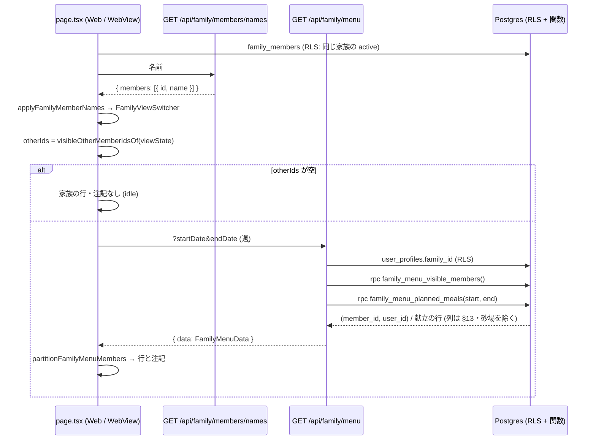

# 週間献立の「家族の表示」— 家族の共有の献立を見る (#1584 の 1)

> 版: v1.0 (2026-10-16 設計ゲート R0・叩き台) / Issue: #1584 (`家族の表示の切り替えが献立を変えない・…`) の 1
> 位置づけ: 週間献立の画面 (`src/app/(main)/menus/weekly/page.tsx`) の家族の表示の切り替え (`useFamilyView` / `FamilyViewSwitcher`) に「選んだ家族の献立を見る中身」を足す設計の正典。範囲の正本は Issue #1584 の本文とコメント (2026-10-15 のオーナーの選択「(1) 週間献立の家族の表示は、設計して作ります (家族の共有の献立を見る中身。設計ゲートから)」)。残りの 2 (承諾時に名前を写す) は PR #1607 で完了。
> 前提: ローンチ前で利用者ゼロ (本番の `family_groups` の active は 0 件・2026-10-16 実測)。正しい形で作る。本番の DB には触らない。
> 改定履歴: v1.0 2026-10-16 初版。

---

## 0. 分冊判定・段分け・範囲 (相 1 の結果)

### 0.1 分冊判定

| 目安 | 本件 | 判定 |
|---|---|---|
| 設計書 800 行超 | 超える (表 3 点・正典コード・追随表を 1 冊に持つため) | 当たる |
| 消費先レーン 3 以上 | DB (関数 2 本)・API (route 1 本)・Web の画面 (page.tsx + 部品 2 つ + hook) の 3 | 当たる |
| 共有面に 2 つ以上触る | `page.tsx` (週間献立の画面の本体 6,656 行) と `FamilyViewSwitcher` (家族の 4 画面とは別の名前の経路) の 2。DB の表・列・RLS は変えない | 当たる |

**判定: 設計書は 1 冊、実装は 2 段 (A・B) に分け、同じ実装 WF・同じ worktree で段ごとにレビューを挟む。** 分冊 (核と配線で別の設計書) にしない理由: 核 (DB の関数 2 本と API 1 本) は小さく、配線 (画面) はその応答を読むだけで、契約 (§11〜§15) を本書に逐語で置けば段 B の実装者は本書だけで手が止まらない。分けると「核のマージ待ち」のコストが利点を上回る。

### 0.2 段分け (実装 WF の単位と順序)

| 段 | 中身 | 依存 | デプロイ後の状態 |
|---|---|---|---|
| **A 読み取りの口** | migration (SECURITY DEFINER の関数 2 本 §11) と対の `.down.sql`・型の再生成 (§11.3)・Zod と純関数 (§13・§14)・`GET /api/family/menu` (§15)・migration の契約テストと実 DB の結合テスト (§19) | なし | API を直接呼べば家族の献立が返る。画面はまだ変わらない |
| **B 画面** | `useFamilyMenu` (§14.3)・`FamilyMenuRows.tsx` (§16.2)・`page.tsx` の配線 (§16.1)・`FamilyViewSwitcher` の名前と印 (§16.3)・画面のテストと e2e (§19) | A | 週間献立の画面で、切り替えで選んだ家族の献立が自分の献立の下に読み取り専用で出る。モバイルアプリの献立タブ (WebView) も同じ画面なので同時に変わる |

migration の本番適用は段 A のマージ後にオーケストレーターが行う (関数の新設だけで、表・列・既存の行は変えない)。

### 0.3 本書が決めないもの (範囲外)

- 家族で 1 つの献立を AI で生成する「共有献立」(`family/05-shared-menu-engine.md`・`family/01-data-model.md` §4.4 の `family_shared_menus`・`family/08-rls-policies.md` §7)。origin/main にその表も API も無く (git grep 0 件)、本書は作らない (§7.1 の代替案 A)。
- 他のメンバーの献立の編集・自分の献立への写し (ペースト)。本書は読むだけ (§7)。
- アカウントの無い子供のメンバー (`family_members.user_id IS NULL`) の献立。保存先が無い (`user_daily_meals.user_id` は NOT NULL) ので出ない (§8 P-6・Q-2)。
- 共有の同意 (`share_menu`) の設定画面と API (`PATCH /api/family/members/me/share`・`update_my_share_settings`)。今のまま使う。
- `apps/mobile/app/menus/weekly/index.tsx` (ネイティブの週間献立の画面。2,435 行)。献立タブは Web の `/menus/weekly` を WebView で開く (`apps/mobile/app/(tabs)/menus.tsx`・`NATIVE_APP_TABS`) ので本書の対象は Web の画面だけ。ネイティブの画面に残る家族の欠陥は #1610 (Q-5)。
- リアルタイムの反映 (相手が献立を変えた瞬間に更新する)。取り直しの契機は §10 のとおり。

---

## 1. 目的・スコープ

週間献立の画面の「家族の表示」の切り替えは、いまは切り替えの部品に状態を渡すだけで、表示する献立が変わらない (Issue #1584 の 1)。本書は次を決める。

1. 家族の表示で何を見せるか → **合成**: 自分の献立 (今までどおり編集できる) の下に、切り替えで選んだ家族のメンバーごとの献立を**読み取り専用**で並べる (§7)。
2. 共有の同意と権限 → `family_members.share_menu` (設定画面の「週間献立を家族に見せる」) を読み取りの条件にし、判定を DB の関数 1 本に閉じる (§11.1)。
3. API と RLS → `GET /api/family/menu` と SECURITY DEFINER の関数 2 本。既存の RLS は広げない (§7.2)。
4. Web とモバイル (WebView) の画面・空のとき・権限が無いときの表示 (§16)。
5. 家族の画面の名前の出し方との整合 → 切り替えの部品も `GET /api/family/members/names` の名前を使う (§16.3)。
6. テスト (§19)。

## 2. 関連要件・正典

| 文書 | 使う箇所 |
|---|---|
| Issue #1584 本文・コメント | 範囲の正本 (1 = 本書、2 = PR #1607 で完了、3 = #1611) |
| `docs/design/membership/00-overview.md` §1.2 | データ ownership (Option E): 記録は単一の `user_id` に帰属し、家族の共有は閲覧権限の grant で実現する。本書の構造の根拠 |
| `docs/design/membership/03-ui-spec.md` §4・§5・§7.1 | 切り替えの配置と部品・mix 表示の当初設計・「週間献立を家族に見せる」= `share_menu` |
| `docs/design/membership/06-implementation-phases.md` P5 | 「ビューの切り替えは置いてあるが、選んだ内容で食事を絞り込む処理は無い」(本書で埋める) |
| `docs/design/membership/01-data-model.md` §3.2・§3.5 | `family_members` の DDL と RLS |
| `docs/design/family/02-api-spec.md` §5.8 | 名前の API `GET /api/family/members/names` (本書の名前の経路) |
| `docs/design/cross/04-api-conventions.md` §5.2 (b) | 家族の API のエラーの形 (nested・`MembershipErrorCode`) |
| `docs/design/cross/02-rls-patterns.md` §3.3 | service_role バイパスのガイドライン (本書は route で service_role を使わない) |
| `docs/requirements/01-family-management.md` §5.4 の権限表 (:479-480) | 「共有献立閲覧」は代表・大人・メンバーが ✅、子供は ❌ (本書: 子供はアカウントが無いので見る側にも見られる側にもならない) |

## 3. 前提の事実 (origin/main `5ff68e67`・本番 DB は 2026-10-16 に読み取りで実測)

### 3.1 実装の現状

| 事実 | 場所 |
|---|---|
| `useFamilyView(familyId)` は `viewState` (`preset` 6 種 + `visible_member_ids`) を localStorage (`familyViewState_<familyId>`) に持つだけ。献立の取得には使われない | `src/hooks/useFamilyView.ts:33-69`・`page.tsx:1113`・`:5829-5834` |
| 画面は `family_members` を利用者のクライアントで読み (RLS)、`status = 'active'` の行を `FamilyViewSwitcher` に渡す。名前は `display_name` だけ (無ければ 'メンバー')。`GET /api/family/members/names` は呼んでいない | `page.tsx:1117-1139`・`FamilyViewSwitcher.tsx:45-48` |
| 献立の読み取り `GET /api/meal-plans` は `user_daily_meals` を `.eq('user_id', user.id)` で読み `planned_meals(*)` を結合する。他人の献立を読む経路は無い。日付は `isCalendarDate` で検査 (#1482) | `src/app/api/meal-plans/route.ts:17-117` |
| RLS: `user_daily_meals` は `Users can manage own daily meals` (ALL, `auth.uid() = user_id`)、`planned_meals` は `Users can manage own planned meals` (ALL, 親の `user_id = auth.uid()`) の 1 本ずつ。本番の `pg_policies` も同じ 2 本だけ | migration `20251126124224` :9872・:9900・本番実測 |
| `planned_meals` に `hidden_at` は無い (隠す仕組みがあるのは `meals` / `recipes`)。`user_daily_meals.is_sandbox` (ハンズオンツアーの砂場) はある | 本番実測・migration :6608-6618 |
| `can_view_user_meals(uuid)` は `share_meals` を見る関数で `meals` の SELECT ポリシーだけが使う。`share_menu` を読む RLS・関数・読み取り API は無い | migration :940-952・`20261008160000` |
| `share_menu` は `family_members` の列 (NOT NULL DEFAULT TRUE)。書くのは `accept_family_invite` / `accept_child_promotion` の引数と `update_my_share_settings` (本人だけ。トリガー `guard_family_members_privileged` が他人の変更を拒む) | migration :126・`20261008090000` :79-88 |
| `family_members` の SELECT ポリシーは `user_id = auth.uid() OR is_active_family_member(family_id)`。同じ家族の全員の行 (`share_menu` を含む) を読める | migration :10385 |
| 家族の所属は `user_profiles.family_id`。作成・承諾で入り、退出・除名・解散で NULL になる。`status` は `active` / `removed` / `left`、`family_groups.status` は `active` / `dissolved` (凍結の状態は DB に無い) | migration :310・:1220・:2072・:2236・:2865・:339 |
| 子供のメンバーは `user_id IS NULL` (CHECK `family_members_child_profile_consistency`)。`user_daily_meals.user_id` は NOT NULL なので、子供の献立の保存先は無い | migration :133・:6610 |
| 名前の決め方は `display_name` → 本人の `user_profiles.nickname` → null (`'Guest'` は名前とみなさない)。4 画面は `fetchFamilyMemberNames` / `applyFamilyMemberNames` で当てる | `src/lib/membership/family-member-names.ts`・`src/app/api/family/members/names/route.ts` |
| モバイルアプリの献立タブは Web の `/menus/weekly` を WebView で開く。利用者別の localStorage (接頭辞 `familyViewState_`) はログアウトで Web・WebView とも消す (#1599) | `apps/mobile/app/(tabs)/menus.tsx`・`packages/shared/src/native-app-tabs.ts`・`packages/shared/src/user-scoped-storage.ts:36-48` |
| `user_daily_meals` / `planned_meals` を利用者のクライアントで読むファイルは src・lib に **29 本** ある (`from('planned_meals')` / `from('user_daily_meals')` の grep)。多くは `user_id` の絞りを RLS に頼る | §7.2 の根拠 |
| 索引: `idx_user_daily_meals_user_date (user_id, day_date)`・`idx_planned_meals_daily_meal (daily_meal_id)`・`idx_family_members_family`・`idx_family_members_user` | migration :8338・:8170・:7854・:7862 |
| e2e `tests/e2e/family/01-invite-accept-share.spec.ts` は、承諾した人の週間献立に切り替え (「家族全員」「2人」・代表者の名前) が出るところまでを確かめる | :152-163 |

### 3.2 テストの道具

- route の単体: `tests/helpers/route-world.ts` (`makeClient` に `rpc` を渡せる)・`src/__tests__/api/family/members/names.test.ts` の偽のクライアントの型。
- 実 DB: `tests/integration/rls/family-member-names-scope.test.ts` (利用者 7 人・家族 2 つの準備) を写す。anon の EXECUTE の決定表は `tests/integration/security/anon-definer-execute.test.ts`。
- e2e: `tests/e2e/fixtures/fresh-family.ts`・`tests/e2e/helpers/membership-family.ts` (`createFreshFamily` / `acceptFamilyInvite` / `cleanupFamily`)・`tests/e2e/membership/10-share-settings.spec.ts` の `patchShareSettings`。

## 4. 要件行列

| # | 要件 | 根拠 | 本書の節 |
|---|---|---|---|
| R-1 | 切り替えで選んだ家族のメンバーの献立が、自分の献立と一緒に週間献立の画面に出る | Issue #1584 の 1 | §7・§16.1 |
| R-2 | 見える献立は「週間献立を家族に見せる」(`share_menu`) をオンにしたメンバーのものだけ。オフにすると次の取り直しから出ない | membership/03 §7.1・02 §13 | §8・§10・§11.1 |
| R-3 | 自分の献立は切り替えに関わらず常に出て、今までどおり編集できる。家族の献立は読み取り専用 (編集・削除・並べ替え・完了のボタンを出さない) | Option E (membership/00 §1.2)・§7 | §16.2 |
| R-4 | 家族でない人・退出・除名されたメンバー・解散した家族の献立は、API を直接呼んでも返らない。未認証は 401、anon は関数を実行できない | family/CLAUDE.md「RLS 厳格」・#1103 | §8・§11.2・§19.3 |
| R-5 | 既存の RLS を広げない。他の 29 の読み取り経路の結果を変えない | §3.1・§7.2 | §11 |
| R-6 | 家族の献立で返す列は画面に要るものだけ (メモ・生成のメタデータ・栄養の詳細は返さない)。砂場 (`is_sandbox`) の献立は返さない | プライバシー・family/09 | §11.1・§13 |
| R-7 | 空のとき (相手に献立が無い / 共有していない / アカウントが無い / 家族に居ない) と権限が無いときの表示を決める | 仕様の「決めること」 | §8・§16.2 |
| R-8 | 切り替えの部品の名前は家族の 4 画面と同じ経路 (`GET /api/family/members/names`) で出す。無ければ「名前未設定」 | Issue コメント・family/02 §5.8 | §16.3 |
| R-9 | モバイルアプリ (WebView) でも同じに動く。利用者別の localStorage はログアウトで消える (既存) | mobile/01 §3.2・#1599 | §16.4 |
| R-10 | 週を移ると、その週の家族の献立を取る。取り直しの契機と cache を決める | page.tsx の weekDataCache | §10・§14.3 |
| R-11 | 日付の入力は実在する日付だけ・範囲の上限を決める (DB の関数でも守る) | #1482・#1463 | §12・§15 |
| R-12 | API の失敗は自分の献立の表示を止めない | 家族の名前の API と同じ方針 | §16.2 |
| R-13 | マジックナンバーは名前つきの定数に、`as any` は書かない | 共通ガード | §12・§13 |
| R-14 | 既存の番兵 (走査テスト・契約テスト) に追随する | 共通ガード | §21 |

## 5. ユーザーシナリオ (18 本)

| # | シナリオ | 期待 |
|---|---|---|
| S-1 | 大人 2 人の家族。両方 `share_menu` オン。妻が週間献立を開き、既定の「家族全員」のまま今日を見る | 自分の献立カード (編集可) の各食事の下に、夫の献立が読み取り専用の行で出る。夫の名前は名前の API の値 |
| S-2 | S-1 で妻が「自分だけ」を選ぶ | 家族の行が消える。家族の献立の API は呼ばない |
| S-3 | 夫が設定で「週間献立を家族に見せる」をオフ。妻が切り替えを適用し直す (または週を移る・5 分後に開き直す) | 夫の行が消え、その日の末尾に「夫 は献立を共有していません」の注記。切り替えのシートの夫に「(献立は非公開)」の印 |
| S-4 | 妻が自分の `share_menu` をオフ | 妻の画面は変わらない (自分の献立は常に出る)。夫の画面から妻の行が消える (S-3 と同じ) |
| S-5 | 家族に子供 (アカウント無し) が居て、妻が「自分 + 子供」を選ぶ | 家族の行は出ない。注記「長男 (子供) の献立は、アカウントを持つまで出ません」 |
| S-6 | 夫が家族を退出 (`leave_family`) | 妻が画面を開き直すと切り替えから夫が消え、API も夫を返さない。localStorage に残った夫の id は無視する |
| S-7 | 代表者が夫を除名 (`remove_family_member`) | S-6 と同じ |
| S-8 | 代表者が家族を解散 (`operator_force_dissolve_family` / 解散の RPC) | `user_profiles.family_id` が NULL になり、切り替えが出ない。API は `family_id: null, members: []` |
| S-9 | 家族でない人が `GET /api/family/menu` を直接呼ぶ / anon が `/rest/v1/rpc/family_menu_planned_meals` を呼ぶ | 前者は `family_id: null, members: []` (200)。後者は 42501 (EXECUTE 権限なし) |
| S-10 | 妻が翌週へ移る | 翌週の範囲で家族の献立を取り直す。同じ週に 5 分以内に戻ると cache を使う |
| S-11 | 夫がハンズオンツアーの砂場 (`is_sandbox = true`) の献立を持つ | 砂場の献立は妻に出ない |
| S-12 | 夫の献立にメモと生成のメタデータがある | API の応答にメモ・メタデータ・栄養の詳細は入らない (§13 の列だけ) |
| S-13 | 画面が `startDate=2026-02-30` や 40 日の範囲で呼ぶ (改変したクライアント) | 400 `INVALID_REQUEST`。DB の関数も `FAMILY_MENU_RANGE_INVALID` で止める |
| S-14 | 家族の献立の API がネットワークで失敗する | 自分の献立はそのまま。家族の行の場所に「家族の献立を読み込めませんでした」と [もう一度] |
| S-15 | 夫は名前を写す migration より前に承諾していて `display_name` が NULL、プロフィールの名前は「太郎」 | 切り替えと家族の行に「太郎」。プロフィールの名前も無ければ「名前未設定」 |
| S-16 | モバイルアプリの献立タブ (WebView) で同じ操作 | Web と同じ。ログアウトで `familyViewState_<familyId>` が消える (既存) |
| S-17 | 3 人家族で「カスタム」で 2 人だけ選ぶ | 選んだ 2 人の行だけ出る。選ばなかった人は注記にも出ない |
| S-18 | 夫が献立を作り直す | 妻の画面は次の取り直し (切り替えの適用・週の移動・5 分後) で変わる。リアルタイムではない |

## 6. 構想 (相 2) — 構造と、全シナリオのトレース

### 6.1 構造

```
[page.tsx]
  familyMembers (RLS で読む。既存) ──→ applyFamilyMemberNames(fetchFamilyMemberNames) ──→ FamilyViewSwitcher (名前は API の値)
  viewState (useFamilyView。既存) ──→ visibleMemberIdsOf(viewState, members) ──→ 自分以外の id 集合 (others)
  others が空 → 何も取らない / 空でない → useFamilyMenu({ startDate, endDate }) ──→ GET /api/family/menu
                                                                                     │
  [route]  getUser → user_profiles.family_id (RLS) → rpc family_menu_visible_members() → rpc family_menu_planned_meals(start, end)
           → groupFamilyMenuRows → { data: FamilyMenuData }            │
                                                                        └→ [DB] 判定は family_menu_visible_members() の 1 本:
                                                                              同じ家族 / 両方 active / 相手にアカウントがある / 相手の share_menu = TRUE / 自分以外
  [page.tsx] 食事の区分ごとに: 自分のカード (既存) → FamilyMenuMealRows (others ∩ 応答の members。読み取り専用)
             日の末尾に: FamilyMenuDayNotes (共有していない / アカウントが無い / この日は献立が無い)
```

- 見える相手の判定は DB の関数 `family_menu_visible_members()` に 1 か所だけ置く。メンバーの一覧 (注記のため) も献立の行もこの関数から出すので、TS に同じ判定を書かない。
- 既存の RLS は変えない。読み取りは SECURITY DEFINER の関数 2 本を利用者のクライアント (`createClient()`) から `rpc` で呼ぶ。route は service_role を使わない。
- 画面は「誰を見せるか」(切り替え) と「誰を見てよいか」(API) を別に持ち、交わりを描く。切り替えに居て API に居ない人が、注記の対象。

### 6.2 トレース (構造で手で走らせた結果)

| # | 走らせた結果 |
|---|---|
| S-1 | 既定 `preset: 'all'` → others = {夫}。hook が今週の範囲で API → route: family_id あり → visible_members = [夫] → planned_meals = 夫の行 → 200。page は食事の区分ごとに夫の行を `FamilyMenuMealRows` で描く。名前は names の Map |
| S-2 | `preset: 'self'` → others = {} → hook は `enabled: false` で呼ばない → 家族の行も注記も無い |
| S-3 | 夫の `share_menu = false` → visible_members が夫を返さない → 応答の members に夫が無い → 夫は others に居るので `partitionFamilyMenuMembers` が `notSharing` に入れ、注記を描く。シートの印は `member.share_menu === false` (RLS で読んだ行) |
| S-4 | 自分の献立は `/api/meal-plans` (既存) なので変わらない。夫の画面では S-3 の対称 |
| S-5 | 子供は `user_id IS NULL` → visible_members に出ない → `partitionFamilyMenuMembers` が `user_id === null` を `noAccount` に入れ、注記を描く |
| S-6 / S-7 | 夫の行が `left` / `removed` → RLS で読む一覧 (status = active) に居ない → others に入らない (localStorage の id は `visibleMemberIdsOf` で既知の id に絞る)。visible_members も返さない |
| S-8 | `family_id` NULL → 画面は `familyMembers.length > 0` の条件で切り替えを出さない (既存)。API は `{ family_id: null, members: [] }` |
| S-9 | route は本人の family_id しか見ない → null → 200 空。RPC は anon に EXECUTE が無い → 42501 |
| S-10 | hook の key は `${startDate}_${endDate}`。cache (Map) に `fetchedAt` を持ち `FAMILY_MENU_CACHE_TTL_MS` 以内なら再利用 |
| S-11 | 関数の JOIN が `d.is_sandbox = FALSE` を持つ |
| S-12 | 関数の RETURNS TABLE が §13 の列だけ。route はそれ以外を持たない |
| S-13 | route: `isCalendarDate` ×2・`calendarDaySpan ≤ FAMILY_MENU_RANGE_MAX_DAYS` → 400。関数: 同じ上限で `FAMILY_MENU_RANGE_INVALID` |
| S-14 | `fetchFamilyMenu` が `{ ok: false, reason: 'failed' }` → hook `status: 'error'` → `FamilyMenuDayNotes` がエラーの 1 行と [もう一度] (`reload`) を描く。自分の献立の経路は触らない |
| S-15 | `applyFamilyMemberNames` が `display_name` を API の値に置き換える。null のままなら `FAMILY_MEMBER_NAME_FALLBACK` ('名前未設定') |
| S-16 | WebView は同じ Web の画面。Cookie のセッションで `fetch('/api/family/menu')` が通る。localStorage の掃除は既存 (#1599) |
| S-17 | `preset: 'custom'` → others = `visible_member_ids` ∩ 既知 − 自分。注記も others だけが対象 |
| S-18 | 取り直しの契機 (§10) 以外では変わらない。設計どおり |

## 7. 構造裁定 (相 3・1 回だけ)

### 7.1 代替案の比較

| 案 | 中身 | 利点 | 欠点 | 判定 |
|---|---|---|---|---|
| A 共有献立の表を作る | `family_shared_menus` (family/01 §4.4) を新設し、家族で 1 つの献立を AI 生成 (family/05) して表示 | 要件 §5.5 の「共有献立」の語に近い | 表・Edge Function・生成・離脱 (04) まで要り #1584 の「見る」を大きく超える。Option E (記録は単一の user_id に帰属) と別の所有モデルを足す。membership/ が family/ を supersede した範囲 (閲覧権限) と二重になる | 採らない |
| B メンバーごとの献立を読み取り専用で合成 (本書) | 各メンバーの `user_daily_meals` / `planned_meals` を `share_menu` の同意で読み、自分の献立の下に並べる | 表を足さない。同意 (`share_menu`) の意味 = 設定画面の「週間献立を家族に見せる」そのもの。Option E に沿う | 「家族で 1 つの献立」は作れない (A の将来の課題として残る) | **採る** |
| C ペースト (写し) | 相手の献立を自分の献立に写す | 既存の `paste_meal_to_family` と同型 | 「見る」ではなく「増やす」。`planned_meals` のペーストは無く、新しい書き込み経路になる | 採らない |

読み取りの実現のしかた (B の中の選択):

| 案 | 中身 | 判定 |
|---|---|---|
| B-1 RLS を広げる | `user_daily_meals` / `planned_meals` に家族の SELECT ポリシーを足し、route は利用者のクライアントで `.in('user_id', …)` | 29 のファイル (§3.1) が `user_id` の絞りを RLS に頼っており、家族の行が混ざる (例: 栄養の集計・ホームの今日の献立・食事の詳細)。全部を洗うのは本件の範囲を超え、将来の読み取りにも同じ罠が残る。採らない |
| B-2 route が service_role で読む | 名前の API と同じく、RLS で読めた相手の分だけ service_role で引く | 読み取りの条件 (同意) が TS に置かれ、関数より漏れやすい。`cross/02` §3.3 の「service_role は Edge Function に限る」方針にも近づけない。採らない |
| B-3 SECURITY DEFINER の関数 2 本 | 判定を関数 1 本に閉じ、献立の行は列を絞った TABLE で返す。RLS は変えない。route は利用者のクライアントの `rpc` | 既存の読み取りを変えない。同意の判定が 1 か所。anon / PUBLIC の EXECUTE を外す規律 (#1103) に乗る。**採る** |

### 7.2 F の問い — 縁の発生源を消すより単純な構造は無いか

- 縁の発生源は「誰を見てよいか」の判定の置き場。B-1 は判定を RLS に置くと 29 の読み取りが縁になり、B-2 は TS に置くと API ごとに写しができる。B-3 は関数 1 本に置き、メンバーの一覧も行も同じ関数から出すので、画面の注記 (共有していない・アカウントが無い) は「切り替えに居て応答に居ない人」という引き算だけで決まる。これより単純な構造は見つからない。
- 関数を 1 本 (献立の行だけ) にする案は、献立が無いメンバーを応答から区別できず (「献立が無い」と「共有していない」が同じ空になる)、注記のために TS へ判定が戻る。2 本が最小。
- 自分の献立を切り替えで隠す案 (membership/03 §5.2 #4 の当初設計) は、編集の入口 (追加・編集・削除・並べ替え) が消え、`currentPlan` を前提にする 47 箇所の reducer と衝突する。自分は常に出す (R-3)。

以後、構造は確定。仕上げの中で構造の疑義が出たら blocking ではなく「裁定への差し戻し事由」として扱う。

## 8. ① 全パターン表 (見える・見えない・注記)

見る人 V (ログイン済み・`user_profiles.family_id` あり・`family_members` で active) が、切り替えでメンバー T を選んでいるときの、T の献立の扱い。列「—」はその行の判定がその軸を読まないこと。

| # | T | T の `share_menu` | T の `status` | 家族の `status` | API の members に T | 画面 |
|---|---|---|---|---|---|---|
| P-1 | 自分 | — | active | active | 入れない (自分以外だけ) | 自分の献立 (既存。常に出る・編集可) |
| P-2 | 大人・代表者 (アカウントあり) | TRUE | active | active | 入る | 読み取り専用の行。献立が無い日は注記「T の献立はこの日はありません」 |
| P-3 | 大人・代表者 | FALSE | active | active | 入らない | 注記「T は献立を共有していません」。シートに「(献立は非公開)」 |
| P-4 | 大人・代表者 | — | left / removed | active | 入らない (一覧にも居ない) | 出ない (切り替えにも出ない) |
| P-5 | 誰でも | — | — | dissolved | 入らない (`family_id` NULL・関数も `fg.status = 'active'` を要求) | 切り替え自体が出ない |
| P-6 | 子供 (`user_id IS NULL`) | — | active | active | 入らない | 注記「T (子供) の献立は、アカウントを持つまで出ません」 |
| P-7 | 大人 (アカウントあり) の砂場の献立 | TRUE | active | active | 行は入るが砂場の日は除く | 砂場の献立は出ない |
| P-8 | 大人 (アカウントが凍結 `frozen_at`) | TRUE | active | active | 入る | 出る (凍結はログインを止める措置で、共有の同意を取り消すものではない。Q-3) |

V の側:

| # | V | API | 画面 |
|---|---|---|---|
| V-1 | 未認証 | 401 `NOT_AUTHENTICATED` | (画面に来ない) |
| V-2 | 家族に居ない (`family_id` NULL) | 200 `{ family_id: null, members: [] }` | 切り替えが出ない (既存) |
| V-3 | `family_id` はあるが active でない (不整合) | 200 `{ family_id, members: [] }` (関数が 0 行) | 切り替えは RLS で読めた行 (自分の行だけ・active でない) → 0 件 → 出ない |
| V-4 | active なメンバー | 200 | 本表の P-1〜P-8 |
| V-5 | anon が RPC を直接呼ぶ | 42501 (EXECUTE なし) | — |

切り替えの軸 (`viewState`) と others:

| preset | others (自分以外で描く id) |
|---|---|
| `all` | active な全員 − 自分 |
| `self` | 空 (API を呼ばない) |
| `self_partner` / `self_children` / `children_only` / `custom` | `visible_member_ids` ∩ active な全員の id − 自分 (未知の id は捨てる) |

## 9. ② 状態比較表 (現行 vs 設計後)

| 面 | 現行 | 設計後 |
|---|---|---|
| 切り替えの効果 | 表示は変わらない | 選んだメンバーの献立が自分の下に読み取り専用で出る |
| 切り替えの名前 | `display_name` か 'メンバー' | `GET /api/family/members/names` の値、無ければ '名前未設定' |
| 切り替えのシート | 名前・(自分)・(代表)・(子供) | + 「(献立は非公開)」(`share_menu = false`) |
| 他人の献立の読み取り経路 | 無い | `GET /api/family/menu` → 関数 2 本 (SECURITY DEFINER) |
| `user_daily_meals` / `planned_meals` の RLS | own の ALL 1 本ずつ | 変えない |
| `share_menu` の消費先 | 無い (設定できるだけ) | `family_menu_visible_members()` が読む |
| 砂場の献立 | 本人の画面には出る | 家族には出ない |
| 空のとき | (該当なし) | 注記 3 種 + エラー 1 種 (§16.2) |
| モバイル (WebView) | 同じ画面 (切り替えは効かない) | 同じ画面 (効く) |
| e2e | 切り替えに 2 人出るまで | + 相手の献立の行が出る・共有オフで消える (§19.5) |
| 設計書 | membership/03 §5 の mix 表示は「まだ作っていない」 | 本書が正典。membership/03・06 は本書へのポインタ (§22) |

## 10. ③ 状態遷移表

状態 = (V の所属, T の所属, T.share_menu, 画面の others に T が居るか, cache)。操作ごとの遷移先・ガード・副作用。

| # | 状態 | 操作 | 遷移先 | ガード | 副作用 (画面) |
|---|---|---|---|---|---|
| T-1 | V∈F, T∈F, share=on, T∈others | 画面を開く / 週を移る | 取得 (`loading` → `ready`) | others が空でない・cache が無いか TTL 超え | T の行を描く |
| T-2 | 同上 | 切り替えを適用 (`setView`) | others を再計算・**cache を捨てて取り直す** | — | 応答で描き直す (S-3 の反映の契機) |
| T-3 | 同上 | T が `share_menu` をオフ (`update_my_share_settings`) | T∉members (次の取得から) | — | 次の取得で行が消え注記に変わる。それまで古い行が残りうる (TTL ≤ 5 分) |
| T-4 | V∈F, T∈F, share=off | T がオンに戻す | T∈members (次の取得から) | — | 次の取得で行が戻る |
| T-5 | V∈F, T∈F | T が退出 / 除名 | T∉F。`familyMembers` から消える (画面の開き直し) | RLS の一覧は status=active | others から外れる (localStorage の id は無視) |
| T-6 | V∈F, T∈F | V が退出 / 除名 / 解散 | V∉F (`family_id` NULL) | — | 切り替えが出ない。API は空 |
| T-7 | V∈F | 子供を追加 (`add_family_child`) | 子供∈F (user_id NULL) | — | 切り替えに出る。選ぶと注記 (P-6) |
| T-8 | V∈F, 子供∈F | 子供がアカウントに昇格 (`accept_child_promotion` の `p_share_menu`) | 子供は user_id あり・share は引数の値 | — | 次の取得から P-2 / P-3 |
| T-9 | V∈F, T∈F, share=on | T が献立を作り直す / 消す | 変化なし (DB だけ) | — | 次の取得 (T-1 / T-2 / TTL) で反映 |
| T-10 | 任意 | V がログアウト・別の利用者がログイン | `familyViewState_*` が消える (#1599 既存) | — | 既定の「家族全員」から |
| T-11 | V∈F, others 空 (`self`) | — | 取得しない (`idle`) | — | 家族の行も注記も無し |
| T-12 | 取得中 | 取得が失敗 | `error` | — | エラーの注記 + [もう一度] (`reload` = cache を捨てて T-1) |
| T-13 | `ready` | 同じ週に戻る (TTL 内) | `ready` (cache) | `now − fetchedAt < FAMILY_MENU_CACHE_TTL_MS` | 取り直さない |
| T-14 | V∈F, T∈F, share=on | T の砂場の献立が作られる / 消える | 変化なし | 関数が除外 | 出ない |
| T-15 | V∈F, T∈F, share=on | T のアカウントが凍結される | 変化なし (P-8) | — | 出たまま |

## 11. データモデル (migration)

表・列・既存のポリシーは変えない。足すのは SECURITY DEFINER の関数 2 本と、その EXECUTE 権限。

### 11.1 `<番号はマージ時に確定>_family_menu_view_functions.sql`

番号はマージ直前に origin/main の `supabase/migrations` の最大 (本書の時点 `20261016200000`) より大きい番号で確定する。1 行目の見出し・戻し方の参照・戻し口のファイル名を同じ名前にそろえる (`tests/migration-file-version-integrity.test.ts`)。

```sql
-- migration: <番号はマージ時に確定>_family_menu_view_functions.sql
-- Issue #1584 の 1: 週間献立の「家族の表示」で、家族のメンバーの献立を読み取り専用で見る。
--
-- 背景: user_daily_meals / planned_meals の RLS は本人の行だけ (ALL 1 本ずつ)。家族の献立を読む経路が無く、
--   family_members.share_menu (設定画面の「週間献立を家族に見せる」) を読む RLS・関数・API も無かった。
-- 変更 (関数 2 本の新設だけ。表・列・ポリシー・既存の行は変えない):
--   1. family_menu_visible_members(): ログイン中の利用者が献立を見てよい家族のメンバー (member_id, user_id)。判定はここ 1 か所:
--        同じ家族 / 家族が active / 自分も相手も status = 'active' / 相手にアカウントがある (user_id IS NOT NULL) /
--        相手の share_menu = TRUE / 自分以外。
--   2. family_menu_planned_meals(p_start_date, p_end_date): 1 のメンバーの献立の行を、画面に要る列だけで返す
--        (メモ・生成のメタデータ・栄養の詳細は返さない)。砂場 (user_daily_meals.is_sandbox = TRUE) は除く。
--        範囲は含む日数で FAMILY_MENU_RANGE_MAX_DAYS (= 31。src/lib/membership/family-menu.ts と同じ値) まで。
--   RLS を広げない理由: user_daily_meals / planned_meals を利用者のクライアントで読むファイルは 29 本あり、
--   多くが user_id の絞りを RLS に頼っている (家族の SELECT ポリシーを足すと、それらに家族の行が混ざる)。
-- 実行権限: PUBLIC / anon / authenticated / service_role から外し、authenticated と service_role にだけ GRANT
--   (#1103 の規律。tests/integration/security/anon-definer-execute.test.ts の決定表に 2 行足す)。
-- 冪等: CREATE OR REPLACE と REVOKE / GRANT は、2 回続けて適用しても同じ結果になる。
-- 既存データへの影響: なし。
-- 戻し方: supabase/rollbacks/<番号はマージ時に確定>_family_menu_view_functions.down.sql
-- 確かめるテスト: tests/family-menu-view-migration-contract.test.ts (ファイルの突き合わせ)・
--   tests/integration/rls/family-menu-visibility.test.ts (実 DB)

CREATE OR REPLACE FUNCTION public.family_menu_visible_members()
RETURNS TABLE (member_id uuid, user_id uuid)
LANGUAGE sql STABLE SECURITY DEFINER
SET search_path = ''
AS $$
  SELECT tm.id, tm.user_id
  FROM public.family_members vm
  JOIN public.family_groups fg ON fg.id = vm.family_id AND fg.status = 'active'
  JOIN public.family_members tm ON tm.family_id = vm.family_id
  WHERE vm.user_id = auth.uid()
    AND vm.status = 'active'
    AND tm.status = 'active'
    AND tm.user_id IS NOT NULL
    AND tm.user_id <> auth.uid()
    AND tm.share_menu = TRUE
  ORDER BY tm.joined_at, tm.id;
$$;

COMMENT ON FUNCTION public.family_menu_visible_members() IS
  '#1584: ログイン中の利用者が献立を見てよい家族のメンバー (自分以外・同じ active な家族・相手が active でアカウントを持ち share_menu = TRUE)。family_menu_planned_meals と GET /api/family/menu が使う';

CREATE OR REPLACE FUNCTION public.family_menu_planned_meals(p_start_date date, p_end_date date)
RETURNS TABLE (
  member_id uuid,
  user_id uuid,
  day_date date,
  id uuid,
  meal_type text,
  dish_name text,
  image_url text,
  mode text,
  dishes jsonb,
  is_simple boolean,
  calories_kcal integer,
  cooking_time_minutes integer,
  display_order integer,
  is_completed boolean
)
LANGUAGE plpgsql STABLE SECURITY DEFINER
SET search_path = ''
AS $$
BEGIN
  IF auth.uid() IS NULL THEN
    RAISE EXCEPTION 'NOT_AUTHENTICATED' USING ERRCODE = 'P0001';
  END IF;
  -- 含む日数の上限 = FAMILY_MENU_RANGE_MAX_DAYS (31)。tests/family-menu-view-migration-contract.test.ts が TS の定数と突き合わせる
  IF p_start_date IS NULL OR p_end_date IS NULL
     OR p_end_date < p_start_date
     OR (p_end_date - p_start_date) + 1 > 31 THEN
    RAISE EXCEPTION 'FAMILY_MENU_RANGE_INVALID' USING ERRCODE = 'P0001';
  END IF;
  RETURN QUERY
    SELECT m.member_id, m.user_id, d.day_date,
           pm.id, pm.meal_type, pm.dish_name, pm.image_url, pm.mode, pm.dishes,
           pm.is_simple, pm.calories_kcal, pm.cooking_time_minutes, pm.display_order, pm.is_completed
    FROM public.family_menu_visible_members() AS m
    JOIN public.user_daily_meals AS d
      ON d.user_id = m.user_id
     AND d.day_date BETWEEN p_start_date AND p_end_date
     AND d.is_sandbox = FALSE
    JOIN public.planned_meals AS pm ON pm.daily_meal_id = d.id
    ORDER BY m.member_id, d.day_date, pm.meal_type, pm.display_order, pm.id;
END $$;

COMMENT ON FUNCTION public.family_menu_planned_meals(date, date) IS
  '#1584: family_menu_visible_members() のメンバーの献立 (画面に要る列だけ・砂場を除く・含む日数 31 日まで)。GET /api/family/menu が使う';

REVOKE ALL ON FUNCTION public.family_menu_visible_members()
  FROM PUBLIC, anon, authenticated, service_role;
GRANT EXECUTE ON FUNCTION public.family_menu_visible_members()
  TO authenticated, service_role;

REVOKE ALL ON FUNCTION public.family_menu_planned_meals(date, date)
  FROM PUBLIC, anon, authenticated, service_role;
GRANT EXECUTE ON FUNCTION public.family_menu_planned_meals(date, date)
  TO authenticated, service_role;
```

- 索引: `idx_user_daily_meals_user_date (user_id, day_date)`・`idx_planned_meals_daily_meal (daily_meal_id)`・`idx_family_members_family` / `idx_family_members_user` を使う。新しい索引は要らない (家族は最大 20 人 `member_limit <= 20`、範囲は 31 日まで)。
- `SET search_path = ''` は `is_active_family_member` と同じ (すべて `public.` で修飾する)。`auth.uid()` は修飾済み。
- `STABLE` なので PostgREST の `rpc` は GET でも POST でも呼べる。route は POST (supabase-js の既定) で呼ぶ。

### 11.2 `supabase/rollbacks/<番号はマージ時に確定>_family_menu_view_functions.down.sql`

```sql
-- rollback: <番号はマージ時に確定>_family_menu_view_functions.sql
-- 関数 2 本を消す (#1584 の 1)。表・列・ポリシー・データは migration が変えていないので、何も戻さない。
-- 消すと GET /api/family/menu は 500 (RPC_FAILED) になり、週間献立の画面は家族の行の場所にエラーの注記を出す
-- (自分の献立は影響を受けない)。戻す前に段 B の画面の配線を外すか、段 A ごと戻す。
-- 本番に戻す必要があるときは、この内容を新しい migration として PR 経由で適用する (本番への直接 SQL は禁止。CLAUDE.md)。
-- 何度流しても同じ結果になる (DROP ... IF EXISTS)。

DROP FUNCTION IF EXISTS public.family_menu_planned_meals(date, date);
DROP FUNCTION IF EXISTS public.family_menu_visible_members();
```

### 11.3 型の生成物

`src/types/database.types.ts` と `packages/shared/src/database.types.ts` に関数 2 本の `Functions` の節が要る (`tests/database-types-migrations-contract.test.ts`)。作り直しはローカルの Supabase で `npm run types:supabase` (本番に接続しない。`docs/design/operator/09-runbook.md` の「5. 型の再生成」)。生成される返り値の型は RETURNS TABLE の列 (nullable の列は `| null`)。§14.1 の `FamilyMenuRpcRow` はこの生成物と同じ形で、契約テスト `C-4` が代入可能性で突き合わせる。

### 11.4 既存の表 (変えない)

`family_members` (`share_menu`・`status`・`user_id`・`joined_at`)・`family_groups` (`status`)・`user_daily_meals` (`user_id`・`day_date`・`is_sandbox`)・`planned_meals` (§13 の列)・`user_profiles` (`family_id`)。

## 12. 定数 (canonical)

| 定数 | 値 | 置き場 | 根拠 |
|---|---|---|---|
| `FAMILY_MENU_API_PATH` | `'/api/family/menu'` | `src/lib/membership/family-menu.ts` | 画面はこの値以外から URL を組み立てない |
| `FAMILY_MENU_RANGE_MAX_DAYS` | `31` (含む日数) | 同上 + migration の `31` (リテラル・コメントで名指し) | 画面が取るのは 7 日。月の表示を足しても足りる上限で、関数の仕事を抑える。契約テスト `C-3` が SQL と一致を見る |
| `FAMILY_MENU_CACHE_TTL_MS` | `5 * 60 * 1000` | `src/hooks/useFamilyMenu.ts` | page.tsx の `weekDataCache` の `CACHE_TTL` (5 分) と同じ。端末の cache で運用で変える値ではないので環境変数にしない |
| `FAMILY_MEMBER_NAME_FALLBACK` | `'名前未設定'` | `src/lib/membership/family-member-names.ts` | 家族の 4 画面のリテラルと同じ語 (4 画面のリテラルは本書では変えない。Q-6) |
| `FAMILY_MENU_NOTE_TEXT` | §16.2 の 4 文 | `src/lib/membership/family-menu.ts` | 注記の文言を 1 か所に |

## 13. Zod / 型 (canonical) と 14. 純関数 — `src/schemas/membership/family-menu.ts` と `src/lib/membership/family-menu.ts`

下の 1 ブロックを型検査する。実装では `// ---- schemas ----` までを `src/schemas/membership/family-menu.ts`、それより後を `src/lib/membership/family-menu.ts` に置き、後者は前者を import する (このファイルはブラウザからも読むので、サーバー専用のものを import しない)。

```ts
import { z } from 'zod';
import { MEAL_ORDER, type MealType } from '@homegohan/shared';
import type { FamilyViewState } from '@/hooks/useFamilyView';

// ---- schemas (src/schemas/membership/family-menu.ts) ----

/** YYYY-MM-DD の形 (実在する日付かは route が isCalendarDate で見る) */
export const FamilyMenuCalendarDateSchema = z.string().regex(/^\d{4}-\d{2}-\d{2}$/);

/** 食事の区分。手書きの一覧を持たず、正本 MEAL_ORDER (@homegohan/shared) で判定する (#1446) */
export const FamilyMenuMealTypeSchema = z.custom<MealType>(
  (value) => typeof value === 'string' && (MEAL_ORDER as readonly string[]).includes(value),
  { message: 'meal_type' },
);

/** 家族の献立の 1 食。画面に要る列だけ (メモ・生成のメタデータ・栄養の詳細は入れない) */
export const FamilyMenuMealSchema = z
  .object({
    id: z.string().uuid(),
    meal_type: FamilyMenuMealTypeSchema,
    dish_name: z.string(),
    image_url: z.string().nullable(),
    mode: z.string(),
    dishes: z.unknown(),
    is_simple: z.boolean(),
    calories_kcal: z.number().int().nullable(),
    cooking_time_minutes: z.number().int().nullable(),
    display_order: z.number().int(),
    is_completed: z.boolean(),
  })
  .strict();

export const FamilyMenuDaySchema = z
  .object({ day_date: FamilyMenuCalendarDateSchema, meals: z.array(FamilyMenuMealSchema) })
  .strict();

/** 見てよいメンバー 1 人分。献立が無い週でも members には入る (days: []) */
export const FamilyMenuMemberSchema = z
  .object({ member_id: z.string().uuid(), user_id: z.string().uuid(), days: z.array(FamilyMenuDaySchema) })
  .strict();

/** GET /api/family/menu の応答の data */
export const FamilyMenuDataSchema = z
  .object({
    family_id: z.string().uuid().nullable(),
    start_date: FamilyMenuCalendarDateSchema,
    end_date: FamilyMenuCalendarDateSchema,
    members: z.array(FamilyMenuMemberSchema),
  })
  .strict();

export const FamilyMenuResponseSchema = z.object({ data: FamilyMenuDataSchema });

export type FamilyMenuMeal = z.infer<typeof FamilyMenuMealSchema>;
export type FamilyMenuDay = z.infer<typeof FamilyMenuDaySchema>;
export type FamilyMenuMember = z.infer<typeof FamilyMenuMemberSchema>;
export type FamilyMenuData = z.infer<typeof FamilyMenuDataSchema>;

// ---- lib (src/lib/membership/family-menu.ts) ----

/** 家族の献立を返す API の経路 */
export const FAMILY_MENU_API_PATH = '/api/family/menu';

/**
 * 1 回の取得で受け付ける範囲の上限 (含む日数)。画面が取るのは 1 週 (7 日)。月の表示を足しても足りる上限で、
 * SECURITY DEFINER の関数の仕事を抑える。migration の関数 family_menu_planned_meals も同じ値で止める
 * (tests/family-menu-view-migration-contract.test.ts が一致を見る)
 */
export const FAMILY_MENU_RANGE_MAX_DAYS = 31;

/** 注記の文言 (§16.2)。{name} をメンバーの名前に置き換える */
export const FAMILY_MENU_NOTE_TEXT = {
  notSharing: '{name} は献立を共有していません',
  noAccount: '{name} (子供) の献立は、アカウントを持つまで出ません',
  noMealsToday: '{name} の献立はこの日はありません',
  loadFailed: '家族の献立を読み込めませんでした',
} as const;

/** family_menu_planned_meals の 1 行 (RETURNS TABLE の列。nullable の列は Postgres の定義どおり null になりうる) */
export interface FamilyMenuRpcRow {
  member_id: string;
  user_id: string;
  day_date: string;
  id: string;
  meal_type: string;
  dish_name: string;
  image_url: string | null;
  mode: string | null;
  dishes: unknown;
  is_simple: boolean | null;
  cooking_time_minutes: number | null;
  calories_kcal: number | null;
  display_order: number | null;
  is_completed: boolean | null;
}

/** family_menu_visible_members の 1 行 */
export interface FamilyMenuVisibleMemberRow {
  member_id: string;
  user_id: string;
}

/** planned_meals の既定値 (DDL の DEFAULT と同じ。NULL の行を応答の非 null の型にそろえる) */
const PLANNED_MEAL_DEFAULT_MODE = 'cook';
const PLANNED_MEAL_DEFAULT_IS_SIMPLE = true;
const PLANNED_MEAL_DEFAULT_DISPLAY_ORDER = 0;
const PLANNED_MEAL_DEFAULT_IS_COMPLETED = false;

/** 'YYYY-MM-DD' を UTC の日数にする (ローカル時刻の Date を作らない。暦の差だけを求める) */
function calendarDayNumber(date: string): number {
  const [y, m, d] = date.split('-').map(Number);
  const msPerDay = 24 * 60 * 60 * 1000;
  return Math.floor(Date.UTC(y, m - 1, d) / msPerDay);
}

/** start から end までの含む日数 (end < start なら 0)。両方 YYYY-MM-DD の実在する日付が前提 */
export function calendarDaySpan(startDate: string, endDate: string): number {
  const span = calendarDayNumber(endDate) - calendarDayNumber(startDate) + 1;
  return span > 0 ? span : 0;
}

/** 範囲が受け付けられるか (start ≤ end かつ含む日数が FAMILY_MENU_RANGE_MAX_DAYS 以下) */
export function isFamilyMenuRangeAllowed(startDate: string, endDate: string): boolean {
  const span = calendarDaySpan(startDate, endDate);
  return span >= 1 && span <= FAMILY_MENU_RANGE_MAX_DAYS;
}

/** 切り替えの一覧の 1 人 (page.tsx が RLS で読んだ family_members の行のうち、ここで使う列) */
export interface FamilyMenuViewMember {
  id: string;
  user_id: string | null;
  status: string;
}

/**
 * 切り替えの状態から「自分以外で描く」メンバーの id。
 * all は active な全員、それ以外は visible_member_ids のうち active な既知の id だけ (退出した人の id が localStorage に残っていても捨てる)。
 * 自分 (user_id === currentUserId) は常に除く (自分の献立は切り替えに関わらず既存の経路で出す)
 */
export function visibleOtherMemberIdsOf(
  view: FamilyViewState,
  members: readonly FamilyMenuViewMember[],
  currentUserId: string,
): string[] {
  const active = members.filter((m) => m.status === 'active' && m.user_id !== currentUserId);
  if (view.preset === 'self') return [];
  if (view.preset === 'all') return active.map((m) => m.id);
  const chosen = new Set(view.visible_member_ids);
  return active.filter((m) => chosen.has(m.id)).map((m) => m.id);
}

export interface FamilyMenuPartition {
  /** 応答に居て、行を描くメンバーの id (切り替えの順) */
  shown: string[];
  /** 切り替えで選んだが、アカウントを持つのに応答に居ない (= 共有していない) メンバーの id */
  notSharing: string[];
  /** 切り替えで選んだが、アカウントの無い (子供) メンバーの id */
  noAccount: string[];
}

/** 切り替え (誰を見せるか) と応答 (誰を見てよいか) の交わりと差 (§6.1) */
export function partitionFamilyMenuMembers(
  otherIds: readonly string[],
  members: readonly FamilyMenuViewMember[],
  data: Pick<FamilyMenuData, 'members'> | null,
): FamilyMenuPartition {
  const byId = new Map(members.map((m) => [m.id, m]));
  const inResponse = new Set((data?.members ?? []).map((m) => m.member_id));
  const result: FamilyMenuPartition = { shown: [], notSharing: [], noAccount: [] };
  for (const id of otherIds) {
    const member = byId.get(id);
    if (!member) continue;
    if (member.user_id === null) result.noAccount.push(id);
    else if (inResponse.has(id)) result.shown.push(id);
    else if (data !== null) result.notSharing.push(id);
  }
  return result;
}

/** RPC の 2 つの結果を応答の形にまとめる (メンバーの順 = visible_members の順、日は昇順、食事は display_order・id の順) */
export function groupFamilyMenuRows(
  members: readonly FamilyMenuVisibleMemberRow[],
  rows: readonly FamilyMenuRpcRow[],
  range: { family_id: string; start_date: string; end_date: string },
): FamilyMenuData {
  const daysByMember = new Map<string, Map<string, FamilyMenuMeal[]>>();
  for (const member of members) daysByMember.set(member.member_id, new Map());
  for (const row of rows) {
    const days = daysByMember.get(row.member_id);
    if (!days) continue; // visible_members に居ない行は捨てる (関数は同じ判定なので来ないが、来ても描かない)
    const parsedType = FamilyMenuMealTypeSchema.safeParse(row.meal_type);
    if (!parsedType.success) continue; // 未知の区分は描けないので捨てる (正本 MEAL_ORDER の外)
    const meals = days.get(row.day_date) ?? [];
    meals.push({
      id: row.id,
      meal_type: parsedType.data,
      dish_name: row.dish_name,
      image_url: row.image_url,
      mode: row.mode ?? PLANNED_MEAL_DEFAULT_MODE,
      dishes: row.dishes ?? null,
      is_simple: row.is_simple ?? PLANNED_MEAL_DEFAULT_IS_SIMPLE,
      calories_kcal: row.calories_kcal,
      cooking_time_minutes: row.cooking_time_minutes,
      display_order: row.display_order ?? PLANNED_MEAL_DEFAULT_DISPLAY_ORDER,
      is_completed: row.is_completed ?? PLANNED_MEAL_DEFAULT_IS_COMPLETED,
    });
    days.set(row.day_date, meals);
  }
  const sortMeals = (meals: FamilyMenuMeal[]): FamilyMenuMeal[] =>
    [...meals].sort((a, b) => a.display_order - b.display_order || a.id.localeCompare(b.id));
  return {
    family_id: range.family_id,
    start_date: range.start_date,
    end_date: range.end_date,
    members: members.map((member) => ({
      member_id: member.member_id,
      user_id: member.user_id,
      days: [...(daysByMember.get(member.member_id) ?? new Map<string, FamilyMenuMeal[]>()).entries()]
        .sort(([a], [b]) => a.localeCompare(b))
        .map(([day_date, meals]) => ({ day_date, meals: sortMeals(meals) })),
    })),
  };
}

/** メンバーの、その日・その区分の食事 (display_order 順)。無ければ [] */
export function familyMenuMealsOf(
  member: FamilyMenuMember | undefined,
  dayDate: string,
  mealType: MealType,
): FamilyMenuMeal[] {
  const day = member?.days.find((d) => d.day_date === dayDate);
  return day ? day.meals.filter((m) => m.meal_type === mealType) : [];
}

/** メンバーがその日に 1 食でも持つか (注記 noMealsToday の判定) */
export function familyMenuHasMealsOn(member: FamilyMenuMember | undefined, dayDate: string): boolean {
  const day = member?.days.find((d) => d.day_date === dayDate);
  return day !== undefined && day.meals.length > 0;
}

/**
 * planned_meals.dishes (jsonb。配列か、キーつきのオブジェクト。各要素は { name } を持つ) から料理の名前を取り出す。
 * 形が違う要素は捨てる (家族の行は読むだけなので、落ちるより空のほうがよい)
 */
export function familyMenuDishNames(dishes: unknown): string[] {
  const items: unknown[] = Array.isArray(dishes)
    ? dishes
    : dishes !== null && typeof dishes === 'object'
      ? Object.values(dishes)
      : [];
  const names: string[] = [];
  for (const item of items) {
    if (item !== null && typeof item === 'object' && 'name' in item) {
      const name = (item as { name: unknown }).name;
      if (typeof name === 'string' && name.length > 0) names.push(name);
    }
  }
  return names;
}

/** 行の見出し: 料理が 2 品以上なら「{dish_name} (全 n 品)」、そうでなければ dish_name */
export function familyMenuMealLabel(meal: Pick<FamilyMenuMeal, 'dish_name' | 'dishes' | 'is_simple'>): string {
  const count = meal.is_simple ? 0 : familyMenuDishNames(meal.dishes).length;
  return count >= 2 ? `${meal.dish_name} (全 ${count} 品)` : meal.dish_name;
}

export type FamilyMenuFetchResult =
  | { ok: true; data: FamilyMenuData }
  | { ok: false; reason: 'unauthorized' | 'invalid' | 'failed' };

/**
 * 家族の献立を受け取る (ブラウザから呼ぶ)。例外を投げない (取得の失敗は自分の献立の表示を止めない。S-14)。
 * 401 → 'unauthorized'、400 → 'invalid'、それ以外の失敗・形の違う応答 → 'failed'
 */
export async function fetchFamilyMenu(
  startDate: string,
  endDate: string,
  fetchImpl: typeof fetch = fetch,
): Promise<FamilyMenuFetchResult> {
  const query = new URLSearchParams({ startDate, endDate });
  try {
    const res = await fetchImpl(`${FAMILY_MENU_API_PATH}?${query.toString()}`, { cache: 'no-store' });
    if (res.status === 401) return { ok: false, reason: 'unauthorized' };
    if (res.status === 400) return { ok: false, reason: 'invalid' };
    if (!res.ok) return { ok: false, reason: 'failed' };
    const body: unknown = await res.json();
    const parsed = FamilyMenuResponseSchema.safeParse(body);
    if (!parsed.success) return { ok: false, reason: 'failed' };
    return { ok: true, data: parsed.data.data };
  } catch {
    return { ok: false, reason: 'failed' };
  }
}
```

### 14.3 `src/hooks/useFamilyMenu.ts` (新規・段 B)

```ts
// tsc:skip (React の hook。段 A の lib を import するので型検査は実装の tsc で行う)
'use client';
import { useCallback, useEffect, useRef, useState } from 'react';
import { fetchFamilyMenu, type FamilyMenuData, type FamilyMenuFetchResult } from '@/lib/membership/family-menu';

/** 同じ週の取り直しを抑える時間。page.tsx の weekDataCache の CACHE_TTL (5 分) と同じ */
export const FAMILY_MENU_CACHE_TTL_MS = 5 * 60 * 1000;

export type FamilyMenuStatus = 'idle' | 'loading' | 'ready' | 'error';

export interface UseFamilyMenuArgs {
  /** 取る範囲 (page.tsx の targetDate / endDate と同じ YYYY-MM-DD) */
  startDate: string;
  endDate: string;
  /** false なら取らない (家族に居ない・others が空・自分だけ) */
  enabled: boolean;
}

export interface UseFamilyMenuResult {
  status: FamilyMenuStatus;
  /** ready のときの応答。error / loading では直前の応答 (あれば) */
  data: FamilyMenuData | null;
  reason: Extract<FamilyMenuFetchResult, { ok: false }>['reason'] | null;
  /** cache を捨てて取り直す (切り替えの適用・[もう一度]) */
  reload: () => void;
}

export function useFamilyMenu({ startDate, endDate, enabled }: UseFamilyMenuArgs): UseFamilyMenuResult {
  const cache = useRef<Map<string, { data: FamilyMenuData; fetchedAt: number }>>(new Map());
  const [status, setStatus] = useState<FamilyMenuStatus>('idle');
  const [data, setData] = useState<FamilyMenuData | null>(null);
  const [reason, setReason] = useState<UseFamilyMenuResult['reason']>(null);
  const [tick, setTick] = useState(0);
  const key = `${startDate}_${endDate}`;

  useEffect(() => {
    if (!enabled) { setStatus('idle'); return; }
    const cached = cache.current.get(key);
    if (cached && Date.now() - cached.fetchedAt < FAMILY_MENU_CACHE_TTL_MS) {
      setData(cached.data); setStatus('ready'); setReason(null); return;
    }
    let cancelled = false;
    setStatus('loading');
    fetchFamilyMenu(startDate, endDate).then((result) => {
      if (cancelled) return;
      if (result.ok) {
        cache.current.set(key, { data: result.data, fetchedAt: Date.now() });
        setData(result.data); setReason(null); setStatus('ready');
      } else {
        setReason(result.reason); setStatus('error');
      }
    });
    return () => { cancelled = true; };
  }, [enabled, key, startDate, endDate, tick]);

  const reload = useCallback(() => { cache.current.delete(key); setTick((t) => t + 1); }, [key]);
  return { status, data, reason, reload };
}
```

- `enabled` が false → `idle` (取らない・描かない)。true に変わったら取る。
- `reload` は cache を捨てて同じ範囲を取り直す。page.tsx は `setView` (切り替えの適用) の直後と、エラーの注記の [もう一度] で呼ぶ (T-2・T-12)。
- 週を移る (`startDate` が変わる) と key が変わり、cache が無ければ取る (T-1)。

## 15. API 仕様

### 15.1 `GET /api/family/menu` — 家族のメンバーの献立 (#1584 の 1・段 A)

- ファイル: `src/app/api/family/menu/route.ts`。認証: `createClient()` の `auth.getUser()` (未認証は 401)。`/api/meal-plans` と `GET /api/family/members/names` と同じで、`requireUser` は使わない (凍結の扱いは Q-3)。
- クエリ: `startDate` / `endDate` (YYYY-MM-DD。両方必須。`/api/meal-plans` と同じ名前にして、画面が同じ `targetDate` / `endDate` を渡せるようにする)。`isCalendarDate` (#1482) で実在する日付だけを受け、`isFamilyMenuRangeAllowed` で `start ≤ end` と含む日数 ≤ `FAMILY_MENU_RANGE_MAX_DAYS` を見る。違えば 400 `INVALID_REQUEST` (固定の文。DB に触れる前に返す)。
- 手順: (1) 本人の `user_profiles.family_id` を RLS で読む (失敗は 500 `RPC_FAILED`)。NULL なら 200 `{ family_id: null, start_date, end_date, members: [] }` で終わる (関数を呼ばない)。(2) `supabase.rpc('family_menu_visible_members')` → (3) `supabase.rpc('family_menu_planned_meals', { p_start_date, p_end_date })` → (4) `groupFamilyMenuRows(members, rows, { family_id, start_date, end_date })` を `{ data }` で返す。RPC の失敗は 500 `RPC_FAILED` (本文は固定の文。元のエラーは構造化ログ `createLogger('GET /api/family/menu')` にだけ残す。`tests/api-raw-error-message-scan.test.ts`)。
- 本文を読まない (GET) ので `rejectNullCharacterBody` は要らず、`src/__tests__/api/null-character-routes.test.ts` の表にも載せない。
- 応答 200 = `{ data: FamilyMenuData }` (§13)。`members` の順は `family_menu_visible_members()` の順 (`joined_at`, `id`)。
- 返さないもの: 自分の献立 (既存の `/api/meal-plans`)・メンバーの名前 (既存の `/api/family/members/names`)・砂場・§13 以外の列。

```ts
// tsc:skip (route。段 A の lib と schemas を import するので型検査は実装の tsc で行う。形は names/route.ts と同じ)
import { NextResponse } from 'next/server';
import { createClient } from '@/lib/supabase/server';
import { createLogger, generateRequestId } from '@/lib/db-logger';
import { MembershipErrorCode } from '@/lib/errors/membership-errors';
import { isCalendarDate, CALENDAR_DATE_REQUIREMENT } from '@/lib/date-utils';
import { groupFamilyMenuRows, isFamilyMenuRangeAllowed, FAMILY_MENU_RANGE_MAX_DAYS } from '@/lib/membership/family-menu';
import type { FamilyMenuData } from '@/schemas/membership/family-menu';

const FAILED_MESSAGE = '家族の献立の取得に失敗しました';

export async function GET(request: Request) {
  const logger = createLogger('GET /api/family/menu', generateRequestId());
  const supabase = await createClient();
  const { data: { user }, error: authError } = await supabase.auth.getUser();
  if (authError || !user) {
    return NextResponse.json({ error: { code: MembershipErrorCode.NOT_AUTHENTICATED, message: '認証が必要です' } }, { status: 401 });
  }
  const log = logger.withUser(user.id);

  const { searchParams } = new URL(request.url);
  const startDate = searchParams.get('startDate') ?? '';
  const endDate = searchParams.get('endDate') ?? '';
  if (!isCalendarDate(startDate) || !isCalendarDate(endDate)) {
    return NextResponse.json({ error: { code: MembershipErrorCode.INVALID_REQUEST, message: `startDate / endDate must be ${CALENDAR_DATE_REQUIREMENT}` } }, { status: 400 });
  }
  if (!isFamilyMenuRangeAllowed(startDate, endDate)) {
    return NextResponse.json({ error: { code: MembershipErrorCode.INVALID_REQUEST, message: `範囲は startDate 以上 endDate 以下で、${FAMILY_MENU_RANGE_MAX_DAYS} 日以内にしてください` } }, { status: 400 });
  }

  const { data: profile, error: profileError } = await supabase.from('user_profiles').select('family_id').eq('id', user.id).maybeSingle();
  if (profileError) {
    log.error('家族の献立: プロフィールの取得に失敗', profileError);
    return NextResponse.json({ error: { code: MembershipErrorCode.RPC_FAILED, message: FAILED_MESSAGE } }, { status: 500 });
  }
  const familyId = profile?.family_id ?? null;
  if (!familyId) {
    const empty: FamilyMenuData = { family_id: null, start_date: startDate, end_date: endDate, members: [] };
    return NextResponse.json({ data: empty }, { status: 200 });
  }

  const { data: members, error: membersError } = await supabase.rpc('family_menu_visible_members');
  if (membersError) {
    log.error('家族の献立: 見てよいメンバーの取得に失敗', membersError, { familyId });
    return NextResponse.json({ error: { code: MembershipErrorCode.RPC_FAILED, message: FAILED_MESSAGE } }, { status: 500 });
  }
  const { data: rows, error: rowsError } = await supabase.rpc('family_menu_planned_meals', { p_start_date: startDate, p_end_date: endDate });
  if (rowsError) {
    log.error('家族の献立: 献立の取得に失敗', rowsError, { familyId });
    return NextResponse.json({ error: { code: MembershipErrorCode.RPC_FAILED, message: FAILED_MESSAGE } }, { status: 500 });
  }
  const data = groupFamilyMenuRows(members ?? [], rows ?? [], { family_id: familyId, start_date: startDate, end_date: endDate });
  return NextResponse.json({ data }, { status: 200 });
}
```

### 15.2 エラーの対応

| 状況 | HTTP | 本文 (`cross/04` §5.2 (b) の形) |
|---|---|---|
| 未認証 | 401 | `{ error: { code: 'NOT_AUTHENTICATED', message: '認証が必要です' } }` |
| 日付が無い・形が違う・実在しない・`end < start`・含む日数 > 31 | 400 | `{ error: { code: 'INVALID_REQUEST', message: <固定の文> } }` |
| 家族に居ない | 200 | `{ data: { family_id: null, …, members: [] } }` |
| プロフィール・RPC の失敗 (関数が無い・`FAMILY_MENU_RANGE_INVALID`・`NOT_AUTHENTICATED` が DB から返る・接続) | 500 | `{ error: { code: 'RPC_FAILED', message: '家族の献立の取得に失敗しました' } }` (元のエラーは構造化ログだけ) |

`FAMILY_MENU_RANGE_INVALID` は route が先に 400 で止めるので、正規の画面からは DB に届かない (届いたら 500。改変したクライアントが route を迂回して RPC を直接呼ぶときの守り)。

## 16. 画面

### 16.1 `src/app/(main)/menus/weekly/page.tsx` の配線 (段 B)

| 場所 | 変更 |
|---|---|
| `loadFamilyData` (:1117-1139) | `family_members` を読んだ後に `fetchFamilyMemberNames()` → `applyFamilyMemberNames(members, names)` を `setFamilyMembers` に渡す (名前の API の失敗は空の Map = display_name のまま)。`select` の列は変えない |
| 新しい導出 | `const otherIds = useMemo(() => currentUserId ? visibleOtherMemberIdsOf(viewState, familyMembers, currentUserId) : [], …)`。`const familyMenu = useFamilyMenu({ startDate: formatLocalDate(weekStart), endDate: addDaysStr(formatLocalDate(weekStart), 6), enabled: familyId !== null && otherIds.length > 0 })`。`const partition = partitionFamilyMenuMembers(otherIds, familyMembers, familyMenu.data)` |
| 切り替え (:5827-5836) | `onChange={(next) => { setView(next); familyMenu.reload(); }}` (T-2)。`familyMembers` は名前を当てた後の一覧 |
| 食事の区分ごと (BASE_MEAL_TYPES / EXTRA_MEAL_TYPES の map。:6040-6125 付近) | 自分のカード群の後 (AI 生成中のカードの前) に `<FamilyMenuMealRows mealType={type} dayDate={weekDates[selectedDayIndex].dateStr} members={familyMembers} shownIds={partition.shown} menu={familyMenu.data} />`。EXTRA は「自分の献立が無く家族の献立も無い」区分は今までどおり描かない (`meals.length === 0 && familyMealsCount === 0 && !isGeneratingThisType` で return null) |
| 日の末尾 (EXTRA の map の後) | `<FamilyMenuDayNotes dayDate={…} members={familyMembers} partition={partition} menu={familyMenu.data} status={familyMenu.status} onReload={familyMenu.reload} />` |
| 既存の reducer・cache・`/api/meal-plans` の呼び出し 11 箇所 | 変えない (自分の献立の経路は触らない) |

`page.tsx` の source を見る静的テスト (`static-guard` など) は `useState` の再宣言と日付の書き方を見る。新しい状態は hook の中に置き、page.tsx に `useState` を足さない。

### 16.2 `src/components/membership/FamilyMenuRows.tsx` (新規・段 B)

```tsx
// tsc:skip (client component。段 A の lib を import する。型検査は実装の tsc で行う)
'use client';
import type { MealType } from '@homegohan/shared';
import type { FamilyMember } from '@/schemas/membership';
import type { FamilyMenuData } from '@/schemas/membership/family-menu';
import type { FamilyMenuPartition } from '@/lib/membership/family-menu';
import type { FamilyMenuStatus } from '@/hooks/useFamilyMenu';

export interface FamilyMenuMealRowsProps {
  mealType: MealType;
  dayDate: string;
  members: readonly FamilyMember[];
  shownIds: readonly string[];
  menu: FamilyMenuData | null;
}
/** その区分の、見てよいメンバーの献立を読み取り専用の行で描く。1 行も無ければ null */
export function FamilyMenuMealRows(props: FamilyMenuMealRowsProps): JSX.Element | null;

export interface FamilyMenuDayNotesProps {
  dayDate: string;
  members: readonly FamilyMember[];
  partition: FamilyMenuPartition;
  menu: FamilyMenuData | null;
  status: FamilyMenuStatus;
  onReload: () => void;
}
/** 日の末尾の注記 (共有していない / アカウントが無い / この日は献立が無い / 読み込めなかった)。無ければ null */
export function FamilyMenuDayNotes(props: FamilyMenuDayNotesProps): JSX.Element | null;
```

行 (`FamilyMenuMealRows`) の見た目と動き:

| 要素 | 内容 |
|---|---|
| 1 行 = 1 食 | 左にアバター (`avatar_color` の丸に名前の 1 文字。`FamilyViewSwitcher` と同じ色の決め方)、名前 (`display_name` ?? `FAMILY_MEMBER_NAME_FALLBACK`)、`familyMenuMealLabel(meal)`、右に `calories_kcal` (あれば「n kcal」) と `cooking_time_minutes` (あれば「n 分」)、`is_completed` なら「済」の印 |
| 順 | `shownIds` の順 (切り替えの順) → `display_order` |
| 押す | 行を開閉する (開くと `familyMenuDishNames(meal.dishes)` を箇条書き・`image_url` があれば画像)。編集・削除・並べ替え・完了のボタンは**出さない** (R-3)。開閉は部品の中の state |
| data-testid | 行の根に `family-menu-row`、属性 `data-member-id` / `data-meal-id` (e2e が数える) |
| a11y | 行は `button` (`aria-expanded`)。名前と料理名をテキストで持つ |
| 既存の部品との関係 | `CollapsedMealCard` / `ExpandedMealCard` は page.tsx の中の関数で、編集の handler を閉じ込めているので使わない。見た目は同じ色 (`_components/colors.ts`) を使う |

注記 (`FamilyMenuDayNotes`) の文言 = `FAMILY_MENU_NOTE_TEXT` (`{name}` をメンバーの名前に置き換える)。出す条件:

| 種類 | 条件 | 文 |
|---|---|---|
| 共有していない | `partition.notSharing` の各 id | `{name} は献立を共有していません` |
| アカウントが無い | `partition.noAccount` の各 id | `{name} (子供) の献立は、アカウントを持つまで出ません` |
| この日は献立が無い | `partition.shown` のうち `!familyMenuHasMealsOn(member, dayDate)` の各 id | `{name} の献立はこの日はありません` |
| 読み込めなかった | `status === 'error'` (notSharing / shown の注記は出さない。`partition` は `data === null` なら notSharing を作らない) | `家族の献立を読み込めませんでした` + [もう一度] (`onReload`) |
| 読み込み中 | `status === 'loading'` で `menu === null` | 薄い 1 行「家族の献立を読み込んでいます」 |

`status === 'idle'` (家族に居ない・others が空) では部品自体を描かない。

### 16.3 `src/components/membership/FamilyViewSwitcher.tsx` の変更 (段 B)

- `getMemberDisplayName`: 'メンバー' を `FAMILY_MEMBER_NAME_FALLBACK` ('名前未設定') に変える (家族の 4 画面と同じ語)。名前そのものは page.tsx が `applyFamilyMemberNames` で当てた `display_name` を読む (部品は API を呼ばない)。
- メンバー個別選択の行に、`member.share_menu === false` のとき `(献立は非公開)` の小さな文字を足す (`(子供)` と同じ見た目)。props は変えない (`FamilyMember` に `share_menu` がある)。
- プリセットの計算・チップ・シートの動きは変えない。

### 16.4 モバイル (WebView)

- 献立タブは Web の `/menus/weekly` (`NATIVE_APP_TABS` の menus)。段 B のデプロイで同時に変わる。アプリの配布は要らない。
- `fetch('/api/family/menu')` は同じオリジンの Cookie のセッションで通る (既存の `/api/meal-plans` / `/api/family/members/names` と同じ)。
- `familyViewState_<familyId>` は `USER_SCOPED_LOCAL_STORAGE_KEY_PREFIXES` に登録済みで、ネイティブのログアウト・退会のあとの WebView でも消える (#1599)。本書で足す localStorage のキーは無い (cache はメモリの `useRef`)。
- ネイティブの週間献立の画面 (`apps/mobile/app/menus/weekly/index.tsx`) は `/api/meal-plans` を自分の分だけ読む。本書では触らない (§0.3)。

## 17. シーケンス



## 18. エラー表 (全コード)

| 層 | コード | 意味 | 扱い |
|---|---|---|---|
| DB | `NOT_AUTHENTICATED` (P0001) | `auth.uid()` が NULL で `family_menu_planned_meals` を呼んだ | route は先に 401 を返すので正規の経路では出ない。出たら 500 |
| DB | `FAMILY_MENU_RANGE_INVALID` (P0001) | 範囲が NULL・逆順・含む日数 > 31 | route は先に 400。出たら 500 |
| DB | 42501 | anon / PUBLIC が関数を呼ぶ | EXECUTE なし (決定表) |
| API | `NOT_AUTHENTICATED` | 401 | 既存の `MembershipErrorCode` |
| API | `INVALID_REQUEST` | 400 日付・範囲 | 既存の `MembershipErrorCode` |
| API | `RPC_FAILED` | 500 | 既存の `MembershipErrorCode` |
| 画面 | `reason: 'unauthorized' / 'invalid' / 'failed'` | `fetchFamilyMenu` の結果 | どれも `FAMILY_MENU_NOTE_TEXT.loadFailed` + [もう一度] (unauthorized は画面全体の既存の扱いに委ね、家族の注記としては同じ文) |

新しいエラーコードは足さない (`cross/04` §4.2 の一覧に追記は不要)。

## 19. テスト (it 名)

### 19.1 単体 — `src/__tests__/lib/membership/family-menu.test.ts` (段 A)

| it | 見るもの |
|---|---|
| `calendarDaySpan: 同じ日は 1、7 日の週は 7、逆順は 0 (実行環境のタイムゾーンを変えても同じ)` | `process.env.TZ` を America/Los_Angeles / Pacific/Kiritimati に切り替えて同じ値 |
| `isFamilyMenuRangeAllowed: 31 日は通り 32 日は通らない。逆順は通らない` | 境界 |
| `visibleOtherMemberIdsOf: all は active の全員から自分を除く` | S-1 |
| `visibleOtherMemberIdsOf: self は空` | S-2 |
| `visibleOtherMemberIdsOf: custom は visible_member_ids のうち active な既知の id だけ (退出した id と自分は捨てる)` | S-6・S-17 |
| `partitionFamilyMenuMembers: 応答に居る → shown、アカウントがあって居ない → notSharing、user_id が null → noAccount、応答が null なら notSharing を作らない` | P-2・P-3・P-6・T-12 |
| `groupFamilyMenuRows: メンバーの順を保ち、日は昇順、食事は display_order → id の順。献立の無いメンバーは days: []` | §13 |
| `groupFamilyMenuRows: NULL の mode / is_simple / display_order / is_completed を既定値にする。未知の meal_type の行と visible_members に居ない行は捨てる` | 守り |
| `familyMenuDishNames: 配列・オブジェクト・name の無い要素・配列でない値` | 守り |
| `familyMenuMealLabel: 2 品以上なら「(全 n 品)」、is_simple なら dish_name だけ` | §16.2 |
| `fetchFamilyMenu: 200 の正しい本文は ok、401 は unauthorized、400 は invalid、500 と形の違う本文と例外は failed (例外を投げない)` | S-14 |

### 19.2 route — `src/__tests__/api/family/menu.test.ts` (段 A。`tests/helpers/route-world.ts` の `makeClient` に rpc の偽物を渡す)

| it | 見るもの |
|---|---|
| `未認証は 401 NOT_AUTHENTICATED で、プロフィールも RPC も読まない` | V-1 |
| `startDate / endDate が無い・2026-02-30・逆順・32 日は 400 INVALID_REQUEST で、DB に触れない` | S-13 |
| `家族に居なければ 200 の family_id: null・members: [] で、RPC を呼ばない` | V-2 |
| `見てよいメンバーと献立を、応答の形 (Zod strict) にまとめて返す。メモ・生成のメタデータの列は無い` | S-1・S-12 (偽の RPC の行に余計な列を入れても応答に出ない) |
| `献立の無いメンバーも members に入る (days: [])` | P-2 |
| `RPC の失敗は 500 RPC_FAILED の固定の文で、元のエラーは本文に出さずログに残す` | §15.2 |
| `プロフィールの取得の失敗は 500 RPC_FAILED` | §15.2 |
| `rpc は family_menu_visible_members と family_menu_planned_meals を、startDate / endDate を p_start_date / p_end_date にしてこの順で呼ぶ` | 契約 |

### 19.3 実 DB — `tests/integration/rls/family-menu-visibility.test.ts` (段 A。利用者 7 人・家族 2 つ。`family-member-names-scope.test.ts` の準備を写す)

| it | 見るもの |
|---|---|
| `同じ家族で share_menu = TRUE の大人の献立だけが返る。自分の行は返らない` | P-1・P-2 |
| `share_menu = FALSE の大人は visible_members にも献立にも出ない。TRUE に戻すと出る` | P-3・T-3・T-4 |
| `退出 (left)・除名 (removed) の行のメンバーは出ない` | P-4 |
| `子供 (user_id NULL) は visible_members に出ない` | P-6 |
| `別の家族の人・家族に居ない人には 0 行。anon は 42501 (EXECUTE が無い)` | S-9・V-5 |
| `家族が dissolved なら 0 行` | P-5 |
| `砂場 (is_sandbox = TRUE) の日の献立は返らない` | P-7 |
| `範囲の外の日は返らない。32 日の範囲と逆順は FAMILY_MENU_RANGE_INVALID` | S-13 |
| `返る列は RETURNS TABLE の 14 列だけ (memo / generation_metadata が無い)` | S-12 |
| `GET /api/family/menu (dev サーバー経由) が、自分の家族の見てよいメンバーの献立だけを返し、別の家族は返さない` | 経路の結合 |

### 19.4 画面 (段 B)

| ファイル | it |
|---|---|
| `src/__tests__/components/membership/family-menu-rows.test.tsx` | `見てよいメンバーの、その区分の食事を切り替えの順に描く` / `行に編集・削除・並べ替え・完了のボタンが無い` / `押すと料理の名前が開き、もう一度押すと閉じる` / `名前が無いメンバーは「名前未設定」` / `1 行も無ければ何も描かない` |
| 同上 (`FamilyMenuDayNotes`) | `共有していない・子供・この日は献立が無い の注記を名前つきで出す` / `error のときは読み込めなかった注記と [もう一度] だけを出し、押すと onReload が呼ばれる` / `idle では何も描かない` |
| `src/__tests__/components/membership/family-view-switcher.test.tsx` | `display_name が無ければ「名前未設定」` / `share_menu が false のメンバーに「(献立は非公開)」` / `プリセットの計算は変わらない (self_partner は自分 + 子供でない 1 人)` |
| `src/__tests__/hooks/useFamilyMenu.test.ts` | `enabled が false なら取らない (idle)` / `同じ範囲は 5 分以内なら取り直さない` / `reload は cache を捨てて取り直す` / `失敗は error と reason を持ち、直前の data を残す` / `範囲が変わると取り直す` |
| `src/__tests__/app/menus/weekly/family-menu-wiring.test.ts` (page.tsx の source の静的検査。`static-guard` と同型) | `loadFamilyData が fetchFamilyMemberNames と applyFamilyMemberNames を呼ぶ` / `FamilyViewSwitcher の onChange が setView と familyMenu.reload を呼ぶ` / `BASE_MEAL_TYPES と EXTRA_MEAL_TYPES の map の中に FamilyMenuMealRows がある` / `FamilyMenuDayNotes を描く` / `page.tsx に家族の献立の useState を足していない (状態は hook)` |

### 19.5 e2e — `tests/e2e/family/02-family-menu-view.spec.ts` (段 B。`local-ci.sh` の `PW_ARGS` と `tests/e2e-api-paths.test.ts` の `SPEC_FILES` に足す)

| test | 手順 |
|---|---|
| `spec02-01: 承諾した人の週間献立に、代表者の今日の献立が読み取り専用で出る` | 代表者が `POST /api/meal-plans/meals` で今日の夕食を作る → 承諾した人が `/menus/weekly` を開く → `[data-testid="family-menu-row"][data-member-id=<代表者>]` が 1 件・料理名と代表者の名前 → 行の中に「編集」「削除」のボタンが無い |
| `spec02-02: 代表者が「週間献立を家族に見せる」をオフにすると、行が消えて注記が出る` | `patchShareSettings` (代表者) `{ share_menu: false }` → 承諾した人が切り替えを開いて適用 → 行 0 件・「… は献立を共有していません」 |
| `spec02-03: 「自分だけ」を選ぶと家族の行も注記も出ず、API を呼ばない` | `page.route` で `/api/family/menu` を数える |

### 19.6 契約 — `tests/family-menu-view-migration-contract.test.ts` (段 A。DB を使わない。`accept-copies-profile-name-migration-contract.test.ts` と同型)

| it | 見るもの |
|---|---|
| `C-1: *_family_menu_view_functions.sql が関数 2 本を CREATE OR REPLACE し、後の migration が上書きしていない` | 走査 |
| `C-2: 2 本とも SECURITY DEFINER・STABLE・search_path = '' で、REVOKE (PUBLIC, anon, authenticated, service_role) と GRANT (authenticated, service_role) を引数の型つきで持つ` | #1103 |
| `C-3: 関数の範囲の上限 (… + 1 > 31) が FAMILY_MENU_RANGE_MAX_DAYS と同じ値` | §12 |
| `C-4: FamilyMenuRpcRow と FamilyMenuVisibleMemberRow が database.types.ts の Functions の Returns と相互に代入可能 (型だけの検査)` | §11.3 |
| `C-5: 1 行目の見出し・戻し方の参照・戻し口のファイル名と見出しが一致し、戻し口は DROP FUNCTION IF EXISTS を 2 本持つ` | `migration-file-version-integrity` と同じ規則 |
| `C-6: RETURNS TABLE の列が FamilyMenuMealSchema の鍵 + member_id / user_id / day_date と一致する (memo / generation_metadata を返していない)` | R-6 |

### 19.7 既存のテストの変更

| ファイル | 変更 |
|---|---|
| `tests/integration/security/anon-definer-execute.test.ts` | `EXPECTED_ACL` に `family_menu_visible_members()` と `family_menu_planned_meals(date,date)` (anon: false, authenticated: true, serviceRole: true, why: 'GET /api/family/menu が利用者のクライアントで呼ぶ。anon は呼べない') の 2 行 |
| `tests/e2e/family/01-invite-accept-share.spec.ts` | 変えない (切り替えに 2 人出る確認はそのまま。名前は API 由来になるが `OWNER_DISPLAY_NAME` は display_name なので同じ) |

## 20. 新設一覧

| 種別 | 名前 | 場所 | 段 |
|---|---|---|---|
| migration | `<番号はマージ時に確定>_family_menu_view_functions.sql` / `.down.sql` | `supabase/migrations` / `supabase/rollbacks` | A |
| 関数 (SQL) | `public.family_menu_visible_members()`・`public.family_menu_planned_meals(date, date)` | migration | A |
| エラー (SQL) | `FAMILY_MENU_RANGE_INVALID` (P0001) | 関数 | A |
| ファイル | `src/schemas/membership/family-menu.ts` | Zod 6 つ・型 4 つ (§13) | A |
| ファイル | `src/lib/membership/family-menu.ts` | 定数 3 つ・interface 4 つ・関数 10 本 (§14) | A |
| ファイル | `src/app/api/family/menu/route.ts` | `GET` | A |
| 定数 | `FAMILY_MEMBER_NAME_FALLBACK` | `src/lib/membership/family-member-names.ts` に追加 | B |
| ファイル | `src/hooks/useFamilyMenu.ts` | `useFamilyMenu`・`FAMILY_MENU_CACHE_TTL_MS`・型 3 つ | B |
| ファイル | `src/components/membership/FamilyMenuRows.tsx` | `FamilyMenuMealRows`・`FamilyMenuDayNotes` | B |
| route (URL) | `GET /api/family/menu` | — | A |
| テスト | §19.1〜19.6 の 8 ファイル | — | A / B |
| 変更 | `page.tsx`・`FamilyViewSwitcher.tsx`・`anon-definer-execute.test.ts`・`scripts/local-ci.sh` (PW_ARGS)・`tests/e2e-api-paths.test.ts` (SPEC_FILES)・型ファイル 2 本 | — | A / B |

## 21. 既存の番兵 (契約テスト・走査テスト) の追随表

grep の語 = 本書が足す・変える名前。反応する番兵と直し方。

| grep の語 | 反応する番兵 | 直し方 | 段 |
|---|---|---|---|
| `family_menu_visible_members` / `family_menu_planned_meals` | `tests/database-types-migrations-contract.test.ts` (migration の CREATE FUNCTION が型ファイル 2 本に無いと赤) | 型を再生成して両方の `database.types.ts` を置き換える (§11.3) | A |
| 同上 (SECURITY DEFINER) | `tests/integration/security/anon-definer-execute.test.ts` A1 (anon が EXECUTE できる定義者関数は 2 本だけ) | migration の REVOKE / GRANT で anon を外す。決定表 B に 2 行足す (§19.7) | A |
| `_family_menu_view_functions` | `tests/migration-file-version-integrity.test.ts` (見出し・戻し口・参照の一致) | 1 行目 `-- migration: <名前>`、本文に `supabase/rollbacks/<名前>.down.sql`、戻し口の 1 行目 `-- rollback: <名前>` | A |
| `src/app/api/family/menu/route.ts` | `tests/api-raw-error-message-scan.test.ts` (本文に生のエラー文を入れない) | 500 は固定の文・ログにだけ残す (§15.1) | A |
| 同上 | `tests/role-check-source-scan.test.ts` (手書きのロール判定) | ロールを読まない (`getUser` だけ)。反応しない | A |
| 同上 | `tests/supabase-service-role-client-scan.test.ts` | `createClient` (`@/lib/supabase/server`) だけ。service_role を使わない。反応しない | A |
| 同上 | `src/__tests__/api/null-character-routes.test.ts` (本文を読む handler の洗い漏れ) | GET で本文を読まない。表にも EXCLUDED にも載せない | A |
| 同上 | `tests/jst-today-source-scan.test.ts` (規則 G〜J) | timestamptz の列を絞らない・Date を作らない (`calendarDaySpan` は `Date.UTC` の差だけ)。反応しない | A |
| `startDate` / `endDate` | `tests/date-entry-leftovers-1482-routes.test.ts` (日付の入口の検査) | 本 route の検査は §19.2 に置く (既存の表は `/api/meal-plans` などを列挙するだけで自動では拾わない)。足す場合は同型の it を 1 本 | A |
| `MEAL_ORDER` / `meal_type` | `tests/meal-types-no-handwritten-1446.test.ts` (手書きの区分の一覧・any へのキャスト) | `FamilyMenuMealTypeSchema` は `MEAL_ORDER` で判定、`as any` を書かない | A |
| `tests/e2e/family/02-family-menu-view.spec.ts` | `tests/e2e-api-paths.test.ts` (`SPEC_FILES` の spec が叩く `/api/...` の実在) | `SPEC_FILES` に `{ file, minRefs: 3 }` を足す (叩くのは `/api/meal-plans/meals`・`/api/family/members/me/share`・`/api/family/menu`) | B |
| 同上 | `scripts/local-ci.sh` の `PW_ARGS` | spec を足す (`tests/local-ci-*.test.ts` は配線の形だけを見る) | B |
| `tests/integration/rls/family-menu-visibility.test.ts` | `tests/integration-ci-coverage.test.ts` (結合テストが CI の対象に入っている) | `tests/integration/**` の glob で拾われる。反応しないことを実行で確かめる | A |
| `docs/design/family/10-family-menu-view.md` | `tests/design-doc-removed-mobile-screens.test.ts` (消したモバイルの画面を現役として名指ししない) | 本書は #1673 で消した画面を名指ししない (触れる `apps/mobile/app/menus/weekly/index.tsx` と `(tabs)/menus.tsx` は現役) | — |
| `page.tsx` | `src/__tests__/app/menus/weekly/static-guard.test.ts`・`date-query-tz-safety`・`add-days-str-tz-safety` | `useState` を足さない・`addDaysStr` と `?date=` の塊を変えない | B |
| `FamilyViewSwitcher` / `familyViewState_` | `src/__tests__/lib/user-scoped-storage-keys.test.ts`・`apps/mobile/__tests__/lib/web-view-user-storage-cleanup.test.ts` | localStorage のキーを足さない。反応しない | B |
| `FamilyMemberNamesData` / `fetchFamilyMemberNames` | `src/__tests__/lib/membership/family-member-names.test.ts`・`tests/accept-copies-profile-name-migration-contract.test.ts` (説明の文の走査) | 関数の意味を変えない。`family-member-names.ts` に足すのは定数 1 つ。「承諾のとき…写さない」と書かない | B |
| `FamilyMemberSchema` | `src/__tests__/schemas/membership-types.test.ts` (Zod と DB の型の整合) | `FamilyMember` の Zod は変えない | — |

## 22. 他の文書への追随表 (本書はこれらを編集しない。マージと同日に docs PR で直す)

| 文書 | 直す点 | 期日 |
|---|---|---|
| `docs/design/family/CLAUDE.md` のファイル一覧 | `10-family-menu-view.md` の行 (「週間献立の家族の表示 (share_menu の閲覧)」) を足す。「共有献立 (shared_menus)」の行に「未実装。閲覧は 10 が先行」の注記 | 設計のマージと同日 |
| `docs/design/membership/03-ui-spec.md` §4.2・§5 | §4.2 に「名前は `GET /api/family/members/names`、献立の中身は family/10」、§5 の当初設計の記録の末尾に「実装は family/10 (メンバーごとの読み取り専用の行。自分の献立は常に出す)」のポインタ | 段 B のマージと同日 |
| `docs/design/membership/06-implementation-phases.md` P5「まだ作っていないもの」 | 「献立画面の mix 表示」を family/10 で作ったことに現在形化 | 段 B のマージと同日 |
| `docs/design/family/02-api-spec.md` §5 | §5.9 として `GET /api/family/menu` のポインタ (本書 §15) | 段 A のマージと同日 |
| `docs/design/family/08-rls-policies.md` §7・§12 | 「`family_shared_menus` は未実装。家族の献立の閲覧は RLS でなく SECURITY DEFINER の関数 (family/10 §11)」の注記 | 段 A のマージと同日 |
| `docs/design/cross/02-rls-patterns.md` §8.1 | 家族ドメインの読み取りに「関数で閉じる (family/10)」の 1 行 | 段 A のマージと同日 |

## 23. 未解決事項 (Q)

| # | 問い | 本書の仮置き |
|---|---|---|
| Q-1 | 自分の献立を切り替えで隠せなくてよいか (当初設計 membership/03 §5.2 #4 は隠す) | 隠さない (R-3・§7.2)。オーナーの異議があれば「自分の行を畳む」で応える |
| Q-2 | 子供 (アカウント無し) の献立を親が代理で持つ仕組み (`user_daily_meals` に代理の列) を作るか | 作らない (§0.3)。注記で案内 |
| Q-3 | 相手のアカウントが凍結中 (`frozen_at`) でも献立を見せてよいか。見る側が凍結中の 401/403 は `requireUser` を使う route と同じにするか | 見せる (P-8)。route は `/api/meal-plans` と同じ `getUser` だけ |
| Q-4 | 相手が献立を変えたときの反映 (リアルタイム) | 要らない (T-9)。取り直しの契機は切り替え・週の移動・5 分 |
| Q-5 | ネイティブの週間献立の画面 (`apps/mobile/app/menus/weekly/index.tsx`) を残すか消すか | 本書は触らない。#1610 と一緒に判断 |
| Q-6 | 家族の 4 画面の `'名前未設定'` のリテラル 5 箇所を `FAMILY_MEMBER_NAME_FALLBACK` に寄せるか | 本書では変えない (範囲外)。別の小さな PR |
| Q-7 | 家族の献立の列に `memo` を足すか (本人のメモを家族に見せるか) | 見せない (R-6)。要望があれば `share_menu` と別の同意で |
