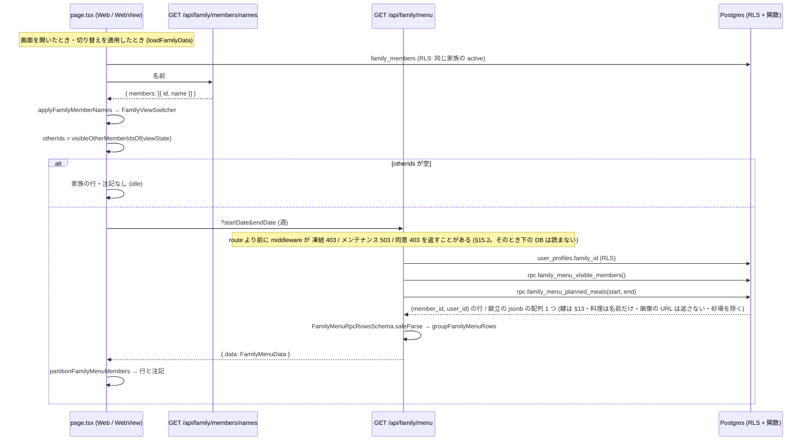

# 週間献立の「家族の表示」— 家族の共有の献立を見る (#1584 の 1)

> 版: v1.10 (2026-10-16 R6 の構造の指摘 (F) の反映) / Issue: #1584 (`家族の表示の切り替えが献立を変えない・…`) の 1
> 位置づけ: 週間献立の画面 (`src/app/(main)/menus/weekly/page.tsx`) の家族の表示の切り替え (`useFamilyView` / `FamilyViewSwitcher`) に「選んだ家族の献立を見る中身」を足す設計の正典。範囲の正本は Issue #1584 の本文とコメント (2026-10-15 のオーナーの選択「(1) 週間献立の家族の表示は、設計して作ります (家族の共有の献立を見る中身。設計ゲートから)」)。残りの 2 (承諾時に名前を写す) は PR #1607 で完了。
> 前提: ローンチ前で利用者ゼロ (本番の `family_groups` の active は 0 件・2026-10-16 実測)。正しい形で作る。本番の DB には触らない。
> 改定履歴: v1.0 2026-10-16 初版。v1.1 2026-10-16 R1 の指摘を反映 (生成型と `FamilyMenuRpcRow` の代入は片方向・e2e の spec は `e2e-local.yml` にも足す・週を移る間は前の週の応答を使わない・時間で取り直す契機は作らない・切り替えの適用で家族の一覧も読み直す・相手の退会 (アカウントの削除) を表に足す)。v1.2 2026-10-16 R2 の指摘を反映 (行を開いたときの画像は `SignedPhotoImage` で描き、食事写真・冷蔵庫写真のバケットの URL は描かない (`familyMenuImageUrl`)・既存の走査テスト `tests/signed-photo-display-scan.test.ts` の追随を足す)。v1.3 2026-10-16 網羅性の漏れを反映 (シナリオ S-21〜S-25 = 凍結・自分が active でない・この日は献立が無い・子供の昇格・自分が家族から外れる を足し、トレースとテストの対応を足す・遷移表に「切り替えの適用で others が空になる」と「取得中に key が変わり前の応答が後から届く」の行を足す・昇格は家族の一覧を読み直すまで子供の注記のまま・e2e の道具の定義の場所 (`patchShareSettings` は `membership-paste.ts`・`cleanupFamily` は呼ばない) を正す・migration の最大の番号と番兵 `jst-leftovers-1463-routes` を足す)。v1.4 2026-10-16 R3 の指摘を反映 (e2e の spec02 が持つ `/api/...` の文字列を spec の先頭の定数 4 つに決め、`SPEC_FILES` の `minRefs` を 4 にする・準備を fixture `freshFamilyWithMembers` にして招待と承諾をしない・共有の設定の変更は spec の中で `apiRequest` で呼ぶ / 関数が他のメンバーの食事写真・冷蔵庫写真のバケットの画像の URL を NULL で返し、`groupFamilyMenuRows` も `familyMenuImageUrl` で null にする (画面は応答の `image_url` が null でなければ描く)・同じ型の取り残しとして、料理ごとの栄養・材料・作り方・画像の生成の情報を持つ `dishes` を返さず料理の名前 `dish_names` だけを返し、画面が使わない `mode` も返さない)。v1.5 2026-10-16 網羅性の漏れ (周 4) を反映 (利用者の写真のバケットは 3 つ (`STORAGE_OBJECT_BUCKETS` に健診の画像 `health-checkups` がある) なので、関数の CASE と `familyMenuImageUrl` は 3 つとも落とす (`FAMILY_MENU_HIDDEN_IMAGE_BUCKETS`)・見る人が凍結中の行 (V-6・S-26・T-24) を足す・招待の承諾で大人が加わる (T-21・S-27)・家族を作る (T-22・S-28)・代表者の譲渡 (T-23・S-29。T-16 のガードの対象が新しい代表者へ移る) の遷移とシナリオとテストを足す・関数が `role`・`representative_id`・`frozen_at` を読まないことを契約テスト C-8 で見る)。v1.6 2026-10-16 R4 の指摘を反映 (§13・§14 の正典の TS ブロックの `STORAGE_OBJECT_BUCKETS` の import を、置き場所に依らず解決する `@/supabase/functions/_shared/storage-object-url` にする (相対パスはブロックを別の場所で型検査すると解決しない)・切り替えの適用と [もう一度] の `reload` は今の週だけでなく全ての週の cache を捨てる (`cache.current.clear()`。適用のあとに TTL 内の別の週へ移ると、共有をオフにした人の行が出たままシートは「(献立は非公開)」になる食い違いを消す。T-25))。v1.7 2026-10-16 網羅性の漏れ (周 5) を反映 (見る人が招待の承諾で家族に加わる (T-26・S-30。e2e family/01 T14-F3 の経路) と、見る人が家族を移る (`family_id` が A→B。T-27・S-31。hook の key に familyId が無くても別の家族の cache が出ない理由と、`useFamilyView` が移った先のキーが無いと前の `viewState` を持ち越すこと) を足す・`src/schemas/membership/index.ts` (barrel) に `family-menu` の再 export を足す)。v1.8 2026-10-16 R5 の指摘を反映 (`family_menu_planned_meals` を `RETURNS TABLE` (1 行 1 食) から `RETURNS jsonb` (献立の配列 1 つ) に替える。集合を返す RPC の結果は PostgREST の `max_rows` (Supabase の既定 1,000 行) で黙って打ち切られ、API が受け付ける 31 日の範囲で家族の献立が欠け、画面が「この日はありません」と誤って注記していた (例: 7 人 × 31 日 × 1 日 5 食 = 1,085 食)。#1498 の `llm_usage_summary` と同じ形にし、route は Zod の `FamilyMenuRpcRowsSchema` で読む・契約テスト C-6 が `RETURNS jsonb` を見る・実 DB の it で 1,085 食が全部返ることを見る・シナリオ S-32 を足す・§12 の範囲の上限の根拠と §11.1 の規模の見積もりを直す)。v1.9 2026-10-16 網羅性の漏れ (周 6) を反映 (見る人の凍結の扱いの事実誤りを正す: `/api/*` は route より前に `lib/supabase/middleware.ts` が 凍結 (403 `AUTH_ACCOUNT_FROZEN`) → メンテナンス (503 `MAINTENANCE_MODE`) → 規約の同意 (403 `LEGAL_CONSENT_REQUIRED`) の順で止めるので、凍結中の見る人は 200 ではなく 403 (V-6・S-26・T-24・Q-3)。同意未済 (V-7・S-33・T-28) とメンテナンス中 (V-8・S-34・T-29) の行を足す・§15.2 と §18 に 3 つの応答を足し、画面は `fetchFamilyMenu` の `failed` → `loadFailed` で扱う (§14.2)・route の単体ではなく middleware を通した it (`lib/supabase/__tests__/middleware-family-menu.test.ts`) で 403 / 503 を固定する・§21 に `middleware-legal-consent-api.test.ts` と `middleware-frozen-allowed-api.test.ts` の行を足す)。v1.10 2026-10-16 R6 の構造の指摘 (F) を反映 (画像の URL を返して描く経路をやめる: `family_menu_planned_meals` の要素と `FamilyMenuRpcRowSchema`・`FamilyMenuMealSchema` から `image_url` を外し、要素の鍵を 12 個にする。他のメンバーの写真の URL は関数の結果にも応答にも構造的に存在せず、判定の部品が要らない。v1.2・v1.4〜v1.6 で足した画像の経路の部品 (関数の `image_url` の CASE・`FAMILY_MENU_HIDDEN_IMAGE_BUCKETS`・`familyMenuImageUrl`・`isFamilyMenuHiddenImageUrl`・`STORAGE_OBJECT_URL_PATH_PATTERN`・`STORAGE_OBJECT_BUCKETS` と `PHOTO_STORAGE_BUCKETS` の import・`supabase/functions/_shared/storage-object-url.ts` の変更・行を開いたときの `SignedPhotoImage`・§8 の画像の表・C-7 の画像の部分・§21 の画像の 3 行・画像の it) はすべて消した。行を開いたときは料理の名前の箇条書きだけ。画像を出すかは署名の決まりを変えるとき (#1365 の段 2) に列を足して決める (Q-8)。C-7 は `dish_names` の取り出しだけを見る)。

---

## 0. 分冊判定・段分け・範囲 (相 1 の結果)

### 0.1 分冊判定

| 目安 | 本件 | 判定 |
|---|---|---|
| 設計書 800 行超 | 超える (表 3 点・正典コード・追随表を 1 冊に持つため) | 当たる |
| 消費先レーン 3 以上 | DB (関数 2 本)・API (route 1 本)・Web の画面 (page.tsx + 部品 2 つ + hook) の 3 | 当たる |
| 共有面に 2 つ以上触る | `page.tsx` (週間献立の画面の本体 6,656 行) と `FamilyViewSwitcher` (家族の 4 画面とは別の名前の経路) の 2。DB の表・列・RLS は変えない | 当たる |

**判定: 設計書は 1 冊、実装は 2 段 (A・B) に分け、同じ実装 WF・同じ worktree で段ごとにレビューを挟む。** 分冊 (核と配線で別の設計書) にしない理由: 核 (DB の関数 2 本と API 1 本) は小さく、配線 (画面) はその応答を読むだけで、契約 (§11〜§15) を本書に逐語で置けば段 B の実装者は本書だけで手が止まらない。分けると「核のマージ待ち」のコストが利点を上回る。

### 0.2 段分け (実装 WF の単位と順序)

| 段 | 中身 | 依存 | デプロイ後の状態 |
|---|---|---|---|
| **A 読み取りの口** | migration (SECURITY DEFINER の関数 2 本 §11) と対の `.down.sql`・型の再生成 (§11.3)・Zod と純関数 (§13・§14)・`GET /api/family/menu` (§15)・migration の契約テストと実 DB の結合テスト (§19) | なし | API を直接呼べば家族の献立が返る。画面はまだ変わらない |
| **B 画面** | `useFamilyMenu` (§14.3)・`FamilyMenuRows.tsx` (§16.2)・`page.tsx` の配線 (§16.1)・`FamilyViewSwitcher` の名前と印 (§16.3)・画面のテストと e2e (§19) | A | 週間献立の画面で、切り替えで選んだ家族の献立が自分の献立の下に読み取り専用で出る。モバイルアプリの献立タブ (WebView) も同じ画面なので同時に変わる |

migration の本番適用は段 A のマージ後にオーケストレーターが行う (関数の新設だけで、表・列・既存の行は変えない)。

### 0.3 本書が決めないもの (範囲外)

- 家族で 1 つの献立を AI で生成する「共有献立」(`family/05-shared-menu-engine.md`・`family/01-data-model.md` §4.4 の `family_shared_menus`・`family/08-rls-policies.md` §7)。origin/main にその表も API も無く (git grep 0 件)、本書は作らない (§7.1 の代替案 A)。
- 他のメンバーの献立の編集・自分の献立への写し (ペースト)。本書は読むだけ (§7)。
- アカウントの無い子供のメンバー (`family_members.user_id IS NULL`) の献立。保存先が無い (`user_daily_meals.user_id` は NOT NULL) ので出ない (§8 P-6・Q-2)。
- 他のメンバーの献立の画像を家族の行に出すこと。関数と API は画像の URL (`planned_meals.image_url`) を返さない (関数の結果の要素にも応答にも `image_url` の鍵が無い。§11.1・§13)。署名の API (`POST /api/storage/signed-urls`) は本人の写真にだけ署名する (`src/lib/photo-storage-signing.ts`・#1365) ので、他のメンバーの写真 (食事写真・冷蔵庫写真のバケットの URL。AI の画像生成の画像も `fridge-images` の `generated/…`) は返しても表示できず、本書はその決まりを広げない。行を開いたときは料理の名前の箇条書きだけ (§16.2・Q-8)。料理ごとの中身 (`planned_meals.dishes` の料理ごとの栄養・材料・作り方・画像の URL と生成の情報) も返さず、料理の名前だけを返す (R-6)。
- 共有の同意 (`share_menu`) の設定画面と API (`PATCH /api/family/members/me/share`・`update_my_share_settings`)。今のまま使う。
- `apps/mobile/app/menus/weekly/index.tsx` (ネイティブの週間献立の画面。2,435 行) は 2026-10-16 に削除した。#1598。献立タブは Web の `/menus/weekly` を WebView で開く (`apps/mobile/app/(tabs)/menus.tsx`・`NATIVE_APP_TABS`) ので本書の対象は Web の画面だけ。ネイティブの画面に残っていた家族の欠陥 (#1610) は画面と一緒に消えた (Q-5)。
- リアルタイムの反映 (相手が献立を変えた瞬間に更新する) と、時間がたったら自動で取り直す仕組み (timer・画面が前面に戻ったときの取り直し)。取り直しの契機は §10 のとおり (切り替えの適用・[もう一度]・cache の無い週への移動・画面の開き直し)。自分の献立の `weekDataCache` (page.tsx :1961-2011) も時間では取り直さず、週の移動のときに TTL で cache を使うかを決めるだけなので、それと同じにする。

---

## 1. 目的・スコープ

週間献立の画面の「家族の表示」の切り替えは、いまは切り替えの部品に状態を渡すだけで、表示する献立が変わらない (Issue #1584 の 1)。本書は次を決める。

1. 家族の表示で何を見せるか → **合成**: 自分の献立 (今までどおり編集できる) の下に、切り替えで選んだ家族のメンバーごとの献立を**読み取り専用**で並べる (§7)。
2. 共有の同意と権限 → `family_members.share_menu` (設定画面の「週間献立を家族に見せる」) を読み取りの条件にし、判定を DB の関数 1 本に閉じる (§11.1)。
3. API と RLS → `GET /api/family/menu` と SECURITY DEFINER の関数 2 本。既存の RLS は広げない (§7.2)。
4. Web とモバイル (WebView) の画面・空のとき・権限が無いときの表示 (§16)。
5. 家族の画面の名前の出し方との整合 → 切り替えの部品も `GET /api/family/members/names` の名前を使う (§16.3)。
6. テスト (§19)。

## 2. 関連要件・正典

| 文書 | 使う箇所 |
|---|---|
| Issue #1584 本文・コメント | 範囲の正本 (1 = 本書、2 = PR #1607 で完了、3 = #1611) |
| `docs/design/membership/00-overview.md` §1.2 | データ ownership (Option E): 記録は単一の `user_id` に帰属し、家族の共有は閲覧権限の grant で実現する。本書の構造の根拠 |
| `docs/design/membership/03-ui-spec.md` §4・§5・§7.1 | 切り替えの配置と部品・mix 表示の当初設計・「週間献立を家族に見せる」= `share_menu` |
| `docs/design/membership/06-implementation-phases.md` P5 | 「ビューの切り替えは置いてあるが、選んだ内容で食事を絞り込む処理は無い」(本書で埋める) |
| `docs/design/membership/01-data-model.md` §3.2・§3.5 | `family_members` の DDL と RLS |
| `docs/design/family/02-api-spec.md` §5.8 | 名前の API `GET /api/family/members/names` (本書の名前の経路) |
| `docs/design/cross/04-api-conventions.md` §5.2 (b) | 家族の API のエラーの形 (nested・`MembershipErrorCode`) |
| `docs/design/cross/02-rls-patterns.md` §3.3 | service_role バイパスのガイドライン (本書は route で service_role を使わない) |
| `docs/requirements/01-family-management.md` §5.4 の権限表 (:479-480) | 「共有献立閲覧」は代表・大人・メンバーが ✅、子供は ❌ (本書: 子供はアカウントが無いので見る側にも見られる側にもならない) |

## 3. 前提の事実 (origin/main `5ff68e67`・R1 で `309dae0f`、周 3 で `cd4d4f17`、R3 で `3b070f2b`、周 4 と R4 で `ada271ea`、R5・周 6・R6 の続きで `8fdd06c8` に対して再確認・本番 DB は 2026-10-16 に読み取りで実測)

### 3.1 実装の現状

| 事実 | 場所 |
|---|---|
| `useFamilyView(familyId)` は `viewState` (`preset` 6 種 + `visible_member_ids`) を localStorage (`familyViewState_<familyId>`) に持つだけ。献立の取得には使われない | `src/hooks/useFamilyView.ts:33-69`・`page.tsx:1113`・`:5829-5834` |
| 画面は `family_members` を利用者のクライアントで読み (RLS)、`status = 'active'` の行を `FamilyViewSwitcher` に渡す。名前は `display_name` だけ (無ければ 'メンバー')。`GET /api/family/members/names` は呼んでいない | `page.tsx:1117-1139`・`FamilyViewSwitcher.tsx:45-48` |
| 献立の読み取り `GET /api/meal-plans` は `user_daily_meals` を `.eq('user_id', user.id)` で読み `planned_meals(*)` を結合する。他人の献立を読む経路は無い。日付は `isCalendarDate` で検査 (#1482) | `src/app/api/meal-plans/route.ts:17-117` |
| RLS: `user_daily_meals` は `Users can manage own daily meals` (ALL, `auth.uid() = user_id`)、`planned_meals` は `Users can manage own planned meals` (ALL, 親の `user_id = auth.uid()`) の 1 本ずつ。本番の `pg_policies` も同じ 2 本だけ | migration `20251126124224` :9872・:9900・本番実測 |
| `planned_meals` に `hidden_at` は無い (隠す仕組みがあるのは `meals` / `recipes`)。`user_daily_meals.is_sandbox` (ハンズオンツアーの砂場) はある | 本番実測・migration :6608-6618 |
| `can_view_user_meals(uuid)` は `share_meals` を見る関数で `meals` の SELECT ポリシーだけが使う。`share_menu` を読む RLS・関数・読み取り API は無い | migration :940-952・`20261008160000` |
| `share_menu` は `family_members` の列 (NOT NULL DEFAULT TRUE)。書くのは `accept_family_invite` / `accept_child_promotion` の引数と `update_my_share_settings` (本人だけ。トリガー `guard_family_members_privileged` が他人の変更を拒む) | migration :126・`20261008090000` :79-88 |
| `family_members` の SELECT ポリシーは `user_id = auth.uid() OR is_active_family_member(family_id)`。同じ家族の全員の行 (`share_menu` を含む) を読める | migration :10385 |
| 家族の所属は `user_profiles.family_id`。作成・承諾で入り、退出・除名・解散で NULL になる。`status` は `active` / `removed` / `left`、`family_groups.status` は `active` / `dissolved` (凍結の状態は DB に無い) | migration :310・:1220・:2072・:2236・:2865・:339 |
| 子供のメンバーは `user_id IS NULL` (CHECK `family_members_child_profile_consistency`)。`user_daily_meals.user_id` は NOT NULL なので、子供の献立の保存先は無い | migration :133・:6610 |
| 退会 (アカウントの削除 `POST /api/account/delete` → `auth.admin.deleteUser`) では、`family_members.user_id` の外部キー `family_members_user_id_fkey1` (ON DELETE CASCADE) で本人の `family_members` の行が消え、`user_daily_meals` (`user_daily_meals_user_id_fkey` CASCADE) と、その子の `planned_meals` (`planned_meals_daily_meal_id_fkey` CASCADE) も消える。同じ migration の ON DELETE SET NULL の `family_members_user_id_fkey` は `legacy_family_members` の外部キーで、`family_members` には掛からない (本番の `pg_constraint` も `family_members` の user_id の外部キーは `fkey1` の 1 本だけ・2026-10-16 実測)。家族の代表者は削除できない (先に譲渡か解散) | migration :8933・:8928 (`legacy_family_members`)・:9428・:9248・`src/lib/account-deletion.ts:331-346` (origin/main `5ff68e67` の時点は `:256-271`) |
| 名前の決め方は `display_name` → 本人の `user_profiles.nickname` → null (`'Guest'` は名前とみなさない)。4 画面は `fetchFamilyMemberNames` / `applyFamilyMemberNames` で当てる | `src/lib/membership/family-member-names.ts`・`src/app/api/family/members/names/route.ts` |
| モバイルアプリの献立タブは Web の `/menus/weekly` を WebView で開く。利用者別の localStorage (接頭辞 `familyViewState_`) はログアウトで Web・WebView とも消す (#1599) | `apps/mobile/app/(tabs)/menus.tsx`・`packages/shared/src/native-app-tabs.ts`・`packages/shared/src/user-scoped-storage.ts:36-48` |
| `user_daily_meals` / `planned_meals` を利用者のクライアントで読むファイルは src・lib に **29 本** ある (`from('planned_meals')` / `from('user_daily_meals')` の grep)。多くは `user_id` の絞りを RLS に頼る | §7.2 の根拠 |
| 索引: `idx_user_daily_meals_user_date (user_id, day_date)`・`idx_planned_meals_daily_meal (daily_meal_id)`・`idx_family_members_family`・`idx_family_members_user` | migration :8338・:8170・:7854・:7862 |
| 保存された写真の署名: 食事写真・冷蔵庫写真のバケットの URL は、画面が `POST /api/storage/signed-urls` に問い合わせ、サーバーは本人の写真 (パスに本人の user_id・または `generated/<本人の献立の id>/…`) にだけ署名し、他人の写真は null (= 表示しない) を返す。AI の画像生成の画像は `fridge-images` の `generated/…` に置かれる | `src/app/api/storage/signed-urls/route.ts:64-80`・`src/lib/photo-storage-signing.ts:8-15`・`supabase/functions/process-meal-image-jobs/index.ts:26` (`STORAGE_BUCKET = "fridge-images"`) |
| 本番の `planned_meals.image_url` は 747 行のうち空か NULL が 735、食事写真・冷蔵庫写真のバケットの URL が 12、それ以外の URL が 0 (2026-10-16 実測)。他のメンバーに返しても、表示できる画像は 0 件 (バケットの URL は上の署名の決まりで他人には null) | 本番の読み取り |
| 本番の `planned_meals.dishes` (jsonb) は 747 行のうち配列が 726・NULL が 21 (キーつきのオブジェクトは 0)。配列の要素は `name` のほか、料理ごとの栄養 (`calories_kcal`・`protein_g`・`vitamin_c_mg` など 30 種あまり)・`ingredients`・`recipeSteps`・`image_url`・`image_prompt`・`image_model`・`image_error` などを持つ (2026-10-16 実測)。週間献立の画面は配列でない古い形 (キーつきのオブジェクト) も `Object.values` で読む | 本番の読み取り・`page.tsx:4096`・`:5135`・`:5289` |
| e2e `tests/e2e/family/01-invite-accept-share.spec.ts` は、承諾した人の週間献立に切り替え (「家族全員」「2人」・代表者の名前) が出るところまでを確かめる | :152-163 |
| e2e の spec の一覧は 2 か所にある: `.github/workflows/e2e-local.yml` の `npx playwright test` の引数 (family/01 は :124) と `scripts/local-ci.sh` の `PW_ARGS` (:171)。`tests/local-ci-workflow-sync.test.ts` が 2 つを同じ語の並びで照合する (片方にだけ足すと赤) | `e2e-local.yml:116-135`・`local-ci.sh:171`・`tests/e2e-tour-contract.test.ts:19-20` |
| 家族の一覧 (`loadFamilyData`) は画面を開いたとき 1 回だけ読む (`useEffect(…, [])`)。family_id が無ければ何もせずに終わる | `page.tsx:1115-1141` |
| 家族に入る経路: 家族を作る `create_family_group(p_name, p_plan_key)` は作った本人を `representative` で `family_members` に入れ (`share_menu` は列の既定の TRUE)、`user_profiles.family_id` を入れる。招待の承諾 `accept_family_invite(p_token, p_share_meals, p_share_health, p_share_menu DEFAULT TRUE)` は承諾した本人を `adult` で入れ、`share_menu` は引数の値 | migration `20261016200000` :205-233・`20261015170000` :37-42 |
| 1 人が active で居られる家族は 1 つ: 一意索引 `uniq_family_members_user` (`user_id IS NOT NULL AND status = 'active'`)。`accept_family_invite` は本人に active の行があれば `ALREADY_IN_FAMILY`。家族を移るには先に退出 (`leave_family`) してから別の家族の招待を承諾する | migration `20251126124224` :8462・`20261015170000` :99-101 |
| `useFamilyView(familyId)` は `familyId` が変わると effect で新しいキー `familyViewState_<familyId>` を読む。キーが無ければ `viewState` を変えない (既定に戻さず、前の家族の `viewState` を持ち越す)。`setView` は呼んだ時点の `familyId` のキーに書く。`visible_member_ids` は `family_members.id` (家族ごとに別の id) | `src/hooks/useFamilyView.ts:38-54`・`:56-67` |
| `src/schemas/membership/index.ts` は同じフォルダの 16 ファイルすべてを `export *` で再 export する barrel (冒頭の説明「全 membership スキーマの re-export」)。`FamilyViewSwitcher.tsx` は `FamilyMember` の型をここから読む。`FamilyMenu` で始まる名前は `src/schemas` に 0 件 (git grep) | `src/schemas/membership/index.ts:1-20`・`FamilyViewSwitcher.tsx:9` |
| 代表者の譲渡: `propose_family_representative_transfer` → 宛先の大人が `accept_family_representative_transfer(p_proposal_id)` で承諾すると、旧代表者の `role` を `adult`・新代表者を `representative` にし、`family_groups.representative_id` を新代表者にする (運営の `operator_force_representative_transfer` も同じ書き換え)。`status`・`share_menu`・`user_id` は変えない | migration `20261008090100` :224-267・:269-339 |
| 退会のガード (`findBlocker`) は `family_groups.representative_id = 本人` の行があれば 409 `ACCOUNT_DELETE_BLOCKED_FAMILY_REPRESENTATIVE` を返す。譲渡で `representative_id` が替わると、ガードの対象も新代表者に替わる | `src/lib/account-deletion.ts:311-349`・`:335` (origin/main `5ff68e67` の時点は `:237-274`・`:260`) |
| `/api/*` の凍結・メンテナンス・規約の同意は、route より前に `lib/supabase/middleware.ts` の `updateSession` の `/api` の分岐が判定する (`src/proxy.ts` が呼ぶ。matcher が `/api` で外すのは `api/health$` だけ)。順は (1) 凍結: `isAccountFrozen` (`frozen_at` があり、`unban_at` が NULL か未来) なら 403 `{ error: { code: 'AUTH_ACCOUNT_FROZEN', message: 'アカウントが凍結されています' } }`。止めないのは `FROZEN_ALLOWED_API_PATHS` (退会・書き出しと有料プランの解約の 3 本の計 5 本) と通知のトークンの claim とネイティブ認証ブリッジのコード (#1861) とお問い合わせの送信 (`POST /api/contact`。#1871) だけ (2) メンテナンス: `feature_flags` の `maintenance_mode` が ON なら、運営 (admin / super_admin) 以外を `isMaintenanceExemptPath` の外で 503 `{ error, code: 'MAINTENANCE_MODE', retryAfter }` (3) 同意: `LEGAL_CONSENT_ENFORCE=on` で今の版に未同意なら、`LEGAL_CONSENT_EXEMPT_API_PATHS` の外を 403 `{ error, code: 'LEGAL_CONSENT_REQUIRED' }` (`family` の語は一覧に 0 件)。プロフィールを読めないときは止めない (#348 の fail-open)。`GET /api/meal-plans` と `GET /api/family/members/names` も (route が `requireUser` を使わなくても) 同じに止まる。画面 (GET) は 凍結 → `/frozen`・メンテナンス → メンテナンスの画面・同意 → `/legal-consent?next=…` へ回る。DB の RLS と関数は凍結を見ない (Supabase の REST を直接呼ぶ経路は middleware を通らない) | `lib/supabase/middleware.ts:107-283` (凍結 :223-248・メンテナンス :255-261・同意 :263-280)・`:364`・`:397`・`:423`・`src/lib/auth/frozen.ts:25-31`・`:49-59`・`src/lib/maintenance-mode.ts:60`・`:87`・`:171`・`packages/shared/src/legal-consent-api.ts:94-147`・`src/proxy.ts` の `config.matcher` |
| PostgREST の `max_rows` (Supabase の既定 1,000 行) は、表の読み取りと行の集合を返す RPC の結果を、エラーにせず黙って打ち切る。`supabase/config.toml` に上書きは無い。前例 #1498: `llm_usage_summary` は行の集合でなく 1 つの JSONB を返し (「行の集合を返さないので、PostgREST の max_rows で打ち切られない」)、route は Zod (`LlmUsageSummaryRpcSchema.safeParse`) で読み、形が違えば 500 にしてログに残す。生成型の `Returns` は `Json`。契約テストは `RETURNS JSONB` で `RETURNS (TABLE\|SETOF)` でないことを、実 DB のテストは定数 `POSTGREST_DEFAULT_MAX_ROWS = 1000` を超える行を全部数えることを見る | `src/lib/super-admin/llm-usage-anomaly.ts:17`・`src/lib/account-export.ts:35`・`src/app/api/badges/route.ts:35`・migration `20261011110000_llm_usage_summary.sql` :15-16・`src/app/api/super-admin/llm/usage/route.ts:97-104`・`src/types/database.types.ts:8553`・`tests/llm-usage-summary-contract.test.ts:72-79`・`tests/integration/security/llm-usage-summary.test.ts:50`・`:206-210` |
| 1 日の食事の数に DB の上限は無い: `planned_meals` の制約は主キーと外部キーだけで、`(daily_meal_id, meal_type)` の一意の制約は無い (区分ごとに何食でも持てる)。`user_daily_meals` は `(user_id, day_date)` で一意 (1 人 1 日 1 行)。家族の active の人数は `member_limit` (CHECK `> 0 AND <= 20`) までで、加入の関数 (`accept_family_invite`・`add_family_child` など) が active の数で止める。プランの `max_members` は family_basic が 4・family_pro が 8 | migration `20251126124224` :7396・:9248・:7551・:337・:298-301・:887-891・:14167-14168 |

### 3.2 テストの道具

- route の単体: `tests/helpers/route-world.ts` (`makeClient` に `rpc` を渡せる)・`src/__tests__/api/family/members/names.test.ts` の偽のクライアントの型。
- 実 DB: `tests/integration/rls/family-member-names-scope.test.ts` (利用者 7 人・家族 2 つの準備) を写す。anon の EXECUTE の決定表は `tests/integration/security/anon-definer-execute.test.ts`。
- e2e: 準備と片付けは fixture `freshFamilyWithMembers` (`tests/e2e/fixtures/fresh-family.ts:426`。代表者「お母さん」・大人「大人1」・子供「子供1」を service role で直接作り、3 人とも `share_menu = true` (`insertFamilyMember` :194-212)。テストの後に家族を消し (CASCADE で `family_members` も)、利用者を消す (:446-448)。献立は利用者の削除の CASCADE で消える) を使い、`cleanupFamily` は呼ばない (同名の `cleanupFamily` が `tests/e2e/helpers/membership-family.ts:443` と `tests/e2e/helpers/membership-paste.ts:334` に 2 つあるが、どちらも要らない)。2 人目 (見る人) は `openUserContext(browser, email)` (`tests/e2e/helpers/persona-api.ts:156`。別のブラウザのコンテキストに入る。閉じるのは呼び出し側) で動かす。アプリの API は `apiRequest(page, path, { method, body })` (`persona-api.ts:73`。その page の Cookie のまま呼ぶ) で呼ぶ。招待と承諾の道具 `acceptFamilyInvite` (`membership-family.ts:252`) は使わない (開く URL `/invite/family/{token}` (:267) が今の招待の画面 `src/app/invite/[token]/page.tsx` と合わず、どの spec も使っていない。承諾の流れは family/01 が `/invite/${token}` を開いて確かめる)。共有の設定の変更の道具 `patchShareSettings` (`membership-paste.ts:425`) も使わず、spec の中で `apiRequest` で `PATCH` する (`tests/e2e-api-paths.test.ts` は spec 自身のソースの `/api/...` の文字列しか数えないため。§19.5)。今日の日付は `todayLocal()` (`packages/shared/src/date-utils.ts:19`。JST の暦日。`tests/e2e/helpers/jst-week.ts` の注記のとおりテストの側で `new Date()` から作らない)。
- 実 DB で子供を昇格させる手順: `tests/integration/security/family-accept-display-name.test.ts:148-152` (代表者が `request_child_promotion(p_member_id, p_email)` → 昇格する本人が `accept_child_promotion(p_token, …)`)。

## 4. 要件行列

| # | 要件 | 根拠 | 本書の節 |
|---|---|---|---|
| R-1 | 切り替えで選んだ家族のメンバーの献立が、自分の献立と一緒に週間献立の画面に出る | Issue #1584 の 1 | §7・§16.1 |
| R-2 | 見える献立は「週間献立を家族に見せる」(`share_menu`) をオンにしたメンバーのものだけ。オフにすると次の取り直しから出ない | membership/03 §7.1・02 §13 | §8・§10・§11.1 |
| R-3 | 自分の献立は切り替えに関わらず常に出て、今までどおり編集できる。家族の献立は読み取り専用 (編集・削除・並べ替え・完了のボタンを出さない) | Option E (membership/00 §1.2)・§7 | §16.2 |
| R-4 | 家族でない人・退出・除名・退会 (アカウントの削除) したメンバー・解散した家族の献立は、API を直接呼んでも返らない。未認証は 401、anon は関数を実行できない | family/CLAUDE.md「RLS 厳格」・#1103 | §8・§11.2・§19.3 |
| R-5 | 既存の RLS を広げない。他の 29 の読み取り経路の結果を変えない | §3.1・§7.2 | §11 |
| R-6 | 家族の献立で返す列は画面に要るものだけ (メモ・生成のメタデータ・栄養の詳細は返さない。料理は名前だけで、`dishes` の中の料理ごとの栄養・材料・作り方・画像の URL と生成の情報は返さない)。砂場 (`is_sandbox`) の献立は返さない。画像の URL (`planned_meals.image_url`) は関数も API も返さず (鍵ごと無い)、家族の行に画像を描かない (他のメンバーの写真の URL を配らない。署名の決まり #1365 を広げない。Q-8) | プライバシー・family/09・`src/lib/photo-storage-signing.ts` | §11.1・§13・§16.2 |
| R-7 | 空のとき (相手に献立が無い / 共有していない / アカウントが無い / 家族に居ない) と権限が無いとき (見る人の凍結・同意未済・メンテナンス中を含む) の表示を決める | 仕様の「決めること」 | §5 (S-3・S-5・S-8・S-22・S-23・S-26・S-33・S-34)・§8・§16.2 |
| R-8 | 切り替えの部品の名前は家族の 4 画面と同じ経路 (`GET /api/family/members/names`) で出す。無ければ「名前未設定」 | Issue コメント・family/02 §5.8 | §16.3 |
| R-9 | モバイルアプリ (WebView) でも同じに動く。利用者別の localStorage はログアウトで消える (既存) | mobile/01 §3.2・#1599 | §16.4 |
| R-10 | 週を移ると、その週の家族の献立を取る (届くまで前の週の応答を使わない)。取り直しの契機と cache を決める | page.tsx の weekDataCache | §10・§14.3 |
| R-11 | 日付の入力は実在する日付だけ・範囲の上限を決める (DB の関数でも守る)。受け付ける範囲の家族の献立は欠けなく返す (PostgREST の `max_rows` で黙って打ち切らない) | #1482・#1463・#1498 (§3.1) | §11.1・§12・§15 |
| R-12 | API の失敗は自分の献立の表示を止めない | 家族の名前の API と同じ方針 | §16.2 |
| R-13 | マジックナンバーは名前つきの定数に、`as any` は書かない | 共通ガード | §12・§13 |
| R-14 | 既存の番兵 (走査テスト・契約テスト) に追随する | 共通ガード | §21 |

## 5. ユーザーシナリオ (34 本)

| # | シナリオ | 期待 |
|---|---|---|
| S-1 | 大人 2 人の家族。両方 `share_menu` オン。妻が週間献立を開き、既定の「家族全員」のまま今日を見る | 自分の献立カード (編集可) の各食事の下に、夫の献立が読み取り専用の行で出る。夫の名前は名前の API の値 |
| S-2 | S-1 で妻が「自分だけ」を選ぶ | 家族の行が消える。家族の献立の API は呼ばない |
| S-3 | 夫が設定で「週間献立を家族に見せる」をオフ。妻が切り替えを適用し直す (または画面を開き直す・cache の無い週へ移る) | 夫の行が消え、その日の末尾に「夫 は献立を共有していません」の注記。切り替えのシートを次に開くと夫に「(献立は非公開)」の印 (適用で家族の一覧も読み直す)。適用のあとに、5 分以内に前に見た別の週へ移っても、適用がその週の cache も捨てているので取り直し、夫の行は出ない (T-25) |
| S-4 | 妻が自分の `share_menu` をオフ | 妻の画面は変わらない (自分の献立は常に出る)。夫の画面から妻の行が消える (S-3 と同じ) |
| S-5 | 家族に子供 (アカウント無し) が居て、妻が「自分 + 子供」を選ぶ | 家族の行は出ない。注記「長男 (子供) の献立は、アカウントを持つまで出ません」 |
| S-6 | 夫が家族を退出 (`leave_family`) | 妻が切り替えを適用し直すか画面を開き直すと切り替えから夫が消え、API も夫を返さない。localStorage に残った夫の id は無視する。読み直すまでの間 (週の移動だけのとき) は、夫は応答に居ないので注記「夫 は献立を共有していません」になる |
| S-7 | 代表者が夫を除名 (`remove_family_member`) | S-6 と同じ |
| S-8 | 代表者が家族を解散 (`operator_force_dissolve_family` / 解散の RPC) | `user_profiles.family_id` が NULL になり、切り替えが出ない。API は `family_id: null, members: []` |
| S-9 | 家族でない人が `GET /api/family/menu` を直接呼ぶ / anon が `/rest/v1/rpc/family_menu_planned_meals` を呼ぶ | 前者は `family_id: null, members: []` (200)。後者は 42501 (EXECUTE 権限なし) |
| S-10 | 妻が翌週へ移る | 翌週の範囲で家族の献立を取り直す。翌週の応答が届くまでは前の週の応答を使わず、読み込み中の 1 行だけを出す。同じ週に 5 分以内に戻ると cache を使う (その間に切り替えを適用していなければ。適用と [もう一度] は全ての週の cache を捨てる) |
| S-11 | 夫がハンズオンツアーの砂場 (`is_sandbox = true`) の献立を持つ | 砂場の献立は妻に出ない |
| S-12 | 夫の献立にメモと生成のメタデータがあり、`dishes` の各料理が栄養・材料・作り方・画像の URL と生成の情報を持つ | 関数の結果にも API の応答にも、メモ・メタデータ・栄養の詳細・料理ごとの中身は入らない。料理は名前の並び (`dish_names`) だけ (§13 の鍵だけ) |
| S-13 | 画面が `startDate=2026-02-30` や 40 日の範囲で呼ぶ (改変したクライアント) | 400 `INVALID_REQUEST`。DB の関数も `FAMILY_MENU_RANGE_INVALID` で止める |
| S-14 | 家族の献立の API がネットワークで失敗する | 自分の献立はそのまま。家族の行の場所に「家族の献立を読み込めませんでした」と [もう一度] |
| S-15 | 夫は名前を写す migration より前に承諾していて `display_name` が NULL、プロフィールの名前は「太郎」 | 切り替えと家族の行に「太郎」。プロフィールの名前も無ければ「名前未設定」 |
| S-16 | モバイルアプリの献立タブ (WebView) で同じ操作 | Web と同じ。ログアウトで `familyViewState_<familyId>` が消える (既存) |
| S-17 | 3 人家族で「カスタム」で 2 人だけ選ぶ | 選んだ 2 人の行だけ出る。選ばなかった人は注記にも出ない |
| S-18 | 夫が献立を作り直す | 妻の画面は次の取り直し (切り替えの適用・[もう一度]・cache の無いか TTL を超えた週への移動・画面の開き直し) で変わる。リアルタイムではなく、同じ週を開いたままなら時間がたっても取り直さない |
| S-19 | 夫 (代表者でない) が退会する (アカウントの削除) | 夫の `family_members` の行と献立は CASCADE で消える。妻の次の取得から API は夫を返さず、切り替えの適用か画面の開き直しで切り替えからも消える (読み直すまでは S-6 と同じく注記「共有していません」)。localStorage に残った夫の id は無視する。代表者は削除できない (先に譲渡か解散) |
| S-20 | 夫の献立に画像の URL がある (AI の画像生成の画像 `fridge-images` の `generated/<夫の献立の id>/…`・食事写真のバケットの URL・バケットの外の URL のどれでも)。妻が家族の行を押して開く | 料理の名前の箇条書きだけが出て、画像は出ない。関数の結果の要素にも API の応答にも `image_url` の鍵が無いので、妻のブラウザに夫の画像の URL は届かない (URL の種類に依らない)。署名の API は呼ばない (Q-8) |
| S-21 | 夫のアカウントが運営に凍結される (`user_profiles.frozen_at`)。夫の `share_menu` はオンのまま | 妻の画面に夫の行は出たまま (凍結は共有の同意を取り消さない。P-8・Q-3) |
| S-22 | 妻の `user_profiles.family_id` は家族を指しているが、妻の `family_members` の行は active でない (除名済みで `family_id` が残った不整合)、または行が無い | 切り替えが出ず、家族の行も注記も無い (画面は家族の献立の API を呼ばない)。API を直接呼ぶと 200 で `family_id` はその家族・`members: []` (V-3) |
| S-23 | 夫は月〜水だけ献立を作っていて、妻が既定の「家族全員」で木曜を見る | 木曜の各食事の下に夫の行は無く、日の末尾に「夫 の献立はこの日はありません」の注記。水曜を見ると夫の行が出て、この注記は出ない (P-2) |
| S-24 | 家族の子供 (アカウント無し) が昇格の承諾 (`accept_child_promotion`) で本人のアカウントを持つ。承諾で「週間献立を家族に見せる」をオフ (`p_share_menu = false`) にした場合と、既定のオンの場合 | 妻が切り替えを適用し直すか画面を開き直す (家族の一覧を読み直す) と、オンなら長男の行が出る (P-2)・オフなら注記「長男 は献立を共有していません」とシートの「(献立は非公開)」(P-3)。読み直すまでは子供のときの注記「長男 (子供) の献立は、アカウントを持つまで出ません」のまま (T-8) |
| S-25 | 妻が家族を退出する (`leave_family`) か、代表者に除名される (S-8 の解散と同じく妻の `family_id` が NULL になる) | 妻が週間献立を開き直すと切り替えが出ず、家族の行も注記も無い。開いたまま切り替えを適用すると、家族の一覧の読み直しで切り替えが消える。読み直すまでの間に週を移って取得すると、API は `family_id: null, members: []` なので、選んでいた人は注記「… は献立を共有していません」になる (T-6) |
| S-26 | 妻のアカウントが運営に凍結される (`user_profiles.frozen_at`。`unban_at` は NULL か未来)。妻は週間献立を開いたまま、cache の無い週へ移る / [もう一度] を押す / 画面を開き直す | 家族の献立の取得は middleware が 403 `AUTH_ACCOUNT_FROZEN` で止める (route に届かない) → 家族の行の場所に「家族の献立を読み込めませんでした」と [もう一度] (押しても 403 のまま)。自分の献立の `GET /api/meal-plans` と名前の API も同じ 403 (既存)。開き直すと `/frozen` へ差し戻され、週間献立は出ない。凍結が解ける (運営の解除・`unban_at` の経過) と、次の取得から夫の行が出る (V-6・T-24・Q-3) |
| S-27 | 妻と夫の家族に、3 人目の大人 (祖母) が招待の承諾 (`accept_family_invite`) で加わる。承諾で「週間献立を家族に見せる」をオフ (`p_share_menu = false`) にした場合と、既定のオンの場合。妻は「家族全員」 | 妻が切り替えを適用し直すか画面を開き直す (家族の一覧を読み直す) と、切り替えに祖母が出て、オンなら祖母の行 (P-2)・オフなら注記「祖母 は献立を共有していません」とシートの「(献立は非公開)」(P-3)。読み直すまでは祖母は一覧に居ないので、行も注記も出ない (応答に居ても描かない)。「カスタム」で選んでいた妻には、祖母を選び直すまで出ない (T-21) |
| S-28 | 家族に居ない妻が家族を作る (`create_family_group`)。まだ誰も招待していない | 妻が週間献立を開き直すと、一覧は自分だけ → 切り替えは自分だけで出る (`familyMembers.length > 0` の既存の条件) が、others が空 → 家族の献立の API を呼ばず、家族の行も注記も無い (`idle`)。API を直接呼ぶと 200 で `family_id` は作った家族・`members: []` (T-22) |
| S-29 | 代表者の妻が夫へ代表者を譲渡し (`propose_family_representative_transfer` → 夫が `accept_family_representative_transfer`)、そのあと妻が退会する | 譲渡の前後で、妻と夫が互いに見える献立は変わらない (関数は `role` も `representative_id` も読まない)。切り替えのシートの「(代表)」は、家族の一覧を読み直したときに夫へ移る。譲渡のあと妻は代表者でないので退会でき、夫の画面では S-19 と同じになる。夫は代表者になったので、夫の退会は 409 で止まる (T-23・T-16) |
| S-30 | 夫だけの家族 (夫が作った・夫の `share_menu` はオン) に、家族に居ない妻が招待の画面で承諾 (`accept_family_invite`) して加わる。承諾で妻の「週間献立を家族に見せる」はオンでもオフでもよい。承諾のあと妻が週間献立を開く | 切り替えが出て (既定の「家族全員」・2 人)、夫の行が出る (P-2。夫にその日の献立が無ければ注記「夫 の献立はこの日はありません」)。妻の `share_menu` は妻が見るものを変えない (夫の画面に妻が出るかだけを決める。S-27 の対称)。承諾の前から週間献立を開いたままだった画面は、家族に居ない間の表示 (切り替えが無い) のままで、開き直すと同じになる (T-26) |
| S-31 | 妻が家族 A (夫が居る) を退出し、家族 B (祖母が居る・祖母の `share_menu` はオン) の招待を承諾する。週間献立は家族 A に居たときから開いたまま | 週を移るだけなら、一覧は家族 A のまま (切り替えに夫)・応答は家族 B の祖母だけなので、夫は注記「夫 は献立を共有していません」・祖母は出ない。TTL 内の cache がある週へ移ると、家族 A に居たときに取った応答をそのまま描く (取り直さない。T-13)。切り替えを適用すると、全ての cache を捨てて取り直し、一覧も家族 B に読み直す → 「家族全員」なら祖母の行。「カスタム」などで家族 A の人を選んでいたら、選んだ id は家族 B に居ないので家族の行も注記も出ず、選び直すまでそのまま。開き直すと S-30 と同じ (T-27) |
| S-32 | family_pro (`max_members` 8) の家族で、妻以外の 7 人が全員 `share_menu` オンで、毎日 5 食 (基本の 3 食 + おやつ 2) を記録している。妻が `GET /api/family/menu` を 31 日の範囲 (§15.1 が受け付ける上限) で直接呼ぶ (7 × 31 × 5 = 1,085 食) | 200 で 1,085 食が全部返る。PostgREST の `max_rows` (既定 1,000 行) で後ろのメンバー・日の献立が欠けない (欠けると、画面はその日を「… の献立はこの日はありません」と誤って注記する)。画面が取る 7 日の範囲も同じ経路で、欠けは無い |
| S-33 | 規約の新しい版が施行され (`LEGAL_CONSENT_ENFORCE=on`)、妻はまだ同意していない。妻は週間献立を開いたまま、cache の無い週へ移る / 画面を開き直す | 家族の献立の取得は middleware が 403 `LEGAL_CONSENT_REQUIRED` で止める → 「家族の献立を読み込めませんでした」と [もう一度] (自分の献立の取得も同じ 403)。開き直すと同意の画面 (`/legal-consent?next=…`) へ回り、同意して戻ると夫の行が出る。`LEGAL_CONSENT_ENFORCE` が on でなければ止めない (V-7・T-28) |
| S-34 | 運営がメンテナンスを始める (`maintenance_mode` が ON)。妻 (運営でない) は週間献立を開いたまま、cache の無い週へ移る / 画面を開き直す | 家族の献立の取得は middleware が 503 `MAINTENANCE_MODE` で止める → 「家族の献立を読み込めませんでした」と [もう一度]。開き直すとメンテナンスの画面。メンテナンスが終わると、次の取得 ([もう一度] など) から夫の行が戻る。運営 (admin / super_admin) は止まらない (V-8・T-29) |

## 6. 構想 (相 2) — 構造と、全シナリオのトレース

### 6.1 構造

```
[page.tsx]
  familyMembers (RLS で読む。既存。画面を開いたときと切り替えの適用のときに読む) ──→ applyFamilyMemberNames(fetchFamilyMemberNames) ──→ FamilyViewSwitcher (名前は API の値)
  viewState (useFamilyView。既存) ──→ visibleOtherMemberIdsOf(viewState, members, 自分) ──→ 自分以外の id 集合 (others)
  others が空 → 何も取らない / 空でない → useFamilyMenu({ startDate, endDate }) ──→ GET /api/family/menu
                                                                                     │
  [middleware] (既存・route より前) 凍結 → 403 AUTH_ACCOUNT_FROZEN / メンテナンス → 503 MAINTENANCE_MODE / 同意未済 → 403 LEGAL_CONSENT_REQUIRED (§15.2)
  [route]  getUser → user_profiles.family_id (RLS) → rpc family_menu_visible_members() → rpc family_menu_planned_meals(start, end) (jsonb の配列 1 つ)
           → FamilyMenuRpcRowsSchema.safeParse → groupFamilyMenuRows → { data: FamilyMenuData }            │
                                                                        └→ [DB] 判定は family_menu_visible_members() の 1 本:
                                                                              同じ家族 / 両方 active / 相手にアカウントがある / 相手の share_menu = TRUE / 自分以外
  [page.tsx] 食事の区分ごとに: 自分のカード (既存) → FamilyMenuMealRows (others ∩ 応答の members。読み取り専用)
             日の末尾に: FamilyMenuDayNotes (status ごとに 1 種: 読み込み中 / 読み込めなかった / 共有していない・アカウントが無い・この日は献立が無い)
```

- 見える相手の判定は DB の関数 `family_menu_visible_members()` に 1 か所だけ置く。メンバーの一覧 (注記のため) も献立の行もこの関数から出すので、TS に同じ判定を書かない。
- 既存の RLS は変えない。読み取りは SECURITY DEFINER の関数 2 本を利用者のクライアント (`createClient()`) から `rpc` で呼ぶ。route は service_role を使わない。
- 献立は行の集合でなく jsonb の配列 1 つで受け取る (行の集合は PostgREST の `max_rows` で黙って打ち切られる。§3.1・§11.1)。見てよいメンバーは 19 人までなので、`family_menu_visible_members()` は行の集合のままでよい。
- 画面は「誰を見せるか」(切り替え) と「誰を見てよいか」(API) を別に持ち、交わりを描く。切り替えに居て API に居ない人が、注記の対象。

### 6.2 トレース (構造で手で走らせた結果)

| # | 走らせた結果 |
|---|---|
| S-1 | 既定 `preset: 'all'` → others = {夫}。hook が今週の範囲で API → route: family_id あり → visible_members = [夫] → planned_meals = 夫の献立の jsonb の配列 → `FamilyMenuRpcRowsSchema` で読む → 200。page は食事の区分ごとに夫の行を `FamilyMenuMealRows` で描く。名前は names の Map |
| S-2 | `preset: 'self'` → others = {} → 適用の `onChange` が `familyMenu.reload()` も呼ぶが、hook は `enabled: false` なので取らずに `idle` (T-19) → 家族の行も注記も無い。取得中だったなら、その応答は cleanup の `cancelled` で捨てる (T-20) |
| S-3 | 夫の `share_menu = false` → 切り替えの適用 (`onChange`) が `setView`・`familyMenu.reload()`・`loadFamilyData()` を呼ぶ → visible_members が夫を返さない → 応答の members に夫が無い → 夫は others に居るので `partitionFamilyMenuMembers` が `notSharing` に入れ、注記を描く。シートの印は `member.share_menu === false` (RLS で読んだ行)。`loadFamilyData()` が読み直した夫の行は `share_menu = false` なので、次にシートを開くと印が出る。`reload` は `cache.current.clear()` で全ての週の cache を捨てるので、適用の前に取って TTL 内の別の週 W2 へ移っても cache は当たらず (T-13 にならない)、W2 も取り直して夫は応答に居ない → W2 でも `notSharing` (T-25。シートの印と食い違わない) |
| S-4 | 自分の献立は `/api/meal-plans` (既存) なので変わらない。夫の画面では S-3 の対称 |
| S-5 | 子供は `user_id IS NULL` → visible_members に出ない → `partitionFamilyMenuMembers` が `user_id === null` を `noAccount` に入れ、注記を描く |
| S-6 / S-7 | 夫の行が `left` / `removed` → visible_members が返さない。一覧を読み直す (切り替えの適用・画面の開き直し) と RLS で読む一覧 (status = active) に居ない → others に入らない (localStorage の id は `visibleOtherMemberIdsOf` で既知の id に絞る)。読み直す前は夫は others に居て応答に居ないので `notSharing` (注記「共有していません」) |
| S-8 | `family_id` NULL → 画面は `familyMembers.length > 0` の条件で切り替えを出さない (既存)。API は `{ family_id: null, members: [] }` |
| S-9 | route は本人の family_id しか見ない → null → 200 空。RPC は anon に EXECUTE が無い → 42501 |
| S-10 | hook の key は `${startDate}_${endDate}`。cache (Map) に `fetchedAt` を持ち `FAMILY_MENU_CACHE_TTL_MS` 以内なら再利用 (`reload` は Map を空にするので、適用か [もう一度] の後は TTL 内でも取り直す。T-25)。hook が返す `data` は今の key の応答だけ (`loaded.key === key`) なので、翌週の応答が届くまでは `data === null`・`status === 'loading'` → 注記は読み込み中の 1 行だけ (§16.2)、家族の行は無し |
| S-11 | 関数の JOIN が `d.is_sandbox = FALSE` を持つ |
| S-12 | 関数が返す jsonb の配列の要素の鍵 (`to_jsonb(r)` の r の列) が §13 の 12 個だけ (`memo`・`generation_metadata`・`mode`・`dishes`・`image_url` を持たない)。料理は関数が `dishes` から名前だけを取り出した `dish_names` (文字列の配列)。route は `FamilyMenuRpcRowsSchema` で読み (知らない鍵は捨てる)、`groupFamilyMenuRows` が名指しした鍵だけを応答に入れる |
| S-13 | route: `isCalendarDate` ×2・`calendarDaySpan ≤ FAMILY_MENU_RANGE_MAX_DAYS` → 400。関数: 同じ上限で `FAMILY_MENU_RANGE_INVALID` |
| S-14 | `fetchFamilyMenu` が `{ ok: false, reason: 'failed' }` → hook `status: 'error'` → `FamilyMenuDayNotes` がエラーの 1 行と [もう一度] (`reload`) を描く。自分の献立の経路は触らない |
| S-15 | `applyFamilyMemberNames` が `display_name` を API の値に置き換える。null のままなら `FAMILY_MEMBER_NAME_FALLBACK` ('名前未設定') |
| S-16 | WebView は同じ Web の画面。Cookie のセッションで `fetch('/api/family/menu')` が通る。localStorage の掃除は既存 (#1599) |
| S-17 | `preset: 'custom'` → others = `visible_member_ids` ∩ 既知 − 自分。注記も others だけが対象 |
| S-18 | 取り直しの契機 (§10: 適用・[もう一度]・cache の無いか TTL を超えた週への移動・開き直し) 以外では変わらない。hook の effect は deps (`enabled`・`key`・`tick`) が変わったときにだけ走り、timer を持たない。設計どおり |
| S-19 | 夫のアカウントを消す → `family_members_user_id_fkey1` (CASCADE) で夫の行が消え、`user_daily_meals` → `planned_meals` も CASCADE で消える → visible_members に居ない (行が無い) → 応答に居ない。一覧を読み直すまでは夫は others に居るので `notSharing`。読み直すと一覧に居ない → others から外れる |
| S-20 | 関数の r に `image_url` の列が無い → `to_jsonb(r)` の要素に鍵が無い (C-6) → route の `FamilyMenuRpcRowsSchema` にも鍵が無い (来ても知らない鍵として捨てる) → `groupFamilyMenuRows` は名指しした鍵だけを入れ、`FamilyMenuMealSchema` (strict) にも鍵が無い → 応答に `image_url` は無い。妻が夫の行を押す → 行の state が開く (T-18) → `meal.dish_names` を箇条書きにするだけ (部品は画像の要素を持たないので、署名の API も呼ばない)。URL がバケットの中か外かを判定する部品は無い |
| S-21 | 関数は `user_profiles.frozen_at` を読まない → 夫は visible_members に居たまま → S-1 と同じ |
| S-22 | 画面: `family_members` を RLS で読み `status = 'active'` で絞る → 妻は自分の行 (removed) しか読めず、行が無ければ 0 行 → active は 0 件 → `familyMembers` が空 → 切り替えが出ない・others が空 → hook は `enabled: false` で `idle`。API: `family_id` は NULL でないので関数を呼ぶ → `family_menu_visible_members()` は `vm.status = 'active'` の行が無く 0 行 → 献立も空の配列 `[]` → `{ family_id, members: [] }` |
| S-23 | 応答の members に夫が居て、夫の `days` は月〜水だけ → 木曜は `familyMenuMealsOf` が [] → 行を描かない。`FamilyMenuDayNotes` (`ready`・`menu !== null`) が `partition.shown` の夫について `!familyMenuHasMealsOn(夫, 木曜)` を見て `noMealsToday` の注記を描く。水曜は `familyMenuHasMealsOn` が真なので注記なし |
| S-24 | 承諾で長男の行の `user_id` が本人になり、`share_menu` は `p_share_menu` の値。読み直す前の `familyMembers` は長男の `user_id` が null のまま → `partitionFamilyMenuMembers` は `user_id === null` を先に見るので、応答に居ても `noAccount` (子供の注記)。切り替えの適用 (T-2) で `loadFamilyData()` が読み直すと `user_id` があり、オンなら応答に居て `shown`、オフなら visible_members に居ないので `notSharing`・シートの印は `share_menu === false` |
| S-25 | 妻の `family_id` が NULL → API は関数を呼ばず `{ family_id: null, members: [] }`。画面を開き直すと `loadFamilyData()` が `family_id` 無しを見て `setFamilyId(null)`・`setFamilyMembers([])` → others が空 → `idle`・切り替えが出ない。開いたままの取得では others は前の一覧のままで応答に誰も居ないので、選んでいた人は `notSharing` |
| S-26 | middleware の `/api` の分岐が `fetchMiddlewareProfile` で妻の `frozen_at`・`unban_at` を読み、`isAccountFrozen` が真 → `/api/family/menu` は `isFrozenAllowedApiPath`・`isPushTokenClaimApiPath` のどちらにも当たらない → 403 `AUTH_ACCOUNT_FROZEN` (route と関数は呼ばれない) → `fetchFamilyMenu` は `!res.ok` で `{ ok: false, reason: 'failed' }` → hook `error` → `FamilyMenuDayNotes` が `loadFailed` と [もう一度]。同じ週の取り直しなら直前の行は残る (S-14 と同じ)。開き直し (画面の GET) は middleware の画面の分岐が `/frozen` へ回す |
| S-27 | 承諾で祖母の行が `status = 'active'`・`share_menu = p_share_menu` で入る → 関数はオンなら祖母を返す。読み直す前の `familyMembers` に祖母は居ない → `visibleOtherMemberIdsOf` の others に入らない → `partitionFamilyMenuMembers` は otherIds だけを回すので、応答に居ても行も注記も無い。適用 (T-2) で `loadFamilyData()` が読み直すと、`all` なら others に入り、オンなら `shown`・オフなら `notSharing` (シートの印は `share_menu === false`)。`custom` などは `visible_member_ids` に祖母の id が無いので入らない |
| S-28 | `create_family_group` で妻の行が `representative`・`active` で入り、`family_id` が入る。開き直すと一覧 = [妻] → `visibleOtherMemberIdsOf` は自分を除くので [] → `enabled: false` → `idle`。API: `family_id` あり → `family_menu_visible_members()` は自分を除くので 0 行 → `{ family_id, members: [] }` |
| S-29 | 譲渡は `family_members.role` と `family_groups.representative_id` だけを書き換える → 関数は両方を読まない (C-8) → visible_members も献立も変わらない。シートの「(代表)」は `member.role === 'representative'` (RLS で読んだ行) なので、`loadFamilyData()` の読み直しで夫に移る。退会のガード (`findBlocker`) は `representative_id` を見るので、妻の削除は通り (S-19 の流れ)、夫の削除は 409 |
| S-30 | 承諾で妻の行が `adult`・`active` で入り `family_id` = F (承諾の前は妻に active の行が無いので、関数は 0 行・画面は `familyId` が null で切り替えが出ない)。承諾のあと `/family/dashboard` から `/menus/weekly` を開く → 画面を新しく描くので hook の cache は空 → `loadFamilyData()` が F の active (夫・妻) を読み名前を当てる → `useFamilyView(F)` は `familyViewState_<F>` が無いので既定の `all` → others = {夫} → `enabled: true` → API: `family_menu_visible_members()` は相手 (tm) の `share_menu` だけを見るので、妻の `share_menu` に関わらず夫を返す → 夫の行。承諾の前から開いていた画面は `familyMembers` が空で切り替えが出ず、適用の入口が無い → `idle` のまま、開き直しで上と同じ |
| S-31 | 退出で妻の家族 A の行は `left`、承諾で家族 B の行が `active` (一意索引で active は 1 つ)。関数の vm は妻の active の行 = 家族 B だけ → 祖母を返す。開いたままの画面: `familyId` = A・一覧 = 家族 A (夫・妻) → others = {夫} → 取得の応答に夫は居ない → `notSharing`。祖母は others に居ないので `partitionFamilyMenuMembers` が回さない。cache の当たる週は hook が取り直さず、家族 A の応答を描く (T-13)。適用 (T-2) → `reload` が全ての cache を捨てて取り直す (応答は家族 B) → `loadFamilyData()` が `familyId` = B・一覧 = 家族 B (祖母・妻) → `useFamilyView(B)` は B のキーが無ければ適用した `viewState` を持ち越す (§3.1)。`all` → others = {祖母} → `shown`。それ以外は `visible_member_ids` が家族 A の id で、`visibleOtherMemberIdsOf` が家族 B の一覧に無い id を捨てる → others が空 → `enabled: false` → 取得中の応答は cleanup で捨てて `idle`。`setView` は適用の時点の `familyId` (A) のキーに書いたので、家族 B のキーは次にシートで適用したときに作られる。hook の key に familyId が無くても、`familyId` が変わるのは `loadFamilyData()` だけで、それは開いたとき (cache は空) か適用 (`reload` が cache を空にする) なので、画面の `familyId` が B に替わったあとの描画に家族 A の応答が cache から出ることは無い (替わる前、つまり読み直す前は上のとおり出る) |
| S-32 | route: 31 日は `isFamilyMenuRangeAllowed` を通る → visible_members = 7 行 → `family_menu_planned_meals` は 1,085 食を `jsonb_agg` で配列 1 つにまとめて返す (PostgREST の応答は 1 つの値で、`max_rows` の打ち切りの対象 (行の集合) にならない) → `FamilyMenuRpcRowsSchema.safeParse` が 1,085 要素を読む → `groupFamilyMenuRows` が 7 人 × 31 日 × 5 食に分ける → 応答の members の各人の `days` は 31 日で、各日 5 食。画面の 7 日の範囲 (245 食) も同じ経路 |
| S-33 | middleware: 凍結でない → メンテナンスでない → `resolveLegalConsentApiDecision` が (enforce・`/api/family/menu` は許可リストの外・今の版に未同意) で `deny` → 403 `LEGAL_CONSENT_REQUIRED` → 以下 S-26 と同じ (`failed` → `loadFailed`)。開き直し (GET) は `/legal-consent?next=…` へ。同意すると判定が `allow` になり、次の取得から S-1 と同じ |
| S-34 | middleware: 凍結でない → `/api/family/menu` は `isMaintenanceExemptPath` の外・妻は `isOperatorRoles` が偽・`isMaintenanceFlagOn` が真 → 503 `MAINTENANCE_MODE` (`maintenanceApiResponse`) → 以下 S-26 と同じ。開き直しは `maintenancePageResponse`。フラグが OFF に戻ると次の取得から S-1 と同じ |

## 7. 構造裁定 (相 3・1 回だけ)

### 7.1 代替案の比較

| 案 | 中身 | 利点 | 欠点 | 判定 |
|---|---|---|---|---|
| A 共有献立の表を作る | `family_shared_menus` (family/01 §4.4) を新設し、家族で 1 つの献立を AI 生成 (family/05) して表示 | 要件 §5.5 の「共有献立」の語に近い | 表・Edge Function・生成・離脱 (04) まで要り #1584 の「見る」を大きく超える。Option E (記録は単一の user_id に帰属) と別の所有モデルを足す。membership/ が family/ を supersede した範囲 (閲覧権限) と二重になる | 採らない |
| B メンバーごとの献立を読み取り専用で合成 (本書) | 各メンバーの `user_daily_meals` / `planned_meals` を `share_menu` の同意で読み、自分の献立の下に並べる | 表を足さない。同意 (`share_menu`) の意味 = 設定画面の「週間献立を家族に見せる」そのもの。Option E に沿う | 「家族で 1 つの献立」は作れない (A の将来の課題として残る) | **採る** |
| C ペースト (写し) | 相手の献立を自分の献立に写す | 既存の `paste_meal_to_family` と同型 | 「見る」ではなく「増やす」。`planned_meals` のペーストは無く、新しい書き込み経路になる | 採らない |

読み取りの実現のしかた (B の中の選択):

| 案 | 中身 | 判定 |
|---|---|---|
| B-1 RLS を広げる | `user_daily_meals` / `planned_meals` に家族の SELECT ポリシーを足し、route は利用者のクライアントで `.in('user_id', …)` | 29 のファイル (§3.1) が `user_id` の絞りを RLS に頼っており、家族の行が混ざる (例: 栄養の集計・ホームの今日の献立・食事の詳細)。全部を洗うのは本件の範囲を超え、将来の読み取りにも同じ罠が残る。採らない |
| B-2 route が service_role で読む | 名前の API と同じく、RLS で読めた相手の分だけ service_role で引く | 読み取りの条件 (同意) が TS に置かれ、関数より漏れやすい。`cross/02` §3.3 の「service_role は Edge Function に限る」方針にも近づけない。採らない |
| B-3 SECURITY DEFINER の関数 2 本 | 判定を関数 1 本に閉じ、献立は鍵を絞った jsonb の配列 1 つで返す (行の集合は PostgREST の `max_rows` で打ち切られる。§11.1)。RLS は変えない。route は利用者のクライアントの `rpc` | 既存の読み取りを変えない。同意の判定が 1 か所。anon / PUBLIC の EXECUTE を外す規律 (#1103) に乗る。**採る** |

### 7.2 F の問い — 縁の発生源を消すより単純な構造は無いか

- 縁の発生源は「誰を見てよいか」の判定の置き場。B-1 は判定を RLS に置くと 29 の読み取りが縁になり、B-2 は TS に置くと API ごとに写しができる。B-3 は関数 1 本に置き、メンバーの一覧も行も同じ関数から出すので、画面の注記 (共有していない・アカウントが無い) は「切り替えに居て応答に居ない人」という引き算だけで決まる。これより単純な構造は見つからない。
- 関数を 1 本 (献立の行だけ) にする案は、献立が無いメンバーを応答から区別できず (「献立が無い」と「共有していない」が同じ空になる)、注記のために TS へ判定が戻る。2 本が最小。
- 画像 (v1.10 で足した項。上の 2 つの裁定 (読み取りの実現方法・関数の本数) は変えない): 画像の URL を返し、バケットの中か外かを関数と route で判定して描き分ける経路は、要件 (Issue #1584 の 1) に無く、他のメンバーに返して表示できる画像も本番で 0 件 (§3.1) なのに、判定の部品 (SQL の正規表現・バケットの一覧の定数・TS の判定・Deno の共有ファイルの import) と、バケットの一覧が変わると本件の関数を作り直すまで無関係な PR が赤になる結合を生んでいた。`image_url` を返さない (鍵ごと無い) 構造にすれば、他のメンバーの写真の URL は判定なしで配られず、これらの部品も結合も無くなる。画像を出すと決めたときに列を足す (Q-8)。
- 自分の献立を切り替えで隠す案 (membership/03 §5.2 #4 の当初設計) は、編集の入口 (追加・編集・削除・並べ替え) が消え、`currentPlan` を前提にする 47 箇所の reducer と衝突する。自分は常に出す (R-3)。

以後、構造は確定。仕上げの中で構造の疑義が出たら blocking ではなく「裁定への差し戻し事由」として扱う。

## 8. ① 全パターン表 (見える・見えない・注記)

見る人 V (ログイン済み・`user_profiles.family_id` あり・`family_members` で active) が、切り替えでメンバー T を選んでいるときの、T の献立の扱い。列「—」はその行の判定がその軸を読まないこと。

| # | T | T の `share_menu` | T の `status` | 家族の `status` | API の members に T | 画面 |
|---|---|---|---|---|---|---|
| P-1 | 自分 | — | active | active | 入れない (自分以外だけ) | 自分の献立 (既存。常に出る・編集可) |
| P-2 | 大人・代表者 (アカウントあり) | TRUE | active | active | 入る | 読み取り専用の行。献立が無い日は注記「T の献立はこの日はありません」(S-23) |
| P-3 | 大人・代表者 | FALSE | active | active | 入らない | 注記「T は献立を共有していません」。シートに「(献立は非公開)」 |
| P-4 | 大人・代表者 | — | left / removed | active | 入らない (一覧にも居ない) | 出ない (切り替えにも出ない) |
| P-5 | 誰でも | — | — | dissolved | 入らない (`family_id` NULL・関数も `fg.status = 'active'` を要求) | 切り替え自体が出ない |
| P-6 | 子供 (`user_id IS NULL`) | — | active | active | 入らない | 注記「T (子供) の献立は、アカウントを持つまで出ません」 |
| P-7 | 大人 (アカウントあり) の砂場の献立 | TRUE | active | active | 行は入るが砂場の日は除く | 砂場の献立は出ない |
| P-8 | 大人 (アカウントが凍結 `frozen_at`) | TRUE | active | active | 入る | 出る (凍結はログインを止める措置で、共有の同意を取り消すものではない。Q-3・S-21) |
| P-9 | 大人 (代表者でない) が退会した (アカウントを削除) | — (行ごと消える) | — (行ごと消える) | active | 入らない (`family_members` の行も献立も CASCADE で消える。§3.1) | 一覧を読み直すと出ない (切り替えにも出ない)。読み直すまでは P-3 と同じ注記。代表者は削除できない (409。先に譲渡すると代表者でない大人になって本行が当たる (T-23 → T-16)。解散すると P-5) |

V の側 (V-6〜V-8 は route より前に middleware が止める。どれかに当たったら route も関数も呼ばれない。重なったら 凍結 → メンテナンス → 同意 の順で最初のもの):

| # | V | API | 画面 |
|---|---|---|---|
| V-1 | 未認証 | 401 `NOT_AUTHENTICATED` | (画面に来ない) |
| V-2 | 家族に居ない (`family_id` NULL。退出・除名・解散の後を含む) | 200 `{ family_id: null, members: [] }` | 切り替えが出ない (既存。S-8・S-25)。家族を作ると T-22、招待を承諾すると T-26 で V-4 へ (別の家族へ移るのは退出 → 承諾。T-27) |
| V-3 | `family_id` はあるが active でない (不整合。除名済みで `family_id` が残った・行が無い) | 200 `{ family_id, members: [] }` (`family_menu_visible_members` は 0 行・献立は空の配列) | 切り替えは RLS で読めた行 (自分の行だけ・active でない) → 0 件 → 出ない。画面は API を呼ばない (`idle`。S-22) |
| V-4 | active なメンバー (凍結していない・メンテナンス中なら運営・`LEGAL_CONSENT_ENFORCE=on` なら今の版に同意済み) | 200 | 本表の P-1〜P-9 |
| V-5 | anon が RPC を直接呼ぶ | 42501 (EXECUTE なし) | — |
| V-6 | アカウントが凍結中 (`isAccountFrozen` = `frozen_at` があり `unban_at` が NULL か未来。家族の所属に依らない) | 403 `AUTH_ACCOUNT_FROZEN` (middleware が route より前に返す。`/api/family/menu` を `FROZEN_ALLOWED_API_PATHS` に足さない。§3.1) | 開いたままなら家族の注記は `loadFailed` + [もう一度] (§16.2)。自分の献立の `GET /api/meal-plans` も同じ 403 (既存)。開き直すと `/frozen` へ回り週間献立は出ない (S-26・T-24・Q-3) |
| V-7 | `LEGAL_CONSENT_ENFORCE=on` で、今の版の規約・プライバシーに未同意 (凍結でなく、メンテナンスで止まらない人) | 403 `LEGAL_CONSENT_REQUIRED` (middleware。`/api/family/menu` を `LEGAL_CONSENT_EXEMPT_API_PATHS` に足さない) | V-6 と同じ扱い。開き直すと `/legal-consent?next=…` へ回る (S-33・T-28) |
| V-8 | メンテナンス中 (`maintenance_mode` が ON) で、運営 (admin / super_admin) でない (未認証も含む) | 503 `MAINTENANCE_MODE` (middleware。`/api/family/menu` を `isMaintenanceExemptPath` に足さない。未認証も V-1 の 401 より先にここで止まる) | V-6 と同じ扱い。開き直すとメンテナンスの画面 (S-34・T-29) |

切り替えの軸 (`viewState`) と others:

| preset | others (自分以外で描く id) |
|---|---|
| `all` | active な全員 − 自分 |
| `self` | 空 (API を呼ばない) |
| `self_partner` / `self_children` / `children_only` / `custom` | `visible_member_ids` ∩ active な全員の id − 自分 (未知の id は捨てる) |

P-2・P-7・P-8 で出す行の中身は §13 の鍵だけ。画像の URL (`planned_meals.image_url`) は、DB の値 (NULL・バケットの URL・バケットの外の URL) に依らず返さない (関数の結果の要素にも応答にも鍵が無い)。行を開いたときは料理の名前の箇条書きだけ (T-18・S-20・Q-8)。

## 9. ② 状態比較表 (現行 vs 設計後)

| 面 | 現行 | 設計後 |
|---|---|---|
| 切り替えの効果 | 表示は変わらない | 選んだメンバーの献立が自分の下に読み取り専用で出る |
| 切り替えの名前 | `display_name` か 'メンバー' | `GET /api/family/members/names` の値、無ければ '名前未設定' |
| 切り替えのシート | 名前・(自分)・(代表)・(子供) | + 「(献立は非公開)」(`share_menu = false`) |
| 家族の一覧 (`familyMembers`) の読み込み | 画面を開いたとき 1 回 (`useEffect(…, [])`) | 開いたとき + 切り替えの適用のとき。family_id が無くなっていたら一覧を空にする |
| 他人の献立の読み取り経路 | 無い | `GET /api/family/menu` → 関数 2 本 (SECURITY DEFINER。献立は jsonb の配列 1 つで、PostgREST の `max_rows` で打ち切られない) |
| `user_daily_meals` / `planned_meals` の RLS | own の ALL 1 本ずつ | 変えない |
| `share_menu` の消費先 | 無い (設定できるだけ) | `family_menu_visible_members()` が読む |
| 砂場の献立 | 本人の画面には出る | 家族には出ない |
| 他のメンバーの献立の画像 (`planned_meals.image_url`) | 見る経路が無い | 返さない (関数の結果の要素にも応答にも `image_url` の鍵が無い)。家族の行に画像を描かない (開くと料理の名前だけ) |
| 他のメンバーの料理の中身 (`dishes` の料理ごとの栄養・材料・作り方・画像の URL と生成の情報) | 見る経路が無い | 返さない。料理の名前の並び (`dish_names`) だけを返す |
| 見る人の凍結・同意未済・メンテナンス中 | (家族の献立の経路が無い。自分の献立の `/api/meal-plans` は middleware で 403 / 503) | middleware が `/api/family/menu` も同じに止める (403 / 403 / 503。route と関数に判定を足さない) → 家族の注記は「読み込めませんでした」+ [もう一度] (V-6〜V-8) |
| 空のとき | (該当なし) | 注記 3 種 + エラー 1 種 + 読み込み中 1 行 (§16.2)。注記は hook の `status` だけで出し分ける |
| モバイル (WebView) | 同じ画面 (切り替えは効かない) | 同じ画面 (効く) |
| e2e | 切り替えに 2 人出るまで | + 相手の献立の行が出る・共有オフで消える (§19.5) |
| 設計書 | membership/03 §5 の mix 表示は「まだ作っていない」 | 本書が正典。membership/03・06 は本書へのポインタ (§22) |

## 10. ③ 状態遷移表

状態 = (V の所属, T の所属, T.share_menu, 画面の others に T が居るか, cache。T-24・T-28・T-29 は V の凍結・同意・メンテナンスの状態)。操作ごとの遷移先・ガード・副作用。

| # | 状態 | 操作 | 遷移先 | ガード | 副作用 (画面) |
|---|---|---|---|---|---|
| T-1 | V∈F, T∈F, share=on, T∈others | 画面を開く / 週を移る | 取得 (`loading` → `ready`) | others が空でない・cache が無いか TTL 超え | T の行を描く |
| T-2 | 同上 | 切り替えを適用 (`setView`) | others を再計算・**全ての週の cache を捨てて今の週を取り直す** (`reload` = `cache.current.clear()`)・家族の一覧を読み直す (`loadFamilyData`) | 適用後の others が空でない (空なら T-19) | 応答と読み直した一覧で描き直す (S-3 の注記とシートの印、S-6 / S-19 の一覧からの削除の反映の契機)。適用の前に取った別の週の応答は残らない (T-25) |
| T-3 | 同上 | T が `share_menu` をオフ (`update_my_share_settings`) | T∉members (次の取得から) | — | 次の取得 (T-1 / T-2 / T-12 / 開き直し) で行が消え注記に変わる。それまで古い行が残る (同じ週を開いたままなら時間では取り直さない。§0.3) |
| T-4 | V∈F, T∈F, share=off | T がオンに戻す | T∈members (次の取得から) | — | 次の取得で行が戻る |
| T-5 | V∈F, T∈F | T が退出 / 除名 | T∉F。`familyMembers` から消える (切り替えの適用 T-2 か画面の開き直しで一覧を読み直したとき) | RLS の一覧は status=active | others から外れる (localStorage の id は無視)。読み直す前の取得では T は応答に居ないので注記「共有していません」 |
| T-6 | V∈F, T∈F | V が退出 / 除名 / 解散 | V∉F (`family_id` NULL)。`familyId`・`familyMembers` が空になるのは家族の一覧を読み直したとき (切り替えの適用 T-2・画面の開き直し) | — | 読み直すと切り替えが出ず `idle` (家族の行も注記も無い)。読み直す前の取得では API が `{ family_id: null, members: [] }` を返し、others は前の一覧のままなので注記「共有していません」(S-25) |
| T-7 | V∈F | 子供を追加 (`add_family_child`) | 子供∈F (user_id NULL) | — | 切り替えに出る。選ぶと注記 (P-6) |
| T-8 | V∈F, 子供∈F | 子供がアカウントに昇格 (`accept_child_promotion` の `p_share_menu`) | 子供は user_id あり・share は引数の値。API は次の取得から (share がオンなら) 返す | 画面の `familyMembers` の `user_id` が読み直されるまでは null のまま (`partitionFamilyMenuMembers` は `user_id === null` を先に見る) | 家族の一覧を読み直したとき (切り替えの適用 T-2・画面の開き直し) から P-2 / P-3。それまでは子供の注記 (P-6) のまま (S-24) |
| T-9 | V∈F, T∈F, share=on | T が献立を作り直す / 消す | 変化なし (DB だけ) | — | 次の取得 (T-1 / T-2 / T-12 / 開き直し) で反映 |
| T-10 | 任意 | V がログアウト・別の利用者がログイン | `familyViewState_*` が消える (#1599 既存) | — | 既定の「家族全員」から |
| T-11 | V∈F, others 空 (`self`) | — | 取得しない (`idle`) | — | 家族の行も注記も無し |
| T-12 | 取得中 | 取得が失敗 | `error` | — | エラーの注記 + [もう一度] (`reload` = 全ての週の cache を捨てて T-1) |
| T-13 | `ready` | 同じ週に戻る (TTL 内) | `ready` (cache) | `now − fetchedAt < FAMILY_MENU_CACHE_TTL_MS`、かつ、その週を取った後に `reload` (適用・[もう一度]) していない (`reload` は cache を空にする。T-25) | 取り直さない |
| T-14 | V∈F, T∈F, share=on | T の砂場の献立が作られる / 消える | 変化なし | 関数が除外 | 出ない |
| T-15 | V∈F, T∈F, share=on | T のアカウントが凍結される | 変化なし (P-8) | — | 出たまま |
| T-16 | V∈F, T∈F (T は代表者でない) | T が退会する (アカウントの削除) | T の `family_members` の行と献立が消える (CASCADE)。T∉members (次の取得から)・T∉F (一覧を読み直したとき) | T が代表者 (`family_groups.representative_id = T`) なら削除が 409 で止まる (`account-deletion.ts:331-346`)。代表者は譲渡 (T-23) で替わるので、ガードの対象は譲渡のあとの代表者 | 次の取得で行が消え、読み直すまでは注記「共有していません」。読み直すと切り替えからも消える (T-5 と同じ) |
| T-17 | `loading` (週を移った直後・前の週の応答あり) | 応答を待つ | `ready` / `error` | hook は今の key の応答だけを `data` に返す (前の週の応答は返さない) | 待つ間は読み込み中の 1 行だけ。家族の行も「この日は献立が無い」「共有していない」の注記も出さない |
| T-18 | 家族の行が閉じている (部品の中の state) | 行を押す / もう一度押す | 開く / 閉じる | — | 開くと料理の名前 (`meal.dish_names`) の箇条書きだけ (画像は描かない。応答に画像の URL が無い。Q-8)。閉じると消す。DB・API・cache は変えない |
| T-19 | V∈F, T∈F | 切り替えを適用して、適用後の others が空になる (`self`、または選んだ人が自分だけ) | `idle`。`reload` は呼ばれる (全ての週の cache を捨てて `tick` を進める) が、effect は `enabled` が false なので取らずに `idle` にする。家族の一覧は読み直す (`loadFamilyData`) | — | 家族の行も注記も消える。API は呼ばない (S-2) |
| T-20 | `loading` (key K1 の取得中) | 応答が届く前に、週を移る (key K2) / 切り替えを適用する (`reload` で `tick` が進む) / others が空になる (`enabled` が false) | K2 の取得 (T-1 / T-13) / 同じ範囲の取り直し / `idle` | effect の cleanup が K1 の取得の `cancelled` を true にする (§14.3) | K1 の応答が後から届いても捨てる (`setLoaded`・cache への書き込み・`setStatus`・`setReason` をしない)。前の key の応答は描かれず、cache にも残らない |
| T-21 | V∈F, N∉F (N はアカウントのある大人) | N が招待の承諾で加わる (`accept_family_invite` の `p_share_menu`。既定 TRUE) | N∈F (`status = 'active'`・share は引数の値)。API は次の取得から (share がオンなら) N を返す | 画面の `familyMembers` に N が入るのは家族の一覧を読み直したとき (切り替えの適用 T-2・画面の開き直し)。`partitionFamilyMenuMembers` は otherIds だけを回す | 読み直すまでは N は others に居ないので、応答に居ても行も注記も無い。読み直すと `all` なら P-2 / P-3、`custom` などは `visible_member_ids` に N の id が無いので選び直すまで出ない (S-27) |
| T-22 | V∉F (`family_id` NULL) | V が家族を作る (`create_family_group`) | V∈F (自分だけ。代表者・`share_menu` は既定の TRUE)。API は `{ family_id, members: [] }` (関数は自分を返さない) | 画面の `familyId`・`familyMembers` が入るのは画面の開き直し (家族の作成は別の画面で行うので、週間献立の画面は開き直しで読む) | 切り替えは自分だけで出る (既存の条件 `familyMembers.length > 0`)。others が空なので `idle` (家族の行も注記も無い)。以後、招待の承諾で人が加わると T-21 (S-28) |
| T-23 | V∈F, T∈F (どちらかが代表者 R・もう一方が大人 A) | R が A へ代表者を譲渡する (`propose_family_representative_transfer` → A が `accept_family_representative_transfer`。運営の `operator_force_representative_transfer` も同じ) | R の `role` は `adult`・A は `representative`・`family_groups.representative_id` は A。`status`・`share_menu`・`user_id` は変わらない → visible_members も献立も変わらない | 関数は `role`・`representative_id` を読まない (C-8)。T-16 のガードの対象は A に替わる (R は代表者でなくなり、退会すると T-16。A の退会は 409) | 家族の行と注記は変わらない。シートの「(代表)」は家族の一覧を読み直したとき (T-2・開き直し) に A へ移る (S-29) |
| T-24 | V∈F, T∈F, share=on | V のアカウントが凍結される (`frozen_at`。`unban_at` は NULL か未来) / 凍結が解ける (運営の解除・`unban_at` の経過) | 凍結: 次の取得 (T-1 / T-2 / T-12) から 403 `AUTH_ACCOUNT_FROZEN` → `error` (`reason: 'failed'`)。解ける: 次の取得から T-1 | middleware の `/api` の分岐 (`isAccountFrozen`。`/api/family/menu` は `FROZEN_ALLOWED_API_PATHS` に無い)。route と関数は凍結を読まない (呼ばれない) | 凍結: 「家族の献立を読み込めませんでした」+ [もう一度] (押しても 403)。同じ週の取り直しなら直前の行は残り、TTL 内の cache の週 (T-13) は取らないので前の行が出たまま。開き直すと `/frozen` (V-6・S-26)。解ける: 次の取得で行が戻る |
| T-25 | V∈F, T∈F, T.share が on → off 済み, 表示中の週 W1 と、適用の前に取った別の週 W2 の cache が両方 TTL 内 | W1 で切り替えを適用 (T-2) → W2 へ移る | W2 を取り直す (`loading` → `ready`)。T∉members | 適用の `reload` が `cache.current.clear()` で W2 の cache も捨てている (T-13 の cache 当たりにならない) | W2 でも T の行は出ず注記「T は献立を共有していません」。読み直した一覧の `share_menu = false` (シートの「(献立は非公開)」) と食い違わない。W2 の応答が届くまでは読み込み中の 1 行だけ (T-17) (S-3) |
| T-26 | V∉F (`family_id` NULL・active の行なし), T∈F (アカウントあり) | V が招待の承諾で加わる (`accept_family_invite`。招待の画面 `/invite/[token]` で承諾し `/family/dashboard` へ移る。V の `p_share_menu` は既定 TRUE) | V∈F (`adult`・`active`)。API は次の取得から、T の `share_menu` がオンなら T を返す (V の `share_menu` は V が見るものに関わらない) | 週間献立の画面の `familyId`・`familyMembers` が入るのは画面の開き直し (承諾は別の画面)。V∉F の間は切り替えが出ない (`familyMembers.length > 0`) ので、開いたままの画面に適用 (T-2) の入口は無い | 開き直すと `useFamilyView(F)` が `familyViewState_<F>` を読む (無ければ既定の `all`) → others = F の active − V → P-2 / P-3 / P-6。開いたままの画面は `idle` (家族の行も注記も無い) のまま。e2e family/01 T14-F3 はこの経路 (承諾 → `/menus/weekly` を開く → 切り替えに 2 人) を通る (S-30) |
| T-27 | V∈A (画面は A の一覧のまま開いている), A と B は別の active な家族 | V が A を退出 (T-6) し、B の招待を承諾する (T-26。active の行は一意なので、退出が先) | サーバーでは V∈B・V∉A。画面の `familyId`・`familyMembers` は A のまま (読み直すまで)。hook の key は日付だけ | 画面が B に替わるのは `loadFamilyData()` の読み直し (適用 T-2・開き直し) だけで、どちらも cache が空になった後 (`reload` の `clear()` / 新しい描画) | 読み直す前: 取得の応答は B のメンバー → A の others は `notSharing`・B のメンバーは others に居ないので描かない (T-21 と同じ)。TTL 内の cache がある週は A のときの応答を描く (T-13)。適用すると取り直して一覧も B → `useFamilyView(B)` は B のキーが無ければ適用した `viewState` を持ち越し、`all` なら B の others を描く・それ以外は A の `visible_member_ids` が B の一覧に無いので others が空 → `idle` (選び直すまで)。A のキー `familyViewState_<A>` は残り、ログアウトで消える (#1599)。開き直すと T-26 と同じ (S-31) |
| T-28 | V∈F, T∈F, share=on | 規約・プライバシーの新しい版が施行され V が未同意になる (`LEGAL_CONSENT_ENFORCE=on` のとき) / V が同意する | 未同意: 次の取得から 403 `LEGAL_CONSENT_REQUIRED` → `error` (`failed`)。同意: 次の取得から T-1 | middleware の `resolveLegalConsentApiDecision` (`/api/family/menu` は `LEGAL_CONSENT_EXEMPT_API_PATHS` に無い)。ENFORCE が on でなければ止めない (遷移しない) | T-24 の凍結と同じ表示。開き直すと `/legal-consent?next=…` (V-7・S-33) |
| T-29 | V∈F, T∈F, share=on | メンテナンスに入る (`maintenance_mode` が ON) / 終わる | 入る: V が運営でなければ次の取得から 503 `MAINTENANCE_MODE` → `error` (`failed`)。終わる: 次の取得から T-1 | middleware (`isMaintenanceExemptPath` の外・`isOperatorRoles` が偽・`isMaintenanceFlagOn`)。運営は止めない (遷移しない) | T-24 の凍結と同じ表示。開き直すとメンテナンスの画面 (V-8・S-34) |

## 11. データモデル (migration)

表・列・既存のポリシーは変えない。足すのは SECURITY DEFINER の関数 2 本と、その EXECUTE 権限。

### 11.1 `<番号はマージ時に確定>_family_menu_view_functions.sql`

番号はマージ直前に origin/main の `supabase/migrations` の最大 (本書の時点 = origin/main `3b070f2b` で `20261016230000_operator_mfa_backup_codes.sql`) より大きい番号で確定する。1 行目の見出し・戻し方の参照・戻し口のファイル名を同じ名前にそろえる (`tests/migration-file-version-integrity.test.ts`)。

```sql
-- migration: <番号はマージ時に確定>_family_menu_view_functions.sql
-- Issue #1584 の 1: 週間献立の「家族の表示」で、家族のメンバーの献立を読み取り専用で見る。
--
-- 背景: user_daily_meals / planned_meals の RLS は本人の行だけ (ALL 1 本ずつ)。家族の献立を読む経路が無く、
--   family_members.share_menu (設定画面の「週間献立を家族に見せる」) を読む RLS・関数・API も無かった。
-- 変更 (関数 2 本の新設だけ。表・列・ポリシー・既存の行は変えない):
--   1. family_menu_visible_members(): ログイン中の利用者が献立を見てよい家族のメンバー (member_id, user_id)。判定はここ 1 か所:
--        同じ家族 / 家族が active / 自分も相手も status = 'active' / 相手にアカウントがある (user_id IS NOT NULL) /
--        相手の share_menu = TRUE / 自分以外。
--   2. family_menu_planned_meals(p_start_date, p_end_date): 1 のメンバーの献立を、画面に要る鍵だけの jsonb の配列 1 つで返す
--        (1 要素 = 1 食。行の集合で返すと PostgREST の max_rows (Supabase の既定 1,000 行) で黙って打ち切られ、
--        31 日の範囲で家族の献立が欠ける (1 日の食事の数に上限は無い)。#1498 の llm_usage_summary と同じく 1 つの値で返す。
--        メモ・生成のメタデータ・栄養の詳細は返さない。料理は dishes から名前だけを取り出した dish_names で返し、
--        料理ごとの栄養・材料・作り方・画像の URL と生成の情報は返さない)。砂場 (user_daily_meals.is_sandbox = TRUE) は除く。
--        画像の URL (planned_meals.image_url) は返さない (要素に鍵が無い。他のメンバーの写真の URL を配らない。
--        署名の API は本人の写真にだけ署名する #1365 の決まりを広げない)。
--        範囲は含む日数で FAMILY_MENU_RANGE_MAX_DAYS (= 31。src/lib/membership/family-menu.ts と同じ値) まで。
--   RLS を広げない理由: user_daily_meals / planned_meals を利用者のクライアントで読むファイルは 29 本あり、
--   多くが user_id の絞りを RLS に頼っている (家族の SELECT ポリシーを足すと、それらに家族の行が混ざる)。
-- 実行権限: PUBLIC / anon / authenticated / service_role から外し、authenticated と service_role にだけ GRANT
--   (#1103 の規律。tests/integration/security/anon-definer-execute.test.ts の決定表に 2 行足す)。
-- 冪等: CREATE OR REPLACE と REVOKE / GRANT は、2 回続けて適用しても同じ結果になる。
-- 既存データへの影響: なし。
-- 戻し方: supabase/rollbacks/<番号はマージ時に確定>_family_menu_view_functions.down.sql
-- 確かめるテスト: tests/family-menu-view-migration-contract.test.ts (ファイルの突き合わせ)・
--   tests/integration/rls/family-menu-visibility.test.ts (実 DB)

CREATE OR REPLACE FUNCTION public.family_menu_visible_members()
RETURNS TABLE (member_id uuid, user_id uuid)
LANGUAGE sql STABLE SECURITY DEFINER
SET search_path = ''
AS $$
  SELECT tm.id, tm.user_id
  FROM public.family_members vm
  JOIN public.family_groups fg ON fg.id = vm.family_id AND fg.status = 'active'
  JOIN public.family_members tm ON tm.family_id = vm.family_id
  WHERE vm.user_id = auth.uid()
    AND vm.status = 'active'
    AND tm.status = 'active'
    AND tm.user_id IS NOT NULL
    AND tm.user_id <> auth.uid()
    AND tm.share_menu = TRUE
  ORDER BY tm.joined_at, tm.id;
$$;

COMMENT ON FUNCTION public.family_menu_visible_members() IS
  '#1584: ログイン中の利用者が献立を見てよい家族のメンバー (自分以外・同じ active な家族・相手が active でアカウントを持ち share_menu = TRUE)。family_menu_planned_meals と GET /api/family/menu が使う';

CREATE OR REPLACE FUNCTION public.family_menu_planned_meals(p_start_date date, p_end_date date)
RETURNS jsonb
LANGUAGE plpgsql STABLE SECURITY DEFINER
SET search_path = ''
AS $$
BEGIN
  IF auth.uid() IS NULL THEN
    RAISE EXCEPTION 'NOT_AUTHENTICATED' USING ERRCODE = 'P0001';
  END IF;
  -- 含む日数の上限 = FAMILY_MENU_RANGE_MAX_DAYS (31)。tests/family-menu-view-migration-contract.test.ts が TS の定数と突き合わせる
  IF p_start_date IS NULL OR p_end_date IS NULL
     OR p_end_date < p_start_date
     OR (p_end_date - p_start_date) + 1 > 31 THEN
    RAISE EXCEPTION 'FAMILY_MENU_RANGE_INVALID' USING ERRCODE = 'P0001';
  END IF;
  -- 行の集合でなく jsonb の配列 1 つで返す (行の集合は PostgREST の max_rows で黙って打ち切られる)。
  -- 要素の鍵は下の r の列 (12 個。画像の URL (image_url) は持たない)。tests/family-menu-view-migration-contract.test.ts (C-6) が FamilyMenuRpcRowSchema の鍵と突き合わせる
  RETURN COALESCE((
    SELECT jsonb_agg(to_jsonb(r) ORDER BY r.member_id, r.day_date, r.meal_type, r.display_order, r.id)
    FROM (
      SELECT m.member_id, m.user_id, d.day_date,
             pm.id, pm.meal_type, pm.dish_name,
             -- 料理は名前だけ。配列 (順を保つ) と、古い形のキーつきのオブジェクトの値の両方から、文字列で空でない name を取り出す
             ARRAY(
               SELECT e.elem ->> 'name'
               FROM (
                 SELECT a.elem, a.ord
                 FROM jsonb_array_elements(CASE WHEN jsonb_typeof(pm.dishes) = 'array' THEN pm.dishes ELSE '[]'::jsonb END)
                      WITH ORDINALITY AS a(elem, ord)
                 UNION ALL
                 SELECT o.elem, o.ord
                 FROM jsonb_each(CASE WHEN jsonb_typeof(pm.dishes) = 'object' THEN pm.dishes ELSE '{}'::jsonb END)
                      WITH ORDINALITY AS o(dish_key, elem, ord)
               ) AS e
               WHERE jsonb_typeof(e.elem) = 'object'
                 AND jsonb_typeof(e.elem -> 'name') = 'string'
                 AND e.elem ->> 'name' <> ''
               ORDER BY e.ord
             ) AS dish_names,
             pm.is_simple, pm.calories_kcal, pm.cooking_time_minutes, pm.display_order, pm.is_completed
      FROM public.family_menu_visible_members() AS m
      JOIN public.user_daily_meals AS d
        ON d.user_id = m.user_id
       AND d.day_date BETWEEN p_start_date AND p_end_date
       AND d.is_sandbox = FALSE
      JOIN public.planned_meals AS pm ON pm.daily_meal_id = d.id
    ) AS r
  ), '[]'::jsonb);
END $$;

COMMENT ON FUNCTION public.family_menu_planned_meals(date, date) IS
  '#1584: family_menu_visible_members() のメンバーの献立を jsonb の配列 1 つで返す (行の集合は PostgREST の max_rows で打ち切られるため。要素は画面に要る鍵だけ・料理は名前だけ・画像の URL は返さない・砂場を除く・含む日数 31 日まで・献立が無ければ空の配列)。GET /api/family/menu が使う';

REVOKE ALL ON FUNCTION public.family_menu_visible_members()
  FROM PUBLIC, anon, authenticated, service_role;
GRANT EXECUTE ON FUNCTION public.family_menu_visible_members()
  TO authenticated, service_role;

REVOKE ALL ON FUNCTION public.family_menu_planned_meals(date, date)
  FROM PUBLIC, anon, authenticated, service_role;
GRANT EXECUTE ON FUNCTION public.family_menu_planned_meals(date, date)
  TO authenticated, service_role;
```

- 索引: `idx_user_daily_meals_user_date (user_id, day_date)`・`idx_planned_meals_daily_meal (daily_meal_id)`・`idx_family_members_family` / `idx_family_members_user` を使う。新しい索引は要らない (見てよいメンバーは 19 人まで = active の人数の上限 `member_limit` (20 以下) から自分を除いた数。範囲は 31 日まで。§3.1)。
- 規模と PostgREST の `max_rows`: 1 日の食事の数に DB の上限は無い (§3.1) ので、献立の数は「見てよいメンバー (19 人まで) × 日数 (31 日まで) × 1 日の食事の数」で、1,000 を超えうる (例: family_pro の 8 人家族で、見る人以外の 7 人が 1 日 5 食 × 31 日 = 1,085 食。`member_limit` の上限 20 なら 19 人 × 31 日 × 2 食 = 1,178 食)。行の集合で返すと `max_rows` (既定 1,000 行) が超えた分をエラーにせず黙って切り捨て、route はそれを「献立の無い日」とまとめてしまうので、`family_menu_planned_meals` は jsonb の配列 1 つで返す (PostgREST の応答は 1 つの値で、打ち切りの対象にならない。#1498 の `llm_usage_summary` と同じ)。数で打ち切らず全部を返す (画面が取るのは 7 日)。`family_menu_visible_members` は 19 行までで `max_rows` に届かないので、行の集合 (`RETURNS TABLE`) のままにする。
- `SET search_path = ''` は `is_active_family_member` と同じ (すべて `public.` で修飾する)。`auth.uid()` は修飾済み。
- `STABLE` なので PostgREST の `rpc` は GET でも POST でも呼べる。route は POST (supabase-js の既定) で呼ぶ。
- 関数は `authenticated` が実行できる (route は利用者のクライアントで呼ぶ) ので、利用者が `/rest/v1/rpc/family_menu_planned_meals` を直接呼べる。返す中身を絞るのは関数の側 (要素の鍵 12 個・`dish_names`) で、直接呼んでもこの絞りは同じに掛かる (画像の URL も直接呼んで届かない)。route の `groupFamilyMenuRows` は形をまとめるだけ。
- 画像の URL (`pm.image_url`) は r の列に入れない (Q-8)。返す値の鍵で閉じるので、URL がどのバケットかを判定する式・バケットの一覧の定数を持たない。バケットの一覧 (`PHOTO_STORAGE_BUCKETS`・`STORAGE_OBJECT_BUCKETS`) が変わっても本件の関数は変わらない。
- 2 つの関数は `family_members.role`・`family_groups.representative_id`・`user_profiles.frozen_at` を読まない。代表者の譲渡 (T-23) と相手の凍結 (T-15) は、見える相手も献立も変えない (契約テスト C-8 が本文を見る)。見る人の凍結 (T-24) を止めるのは Next の middleware で、関数は凍結を判定しない (Supabase の REST を直接呼ぶ経路は middleware を通らず、既存の `user_daily_meals` などの RLS と同じく凍結では止まらない。Q-3)。
- `dish_names` は `ARRAY(…)` なので NULL にならない (料理が無い・`dishes` が NULL の行は空の配列。`to_jsonb` で JSON の空の配列 `[]` になる)。`to_jsonb(r)` は `date` を `"YYYY-MM-DD"`・`uuid` を文字列・`integer` を数・NULL を `null` にする。範囲に献立が 1 食も無ければ `jsonb_agg` は NULL なので、`COALESCE` で空の配列 `[]` を返す (関数は NULL を返さない)。キーつきのオブジェクトの順は `jsonb_each` の順 (jsonb の鍵の並び) で、本番には無い古い形なので順の違いは問わない (§3.1)。

### 11.2 `supabase/rollbacks/<番号はマージ時に確定>_family_menu_view_functions.down.sql`

```sql
-- rollback: <番号はマージ時に確定>_family_menu_view_functions.sql
-- 関数 2 本を消す (#1584 の 1)。表・列・ポリシー・データは migration が変えていないので、何も戻さない。
-- 消すと GET /api/family/menu は 500 (RPC_FAILED) になり、週間献立の画面は家族の行の場所にエラーの注記を出す
-- (自分の献立は影響を受けない)。戻す前に段 B の画面の配線を外すか、段 A ごと戻す。
-- 本番に戻す必要があるときは、この内容を新しい migration として PR 経由で適用する (本番への直接 SQL は禁止。CLAUDE.md)。
-- 何度流しても同じ結果になる (DROP ... IF EXISTS)。

DROP FUNCTION IF EXISTS public.family_menu_planned_meals(date, date);
DROP FUNCTION IF EXISTS public.family_menu_visible_members();
```

### 11.3 型の生成物

`src/types/database.types.ts` と `packages/shared/src/database.types.ts` に関数 2 本の `Functions` の節が要る (`tests/database-types-migrations-contract.test.ts`)。作り直しはローカルの Supabase で `npm run types:supabase` (本番に接続しない。`docs/design/operator/09-runbook.md` の「5. 型の再生成」)。

- `family_menu_planned_meals` (`RETURNS jsonb`) の `Returns` は `Json` になる (origin/main の実例: `llm_usage_summary` の `Returns: Json`。§3.1)。route は `rpc` の結果を型で信じず、§13 の `FamilyMenuRpcRowsSchema.safeParse` で読む (形が違えば 500 `RPC_FAILED`。§15)。値の NULL は `planned_meals` の DDL どおり (`is_simple`・`calories_kcal`・`cooking_time_minutes`・`display_order`・`is_completed` は NOT NULL でない。migration :5850-5874) で、Zod の側で `.nullable()` にし、`groupFamilyMenuRows` が DDL の DEFAULT と同じ既定値で埋める。`dish_names` は `ARRAY(…)` なので null にならない (§11.1)。
- `family_menu_visible_members` (`RETURNS TABLE (member_id uuid, user_id uuid)`) の `Returns` の要素は `{ member_id: string; user_id: string }`。`supabase gen types` は RETURNS TABLE の列を DDL の NULL の可否に関係なく null なしで出す (実例: `get_7d_checkin_averages`・`preview_family_invite`) が、この 2 列は実際にも NULL にならない (`member_id` は主キー・`user_id` は `tm.user_id IS NOT NULL` で絞る)。生成型の要素 → §14 の `FamilyMenuVisibleMemberRow` へ代入して `groupFamilyMenuRows` に渡す (片方向)。
- 型の検査 `C-4` は、route と同じ 2 つの経路 (生成型の行 → `FamilyMenuVisibleMemberRow`・生成型の `Json` → `FamilyMenuRpcRowsSchema.safeParse`) が tsc を通り、まとめた結果が正しいことを見る (§19.6 の段落。tsc の対象の `src/__tests__/` に置く)。

### 11.4 既存の表 (変えない)

`family_members` (`share_menu`・`status`・`user_id`・`joined_at`)・`family_groups` (`status`)・`user_daily_meals` (`user_id`・`day_date`・`is_sandbox`)・`planned_meals` (§13 の列と、`dish_names` を作るために読む `dishes`)・`user_profiles` (`family_id`)。

## 12. 定数 (canonical)

| 定数 | 値 | 置き場 | 根拠 |
|---|---|---|---|
| `FAMILY_MENU_API_PATH` | `'/api/family/menu'` | `src/lib/membership/family-menu.ts` | 画面はこの値以外から URL を組み立てない |
| `FAMILY_MENU_RANGE_MAX_DAYS` | `31` (含む日数) | 同上 + migration の `31` (リテラル・コメントで名指し) | 画面が取るのは 7 日。31 はいちばん長い月の日数で、1 か月の範囲を 1 回で受け付ける上限。SECURITY DEFINER の関数が読む量 (見てよいメンバー 19 人まで × 日数 × 1 日の食事の数) を日数の側で抑える。この範囲の献立は、関数が jsonb の配列 1 つで返すので PostgREST の `max_rows` (既定 1,000 行) で打ち切られずに全部返る (§11.1。S-32)。契約テスト `C-3` が SQL と一致を見る |
| `FAMILY_MENU_CACHE_TTL_MS` | `5 * 60 * 1000` | `src/hooks/useFamilyMenu.ts` | page.tsx の `weekDataCache` の `CACHE_TTL` (5 分) と同じ。取り直しの effect が走ったときに cache を使うかの判定にだけ使う (時間で取り直す timer ではない)。端末の cache で運用で変える値ではないので環境変数にしない |
| `FAMILY_MEMBER_NAME_FALLBACK` | `'名前未設定'` | `src/lib/membership/family-member-names.ts` | 家族の 4 画面のリテラルと同じ語 (4 画面のリテラルは本書では変えない。Q-6) |
| `FAMILY_MENU_NOTE_TEXT` | §16.2 の 5 文 (注記 4 種 + 読み込み中 1 つ) | `src/lib/membership/family-menu.ts` | 注記と読み込み中の文言を 1 か所に |

## 13. Zod / 型 (canonical) と 14. 純関数 — `src/schemas/membership/family-menu.ts` と `src/lib/membership/family-menu.ts`

下の 1 ブロックを型検査する。実装では `// ---- schemas ----` までを `src/schemas/membership/family-menu.ts`、それより後を `src/lib/membership/family-menu.ts` に置き、後者は前者を import する (このファイルはブラウザからも読むので、サーバー専用のものを import しない)。
schemas の側 (`src/schemas/membership/family-menu.ts`) が import するのは `zod` と `@homegohan/shared` (`MEAL_ORDER`・`MealType`) だけで、`FamilyViewState` (hook) の import は lib の側だけ。barrel `src/schemas/membership/index.ts` (「全 membership スキーマの re-export」) の末尾 (`export * from './operator-membership';` の後) に `export * from './family-menu';` の 1 行を足す (§3.1。足さないと barrel の説明が事実と違う)。schemas の側は上の 2 つしか import しないので、barrel を読む既存のファイル (`FamilyViewSwitcher.tsx` など) に hook は入らない。`FamilyMenu` で始まる名前は他の 16 ファイルと重ならない。新しいファイルの中で読む側 (lib・route・部品) は、`family-member-names.ts` の前例のとおりファイルの path (`@/schemas/membership/family-menu`) で import する (lib は `FamilyMenuMealTypeSchema`・`FamilyMenuResponseSchema` と型 `FamilyMenuMeal`・`FamilyMenuMember`・`FamilyMenuData`・`FamilyMenuRpcRow` を、route は `FamilyMenuRpcRowsSchema` と型 `FamilyMenuData` を読む)。画像の URL は扱わないので、写真のバケットの定数 (`PHOTO_STORAGE_BUCKETS`・`STORAGE_OBJECT_BUCKETS`) と `supabase/functions` の下のファイルは import しない。

```ts
import { z } from 'zod';
import { MEAL_ORDER, type MealType } from '@homegohan/shared';
import type { FamilyViewState } from '@/hooks/useFamilyView';

// ---- schemas (src/schemas/membership/family-menu.ts) ----

/** YYYY-MM-DD の形 (実在する日付かは route が isCalendarDate で見る) */
export const FamilyMenuCalendarDateSchema = z.string().regex(/^\d{4}-\d{2}-\d{2}$/);

/** 食事の区分。手書きの一覧を持たず、正本 MEAL_ORDER (@homegohan/shared) で判定する (#1446) */
export const FamilyMenuMealTypeSchema = z.custom<MealType>(
  (value) => typeof value === 'string' && (MEAL_ORDER as readonly string[]).includes(value),
  { message: 'meal_type' },
);

/**
 * 家族の献立の 1 食。画面に要る列だけ (メモ・生成のメタデータ・栄養の詳細は入れない)。
 * 料理は名前の並び (dish_names) だけで、dishes の料理ごとの栄養・材料・作り方・画像の情報は入れない。
 * 画像の URL (planned_meals.image_url) も入れない (他のメンバーの写真の URL を配らない。設計書 Q-8)
 */
export const FamilyMenuMealSchema = z
  .object({
    id: z.string().uuid(),
    meal_type: FamilyMenuMealTypeSchema,
    dish_name: z.string(),
    dish_names: z.array(z.string()),
    is_simple: z.boolean(),
    calories_kcal: z.number().int().nullable(),
    cooking_time_minutes: z.number().int().nullable(),
    display_order: z.number().int(),
    is_completed: z.boolean(),
  })
  .strict();

export const FamilyMenuDaySchema = z
  .object({ day_date: FamilyMenuCalendarDateSchema, meals: z.array(FamilyMenuMealSchema) })
  .strict();

/** 見てよいメンバー 1 人分。献立が無い週でも members には入る (days: []) */
export const FamilyMenuMemberSchema = z
  .object({ member_id: z.string().uuid(), user_id: z.string().uuid(), days: z.array(FamilyMenuDaySchema) })
  .strict();

/** GET /api/family/menu の応答の data */
export const FamilyMenuDataSchema = z
  .object({
    family_id: z.string().uuid().nullable(),
    start_date: FamilyMenuCalendarDateSchema,
    end_date: FamilyMenuCalendarDateSchema,
    members: z.array(FamilyMenuMemberSchema),
  })
  .strict();

export const FamilyMenuResponseSchema = z.object({ data: FamilyMenuDataSchema });

/**
 * family_menu_planned_meals が返す jsonb の配列の 1 要素 (1 食)。関数は行の集合でなく配列 1 つを返す
 * (行の集合は PostgREST の max_rows (Supabase の既定 1,000 行) で黙って打ち切られるため。docs/design/family/10-family-menu-view.md §11.1)。
 * 鍵は関数の to_jsonb(r) の r の列と同じ 12 個 (画像の URL は持たない。tests/family-menu-view-migration-contract.test.ts の C-6 が突き合わせる)。
 * null になりうる鍵は planned_meals の DDL どおり nullable (groupFamilyMenuRows が DDL の DEFAULT で埋める)。
 * strict にしない: 知らない鍵は捨てて読む (応答には groupFamilyMenuRows が名指しした鍵しか入らない)
 */
export const FamilyMenuRpcRowSchema = z.object({
  member_id: z.string().uuid(),
  user_id: z.string().uuid(),
  day_date: FamilyMenuCalendarDateSchema,
  id: z.string().uuid(),
  /** 未知の区分は groupFamilyMenuRows が捨てる (ここでは落とさない) */
  meal_type: z.string(),
  dish_name: z.string(),
  /** 関数が ARRAY(…) で作るので null にならない (料理が無ければ空の配列) */
  dish_names: z.array(z.string()),
  is_simple: z.boolean().nullable(),
  calories_kcal: z.number().int().nullable(),
  cooking_time_minutes: z.number().int().nullable(),
  display_order: z.number().int().nullable(),
  is_completed: z.boolean().nullable(),
});

/** family_menu_planned_meals の返り値 (jsonb の配列)。route が safeParse し、合わなければ 500 (RPC_FAILED) */
export const FamilyMenuRpcRowsSchema = z.array(FamilyMenuRpcRowSchema);

export type FamilyMenuMeal = z.infer<typeof FamilyMenuMealSchema>;
export type FamilyMenuDay = z.infer<typeof FamilyMenuDaySchema>;
export type FamilyMenuMember = z.infer<typeof FamilyMenuMemberSchema>;
export type FamilyMenuData = z.infer<typeof FamilyMenuDataSchema>;
export type FamilyMenuRpcRow = z.infer<typeof FamilyMenuRpcRowSchema>;

// ---- lib (src/lib/membership/family-menu.ts) ----

/** 家族の献立を返す API の経路 */
export const FAMILY_MENU_API_PATH = '/api/family/menu';

/**
 * 1 回の取得で受け付ける範囲の上限 (含む日数)。画面が取るのは 1 週 (7 日)。31 はいちばん長い月の日数で、1 か月の範囲を
 * 1 回で受け付ける上限。SECURITY DEFINER の関数が読む量を日数の側で抑える。関数は献立を jsonb の配列 1 つで返すので、
 * この範囲の献立は PostgREST の max_rows (既定 1,000 行) で打ち切られない。migration の関数 family_menu_planned_meals も
 * 同じ値で止める (tests/family-menu-view-migration-contract.test.ts が一致を見る)
 */
export const FAMILY_MENU_RANGE_MAX_DAYS = 31;

/** 注記と読み込み中の文言 (§16.2 の 5 文)。{name} をメンバーの名前に置き換える */
export const FAMILY_MENU_NOTE_TEXT = {
  notSharing: '{name} は献立を共有していません',
  noAccount: '{name} (子供) の献立は、アカウントを持つまで出ません',
  noMealsToday: '{name} の献立はこの日はありません',
  loadFailed: '家族の献立を読み込めませんでした',
  loading: '家族の献立を読み込んでいます',
} as const;

/**
 * family_menu_visible_members の 1 行 (生成型の Returns の要素 { member_id: string; user_id: string } から代入する。§11.3・C-4)。
 * 献立の 1 食 (family_menu_planned_meals の配列の要素) は schemas の側の FamilyMenuRpcRow (Zod で読む)
 */
export interface FamilyMenuVisibleMemberRow {
  member_id: string;
  user_id: string;
}

/** planned_meals の既定値 (DDL の DEFAULT と同じ。生成型には現れない NULL の値を、応答の非 null の型にそろえる守り) */
const PLANNED_MEAL_DEFAULT_IS_SIMPLE = true;
const PLANNED_MEAL_DEFAULT_DISPLAY_ORDER = 0;
const PLANNED_MEAL_DEFAULT_IS_COMPLETED = false;

/** 'YYYY-MM-DD' を UTC の日数にする (ローカル時刻の Date を作らない。暦の差だけを求める) */
function calendarDayNumber(date: string): number {
  const [y, m, d] = date.split('-').map(Number);
  const msPerDay = 24 * 60 * 60 * 1000;
  return Math.floor(Date.UTC(y, m - 1, d) / msPerDay);
}

/** start から end までの含む日数 (end < start なら 0)。両方 YYYY-MM-DD の実在する日付が前提 */
export function calendarDaySpan(startDate: string, endDate: string): number {
  const span = calendarDayNumber(endDate) - calendarDayNumber(startDate) + 1;
  return span > 0 ? span : 0;
}

/** 範囲が受け付けられるか (start ≤ end かつ含む日数が FAMILY_MENU_RANGE_MAX_DAYS 以下) */
export function isFamilyMenuRangeAllowed(startDate: string, endDate: string): boolean {
  const span = calendarDaySpan(startDate, endDate);
  return span >= 1 && span <= FAMILY_MENU_RANGE_MAX_DAYS;
}

/** 切り替えの一覧の 1 人 (page.tsx が RLS で読んだ family_members の行のうち、ここで使う列) */
export interface FamilyMenuViewMember {
  id: string;
  user_id: string | null;
  status: string;
}

/**
 * 切り替えの状態から「自分以外で描く」メンバーの id。
 * all は active な全員、それ以外は visible_member_ids のうち active な既知の id だけ (退出した人の id が localStorage に残っていても捨てる)。
 * 自分 (user_id === currentUserId) は常に除く (自分の献立は切り替えに関わらず既存の経路で出す)
 */
export function visibleOtherMemberIdsOf(
  view: FamilyViewState,
  members: readonly FamilyMenuViewMember[],
  currentUserId: string,
): string[] {
  const active = members.filter((m) => m.status === 'active' && m.user_id !== currentUserId);
  if (view.preset === 'self') return [];
  if (view.preset === 'all') return active.map((m) => m.id);
  const chosen = new Set(view.visible_member_ids);
  return active.filter((m) => chosen.has(m.id)).map((m) => m.id);
}

export interface FamilyMenuPartition {
  /** 応答に居て、行を描くメンバーの id (切り替えの順) */
  shown: string[];
  /** 切り替えで選んだが、アカウントを持つのに応答に居ない (= 共有していない) メンバーの id */
  notSharing: string[];
  /** 切り替えで選んだが、アカウントの無い (子供) メンバーの id */
  noAccount: string[];
}

/** 切り替え (誰を見せるか) と応答 (誰を見てよいか) の交わりと差 (§6.1) */
export function partitionFamilyMenuMembers(
  otherIds: readonly string[],
  members: readonly FamilyMenuViewMember[],
  data: Pick<FamilyMenuData, 'members'> | null,
): FamilyMenuPartition {
  const byId = new Map(members.map((m) => [m.id, m]));
  const inResponse = new Set((data?.members ?? []).map((m) => m.member_id));
  const result: FamilyMenuPartition = { shown: [], notSharing: [], noAccount: [] };
  for (const id of otherIds) {
    const member = byId.get(id);
    if (!member) continue;
    if (member.user_id === null) result.noAccount.push(id);
    else if (inResponse.has(id)) result.shown.push(id);
    else if (data !== null) result.notSharing.push(id);
  }
  return result;
}

/**
 * RPC の 2 つの結果 (献立は route が FamilyMenuRpcRowsSchema で読んだ配列) を応答の形にまとめる
 * (メンバーの順 = visible_members の順、日は昇順、食事は display_order・id の順)。
 * 応答の 1 食には FamilyMenuMealSchema の鍵だけを名指しで入れる (行に知らない鍵があっても写さない)
 */
export function groupFamilyMenuRows(
  members: readonly FamilyMenuVisibleMemberRow[],
  rows: readonly FamilyMenuRpcRow[],
  range: { family_id: string; start_date: string; end_date: string },
): FamilyMenuData {
  const daysByMember = new Map<string, Map<string, FamilyMenuMeal[]>>();
  for (const member of members) daysByMember.set(member.member_id, new Map());
  for (const row of rows) {
    const days = daysByMember.get(row.member_id);
    if (!days) continue; // visible_members に居ない行は捨てる (関数は同じ判定なので来ないが、来ても描かない)
    const parsedType = FamilyMenuMealTypeSchema.safeParse(row.meal_type);
    if (!parsedType.success) continue; // 未知の区分は描けないので捨てる (正本 MEAL_ORDER の外)
    const meals = days.get(row.day_date) ?? [];
    meals.push({
      id: row.id,
      meal_type: parsedType.data,
      dish_name: row.dish_name,
      dish_names: row.dish_names,
      is_simple: row.is_simple ?? PLANNED_MEAL_DEFAULT_IS_SIMPLE,
      calories_kcal: row.calories_kcal,
      cooking_time_minutes: row.cooking_time_minutes,
      display_order: row.display_order ?? PLANNED_MEAL_DEFAULT_DISPLAY_ORDER,
      is_completed: row.is_completed ?? PLANNED_MEAL_DEFAULT_IS_COMPLETED,
    });
    days.set(row.day_date, meals);
  }
  const sortMeals = (meals: FamilyMenuMeal[]): FamilyMenuMeal[] =>
    [...meals].sort((a, b) => a.display_order - b.display_order || a.id.localeCompare(b.id));
  return {
    family_id: range.family_id,
    start_date: range.start_date,
    end_date: range.end_date,
    members: members.map((member) => ({
      member_id: member.member_id,
      user_id: member.user_id,
      days: [...(daysByMember.get(member.member_id) ?? new Map<string, FamilyMenuMeal[]>()).entries()]
        .sort(([a], [b]) => a.localeCompare(b))
        .map(([day_date, meals]) => ({ day_date, meals: sortMeals(meals) })),
    })),
  };
}

/** メンバーの、その日・その区分の食事 (display_order 順)。無ければ [] */
export function familyMenuMealsOf(
  member: FamilyMenuMember | undefined,
  dayDate: string,
  mealType: MealType,
): FamilyMenuMeal[] {
  const day = member?.days.find((d) => d.day_date === dayDate);
  return day ? day.meals.filter((m) => m.meal_type === mealType) : [];
}

/** メンバーがその日に 1 食でも持つか (注記 noMealsToday の判定) */
export function familyMenuHasMealsOn(member: FamilyMenuMember | undefined, dayDate: string): boolean {
  const day = member?.days.find((d) => d.day_date === dayDate);
  return day !== undefined && day.meals.length > 0;
}

/** 行の見出し: 料理が 2 品以上なら「{dish_name} (全 n 品)」(n = dish_names の数)、そうでなければ dish_name */
export function familyMenuMealLabel(meal: Pick<FamilyMenuMeal, 'dish_name' | 'dish_names' | 'is_simple'>): string {
  const count = meal.is_simple ? 0 : meal.dish_names.length;
  return count >= 2 ? `${meal.dish_name} (全 ${count} 品)` : meal.dish_name;
}

export type FamilyMenuFetchResult =
  | { ok: true; data: FamilyMenuData }
  | { ok: false; reason: 'unauthorized' | 'invalid' | 'failed' };

/**
 * 家族の献立を受け取る (ブラウザから呼ぶ)。例外を投げない (取得の失敗は自分の献立の表示を止めない。S-14)。
 * 401 → 'unauthorized'、400 → 'invalid'、それ以外の失敗・形の違う応答 → 'failed'。
 * middleware (lib/supabase/middleware.ts) が route より前に返す 403 (凍結 AUTH_ACCOUNT_FROZEN・規約の同意 LEGAL_CONSENT_REQUIRED) と
 * 503 (MAINTENANCE_MODE) も 'failed' (本文の code で分けない。画面の扱いは同じ loadFailed で、開き直すと middleware が
 * /frozen・/legal-consent・メンテナンスの画面へ回す。§15.2・§18)
 */
export async function fetchFamilyMenu(
  startDate: string,
  endDate: string,
  fetchImpl: typeof fetch = fetch,
): Promise<FamilyMenuFetchResult> {
  const query = new URLSearchParams({ startDate, endDate });
  try {
    const res = await fetchImpl(`${FAMILY_MENU_API_PATH}?${query.toString()}`, { cache: 'no-store' });
    if (res.status === 401) return { ok: false, reason: 'unauthorized' };
    if (res.status === 400) return { ok: false, reason: 'invalid' };
    if (!res.ok) return { ok: false, reason: 'failed' }; // 403 (凍結・同意) / 503 (メンテナンス) / 500 もここ
    const body: unknown = await res.json();
    const parsed = FamilyMenuResponseSchema.safeParse(body);
    if (!parsed.success) return { ok: false, reason: 'failed' };
    return { ok: true, data: parsed.data.data };
  } catch {
    return { ok: false, reason: 'failed' };
  }
}
```

### 14.3 `src/hooks/useFamilyMenu.ts` (新規・段 B)

```ts
// tsc:skip (React の hook。段 A の lib を import するので型検査は実装の tsc で行う)
'use client';
import { useCallback, useEffect, useRef, useState } from 'react';
import { fetchFamilyMenu, type FamilyMenuFetchResult } from '@/lib/membership/family-menu';
import type { FamilyMenuData } from '@/schemas/membership/family-menu';

/** 同じ週の取り直しを抑える時間。page.tsx の weekDataCache の CACHE_TTL (5 分) と同じ */
export const FAMILY_MENU_CACHE_TTL_MS = 5 * 60 * 1000;

export type FamilyMenuStatus = 'idle' | 'loading' | 'ready' | 'error';

export interface UseFamilyMenuArgs {
  /** 取る範囲 (page.tsx の targetDate / endDate と同じ YYYY-MM-DD) */
  startDate: string;
  endDate: string;
  /** false なら取らない (家族に居ない・others が空・自分だけ) */
  enabled: boolean;
}

export interface UseFamilyMenuResult {
  status: FamilyMenuStatus;
  /**
   * 今の範囲 (key) の応答。別の範囲の応答は返さない (週を移った直後は、新しい範囲の応答が届くか cache が当たるまで null)。
   * 同じ範囲の取り直し (reload) の loading / error の間は、その範囲の直前の応答を返す
   */
  data: FamilyMenuData | null;
  reason: Extract<FamilyMenuFetchResult, { ok: false }>['reason'] | null;
  /** 全ての範囲の cache を捨てて、今の範囲を取り直す (切り替えの適用・[もう一度])。適用の前に取った別の週の応答を残さない (T-25) */
  reload: () => void;
}

export function useFamilyMenu({ startDate, endDate, enabled }: UseFamilyMenuArgs): UseFamilyMenuResult {
  const cache = useRef<Map<string, { data: FamilyMenuData; fetchedAt: number }>>(new Map());
  const [status, setStatus] = useState<FamilyMenuStatus>('idle');
  /** 最後に受け取った応答と、その範囲の key (data は key が今の key と同じときだけ返す) */
  const [loaded, setLoaded] = useState<{ key: string; data: FamilyMenuData } | null>(null);
  const [reason, setReason] = useState<UseFamilyMenuResult['reason']>(null);
  const [tick, setTick] = useState(0);
  const key = `${startDate}_${endDate}`;

  // 取り直すのは deps (enabled・key・tick) が変わったときだけ。timer や画面の前面への復帰では取り直さない (§0.3・§10)
  useEffect(() => {
    if (!enabled) { setStatus('idle'); return; }
    const cached = cache.current.get(key);
    if (cached && Date.now() - cached.fetchedAt < FAMILY_MENU_CACHE_TTL_MS) {
      setLoaded({ key, data: cached.data }); setStatus('ready'); setReason(null); return;
    }
    let cancelled = false;
    setStatus('loading');
    fetchFamilyMenu(startDate, endDate).then((result) => {
      if (cancelled) return;
      if (result.ok) {
        cache.current.set(key, { data: result.data, fetchedAt: Date.now() });
        setLoaded({ key, data: result.data }); setReason(null); setStatus('ready');
      } else {
        setReason(result.reason); setStatus('error');
      }
    });
    return () => { cancelled = true; };
  }, [enabled, key, startDate, endDate, tick]);

  // 今の key だけでなく Map を空にする: 適用で読み直した一覧 (share_menu など) と、TTL 内の別の週の古い応答が食い違わないように (T-25)
  const reload = useCallback(() => { cache.current.clear(); setTick((t) => t + 1); }, []);
  const data = loaded !== null && loaded.key === key ? loaded.data : null;
  return { status, data, reason, reload };
}
```

- `enabled` が false → `idle` (取らない・描かない)。true に変わったら取る。
- `reload` は全ての範囲の cache を捨てて (`cache.current.clear()`)、今の範囲を取り直す。page.tsx は `onChange` (切り替えの適用) と、エラーの注記の [もう一度] で呼ぶ (T-2・T-12)。取り直しの間は同じ範囲の直前の応答 (`data`) が残る (`loaded` は cache と別に持つ)。適用の前に取った別の週へ TTL 内に移っても cache は当たらず、その週も取り直す (T-25。適用で読み直した一覧の `share_menu` と、別の週の古い応答が食い違わない)。
- 週を移る (`startDate` が変わる) と key が変わる。cache が TTL 内なら使い (T-13。最後の `reload` より後に取った週だけ)、無ければ取る (T-1)。応答が届くまで `data` は null (前の週の応答を返さない。T-17)。
- `enabled` が false の間は、`reload` を呼んでも (切り替えの適用で others が空になったとき) effect は取らずに `idle` にする (T-19)。
- 取得中に deps (`enabled`・`key`・`tick`) が変わると、effect の cleanup がその取得の `cancelled` を true にし、後から届いた応答は `setLoaded`・cache・`setStatus`・`setReason` のどれにも入れない (T-20)。
- 時間で取り直す契機は持たない (§0.3)。`FAMILY_MENU_CACHE_TTL_MS` は、effect が走ったときに cache を使うかを決めるだけ。
- key に `familyId` を入れない。画面の `familyId` が替わるのは `loadFamilyData()` だけで、それは開いたとき (hook の cache は空) か切り替えの適用 (同じ handler の `reload` が cache を空にする) なので、家族を移った (T-27) あとの描画に前の家族の応答が cache から出ることは無い。読み直す前に cache の当たる週は前の応答を描く (T-13 と同じ古さ。T-27)。

## 15. API 仕様

### 15.1 `GET /api/family/menu` — 家族のメンバーの献立 (#1584 の 1・段 A)

- ファイル: `src/app/api/family/menu/route.ts`。認証: `createClient()` の `auth.getUser()` (未認証は 401)。`/api/meal-plans` と `GET /api/family/members/names` と同じで、`requireUser` は使わない。凍結・メンテナンス・規約の同意は route より前に middleware が判定して止める (§3.1・§15.2・V-6〜V-8) ので、route には書かない (二重に書かない)。`/api/family/menu` を middleware の例外の一覧 (`FROZEN_ALLOWED_API_PATHS`・`isMaintenanceExemptPath`・`LEGAL_CONSENT_EXEMPT_API_PATHS`) に足さない。
- クエリ: `startDate` / `endDate` (YYYY-MM-DD。両方必須。`/api/meal-plans` と同じ名前にして、画面が同じ `targetDate` / `endDate` を渡せるようにする)。`isCalendarDate` (#1482) で実在する日付だけを受け、`isFamilyMenuRangeAllowed` で `start ≤ end` と含む日数 ≤ `FAMILY_MENU_RANGE_MAX_DAYS` を見る。違えば 400 `INVALID_REQUEST` (固定の文。DB に触れる前に返す)。
- 手順: (1) 本人の `user_profiles.family_id` を RLS で読む (失敗は 500 `RPC_FAILED`)。NULL なら 200 `{ family_id: null, start_date, end_date, members: [] }` で終わる (関数を呼ばない)。(2) `supabase.rpc('family_menu_visible_members')` → (3) `supabase.rpc('family_menu_planned_meals', { p_start_date, p_end_date })` (献立の jsonb の配列 1 つ。行の集合でないので PostgREST の `max_rows` で打ち切られない。§11.1) → (4) `FamilyMenuRpcRowsSchema.safeParse` で読む (合わなければ 500 `RPC_FAILED`・Zod の message をログに残す。黙って空にすると、全員が「この日はありません」になるため。#1498 の route と同じ) → (5) `groupFamilyMenuRows(members, 読んだ配列, { family_id, start_date, end_date })` を `{ data }` で返す。件数で打ち切らない (`.range()` / `.limit()` を呼ばない)。RPC の失敗は 500 `RPC_FAILED` (本文は固定の文。元のエラーは構造化ログ `createLogger('GET /api/family/menu')` にだけ残す。`tests/api-raw-error-message-scan.test.ts`)。
- 本文を読まない (GET) ので `rejectNullCharacterBody` は要らず、`src/__tests__/api/null-character-routes.test.ts` の表にも載せない。
- 応答 200 = `{ data: FamilyMenuData }` (§13)。`members` の順は `family_menu_visible_members()` の順 (`joined_at`, `id`)。
- 返さないもの: 自分の献立 (既存の `/api/meal-plans`)・メンバーの名前 (既存の `/api/family/members/names`)・砂場・§13 以外の列 (`dishes` の料理ごとの中身と、画像の URL `image_url` を含む。Q-8)。

```ts
// tsc:skip (route。段 A の lib と schemas を import するので型検査は実装の tsc で行う。形は names/route.ts と同じ)
import { NextResponse } from 'next/server';
import { createClient } from '@/lib/supabase/server';
import { createLogger, generateRequestId } from '@/lib/db-logger';
import { MembershipErrorCode } from '@/lib/errors/membership-errors';
import { isCalendarDate } from '@/lib/date-utils'; import { CALENDAR_DATE_RANGE_PARAMS_LABEL, invalidCalendarDateMessage } from '@/lib/api/user-api-error-messages';
import { groupFamilyMenuRows, isFamilyMenuRangeAllowed, FAMILY_MENU_RANGE_MAX_DAYS } from '@/lib/membership/family-menu';
import { FamilyMenuRpcRowsSchema, type FamilyMenuData } from '@/schemas/membership/family-menu';

const FAILED_MESSAGE = '家族の献立の取得に失敗しました';

export async function GET(request: Request) {
  const logger = createLogger('GET /api/family/menu', generateRequestId());
  const supabase = await createClient();
  const { data: { user }, error: authError } = await supabase.auth.getUser();
  if (authError || !user) {
    return NextResponse.json({ error: { code: MembershipErrorCode.NOT_AUTHENTICATED, message: '認証が必要です' } }, { status: 401 });
  }
  const log = logger.withUser(user.id);

  const { searchParams } = new URL(request.url);
  const startDate = searchParams.get('startDate') ?? '';
  const endDate = searchParams.get('endDate') ?? '';
  if (!isCalendarDate(startDate) || !isCalendarDate(endDate)) {
    return NextResponse.json({ error: { code: MembershipErrorCode.INVALID_REQUEST, message: invalidCalendarDateMessage(CALENDAR_DATE_RANGE_PARAMS_LABEL) } }, { status: 400 });
  }
  if (!isFamilyMenuRangeAllowed(startDate, endDate)) {
    return NextResponse.json({ error: { code: MembershipErrorCode.INVALID_REQUEST, message: `範囲は開始日 (startDate) 以上、終了日 (endDate) 以下で、${FAMILY_MENU_RANGE_MAX_DAYS} 日以内にしてください` } }, { status: 400 });
  }

  const { data: profile, error: profileError } = await supabase.from('user_profiles').select('family_id').eq('id', user.id).maybeSingle();
  if (profileError) {
    log.error('家族の献立: プロフィールの取得に失敗', profileError);
    return NextResponse.json({ error: { code: MembershipErrorCode.RPC_FAILED, message: FAILED_MESSAGE } }, { status: 500 });
  }
  const familyId = profile?.family_id ?? null;
  if (!familyId) {
    const empty: FamilyMenuData = { family_id: null, start_date: startDate, end_date: endDate, members: [] };
    return NextResponse.json({ data: empty }, { status: 200 });
  }

  const { data: members, error: membersError } = await supabase.rpc('family_menu_visible_members');
  if (membersError) {
    log.error('家族の献立: 見てよいメンバーの取得に失敗', membersError, { familyId });
    return NextResponse.json({ error: { code: MembershipErrorCode.RPC_FAILED, message: FAILED_MESSAGE } }, { status: 500 });
  }
  const { data: rows, error: rowsError } = await supabase.rpc('family_menu_planned_meals', { p_start_date: startDate, p_end_date: endDate });
  if (rowsError) {
    log.error('家族の献立: 献立の取得に失敗', rowsError, { familyId });
    return NextResponse.json({ error: { code: MembershipErrorCode.RPC_FAILED, message: FAILED_MESSAGE } }, { status: 500 });
  }
  // 献立は jsonb の配列 1 つ (生成型は Json)。形が違えば 500 にして記録する (黙って空にすると全員が「この日はありません」になる)
  const parsedRows = FamilyMenuRpcRowsSchema.safeParse(rows);
  if (!parsedRows.success) {
    log.error('家族の献立: 献立の形が想定と違う', new Error(parsedRows.error.message), { familyId });
    return NextResponse.json({ error: { code: MembershipErrorCode.RPC_FAILED, message: FAILED_MESSAGE } }, { status: 500 });
  }
  const data = groupFamilyMenuRows(members ?? [], parsedRows.data, { family_id: familyId, start_date: startDate, end_date: endDate });
  return NextResponse.json({ data }, { status: 200 });
}
```

### 15.2 エラーの対応

| 状況 | HTTP | 本文 (`cross/04` §5.2 (b) の形。middleware が返す 3 行はそれぞれ既存の形) |
|---|---|---|
| 見る人が凍結中 (V-6。middleware が route より前に返す) | 403 | `{ error: { code: 'AUTH_ACCOUNT_FROZEN', message: 'アカウントが凍結されています' } }` (`Cache-Control: private, no-store`) |
| メンテナンス中で運営でない (V-8。middleware) | 503 | `{ error: <MAINTENANCE_MESSAGE>, code: 'MAINTENANCE_MODE', retryAfter }` (`Retry-After` 付き。`maintenanceApiResponse`) |
| `LEGAL_CONSENT_ENFORCE=on` で今の版に未同意 (V-7。middleware) | 403 | `{ error: <LEGAL_CONSENT_REQUIRED_MESSAGE>, code: 'LEGAL_CONSENT_REQUIRED' }` (`legalConsentRequiredBody`) |
| 未認証 | 401 | `{ error: { code: 'NOT_AUTHENTICATED', message: '認証が必要です' } }` |
| 日付が無い・形が違う・実在しない・`end < start`・含む日数 > 31 | 400 | `{ error: { code: 'INVALID_REQUEST', message: <固定の文> } }` |
| 家族に居ない | 200 | `{ data: { family_id: null, …, members: [] } }` |
| プロフィール・RPC の失敗 (関数が無い・`FAMILY_MENU_RANGE_INVALID`・`NOT_AUTHENTICATED` が DB から返る・接続)・献立の返り値が `FamilyMenuRpcRowsSchema` に合わない (配列でない・鍵が欠ける・型が違う) | 500 | `{ error: { code: 'RPC_FAILED', message: '家族の献立の取得に失敗しました' } }` (元のエラーは構造化ログだけ) |

上の 3 行は route に届く前に返るので、route の単体テスト (§19.2) では出ない。middleware を通した it (§19.2 の後半) が固定する。画面はどれも `fetchFamilyMenu` の `failed` → `loadFailed` + [もう一度] (§14.2・§18)。

`FAMILY_MENU_RANGE_INVALID` は route が先に 400 で止めるので、正規の画面からは DB に届かない (届いたら 500。改変したクライアントが route を迂回して RPC を直接呼ぶときの守り)。

## 16. 画面

### 16.1 `src/app/(main)/menus/weekly/page.tsx` の配線 (段 B)

| 場所 | 変更 |
|---|---|
| `loadFamilyData` (:1115-1141) | `useEffect` の中の関数を、effect の外の `const loadFamilyData = useCallback(async () => { … }, [])` に出し、`useEffect(() => { void loadFamilyData(); }, [loadFamilyData])` で開いたときに呼ぶ (切り替えの適用からも呼ぶため)。中身: `family_members` を読んだ後に `fetchFamilyMemberNames()` → `applyFamilyMemberNames(members, names)` を `setFamilyMembers` に渡す (名前の API の失敗は空の Map = display_name のまま)。`profile?.family_id` が無ければ `setFamilyId(null)`・`setFamilyMembers([])` にして終わる (読み直しで家族から外れたことを反映する。開いたときは初期値と同じなので動きは変わらない)。`select` の列は変えない。`useState` は足さない |
| 新しい導出 | `const otherIds = useMemo(() => currentUserId ? visibleOtherMemberIdsOf(viewState, familyMembers, currentUserId) : [], …)`。`const familyMenu = useFamilyMenu({ startDate: formatLocalDate(weekStart), endDate: addDaysStr(formatLocalDate(weekStart), 6), enabled: familyId !== null && otherIds.length > 0 })`。`const partition = partitionFamilyMenuMembers(otherIds, familyMembers, familyMenu.data)` |
| 切り替え (:5827-5836) | `onChange={(next) => { setView(next); familyMenu.reload(); void loadFamilyData(); }}` (T-2。家族の一覧も読み直すので、シートの「(献立は非公開)」の印と、退出・除名・退会した人の削除がここで反映される。`reload` は全ての週の cache を捨てるので、適用のあとに移る週もこの時点より後の応答で描く。T-25)。`familyMembers` は名前を当てた後の一覧 |
| 食事の区分ごと (BASE_MEAL_TYPES / EXTRA_MEAL_TYPES の map。:6040-6125 付近) | 自分のカード群の後 (AI 生成中のカードの前) に `<FamilyMenuMealRows mealType={type} dayDate={weekDates[selectedDayIndex].dateStr} members={familyMembers} shownIds={partition.shown} menu={familyMenu.data} />`。EXTRA は「自分の献立が無く家族の献立も無い」区分は今までどおり描かない (`meals.length === 0 && familyMealsCount === 0 && !isGeneratingThisType` で return null) |
| 日の末尾 (EXTRA の map の後) | `<FamilyMenuDayNotes dayDate={…} members={familyMembers} partition={partition} menu={familyMenu.data} status={familyMenu.status} onReload={familyMenu.reload} />` |
| 既存の reducer・cache・`/api/meal-plans` の呼び出し 11 箇所 | 変えない (自分の献立の経路は触らない) |

`page.tsx` の source を見る静的テスト (`static-guard` など) は `useState` の再宣言と日付の書き方を見る。新しい状態は hook の中に置き、page.tsx に `useState` を足さない。

### 16.2 `src/components/membership/FamilyMenuRows.tsx` (新規・段 B)

```tsx
// tsc:skip (client component。段 A の lib を import する。型検査は実装の tsc で行う)
'use client';
import type { MealType } from '@homegohan/shared';
import type { FamilyMember } from '@/schemas/membership';
import type { FamilyMenuData } from '@/schemas/membership/family-menu';
import type { FamilyMenuPartition } from '@/lib/membership/family-menu';
import type { FamilyMenuStatus } from '@/hooks/useFamilyMenu';

export interface FamilyMenuMealRowsProps {
  mealType: MealType;
  dayDate: string;
  members: readonly FamilyMember[];
  shownIds: readonly string[];
  menu: FamilyMenuData | null;
}
/** その区分の、見てよいメンバーの献立を読み取り専用の行で描く。1 行も無ければ null */
export function FamilyMenuMealRows(props: FamilyMenuMealRowsProps): JSX.Element | null;

export interface FamilyMenuDayNotesProps {
  dayDate: string;
  members: readonly FamilyMember[];
  partition: FamilyMenuPartition;
  menu: FamilyMenuData | null;
  status: FamilyMenuStatus;
  onReload: () => void;
}
/** 日の末尾の注記 (status ごと: 読み込み中 / 読み込めなかった / 共有していない・アカウントが無い・この日は献立が無い)。無ければ null */
export function FamilyMenuDayNotes(props: FamilyMenuDayNotesProps): JSX.Element | null;
```

行 (`FamilyMenuMealRows`) の見た目と動き:

| 要素 | 内容 |
|---|---|
| 1 行 = 1 食 | 左にアバター (`avatar_color` の丸に名前の 1 文字。`FamilyViewSwitcher` と同じ色の決め方)、名前 (`display_name` ?? `FAMILY_MEMBER_NAME_FALLBACK`)、`familyMenuMealLabel(meal)`、右に `calories_kcal` (あれば「n kcal」) と `cooking_time_minutes` (あれば「n 分」)、`is_completed` なら「済」の印 |
| 順 | `shownIds` の順 (切り替えの順) → `display_order` |
| 押す | 行を開閉する (開くと `meal.dish_names` を箇条書きにするだけ)。編集・削除・並べ替え・完了のボタンは**出さない** (R-3)。開閉は部品の中の state (T-18) |
| 画像 | 描かない。応答の 1 食に画像の URL は無い (§13・Q-8)。部品は `next/image` の `Image`・``・`SignedPhotoImage` を使わない |
| data-testid | 行の根に `family-menu-row`、属性 `data-member-id` / `data-meal-id` (e2e が数える) |
| a11y | 行は `button` (`aria-expanded`)。名前と料理名をテキストで持つ |
| 既存の部品との関係 | `CollapsedMealCard` / `ExpandedMealCard` は page.tsx の中の関数で、編集の handler を閉じ込めているので使わない。見た目は同じ色 (`_components/colors.ts`) を使う |

注記 (`FamilyMenuDayNotes`) の文言 = `FAMILY_MENU_NOTE_TEXT` の 5 文 (`{name}` をメンバーの名前に置き換える)。部品の中に文言のリテラルを書かない。出す条件:

| 種類 | 条件 | 文 (`FAMILY_MENU_NOTE_TEXT` の鍵) |
|---|---|---|
| 共有していない | `status === 'ready'` かつ `menu !== null` で、`partition.notSharing` の各 id | `{name} は献立を共有していません` (`notSharing`) |
| アカウントが無い | `status === 'ready'` かつ `menu !== null` で、`partition.noAccount` の各 id | `{name} (子供) の献立は、アカウントを持つまで出ません` (`noAccount`) |
| この日は献立が無い | `status === 'ready'` かつ `menu !== null` で、`partition.shown` のうち `!familyMenuHasMealsOn(member, dayDate)` の各 id | `{name} の献立はこの日はありません` (`noMealsToday`) |
| 読み込めなかった | `status === 'error'` (500・ネットワーク・形の違う応答と、middleware の 403 (凍結・同意) / 503 (メンテナンス)。§15.2) | `家族の献立を読み込めませんでした` (`loadFailed`) + [もう一度] (`onReload`) |
| 読み込み中 | `status === 'loading'`、または `status === 'ready'` で `menu === null` | 薄い 1 行 `家族の献立を読み込んでいます` (`loading`) |

注記は `status` だけで出し分ける (状態ごとに出すものは 1 種):

| `status` | 出すもの |
|---|---|
| `idle` (家族に居ない・others が空) | 何も描かない (`null`) |
| `loading`、または `ready` で `menu === null` (週を移った直後の 1 回の描画。hook の effect が `loading` にする前) | 読み込み中の 1 行だけ。前の応答 (`menu`) があっても、共有していない・アカウントが無い・この日は献立が無い の注記は出さない (週を移った直後の誤った「この日は献立が無い」を防ぐ。T-17) |
| `error` | 読み込めなかった注記と [もう一度] だけ |
| `ready` で `menu !== null` | 共有していない (`partition.notSharing`)・アカウントが無い (`partition.noAccount`)・この日は献立が無い (`partition.shown` のうち `!familyMenuHasMealsOn(member, dayDate)`) の注記。この順で、各種の中は `partition` の順 |

`ready` のときの `menu` は hook が今の範囲の応答だけを返すので、必ず表示中の週の応答である (§14.3)。`FamilyMenuMealRows` は `menu` が null なら何も描かない。同じ範囲の取り直し (`loading` / `error`) の間は、その範囲の直前の応答で行を描く。

### 16.3 `src/components/membership/FamilyViewSwitcher.tsx` の変更 (段 B)

- `getMemberDisplayName`: 'メンバー' を `FAMILY_MEMBER_NAME_FALLBACK` ('名前未設定') に変える (家族の 4 画面と同じ語)。名前そのものは page.tsx が `applyFamilyMemberNames` で当てた `display_name` を読む (部品は API を呼ばない)。
- メンバー個別選択の行に、`member.share_menu === false` のとき `(献立は非公開)` の小さな文字を足す (`(子供)` と同じ見た目)。props は変えない (`FamilyMember` に `share_menu` がある)。`members` は page.tsx が切り替えの適用のたびに読み直す (§16.1) ので、相手が共有をオフにしたあとに適用し直すと、次にシートを開いたときに印が出る (S-3)。部品は props の `members` から描くだけで、自分では読まない。
- プリセットの計算・チップ・シートの動きは変えない。

### 16.4 モバイル (WebView)

- 献立タブは Web の `/menus/weekly` (`NATIVE_APP_TABS` の menus)。段 B のデプロイで同時に変わる。アプリの配布は要らない。
- `fetch('/api/family/menu')` は同じオリジンの Cookie のセッションで通る (既存の `/api/meal-plans` / `/api/family/members/names` と同じ)。
- `familyViewState_<familyId>` は `USER_SCOPED_LOCAL_STORAGE_KEY_PREFIXES` に登録済みで、ネイティブのログアウト・退会のあとの WebView でも消える (#1599)。本書で足す localStorage のキーは無い (cache はメモリの `useRef`)。
- ネイティブの週間献立の画面 (`apps/mobile/app/menus/weekly/index.tsx`) は `/api/meal-plans` を自分の分だけ読んでいた。2026-10-16 に削除した。#1598。本書では触らない (§0.3)。

## 17. シーケンス



## 18. エラー表 (全コード)

| 層 | コード | 意味 | 扱い |
|---|---|---|---|
| DB | `NOT_AUTHENTICATED` (P0001) | `auth.uid()` が NULL で `family_menu_planned_meals` を呼んだ | route は先に 401 を返すので正規の経路では出ない。出たら 500 |
| DB | `FAMILY_MENU_RANGE_INVALID` (P0001) | 範囲が NULL・逆順・含む日数 > 31 | route は先に 400。出たら 500 |
| DB | 42501 | anon / PUBLIC が関数を呼ぶ | EXECUTE なし (決定表) |
| API | `NOT_AUTHENTICATED` | 401 | 既存の `MembershipErrorCode` |
| API | `INVALID_REQUEST` | 400 日付・範囲 | 既存の `MembershipErrorCode` |
| API | `RPC_FAILED` | 500 (プロフィール・RPC の失敗と、献立の返り値の形の違い) | 既存の `MembershipErrorCode` |
| API (middleware) | `AUTH_ACCOUNT_FROZEN` | 403 見る人が凍結中 (V-6) | 既存 (`lib/supabase/middleware.ts`)。route に届かない |
| API (middleware) | `MAINTENANCE_MODE` | 503 メンテナンス中で運営でない (V-8) | 既存 (`packages/shared/src/service-unavailable.ts`)。route に届かない |
| API (middleware) | `LEGAL_CONSENT_REQUIRED` | 403 今の版に未同意 (V-7) | 既存 (`packages/shared/src/legal-consent-api.ts`)。route に届かない |
| 画面 | `reason: 'unauthorized' / 'invalid' / 'failed'` | `fetchFamilyMenu` の結果 (401 → unauthorized・400 → invalid・middleware の 403 (凍結・同意) と 503 (メンテナンス)・500・形の違い・例外 → failed) | どれも `FAMILY_MENU_NOTE_TEXT.loadFailed` + [もう一度] (unauthorized・凍結・同意・メンテナンスは画面全体の既存の扱い (開き直しで middleware が `/login`・`/frozen`・`/legal-consent`・メンテナンスの画面へ回す) に委ね、家族の注記としては同じ文) |

新しいエラーコードは足さない (`cross/04` §4.2 の一覧に追記は不要。middleware の 3 つは既存)。

## 19. テスト (it 名)

### 19.1 単体 — `src/__tests__/lib/membership/family-menu.test.ts` (段 A)

| it | 見るもの |
|---|---|
| `calendarDaySpan: 同じ日は 1、7 日の週は 7、逆順は 0 (実行環境のタイムゾーンを変えても同じ)` | `process.env.TZ` を America/Los_Angeles / Pacific/Kiritimati に切り替えて同じ値 |
| `isFamilyMenuRangeAllowed: 31 日は通り 32 日は通らない。逆順は通らない` | 境界 |
| `visibleOtherMemberIdsOf: all は active の全員から自分を除く` | S-1 |
| `visibleOtherMemberIdsOf: self は空` | S-2 |
| `visibleOtherMemberIdsOf: custom は visible_member_ids のうち active な既知の id だけ (退出した id・別の家族の id (家族を移る前の visible_member_ids) と自分は捨てる)` | S-6・S-17・S-31 |
| `partitionFamilyMenuMembers: 応答に居る → shown、アカウントがあって居ない → notSharing、user_id が null → noAccount、応答が null なら notSharing を作らない。otherIds に居ない人 (選ばなかった人) はどれにも入らない` | P-2・P-3・P-6・T-12・S-17 |
| `partitionFamilyMenuMembers: 一覧の user_id が null のままのメンバーは、応答に居ても noAccount (昇格の後、家族の一覧を読み直す前)。user_id のある一覧に替えると、応答に居れば shown・居なければ notSharing` | T-8・S-24 |
| `partitionFamilyMenuMembers: 応答の members が空 (family_id: null) なら、アカウントのある others は全員 notSharing` | T-6・S-25・S-6 |
| `familyMenuHasMealsOn: その日に 1 食でもあれば true。その日が days に無い・その日の meals が空・member が undefined なら false` | P-2・S-23 |
| `groupFamilyMenuRows: メンバーの順を保ち、日は昇順、食事は display_order → id の順。献立の無いメンバーは days: []` | §13 |
| `groupFamilyMenuRows: NULL の is_simple / display_order / is_completed を既定値にする。未知の meal_type の行と visible_members に居ない行は捨てる。dish_names はそのまま` | 守り |
| `familyMenuMealLabel: 2 品以上なら「(全 n 品)」(n = dish_names の数)、is_simple なら dish_name だけ` | §16.2 |
| `FamilyMenuRpcRowsSchema: 12 の鍵の要素の配列を読み、is_simple / calories_kcal / cooking_time_minutes / display_order / is_completed の null を通し、知らない鍵 (memo・image_url など) は捨てる。配列でない値・null・鍵の欠けた要素・型の違う要素 (dish_names が null・day_date が日付の形でない) は通らない` | §13・§15.2・S-12・S-20 |
| `fetchFamilyMenu: 200 の正しい本文は ok、401 は unauthorized、400 は invalid、403 (AUTH_ACCOUNT_FROZEN と LEGAL_CONSENT_REQUIRED の本文)・503 (MAINTENANCE_MODE の本文)・500 と形の違う本文と例外は failed (例外を投げない)` | S-14・S-26・S-33・S-34 (403 / 503 の本文は §15.2 の middleware の形) |
| `fetchFamilyMenu: 同じオリジンの相対パス (FAMILY_MENU_API_PATH で始まり、startDate / endDate のクエリを持つ URL) を cache: 'no-store' で呼ぶ` | S-16 (WebView は同じオリジンの Cookie のセッションで通る)・S-18 |
| `barrel: @/schemas/membership から読んだ FamilyMenuDataSchema と FamilyMenuResponseSchema は @/schemas/membership/family-menu のものと同じ (index.ts の再 export)` | §13 (barrel の 1 行。vitest の `@/` の解決 (`vitest.config.ts` の `at-alias`) はフォルダの `index` を補わないので、テストは `@/schemas/membership/index` と書いて読む) |
| `FAMILY_MENU_NOTE_TEXT: 5 つの鍵 (notSharing / noAccount / noMealsToday / loadFailed / loading) を持ち、{name} を持つのは notSharing / noAccount / noMealsToday だけ` | §12・§16.2 |

### 19.2 route — `src/__tests__/api/family/menu.test.ts` (段 A。`tests/helpers/route-world.ts` の `makeClient` に rpc の偽物を渡す)

| it | 見るもの |
|---|---|
| `未認証は 401 NOT_AUTHENTICATED で、プロフィールも RPC も読まない` | V-1 |
| `startDate / endDate が無い・2026-02-30・逆順・32 日は 400 INVALID_REQUEST で、DB に触れない` | S-13 |
| `家族に居なければ 200 の family_id: null・members: [] で、RPC を呼ばない` | V-2 |
| `見てよいメンバーと献立を、応答の形 (Zod strict) にまとめて返す。メモ・生成のメタデータ・dishes・image_url の鍵は無い` | S-1・S-12・S-20 (偽の family_menu_planned_meals が返す jsonb の配列の要素に余計な鍵 (memo / generation_metadata / dishes / image_url。image_url は `fridge-images` の `generated/…` の公開 URL と `images.unsplash.com` の URL) を入れても、応答の食事の鍵は `FamilyMenuMealSchema` の 9 つだけで、応答の本文の文字列にそれらの URL が現れない) |
| `family_menu_planned_meals の返り値が FamilyMenuRpcRowsSchema に合わない (配列でない・null・鍵の欠けた要素) なら 500 RPC_FAILED の固定の文で、元の値は本文に出さずログに残す` | §15.2 (黙って空にしない) |
| `献立の無いメンバーも members に入る (days: [])` | P-2 |
| `family_id はあるが見てよいメンバーが 0 人 (自分が active でない) なら、200 で family_id はその家族・members: []` | V-3・S-22 (偽の family_menu_visible_members が 0 行、family_menu_planned_meals が空の配列 `[]` を返す) |
| `RPC の失敗は 500 RPC_FAILED の固定の文で、元のエラーは本文に出さずログに残す` | §15.2 |
| `プロフィールの取得の失敗は 500 RPC_FAILED` | §15.2 |
| `route は凍結・同意・メンテナンスを判定しない: user_profiles から select するのは family_id だけ` | §15.1 (判定は middleware だけに置く。止める挙動は下の middleware の it が見る。route の単体は middleware を通らないので、ここで 403 / 503 を見ない) |
| `rpc は family_menu_visible_members と family_menu_planned_meals を、startDate / endDate を p_start_date / p_end_date にしてこの順で呼ぶ` | 契約 |

middleware を通した it — `lib/supabase/__tests__/middleware-family-menu.test.ts` (段 A・新設)。`updateSession` (`lib/supabase/middleware.ts`) に `GET /api/family/menu?startDate=2026-10-12&endDate=2026-10-18` の `NextRequest` を通す。モックは `lib/supabase/__tests__/middleware-legal-consent-api.test.ts` と同型 (`@supabase/ssr` の `createServerClient` の偽物 (:65)・`@/lib/feature-flags` の `isFeatureEnabled` の偽物 (:70-71。メンテナンスの ON / OFF)・プロフィールの行は `consentProfile` (:98) と同じ形で `frozen_at` / `unban_at` / `roles` / 同意の版を上書き・`stubSupabasePublicEnv`・`vi.stubEnv('LEGAL_CONSENT_ENFORCE', …)`)。「止めない」は `res.status === 200` かつ `res.headers.get('x-middleware-next') === '1'` (`middleware-frozen-allowed-api.test.ts` と同じ見方)。各 it は見る軸の 1 つだけを変え、ほかは止まらない値 (凍結なし・メンテナンス OFF・今の版に同意済み・`LEGAL_CONSENT_ENFORCE=on`) にする:

| it | 見るもの |
|---|---|
| `凍結中 (frozen_at があり unban_at が NULL・未来) の見る人の GET /api/family/menu は 403 AUTH_ACCOUNT_FROZEN の本文と Cache-Control: private, no-store。unban_at が過去なら止めない` | V-6・T-24・S-26 |
| `メンテナンス中は、運営でない見る人を 503 MAINTENANCE_MODE で止め、admin / super_admin は止めない` | V-8・T-29・S-34 |
| `LEGAL_CONSENT_ENFORCE=on で今の版に未同意の見る人は 403 LEGAL_CONSENT_REQUIRED。同意済み・ENFORCE が on でないときは止めない` | V-7・T-28・S-33 |
| `凍結中かつ未同意は 403 AUTH_ACCOUNT_FROZEN (凍結が先)。メンテナンス中かつ未同意の運営でない人は 503 (メンテナンスが先)` | §8 の V の判定の順 |
| `/api/family/menu は isFrozenAllowedApiPath・isPushTokenClaimApiPath・isMaintenanceExemptPath・isLegalConsentExemptApiPath のどれにも当たらない` | V-6〜V-8 (例外の一覧に足していない) |

### 19.3 実 DB — `tests/integration/rls/family-menu-visibility.test.ts` (段 A。利用者 13 人 (`family-member-names-scope.test.ts` の 7 人 + 退会の it 専用の、代表者でない大人 1 人 + 昇格の it 専用の 2 人 + 家族 H の it 専用の 3 人 (家族を作る 1 人と、招待を承諾する 2 人))・家族 2 つ (+ 家族 H の it が作る 1 つ)。`family-member-names-scope.test.ts` の準備を写す (除名済みで `family_id` が残った `removed` と、行が無いのに `family_id` だけが家族 G を指す `intruder` を含む。退出 (`left`) の行は、家族 G の大人が以前 F に居た行として F に 1 行足す (一意索引は active だけなので G の active の行と両立する))。家族 F には昇格の it のために子供の行を 2 つ足す (P-6 の子供の行とは別)。退会の it は他の it の結果を変えないよう、その専用の 1 人だけを消す。凍結の it は `adult` の `frozen_at` を service role で入れ、`finally` で NULL に戻す。鍵と `dish_names` の 2 つの it は、`adult` の範囲内の 1 日 (他の it と別の日) に service role で `user_daily_meals` (`is_sandbox = FALSE`) の 1 行とその子の `planned_meals` を 3 行足す: `dishes` に料理ごとの栄養・材料・作り方・`image_url` を持つ配列 (name の無い要素・`name` が数・空の name を混ぜる)・キーつきのオブジェクト・NULL。3 行とも `memo` と `generation_metadata` に値を入れ、`image_url` には 1 行目 `<SUPABASE_URL>/storage/v1/object/public/fridge-images/generated/<id>/a.png`・2 行目 `https://images.unsplash.com/photo-1`・3 行目 NULL を入れる (返さない列に値があっても鍵が出ないことを見るため)。足した行はその it の `finally` で消す)。`family_menu_planned_meals` の結果は jsonb の配列 1 つなので、本節の it の「行」はその配列の要素、「0 行」は `family_menu_visible_members` が 0 行・`family_menu_planned_meals` が空の配列 `[]` を返すことをいう

| it | 見るもの |
|---|---|
| `同じ家族で share_menu = TRUE の大人の献立だけが返る。自分の行は返らない` | P-1・P-2 |
| `share_menu = FALSE の大人は visible_members にも献立にも出ない。TRUE に戻すと出る` | P-3・T-3・T-4 |
| `退出 (left)・除名 (removed) の行のメンバーは出ない` | P-4 |
| `子供 (user_id NULL) は visible_members に出ない` | P-6 |
| `別の家族の人・家族に居ない人には 0 行。anon は 42501 (EXECUTE が無い)` | S-9・V-5 |
| `家族が dissolved なら 0 行` | P-5 |
| `代表者でないメンバーのアカウントを消す (auth.admin.deleteUser) と、その人の family_members の行と献立が消え、visible_members にも献立にも出ない` | P-9・T-16・S-19 (`deleteUser` の error が null・service role で `family_members` と `user_daily_meals` の行が 0 件・見る側の 2 つの関数の結果にその人が居ない) |
| `砂場 (is_sandbox = TRUE) の日の献立は返らない` | P-7 |
| `範囲の外の日は返らない。32 日の範囲と逆順は FAMILY_MENU_RANGE_INVALID` | S-13 |
| `family_menu_planned_meals が返す jsonb の配列の各要素の鍵は 12 個だけ (memo / generation_metadata / mode / dishes / image_url が無い。足した行の memo・generation_metadata・image_url に値があっても)` | S-12・S-20 (結果の配列を JSON の文字列にしても、足した 2 つの画像の URL が現れない) |
| `1 つの範囲の献立が PostgREST の max_rows の既定 (1,000) を超えても、family_menu_planned_meals は全部を 1 つの jsonb の配列で返す (31 日 × 1 日 35 食 = 1,085 食)` | S-32・R-11 (`adult` の、他の it が使わない連続した 31 日に、service role で `user_daily_meals` を 31 行 (`is_sandbox = FALSE`) と、その子の `planned_meals` を 1 日 35 行 (区分は `MEAL_ORDER` を順に回し、`display_order` は 0 から) 足す。`rep` がその 31 日 (`FAMILY_MENU_RANGE_MAX_DAYS`) の範囲で呼び、配列のうち `member_id` が `adult` の要素が 1,085 で `POSTGREST_DEFAULT_MAX_ROWS` (= 1000。`llm-usage-summary.test.ts` :50 と同じ名前) より大きく、足した id がすべて 1 回ずつ入ることを見る。`finally` で足した `user_daily_meals` を消す (CASCADE で `planned_meals` も)) |
| `dish_names は dishes の配列 (順を保つ) と、キーつきのオブジェクトの値から、文字列で空でない name だけを返す。name の無い要素・文字列でない name・空の name は捨て、dishes が NULL なら空の配列` | S-12・R-6 (料理ごとの栄養・材料・作り方・画像の URL を持つ dishes を入れて、結果に名前しか無いことも見る) |
| `凍結 (user_profiles.frozen_at) された share_menu = TRUE の大人の献立も返る` | P-8・T-15・S-21 |
| `見る人が凍結中 (frozen_at) でも、2 つの関数は凍結していないときと同じ行を返す` | §11.1 (関数は凍結を判定しない。止めるのは middleware だけで、Supabase の REST を直接呼ぶ経路は既存の RLS と同じく凍結で止まらない。Q-3) (`adult` の `frozen_at` を service role で入れて `adult` が呼び、凍結の前に呼んだ結果と比べる。`finally` で NULL に戻す) |
| `除名済みで family_id が元の家族を指したままの人 (removed) と、行が無いのに family_id だけが家族を指す人 (intruder) が呼ぶと、2 つの関数とも 0 行` | V-3・S-22・T-6 (見る側が active でない) |
| `子供の行を昇格の承諾 (accept_child_promotion) で本人のアカウントに付け替えると、p_share_menu = false の人は visible_members にも献立にも出ず、既定 (TRUE) の人は出る` | T-8・S-24 (手順は `family-accept-display-name.test.ts:148-152`。2 人の子供の行を 1 人ずつ昇格させる) |
| `家族 H: 作った直後は 2 つの関数とも 0 行。招待の承諾で 2 人が加わると、p_share_menu = false の人は出ず、既定 (TRUE) の人は出る。承諾した人から見ると、承諾の前は 0 行で、承諾の直後から家族を作った人 (share_menu TRUE) が出る (自分の p_share_menu に関わらない)。代表者を既定の人へ譲渡 (propose → accept) しても、3 人それぞれから見た 2 つの関数の結果は変わらず、family_groups.representative_id は譲渡先になる` | T-22・T-21・T-23・T-26・S-28・S-27・S-29・S-30 (手順は `family-accept-display-name.test.ts` :83 (`create_family_group`)・:97-101 (`create_family_invite` → `accept_family_invite`) と `family-lock-order-race.test.ts` :220 (`propose_family_representative_transfer`)・:354 (`accept_family_representative_transfer`)。家族 H と 3 人は `finally` で消す) |
| `GET /api/family/menu (dev サーバー経由) が、自分の家族の見てよいメンバーの献立だけを返し、別の家族は返さない` | 経路の結合 |

### 19.4 画面 (段 B)

| ファイル | it |
|---|---|
| `src/__tests__/components/membership/family-menu-rows.test.tsx` | `見てよいメンバーの、その区分の食事を切り替えの順に描く` / `行に編集・削除・並べ替え・完了のボタンが無い` / `押すと料理の名前 (dish_names) の箇条書きだけが開き (img の要素は無く、fetch を呼ばない)、もう一度押すと閉じる` / `名前が無いメンバーは「名前未設定」` / `display_name が NULL のメンバーに applyFamilyMemberNames でプロフィールの名前「太郎」を当てた一覧を渡すと、行に「太郎」` / `1 行も無ければ何も描かない` |
| 同上 (`FamilyMenuDayNotes`) | `共有していない・子供・この日は献立が無い の注記を名前つきで出す` / `shown のメンバーがその日に献立を持たなければ「{name} の献立はこの日はありません」を出し、献立のある日は出さない` / `applyFamilyMemberNames で「太郎」を当てたメンバーの注記は「太郎 は献立を共有していません」` / `error のときは読み込めなかった注記と [もう一度] だけを出し、押すと onReload が呼ばれる` / `loading で menu が null なら「家族の献立を読み込んでいます」の 1 行だけ` / `loading で前の応答 (menu) があり、その日に献立の無い shown のメンバーと notSharing のメンバーが居ても、出すのは「家族の献立を読み込んでいます」の 1 行だけ (「この日はありません」「共有していません」を出さない)` / `ready で menu が null (週を移った直後の 1 回の描画) なら「家族の献立を読み込んでいます」の 1 行だけ` / `idle では何も描かない` |
| `src/__tests__/components/membership/family-view-switcher.test.tsx` | `display_name が無ければ「名前未設定」` / `display_name が NULL のメンバーに applyFamilyMemberNames でプロフィールの名前「太郎」を当てた一覧を渡すと、チップとシートに「太郎」` / `share_menu が false のメンバーに「(献立は非公開)」` / `share_menu が true の members で描いたあと、同じメンバーが false の members (適用で読み直した一覧) で描き直すと、シートに「(献立は非公開)」が出る` / `プリセットの計算は変わらない (self_partner は自分 + 子供でない 1 人)` |
| `src/__tests__/hooks/useFamilyMenu.test.ts` | `enabled が false なら取らない (idle)` / `同じ範囲は 5 分以内なら取り直さない` / `reload は cache を捨てて取り直し、取り直しの間は同じ範囲の直前の data を返す` / `reload は全ての範囲の cache を捨てる (範囲 A と B を取ったあと A で reload し、TTL 内に B へ移ると B を取り直し、B の応答が届くまで data は null。前の B の応答を返さない)` / `同じ範囲の取り直しの失敗は error と reason を持ち、その範囲の直前の data を残す` / `範囲が変わると取り直し、新しい範囲の応答が届くまでは data が null (前の範囲の応答を返さない)` / `範囲を戻すと、TTL 内ならその範囲の cache の data を返し取り直さない` / `同じ範囲・同じ enabled のまま時間を TTL の先へ進めても取り直さない (timer を持たない)` / `localStorage と sessionStorage に書かない (cache はメモリだけ。ログアウトの掃除の対象を増やさない)` / `enabled が false の間に reload を呼んでも取らず idle のまま` / `取得中に範囲が変わると、前の範囲の応答が後から届いても data にも cache にも入らない (戻ったときは取り直す)` / `取得中に enabled が false になると、その応答が後から届いても status は idle のまま` |
| `src/__tests__/app/menus/weekly/family-menu-wiring.test.ts` (page.tsx の source の静的検査。`static-guard` と同型) | `loadFamilyData が fetchFamilyMemberNames と applyFamilyMemberNames を呼び、setFamilyMembers に渡すのは applyFamilyMemberNames の結果` / `loadFamilyData は useCallback で、family_id が無いとき setFamilyId(null) と setFamilyMembers([]) を呼ぶ` / `FamilyViewSwitcher の onChange が setView と familyMenu.reload と loadFamilyData を呼ぶ` / `BASE_MEAL_TYPES と EXTRA_MEAL_TYPES の map の中に FamilyMenuMealRows がある` / `FamilyMenuDayNotes を描く` / `page.tsx に家族の献立の useState を足していない (状態は hook)` |

### 19.5 e2e — `tests/e2e/family/02-family-menu-view.spec.ts` (段 B)

- 準備と片付け: fixture `freshFamilyWithMembers` (§3.2。代表者「お母さん」= `family.owner`・大人「大人1」= `family.adults[0]`・子供「子供1」= `family.children[0]`。3 人とも `share_menu = true`。テストの後に fixture が家族と利用者を消す)。`cleanupFamily` は呼ばず、招待と承諾もしない (承諾の流れは family/01 が見る)。`test.use({ storageState: EMPTY_STORAGE_STATE })` は family/01 (:45) と同じ。
- 見る人は大人1。各テストで `openUserContext(browser, family.adults[0].email)` (`persona-api.ts:156`) の page を使い、`try { … } finally { await context.close(); }` で閉じる。代表者の操作は fixture の `ownerPage`。
- 一覧への登録: `.github/workflows/e2e-local.yml` の Playwright の引数と `scripts/local-ci.sh` の `PW_ARGS` の両方に、`tests/e2e/family/01-invite-accept-share.spec.ts` の直後の同じ位置で足す (`tests/local-ci-workflow-sync.test.ts` が 2 つの並びの一致を見る)。`tests/e2e-api-paths.test.ts` の `SPEC_FILES` に `minRefs: 4` で足す (§19.7)。
- spec が持つ `/api/...` の文字列は、ファイルの先頭の次の定数 4 つ (1 つずつ) にする。`tests/e2e-api-paths.test.ts` の `extractApiPaths` は spec 自身のソースの、引用符の直後が `/api/` で始まる文字列だけを数え、道具 (`patchShareSettings` など) の中の文字列や `page.route` のパターン (`**/api/…`) は数えないので、それらに頼らない。各テストはこの定数で API を呼び・待ち・数え、ほかの場所に `/api/` の文字列を書かない (コメントに引用符で書くと数が増える。増えても `toBeGreaterThanOrEqual` なので赤にはならないが、件数の宣言と実数を合わせるために書かない)。4 つとも `src/app/api` に route がある (`/api/family/menu` は段 A で足す)。

```ts
// tsc:skip (e2e の spec の先頭。tests/ は tsc の対象外で、Playwright が読む)
/** 代表者が今日の夕食を作る API (POST)。3 つのテストの準備 */
const MEAL_CREATE_API_PATH = "/api/meal-plans/meals";
/** 代表者が「週間献立を家族に見せる」をオフにする API (PATCH)。spec02-02 */
const SHARE_SETTINGS_API_PATH = "/api/family/members/me/share";
/** 家族の献立の API (src/lib/membership/family-menu.ts の FAMILY_MENU_API_PATH と同じ値)。spec02-03 で呼ばれた回数を数える */
const FAMILY_MENU_API_PATH = "/api/family/menu";
/** 家族の名前の API。spec02-03 で、切り替えの適用 (loadFamilyData の読み直し) が名前を取り終えた印として応答を待つ */
const FAMILY_MEMBER_NAMES_API_PATH = "/api/family/members/names";
```

- import: `import { expect } from "@playwright/test";`・`import { test } from "../fixtures/fresh-family";`・`import { EMPTY_STORAGE_STATE, apiRequest, openUserContext } from "../helpers/persona-api";`・`import { todayLocal } from "../../../packages/shared/src/date-utils";` (`tests/e2e/helpers/jst-week.ts` と同じ相対の位置)。fixture の引数は `{ freshFamilyWithMembers, browser }` (`const { ownerPage, family } = freshFamilyWithMembers`)。
- そのほかの定数: 時間の上限と待つ上限は family/01 (:49-56) と同じ名前・値 (`FAMILY_FLOW_TIMEOUT_MS = 180_000`・`PAGE_READY_TIMEOUT_MS = 20_000`。各テストの先頭で `test.setTimeout(FAMILY_FLOW_TIMEOUT_MS)`)。根拠のコメントは本 spec の流れで書く (`FAMILY_FLOW_TIMEOUT_MS` = 献立を作り、週間献立の画面 (大きいクライアントの画面) を本番ビルドで開き、切り替えを適用して取り直すので playwright.config.ts の既定 (60 秒) より延ばす・`PAGE_READY_TIMEOUT_MS` = ほかの spec と同じく、本番ビルドの初回の描画を含めて足りる長さ)。料理の名前は `SPEC02_DISH_NAME = "E2E 家族の肉じゃが"` (「編集」「削除」を含まない語)。名前は fixture の値 (`OWNER_DISPLAY_NAME = "お母さん"`・`CHILD_DISPLAY_NAME = "子供1"`。根拠のコメントに `fresh-family.ts:302`・`:355`)。
- 共通の準備 (3 つのテストの最初): (a) `const created = await apiRequest(ownerPage, MEAL_CREATE_API_PATH, { method: "POST", body: { dayDate: todayLocal(), mealType: "dinner", dishName: SPEC02_DISH_NAME } })` → `expect(created.status).toBe(200)` (`POST /api/meal-plans/meals` は成功で 200 と `{ success, meal: { id, … } }` を返す)。`(created.body as { meal?: { id?: unknown } }).meal?.id` が文字列でなければ例外 → これを献立の id にする。(b) 大人1 の page で `/menus/weekly` を開く (今日の日が選ばれる) → `` const ownerRow = page.locator(`[data-testid="family-menu-row"][data-member-id="${family.owner.memberId}"]`) `` が 1 件 (`PAGE_READY_TIMEOUT_MS`)・属性 `data-meal-id` が (a) の id。

| test | 手順 (共通の準備のあと) |
|---|---|
| `spec02-01: 家族の大人の週間献立に、代表者の今日の献立が読み取り専用で出て、子供には注記が出る` | `ownerRow` に `SPEC02_DISH_NAME` と `OWNER_DISPLAY_NAME` → `ownerRow.getByRole("button", { name: /編集\|削除/ })` が 0 件 → 日の末尾に `${CHILD_DISPLAY_NAME} (子供) の献立は、アカウントを持つまで出ません` が出る (P-6) |
| `spec02-02: 代表者が「週間献立を家族に見せる」をオフにすると、行が消えて注記が出て、切り替えのシートに「(献立は非公開)」が出る` | `apiRequest(ownerPage, SHARE_SETTINGS_API_PATH, { method: "PATCH", body: { share_menu: false } })` の status が 200 → 大人1 が `getByRole("button", { name: "ビューを切替" })` を押し、`getByRole("dialog", { name: "表示するメンバーを選択" })` の「適用する」を押す (プリセットは既定の「家族全員」のまま) → `ownerRow` が 0 件・`${OWNER_DISPLAY_NAME} は献立を共有していません` が出る → もう一度「ビューを切替」を押すと、シートの中に「(献立は非公開)」が出る |
| `spec02-03: 「自分だけ」を選ぶと家族の行も注記も出ず、家族の献立の API を呼ばない` | 共通の準備のあとで大人1 の page に `page.on("request", (request) => { if (new URL(request.url()).pathname === FAMILY_MENU_API_PATH) familyMenuRequests += 1; })` を付ける (0 から数える) → 「ビューを切替」を押し、シートの「自分だけ」を押す → `const namesReloaded = page.waitForResponse((response) => new URL(response.url()).pathname === FAMILY_MEMBER_NAMES_API_PATH)` を仕掛けてから「適用する」を押し、`await namesReloaded` → `ownerRow` が 0 件・`${CHILD_DISPLAY_NAME} (子供) の献立は、アカウントを持つまで出ません` と `家族の献立を読み込んでいます` が出ていない → `familyMenuRequests` が 0 |

spec02-03 で名前の API の応答を待つ理由: 適用 (`onChange`) は `setView`・`familyMenu.reload()`・`loadFamilyData()` を 1 つの handler で呼ぶ。家族の献立を取る effect は、その handler の後の描画で走る (誤って取る実装ならここで要求が出る)。名前の API の要求は、`loadFamilyData` が `family_members` を読み終えた後に出るので、その応答が届いた時点で家族の献立の要求が 0 なら、適用では取らなかったと言える (時間で待たない)。

### 19.6 契約 — `tests/family-menu-view-migration-contract.test.ts` (段 A。DB を使わない。`accept-copies-profile-name-migration-contract.test.ts` と同型)

| it | 見るもの |
|---|---|
| `C-1: *_family_menu_view_functions.sql が関数 2 本を CREATE OR REPLACE し、後の migration が上書きしていない` | 走査 |
| `C-2: 2 本とも SECURITY DEFINER・STABLE・search_path = '' で、REVOKE (PUBLIC, anon, authenticated, service_role) と GRANT (authenticated, service_role) を引数の型つきで持つ` | #1103 |
| `C-3: 関数の範囲の上限 (… + 1 > 31) が FAMILY_MENU_RANGE_MAX_DAYS と同じ値` | §12 |
| `C-4: 生成型の行を FamilyMenuVisibleMemberRow として、生成型の Json を FamilyMenuRpcRowsSchema で読んで、応答の形にまとめる` (このファイルではなく、tsc の対象の `src/__tests__/lib/membership/family-menu-rpc-types.test.ts` に置く。下の段落) | §11.3 (route と同じ 2 つの経路) |
| `C-5: 1 行目の見出し・戻し方の参照・戻し口のファイル名と見出しが一致し、戻し口は DROP FUNCTION IF EXISTS を 2 本持つ` | `migration-file-version-integrity` と同じ規則 |
| `C-6: family_menu_planned_meals は RETURNS jsonb (RETURNS TABLE / SETOF でない) で、配列の要素の鍵 (to_jsonb(r) の r の列) が FamilyMenuRpcRowSchema の鍵とも FamilyMenuMealSchema の鍵 + member_id / user_id / day_date とも一致する (12 個。memo / generation_metadata / mode / dishes / image_url を返していない)` | R-6・R-11・S-12・S-20・S-32 (`tests/llm-usage-summary-contract.test.ts` :72-79 と同じく、行の集合に戻すと max_rows で打ち切られるので赤にする。r の列は、r の SELECT の各式の `AS` の名前と、`AS` の無い `<別名>.<列>` の列の名前) |
| `C-7: dish_names は dishes から ->> 'name' で名前だけを取り出す (r の列に dishes そのものを入れない)` | R-6・S-12 (料理ごとの栄養・材料・作り方・画像の URL は `dishes` の要素の中にあるので、名前だけを取り出していれば返らない) |
| `C-8: 2 つの関数の本文は role・representative_id・frozen_at を読まない (代表者の譲渡と凍結で見える相手が変わらない)` | T-23・T-15・S-21・S-29 (コメントを除いた関数の本文に 3 つの語が無い。見る人の凍結 (T-24) は middleware が止め、関数は判定しない。§11.1) |

C-4 は**型検査が掛かる場所**に置く: ルートの `tsconfig.json` は `tests` を `exclude` しており (`tsc --noEmit` は `tests/**` を見ない)、vitest も型を検査しないので、`tests/` に型だけの検査を書くと何も守らない。よって C-4 は `src/__tests__/lib/membership/family-menu-rpc-types.test.ts` (`src/**` は tsc の対象) に置き、route と同じ経路をたどる: 生成型の `family_menu_visible_members` の行を `FamilyMenuVisibleMemberRow` に代入し (代入できなければ tsc が赤)、生成型の `family_menu_planned_meals` の `Returns` (`Json`) の値を `FamilyMenuRpcRowsSchema.safeParse` で読んで `groupFamilyMenuRows` に渡す (読めない・まとめ方が違えば vitest が赤)。route の `groupFamilyMenuRows(members ?? [], parsedRows.data, …)` も同じ経路で、tsc が見る。

```ts
// tsc:skip (段 A の型の再生成のあとに通る。src/__tests__/lib/membership/family-menu-rpc-types.test.ts に置く)
import { describe, expect, it } from 'vitest';
import type { Database } from '@/types/database.types';
import { FamilyMenuRpcRowsSchema } from '@/schemas/membership/family-menu';
import { groupFamilyMenuRows, type FamilyMenuVisibleMemberRow } from '@/lib/membership/family-menu';

type Fns = Database['public']['Functions'];
type GeneratedMemberRow = Fns['family_menu_visible_members']['Returns'][number];
/** RETURNS jsonb なので生成型は Json (llm_usage_summary と同じ) */
type GeneratedMealsReturn = Fns['family_menu_planned_meals']['Returns'];

const MEMBER_ID = '00000000-0000-4000-8000-000000000001';
const USER_ID = '00000000-0000-4000-8000-000000000002';
const MEAL_ID = '00000000-0000-4000-8000-000000000003';
const FAMILY_ID = '00000000-0000-4000-8000-000000000004';
const DAY = '2026-10-16';

describe('C-4: 生成型 (database.types.ts) の Returns は、route と同じ経路で groupFamilyMenuRows に渡せる', () => {
  it('C-4: 生成型の行を FamilyMenuVisibleMemberRow として、生成型の Json を FamilyMenuRpcRowsSchema で読んで、応答の形にまとめる', () => {
    const generatedMember: GeneratedMemberRow = { member_id: MEMBER_ID, user_id: USER_ID };
    const member: FamilyMenuVisibleMemberRow = generatedMember; // 生成型 → 正典の型 (片方向)
    const meals: GeneratedMealsReturn = [{
      member_id: MEMBER_ID, user_id: USER_ID, day_date: DAY, id: MEAL_ID, meal_type: 'dinner',
      dish_name: '肉じゃが', dish_names: ['肉じゃが'], is_simple: null,
      calories_kcal: null, cooking_time_minutes: null, display_order: null, is_completed: null,
    }];
    const parsed = FamilyMenuRpcRowsSchema.safeParse(meals);
    expect(parsed.success).toBe(true);
    if (!parsed.success) return;
    const data = groupFamilyMenuRows([member], parsed.data, { family_id: FAMILY_ID, start_date: DAY, end_date: DAY });
    expect(data.members).toEqual([
      {
        member_id: MEMBER_ID,
        user_id: USER_ID,
        days: [{
          day_date: DAY,
          meals: [expect.objectContaining({
            id: MEAL_ID, meal_type: 'dinner', dish_name: '肉じゃが', dish_names: ['肉じゃが'],
            is_simple: true, display_order: 0, is_completed: false,
          })],
        }],
      },
    ]);
  });
});
```

`GeneratedMealsReturn` は `Json` なので、値は DB の NULL を JSON の `null` で書ける (上は null になりうる鍵 (DDL で NOT NULL でない 5 つ) をすべて `null` にして、`groupFamilyMenuRows` が `is_simple`・`display_order`・`is_completed` を DDL の DEFAULT で埋めることも見る)。生成物の `family_menu_visible_members` の列が違えば、型の再生成の結果に合わせて値の型だけを直す (検査の向き = 生成型 → `FamilyMenuVisibleMemberRow` は変えない)。

### 19.7 既存のテストの変更

| ファイル | 変更 |
|---|---|
| `tests/integration/security/anon-definer-execute.test.ts` | `EXPECTED_ACL` に `family_menu_visible_members()` と `family_menu_planned_meals(date,date)` (anon: false, authenticated: true, serviceRole: true, why: 'GET /api/family/menu が利用者のクライアントで呼ぶ。anon は呼べない') の 2 行 |
| `tests/e2e/family/01-invite-accept-share.spec.ts` | 変えない (切り替えに 2 人出る確認はそのまま。名前は API 由来になるが `OWNER_DISPLAY_NAME` は display_name なので同じ)。T14-F3 は承諾のあと週間献立を開く経路 (T-26・S-30) で、開くと家族の献立の API も呼ばれ、日の末尾に代表者の行か注記 (献立が無ければ「お母さん の献立はこの日はありません」) が出る。spec のシートの確認は dialog に絞った `memberSheet.getByText(OWNER_DISPLAY_NAME)` (:161-163) なので、シートの外に出る名前とは重ならない |
| `.github/workflows/e2e-local.yml` (:116-135 の `npx playwright test` の引数) | `tests/e2e/family/02-family-menu-view.spec.ts` を `tests/e2e/family/01-invite-accept-share.spec.ts` (:124) の直後の行に足す。上のコメント (:99 の family/01 の説明の後) に「family/02 は、週間献立の家族の表示 (家族の献立を読み取り専用で見る・共有をオフにすると消える) (#1584)」の 1 行を足す |
| `scripts/local-ci.sh` (:171 の `PW_ARGS`) | 同じ spec を `tests/e2e/family/01-invite-accept-share.spec.ts` の直後に足す (yml と同じ並び。`tests/local-ci-workflow-sync.test.ts` が照合する) |
| `tests/e2e-api-paths.test.ts` (:38 の `SPEC_FILES`) | `{ file: "tests/e2e/family/02-family-menu-view.spec.ts", minRefs: 4 }` を family/01 の行の後に足す (4 = spec の先頭の定数 4 つ。§19.5)。`SPEC_FILES` の上のコメント (:27-37) に「family/02 は、週間献立の家族の表示 (#1584)。local-ci.sh / e2e-local.yml で流れる。」の 1 行を足す |

本書が変えずに頼る既存のテスト (§19.8 の対応で名指しする):

| ファイル | 頼る it | シナリオ |
|---|---|---|
| `src/__tests__/api/family/members/names.test.ts` | display_name が NULL ならプロフィールの名前 (`'太郎'`) で返る (:128-135) | S-15 (名前の API の側) |
| `src/__tests__/lib/membership/family-member-names.test.ts` | `applyFamilyMemberNames` が名前の決まった人だけ display_name を置き換える (:136)・`'Guest'` を名前とみなさない (:61) | S-15 |
| `packages/shared/src/native-app-tabs.test.ts` | `/menus/weekly` は menus のタブ (:37) | S-16 (献立タブが Web の同じ画面を開く) |
| `src/__tests__/lib/user-scoped-storage-keys.test.ts` | `familyViewState_<familyId>` をログアウトで消す (:45) | S-16 (Web) |
| `apps/mobile/__tests__/lib/web-view-user-storage-cleanup.test.ts` | WebView の掃除が `familyViewState_<familyId>` を消す (:149) | S-16 (WebView) |
| `tests/e2e/family/01-invite-accept-share.spec.ts` | `T14-F3: 代表者が招待し、招待された人が承諾すると、家族の画面と週間献立の家族の表示に 2 人で出る` (:90・:153-163) | S-30 (承諾 → 週間献立を開き直す → 切り替えに 2 人。家族の行は spec02 と §19.3 が見る) |

### 19.8 シナリオとテストの対応

モバイル (WebView) は Web の同じ画面なので、e2e は Web のブラウザで回し、WebView に固有の部分 (同じ画面を開くこと・ログアウトの掃除・localStorage に書かないこと) は単体と既存のテストで押さえる。

| シナリオ | テスト |
|---|---|
| S-1 | §19.2 `見てよいメンバーと献立を…` / §19.3 `同じ家族で share_menu = TRUE の…` / §19.4 rows `見てよいメンバーの…` / §19.5 spec02-01 |
| S-2 | §19.1 `visibleOtherMemberIdsOf: self は空` / §19.4 hook `enabled が false なら…`・`enabled が false の間に reload を呼んでも…`・`取得中に enabled が false になると…` / §19.5 spec02-03 |
| S-3 | §19.3 `share_menu = FALSE の大人は…` / §19.4 notes `共有していない・…` / §19.4 switcher `(献立は非公開)`・`…false の members で描き直すと…` / §19.4 wiring `onChange が setView と familyMenu.reload と loadFamilyData を呼ぶ` / §19.4 hook `reload は全ての範囲の cache を捨てる…` (T-25) / §19.5 spec02-02 |
| S-4 | §19.3 `share_menu = FALSE の大人は…` (対称)・`…自分の行は返らない` / §19.4 wiring `page.tsx に家族の献立の useState を足していない` |
| S-5 | §19.1 `partitionFamilyMenuMembers…` / §19.3 `子供 (user_id NULL) は…` / §19.4 notes `共有していない・子供・…` / §19.5 spec02-01 (子供1 の注記) |
| S-6・S-7 | §19.1 `visibleOtherMemberIdsOf: custom は…` / §19.3 `退出 (left)・除名 (removed)…` / §19.4 wiring `onChange が … loadFamilyData を呼ぶ`・`loadFamilyData は useCallback で、family_id が無いとき…` |
| S-8 | §19.2 `家族に居なければ…` / §19.3 `家族が dissolved なら 0 行` |
| S-9 | §19.2 `家族に居なければ…` / §19.3 `別の家族の人・…anon は 42501` / §19.7 `anon-definer-execute.test.ts` |
| S-10 | §19.4 hook `同じ範囲は 5 分以内なら…`・`範囲が変わると取り直し、…data が null`・`範囲を戻すと、TTL 内なら…`・`reload は全ての範囲の cache を捨てる…`・`取得中に範囲が変わると、前の範囲の応答が…` / §19.4 notes `loading で前の応答 (menu) があり…1 行だけ` |
| S-11 | §19.3 `砂場 (is_sandbox = TRUE) の…` |
| S-12 | §19.2 `…メモ・生成のメタデータ・dishes・image_url の鍵は無い` / §19.3 `family_menu_planned_meals が返す jsonb の配列の各要素の鍵は 12 個だけ…`・`dish_names は dishes の配列 (順を保つ) と…` / §19.1 `FamilyMenuRpcRowsSchema: …知らない鍵 (memo・image_url など) は捨てる…` / §19.6 C-6・C-7 |
| S-13 | §19.1 `isFamilyMenuRangeAllowed…` / §19.2 `startDate / endDate が無い・…` / §19.3 `…32 日の範囲と逆順は FAMILY_MENU_RANGE_INVALID` |
| S-14 | §19.1 `fetchFamilyMenu: 200 の…` / §19.4 hook `同じ範囲の取り直しの失敗は error と reason…` / §19.4 notes `error のときは…` |
| S-15 | §19.4 rows・notes・switcher の「太郎」の it / §19.4 wiring `…setFamilyMembers に渡すのは applyFamilyMemberNames の結果` / 既存の `names.test.ts`・`family-member-names.test.ts` |
| S-16 | §19.1 `fetchFamilyMenu: 同じオリジンの相対パス…` / §19.4 hook `localStorage と sessionStorage に書かない` / 既存の `native-app-tabs.test.ts`・`user-scoped-storage-keys.test.ts`・`web-view-user-storage-cleanup.test.ts` |
| S-17 | §19.1 `visibleOtherMemberIdsOf: custom は…`・`partitionFamilyMenuMembers: …選ばなかった人はどれにも入らない` |
| S-18 | §19.4 hook `同じ範囲は 5 分以内なら取り直さない`・`reload は cache を捨てて取り直し…`・`reload は全ての範囲の cache を捨てる…`・`同じ範囲・同じ enabled のまま時間を TTL の先へ進めても取り直さない` |
| S-19 | §19.3 `代表者でないメンバーのアカウントを消す…` / §19.1 `partitionFamilyMenuMembers…` (読み直す前は notSharing) / §19.4 wiring `onChange が … loadFamilyData を呼ぶ` |
| S-20 | §19.6 C-6 (要素の鍵に `image_url` が無い) / §19.3 `family_menu_planned_meals が返す jsonb の配列の各要素の鍵は 12 個だけ…` / §19.2 `見てよいメンバーと献立を、…image_url の鍵は無い` / §19.1 `FamilyMenuRpcRowsSchema: …知らない鍵 (memo・image_url など) は捨てる…` / §19.4 rows `押すと料理の名前 (dish_names) の箇条書きだけが開き…` |
| S-21 | §19.3 `凍結 (user_profiles.frozen_at) された share_menu = TRUE の大人の献立も返る` / §19.6 C-8 |
| S-22 | §19.2 `family_id はあるが見てよいメンバーが 0 人…` / §19.3 `除名済みで family_id が元の家族を指したままの人 (removed) と…` / §19.1 `visibleOtherMemberIdsOf: all は active の全員から自分を除く` (一覧が空なら others も空) / §19.4 hook `enabled が false なら…` |
| S-23 | §19.1 `familyMenuHasMealsOn: …` / §19.2 `献立の無いメンバーも members に入る (days: [])` / §19.4 notes `shown のメンバーがその日に献立を持たなければ…` |
| S-24 | §19.3 `子供の行を昇格の承諾 (accept_child_promotion) で…` / §19.1 `partitionFamilyMenuMembers: 一覧の user_id が null のままのメンバーは…` / §19.4 wiring `onChange が … loadFamilyData を呼ぶ` |
| S-25 | §19.2 `家族に居なければ…` / §19.1 `partitionFamilyMenuMembers: 応答の members が空 (family_id: null) なら…` / §19.4 wiring `loadFamilyData は useCallback で、family_id が無いとき setFamilyId(null) と setFamilyMembers([]) を呼ぶ`・`onChange が … loadFamilyData を呼ぶ` / §19.3 `除名済みで family_id が元の家族を指したままの人…` (見る側が外れたあとの関数は 0 行) |
| S-26 | §19.2 middleware `凍結中 (frozen_at があり unban_at が NULL・未来) の見る人の GET /api/family/menu は 403…`・`/api/family/menu は isFrozenAllowedApiPath・…のどれにも当たらない` / §19.1 `fetchFamilyMenu: … 403 … は failed` / §19.4 notes `error のときは読み込めなかった注記と [もう一度] だけ…` / 既存の `middleware-legal-consent-api.test.ts` (全 route × 凍結中 :274)・`middleware-frozen-allowed-api.test.ts` (一覧の固定 :64) |
| S-27 | §19.3 `家族 H: …招待の承諾で 2 人が加わると…` / §19.1 `partitionFamilyMenuMembers: …otherIds に居ない人 (選ばなかった人) はどれにも入らない` (読み直す前の新しいメンバー) / §19.4 switcher `share_menu が false のメンバーに「(献立は非公開)」` / §19.4 wiring `onChange が … loadFamilyData を呼ぶ` |
| S-28 | §19.3 `家族 H: 作った直後は 2 つの関数とも 0 行…` / §19.1 `visibleOtherMemberIdsOf: all は active の全員から自分を除く` (自分だけの一覧なら空) / §19.4 hook `enabled が false なら…` |
| S-29 | §19.3 `家族 H: …代表者を既定の人へ譲渡 (propose → accept) しても…` / §19.6 C-8 / 既存の `tests/account-delete-route.test.ts` (:139-146。代表者の削除は 409)・`tests/account-deletion-email.test.ts` (:233) |
| S-30 | §19.3 `家族 H: …承諾した人から見ると、承諾の前は 0 行で、承諾の直後から家族を作った人…` / §19.1 `visibleOtherMemberIdsOf: all は active の全員から自分を除く` / 既存の e2e family/01 `T14-F3` (承諾 → 週間献立 → 切り替えに 2 人) / §19.5 spec02-01 (家族の大人の画面に代表者の行) |
| S-31 | §19.1 `visibleOtherMemberIdsOf: custom は … 別の家族の id … は捨てる`・`partitionFamilyMenuMembers: 応答に居る → shown、アカウントがあって居ない → notSharing … otherIds に居ない人 … はどれにも入らない` (読み直す前) / §19.4 hook `reload は全ての範囲の cache を捨てる…`・`範囲を戻すと、TTL 内なら…` (読み直す前の cache) / §19.4 wiring `onChange が setView と familyMenu.reload と loadFamilyData を呼ぶ` / §19.3 `除名済みで family_id が元の家族を指したままの人…` (active でない元の家族の行は見ない) と `家族 H: …承諾した人から見ると…` (関数は呼んだ人の active の行の家族だけを見る) |
| S-32 | §19.3 `1 つの範囲の献立が PostgREST の max_rows の既定 (1,000) を超えても…` / §19.6 C-6 (`RETURNS jsonb`) / §19.1 `FamilyMenuRpcRowsSchema: …`・`isFamilyMenuRangeAllowed: 31 日は通り…` / §19.2 `family_menu_planned_meals の返り値が FamilyMenuRpcRowsSchema に合わない…` / §19.6 C-4 |
| S-33 | §19.2 middleware `LEGAL_CONSENT_ENFORCE=on で今の版に未同意の見る人は 403 LEGAL_CONSENT_REQUIRED…`・`凍結中かつ未同意は…` / §19.1 `fetchFamilyMenu: … 403 … は failed` / §19.4 notes `error のときは…` / 既存の `middleware-legal-consent-api.test.ts` (全 route × 未同意 × ENFORCE=on :196) |
| S-34 | §19.2 middleware `メンテナンス中は、運営でない見る人を 503 MAINTENANCE_MODE で止め…` / §19.1 `fetchFamilyMenu: … 503 … は failed` / §19.4 notes `error のときは…` / 既存の `middleware-legal-consent-api.test.ts` (全 route × メンテナンス中 :289) |

## 20. 新設一覧

新設のテストは 11 ファイル (段 A が 6・段 B が 5。どれも origin/main に無い)。「テスト」の行の「名前」の列は path、「場所」の列は中身の節。

| 種別 | 名前 | 場所 | 段 |
|---|---|---|---|
| migration | `<番号はマージ時に確定>_family_menu_view_functions.sql` / `.down.sql` | `supabase/migrations` / `supabase/rollbacks` | A |
| 関数 (SQL) | `public.family_menu_visible_members()`・`public.family_menu_planned_meals(date, date)` | migration | A |
| エラー (SQL) | `FAMILY_MENU_RANGE_INVALID` (P0001) | 関数 | A |
| ファイル | `src/schemas/membership/family-menu.ts` | Zod 9 つ (`FamilyMenuCalendarDateSchema`・`FamilyMenuMealTypeSchema`・`FamilyMenuMealSchema`・`FamilyMenuDaySchema`・`FamilyMenuMemberSchema`・`FamilyMenuDataSchema`・`FamilyMenuResponseSchema`・`FamilyMenuRpcRowSchema`・`FamilyMenuRpcRowsSchema`)・型 5 つ (`FamilyMenuMeal`・`FamilyMenuDay`・`FamilyMenuMember`・`FamilyMenuData`・`FamilyMenuRpcRow`) (§13) | A |
| ファイル | `src/lib/membership/family-menu.ts` | export する定数 3 つ (`FAMILY_MENU_API_PATH`・`FAMILY_MENU_RANGE_MAX_DAYS`・`FAMILY_MENU_NOTE_TEXT`)・interface 3 つ (`FamilyMenuVisibleMemberRow`・`FamilyMenuViewMember`・`FamilyMenuPartition`)・型 1 つ (`FamilyMenuFetchResult`)・export する関数 9 本 (`calendarDaySpan`・`isFamilyMenuRangeAllowed`・`visibleOtherMemberIdsOf`・`partitionFamilyMenuMembers`・`groupFamilyMenuRows`・`familyMenuMealsOf`・`familyMenuHasMealsOn`・`familyMenuMealLabel`・`fetchFamilyMenu`)。ほかにファイルの中だけの定数 3 つ (`PLANNED_MEAL_DEFAULT_IS_SIMPLE`・`PLANNED_MEAL_DEFAULT_DISPLAY_ORDER`・`PLANNED_MEAL_DEFAULT_IS_COMPLETED`) と関数 1 本 (`calendarDayNumber`) (§14) | A |
| ファイル | `src/app/api/family/menu/route.ts` | `GET` | A |
| 定数 | `FAMILY_MEMBER_NAME_FALLBACK` | `src/lib/membership/family-member-names.ts` に追加 | B |
| ファイル | `src/hooks/useFamilyMenu.ts` | `useFamilyMenu`・`FAMILY_MENU_CACHE_TTL_MS`・型 3 つ | B |
| ファイル | `src/components/membership/FamilyMenuRows.tsx` | `FamilyMenuMealRows`・`FamilyMenuDayNotes` | B |
| route (URL) | `GET /api/family/menu` | — | A |
| テスト | `src/__tests__/lib/membership/family-menu.test.ts` | §19.1 単体 (純関数・定数・`fetchFamilyMenu`) | A |
| テスト | `src/__tests__/api/family/menu.test.ts` | §19.2 route (`GET /api/family/menu`) | A |
| テスト | `lib/supabase/__tests__/middleware-family-menu.test.ts` | §19.2 の後半 middleware (`GET /api/family/menu` の凍結 403・メンテナンス 503・同意 403) | A |
| テスト | `tests/integration/rls/family-menu-visibility.test.ts` | §19.3 実 DB (関数 2 本の見える・見えない) | A |
| テスト | `tests/family-menu-view-migration-contract.test.ts` | §19.6 契約 C-1〜C-3・C-5〜C-8 (DB を使わない) | A |
| テスト | `src/__tests__/lib/membership/family-menu-rpc-types.test.ts` | §19.6 契約 C-4 (生成型 → 正典の型の片方向。tsc の対象に置く) | A |
| テスト | `src/__tests__/components/membership/family-menu-rows.test.tsx` | §19.4 画面 (`FamilyMenuMealRows`・`FamilyMenuDayNotes`) | B |
| テスト | `src/__tests__/components/membership/family-view-switcher.test.tsx` | §19.4 画面 (`FamilyViewSwitcher` の名前と「(献立は非公開)」) | B |
| テスト | `src/__tests__/hooks/useFamilyMenu.test.ts` | §19.4 hook (`useFamilyMenu`) | B |
| テスト | `src/__tests__/app/menus/weekly/family-menu-wiring.test.ts` | §19.4 配線 (`page.tsx` の source の静的検査) | B |
| テスト | `tests/e2e/family/02-family-menu-view.spec.ts` | §19.5 e2e (spec02-01〜03) | B |
| 変更 | `src/schemas/membership/index.ts` (末尾に `export * from './family-menu';` の 1 行。§13・段 A)・`src/app/(main)/menus/weekly/page.tsx`・`src/components/membership/FamilyViewSwitcher.tsx`・`src/lib/membership/family-member-names.ts` (定数 1 つ)・`tests/integration/security/anon-definer-execute.test.ts`・`.github/workflows/e2e-local.yml` (Playwright の引数とコメント)・`scripts/local-ci.sh` (PW_ARGS)・`tests/e2e-api-paths.test.ts` (SPEC_FILES とその上のコメント)・型ファイル 2 本 (`src/types/database.types.ts`・`packages/shared/src/database.types.ts`) | — | A / B |

## 21. 既存の番兵 (契約テスト・走査テスト) の追随表

grep の語 = 本書が足す・変える名前。反応する番兵と直し方。

| grep の語 | 反応する番兵 | 直し方 | 段 |
|---|---|---|---|
| `family_menu_visible_members` / `family_menu_planned_meals` | `tests/database-types-migrations-contract.test.ts` (migration の CREATE FUNCTION が型ファイル 2 本に無いと赤) | 型を再生成して両方の `database.types.ts` を置き換える (§11.3) | A |
| 同上 (SECURITY DEFINER) | `tests/integration/security/anon-definer-execute.test.ts` A1 (anon が EXECUTE できる定義者関数は 2 本だけ) | migration の REVOKE / GRANT で anon を外す。決定表 B に 2 行足す (§19.7) | A |
| `_family_menu_view_functions` | `tests/migration-file-version-integrity.test.ts` (見出し・戻し口・参照の一致) | 1 行目 `-- migration: <名前>`、本文に `supabase/rollbacks/<名前>.down.sql`、戻し口の 1 行目 `-- rollback: <名前>` | A |
| `src/app/api/family/menu/route.ts` | `tests/api-raw-error-message-scan.test.ts` (本文に生のエラー文を入れない) | 500 は固定の文・ログにだけ残す (§15.1) | A |
| 同上 | `tests/role-check-source-scan.test.ts` (手書きのロール判定) | ロールを読まない (`getUser` だけ)。反応しない | A |
| 同上 | `tests/supabase-service-role-client-scan.test.ts` | `createClient` (`@/lib/supabase/server`) だけ。service_role を使わない。反応しない | A |
| 同上 | `lib/supabase/__tests__/middleware-legal-consent-api.test.ts` (`src/app/api` の全 route を `listRouteFiles` で列挙し (:165-167)、未同意 × `LEGAL_CONSENT_ENFORCE=on` で許可リストの外は 403 `LEGAL_CONSENT_REQUIRED` (:196)・凍結中は同意の 403 が出ない (:274)・メンテナンス中も出ない (:289) を 1 本ずつ見る。許可リストの中身はスナップショット (:223)) | 新しい route は自動で表に入る。`/api/family/menu` を `LEGAL_CONSENT_EXEMPT_API_PATHS` に足さない (利用者のデータを読む API なので同意の対象・スナップショットも変えない)。段 A の全件で緑を確かめる | A |
| 同上 | `lib/supabase/__tests__/middleware-frozen-allowed-api.test.ts` (凍結中でも止めない一覧 `FROZEN_ALLOWED_API_PATHS` を退会と書き出しの 2 本に固定する :64-68・一覧の外は 403 :119-139) | `FROZEN_ALLOWED_API_PATHS` に足さない (凍結中は 403 のまま。V-6)。反応しない。一覧の外の 403 は新設の `middleware-family-menu.test.ts` が `/api/family/menu` で見る (§19.2) | A |
| 同上 | `src/__tests__/api/null-character-routes.test.ts` (本文を読む handler の洗い漏れ) | GET で本文を読まない。表にも EXCLUDED にも載せない | A |
| 同上 | `tests/jst-today-source-scan.test.ts` (規則 G〜J) | timestamptz の列を絞らない・Date を作らない (`calendarDaySpan` は `Date.UTC` の差だけ)。反応しない | A |
| `startDate` / `endDate` | `tests/date-entry-leftovers-1482-routes.test.ts` (日付の入口の検査) | 本 route の検査は §19.2 に置く (既存の表は `/api/meal-plans` などを列挙するだけで自動では拾わない)。足す場合は同型の it を 1 本 | A |
| 同上 | `tests/jst-leftovers-1463-routes.test.ts` (#1463 の日付の入口と、実行環境のタイムゾーンに依存しない日付の計算を、route を 1 本ずつ import して確かめる) | 列挙した route を import するだけなので、本 route を足しても反応しない。本 route は既定の範囲を計算しない (`startDate` / `endDate` は両方必須) ので同ファイルの「2. タイムゾーン」の対象にならず、存在しない日付の 400 は §19.2・暦の差のタイムゾーンによらないことは §19.1 の `calendarDaySpan` の it が見る。同ファイルには足さない | A |
| `MEAL_ORDER` / `meal_type` | `tests/meal-types-no-handwritten-1446.test.ts` (手書きの区分の一覧・any へのキャスト) | `FamilyMenuMealTypeSchema` は `MEAL_ORDER` で判定、`as any` を書かない | A |
| `tests/e2e/family/02-family-menu-view.spec.ts` | `tests/e2e-api-paths.test.ts` (`SPEC_FILES` の spec のソースから、引用符の直後が `/api/` で始まる文字列を `extractApiPaths` で取り出し、件数が `minRefs` 以上で、どれも `src/app/api` の route に当たるか) | `SPEC_FILES` に `{ file, minRefs: 4 }` を足す。spec の `/api/...` の文字列は先頭の定数 4 つ (`/api/meal-plans/meals`・`/api/family/members/me/share`・`/api/family/menu`・`/api/family/members/names`。§19.5) で、どれも route がある (`/api/family/menu` は段 A)。道具 (`patchShareSettings`) の中の文字列と `page.route` のパターンは数えられないので使わない | B |
| 同上 | `tests/local-ci-workflow-sync.test.ts` (`.github/workflows/e2e-local.yml` の `npx playwright test` の語の並びと、`scripts/local-ci.sh` の `stage_e2e` の `PW_ARGS` を展開した並びが同じか) | `e2e-local.yml` の Playwright の引数と `PW_ARGS` の**両方**に、`tests/e2e/family/01-invite-accept-share.spec.ts` の直後の同じ位置で足す (片方だけだと赤。§19.7) | B |
| 同上 | `tests/e2e-tour-contract.test.ts`・`tests/e2e-menu-queue-suite.test.ts` (それぞれ tour と週の献立の生成の spec が yml と `PW_ARGS` に入っているか) | 自分の spec の一覧だけを見るので、family/02 を足しても反応しない (yml と `PW_ARGS` の並びの一致は上の `local-ci-workflow-sync` が見る) | B |
| `tests/integration/rls/family-menu-visibility.test.ts` | `tests/integration-ci-coverage.test.ts` (結合テストが CI の対象に入っている) | `tests/integration/**` の glob で拾われる。反応しないことを実行で確かめる | A |
| `docs/design/family/10-family-menu-view.md` | `tests/design-doc-removed-mobile-screens.test.ts` (消したモバイルの画面を現役として名指ししない) | 本書が名指しする消した画面 (`apps/mobile/app/menus/weekly/index.tsx`。2026-10-16 に削除した。#1598) は、名指しする行ごとに同じ行で削除したことを書く。`(tabs)/menus.tsx` は現役 | — |
| `page.tsx` | `src/__tests__/app/menus/weekly/static-guard.test.ts`・`date-query-tz-safety`・`add-days-str-tz-safety` | `useState` を足さない・`addDaysStr` と `?date=` の塊を変えない | B |
| `FamilyViewSwitcher` / `familyViewState_` | `src/__tests__/lib/user-scoped-storage-keys.test.ts`・`apps/mobile/__tests__/lib/web-view-user-storage-cleanup.test.ts` | localStorage のキーを足さない。反応しない | B |
| `FamilyMemberNamesData` / `fetchFamilyMemberNames` | `src/__tests__/lib/membership/family-member-names.test.ts`・`tests/accept-copies-profile-name-migration-contract.test.ts` (説明の文の走査) | 関数の意味を変えない。`family-member-names.ts` に足すのは定数 1 つ。「承諾のとき…写さない」と書かない | B |
| `export * from './family-menu'` (`src/schemas/membership/index.ts`) | 反応する番兵は無い (barrel がフォルダの全ファイルを持つかを見るテストは origin/main に無い。`src/__tests__/schemas/membership-types.test.ts` は各ファイルの path から import する) | §19.1 の it `barrel: …` で 1 行を見る | A |
| `FamilyMemberSchema` | `src/__tests__/schemas/membership-types.test.ts` (Zod と DB の型の整合) | `FamilyMember` の Zod は変えない | — |
| `family_menu_visible_members` / `family_menu_planned_meals` の `Returns` | `src/__tests__/lib/membership/family-menu-rpc-types.test.ts` (C-4。新設) と route の `FamilyMenuRpcRowsSchema.safeParse(rows)`・`groupFamilyMenuRows(members ?? [], parsedRows.data, …)` (どちらも tsc の対象) | 生成型の `family_menu_visible_members` の要素 → `FamilyMenuVisibleMemberRow` の片方向の代入が通る形で書き、`family_menu_planned_meals` の `Json` は Zod で読む (§11.3)。`tests/` に型だけの検査を置かない (`tsconfig.json` の `exclude` に `tests`) | A |
| `RETURNS jsonb` (`family_menu_planned_meals`) | `tests/family-menu-view-migration-contract.test.ts` C-6 (新設。行の集合 (`RETURNS TABLE` / `SETOF`) に戻すと赤)。既存の番兵で反応するものは無い (`tests/llm-usage-summary-contract.test.ts` は `llm_usage_summary` だけを見る) | 関数を行の集合に戻さない。戻すなら PostgREST の `max_rows` での打ち切りへの対策 (§11.1) を同時に設計し直す | A |

## 22. 他の文書への追随表 (本書はこれらを編集しない。マージと同日に docs PR で直す)

| 文書 | 直す点 | 期日 |
|---|---|---|
| `docs/design/family/CLAUDE.md` のファイル一覧 | `10-family-menu-view.md` の行 (「週間献立の家族の表示 (share_menu の閲覧)」) を足す。「共有献立 (shared_menus)」の行に「未実装。閲覧は 10 が先行」の注記 | 設計のマージと同日 |
| `docs/design/membership/03-ui-spec.md` §4.2・§5 | §4.2 に「名前は `GET /api/family/members/names`、献立の中身は family/10」、§5 の当初設計の記録の末尾に「実装は family/10 (メンバーごとの読み取り専用の行。自分の献立は常に出す)」のポインタ | 段 B のマージと同日 |
| `docs/design/membership/06-implementation-phases.md` P5「まだ作っていないもの」 | 「献立画面の mix 表示」を family/10 で作ったことに現在形化 | 段 B のマージと同日 |
| `docs/design/family/02-api-spec.md` §5 | §5.9 として `GET /api/family/menu` のポインタ (本書 §15) | 段 A のマージと同日 |
| `docs/design/family/08-rls-policies.md` §7・§12 | 「`family_shared_menus` は未実装。家族の献立の閲覧は RLS でなく SECURITY DEFINER の関数 (family/10 §11)」の注記 | 段 A のマージと同日 |
| `docs/design/cross/02-rls-patterns.md` §8.1 | 家族ドメインの読み取りに「関数で閉じる (family/10)」の 1 行 | 段 A のマージと同日 |

## 23. 未解決事項 (Q)

| # | 問い | 本書の仮置き |
|---|---|---|
| Q-1 | 自分の献立を切り替えで隠せなくてよいか (当初設計 membership/03 §5.2 #4 は隠す) | 隠さない (R-3・§7.2)。オーナーの異議があれば「自分の行を畳む」で応える |
| Q-2 | 子供 (アカウント無し) の献立を親が代理で持つ仕組み (`user_daily_meals` に代理の列) を作るか | 作らない (§0.3)。注記で案内 |
| Q-3 | 相手のアカウントが凍結中 (`frozen_at`) でも献立を見せてよいか。見る側が凍結中・同意未済・メンテナンス中のときをどう扱うか | 相手の凍結: 見せる (P-8・S-21・T-15)。見る側: middleware が `/api/*` を route より前に止める既存の決まり (凍結 403・メンテナンス 503・同意 403。`/api/meal-plans`・名前の API も同じ) に乗り、`/api/family/menu` を例外の一覧に足さない (V-6〜V-8・S-26・S-33・S-34)。凍結中に通すのは「本人がサービスから離れるための操作」だけ (`src/lib/auth/frozen.ts` の説明) で、家族の献立はそれに当たらない。route と関数には判定を書かない (二重に書かない)。Supabase の REST を直接呼ぶ経路は middleware を通らず、関数は凍結を判定しないので止まらない (自分の献立の RLS も凍結を見ないのと同じ。既存の決まりで、本書は変えない) |
| Q-4 | 相手が献立を変えたときの反映 (リアルタイム・時間がたったら自動で取り直す) | どちらも要らない (T-9・§0.3。自分の献立の `weekDataCache` と同じ)。取り直しの契機は切り替えの適用・[もう一度]・cache の無いか TTL を超えた週への移動・画面の開き直し。要望があれば、画面が前面に戻ったとき (`visibilitychange`) に TTL を超えていたら取り直す形で足す |
| Q-5 | ネイティブの週間献立の画面 (`apps/mobile/app/menus/weekly/index.tsx`) を残すか消すか | #1598 で消した (解決。2026-10-16 に削除した)。本書は触らない |
| Q-6 | 家族の 4 画面の `'名前未設定'` のリテラル 5 箇所を `FAMILY_MEMBER_NAME_FALLBACK` に寄せるか | 本書では変えない (範囲外)。別の小さな PR |
| Q-7 | 家族の献立の列に `memo` を足すか (本人のメモを家族に見せるか) | 見せない (R-6)。要望があれば `share_menu` と別の同意で |
| Q-8 | 他のメンバーの献立の画像 (`planned_meals.image_url`。食事写真・冷蔵庫写真のバケットの URL で、AI の画像生成の画像を含む) を家族の行に出すか。出すなら署名の決まり (`src/lib/photo-storage-signing.ts`。本人の写真だけ) に「`share_menu` がオンの同じ家族のメンバーの献立の画像」を足す変更になる | 出さない (§0.3・R-6・§16.2)。関数の結果の要素にも応答にも `image_url` の鍵が無いので、他のメンバーの画像の URL は、どのバケットの URL でも、バケットの外の URL でも、見る人のブラウザに届かない (利用者が関数を直接呼んでも同じ。§11.1)。料理ごとの画像 (`dishes` の中の `image_url`) も `dishes` を返さないので届かない。本番の `image_url` は空か NULL か食事写真・冷蔵庫写真のバケットの URL だけで、他人には署名されないので、返しても表示できる画像は無い (§3.1)。#1365 の段 2 (cross/19。migration `20261017070000` で食事写真・冷蔵庫写真のバケットを非公開にした) は署名の決まりを広げなかった (家族の献立は写真の経路が無いまま。cross/19 の S-11・RD-4) ので、出すことにするなら、別の設計で署名の決まりを決め、新しい migration で `family_menu_planned_meals` の r に列を足し、`FamilyMenuRpcRowSchema`・`FamilyMenuMealSchema`・C-6 の鍵の数と、画面の行を直す |
