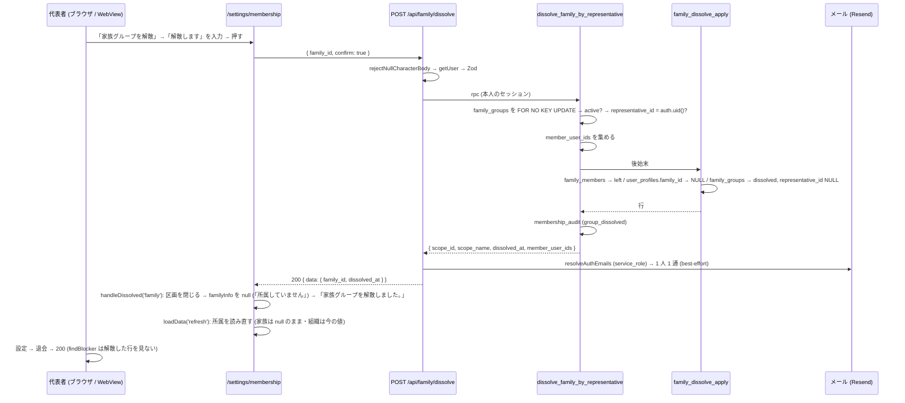

# 家族グループ・組織の解散 — 代表者・オーナーが自分で解散する (#1917)

> 版: v1.3 (2026-10-19) / Issue: #1917 (`家族の代表者・組織のオーナーが自分で家族グループ・組織を解散できるようにする (譲渡できない人が退会できない問題・#1901 の Q-26)`)
> 位置づけ: 家族グループの代表者と組織のオーナーが、運営の手を介さずに自分の家族グループ・組織を解散し、そのあと退会できるようにする設計の正典。家族 (`family/`) と組織 (`org/`) の両方を 1 冊で扱う (解散の後始末は運営の強制解散 `operator_force_dissolve_family` / `operator_force_dissolve_org` と同じにし、同じ関数を 2 つの入口から呼ぶため)。組織の側の既存の設計は `docs/design/org/05-offboarding-flow.md` §7.3 (古い設計。`archived` 前提) と `docs/design/membership/05-operator-emergency-ui.md` §4 (運営の強制解散) を参照する。範囲の正本は Issue #1917 の本文とコメント。
> 前提: ローンチ前で利用者ゼロ (本番の `family_groups` は 0 行・`organizations` は active 2 行 (`owner_id` あり)・`parental_consents` は 0 行・`ownership_transfer_proposals` は 0 行。2026-10-19 に読み取りで実測)。正しい形で作る。本番の DB には触らない。
> 改定履歴: v1.0 2026-10-19 初版 (A 型 4 相)。v1.1 2026-10-19 敵対レビュー R1 の反映。v1.2 2026-10-19 網羅性 (周 2) の反映。v1.3 2026-10-19 敵対レビュー R2 の反映と origin/main `2ba5b3b3` (#1901 の実装のマージ) との突合 (§26)。

---

## 0. 外形固定・分冊判定・段分け・範囲 (相 1 の結果)

### 0.1 発注と前提

- オーナーの選択 (逐語・2026-10-19 14 時台・選択式): cross/20 §18 Q-26 (ほかに大人のメンバーがいない家族の代表者・組織のオーナーは、譲渡も解散もできず退会できない) について:「利用者が自分で解散できるようにする (推奨)」。
- 関連して同じ時に選ばれたこと: Q-23「同意なしでも退会・書き出しできるようにする」(#1901 の実装の続きで入る)。
- 「準備中」「予定」などの書き方を画面と本文に書かない (オーナーの指示 2026-10-19)。
- 解散した家族グループは、解散から 90 日で物理削除するジョブがある (operator/11 §5.4・#1125 段 C)。保護者の同意の記録があるグループは消さない。本書はこの決まりを変えない。
- 運営の強制解散の画面と RPC がある (30 日以上未ログインの一覧から)。本書は、それと同じ解散の状態 (`status = 'dissolved'`・`dissolved_at`) と後始末 (メンバーの所属を外す) を**同じ関数**で使う (§7)。
- 利用規約・プライバシーポリシーは #1901 (cross/20) で書き直している。本書が規約の第11条 4 項・第12条 4 項 (と第17条 2 項・プライバシーポリシー第13条 9 項) を書き換えるときは、cross/20 の版の上げ方 (§9) に従い、cross/20 に追随する差分として書く (§18)。
- #1901 の実装 (PR #1918) は origin/main `2ba5b3b3` にマージ済み。v2026.1 の文面 (`src/lib/legal/terms-text.ts`・`privacy-text.ts`)・主張の表 (`tests/legal-claims-1901.ts`)・同意の前の退会と書き出しの画面 (`/legal-consent/account`。cross/20 Q-23) と、その画面と凍結中の画面が共通に使う退会と書き出しの枠 `AccountSelfServicePanel` が main にある (§3.1 F-18・F-28・F-29)。

### 0.2 分冊判定

| 目安 | 本件 | 判定 |
|---|---|---|
| 設計書 800 行超 | 超える (家族と組織の 2 面・表 3 点・正典コード・追随表を 1 冊に持つため) | 当たる |
| 消費先レーン 3 以上 | DB (migration 1 本・関数 4 本と既存 2 本の置き換え)・API (route 2 本)・Web の画面 (設定・凍結中の画面・部品)・モバイル (画面 1 枚と 409 の案内)・規約の文面 (cross/20 への追随) の 5 | 当たる |
| 共有面に 2 つ以上触る | 凍結中も通す API の一覧 (`FROZEN_ALLOWED_API_PATHS`)・同意の許可リスト (`LEGAL_CONSENT_EXEMPT_API_PATHS`)・凍結中の画面と同意の前の画面が共通に使う退会と書き出しの枠 (`AccountSelfServicePanel`)・退会の本体 (`findBlocker`)・`family_groups` / `organizations` の列の制約・運営の強制解散の RPC 2 本・規約の文面 | 当たる |

**判定: 設計書は 1 冊、実装は 3 段 (A・B・C) に分け、A と B は同じ実装 WF・同じ worktree で段ごとにレビューを挟む。C は段 A のマージ後に別の WF で、規約の文面の実装 (`src/lib/legal/`。#1901 の実装は main にある) を書き換える。設計書 cross/20 の追随は実装者が書かず、オーケストレーターの専権の差分として段 C の PR に載せる (§18・§24)。** 分冊 (核と配線で別の設計書) にしない理由: 核 (DB の関数 4 本・列の制約・route 2 本) は小さく、配線 (画面) はその応答と既存の 409 の本文を読むだけで、契約 (§11〜§15) を本書に逐語で置けば段 B の実装者は本書だけで手が止まらない。家族と組織を分冊にしない理由: 解散の後始末・通知・画面の形・規約の文面が対称で、分けると同じ判断を 2 冊に書くことになる。

### 0.3 段分け (実装 WF の単位と順序)

| 段 | 中身 | 依存 | デプロイ後の状態 |
|---|---|---|---|
| **A 解散の口** | migration (§11: `representative_id` / `owner_id` を NULL 許容にして CHECK を足す・後始末の関数 2 本・利用者の解散の RPC 2 本・運営の強制解散の RPC 2 本を後始末の関数を呼ぶ形に置き換え) と対の `.down.sql`・型の再生成 (§11.4)・エラーコード 2 つ (§13.3)・Zod (§13.1)・lib (§13.2・§13.4)・`POST /api/family/dissolve`・`POST /api/org/dissolve` (§14)・通知メール (§16)・凍結中も通す API と同意の許可リストへの追加 (§13.5)・退会の 409 の案内の行き先 (§13.6)・契約テスト・route のテスト・実 DB の結合テスト (§21) | なし | API を直接呼べば代表者・オーナーが解散でき、そのあと退会できる。画面はまだ変わらない |
| **B 画面** | メンバーシップ設定の解散の区画 (§15.1)・解散の部品 `SelfDissolveSection` (§15.2)・設定画面の退会の 409 の案内 (§15.3)・退会と書き出しの枠 `AccountSelfServicePanel` の 409 の分岐の解散と、それを使う凍結中の画面・同意の前の画面の案内の文 (§15.4)・モバイル (§15.5)・画面のテストと e2e (§21) | A | Web とアプリの両方で、代表者・オーナーが画面 (設定・凍結中の画面・同意の前の画面) から解散して退会できる |
| **C 規約の文面** | 実装者: `src/lib/legal/terms-text.ts`・`privacy-text.ts`・`tests/legal-claims-1901.ts` の書き換え (§18.1・§18.2)・版の扱い (§18.4。`packages/shared/src/legal-versions.ts` と旧版の控え `docs/legal/archive/v2026.1/`)・`tests/design-doc-followup-owned-edits.test.ts` (§23)。設計書 cross/20 の追随 (§18.1〜§18.3) は実装者が書かず、オーケストレーターの専権の差分を同じ PR に載せる (§18・§24) | A (#1901 の実装は origin/main `2ba5b3b3` にある) | 利用規約第11条 4 項・第12条 4 項・第17条 2 項とプライバシーポリシー第13条 9 項が「譲渡するか解散するまで退会できない」になる |

migration の本番適用は段 A のマージ前にオーケストレーターが行う (列の NOT NULL を外す・CHECK を足す・関数の新設と置き換え。既存の行は変えない: 本番に `dissolved` の行は無い (§0.1 の前提) ので、§11.1 の `UPDATE` は 0 行)。

### 0.4 本書が決めないもの (範囲外)

- 組織の解散した行の物理削除 (org/04 §(解散) の「90 日後物理削除」)。組織の purge のジョブは origin/main に無く、本書も作らない。解散した組織の行は残る (Q-3)。
- 代表者による家族グループの物理削除 (RLS `family_groups_delete_representative` + CASCADE。`supabase/migrations/20251126124224_create_meal_planner_tables.sql:10352`)。画面から呼ぶ経路は無く (`git grep` で `from('family_groups')` の `.delete()` は 0 件)、#1310 が意図して残した経路なので、本書は触らない。解散した家族の行は `representative_id` が NULL になるので、解散のあとはこの経路でも消せない (§10)。
- 運営の強制解散の画面・route・権限・admin_audit_logs の記録・運営の通知メールの文面 (membership/05 §5〜§8)。RPC の本体だけを後始末の関数を呼ぶ形に置き換える (§11.2。動きは変えない)。
- Q-23 の画面 (`/legal-consent/account`。#1901 の実装で main にある) の構成 (見出し・導入・書き出し・リンク)。本書は、解散の API を同意の許可リストに入れ (未同意でも呼べる)、その画面と凍結中の画面が共通に使う枠 `AccountSelfServicePanel` の 409 の分岐に解散の区画を足し、同意の前の画面の 409 の案内の文 (`LEGAL_CONSENT_COPY.accountDeleteBlockedGuidance`) を解散に合わせるところまで (§15.4・§8 の行・Q-2)。
- 解散のときに、pending の譲渡の提案 (`ownership_transfer_proposals`) と招待 (`family_invites` / `organization_invites`) を expired / revoked にすること。運営の強制解散もしない。家族の招待の承諾は解散後 `FAMILY_NOT_FOUND` で止まり、家族の譲渡の承諾は `TRANSFER_ACCEPTOR_NOT_IN_FAMILY`、組織の譲渡の承諾は `TRANSFER_ACCEPTOR_NOT_IN_ORG` で止まる (§8)。組織の招待の承諾 (`accept_org_invite`) は組織の `status` を見ないので、解散した組織に参加できてしまう (既存。運営の強制解散と同じ。Q-4)。このため、解散の画面の文 (§13.4 `SELF_DISSOLVE_COPY.organization.effects`) は、招待が使えなくなるとは書かない。
- 解散のメールの再送・運営画面からの再送。
- 利用者の解散の理由の入力 (運営は `reason` を必須にするが、利用者の解散に理由は要らない。本文は `confirm` と id だけ。§14)。

### 0.5 用語

| 語 | 意味 |
|---|---|
| 解散 | `family_groups.status` / `organizations.status` を `'dissolved'` にし、メンバーの所属を外すこと。利用者の解散 (本書) と運営の強制解散 (membership/05) の 2 つの入口がある |
| 後始末 | 解散のときにメンバーの所属を外す UPDATE の並び (家族: `family_members` を `left`・`user_profiles.family_id` を NULL。組織: `user_profiles` の所属の列を外す・`org_license_pools.used_licenses` を 0)。本書で関数 `family_dissolve_apply` / `org_dissolve_apply` に閉じる (§11.2) |
| 代表者 / オーナー | `family_groups.representative_id` / `organizations.owner_id` が指す人。解散の RPC はこの列で判定する (`family_members.role` / `user_profiles.org_role` ではない。§7.2) |
| 退会 | `POST /api/account/delete` (`deleteAccount`)。代表者・オーナーは `findBlocker` が 409 で止める (`src/lib/account-deletion.ts:248-285`) |
| 凍結 | `user_profiles.frozen_at` (BAN)。凍結中に呼べる API は `FROZEN_ALLOWED_API_PATHS` (`src/lib/auth/frozen.ts:60-66`) だけ |
| 未同意 | 規約の版上げ後に新しい版に同意していない状態。`/api` は同意の許可リスト (`packages/shared/src/legal-consent-api.ts:103`) 以外 403 |

---

## 1. 目的・スコープ

ほかに大人のメンバーがいない家族グループの代表者と、ほかにメンバーがいない組織のオーナーは、代表者・オーナーを譲渡できず、利用者が解散する画面も API も無いので、退会 (`POST /api/account/delete`) が 409 で止まったまま抜けられない (Issue #1917 の「今の状態」。cross/20 §18 Q-26)。本書は次を決める。

1. 代表者が家族グループを、オーナーが組織を、自分で解散できる API (`POST /api/family/dissolve`・`POST /api/org/dissolve`) と画面 (Web の設定・凍結中の画面・同意の前の退会と書き出しの画面・モバイル)。
2. 解散したときのメンバーへの影響 (所属が外れる・見え方・知らせのメール)、データの扱い (家族は既存の 90 日の物理削除のジョブ・保護者の同意の記録は残す。組織の行は残る)、監査ログ (`membership_audit` の `group_dissolved`)。
3. 解散のあとに本人が退会できること: 解散した家族・組織の行が元の代表者・オーナーを指さない形にする (`representative_id` / `owner_id` を NULL にする)。これが無いと、退会の 409 を抜けても `auth.users` の削除が外部キー (ON DELETE RESTRICT) で失敗する (§3.1 F-6)。
4. 規約に未同意の代表者・オーナーの扱い (API は退会と同じく許可リストで通し、同意の前の退会と書き出しの画面 `/legal-consent/account` から解散できる)、凍結中の代表者・オーナーの扱い (退会と同じく通す)。
5. 退会の 409 の案内を、実際にできる操作 (メンバーシップ設定の譲渡と解散) に合わせる。
6. 利用規約第11条 4 項・第12条 4 項・第17条 2 項とプライバシーポリシー第13条 9 項の書き換えと版の扱い (cross/20 §9)。

## 2. 関連要件・正典

| 文書 | 使う節 | 本書との関係 |
|---|---|---|
| Issue #1917 | 本文 (範囲 6 項目) | 範囲の正本 |
| `docs/design/cross/20-terms-privacy-text.md` | §0.1 P-12、§2.2 F-39・F-53、S-18、R-24、§6 第11・12・17 条、§7 第13条、§9 (版の上げ方)、§10.2・§10.3 (主張の表)、§11.2・§11.3、§12、§17、§18 Q-23・Q-26 | 本書 §18 が追随の差分を逐語で決める (設計書の差分はオーケストレーターの専権。§24)。Q-26 の解決 |
| `docs/design/operator/11-ops-batches-non-billing.md` | D-4・R-14・§5.4 (解散した家族の物理削除) | 変えない。解散の状態が同じなので、利用者の解散にもそのまま効く |
| `docs/design/membership/05-operator-emergency-ui.md` | §4 (強制解散 RPC)・§7・§8 (通知) | RPC の本体を後始末の関数を呼ぶ形に置き換える (§11.2)。route・画面・通知は変えない |
| `docs/design/membership/00-overview.md` §(不変条件)・`01-data-model.md` §2.1 | 「`organizations.owner_id` は常に NOT NULL」「`family_groups.representative_id` は常に NOT NULL」 | 本書で「active な行では NOT NULL (CHECK)・解散した行では NULL」に改める (§11.1・§24) |
| `docs/design/org/05-offboarding-flow.md` §7.3 | `POST /api/family/groups/{id}/dissolve`・`archived` | 古い設計。本書が置き換える (§24) |
| `docs/design/family/CLAUDE.md`・リポジトリの `CLAUDE.md` §(家族を変える関数のロック順) | 家族の行を最初にロックする (#1310) | 利用者の解散の RPC も従う (§11.3) |
| `docs/design/cross/13a-legal-consent-api-server.md` §6.4 | 同意の許可リスト (理由つき) | `leave_service` の行を 2 つ足す (§13.5・§24) |
| `docs/design/billing/01-billing-core.md` §9.8・#1445 | 凍結中も通す API の一覧 | 2 本足す (§13.5) |
| `docs/design/cross/08-legal-compliance.md` §16 | 退会の流れ | 変えない。解散のあとの退会がこの流れに乗る |
| `docs/design/family/10-family-menu-view.md` S-8・P-5 | 解散後の見え方 (`family_id` NULL・切り替えが出ない) | 再利用 (§8) |

---

## 3. 前提の事実 (origin/main `4b1e1abe` で測り、v1.3 で origin/main `2ba5b3b3` (#1901 の実装のマージ) との差分を測り直した。2026-10-19。本番 DB は同日に読み取りで実測)

### 3.1 実装の現状

| # | 事実 | 出どころ |
|---|---|---|
| F-1 | 退会の本体 `findBlocker` は `organizations.owner_id = userId` / `family_groups.representative_id = userId` の行があれば 409 (`ACCOUNT_DELETE_BLOCKED_ORG_OWNER` / `ACCOUNT_DELETE_BLOCKED_FAMILY_REPRESENTATIVE`) を返す。`status` を見ない。文は「組織のオーナーです。先にオーナーを譲渡するか組織を解散してください。」「家族グループの代表者です。先に代表者を譲渡するか家族グループを解散してください。」 | `src/lib/account-deletion.ts:248-285` |
| F-2 | 409 のときの Web の案内 `ACCOUNT_DELETE_BLOCKED_TRANSFER_GUIDE` は譲渡の画面 (`/org/settings/owner-transfer`・`/family/representative-transfer`) へ送る。コメントに「解散は利用者の画面が無い (運営が行う)」 | `src/lib/account-self-service.ts:100-116` |
| F-3 | 利用者が家族・組織を解散する route は無い。`src/app/api/family/` は groups (POST = 作成)・invites・leave・members・menu・promotions・representative-transfer、`src/app/api/org/` は settings・leave・owner-transfer・members・invites・departments・challenges。`dissolve` を含む route は運営の 2 本だけ | `src/app/api/operator/membership/family/[id]/dissolve/route.ts`・`.../org/[id]/dissolve/route.ts` |
| F-4 | 運営の強制解散 RPC `operator_force_dissolve_family(p_family_id, p_reason)` (最新の定義 `supabase/migrations/20261017130000_operator_mfa_db_gate.sql:281-319`): super_admin + `operator_mfa_satisfied()` → `family_groups` を `FOR NO KEY UPDATE` でロック (:301) → `family_members` を `active → left` (:303) → `user_profiles.family_id` を NULL (:304) → `family_groups` を `dissolved`・`dissolved_at = NOW()` (:306-308) → `membership_audit` に `operator_force_dissolve` (:312)。家族が無ければ何もせず NULL を返す (監査の行は書く) | 同ファイル |
| F-5 | `operator_force_dissolve_org(p_organization_id, p_reason)` (最新の定義 同ファイル :166-235): super_admin か operator + MFA → `ORG_NOT_FOUND` / `ORG_ALREADY_DISSOLVED` (:195) → `user_profiles` の所属の列 6 つを外す (:198-204。`organization_id`・`org_role`・`is_active_in_org`・`joined_org_at`・`roles` から `org_admin`・`department_id`) → `org_license_pools.used_licenses = 0` (:208) → `organizations` を `dissolved`・`dissolved_at`・`updated_at` (:213-217) → `membership_audit` に `operator_force_dissolve` (:224) | 同ファイル |
| F-6 | `family_groups.representative_id` は NOT NULL (`:330`) で `auth.users` への外部キーは ON DELETE **RESTRICT** (`:8883`)。`organizations.owner_id` も RESTRICT (`:9183`) で、#1103 項目 10 (`20261017100000_organizations_owner_id_not_null.sql:154`) で NOT NULL になった。20261010000100 は「譲渡か解散をしないと退会できないという仕様で、退会 API が先に 409 を返してこの状態で止める」として RESTRICT を残した (`supabase/migrations/20261010000100_auth_users_fk_on_delete.sql:26-27`)。解散しても `representative_id` / `owner_id` は残るので、**解散した家族の元代表者・解散した組織の元オーナーは、`findBlocker` の 409 (F-1) で止まり、仮に 409 を抜けても `auth.users` の削除が 23503 で失敗する** (運営の強制解散のあとも同じ。既存の欠陥) | `supabase/migrations/20251126124224_create_meal_planner_tables.sql:330, 793, 8883, 9183`・`tests/integration/security/auth-users-fk-on-delete.test.ts:111-116` (RESTRICT はこの 2 本だけ、を固定) |
| F-7 | `family_groups.status` は `'active'` / `'dissolved'` (CHECK `:339`)、`organizations.status` も `'active'` / `'dissolved'` (CHECK `:796`)。`frozen` / `archived` は DB に無い。Zod の `OrgStatusSchema` は `suspended` を持つが DB の CHECK には無い (既存の食い違い。本書は触らない) | 同ファイル・`src/schemas/membership/organization.ts:21` |
| F-8 | 解散した家族の物理削除: `purge_dissolved_family_groups(p_dry_run)` が `status = 'dissolved'` かつ `dissolved_at < now() - interval '90 days'` かつ `parental_consents` を持たない行を `dissolved_at` の古い順に 500 件まで DELETE (CASCADE で `family_members`・`family_invites`・`family_promotion_requests`・`parental_consents`)。pg_cron `purge-dissolved-family-groups` 毎日 03:40 JST。`representative_id` は条件に無い | `supabase/migrations/20261018010000_purge_dissolved_family_groups.sql:46-77` |
| F-9 | 保護者の同意の記録 `parental_consents.family_id` は NOT NULL・`family_groups` への CASCADE (`:93`)。`family_members.status` が `active` から変わると、トリガー `trg_family_members_revoke_parental_consent` が有効な同意を取り消す (運営の強制解散で全員 `left` になるときも)。署名者の退会では `parent_user_id` だけ NULL | `supabase/migrations/20261017030000_parental_consent_and_birth_date.sql:93, 196-240` |
| F-10 | 家族の関数のロック順 (#1310): 最初に `family_groups` の行を `FOR NO KEY UPDATE`、そのあとで子の行。`leave_family` / `remove_family_member` / `accept_family_invite` / `accept_family_representative_transfer` / `accept_child_promotion` / 運営の 2 本が従う | `supabase/migrations/20261008090100_family_lock_order.sql:15-20`・`CLAUDE.md:266` |
| F-11 | 組織の関数に決めたロック順は無い。`accept_org_owner_transfer` は 提案の行 → `user_profiles` (旧オーナー) → `user_profiles` (新オーナー) → `organizations` の順に書く。`leave_org` は `user_profiles` (本人) → `org_license_pools`。`accept_org_invite` は `organization_invites` (FOR UPDATE) → `user_profiles` → `org_license_pools` (FOR UPDATE) | `supabase/migrations/20261017030000_parental_consent_and_birth_date.sql` (`accept_org_owner_transfer` の最新の定義)・`20251126124224:2803-2835` (`leave_org` の形)・`20261017160000_org_invite_same_org_member.sql` |
| F-12 | `accept_org_invite` は「自身が別 org の owner か」を `organizations.owner_id = auth.uid() AND id <> 招待の組織` で判定し `IS_ORG_OWNER` を返す。`status` を見ないので、解散した組織の元オーナーは (owner_id が残る限り) どの組織の招待も承諾できない。`create_family_group` は `family_members` の active の行で判定する (`ALREADY_IN_FAMILY`) ので、解散で `left` になった元代表者は新しい家族を作れる | `supabase/migrations/20261017160000_org_invite_same_org_member.sql:203-205`・`20261017030000_parental_consent_and_birth_date.sql` (`create_family_group` の最新の定義) |
| F-13 | `family_groups` の BEFORE UPDATE トリガー `trg_guard_family_groups_privileged` は、`current_user` が `authenticated` / `anon` のときだけ `representative_id` / `plan_key` / `member_limit` の変更を 42501 で止める。`organizations` の `trg_guard_organizations_privileged` は同じ条件で `owner_id` / `status` の変更を止める。SECURITY DEFINER の関数 (所有者 postgres) からの UPDATE は通る | `supabase/migrations/20251126124224_create_meal_planner_tables.sql:1779-1790, 8514, 8522` |
| F-14 | `family_groups` の BEFORE INSERT / UPDATE OF `representative_id` トリガー `family_groups_billing_plan_follow_representative` は、`NEW.status <> 'active'` なら何もしない (`:446-452`)。解散と同じ UPDATE 文で `representative_id` を NULL にしても、課金の写像は動かない | `supabase/migrations/20261016210000_billing_core.sql:446-497` |
| F-15 | `membership_audit.action` の CHECK は 28 値で `group_dissolved` を含む (利用者の解散に使える。これまで書く処理は無かった)。Zod `AuditActionSchema` にも `group_dissolved` がある | `supabase/migrations/20261017030000_parental_consent_and_birth_date.sql:249-258`・`src/schemas/membership/membership-audit.ts:9` |
| F-16 | 凍結中も通す API は `FROZEN_ALLOWED_API_PATHS` の 5 本 (退会・書き出し・課金 3 本)。足すときは「本人がサービスから離れるための操作か」を確かめる、とテストが求める。middleware は凍結 → メンテナンス → 同意の順に判定する | `src/lib/auth/frozen.ts:60-66`・`lib/supabase/__tests__/middleware-frozen-allowed-api.test.ts:77-91`・`lib/supabase/middleware.ts:234-242` |
| F-17 | 同意の許可リスト `LEGAL_CONSENT_EXEMPT_API_PATHS` は理由つきの行で、凍結中に通す API はすべてこの一覧にも入れる (テストが包含を見る)。`/api/account/delete` の理由は `leave_service` | `packages/shared/src/legal-consent-api.ts:103-133`・`lib/supabase/__tests__/middleware-legal-consent-api.test.ts:241-302` |
| F-18 | 凍結中の退会の画面 `/frozen/account` は、書き出しと退会の枠を共通の部品 `AccountSelfServicePanel` に任せ、409 のときにサーバーの文に続けて出す案内を props `deleteBlockedGuidance` で渡す (`DELETE_BLOCKED_GUIDANCE` =「凍結中は、オーナー・代表者の譲渡や解散の操作ができません。お手数ですが、サポートにお問い合わせください。」)。部品の 409 の分岐 (`case "blocked"`) は、`result.message` と案内をつないで `deleteNotice` に入れるだけ。部品の冒頭のコメントは「呼ぶ API は退会と書き出しの 2 つだけ」。凍結中の画面は未同意の人も開ける (画面の同意ゲートの対象外 `/frozen`・判定の順も凍結が先) | `src/app/frozen/account/page.tsx:8, 16-18, 33-38`・`src/components/account/AccountSelfServicePanel.tsx:10-12, 81-105, 114-167`・`lib/legal-consent.ts:99-111` |
| F-19 | 設定画面の退会は 409 のとき `confirm()` で譲渡の画面を開くかを尋ねる (`ACCOUNT_DELETE_BLOCKED_TRANSFER_GUIDE`)。モバイルのネイティブのアカウント画面は 409 のとき `Alert.alert(見出し, サーバーの文)` だけ (ボタンは OK のみ)。定型の文は「…先にオーナー・代表者を譲渡するか、組織・家族グループを解散してください。」 | `src/app/(main)/settings/page.tsx:242-256`・`apps/mobile/app/settings/account.tsx:21, 85`・`apps/mobile/src/lib/account-deletion-error.ts:31-32` |
| F-20 | メンバーシップ設定 (`/settings/membership`) は、家族の「家族を表示」「家族から脱退」と組織の「組織から脱退」を出す。代表者にも「家族から脱退」を出す (押すと `IS_FAMILY_REPRESENTATIVE` の 409)。オーナーにも「組織から脱退」を出す (`IS_ORG_OWNER`)。譲渡へのリンクは家族のメンバー一覧 (`/family/members`) と組織のメンバー一覧 (`/org/members`) にある | `src/app/(main)/settings/membership/page.tsx:285, 334`・`src/app/(main)/family/members/page.tsx:322-327`・`src/app/(org)/org/members/page.tsx:137-140` |
| F-21 | モバイルアプリに家族・組織のネイティブの画面は無い。タブは Web を WebView で開き、設定の下の画面 (請求 `app/settings/data-requests.tsx`・凍結 `app/frozen.tsx`) も `WebViewScreen` で Web の画面を開く。パスは `@homegohan/shared` の定数を共用する (DSR の例) | `apps/mobile/app/settings/data-requests.tsx`・`apps/mobile/src/lib/data-subject-requests.ts`・`apps/mobile/app/frozen.tsx` |
| F-22 | 運営の解散の通知メール `renderForceDissolveEmail` (`template: 'operator_force_dissolve'`) は「運営側の判断により解散されました」と解散理由を載せる。利用者の解散には合わない。文面の一覧は `secret-templates.test.ts` (秘密あり / なしの表) と `templates-site-config.test.ts` (ファイルと一致) が固定する | `src/lib/emails/membership/operator-force-dissolve.ts:20-48`・`src/__tests__/lib/emails/secret-templates.test.ts:31-62`・`src/__tests__/lib/emails/templates-site-config.test.ts:159-166` |
| F-23 | メールを送る route は `tests/email-send-throttle-contract.test.ts` の `EXEMPT_EMAIL_SENDERS` に理由つきで載せる (運営の解散 route 2 本は `:68-73`) | 同ファイル |
| F-24 | `mapPgErrorToHttp` は `MembershipErrorCode` の値を単語境界で探し、`40P01` は `CONFLICT_RETRY` (409)。`ORG_ALREADY_DISSOLVED` は RPC が RAISE するが enum に無い (運営の route は `internalError` で返すので表に出ない)。`NOT_FAMILY_REPRESENTATIVE` (403)・`NOT_ORG_OWNER` (403)・`FAMILY_NOT_FOUND` (404)・`ORG_NOT_FOUND` (404) はある。`MEMBERSHIP_ERROR_MESSAGES` は全値に文が要る (`tests/membership-errors.test.ts`) | `src/lib/errors/membership-errors.ts:6, 15, 20, 35, 88-150, 185-210` |
| F-25 | 本文を読む route は `rejectNullCharacterBody` を最初に呼び、`src/__tests__/api/null-character-routes.test.ts` の表に載せる (表と実コードの一致を見る) | 同ファイル `:1-15, 113-155` |
| F-26 | 家族の退出 route は `supabase.auth.getUser()` で認証し、通知先を RPC の前に本人のセッションで読む (退出後は RLS で読めない。#1209)。組織のメンバーの `user_profiles` は本人の行しか RLS で読めない (cross/20 F-19) ので、運営の組織の解散 route は service_role で解散前にメンバーを読む | `src/app/api/family/leave/route.ts`・`src/app/api/operator/membership/org/[id]/dissolve/route.ts` |
| F-27 | `tests/integration/security/family-lock-order-race.test.ts` C1・C2・R2 は、運営の強制解散のあと `family_groups.representative_id` が代表者のままであることを期待する (`:774, 791, 1162`)。`tests/integration/security/organizations-owner-id-not-null.test.ts` は、`afterEach` (`:181-186`) で実 DB の `organizations.owner_id` の `is_nullable` が `'NO'` であることを期待する。`:224, 240, 252` の `outcome.nullable` の `'NO'` と `:356` の `'YES'` は、1 つのトランザクションの中で旧 migration (`20261017100000`) / その戻し口を流した直後の値で、実 DB の状態ではない。`runInRolledBackTransaction` (`:147`) は先頭で `DROP NOT NULL` だけを流し、`orgSql` (`:156-157`) は `owner_id` NULL の組織を `status` を書かずに (既定の `'active'`。`20251126124224_create_meal_planner_tables.sql:793`) INSERT する。単体の契約テスト `tests/organizations-owner-id-not-null-migration-contract.test.ts` は、型の生成物 2 ファイルの `organizations` の `owner_id` が Row で `string`・Insert で `string`・Update で `string` の省略可で、`string \| null` が無いこと (`:171-186`。`it.each` で 2 ファイル) と、`OrganizationSchema.shape.owner_id` が NULL を受けないこと (`:188-191`) を固定する | 同ファイル |
| F-28 | cross/20 §6 の利用規約第11条 4 項 (`:658`)・第12条 4 項 (`:674`)・第17条 2 項 (`:767`)、§7 のプライバシーポリシー第13条 9 項 (`:1404`) は「譲渡するまで退会できません」「譲渡できる相手がいなければお問い合わせ」と書き、実装の文面 (`src/lib/legal/terms-text.ts:255, 271, 364`・`src/lib/legal/privacy-text.ts:434`) も同じ文。主張の表の行は `terms-11#7`・`#8`・`terms-12#5`・`#6`・`terms-17#5`・`privacy-13#9` (実装 `tests/legal-claims-1901.ts:95-96, 103-104, 146, 377`・cross/20 §10.3 `:2097-2098, 2105-2106, 2148, 2379`)。§10.2 の区分の数は利用規約 167 (product 70・contract 90・law 2・process 5)・プライバシーポリシー 215・計 382 (`LEGAL_CLAIM_COUNT = 382`)。T-35 は主張の表の `evidence` の `F-<数>` が cross/20 に `\| F-<数> \|` の行として在ることを見る (`tests/legal-text-1901.test.ts:1031-1057`)。cross/20 の F の最後は F-58 (`:252`)。版は `v2026.1`・`effectiveDate: '2026-10-19'` で、行末の目印のコメント (`仮置き: マージ直前に公開日へ置き換える`) は無い (公開済み)。解散した家族グループの保存の日数は `LEGAL_FACTS.dissolvedFamilyGroupRetentionDays` (90) にある。Q-26 のオーナーの選択の逐語は cross/20 §0.1 P-12 (`:38`) にある | `docs/design/cross/20-terms-privacy-text.md`・`packages/shared/src/legal-versions.ts:47-50`・`src/lib/legal/legal-text.ts:79, 109` |
| F-29 | 同意の前の退会と書き出しの画面 `/legal-consent/account` (`src/app/legal-consent/account/page.tsx`・`AccountWithoutConsent.tsx`) は、凍結中の画面と同じ枠 `AccountSelfServicePanel` を、409 の案内 `LEGAL_CONSENT_COPY.accountDeleteBlockedGuidance` (「規約に同意する前は、オーナー・代表者の譲渡の操作ができません。規約に同意したうえで譲渡するか、譲渡できる相手がいないときは、お問い合わせフォームからご連絡ください。」) で使う。退会のあとはログインの画面へ移らずに「退会しました」を出す。画面は同意ゲートの対象外 (同意画面の下のパス)。凍結中は凍結の差し戻しが先に効くので開けない (凍結中は `/frozen/account`)。アプリは同意画面を WebView で開き、その中でこの画面へ進め、退会のあとの `sign-out` を受けて「閉じる」を出す。画面の単体テストは、409 の本文に `family_group` を入れずに、サーバーの文 + `accountDeleteBlockedGuidance` を見る (`:225-241`)・呼ぶ API は退会と書き出しの 2 本だけを見る (`:252-268`) | `src/app/legal-consent/account/AccountWithoutConsent.tsx:4-5, 40-45`・`packages/shared/src/legal-consent-copy.ts:45-51`・`lib/legal-consent.ts:39-45`・`apps/mobile/app/legal-consent.tsx:25-37`・`tests/legal-consent-account-page-1901.test.tsx:11, 225-241, 252-268` |

### 3.2 テストの道具

| 道具 | 場所 | 使い方 |
|---|---|---|
| route の単体 (偽の service_role) | `src/__tests__/api/operator/membership/fake-service-role.ts` (`createFakeServiceRole`・`leadingUsers`) | 運営の解散 route のテスト (`family-dissolve.test.ts`) と同型。宛先の解決 (`resolveAuthEmails`) と文面は実物を通す |
| route の単体 (スキーマ検査つき DB) | `tests/helpers/route-world.ts` (`makeClient`・`profileRow`・`uuid`・`jsonRequest`)・`tests/helpers/schema-checked-db.ts` | 本人のセッションの client と service_role の client を分けて作る |
| 実 DB の結合 (ロックの競合) | `tests/integration/security/family-lock-order-race.test.ts` (先の処理を開いたままにする `holder`・8 回同時に呼ぶ `N*`)・`tests/integration/helpers/*` | 利用者の解散の競合テスト (§21.2 D-8・D-9) はこの形を写す |
| 実 DB の結合 (退会) | `tests/integration/security/account-deletion.test.ts:758-790` (409 の describe) | 解散のあとに退会できる it を足す |
| e2e の fixture | `tests/e2e/fixtures/fresh-family.ts` (`freshFamilyWithMembers`)・`tests/e2e/fixtures/fresh-org.ts` (`setupFreshOrgWithMembers`)・`tests/e2e/helpers/membership-family.ts` (`apiFetch`・`getFamilyGroupFromDB`) | §21.4 |
| 画面の単体 | `tests/account-deletion-blocked-message.test.ts` (設定画面の 409)・`src/__tests__/app/frozen-account-page.test.tsx`・`tests/legal-consent-account-page-1901.test.tsx` (同意の前の画面)・`src/__tests__/app/settings/membership-no-org-guidance.test.ts`・`apps/mobile/__tests__/settings/account-delete.test.tsx` | 既存の it を直し、新しい it を足す |

---

## 4. 要件行列

| # | 要件 | 出どころ | 本書の節 |
|---|---|---|---|
| R-1 | 家族の代表者が家族グループを、組織のオーナーが組織を、自分で解散できる API と画面 (Web とモバイル) | Issue #1917 範囲 1 | §11・§14・§15 |
| R-2 | 解散したときのメンバーへの影響: 所属が外れる (家族: `family_members` を `left`・`user_profiles.family_id` を NULL。組織: 所属の列 6 つを外す・席数を 0)。運営の強制解散と同じ | Issue 範囲 2・§0.1 の前提 | §11.2・§8 |
| R-3 | 解散の知らせ: アカウントを持つメンバー全員 (解散した本人を含む) に 1 人 1 通 (best-effort。失敗しても解散は完了) | Issue 範囲 2・membership/05 §8 | §16 |
| R-4 | データの扱い: 家族は解散から 90 日で物理削除 (既存のジョブ)。保護者の同意の記録を持つグループは残す。組織の行は残る。各メンバーの記録はそれぞれのアカウントに残る | Issue 範囲 2・operator/11 §5.4 | §8・§10 |
| R-5 | 監査ログ: `membership_audit` に `group_dissolved` (actor = 本人。元の代表者 / オーナーの id を metadata に) | Issue 範囲 2・CLAUDE.md 監査ログ必須 | §17 |
| R-6 | 解散のあと、本人が退会できる (409 で止まらず、`auth.users` の削除も外部キーで失敗しない) | Issue の「今の状態」・F-6 | §11.1・§11.2・§10 |
| R-7 | 未同意の代表者・オーナー: 解散の API は退会・書き出しと同じく同意の許可リストで通し、同意の前の退会と書き出しの画面 (`/legal-consent/account`) の退会の 409 から、その場で解散できる (凍結中の画面と共通の枠 `AccountSelfServicePanel`) | Issue 範囲 3 | §13.5・§15.4・§8 |
| R-8 | 凍結中の代表者・オーナー: 解散の API は退会と同じく凍結中も通し、凍結中の退会の画面から解散できる | #1445 (凍結中も退会できる。`src/lib/auth/frozen.ts` の説明) を代表者・オーナーにも成り立たせる | §13.5・§15.4・Q-1 |
| R-9 | 退会の 409 の案内を実際にできる操作に合わせる: Web はメンバーシップ設定 (譲渡と解散) へ、凍結中の画面と同意の前の画面はその場で解散、モバイルはメンバーシップ設定 (WebView) へ | Issue 範囲 4 | §13.6・§15.3〜§15.5 |
| R-10 | 利用規約第11条 4 項・第12条 4 項 (第17条 2 項・プライバシーポリシー第13条 9 項) を「譲渡するか解散するまで退会できない」に書き換え、cross/20 §9 の規律で版を扱う | Issue 範囲 5 | §18 |
| R-11 | 解散の RPC は家族のロック順 (家族の行を最初に) に従い、譲渡・承諾と直列になる。組織は本人の `user_profiles` の行 → `organizations` の行の順で、譲渡の承諾 (旧オーナーの行 → 組織の行) と同じ向き | F-10・F-11 | §11.3・§7.2 |
| R-12 | 画面と本文に「準備中」「予定」を書かない | §0.1 | §15 |
| R-13 | 運営の強制解散の動き (権限・MFA・エラー・監査の action・route・通知) を変えない。後始末だけを共通の関数にする | §0.1 の前提・F-4・F-5 | §11.2・§7.1 |
| R-14 | `as any` を書かない。意味のある数は名前付きの定数 | 共通の規律 | §13.1・§13.4・§14.1 (RPC の戻り値・本文は Zod の `safeParse` で型にし、型の主張で通さない)・§12 (名前付きの定数)・§20 (段の検査の `tsc`・`lint`。段の差分に `as any` が 0 件) |

---

## 5. ユーザーシナリオ (28 本)

| # | シナリオ | 期待 |
|---|---|---|
| S-1 | 大人 1 人だけの家族 (代表者) が Web の設定 → メンバーシップ設定 → 「家族グループを解散する」→「解散します」を入力して押す | 200。`family_groups` が `dissolved`・`representative_id` NULL。本人の `family_members` の行が `left`・`user_profiles.family_id` NULL。本人に解散のメール 1 通。そのあと設定から退会すると 200 (409 にならず、`auth.users` も消える) |
| S-2 | 代表者・大人 1 人・アカウントを持つ子供 1 人・アカウントの無い子供 1 人 (保護者の同意あり) の家族で、代表者が解散する | 4 人の `family_members` の行が `left`。アカウントを持つ 3 人に 1 通ずつメール (アカウントの無い子供には送らない)。子供の同意は `member_left` で取り消される (F-9)。グループは 90 日後も残る (同意の記録を持つ) |
| S-3 | 大人 (代表者でない) が `POST /api/family/dissolve` を直接呼ぶ | 403 `NOT_FAMILY_REPRESENTATIVE`。何も変わらない |
| S-4 | 代表者が解散のボタンを連打する / 解散済みの家族にもう一度 API を呼ぶ | 2 回目は 409 `FAMILY_ALREADY_DISSOLVED`。画面は 1 回目の応答まで押せない |
| S-5 | 「解散します」と違う文字を入れる / `confirm: true` の無い本文で API を呼ぶ / `family_id` が UUID でない | 画面はボタンが押せない。API は 400 `VALIDATION_ERROR` |
| S-6 | オーナー・admin 1 人・member 1 人の組織で、オーナーが Web の設定 → メンバーシップ設定 → 「組織を解散する」 | 200。`organizations` が `dissolved`・`owner_id` NULL。3 人の `user_profiles` の所属の列が外れ、`org_license_pools.used_licenses` が 0。3 人にメール。そのあとオーナーの退会は 200 |
| S-7 | admin (オーナーでない) が `POST /api/org/dissolve` を直接呼ぶ | 403 `NOT_ORG_OWNER` |
| S-8 | 代表者が設定画面の退会で「削除します」を入力して押す | 409 → 「家族グループの代表者です。先に代表者を譲渡するか家族グループを解散してください。」に続けて「メンバーシップ設定の画面を開きますか？（代表者の譲渡か、家族グループの解散ができます）」の確認 → OK でメンバーシップ設定へ → 解散 → 設定へ戻って退会 200 |
| S-9 | 凍結中 (BAN) の代表者が `/frozen/account` で退会する | 409 → サーバーの文に続けて「凍結中は譲渡の操作ができません。下の「解散する」で家族グループ・組織を解散すると、退会できます。」と解散の区画 (家族の名前つき) が出る → 「解散します」を入れて押す → 200 (`/api/family/dissolve` は凍結中も通る) → 「解散しました。「削除します」と入力して退会を続けてください。」→ 退会 200 |
| S-10 | 規約の版上げ後、新しい版に未同意 (凍結でない) の代表者が、同意画面の下の案内から `/legal-consent/account` を開いて退会する | 409 → サーバーの文に続けて「規約に同意する前は、オーナー・代表者の譲渡の操作ができません。下の「解散する」で家族グループ・組織を解散すると、退会できます。規約に同意したうえで譲渡することもできます。」と解散の区画 (家族の名前つき) が出る → 「解散します」を入れて押す → 200 (`POST /api/family/dissolve` は同意の許可リストで通る `leave_service`) → 「解散しました。「削除します」と入力して退会を続けてください。」→ 退会 200 → 「退会しました」。設定の画面 (`/settings/membership`) は同意画面へ回る (cross/20 F-32。既存) |
| S-11 | モバイルのネイティブのアカウント画面で退会を押した代表者 | 409 → Alert「退会できません」サーバーの文 + ボタン「閉じる」「メンバーシップ設定を開く」→ 開くとメンバーシップ設定 (Web) を WebView で開く画面 `app/settings/membership.tsx` → 解散 → 戻って退会 200 |
| S-12 | 解散から 91 日たった家族 (同意の記録なし) / (同意の記録あり) | 03:40 JST のジョブが前者を消し、後者は残す (F-8。`representative_id` が NULL でも条件は同じ) |
| S-13 | 解散した家族の元代表者が、解散の翌日に退会する | `findBlocker` は `representative_id = userId` の行を見つけない (NULL) → 409 にならない → `auth.users` の削除は RESTRICT に当たらない (行は本人を指さない) → 200。残った `family_groups` の行は `representative_id` NULL のまま 90 日のジョブへ |
| S-14 | 解散した家族の元代表者が新しい家族グループを作る | `create_family_group` は active の `family_members` が無いので通る (F-12) |
| S-15 | 解散した組織の元オーナーが、別の組織の招待を承諾する | `accept_org_invite` の `IS_ORG_OWNER` は `owner_id = auth.uid()` の行が無いので当たらない → 承諾できる (F-12。`owner_id` が残る形だと永久に承諾できない) |
| S-16 | 代表者が解散を押すのと同時に、大人が代表者の譲渡の提案を承諾する | 家族の行のロックで直列になる。承諾が先なら解散は `NOT_FAMILY_REPRESENTATIVE` (ロックのあとに読み直すので)、解散が先なら承諾は `TRANSFER_ACCEPTOR_NOT_IN_FAMILY`。デッドロックしない |
| S-17 | 代表者が解散を押すのと同時に、招待された人が承諾する | 承諾が先なら、その人も `left` になる (ロックを待ってから全員を外す)。解散が先なら承諾は `FAMILY_NOT_FOUND`。解散済みの家族に active が残らない (#1310 と同じ) |
| S-18 | オーナーが解散を押すのと同時に、admin がオーナーの譲渡の提案を承諾する | 本人の `user_profiles` の行のロックで直列になる (§11.3)。承諾が先なら解散は `NOT_ORG_OWNER`。解散が先なら承諾は `user_profiles_org_consistency` の CHECK (所属が無いのに `org_role` を書く) で失敗し、組織は解散のまま |
| S-19 | 運営が 30 日以上未ログインの家族を強制解散する (既存の経路) | 動きは今までと同じ (権限・MFA・`operator_force_dissolve` の監査・route の admin_audit_logs・運営のメール)。違いは `representative_id` が NULL になることと、監査の metadata に `previous_representative_id` が入ること |
| S-20 | 解散した家族の元メンバー (大人) がログインして週間献立を開く | `family_id` NULL なので家族の切り替えが出ない (family/10 S-8)。メンバーシップ設定は「所属していません」 |
| S-21 | 代表者が解散したとき、pending の譲渡の提案と招待が残っていた | 提案は pending のまま残り、承諾は `TRANSFER_ACCEPTOR_NOT_IN_FAMILY`。招待の承諾は `FAMILY_NOT_FOUND`。解散の RPC はどちらも触らない (§0.4) |
| S-22 | オーナーが解散したとき、pending の組織の招待が残っていた | 招待は pending のまま残る。承諾は組織の `status` を見ないので通ってしまう (既存。Q-4) |
| S-23 | 解散は成功したが、メールの送信 (Resend) が失敗する | 200。失敗は `app_logs` に残す (宛先のアドレスは載せない)。再送はしない |
| S-24 | メンテナンス中に代表者が解散を押す | middleware が 503 `MAINTENANCE_MODE` (route に届かない)。運営ロールは通る。画面は「処理に失敗しました」ではなくメンテナンスの文 (既存の `fetch` の扱い) |
| S-25 | 未ログインで API を呼ぶ / anon が `/rest/v1/rpc/dissolve_family_by_representative` を直接呼ぶ | 前者は 401 `NOT_AUTHENTICATED`。後者は 42501 (anon に EXECUTE が無い) |
| S-26 | 代表者が、解散の確認の区画で「キャンセル」を押す | 何も起きない。入力した文字は消える |
| S-27 | 自己解散と招待の承諾を本物の経路で 8 回ずつ同時に呼ぶ (結合テスト) | デッドロックせず、全部終わったあと解散済みの家族に active が 1 人も残らない |
| S-28 | 解散した家族の元代表者が 30 日以上ログインしていない | 運営の未ログインの一覧 (`list_families_with_inactive_representative`) に出ない (`representative_id` が NULL なので `auth.users` との結合に当たらない。解散済みの家族に運営の対応は要らない) |

---

## 6. 構想 (相 2) — 構造と、全シナリオのトレース

### 6.1 構造

```
[画面]  Web: /settings/membership (解散の区画 §15.1)  /settings (退会の 409 → 案内 §15.3)
             /frozen/account・/legal-consent/account (共通の枠 AccountSelfServicePanel の 409 → その場で解散 §15.4)
        モバイル: app/settings/account.tsx (409 → Alert → app/settings/membership.tsx = WebView の /settings/membership §15.5)
            │  SelfDissolveSection (§15.2) が dissolveOwnScope() (§13.4) を呼ぶ
            ▼
[API]   POST /api/family/dissolve { family_id, confirm: true }      POST /api/org/dissolve { organization_id, confirm: true }   (§14)
            │  getUser → Zod → rpc → 通知 (best-effort) → { data: { <id>, dissolved_at } }
            ▼
[DB]    dissolve_family_by_representative(p_family_id) ─┐      dissolve_org_by_owner(p_organization_id) ─┐
        operator_force_dissolve_family(…) (既存。本体だけ置換) ─┴→ family_dissolve_apply(p)     operator_force_dissolve_org(…) ─┴→ org_dissolve_apply(p)
        apply = 後始末 (メンバーを外す → 行を dissolved・dissolved_at・<代表者/オーナーの列> = NULL)   (§11.2)
        列: family_groups.representative_id / organizations.owner_id は NULL 許容 + CHECK (active なら NOT NULL)。外部キーは RESTRICT のまま (§11.1)
            ▼
[退会]  findBlocker (変更なし): 解散した行は本人を指さないので 409 にならない → auth.users の削除も RESTRICT に当たらない
[通知]  self_dissolve のメール (§16): RPC が返した member_user_ids に resolveAuthEmails で宛先を引く (RPC の成功 = 認可のあとに service_role)
[規約]  cross/20 §6・§7 の 4 文を「譲渡するか解散するまで」に (§18)
```

- **判定は DB の関数 1 本に閉じる**: 代表者 / オーナーかは `family_groups.representative_id` / `organizations.owner_id` を、その行のロックの下で読んで決める (route は役割を読まない)。
- **後始末は 1 か所**: 利用者の解散と運営の強制解散が同じ `*_dissolve_apply` を呼ぶ。列を足す・外すときの直し場所が 1 つになる (§7.1)。
- **元の代表者・オーナーを指さない**: 解散した行の `representative_id` / `owner_id` を NULL にする。退会 (`findBlocker`・RESTRICT) と、`owner_id = auth.uid()` で判定する既存の関数 (F-12) が、解散した行を自然に無視する。
- **通知の宛先は RPC の戻り値**: 認可 (RPC の成功) の前に service_role でメンバーを読まない。RPC が後始末の前に集めた `member_user_ids` を返し、route がそのあとで宛先を引く。

### 6.2 トレース (構造で手で走らせた結果)

| # | 走らせた結果 |
|---|---|
| S-1 | 設定 → メンバーシップ設定: `familyInfo.role === 'representative'` → 解散の区画。キーワード一致 → `dissolveOwnScope('family', familyId)` → `POST /api/family/dissolve` → `getUser` → Zod OK → `rpc('dissolve_family_by_representative')`: 家族の行を `FOR NO KEY UPDATE` → active・`representative_id = auth.uid()` → `member_user_ids = [本人]` → `family_dissolve_apply`: members を left・profiles を NULL・行を dissolved + representative_id NULL → audit `group_dissolved` → jsonb を返す → route が `resolveAuthEmails([本人])` → 1 通 → 200。退会: `findBlocker` の `family_groups.representative_id = userId` は 0 行 → 先へ → `deleteUser` は RESTRICT に当たらない → 200 |
| S-2 | RPC の `member_user_ids` は `user_id IS NOT NULL` の 3 人。apply の `UPDATE family_members SET status = 'left' WHERE status = 'active'` が 4 行 → トリガー `trg_family_members_revoke_parental_consent` が子供の同意を `member_left` で取り消す (F-9)。purge は `parental_consents` を持つグループを候補から外す (F-8) |
| S-3 | RPC: 行をロック → active → `representative_id IS DISTINCT FROM auth.uid()` → `NOT_FAMILY_REPRESENTATIVE` → route は `mapPgErrorToHttp` で 403 |
| S-4 | 1 回目の commit 後、2 回目はロックのあと `status = 'dissolved'` → `FAMILY_ALREADY_DISSOLVED` → 409。画面は `submitting` の間ボタンを disabled |
| S-5 | 画面: `keyword !== SELF_DISSOLVE_CONFIRM_KEYWORD` で disabled。API: `DissolveFamilyBodySchema.safeParse` が失敗 → 400 `VALIDATION_ERROR` |
| S-6 | `orgInfo.org_role === 'owner'` → 解散の区画 → `POST /api/org/dissolve` → RPC: 本人の `user_profiles` を `FOR NO KEY UPDATE` → 組織の行を `FOR NO KEY UPDATE` → active・`owner_id = auth.uid()` → `member_user_ids` = `user_profiles WHERE organization_id = p` の 3 人 → `org_dissolve_apply` (所属の列 6 つ・席数 0・行を dissolved + owner_id NULL) → audit → 戻り値 → 3 通 → 200。退会: `organizations.owner_id = userId` は 0 行 → 200 |
| S-7 | 組織の行のロックのあと `owner_id IS DISTINCT FROM auth.uid()` → `NOT_ORG_OWNER` → 403 |
| S-8 | `deleteOwnAccount` → 409 → `kind: 'blocked'`・`blocker: 'family_group'` → 設定画面は `ACCOUNT_DELETE_BLOCKED_GUIDE.family_group` (§13.6) の `prompt` で `confirm()` → `router.push('/settings/membership')` → S-1 |
| S-9 | middleware: 凍結 → `/api/account/delete` は許可 → `findBlocker` 409 (本文に `family_group: { id, name }`) → 枠 `AccountSelfServicePanel` は `result.blocker` と `result.scope` (§13.6) を持つので `blockedScope` に入れ、`SelfDissolveSection` を `scope='family'`・`scopeId`・`scopeName` で描く → `POST /api/family/dissolve` は `FROZEN_ALLOWED_API_PATHS` にあるので middleware を通る (同意の許可リストにもある) → RPC (凍結を見ない) → 200 → 画面は「解散しました…」→ 退会 200 |
| S-10 | 画面 `/legal-consent/account` は同意画面の下のパスで、同意ゲートの対象外 (F-29)。枠 `AccountSelfServicePanel` の退会 → middleware: 凍結でない → メンテナンスでない → `/api/account/delete` は許可リスト → `findBlocker` 409 (`family_group: { id, name }`) → 枠が `blockedScope` に入れ、`deleteNotice` はサーバーの文 + `LEGAL_CONSENT_COPY.accountDeleteBlockedGuidance` (§15.4) → `SelfDissolveSection` → `POST /api/family/dissolve` は `resolveLegalConsentApiDecision` で許可リスト (`leave_service`) → allow → RPC (同意を見ない) → 200 → `handleDissolved` (`SELF_DISSOLVED_NEXT_STEP`) → 退会 200 → `onDeleted` で「退会しました」。`/settings/membership` は同意ゲートの対象 → `/legal-consent?next=…` (既存) |
| S-11 | `accountDeletionErrorOf(e)` → `kind: 'blocked'` → `Alert.alert(ACCOUNT_DELETE_BLOCKED_TITLE, message, [閉じる, メンバーシップ設定を開く → router.push(MEMBERSHIP_SETTINGS_SCREEN_ROUTE)])` → `app/settings/membership.tsx` が `WebViewScreen path={MEMBERSHIP_SETTINGS_PATH}` → Web の画面で S-1 → アプリのアカウント画面へ戻って退会 |
| S-12 | `purge_dissolved_family_groups` の候補の条件は `status`・`dissolved_at`・`parental_consents` だけ (F-8)。変えない |
| S-13 | `findBlocker`: `.from('family_groups').select('id, name').eq('representative_id', userId)` → 解散した行は NULL なので 0 行。`auth.admin.deleteUser` → `family_groups_representative_id_fkey` (RESTRICT) は本人を指す行が無いので通る → CASCADE で `family_members` の行が消える |
| S-14 | `create_family_group` は `family_members WHERE user_id = auth.uid() AND status = 'active'` で判定 → `left` なので通る |
| S-15 | `accept_org_invite` の `EXISTS (organizations WHERE owner_id = auth.uid() AND id <> …)` → 解散した組織は `owner_id` NULL → 偽 → 承諾できる |
| S-16 | 解散: 家族の行 (NO KEY UPDATE) → 承諾 (`accept_family_representative_transfer`) も最初に家族の行 (#1310) → 直列。承諾が先に commit: 解散は `representative_id` が新代表者 → `NOT_FAMILY_REPRESENTATIVE`。解散が先: 承諾は家族の行のあと承諾者が active でない → `TRANSFER_ACCEPTOR_NOT_IN_FAMILY` |
| S-17 | `accept_family_invite` も家族の行を最初に取る → 承諾が先に commit していれば apply の `WHERE status = 'active'` が承諾した人も拾う。解散が先: 承諾は `status = 'active'` の家族が無く `FAMILY_NOT_FOUND` |
| S-18 | 解散: 本人の `user_profiles` (NO KEY UPDATE) → 組織の行。承諾: 提案の行 → 旧オーナー (本人) の `user_profiles` の UPDATE → 組織。本人の行で直列。承諾が先: 解散は組織の行の `owner_id` が新オーナー → `NOT_ORG_OWNER`。解散が先: 承諾の `UPDATE user_profiles SET org_role = 'admin' WHERE id = 旧オーナー` が `organization_id` NULL の行に `org_role` を書く → CHECK `user_profiles_org_consistency` → 失敗 (提案は pending のまま。組織は dissolved) |
| S-19 | `operator_force_dissolve_family` は権限・MFA の判定の後、家族の行を `FOR NO KEY UPDATE` で読んで `v_prev_rep` を取り、`family_dissolve_apply` を呼び、`operator_force_dissolve` の監査を書く (metadata に `previous_representative_id` を足す)。route・画面・admin_audit_logs・メールは変えない |
| S-20 | family/10 S-8 のとおり。メンバーシップ設定は `profile.family_id` が NULL なので「所属していません」 |
| S-21 | 解散の RPC は `ownership_transfer_proposals`・`family_invites` に触らない。承諾の関数の既存の判定が止める (S-16・S-17) |
| S-22 | `accept_org_invite` は `organizations.status` を読まない → 通る。本書の範囲外 (Q-4) |
| S-23 | route: RPC 成功 → `notifySelfDissolve` の `sendEmail` が `ok: false` → `logEmailFailures` (warn / error) → 200 を返す |
| S-24 | middleware の順 凍結 → メンテナンス → 同意 (F-16)。`/api/family/dissolve` は `isMaintenanceExemptPath` の外 → 503。`dissolveOwnScope` は `!res.ok` を `failed` にし、画面は本文の code から文を引く (`membershipErrorMessageOfBody` は `MAINTENANCE_MODE` を知らないので汎用の文) |
| S-25 | route: `getUser` 失敗 → 401。RPC: `REVOKE … FROM PUBLIC, anon` → 42501 |
| S-26 | 部品の「キャンセル」が `onCancel` を呼び、親が区画を閉じる。入力の state は部品の中なので unmount で消える |
| S-27 | §21.4 D-7。家族の行を最初に取る関数どうしなので 1 件ずつ処理される (#1310 の N1 と同じ) |
| S-28 | `list_families_with_inactive_representative` は `JOIN auth.users au ON au.id = fg.representative_id` → NULL は結合しない → 出ない |

---

## 7. 構造裁定 (相 3・1 回だけ)

### 7.1 代替案の比較

| 案 | 中身 | 利点 | 欠点 | 判定 |
|---|---|---|---|---|
| A 後始末を共通の関数に閉じ、運営の RPC もそれを呼ぶ (本書) | `family_dissolve_apply` / `org_dissolve_apply` を新設し、利用者の RPC 2 本と運営の RPC 2 本が呼ぶ | 所属を外す列 (#1235 で `roles`・`department_id` が足された。既に `leave_org` / `remove_org_member` / `release_user_membership` / 運営の解散の 4 か所に写しがある) の直し場所が増えない。「同じ解散の状態・後始末」が構造で保証される | 運営の RPC 2 本を `CREATE OR REPLACE` する (本体の置き換え。権限・判定・監査は逐語で残す) | **採る** |
| B 利用者の RPC が後始末を写す | 運営の RPC を触らず、同じ UPDATE を利用者の RPC に書く | 運営の経路に触れない | 5 か所目の写し。列が増えたときに片方だけ直る (org-admin-residual-cleanup の #1235 と同型の欠陥の温床) | 採らない |
| C RPC 1 本に運営と利用者の分岐を入れる | `dissolve_family(p_family_id, p_reason)` が `auth.uid()` の役割で分岐 | 関数が 1 本 | 運営の MFA の判定・監査の action・理由の必須が利用者の経路に混ざる。権限の判定が 1 本の中で二重になる | 採らない |

解散した行が元の代表者・オーナーを指し続ける問題 (F-6) の解き方:

| 案 | 中身 | 判定 |
|---|---|---|
| N-1 列を NULL にする (本書) | 解散のときに `representative_id` / `owner_id` を NULL にし、列を NULL 許容 + CHECK (`status <> 'active' OR 列 IS NOT NULL`)。外部キーは RESTRICT のまま (active な行は今までどおり退会を止める最後の守り) | 退会 (`findBlocker`・RESTRICT)・`accept_org_invite` の `IS_ORG_OWNER` (F-12)・RLS `family_groups_delete_representative`・運営の未ログインの一覧が、判定を足さずに解散した行を無視する。**採る** |
| N-2 列を残し、外部キーを SET NULL にして `findBlocker` に `status` の条件を足す | 解散した行は元の人を指したまま。退会で SET NULL | `findBlocker` のほかに `accept_org_invite` (F-12) と RLS の DELETE (元代表者が解散した家族を同意の記録ごと物理削除できる) にも条件が要り、1 つ漏れると欠陥になる。`auth-users-fk-on-delete.test.ts` の RESTRICT の許可リストも変わる。採らない |
| N-3 退会のときに解散した行を物理削除する | `prepare_account_deletion` で本人が元代表者の `dissolved` の行を消す | 保護者の同意の記録を持つ家族は消せない (CASCADE で消える。operator/11 Q-2 の確認の結果「消さずに残す」に反する) ので、結局 N-1 か N-2 が要る。採らない |

### 7.2 F の問い — 縁の発生源を消すより単純な構造は無いか

- 縁の発生源は「解散した行が誰かを指し続けること」。指し続ける限り、退会・招待の承諾・RLS の DELETE・運営の一覧のそれぞれに「解散した行を除く」判定が要る。N-1 は発生源を消すので、既存の判定を 1 つも足さずに済む。本書で足す判定は、利用者の RPC の中の「代表者 / オーナーか」だけ。
- 代表者 / オーナーの判定を `family_members.role` / `user_profiles.org_role` で行う案は、`family_groups.representative_id` / `organizations.owner_id` と二重になり、どちらが正かを決める判定が増える。退会の `findBlocker` も RESTRICT も列で判定しているので、列を正にする。
- 解散の条件に「ほかに大人 (譲渡できる相手) がいないこと」を足す案は、画面に「譲渡できる相手がいるので解散できません」という新しい縁を作り、代表者が既にメンバーを 1 人ずつ外せる (`remove_family_member`) 以上、守るものが無い。条件を足さない。
- 通知の宛先を RPC の戻り値で受け取る形は、route が service_role を使う時点を「認可のあと」に固定する (運営の route は認可が `requireSuperAdmin` で route にあるので先読みできたが、利用者の route は認可が RPC の中にある)。route が本人のセッションで先読みする案は、組織のメンバーを本人のセッションで読めない (RLS。F-26) ので家族と組織で形が割れる。戻り値に統一する。
- 凍結中の扱い (R-8) は「凍結中も退会できる」(#1445。`src/lib/auth/frozen.ts` の説明) を代表者・オーナーに成り立たせるための最小の追加 (一覧に 2 本・画面は 409 の分岐に部品を置くだけ)。凍結中に通さない形にすると、凍結中の代表者・オーナーだけが永久に退会できず、#1445 の決まりと矛盾する。オーナーの異議があれば Q-1 のとおり 2 行で戻せる。

以後、構造は確定。仕上げの中で構造の疑義が出たら blocking ではなく「裁定への差し戻し事由」として扱う。

---

## 8. ① 全パターン表 (立場 × 状態 × 入口 → 何が起きるか)

状態: 通常 / 凍結中 (`frozen_at`) / 未同意 (版上げ後に新しい版に未同意・凍結でない) / メンテナンス中。入口: 設定 (`/settings/membership`・`/settings` の退会) / 凍結中の画面 (`/frozen/account`) / 同意の前の画面 (`/legal-consent/account`) / モバイル (ネイティブのアカウント画面 → WebView) / API 直接。

| 立場 | 状態 | 入口 | 何が起きるか |
|---|---|---|---|
| 家族の代表者 | 通常 | 設定のメンバーシップ設定 | 解散の区画 (譲渡へのリンクと解散のボタン) が出る。「家族から脱退」は出ない (代表者は退出できない。F-20 の 409 を押させない)。解散 → 200 → 「家族グループを解散しました。」(`role="status"`) → 所属家族の区画は「所属していません」になり、共有設定の区画は消える (§15.1 `handleDissolved`)。所属組織の区画は読み直しの結果のまま |
| 家族の代表者 | 通常 | 設定の退会 (409) | 案内の `confirm` → メンバーシップ設定へ (S-8) |
| 家族の代表者 | 凍結中 | `/frozen/account` の退会 (409) | その場に解散の区画 (S-9)。解散 → 退会 |
| 家族の代表者 | 凍結中 | 設定・メンバーシップ設定 | 開けない (`/frozen` へ差し戻し。既存) |
| 家族の代表者 | 未同意 | 設定 | 同意画面へ (F-32。既存)。API は通る。画面の入口は同意の前の画面 (次の行) |
| 家族の代表者 | 未同意 | `/legal-consent/account` の退会 (409) | その場に解散の区画 (家族の名前つき。S-10)。案内は `LEGAL_CONSENT_COPY.accountDeleteBlockedGuidance` (§15.4)。解散 → 退会 → 「退会しました」 |
| 家族の代表者 | 未同意 + 凍結中 | `/frozen/account` | 凍結の判定が先で画面は開け、API は凍結の例外にも同意の許可リストにもあるので通る → S-9 と同じ |
| 家族の代表者 | メンテナンス中 | どの入口も | API は 503 (運営ロール以外)。画面はメンテナンスの画面 |
| 家族の代表者 | 凍結中 | API 直接 (`POST /api/family/dissolve`) | middleware は凍結の例外 (`FROZEN_ALLOWED_API_PATHS`。§13.5) で route に通す。route と RPC の判定は「通常 × API 直接」の行と同じ (自分の家族なら 200・別の家族の id は 403・無い id は 404・解散済みは 409)。凍結中の画面の解散 (S-9) はこの経路を通る |
| 家族の代表者 | 通常 | API 直接 (`POST /api/family/dissolve`) | 本文の `family_id` が自分の家族なら 200。別の家族の id なら 403 `NOT_FAMILY_REPRESENTATIVE` (存在しない id は 404 `FAMILY_NOT_FOUND`)。解散済みなら 409 `FAMILY_ALREADY_DISSOLVED` |
| 家族の代表者 | 通常 | モバイル (ネイティブのアカウント画面の退会) | 409 → Alert「退会できません」+ サーバーの文 + ボタン「閉じる」「メンバーシップ設定を開く」(§15.5) → 開くと `app/settings/membership.tsx` が Web のメンバーシップ設定を WebView で開き、「通常 × 設定のメンバーシップ設定」の行と同じ (解散 → 200) → アカウント画面へ戻って退会 200 (S-11) |
| 家族の代表者 | 凍結中 (未同意 + 凍結中も同じ) | モバイル | 凍結のゲート (`apps/mobile/src/components/AccountFrozenGate.tsx`) が Stack を凍結の画面 1 つに畳む (ネイティブのアカウント画面も `app/settings/membership.tsx` も `MOBILE_FROZEN_EXEMPT_PATHS` に無い。既存の決まりのまま)。凍結の画面 `app/frozen.tsx` は Web の `/frozen` を WebView で開くので、そこから `/frozen/account` の退会 (409) → 「凍結中 × `/frozen/account`」の行と同じ (S-9) |
| 家族の代表者 | 未同意 | モバイル | 同意のゲート (`apps/mobile/src/components/legal/LegalConsentGate.tsx`) が Stack を同意画面 1 つに畳む (ネイティブのアカウント画面も `app/settings/membership.tsx` も `MOBILE_LEGAL_CONSENT_EXEMPT_PATHS` に無い。既存の決まりのまま)。同意画面は Web の `/legal-consent` の WebView で、その中で `/legal-consent/account` へ進めるので、「未同意 × `/legal-consent/account`」の行と同じ (退会のあとの `sign-out` と「閉じる」は #1901 の既存の動き。F-29)。同意したあとは「通常 × モバイル」の行と同じ |
| 家族の大人 / アカウントを持つ子供 | 通常 | メンバーシップ設定 | 解散の区画は出ない (今までどおり「家族を表示」「家族から脱退」)。API 直接は 403 |
| 家族の大人 / アカウントを持つ子供 | 凍結中 | `/frozen/account` の退会 | 代表者でないので `findBlocker` の 409 は出ず、解散の区画も出ない (`blockedScope` は 409 のときだけ入る。§15.4)。退会の扱いは今までどおり (本書は変えない) |
| 家族の大人 / アカウントを持つ子供 | 凍結中 | 設定・メンバーシップ設定 | 開けない (`/frozen` へ差し戻し。既存) |
| 家族の大人 / アカウントを持つ子供 | 凍結中 | API 直接 (`POST /api/family/dissolve`) | 凍結の例外で route に届き、RPC が 403 `NOT_FAMILY_REPRESENTATIVE` (何も変わらない。S-3 と同じ) |
| 家族の大人 / アカウントを持つ子供 | 未同意 | 設定 | 同意画面へ (既存)。API 直接は同意の許可リスト (§13.5) で route に届き、RPC が 403 `NOT_FAMILY_REPRESENTATIVE` |
| 家族の大人 / アカウントを持つ子供 | 未同意 | `/legal-consent/account` の退会 | 代表者でないので `findBlocker` の 409 は出ず、解散の区画も出ない。退会の扱いは今までどおり (#1901 の既存の動き) |
| 家族の大人 / アカウントを持つ子供 | メンテナンス中 | どの入口も | API は 503 (運営ロール以外。route に届かない)。画面はメンテナンスの画面 |
| 家族の大人 / 子供 (解散されたあと) | 通常 | 設定・献立・家族の画面 | `family_id` NULL。家族の画面は `/family/setup` へ (既存)。献立の切り替えは出ない (family/10 S-8)。解散のメールが届く (アカウントを持つ人だけ) |
| アカウントの無い子供 (解散されたあと) | — | — | `family_members` の行が `left`。同意の記録は `member_left` で取り消し (F-9)。メールは無い |
| 組織のオーナー | 通常 | メンバーシップ設定 | 解散の区画 (オーナーの譲渡へのリンクと解散のボタン)。「組織から脱退」は出ない (オーナーは退出できない)。解散 → 200 → 「組織を解散しました。」(`role="status"`) → 所属組織の区画は「所属していません」になる (§15.1 `handleDissolved`)。所属家族の区画は読み直しの結果のまま |
| 組織のオーナー | 通常 | 設定の退会 (409) | 案内の `confirm` → メンバーシップ設定へ |
| 組織のオーナー | 凍結中 | `/frozen/account` (409) | その場に解散の区画 (組織の名前つき) |
| 組織のオーナー | 凍結中 | 設定・メンバーシップ設定 | 開けない (`/frozen` へ差し戻し。既存) |
| 組織のオーナー | 凍結中 | API 直接 (`POST /api/org/dissolve`) | 凍結の例外 (§13.5) で route に通す。判定は「通常 × API 直接」の行と同じ。凍結中の画面の解散はこの経路を通る |
| 組織のオーナー | 未同意 | 設定 | 同意画面へ (既存)。API は同意の許可リスト (§13.5) で通る。画面の入口は同意の前の画面 (次の行) |
| 組織のオーナー | 未同意 | `/legal-consent/account` の退会 (409) | その場に解散の区画 (組織の名前つき)。家族の代表者の「未同意 × `/legal-consent/account`」の行と同じ |
| 組織のオーナー | メンテナンス中 | どの入口も | API は 503 (運営ロール以外)。画面はメンテナンスの画面 (S-24 と同じ) |
| 組織のオーナー | 通常 | API 直接 (`POST /api/org/dissolve`) | 自分の組織なら 200。別の組織なら 403 `NOT_ORG_OWNER` (無い id は 404 `ORG_NOT_FOUND`)。解散済みなら 409 `ORG_ALREADY_DISSOLVED` |
| 組織のオーナー | 未同意 + 凍結中 | `/frozen/account` | 凍結の判定が先で画面は開け、API は凍結の例外にも同意の許可リストにもあるので通る → 「凍結中 × `/frozen/account`」の行と同じ (家族の代表者の「未同意 + 凍結中」と同じ) |
| 組織のオーナー | 通常 | モバイル (ネイティブのアカウント画面の退会) | 409 → Alert「退会できません」+ サーバーの文 + ボタン「閉じる」「メンバーシップ設定を開く」(§15.5) → 開くと Web のメンバーシップ設定を WebView で開き、「通常 × メンバーシップ設定」の行と同じ (解散 → 200) → アカウント画面へ戻って退会 200 (家族の代表者の S-11 と同じ) |
| 組織のオーナー | 凍結中 (未同意 + 凍結中も同じ) | モバイル | 凍結のゲートが Stack を凍結の画面 1 つに畳む (家族の代表者の「凍結中 × モバイル」と同じ)。凍結の画面の WebView の `/frozen/account` から「凍結中 × `/frozen/account`」の行と同じ (組織の名前つきの解散の区画) |
| 組織のオーナー | 未同意 | モバイル | 同意のゲートが Stack を同意画面 1 つに畳み、その WebView の `/legal-consent/account` から「未同意 × `/legal-consent/account`」の行と同じ (家族の代表者の「未同意 × モバイル」と同じ)。同意したあとは「通常 × モバイル」の行と同じ |
| 組織の admin / member | 通常 | メンバーシップ設定 | 解散の区画は出ない (「組織から脱退」のまま)。API 直接は 403 |
| 組織の admin / member | 凍結中 | `/frozen/account` の退会 | オーナーでないので `findBlocker` の 409 は出ず、解散の区画も出ない。退会の扱いは今までどおり (本書は変えない) |
| 組織の admin / member | 凍結中 | 設定・メンバーシップ設定 | 開けない (`/frozen` へ差し戻し。既存) |
| 組織の admin / member | 凍結中 | API 直接 (`POST /api/org/dissolve`) | 凍結の例外で route に届き、RPC が 403 `NOT_ORG_OWNER` (何も変わらない。S-7 と同じ) |
| 組織の admin / member | 未同意 | 設定 | 同意画面へ (既存)。API 直接は同意の許可リストで route に届き、RPC が 403 `NOT_ORG_OWNER` |
| 組織の admin / member | 未同意 | `/legal-consent/account` の退会 | オーナーでないので `findBlocker` の 409 は出ず、解散の区画も出ない。退会の扱いは今までどおり |
| 組織の admin / member | メンテナンス中 | どの入口も | API は 503 (運営ロール以外)。画面はメンテナンスの画面 |
| 組織の admin / member (解散されたあと) | 通常 | 組織の画面 (`/org/*`) | 所属が無いので `requireOrgAdmin` が 403 / 画面は所属なし (既存の運営の強制解散と同じ)。メールが届く |
| 家族にも組織にも居ない人 | 通常 | API 直接 | 404 (無い id) / 403 (他人の id) |
| 未ログイン | — | API 直接 | 401 `NOT_AUTHENTICATED`。anon の RPC 直接は 42501 |
| 運営 (super_admin) | 通常 | 運営の強制解散の画面 | 今までどおり (S-19) |
| 運営 (super_admin) | 通常 | 利用者の API 直接 (自分が代表者でない家族の id) | 403 `NOT_FAMILY_REPRESENTATIVE` (運営の権限は利用者の RPC に無い。運営は運営の経路を使う) |
| 解散した家族の元代表者 | 通常 | 設定の退会 | 200 (S-13)。新しい家族の作成も通る (S-14) |
| 解散した組織の元オーナー | 通常 | 別の組織の招待の承諾 | 通る (S-15) |
| 元代表者・元オーナー (解散から 90 日後) | — | — | 家族: 同意の記録が無ければ行ごと消える、あれば残る (F-8)。組織: 行は残る (Q-3) |

残る行とデータ (解散のあと):

| もの | 家族 | 組織 |
|---|---|---|
| 本体の行 | `dissolved`・`dissolved_at`・`representative_id` NULL。90 日後にジョブが消す (同意の記録を持つものは残す) | `dissolved`・`dissolved_at`・`owner_id` NULL。残る (purge のジョブは無い。Q-3) |
| メンバーの行 | `family_members.status = 'left'` (`removed_at` は入れない。運営の強制解散と同じ) | `user_profiles` の所属の列 6 つが NULL / FALSE |
| 招待・提案 | pending のまま残る (承諾は止まる。S-21) | pending のまま残る (承諾は止まらない。Q-4) |
| 保護者の同意 | `revoked_reason = 'member_left'` で残る | — |
| 監査 | `membership_audit` に `group_dissolved` 1 行 (§17) | 同左 |
| 各メンバーの食事・健康・献立の記録 | 変わらない (本人のアカウントに残る) | 変わらない |
| 課金 | 代表者の個人の契約は変わらない (家族の行の plan_key はトリガーが動かず据え置き。F-14) | 組織の契約は売っていない (cross/20 F-57)。`org_license_pools` は席数 0 で残る |

## 9. ② 状態比較表 (現行 vs 設計後)

| 面 | 現行 | 設計後 |
|---|---|---|
| 利用者の解散の手段 | 無い (運営の強制解散だけ。30 日以上未ログインの一覧から) | `POST /api/family/dissolve`・`POST /api/org/dissolve` と、メンバーシップ設定・凍結中の画面・同意の前の画面・モバイルの入口 |
| 解散の後始末の置き場 | `operator_force_dissolve_family` / `operator_force_dissolve_org` の本体に直書き | `family_dissolve_apply` / `org_dissolve_apply` (運営の RPC もこれを呼ぶ) |
| 解散した行の `representative_id` / `owner_id` | 元の人を指したまま (NOT NULL) | NULL。列は NULL 許容 + CHECK `(status <> 'active' OR 列 IS NOT NULL)`。既存の `dissolved` の行は migration で NULL にする (本番は 0 行) |
| `auth.users` への外部キー | RESTRICT | RESTRICT のまま (active な行だけが退会を止める) |
| 解散した家族の元代表者・組織の元オーナーの退会 | 409 のまま (抜けても 23503) | 200 |
| 解散した組織の元オーナーの別の組織への参加 | `IS_ORG_OWNER` で永久にできない (F-12) | できる |
| 運営の未ログインの一覧 | 解散済みの家族も代表者が未ログインなら出る (`dissolved` の印つき) | 解散済みの家族は出ない (S-28)。組織の一覧は今までどおり (`user_profiles` の `org_role = 'owner'` で結合。解散で外れる) |
| 退会の 409 の案内 (Web) | 譲渡の画面へ (`ACCOUNT_DELETE_BLOCKED_TRANSFER_GUIDE`) | メンバーシップ設定へ (`ACCOUNT_DELETE_BLOCKED_GUIDE`。譲渡と解散の両方がある画面) |
| 退会の 409 の案内 (凍結中) | 「凍結中は譲渡や解散の操作ができません。サポートへ」 | 「凍結中は譲渡の操作ができません。下の「解散する」で…」+ その場で解散 |
| 退会の 409 の案内 (同意の前の画面 `/legal-consent/account`) | 「規約に同意する前は、…譲渡の操作ができません。規約に同意したうえで譲渡するか、…お問い合わせフォームから」 | 「規約に同意する前は、…譲渡の操作ができません。下の「解散する」で…解散すると、退会できます。規約に同意したうえで譲渡することもできます。」+ その場で解散 (凍結中の画面と共通の枠) |
| 退会の 409 の案内 (モバイル) | Alert (OK だけ) | Alert に「メンバーシップ設定を開く」のボタン → WebView の画面 |
| 凍結中も通す API | 5 本 | 7 本 (解散 2 本を足す) |
| 同意の許可リスト | 退会・書き出し・課金 3 本・請求・… | 解散 2 本を足す (`leave_service`) |
| メンバーシップ設定の代表者・オーナーの行 | 「家族から脱退」「組織から脱退」(押すと 409) | 「代表者を譲渡」「家族グループを解散」/「オーナーを譲渡」「組織を解散」 |
| 解散のメール | 運営の文面 (`operator_force_dissolve`。理由つき) だけ | 利用者の解散の文面 (`self_dissolve`。理由なし) を足す。運営の文面は変えない |
| 監査 | `operator_force_dissolve` だけ | 利用者の解散は `group_dissolved` (actor = 本人)。運営の行の metadata に `previous_representative_id` / `previous_owner_id` が増える |
| `MembershipErrorCode` | `ORG_ALREADY_DISSOLVED` が無い (RPC は RAISE する) | `FAMILY_ALREADY_DISSOLVED`・`ORG_ALREADY_DISSOLVED` (409) を足す |
| Zod `FamilyGroupSchema.representative_id` / `OrganizationSchema.owner_id` | `z.string().uuid()` | `.nullable()` (DB の型と合わせる) |
| 利用規約第11条 4 項・第12条 4 項・第17条 2 項、プライバシーポリシー第13条 9 項 | 「譲渡するまで退会できません」「譲渡できる相手がいなければお問い合わせ」 | 「譲渡するか解散するまで退会できません」「解散は本サービスの画面から行え、全員の所属が解除される」(§18) |
| cross/20 の F-39・S-18・R-24・§11.3・Q-26 | 「利用者が解散する手段は無い」 | 解散の手段がある (Q-26 解決) |
| 本番の DB の行 | `organizations` active 2 行・`family_groups` 0 行 | migration は列の制約と関数だけを変え、行は変えない (0 行の UPDATE) |

## 10. ③ 状態遷移表

### 10.1 `family_groups` (状態 × 操作 → 遷移先・ガード・副作用)

| 状態 | 操作 | 遷移先 | ガード | 副作用 |
|---|---|---|---|---|
| active | 代表者が解散 (`dissolve_family_by_representative`) | dissolved | 本人 = `representative_id` (行のロック下)・`status = 'active'` | `family_members` の active を `left`・`user_profiles.family_id` NULL・`dissolved_at = NOW()`・`representative_id` NULL・同意の取り消し (トリガー)・`membership_audit` `group_dissolved`・メール |
| active | 運営が強制解散 (`operator_force_dissolve_family`) | dissolved | super_admin + MFA | 同上 (監査は `operator_force_dissolve`。route が admin_audit_logs と運営のメール) |
| active | 代表者以外が解散の API | active | — | 403。何も変わらない |
| active | 代表者が退会 | active | `findBlocker` が止める | 409 `ACCOUNT_DELETE_BLOCKED_FAMILY_REPRESENTATIVE` (案内はメンバーシップ設定へ) |
| active | 代表者の譲渡の承諾 | active (`representative_id` が新代表者) | 既存 | 既存 (旧代表者は退会できるようになる) |
| active | 代表者が RLS で DELETE (REST 直接) | (消える) | `representative_id = auth.uid()` | 既存。CASCADE。本書は触らない (§0.4) |
| dissolved | 代表者 (元) が解散の API | dissolved | — | 409 `FAMILY_ALREADY_DISSOLVED` |
| dissolved | 運営が強制解散 | dissolved | super_admin + MFA | 既存どおり通る (`dissolved_at` を上書き。監査 1 行)。変えない |
| dissolved | 元代表者が退会 | dissolved (`representative_id` は NULL のまま) | — | 200。`family_members` の本人の行は CASCADE で消える |
| dissolved | 元代表者が RLS で DELETE | dissolved | `representative_id` が NULL なので当たらない | 何も起きない (0 行) |
| dissolved | 招待の承諾 / 譲渡の承諾 / 子供の追加 / 退出 / 除名 | dissolved | 既存の判定 | `FAMILY_NOT_FOUND` / `TRANSFER_ACCEPTOR_NOT_IN_FAMILY` / `NOT_FAMILY_ADULT` / `NOT_IN_FAMILY` (#1310 の C1〜C4 と同じ) |
| dissolved (90 日経過・同意の記録なし) | 03:40 JST のジョブ | (消える) | F-8 | CASCADE。監査 `system.family.dissolved_purge` |
| dissolved (90 日経過・同意の記録あり) | 同上 | dissolved | F-8 | 残る。`skipped_with_consents_count` に数える |

### 10.2 `organizations`

| 状態 | 操作 | 遷移先 | ガード | 副作用 |
|---|---|---|---|---|
| active | オーナーが解散 (`dissolve_org_by_owner`) | dissolved | 本人 = `owner_id` (本人の `user_profiles` の行 → 組織の行のロック下)・`status = 'active'` | `user_profiles` の所属の列 6 つを外す・`org_license_pools.used_licenses = 0`・`dissolved_at`・`updated_at`・`owner_id` NULL・`membership_audit` `group_dissolved`・メール |
| active | 運営が強制解散 | dissolved | super_admin / operator + MFA | 同上 (監査は `operator_force_dissolve`) |
| active | オーナー以外が解散の API | active | — | 403 `NOT_ORG_OWNER` |
| active | オーナーが退会 | active | `findBlocker` | 409 `ACCOUNT_DELETE_BLOCKED_ORG_OWNER` |
| active | オーナーの譲渡の承諾 | active (`owner_id` が新オーナー) | 既存 | 既存 |
| dissolved | 元オーナーが解散の API | dissolved | — | 409 `ORG_ALREADY_DISSOLVED` |
| dissolved | 運営が強制解散 | dissolved | — | `ORG_ALREADY_DISSOLVED` (既存。route は 500 `internalError`) |
| dissolved | 元オーナーが退会 | dissolved (`owner_id` NULL のまま) | — | 200 |
| dissolved | 元オーナーが別の組織の招待を承諾 | dissolved | — | 承諾できる (S-15) |
| dissolved | 組織の招待の承諾 (解散した組織へ) | dissolved | 組織の `status` を見ない | 通ってしまう (Q-4。既存) |
| dissolved | オーナーの譲渡の承諾 | dissolved | 承諾者の所属 | `TRANSFER_ACCEPTOR_NOT_IN_ORG` |

### 10.3 利用者 (退会との関係。cross/20 §11.3 の `current × 退会 (組織のオーナー・家族の代表者)` の行を置き換える)

| 状態 | 出来事 | 遷移先 | ガード | 副作用 |
|---|---|---|---|---|
| 代表者 / オーナー (版は current) | 退会 | 変わらず (退会できない) | `findBlocker` | 409 → メンバーシップ設定 (譲渡か解散) へ案内 |
| 代表者 / オーナー (current) | 解散 | 家族・組織に属さない人 | RPC の判定 | 解散の副作用 (§10.1・§10.2)。次の退会は 200 |
| 代表者 / オーナー (old / none・凍結でない) | 解散 (`/legal-consent/account`) | 同じ状態 (所属は外れる) | API は許可リストで通る。画面は同意の前の退会と書き出しの画面の 409 の分岐 (§15.4) | 同上。そのあと同じ画面から退会 200 |
| 代表者 / オーナー (凍結中。版は問わない) | 解散 (`/frozen/account`) | 同じ状態 (凍結は続く。所属は外れる) | API は凍結の例外・許可リストの両方 | 同上。そのあと同じ画面から退会 200 |
| 代表者 / オーナー (any) | 運営の強制解散 | 家族・組織に属さない人 | 運営の操作 | 既存 (cross/20 §11.3 の `any (家族グループのメンバー)` の行) |

---

## 11. データモデル (migration)

### 11.1 `<番号はマージ時に確定>_self_dissolve.sql`

番号はマージ直前に `origin/main` の `supabase/migrations` の最大 (本書の時点で `20261018070000`) より大きい番号で確定する。1 行目の見出しと「戻し方」の案内は `tests/migration-file-version-integrity.test.ts` の形 (`-- migration: <名前>`・`supabase/rollbacks/<名前>.down.sql`)。

```sql
-- migration: <番号はマージ時に確定>_self_dissolve.sql
-- 戻し方: supabase/rollbacks/<番号はマージ時に確定>_self_dissolve.down.sql
-- #1917 家族グループの代表者・組織のオーナーが自分で解散できるようにする (docs/design/family/11-self-dissolve.md §11)。
--
-- 変更:
--   1. family_groups.representative_id / organizations.owner_id の NOT NULL を外し、CHECK (active な行では NOT NULL) を足す。
--      解散した行は元の代表者・オーナーを指さない (退会の 409 と auth.users への RESTRICT に当たらない。§7.1 N-1)。
--      auth.users への外部キー (ON DELETE RESTRICT) は変えない (active な行は今までどおり退会を止める)。
--   2. 後始末の関数 family_dissolve_apply / org_dissolve_apply を新設 (SECURITY INVOKER。呼ぶのは SECURITY DEFINER の RPC だけ)。
--   3. 利用者の解散の RPC dissolve_family_by_representative / dissolve_org_by_owner を新設 (SECURITY DEFINER。authenticated が呼ぶ)。
--   4. operator_force_dissolve_family / operator_force_dissolve_org の本体を、後始末の関数を呼ぶ形に置き換える
--      (土台は 20261017130000_operator_mfa_db_gate.sql の定義。権限・MFA の判定・エラー・監査の action・戻り値は変えない。
--       監査の metadata に previous_representative_id / previous_owner_id を足す)。
--   5. 既に dissolved の行の representative_id / owner_id を NULL にする (本番は 0 行。2026-10-19 実測)。
-- 既存データへの影響: 5 の UPDATE だけ (dissolved の行だけ。本番は 0 行)。active の行は変えない。
-- 冪等: ALTER COLUMN DROP NOT NULL / ADD CONSTRAINT IF NOT EXISTS (DO ブロックで存在を確かめる) / CREATE OR REPLACE / REVOKE・GRANT は何度流しても同じ。
-- 確認: tests/self-dissolve-migration-contract.test.ts (文面)・tests/integration/security/self-dissolve.test.ts (実 DB)
-- ロールバック: supabase/rollbacks/<番号はマージ時に確定>_self_dissolve.down.sql

SET LOCAL lock_timeout = '10s';

-- ─────────────────────────────────────────────────────────
-- 1. 列の制約
-- ─────────────────────────────────────────────────────────
ALTER TABLE public.family_groups ALTER COLUMN representative_id DROP NOT NULL;
ALTER TABLE public.organizations ALTER COLUMN owner_id DROP NOT NULL;

DO $$
BEGIN
  IF NOT EXISTS (SELECT 1 FROM pg_constraint WHERE conname = 'family_groups_active_has_representative') THEN
    ALTER TABLE public.family_groups
      ADD CONSTRAINT family_groups_active_has_representative
      CHECK (status <> 'active' OR representative_id IS NOT NULL);
  END IF;
  IF NOT EXISTS (SELECT 1 FROM pg_constraint WHERE conname = 'organizations_active_has_owner') THEN
    ALTER TABLE public.organizations
      ADD CONSTRAINT organizations_active_has_owner
      CHECK (status <> 'active' OR owner_id IS NOT NULL);
  END IF;
END
$$;

COMMENT ON COLUMN public.family_groups.representative_id IS
  '代表者 (auth.users)。active な行では NOT NULL (CHECK family_groups_active_has_representative)。解散 (status = dissolved) で NULL にする (#1917)。auth.users への外部キーは ON DELETE RESTRICT のまま (代表者は譲渡か解散をしないと退会できない)';
COMMENT ON COLUMN public.organizations.owner_id IS
  'オーナー (auth.users)。active な行では NOT NULL (CHECK organizations_active_has_owner)。解散 (status = dissolved) で NULL にする (#1917)。auth.users への外部キーは ON DELETE RESTRICT のまま';

-- ─────────────────────────────────────────────────────────
-- 2. 後始末の関数 (運営の強制解散と利用者の解散の両方が呼ぶ。本体は 20261017130000 の operator_force_dissolve_* の UPDATE の並びそのもの)
-- ─────────────────────────────────────────────────────────
CREATE OR REPLACE FUNCTION public.family_dissolve_apply(p_family_id uuid)
RETURNS public.family_groups
LANGUAGE plpgsql VOLATILE SECURITY INVOKER SET search_path = '' AS $$
DECLARE
  v_fam public.family_groups;
BEGIN
  -- LOCK-ORDER (#1310): family_groups -> family_members -> user_profiles。呼び出し元が先に取っていても、同じトランザクションなので再取得は待たない
  PERFORM 1 FROM public.family_groups WHERE id = p_family_id FOR NO KEY UPDATE;

  UPDATE public.family_members SET status = 'left' WHERE family_id = p_family_id AND status = 'active';
  UPDATE public.user_profiles SET family_id = NULL WHERE family_id = p_family_id;

  -- representative_id を同じ文で NULL にする。BEFORE UPDATE OF representative_id のトリガー (billing_family_plan_follow_representative) は
  -- NEW.status が active でないので何もしない (20261016210000_billing_core.sql)
  UPDATE public.family_groups
    SET status = 'dissolved', dissolved_at = pg_catalog.now(), representative_id = NULL
    WHERE id = p_family_id
    RETURNING * INTO v_fam;

  RETURN v_fam;
END $$;
REVOKE ALL ON FUNCTION public.family_dissolve_apply(uuid) FROM PUBLIC, anon, authenticated;
GRANT EXECUTE ON FUNCTION public.family_dissolve_apply(uuid) TO service_role;
COMMENT ON FUNCTION public.family_dissolve_apply(uuid) IS
  '#1917 家族の解散の後始末 (メンバーを left・プロフィールの family_id を NULL・行を dissolved・representative_id を NULL)。operator_force_dissolve_family と dissolve_family_by_representative が呼ぶ。クライアントからは呼ばせない';

CREATE OR REPLACE FUNCTION public.org_dissolve_apply(p_organization_id uuid)
RETURNS public.organizations
LANGUAGE plpgsql VOLATILE SECURITY INVOKER SET search_path = '' AS $$
DECLARE
  v_org public.organizations;
BEGIN
  -- 20261017130000 の operator_force_dissolve_org と同じ順 (user_profiles -> org_license_pools -> organizations)。
  -- 組織の行を先に取らない: accept_org_owner_transfer (user_profiles -> organizations) と逆向きになり、デッドロックするため (§11.3)
  UPDATE public.user_profiles
    SET organization_id = NULL,
        org_role = NULL,
        is_active_in_org = FALSE,
        joined_org_at = NULL,
        roles = pg_catalog.array_remove(roles, 'org_admin'),  -- #1235: 所属と一緒に外す
        department_id = NULL  -- #1235: 部署の所属も外す
    WHERE organization_id = p_organization_id;

  UPDATE public.org_license_pools
    SET used_licenses = 0, updated_at = pg_catalog.now()
    WHERE organization_id = p_organization_id;

  UPDATE public.organizations
    SET status = 'dissolved',
        dissolved_at = pg_catalog.now(),
        updated_at = pg_catalog.now(),
        owner_id = NULL
    WHERE id = p_organization_id
    RETURNING * INTO v_org;

  RETURN v_org;
END $$;
REVOKE ALL ON FUNCTION public.org_dissolve_apply(uuid) FROM PUBLIC, anon, authenticated;
GRANT EXECUTE ON FUNCTION public.org_dissolve_apply(uuid) TO service_role;
COMMENT ON FUNCTION public.org_dissolve_apply(uuid) IS
  '#1917 組織の解散の後始末 (所属の列 6 つを外す・席数を 0・行を dissolved・owner_id を NULL)。operator_force_dissolve_org と dissolve_org_by_owner が呼ぶ。クライアントからは呼ばせない';

-- ─────────────────────────────────────────────────────────
-- 3. 利用者の解散の RPC
-- ─────────────────────────────────────────────────────────
CREATE OR REPLACE FUNCTION public.dissolve_family_by_representative(p_family_id uuid)
RETURNS jsonb
LANGUAGE plpgsql VOLATILE SECURITY DEFINER SET search_path = '' AS $$
DECLARE
  v_fam          public.family_groups;
  v_member_ids   uuid[];
  v_member_count integer;
BEGIN
  IF auth.uid() IS NULL THEN
    RAISE EXCEPTION 'NOT_AUTHENTICATED' USING ERRCODE = 'P0001';
  END IF;

  -- LOCK-ORDER (#1310): 最初に家族の行をロックし、そのロック下で代表者かを判定する (譲渡の承諾・招待の承諾と直列になる)
  SELECT * INTO v_fam FROM public.family_groups WHERE id = p_family_id FOR NO KEY UPDATE;
  IF NOT FOUND THEN
    RAISE EXCEPTION 'FAMILY_NOT_FOUND' USING ERRCODE = 'P0001';
  END IF;
  IF v_fam.status = 'dissolved' THEN
    RAISE EXCEPTION 'FAMILY_ALREADY_DISSOLVED' USING ERRCODE = 'P0001';
  END IF;
  IF v_fam.representative_id IS DISTINCT FROM auth.uid() THEN
    RAISE EXCEPTION 'NOT_FAMILY_REPRESENTATIVE' USING ERRCODE = 'P0001';
  END IF;

  -- 通知先 (アカウントを持つ active なメンバー。解散する本人を含む) は後始末の前に集める (あとでは left になり分からない)
  SELECT coalesce(pg_catalog.array_agg(user_id), '{}'::uuid[]), pg_catalog.count(*)::integer
    INTO v_member_ids, v_member_count
    FROM public.family_members
   WHERE family_id = p_family_id AND status = 'active';
  v_member_ids := pg_catalog.array_remove(v_member_ids, NULL);

  v_fam := public.family_dissolve_apply(p_family_id);

  INSERT INTO public.membership_audit (scope, scope_id, action, actor_id, target_user_id, metadata)
  VALUES ('family', p_family_id, 'group_dissolved', auth.uid(), NULL,
          pg_catalog.jsonb_build_object(
            'dissolved_by', 'representative',
            'previous_representative_id', auth.uid(),
            'member_count', v_member_count
          ));

  RETURN pg_catalog.jsonb_build_object(
    'scope_id', v_fam.id,
    'scope_name', v_fam.name,
    'dissolved_at', v_fam.dissolved_at,
    'member_user_ids', pg_catalog.to_jsonb(v_member_ids)
  );
END $$;
REVOKE ALL ON FUNCTION public.dissolve_family_by_representative(uuid) FROM PUBLIC, anon;
GRANT EXECUTE ON FUNCTION public.dissolve_family_by_representative(uuid) TO authenticated, service_role;
COMMENT ON FUNCTION public.dissolve_family_by_representative(uuid) IS
  '#1917 代表者が自分の家族グループを解散する。家族の行をロックして代表者かを判定し、family_dissolve_apply で後始末、membership_audit に group_dissolved。戻り値は { scope_id, scope_name, dissolved_at, member_user_ids } (通知の宛先は route が引く)';

CREATE OR REPLACE FUNCTION public.dissolve_org_by_owner(p_organization_id uuid)
RETURNS jsonb
LANGUAGE plpgsql VOLATILE SECURITY DEFINER SET search_path = '' AS $$
DECLARE
  v_org          public.organizations;
  v_member_ids   uuid[];
  v_member_count integer;
BEGIN
  IF auth.uid() IS NULL THEN
    RAISE EXCEPTION 'NOT_AUTHENTICATED' USING ERRCODE = 'P0001';
  END IF;

  -- 本人の user_profiles の行を最初にロックする: オーナーの譲渡の承諾 (accept_org_owner_transfer) は 旧オーナーの user_profiles -> organizations の順に
  -- 書くので、同じ向きで取れば直列になり、デッドロックしない (§11.3)。本人の行が無ければ (プロフィール未作成) オーナーではありえない
  PERFORM 1 FROM public.user_profiles WHERE id = auth.uid() FOR NO KEY UPDATE;

  SELECT * INTO v_org FROM public.organizations WHERE id = p_organization_id FOR NO KEY UPDATE;
  IF NOT FOUND THEN
    RAISE EXCEPTION 'ORG_NOT_FOUND' USING ERRCODE = 'P0001';
  END IF;
  IF v_org.status = 'dissolved' THEN
    RAISE EXCEPTION 'ORG_ALREADY_DISSOLVED' USING ERRCODE = 'P0001';
  END IF;
  IF v_org.owner_id IS DISTINCT FROM auth.uid() THEN
    RAISE EXCEPTION 'NOT_ORG_OWNER' USING ERRCODE = 'P0001';
  END IF;

  SELECT coalesce(pg_catalog.array_agg(id), '{}'::uuid[]), pg_catalog.count(*)::integer
    INTO v_member_ids, v_member_count
    FROM public.user_profiles
   WHERE organization_id = p_organization_id;

  v_org := public.org_dissolve_apply(p_organization_id);

  INSERT INTO public.membership_audit (scope, scope_id, action, actor_id, target_user_id, metadata)
  VALUES ('organization', p_organization_id, 'group_dissolved', auth.uid(), NULL,
          pg_catalog.jsonb_build_object(
            'dissolved_by', 'owner',
            'previous_owner_id', auth.uid(),
            'member_count', v_member_count
          ));

  RETURN pg_catalog.jsonb_build_object(
    'scope_id', v_org.id,
    'scope_name', v_org.name,
    'dissolved_at', v_org.dissolved_at,
    'member_user_ids', pg_catalog.to_jsonb(v_member_ids)
  );
END $$;
REVOKE ALL ON FUNCTION public.dissolve_org_by_owner(uuid) FROM PUBLIC, anon;
GRANT EXECUTE ON FUNCTION public.dissolve_org_by_owner(uuid) TO authenticated, service_role;
COMMENT ON FUNCTION public.dissolve_org_by_owner(uuid) IS
  '#1917 オーナーが自分の組織を解散する。本人の user_profiles の行 → 組織の行の順にロックしてオーナーかを判定し、org_dissolve_apply で後始末、membership_audit に group_dissolved。戻り値は { scope_id, scope_name, dissolved_at, member_user_ids }';

-- ─────────────────────────────────────────────────────────
-- 4. 運営の強制解散の RPC 2 本: 本体を後始末の関数を呼ぶ形に置き換える (土台 = 20261017130000_operator_mfa_db_gate.sql:166-235, 281-319)
-- ─────────────────────────────────────────────────────────
CREATE OR REPLACE FUNCTION "public"."operator_force_dissolve_org"("p_organization_id" "uuid", "p_reason" "text" DEFAULT NULL::"text") RETURNS "public"."organizations"
    LANGUAGE "plpgsql" SECURITY DEFINER
    SET "search_path" TO 'public'
    AS $$
DECLARE
  v_caller_roles TEXT[];
  v_org organizations;
  v_prev_owner UUID;
BEGIN
  SELECT roles INTO v_caller_roles
    FROM user_profiles WHERE id = auth.uid();

  IF v_caller_roles IS NULL
     OR NOT (
       'super_admin' = ANY(v_caller_roles)
       OR 'operator' = ANY(v_caller_roles)
     ) THEN
    RAISE EXCEPTION 'OPERATOR_PERMISSION_REQUIRED' USING ERRCODE = 'P0001';
  END IF;
  -- #1176 (docs/design/cross/12-operator-mfa.md §11.4): TOTP を登録済みの必須ロールの呼び出し元は、aal2 のセッションでなければ止める
  IF NOT public.operator_mfa_satisfied() THEN
    RAISE EXCEPTION 'OPERATOR_MFA_REQUIRED' USING ERRCODE = 'P0001';
  END IF;

  SELECT * INTO v_org FROM organizations WHERE id = p_organization_id;
  IF NOT FOUND THEN
    RAISE EXCEPTION 'ORG_NOT_FOUND' USING ERRCODE = 'P0001';
  END IF;

  IF v_org.status = 'dissolved' THEN
    RAISE EXCEPTION 'ORG_ALREADY_DISSOLVED' USING ERRCODE = 'P0001';
  END IF;
  v_prev_owner := v_org.owner_id;

  -- #1917: 後始末 (所属の列を外す・席数を 0・行を dissolved・owner_id を NULL) は public.org_dissolve_apply に閉じる
  v_org := public.org_dissolve_apply(p_organization_id);

  INSERT INTO membership_audit (scope, scope_id, action, actor_id, target_user_id, metadata)
  VALUES (
    'organization',
    p_organization_id,
    'operator_force_dissolve',
    auth.uid(),
    NULL,
    jsonb_build_object(
      'reason', p_reason,
      'dissolved_at', NOW(),
      'previous_owner_id', v_prev_owner
    )
  );

  RETURN v_org;
END;
$$;

CREATE OR REPLACE FUNCTION public.operator_force_dissolve_family(p_family_id UUID, p_reason TEXT)
RETURNS family_groups
LANGUAGE plpgsql SECURITY DEFINER SET search_path = public AS $$
DECLARE
  v_fam family_groups;
  v_caller_roles TEXT[];
  v_prev_rep UUID;
BEGIN
  SELECT roles INTO v_caller_roles FROM user_profiles WHERE id = auth.uid();
  IF NOT ('super_admin' = ANY(v_caller_roles)) THEN
    RAISE EXCEPTION 'NOT_OPERATOR' USING ERRCODE = 'P0001';
  END IF;
  -- #1176 (docs/design/cross/12-operator-mfa.md §11.4): TOTP を登録済みの必須ロールの呼び出し元は、aal2 のセッションでなければ止める
  IF NOT public.operator_mfa_satisfied() THEN
    RAISE EXCEPTION 'OPERATOR_MFA_REQUIRED' USING ERRCODE = 'P0001';
  END IF;

  -- LOCK-ORDER (#1310): family_groups -> family_members -> user_profiles。最初に家族の行をロックし、元の代表者をそのロック下で読む。
  -- 家族の行が無ければ v_prev_rep は NULL のままで、後始末は従来どおり 0 行の UPDATE で v_fam が NULL で返る
  SELECT representative_id INTO v_prev_rep FROM family_groups WHERE id = p_family_id FOR NO KEY UPDATE;

  -- #1917: 後始末 (メンバーを left・プロフィールの family_id を NULL・行を dissolved・representative_id を NULL) は public.family_dissolve_apply に閉じる
  v_fam := public.family_dissolve_apply(p_family_id);

  INSERT INTO membership_audit (scope, scope_id, action, actor_id, metadata)
  VALUES ('family', p_family_id, 'operator_force_dissolve', NULL,
          jsonb_build_object(
            'operator_id', auth.uid(),
            'reason', p_reason,
            'previous_representative_id', v_prev_rep
          ));

  RETURN v_fam;
END $$;

-- ─────────────────────────────────────────────────────────
-- 5. 既に解散している行 (本番は 0 行) の元の代表者・オーナーを外す
-- ─────────────────────────────────────────────────────────
UPDATE public.family_groups SET representative_id = NULL WHERE status = 'dissolved' AND representative_id IS NOT NULL;
UPDATE public.organizations SET owner_id = NULL WHERE status = 'dissolved' AND owner_id IS NOT NULL;
```

- `SET search_path = ''` の新設の関数は参照を完全修飾する (`public.`・`pg_catalog.`)。運営の 2 本は既存の属性 (`search_path` = public) を変えない (本体の置き換えだけ)。
- `family_dissolve_apply` / `org_dissolve_apply` は SECURITY INVOKER。呼ぶのは所有者 postgres の SECURITY DEFINER 関数なので、その中では postgres として動き、RLS と特権列ガード (F-13。`current_user` が authenticated / anon のときだけ止める) を通る。authenticated / anon からは EXECUTE を剥がす (`tests/integration/security/anon-definer-execute.test.ts` の A1 は SECURITY DEFINER だけを数えるので、この 2 本は表に足さない。利用者の RPC 2 本は決定表 B に足す。§23)。
- `UPDATE family_groups ... representative_id = NULL` は `trg_guard_family_groups_privileged` (BEFORE UPDATE) を通る (postgres)。`family_groups_billing_plan_follow_representative` (BEFORE UPDATE OF representative_id) は `NEW.status <> 'active'` で何もしない (F-14)。`organizations` の `trg_guard_organizations_privileged` も同じ。
- CHECK は既存の active の行を全部通す (本番は `owner_id` が入った active 2 行・`family_groups` 0 行。`20261017100000` で NOT NULL にしたので NULL の active は無い)。

### 11.2 `supabase/rollbacks/<番号はマージ時に確定>_self_dissolve.down.sql`

```sql
-- rollback: <番号はマージ時に確定>_self_dissolve.sql
-- 本番に戻す必要があるときは、この内容を新しい migration として PR 経由で適用する (本番への直接 SQL は禁止。CLAUDE.md)。
--
-- 戻すもの: 利用者の解散の RPC 2 本と後始末の関数 2 本を DROP し、運営の強制解散の RPC 2 本を 20261017130000_operator_mfa_db_gate.sql の定義 (:166-235, :281-319) に逐語で戻し、
--   CHECK 2 本を外す。NOT NULL は、NULL の行が無いときだけ戻す (解散で NULL にした行があると SET NOT NULL は 23502 で失敗するので、
--   その場合は NOTICE を出して NULL 許容のまま残す。解散した行の元の代表者・オーナーは membership_audit の metadata にだけ残り、列には戻せない)。
-- 戻らないもの: 利用者が解散した家族・組織 (dissolved のまま。メンバーの所属も戻らない)。membership_audit の group_dissolved の行 (記録として残す)。
-- 触れないもの: 外部キー (変えていない)・ほかの関数・RLS。
-- 冪等: DROP FUNCTION IF EXISTS / DROP CONSTRAINT IF EXISTS / CREATE OR REPLACE。

SET LOCAL lock_timeout = '10s';

DROP FUNCTION IF EXISTS public.dissolve_family_by_representative(uuid);
DROP FUNCTION IF EXISTS public.dissolve_org_by_owner(uuid);

-- 運営の RPC 2 本: 20261017130000_operator_mfa_db_gate.sql の operator_force_dissolve_org (:166-235) と operator_force_dissolve_family (:281-319) を逐語で戻す
-- (tests/self-dissolve-migration-contract.test.ts C-9 が同ファイルの該当行との逐語の一致を見る)。後始末の関数を DROP する前に戻すので、
-- 戻したあとの運営の RPC は後始末の関数を呼ばない。署名・戻り値の型は up と同じなので CREATE OR REPLACE で置き換わり、
-- 権限 (EXECUTE の GRANT / REVOKE) は up で変えていないのでそのまま残る。
CREATE OR REPLACE FUNCTION "public"."operator_force_dissolve_org"("p_organization_id" "uuid", "p_reason" "text" DEFAULT NULL::"text") RETURNS "public"."organizations"
    LANGUAGE "plpgsql" SECURITY DEFINER
    SET "search_path" TO 'public'
    AS $$
DECLARE
  v_caller_roles TEXT[];
  v_org organizations;
BEGIN
  SELECT roles INTO v_caller_roles
    FROM user_profiles WHERE id = auth.uid();

  IF v_caller_roles IS NULL
     OR NOT (
       'super_admin' = ANY(v_caller_roles)
       OR 'operator' = ANY(v_caller_roles)
     ) THEN
    RAISE EXCEPTION 'OPERATOR_PERMISSION_REQUIRED' USING ERRCODE = 'P0001';
  END IF;
  -- #1176 (docs/design/cross/12-operator-mfa.md §11.4): TOTP を登録済みの必須ロールの呼び出し元は、aal2 のセッションでなければ止める
  IF NOT public.operator_mfa_satisfied() THEN
    RAISE EXCEPTION 'OPERATOR_MFA_REQUIRED' USING ERRCODE = 'P0001';
  END IF;

  SELECT * INTO v_org FROM organizations WHERE id = p_organization_id;
  IF NOT FOUND THEN
    RAISE EXCEPTION 'ORG_NOT_FOUND' USING ERRCODE = 'P0001';
  END IF;

  IF v_org.status = 'dissolved' THEN
    RAISE EXCEPTION 'ORG_ALREADY_DISSOLVED' USING ERRCODE = 'P0001';
  END IF;

  UPDATE user_profiles
    SET organization_id = NULL,
        org_role = NULL,
        is_active_in_org = FALSE,
        joined_org_at = NULL,
        roles = array_remove(roles, 'org_admin'),  -- #1235: 所属と一緒に外す
        department_id = NULL  -- #1235: 部署の所属も外す
    WHERE organization_id = p_organization_id;

  -- Round 3 C-4: org_license_pools の used_licenses をリセット
  UPDATE org_license_pools
    SET used_licenses = 0, updated_at = NOW()
    WHERE organization_id = p_organization_id;

  -- organizations.status を dissolved に更新 (000126 で追加したカラム)
  UPDATE organizations
    SET status = 'dissolved',
        dissolved_at = NOW(),
        updated_at = NOW()
    WHERE id = p_organization_id
    RETURNING * INTO v_org;

  INSERT INTO membership_audit (scope, scope_id, action, actor_id, target_user_id, metadata)
  VALUES (
    'organization',
    p_organization_id,
    'operator_force_dissolve',
    auth.uid(),
    NULL,
    jsonb_build_object(
      'reason', p_reason,
      'dissolved_at', NOW()
    )
  );

  RETURN v_org;
END;
$$;

CREATE OR REPLACE FUNCTION public.operator_force_dissolve_family(p_family_id UUID, p_reason TEXT)
RETURNS family_groups
LANGUAGE plpgsql SECURITY DEFINER SET search_path = public AS $$
DECLARE
  v_fam family_groups;
  v_caller_roles TEXT[];
BEGIN
  SELECT roles INTO v_caller_roles FROM user_profiles WHERE id = auth.uid();
  IF NOT ('super_admin' = ANY(v_caller_roles)) THEN
    RAISE EXCEPTION 'NOT_OPERATOR' USING ERRCODE = 'P0001';
  END IF;
  -- #1176 (docs/design/cross/12-operator-mfa.md §11.4): TOTP を登録済みの必須ロールの呼び出し元は、aal2 のセッションでなければ止める
  IF NOT public.operator_mfa_satisfied() THEN
    RAISE EXCEPTION 'OPERATOR_MFA_REQUIRED' USING ERRCODE = 'P0001';
  END IF;

  -- LOCK-ORDER (#1310): family_groups -> family_members -> user_profiles。
  -- 最初に家族の行をロックする (従来は最後に更新するだけだった)。承諾・子供の追加など、家族の行を先に取った処理が
  -- 途中であれば、その完了を待ってから以降のメンバーの更新を始めるので、コミット済みのメンバーも全員 left にできる。
  -- 家族の行が無ければ何もせず、従来どおり以降の UPDATE は 0 行のまま v_fam が NULL で返る。
  PERFORM 1 FROM family_groups WHERE id = p_family_id FOR NO KEY UPDATE;

  UPDATE family_members SET status = 'left' WHERE family_id = p_family_id AND status = 'active';
  UPDATE user_profiles SET family_id = NULL WHERE family_id = p_family_id;

  UPDATE family_groups
    SET status = 'dissolved', dissolved_at = NOW()
    WHERE id = p_family_id
    RETURNING * INTO v_fam;

  INSERT INTO membership_audit (scope, scope_id, action, actor_id, metadata)
  VALUES ('family', p_family_id, 'operator_force_dissolve', NULL,
          jsonb_build_object(
            'operator_id', auth.uid(),
            'reason', p_reason
          ));

  RETURN v_fam;
END $$;

DROP FUNCTION IF EXISTS public.family_dissolve_apply(uuid);
DROP FUNCTION IF EXISTS public.org_dissolve_apply(uuid);

ALTER TABLE public.family_groups DROP CONSTRAINT IF EXISTS family_groups_active_has_representative;
ALTER TABLE public.organizations DROP CONSTRAINT IF EXISTS organizations_active_has_owner;

DO $$
BEGIN
  IF NOT EXISTS (SELECT 1 FROM public.family_groups WHERE representative_id IS NULL) THEN
    ALTER TABLE public.family_groups ALTER COLUMN representative_id SET NOT NULL;
  ELSE
    RAISE NOTICE 'family_groups.representative_id に NULL の行があるため NOT NULL に戻しません';
  END IF;
  IF NOT EXISTS (SELECT 1 FROM public.organizations WHERE owner_id IS NULL) THEN
    ALTER TABLE public.organizations ALTER COLUMN owner_id SET NOT NULL;
  ELSE
    RAISE NOTICE 'organizations.owner_id に NULL の行があるため NOT NULL に戻しません';
  END IF;
END
$$;

COMMENT ON COLUMN public.family_groups.representative_id IS NULL;
COMMENT ON COLUMN public.organizations.owner_id IS NULL;
```

### 11.3 ロック順 (競合の決まり)

| 関数 | 取る順 | 直列になる相手 | 根拠 |
|---|---|---|---|
| `dissolve_family_by_representative` | `family_groups` (NO KEY UPDATE) → `family_members` → `user_profiles` | `accept_family_invite`・`add_family_child`・`accept_family_representative_transfer`・`leave_family`・`remove_family_member`・`accept_child_promotion`・`operator_force_dissolve_family` (すべて家族の行が先。#1310) | F-10。`CLAUDE.md` の一覧に本関数を足す (§24) |
| `operator_force_dissolve_family` | 同上 (変えない) | 同上 | F-4 |
| `dissolve_org_by_owner` | `user_profiles` (本人。NO KEY UPDATE) → `organizations` (NO KEY UPDATE) → `user_profiles` (全員) → `org_license_pools` → `organizations` | `accept_org_owner_transfer` (提案 → 旧オーナーの `user_profiles` → 新オーナーの `user_profiles` → `organizations`): 旧オーナー = 本人の行で直列 (S-18)。`leave_org` (本人の行 → `org_license_pools`): 解散が後始末で他のメンバーの行を待つ間、`leave_org` は `org_license_pools` を取って commit するので待ち合わない。`accept_org_invite` (招待の行 → `user_profiles` の INSERT/UPDATE → `org_license_pools` FOR UPDATE): 新しい人の行は解散の UPDATE の対象外 (所属がまだ無い) か、承諾の commit 後なら対象。`org_license_pools` を先に取る関数が `organizations` を待つことは無い | F-11。組織の行を最初に取ると、承諾 (`user_profiles` → `organizations`) と逆向きになり 40P01 になりうるので取らない |
| `operator_force_dissolve_org` | `user_profiles` (全員) → `org_license_pools` → `organizations` (変えない) | 既存どおり | F-5 |

デッドロックが起きたとき (40P01) は `mapPgErrorToHttp(message, code)` が `CONFLICT_RETRY` (409) にし、画面は「ほかの操作と重なりました。もう一度お試しください。」を出す (既存の規約。route は `error.code` を渡す。§14)。

### 11.4 型の生成物

migration のあと、ローカルの Supabase で型を作り直し、`src/types/database.types.ts` と `packages/shared/src/database.types.ts` を置き換える (`tests/database-types-migrations-contract.test.ts` の冒頭の手順)。変わるもの: `Functions` に `family_dissolve_apply`・`org_dissolve_apply`・`dissolve_family_by_representative`・`dissolve_org_by_owner` が増える。`Tables.family_groups.Row.representative_id` と `Tables.organizations.Row.owner_id` が `string | null` になる (`Insert` / `Update` も)。`__InternalSupabase` の版は既存の値を残す。

`representative_id` / `owner_id` が `string | null` になることで `tsc` が赤になりうる箇所 (段 A で直す):

| 箇所 | 直し方 |
|---|---|
| `src/schemas/membership/family-group.ts:17` `representative_id` | `z.string().uuid().nullable()` |
| `src/schemas/membership/organization.ts:27` `owner_id` (コメントは `:26`) | `z.string().uuid().nullable()`。上のコメント「列は NOT NULL (#1103 項目 10 / migration 20261017100000)」を「active な行では NOT NULL (CHECK)。解散した行は NULL (#1917)」に |
| `src/app/api/admin/organizations/route.ts:30-32, 152-154` (読み手 1) | コードは変えない (作る組織は active なので `owner_id` を必ず入れる)。コメントの「列は NOT NULL」を CHECK の説明に |
| (読み手 2〜5) `src/app/api/family/representative-transfer/[id]/accept/route.ts`・`src/app/api/operator/membership/family/[id]/transfer/route.ts`・`src/app/api/operator/membership/org/[id]/transfer/route.ts`・`src/lib/membership/exit-notification.ts` | 読んだ `representative_id` / `owner_id` を `string \| null` として扱う (`?? null`)。譲渡・退出の対象は active な行なので値は入っているが、型の上で NULL を受ける |
| `src/lib/account-export-tables.ts:239` (`self('representative_id')`) | 変えない (本人の id と比べるだけ)。解散のあとは `representative_id` が NULL なので、元代表者の書き出しに解散した `family_groups` の行は入らない (本人の所属の記録は `family_members` の行 (`left`) として `self('user_id')` で出る) |
| `src/lib/account-deletion.ts:254, 271` (`findBlocker` の `.eq('owner_id', userId)` / `.eq('representative_id', userId)`) | 変えない (型: `.eq` は `string \| null` の列に `string` を渡せるので `tsc` は通る。動き: NULL の行は当たらないので、解散のあとは 409 にならない = 解散のあとの退会が通る仕組みそのもの。§13.6・S-13)。コメントだけ §13.6 のとおり足す |
| `scripts/guide-screenshots/seed.ts:439` (`family_groups` を `.eq('representative_id', existing.id)` で delete)・`:452` (`representative_id: repId` で insert) | 変えない (型: `.eq` は上と同じ。`Insert` の `representative_id?: string \| null` は `string` を受ける。動き: 作る家族は `status` 既定の `active` で代表者を入れるので CHECK を満たす。解散した家族は代表者を指さないので、利用者を消し直すときの RESTRICT にも当たらない) |

型の再生成と `OrganizationSchema` の `.nullable()` で、#1103 項目 10 の番兵 `tests/organizations-owner-id-not-null-migration-contract.test.ts:172-191` (型 2 ファイル × `it.each` と Zod の it) が赤になる。CHECK `organizations_active_has_owner` が DB に入ると `tests/integration/security/organizations-owner-id-not-null.test.ts` も赤になる。どちらも §21.6 の逐語で書き換える (§23)。

---

## 12. 定数 (canonical)

| 定数 | 値 | 置き場 | 根拠 |
|---|---|---|---|
| `FAMILY_DISSOLVE_API_PATH` | `'/api/family/dissolve'` | `src/lib/auth/frozen.ts` (凍結中も通す一覧が参照する。課金の 3 本と同じ置き方) | §14 |
| `ORG_DISSOLVE_API_PATH` | `'/api/org/dissolve'` | 同上 | §14 |
| `MEMBERSHIP_SETTINGS_PATH` | `'/settings/membership'` | `packages/shared/src/membership-settings.ts` (Web とモバイルで共用。DSR の `DSR_SETTINGS_PATH` と同じ形) | §15.5 |
| `SELF_DISSOLVE_CONFIRM_KEYWORD` | `'解散します'` | `src/lib/membership/self-dissolve.ts` | 退会の `ACCOUNT_DELETE_CONFIRM_KEYWORD` (`'削除します'`) と同じ型の確認 |
| `DISSOLVED_FAMILY_GROUP_RETENTION_DAYS` | `LEGAL_FACTS.dissolvedFamilyGroupRetentionDays` (90) | `src/lib/membership/self-dissolve.ts` | 画面の説明の日数。規約の文面 (プライバシーポリシー第12条) と同じ値を `src/lib/legal/legal-text.ts:109` から読み、画面の側に別の 90 を書かない。正は `purge_dissolved_family_groups` の `c_retention` (`interval '90 days'`)。契約テスト C-10 が一致を見る |
| `SELF_DISSOLVE_EMAIL_TEMPLATE` | `'self_dissolve'` | `src/lib/emails/membership/self-dissolve.ts` | §16 |
| `SELF_DISSOLVE_NOTICE_TIMEOUT_MS` | `NOTICE_TIMEOUT_MS` (`src/lib/membership/exit-notification.ts:226` の 5000) を import | `src/lib/membership/self-dissolve-notification.ts` | 退出の通知と同じ上限 (メール API が応答しないときに完了済みの解散の応答を遅らせない) |

## 13. Zod / 型 / lib (canonical)

### 13.1 `src/schemas/membership/self-dissolve.ts` (新規。単独で型検査を通る)

```ts
// src/schemas/membership/self-dissolve.ts
// #1917 利用者の解散 (POST /api/family/dissolve・POST /api/org/dissolve) の本文・応答・RPC の戻り値 (docs/design/family/11-self-dissolve.md §13.1)
import { z } from 'zod';
import { apiResponse } from '@/schemas/common';

/** 本文の confirm は true だけを受ける (退会の { confirm: true } と同じ。誤送信で解散しない) */
const ConfirmTrueSchema = z.literal(true);

export const DissolveFamilyBodySchema = z.object({
  family_id: z.string().uuid(),
  confirm: ConfirmTrueSchema,
});

export const DissolveOrgBodySchema = z.object({
  organization_id: z.string().uuid(),
  confirm: ConfirmTrueSchema,
});

/** RPC dissolve_family_by_representative / dissolve_org_by_owner の戻り値 (jsonb)。member_user_ids は通知の宛先で、応答には入れない */
export const SelfDissolveRpcResultSchema = z.object({
  scope_id: z.string().uuid(),
  scope_name: z.string(),
  /** timestamptz を jsonb にした値 (例 2026-10-19T05:00:00.123456+00:00)。offset つき */
  dissolved_at: z.string().datetime({ offset: true }),
  member_user_ids: z.array(z.string().uuid()),
});

export const DissolveFamilyResponseSchema = apiResponse(
  z.object({
    family_id: z.string().uuid(),
    dissolved_at: z.string().datetime({ offset: true }),
  }),
);

export const DissolveOrgResponseSchema = apiResponse(
  z.object({
    organization_id: z.string().uuid(),
    dissolved_at: z.string().datetime({ offset: true }),
  }),
);

export type DissolveFamilyBody = z.infer<typeof DissolveFamilyBodySchema>;
export type DissolveOrgBody = z.infer<typeof DissolveOrgBodySchema>;
export type SelfDissolveRpcResult = z.infer<typeof SelfDissolveRpcResultSchema>;
export type DissolveFamilyResponse = z.infer<typeof DissolveFamilyResponseSchema>;
export type DissolveOrgResponse = z.infer<typeof DissolveOrgResponseSchema>;
```

`src/schemas/membership/index.ts` の末尾に `export * from './self-dissolve';` を 1 行足す。

### 13.2 `packages/shared/src/membership-settings.ts` (新規。単独で型検査を通る)

```ts
// packages/shared/src/membership-settings.ts
// #1917 メンバーシップ設定の画面のパス。Web (退会の 409 の案内の行き先) とモバイル (409 の Alert から開く WebView の画面) で共用する
// (docs/design/family/11-self-dissolve.md §12・§15.5。DSR_SETTINGS_PATH と同じ考え方で 2 か所に持たない)

/** Web のメンバーシップ設定の画面 (家族・組織の所属、代表者・オーナーの譲渡へのリンク、解散) */
export const MEMBERSHIP_SETTINGS_PATH = '/settings/membership';
```

`packages/shared/src/index.ts` に `export * from './membership-settings';` を足す (`'./data-subject-requests'` の行の下)。

### 13.3 `src/lib/errors/membership-errors.ts` の追加 (逐語)

```ts
// tsc:skip (既存ファイルへの追加の断片。enum・ErrorStatusMap・MEMBERSHIP_ERROR_MESSAGES の 3 か所に同じ 2 値を足す)
// enum MembershipErrorCode の NOT_FAMILY_REPRESENTATIVE の下に:
  // #1917: 利用者の解散 (dissolve_family_by_representative / dissolve_org_by_owner) が RAISE する。ORG_ALREADY_DISSOLVED は
  // operator_force_dissolve_org も前から RAISE している (運営の route は internalError で返すので、これまで表に無かった)
  FAMILY_ALREADY_DISSOLVED = 'FAMILY_ALREADY_DISSOLVED',
  ORG_ALREADY_DISSOLVED = 'ORG_ALREADY_DISSOLVED',
// ErrorStatusMap に:
  [MembershipErrorCode.FAMILY_ALREADY_DISSOLVED]: 409,
  [MembershipErrorCode.ORG_ALREADY_DISSOLVED]: 409,
// MEMBERSHIP_ERROR_MESSAGES に:
  [MembershipErrorCode.FAMILY_ALREADY_DISSOLVED]: 'この家族グループはすでに解散しています。',
  [MembershipErrorCode.ORG_ALREADY_DISSOLVED]: 'この組織はすでに解散しています。',
```

`Record<MembershipErrorCode, …>` なので、3 か所のどれかを忘れると `tsc` が赤になる。`mapPgErrorToHttp` の単語境界の照合で `FAMILY_ALREADY_DISSOLVED` が `ALREADY_IN_FAMILY` 等と誤って当たらないことは `tests/membership-errors.test.ts` に it を足す (§21.1)。

### 13.4 `src/lib/membership/self-dissolve.ts` (新規。クライアントとサーバーの両方から読める純粋な定数と、ブラウザからの呼び出し)

```ts
// tsc:skip (src/lib/auth/frozen.ts に本書で足す定数を import するので、実装の tsc で検査する)
// place=src/lib/membership/self-dissolve.ts
// #1917 利用者の解散 (docs/design/family/11-self-dissolve.md §13.4)。画面 (SelfDissolveSection・退会と書き出しの枠 AccountSelfServicePanel) が使う。
// サーバー専用のもの (通知) は self-dissolve-notification.ts。
import { FAMILY_DISSOLVE_API_PATH, ORG_DISSOLVE_API_PATH } from '@/lib/auth/frozen';
import { LEGAL_FACTS } from '@/lib/legal/legal-text';
import { membershipErrorMessageOfBody } from '@/lib/errors/membership-errors';
import type { MembershipScope } from '@/lib/emails/membership/scope-label';

/** 解散の確認のために入力してもらう言葉 (退会の「削除します」と同じ型) */
export const SELF_DISSOLVE_CONFIRM_KEYWORD = '解散します';

/**
 * 解散した家族グループの情報を消すまでの日数 (画面の説明に出す)。規約の文面 (プライバシーポリシー第12条) と同じ値 (LEGAL_FACTS) を読む。
 * 正は purge_dissolved_family_groups の c_retention (supabase/migrations/20261018010000_purge_dissolved_family_groups.sql)。
 * tests/self-dissolve-migration-contract.test.ts C-10 が一致を見る
 */
export const DISSOLVED_FAMILY_GROUP_RETENTION_DAYS: number = LEGAL_FACTS.dissolvedFamilyGroupRetentionDays;

/** 解散の API のパス (家族 / 組織) */
export function selfDissolveApiPath(scope: MembershipScope): string {
  return scope === 'family' ? FAMILY_DISSOLVE_API_PATH : ORG_DISSOLVE_API_PATH;
}

/** 本文の id の鍵 (家族 / 組織) */
function selfDissolveBody(scope: MembershipScope, scopeId: string): Record<string, unknown> {
  return scope === 'family' ? { family_id: scopeId, confirm: true } : { organization_id: scopeId, confirm: true };
}

/** 画面の文 (家族 / 組織)。作りかけ・先送りを示す語 (R-12) は書かない */
export const SELF_DISSOLVE_COPY: Readonly<
  Record<
    MembershipScope,
    {
      title: string;
      effects: readonly string[];
      keywordPrompt: string;
      button: string;
      submitting: string;
      done: string;
    }
  >
> = {
  family: {
    title: '家族グループを解散する',
    effects: [
      'メンバー全員の所属が解除されます (子供のメンバーを含みます)。',
      '解散のお知らせが、アカウントを持つメンバーにメールで届きます。',
      `解散した家族グループの情報 (名前・メンバーの履歴・招待) は、解散から ${DISSOLVED_FAMILY_GROUP_RETENTION_DAYS} 日が経過すると削除されます。保護者の同意の記録があるグループは、同意の記録として残ります。`,
      '各メンバーの食事・健康・献立の記録は、それぞれのアカウントに残ります。',
      'この操作は取り消せません。',
    ],
    keywordPrompt: `確認のため「${SELF_DISSOLVE_CONFIRM_KEYWORD}」と入力してください`,
    button: '家族グループを解散する',
    submitting: '解散中…',
    done: '家族グループを解散しました。',
  },
  organization: {
    title: '組織を解散する',
    // 組織の招待 (pending) は解散で止まらない (accept_org_invite は組織の status を見ない。§0.4・Q-4) ので、
    // 招待・設定などが「使えなくなる」とは書かない (事実と違う効果を、取り消せない操作の確認に出さない)
    effects: [
      'メンバー全員の所属が解除されます。',
      '解散のお知らせが、メンバーにメールで届きます。',
      '各メンバーの食事・健康・献立の記録は、それぞれのアカウントに残ります。',
      'この操作は取り消せません。',
    ],
    keywordPrompt: `確認のため「${SELF_DISSOLVE_CONFIRM_KEYWORD}」と入力してください`,
    button: '組織を解散する',
    submitting: '解散中…',
    done: '組織を解散しました。',
  },
};

/** 凍結中の画面で、解散の区画の上に出す文 (サーバーの 409 の文に続ける。AccountSelfServicePanel の deleteBlockedGuidance) */
export const FROZEN_DISSOLVE_GUIDANCE = '凍結中は譲渡の操作ができません。下の「解散する」で家族グループ・組織を解散すると、退会できます。';
/** 退会と書き出しの枠 (凍結中の画面・同意の前の画面) で、解散が済んだあとに出す文 */
export const SELF_DISSOLVED_NEXT_STEP = '解散しました。「削除します」と入力して退会を続けてください。';
/** 退会と書き出しの枠で、409 の本文から立場の id と名前が読めなかった (解散の区画を出せない) ときに、サーバーの文に続けて出す文 */
export const BLOCKED_SCOPE_UNKNOWN_GUIDANCE = 'お手数ですが、サポートにお問い合わせください。';
/** 失敗 (通信の失敗・本文が読めない) の文 */
export const SELF_DISSOLVE_FAILED_MESSAGE = '解散に失敗しました。時間をおいてもう一度お試しください。';

const HTTP_UNAUTHORIZED = 401;

export type SelfDissolveResult =
  | { kind: 'dissolved'; dissolvedAt: string }
  | { kind: 'unauthorized' }
  /** 4xx / 5xx。message は本文の code から引いた日本語の文 (membershipErrorMessageOfBody) */
  | { kind: 'failed'; message: string };

/**
 * 自分の家族グループ / 組織を解散する (取り消せない)。例外は投げず、結果の種類を返す。
 * 凍結中の画面と同意の前の画面 (AccountSelfServicePanel) からも呼ぶ (API は FROZEN_ALLOWED_API_PATHS と LEGAL_CONSENT_EXEMPT_API_PATHS にある)。
 */
export async function dissolveOwnScope(scope: MembershipScope, scopeId: string): Promise<SelfDissolveResult> {
  try {
    const res = await fetch(selfDissolveApiPath(scope), {
      method: 'POST',
      headers: { 'Content-Type': 'application/json' },
      body: JSON.stringify(selfDissolveBody(scope, scopeId)),
    });
    const body: unknown = await res.json().catch(() => null);
    if (res.ok) {
      const dissolvedAt =
        typeof body === 'object' && body !== null && typeof (body as { data?: { dissolved_at?: unknown } }).data?.dissolved_at === 'string'
          ? (body as { data: { dissolved_at: string } }).data.dissolved_at
          : '';
      return { kind: 'dissolved', dissolvedAt };
    }
    if (res.status === HTTP_UNAUTHORIZED) return { kind: 'unauthorized' };
    return { kind: 'failed', message: membershipErrorMessageOfBody(body) };
  } catch (error) {
    console.error('[self dissolve]', error);
    return { kind: 'failed', message: SELF_DISSOLVE_FAILED_MESSAGE };
  }
}
```

### 13.5 凍結中も通す API と同意の許可リスト (逐語)

`src/lib/auth/frozen.ts` の `BILLING_PORTAL_API_PATH` の定義の下に足し、`FROZEN_ALLOWED_API_PATHS` の末尾 2 行にする:

```ts
// tsc:skip (既存ファイルへの追加の断片)
/** 家族グループの解散 (POST。代表者が自分で解散する。#1917)。凍結中でも呼べる (本書 §13.5) */
export const FAMILY_DISSOLVE_API_PATH = '/api/family/dissolve';
/** 組織の解散 (POST。オーナーが自分で解散する。#1917)。凍結中でも呼べる */
export const ORG_DISSOLVE_API_PATH = '/api/org/dissolve';

// FROZEN_ALLOWED_API_PATHS の JSDoc に 1 段落足す:
//   #1917 (docs/design/family/11-self-dissolve.md §13.5): 家族グループ・組織の解散の 2 本も足す。代表者・オーナーは譲渡か解散をしないと退会できず
//   (findBlocker の 409)、凍結中は譲渡の画面 (/family/representative-transfer・/org/settings/owner-transfer) を開けないので、
//   解散を通さないと凍結中の代表者・オーナーだけが退会できない (#1445 の決まり「凍結中も退会できる」が成り立たない)。
//   解散は「本人がサービスから離れるための操作」の一部。どちらの route も本人のセッションの利用者だけを対象にし、解散できるのは
//   本人が代表者・オーナーである家族・組織だけ (RPC が行のロック下で判定する)。
export const FROZEN_ALLOWED_API_PATHS: readonly string[] = Object.freeze([
  ACCOUNT_DELETE_API_PATH,
  ACCOUNT_EXPORT_API_PATH,
  BILLING_SUBSCRIPTION_API_PATH,
  BILLING_CANCEL_API_PATH,
  BILLING_PORTAL_API_PATH,
  FAMILY_DISSOLVE_API_PATH,
  ORG_DISSOLVE_API_PATH,
]);
```

`packages/shared/src/legal-consent-api.ts` の `LEGAL_CONSENT_EXEMPT_API_PATHS` の `'/api/billing/portal'` の行の下に 2 行 (`packages/shared` は `src` を import できないので文字列で書く。`lib/supabase/__tests__/middleware-frozen-allowed-api.test.ts` と `middleware-legal-consent-api.test.ts` が route の実在と凍結の一覧との包含を見る):

```ts
// tsc:skip (既存ファイルへの追加の断片)
  // #1917 (docs/design/family/11-self-dissolve.md §13.5): 代表者・オーナーが自分の家族グループ・組織を解散する 2 本。退会の前提 (譲渡か解散をしないと退会できない) で、
  // 凍結中も通す API (FROZEN_ALLOWED_API_PATHS) にあるので、この一覧にも入れる。同意の前の画面 (/legal-consent/account) の退会の 409 の分岐が呼ぶ
  { path: '/api/family/dissolve', match: 'exact', reason: 'leave_service', note: '家族グループの解散 (代表者本人)。退会の前提 (凍結中も通す)' },
  { path: '/api/org/dissolve', match: 'exact', reason: 'leave_service', note: '組織の解散 (オーナー本人)。退会の前提 (凍結中も通す)' },
```

### 13.6 退会の 409 の案内 (`src/lib/account-self-service.ts` の変更。逐語)

- `ACCOUNT_DELETE_BLOCKED_TRANSFER_GUIDE` を `ACCOUNT_DELETE_BLOCKED_GUIDE` に改名し、行き先をメンバーシップ設定にする。JSDoc の「解散は利用者の画面が無い (運営が行う) ので、譲渡の画面へ案内する」を消す。
- `AccountDeletionResult` の `blocked` に `scope` を足す (退会と書き出しの枠 `AccountSelfServicePanel` (凍結中の画面・同意の前の画面) がその場で解散するために、409 の本文の `family_group` / `organization` の id と名前を持ち帰る)。

```ts
// tsc:skip (既存ファイルの書き換えの断片。MEMBERSHIP_SETTINGS_PATH は @homegohan/shared から import する)
import { MEMBERSHIP_SETTINGS_PATH } from '@homegohan/shared';

/**
 * 退会できなかった (409) ときに案内する画面 (#1562 → #1917)。
 * メンバーシップ設定 (/settings/membership) に、代表者・オーナーの譲渡へのリンクと解散の区画がある (docs/design/family/11-self-dissolve.md §15.1)。
 * 凍結中の画面 (/frozen/account) と同意の前の画面 (/legal-consent/account) は設定を開けないので、共通の枠 (AccountSelfServicePanel) がその場で解散の区画を出す (同 §15.4)
 */
export const ACCOUNT_DELETE_BLOCKED_GUIDE: Readonly<Record<AccountDeletionBlocker, { path: string; prompt: string }>> = {
  organization: {
    path: MEMBERSHIP_SETTINGS_PATH,
    prompt: 'メンバーシップ設定の画面を開きますか？（オーナーの譲渡か、組織の解散ができます）',
  },
  family_group: {
    path: MEMBERSHIP_SETTINGS_PATH,
    prompt: 'メンバーシップ設定の画面を開きますか？（代表者の譲渡か、家族グループの解散ができます）',
  },
};

/** 409 の本文の family_group / organization (id と名前)。退会と書き出しの枠 (凍結中の画面・同意の前の画面) がその場で解散するのに使う */
export interface AccountDeletionBlockedScope {
  id: string;
  name: string;
}

export type AccountDeletionResult =
  | { kind: 'deleted' }
  | { kind: 'unauthorized' }
  | { kind: 'blocked'; message: string | null; blocker: AccountDeletionBlocker | null; scope: AccountDeletionBlockedScope | null }
  | { kind: 'failed' };

// deleteOwnAccount の 409 の分岐で、本文の family_group / organization を読む (無ければ null):
//   const rawScope = blocker === 'family_group' ? body.family_group : blocker === 'organization' ? body.organization : null;
//   const scope = typeof rawScope?.id === 'string' && typeof rawScope?.name === 'string' ? { id: rawScope.id, name: rawScope.name } : null;
//   return { kind: 'blocked', message, blocker, scope };
```

`findBlocker` (`src/lib/account-deletion.ts`) の問い合わせと 2 つの文は変えない (解散した行は本人を指さないので、`status` の条件は要らない。§7.2)。コメントの「P0 Critical Fix F12」の段落に「解散した行は representative_id / owner_id が NULL なので当たらない (#1917。docs/design/family/11-self-dissolve.md §11.1)」を足す。モバイルの定型の文 (`ACCOUNT_DELETE_BLOCKED_FALLBACK_MESSAGE`) は、解散の画面ができたことで事実に合うので変えない。

---

## 14. API 仕様

### 14.1 `POST /api/family/dissolve` (段 A)

| 項目 | 内容 |
|---|---|
| 認証 | `createClient().auth.getUser()` (凍結中も呼べるように `requireUser` を使わない。退会・書き出し・退出の route と同じ)。無ければ 401 `{ error: { code: 'NOT_AUTHENTICATED', message: '認証が必要です' } }` |
| 入口 | `rejectNullCharacterBody` を最初に呼ぶ (#1657) |
| 本文 | `DissolveFamilyBodySchema` (`{ family_id: uuid, confirm: true }`)。壊れていれば 400 `{ error: { code: 'VALIDATION_ERROR', message: '入力の内容が正しくありません' } }`。`family_id` は `normalizeUuid` で小文字にそろえる (#1793) |
| 本体 | `supabase.rpc('dissolve_family_by_representative', { p_family_id })` (本人のセッション)。失敗は `mapPgErrorToHttp(error.message ?? '', error.code)`: 5xx なら `internalError(ROUTE_NAME, error, { userId }, { shape: 'nested' })`、4xx は `{ error: { code, message: '家族グループの解散に失敗しました' } }` |
| 戻り値の検査 | `SelfDissolveRpcResultSchema.safeParse(data)`。失敗は `internalError` (契約違反。利用者には汎用の 500) |
| 通知 | `notifySelfDissolve({ scope: 'family', scopeName, memberUserIds, log })` (best-effort。§16.2)。RPC の成功 = 認可のあとなので、この中でだけ `getSupabaseAdmin()` を使う |
| 応答 | 200 `{ data: { family_id, dissolved_at } }` (`DissolveFamilyResponseSchema`)。メンバーの id・アドレスは入れない |
| 4xx の code | 401 `NOT_AUTHENTICATED` / 400 `VALIDATION_ERROR`・`INVALID_CHARACTER` / 403 `NOT_FAMILY_REPRESENTATIVE` / 404 `FAMILY_NOT_FOUND` / 409 `FAMILY_ALREADY_DISSOLVED`・`CONFLICT_RETRY` (40P01)。middleware が先に 403 `AUTH_ACCOUNT_FROZEN` (凍結中は通す)・503 `MAINTENANCE_MODE`・403 `LEGAL_CONSENT_REQUIRED` (許可リストにあるので出ない) |
| ログ | `createLogger('POST /api/family/dissolve', generateRequestId()).withUser(user.id)`。メールアドレスは載せない |

```ts
// tsc:skip (route。本書で新設する schemas・lib を import するので、型検査は実装の tsc で行う)
// place=src/app/api/family/dissolve/route.ts
// POST /api/family/dissolve — 代表者が自分の家族グループを解散する (#1917。docs/design/family/11-self-dissolve.md §14.1)
import { NextResponse } from 'next/server';
import { createClient } from '@/lib/supabase/server';
import { createLogger, generateRequestId } from '@/lib/db-logger';
import { internalError } from '@/lib/api/errors';
import { MembershipErrorCode, mapPgErrorToHttp } from '@/lib/errors/membership-errors';
import { rejectNullCharacterBody } from '@/lib/api/reject-null-character';
import { normalizeUuid } from '@/lib/http-params';
import { DissolveFamilyBodySchema, SelfDissolveRpcResultSchema } from '@/schemas/membership/self-dissolve';
import { notifySelfDissolve } from '@/lib/membership/self-dissolve-notification';

export const dynamic = 'force-dynamic';

const ROUTE_NAME = 'POST /api/family/dissolve';

export async function POST(request: Request) {
  // 本文の文字列に NULL 文字 (U+0000) があると、DB (text / jsonb) に届いたところで拒まれて 500 になる。本文を読む handler はどれも、認証・DB に触れる前に 400 で断る (#1657。一覧と例外は src/__tests__/api/null-character-routes.test.ts)
  const nullCharacterRejection = await rejectNullCharacterBody(request);
  if (nullCharacterRejection) return nullCharacterRejection;
  const logger = createLogger(ROUTE_NAME, generateRequestId());
  const supabase = await createClient();

  // 凍結中も呼べる (FROZEN_ALLOWED_API_PATHS) ので、凍結を見る requireUser は使わない (退会・書き出しと同じ)
  const { data: { user }, error: authError } = await supabase.auth.getUser();
  if (authError || !user) {
    return NextResponse.json({ error: { code: MembershipErrorCode.NOT_AUTHENTICATED, message: '認証が必要です' } }, { status: 401 });
  }
  const log = logger.withUser(user.id);

  const body: unknown = await request.json().catch(() => null);
  const parsed = DissolveFamilyBodySchema.safeParse(body);
  if (!parsed.success) {
    return NextResponse.json({ error: { code: MembershipErrorCode.VALIDATION_ERROR, message: '入力の内容が正しくありません' } }, { status: 400 });
  }
  const familyId = normalizeUuid(parsed.data.family_id);

  // 代表者かの判定・後始末・監査は RPC の中 (家族の行のロック下)。route は役割を読まない
  const { data, error } = await supabase.rpc('dissolve_family_by_representative', { p_family_id: familyId });
  if (error) {
    const { code, status } = mapPgErrorToHttp(error.message ?? '', error.code);
    if (status >= 500) return internalError(ROUTE_NAME, error, { userId: user.id }, { shape: 'nested' });
    return NextResponse.json({ error: { code, message: '家族グループの解散に失敗しました' } }, { status });
  }
  const result = SelfDissolveRpcResultSchema.safeParse(data);
  if (!result.success) {
    return internalError(ROUTE_NAME, new Error('dissolve_family_by_representative returned an unexpected shape'), { userId: user.id }, { shape: 'nested' });
  }

  // 解散はすでに完了している。通知は best-effort (失敗しても 200。宛先のアドレスはログに残さない)
  await notifySelfDissolve({
    scope: 'family',
    scopeId: result.data.scope_id,
    scopeName: result.data.scope_name,
    memberUserIds: result.data.member_user_ids,
    log,
  });

  return NextResponse.json({ data: { family_id: result.data.scope_id, dissolved_at: result.data.dissolved_at } });
}
```

### 14.2 `POST /api/org/dissolve` (段 A)

§14.1 と同型。違いは本文 (`DissolveOrgBodySchema`・`organization_id`)、RPC (`dissolve_org_by_owner`・`p_organization_id`)、4xx の code (403 `NOT_ORG_OWNER` / 404 `ORG_NOT_FOUND` / 409 `ORG_ALREADY_DISSOLVED`)、固定の文 (`'組織の解散に失敗しました'`)、通知の `scope: 'organization'`、応答 `{ data: { organization_id, dissolved_at } }`、`ROUTE_NAME = 'POST /api/org/dissolve'`。置き場は `src/app/api/org/dissolve/route.ts`。route は `user_profiles.org_role` を読まない (判定は RPC。`tests/role-check-source-scan.test.ts` の手書きの役割判定に当たらない)。

### 14.3 エラーの対応 (route と RPC)

| RPC の RAISE / 事象 | HTTP | code | 画面の文 (`MEMBERSHIP_ERROR_MESSAGES`) |
|---|---|---|---|
| `NOT_AUTHENTICATED` (RPC) / `getUser` 失敗 | 401 | `NOT_AUTHENTICATED` | ログインが必要です。 |
| 本文が壊れている・`confirm` が true でない・id が UUID でない | 400 | `VALIDATION_ERROR` | 入力の内容が正しくありません。確かめて、もう一度お試しください。 |
| 本文に NULL 文字 | 400 | `INVALID_CHARACTER` | (既存の文) |
| `FAMILY_NOT_FOUND` / `ORG_NOT_FOUND` | 404 | 同名 | 家族が見つかりません。/ 組織が見つかりません。 |
| `NOT_FAMILY_REPRESENTATIVE` / `NOT_ORG_OWNER` | 403 | 同名 | 家族の代表者だけが操作できます。/ 組織のオーナーだけが操作できます。 |
| `FAMILY_ALREADY_DISSOLVED` / `ORG_ALREADY_DISSOLVED` | 409 | 同名 | この家族グループはすでに解散しています。/ この組織はすでに解散しています。 |
| 40P01 (デッドロック) | 409 | `CONFLICT_RETRY` | ほかの操作と重なりました。もう一度お試しください。 |
| RPC のそれ以外の失敗・戻り値の形が違う | 500 | `INTERNAL_ERROR` (`internalError`) | 処理に失敗しました。時間をおいてもう一度お試しください。 |
| 凍結中 | (通る) | — | — |
| メンテナンス中 (運営ロール以外) | 503 | `MAINTENANCE_MODE` (middleware) | (既存の文) |
| 未同意 | (通る) | — | — |

---

## 15. 画面

### 15.1 メンバーシップ設定 `src/app/(main)/settings/membership/page.tsx` の変更 (段 B)

| 区画 | 現行 | 設計後 |
|---|---|---|
| 所属組織 (`orgInfo`) | 名前・役割・「組織から脱退」 | `org_role === 'owner'` なら「組織から脱退」を出さず、「オーナーを譲渡」(`router.push('/org/settings/owner-transfer')`) と「組織を解散」(`setDissolveTarget('organization')`) を出す。それ以外は今までどおり |
| 所属家族 (`familyInfo`) | 名前・役割・「家族を表示」「家族から脱退」 | `role === 'representative'` なら「家族から脱退」を出さず、「家族を表示」「代表者を譲渡」(`router.push('/family/representative-transfer')`)「家族グループを解散」(`setDissolveTarget('family')`) を出す。それ以外は今までどおり |
| 解散の区画 | 無い | `dissolveTarget` が入っているときに、その所属の区画 (`<section>`) のすぐ下 (兄弟の要素) に `SelfDissolveSection` (§15.2) を描く。`onCancel` で `dissolveTarget` を `null` に戻す。`onDissolved` で `handleDissolved(scope)` を呼ぶ: 区画を閉じ、解散した側の `familyInfo` / `orgInfo` をその場で `null` にし (「所属していません」になる。§8)、`SELF_DISSOLVE_COPY[scope].done` を `role="status"` で出し、`loadData('refresh')` でもう一方の所属を読み直す。`onUnauthorized` で `/login` へ |
| 所属の読み込み (`loadData`) | `useEffect` の中の関数 (`:85-161`)。外から呼べない。所属がある分岐 (`:105`・`:141`) の中でだけ `setFamilyInfo` / `setOrgInfo` を呼び、所属が無いときに `null` へ戻さない | コンポーネントの中の `useCallback` に出し (`loadData(mode)`)、`useEffect` は `loadData('initial')` を呼ぶだけにする。読んだ結果を `nextFamily` / `nextOrg` (所属が無い・行が読めないときは `null`) に組み立て、分岐の外で必ず `setFamilyInfo(nextFamily)` / `setOrgInfo(nextOrg)` を呼ぶ。`'initial'` だけ `loading` を切り替える (`'refresh'` は画面を保ったまま読み直す。全体を読み込み中に替えると完了の文が消えるため) |

- 所属の情報は今までどおり本人のセッションで読む (`user_profiles` の `family_id` / `organization_id` / `org_role`、`family_members` の自分の行、`family_groups` / `organizations` の名前)。解散に要るのは id と名前だけ。
- `handleDissolved` が解散した側を読み直しの前に `null` にするのは、読み直しが失敗しても (catch でログだけ残す。今までどおり) 解散した所属が画面に残らないようにするため。もう一方の所属は読み直しの結果で決まる。

変更の逐語 (`loadData` の取り出し・state・`handleDissolved`・区画の描画。既存の `handleShareToggle`・脱退の 2 つの関数・モーダルは変えない):

```tsx
// tsc:skip (src/app/(main)/settings/membership/page.tsx の変更の断片。FamilyInfo・OrgInfo・ShareSettings・supabase・router・setLoading などは同ファイルの既存の定義)
// import に足す
import type { MembershipScope } from '@/lib/emails/membership/scope-label';
import { SELF_DISSOLVE_COPY } from '@/lib/membership/self-dissolve';
import { SelfDissolveSection } from '@/components/membership/SelfDissolveSection';

// state に足す (leaveError の下)
  // #1917 解散の区画を開いている所属 (null は閉じている) と、解散が済んだときの文
  const [dissolveTarget, setDissolveTarget] = useState<MembershipScope | null>(null);
  const [dissolvedNotice, setDissolvedNotice] = useState<string | null>(null);

// 「データ取得」の useEffect (:84-163) を、次の loadData と useEffect に置き換える
  /**
   * 所属を読む。'initial' (画面を開いたとき) だけ全体を読み込み中にする。'refresh' (解散のあと) は画面を保ったまま読み直す。
   * 所属が無い・行が読めないときは familyInfo / orgInfo を null に戻す (解散のあとに古い所属が残らない。#1917)
   */
  const loadData = useCallback(
    async (mode: 'initial' | 'refresh') => {
      if (mode === 'initial') setLoading(true);
      try {
        const {
          data: { user },
        } = await supabase.auth.getUser();
        if (!user) {
          router.push('/login');
          return;
        }

        // user_profiles から family_id / organization_id を取得
        const { data: profile } = await supabase
          .from('user_profiles')
          .select('family_id, organization_id, org_role, nickname')
          .eq('id', user.id)
          .single();

        // 家族情報
        let nextFamily: FamilyInfo | null = null;
        if (profile?.family_id) {
          const [{ data: familyMember }, { data: familyGroup }] = await Promise.all([
            supabase
              .from('family_members')
              .select('id, role, share_meals, share_health, share_menu')
              .eq('family_id', profile.family_id)
              .eq('user_id', user.id)
              .eq('status', 'active')
              .maybeSingle(),
            supabase
              .from('family_groups')
              .select('id, name')
              .eq('id', profile.family_id)
              .maybeSingle(),
          ]);

          if (familyMember && familyGroup) {
            nextFamily = {
              family_id: profile.family_id,
              family_name: familyGroup.name ?? '家族グループ',
              role: familyMember.role,
              share_settings: {
                share_meals: familyMember.share_meals,
                share_health: familyMember.share_health,
                share_menu: familyMember.share_menu,
              },
            };
            setShareSettings({
              share_meals: familyMember.share_meals,
              share_health: familyMember.share_health,
              share_menu: familyMember.share_menu,
            });
          }
        }
        setFamilyInfo(nextFamily);

        // 組織情報
        let nextOrg: OrgInfo | null = null;
        if (profile?.organization_id) {
          const { data: org } = await supabase
            .from('organizations')
            .select('id, name')
            .eq('id', profile.organization_id)
            .maybeSingle();
          if (org) {
            nextOrg = {
              organization_id: profile.organization_id,
              org_name: org.name ?? '組織',
              org_role: profile.org_role ?? 'member',
            };
          }
        }
        setOrgInfo(nextOrg);
      } catch (err) {
        console.error('[settings/membership] load error:', err);
      } finally {
        if (mode === 'initial') setLoading(false);
      }
    },
    // supabase (createClient) と router は画面を開いたときのものを使う (置き換える前の useEffect の [] と同じ)
    // eslint-disable-next-line react-hooks/exhaustive-deps
    [],
  );

  useEffect(() => {
    void loadData('initial');
  }, [loadData]);

  /** #1917 解散が済んだ (200)。区画を閉じ、解散した所属をその場で外し、完了の文を出して、もう一方の所属を読み直す */
  const handleDissolved = useCallback(
    (scope: MembershipScope) => {
      setDissolveTarget(null);
      if (scope === 'family') setFamilyInfo(null);
      else setOrgInfo(null);
      setDissolvedNotice(SELF_DISSOLVE_COPY[scope].done);
      void loadData('refresh');
    },
    [loadData],
  );

// 描画: <div className="px-4 py-6 space-y-4 max-w-2xl mx-auto"> の最初の子に足す
        {dissolvedNotice && (
          <p role="status" className="rounded-2xl bg-white px-4 py-3 text-sm text-gray-700 shadow-sm">
            {dissolvedNotice}
          </p>
        )}

// 描画: 「所属組織セクション」の </section> のすぐ後に足す
        {orgInfo && dissolveTarget === 'organization' && (
          <SelfDissolveSection
            scope="organization"
            scopeId={orgInfo.organization_id}
            scopeName={orgInfo.org_name}
            onDissolved={() => handleDissolved('organization')}
            onCancel={() => setDissolveTarget(null)}
            onUnauthorized={() => router.push('/login')}
          />
        )}

// 描画: 「所属家族セクション」の </section> のすぐ後に足す
        {familyInfo && dissolveTarget === 'family' && (
          <SelfDissolveSection
            scope="family"
            scopeId={familyInfo.family_id}
            scopeName={familyInfo.family_name}
            onDissolved={() => handleDissolved('family')}
            onCancel={() => setDissolveTarget(null)}
            onUnauthorized={() => router.push('/login')}
          />
        )}
```

「家族グループを解散」「組織を解散」のボタンは `onClick={() => { setDissolvedNotice(null); setDissolveTarget('family'); }}` (組織は `'organization'`) とする (前の解散の文を残したまま別の区画を開かない)。
- 「組織から脱退」「家族から脱退」の確認モーダルは変えない (代表者・オーナー以外のまま)。
- 作りかけ・先送りを示す語 (R-12 の 2 語) を書かない。

### 15.2 `src/components/membership/SelfDissolveSection.tsx` (新規・段 B)

```tsx
// tsc:skip (client component。本書で新設する lib を import する。型検査は実装の tsc で行う)
// place=src/components/membership/SelfDissolveSection.tsx
'use client';

// #1917 家族グループ / 組織を解散する区画 (docs/design/family/11-self-dissolve.md §15.2)。
// 使う画面: メンバーシップ設定 (§15.1)・退会と書き出しの枠 AccountSelfServicePanel (§15.4。凍結中の画面 /frozen/account と同意の前の画面 /legal-consent/account)。
// 親から id と名前を受け取り、解散の API を呼ぶだけ (設定画面の状態や Supabase の読み取りに依存しない)。
import { useState } from 'react';
import type { MembershipScope } from '@/lib/emails/membership/scope-label';
import { SELF_DISSOLVE_CONFIRM_KEYWORD, SELF_DISSOLVE_COPY, dissolveOwnScope } from '@/lib/membership/self-dissolve';

export interface SelfDissolveSectionProps {
  scope: MembershipScope;
  scopeId: string;
  /** 家族グループ名 / 組織名 (見出しに「「山田家」を解散する」の形で出す) */
  scopeName: string;
  /** 解散が済んだ (200) あと。親が所属を読み直す・次の案内を出す */
  onDissolved: (dissolvedAt: string) => void;
  /** 「キャンセル」。親が区画を閉じる */
  onCancel?: () => void;
  /** ログインが切れていた (401)。親がログインの画面へ移す */
  onUnauthorized?: () => void;
}

export function SelfDissolveSection({ scope, scopeId, scopeName, onDissolved, onCancel, onUnauthorized }: SelfDissolveSectionProps) {
  const copy = SELF_DISSOLVE_COPY[scope];
  const [keyword, setKeyword] = useState('');
  const [submitting, setSubmitting] = useState(false);
  const [error, setError] = useState<string | null>(null);
  const canSubmit = keyword === SELF_DISSOLVE_CONFIRM_KEYWORD && !submitting;

  const handleSubmit = async () => {
    if (!canSubmit) return;
    setSubmitting(true);
    setError(null);
    const result = await dissolveOwnScope(scope, scopeId);
    switch (result.kind) {
      case 'dissolved':
        onDissolved(result.dissolvedAt);
        return; // 親が区画を閉じる (unmount)。state は戻さない
      case 'unauthorized':
        onUnauthorized?.();
        break;
      case 'failed':
        setError(result.message);
        break;
    }
    setSubmitting(false);
  };

  return (
    <section aria-labelledby={`self-dissolve-${scope}-title`} className="rounded-2xl border border-red-100 bg-white p-5 space-y-3">
      <h3 id={`self-dissolve-${scope}-title`} className="font-bold text-gray-800">
        「{scopeName}」を解散する
      </h3>
      <ul className="list-disc pl-5 text-sm text-gray-600 space-y-1">
        {copy.effects.map((line) => (
          <li key={line}>{line}</li>
        ))}
      </ul>
      <label className="block text-sm text-gray-700">
        {copy.keywordPrompt}
        <input
          type="text"
          value={keyword}
          onChange={(e) => setKeyword(e.target.value)}
          disabled={submitting}
          autoComplete="off"
          className="mt-1 w-full rounded-xl border border-gray-200 px-3 py-2"
          data-testid={`self-dissolve-${scope}-keyword`}
        />
      </label>
      {error && (
        <p role="alert" className="text-sm text-red-600">
          {error}
        </p>
      )}
      <div className="flex gap-3">
        {onCancel && (
          <button type="button" onClick={onCancel} disabled={submitting} className="flex-1 rounded-xl border border-gray-200 py-2.5 text-sm text-gray-600">
            キャンセル
          </button>
        )}
        <button
          type="button"
          onClick={handleSubmit}
          disabled={!canSubmit}
          data-testid={`self-dissolve-${scope}-submit`}
          className="flex-1 rounded-xl bg-red-600 py-2.5 text-sm font-semibold text-white disabled:opacity-50"
        >
          {submitting ? copy.submitting : copy.button}
        </button>
      </div>
    </section>
  );
}
```

### 15.3 設定画面 `src/app/(main)/settings/page.tsx` の退会の 409 (段 B)

`:242-256` の分岐で `ACCOUNT_DELETE_BLOCKED_TRANSFER_GUIDE` を `ACCOUNT_DELETE_BLOCKED_GUIDE` に替える (import も)。動き (`confirm(message + '\n\n' + prompt)` → OK で `router.push(guide.path)`) は同じで、行き先がメンバーシップ設定になる。コメントの「譲渡の画面へ案内する (#1562)」を「メンバーシップ設定 (譲渡と解散) へ案内する (#1562 → #1917)」に。

### 15.4 退会と書き出しの枠 `src/components/account/AccountSelfServicePanel.tsx` と、それを使う 2 つの画面 (段 B)

凍結中の画面 (`/frozen/account`) と同意の前の画面 (`/legal-consent/account`。cross/20 Q-23) は、書き出しと退会の枠を共通の部品 `AccountSelfServicePanel` に任せている (F-18・F-29)。退会の 409 の分岐はこの部品の中にあるので、解散の区画は部品に 1 か所だけ足し、2 つの画面は 409 の案内の文 (props `deleteBlockedGuidance`) だけを替える。部品の props の形 (`idPrefix`・`deleteBlockedGuidance`・`onDeleted`・`onUnauthorized`) は変えない。

| 箇所 | 現行 | 設計後 |
|---|---|---|
| 部品の `handleDelete` の `case "blocked"` (`:94-99`) | サーバーの文 + `deleteBlockedGuidance` を `deleteNotice` に入れる | `result.blocker` と `result.scope` (§13.6) が両方あれば `blockedScope` (`{ scope, id, name }`) に入れ、`deleteNotice` はサーバーの文 + `deleteBlockedGuidance`。どちらかが無ければ (本文が読めなかった) `blockedScope` は `null`、`deleteNotice` はサーバーの文 + `BLOCKED_SCOPE_UNKNOWN_GUIDANCE` (§13.4) |
| 部品の描画 (`:114-167`) | 書き出しの枠と退会の枠 | 退会の枠の `</section>` の下に、`blockedScope` があるときだけ `SelfDissolveSection` (§15.2。`onCancel` は渡さない・`onUnauthorized` は部品の props のもの)。解散が済む (`onDissolved`) と `blockedScope` を `null` にし、`deleteNotice` を `{ tone: "info", text: SELF_DISSOLVED_NEXT_STEP }` にする。退会の入力欄 (`confirmText`) はそのまま残す |
| 部品の props `deleteBlockedGuidance` の JSDoc | 「退会できなかった (組織のオーナー・家族の代表者。409) ときに、サーバーの文に続けて出す案内」 | 「退会できなかった (組織のオーナー・家族の代表者。409) ときに、サーバーの文に続けて出す案内。その場に解散の区画を出すときの文 (立場の id が読めなかったときは BLOCKED_SCOPE_UNKNOWN_GUIDANCE を出す)」 |
| 部品の冒頭のコメント (`:10-12`) | 「どちらの画面も、呼ぶ API は退会 (POST /api/account/delete) と書き出し (GET /api/account/export) の 2 つだけ (凍結中も・同意の前も止めない API。…の両方にある)。」 | 「どちらの画面も、呼ぶ API は退会 (POST /api/account/delete) と書き出し (GET /api/account/export) と、退会が 409 で止まったときの家族グループ / 組織の解散 (POST /api/family/dissolve・POST /api/org/dissolve。#1917 docs/design/family/11-self-dissolve.md §15.4) の 4 つだけ (凍結中も・同意の前も止めない API。…の両方にある)。」(「…」の部分は今の文のまま) |
| 凍結中の画面 `src/app/frozen/account/page.tsx` の `DELETE_BLOCKED_GUIDANCE` (`:16-18`) | 「凍結中は、オーナー・代表者の譲渡や解散の操作ができません。お手数ですが、サポートにお問い合わせください。」 | 定数を消し、`deleteBlockedGuidance={FROZEN_DISSOLVE_GUIDANCE}` (§13.4。`@/lib/membership/self-dissolve` から import) を渡す |
| 凍結中の画面の冒頭のコメント (`:8`) | 「…のうち退会と書き出しの 2 つだけ。」 | 「…のうち、退会と書き出しと、退会が 409 で止まったときの家族グループ / 組織の解散 (`/api/family/dissolve`・`/api/org/dissolve`。#1917) の 4 つだけ。」 |
| 同意の前の画面の案内 `LEGAL_CONSENT_COPY.accountDeleteBlockedGuidance` (`packages/shared/src/legal-consent-copy.ts:45-51`) | 「規約に同意する前は、オーナー・代表者の譲渡の操作ができません。規約に同意したうえで譲渡するか、譲渡できる相手がいないときは、お問い合わせフォームからご連絡ください。」 | 「規約に同意する前は、オーナー・代表者の譲渡の操作ができません。下の「解散する」で家族グループ・組織を解散すると、退会できます。規約に同意したうえで譲渡することもできます。」。JSDoc の「譲渡できる相手がいないときはお問い合わせ (利用規約第11条4項・第12条4項)」を「解散の API (/api/family/dissolve・/api/org/dissolve) は同意の許可リストにあり、この画面の 409 の分岐からその場で解散できる (#1917。docs/design/family/11-self-dissolve.md §15.4)」に |
| `src/app/legal-consent/account/AccountWithoutConsent.tsx` の冒頭のコメント (`:4-5`) | 「…呼ぶ API は退会と書き出しの 2 つだけ (どちらも同意の許可リスト LEGAL_CONSENT_EXEMPT_API_PATHS にある)。」 | 「…呼ぶ API は退会と書き出しと、409 のときの家族グループ / 組織の解散 (#1917) の 4 つだけ (どれも同意の許可リスト LEGAL_CONSENT_EXEMPT_API_PATHS にある)。」 |
| `lib/legal-consent.ts` の `LEGAL_CONSENT_ACCOUNT_PATH` の JSDoc (`:43`) | 「呼ぶ API (/api/account/delete・/api/account/export) は同意の許可リスト (LEGAL_CONSENT_EXEMPT_API_PATHS) にある。」 | 「呼ぶ API (/api/account/delete・/api/account/export と、409 のときの /api/family/dissolve・/api/org/dissolve) は同意の許可リスト (LEGAL_CONSENT_EXEMPT_API_PATHS) にある。」 |

部品の変更 (逐語。今のファイルの該当の場所に入れる):

```tsx
// tsc:skip (既存の client component の書き換えの断片。型検査は実装の tsc で行う)
// place=src/components/account/AccountSelfServicePanel.tsx
// (1) import に足す
import { SelfDissolveSection } from "@/components/membership/SelfDissolveSection";
import type { MembershipScope } from "@/lib/emails/membership/scope-label";
import { BLOCKED_SCOPE_UNKNOWN_GUIDANCE, SELF_DISSOLVED_NEXT_STEP } from "@/lib/membership/self-dissolve";

// (2) type Notice の下に足す
/** 退会を止めている家族グループ / 組織 (409 の本文から読む。解散の区画に渡す。#1917) */
type BlockedScope = { scope: MembershipScope; id: string; name: string } | null;

// (3) deleteNotice の state の下に足す
const [blockedScope, setBlockedScope] = useState<BlockedScope>(null);

// (4) handleDelete の case "blocked" を置き換える
      case "blocked": {
        const nextScope: BlockedScope =
          result.blocker && result.scope
            ? {
                scope: result.blocker === "organization" ? "organization" : "family",
                id: result.scope.id,
                name: result.scope.name,
              }
            : null;
        setBlockedScope(nextScope);
        const guidance = nextScope ? deleteBlockedGuidance : BLOCKED_SCOPE_UNKNOWN_GUIDANCE;
        setDeleteNotice({ tone: "error", text: result.message ? `${result.message} ${guidance}` : guidance });
        break;
      }

// (5) handleDelete の下に足す
  /** 解散の区画で解散が済んだ (200)。区画を閉じ、退会を続ける案内を出す (入力欄はそのまま) */
  const handleDissolved = () => {
    setBlockedScope(null);
    setDeleteNotice({ tone: "info", text: SELF_DISSOLVED_NEXT_STEP });
  };

// (6) 描画: 退会の枠の </section> と </> の間に足す
      {blockedScope && (
        <SelfDissolveSection
          key={`${blockedScope.scope}-${blockedScope.id}`}
          scope={blockedScope.scope}
          scopeId={blockedScope.id}
          scopeName={blockedScope.name}
          onDissolved={handleDissolved}
          onUnauthorized={onUnauthorized}
        />
      )}
```

- 2 つの画面が呼ぶ API は退会・書き出し・解散 2 本で、すべて `FROZEN_ALLOWED_API_PATHS` と `LEGAL_CONSENT_EXEMPT_API_PATHS` の両方にある (§13.5)。凍結中の画面の既存の it「この画面は、凍結中でも止めない API 以外を呼ばない」は 7 本の一覧で通る。同意の前の画面の既存の it「この画面が呼ぶ API は、同意の許可リストにある退会と書き出しの 2 本だけ」は §21.3 のとおり 4 本に広げる。
- `blocker` が `organization` なら `scope: 'organization'`、`family_group` なら `'family'`。代表者・オーナーでない人の退会は 409 にならないので、区画は出ない (§8)。
- 退会が 200 のときは今までどおり `onDeleted` を呼ぶ (凍結中の画面は `/login` へ、同意の前の画面は「退会しました」)。解散の区画が出ていても、退会が成功すれば部品ごと画面が切り替わる。

### 15.5 モバイル (段 B)

| ファイル | 中身 |
|---|---|
| `apps/mobile/src/lib/membership-settings.ts` (新規) | `@homegohan/shared` の `MEMBERSHIP_SETTINGS_PATH` を再 export し、`MEMBERSHIP_SETTINGS_SCREEN_ROUTE = MEMBERSHIP_SETTINGS_PATH` (画面のファイルを Web と同じパスに置くので経路は同じ値。`DSR_SCREEN_ROUTE` と同じ形) |
| `apps/mobile/app/settings/membership.tsx` (新規) | `<WebViewScreen path={MEMBERSHIP_SETTINGS_PATH} testID="webview-membership-settings" />` (`app/settings/data-requests.tsx` と同じ形。Web のメンバーシップ設定をそのまま開く。解散の区画・譲渡へのリンク・脱退は Web の画面のまま。2 か所に持たない) |
| `apps/mobile/app/settings/account.tsx:85` | 409 (`failure.kind === 'blocked'`) のときだけ、Alert にボタンを付ける: `Alert.alert(ACCOUNT_DELETE_BLOCKED_TITLE, failure.message, [{ text: '閉じる', style: 'cancel' }, { text: 'メンバーシップ設定を開く', onPress: () => router.push(MEMBERSHIP_SETTINGS_SCREEN_ROUTE) }])`。それ以外の失敗は今までどおり文だけ |
| `apps/mobile/src/lib/account-deletion-error.ts` | 変えない (定型の文「…組織・家族グループを解散してください。」は解散の画面ができて事実に合う) |
| 凍結中 | `app/frozen.tsx` は Web の `/frozen` を開くので、`/frozen/account` の変更 (§15.4) がそのまま効く |
| 未同意 | 同意のゲートが Stack を同意画面 (`app/legal-consent.tsx`。Web の `/legal-consent` の WebView) 1 つに畳む。その WebView の中で `/legal-consent/account` へ進めるので、§15.4 の変更がそのまま効く (退会のあとの `sign-out` と「閉じる」は #1901 の既存の動き。F-29)。アプリの側は変えない |

```tsx
// tsc:skip (Expo Router の画面。apps/mobile の tsc で検査する)
// place=apps/mobile/app/settings/membership.tsx
import { WebViewScreen } from "../../src/components/web/WebViewScreen";
import { MEMBERSHIP_SETTINGS_PATH } from "../../src/lib/membership-settings";

/**
 * メンバーシップ設定 (#1917。設計 docs/design/family/11-self-dissolve.md §15.5)
 *
 * 家族・組織の所属、代表者・オーナーの譲渡へのリンク、家族グループ・組織の解散は Web のメンバーシップ設定 (MEMBERSHIP_SETTINGS_PATH) にあるため、
 * その画面を WebView で開く (画面と文面を 2 か所に持たない)。入口は、アカウントの画面 (app/settings/account.tsx) の退会が 409 で止まったときの Alert。
 */
export default function MembershipSettingsScreen() {
  return <WebViewScreen path={MEMBERSHIP_SETTINGS_PATH} testID="webview-membership-settings" />;
}
```

### 15.6 シーケンス



---

## 16. 通知メール

### 16.1 文面 `src/lib/emails/membership/self-dissolve.ts` (新規。単独で型検査を通る)

```ts
// src/lib/emails/membership/self-dissolve.ts
// #1917 代表者 / オーナーが自分で解散したときの、メンバー (解散した本人を含む) への通知メール (docs/design/family/11-self-dissolve.md §16)。
// 運営の強制解散の文面 (operator-force-dissolve.ts。「運営側の判断により」「解散理由」) とは別の文面。理由は無い。
import type { EmailEnvelope } from '@/lib/emails/envelope';
import { emailSignature } from '@/lib/emails/common';
import { getEmailFrom, getSupportEmail } from '@/lib/site-config';
import {
  describeScope,
  describeScopeForSubject,
  membershipScopeLabel,
  type MembershipScope,
} from '@/lib/emails/membership/scope-label';

/** 封筒の template 名 (secret-templates.test.ts の秘密なしの表と、templates-site-config.test.ts の一覧に載せる) */
export const SELF_DISSOLVE_EMAIL_TEMPLATE = 'self_dissolve';

export interface SelfDissolveEmailVars {
  /** 宛先 (メンバー本人の登録メールアドレス) */
  to_email: string;
  /** 宛名。名前が無い (空・空白だけ・仮置きの 'Guest') ときは null (アドレスを宛名にする。#1649) */
  to_name: string | null;
  scope: MembershipScope;
  /** 家族グループ名 / 組織名。読めなかったときは null (名前を省いた文面にする) */
  scope_name: string | null;
}

/** 解散した人の呼び方 (家族: 代表者 / 組織: オーナー) */
function dissolverLabel(scope: MembershipScope): string {
  return scope === 'organization' ? 'オーナー' : '代表者';
}

/**
 * 利用者の解散の通知メール。
 * subject: 「【ほめゴハン】家族グループ「山田家」が解散されました」
 * 載せるのは所属先の名前と、何が起きたか (と本人のアカウントへの影響) だけ。解散した人の名前・ほかのメンバーの個人情報は載せない。
 */
export function renderSelfDissolveEmail(vars: SelfDissolveEmailVars): EmailEnvelope {
  const label = membershipScopeLabel(vars.scope);
  const greeting = vars.to_name ?? vars.to_email;

  return {
    template: SELF_DISSOLVE_EMAIL_TEMPLATE,
    to: vars.to_email,
    from: getEmailFrom(),
    subject: `【ほめゴハン】${describeScopeForSubject(vars.scope, vars.scope_name)}が解散されました`,
    text: `${greeting} 様

ほめゴハンをご利用いただきありがとうございます。

${describeScope(vars.scope, vars.scope_name)}は、${dissolverLabel(vars.scope)}により解散されました。
${label}のメンバーシップは解除されています。

あなたのほめゴハンの個人アカウントは、引き続きご利用いただけます。
${label}で記録した個人データも、あなたのアカウントに残ります。

心当たりがない場合や、ご不明な点がございましたら ${getSupportEmail()} までお問い合わせください。

${emailSignature()}
`,
  };
}
```

- 秘密 (トークンを含むリンク) は無いので `contains_secret` を付けない。`src/__tests__/lib/emails/secret-templates.test.ts` の `PUBLIC_TEMPLATES` に `self_dissolve: []` を足す。`templates-site-config.test.ts` の一覧に `{ file: 'membership/self-dissolve', name: 'self-dissolve', render: () => renderSelfDissolveEmail({ to_email: 'taro@example.com', to_name: null, scope: 'family', scope_name: '山田家' }), mentionsSupport: true }` を足す (§23)。
- `membership/04-email-templates.md` に文面の節を足す (§24)。

### 16.2 送信 `src/lib/membership/self-dissolve-notification.ts` (新規・サーバー専用)

```ts
// tsc:skip (本書で新設する文面を import する。型検査は実装の tsc で行う)
// place=src/lib/membership/self-dissolve-notification.ts
// #1917 利用者の解散の通知 (docs/design/family/11-self-dissolve.md §16.2)。route が RPC の成功のあとに呼ぶ (= 認可のあとにだけ service_role を使う)。
// - 宛先は RPC が後始末の前に集めた member_user_ids (アカウントを持つ active なメンバー。解散した本人を含む)。
//   メールアドレスは auth.users にしか無いので resolveAuthEmails (service_role。listUsers は使わない。#1204) で引く。
// - 宛名は user_profiles.nickname (service_role。id を絞って読む)。無ければ null (アドレスを宛名にする。#1649)。
// - best-effort: 失敗しても例外を投げず、route の応答を変えない。ログにメールアドレスを残さない。待つのは最長 NOTICE_TIMEOUT_MS。
// 送信回数の制限 (invite-throttle) を通さない理由 (tests/email-send-throttle-contract.test.ts の EXEMPT_EMAIL_SENDERS):
//   宛先は本人が指定できず (RPC が集めた所属メンバーの登録アドレスに固定)、送るのは解散の RPC が成功した直後の 1 回だけ
//   (同じ家族・組織は 2 回解散できない。FAMILY_ALREADY_DISSOLVED / ORG_ALREADY_DISSOLVED)。
import { getSupabaseAdmin } from '@/lib/supabase/server';
import { sendEmail } from '@/lib/emails/send';
import { emailFailureReasons, logEmailFailures } from '@/lib/emails/send-result';
import { renderSelfDissolveEmail } from '@/lib/emails/membership/self-dissolve';
import type { MembershipScope } from '@/lib/emails/membership/scope-label';
import { resolveAuthEmails } from '@/lib/membership/resolve-auth-emails';
import { NOTICE_TIMEOUT_MS, type NoticeLogger } from '@/lib/membership/exit-notification';
import { normalizeProfileName } from '@/lib/profile-name';

export interface NotifySelfDissolveParams {
  scope: MembershipScope;
  scopeId: string;
  scopeName: string;
  memberUserIds: readonly string[];
  log: NoticeLogger;
}

/** 宛先ごとに 1 通。失敗は app_logs に残す (宛先のアドレスは残さない)。例外は投げない */
export async function notifySelfDissolve(params: NotifySelfDissolveParams): Promise<void> {
  const { scope, scopeId, scopeName, memberUserIds, log } = params;
  if (memberUserIds.length === 0) return;
  const scopeKey = scope === 'family' ? 'family_id' : 'organization_id';
  try {
    const admin = getSupabaseAdmin();
    const work = (async () => {
      const emailMap = await resolveAuthEmails(memberUserIds, { admin, logger: log });
      const { data: profiles } = await admin.from('user_profiles').select('id, nickname').in('id', [...memberUserIds]);
      const nameOf = new Map<string, string>();
      for (const p of profiles ?? []) {
        const name = normalizeProfileName(p.nickname);
        if (name) nameOf.set(p.id, name);
      }
      const tasks = memberUserIds.flatMap((uid) => {
        const to = emailMap.get(uid);
        if (!to) return [];
        return [sendEmail(renderSelfDissolveEmail({ to_email: to, to_name: nameOf.get(uid) ?? null, scope, scope_name: scopeName }))];
      });
      const results = await Promise.allSettled(tasks);
      const failures = emailFailureReasons(results);
      logEmailFailures(log, '解散の通知メールの一部を送信できませんでした (解散は完了済み)', failures, {
        [scopeKey]: scopeId,
        failed_count: failures.length,
      });
    })();
    const timeout = new Promise<'timeout'>((resolve) => setTimeout(() => resolve('timeout'), NOTICE_TIMEOUT_MS));
    const outcome = await Promise.race([work.then(() => 'done' as const), timeout]);
    if (outcome === 'timeout') {
      log.warn('解散の通知メールの送信が時間内に終わりませんでした (解散は完了済み。送信は続きます)', { [scopeKey]: scopeId });
    }
  } catch (error) {
    log.error('解散の通知メールの送信処理に失敗しました (解散は完了済み)', error, { [scopeKey]: scopeId });
  }
}
```

`NOTICE_TIMEOUT_MS` と `NoticeLogger` は `src/lib/membership/exit-notification.ts` の既存の export を使う。`exit-notification.ts` の `NOTICE_TIMEOUT_MS` が export されていなければ (origin/main では `:226` で `export const`)、そのまま。

---

## 17. 監査ログ

| 経路 | 表 | action / action_type | actor | metadata |
|---|---|---|---|---|
| 利用者の解散 (家族) | `membership_audit` | `group_dissolved` (既存の値。F-15) | 本人 | `{ dissolved_by: 'representative', previous_representative_id, member_count }` |
| 利用者の解散 (組織) | `membership_audit` | `group_dissolved` | 本人 | `{ dissolved_by: 'owner', previous_owner_id, member_count }` |
| 運営の強制解散 (家族) | `membership_audit` + `admin_audit_logs` (route) | `operator_force_dissolve` / `super_admin.family.dissolve` (変えない) | NULL (`operator_id` を metadata に) / 運営者 | 既存の `{ operator_id, reason }` に `previous_representative_id` を足す |
| 運営の強制解散 (組織) | 同上 | `operator_force_dissolve` / `super_admin.organization.dissolve` | 運営者 | 既存の `{ reason, dissolved_at }` に `previous_owner_id` を足す |
| 90 日の物理削除 | `admin_audit_logs` | `system.family.dissolved_purge` (変えない) | NULL | 既存 |

利用者の解散は `admin_audit_logs` に書かない (運営の操作ではない。退出・除名と同じ)。`membership_audit.scope_id` に外部キーは無いので、90 日後にグループが消えても監査の行は残る (F-8)。`tests/admin-mutation-audit-coverage-1571.test.ts` は運営の route だけを数えるので、利用者の route は対象にならない (§23)。

---

## 18. 規約の文面 — cross/20 への追随 (段 C。逐語)

書き換えの持ち主は 2 つに分かれる。

| 持ち主 | 書き換えるもの | いつ |
|---|---|---|
| 段 C の実装者 | 実装の文面 `src/lib/legal/terms-text.ts:255, 271, 364`・`src/lib/legal/privacy-text.ts:434` (§18.1 の 4 文)・主張の表 `tests/legal-claims-1901.ts` (§18.2)・版 `packages/shared/src/legal-versions.ts` と旧版の控え `docs/legal/archive/v2026.1/` (§18.4)・`tests/design-doc-followup-owned-edits.test.ts` の `OWNED_EDITS` (§23) | 段 C の PR |
| オーケストレーター (専権の差分) | 設計書 cross/20 (`docs/design/cross/20-terms-privacy-text.md`): §6・§7 の正典コードの 4 文 (§18.1)・§10.2 の区分の数と §10.3 の主張の表 (§18.2)・本文の事実・シナリオ・表 (§18.3)。実装者は設計書を編集しない (設計正典) | 同じ段 C の PR に載せる (§24)。§18.3 の `/legal-consent/account` の行だけは段 B のマージの日の docs PR |

同じ PR に要る理由: 主張の表の `evidence` を `F-59` にすると、T-35 (`tests/legal-text-1901.test.ts:1031-1057`) が cross/20 に `\| F-59 \|` の行を探すので、設計書の差分の無い PR は全件が赤になる。設計書だけを先に直すと、cross/20 の正典コードと実装の文面が食い違う。帰属の文 (オーナーの選択) は新しく書かない: Q-26 の選択の逐語は cross/20 §0.1 P-12 (`:38`) に既にある (F-28)。書き換えの前と後の文は下の形で持つ (`tests/design-doc-followup-owned-edits.test.ts` の形。§23)。

### 18.1 本文 (cross/20 §6・§7 と、実装の文面)

1 列目は cross/20 のパスで始める (`tests/design-doc-followup-owned-edits.test.ts` の `rowsOf` が拾う形)。同じ書き換えを、同じ行に書いた実装の文面にも行う (段 C の実装者)。

| 箇所 | 書き換え |
|---|---|
| `docs/design/cross/20-terms-privacy-text.md` §6 利用規約第11条 4 項 (`:658`。`ol` の 4 つ目)・実装 `src/lib/legal/terms-text.ts:255` | 「代表者以外のメンバーは、家族グループから退出できます。代表者は、代表者をほかのメンバーへ譲渡するまで、家族グループから退出することも、退会することもできません。譲渡できるメンバーがいない場合は、お問い合わせからご連絡ください。」→「代表者以外のメンバーは、家族グループから退出できます。代表者は、代表者をほかのメンバーへ譲渡するか、家族グループを解散するまで、家族グループから退出することも、退会することもできません。家族グループの解散は、代表者が本サービスの画面から行え、解散すると、すべてのメンバーの所属が解除されます。」 |
| `docs/design/cross/20-terms-privacy-text.md` §6 利用規約第12条 4 項 (`:674`)・実装 `src/lib/legal/terms-text.ts:271` | 「組織のオーナーは、オーナーを組織のほかのメンバーへ譲渡するまで、退会できません。譲渡できない場合は、お問い合わせからご連絡ください。オーナーが長期間ログインしていないなど、組織の運営に支障があるときは、当社が譲渡または解散を行うことがあります。」→「組織のオーナーは、オーナーを組織のほかのメンバーへ譲渡するか、組織を解散するまで、退会できません。組織の解散は、オーナーが本サービスの画面から行え、解散すると、すべてのメンバーの所属が解除されます。オーナーが長期間ログインしていないなど、組織の運営に支障があるときは、当社が譲渡または解散を行うことがあります。」 |
| `docs/design/cross/20-terms-privacy-text.md` §6 利用規約第17条 2 項 (`:767`)・実装 `src/lib/legal/terms-text.ts:364` | 「組織のオーナーと家族グループの代表者は、第11条4項と第12条4項のとおり、オーナーまたは代表者を譲渡するまで、退会できません。」→「組織のオーナーと家族グループの代表者は、第11条4項と第12条4項のとおり、オーナーまたは代表者を譲渡するか、組織または家族グループを解散するまで、退会できません。」 |
| `docs/design/cross/20-terms-privacy-text.md` §7 プライバシーポリシー第13条 9 項 (`:1404`)・実装 `src/lib/legal/privacy-text.ts:434` | 「組織のオーナーと家族グループの代表者は、オーナーまたは代表者を譲渡するまで、退会できません（利用規約第11条4項・第12条4項）。」→「組織のオーナーと家族グループの代表者は、オーナーまたは代表者を譲渡するか、組織または家族グループを解散するまで、退会できません（利用規約第11条4項・第12条4項）。」 |

第11条 5 項 (当社が解散することがある)・プライバシーポリシー第12条 (解散した家族グループの情報は 90 日で削除、同意の記録を持つグループは残す) は変えない (利用者の解散でも同じ扱い)。

### 18.2 主張の表 (cross/20 §10.3 `LEGAL_CLAIMS` と、実装 `tests/legal-claims-1901.ts`)

単位の数は変わらない (第11条 4 項・第12条 4 項とも 3 文のまま)。`chars` は cross/20 §10.1 の規則 (「。」を除いた 1 文の `length`。テストの文脈の値は入らない) で数えた。行は実装 `tests/legal-claims-1901.ts:95-96, 103-104, 146, 377`・cross/20 §10.3 `:2097-2098, 2105-2106, 2148, 2379` (F-28)。

| id | fragment | chars | basis | evidence |
|---|---|---|---|---|
| `terms-11#7` | `代表者は、代表者をほかのメン` (同じ) | 52 → **65** | product | `F-38・F-59` |
| `terms-11#8` | `譲渡できるメンバーがいない場` → **`家族グループの解散は、代表者`** | 32 → **52** | process → **product** | `F-59` |
| `terms-12#5` | `組織のオーナーは、オーナーを` (同じ) | 39 → **48** | product | `F-59` |
| `terms-12#6` | `譲渡できない場合は、お問い合` → **`組織の解散は、オーナーが本サ`** | 25 → **49** | process → **product** | `F-59` |
| `terms-17#5` | `組織のオーナーと家族グループ` (同じ) | 63 → **81** | product | `F-59` |
| `privacy-13#9` | `組織のオーナーと家族グループ` (同じ) | 64 → **82** | product | `F-59` |

cross/20 §10.2 の区分の数 (`:1993-1995`): 利用規約の product 70 → 72・process 5 → 3 (計 167 のまま)。計の行は product 220 → 222・process 18 → 16 (計 382 のまま)。プライバシーポリシーは区分が変わらない (計 215)。`LEGAL_CLAIM_COUNT` は 382 のまま。

### 18.3 事実・シナリオ・表 (cross/20 の本文)

| 箇所 | 直し |
|---|---|
| §2.2 に **F-59** を足す (F-58 `:252` の次の行) | 「利用者が家族グループ・組織を解散する画面と API がある: `POST /api/family/dissolve` (代表者)・`POST /api/org/dissolve` (オーナー) と、メンバーシップ設定 (`/settings/membership`) の解散の区画・凍結中の退会の画面 (`/frozen/account`) と同意の前の退会と書き出しの画面 (`/legal-consent/account`) の 409 の分岐 (共通の枠 `AccountSelfServicePanel`)・モバイルの Alert からの WebView。解散の API は凍結中も同意の前も通る。解散した行は `representative_id` / `owner_id` が NULL になり、退会の 409 (`findBlocker`) と `auth.users` への RESTRICT に当たらない。解散した家族グループの物理削除 (F-53) と保護者の同意の記録の扱いは変わらない (docs/design/family/11-self-dissolve.md)」。出どころ: `src/app/api/family/dissolve/route.ts`・`src/app/api/org/dissolve/route.ts`・`src/components/account/AccountSelfServicePanel.tsx`・`src/lib/account-self-service.ts` (`ACCOUNT_DELETE_BLOCKED_GUIDE`)・migration `<番号はマージ時に確定>_self_dissolve.sql` (番号はマージの時点の実際の名前に) |
| F-39 (`:233`) | 「利用者が家族グループ・組織を解散する画面と API は無い…」→ 事実を F-59 に差し替え (F-39 の行は「v2026.1 の設計の時点では無かった。#1917 で作った (F-59)」と現在形に) |
| F-53 (`:247`) の「解散は運営だけが行う。F-39」 | 「解散は運営の強制解散と利用者の解散 (F-59) の 2 つ」に |
| S-18 (`:99`・`:368`) | 「譲渡の画面へ案内される…譲渡できる相手がいなければお問い合わせ (利用者が解散する手段は無い)」→「退会は 409 で止まり、メンバーシップ設定 (譲渡か解散) へ案内される。譲渡できる相手がいなければ、家族グループを解散してから退会する (F-59。利用規約第11条 4 項・第17条 2 項)」 |
| R-24 (`:68`) | 「代表者・オーナーは譲渡するまで退会できないこと (利用者が解散する手段は無い) を書く」→「代表者・オーナーは譲渡するか解散するまで退会できないことを書く (F-59)」 |
| §11.2 の「退会」の行 (`:2463`) | 「組織のオーナーと家族グループの代表者は譲渡するまで退会できない (利用者が解散する手段は無い。F-39)」→「譲渡するか解散するまで退会できない (F-59)」 |
| §11.3 の `current × 退会 (組織のオーナー・家族の代表者)` の行 (`:2498`) | 副作用の列を「409 `ACCOUNT_DELETE_BLOCKED_ORG_OWNER` / `ACCOUNT_DELETE_BLOCKED_FAMILY_REPRESENTATIVE` → 画面はメンバーシップ設定 (譲渡か解散) へ案内 (`ACCOUNT_DELETE_BLOCKED_GUIDE`)。譲渡の相手は 18 歳以上のメンバー (承諾できるのは 18 歳以上。F-38)。譲渡が済むか、本人が解散する (F-59。family/11 §10.3) と次の退会で上の行 (利用規約第11条 4 項・第12条 4 項・第17条 2 項)」に |
| §11.3 の `old / none × 退会 (/legal-consent/account)` の行 (`:2496`) | 副作用の列の「サーバーの文に続けて `LEGAL_CONSENT_COPY.accountDeleteBlockedGuidance` (同意したうえで譲渡するか、相手がいなければお問い合わせ) を出す」を「サーバーの文に続けて `LEGAL_CONSENT_COPY.accountDeleteBlockedGuidance` (解散すると退会できる・同意したうえで譲渡もできる) を出し、その場に解散の区画を出す (解散の API は同意の許可リストにある。family/11 §15.4)」に。この行は段 B (文と画面が変わる段) のマージの日の docs PR で直す (§24) |
| §12 のエラー表の 409 の行 (`:2554`) | 文は変えない。「(サーバーの文は解散にも触れるが、利用者が解散する手段は無い。§17 の候補行)」を消し、正本の列の `src/lib/account-self-service.ts:110-114` を `src/lib/account-self-service.ts` の `ACCOUNT_DELETE_BLOCKED_GUIDE` (案内の行き先。family/11 §13.6) に |
| §17 の `src/lib/account-deletion.ts:248-285` の行 (`:3088`) | 「候補」→「解決 (#1917。family/11)。文は変えない (譲渡と解散の両方ができる)」 |
| §17 の `docs/design/operator/09-runbook.md` の行 (`:3087`) の (2) | 「譲渡できる相手のいない代表者・オーナーからの退会の依頼の扱い (Q-26。利用者が解散する機能は別の案件)」→「本人が解散してから退会できることを案内する (F-59)」 |
| §18 Q-26 (`:3133`) | 置き方の列を「解決 (#1917): 利用者が解散できる機能を family/11 で作った。文面は §6・§7 のとおり改め、版は family/11 §18.4 の規律」に。最後の列の「別の案件」を「—」に |
| §18 Q-23 (`:3130`) | 解決の文の末尾に「同じ画面の退会の 409 から、代表者・オーナーが家族グループ・組織を解散できる (family/11 §15.4。解散の API は同意の許可リストにある)」を足す |
| §0.1 P-12 (`:38`) の受け方の (3) | 「(3) Q-26: 利用者が解散する機能は別の案件 (別の Issue と設計) で作る。本書の版の利用規約第11条 4 項・第12条 4 項 (お問い合わせ) は変えない。」の後に「機能は #1917 (family/11) で作り、文面は §6・§7 のとおり改めた (版は family/11 §18.4)。」を足す。P-12 のオーナーの選択の逐語の部分は変えず、帰属の文を新しく足さない |
| §19 改定履歴 | 1 行 (F-59 を足し、§2.2・§6・§7・§10・§11・§12・§17・§18 を #1917 に追随させた) |

### 18.4 版の扱い (cross/20 §9.3 の規律)

| 条件 | 版 | 根拠 |
|---|---|---|
| 段 C のマージの時点で v2026.1 が**未公開** (`git grep -n '仮置き: マージ直前に公開日' -- packages/shared/src/legal-versions.ts` が 1 行以上 = 施行日の目印が残っている) | 版は上げない。v2026.1 の文面として §18.1 を入れる (公開前の文面の確定。再同意は v2026.1 の公開で 1 回だけ起きる) | cross/20 §9.1 (施行日 = 公開日)・§9.4 の 3 (公開の前に解決しておく事項に Q-26 の反映を含める) |
| v2026.1 が**公開済み** (目印が消えている) | 内容が変わる直し (退会の条件が緩む = 権利義務の約束の変更) なので、利用規約とプライバシーポリシーの両方を `v2026.2` に上げる。`effectiveDate` は仮の値 (`'2026-10-19'`。実在する日付の形。cross/20 §9.1) + 行末の目印のコメント `// 仮置き: マージ直前に公開日へ置き換える` で置き、マージ直前にオーケストレーターが公開日に置き換える。`LEGAL_DOCUMENTS` の JSDoc に「#1917 (docs/design/family/11-self-dissolve.md §18): 代表者・オーナーが解散してから退会できるようになり、利用規約第11条 4 項・第12条 4 項・第17条 2 項とプライバシーポリシー第13条 9 項の退会の条件が変わるので、両文書を v2026.2 に上げる」を足す。旧版の控え `docs/legal/archive/v2026.1/terms.md`・`privacy.md` (v2026.1 の条を Markdown に写す。冒頭に版 v2026.1 と施行日 2026-10-19。`docs/legal/archive/v2025.1/` と同じ形。cross/20 P-7) を段 C の実装者が作る。§9.4 の 2 (施行日の前のお知らせ) はオーケストレーターの工程 (cross/20 §9.4) | cross/20 §9.3「利用目的・…・責任の範囲…など、内容が変わる直し → 上げる」「本文に文を足す → 権利義務の約束なら主張の表の行と根拠も足す」 |

origin/main `2ba5b3b3` では目印が無い (F-28) ので、v2026.1 は公開済みで、いまのままなら 2 行目 (v2026.2) に当たる。段 C の実装者は、マージの直前に上の `git grep` で条件を確かめ、どちらを行ったかを PR の本文に書く。

---

## 19. エラー表 (全コード)

| 場面 | コード | HTTP | 画面の文 | 正本 |
|---|---|---|---|---|
| 未ログインで解散の API | `NOT_AUTHENTICATED` | 401 | ログインが必要です。 | route (§14)・`MEMBERSHIP_ERROR_MESSAGES` |
| 本文が壊れている・`confirm` が true でない・id が UUID でない | `VALIDATION_ERROR` | 400 | 入力の内容が正しくありません。確かめて、もう一度お試しください。 | route・`MembershipErrorCode.VALIDATION_ERROR` |
| 本文に NULL 文字 | `INVALID_CHARACTER` | 400 | (既存) | `rejectNullCharacterBody` |
| 家族が無い / 組織が無い | `FAMILY_NOT_FOUND` / `ORG_NOT_FOUND` | 404 | 家族が見つかりません。/ 組織が見つかりません。 | RPC・enum |
| 代表者でない / オーナーでない | `NOT_FAMILY_REPRESENTATIVE` / `NOT_ORG_OWNER` | 403 | 家族の代表者だけが操作できます。/ 組織のオーナーだけが操作できます。 | RPC・enum |
| 解散済み | `FAMILY_ALREADY_DISSOLVED` / `ORG_ALREADY_DISSOLVED` (新) | 409 | この家族グループはすでに解散しています。/ この組織はすでに解散しています。 | RPC・enum (§13.3) |
| デッドロック | `CONFLICT_RETRY` | 409 | ほかの操作と重なりました。もう一度お試しください。 | `mapPgErrorToHttp` (40P01) |
| RPC の想定外の失敗・戻り値の形違い | `INTERNAL_ERROR` | 500 | 処理に失敗しました。時間をおいてもう一度お試しください。 | `internalError` |
| 通信の失敗・本文が読めない (画面) | — | — | 解散に失敗しました。時間をおいてもう一度お試しください。 (`SELF_DISSOLVE_FAILED_MESSAGE`) | §13.4 |
| 退会の 409 の本文から立場の id と名前が読めない (凍結中の画面・同意の前の画面) | — | — | サーバーの文 + お手数ですが、サポートにお問い合わせください。 (`BLOCKED_SCOPE_UNKNOWN_GUIDANCE`。解散の区画は出さない) | §13.4・§15.4 |
| 凍結中 (middleware) | — | 通る | — | `FROZEN_ALLOWED_API_PATHS` (§13.5) |
| メンテナンス中 (運営ロール以外) | `MAINTENANCE_MODE` | 503 | (既存。画面は汎用の文) | middleware |
| 未同意 (middleware) | — | 通る | — | `LEGAL_CONSENT_EXEMPT_API_PATHS` (§13.5) |
| anon が RPC を直接呼ぶ | 42501 | 401 / 403 (PostgREST) | — | REVOKE (§11.1) |
| authenticated が後始末の関数を直接呼ぶ | 42501 | 401 / 403 | — | REVOKE (§11.1) |
| active の行の `representative_id` / `owner_id` を NULL にする UPDATE | 23514 (`family_groups_active_has_representative` / `organizations_active_has_owner`) | — | — | CHECK (§11.1) |
| active な家族の代表者 / 組織のオーナーの `auth.users` を消す (退会の 409 を迂回) | 23503 (`family_groups_representative_id_fkey` / `organizations_owner_id_fkey`) | — | — | RESTRICT (変えない。F-6) |
| 代表者・オーナーが退会 | `ACCOUNT_DELETE_BLOCKED_FAMILY_REPRESENTATIVE` / `ACCOUNT_DELETE_BLOCKED_ORG_OWNER` | 409 | 家族グループの代表者です。先に代表者を譲渡するか家族グループを解散してください。/ 組織のオーナーです。先にオーナーを譲渡するか組織を解散してください。(変えない) + 案内 (§13.6・§15.3〜§15.5。凍結中の画面は `FROZEN_DISSOLVE_GUIDANCE`、同意の前の画面は `LEGAL_CONSENT_COPY.accountDeleteBlockedGuidance`) | `findBlocker` |

---

## 20. 段ごとの手順 (実装 WF の手引き)

| 段 | 触るファイル (新設は §22) | 検査 |
|---|---|---|
| A | migration + down (§11)・型 2 ファイル (§11.4)・`src/schemas/membership/self-dissolve.ts`・`index.ts`・`packages/shared/src/membership-settings.ts`・`index.ts`・`src/lib/errors/membership-errors.ts` (§13.3)・`src/lib/auth/frozen.ts`・`packages/shared/src/legal-consent-api.ts` (§13.5)・`src/lib/account-self-service.ts` (§13.6)・`src/lib/account-deletion.ts` (コメント)・`lib/supabase/middleware.ts:189, 228` (コメント)・`apps/mobile/src/lib/account-frozen.ts:5` (コメント)・`src/schemas/membership/family-group.ts`・`organization.ts` (nullable)・`src/app/api/admin/organizations/route.ts` (コメント)・`src/app/api/family/representative-transfer/[id]/accept/route.ts`・`src/app/api/operator/membership/family/[id]/transfer/route.ts`・`src/app/api/operator/membership/org/[id]/transfer/route.ts`・`src/lib/membership/exit-notification.ts` (§11.4 の読み手 5 ファイル)・`src/lib/membership/self-dissolve.ts`・`self-dissolve-notification.ts`・`src/lib/emails/membership/self-dissolve.ts`・route 2 本・テスト (§21.1・§21.2) と既存の番兵の追随 (§23 の段 A の行。#1103 項目 10 の番兵 2 本の書き換えは §21.6 の逐語) | `npx tsc --noEmit`・`npm run lint`・`npx vitest run` 全件 (offload)・結合 (`vitest.integration.config.ts`) は `tests/integration/security/self-dissolve.test.ts`・`family-lock-order-race.test.ts`・`organizations-owner-id-not-null.test.ts`・`anon-definer-execute.test.ts`・`account-deletion.test.ts`・`org-admin-residual-cleanup.test.ts`・`operator-mfa-db-gate.test.ts`・`purge-dissolved-family-groups.test.ts`・`auth-users-fk-on-delete.test.ts` |
| B | `src/app/(main)/settings/membership/page.tsx`・`src/components/membership/SelfDissolveSection.tsx`・`src/app/(main)/settings/page.tsx`・`src/components/account/AccountSelfServicePanel.tsx`・`src/app/frozen/account/page.tsx`・`src/app/legal-consent/account/AccountWithoutConsent.tsx` (コメント)・`packages/shared/src/legal-consent-copy.ts` (`accountDeleteBlockedGuidance`)・`lib/legal-consent.ts` (コメント)・`apps/mobile/src/lib/membership-settings.ts`・`apps/mobile/app/settings/membership.tsx`・`apps/mobile/app/settings/account.tsx`・テスト (§21.3・§21.4) と既存の番兵の追随 (§23 の段 B の行) | 同上 + apps/mobile の tsc / jest・e2e (`tests/e2e/membership/15-self-dissolve.spec.ts`) |
| C | `src/lib/legal/terms-text.ts`・`src/lib/legal/privacy-text.ts`・`tests/legal-claims-1901.ts` (§18.1・§18.2)・`packages/shared/src/legal-versions.ts` と `docs/legal/archive/v2026.1/terms.md`・`privacy.md` (§18.4 の条件で)・`tests/design-doc-followup-owned-edits.test.ts` (`OWNED_EDITS` に 4 行。§23)。⛔ 設計書 cross/20 は編集しない (§18.1〜§18.3 の設計書の差分は、オーケストレーターの専権の差分として同じ PR に載る。§24) | 全件 (T-35 が主張の表と本文の 1 対 1 と、`evidence` の `F-59` の行を見る。設計書の差分が載る前の枝では T-35 の `F-59 の行が設計書に無い` だけが赤になる。それ以外の赤は無い) |

- 段 A は `representative_id` / `owner_id` の型が変わるので、型の再生成を最初に行い、そのあとで Zod と読み手を直す。
- 段 B の画面は `SelfDissolveSection` を先に作り、3 つの画面 (メンバーシップ設定・凍結中の画面・設定の 409 の案内) を順に配線する。
- 段 C は段 A のマージ後に投入できる (#1901 の実装は origin/main `2ba5b3b3` にある)。段 A・B の間、規約の文面は「譲渡するまで退会できない」+「お問い合わせ」のままだが、解散の手段の存在を否定していないので、解散の機能と矛盾しない。

---

## 21. テスト (it 名)

### 21.1 単体・契約 (段 A。DB を使わない)

| ファイル | it |
|---|---|
| `tests/membership-errors.test.ts` (追加) | `#1917: FAMILY_ALREADY_DISSOLVED / ORG_ALREADY_DISSOLVED が 409 で検出され、ALREADY_IN_FAMILY / ALREADY_IN_ORG に化けない` |
| `src/__tests__/lib/membership/self-dissolve.test.ts` (新規) | `selfDissolveApiPath: family は /api/family/dissolve、organization は /api/org/dissolve (frozen.ts の定数と同じ値)` / `dissolveOwnScope: 200 なら dissolved と応答の dissolved_at、401 なら unauthorized、4xx は failed と本文の code から引いた文、通信の失敗は failed と固定の文` / `dissolveOwnScope: 送る本文は { family_id, confirm: true } / { organization_id, confirm: true } で Content-Type は application/json` / `SELF_DISSOLVE_COPY・FROZEN_DISSOLVE_GUIDANCE・SELF_DISSOLVED_NEXT_STEP・BLOCKED_SCOPE_UNKNOWN_GUIDANCE の文に R-12 の 2 語が無く、家族の effects に保存の日数 (DISSOLVED_FAMILY_GROUP_RETENTION_DAYS = LEGAL_FACTS.dissolvedFamilyGroupRetentionDays) が入る` / `組織の effects は 4 行で、「招待」の語を含まない (解散のあとも組織の招待は承諾できる。§0.4・Q-4)` / `SELF_DISSOLVE_CONFIRM_KEYWORD は 解散します` |
| `src/__tests__/lib/emails/self-dissolve.test.ts` (新規) | `件名は所属先の呼び方 + が解散されました (長い名前は件名だけ切る)。本文に 代表者 / オーナー により解散された旨・個人アカウントが残る旨・問い合わせ先があり、解散した人の名前は無い` / `名前が無い (null) なら宛名はアドレス。scope_name が null なら名前を省いた文面` / `contains_secret を付けない (リンク・トークンを持たない)。template は self_dissolve` |
| `src/__tests__/api/family/dissolve.test.ts` (新規。`fake-service-role.ts` の形) | `未ログインは 401 NOT_AUTHENTICATED。RPC を呼ばない` / `本文が壊れている・confirm が無い・family_id が UUID でないときは 400 VALIDATION_ERROR。RPC を呼ばない` / `NULL 文字を含む本文は 400 INVALID_CHARACTER (Supabase のクライアントを作らない)` / `RPC の NOT_FAMILY_REPRESENTATIVE は 403、FAMILY_NOT_FOUND は 404、FAMILY_ALREADY_DISSOLVED は 409、40P01 は 409 CONFLICT_RETRY。本文に生のエラー文を入れない` / `RPC の想定外の失敗と、戻り値の形が違うときは internalError (汎用の 500。段階・request_id を本文に出さない)` / `成功: RPC に p_family_id (小文字にそろえた) だけを渡し、200 { data: { family_id, dissolved_at } }。応答に member_user_ids もメールアドレスも入れない` / `成功: RPC が返した member_user_ids の全員 (本人を含む) に 1 通ずつ、家族名つきの文面で送る。宛先は auth.users から引く (先頭 50 件より後ろでも)。user_profiles から email を読まない` / `通知先の解決・送信が失敗しても 200。ログに宛先のアドレスを残さない` / `service_role の client は RPC の成功のあとにだけ作る (401・400・RPC の失敗では作らない)` |
| `src/__tests__/api/org/dissolve.test.ts` (新規) | 上と同型 (`NOT_ORG_OWNER` / `ORG_NOT_FOUND` / `ORG_ALREADY_DISSOLVED`・`p_organization_id`・組織名つきの文面) + `route は user_profiles の org_role を読まない (判定は RPC)` |
| `lib/supabase/__tests__/middleware-self-dissolve.test.ts` (新規。`middleware-family-menu.test.ts` の形) | `凍結中 (frozen_at・unban_at 未来) でも POST /api/family/dissolve と POST /api/org/dissolve は route へ通す (403 AUTH_ACCOUNT_FROZEN にならない)` / `未同意 × LEGAL_CONSENT_ENFORCE=on でも通す (同意の許可リスト)` / `メンテナンス中は 503 MAINTENANCE_MODE (運営ロールは通す)` |
| `tests/self-dissolve-migration-contract.test.ts` (新規。DB を使わない。`purge-dissolved-family-groups-contract.test.ts` の形) | C-1 `migration と rollback が対・1 行目の見出しと戻し方の案内が正しい・版の番号が重ならない` / C-2 `representative_id と owner_id の DROP NOT NULL が 1 文ずつあり、CHECK family_groups_active_has_representative (status <> 'active' OR representative_id IS NOT NULL) と organizations_active_has_owner を DO ブロックで存在を確かめて足す。外部キー (RESTRICT) に触れない` / C-3 `family_dissolve_apply / org_dissolve_apply は SECURITY INVOKER・search_path ''・参照が完全修飾。REVOKE ... FROM PUBLIC, anon, authenticated と GRANT EXECUTE ... TO service_role` / C-4 `後始末の UPDATE の並びは 20261017130000 の operator_force_dissolve_family (:303-308) / operator_force_dissolve_org (:198-217) の並びと同じ (representative_id = NULL / owner_id = NULL を足した以外は、列と WHERE が同じ)` / C-5 `dissolve_family_by_representative / dissolve_org_by_owner は SECURITY DEFINER・RETURNS jsonb・REVOKE FROM PUBLIC, anon・GRANT TO authenticated, service_role。家族は最初の文が family_groups の FOR NO KEY UPDATE、組織は user_profiles (本人) の FOR NO KEY UPDATE → organizations の FOR NO KEY UPDATE の順` / C-6 `RAISE するコード (NOT_AUTHENTICATED・FAMILY_NOT_FOUND・FAMILY_ALREADY_DISSOLVED・NOT_FAMILY_REPRESENTATIVE・ORG_NOT_FOUND・ORG_ALREADY_DISSOLVED・NOT_ORG_OWNER) はすべて MembershipErrorCode にある` / C-7 `監査は group_dissolved・actor_id = auth.uid()・metadata の鍵は dissolved_by / previous_representative_id (previous_owner_id) / member_count。戻り値の鍵は scope_id / scope_name / dissolved_at / member_user_ids` / C-8 `運営の RPC 2 本の判定の部分 (ロール・MFA・ORG_NOT_FOUND・ORG_ALREADY_DISSOLVED・監査の action) が 20261017130000 と逐語で同じで、本体は *_dissolve_apply の呼び出し 1 文。監査の metadata に previous_representative_id / previous_owner_id` / C-9 `rollback は利用者の RPC 2 本と後始末 2 本を DROP し、運営の 2 本を 20261017130000 の定義と逐語で戻し、CHECK を外し、NOT NULL は NULL の行が無いときだけ戻す。行を消す文を持たない` / C-10 `DISSOLVED_FAMILY_GROUP_RETENTION_DAYS (LEGAL_FACTS.dissolvedFamilyGroupRetentionDays の 90) は purge_dissolved_family_groups の c_retention (interval '90 days') と一致する` / C-11 `既に dissolved の行の representative_id / owner_id を NULL にする UPDATE が 1 文ずつあり、WHERE に status = 'dissolved' を持つ (active の行に触れない)` / C-12 `migration の中に、関数の外の DELETE・TRUNCATE が無い` |
| `src/__tests__/lib/membership/self-dissolve-rpc-types.test.ts` (新規。tsc の対象に置く) | `生成型の Functions に dissolve_family_by_representative / dissolve_org_by_owner (Args { p_family_id } / { p_organization_id }・Returns Json) と family_dissolve_apply / org_dissolve_apply がある。Tables.family_groups.Row.representative_id と Tables.organizations.Row.owner_id は string \| null` |
| `src/__tests__/schemas/membership-types.test.ts` (追加) | `FamilyGroupSchema は representative_id が null の行 (解散済み) も受ける` / `OrganizationSchema は owner_id が null の行 (解散済み) も受ける` |

### 21.2 実 DB の結合 (段 A。`tests/integration/security/self-dissolve.test.ts` 新規)

利用者: 家族 F (代表者 rep・大人 adult・アカウントを持つ子供 teen・アカウントの無い子供 (生年月日あり・保護者の同意あり))、家族 G (別の代表者 other)、組織 O (オーナー owner・admin・member)、組織 P (別のオーナー)。すべて `createUser` で作り、`afterAll` で家族・組織を消してから利用者を消す (RESTRICT の順)。

| # | it |
|---|---|
| D-1 | `代表者が解散すると、family_groups は dissolved・dissolved_at あり・representative_id NULL、active だった 4 行が left、3 人の user_profiles.family_id が NULL、子供の同意が member_left で取り消され、membership_audit に group_dissolved (actor = rep・metadata の dissolved_by = representative・previous_representative_id = rep・member_count = 4) が 1 行。戻り値の member_user_ids は rep・adult・teen (アカウントの無い子供は入らない)` |
| D-2 | `大人は NOT_FAMILY_REPRESENTATIVE、別の家族の代表者 (other) も NOT_FAMILY_REPRESENTATIVE、無い id は FAMILY_NOT_FOUND で、家族は何も変わらない。解散済みの家族にもう一度呼ぶと FAMILY_ALREADY_DISSOLVED` |
| D-3 | `解散のあと、元代表者は deleteAccount で退会できる (409 にならず auth.users が消える)。family_groups の行は残り、representative_id は NULL のまま。解散のあとに退会した元代表者の family_members の行は CASCADE で消える` |
| D-4 | `解散のあと、元代表者は create_family_group で新しい家族を作れる (ALREADY_IN_FAMILY にならない)` |
| D-5 | `オーナーが解散すると、organizations は dissolved・owner_id NULL、3 人の user_profiles の organization_id / org_role / department_id / joined_org_at が NULL・is_active_in_org が false・roles から org_admin が消え、org_license_pools.used_licenses が 0、membership_audit に group_dissolved (dissolved_by = owner・previous_owner_id = owner・member_count = 3)。戻り値の member_user_ids は 3 人` |
| D-6 | `admin は NOT_ORG_OWNER、別の組織のオーナーも NOT_ORG_OWNER、無い id は ORG_NOT_FOUND。2 回目は ORG_ALREADY_DISSOLVED` |
| D-7 | `解散のあと、元オーナーは退会できる。別の組織 P の招待を承諾できる (IS_ORG_OWNER にならない)` |
| D-8 | `家族: 自己解散と招待の承諾を本物の経路で 8 回ずつ同時に呼んでも、デッドロックせず、解散済みの家族に active が残らない。自己解散と代表者の譲渡の承諾 (holder でコミット前にする) は、承諾が先なら解散は NOT_FAMILY_REPRESENTATIVE、解散が先なら承諾は TRANSFER_ACCEPTOR_NOT_IN_FAMILY` |
| D-9 | `組織: 自己解散とオーナーの譲渡の承諾を同時に 8 回呼んでも、デッドロックせず、終わったあとは「dissolved で所属 0 人」か「active で owner が新オーナー」のどちらか一方 (中間の状態が無い)` |
| D-10 | `anon は dissolve_family_by_representative / dissolve_org_by_owner を呼べない (42501)。ログインユーザーは family_dissolve_apply / org_dissolve_apply を呼べない (42501)` |
| D-11 | `active の行の representative_id / owner_id を service_role で NULL にすると CHECK (23514) で止まる。dissolved の行は NULL にできる` |
| D-12 | `active な家族の代表者 / 組織のオーナーの auth.users を service_role で消すと 23503 (RESTRICT は残っている)` |
| D-13 | `運営の強制解散 (置き換え後) は今までどおり: super_admin (aal2) が呼ぶと dissolved・全員 left・membership_audit に operator_force_dissolve (metadata に previous_representative_id)。加えて representative_id が NULL になる。組織も同じ (org_admin も外れる・previous_owner_id)` |
| D-14 | `凍結中 (frozen_at) の代表者でも RPC は通る (RPC は凍結を見ない。middleware の判定は §21.1)` |

既存の結合テストの変更: `family-lock-order-race.test.ts` C1 (`:774`)・C2 (`:791`) の `representative_id` の期待を `toBeNull()` に (解散で NULL にするのが設計。it 名の「書き換えない」は「解散済みの家族の representative_id は NULL のまま (新代表者に書き換わらない)」に)。R2 (`:1162`。運営でない人は解散できない) はそのまま。`organizations-owner-id-not-null.test.ts` は 3 か所を直す (逐語は §21.6.2)。(1) `runInRolledBackTransaction` (`:146-148`) の先頭の文の並びを `DROP NOT NULL` → `DROP CONSTRAINT organizations_active_has_owner` の 2 文にする (`orgSql` は `owner_id` NULL・`status` 既定 `'active'` の組織を作るので、CHECK が DB にあると INSERT が 23514 で止まり、`orgSql` を使う it がすべて赤になる。トランザクションごと巻き戻るので CHECK は DB に残る)。(2) `afterEach` (`:186`) の期待を `'YES'` にし、続けて CHECK `organizations_active_has_owner` が DB にあることを見る (巻き戻りで CHECK が戻っていること)。(3) 冒頭のコメント (`:4-9`) を現在の DB の形 (NULL 許容 + CHECK) に合わせる。`:224, 240, 252` の `'NO'` と `:356` の `'YES'` は、トランザクションの中で旧 migration / 戻し口を流した直後の値なので**変えない**。active の行で NULL が 23514 になることは D-11 が見る (このファイルには足さない)。`account-deletion.test.ts` の 409 の describe (`:758`) の末尾に it `家族を解散した元代表者は 200 で退会できる` を足す (既存の 2 本のあとに流す。`pgQuery` (postgres) で `select public.family_dissolve_apply(<ownedIds.fg>)` を流して解散させ、`deleteAccount({ userId: representative.id, admin: srAdmin })` が `ok: true`・`auth.users` が消える・`family_groups` の行は `dissolved` で残り `representative_id` が NULL。`afterAll` は今のまま (行を消してから利用者を消す。消えた利用者の `deleteUser` は `catch` で流れる))。`anon-definer-execute.test.ts` の決定表 B に 2 行 (§23)。

### 21.3 画面 (段 B)

| ファイル | it |
|---|---|
| `src/__tests__/components/membership/self-dissolve-section.test.tsx` (新規) | `キーワードが「解散します」と一致するまでボタンは押せない。一致すると押せる` / `押すと dissolveOwnScope を scope と id で 1 回呼び、成功で onDissolved(dissolvedAt) を呼ぶ。送信中はボタンと入力欄が無効` / `失敗は role=alert に文を出し、もう一度押せる` / `401 は onUnauthorized を呼ぶ` / `見出しに所属先の名前、効果の箇条書き (家族は 5 行・組織は 4 行)。文に R-12 の 2 語が無い` / `onCancel があるときだけ「キャンセル」が出る` |
| `src/__tests__/app/settings/membership-self-dissolve.test.ts` (新規。`membership-no-org-guidance.test.ts` の形) | `代表者には「代表者を譲渡」「家族グループを解散」が出て、「家族から脱退」は出ない` / `大人には今までどおり「家族から脱退」が出て、解散のボタンは出ない` / `オーナーには「オーナーを譲渡」「組織を解散」が出て、「組織から脱退」は出ない` / `member には今までどおり「組織から脱退」` / `「家族グループを解散」を押すと SelfDissolveSection (家族名つき) が出る。「キャンセル」で閉じる` / `家族の解散が済む (onDissolved) と、区画が閉じ、role=status に「家族グループを解散しました。」が出て、所属家族は「所属していません」・「家族を表示」と共有設定の区画が消える。所属組織は読み直した値のまま出る` / `組織の解散が済むと、所属組織は「所属していません」になり「組織を解散しました。」が出る。所属家族は読み直した値のまま出る` / `解散のあとの読み直しで profile の family_id / organization_id が null なら、familyInfo / orgInfo は null になる (読み直しの問い合わせが 2 回目の getUser と user_profiles を呼ぶ)` / `解散のあとの読み直しが失敗 (例外) しても、解散した所属は「所属していません」のまま (画面全体は読み込み中に戻らない)` |
| `tests/account-deletion-blocked-message.test.ts` (変更) | it 6 を `409 で立場が分かれば、理由の文に続けてメンバーシップ設定 (譲渡か解散) を開くかを尋ね、OK ならその画面へ (ACCOUNT_DELETE_BLOCKED_GUIDE)` に。追加 `deleteOwnAccount は 409 の本文の family_group / organization の id と名前を scope として持ち帰る (無ければ null)` |
| `src/__tests__/app/frozen-account-page.test.tsx` (変更) | `:207` の it (本文に `organization` が無い 409) は名前を `退会: 409 の本文に立場の id が無ければ、サーバーの文と BLOCKED_SCOPE_UNKNOWN_GUIDANCE (サポートへ) を出し、解散の区画は出さない。ログアウトしない` に替え、`サポートにお問い合わせください` の検査はそのまま。追加 `退会: 組織のオーナー (409。本文に organization の id と名前) は、サーバーの文と FROZEN_DISSOLVE_GUIDANCE (譲渡はできない・解散すると退会できる) を出し、組織名つきの解散の区画を出す。ログアウトしない` / `退会: 家族の代表者 (409。本文に family_group) は、家族名つきの解散の区画を出す` / `解散の区画で解散すると (POST /api/org/dissolve が 200)、区画が消えて「解散しました。「削除します」と入力して退会を続けてください。」が出る。そのあとの退会は 200 で /login へ` / `:244` の it (この画面が呼ぶ API は FROZEN_ALLOWED_API_PATHS だけ) に、409 → 解散 → 退会の流れを足して 7 本の一覧で通す |
| `tests/legal-consent-account-page-1901.test.tsx` (変更) | `:225` の it (本文に `family_group` が無い 409) は名前を `退会: 409 の本文に立場の id が無ければ、サーバーの文と BLOCKED_SCOPE_UNKNOWN_GUIDANCE を出し、解散の区画は出さない。ログアウトしない` に替え、期待の文を `${serverMessage} ${BLOCKED_SCOPE_UNKNOWN_GUIDANCE}` に。追加 `退会: 家族の代表者 (409。本文に family_group の id と名前) は、サーバーの文と LEGAL_CONSENT_COPY.accountDeleteBlockedGuidance (解散すると退会できる) を出し、家族名つきの解散の区画を出す。ログアウトしない` / `解散の区画で解散すると (POST /api/family/dissolve が 200)、区画が消えて SELF_DISSOLVED_NEXT_STEP が出る。そのあとの退会は 200 で「退会しました」を出す` / `:252` の it の名前を `この画面が呼ぶ API は、同意の許可リストにある退会・書き出しと、409 のときの家族グループ / 組織の解散の 4 本だけ` に替え、409 → 解散 → 退会の流れを足して、呼んだパスの集合を `/api/account/delete`・`/api/account/export`・`/api/family/dissolve` にし、全部が `isLegalConsentExemptApiPath` で通ることを見る |
| `apps/mobile/__tests__/settings/account-delete.test.tsx` (変更) | 409 の it に `Alert に「閉じる」と「メンバーシップ設定を開く」があり、押すと MEMBERSHIP_SETTINGS_SCREEN_ROUTE へ router.push する。401・500・通信の失敗の Alert にはボタンが無い (文だけ)` |
| `apps/mobile/__tests__/settings/membership-entry.test.tsx` (新規。`data-requests-entry.test.tsx` の形) | `app/settings/membership.tsx は Web のメンバーシップ設定 (MEMBERSHIP_SETTINGS_PATH) を WebViewScreen で開く` / `MEMBERSHIP_SETTINGS_SCREEN_ROUTE に当たる画面のファイルが app/ にある` / `MEMBERSHIP_SETTINGS_PATH は @homegohan/shared の値そのもので、どのタブの受け持ち (NATIVE_APP_TABS) にも入らない` |

### 21.4 e2e (段 B。`tests/e2e/membership/15-self-dissolve.spec.ts` 新規)

`tests/e2e-api-paths.test.ts` の `SPEC_FILES` に `{ file: "tests/e2e/membership/15-self-dissolve.spec.ts", minRefs: 3 }` を足す (spec の先頭の定数 `/api/family/dissolve`・`/api/org/dissolve`・`/api/account/delete`)。membership の spec は `e2e-local.yml` の `PW_ARGS` に入っていない (既存の 01〜14 と同じ扱い) ので足さない。

| # | test |
|---|---|
| spec15-01 | `代表者が POST /api/family/dissolve で解散 → DB は dissolved・representative_id NULL・メンバー left・family_id NULL・membership_audit に group_dissolved → そのあと POST /api/account/delete が 200` (`freshFamilyWithMembers`) |
| spec15-02 | `大人が POST /api/family/dissolve → 403 NOT_FAMILY_REPRESENTATIVE。家族は active のまま` |
| spec15-03 | `代表者がメンバーシップ設定で「家族グループを解散」→「解散します」を入力 → 押す → 「家族グループを解散しました。」が出て、所属家族が「所属していません」になる。ページを読み直しても「所属していません」のまま (画面の経路)` |
| spec15-04 | `オーナーが POST /api/org/dissolve で解散 → organizations は dissolved・owner_id NULL・メンバーの所属が外れる → POST /api/account/delete が 200` (`setupFreshOrgWithMembers`。cleanup は組織の行を消してから利用者) |

### 21.5 シナリオとテストの対応

| シナリオ | テスト |
|---|---|
| S-1 | D-1・D-3・route (成功)・spec15-01・spec15-03 |
| S-2 | D-1 (同意の取り消し・宛先)・route (宛先の全員) |
| S-3 | D-2・route (403)・spec15-02 |
| S-4 | D-2 (2 回目)・部品 (送信中は無効) |
| S-5 | route (400)・部品 (キーワード) |
| S-6・S-7 | D-5・D-6・org の route・spec15-04 |
| S-8 | `account-deletion-blocked-message` (案内の行き先) |
| S-9 | `frozen-account-page` (区画・次の案内)・`middleware-self-dissolve` (凍結中に通る)・D-14 |
| S-10 | `legal-consent-account-page-1901` (区画・案内・次の案内・呼ぶ API)・`middleware-self-dissolve` (未同意で通る)・`middleware-legal-consent-api` (許可リストのスナップショット) |
| S-11 | mobile `account-delete` (ボタン)・`membership-entry` |
| S-12 | 既存 `purge-dissolved-family-groups.test.ts` (変えない) + C-10 |
| S-13 | D-3・D-7・`account-deletion.test.ts` の追加 |
| S-14・S-15 | D-4・D-7 |
| S-16・S-17・S-27 | D-8 |
| S-18 | D-9 |
| S-19 | D-13・既存の運営の route のテスト (変えない) |
| S-20 | 既存 family/10 のテスト (変えない)・`membership-self-dissolve` (所属なし) |
| S-21・S-22 | D-8 (提案)・Q-4 (組織の招待は本書で検査しない) |
| S-23 | route (通知の失敗でも 200) |
| S-24 | `middleware-self-dissolve` (503) |
| S-25 | route (401)・D-10 |
| S-26 | 部品 (キャンセル) |
| S-28 | `tests/integration/rls/is-inactive-user-rpc.test.ts` は変えない (解散済みの家族を一覧に求める it は無い)。D-1 のあとに `list_families_with_inactive_representative` に出ないことを D-1 の末尾で見る |

### 21.6 既存のテストの書き換え (逐語。段 A)

§11.4 で `organizations.owner_id` の型が `string | null` になり、§11.1 で CHECK `organizations_active_has_owner` が DB に入ると、#1103 項目 10 の番兵 2 本が赤になる (F-27・§23)。#1103 項目 10 の migration (`20261017100000`) と戻し口のファイルは変えないので、その文面と振る舞いの検査は残し、**型・Zod・実 DB の現在の形**を見る部分だけを #1917 の形に書き換える。

#### 21.6.1 `tests/organizations-owner-id-not-null-migration-contract.test.ts` (単体の契約テスト)

- `:171` の describe 名を `'#1103 項目 10 / #1917 型とコード'` にする。
- `:172-186` の `it.each` と `:188-191` の it を、下の 2 つの it に置き換える (`read`・`TYPE_FILES`・`OrganizationSchema` は同ファイルの既存の定義をそのまま使う)。`:193-215` の it (組織を INSERT / UPSERT する src の箇所が `owner_id` を入れる) は変えない。
- 冒頭のコメント (`:1-8`) の末尾に 1 行足す: ` * #1917 (docs/design/family/11-self-dissolve.md §11) で owner_id は NULL 許容 + CHECK organizations_active_has_owner (active な行では NOT NULL) になった。型と Zod の it はその形を見る。`

```ts
// tsc:skip (tests/organizations-owner-id-not-null-migration-contract.test.ts の :172-191 を置き換える断片。read・TYPE_FILES・OrganizationSchema・expect・it は同ファイルの既存の定義と import)
  it.each(TYPE_FILES)(
    '%s: organizations の owner_id は Row で string | null・Insert と Update で省略可の string | null (解散した行は NULL。active な行の NOT NULL は CHECK organizations_active_has_owner が守る。#1917)',
    (rel) => {
      const source = read(rel);
      const start = source.indexOf('\n      organizations: {');
      expect(start).toBeGreaterThan(0);
      const block = source.slice(start, source.indexOf('\n      }', start));
      const section = (name: 'Row' | 'Insert' | 'Update') => {
        const from = block.indexOf(`${name}: {`);
        return block.slice(from, block.indexOf('}', from));
      };
      expect(section('Row')).toContain('owner_id: string | null\n');
      expect(section('Insert')).toContain('owner_id?: string | null\n');
      expect(section('Update')).toContain('owner_id?: string | null\n');
    },
  );

  it('Zod の OrganizationSchema は owner_id に NULL (解散した行) と UUID を受け、UUID でない文字列は受けない (#1917)', () => {
    expect(OrganizationSchema.shape.owner_id.safeParse(null).success).toBe(true);
    expect(OrganizationSchema.shape.owner_id.safeParse('00000000-0000-4000-8000-000000000000').success).toBe(true);
    expect(OrganizationSchema.shape.owner_id.safeParse('not-a-uuid').success).toBe(false);
  });
```

#### 21.6.2 `tests/integration/security/organizations-owner-id-not-null.test.ts` (実 DB の結合テスト)

段 A の migration のあと、結合テストの DB の `organizations.owner_id` は NULL 許容で、CHECK `organizations_active_has_owner` がある。このファイルは 1 つのトランザクションの中で旧 migration を流して巻き戻す作りなので、次の 3 か所だけを直す。

1. `runInRolledBackTransaction` の `pgQuery` の引数 (`:146-148`) — 先頭で CHECK も外す (`orgSql` は `owner_id` NULL・`status` 既定 `'active'` の組織を作るので、CHECK があると INSERT が 23514 で止まる)。外した CHECK は、例外でトランザクションごと巻き戻るので DB に残る。

```ts
// tsc:skip (tests/integration/security/organizations-owner-id-not-null.test.ts の :146-148 を置き換える断片。pgQuery・setup・body・report は同関数の既存の変数)
  const result = await pgQuery(
    [
      'ALTER TABLE public.organizations ALTER COLUMN owner_id DROP NOT NULL;',
      // #1917: active な行の owner_id の NOT NULL は CHECK が持つ。旧 migration の検査のために本番と同じ形 (owner_id が NULL の active な組織) を作るので外す (トランザクションごと巻き戻る)
      'ALTER TABLE public.organizations DROP CONSTRAINT organizations_active_has_owner;',
      setup,
      body,
      report,
    ].join('\n'),
  );
```

2. `afterEach` (`:181-186`) — 実 DB の `is_nullable` は `'YES'`。巻き戻りで CHECK が戻っていることも見る。

```ts
// tsc:skip (tests/integration/security/organizations-owner-id-not-null.test.ts の :182-186 を置き換える断片。pgQuery・expect は同ファイルの既存の定義と import)
  // 巻き戻ったこと: 列は #1917 の形 (NULL 許容) のまま、CHECK organizations_active_has_owner は残り、作った組織は 1 つも残っていない
  const column = await pgQuery(
    "SELECT is_nullable FROM information_schema.columns WHERE table_schema = 'public' AND table_name = 'organizations' AND column_name = 'owner_id'",
  );
  expect(column).toEqual({ ok: true, rows: [{ is_nullable: 'YES' }] });
  const check = await pgQuery(
    "SELECT conname FROM pg_constraint WHERE conrelid = 'public.organizations'::regclass AND conname = 'organizations_active_has_owner'",
  );
  expect(check).toEqual({ ok: true, rows: [{ conname: 'organizations_active_has_owner' }] });
```

3. 冒頭のコメント (`:4-10`) — 「結合テストの DB には、この migration がすでに当たっている (owner_id は NOT NULL で、NULL の組織は無い)。」を「結合テストの DB には、この migration と #1917 の migration (`<番号はマージ時に確定>_self_dissolve.sql`。owner_id を NULL 許容にし、CHECK organizations_active_has_owner で active な行だけ NOT NULL) が当たっている。」に、手順 1 を「owner_id の NOT NULL と CHECK organizations_active_has_owner を外し、本番と同じ形の組織 (owner_id が NULL) を作り」に、`:9-10` を「例外でトランザクションごと巻き戻るので、外したものも作った行も DB には残らない (各テストの後に、列が NULL 許容のまま・CHECK が残っていること・作った組織が無いことも確かめる)。」に書き換える。実装の WF は `<番号はマージ時に確定>` をマージ時の番号に置き換える。

**変えないもの**: `:224, 240, 252` の `expect(outcome?.nullable).toBe('NO')` と `:356` の `toBe('YES')` (トランザクションの中で旧 migration / 戻し口を流した直後の値。CHECK を外していても旧 migration の `SET NOT NULL` は効く)・describe 名 (`:201`)・ほかの it。active の行で NULL が 23514 になることは §21.2 D-11 が見る。

---

## 22. 新設一覧

| 種別 | 名前 | 場所 | 段 |
|---|---|---|---|
| migration | `<番号はマージ時に確定>_self_dissolve.sql` / `.down.sql` | `supabase/migrations` / `supabase/rollbacks` | A |
| 制約 (SQL) | `family_groups_active_has_representative`・`organizations_active_has_owner` (CHECK) | migration | A |
| 関数 (SQL) | `public.family_dissolve_apply(uuid)`・`public.org_dissolve_apply(uuid)` (SECURITY INVOKER)・`public.dissolve_family_by_representative(uuid)`・`public.dissolve_org_by_owner(uuid)` (SECURITY DEFINER) | migration | A |
| エラー (SQL / TS) | `FAMILY_ALREADY_DISSOLVED` (新)・`ORG_ALREADY_DISSOLVED` (TS に新。SQL は既存) | RPC・`src/lib/errors/membership-errors.ts` | A |
| 監査の metadata | `dissolved_by`・`previous_representative_id`・`previous_owner_id`・`member_count` (action は既存の `group_dissolved` / `operator_force_dissolve`) | RPC | A |
| ファイル | `src/schemas/membership/self-dissolve.ts` | Zod 5 つ (`DissolveFamilyBodySchema`・`DissolveOrgBodySchema`・`SelfDissolveRpcResultSchema`・`DissolveFamilyResponseSchema`・`DissolveOrgResponseSchema`)・型 5 つ | A |
| ファイル | `packages/shared/src/membership-settings.ts` | `MEMBERSHIP_SETTINGS_PATH` | A |
| 定数 | `FAMILY_DISSOLVE_API_PATH`・`ORG_DISSOLVE_API_PATH` | `src/lib/auth/frozen.ts` に追加 | A |
| 定数 | `ACCOUNT_DELETE_BLOCKED_GUIDE` (`ACCOUNT_DELETE_BLOCKED_TRANSFER_GUIDE` の改名)・interface `AccountDeletionBlockedScope`・`AccountDeletionResult.blocked.scope` | `src/lib/account-self-service.ts` | A |
| ファイル | `src/lib/membership/self-dissolve.ts` | `SELF_DISSOLVE_CONFIRM_KEYWORD`・`DISSOLVED_FAMILY_GROUP_RETENTION_DAYS`・`SELF_DISSOLVE_COPY`・`FROZEN_DISSOLVE_GUIDANCE`・`SELF_DISSOLVED_NEXT_STEP`・`BLOCKED_SCOPE_UNKNOWN_GUIDANCE`・`SELF_DISSOLVE_FAILED_MESSAGE`・`selfDissolveApiPath`・`dissolveOwnScope`・型 `SelfDissolveResult` | A |
| ファイル | `src/lib/membership/self-dissolve-notification.ts` | `notifySelfDissolve`・interface `NotifySelfDissolveParams` | A |
| ファイル | `src/lib/emails/membership/self-dissolve.ts` | `renderSelfDissolveEmail`・`SELF_DISSOLVE_EMAIL_TEMPLATE`・interface `SelfDissolveEmailVars` (template 名 `self_dissolve`) | A |
| ファイル | `src/app/api/family/dissolve/route.ts`・`src/app/api/org/dissolve/route.ts` | `POST` | A |
| route (URL) | `POST /api/family/dissolve`・`POST /api/org/dissolve` | — | A |
| ファイル | `src/components/membership/SelfDissolveSection.tsx` | `SelfDissolveSection`・interface `SelfDissolveSectionProps` | B |
| 画面の state・関数 | `dissolveTarget`・`dissolvedNotice` (state)・`handleDissolved`・`loadData(mode: 'initial' \| 'refresh')` (`useEffect` の中から `useCallback` に移す) | `src/app/(main)/settings/membership/page.tsx` (§15.1) | B |
| 部品の型・state・関数 | 型 `BlockedScope`・`blockedScope` (state)・`handleDissolved` | `src/components/account/AccountSelfServicePanel.tsx` (§15.4) | B |
| ファイル | `apps/mobile/src/lib/membership-settings.ts` | `MEMBERSHIP_SETTINGS_PATH` (再 export)・`MEMBERSHIP_SETTINGS_SCREEN_ROUTE` | B |
| ファイル | `apps/mobile/app/settings/membership.tsx` | `MembershipSettingsScreen` | B |
| 画面 (経路) | `/settings/membership` (アプリの画面。Web と同じパス) | — | B |
| テスト | `src/__tests__/lib/membership/self-dissolve.test.ts`・`src/__tests__/lib/emails/self-dissolve.test.ts`・`src/__tests__/api/family/dissolve.test.ts`・`src/__tests__/api/org/dissolve.test.ts`・`lib/supabase/__tests__/middleware-self-dissolve.test.ts`・`tests/self-dissolve-migration-contract.test.ts`・`src/__tests__/lib/membership/self-dissolve-rpc-types.test.ts`・`tests/integration/security/self-dissolve.test.ts` | §21.1・§21.2 | A |
| テスト | `src/__tests__/components/membership/self-dissolve-section.test.tsx`・`src/__tests__/app/settings/membership-self-dissolve.test.ts`・`apps/mobile/__tests__/settings/membership-entry.test.tsx`・`tests/e2e/membership/15-self-dissolve.spec.ts` | §21.3・§21.4 | B |
| 変更 | `src/schemas/membership/index.ts`・`packages/shared/src/index.ts`・`src/lib/errors/membership-errors.ts`・`src/lib/auth/frozen.ts`・`packages/shared/src/legal-consent-api.ts`・`src/lib/account-self-service.ts`・`src/lib/account-deletion.ts` (コメント)・`src/schemas/membership/family-group.ts`・`organization.ts`・`src/app/api/admin/organizations/route.ts` (コメント)・`src/app/api/family/representative-transfer/[id]/accept/route.ts`・`src/app/api/operator/membership/family/[id]/transfer/route.ts`・`src/app/api/operator/membership/org/[id]/transfer/route.ts`・`src/lib/membership/exit-notification.ts` (§11.4 の読み手 5 ファイル)・型 2 ファイル・`lib/supabase/middleware.ts` (コメント 2 か所)・`apps/mobile/src/lib/account-frozen.ts` (コメント)・`src/app/(main)/settings/membership/page.tsx`・`src/app/(main)/settings/page.tsx`・`src/components/account/AccountSelfServicePanel.tsx`・`src/app/frozen/account/page.tsx`・`src/app/legal-consent/account/AccountWithoutConsent.tsx` (コメント)・`packages/shared/src/legal-consent-copy.ts` (`accountDeleteBlockedGuidance` の文)・`lib/legal-consent.ts` (コメント)・`apps/mobile/app/settings/account.tsx`・既存テスト (§23。`src/__tests__/app/frozen-account-page.test.tsx`・`tests/legal-consent-account-page-1901.test.tsx`・`tests/integration/security/account-deletion.test.ts` (it 1 本を足す・§21.2)・`family-lock-order-race.test.ts`・`organizations-owner-id-not-null.test.ts`・`organizations-owner-id-not-null-migration-contract.test.ts`・`anon-definer-execute.test.ts` ほか) | — | A / B |
| 変更 (段 C の実装者) | `src/lib/legal/terms-text.ts`・`src/lib/legal/privacy-text.ts`・`tests/legal-claims-1901.ts`・(条件つき) `packages/shared/src/legal-versions.ts` と新規 `docs/legal/archive/v2026.1/terms.md`・`privacy.md`・`tests/design-doc-followup-owned-edits.test.ts` | §18 | C |
| 変更 (オーケストレーターの専権の差分。段 C の PR に載せる) | `docs/design/cross/20-terms-privacy-text.md` (§18.1〜§18.3。`/legal-consent/account` の行だけは段 B のマージの日) | §18・§24 | C |

## 23. 既存の番兵 (契約テスト・走査テスト) の追随表

grep の語 = 本書が足す・変える・移す名前。`tests/`・`src/__tests__/`・`lib/**/__tests__`・`apps/mobile/__tests__`・`packages/shared/src/*.test.ts`・`scripts/` を走査した結果 (origin/main `4b1e1abe`。v1.3 で、#1901 の実装 (`2ba5b3b3`) が触ったファイル (`src/app/frozen/account/page.tsx`・`src/components/account/AccountSelfServicePanel.tsx`・`/legal-consent/account`・`packages/shared/src/legal-consent-api.ts`・`legal-consent-copy.ts`・`lib/legal-consent.ts`・`lib/supabase/__tests__/middleware-legal-consent-api.test.ts`・`tests/legal-*`) を測り直した)。

| grep の語 | 反応する番兵 | 反応 | 直し方 | 段 |
|---|---|---|---|---|
| `representative_id` (NULL になる) | `tests/integration/security/family-lock-order-race.test.ts:774, 791` (C1・C2: 運営の強制解散のあと `representative_id` が代表者のまま) | 赤 | `toBeNull()` に (it 名は「新代表者に書き換わらない (NULL のまま)」)。`:1162` (R2) は変えない | A |
| `owner_id` の `is_nullable` (実 DB) と CHECK `organizations_active_has_owner` | `tests/integration/security/organizations-owner-id-not-null.test.ts:186` (`afterEach` の `'NO'`)・`:147` の前処理のまま `orgSql` (`:156-157`。`owner_id` NULL・`status` 既定 `'active'`) を使う it 全部 (CHECK で 23514) | 赤 | §21.6.2 の逐語。`:147` の前処理に `ALTER TABLE public.organizations DROP CONSTRAINT organizations_active_has_owner;` を足す・`:186` だけ `'YES'` にして CHECK の存在を見る 1 文を足す・冒頭のコメント (`:4-9`) を直す。`:224, 240, 252` (`'NO'`) と `:356` (`'YES'`) はトランザクションの中で旧 migration / 戻し口を流した直後の値なので変えない。describe 名 (`:201`) も変えない (旧 migration の検査のまま) | A |
| `organizations` の `owner_id` の型 (`string \| null`) と `OrganizationSchema.shape.owner_id` の `.nullable()` | `tests/organizations-owner-id-not-null-migration-contract.test.ts:171-186` (`it.each` で型 2 ファイル。Row / Insert に `owner_id: string\n`・Update に `owner_id?: string\n`・`string \| null` が無い)・`:188-191` (Zod が NULL を受けない) | 赤 (3 つの it。型の再生成と Zod の変更で) | §21.6.1 の逐語に書き換える (型は Row が `owner_id: string \| null`・Insert / Update が `owner_id?: string \| null`。Zod は NULL と UUID を受け、UUID でない文字列は受けない)。同ファイルの `:193-215` (組織を INSERT / UPSERT する src の箇所が `owner_id` を入れる) と migration・ロールバックの形の describe (`:71-169`) はそのまま (active な行は CHECK で `owner_id` が要るので、作る入口が入れる検査は意味を保つ) | A |
| `family_groups_representative_id_fkey` / `organizations_owner_id_fkey` (RESTRICT) | `tests/integration/security/auth-users-fk-on-delete.test.ts:111-116` (RESTRICT の許可リスト) | 反応しない (外部キーは変えない) | 許可リストの文言「譲渡か解散をしないと退会できない」はそのまま事実 (解散した行は本人を指さない) | — |
| `dissolve_family_by_representative` / `dissolve_org_by_owner` (SECURITY DEFINER) | `tests/integration/security/anon-definer-execute.test.ts:122-150` A1 (anon が EXECUTE できる定義者関数は 2 本だけ)・決定表 B (`:196-`) | A1 は REVOKE で緑。B は表に無い関数を見ない | 決定表 B に 2 行 (`anon: false, authenticated: true, serviceRole: true, why: '利用者本人が自分の家族 / 組織を解散する RPC (#1917)'`) を足す。`family_dissolve_apply` / `org_dissolve_apply` は SECURITY INVOKER なので足さない | A |
| 同上 (関数名) | `tests/database-types-migrations-contract.test.ts` (migration の CREATE FUNCTION が型 2 ファイルに無いと赤) | 赤 | 型を再生成して 2 ファイルを置き換える (§11.4) | A |
| `_self_dissolve` | `tests/migration-file-version-integrity.test.ts` (見出し・戻し口・参照の一致・番号の重複) | 形が違えば赤 | 1 行目 `-- migration: <名前>`、本文に `supabase/rollbacks/<名前>.down.sql`、戻し口の 1 行目 `-- rollback: <名前>` (§11.1・§11.2) | A |
| `operator_force_dissolve_family` / `operator_force_dissolve_org` (再定義) | `tests/operator-mfa-db-gate-migration-contract.test.ts:294-` (20261017130000 の文面)・`tests/admin-mutation-audit-1571.test.ts:353-395` (route の監査。RPC はモック)・`src/__tests__/api/operator/membership/family-dissolve.test.ts`・`org-dissolve.test.ts` (RPC はモック) | 反応しない (20261017130000 のファイルは変えない。route は変えない) | — | — |
| 同上 (実 DB) | `tests/integration/security/operator-mfa-db-gate.test.ts:377` (DB-5: aal1 は `OPERATOR_MFA_REQUIRED`・status は active のまま)・`org-admin-residual-cleanup.test.ts:191` (R-3: org_admin が外れる)・`family-member-status-guard.test.ts`・`family-lock-order-race.test.ts` (A1〜N5) | 本体を apply に置き換えても同じ動き (D-13 で確かめる)。C1・C2 だけ上の行 | — | A |
| `purge_dissolved_family_groups` / `family_groups` を参照する外部キー | `tests/purge-dissolved-family-groups-contract.test.ts:230` (外部キーは 5 本) | 反応しない (外部キーを足さない) | — | — |
| `/api/family/dissolve` / `/api/org/dissolve` (route) | `lib/supabase/__tests__/middleware-legal-consent-api.test.ts:203-366` (`listRouteFiles` で全 route を列挙。許可リストのスナップショット `:241-266` (`/api/billing/portal` の行 `:251`)・凍結の一覧との包含 `:268-302`) | 赤 (スナップショット) | スナップショットに 2 行 (`{ path: '/api/family/dissolve', match: 'exact', reason: 'leave_service' }`・org も) を `/api/billing/portal` の行の下に。cross/13a §6.4 の表にも 2 行 (§24) | A |
| 同上 | `lib/supabase/__tests__/middleware-frozen-allowed-api.test.ts:77-91` (一覧は 5 本だけ)・`:93-98` (route の実在) | 赤 | 一覧を 7 本にし、it 名を「… の 5 つ」→「… と、家族グループ・組織の解散の 2 本の 7 つだけ」に。`:100` (完全一致) はそのまま | A |
| 同上 | `src/__tests__/api/null-character-routes.test.ts:113-155` (本文を読む handler の表) | 赤 (表に無い handler が `request.json()` を読む) | `ENTRIES` に `{ file: 'family/dissolve/route.ts', method: 'POST', … }` と `{ file: 'org/dissolve/route.ts', method: 'POST', … }` を足す (アルファベット順の位置) | A |
| 同上 | `tests/email-send-throttle-contract.test.ts:43-73` (`EXEMPT_EMAIL_SENDERS`) | 赤 (`sendEmail` を呼ぶファイルが表に無い) | `'src/lib/membership/self-dissolve-notification.ts'` を §16.2 の冒頭の理由の文で足す (route 自体は `sendEmail` を import しない) | A |
| 同上 | `tests/supabase-service-role-client-scan.test.ts` (`createClient` の import 元・service_role の鍵) | 反応しない (`getSupabaseAdmin` を使う。自前で作らない) | — | — |
| 同上 | `tests/api-raw-error-message-scan.test.ts`・`tests/role-check-source-scan.test.ts`・`tests/jst-today-source-scan.test.ts` | 反応しない (固定の文だけ・役割を読まない・Date を作らない) | 段 A の全件で確かめる | A |
| 同上 | `tests/admin-mutation-audit-coverage-1571.test.ts:66-68` (運営の route の監査) | 反応しない (`/api/operator` の外) | — | — |
| `self_dissolve` (文面) | `src/__tests__/lib/emails/secret-templates.test.ts:31-62` (`PUBLIC_TEMPLATES`)・`templates-site-config.test.ts:159-166` (ファイルの一覧) | 赤 (表に無い文面) | `PUBLIC_TEMPLATES` に `self_dissolve: []`、一覧に `membership/self-dissolve` の行 (§16.1) | A |
| `FAMILY_ALREADY_DISSOLVED` / `ORG_ALREADY_DISSOLVED` | `tests/membership-errors.test.ts` (全値に文)・`src/lib/errors/membership-errors.ts` の `Record` | 3 か所に足せば緑 | §13.3 | A |
| `ACCOUNT_DELETE_BLOCKED_TRANSFER_GUIDE` (改名) | `tests/account-deletion-blocked-message.test.ts:22, 160` | 赤 (import が無い) | `ACCOUNT_DELETE_BLOCKED_GUIDE` に替え、行き先の期待を `/settings/membership` に (§21.3) | A (lib) / B (画面の it) |
| `kind: 'blocked'` の形 (`scope` を足す) | `tests/account-deletion-blocked-message.test.ts`・`src/__tests__/app/frozen-account-page.test.tsx:207` (`toEqual` で結果の形を固定していれば) | 固定していれば赤 | `scope` を含む形に (§21.3) | A / B |
| `DELETE_BLOCKED_GUIDANCE` (凍結中の文) を消す・部品の 409 の分岐 | `src/__tests__/app/frozen-account-page.test.tsx:207` (本文に `organization` が無い 409。`組織のオーナーです。` と `サポートにお問い合わせください` を含む) | 緑のまま (立場の id が無いので `BLOCKED_SCOPE_UNKNOWN_GUIDANCE` が出て、どちらの語も含む) | it の名前を替え、立場の id がある 409 の it を足す (§21.3) | B |
| `LEGAL_CONSENT_COPY.accountDeleteBlockedGuidance` (文を変える)・部品の 409 の分岐 | `tests/legal-consent-account-page-1901.test.tsx:225-241` (本文に `family_group` が無い 409 で、`${serverMessage} ${LEGAL_CONSENT_COPY.accountDeleteBlockedGuidance}` と一致) | 赤 (立場の id が無いと `BLOCKED_SCOPE_UNKNOWN_GUIDANCE` が出る) | §21.3 の逐語の it に書き換える | B |
| 同上 (呼ぶ API) | `tests/legal-consent-account-page-1901.test.tsx:252-268` (呼んだパスの集合が退会と書き出しの 2 本) | 緑のまま (退会は 200 で 409 の分岐に入らない) | §21.3 のとおり 409 → 解散 → 退会の流れに広げる | B |
| 同上 (文面の一覧) | `tests/legal-consent-copy.test.ts:62-80` (同意フォーム `LegalConsentForm.tsx` のリテラルに `LEGAL_CONSENT_COPY` の値が入っていない)・`:81-` (見出し・ボタンの文の逐語) | 反応しない (`accountDeleteBlockedGuidance` は同意フォームで使わず、逐語の検査の対象でもない) | — | — |
| `FROZEN_ALLOWED_API_PATHS` (凍結中の画面が呼ぶ API) | `src/__tests__/app/frozen-account-page.test.tsx:244` | 解散の呼び出しを足しても一覧に入っていれば緑 | 一覧の 7 本で通す | B |
| `FROZEN_ALLOWED_API_PATHS` の本数を書いたコメント (「5 本」) | `apps/mobile/src/lib/account-frozen.ts:5` (「FROZEN_ALLOWED_API_PATHS = 退会・書き出し・有料プランの解約の 5 本」)・`lib/supabase/middleware.ts:189, 228` (「FROZEN_ALLOWED_API_PATHS の 5 本。退会・書き出しと、有料プランの解約の 3 本」) | 反応しない (コメント。番兵は無い) が、一覧を 7 本にすると事実と違う記述になる | 3 か所とも「7 本 (退会・書き出し・有料プランの解約の 3 本・家族グループ / 組織の解散の 2 本)」に書き換える (`docs/design/family/11-self-dissolve.md §13.5` を添える) | A |
| `Alert.alert` の引数 (ボタンを足す) | `apps/mobile/__tests__/settings/account-delete.test.tsx:318-386` (`pressDeleteAndGetFailureAlert` が見出しと本文を返す) | ボタンの配列を見る形でなければ緑。`toHaveBeenCalledWith(title, message)` の厳密一致なら赤 | 409 の it にボタンの検査を足し、厳密一致なら第 3 引数を含む形に (§21.3) | B |
| `app/settings/membership.tsx` (アプリの画面) | `tests/design-doc-removed-mobile-screens.test.ts`・`tests/docs-mobile-removed-references.test.ts` (消した画面の名指し)・`tests/ai-consent-mobile-entry-points.test.ts` (`readdirSync` で `app/` を歩く) | 消した画面ではないので反応しない。`ai-consent-mobile-entry-points` は AI の入口を探すだけ | 段 B の mobile のテストで確かめる | B |
| `/settings/membership` (`MEMBERSHIP_SETTINGS_PATH`) | `tests/data-subject-requests-mobile-contract.test.ts:125` (DSR のパスがタブの受け持ちに入らない) と同型の it を新設 (§21.3) | 新設 | — | B |
| `docs/design/family/11-self-dissolve.md` (本書) | `tests/docs-table-column-count.test.ts` (表の列数) | 列数が合わなければ赤 | 本書の表はセルの中の縦棒を、コードの span の中でも `\|` とエスケープして書く (GitHub の表は span の中の素の縦棒でもセルを分けるため。v1.2 で全表を走査済み) | — |
| 同上 | `tests/design-doc-followup-owned-edits.test.ts` (追随表の逐語の書き換え。`rowsOf` は 1 列目が `` `docs/design/cross/20-terms-privacy-text.md `` で始まる行だけを見る) | 表に足さなければ反応しない | 段 C の実装者が `OWNED_EDITS` に 4 行を足す。どれも `owner: 'docs/design/family/11-self-dissolve.md'`・`target: 'docs/design/cross/20-terms-privacy-text.md'` で、`pattern` は順に `/「(代表者以外のメンバーは、家族グループから退出できます。[^」]*)」→「([^」]*)」/`・`/「(組織のオーナーは、オーナーを組織のほかのメンバーへ譲渡するまで[^」]*)」→「([^」]*)」/`・`/「(組織のオーナーと家族グループの代表者は、第11条4項と第12条4項のとおり[^」]*)」→「([^」]*)」/`・`/「(組織のオーナーと家族グループの代表者は、オーナーまたは代表者を譲渡するまで[^」]*)」→「([^」]*)」/` (コメントは「family/11 §18.1: cross/20 §6・§7 の 4 文。オーケストレーターの専権の差分が段 C の PR で書き換える」)。§18.1 の 4 行がそれぞれ 1 つずつに当たる (本書の cross/20 で始まるほかの行 (§2・§24) は「前」→「後」の形を持たないか、別の文で始まる)。cross/20 には段 C の PR の時点で後の文だけが残る (前の文は cross/20 に 1 か所ずつしか無い)。実装の側 (`terms-text.ts`) は T-35 が見る | C |
| `terms-11#7` 等 (主張の表) | `tests/legal-claims-1901.ts:95-96, 103-104, 146, 377` + T-35 (`tests/legal-text-1901.test.ts:1031-1057`。origin/main にある) | 文を変えると赤 | §18.2 のとおり行を直す (fragment・chars・basis・evidence)。cross/20 §2.2 の F-59 の行が無いと evidence の検査が赤なので、オーケストレーターの専権の差分 (§24) を同じ PR に載せる | C |
| `表示名` / `家族から脱退` (メンバーシップ設定)・`loadData` の取り出し | `src/__tests__/app/settings/membership-no-org-guidance.test.ts` (所属なしの案内。`createClient` をモックし、`getUser` と `user_profiles` の `.single()` だけを返す) | 反応しない (`loadData` を `useCallback` に出しても、画面を開いたときに呼ぶ問い合わせと所属なしの描画は同じ。所属が無いときに `setFamilyInfo(null)` / `setOrgInfo(null)` を呼ぶのは初期値と同じ値) | — | — |
| `representative_id: z.string().uuid()` → `.nullable()` | `src/__tests__/schemas/membership-types.test.ts:76-90` (`safeParse` に値あり) | 緑のまま | null の it を足す (§21.1) | A |
| `findBlocker` (`representative_id` / `owner_id` が NULL の行は当たらない) | `tests/integration/security/account-deletion.test.ts:758-824` (409 の describe。active な組織・家族を `pgQuery` で作り、2 本とも 409 を見る) | 反応しない (作る行は active で値を入れる。`findBlocker` の問い合わせは変えない) | 解散のあとの退会を見る it を 1 本足す (§21.2 の末尾の逐語) | A |
| `representative_id` / `owner_id` を INSERT・`.eq` で使う既存のテストと道具 (active な行を作る・読むだけ) | `tests/integration/security/account-delete-route.test.ts:125`・`account-export-scope.test.ts:304, 334`・`parental-consent.test.ts:910`・`membership-transfer-accept.test.ts:151, 336` (`string \| null` で受けている)・`tests/integration/rls/*` と `tests/integration/security/*` の「組織の持ち主」の作り物・`tests/integration/helpers/org-owner.ts`・`tests/e2e/fixtures/fresh-*.ts`・`tests/e2e/helpers/membership*.ts`・`scripts/guide-screenshots/seed.ts:439, 452` | 反応しない (作る行は `status` 既定の `active` で値を入れるので CHECK を満たす。NULL を入れる・NULL を期待する箇所は無い (`git grep` で `representative_id` / `owner_id` と `toBe` / `toEqual` / `null` の組を走査した結果、NULL を扱うのは下の行のモックだけ)) | — | — |
| 同上 (DB を使わないモック) | `tests/account-export-tables.test.ts:23` (`DATA_SUBJECT_COLUMNS` の `owner_id`。列の名前の分類)・`tests/account-export.test.ts:161-162`・`src/__tests__/api/operator/membership/*-transfer.test.ts`・`src/__tests__/api/org/leave.test.ts:199-200`・`src/__tests__/lib/membership/exit-notification.test.ts:92-93`・`src/__tests__/app/transfer-accept-fake-client.ts`・`tests/admin-mutation-audit-1571.test.ts:375, 407` | 反応しない (列の名前の分類・モックの値。`leave` / `exit-notification` / `org-transfer` の「`owner_id` が NULL で読めた (列は NOT NULL なので通常は起きない・防御)」の it は、NULL のときの動き (通知先なし) を見るので緑のまま) | it 名の「列は NOT NULL なので通常は起きない」は「active な行では NOT NULL (CHECK) なので通常は起きない」が事実 (candidates。動きは変わらない) | — |
| 実装のコメント・テストのコメントの「`owner_id` は NOT NULL (#1103 項目 10)」 | `tests/e2e/fixtures/fresh-user.ts:352`・`tests/e2e/helpers/membership.ts:68, 374`・`tests/integration/helpers/org-owner.ts:4`・`tests/integration/security/e2e-org-cleanup-helper.test.ts:4`・`tests/integration/rls/*` と `tests/integration/security/*` の「組織の持ち主 (owner_id は NOT NULL。#1103 項目 10)」の JSDoc (約 20 ファイル) | 反応しない (コメント) | 変えない。作る組織は active なので CHECK で `owner_id` が要り、「持ち主を必ず入れる・組織を消してから持ち主を消す」というコメントの趣旨は保たれる (candidates) | — |
| `FROZEN_ALLOWED_API_PATHS` に 2 本を足す (一覧の部分集合・否定を見る番兵) | `tests/api/billing-routes.test.ts:318-319` (`/api/billing/` で始まる部分集合が 3 本)・`tests/mobile-account-frozen-contract.test.ts:84-86` (`FROZEN_PROBE_API_PATH` が一覧に入らない)・`lib/supabase/__tests__/middleware-frozen-allowed-api.test.ts:215, 263` (ブリッジのコード・お問い合わせが一覧に入らない)・`src/__tests__/app/frozen-billing-page.test.tsx:154` (課金の画面が呼ぶ API が一覧にある) | 反応しない (足す 2 本は `/api/billing/` で始まらず、判定の API・ブリッジ・お問い合わせのパスでもない) | — | — |
| 同上 (実 DB・実 HTTP) | `tests/integration/security/frozen-account-self-service.test.ts` (凍結中の退会・書き出し・お問い合わせ。ほかの API が 403 のまま) | 反応しない (A の 403 を見るパスは `/api/pantry`・`/api/export/meals`・`/api/account/data-requests` で、足す 2 本ではない) | — (凍結中に解散の RPC が通ることは D-14、middleware が通すことは §21.1 の `middleware-self-dissolve` が見る) | — |
| 同上 (一覧を名指しするコメント) | `packages/shared/src/account-frozen.ts:5` (「`FROZEN_ALLOWED_API_PATHS` ほか」)・`apps/mobile/src/lib/account-frozen.ts:47`・`src/lib/billing/auth.ts:13` (課金の 3 本) | 反応しない (本数を書いていない・課金の部分集合だけを書いている) | 変えない | — |
| 同上 (退会と書き出しの画面が呼ぶ API を「2 つ」と書いたコメント) | `src/app/frozen/account/page.tsx:8` (「…のうち退会と書き出しの 2 つだけ」)・`src/__tests__/app/frozen-account-page.test.tsx:10` (「退会と書き出しの 2 つ以外を呼ばない」)・`src/components/account/AccountSelfServicePanel.tsx:10-12` (「呼ぶ API は退会 … と書き出し … の 2 つだけ」)・`src/app/legal-consent/account/AccountWithoutConsent.tsx:4-5`・`lib/legal-consent.ts:43`・`tests/legal-consent-account-page-1901.test.tsx:11` (「退会と書き出しの 2 本だけ」) | 反応しない (コメント) が、§15.4 で解散の 2 本を呼ぶと事実と違う記述になる | 6 か所とも「退会・書き出しと、家族グループ / 組織の解散 (409 のときだけ) の 4 つ」に書き換える (§15.4) | B |
| `FROZEN_ALLOWED_API_PATHS` に 2 本を足す (凍結中 × 未同意で通るパスの集合) | `lib/supabase/__tests__/middleware-legal-consent-api.test.ts:315-331` (全 route を未同意 × 凍結中で通し、通るパスの集合を `FROZEN_ALLOWED_API_PATHS` + claim + ブリッジ + お問い合わせと比べる)・`:478-497` (凍結中でも通す API は未同意でも通る) | 反応しない (期待の集合を一覧から作るので、2 本を足すと期待も同じく増え、2 本は同意の許可リストにもあるので通る) | — | — |
| `app/settings/membership.tsx` (アプリの画面) と凍結・同意のゲートの対象外の一覧 | `apps/mobile/__tests__/lib/legal-consent.test.ts:135-148`・`apps/mobile/__tests__/lib/account-frozen.test.ts:249-` (対象外の一覧が `(auth)` と `(public)` の画面のパスに一致する) | 反応しない (新しい画面は `app/settings/` に置き、`(auth)` / `(public)` に入れない。一覧にも足さない = 凍結中・未同意ではゲートが畳む。§8 の「モバイル」の行) | — | — |
| `e2e-membership-cleanup` のコメント「`owner_id` は NOT NULL」 | `tests/e2e-membership-cleanup.test.ts:5, 87` | 動きは同じ (active な組織の持ち主は RESTRICT + CHECK で先に消せない)。文言だけ | コメントと it 名の「NOT NULL」を「active な行では NOT NULL (CHECK)」に (candidates) | A |
| `tests/e2e/membership/15-self-dissolve.spec.ts` | `tests/e2e-api-paths.test.ts:40-50` (`SPEC_FILES`) | 足さなくても赤にならないが、足す | `{ file, minRefs: 3 }` (§21.4) | B |

## 24. 他の文書への追随表 (本書はこれらを編集しない)

| 文書 | 直す点 | 期日 |
|---|---|---|
| `docs/design/cross/20-terms-privacy-text.md` (設計書。オーケストレーターの専権の差分) | §18.1 の 4 文 (§6・§7 の正典コード)・§18.2 (§10.2・§10.3)・§18.3 (§0.1 P-12 の受け方・F-59・F-39・F-53・S-18・R-24・§11.2・§11.3 の `current` の行・§12・§17・§18 Q-23・Q-26・§19)。版は §18.4。段 C の実装者は書かない | 段 C の PR に載せる (T-35 が F-59 の行を見るので同じ PR) |
| 同上 §11.3 の `old / none × 退会 (/legal-consent/account)` の行 (`:2496`) | §18.3 の該当の行のとおり (案内の文が変わり、その場で解散の区画が出る) | 段 B のマージと同日 (docs PR) |
| `docs/design/cross/13a-legal-consent-api-server.md` §6.4 (`/api/billing/portal` の行 `:284` の下) | 許可リストの表に `/api/family/dissolve`・`/api/org/dissolve` (exact・`leave_service`・「家族グループ / 組織の解散 (本人)。退会の前提 (凍結中も通す)」) の 2 行 | 段 A のマージと同日 (docs PR) |
| `docs/design/billing/01-billing-core.md` §9.8 と F26 (`:103`)・`docs/design/cross/08-legal-compliance.md` §16.2 | 凍結中も通す API の一覧「5 本」→「7 本 (解散 2 本を含む)」 | 段 A のマージと同日 |
| `docs/design/membership/00-overview.md:38-39` | 「`organizations.owner_id` は常に NOT NULL」「`family_groups.representative_id` は常に NOT NULL」→「active な行では NOT NULL (CHECK `organizations_active_has_owner` / `family_groups_active_has_representative`)。解散した行は NULL (#1917。family/11 §11.1)」 | 段 A のマージと同日 |
| `docs/design/membership/01-data-model.md` §2.1 (`:141-156`) | `SET NOT NULL` の DDL の下に「#1917 で NULL 許容 + CHECK に改めた (family/11 §11.1)」の注記 | 段 A のマージと同日 |
| `docs/design/membership/05-operator-emergency-ui.md` §4 (`:175`) | 強制解散 RPC の本体が `family_dissolve_apply` / `org_dissolve_apply` を呼ぶ形になったこと・`representative_id` / `owner_id` を NULL にすること・監査の metadata に `previous_*` が増えたこと (family/11 §11.1 の 4) | 段 A のマージと同日 |
| `docs/design/membership/04-email-templates.md` | §7 (運営の強制操作の通知) の下に「利用者の解散の通知 `self_dissolve` (family/11 §16.1)」の節 | 段 A のマージと同日 |
| `docs/design/membership/02-flow-spec.md` §16 (`:407-421`) | E2E の表に `tests/e2e/membership/15-self-dissolve.spec.ts` (代表者 / オーナーの解散と、そのあとの退会) の行 | 段 B のマージと同日 |
| `docs/design/membership/03-ui-spec.md` §7 (`:379`) | 共有設定 UI の節に、代表者 / オーナーの行の「譲渡」「解散」(family/11 §15.1) のポインタ | 段 B のマージと同日 |
| `docs/design/org/05-offboarding-flow.md` §7.3 (`:252-257`) | 「`POST /api/family/groups/{id}/dissolve`・パスワード再認証・`archived`」は作らなかった。実装は family/11 (`POST /api/family/dissolve`・キーワードの確認・`dissolved`) のポインタに | 段 A のマージと同日 |
| `docs/design/org/04-license-management.md` の解散の行 (`:295`) | 「`archived` + 90 日後物理削除」→「`dissolved`。組織の物理削除のジョブは無い (family/11 Q-3)」 | 段 A のマージと同日 |
| `docs/design/family/CLAUDE.md` のファイル一覧 | `11-self-dissolve.md` の行 (「代表者・オーナーの解散 (家族と組織)」)。「退職時の家族グループ凍結」の節の「個人プラン移行 / 譲渡 / 解散から選択」は `07-lifecycle.md` の古い設計で、解散の実装は 11 | 設計のマージと同日 |
| `docs/design/org/CLAUDE.md` | 「他ドメインとの依存」に `family/11-self-dissolve.md` (オーナーの解散) の行 | 設計のマージと同日 |
| `docs/design/operator/09-runbook.md` §9.2 (`:436-437`) | 「譲渡できる相手がいない代表者・オーナーは、利用者が解散する手段が無いので退会できない。利用規約第11条 4 項・第12条 4 項はお問い合わせを案内するだけで解散を約束しない。利用者が解散する機能は別の案件で作る (cross/20 Q-26)」の 2 行を、「譲渡できる相手がいない代表者・オーナーは、本人がメンバーシップ設定 (凍結中は /frozen/account、同意の前は /legal-consent/account) から家族グループ・組織を解散してから退会できるので、それを案内する (family/11)」に | 段 B のマージと同日 |
| `docs/design/operator/11-ops-batches-non-billing.md` D-4 (`:26`) | 「解散は運営の強制解散だけ」の含みを「運営の強制解散と利用者の解散 (family/11)」に | 段 A のマージと同日 |
| `docs/design/family/10-family-menu-view.md` S-8 | 「代表者が家族を解散 (`operator_force_dissolve_family` / 解散の RPC)」の「解散の RPC」を `dissolve_family_by_representative` と名指し | 段 A のマージと同日 (candidates) |
| リポジトリの `CLAUDE.md:266` (家族を変える関数のロック順の一覧) | `dissolve_family_by_representative`・`family_dissolve_apply` を一覧に足す | 段 A のマージと同日 |

## 25. 未解決事項 (Q)

| # | 問い | 本書の置き方 |
|---|---|---|
| Q-1 | 凍結中 (BAN) の代表者・オーナーに解散を許してよいか | 許す (R-8・§7.2)。#1445 (凍結中も退会できる) を代表者・オーナーにも成り立たせるため。許さない形に戻すなら、`FROZEN_ALLOWED_API_PATHS` の 2 行を外し、凍結中の画面だけ区画を出さない props を枠 `AccountSelfServicePanel` に足して (§15.4)、`/frozen/account` の文を「凍結中は譲渡も解散もできません。サポートへ」に戻す (同意の許可リストの 2 行と、同意の前の画面の区画は残してよい) |
| Q-2 | 未同意 (版上げ後) の代表者・オーナーの画面の入口 | 解決 (v1.3): #1901 の実装で同意の前の画面 `/legal-consent/account` が main にある (F-29)。その画面と凍結中の画面が共通に使う枠 `AccountSelfServicePanel` の 409 の分岐に解散の区画を足す (§15.4)。API は同意の許可リストで通す (§13.5) |
| Q-3 | 解散した組織の行の物理削除 | 作らない (org/04 の「90 日後物理削除」は未実装のまま)。解散した組織の行は `dissolved`・`owner_id` NULL で残る。消すならジョブ (purge_dissolved_organizations) を別の設計で |
| Q-4 | `accept_org_invite` が組織の `status` を見ず、解散した組織の招待を承諾できる (既存。運営の強制解散でも同じ) | 本書は触らない (範囲外)。画面の文 (§13.4 の組織の effects) は招待が使えなくなるとは書かず、`self-dissolve.test.ts` が「招待」の語の無いことを見る (§21.1)。直すなら `accept_org_invite` に `organizations.status = 'active'` の判定 (`ORG_NOT_FOUND`) を足す別の小さな PR (直したら effects に招待の行を戻してよい) |
| Q-5 | 運営が解散済みの家族をもう一度強制解散すると `dissolved_at` が上書きされ、90 日の数え直しになる (既存の動き。`operator_force_dissolve_family` は `status` を見ない) | 本書は変えない (運営の RPC の動きは変えない。R-13)。直すなら運営側で |
| Q-6 | 代表者・オーナーのメンバーシップ設定で「家族から脱退」「組織から脱退」を出さなくてよいか (押しても 409 になるボタン) | 出さない (§15.1)。出したまま残したければ、解散の区画を足すだけにして脱退のボタンは変えない (テスト §21.3 の 1 つ目・3 つ目の it を変える) |
| Q-7 | 規約の文面の版の扱い (v2026.1 が未公開か公開済みか) | §18.4 の条件で段 C の実装者が決め、PR に書く |
| Q-8 | `OrgStatusSchema` の `suspended` が DB の CHECK に無い (F-7。既存の食い違い) | 本書は触らない |
| Q-9 | 解散のメールを解散した本人にも送るか | 送る (控えとして。運営の強制解散も代表者に送る)。送らない形にするなら `member_user_ids` から `auth.uid()` を除く (RPC の 1 行) |

## 26. 改定履歴

| 版 | 日付 | 内容 |
|---|---|---|
| v1.0 | 2026-10-19 | 初版 (A 型 4 相。Issue #1917) |
| v1.1 | 2026-10-19 | 敵対レビュー R1 の反映: #1103 項目 10 の番兵 2 本 (`tests/organizations-owner-id-not-null-migration-contract.test.ts` の型と Zod の it・`tests/integration/security/organizations-owner-id-not-null.test.ts` の前処理と `afterEach`) の書き換えを §21.6 に逐語で足し、F-27・§11.4・§20・§21.2・§23 を合わせた (結合テストは `:186` だけを `'YES'` にし、`:224, 240, 252` と `:356` は変えない)。§15.1 のメンバーシップ設定の `loadData` を `useCallback` に出し、所属が無いときに `null` へ戻す形と、解散のあとの `handleDissolved` (その場で所属を外す・完了の文・読み直し) を逐語で足し、§8・§15.6・§21.3・§21.4 spec15-03・§22・§23 を合わせた。`organization.ts` の行番号を `:26` に直した |
| v1.2 | 2026-10-19 | 網羅性 (周 2) の反映: §8 に家族の代表者・組織のオーナーの「モバイル」の行 (通常・凍結中・未同意。凍結と同意のゲートが Stack を畳む) と、組織のオーナーの「未同意 + 凍結中」の行を足した。§11.4 に `findBlocker` (`src/lib/account-deletion.ts:254, 271`) と `scripts/guide-screenshots/seed.ts:439, 452` の行 (型と動きの判定)、書き出し (`account-export-tables.ts:239`) で解散した家族の行が元代表者の書き出しに入らなくなることを足した。`organization.ts` の行番号を origin/main `4b1e1abe` の実際の位置 (`owner_id` は `:27`・コメントは `:26`・`OrgStatusSchema` は `:21`) に直した (v1.1 の `:26` は誤り)。§21.2 の `account-deletion.test.ts` の it の中身を逐語にし、§22・§23 に行を足した。§23 に、`representative_id` / `owner_id` を使う既存のテスト・道具・モック・コメント、`FROZEN_ALLOWED_API_PATHS` の部分集合・否定を見る番兵とコメント、モバイルのゲートの対象外の一覧の番兵を、反応しない理由つきで足した。§15.4 に冒頭のコメント (`:8`) の書き換えを足した。表のコードの span の中の縦棒を `\|` にエスケープした |
| v1.3 | 2026-10-19 | 敵対レビュー R2 の反映: (1) cross/20 の設計書の追随 (§18.1〜§18.3) を段 C の実装者の作業から外し、オーケストレーターの専権の差分として段 C の PR に載せる形にした (§0.3・§18・§20・§22・§24)。cross/20 §0.1 P-12 に Q-26 の選択の逐語が既にあるので、P-n の行を足す直しを消し、P-12 の受け方の (3) を現在形にする直しに替えた。§18.1 の行の 1 列目を cross/20 のパスで始め、`OWNED_EDITS` の 4 つの pattern を §23 に逐語で書いた。(2) 組織の解散の画面の文から、事実と違う「組織の設定・部署・招待・チャレンジは、解散とともに使えなくなります。」の行を外し (組織の招待は解散のあとも承諾できる。Q-4)、組織の effects を 4 行にした (§13.4・§21.1・§21.3・Q-4)。origin/main `2ba5b3b3` (#1901 の実装のマージ) との突合: 凍結中の画面の 409 の分岐が共通の枠 `AccountSelfServicePanel` に移り、同じ枠を使う同意の前の画面 `/legal-consent/account` ができたので、解散の区画を枠に足し、同意の前の画面の案内の文を合わせた (F-18・F-29・§0.4・§1・§4 R-7・R-9・§5 S-10・§6・§8・§9・§10.3・§13.4〜§13.6・§15.2・§15.4・§15.5・§19〜§23・Q-1・Q-2)。`DISSOLVED_FAMILY_GROUP_RETENTION_DAYS` を `LEGAL_FACTS.dissolvedFamilyGroupRetentionDays` から読む形にした (§12・§13.4)。cross/20 の行番号・§10.2 の区分の数 (計 382)・版 (v2026.1 は公開済み) を origin/main に合わせた (F-28・§18) |
