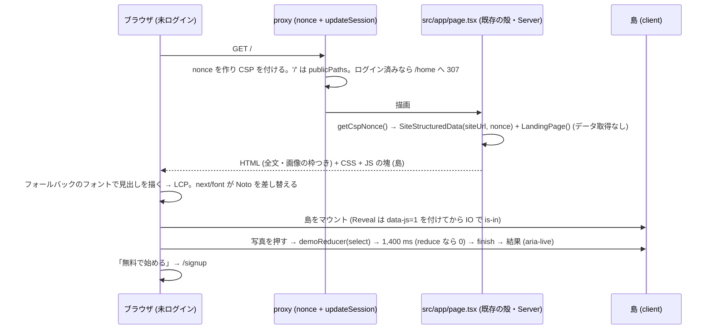

# marketing/01 本サイトの紹介ページ (ランディングページ) の設計 — 設計から作り直す

| | |
|---|---|
| 版 | v1.4 (2026-10-18。設計ゲート R3 の指摘を反映) |
| Status | 設計ゲート審査中 (R4)。実装は §17 の段分け (段 0 → 1 → 2 を 1 本の WF・1 本の PR) で進める。未着手 |
| Issue | #1867 (サービスの本サイト (homegohan.com) を作り直す) の本文とコメント (2026-10-18 の 2 件) |
| 範囲の正本 | Issue #1867 の本文とコメント。本書はその上で決めた範囲 (紹介ページ 1 本 = `/`) と設計。Issue と食い違ったら本書が正 |
| 成果物 | 本書と、静的な試作 `docs/design/marketing/prototype/index.html` (§23) |
| 実装者 | Sonnet 5.5 が本書だけを読んで手を止めずに実装できることを完成条件にする |

オーナーの指示 (2026-10-18) 逐語:「WEBサイトはめっちゃリッチでモダンで最高に手間をかけら素晴らしいページに仕立て上げて欲しい。世界最高のページを目標に手を抜かずにお願いします。」
これは、同じ日の先の選択「紹介ページの中身は今のページを土台に直す」を上書きする。

次の選択は変わらない (オーナーの選択 2026-10-18)。
- 今の Next.js のアプリに同居させ、homegohan.com 1 本でパスで分ける (/ が紹介と公開のページ、/login 以降がアプリ)。
- 更新は Claude が開発の流れで行う (月に数回まで)。

前提 (本書が従う条件): ローンチ前で利用者ゼロ。利用者数・利用者の声・受賞・メディア掲載などの実績を作らない。本番・コードは設計の段では変えない。

本冊は、`/` の紹介ページ (いまは Server Component の殻 `src/app/page.tsx` (27 行。メタ情報と JSON-LD) と、画面の本体 `src/app/LandingPageView.tsx` (629 行・`'use client'` の 1 ファイル)) を、**Server Component の骨格 + 小さな client の島 + CSS 主体の動き** という構造で設計から作り直す (§3)。見た目と動きの質 (§5・§6)、速さ (§10)、アクセシビリティ (§11)、検索 (§12)、主張の正確さ (§4.9・§2.5) を同時に満たし、主張の根拠は `landing-copy.ts` の `evidence` (リポジトリのパス) として機械で確かめる (§9.2・§22)。

---

## 0. 外形固定と分冊判定 (相 1)

### 0.1 発注と決めること

Issue #1867 の 2026-10-18 のコメント (2 件目) が、本冊の成果物と基準を決めている: 設計書 `docs/design/marketing/01-landing-site.md` と静的な試作 `docs/design/marketing/prototype/index.html`。同時に満たす基準は、見た目と動きの質・速さ (Core Web Vitals)・アクセシビリティ (WCAG 2.2 AA)・検索・主張の正確さ (法令・利用者数などの実績を作らない)。置き場所 (今のアプリに同居・パスで分ける) は変わらず、検索まわりの穴埋め (Issue #1867 の「進め方」の段 1: canonical・sitemap・ページごとの title / description・vercel.app の重複) は別の B 型として先に main に着地した (#1874・`be462ab4`。`src/lib/seo/public-pages.ts` の `publicPageMetadata`・`src/components/seo/SiteStructuredData.tsx`・`src/app/sitemap.ts`)。本冊はその部品をそのまま使い、作り直さない (§12)。

本書で決めること (列挙):

1. 情報の設計: セクションの構成と、それぞれの目的・中身・行動の呼びかけ → §3.1・§4
2. 文言: 見出し・本文の全文。主張の根拠と、法令・見張りのテストの制約 → §4・§2.5
3. 視覚の設計: 色・タイポグラフィ・余白・グリッド・写真の方針・アイコン・ダークモード → §5
4. 動きの設計: どのセクションでどう動くか・時間・イージング・reduced-motion のときの代わり → §6
5. 画像の調達: 何を使うか・新しく作るなら作り方と置き場 → §7
6. 部品の分け方 (`src/components/marketing/`)・速さの予算と測り方・アクセシビリティの基準・検索の設計 → §8・§10・§11・§12
7. テスト: 見た目の回帰・Lighthouse の予算・アクセシビリティの自動検査・主張の見張り → §16・§22
8. 段分けと分冊 → §0.4・§17

### 0.2 要件行列

| # | 要件 | 出どころ | 本書の節 |
|---|---|---|---|
| R-1 | 紹介ページは `/` に置き、今の Next.js のアプリに同居し、パスで分ける (`/` が紹介と公開のページ、`/login` 以降がアプリ) | オーナーの選択 (2026-10-18) の逐語「/ が紹介と公開のページ、/login 以降がアプリ」 | §3.1, §8, §21 |
| R-2 | 見た人が「これは本物だ」と感じる、リッチでモダンな紹介ページ。国内外の最高水準の LP と並べて見劣りしない | オーナーの指示 (2026-10-18)・Issue #1867 コメント 2 件目 | §3, §5, §6, §23 |
| R-3 | 速さ: Core Web Vitals の「良い」(LCP ≤ 2.5 s・INP ≤ 200 ms・CLS ≤ 0.1 を p75 で) と Lighthouse Performance ≥ 90 | Issue #1867 コメント 2 件目・`docs/design/CLAUDE.md` E・`docs/design/cross/06-perf-cache.md` §3.1 | §10 |
| R-4 | アクセシビリティ: WCAG 2.2 AA (コントラスト・キーボード・見出し・代替テキスト・動きの抑制・ターゲットの大きさ) | Issue #1867 コメント 2 件目・`docs/design/cross/05-i18n-a11y.md` | §11 |
| R-5 | 検索: ページの title / description / canonical・構造化データ・見出しの階層。段 1 (main に着地済み: `publicPageMetadata`・`SiteStructuredData`・sitemap・全ページの canonical) の部品をそのまま使い、二重にしない | Issue #1867 コメント 1 件目「進め方 1」・2 件目 | §12 |
| R-6 | 主張の正確さ: 利用者数・利用者の声・受賞・メディア掲載・未確定の価格を書かない。健康上の効果を断定しない (薬機法・景品表示法・健康増進法)。機能の主張はすべて実コードに根拠を持つ | Issue #1867 コメント 2 件目・`tests/public-claims-guard.test.ts` | §2.5, §4.9, §9.2, §22 |
| R-7 | 本番の CSP (nonce 方式・外部 CDN のスクリプト不可・`font-src 'self'`) と、ルート layout の `force-dynamic` (全ページ動的) の下で動く | `src/lib/security/csp.ts`・`src/app/layout.tsx:10`・`docs/design/cross/18-csp-nonce.md` §5 | §2.4, §3.2, §10 |
| R-8 | 既存の見張り (公開の主張・インラインスクリプト・HTML の差し込み・画像の実在・e2e の門) を赤にせず、新しい主張の見張りを足す | `tests/` の各番兵 (§19) | §19, §22 |
| R-9 | 文言と色は、設計書と試作で同じ。写真の置き場には何が入るかを書く | Issue #1867 コメント 2 件目 (試作の目的) | §23 |
| R-10 | ログイン画面などに残る実績の表示 (`src/app/(auth)/layout.tsx:51` の「10,000+ ユーザーが実践中」) を消し、見張りの対象にする | Issue #1867 コメント 2 件目「実績を作らない」 | §4.10, §17 段 0, §19 |
| R-11 | 更新は Claude が開発の流れで行う (月に数回まで) | オーナーの選択 (2026-10-18) | §8, §9.2 |
| R-12 | アプリの画面 (`/login` 以降) は作り直さない。アプリ側で触るのは段 0 の `src/app/(auth)/layout.tsx` (ログイン・新規登録の画面の layout) の実績の表示の削除 (R-10) だけ | 本冊の決定 (範囲を紹介ページに閉じるため。R-1 の選択そのものではない) | §1, §4.10, §17 段 0, §21 |
| R-13 | 文言・画像・順序の変更が、1 ファイル (`landing-copy.ts`) の定数の変更で済む | 本冊の決定 (R-11 の月に数回の更新を軽くする作り) | §8, §9.2 |

### 0.3 ユーザーシナリオ (14 本。トレースは §3.3)

| # | 誰が | 何を | 期待する結果 |
|---|---|---|---|
| S-1 | 未ログインの人 (PC・Chrome) | 検索結果から `/` を開き、下まで読んで「無料で始める」を押す | ヒーローの見出しは HTML に入っていて JS を待たずに出る (最大の描画 = LCP はヒーローの中で、予算 2.5 s 以内。社内の狙いは 2.0 s: §10.1)。スクロールに合わせて各セクションが現れ (下まで読むと隠れたままのセクションが無い)、デモを試せ、`/signup` に着く |
| S-2 | 未ログインの人 (スマートフォン・Safari) | `/` を開き、片手でスクロールする | 横スクロールが出ない。開いた直後 (ヒーローの途中) は固定の「無料で始める」は出ず、ヒーローを過ぎると下に出る (ページの中のリンクで一気に移ったときも同じ。先頭へ一気に戻ると消える)。ピンチで拡大できる。本文は 16 px 以上で、注記・ナビ・ボタン・写真の名前などの小さい文字も 14 px (`--a11y-min-font-size`) を下回らない (§5.2) |
| S-3 | キーボードだけで操作する人 | Tab で順に移動し、Enter / Space で操作する | スキップリンク → ヘッダー → ヒーローの CTA → 画面の切り替えを止める操作 → デモの写真 → FAQ の順に、見えるフォーカスで移動できる。画面の切り替えは Space で止まる。デモの写真を Enter / Space で押すと、分析中も結果が出た後も、フォーカスと見えるリングは押したボタンに残る。FAQ は Enter で開閉 |
| S-4 | スクリーンリーダーの利用者 | ランドマークと見出しで移動する | `header` / `nav` / `main` / `footer` と、h1 が 1 つ・h2 がセクションごとにある。画像に意味のある代替テキスト。デモの結果は `aria-live="polite"` で読み上げる |
| S-5 | 動きを減らす設定 (`prefers-reduced-motion: reduce`) の人 | `/` を開く | フェード・スライド・自動で切り替わる画面・背景の視差・進捗の演出が無く、最終の状態がすぐ出る (デモの結果の出入りも含む)。内容は同じ |
| S-6 | 未ログインの人 | デモで写真を選ぶ → 待つ → 結果を読む → 別の写真を選ぶ | 選択 → 「分析中」(1.4 秒) → 結果 (スコア・記録コメント・推定の数値・「サンプル」の注記) → 別の写真で同じ流れ。待っている間の再選択は無視する |
| S-7 | ログイン済みの人 | `/` を開く | 既存どおり proxy が `/home` (運営ロールは `/admin`、初期設定が済んでいなければ初期設定) へ送る。紹介ページは描かれない |
| S-8 | モバイル App の WebView (`is_native_app` Cookie あり・未ログイン) | サインアウト後などに `/` に着く | 紹介ページがそのまま出る (App のストアへの導線は無い: §4.8)。「無料で始める」は `/signup` へ行く |
| S-9 | 検索エンジンと SNS のクローラー | `/` を取得する | 動的に描いた HTML に h1・description・canonical・OGP (殻の `publicPageMetadata('/')` が出す。画像は `/opengraph-image` と `/twitter-image`: §12)・JSON-LD (Organization・WebSite) がある。JS 無しでも全文が読める |
| S-10 | 遅い回線 (3G 相当) の人 | `/` を開く | 見出しと本文が先に出る (フォントは `swap`)。画像は遅延で読み、置き場の大きさは先に確保されている (CLS 無し)。外部 CDN への要求は無い |
| S-11 | `animation-timeline` に未対応のブラウザ (Firefox) の人 | `/` を開く | スクロール連動の装飾だけが無く、ほかは同じ (IntersectionObserver の現れ方は動く) |
| S-12 | 本番の CSP の下のブラウザ | `/` を開き、デモを操作する | `securitypolicyviolation` が 0 件。アプリが書くインラインのスクリプトは JSON-LD (`SiteStructuredData`) の 1 本 (nonce つき) だけ |
| S-13 | 文言を直す開発者 | `landing-copy.ts` に「10万人が利用」と書く | `tests/public-claims-guard.test.ts` がソース走査と描画の両方で赤にする。`evidence` に無いパスを書いても赤 |
| S-14 | 整合ゲートの検証者 | 本番ビルドで Lighthouse と e2e を流す | Performance ≥ 90・LCP / CLS が予算内・JS の転送量が予算内・CSP 違反 0・axe の違反 0 (§10・§16) |

### 0.4 分冊判定 (相 1 で実施)

| 目安 | 本冊 | 判定 |
|---|---|---|
| 設計書 800 行超 | 超える (文言の全文・表 3 点・正典コード・トレースを 1 冊に持つため) | 該当 |
| 消費先レーン 3 以上 | ページ (`src/app/page.tsx` の殻の中身の差し替えと `src/app/LandingPageView.tsx` の削除)・部品 (`src/components/marketing/`)・公開の資産 (`public/marketing/`)・単体の番兵 (`tests/`)・e2e の門 (`scripts/local-ci.sh`・`.github/workflows/e2e-local.yml`) = 5 | 該当 |
| 共有面 2 つ以上 | `tests/public-claims-guard.test.ts` (公開ページ共通の見張り)・e2e の門の一覧 (yml と `PW_ARGS`)・`src/app/(auth)/layout.tsx` (段 0)・`src/lib/seo/public-pages.ts` (公開ページのメタ情報の正本。`SITE_DESCRIPTION` の値)・`tests/seo-public-pages-1867.test.tsx` (トップの殻の検査)・`package.json` / `package-lock.json` (段 2 の devDependency `@axe-core/playwright`) | 該当 |

判定: **設計は 1 冊 (本書) のまま、実装は 1 本の B 型 WF の中で 3 段 (段 0: 実績の表示の掃除と見張りの拡張 / 段 1: 紹介ページの本体 / 段 2: e2e と門) に分け、段ごとに 2 枚レビューを挟み、マージは最後に 1 回**。理由: 核 (文言と部品) と配線 (ページ) を分けても、どちらも `src/app/page.tsx` の差し替えまで利用者には届かず、核だけをマージすると、使われない部品が main に乗る。共有面は 6 つとも小さな差分 (見張りの一覧に行を足す・読む先を変える・一覧の末尾に 1 語足す・1 行消す・定数の文を 1 つ直す・devDependency を 1 つ足す) で、別の冊にすると参照する「マージ済みの核」が無い。段 0 は独立して意味がある (ローンチ前に実績の表示を消す) ので最初に置く。

### 0.5 用語

- **紹介ページ (LP)**: `/` で返す、未ログインの人向けのページ。公開ページ (`/about` `/faq` ほか) は別のページで、本冊の範囲外 (§1)。
- **島 (client の島)**: `'use client'` の部品。状態 (スクロール・選択・開閉) を持つものだけを島にし、文章と画像は Server Component で描く。
- **主張 (claim)**: アプリの機能や条件について紹介ページが言うこと。`landing-copy.ts` で `evidence` (リポジトリの中の実在のパス) を持つ。
- **実際の画面**: `public/guide/*.png` (Issue #1852 で撮った、本物のアプリの画面写真 15 枚。540×1080)。
- **サンプル**: デモの結果 (スコア・記録コメント・数値)。AI は呼ばず、`landing-copy.ts` に書いた固定の値 (記録コメントは、その値からアプリの定型の文と同じ形で作る文) を出す。画面に「サンプル」と明記する。
- **記録コメント**: 写真の記録の画面に出る、記録をほめるひと言 (`src/app/(main)/meals/new/page.tsx:1506-1520`)。アプリの定型の文で、AI が認識した料理の名前と食事の区分だけが変わる (§4.2 の根拠)。

---

## 1. 目的・スコープ

- `/` を、見た人が「これは本物だ」と感じる紹介ページに作り直す。本物感の源は、実績の数字ではなく、**実際の画面と、正直な文言と、手触りの良い動き**に置く (利用者ゼロで実績が無いことは、設計の前提)。
- 速さ・アクセシビリティ・検索・主張の正確さを、機械で確かめられる形 (予算の定数・番兵のテスト) で設計に焼き込む。
- 文言・画像・順序を 1 ファイル (`landing-copy.ts`) に集め、月に数回の更新を 1 ファイルの変更で済ませる。

対象外 (別の案件):

| 本冊 | 対象外 |
|---|---|
| `/` の紹介ページ (ヘッダー・フッターを含む) | `/about` `/faq` `/guide` `/pricing` `/news` `/company` `/legal` `/contact` の作り直し (ヘッダー・フッターを共通化する案は §24 Q-6) |
| `src/app/(auth)/layout.tsx` の実績の表示の削除 (段 0。アバターと実績の段落の削除と見張り。R-12) | ログイン・新規登録の画面の作り直し |
| `/` のメタ情報と JSON-LD は段 1 の部品 (`publicPageMetadata('/')`・`SiteStructuredData`) をそのまま使う。直すのは `SITE_DESCRIPTION` の文 1 つ (R-5・§12) | 段 1 の部品の作り直し・sitemap・全ページの canonical (段 1 で着地済み)・vercel.app の重複 (Issue #1867 の段 1 の残り) |
| 画像の置き場と調達の手順 (§7) | 新しいイラストの制作 (作らない: §7.3) |
| 動きの設計と実装 (CSS・IntersectionObserver・デモだけ framer-motion) | 3D (Three.js など) の導入 (§3.2 で退ける) |
| アクセシビリティの自動検査 (`/` の `@axe-core/playwright` の検査 (E-20。段 2 で devDependency に足す)・構造の検査・コントラストの機械計算) | ほかの画面の axe の検査 (`docs/design/cross/05-i18n-a11y.md` §7 の「全主要画面で violations = 0」の残り。`/login` 以降) |
| 計測 (Lighthouse の手順・Speed Insights) | Lighthouse CI のワークフロー (`docs/design/cross/06-perf-cache.md` §7 の案。リポジトリに実体が無い) |

---

## 2. 関連要件と現行の事実

### 2.1 関連 Issue・既存設計

| 文書 | 関係 |
|---|---|
| Issue #1867 (本文) | 置き場所とドメインの構成を決める発注。関わるもの (#1573・Supabase の Site URL・モバイルの `EXPO_PUBLIC_API_BASE_URL`・CORS・OGP #1845・既存の公開ページ) |
| Issue #1867 コメント 1 件目 (2026-10-18) | 置き場所の 4 つの選択 (同居・パスで分ける・Claude が更新・(上書きされた) 今のページを土台に)。進め方 (段 1: 検索の穴埋め → 文言の下書き → ドメインの切り替え) |
| Issue #1867 コメント 2 件目 (2026-10-18) | 設計から作り直す。成果物 2 つ。同時に満たす基準。置き場所は不変 |
| `docs/design/cross/18-csp-nonce.md` §5・§22 Q-7 | 全ページ動的 (`force-dynamic`)。LP の Lighthouse が 90 を下回っても静的化はせず、描画の軽量化で対処する (本冊 §3.2 C・§10) |
| `docs/design/cross/03-design-system.md` | トークン (§3.1 の値は `src/app/globals.css` には実装されていない)・タイポグラフィ・アイコンは lucide のみ (§16)・`prefers-reduced-motion` (§14.2)・ダークモードは Phase 2 (§7) |
| `docs/design/cross/05-i18n-a11y.md` | WCAG 2.1 AA の基準。本冊は 2.2 AA (2.5.8 ターゲットの大きさを足す) |
| `docs/design/cross/06-perf-cache.md` §3.1 | Lighthouse ≥ 90・LCP < 2.5 s・CLS < 0.1 (FID は INP に置き換わった: §10) |
| `docs/design/cross/08-legal-compliance.md` | 医療免責の方針 (本冊 §4.7 の免責の 1 文) |
| `docs/design/billing/01-billing-core.md` §18 項目 14 | 有料プランの文言 (`有料プランは準備中です（販売開始前）`) は販売開始の PR まで変えない |
| Issue #1852 / `src/app/guide/guide-content.ts` | 実際の画面の画像 15 枚と、その撮り直しの手順 (`scripts/guide-screenshots/run.sh`) |
| Issue #1845 / `src/lib/brand-image.tsx` | ブランドの色 `BRAND_COLORS`・OGP の画像 (layout が出す。本冊は変えない) |
| Issue #1314 / `src/lib/badges/awardable.ts` | 付与の処理があるバッジの一覧 (紹介ページに出すバッジはこの中から選ぶ: §4.5) |
| Issue #1867 段 1 (PR #1874・`be462ab4`) | 公開ページのメタ情報の正本 `src/lib/seo/public-pages.ts` (`publicPageMetadata`・`SITE_DESCRIPTION`・`PUBLIC_PAGE_PATHS`)・構造化データ `src/components/seo/SiteStructuredData.tsx` と `src/lib/seo/json-ld.ts` (`buildSiteJsonLd`・`serializeJsonLd`)・`src/app/sitemap.ts`。トップを殻 (`src/app/page.tsx`) と本体 (`src/app/LandingPageView.tsx`) に分けた。本冊はこの部品を使い、本体だけを差し替える (§9.5・§12) |

### 2.2 現行のトップ (殻 `src/app/page.tsx` と本体 `src/app/LandingPageView.tsx`・origin/main `be462ab4`・2026-10-18 に採取)

#1874 (`be462ab4`) で、トップは殻と本体に分かれた。本体 `src/app/LandingPageView.tsx` は、それより前の `src/app/page.tsx` (`835fbe7c`) と 1 行も違わない (同じ 629 行を移しただけ。`git diff 835fbe7c:src/app/page.tsx be462ab4:src/app/LandingPageView.tsx` が空) ので、下の表の行番号は `LandingPageView.tsx` の行番号として読む。

| 事実 | 場所 | 本冊での扱い |
|---|---|---|
| 殻 `src/app/page.tsx` (27 行・Server Component・async)。`export const metadata = publicPageMetadata('/')` (`:17`)。本体は `getCspNonce()` を読み、`<SiteStructuredData siteUrl={getSiteUrl()} nonce={nonce} />` と `<LandingPageView />` を描く (`:19-27`) | `src/app/page.tsx:17-27` | 殻の形はそのまま。`<LandingPageView />` を `<LandingPage />` (`src/components/marketing/LandingPage.tsx`) に替えるだけ (§9.5) |
| 本体 `src/app/LandingPageView.tsx` は `'use client'` の 1 ファイル (629 行)。状態 6 つ (`selectedMeal` `isAnalyzing` `analysisComplete` `expandedFaq` `activeFeature` `scrollY`)。`scroll` イベントで `scrollY` を state に入れ、全体を再描画する | `:129-141` | 捨てる (§3.2 B)。ヘッダーの状態だけを島にする |
| 色は `colors` 定数にハードコード (primary `#E07A5F`・secondary `#3D5A80`・text `#1A1A1A` ほか 19 個)。`BRAND_COLORS` (text `#2D2D2D`・textLight `#6B6B6B`) と一致しない | `:16-36`・`src/lib/brand-image.tsx:27-38` | トークンを `BRAND_COLORS` の値に合わせ、`tests/landing-page-1867.test.ts` で突き合わせる (§5.1・§22) |
| 白文字 on `#E07A5F` のボタン (コントラスト 2.95:1。AA の 4.5:1 も、大きい文字の 3:1 も満たさない) | `:207` `:366` `:537` `:621` | 白文字の下地は `#2D2D2D` か `#B34D2D` にする (§5.1) |
| 食事のサンプル画像は `images.unsplash.com` の外部 URL 3 件 + 1 日の流れ 4 件 (`?w=400` `?w=300`) | `:42` `:51` `:60` `:409-412` | 自前の写真に置き換える (§7.2)。本番の紹介ページから外部の画像の要求を無くす |
| 未検証の効能・断定: 「吸収率が3倍」`:63`・「医者いらず」「免疫力アップ」`:56`・「森のバター」「美肌効果」`:47`・「ダイエット中の方にも最適」`:410`・「あなたのダイエットパートナー」`:532`・「30秒で登録完了」`:208` `:543` `:625`・「1分で使い始められる」`:218`・「完全無料」`:216`・「8つの機能で、あなたの食生活を完全サポート」`:379`・「他にも50種類以上のバッジ」`:467` | 同左 | 全部捨てる。新しい文言は §4 (根拠つき) |
| 機能 8 件のうち「週次レポート」の実装は見つからない (`src/app/api` に該当なし)。「オフラインでも写真の撮影と保存ができる」(FAQ `:102`) の根拠も見つからない | `:76` `:102` | 書かない (§4.4・§4.6) |
| バッジ 12 件 (「朝食マスター」「7日連続」「野菜マニア」…) は、`badges` テーブルの行 (`supabase/migrations/20251126124224_create_meal_planner_tables.sql:14030` 付近の 38 行) に無い名前 | `:81-93` | 実在し、付与の処理があるバッジだけを、DB の名前と説明で出す (§4.5) |
| FAQ 6 件のうち「本当に無料」「データは安全」「AI の分析は正確」は見張りの対象 (`tests/public-claims-guard.test.ts:395-424`。本体の読み先は `:397` の `src/app/LandingPageView.tsx`) | `:96-103` | 3 件の文言は据え置き (表現を整えるだけ)。「オフライン」は根拠が無いので別の質問に替える (§4.6) |
| 絵文字を多用 (`✨` `📸` `🤖` `🎉` `🏆` ほか) | 全体 | 使わない (design-system §16: lucide のみ) |
| フッターの SNS は `href="#"` のプレースホルダー 3 件 | `:574-576` | 置かない (公開の SNS の先が無い。`landing-copy.ts` の `socialLinks` は空の配列。§4.8) |
| `motion.button` を `Link` の中に置く (a の中に button。無効な入れ子) | `:177-181` `:206-210` | `Link` 1 つにボタンの見た目を当てる (§8) |
| モバイルの固定 CTA は `scrollY > 400` で出す | `:619` | ヒーローの箱 (`section#hero`) を IntersectionObserver で見る (§6.2 M-8) |

### 2.3 ブランドと画像の資産

| 資産 | 場所 | 使い方 |
|---|---|---|
| `BRAND_COLORS` (accent `#E07A5F`・accentGradientEnd `#FF9B7A`・background `#FAF9F7`・backgroundGradientEnd `#FDF0ED`・text `#2D2D2D`・textLight `#6B6B6B`・white・sparkle `#FFD700`・green = `STATUS_COLOR_TOKENS.success` = `#6B9B6B`・blue `#5B8BC7`) | `src/lib/brand-image.tsx:27-38`・`packages/shared/src/design-tokens.ts:25` | 紹介ページのトークンの元 (§5.1)。`brand-image.tsx` は `next/og` を読むので client から import しない。値はテストで突き合わせる |
| ロゴ (湯気の立つお椀と星。丸 / 角丸の四角) | `public/icon.svg`・`public/icon-512.svg`・`public/apple-touch-icon.svg`・`src/lib/brand-image.tsx` の `BrandMark` | ヘッダー・フッターのマークは `public/icon.svg` を `next/image` で出す (§4.1) |
| 実際の画面 15 枚 (540×1080 の PNG・1 枚 300 KB 以下) | `public/guide/{signup,profile,ready,camera,analyze,comment,menu-request,menu-setting,menu-result,weight,weight-photo,trend,badge-get,badge-collection,badge-rare}.png` | ヒーロー・3 ステップ・機能の画像 (§7.1)。代替テキストは `guide-content.ts` の `imageAlt` と同じ文にする |
| サンプルの食事の写真 1 枚 | `public/handson-tour/sample-meal.webp` | 使わない (ツアーの資産。大きさが紹介ページに合わない) |
| OGP の画像・アイコンの PNG | `src/app/opengraph-image.tsx`・`src/app/icon-192.png/route.ts` ほか | 変えない。紹介ページの JSON-LD の `logo` は `/icon-512.png` を指す (§12) |
| サイトの名前と一言 | `src/lib/site-config.ts:432-433` (`SITE_NAME` `SITE_TAGLINE`) | ヘッダー・フッター・JSON-LD の名前は `SITE_NAME` を使う (直接書かない) |

### 2.4 技術の制約

| 制約 | 事実 (場所) | 本冊の対応 |
|---|---|---|
| 全ページ動的 | `src/app/layout.tsx:10` の `export const dynamic = 'force-dynamic'` (#1169)。`docs/design/cross/18-csp-nonce.md` §5.1 「静的化した HTML には nonce が入らず、Next のインラインスクリプトが止まる」。Next 公式の CSP のガイド (2026-03-20 更新) も「nonce を使うページは動的に描画しなければならない」「PPR は nonce 方式の CSP と両立しない」と書く | 紹介ページも動的のまま (§3.2 C)。速さはサーバーの描画を軽く保つことで出す: データ取得ゼロ・`headers()` は JSON-LD の nonce の 1 回だけ・島は小さく (§10) |
| CSP | `src/lib/security/csp.ts:237-252`: `script-src 'self' 'nonce-…' 'report-sample' *.vercel-scripts.com https://challenges.cloudflare.com` (外部 CDN のスクリプト不可)・`style-src 'self' 'unsafe-inline'` (inline style 可)・`img-src 'self' data: blob: *.supabase.co images.unsplash.com`・`font-src 'self'`・`connect-src 'self' *.supabase.co *.vercel.app wss://*.supabase.co https://holidays-jp.github.io` | ライブラリは bundle に同梱 (framer-motion は依存にある)。フォントは `next/font` の自前配信のまま。画像は `public/` に置く。CSP は変えない |
| proxy の matcher | `src/proxy.ts:99`: `_next/static` `_next/image` `_vercel/` `favicon.ico` `manifest.json` `robots.txt` `sitemap.xml$` (段 1 で追加) `sw.js` `workbox-` `api/health$` `opengraph-image$` `twitter-image$` と画像の拡張子 (`svg png jpg jpeg gif webp`) を除く | `public/marketing/**/*.webp` と `public/guide/*.png` は matcher の外 (未ログインでも読める)。`tests/metadata-public-paths-1845.test.ts` が実在と matcher の外を確かめる |
| 未ログインの振り分け | `lib/supabase/middleware.ts:308-331` の `publicPaths` に `'/'` がある (未ログインで開ける)。ログイン済みは `lib/onboarding-routing.ts:90-113` の `resolveOnboardingRedirect` が `/` を `/home` (運営ロールは `/admin`・初期設定が未完なら `/onboarding/welcome` か `/onboarding/resume`) へ送る | 紹介ページはログイン済みの状態を考えない (S-7)。ヘッダーの右は常に「ログイン」と「無料で始める」 |
| メンテナンスモード | `src/lib/maintenance-mode.ts:77-85` の `isMaintenanceExemptPath` に `/` は無い。未ログインで `/` を開くとメンテナンスの画面 (`lib/supabase/middleware.ts:336-339`) | 既存どおり (変えない) |
| フォント | `src/app/layout.tsx:15-25`: `next/font/google` の Noto Sans JP (400 / 500 / 700・`--font-sans`) と Noto Serif JP (400 / 700・`--font-serif`)。`subsets: ["latin"]` だが、Google Fonts の CSS が持つ unicode-range の分割 (日本語の字形は分割ファイル) を `next/font` がすべて自前に取り込み、ブラウザは使う分割だけを読む。e2e のビルドは `tests/e2e/fixtures/google-fonts-mock.cjs` で Google へ取りに行かない | 新しいフォントは足さない。見出しは Noto Serif JP (既に読んでいる)・本文は Noto Sans JP (§5.2)。`google-fonts-mock.cjs` の `FONT_REQUESTS` は変えない (`tests/e2e-google-fonts-mock.test.ts` が layout と突き合わせる) |
| 依存 | `package.json`: next 16.4.1・react ^19.2.8・framer-motion ^12.23.24・lucide-react ^0.554.0・tailwindcss ^4.1.17・@vercel/speed-insights ^2.0.0。gsap・lottie・three・lighthouse・@axe-core/playwright は無い。`docs/design/CLAUDE.md` F と `docs/design/cross/05-i18n-a11y.md` §5.2・§7 は、a11y の検査を「`@axe-core/playwright` (CI 必須)」と決めている | 製品の依存は足さない (§3.2)。足すのは devDependency の `@axe-core/playwright` 1 つ (段 2。e2e の axe の検査 E-20 のため。§11・§17)。framer-motion は `LazyMotion` + `m` でデモの島だけが読む (§6.3) |
| Tailwind v4 | `src/app/globals.css` が `@import "tailwindcss"` と `@theme inline` (`--color-accent: #FF8A65` など、design-system §3.1 とは別の値)。`tailwind.config` は無い | 紹介ページのトークンは `src/components/marketing/marketing.css` の `.lp` の中の CSS 変数に閉じ (既存の `--accent` と衝突しない)。Tailwind のユーティリティは余白・配置に使い、色は変数で指す (§5.1) |
| `reduced-motion` | `src/app/globals.css:82-92` が全要素の `animation-duration` / `transition-duration` を 0.01 ms に、`animation-iteration-count` を 1 に、`scroll-behavior` を `auto` にする。止めないもの: 遅れ (`animation-delay` / `transition-delay`)・スクロール連動のアニメーション (`animation-timeline: scroll()` は時間でなく進みで動くので、時間を縮めても動く)・JS の動き (framer-motion は既定で `reducedMotion: 'never'` で、CSS の `!important` も効かない)。`src/components/handson-tour/useReducedMotion.ts` が JS 側の判定。加えて、時間を 0.01 ms に縮めても、`fill-mode: both` の CSS のアニメーションは要素が出るたびに作られ、その間は `running` として残る | globals.css に頼らない。`marketing.css` の動き (`animation*`・`transition*` の宣言) は、すべて `@media (prefers-reduced-motion: no-preference)` の中でだけ付け、reduce では動きの宣言そのものが無い (§6.1・§9.1。U-20 が宣言の場所を確かめる)。framer-motion は `MotionConfig` と `initial={false}` (§9.6)。JS の待ち時間は `useReducedMotion` で 0 に (§6.4) |
| 動きの道具 | CSS の `animation-timeline` は Chrome / Edge 115 以降・Safari 26 以降で動き、Firefox はフラグの後ろ (2026 年の Interop の目標)。MDN は「Baseline ではない」と記す | スクロール連動の装飾だけに使い、`@supports (animation-timeline: scroll())` で囲む (§6.3)。現れ方は IntersectionObserver (全ブラウザ) |
| モバイルの WebView | `apps/mobile/src/lib/webViewBridge.ts:35` の既定の行き先は `/home?mode=app`。`?mode=app` で `is_native_app` Cookie (`src/proxy.ts:58-67`)。`/` を開く経路は通常無い | 紹介ページは Cookie を読まない (S-8)。ストアへの導線は無い (§4.8) |
| 拡大 (viewport) | `src/app/layout.tsx:103-112` の `export const viewport` が `maximumScale: 1`・`userScalable: false` (全ページ。ピンチの拡大を止める)。Lighthouse のアクセシビリティの監査 `meta-viewport` は `user-scalable=no` か `maximum-scale` が 5 未満で不合格。Next は viewport を layout → page の順に鍵ごとに上書きする (子が書いた鍵だけが替わる) | `/` の殻 `src/app/page.tsx` だけが `viewport` を export し、`maximumScale` と `userScalable` を上書きする (§9.5)。layout は変えない (ほかの画面の拡大の扱いは本冊の範囲外) |
| 計測 | Vercel Speed Insights (`src/components/SpeedInsightsClient.tsx`・`src/app/layout.tsx:138`) が全ページで Web Vitals を送る。Lighthouse CI の実体は無い | 実測は Speed Insights (field) と、整合ゲートの Lighthouse (lab) (§10.3) |

### 2.5 公開の主張の制約

**見張りのテスト** `tests/public-claims-guard.test.ts` (#1155): `PUBLIC_PAGES` (トップの本体 `src/app/LandingPageView.tsx` (`:78`。描画は `@/app/LandingPageView` の default を `:65` で読む) ほか 6 本の計 7 本) のソースと描画の両方を `FORBIDDEN` (ダミーの事業者情報・架空の資金調達・`10万人`・`App Store評価`・`1,234,567`・`98.7`・`継続率`・`食の分析実績`・`最長連続記録`・`90%以上の精度`・`Forbes` ほかのメディア名・`メディア掲載`・`リアルな声`・`変化のストーリー`・`血圧-15mmHg`・`-4.2kg`・`自炊率0%→70%`・`野菜摂取量2倍`・`体調スコア+30%`・`¥980` ほかの価格・`永久無料`・`第三者に共有されることはありません` ほかの断定) で検査する。トップの FAQ の `q: "データは安全ですか？"` の行に `プライバシーポリシー` があること、`/\d+%以上の精度/` が無いことも見る。`PAID_PLAN_PENDING_NOTICE = '有料プランは準備中です（販売開始前）'`。

**ログイン画面に残る実績の表示**: `src/app/(auth)/layout.tsx:51` に「10,000+ ユーザーが実践中」と、アバターのプレースホルダー (`:43-50`。どちらも `:42-52` の `div` の中)。`FORBIDDEN` の `10万人` には当たらず、`(auth)/layout.tsx` は `PUBLIC_PAGES` に無いので、見張りをすり抜けている (段 0 で消し、見張りに足す: §4.10・§17)。

**法令** (消費者庁・東京都の公式ページと、二次資料。原文は実装の前に引き直す):

| 法令 | 条文 | 紹介ページへの当てはめ |
|---|---|---|
| 景品表示法 第 5 条第 1 号 (優良誤認) | 「実際のものよりも著しく優良であると示す」表示の禁止。第 7 条第 2 項 (措置命令) は、根拠の資料の提出を求められて出せなければ、その表示を第 5 条第 1 号に該当する表示と「みなす」。第 8 条第 3 項 (課徴金) は「推定する」(消費者庁「優良誤認表示とは」の頁) | 機能の主張はすべて実コードに根拠を持つ (`evidence`)。写真の記録の「記録コメント」は定型の文 (`supabase/functions/_shared/nutrition-pipeline.ts` の `buildTemplatePraiseAndTip`。料理の名前と食事の区分だけが変わる) なので、写真の記録について「AI が食事を見て良いところを見つける」とは書かず、デモのサンプルも定型の文の形にする (§4.4・§4.9 の `praise`)。「〜で痩せる」「最高の」「完全」「最新の AI」のような、根拠を出せない形容を書かない。認識の精度・速さを数字で約束しない |
| 健康増進法 第 65 条第 1 項 (虚偽誇大表示の禁止) | 食品として販売に供する物の健康保持増進効果等について「著しく事実に相違する」「著しく人を誤認させる」表示の禁止 (神奈川県・宮城県の資料)。消費者庁「健康食品に関する景品表示法及び健康増進法上の留意事項について」(2016 年制定。2022-12-05 の改定は二次資料で言及) は「〇〇だけで△kg 痩せる」「医者に行かずとも治る」型を虚偽・誇大の例に挙げる | アプリは食品ではないが、サンプルのコメントや豆知識で食品の効能 (「免疫力アップ」「美肌」「吸収率が 3 倍」「医者いらず」) を書かない。デモのサンプルの記録コメントは、アプリの定型の文と同じ形 (料理の名前の記録をほめる文。§4.4) にし、料理の中身や効能を褒めない |
| 薬機法 第 66 条第 1 項 (誇大広告等) | 「何人も、医薬品 … の名称、製造方法、効能、効果又は性能に関して、明示的であると暗示的であるとを問わず、虚偽又は誇大な記事を広告し、記述し、又は流布してはならない」(東京都保健医療局の抜粋)。第 68 条は承認前の医薬品等の広告の禁止 | アプリが病気を治す・防ぐ・診断すると読める表現 (「血圧が下がる」「健康診断の数値が…」) を書かない。「医療目的での使用はお控えください」の免責を最終 CTA と FAQ に置く (`docs/design/cross/08-legal-compliance.md` の医療免責の方針) |
| ステルスマーケティング (景品表示法の指定告示・2023-10-01) | 事業者の表示であることを隠した第三者の声の表示を不当表示とする (二次資料) | 利用者の声・口コミ・評価は一切載せない (利用者ゼロ) |

### 2.6 世界水準の紹介ページの作り (事実と採用)

| 事実 (出どころ) | 採用 |
|---|---|
| Notion・Linear・Framer のヒーローは、説明する前にプロダクトの動きを見せる。2026 年の傾向は「実際の UI のプレビューを早く・証拠を伴って・流し読みできる区切りで」(saasframe.io・mockflow.com・2026 年の二次資料) | ヒーローの右に実際の画面 3 枚の連続 (撮る → 見る → 褒められる) を置く。文章は短く、各セクションに 1 つの主張 |
| 見た目が派手でも、分かりやすさ・証拠・次の一歩が無いページは成果が出ない (saashero.net・vezadigital.com) | 証拠 = 実際の画面と、根拠のある機能の列挙。次の一歩 = 各セクションの終わりに同じ CTA |
| 動きは「製品の物語をはっきりさせる」ためだけに使う (shift8web.ca) | 動きの一覧 (§6.2) は、すべて「何を伝えるか」の列を持つ。装飾だけの動きは背景の 1 つに限る |
| Core Web Vitals の「良い」は LCP 2.5 s・INP 200 ms・CLS 0.1 (p75。web.dev「Web Vitals」2024-10-31 更新)。2026 年に LCP が 2.0 s になったという記事は公式に裏づけが無い | 予算は 2.5 / 200 / 0.1 (§10)。社内の目標として LCP 2.0 s を狙う |
| 3D (WebGL) や大きなアニメーションのライブラリは、JS の量とバッテリーを食い、WCAG の動きの抑制と相性が悪い | 入れない (§3.2)。動きは CSS と小さな JS で作る |

---

## 3. 構想 (相 2) と構造裁定 (相 3)

### 3.1 構造

**情報の設計 (上から順に。各セクションの目的と行動の呼びかけ)**

| # | セクション (`id`) | 目的 | 中身 | 行動の呼びかけ |
|---|---|---|---|---|
| 1 | ヘッダー (`header`) | いつでも登録とログインへ行ける | マーク + 「ほめゴハン」・ナビ (機能・使い方・バッジ・よくある質問)・ログイン・無料で始める | 無料で始める → `/signup` |
| 2 | ヒーロー (`hero`) | 3 秒で「写真を撮ると褒められる」が分かる | 見出し・一文・CTA 2 つ・安心の 3 点・実際の画面の連続 (撮る → 見る → 褒められる) と、その切り替えを止める操作 | 無料で始める → `/signup`・デモを試す → `#demo` |
| 3 | 使い方 (`how`) | 手順が 3 つしかないことを見せる | 固定した端末の画面が、スクロールに合わせて 3 枚切り替わる。各手順に短い説明 | (なし) |
| 4 | デモ (`demo`) | 「褒められる」を自分の手で体験する | サンプルの写真 3 枚から選ぶ → 分析中 → 結果 (スコア・記録コメント (アプリの定型の文と同じ形)・推定の数値)。「サンプル」の注記 | 自分の食事で試す → `/signup` |
| 5 | 機能 (`features`) | 写真の記録のほかに何ができるかを一覧で | 大 2 + 中 4 + 小 2 のカード (実際の画面つき)。各カードの主張に根拠 | (なし) |
| 6 | バッジ (`badges`) | 続ける仕掛けがあることを見せる | 実在し、付与の処理があるバッジ 6 つ (DB の名前と説明) | (なし) |
| 7 | 安心 (`trust`) | 正直さで信頼を作る (実績の代わり) | 無料・データ・AI の限界・退会と書き出しの 4 点 | (なし) |
| 8 | よくある質問 (`faq`) | 迷いを解く | 6 件のアコーディオン + お問い合わせへのリンク | お問い合わせフォームへ → `/contact` |
| 9 | 最終 CTA (`cta`) | 読み終えた人の背中を押す | 見出し・一文・CTA・安心の 3 点・医療の免責 | 無料で始める → `/signup` |
| 10 | フッター (`footer`) | 法務と公開ページへの導線 | サービス・サポート・法的情報の 3 列と著作権 | (リンク) |
| 11 | モバイルの固定 CTA (`sticky-cta`) | スマートフォンで、いつでも登録へ | ヒーローを過ぎたら (ヒーローの箱 `#hero` が画面の上へ出きったら) 下から出る。開いた直後は出ない | 無料で始める → `/signup` |

**部品の構造 (Server Component の骨格 + client の島)**

```
src/app/page.tsx                         既存の殻 (Server Component・async。#1874)。metadata = publicPageMetadata('/')・
                                         <SiteStructuredData nonce> (既存)・<LandingPage /> (本冊で <LandingPageView /> から替える)
src/app/LandingPageView.tsx              削除 (現行の本体。§18 消すもの)
src/components/seo/SiteStructuredData.tsx 既存 (変えない)。JSON-LD (Organization・WebSite) の唯一の出し口
src/components/marketing/
  LandingPage.tsx                        Server Component。.lp の箱の中に SiteHeader → <main> (セクション 8 つ) → SiteFooter → MobileStickyCta (状態を持たない)
  landing-copy.ts                        文言・画像・主張の根拠・サンプル (唯一の正本。§9.2)
  demo-state.ts                          デモの状態機械 (demoReducer。純関数。§9.3)
  marketing.css                          .lp のトークン・タイポグラフィ・動き (§5.1・§6.3)
  sections/                              12 本
    SiteHeader.tsx                       島: スクロールで背景が付く
    HeroSection.tsx                      Server。画面の連続は CSS の keyframes、止める操作は checkbox + CSS の :has() (JS 無し)
    HowItWorksSection.tsx                Server。3 ステップの骨格。中に StorySteps を置く
    StorySteps.tsx                       島: 固定した端末と手順の切り替え (M-6)
    DemoSection.tsx                      島: デモの状態機械 (§9.3) を使う。framer-motion はここだけ
    FeaturesSection.tsx                  Server (bento のカード)
    BadgesSection.tsx                    Server
    TrustSection.tsx                     Server
    FaqSection.tsx                       島: アコーディオン
    FinalCtaSection.tsx                  Server
    SiteFooter.tsx                       Server
    MobileStickyCta.tsx                  島: ヒーローの箱 (#hero) を IntersectionObserver で見る (画面の上へ出きったら出す)
  primitives/                            5 本
    Reveal.tsx                           島: 現れ方 (IntersectionObserver・1 回だけ)
    PhoneFrame.tsx                       Server: 端末の枠 (CSS だけ)
    CtaLink.tsx                          Server: Link にボタンの見た目
    useInViewOnce.ts                     島の中で使う hook (§9.4)
    useReducedMotion.ts                  既存 src/components/handson-tour/useReducedMotion.ts を再 export
public/marketing/photos/                 デモの写真 3 枚 (§7.2)
```

`src/components/marketing/` の新設は 21 本 (直下 4 本: `LandingPage.tsx`・`landing-copy.ts`・`demo-state.ts`・`marketing.css` + `sections/` 12 本 + `primitives/` 5 本。§8.1・§17・§18 の列挙と同じ)。JSON-LD の部品は新設しない (段 1 の `SiteStructuredData` をそのまま使う。§12)。

島の数は 6 (SiteHeader・StorySteps・DemoSection・FaqSection・MobileStickyCta・Reveal)。文章と画像は Server Component で描くので、JS が無くても全文が HTML にある (S-9)。

### 3.2 代替案の比較と裁定 (1 回だけ)

| 案 | 中身 | 良い点 | 退ける理由 |
|---|---|---|---|
| **A (採用)** Server Component の骨格 + 小さな島 + CSS 主体の動き。framer-motion はデモの島だけ (`LazyMotion`) | 文章と画像は HTML に出る。JS は島の分だけ。動きは CSS (`transform` / `opacity`) と IntersectionObserver | LCP (文字が先に出る)・INP (再描画が島に閉じる)・CSP (インライン無し)・a11y (`reduced-motion` は CSS が止める)・検索 (全文が HTML) を同時に満たす。月に数回の更新は `landing-copy.ts` だけ | – |
| B 現行の延長 | `'use client'` の 1 ファイル + framer-motion の全面使用 | 書き慣れた形。`whileInView` で現れ方が 1 行 | 全体が 1 つの client で、`scroll` の state が全体を再描画する (INP に悪い)。framer-motion が初期の JS に乗る (約 30 KB gz 以上)。文章の更新と見た目の変更が同じファイルで混ざる。現行の品質の問題 (§2.2) の発生源 |
| C 紹介ページだけ静的化 | route group と別の layout・hash / SRI 方式の CSP | CDN から配れる。TTFB が最短 | `docs/design/cross/18-csp-nonce.md` §4 で hash 方式を退け、§22 Q-7 で「LP だけ静的に戻す案は nonce と両立しない」と裁定済み。Next 公式も「PPR は nonce 方式と両立しない」「SRI は実験的」と書く。全ページ動的の決定を本冊で覆さない |
| D 3D / 大きな演出ライブラリを入れる | Three.js・GSAP・Lottie | 派手な動きを作れる | 依存が増え (CSP は bundle 同梱なら可)、JS が数十〜数百 KB 増える。WCAG 2.3.3 (動きの抑制) と INP の予算に合わない。「本物感」は実際の画面で出せる (§2.6) |

**縁の発生源を消すより単純な構造は無いか**: 島をさらに減らす (ヘッダーの背景を CSS だけで付ける・FAQ を `details`/`summary` にする) 案を検討した。ヘッダーは `scroll-state()` が Baseline でなく、固定ヘッダーに常に背景を付けると、ヒーローの上で重く見える。FAQ の `details` は開閉の動きを付けにくく、`aria-expanded` を持つ `button` + `region` の方が支援技術で安定する。島 6 つはそれぞれ 1 つの状態しか持たず、これ以上減らすと見た目か a11y を落とす。**構造 A で確定**。以後、構造の疑義は blocking ではなく「裁定への差し戻し事由」として別に扱う。

### 3.3 シナリオのトレース (構造 A で手で走らせた記録)

| # | トレース |
|---|---|
| S-1 | `GET /` → proxy が nonce を付け `updateSession` (未ログイン・`/` は publicPaths) → `page.tsx` (既存の殻) が `getCspNonce()` → `SiteStructuredData` (既存) + `LandingPage` を描く (データ取得なし) → HTML (全文) → ブラウザ: 見出しがフォールバックのフォントで描かれ LCP 確定 → `Reveal` が IO でセクションを順に表示 → `#demo` で写真を選ぶ (S-6) → 「無料で始める」(`Link href="/signup"`) → `/signup` |
| S-2 | 375 px: `<meta name="viewport">` は `maximum-scale=5, user-scalable=yes` (殻の `viewport`。§9.5) でピンチの拡大ができる。`.lp` は `max-width: 100%`・`overflow-x: clip`。bento は 1 列。ヒーローの画面は見出しの下に 1 列 (ヒーローは画面より高い)。`MobileStickyCta` は初めは隠れたまま (`visible = false`)。IO がヒーローの箱 (`section#hero`。ページの先頭にある) を見て、箱が交差していないうえに `boundingClientRect.bottom < 0` (箱の全体が画面の上へ出た) のときだけ `is-visible` → 下から `--lp-dur` (320 ms) で出る。開いた直後は箱が画面と交差しているので隠れたまま。ヒーローは先頭にあるので、ヒーローの外へ出る移動と先頭へ戻る移動は、少しずつのスクロールでも、`#demo` などのリンクや先頭への一気の移動でも、必ず箱の交差の有無を変え、IO の通知が来る (§13.3)。本文は `1rem` (16 px)・一文 (lead) は `clamp(1.0625rem, …)` で 17 px 以上、注記・ナビ・ボタン・デモの写真の名前は `0.875rem` (14 px。下限) (§5.2。E-19 が確かめる) |
| S-3 | Tab: スキップリンク (layout) → マーク (`/`) → ナビ 4 つ → ログイン → 無料で始める → ヒーローの CTA 2 つ → 画面の切り替えを止める (`input type="checkbox"`。Space で入れると `:has(:checked)` で画面の連続と点が止まる。フォーカスが入った間も `:focus-within` で止まる) → デモの写真 3 つ (`button aria-pressed`。Enter / Space で押すと分析中は `aria-disabled="true"` になるが `disabled` にはしないので、フォーカスとリングはそのボタンに残る。§13.3) → 機能のカード (リンク無し・フォーカスしない) → FAQ の `button aria-expanded` → Enter で開閉 → フッターのリンク。`:focus-visible` は globals.css の 2 トーンのリング |
| S-4 | ランドマーク: `header` → `nav aria-label="サイトの案内"` → `main` (`LandingPage` が描く。layout の `#main-content` は `div` でランドマークではない: `src/app/layout.tsx:126`) → `section aria-labelledby` ×8 → `footer`。h1 は 1 つ (ヒーロー)。デモの結果は `div role="status" aria-live="polite"` に入り、選ぶたびに「分析中」「結果: …」を読み上げる。画像の alt は `landing-copy.ts` の `alt` (実際の画面は `guide-content.ts` の `imageAlt` と同じ文) |
| S-5 | `prefers-reduced-motion: reduce`: `marketing.css` の動き (`animation*`・`transition*`) はすべて `@media (prefers-reduced-motion: no-preference)` の中でだけ付く (§9.1) ので、reduce では動きの宣言が 1 つも無い → ヒーローの文字の立ち上がり・現れ方 (隠す規則も no-preference の中)・背景の円の視差・画面の連続・進捗の棒・回る輪・数値の現れ方・FAQ の開閉・固定 CTA の出入りは、どれも最初から最後の見え方 (computed の `animation-name` は `none`)。画面の連続は、動きの無いときの見え方 (最後の 1 枚 `comment.png` と 3 つ目の点) のまま。止める操作 (checkbox) は no-preference の中でだけ見えるので、reduce では出ない。JS: `useReducedMotion()` が true → デモの待ち時間を `0` に。デモの島は `MotionConfig reducedMotion="user"`・`transition={{ duration: 0 }}`・各パネルの `initial={false}` で、分析中のカードの退場は時間 0、結果のカードは最初の描画から最後の見え方 (`opacity: 1`・`transform: none`)。内容は同じ |
| S-6 | 状態 `idle` → 写真 A を押す → `analyzing` (選んだ id・開始時刻) → 1,400 ms 後 `result` → 結果を描く (`aria-live`) → 写真 B を押す → `analyzing` → … 。`analyzing` の間に押しても無視 (§13.3。写真のボタンは `disabled` にせず `aria-disabled="true"` にし、`select` の先頭と `demoReducer` が無視する。押したボタンのフォーカスは残る)。結果の下の CTA は `/signup` |
| S-7 | ログイン済みで `GET /` → `updateSession` が `resolveOnboardingRedirect({ pathname: '/' })` → `/home` (運営ロールは `/admin`) へ 307。`page.tsx` は呼ばれない。本冊は何も変えない |
| S-8 | WebView で `GET /` (`is_native_app=1`・未ログイン) → S-1 と同じ HTML。ストアの札は無い (`storeLinks` が空)。「無料で始める」→ `/signup` (WebView でも開ける既存の画面) |
| S-9 | クローラー: 同じ HTML。メタ情報は殻の `publicPageMetadata('/')` (段 1): `<title>` は `SITE_DEFAULT_TITLE` (`ほめゴハン | AIで食事管理をもっと簡単に`・absolute)、`<meta name="description">` と OGP の description は `SITE_DESCRIPTION` (本冊で文を直す: §12)、`<link rel="canonical" href="<siteUrl>/">`・`og:url`、OGP / Twitter の画像は `/opengraph-image` / `/twitter-image` を明示。JSON-LD は `SiteStructuredData` (nonce つき・`Organization` と `WebSite`)。JS 無しで全文 |
| S-10 | 3G: HTML (約 40 KB gz) → CSS → フォントは `swap` で後から → 画像は `next/image` の `sizes` と `loading="lazy"` (ヒーローの 1 枚目だけ `priority`)。枠は `aspect-ratio: 540 / 1080` で先に確保 → CLS 0。外部への要求は Speed Insights の同一オリジンのパスだけ |
| S-11 | Firefox: `@supports (animation-timeline: scroll())` が偽 → 背景の装飾の視差だけ無し。`Reveal` と `StorySteps` は IO (対応) で動く |
| S-12 | 本番 CSP: アプリが書くインラインの `<script>` は `SiteStructuredData` の JSON-LD だけで nonce つき (Next 自身のインラインスクリプトも proxy の nonce を持つ)。`style` 属性は `'unsafe-inline'` で可。画像は `self`。framer-motion は bundle。`securitypolicyviolation` 0 件 (e2e で確認) |
| S-13 | `landing-copy.ts` に `10万人が利用` → `public-claims-guard` のソース走査 (`PUBLIC_SOURCE_FILES` に `landing-copy.ts`) が赤、描画の走査も赤。`evidence: ['src/app/api/weekly-report/route.ts']` (実在しない) → `tests/landing-page-1867.test.ts` の「根拠のパスが実在する」が赤 |
| S-14 | 本番ビルド (`next build && next start`) → `npx lighthouse http://localhost:3000/ --preset=desktop` と mobile → Performance ≥ 90 を確認 → e2e `tests/e2e/landing-page.spec.ts` (LCP / CLS・JS の転送量・CSP 違反 0・構造) → Speed Insights で p75 を確認 (デプロイ後) |

---

## 4. 文言 (全文)

文言の正本は `landing-copy.ts` (§9.2)。ここは読みやすい形で全文を並べ、主張の根拠を添える。表記: 数字と英字は半角、単位の前は半角スペース無し (例: 1週間)。絵文字は使わない。「〜ます」で統一する。

### 4.1 ヘッダー

| 要素 | 文言 | 先 |
|---|---|---|
| マーク + 名前 | (`/icon.svg` の画像・alt は空) `ほめゴハン` (`SITE_NAME`) | `/` |
| ナビ | `機能` / `使い方` / `バッジ` / `よくある質問` | `#features` / `#how` / `#badges` / `#faq` |
| ログイン | `ログイン` | `/login` |
| 主 CTA | `無料で始める` | `/signup` |

### 4.2 ヒーロー

| 要素 | 文言 |
|---|---|
| 上の小さな見出し (eyebrow) | `褒めて伸ばす、AI 食事記録アプリ` |
| h1 | `食べることを、もっと誇らしく。` (改行: `食べることを、` / `もっと誇らしく。`) |
| 一文 | `写真を撮るだけ。AI が料理を認識して、栄養を推定します。写真で記録するたびに、ほめるひと言と、栄養のひと言メモが添えられます。` |
| 主 CTA | `無料で始める` → `/signup` |
| 副 CTA | `デモを試す` → `#demo` |
| 安心の 3 点 | `いまは無料で使えます` / `クレジットカード不要` / `いつでも退会できます` |
| 実際の画面の連続 (3 枚) | `/guide/camera.png` (alt: `食事の写真を選んだ撮影の画面`) → `/guide/analyze.png` (alt: `食事の写真の解析結果の画面`) → `/guide/comment.png` (alt: `解析結果の記録コメント`) |
| 画面の注記 | `実際のアプリの画面です` |
| 画面の切り替えを止める操作 (checkbox のラベル) | `画面の切り替えを止める` |

根拠: 「写真を撮るだけ」= `src/app/api/ai/analyze-meal-photo/route.ts` (写真を受けて解析の関数を呼ぶ)・`src/app/(main)/meals/new/page.tsx`。「AI が料理を認識して、栄養を推定します」= 同じ 2 つ (`photo-analyze`)。「写真で記録するたびに、ほめるひと言」= `supabase/functions/_shared/nutrition-pipeline.ts` の `buildTemplatePraiseAndTip` (`:749-779`。パイプラインの「Step 5: テンプレート文言生成」(`:1045-1053`) が必ず呼ぶ) が、AI が認識した料理の名前 (先頭の 2 つ) と食事の区分で定型の文 `<料理の名前>の記録がしっかりできていて素晴らしいです。<朝食 / 昼食 / 夕食 …>を丁寧に残せていて、とても良い流れです✨` を `praiseComment` に作り、`supabase/functions/analyze-meal-photo/index.ts:253` が記録に保存し、`src/app/(main)/meals/new/page.tsx:1506-1520` が「記録コメント」として出す。この文は記録できたことをほめる定型の文で、料理の中身 (彩り・組み合わせ・量) を見て良いところを判断する文ではない。だから紹介ページは、写真の記録について「AI が食事を見て良いところを見つける」とは書かず、「写真で記録するたびに、ほめるひと言」とだけ書く (§4.9 の `praise`)。「写真で」を省いた「記録するたびに」は書かない: アプリには写真を使わない記録の経路があり、それは記録コメントを作らない (食事の詳細の画面の「食べた！」 = `src/app/(main)/meals/[id]/page.tsx` の `toggleCompletion` は `PATCH /api/meals/:id` で `is_completed` を true にするだけ。この完了はアプリ自身も「記録」と数える: `src/app/api/badges/route.ts` が `planned_meals.is_completed` を数えて `first_bite` (「はじめて食事を記録しました」) を付ける)。U-20 の `UNSCOPED_PRAISE_PATTERN` が、「写真で」の無い「記録するたびに」を赤にする。AI が良いところを見つけて褒めるのは、献立の栄養の振り返り (`src/app/api/ai/nutrition/feedback/route.ts:94` の指示「良い点を見つけて褒める。…批判は含めない」で AI が `praiseComment` を書く。`src/app/(main)/menus/weekly/page.tsx` が呼ぶ) で、紹介ページはこれを「献立の振り返りでは」と場面を書いて言う (§4.3 の 3・§4.5)。「栄養のひと言メモ」= 同じ `buildTemplatePraiseAndTip` の `nutritionTip` (定型の 3 つの文から、推定のタンパク質と食物繊維で 1 つを選ぶ) を `src/app/(main)/meals/new/page.tsx:1538-1543` が「栄養メモ」として出す。改善の提案 (`advice`・`nutritionTip`) があるので、「ダメ出しはしない」のような断定は書かない (§4.9 の U-20)。「いまは無料」= `src/app/pricing/PricingPageView.tsx` の `有料プランは準備中です（販売開始前）`。「クレジットカード不要」= 新規登録 (`src/app/(auth)/signup/`) に決済が無い (`src/lib/billing/` の Checkout は購入の導線でだけ使う)。「いつでも退会できます」= `src/app/api/account/` (退会の API。`tests/account-delete-route.test.ts`)。

### 4.3 使い方 (3 ステップ)

| 要素 | 文言 |
|---|---|
| h2 | `使い方は、3 つだけ。` |
| 一文 | `難しい設定はありません。今日から始められます。` |
| 1 | 見出し `写真を撮る` / 本文 `食事の写真を撮るか、選ぶだけ。カロリーの入力も、食材の選択もいりません。` / 画面 `/guide/camera.png` |
| 2 | 見出し `AI が見る` / 本文 `AI が料理を認識して、カロリー・タンパク質・野菜のバランスを推定します。数値はあくまで推定です。` / 画面 `/guide/analyze.png` |
| 3 | 見出し `褒められる` / 本文 `記録の画面に、記録をほめるひと言が添えられます。献立の振り返りでは、AI が良いところを見つけて言葉にします。` / 画面 `/guide/comment.png` |

根拠: 1・2 は `src/app/api/ai/analyze-meal-photo/route.ts`・`src/app/(main)/meals/new/page.tsx` (`photo-analyze`)。3 は §4.2 の「写真で記録するたびに、ほめるひと言」(本文の「記録の画面」は、1・2 の写真の記録の画面 `src/app/(main)/meals/new/page.tsx`) と、献立の振り返りの AI のほめる文 (`praise`) と同じ根拠。流れは `src/app/guide/guide-content.ts` の `record` の章 (画面の文言) と同じ。

### 4.4 デモ

| 要素 | 文言 |
|---|---|
| 小さな見出し | `試してみる` |
| h2 | `褒められるって、こういうこと。` |
| 一文 | `写真を 1 枚選ぶと、記録の画面に出る内容のサンプルが出ます。` |
| 写真の見出し | `食事の写真を選ぶ` |
| 待っている間 | `AI が見ています…` / 副文 `料理を認識して、栄養を推定しています` |
| 結果の見出し | `記録コメント` (アプリの記録の画面の見出しと同じ語: `src/app/(main)/meals/new/page.tsx:1514`) |
| 数値の見出し | `推定の栄養` (列: `カロリー` `タンパク質` `脂質` `炭水化物` `野菜スコア`) |
| 注記 (常に表示) | `表示はサンプルです。実際のアプリでは、写真から AI が認識した料理の名前が入り、数値は推定です。` |
| 結果の下の CTA | `自分の食事で試す` → `/signup` |
| 空のとき | `写真を選ぶと、ここに記録コメントが出ます。` |

サンプル 3 件 (`landing-copy.ts` の `demoSamples`。写真は §7.2)。記録コメントは `landing-copy.ts` に文として持たず、料理の名前 (`dishNames`) と食事の区分 (`mealTypeLabel`) から `demoPraiseComment` (§9.2) が、アプリの定型の文 (§4.2 の根拠: `buildTemplatePraiseAndTip`) と同じ形で作る:

| id | 写真 (alt) | 名前 (写真の帯と結果の見出し) | 料理の名前 (`dishNames`) | 食事の区分 (`mealTypeLabel`) | スコア | 記録コメント (`demoPraiseComment` の結果) | 推定 (kcal / P / F / C / 野菜) |
|---|---|---|---|---|---|---|---|
| `salad-bowl` | `/marketing/photos/salad-bowl.webp` (`葉野菜とアボカドとミニトマトとひよこ豆のサラダボウル`) | `サラダボウル` | `サラダボウル` | `昼食` | 92 | `サラダボウルの記録がしっかりできていて素晴らしいです。昼食を丁寧に残せていて、とても良い流れです。` | 380 / 12 g / 22 g / 28 g / 95 |
| `salmon-plate` | `/marketing/photos/salmon-plate.webp` (`焼いたサーモンといんげんとミニトマトを盛り合わせたプレート`) | `サーモンのプレート` | `焼きサーモン`、`いんげんとミニトマト` | `夕食` | 90 | `焼きサーモン、いんげんとミニトマトの記録がしっかりできていて素晴らしいです。夕食を丁寧に残せていて、とても良い流れです。` | 480 / 30 g / 20 g / 40 g / 85 |
| `pesto-pasta` | `/marketing/photos/pesto-pasta.webp` (`バジルソースのファルファッレとミニトマトと葉野菜`) | `バジルのパスタ` | `バジルソースのパスタ` | `昼食` | 84 | `バジルソースのパスタの記録がしっかりできていて素晴らしいです。昼食を丁寧に残せていて、とても良い流れです。` | 610 / 17 g / 26 g / 74 g / 55 |

- 記録コメントは、アプリの定型の文と同じ句 (`の記録`・`がしっかりできていて素晴らしいです。`・`を丁寧に残せていて、とても良い流れです`) だけで作る。料理の名前は先頭の 2 つまでを `、` でつなぐ (アプリの `slice(0, 2).join('、')` と同じ)。アプリの文の末尾の絵文字 (`✨`) は、紹介ページは絵文字を使わない (§4 の表記・U-9) ので `。` に替える。違いはこの 1 文字だけ。アプリの定型の文が変わったら U-21 が赤になり、`demoPraiseComment` を同じ PR で直す。
- 料理の中身 (彩り・組み合わせ・量) を褒める文は書かない。写真の記録の記録コメントは料理の中身を見ないので、書くとアプリにできないことを見せることになる (§2.5 の景品表示法の当てはめ)。食品の効能も言わない。
- スコアは、アプリの記録の画面に出る `overallScore` (`buildTemplatePraiseAndTip` が 70〜95 に収める。`src/app/(main)/meals/new/page.tsx:1494`) と同じ範囲 (`DEMO_SCORE_MIN`〜`DEMO_SCORE_MAX`) の値にする。数値は「推定」と明記したサンプルで、実際の API の値ではない。
- 名前・alt・料理の名前は、写真に**実際に写っているもの**だけで書く (写っていない料理を書かない。§7.2 の「写っているもの」の列と、置いた写真を目で見て突き合わせる)。

### 4.5 機能とバッジ

h2 `写真の記録だけじゃない。` / 一文 `献立から買い物、体重や健康診断の記録まで。ひとつのアプリでそろいます。`

| 大きさ | 見出し | 本文 | 画面 | 根拠 (`evidence`) |
|---|---|---|---|---|
| 大 | `写真で記録` | `撮るだけで、AI が料理を認識して栄養を推定します。面倒な入力はいりません。` | `/guide/analyze.png` | `src/app/api/ai/analyze-meal-photo/route.ts`・`src/app/(main)/meals/new/page.tsx` |
| 大 | `ほめるひと言` | `写真で記録するたびに、ほめるひと言が添えられます。献立の振り返りでは、AI が良いところを見つけて言葉にします。栄養のことは「栄養メモ」でひと言だけ。` | `/guide/comment.png` | `supabase/functions/_shared/nutrition-pipeline.ts`・`supabase/functions/analyze-meal-photo/index.ts`・`src/app/(main)/meals/new/page.tsx`・`src/app/api/ai/nutrition/feedback/route.ts`・`src/app/(main)/menus/weekly/page.tsx` (`praise` と `nutrition-tip`。記録の画面では「記録コメント」(`:1506`) の下に「栄養メモ」(`:1538`) が出る) |
| 中 | `1週間の献立を AI が提案` | `「今日なに作ろう」を、AI 献立アシスタントが引き受けます。冷蔵庫優先・時短中心・和食多めなどの条件も選べます。` | `/guide/menu-result.png` | `src/app/(main)/menus/weekly/page.tsx`・`src/app/api/ai/menu/weekly/request/route.ts`・`src/components/ai-assistant/V4GenerateModal.tsx` |
| 中 | `買い物リスト` | `献立から買い物リストを作ります。スーパーで迷いません。` | (アイコンのみ) | `src/app/api/shopping-list/`・`tests/regenerate-shopping-list-request-ownership.test.ts` |
| 中 | `体重と健康の記録` | `体重は体重計の写真からも記録できます。推移はグラフで。健康診断の結果も写真から取り込めます。` | `/guide/trend.png` | `src/app/api/ai/analyze-weight-scale/route.ts`・`src/app/api/ai/analyze-health-checkup/route.ts`・`src/app/api/health/checkups/route.ts`・`src/app/(main)/health/` |
| 中 | `バッジを集める` | `記録を続けると、バッジが増えていきます。` | `/guide/badge-collection.png` | `src/app/api/badges/route.ts`・`src/lib/badges/awardable.ts` |
| 小 | `冷蔵庫の写真から食材を読み取り` | `冷蔵庫を撮ると、食材を読み取って献立の材料にします。` | (アイコンのみ) | `src/app/api/ai/analyze-fridge/route.ts`・`src/app/(main)/pantry/` |
| 小 | `家族で使える` | `家族を招待して、献立を一緒に見たり、記録を共有したりできます。` | (アイコンのみ) | `src/app/api/family/groups/route.ts`・`src/app/api/family/invites/route.ts`・`src/app/api/family/members/me/share/route.ts`・`src/app/(main)/family/` |

「1週間の献立」の条件の名前 (冷蔵庫優先・時短中心・和食多め) は `guide-content.ts` の `menu` の章と同じ (`tests/faq-guide-wording-1859.test.ts` が画面の文言と突き合わせる語)。「週次レポート」は書かない (§2.2)。

バッジ: h2 `集めたくなる、あなたの勲章。` / 一文 `記録を続けるほど、バッジが増えていきます。` / 6 つ (`badges` テーブルの `code` / `name` / `description`。すべて `AWARDABLE_BADGE_CODES` にある):

| code | 名前 | 説明 (DB の文) | アイコン (lucide) |
|---|---|---|---|
| `first_bite` | `はじめの一歩` | `はじめて食事を記録しました。新しい習慣の第一歩です！` | `Footprints` |
| `streak_3` | `三日坊主卒業` | `3日連続で記録しました。三日坊主は卒業です。` | `Flame` |
| `streak_7` | `週間チャンピオン` | `1週間連続で記録しました。素晴らしい継続力です！` | `Trophy` |
| `photo_10` | `カメラマン` | `写真を10枚撮影しました。食卓のアルバムができてきました。` | `Camera` |
| `planner` | `計画上手` | `1週間の献立を作成しました。計画的な食生活の始まりです。` | `CalendarCheck` |
| `tutorial_complete` | `使い方マスター` | `はじめての使い方ガイドを完走しました。` (DB の説明は内部向けの注記を含むので、紹介ページでは前半だけ) | `GraduationCap` |

根拠: `supabase/migrations/20251126124224_create_meal_planner_tables.sql` の `INSERT INTO public.badges` (各 code の行)・`src/lib/badges/awardable.ts:20-27`。名前と説明は `tests/landing-page-1867.test.ts` が migration の行と突き合わせる (§22)。

### 4.6 安心と FAQ

安心: h2 `正直に、お伝えします。` / 4 点:

| 見出し | 本文 |
|---|---|
| `いまは無料で使えます` | `現在ご提供している機能は、すべて無料です。有料プランは準備中です（販売開始前）。内容や料金が決まりましたらご案内します。` |
| `データの取り扱い` | `写真や記録の保存と第三者への提供については、プライバシーポリシーをご確認ください。` (リンク `/privacy`) |
| `AI の分析は推定です` | `料理や撮影の条件によって、実際の値と異なることがあります。医療目的での使用はお控えください。` |
| `退会と書き出し` | `設定からいつでも退会できます。記録したデータは JSON 形式で書き出せます。` |

FAQ: h2 `よくある質問` / 一文 `気になることがあれば、ここで。` / 6 件 (`q` と `a`):

| q | a |
|---|---|
| `本当に無料で使えますか？` | `はい。現在ご提供している機能は、写真の記録、ほめるひと言、献立の提案、健康の記録など、すべて無料でお使いいただけます。有料プランは準備中です（販売開始前）。内容や料金が決まりましたらご案内します。` |
| `どんな写真を撮ればいいですか？` | `食事全体が写っていれば大丈夫です。真上からでも斜めからでも構いません。明るい場所で撮ると、料理を認識しやすくなります。` |
| `データは安全ですか？` | `データの取り扱い（保存や第三者への提供など）については、プライバシーポリシーをご確認ください。いつでもデータの削除をリクエストできます。` |
| `家族で使えますか？` | `はい。家族を招待して、献立を一緒に見たり、記録を共有したりできます。` |
| `AI の分析は正確ですか？` | `AI による分析はあくまで推定値で、料理や撮影条件によっては実際の値と異なる場合があります。医療目的での使用はお控えください。日々の食生活の参考としてお使いください。` |
| `退会やデータの削除はできますか？` | `はい。設定からいつでも退会できます。記録したデータは、退会の前に JSON 形式で書き出せます。` |

末尾: `ほかに質問がある場合は` / リンク `お問い合わせフォームへ` → `/contact`。

根拠: 無料 = §4.2。データ = `src/app/privacy/page.tsx`。家族 = §4.5。AI = `src/app/faq/page.tsx` の同じ趣旨の答え。退会と書き出し = `src/app/api/account/`・`tests/account-export.test.ts` (JSON の書き出し)。「オフラインでも使えますか？」(現行) は根拠が無いので載せない。

### 4.7 最終 CTA とフッター

最終 CTA (暖かい濃色の面): h2 `明日の食事が、楽しみになる。` / 一文 `まずは 3 日、写真で記録してみてください。そのたびに、ほめるひと言が添えられます。` / CTA `無料で始める` → `/signup` / 安心の 3 点 (§4.2 と同じ) / 免責 (小さく) `AI の分析は推定値です。医療上の判断には使わず、気になることは医師にご相談ください。`

フッター:

| 列 | 行 |
|---|---|
| (左) | マーク + `ほめゴハン` / `写真を撮るだけで、AI が料理を認識して、記録をほめてくれる食事記録アプリ。` |
| `サービス` | `サービスについて` → `/about` / `新規登録` → `/signup` / `ログイン` → `/login` / `料金プラン` → `/pricing` |
| `サポート` | `使い方ガイド` → `/guide` / `お問い合わせ` → `/contact` / `よくある質問` → `/faq` / `お知らせ` → `/news` |
| `法的情報` | `利用規約` → `/terms` / `プライバシーポリシー` → `/privacy` / `特定商取引法に基づく表記` → `/legal` / `運営会社` → `/company` |
| 下 | `© 2026 ほめゴハン` (年は `landing-copy.ts` の `COPYRIGHT_YEAR` 定数。日付の計算はしない) |

`tests/e2e/public-policy-pages.spec.ts` が `footer` の中の `利用規約` / `プライバシーポリシー` のリンク (`exact: true`) を押す。名前を変えない。SNS のリンクは置かない (`socialLinks: []`)。

### 4.8 モバイルの固定 CTA とアプリのストア

固定 CTA: `無料で始める` → `/signup` / 小さく `クレジットカード不要`。

アプリのストアへの札 (App Store / Google Play) は置かない: リポジトリにストアの URL が無い (`apps.apple.com` / `play.google.com` の grep 0 件)。`landing-copy.ts` の `storeLinks` は空の配列で、URL が決まったら足す (§24 Q-3)。

### 4.9 主張の一覧と根拠 (機械で確かめる)

`landing-copy.ts` の `claims` に、紹介ページが言う機能・条件の主張を 1 行ずつ置き、`evidence` にリポジトリの実在のパスを持たせる。機械で確かめるのは次の 4 つ (§16.1・§22):

- (a) `evidence` のパスが実在する (U-2)。
- (b) 機能のカードの `claimId` が `claims` にある (U-3)。
- (c) 画面に出る文 (`LANDING_COPY` のすべての文字列) に、根拠を出せない断定・最上級・効能の語 (`UNSUBSTANTIATED_WORDS`。§9.8) が無く、「写真で」の無い「記録するたびに」(`UNSCOPED_PRAISE_PATTERN`。§9.8。写真を使わない記録は記録コメントを作らない: §4.2) も無い (U-20。`SITE_DESCRIPTION` は U-15)。
- (d) デモの記録コメント (`demoPraiseComment`) が、アプリの定型の文 (`buildTemplatePraiseAndTip`) と同じ句と食事の区分の語だけで作られ、スコアがアプリと同じ範囲にある (U-21)。

「画面の文と主張の中身が合っているか」と「`evidence` のファイルが本当にその振る舞いを実装しているか」は機械では確かめられないので、下の表の「画面の文」「根拠の中身」の列を、実装ゲートのレビューで `evidence` のファイルと突き合わせる (根拠の中身は関数・行で書く)。

主張は 14 件。

| id | 主張 (`text`) | 画面の文 (§4) | `evidence` | 根拠の中身 (レビューで突き合わせる) |
|---|---|---|---|---|
| `photo-analyze` | 写真を撮るだけで AI が料理を認識して栄養を推定する | ヒーローの一文の前半・使い方 1・2・機能「写真で記録」・`SITE_DESCRIPTION` | `src/app/api/ai/analyze-meal-photo/route.ts`, `src/app/(main)/meals/new/page.tsx` | 写真を受けて解析の関数 (`analyze-meal-photo`) を呼ぶ API と、写真を選んで解析結果 (料理・栄養) を出す記録の画面 |
| `praise` | 写真で記録するたびに、ほめるひと言を添える (写真の記録では、AI が認識した料理の名前と食事の区分で記録をほめる定型の「記録コメント」。献立の振り返りでは、AI が良い点を見つけて褒める `praiseComment`。写真を使わない記録 (食事の詳細の画面の「食べた！」) には添えない) | ヒーローの一文・使い方 3・デモの記録コメント・機能「ほめるひと言」・最終 CTA の一文・フッターの一文・`SITE_DESCRIPTION` | `supabase/functions/_shared/nutrition-pipeline.ts`, `supabase/functions/analyze-meal-photo/index.ts`, `src/app/(main)/meals/new/page.tsx`, `src/app/api/ai/nutrition/feedback/route.ts`, `src/app/(main)/menus/weekly/page.tsx` | `buildTemplatePraiseAndTip` (`:749-779`) が定型の文で `praiseComment` を作る (料理の名前と食事の区分だけが変わる。料理の中身は見ない) → `analyze-meal-photo/index.ts:253` が `description` に保存 → `meals/new/page.tsx:1506-1520` が「記録コメント」で出す。`nutrition/feedback/route.ts:94` の指示「良い点を見つけて褒める。…批判は含めない」・`menus/weekly/page.tsx:2577` が呼ぶ。画面の文は、写真の記録について「AI が食事を見て良いところを見つける」と書かない (書くのは献立の振り返りの場面だけ)。「たびに」は写真の記録に限る: `src/app/(main)/meals/[id]/page.tsx` の `toggleCompletion` (「食べた！」) は `PATCH /api/meals/:id` で完了にするだけで `praiseComment` を作らないので、画面の文は「写真で記録するたびに」と書く (U-20 の `UNSCOPED_PRAISE_PATTERN`)。デモの記録コメントは定型の文の句と同じか (U-21) |
| `nutrition-tip` | 記録の画面に、栄養のひと言のメモ (「栄養メモ」) を添える | ヒーローの一文の後半・機能「ほめるひと言」 | `supabase/functions/_shared/nutrition-pipeline.ts`, `src/app/(main)/meals/new/page.tsx` | `buildTemplatePraiseAndTip` の `nutritionTip` → `meals/new/page.tsx:1538-1543` の「栄養メモ:」 |
| `weekly-menu` | 1週間の献立を AI が提案する (条件: 冷蔵庫優先・時短中心・和食多め) | 機能「1週間の献立を AI が提案」・FAQ「本当に無料」の「献立の提案」 | `src/app/(main)/menus/weekly/page.tsx`, `src/app/api/ai/menu/weekly/request/route.ts`, `src/components/ai-assistant/V4GenerateModal.tsx` | 週の献立の画面・生成の依頼の API・条件を選ぶモーダル (条件の名前は `guide-content.ts` の `menu` の章と同じ) |
| `shopping-list` | 献立から買い物リストを作る | 機能「買い物リスト」 | `src/app/api/shopping-list/`, `tests/regenerate-shopping-list-request-ownership.test.ts` | 買い物リストの API (`route.ts`・`regenerate`・`add-recipe`) |
| `health-records` | 体重 (体重計の写真から) と健康診断の結果 (写真から) を記録し、推移をグラフで見る | 機能「体重と健康の記録」・FAQ「本当に無料」の「健康の記録」 | `src/app/api/ai/analyze-weight-scale/route.ts`, `src/app/api/ai/analyze-health-checkup/route.ts`, `src/app/api/health/checkups/route.ts`, `src/app/(main)/health/` | 体重計の写真の解析・健康診断の写真の解析・健康診断の記録の API・健康の画面 (`graphs` ほか) |
| `badges` | 記録を続けるとバッジが増える (6 つの名前と説明) | 機能「バッジを集める」・バッジのセクション | `src/app/api/badges/route.ts`, `src/lib/badges/awardable.ts`, `supabase/migrations/20251126124224_create_meal_planner_tables.sql` | 付与の処理がある code の一覧 `AWARDABLE_BADGE_CODES`・`badges` の行 (U-6 が名前を突き合わせる) |
| `fridge` | 冷蔵庫の写真から食材を読み取る | 機能「冷蔵庫の写真から食材を読み取り」 | `src/app/api/ai/analyze-fridge/route.ts`, `src/app/(main)/pantry/` | 冷蔵庫の写真の解析の API と食材の画面 |
| `family` | 家族を招待して献立を一緒に見る・記録を共有する | 機能「家族で使える」・FAQ「家族で使えますか？」 | `src/app/api/family/groups/route.ts`, `src/app/api/family/invites/route.ts`, `src/app/api/family/members/me/share/route.ts`, `src/app/(main)/family/` | 家族のグループ・招待・共有の設定の API と家族の画面 |
| `free-now` | いまは無料で使える・有料プランは準備中 | 安心の 3 点・安心「いまは無料で使えます」・FAQ「本当に無料」・`SITE_DESCRIPTION` | `src/app/pricing/PricingPageView.tsx` | `有料プランは準備中です（販売開始前）` |
| `no-card` | クレジットカード不要 | 安心の 3 点・固定 CTA の注記 | `src/app/(auth)/signup/` | 新規登録の画面に決済の入力が無い |
| `delete-export` | いつでも退会できる・データを JSON で書き出せる | 安心の 3 点・安心「退会と書き出し」・FAQ「退会やデータの削除」 | `src/app/api/account/`, `tests/account-delete-route.test.ts`, `tests/account-export.test.ts` | 退会 (`delete`)・書き出し (`export`)・削除の依頼 (`data-requests`) の API |
| `ai-estimate` | AI の分析は推定で、医療目的に使わない | 使い方 2・デモの注記・安心「AI の分析は推定です」・FAQ「AI の分析は正確」・最終 CTA の免責 | `src/app/faq/page.tsx` | 同じ趣旨の答え |
| `privacy` | データの取り扱いはプライバシーポリシーに書く | 安心「データの取り扱い」・FAQ「データは安全」 | `src/app/privacy/page.tsx` | プライバシーポリシーの画面 |

### 4.10 ログイン画面に残る実績の表示 (段 0)

`src/app/(auth)/layout.tsx:42-52` の、アバターのプレースホルダー 3 つ (`:43-50`) と `10,000+ ユーザーが実践中` の段落 (`:51`) を、`<div className="flex items-center gap-4 text-sm text-gray-400">` (`:42`) から閉じタグ (`:52`) まで消す。これはログイン・新規登録の画面 (`/login` `/signup`) の layout の変更で、アプリ側で本冊が触る唯一の箇所 (R-12)。代わりの文は置かない (左の面の見出しと一文は残す)。`tests/public-claims-guard.test.ts` の `FORBIDDEN` に `10,000+` (根拠のない利用者数) と `ユーザーが実践中` (根拠のない利用者数) を足し、`PUBLIC_SOURCE_FILES` (§9.7) に `src/app/(auth)/layout.tsx` を足す (ソースの走査だけ。描画は `children` が要るので対象にしない)。

---

## 5. 視覚の設計

### 5.1 色のトークン (`.lp` の CSS 変数。正典は §9.1 の `marketing.css`)

値の元は `BRAND_COLORS` (§2.3)。白文字を乗せる下地は、コントラストのために 2 段濃い `--lp-accent-ink` を使う (ブランドの `#E07A5F` は白文字で 2.95:1 しかなく、AA の 4.5:1 も大きい文字の 3:1 も満たさない。§2.2)。

| 変数 | 値 | 元 | 用途 |
|---|---|---|---|
| `--lp-bg` | `#FAF9F7` | `BRAND_COLORS.background` | ページの地 |
| `--lp-bg-tint` | `#FDF0ED` | `BRAND_COLORS.backgroundGradientEnd` | 帯・カードの薄い下地・ヒーローのグラデーションの端 |
| `--lp-surface` | `#FFFFFF` | `BRAND_COLORS.white` | カード |
| `--lp-ink` | `#2D2D2D` | `BRAND_COLORS.text` | 本文・見出し・主 CTA の下地 |
| `--lp-ink-soft` | `#5F5F5F` | 本冊で決める (`textLight #6B6B6B` は `--lp-bg-tint` 上で 4.79:1 と余裕が無いので 1 段濃くする) | 副文・注記 |
| `--lp-accent` | `#E07A5F` | `BRAND_COLORS.accent` | 装飾 (グラデーション・光・アイコンの下地・バッジの輪)。文字には使わない |
| `--lp-accent-soft` | `#FF9B7A` | `BRAND_COLORS.accentGradientEnd` | グラデーションの端・濃色の面の上の強調 |
| `--lp-accent-ink` | `#B34D2D` | 本冊で決める (accent を暗くした値。白で 5.23:1・`--lp-bg` 上で 4.97:1・帯の `--lp-bg-tint` 上で 4.70:1。3 つの明るい地のどれに置いても 4.5:1 を満たす濃さ) | 強調の文字・リンク・輪郭・濃色の面以外の CTA の下地 |
| `--lp-green` | `#6B9B6B` | `BRAND_COLORS.green` (= `STATUS_COLOR_TOKENS.success`) | 装飾 (スコアの輪・アイコンの下地) |
| `--lp-green-ink` | `#3F6E3F` | 本冊で決める (白で 5.98:1・`#EDF5ED` 上で 5.37:1) | スコアの数字・緑の文字 |
| `--lp-blue` | `#5B8BC7` | `BRAND_COLORS.blue` | 装飾 |
| `--lp-blue-ink` | `#2F5F9E` | 本冊で決める (白で 6.46:1) | 青の文字 |
| `--lp-gold` | `#FFD700` | `BRAND_COLORS.sparkle` | バッジの輝き (装飾のみ) |
| `--lp-dark` | `#1F1A17` | 本冊で決める (暖かい近黒) | 最終 CTA の面 |
| `--lp-on-dark` | `#FFFFFF` / 副文 `#EDE4DD` / 注記 `#B9ADA5` | 本冊で決める | 濃色の面の文字 |
| `--lp-line` | `#E8E2DC` | 本冊で決める | 罫線・カードの縁 (非テキスト。隣接色との比は装飾のため求めない) |

コントラスト (WCAG 2.2 の 1.4.3 = 通常 4.5:1・大きい文字 3:1、1.4.11 = UI 部品 3:1。相対輝度の式で計算した値):

| 組み合わせ | 比 | 用途 | 判定 |
|---|---|---|---|
| `#2D2D2D` on `#FAF9F7` | 13.09:1 | 本文 | AA |
| `#2D2D2D` on `#FFFFFF` | 13.77:1 | カードの中の本文・見出し | AA |
| `#5F5F5F` on `#FAF9F7` | 6.07:1 | 副文・注記 | AA |
| `#5F5F5F` on `#FFFFFF` | 6.39:1 | カードの中の副文・注記 | AA |
| `#5F5F5F` on `#FDF0ED` | 5.74:1 | 帯の上の副文・数値のセルの見出し | AA |
| `#B34D2D` on `#FFFFFF` | 5.23:1 | 強調の文字・リンク (カードの中) | AA |
| `#B34D2D` on `#FAF9F7` | 4.97:1 | 同上 (ページの地) | AA |
| `#B34D2D` on `#FDF0ED` | 4.70:1 | 同上 (帯の上: デモの小見出し・FAQ の末尾のリンク。使い方の手順の番号 `.lp-step-num` の輪の中) | AA |
| `#FFFFFF` on `#2D2D2D` | 13.77:1 | 主 CTA の文字 | AA |
| `#FFFFFF` on `#B34D2D` | 5.23:1 | 強調の CTA の文字・使い方のいまの手順の番号 | AA |
| `#3F6E3F` on `#EDF5ED` | 5.37:1 | スコアの数字 | AA |
| `#2D2D2D` on `#EDF5ED` | 12.38:1 | スコアの横の料理の名前 | AA |
| `#2F5F9E` on `#E8EEF4` | 5.53:1 | 青の文字 | AA |
| `#FFFFFF` on `#1F1A17` | 17.24:1 | 最終 CTA の見出し | AA |
| `#EDE4DD` on `#1F1A17` | 13.74:1 | 最終 CTA の一文 | AA |
| `#B9ADA5` on `#1F1A17` | 7.87:1 | 最終 CTA の免責 | AA |
| `#1F1A17` on `#FF9B7A` | 8.39:1 | 濃色の面の上の CTA (下地 `--lp-accent-soft`・文字 `--lp-dark`) | AA |
| `#2D2D2D` on `#FDF0ED` | 12.37:1 | 帯の上の本文 | AA |
| `#FFFFFF` on 黒 70 % の重ね (`rgba(0, 0, 0, 0.7)`。下の写真が最も明るい `#FFFFFF` のとき `#4D4D4D`) | 8.45:1 | デモの写真の上の名前 (写真の色によらず、これが最も低い) | AA |
| `#FFFFFF` on `#E07A5F` | 2.95:1 | (使わない) | 不合格 |

**文字の色と下地は、上の表にある組み合わせだけを使う** (不合格の行を除く)。地は 4 つ: ページの地 `--lp-bg`・カード `--lp-surface`・帯 `--lp-bg-tint` (§5.3 のセクションの地)・濃色の面 `--lp-dark`。新しい組み合わせ (例えば帯の上に新しい色の文字) を作るときは、この表と U-8 の一覧 (`CONTRAST_PAIRS`。§9.8) に行を足す。重ねの行は、U-8 が下の色を `#FFFFFF` (最も明るい場合) として重ねた色で計算する。

見出しのグラデーション (h1 の 2 行目): `linear-gradient(100deg, #B34D2D, #C4573C)` を `background-clip: text` で文字に乗せる。両端とも `--lp-bg` 上で 4.18:1 以上 (大きい文字の 3:1 を満たす。帯の色の背景の円が重なっても 3.95:1 以上)。`#E07A5F` を文字に使うグラデーションは作らない。

### 5.2 タイポグラフィ

| 要素 | フォント | 大きさ (`clamp`) | 太さ / 行間 / 字間 |
|---|---|---|---|
| h1 | Noto Serif JP (`var(--font-serif)`) | `clamp(2.25rem, 1.2rem + 4.2vw, 4.5rem)` (36〜72 px) | 700 / 1.15 / `-0.01em` |
| h2 | Noto Serif JP | `clamp(1.75rem, 1.1rem + 2.4vw, 3rem)` (28〜48 px) | 700 / 1.2 / `-0.005em` |
| h3 (カードの見出し) | Noto Sans JP (`var(--font-sans)`) | `1.125rem` (18 px) | 700 / 1.4 |
| 一文 (lead) | Noto Sans JP | `clamp(1.0625rem, 0.95rem + 0.5vw, 1.25rem)` (17〜20 px) | 400 / 1.75 |
| 本文 | Noto Sans JP | `1rem` (16 px) | 400 / 1.75 |
| 注記 | Noto Sans JP | `0.875rem` (14 px。`--a11y-min-font-size` と同じ下限) | 400 / 1.6 |
| eyebrow・ナビ・ボタン | Noto Sans JP | `0.875rem`〜`1rem` | 500〜700 / 1 / ボタンは `0.01em` |
| デモの写真の名前 (写真の上の帯) | Noto Sans JP | `0.875rem` (`text-sm`。14 px) | 500 / 1.375 (`leading-snug`。長い名前は 2 行に折り返す) |

文字の大きさの下限は 14 px (`0.875rem`。globals.css の `--a11y-min-font-size`)。紹介ページの中で文字を持つ要素は、どれもこれを下回らない (`text-xs` (12 px) などは使わない)。本文の段落は 16 px (`1rem`) 以上。E-19 が 375 px で computed の値を確かめる。

和文の見出しは Serif、UI と本文は Sans。見出しは `text-wrap: balance`、本文は `text-wrap: pretty` (未対応ブラウザでは無視される)。日本語の折り返しは `overflow-wrap: anywhere` を `.lp` に付け、長い URL やメールアドレスで横にはみ出さないようにする。

### 5.3 余白・グリッド・形

| 項目 | 値 |
|---|---|
| コンテンツの最大幅 | `72rem` (1152 px)。文章の幅は `max-width: 36rem` (lead は `40rem`) |
| 左右の余白 | `clamp(1rem, 4vw, 2.5rem)` |
| セクションの上下 | `clamp(4rem, 10vw, 8rem)` (design-system §5 の `spacing-16` = 64 px を下限にする) |
| グリッド | 12 列 (`lg` 以上)。ヒーローは 7 : 5、機能の bento は 12 列で 大 = 6・中 = 3 (`md` では 2 列・`sm` は 1 列) |
| 角丸 | カード `1.25rem`・ボタン `9999px`・端末の枠 `2.25rem`・画像 `1rem` |
| 影 | カード `0 1px 2px rgba(45,45,45,.04), 0 12px 32px -12px rgba(45,45,45,.12)`・端末 `0 30px 60px -20px rgba(45,45,45,.28)` |
| 縁 | `1px solid var(--lp-line)` |
| セクションの地 | 帯 (`.lp-band` = `--lp-bg-tint`) を敷くのは デモ (`#demo`)・バッジ (`#badges`)・よくある質問 (`#faq`) の 3 つ。ヒーロー・使い方・機能・安心は `--lp-bg` (`.lp` の地のまま)。最終 CTA は `--lp-dark`。帯の上の文字は §5.1 の表の「帯の上」の組 (`--lp-ink`・`--lp-ink-soft`・`--lp-accent-ink`) だけ。カードは帯の上でも `--lp-surface` |
| ブレークポイント | Tailwind 既定 (`sm` 640・`md` 768・`lg` 1024・`xl` 1280) |

### 5.4 写真と画面の方針

- **実際の画面**は端末の枠 (`PhoneFrame`: 角丸・黒の縁・上のノッチ無し) の中に `next/image` で出す。`width={540} height={1080}`・`sizes="(max-width: 768px) 70vw, 320px"`。ヒーローの 1 枚目だけ `priority`。枠は `aspect-ratio: 540 / 1080` で先に確保する (CLS 0)。
- **食事の写真** (デモ) は正方形 (`1:1`)・`sizes="(max-width: 768px) 30vw, 160px"`・`loading="lazy"`。自前の WebP (§7.2)。写真の上の名前は、写真の下端に置く不透明度 70 % の黒の帯 (`bg-black/70`) の上の白文字 (写真がどんなに明るくても 8.45:1。§5.1)。グラデーションで透かさない (文字の上の端が明るい写真の上に乗り、4.5:1 を下回るため)。
- 装飾の画像は作らない。背景はグラデーションと、大きく薄い円 2 つ (CSS)。
- 画像には必ず `alt` (実際の画面は `guide-content.ts` の `imageAlt` と同じ文・マークは `alt=""`)。

### 5.5 アイコン

`lucide-react` のみ (design-system §16)。絵文字は使わない (現行の `✨` `📸` などは捨てる)。文字と並ぶアイコンは `aria-hidden="true"`。単独のアイコンのボタンは作らない (すべて文字つき)。使うアイコン: `Camera` `Sparkles` `MessageCircleHeart` `ChefHat` `ShoppingCart` `Scale` `Trophy` `Refrigerator` `Users` `Footprints` `Flame` `CalendarCheck` `GraduationCap` `ShieldCheck` `FileJson` `Stethoscope` `ChevronDown` `ArrowRight` `Play` `Check`。実装で名前が無ければ、同じ意味の lucide のアイコンに替えてよい (名前は `landing-copy.ts` の `icon` に文字列で持たず、各セクションの部品が import する)。

### 5.6 ダークモード

**第 1 段はライトだけ** (design-system §7 の Phase 1 と同じ。アプリ本体もライトだけで、紹介ページから `/signup` に移ったときに明暗が切り替わるのを避ける)。`.lp` に `color-scheme: light` を宣言し、ブラウザのダークモードでもフォームやスクロールバーが暗くならないようにする。トークンは CSS 変数なので、ダークを足すときは `.lp` の `@media (prefers-color-scheme: dark)` の 1 ブロックで済む (値は §24 Q-5 で決める)。

---

## 6. 動きの設計

### 6.1 方針

- 動きは「製品の物語をはっきりさせる」ためだけ。各動きに「何を伝えるか」を書く (§6.2)。
- `transform` と `opacity` だけを動かす (レイアウトを動かさない。CLS 0・INP に優しい)。
- 時間は 3 段 (`--lp-dur-fast: 160ms` UI の反応 / `--lp-dur: 320ms` 現れ方・開閉 / `--lp-dur-slow: 700ms` 画面の切り替え)。イージングは `--lp-ease: cubic-bezier(0.2, 0.8, 0.2, 1)` (出)・`ease-in` (消)。
- **動きは「減らす設定でない人」への足し算にする**: `marketing.css` の動きの宣言 (`animation`・`animation-*`・`transition`・`transition-*`) は、すべて `@media (prefers-reduced-motion: no-preference)` の中に書き、動きのための「隠す・ずらす」の初期の見え方 (現れ方の `opacity: 0`・`translateY` など) もその中に書く。外に書くのは、動きの無いときの最後の見え方だけ (§9.1)。だから `prefers-reduced-motion: reduce` (と、この media query に未対応のブラウザ) では、動きの宣言が 1 つも無く、どの要素も最初から最後の見え方になる (globals.css の 0.01 ms に頼らない。§2.4: 時間を縮めても、遅れ・スクロール連動・`fill-mode: both` で作られるアニメーションは残るため)。reduce のための打ち消しの規則は書かない。U-20 が「動きの宣言はすべて no-preference の中」を機械で確かめる。部品の `className` に Tailwind の動きのクラス (`animate-*`・`transition*`・`duration-*`・`delay-*`・`ease-*`) を書かない (同じく U-20)。デモの島の framer-motion は `MotionConfig` と、各パネルの `initial={reduced ? false : …}` (§9.6)。JS の待ち時間は `useReducedMotion()` で 0 にする。内容は変えない (WCAG 2.3.3)。
- 自動で動くもの (ヒーローの画面の連続) は 5 秒を超えて続き、ほかの内容と並んで出るので、WCAG 2.2.2 (一時停止、停止、非表示。レベル A) に従い、**誰でも操作できる止める仕組み**を置く: 画面の連続の下に「画面の切り替えを止める」の checkbox (`input type="checkbox"` + 見える `label`)。入れると CSS の `:has(:checked)` で画面と点の `animation-play-state` を `paused` にする (JS 無しで動く・キーボードは Space・タッチはタップ)。加えて、ホバー中と、中にフォーカスがある間 (`:focus-within`。checkbox がフォーカスを受ける) も止まる。`reduced-motion` では、動きの無いときの見え方 (最後の 1 枚と 3 つ目の点) のまま動かず、止める操作は出ない (操作する対象が無いため。止める操作は no-preference の中でだけ見える)。状態は §13.3。

### 6.2 動きの一覧

| # | 場所 | 何を伝えるか | きっかけ | 動き | 時間 / イージング | reduced-motion のとき |
|---|---|---|---|---|---|---|
| M-1 | ヘッダー | 読み進めている | `scrollY > 24` | 背景 `rgba(250,249,247,.85)` + `backdrop-filter: blur(12px)` + 下の罫線 | `--lp-dur-fast` | 背景は一瞬で付く (`transition` は no-preference の中だけ) |
| M-2 | ヒーローの文字 | 順に読ませる | 読み込み | eyebrow → h1 → 一文 → CTA → 安心の順に `translateY(12px)` + `opacity 0 → 1`、60 ms ずつ遅らせる | `--lp-dur` / `--lp-ease` | 動き無し (`animation` は no-preference の中だけなので、最初から最後の見え方) |
| M-3 | ヒーローの画面の連続 | 撮る → 見る → 褒められる、の流れ | 読み込み後、自動。止める操作 (checkbox)・ホバー・中のフォーカスで止まる | 3 枚を `opacity` で順に切り替える CSS keyframes (1 枚 2.8 s・切り替え 0.6 s・周期 8.4 s)。下に 3 つの点 (`.lp-hero-dots`・`aria-hidden`) が同じ周期で現在の枚を示す | `--lp-dur-slow` | 動かさず、3 枚目 (`comment.png`) と 3 つ目の点だけを出す (動きの無いときの見え方として no-preference の外に書いた値。画面と点の keyframes と時間は no-preference の中でだけ付くので、reduce では computed の `animation-name` が `none`)。止める操作は出ない |
| M-4 | 背景の円 2 つ | 奥行き (装飾) | スクロール | `animation-timeline: scroll()` で `translateY(0 → -80px)`。no-preference の中の `@supports` で囲む | 線形 | 無し (`.lp-blob` の `animation` は no-preference の中だけ。未対応のブラウザも無し) |
| M-5 | 各セクション (`Reveal`) | 読み進めるリズム | 画面に 20 % 入ったとき (IO・1 回だけ) | `translateY(16px)` + `opacity 0 → 1`。カードの列は子を 40 ms ずつ遅らせる (最大 6 つ) | `--lp-dur` / `--lp-ease` | 隠さない (隠す規則も `transition` も no-preference の中だけ。`is-in` は付くが見え方は変わらない)。JS が無くても見える (§6.3) |
| M-6 | 使い方 (`StorySteps`) | 3 つの手順が 1 つの画面の流れだと分かる | 右の手順がビューポートの中央を通るとき (IO・`rootMargin: -40% 0px -40% 0px`) | 左の端末の枠を `position: sticky` で固定し、中の画面を `opacity` で切り替える。手順の番号の輪に色が付く | `--lp-dur-slow` | 切り替えは一瞬 (`transition` は no-preference の中だけ)。固定は残す (動きではない) |
| M-7 | デモ | AI が「見ている」時間 | 写真を押す | 写真に輪郭 (`--lp-accent-ink`) → 待ちのカード (framer-motion で `opacity` の出入り) に進捗の棒 (CSS `scaleX 0 → 1` を 1,400 ms)・回る輪 (CSS `.lp-demo-spin`) → 結果のカードが framer-motion で `translateY(8px)` + `opacity` で現れ、数値の 5 つが CSS で 40 ms ずつ遅れて出る (`.lp-demo-nutri`) | 待ち 1,400 ms (`DEMO_ANALYZING_MS`) / 出入り `DEMO_MOTION_DURATION_S` (= `--lp-dur`)・`DEMO_MOTION_EASE` (= `--lp-ease`) | 待ち時間 0 (`useReducedMotion()` で `DEMO_ANALYZING_MS_REDUCED = 0`)。framer-motion は `MotionConfig reducedMotion="user"` + `transition={{ duration: 0 }}` で退場も 0、各パネルは `initial={false}` で最初の描画から最後の見え方 (フェード・スライド無し)。進捗の棒・回る輪・数値の現れ方は CSS の `animation` が no-preference の中だけなので、reduce では動かない (棒は満ちた形・輪は止まった形・数値は最初から見える)。結果は一瞬で出る |
| M-8 | モバイルの固定 CTA | 登録はいつでもできる | ヒーローの箱 (`section#hero`。ページの先頭) の全体が画面の**上へ**出たとき (IO の `!isIntersecting && boundingClientRect.bottom < 0`)。少しずつのスクロールでも、ページの中のリンクでの一気の移動でも同じ。初めは隠れている (ヒーローが画面にある間は隠れたまま)。中にフォーカスがある間は、ヒーローに戻っても隠さず、フォーカスが外へ出たときに隠す (§13.3) | `translateY(100%) → 0` | `--lp-dur` / `--lp-ease` | 一瞬で出る (`transition` は no-preference の中だけ) |
| M-9 | FAQ | 開閉 | ボタン | `grid-template-rows: 0fr → 1fr` (高さを測らない) + 矢印の回転 180° | `--lp-dur` | 一瞬 (`transition` は no-preference の中だけ) |
| M-10 | ボタン | 押せる | `:hover` / `:active` | `translateY(-1px)` / `scale(.98)` | `--lp-dur-fast` | 無し (`:hover` / `:active` の `transform` も `transition` も no-preference の中だけ) |
| M-11 | バッジ | 増えていく楽しさ | `Reveal` が `is-in` を付けたとき | 各カード (`.lp-badge-card`) が `scale(.92) → 1` + `opacity 0 → 1`、6 つを 40 ms ずつ (`--lp-i`) | `--lp-dur` / `--lp-ease` | 動き無し (`animation` は no-preference の中だけ) |

点滅・自動スクロール・パララックスの大きな移動は作らない (前庭の負担: WCAG 2.3.3 の趣旨)。

### 6.3 実装の道具

| 動き | 道具 | 理由 |
|---|---|---|
| M-2, M-3, M-9, M-10, M-11 | CSS (`@keyframes`・`transition`。宣言は `@media (prefers-reduced-motion: no-preference)` の中だけ) | JS 不要。reduce では宣言が無いので動かない (§6.1) |
| M-4 | CSS `animation-timeline: scroll()` を、no-preference の中の `@supports (animation-timeline: scroll())` の中で | 未対応 (Firefox) は装飾無しで同じ内容 |
| M-1, M-5, M-6, M-8 | 小さな島 + IntersectionObserver / `scroll` (`passive` + `requestAnimationFrame` で間引く) | 全ブラウザで動く。`Reveal` は `is-in` クラスを付けるだけ |
| M-7 | framer-motion (`MotionConfig` + `LazyMotion features={domAnimation}` + `m.div`・`AnimatePresence`) をデモの島だけで。進捗の棒・回る輪・数値の遅れは CSS | 状態の出入りの動き (`exit`) は CSS だけでは書きにくい。`LazyMotion` で読む量を抑える (読み方は §9.7 の末尾の判断で直接 import)。framer-motion の動きは CSS の `!important` が効かないので、reduce は `MotionConfig` と `initial={false}` で止める (§9.6) |

`Reveal` の作り: サーバーの HTML では `class="lp-reveal"` を付けるだけで `opacity: 1` (JS が無くても見える)。島がマウントしたら `data-js="1"` を付け、CSS は no-preference の中の `.lp-reveal[data-js="1"]:not(.is-in) { opacity: 0; transform: translateY(16px) }` で隠し、IO で `is-in` を付ける。JS が動く前に隠さないので、JS 無し・遅い回線でも文章は消えない (S-10)。reduce では隠す規則が無いので、`data-js` が付いても見えたまま。

### 6.4 `useReducedMotion`

`src/components/handson-tour/useReducedMotion.ts` (既存。`matchMedia('(prefers-reduced-motion: reduce)')` を監視) を `src/components/marketing/primitives/useReducedMotion.ts` から再 export して使う (ツアーの部品を紹介ページが直接 import しない。将来 `src/hooks/` へ移すときの入れ替え口)。初回の描画は `false` (SSR と同じ) なので、デモの待ち時間は押したときに読む (描画時に固定しない)。

---

## 7. 画像の調達

### 7.1 実際の画面 (既存。追加の撮影は不要)

| 使う場所 | ファイル (`public/guide/`) | alt (`guide-content.ts` の `imageAlt` と同じ) |
|---|---|---|
| ヒーロー 1 枚目・使い方 1 | `camera.png` | `食事の写真を選んだ撮影の画面` |
| ヒーロー 2 枚目・使い方 2・機能「写真で記録」 | `analyze.png` | `食事の写真の解析結果の画面` |
| ヒーロー 3 枚目・使い方 3・機能「ほめるひと言」 | `comment.png` | `解析結果の記録コメント` |
| 機能「1週間の献立」 | `menu-result.png` | `1 週間分の献立が入った献立表` |
| 機能「体重と健康の記録」 | `trend.png` | `体重の推移のグラフ` |
| 機能「バッジ」 | `badge-collection.png` | `トロフィールームのバッジの一覧` |

画面の文言を変えて撮り直したら (`scripts/guide-screenshots/run.sh`)、紹介ページも同じファイルを読むので自動で追随する。紹介ページ側の `alt` は `tests/landing-page-1867.test.ts` が `guide-content.ts` の `imageAlt` と突き合わせる。

### 7.2 食事の写真 (デモ。新規に `public/marketing/photos/` に置く)

| ファイル | 中身 | 大きさ | 重さの上限 |
|---|---|---|---|
| `salad-bowl.webp` | 葉野菜・アボカド・ミニトマト・ひよこ豆・さつまいも・紫キャベツ・黄パプリカのサラダボウル (真上から) | 800×800 | 120 KB |
| `salmon-plate.webp` | 焼いたサーモン・いんげん・ミニトマト・ハーブを混ぜた白い穀物 (または カリフラワーライス) のプレート。横にミニトマトの小鉢 (真上から) | 800×800 | 120 KB |
| `pesto-pasta.webp` | バジルソースのファルファッレ・ミニトマト・葉野菜 (上から。白い器の一部) | 800×800 | 120 KB |

調達の順 (上から試す。どれを使ったかは `public/marketing/photos/CREDITS.md` に書く):

1. **オーナーが撮った、または撮ってもらった食事の写真** (権利が自社にある。本番の紹介ページに最もふさわしい)。
2. それまでの間に合わせとして、Unsplash License (商用利用可・帰属不要・再配布は改変して用途に組み込む形なら可) の写真を、現行のトップが指している 3 枚 (`photo-1512621776951-a57141f2eefd` → `salad-bowl.webp`・`photo-1547592180-85f173990554` → `salmon-plate.webp`・`photo-1473093295043-cdd812d0e601` → `pesto-pasta.webp`) から `?w=800&h=800&fit=crop&fm=webp&q=75` で取得し、ファイルに落として置く。`CREDITS.md` に写真の ID・作者・License・**写っているもの** (上の表の列の文) を書く。
   - 現行のトップ (`src/app/LandingPageView.tsx:51` ほか) はこの 2 枚目を「和風定食」、3 枚目を「トマト」の料理として載せていたが、実物は上の表のとおり (サーモンのプレートと、バジルソースのパスタ。本書の設計の段で 3 枚を取得して目で確かめた)。現行の名前は引き継がない。
   - 置いた写真を**目で見て**、上の表の「写っているもの」と、§4.4 の名前・alt・料理の名前 (`dishNames`) に写っていない料理が無いことを確かめる (実装者が取得した時点で、整合ゲートの検証者がもう一度)。違ったら、写真を差し替えるのではなく、手を止めてオーケストレーターに返す (§4.4 の文言は写真と対で決めるため)。機械の検査 (U-4) はファイルの実在と重さしか見ないので、この目視が写真の中身の唯一の確認になる。
3. 紹介ページは `images.unsplash.com` を実行時に読まない (外部の要求ゼロ)。`next.config.mjs` の `remotePatterns` と CSP の `img-src` は、ほかの画面が使っているので変えない。

写真の権利は §24 Q-1 (オーナーの確認)。

### 7.3 作らないもの

新しいイラスト・3D・動画は作らない。本物感は実際の画面と正直な文言で出す (§1)。将来、料理の画像 (アプリが生成する `meal_image`) を紹介ページに使うなら、生成物の権利と利用者の同意を確かめてから別の案件で足す。

---

## 8. 部品の分け方と facade 契約

### 8.1 ファイルと役割

| ファイル | 種別 | 役割 | 状態 |
|---|---|---|---|
| `src/app/page.tsx` (既存の殻・変更) | Server (async) | `metadata = publicPageMetadata('/')` (既存)・`viewport` (新設。拡大を許す: `maximumScale: LANDING_VIEWPORT_MAXIMUM_SCALE`・`userScalable: true`)・`getCspNonce()`・`<SiteStructuredData siteUrl nonce>` (既存) + `<LandingPage />` (§9.5) | 無し |
| `src/app/LandingPageView.tsx` (既存・削除) | – | 現行の本体。ファイルごと消す (§18) | – |
| `src/components/seo/SiteStructuredData.tsx` (既存・変えない) | Server | JSON-LD の `<script type="application/ld+json">` (nonce つき)。紹介ページの部品からは出さない (二重にしない) | 無し |
| `src/lib/seo/public-pages.ts` (既存・値だけ変更) | データ | `SITE_DESCRIPTION` の文 (§9.5)。ほかの定数・関数は変えない | – |
| `src/components/marketing/LandingPage.tsx` | Server | `landing-copy.ts` を読み、`div.lp` の中に `SiteHeader` → `main` (セクション 8 つ: hero how demo features badges trust faq cta) → `SiteFooter` → `MobileStickyCta` の順に描く (`main` のランドマークは本部品が持つ。layout の `#main-content` は `div`) | 無し |
| `src/components/marketing/landing-copy.ts` | データ | 文言・画像・主張・サンプル・定数 (§9.2) | 無し |
| `src/components/marketing/demo-state.ts` | 純関数 | デモの状態機械 `demoReducer`・`DEMO_INITIAL_STATE`・`selectedSampleId` (§9.3)。React に依存しない | – |
| `src/components/marketing/marketing.css` | CSS | `.lp` のトークン・タイポグラフィ・動き (§9.1) | – |
| `src/components/marketing/sections/SiteHeader.tsx` | 島 | スクロールで背景 (M-1) | `scrolled: boolean` |
| `src/components/marketing/sections/HeroSection.tsx` | Server | 見出し・CTA・画面の連続 (CSS)・止める操作 (checkbox + CSS の `:has()`)。`section#hero` は固定 CTA が見る箱 (§9.6) | 無し (止める状態は checkbox の `checked`。JS の state ではない) |
| `src/components/marketing/sections/HowItWorksSection.tsx` | Server | 3 ステップの骨格。中に `StorySteps` | 無し |
| `src/components/marketing/sections/StorySteps.tsx` | 島 | 固定した端末と手順の切り替え (M-6) | `activeIndex: 0〜2` |
| `src/components/marketing/sections/DemoSection.tsx` | 島 | デモの状態機械 (§9.3)・framer-motion | `DemoState` |
| `src/components/marketing/sections/FeaturesSection.tsx` | Server | bento のカード | 無し |
| `src/components/marketing/sections/BadgesSection.tsx` | Server | バッジ 6 つ。`<section id="badges" className="lp-section lp-band">` (帯: §5.3)。カードの列を `Reveal` で包み、各カードは `<li className="lp-badge-card" style={{ '--lp-i': index } as CSSProperties}>` (M-11 の 40 ms ずつの遅れ。`index` は 0〜5) | 無し |
| `src/components/marketing/sections/TrustSection.tsx` | Server | 安心の 4 点。リンク (`プライバシーポリシーを読む`) は `inline-flex min-h-6 items-center` (24 px。§11 の 2.5.8) | 無し |
| `src/components/marketing/sections/FaqSection.tsx` | 島 | アコーディオン。`<section id="faq" className="lp-section lp-band">` (帯: §5.3)。末尾の「お問い合わせフォームへ」は文の中のリンクなので `underline underline-offset-4` で下線を付け、色は `--lp-accent-ink` (色だけで区別しない: §11 の 1.4.1) | `openIndex: number \| null` |
| `src/components/marketing/sections/FinalCtaSection.tsx` | Server | 最終 CTA | 無し |
| `src/components/marketing/sections/SiteFooter.tsx` | Server | フッター。`<footer className="lp-footer …">` (下の余白は `marketing.css` の `.lp-footer` が持つ。Tailwind の `pb-*` を付けない)。リンクは `inline-flex min-h-6 items-center` (24 px。§11 の 2.5.8) | 無し |
| `src/components/marketing/sections/MobileStickyCta.tsx` | 島 | ヒーローの箱 (`#hero`) が画面の上へ出きったかを見る (M-8。IO を直接使う: §9.6)。中にフォーカスがある間は隠さない | `visible: boolean` (初めは `false`。隠すのを待つ印は ref で、state ではない) |
| `src/components/marketing/primitives/Reveal.tsx` | 島 | 現れ方 (M-5) | `inView: boolean` |
| `src/components/marketing/primitives/PhoneFrame.tsx` | Server | 端末の枠 | 無し |
| `src/components/marketing/primitives/CtaLink.tsx` | Server | `Link` にボタンの見た目 | 無し |
| `src/components/marketing/primitives/useInViewOnce.ts` | hook | IO で 1 回だけ true、または出入りを追う (§9.4。`Reveal` と `StorySteps` が使う) | – |
| `src/components/marketing/primitives/useReducedMotion.ts` | hook | 既存の再 export (§6.4) | – |

`src/components/marketing/` の中は、`@/lib/site-config` (`SITE_NAME`)・`@/app/guide/guide-content` (`GuideImagePath` の型)・`@/components/handson-tour/useReducedMotion`・`lucide-react`・`framer-motion`・`next/link`・`next/image` 以外を import しない (アプリの状態・Supabase・環境変数に触れない。`tests/landing-page-1867.test.ts` が import を走査する: §22)。

### 8.2 facade 契約 (公開する関数と props)

| 名前 | シグネチャ | 呼ぶ側 |
|---|---|---|
| `LandingPage` | `(): JSX.Element` (props 無し。`LANDING_COPY` を読む。名前つきの export) | `src/app/page.tsx`・`tests/public-claims-guard.test.ts`・`tests/landing-page-1867.test.ts`・`tests/seo-public-pages-1867.test.tsx` (モック) |
| `SiteStructuredData` (既存・変えない) | `({ siteUrl, nonce }: { siteUrl: string; nonce: string \| null }): JSX.Element` | `src/app/page.tsx` |
| `publicPageMetadata` (既存・変えない) | `(pagePath: PublicPagePath): Metadata` | `src/app/page.tsx` (`'/'`) |
| `viewport` (`src/app/page.tsx` の export・新設) | `Viewport` = `{ maximumScale: LANDING_VIEWPORT_MAXIMUM_SCALE, userScalable: true }` (ほかの鍵は layout のまま) | Next (`/` の `<meta name="viewport">`)・U-19 |
| `LANDING_COPY` | `LandingCopy` (§9.2。`as const` の定数) | `LandingPage`・各セクション・テスト |
| `landingClaims()` | `(): readonly LandingClaim[]` (`LANDING_COPY.claims`) | テスト |
| `landingImagePaths()` | `(copy?: LandingCopy): string[]` (ページが指す `public/` の画像のパス。重複なし) | テスト (実在の確認) |
| `demoReducer` | `(state: DemoState, event: DemoEvent): DemoState` (§9.3) | `DemoSection`・テスト |
| `Reveal` | `({ children, as?, delayMs?, className? }): JSX.Element` | セクション |
| `CtaLink` | `({ href, variant: 'primary' \| 'secondary' \| 'on-dark', children, ... }): JSX.Element` | セクション |
| `PhoneFrame` | `({ children, className? }): JSX.Element` | ヒーロー・使い方 |
| `useInViewOnce` | `(options?: UseInViewOnceOptions): { ref, inView }` (§9.4) | `Reveal`・`StorySteps` |
| `MobileStickyCta` | `(): JSX.Element` (props 無し。§9.6) | `LandingPage` |
| `HeroSection` | `(): JSX.Element` (props 無し。§9.6) | `LandingPage` |

---

## 9. 正典コード (定数 / 型 / Zod / 純関数 / 部品)

### 9.1 `src/components/marketing/marketing.css` (トークン・タイポグラフィ・動き)

```css
/* 紹介ページ (/) だけのトークンと動き。.lp の中に閉じる (globals.css の --accent などとは別の名前空間)。
   例外は :root の --lp-sticky-cta-h の 1 つ (ページの箱 html とフッターの両方が読むため。名前は --lp- で始まり、ほかの画面は読まない)。
   色の値は src/lib/brand-image.tsx の BRAND_COLORS と同じ (tests/landing-page-1867.test.ts が突き合わせる)。
   白文字の下地は --lp-accent-ink / --lp-ink (ブランドの #E07A5F は白文字で 2.95:1 しかない。docs/design/marketing/01 §5.1)。
   動き (animation・animation-*・transition・transition-* の宣言) と、動きのための初期の見え方 (隠す・ずらす) は、
   すべてファイルの末尾の @media (prefers-reduced-motion: no-preference) の中に書く。その外に書くのは、動きの無いときの最後の見え方だけ。
   動きを減らす設定 (reduce) と、この media query に未対応のブラウザでは動きの宣言が 1 つも無く、打ち消しの規則も要らない (U-20。§6.1) */
.lp {
  --lp-bg: #FAF9F7;
  --lp-bg-tint: #FDF0ED;
  --lp-surface: #FFFFFF;
  --lp-ink: #2D2D2D;
  --lp-ink-soft: #5F5F5F;
  --lp-accent: #E07A5F;
  --lp-accent-soft: #FF9B7A;
  --lp-accent-ink: #B34D2D;
  --lp-green: #6B9B6B;
  --lp-green-ink: #3F6E3F;
  --lp-blue: #5B8BC7;
  --lp-blue-ink: #2F5F9E;
  --lp-gold: #FFD700;
  --lp-dark: #1F1A17;
  --lp-on-dark: #FFFFFF;
  --lp-on-dark-soft: #EDE4DD;
  --lp-on-dark-muted: #B9ADA5;
  --lp-line: #E8E2DC;

  --lp-dur-fast: 160ms;
  --lp-dur: 320ms;
  --lp-dur-slow: 700ms;
  --lp-ease: cubic-bezier(0.2, 0.8, 0.2, 1);
  --lp-stagger: 40ms; /* 列の子の遅れ。landing-copy.ts の REVEAL_STAGGER_MS と同じ値 */

  --lp-radius-card: 1.25rem;
  --lp-radius-phone: 2.25rem;
  --lp-shadow-card: 0 1px 2px rgba(45, 45, 45, 0.04), 0 12px 32px -12px rgba(45, 45, 45, 0.12);
  --lp-shadow-phone: 0 30px 60px -20px rgba(45, 45, 45, 0.28);
  --lp-max-width: 72rem;
  --lp-gutter: clamp(1rem, 4vw, 2.5rem);
  --lp-section-y: clamp(4rem, 10vw, 8rem);

  color-scheme: light;
  background: var(--lp-bg);
  color: var(--lp-ink);
  font-family: var(--font-sans), "Noto Sans JP", system-ui, sans-serif;
  overflow-x: clip;
  overflow-wrap: anywhere;
}

.lp h1, .lp h2 {
  font-family: var(--font-serif), "Noto Serif JP", serif;
  font-weight: 700;
  letter-spacing: -0.01em;
  text-wrap: balance;
}
.lp h1 { font-size: clamp(2.25rem, 1.2rem + 4.2vw, 4.5rem); line-height: 1.15; }
.lp h2 { font-size: clamp(1.75rem, 1.1rem + 2.4vw, 3rem); line-height: 1.2; letter-spacing: -0.005em; }
.lp h3 { font-size: 1.125rem; font-weight: 700; line-height: 1.4; }
.lp p { text-wrap: pretty; }
.lp .lp-lead { font-size: clamp(1.0625rem, 0.95rem + 0.5vw, 1.25rem); line-height: 1.75; color: var(--lp-ink-soft); }
.lp .lp-note { font-size: 0.875rem; line-height: 1.6; color: var(--lp-ink-soft); }
.lp .lp-headline-accent {
  background: linear-gradient(100deg, var(--lp-accent-ink), #C4573C);
  -webkit-background-clip: text;
  background-clip: text;
  color: transparent;
}

.lp .lp-container { max-width: var(--lp-max-width); margin-inline: auto; padding-inline: var(--lp-gutter); }
.lp .lp-section { padding-block: var(--lp-section-y); }
/* 帯 (デモ・バッジ・よくある質問のセクションの地。§5.3)。帯の上の文字は §5.1 の表の「帯の上」の組だけ */
.lp .lp-band { background: var(--lp-bg-tint); }

/* 固定 CTA (768 px 未満) が画面の下に取る高さ。中身の高さ = 上下の余白 0.75rem × 2
   + ボタン (.lp-cta: 文字 1rem × 行の高さ 1.5 + 上下の余白 0.875rem × 2 = 3.25rem)
   + 注記の上の余白 0.375rem (mt-1.5) + 注記 (.lp-note: 0.875rem × 行の高さ 1.6 = 1.4rem) = 6.525rem。7rem はそれに 0.475rem の余裕を足した値。
   端末の下の安全域 (env(safe-area-inset-bottom)) は、固定 CTA の下の余白と、ここを読む 2 か所の両方に同じだけ足す。
   固定 CTA の中身や文字の大きさを変えたら計算し直す (E-9 が、固定 CTA の高さがこの値以下であることと、フォーカスした要素・フッターの末尾と重ならないことを確かめる) */
:root { --lp-sticky-cta-h: 7rem; }

/* フォーカスの非遮蔽 (WCAG 2.4.11)。固定ヘッダー (高さ 4〜5rem) と固定 CTA (768 px 未満) の下に、フォーカスした要素やリンク先の見出しが入らないよう、
   ページのスクロールの箱 (html) に余白を取る。scroll-padding はスクロールの箱に付ける性質で、アンカーへの移動にも、Tab / Shift+Tab のフォーカスの移動にも効く
   (要素の scroll-margin はその要素へのスクロールにしか効かないので使わない)。html に付けるのは紹介ページ (.lp を持つページ) のときだけ */
html:has(.lp) { scroll-padding-top: 6rem; }
@media (max-width: 767.98px) { html:has(.lp) { scroll-padding-bottom: calc(var(--lp-sticky-cta-h) + env(safe-area-inset-bottom)); } }
/* フッターの末尾が固定 CTA (768 px 未満) の下に隠れないよう、固定 CTA の高さ (--lp-sticky-cta-h) だけ空ける */
.lp .lp-footer { padding-bottom: 3rem; }
@media (max-width: 767.98px) { .lp .lp-footer { padding-bottom: calc(var(--lp-sticky-cta-h) + env(safe-area-inset-bottom)); } }

/* CTA。文字は白 on --lp-ink / --lp-accent-ink、濃色の面では --lp-dark on --lp-accent-soft。
   文字の大きさと行の高さをここで決める (受け継ぐ値に頼らない。固定 CTA の高さ --lp-sticky-cta-h の計算の元) */
.lp .lp-cta {
  display: inline-flex; align-items: center; justify-content: center; gap: 0.5rem;
  min-height: 3rem; padding: 0.875rem 1.75rem; border-radius: 9999px;
  font-size: 1rem; line-height: 1.5; font-weight: 700; letter-spacing: 0.01em; text-decoration: none;
}
.lp .lp-cta--primary { background: var(--lp-ink); color: #FFFFFF; box-shadow: 0 10px 24px -12px rgba(45, 45, 45, 0.6); }
.lp .lp-cta--secondary { background: var(--lp-surface); color: var(--lp-ink); border: 1px solid var(--lp-line); }
.lp .lp-cta--on-dark { background: var(--lp-accent-soft); color: var(--lp-dark); }
/* ヘッダーの CTA。押せる高さは 44 px (2.5.8 の 24 px を満たす。ナビのリンクと同じ高さ) */
.lp .lp-cta--compact { min-height: 2.75rem; padding: 0.5rem 1.125rem; font-size: 0.875rem; }

/* ヘッダー (M-1) */
.lp .lp-header { position: sticky; top: 0; z-index: 40; }
.lp .lp-header.is-scrolled { background: rgba(250, 249, 247, 0.85); backdrop-filter: blur(12px); box-shadow: inset 0 -1px 0 var(--lp-line); }

/* 現れ方 (M-5)。動きの無いときは隠さない (隠す規則は末尾の no-preference の中。JS がマウントして data-js を付けてから隠す) */
.lp .lp-reveal { opacity: 1; transform: none; }

/* ヒーローの文字 (M-2) とデモの数値の現れ方 (M-7) の keyframes */
@keyframes lp-rise { from { opacity: 0; transform: translateY(12px); } to { opacity: 1; transform: none; } }

/* ヒーローの画面の連続 (M-3)。3 枚 × 2.8 s、切り替え 0.6 s、周期 8.4 s */
@keyframes lp-slide-1 { 0%, 31% { opacity: 1; } 38%, 93% { opacity: 0; } 100% { opacity: 1; } }
@keyframes lp-slide-2 { 0%, 31% { opacity: 0; } 38%, 64% { opacity: 1; } 71%, 100% { opacity: 0; } }
@keyframes lp-slide-3 { 0%, 64% { opacity: 0; } 71%, 93% { opacity: 1; } 100% { opacity: 0; } }
@keyframes lp-dot-1 { 0%, 31% { background: var(--lp-accent-ink); } 38%, 100% { background: var(--lp-line); } }
@keyframes lp-dot-2 { 0%, 31% { background: var(--lp-line); } 38%, 64% { background: var(--lp-accent-ink); } 71%, 100% { background: var(--lp-line); } }
@keyframes lp-dot-3 { 0%, 64% { background: var(--lp-line); } 71%, 93% { background: var(--lp-accent-ink); } 100% { background: var(--lp-line); } }
.lp .lp-hero-slides { position: relative; height: 100%; }
/* 動きの無いとき (reduce・media query に未対応) の見え方: 最後の 1 枚 (3 枚目 comment.png) と 3 つ目の点。
   no-preference では keyframes の値がこの値に勝つ (アニメーションの値は通常の宣言より強い) */
.lp .lp-hero-slide { position: absolute; inset: 0; opacity: 0; }
.lp .lp-hero-slide:nth-child(3) { opacity: 1; }
.lp .lp-hero-dots { display: flex; justify-content: center; gap: 0.375rem; margin-top: 0.75rem; }
.lp .lp-hero-dots span { width: 0.375rem; height: 0.375rem; border-radius: 9999px; background: var(--lp-line); }
.lp .lp-hero-dots span:nth-child(3) { background: var(--lp-accent-ink); }
/* 止める操作 (WCAG 2.2.2)。見えるラベルつきの checkbox。ラベルの押せる高さは 44 px、checkbox 自体も 24 px 四方 (2.5.8 の 24 px を満たす。E-17)。
   動きの無いときは出さない (止める対象が無い。見せるのは末尾の no-preference の中) */
.lp .lp-hero-pause { display: none; align-items: center; gap: 0.5rem; min-height: 2.75rem; font-size: 0.875rem; color: var(--lp-ink-soft); cursor: pointer; }
.lp .lp-hero-pause input { width: 1.5rem; height: 1.5rem; margin: 0; accent-color: var(--lp-accent-ink); }

/* 背景の円 (M-4。視差は末尾の no-preference の中の @supports の中だけ) */
.lp .lp-blob { position: absolute; border-radius: 9999px; filter: blur(80px); opacity: 0.55; pointer-events: none; }
.lp .lp-blob--1 { width: 36rem; height: 36rem; background: var(--lp-bg-tint); top: -12rem; left: -10rem; }
.lp .lp-blob--2 { width: 28rem; height: 28rem; background: #E8EEF4; top: 20%; right: -12rem; }
@keyframes lp-drift { to { transform: translateY(-80px); } }

/* 端末の枠 */
.lp .lp-phone { position: relative; aspect-ratio: 540 / 1080; border-radius: var(--lp-radius-phone); background: var(--lp-ink); padding: 0.5rem; box-shadow: var(--lp-shadow-phone); }
.lp .lp-phone-screen { position: relative; height: 100%; overflow: hidden; border-radius: calc(var(--lp-radius-phone) - 0.5rem); background: var(--lp-surface); }

/* 使い方 (M-6)。StorySteps が、いまの手順の li (.lp-story-step) と、その画面 (.lp-story-screen) に is-active を付ける */
.lp .lp-story-screen { position: absolute; inset: 0; opacity: 0; }
.lp .lp-story-screen.is-active { opacity: 1; }
.lp .lp-step-num { display: grid; place-items: center; width: 2.5rem; height: 2.5rem; border-radius: 9999px; font-weight: 700; color: var(--lp-accent-ink); background: var(--lp-bg-tint); }
.lp .lp-story-step.is-active .lp-step-num { color: #FFFFFF; background: var(--lp-accent-ink); }

/* デモ (M-7)。動きの無いときは、進捗の棒は満ちた形・回る輪は止まった形・数値は最初から見える */
@keyframes lp-progress { from { transform: scaleX(0); } to { transform: scaleX(1); } }
.lp .lp-demo-progress { transform-origin: left; background: var(--lp-accent); height: 0.375rem; border-radius: 9999px; }
/* 待ちの回る輪 (装飾。aria-hidden) */
@keyframes lp-spin { to { transform: rotate(360deg); } }
.lp .lp-demo-spin { display: inline-block; width: 1.125rem; height: 1.125rem; border-radius: 9999px; border: 2px solid var(--lp-bg-tint); border-top-color: var(--lp-accent-ink); vertical-align: -0.2em; margin-right: 0.5rem; }

/* バッジ (M-11) */
@keyframes lp-pop { from { opacity: 0; transform: scale(0.92); } to { opacity: 1; transform: none; } }

/* FAQ (M-9) */
.lp .lp-faq-panel { display: grid; grid-template-rows: 0fr; }
.lp .lp-faq-panel.is-open { grid-template-rows: 1fr; }
.lp .lp-faq-panel > div { overflow: hidden; }
.lp .lp-faq-chevron.is-open { transform: rotate(180deg); }

/* 固定 CTA (M-8) */
.lp .lp-sticky-cta { position: fixed; inset-inline: 0; bottom: 0; z-index: 30; padding: 0.75rem var(--lp-gutter) calc(0.75rem + env(safe-area-inset-bottom)); background: rgba(255, 255, 255, 0.96); backdrop-filter: blur(12px); box-shadow: 0 -8px 24px -12px rgba(45, 45, 45, 0.25); transform: translateY(100%); }
.lp .lp-sticky-cta.is-visible { transform: none; }
@media (min-width: 768px) { .lp .lp-sticky-cta { display: none; } }

/* 動き (S-5・§6.1・§6.2)。animation*・transition* の宣言と、動きのための初期の見え方は、このブロックの中にだけ書く。
   動きを減らす設定 (reduce) と、この media query に未対応のブラウザでは、このブロックが丸ごと効かず、上の「動きの無いときの見え方」のまま */
@media (prefers-reduced-motion: no-preference) {
  /* M-10 ボタン */
  .lp .lp-cta { transition: transform var(--lp-dur-fast) var(--lp-ease); }
  .lp .lp-cta:hover { transform: translateY(-1px); }
  .lp .lp-cta:active { transform: scale(0.98); }

  /* M-1 ヘッダー */
  .lp .lp-header { transition: background-color var(--lp-dur-fast), box-shadow var(--lp-dur-fast); }

  /* M-5 現れ方 */
  .lp .lp-reveal[data-js="1"]:not(.is-in) { opacity: 0; transform: translateY(16px); }
  .lp .lp-reveal[data-js="1"] { transition: opacity var(--lp-dur) var(--lp-ease), transform var(--lp-dur) var(--lp-ease); transition-delay: var(--lp-reveal-delay, 0ms); }

  /* M-2 ヒーローの文字 */
  .lp .lp-hero-rise { animation: lp-rise var(--lp-dur) var(--lp-ease) both; animation-delay: calc(var(--lp-i, 0) * 60ms); }

  /* M-3 ヒーローの画面の連続と点。止める操作 (checkbox) が入っている間・ホバー中・中にフォーカスがある間は止める (WCAG 2.2.2。JS は使わない) */
  .lp .lp-hero-slide, .lp .lp-hero-dots span { animation-duration: 8.4s; animation-timing-function: ease-in-out; animation-iteration-count: infinite; }
  .lp .lp-hero-slide:nth-child(1) { animation-name: lp-slide-1; }
  .lp .lp-hero-slide:nth-child(2) { animation-name: lp-slide-2; }
  .lp .lp-hero-slide:nth-child(3) { animation-name: lp-slide-3; }
  .lp .lp-hero-dots span:nth-child(1) { animation-name: lp-dot-1; }
  .lp .lp-hero-dots span:nth-child(2) { animation-name: lp-dot-2; }
  .lp .lp-hero-dots span:nth-child(3) { animation-name: lp-dot-3; }
  .lp .lp-hero-media:has(.lp-hero-pause input:checked) :is(.lp-hero-slide, .lp-hero-dots span),
  .lp .lp-hero-media:hover :is(.lp-hero-slide, .lp-hero-dots span),
  .lp .lp-hero-media:focus-within :is(.lp-hero-slide, .lp-hero-dots span) { animation-play-state: paused; }
  .lp .lp-hero-pause { display: inline-flex; }

  /* M-4 背景の円の視差。対応ブラウザだけ */
  @supports (animation-timeline: scroll()) {
    .lp .lp-blob { animation: lp-drift linear both; animation-timeline: scroll(); }
  }

  /* M-6 使い方の画面の切り替え */
  .lp .lp-story-screen { transition: opacity var(--lp-dur-slow) var(--lp-ease); }

  /* M-7 デモの進捗の棒・回る輪・数値 5 つの遅れ */
  .lp .lp-demo-progress { animation: lp-progress var(--lp-demo-ms, 1400ms) linear both; }
  .lp .lp-demo-spin { animation: lp-spin 1s linear infinite; }
  .lp .lp-demo-nutri > div { animation: lp-rise var(--lp-dur) var(--lp-ease) both; animation-delay: calc(var(--lp-i, 0) * var(--lp-stagger)); }

  /* M-8 固定 CTA */
  .lp .lp-sticky-cta { transition: transform var(--lp-dur) var(--lp-ease); }

  /* M-9 FAQ */
  .lp .lp-faq-panel { transition: grid-template-rows var(--lp-dur) var(--lp-ease); }
  .lp .lp-faq-chevron { transition: transform var(--lp-dur) var(--lp-ease); }

  /* M-11 バッジ (Reveal が is-in を付けたら、各カードが --lp-i の順に 40 ms ずつ) */
  .lp .lp-reveal.is-in .lp-badge-card { animation: lp-pop var(--lp-dur) var(--lp-ease) both; animation-delay: calc(var(--lp-i, 0) * var(--lp-stagger)); }
}
```

### 9.2 `src/components/marketing/landing-copy.ts` (文言・画像・主張・サンプル・定数の正本)

```ts
// src/components/marketing/landing-copy.ts
// 紹介ページ (/) の文言・画像・主張の根拠・デモのサンプル・動きの定数。ここだけを直せば、月に数回の更新が済む。
// 主張には evidence (リポジトリの実在のパス) を付け、tests/landing-page-1867.test.ts が実在を確かめる。
// 公開の主張の見張り (tests/public-claims-guard.test.ts) はこのファイルのソースと、描画した結果の両方を走査する。
// 絵文字は書かない (アイコンは各部品が lucide-react から import する)。ドメイン (homegohan.*) は書かない (tests/site-config-guard.test.ts)。
import { z } from 'zod';
import { SITE_NAME } from '@/lib/site-config';

/** ページが指す public/ の画像 (ガイドの画面写真か、紹介ページの写真)。実在は tests/metadata-public-paths-1845.test.ts と tests/landing-page-1867.test.ts が見る */
export const LANDING_IMAGE_PATH_PATTERN = /^\/(?:guide\/[a-z-]+\.png|marketing\/photos\/[a-z-]+\.webp)$/;
/** 主張の根拠に書けるパス (リポジトリの根からの相対。ディレクトリは末尾 /)。.. を含まない */
export const EVIDENCE_PATH_PATTERN = /^(?:src|tests|supabase|packages|apps)\/[^\s]+$/;

/** サイトの中のリンク先 (先頭が / か #)。外部の URL は紹介ページに置かない */
const InternalHrefSchema = z.string().regex(/^(?:\/[a-z0-9\-/]*|#[a-z0-9-]+)$/);
const ImagePathSchema = z.string().regex(LANDING_IMAGE_PATH_PATTERN);
const EvidencePathSchema = z.string().regex(EVIDENCE_PATH_PATTERN);

export const LandingImageSchema = z.object({ src: ImagePathSchema, alt: z.string().min(1) });
export const LandingLinkSchema = z.object({ label: z.string().min(1), href: InternalHrefSchema });

/** 紹介ページが言う機能・条件の主張。text は画面の文の要約で、evidence は根拠のパス (1 つ以上) */
export const LandingClaimSchema = z.object({
  id: z.string().regex(/^[a-z-]+$/),
  text: z.string().min(1),
  evidence: z.array(EvidencePathSchema).min(1),
});

// ─── デモの記録コメント (アプリの定型の文と同じ形。docs/design/marketing/01-landing-site.md §4.4) ───
/** 記録コメントの句。supabase/functions/_shared/nutrition-pipeline.ts の buildTemplatePraiseAndTip の定型の文と同じ (U-21 がソースと突き合わせる) */
export const DEMO_PRAISE_DISH_SUFFIX = 'の記録';
export const DEMO_PRAISE_RECORD_PHRASE = 'がしっかりできていて素晴らしいです。';
export const DEMO_PRAISE_MEAL_PHRASE = 'を丁寧に残せていて、とても良い流れです';
/** 記録コメントの文の終わり。アプリは絵文字で終わるが、紹介ページは絵文字を使わない (U-9) ので句点にする */
export const DEMO_PRAISE_END = '。';
/** 記録コメントに入れる料理の名前の数の上限 (アプリの buildTemplatePraiseAndTip の slice(0, 2) と同じ) */
export const DEMO_PRAISE_MAX_DISHES = 2;
/** 料理の名前をつなぐ文字 (アプリの join('、') と同じ) */
export const DEMO_PRAISE_DISH_SEPARATOR = '、';
/** デモのスコアの範囲。アプリの記録の画面に出る overallScore は buildTemplatePraiseAndTip が 70〜95 に収める (U-21 がソースと突き合わせる) */
export const DEMO_SCORE_MIN = 70;
export const DEMO_SCORE_MAX = 95;
/** 食事の区分の語。アプリの toMealTypeLabel (nutrition-pipeline.ts) が返す語のうち、デモで使うもの */
export const DEMO_MEAL_TYPE_LABELS = ['朝食', '昼食', '夕食'] as const;

/** デモのサンプル (AI は呼ばない。数値は推定のサンプル。記録コメントは demoPraiseComment が作る) */
export const DemoSampleSchema = z.object({
  id: z.enum(['salad-bowl', 'salmon-plate', 'pesto-pasta']),
  /** 写真の帯と結果の見出しに出す名前 */
  name: z.string().min(1),
  photo: LandingImageSchema,
  /** アプリの記録の画面のスコア (overallScore) と同じ範囲 */
  score: z.number().int().min(DEMO_SCORE_MIN).max(DEMO_SCORE_MAX),
  /** AI が認識した料理の名前のサンプル (写真に写っているものだけ。先頭から DEMO_PRAISE_MAX_DISHES 個まで) */
  dishNames: z.array(z.string().min(1)).min(1).max(DEMO_PRAISE_MAX_DISHES),
  mealTypeLabel: z.enum(DEMO_MEAL_TYPE_LABELS),
  nutrition: z.object({
    kcal: z.number().int().min(0),
    proteinG: z.number().int().min(0),
    fatG: z.number().int().min(0),
    carbsG: z.number().int().min(0),
    vegScore: z.number().int().min(0).max(100),
  }),
});

export const FeatureCardSchema = z.object({
  id: z.string().regex(/^[a-z-]+$/),
  size: z.enum(['large', 'medium', 'small']),
  title: z.string().min(1),
  body: z.string().min(1),
  image: LandingImageSchema.nullable(),
  claimId: z.string().regex(/^[a-z-]+$/),
});

/** badges テーブルの行と同じ code / name。説明は紹介ページ用に短くしてよい (tutorial_complete) */
export const BadgeCardSchema = z.object({
  code: z.enum(['first_bite', 'streak_3', 'streak_7', 'photo_10', 'planner', 'tutorial_complete']),
  name: z.string().min(1),
  description: z.string().min(1),
});

export const FaqItemSchema = z.object({ q: z.string().min(1), a: z.string().min(1) });
export const TrustItemSchema = z.object({ title: z.string().min(1), body: z.string().min(1), link: LandingLinkSchema.nullable() });
export const StepSchema = z.object({ title: z.string().min(1), body: z.string().min(1), image: LandingImageSchema });

export const LandingCopySchema = z.object({
  header: z.object({ nav: z.array(LandingLinkSchema).length(4), login: LandingLinkSchema, cta: LandingLinkSchema }),
  hero: z.object({
    eyebrow: z.string().min(1),
    headlineLines: z.array(z.string().min(1)).length(2),
    lead: z.string().min(1),
    primaryCta: LandingLinkSchema,
    secondaryCta: LandingLinkSchema,
    assurances: z.array(z.string().min(1)).length(3),
    slides: z.array(LandingImageSchema).length(3),
    slidesCaption: z.string().min(1),
    /** 画面の連続を止める操作 (checkbox) のラベル (WCAG 2.2.2) */
    pauseLabel: z.string().min(1),
  }),
  how: z.object({ title: z.string().min(1), lead: z.string().min(1), steps: z.array(StepSchema).length(3) }),
  demo: z.object({
    eyebrow: z.string().min(1),
    title: z.string().min(1),
    lead: z.string().min(1),
    pickerTitle: z.string().min(1),
    analyzingTitle: z.string().min(1),
    analyzingBody: z.string().min(1),
    resultTitle: z.string().min(1),
    nutritionTitle: z.string().min(1),
    nutritionLabels: z.object({ kcal: z.string(), proteinG: z.string(), fatG: z.string(), carbsG: z.string(), vegScore: z.string() }),
    sampleNotice: z.string().min(1),
    emptyBody: z.string().min(1),
    cta: LandingLinkSchema,
    samples: z.array(DemoSampleSchema).length(3),
  }),
  features: z.object({ title: z.string().min(1), lead: z.string().min(1), cards: z.array(FeatureCardSchema).length(8) }),
  badges: z.object({ title: z.string().min(1), lead: z.string().min(1), items: z.array(BadgeCardSchema).length(6) }),
  trust: z.object({ title: z.string().min(1), items: z.array(TrustItemSchema).length(4) }),
  faq: z.object({ title: z.string().min(1), lead: z.string().min(1), items: z.array(FaqItemSchema).length(6), contactLead: z.string().min(1), contact: LandingLinkSchema }),
  finalCta: z.object({ title: z.string().min(1), lead: z.string().min(1), cta: LandingLinkSchema, assurances: z.array(z.string().min(1)).length(3), disclaimer: z.string().min(1) }),
  footer: z.object({
    tagline: z.string().min(1),
    columns: z.array(z.object({ title: z.string().min(1), links: z.array(LandingLinkSchema).min(1) })).length(3),
    socialLinks: z.array(LandingLinkSchema),
    storeLinks: z.array(LandingLinkSchema),
    copyrightYear: z.number().int().min(2025),
  }),
  stickyCta: z.object({ cta: LandingLinkSchema, note: z.string().min(1) }),
  claims: z.array(LandingClaimSchema).min(1),
});

export type LandingCopy = z.infer<typeof LandingCopySchema>;
export type LandingClaim = z.infer<typeof LandingClaimSchema>;
export type DemoSample = z.infer<typeof DemoSampleSchema>;
export type DemoSampleId = DemoSample['id'];
export type FeatureCard = z.infer<typeof FeatureCardSchema>;
export type BadgeCard = z.infer<typeof BadgeCardSchema>;

// ─── 動きとレイアウトの定数 (根拠は docs/design/marketing/01-landing-site.md §6.2) ───
/** デモの「分析中」の長さ。AI の実際の応答より短く、進捗の棒が読める長さ (M-7) */
export const DEMO_ANALYZING_MS = 1400;
/** 動きを減らす設定のときのデモの待ち時間 (結果をすぐ出す) */
export const DEMO_ANALYZING_MS_REDUCED = 0;
/** ヘッダーに背景を付けるスクロール量 (M-1) */
export const HEADER_SCROLLED_PX = 24;
/** 現れ方 (M-5): 要素の 20 % が見えたら */
export const REVEAL_THRESHOLD = 0.2;
/** 現れ方の子の遅れ (ms) と、遅らせる最大の個数 */
export const REVEAL_STAGGER_MS = 40;
export const REVEAL_STAGGER_MAX = 6;
/** デモの結果の出入りの時間 (秒。framer-motion は秒で受ける)。marketing.css の --lp-dur (320ms) と同じ (M-7) */
export const DEMO_MOTION_DURATION_S = 0.32;
/** デモの出入りの緩急。marketing.css の --lp-ease (cubic-bezier(0.2, 0.8, 0.2, 1)) と同じ */
export const DEMO_MOTION_EASE = [0.2, 0.8, 0.2, 1] as const;
/** デモの結果のカードが下から上がる距離 (px。M-7) */
export const DEMO_RESULT_OFFSET_PX = 8;
/** / の viewport の maximum-scale。Lighthouse の meta-viewport の監査は 5 未満を不合格にする (WCAG 1.4.4 の拡大)。ルートの layout の 1 を / だけ上書きする (§9.5) */
export const LANDING_VIEWPORT_MAXIMUM_SCALE = 5;
/** 使い方 (M-6): 手順がビューポートの中央 20 % の帯を通ったら切り替える */
export const STORY_ROOT_MARGIN = '-40% 0px -40% 0px';
/** 著作権表示の年 (日付の計算はしない。年が変わったらここを直す) */
export const COPYRIGHT_YEAR = 2026;
/** 新規登録と、デモのアンカー */
export const SIGNUP_HREF = '/signup';
export const DEMO_ANCHOR = '#demo';

const ASSURANCES: [string, string, string] = ['いまは無料で使えます', 'クレジットカード不要', 'いつでも退会できます'];
const PRIMARY_CTA = { label: '無料で始める', href: SIGNUP_HREF };

export const LANDING_COPY = {
  header: {
    nav: [
      { label: '機能', href: '#features' },
      { label: '使い方', href: '#how' },
      { label: 'バッジ', href: '#badges' },
      { label: 'よくある質問', href: '#faq' },
    ],
    login: { label: 'ログイン', href: '/login' },
    cta: PRIMARY_CTA,
  },
  hero: {
    eyebrow: '褒めて伸ばす、AI 食事記録アプリ',
    headlineLines: ['食べることを、', 'もっと誇らしく。'],
    lead: '写真を撮るだけ。AI が料理を認識して、栄養を推定します。写真で記録するたびに、ほめるひと言と、栄養のひと言メモが添えられます。',
    primaryCta: PRIMARY_CTA,
    secondaryCta: { label: 'デモを試す', href: DEMO_ANCHOR },
    assurances: ASSURANCES,
    slides: [
      { src: '/guide/camera.png', alt: '食事の写真を選んだ撮影の画面' },
      { src: '/guide/analyze.png', alt: '食事の写真の解析結果の画面' },
      { src: '/guide/comment.png', alt: '解析結果の記録コメント' },
    ],
    slidesCaption: '実際のアプリの画面です',
    pauseLabel: '画面の切り替えを止める',
  },
  how: {
    title: '使い方は、3 つだけ。',
    lead: '難しい設定はありません。今日から始められます。',
    steps: [
      { title: '写真を撮る', body: '食事の写真を撮るか、選ぶだけ。カロリーの入力も、食材の選択もいりません。', image: { src: '/guide/camera.png', alt: '食事の写真を選んだ撮影の画面' } },
      { title: 'AI が見る', body: 'AI が料理を認識して、カロリー・タンパク質・野菜のバランスを推定します。数値はあくまで推定です。', image: { src: '/guide/analyze.png', alt: '食事の写真の解析結果の画面' } },
      { title: '褒められる', body: '記録の画面に、記録をほめるひと言が添えられます。献立の振り返りでは、AI が良いところを見つけて言葉にします。', image: { src: '/guide/comment.png', alt: '解析結果の記録コメント' } },
    ],
  },
  demo: {
    eyebrow: '試してみる',
    title: '褒められるって、こういうこと。',
    lead: '写真を 1 枚選ぶと、記録の画面に出る内容のサンプルが出ます。',
    pickerTitle: '食事の写真を選ぶ',
    analyzingTitle: 'AI が見ています…',
    analyzingBody: '料理を認識して、栄養を推定しています',
    resultTitle: '記録コメント',
    nutritionTitle: '推定の栄養',
    nutritionLabels: { kcal: 'カロリー', proteinG: 'タンパク質', fatG: '脂質', carbsG: '炭水化物', vegScore: '野菜スコア' },
    sampleNotice: '表示はサンプルです。実際のアプリでは、写真から AI が認識した料理の名前が入り、数値は推定です。',
    emptyBody: '写真を選ぶと、ここに記録コメントが出ます。',
    cta: { label: '自分の食事で試す', href: SIGNUP_HREF },
    samples: [
      {
        id: 'salad-bowl',
        name: 'サラダボウル',
        photo: { src: '/marketing/photos/salad-bowl.webp', alt: '葉野菜とアボカドとミニトマトとひよこ豆のサラダボウル' },
        score: 92,
        dishNames: ['サラダボウル'],
        mealTypeLabel: '昼食',
        nutrition: { kcal: 380, proteinG: 12, fatG: 22, carbsG: 28, vegScore: 95 },
      },
      {
        id: 'salmon-plate',
        name: 'サーモンのプレート',
        photo: { src: '/marketing/photos/salmon-plate.webp', alt: '焼いたサーモンといんげんとミニトマトを盛り合わせたプレート' },
        score: 90,
        dishNames: ['焼きサーモン', 'いんげんとミニトマト'],
        mealTypeLabel: '夕食',
        nutrition: { kcal: 480, proteinG: 30, fatG: 20, carbsG: 40, vegScore: 85 },
      },
      {
        id: 'pesto-pasta',
        name: 'バジルのパスタ',
        photo: { src: '/marketing/photos/pesto-pasta.webp', alt: 'バジルソースのファルファッレとミニトマトと葉野菜' },
        score: 84,
        dishNames: ['バジルソースのパスタ'],
        mealTypeLabel: '昼食',
        nutrition: { kcal: 610, proteinG: 17, fatG: 26, carbsG: 74, vegScore: 55 },
      },
    ],
  },
  features: {
    title: '写真の記録だけじゃない。',
    lead: '献立から買い物、体重や健康診断の記録まで。ひとつのアプリでそろいます。',
    cards: [
      { id: 'photo', size: 'large', title: '写真で記録', body: '撮るだけで、AI が料理を認識して栄養を推定します。面倒な入力はいりません。', image: { src: '/guide/analyze.png', alt: '食事の写真の解析結果の画面' }, claimId: 'photo-analyze' },
      { id: 'praise', size: 'large', title: 'ほめるひと言', body: '写真で記録するたびに、ほめるひと言が添えられます。献立の振り返りでは、AI が良いところを見つけて言葉にします。栄養のことは「栄養メモ」でひと言だけ。', image: { src: '/guide/comment.png', alt: '解析結果の記録コメント' }, claimId: 'praise' },
      { id: 'menu', size: 'medium', title: '1週間の献立を AI が提案', body: '「今日なに作ろう」を、AI 献立アシスタントが引き受けます。冷蔵庫優先・時短中心・和食多めなどの条件も選べます。', image: { src: '/guide/menu-result.png', alt: '1 週間分の献立が入った献立表' }, claimId: 'weekly-menu' },
      { id: 'shopping', size: 'medium', title: '買い物リスト', body: '献立から買い物リストを作ります。スーパーで迷いません。', image: null, claimId: 'shopping-list' },
      { id: 'health', size: 'medium', title: '体重と健康の記録', body: '体重は体重計の写真からも記録できます。推移はグラフで。健康診断の結果も写真から取り込めます。', image: { src: '/guide/trend.png', alt: '体重の推移のグラフ' }, claimId: 'health-records' },
      { id: 'badges', size: 'medium', title: 'バッジを集める', body: '記録を続けると、バッジが増えていきます。', image: { src: '/guide/badge-collection.png', alt: 'トロフィールームのバッジの一覧' }, claimId: 'badges' },
      { id: 'fridge', size: 'small', title: '冷蔵庫の写真から食材を読み取り', body: '冷蔵庫を撮ると、食材を読み取って献立の材料にします。', image: null, claimId: 'fridge' },
      { id: 'family', size: 'small', title: '家族で使える', body: '家族を招待して、献立を一緒に見たり、記録を共有したりできます。', image: null, claimId: 'family' },
    ],
  },
  badges: {
    title: '集めたくなる、あなたの勲章。',
    lead: '記録を続けるほど、バッジが増えていきます。',
    items: [
      { code: 'first_bite', name: 'はじめの一歩', description: 'はじめて食事を記録しました。新しい習慣の第一歩です！' },
      { code: 'streak_3', name: '三日坊主卒業', description: '3日連続で記録しました。三日坊主は卒業です。' },
      { code: 'streak_7', name: '週間チャンピオン', description: '1週間連続で記録しました。素晴らしい継続力です！' },
      { code: 'photo_10', name: 'カメラマン', description: '写真を10枚撮影しました。食卓のアルバムができてきました。' },
      { code: 'planner', name: '計画上手', description: '1週間の献立を作成しました。計画的な食生活の始まりです。' },
      { code: 'tutorial_complete', name: '使い方マスター', description: 'はじめての使い方ガイドを完走しました。' },
    ],
  },
  trust: {
    title: '正直に、お伝えします。',
    items: [
      { title: 'いまは無料で使えます', body: '現在ご提供している機能は、すべて無料です。有料プランは準備中です（販売開始前）。内容や料金が決まりましたらご案内します。', link: null },
      { title: 'データの取り扱い', body: '写真や記録の保存と第三者への提供については、プライバシーポリシーをご確認ください。', link: { label: 'プライバシーポリシーを読む', href: '/privacy' } },
      { title: 'AI の分析は推定です', body: '料理や撮影の条件によって、実際の値と異なることがあります。医療目的での使用はお控えください。', link: null },
      { title: '退会と書き出し', body: '設定からいつでも退会できます。記録したデータは JSON 形式で書き出せます。', link: null },
    ],
  },
  faq: {
    title: 'よくある質問',
    lead: '気になることがあれば、ここで。',
    items: [
      { q: '本当に無料で使えますか？', a: 'はい。現在ご提供している機能は、写真の記録、ほめるひと言、献立の提案、健康の記録など、すべて無料でお使いいただけます。有料プランは準備中です（販売開始前）。内容や料金が決まりましたらご案内します。' },
      { q: 'どんな写真を撮ればいいですか？', a: '食事全体が写っていれば大丈夫です。真上からでも斜めからでも構いません。明るい場所で撮ると、料理を認識しやすくなります。' },
      // データの取り扱いの最終的な文言は、プライバシーポリシーの見直しと合わせて決める。それまでは断定せず、プライバシーポリシーへ案内する (tests/public-claims-guard.test.ts がこの行を見る)
      { q: "データは安全ですか？", a: 'データの取り扱い（保存や第三者への提供など）については、プライバシーポリシーをご確認ください。いつでもデータの削除をリクエストできます。' },
      { q: '家族で使えますか？', a: 'はい。家族を招待して、献立を一緒に見たり、記録を共有したりできます。' },
      { q: 'AI の分析は正確ですか？', a: 'AI による分析はあくまで推定値で、料理や撮影条件によっては実際の値と異なる場合があります。医療目的での使用はお控えください。日々の食生活の参考としてお使いください。' },
      { q: '退会やデータの削除はできますか？', a: 'はい。設定からいつでも退会できます。記録したデータは、退会の前に JSON 形式で書き出せます。' },
    ],
    contactLead: 'ほかに質問がある場合は',
    contact: { label: 'お問い合わせフォームへ', href: '/contact' },
  },
  finalCta: {
    title: '明日の食事が、楽しみになる。',
    lead: 'まずは 3 日、写真で記録してみてください。そのたびに、ほめるひと言が添えられます。',
    cta: PRIMARY_CTA,
    assurances: ASSURANCES,
    disclaimer: 'AI の分析は推定値です。医療上の判断には使わず、気になることは医師にご相談ください。',
  },
  footer: {
    tagline: '写真を撮るだけで、AI が料理を認識して、記録をほめてくれる食事記録アプリ。',
    columns: [
      { title: 'サービス', links: [{ label: 'サービスについて', href: '/about' }, { label: '新規登録', href: SIGNUP_HREF }, { label: 'ログイン', href: '/login' }, { label: '料金プラン', href: '/pricing' }] },
      { title: 'サポート', links: [{ label: '使い方ガイド', href: '/guide' }, { label: 'お問い合わせ', href: '/contact' }, { label: 'よくある質問', href: '/faq' }, { label: 'お知らせ', href: '/news' }] },
      { title: '法的情報', links: [{ label: '利用規約', href: '/terms' }, { label: 'プライバシーポリシー', href: '/privacy' }, { label: '特定商取引法に基づく表記', href: '/legal' }, { label: '運営会社', href: '/company' }] },
    ],
    socialLinks: [],
    storeLinks: [],
    copyrightYear: COPYRIGHT_YEAR,
  },
  stickyCta: { cta: PRIMARY_CTA, note: 'クレジットカード不要' },
  claims: [
    { id: 'photo-analyze', text: '写真を撮るだけで AI が料理を認識して栄養を推定する', evidence: ['src/app/api/ai/analyze-meal-photo/route.ts', 'src/app/(main)/meals/new/page.tsx'] },
    { id: 'praise', text: '写真で記録するたびに、ほめるひと言を添える (写真の記録では料理の名前で記録をほめる定型の記録コメント、献立の振り返りでは AI が良い点を見つけて褒める praiseComment。写真を使わない記録には添えない)', evidence: ['supabase/functions/_shared/nutrition-pipeline.ts', 'supabase/functions/analyze-meal-photo/index.ts', 'src/app/(main)/meals/new/page.tsx', 'src/app/api/ai/nutrition/feedback/route.ts', 'src/app/(main)/menus/weekly/page.tsx'] },
    { id: 'nutrition-tip', text: '記録の画面に、栄養のひと言のメモ (栄養メモ) を添える', evidence: ['supabase/functions/_shared/nutrition-pipeline.ts', 'src/app/(main)/meals/new/page.tsx'] },
    { id: 'weekly-menu', text: '1週間の献立を AI が提案する (条件: 冷蔵庫優先・時短中心・和食多め)', evidence: ['src/app/(main)/menus/weekly/page.tsx', 'src/app/api/ai/menu/weekly/request/route.ts', 'src/components/ai-assistant/V4GenerateModal.tsx'] },
    { id: 'shopping-list', text: '献立から買い物リストを作る', evidence: ['src/app/api/shopping-list/', 'tests/regenerate-shopping-list-request-ownership.test.ts'] },
    { id: 'health-records', text: '体重 (体重計の写真から) と健康診断の結果 (写真から) を記録し、推移をグラフで見る', evidence: ['src/app/api/ai/analyze-weight-scale/route.ts', 'src/app/api/ai/analyze-health-checkup/route.ts', 'src/app/api/health/checkups/route.ts', 'src/app/(main)/health/'] },
    { id: 'badges', text: '記録を続けるとバッジが増える', evidence: ['src/app/api/badges/route.ts', 'src/lib/badges/awardable.ts', 'supabase/migrations/20251126124224_create_meal_planner_tables.sql'] },
    { id: 'fridge', text: '冷蔵庫の写真から食材を読み取る', evidence: ['src/app/api/ai/analyze-fridge/route.ts', 'src/app/(main)/pantry/'] },
    { id: 'family', text: '家族を招待して献立を一緒に見る・記録を共有する', evidence: ['src/app/api/family/groups/route.ts', 'src/app/api/family/invites/route.ts', 'src/app/api/family/members/me/share/route.ts', 'src/app/(main)/family/'] },
    { id: 'free-now', text: 'いまは無料で使える・有料プランは準備中', evidence: ['src/app/pricing/PricingPageView.tsx'] },
    { id: 'no-card', text: 'クレジットカード不要', evidence: ['src/app/(auth)/signup/'] },
    { id: 'delete-export', text: 'いつでも退会できる・データを JSON で書き出せる', evidence: ['src/app/api/account/', 'tests/account-delete-route.test.ts', 'tests/account-export.test.ts'] },
    { id: 'ai-estimate', text: 'AI の分析は推定で、医療目的に使わない', evidence: ['src/app/faq/page.tsx'] },
    { id: 'privacy', text: 'データの取り扱いはプライバシーポリシーに書く', evidence: ['src/app/privacy/page.tsx'] },
  ],
} satisfies LandingCopy;

/** サービスの名前 (ヘッダー・フッター)。直接書かず site-config から (JSON-LD は SiteStructuredData が site-config から直接読む) */
export const LANDING_SITE_NAME = SITE_NAME;

/** 主張の一覧 (テストと、主張を数える場所から読む) */
export function landingClaims(copy: LandingCopy = LANDING_COPY): readonly LandingClaim[] {
  return copy.claims;
}

/** ページが指す public/ の画像のパス (出てくる順・重複なし) */
export function landingImagePaths(copy: LandingCopy = LANDING_COPY): string[] {
  const paths = [
    ...copy.hero.slides.map((image) => image.src),
    ...copy.how.steps.map((step) => step.image.src),
    ...copy.demo.samples.map((sample) => sample.photo.src),
    ...copy.features.cards.flatMap((card) => (card.image ? [card.image.src] : [])),
  ];
  return [...new Set(paths)];
}

/**
 * デモの記録コメント。アプリの定型の文 (nutrition-pipeline.ts の buildTemplatePraiseAndTip) と同じ形:
 *   <料理の名前 (先頭 2 つを、でつなぐ)>の記録がしっかりできていて素晴らしいです。<食事の区分>を丁寧に残せていて、とても良い流れです。
 * 違いは文の終わりだけ (アプリは絵文字・紹介ページは句点)。料理の中身を褒める文は作らない (§4.4)
 */
export function demoPraiseComment(sample: Pick<DemoSample, 'dishNames' | 'mealTypeLabel'>): string {
  const dishes = sample.dishNames.slice(0, DEMO_PRAISE_MAX_DISHES).join(DEMO_PRAISE_DISH_SEPARATOR);
  return `${dishes}${DEMO_PRAISE_DISH_SUFFIX}${DEMO_PRAISE_RECORD_PHRASE}${sample.mealTypeLabel}${DEMO_PRAISE_MEAL_PHRASE}${DEMO_PRAISE_END}`;
}

/** 機能のカードが指す主張の id が claims にあるか (無いものを返す。空なら整合) */
export function missingClaimIds(copy: LandingCopy = LANDING_COPY): string[] {
  const known = new Set(copy.claims.map((claim) => claim.id));
  return copy.features.cards.map((card) => card.claimId).filter((id) => !known.has(id));
}
```

`satisfies LandingCopy` で型を付け、`LandingCopySchema.parse(LANDING_COPY)` はテスト (§16) で 1 回だけ通す (実行時には検証しない: 定数なので)。FAQ の「データは安全ですか？」の行は `q: "データは安全ですか？"` (二重引用符) で 1 行に書き、同じ行に `プライバシーポリシー` を含める (`tests/public-claims-guard.test.ts` の `landingLine` が見る形。§9.7)。

### 9.3 デモの状態機械 (`src/components/marketing/demo-state.ts`)

```ts
// src/components/marketing/demo-state.ts
// 紹介ページのデモ (写真を選ぶ → 分析中 → 結果) の状態機械。純関数。DemoSection.tsx が useReducer で使う。
// 遷移表は docs/design/marketing/01-landing-site.md §13.3。

export type DemoSampleKey = 'salad-bowl' | 'salmon-plate' | 'pesto-pasta';

export type DemoState =
  | { phase: 'idle' }
  | { phase: 'analyzing'; sampleId: DemoSampleKey; startedAt: number }
  | { phase: 'result'; sampleId: DemoSampleKey };

export type DemoEvent =
  | { type: 'select'; sampleId: DemoSampleKey; now: number }
  | { type: 'finish'; sampleId: DemoSampleKey }
  | { type: 'reset' };

export const DEMO_INITIAL_STATE: DemoState = { phase: 'idle' };

/**
 * 遷移:
 *   idle      --select--> analyzing
 *   analyzing --select--> analyzing (無視: 同じ状態を返す。待っている間の再選択は受け付けない)
 *   analyzing --finish (同じ sampleId)--> result / finish (違う sampleId) は無視 (古いタイマー)
 *   result    --select--> analyzing (別の写真でも同じ写真でも、もう一度分析する)
 *   *         --reset--> idle
 */
export function demoReducer(state: DemoState, event: DemoEvent): DemoState {
  switch (event.type) {
    case 'select':
      if (state.phase === 'analyzing') return state;
      return { phase: 'analyzing', sampleId: event.sampleId, startedAt: event.now };
    case 'finish':
      if (state.phase !== 'analyzing' || state.sampleId !== event.sampleId) return state;
      return { phase: 'result', sampleId: state.sampleId };
    case 'reset':
      return DEMO_INITIAL_STATE;
  }
}

/** いま選ばれている写真 (枠と aria-pressed に使う)。idle は null */
export function selectedSampleId(state: DemoState): DemoSampleKey | null {
  return state.phase === 'idle' ? null : state.sampleId;
}
```

### 9.4 `src/components/marketing/primitives/useInViewOnce.ts`

```ts
// tsc:skip (新設モジュール @/components/marketing/landing-copy を import するため、独立の検査では解決できない)
// src/components/marketing/primitives/useInViewOnce.ts
'use client';
import { useEffect, useRef, useState, type RefObject } from 'react';
import { REVEAL_THRESHOLD } from '@/components/marketing/landing-copy';

export interface UseInViewOnceOptions {
  /** 要素のどれだけが見えたら true にするか (0〜1)。既定は現れ方の REVEAL_THRESHOLD */
  threshold?: number;
  /** IntersectionObserver の rootMargin。使い方の手順は STORY_ROOT_MARGIN */
  rootMargin?: string;
  /** true なら一度 true になったあと監視をやめる (現れ方)。false なら出入りを追う (使い方の手順)。
   *  固定 CTA はこの hook を使わず IO を直接使う (§9.6 MobileStickyCta。inView の初期値 false を「ヒーローを過ぎた」と読むと、最初の通知の前に出てしまうため) */
  once?: boolean;
}

/**
 * 要素がビューポートに入ったかを IntersectionObserver で返す。
 * IntersectionObserver が無い環境 (古いブラウザ・テストの jsdom) では、隠したままにしないよう true を返す。
 */
export function useInViewOnce<T extends Element>(options: UseInViewOnceOptions = {}): { ref: RefObject<T | null>; inView: boolean } {
  const { threshold = REVEAL_THRESHOLD, rootMargin = '0px', once = true } = options;
  const ref = useRef<T | null>(null);
  const [inView, setInView] = useState(false);

  useEffect(() => {
    const element = ref.current;
    if (!element) return;
    if (typeof IntersectionObserver === 'undefined') {
      setInView(true);
      return;
    }
    const observer = new IntersectionObserver(
      (entries) => {
        for (const entry of entries) {
          if (entry.isIntersecting) {
            setInView(true);
            if (once) observer.unobserve(entry.target);
          } else if (!once) {
            setInView(false);
          }
        }
      },
      { threshold, rootMargin },
    );
    observer.observe(element);
    return () => observer.disconnect();
  }, [threshold, rootMargin, once]);

  return { ref, inView };
}
```

### 9.5 `src/app/page.tsx` (既存の殻の中身を 1 つ替える) と `SITE_DESCRIPTION` の文

殻は #1874 (Issue #1867 段 1) で作られた形をそのまま使う。メタ情報 (`publicPageMetadata('/')`) と構造化データ (`SiteStructuredData`) は段 1 の部品で、本冊は作り直さない (二重にしない)。変えるのは、描く本体を `LandingPageView` から `LandingPage` に替えることと、先頭の説明のコメントだけ。下が実装後の全文 (origin/main `be462ab4` の `src/app/page.tsx` を土台にした):

```tsx
// tsc:skip (新設モジュール @/components/marketing/LandingPage を import するため、独立の検査では解決できない)
/**
 * トップ (/。紹介ページ)。画面の本体は src/components/marketing/LandingPage.tsx (Server Component + 小さな client の島)。
 *
 * 殻が持つのは次の 2 つだけ (#1867 段 1 の部品。docs/design/marketing/01-landing-site.md §12):
 *   - トップのメタ情報 (canonical・og:url が「/」。src/lib/seo/public-pages.ts)
 *   - 構造化データ (JSON-LD の Organization と WebSite。src/components/seo/SiteStructuredData.tsx)
 * 文言・画像・動きは src/components/marketing/ (文言の正本は landing-copy.ts)。データ取得は無い。
 */
import type { Metadata, Viewport } from 'next';
import { SiteStructuredData } from '@/components/seo/SiteStructuredData';
import { LandingPage } from '@/components/marketing/LandingPage';
import { LANDING_VIEWPORT_MAXIMUM_SCALE } from '@/components/marketing/landing-copy';
import { publicPageMetadata } from '@/lib/seo/public-pages';
import { getCspNonce } from '@/lib/security/csp-nonce';
import { getSiteUrl } from '@/lib/site-config';

export const metadata: Metadata = publicPageMetadata('/');

/**
 * 紹介ページはピンチの拡大を許す (WCAG 1.4.4。Lighthouse の meta-viewport は user-scalable=no か maximum-scale < 5 で不合格)。
 * ルートの layout (src/app/layout.tsx) の maximumScale: 1 / userScalable: false を、この 2 つの鍵だけ上書きする
 * (Next は viewport を layout → page の順に鍵ごとに上書きする。width・initialScale・themeColor は layout のまま)。
 */
export const viewport: Viewport = { maximumScale: LANDING_VIEWPORT_MAXIMUM_SCALE, userScalable: true };

export default async function HomePage() {
  const nonce = await getCspNonce();
  return (
    <>
      <SiteStructuredData siteUrl={getSiteUrl()} nonce={nonce} />
      <LandingPage />
    </>
  );
}
```

- `viewport` は本冊で足す唯一の export (§2.4 の拡大の行・R-4)。描かれる `<meta name="viewport">` は `width=device-width, initial-scale=1, maximum-scale=5, user-scalable=yes` (U-19 が export の値を、E-18 が描かれた meta を見る)。layout は変えない (ほかの画面の拡大は本冊の範囲外: R-12)。
- 関数の名前 (`HomePage`)・`metadata` の式・`SiteStructuredData` の渡し方は現行のまま (`tests/seo-public-pages-1867.test.tsx:407-426` が `default` を await して描き、`metadata.alternates.canonical` が `'/'` であることを見る)。
- `src/app/LandingPageView.tsx` はファイルごと消す (§18)。殻の import から `./LandingPageView` が消える。
- `title` は `publicPageMetadata('/')` が `{ absolute: SITE_DEFAULT_TITLE }` で渡す (layout の `title.default` と同じ文字。`tests/og-image-1845.test.tsx` と `tests/seo-public-pages-1867.test.tsx` が固定する)。本冊は title を足さない・変えない。
- 構造化データの中身 (`buildSiteJsonLd`。Organization の `name` は事業者名 `BUSINESS_NAME`・WebSite の `name` はサービス名 `SITE_NAME`・`description` は `SITE_DESCRIPTION`) も変えない。価格 (`offers`)・評価 (`aggregateRating`)・利用者数は入っていない (`tests/seo-public-pages-1867.test.tsx` の `toEqual` が全体を固定しているので、足すと赤になる)。

**`SITE_DESCRIPTION` の文を直す** (`src/lib/seo/public-pages.ts:36-37`。値だけ。名前・型・使う場所は変えない):

```ts
// tsc:skip (既存ファイルの 1 定数の値の差し替え。全文は origin/main の src/lib/seo/public-pages.ts)
/** サイト全体の説明 (トップの description。ルートの layout の description と openGraph.description も同じ文) */
export const SITE_DESCRIPTION =
  '写真を撮るだけで、AI が料理を認識して栄養を推定し、その記録をほめてくれる食事記録アプリ。1週間の献立の提案、買い物リスト、体重や健康診断の記録まで。いまは無料で使えます。';
```

- 現行の文 (`写真を撮るだけでAIが栄養分析。毎日の食事記録から献立提案、健康管理まで。あなたの食生活をサポートする次世代の食事管理アプリ。`) の「次世代の」は根拠を出せない形容 (§2.5 の景品表示法の当てはめ) なので外し、紹介ページの本文 (§4.2・§4.5) と同じ主張 (根拠は §4.9 の `photo-analyze`・`praise`・`weekly-menu`・`shopping-list`・`health-records`・`free-now`) にそろえる。
- この 1 つの値が、`/` の `description`・`og:description` (`publicPageMetadata('/')`)・ルートの layout の `description` と `openGraph.description` (`src/app/layout.tsx:32`・`:59`)・JSON-LD の WebSite の `description` (`src/lib/seo/json-ld.ts:51`) に同時に効く (どれも定数を参照し、文字を直接書いていない)。テストは定数を参照するので、文を替えても赤にならない (`tests/seo-public-pages-1867.test.tsx:252`・`:373`)。
- 長さは 50〜160 文字 (U-15 が確かめる)。`SITE_TWITTER_DESCRIPTION` (`:40`) は変えない (「次世代」などの形容が無い)。
- 有料プランの販売を始めるときは、「いまは無料で使えます」を `landing-copy.ts` の `ASSURANCES` と同じ PR で直す (`docs/design/billing/01-billing-core.md` §18 項目 14 の文言の扱いと同じ時期)。

### 9.6 島の部品

```tsx
// tsc:skip (新設モジュールを import するため、独立の検査では解決できない)
// src/components/marketing/primitives/Reveal.tsx — 現れ方 (M-5)。JS がマウントするまでは隠さない
'use client';
import { useEffect, useState, type CSSProperties, type ReactNode } from 'react';
import { REVEAL_STAGGER_MAX, REVEAL_STAGGER_MS, REVEAL_THRESHOLD } from '@/components/marketing/landing-copy';
import { useInViewOnce } from '@/components/marketing/primitives/useInViewOnce';

export interface RevealProps {
  children: ReactNode;
  /** 何番目の子か (列の中で遅らせる)。REVEAL_STAGGER_MAX を超えた分は最大で止める */
  index?: number;
  className?: string;
  as?: 'div' | 'li' | 'section';
}

export function Reveal({ children, index = 0, className = '', as: Tag = 'div' }: RevealProps) {
  const { ref, inView } = useInViewOnce<HTMLElement>({ threshold: REVEAL_THRESHOLD, once: true });
  const [mounted, setMounted] = useState(false);
  useEffect(() => setMounted(true), []);
  const delayMs = Math.min(index, REVEAL_STAGGER_MAX) * REVEAL_STAGGER_MS;
  const style = { '--lp-reveal-delay': `${delayMs}ms` } as CSSProperties;
  return (
    <Tag ref={ref as never} data-js={mounted ? '1' : undefined} className={`lp-reveal ${inView ? 'is-in' : ''} ${className}`} style={style}>
      {children}
    </Tag>
  );
}
```

```tsx
// tsc:skip (新設モジュールを import するため、独立の検査では解決できない)
// src/components/marketing/sections/SiteHeader.tsx — ヘッダー (M-1)。scroll は passive で受け、rAF で間引く
'use client';
import { useEffect, useState } from 'react';
import Image from 'next/image';
import Link from 'next/link';
import { HEADER_SCROLLED_PX, LANDING_COPY, LANDING_SITE_NAME } from '@/components/marketing/landing-copy';
import { CtaLink } from '@/components/marketing/primitives/CtaLink';

/** ヘッダーのマークの大きさ (px。public/icon.svg を正方形で出す) */
const HEADER_MARK_PX = 32;

export function SiteHeader() {
  const [scrolled, setScrolled] = useState(false);
  useEffect(() => {
    let frame = 0;
    const update = () => {
      frame = 0;
      setScrolled(window.scrollY > HEADER_SCROLLED_PX);
    };
    const onScroll = () => {
      if (frame === 0) frame = window.requestAnimationFrame(update);
    };
    update();
    window.addEventListener('scroll', onScroll, { passive: true });
    return () => {
      window.removeEventListener('scroll', onScroll);
      if (frame !== 0) window.cancelAnimationFrame(frame);
    };
  }, []);
  const { header } = LANDING_COPY;
  return (
    <header className={`lp-header ${scrolled ? 'is-scrolled' : ''}`}>
      <div className="lp-container flex h-16 items-center justify-between gap-4 md:h-20">
        <Link href="/" className="flex items-center gap-2 font-bold">
          <Image src="/icon.svg" alt="" width={HEADER_MARK_PX} height={HEADER_MARK_PX} priority />
          <span>{LANDING_SITE_NAME}</span>
        </Link>
        <nav aria-label="サイトの案内" className="hidden md:block">
          <ul className="flex items-center gap-6 text-sm font-medium">
            {header.nav.map((link) => (
              <li key={link.href}><a href={link.href} className="inline-flex min-h-11 items-center hover:underline">{link.label}</a></li>
            ))}
          </ul>
        </nav>
        <div className="flex items-center gap-2 md:gap-4">
          <Link href={header.login.href} className="hidden min-h-11 items-center text-sm font-medium sm:inline-flex">{header.login.label}</Link>
          <CtaLink href={header.cta.href} variant="primary" className="lp-cta--compact">{header.cta.label}</CtaLink>
        </div>
      </div>
    </header>
  );
}
```

```tsx
// tsc:skip (新設モジュールを import するため、独立の検査では解決できない)
// src/components/marketing/sections/DemoSection.tsx — デモ (M-7)。framer-motion はこの島だけ (LazyMotion で domAnimation だけを読む)
'use client';
import { useEffect, useReducer, useRef, type CSSProperties } from 'react';
import Image from 'next/image';
import { AnimatePresence, LazyMotion, MotionConfig, domAnimation, m, type Transition } from 'framer-motion';
import {
  DEMO_ANALYZING_MS,
  DEMO_ANALYZING_MS_REDUCED,
  DEMO_MOTION_DURATION_S,
  DEMO_MOTION_EASE,
  DEMO_RESULT_OFFSET_PX,
  LANDING_COPY,
  demoPraiseComment,
  type DemoSample,
} from '@/components/marketing/landing-copy';
import { DEMO_INITIAL_STATE, demoReducer, selectedSampleId } from '@/components/marketing/demo-state';
import { CtaLink } from '@/components/marketing/primitives/CtaLink';
import { useReducedMotion } from '@/components/marketing/primitives/useReducedMotion';

/** デモの写真の表示の大きさ (px。3 列の正方形) */
const DEMO_PHOTO_PX = 160;
/** 標準の出入り (marketing.css の --lp-dur と --lp-ease と同じ) */
const DEMO_TRANSITION: Transition = { duration: DEMO_MOTION_DURATION_S, ease: DEMO_MOTION_EASE };
/** 動きを減らす設定のときの出入り (時間 0。フェードもスライドも見えない。S-5) */
const INSTANT_TRANSITION: Transition = { duration: 0 };
const NUTRITION_KEYS = ['kcal', 'proteinG', 'fatG', 'carbsG', 'vegScore'] as const;

export function DemoSection() {
  const { demo } = LANDING_COPY;
  const [state, dispatch] = useReducer(demoReducer, DEMO_INITIAL_STATE);
  const reduced = useReducedMotion();
  const timer = useRef<number | null>(null);

  useEffect(() => () => { if (timer.current !== null) window.clearTimeout(timer.current); }, []);

  // 待っている間の再選択はここと demoReducer で無視する。写真のボタンは disabled にしない (押したボタンが disabled になると、
  // ブラウザがフォーカスを body に戻し、見えるフォーカスと読み上げの位置が消えるため。aria-disabled で「いまは押せない」を伝える。§13.3)
  const select = (sample: DemoSample) => {
    if (state.phase === 'analyzing') return;
    dispatch({ type: 'select', sampleId: sample.id, now: Date.now() });
    const wait = reduced ? DEMO_ANALYZING_MS_REDUCED : DEMO_ANALYZING_MS;
    if (timer.current !== null) window.clearTimeout(timer.current);
    timer.current = window.setTimeout(() => dispatch({ type: 'finish', sampleId: sample.id }), wait);
  };

  const selected = selectedSampleId(state);
  const result = state.phase === 'result' ? demo.samples.find((sample) => sample.id === state.sampleId) ?? null : null;
  const progressStyle = { '--lp-demo-ms': `${reduced ? DEMO_ANALYZING_MS_REDUCED : DEMO_ANALYZING_MS}ms` } as CSSProperties;

  return (
    <section id="demo" aria-labelledby="demo-title" className="lp-section lp-band">
      <div className="lp-container">
        <p className="text-sm font-bold" style={{ color: 'var(--lp-accent-ink)' }}>{demo.eyebrow}</p>
        <h2 id="demo-title">{demo.title}</h2>
        <p className="lp-lead">{demo.lead}</p>
        <div className="mt-10 grid gap-6 md:grid-cols-2">
          <div className="rounded-[var(--lp-radius-card)] bg-[var(--lp-surface)] p-6" style={{ boxShadow: 'var(--lp-shadow-card)' }}>
            <h3>{demo.pickerTitle}</h3>
            <div role="group" aria-label={demo.pickerTitle} className="mt-4 grid grid-cols-3 gap-3">
              {demo.samples.map((sample) => (
                <button
                  key={sample.id}
                  type="button"
                  aria-pressed={selected === sample.id}
                  aria-disabled={state.phase === 'analyzing'}
                  onClick={() => select(sample)}
                  className="relative aspect-square overflow-hidden rounded-2xl border-2"
                  style={{ borderColor: selected === sample.id ? 'var(--lp-accent-ink)' : 'var(--lp-line)' }}
                >
                  <Image src={sample.photo.src} alt={sample.photo.alt} width={DEMO_PHOTO_PX} height={DEMO_PHOTO_PX} sizes="(max-width: 768px) 30vw, 160px" className="h-full w-full object-cover" />
                  <span className="absolute inset-x-0 bottom-0 bg-black/70 p-2 text-left text-sm font-medium leading-snug text-white">{sample.name}</span>
                </button>
              ))}
            </div>
            <p className="lp-note mt-4">{demo.sampleNotice}</p>
          </div>
          <div className="rounded-[var(--lp-radius-card)] bg-[var(--lp-surface)] p-6" style={{ boxShadow: 'var(--lp-shadow-card)' }} role="status" aria-live="polite">
            {/* reducedMotion="user" は OS の設定で transform を止める。opacity は止めないので、reduced のときは transition を時間 0 にし、
                各パネルの initial を false にして最初の描画から最後の見え方にする (framer-motion は既定で reduce を無視し、globals.css の !important も効かない。E-7) */}
            <MotionConfig reducedMotion="user" transition={reduced ? INSTANT_TRANSITION : DEMO_TRANSITION}>
              <LazyMotion features={domAnimation} strict>
                <AnimatePresence mode="wait" initial={false}>
                  {state.phase === 'analyzing' && (
                    <m.div key="analyzing" data-demo-panel="analyzing" initial={reduced ? false : { opacity: 0 }} animate={{ opacity: 1 }} exit={{ opacity: 0 }}>
                      <p className="font-bold"><span className="lp-demo-spin" aria-hidden="true" />{demo.analyzingTitle}</p>
                      <p className="lp-note">{demo.analyzingBody}</p>
                      <div className="mt-4 h-1.5 overflow-hidden rounded-full bg-[var(--lp-bg-tint)]">
                        <div className="lp-demo-progress" style={progressStyle} />
                      </div>
                    </m.div>
                  )}
                  {result && (
                    <m.div key={`result-${result.id}`} data-demo-panel="result" initial={reduced ? false : { opacity: 0, y: DEMO_RESULT_OFFSET_PX }} animate={{ opacity: 1, y: 0 }} exit={{ opacity: 0 }}>
                      <div className="flex items-center gap-4 rounded-2xl p-4" style={{ background: '#EDF5ED' }}>
                        <span className="text-3xl font-bold" style={{ color: 'var(--lp-green-ink)' }}>{result.score}</span>
                        <span className="font-bold">{result.name}</span>
                      </div>
                      <h3 className="mt-4">{demo.resultTitle}</h3>
                      <p className="mt-2">{demoPraiseComment(result)}</p>
                      <h3 className="mt-4">{demo.nutritionTitle}</h3>
                      <dl className="lp-demo-nutri mt-2 grid grid-cols-5 gap-2 text-center">
                        {NUTRITION_KEYS.map((key, index) => (
                          <div key={key} className="rounded-xl bg-[var(--lp-bg-tint)] p-2" style={{ '--lp-i': index } as CSSProperties}>
                            <dt className="lp-note">{demo.nutritionLabels[key]}</dt>
                            <dd className="font-bold">{result.nutrition[key]}{key === 'kcal' ? ' kcal' : key === 'vegScore' ? '' : ' g'}</dd>
                          </div>
                        ))}
                      </dl>
                      <CtaLink href={demo.cta.href} variant="primary" className="mt-6">{demo.cta.label}</CtaLink>
                    </m.div>
                  )}
                  {state.phase === 'idle' && (
                    <m.p key="empty" data-demo-panel="empty" className="lp-note" initial={reduced ? false : { opacity: 0 }} animate={{ opacity: 1 }} exit={{ opacity: 0 }}>{demo.emptyBody}</m.p>
                  )}
                </AnimatePresence>
              </LazyMotion>
            </MotionConfig>
          </div>
        </div>
      </div>
    </section>
  );
}
```

```tsx
// tsc:skip (新設モジュールを import するため、独立の検査では解決できない)
// src/components/marketing/sections/HeroSection.tsx — ヒーロー (M-2・M-3)。Server Component。画面の連続も止める操作も CSS だけ (JS 無しで動く)
import type { CSSProperties } from 'react';
import Image from 'next/image';
import { Check } from 'lucide-react';
import { LANDING_COPY } from '@/components/marketing/landing-copy';
import { CtaLink } from '@/components/marketing/primitives/CtaLink';
import { PhoneFrame } from '@/components/marketing/primitives/PhoneFrame';

/** 実際の画面 (public/guide/*.png) の元の大きさ (px)。U-4 が 540×1080 を見る */
const GUIDE_SCREEN_WIDTH_PX = 540;
const GUIDE_SCREEN_HEIGHT_PX = 1080;
/** 安心の 3 点のチェックの大きさ (px) */
const ASSURANCE_ICON_PX = 16;

/** ヒーローの文字の順 (M-2)。--lp-i に何番目かを渡し、marketing.css の .lp-hero-rise が 60 ms ずつ遅らせる */
function riseStyle(index: number): CSSProperties {
  return { '--lp-i': index } as CSSProperties;
}

export function HeroSection() {
  const { hero } = LANDING_COPY;
  // id="hero" は固定 CTA (MobileStickyCta) が IntersectionObserver で見る箱。LandingPage は main の最初にこの section を置く (M-8)
  return (
    <section id="hero" aria-labelledby="hero-title" className="lp-section relative overflow-hidden">
      <div className="lp-blob lp-blob--1" aria-hidden="true" />
      <div className="lp-blob lp-blob--2" aria-hidden="true" />
      <div className="lp-container relative grid items-center gap-12 lg:grid-cols-12 lg:gap-16">
        <div className="space-y-5 lg:col-span-7">
          <p className="lp-hero-rise text-sm font-bold" style={{ ...riseStyle(0), color: 'var(--lp-accent-ink)' }}>{hero.eyebrow}</p>
          <h1 id="hero-title" className="lp-hero-rise" style={riseStyle(1)}>
            {hero.headlineLines[0]}<br /><span className="lp-headline-accent">{hero.headlineLines[1]}</span>
          </h1>
          <p className="lp-lead lp-hero-rise" style={riseStyle(2)}>{hero.lead}</p>
          <div className="lp-hero-rise flex flex-wrap gap-3" style={riseStyle(3)}>
            <CtaLink href={hero.primaryCta.href} variant="primary">{hero.primaryCta.label}</CtaLink>
            <CtaLink href={hero.secondaryCta.href} variant="secondary">{hero.secondaryCta.label}</CtaLink>
          </div>
          <ul className="lp-hero-rise flex flex-wrap gap-x-5 gap-y-2 text-sm" style={riseStyle(4)}>
            {hero.assurances.map((text) => (
              <li key={text} className="inline-flex items-center gap-1.5">
                <Check aria-hidden="true" size={ASSURANCE_ICON_PX} style={{ color: 'var(--lp-green-ink)' }} />{text}
              </li>
            ))}
          </ul>
        </div>
        {/* .lp-hero-media の中に、画面の連続・点・注記・止める操作を置く (止める CSS は :has() と :focus-within でこの箱を見る) */}
        <div className="lp-hero-media lg:col-span-5">
          <PhoneFrame className="mx-auto w-[min(70vw,320px)]">
            <div className="lp-hero-slides">
              {hero.slides.map((slide, index) => (
                <div key={slide.src} className="lp-hero-slide">
                  <Image src={slide.src} alt={slide.alt} width={GUIDE_SCREEN_WIDTH_PX} height={GUIDE_SCREEN_HEIGHT_PX} sizes="(max-width: 768px) 70vw, 320px" priority={index === 0} className="h-full w-full object-cover" />
                </div>
              ))}
            </div>
          </PhoneFrame>
          <div className="lp-hero-dots" aria-hidden="true"><span /><span /><span /></div>
          <p className="lp-note mt-2 text-center">{hero.slidesCaption}</p>
          <div className="text-center">
            <label className="lp-hero-pause"><input type="checkbox" />{hero.pauseLabel}</label>
          </div>
        </div>
      </div>
    </section>
  );
}
```

```tsx
// tsc:skip (新設モジュールを import するため、独立の検査では解決できない)
// src/components/marketing/sections/MobileStickyCta.tsx — モバイルの固定 CTA (M-8)。ヒーローを過ぎたら出す
'use client';
import { useEffect, useRef, useState, type FocusEvent } from 'react';
import { LANDING_COPY } from '@/components/marketing/landing-copy';
import { CtaLink } from '@/components/marketing/primitives/CtaLink';

/** ヒーローの箱 (HeroSection の section) の id。ページの先頭にある */
const HERO_SECTION_ID = 'hero';

export function MobileStickyCta() {
  // 初めは隠す。SSR の HTML と最初の描画も隠れた形 (開いた直後のヒーローの途中で出さない: S-2・§13.3)
  const [visible, setVisible] = useState(false);
  const boxRef = useRef<HTMLDivElement | null>(null);
  // 中にフォーカスがある間に隠すと、inert でフォーカスが body に戻り、見えるフォーカスと読み上げの位置が消える (2.4.3・2.4.7。
  // 200 % に拡大した PC で、固定 CTA のリンクにフォーカスしたまま Home キーで先頭へ戻ったときなど)。
  // そのときは隠すのを、フォーカスが外へ出るまで待つ (再描画の要らない印なので state でなく ref)
  const hideOnBlur = useRef(false);

  useEffect(() => {
    const hero = document.getElementById(HERO_SECTION_ID);
    // ヒーローか IntersectionObserver が無ければ出さない (ヘッダーの「無料で始める」が常にある)
    if (!hero || typeof IntersectionObserver === 'undefined') return;
    const observer = new IntersectionObserver((entries) => {
      for (const entry of entries) {
        // ヒーローの箱全体を見る。箱はページの先頭にあるので、ヒーローの外へ出る移動と先頭へ戻る移動は、
        // 少しずつのスクロールでも、ページの中のリンク (#demo など) や先頭への一気の移動でも、必ず交差の有無を変えて通知が来る
        // (1 px の番兵だと、番兵を飛び越える一気の移動では交差の有無が変わらず、通知が来ない)。
        // 箱の下端が画面の上 (bottom < 0) にあるときだけ出す (observe の直後の最初の通知で、開いた位置の状態も決まる)
        const next = !entry.isIntersecting && entry.boundingClientRect.bottom < 0;
        if (!next && boxRef.current?.contains(document.activeElement)) {
          hideOnBlur.current = true;
          continue;
        }
        hideOnBlur.current = false;
        setVisible(next);
      }
    });
    observer.observe(hero);
    return () => observer.disconnect();
  }, []);

  /** 隠すのを待っている間に、フォーカスが固定 CTA の外へ出たら隠す (中の別の要素へ移っただけなら待ち続ける) */
  const onBlur = (event: FocusEvent<HTMLDivElement>) => {
    if (!hideOnBlur.current || event.currentTarget.contains(event.relatedTarget)) return;
    hideOnBlur.current = false;
    setVisible(false);
  };

  const { stickyCta } = LANDING_COPY;
  // 中身 (ボタン 1 つ + 注記 1 行) の高さは marketing.css の --lp-sticky-cta-h (7rem) 以下に収める。中身を足したら --lp-sticky-cta-h を計算し直す (E-9)
  return (
    <div ref={boxRef} className={`lp-sticky-cta ${visible ? 'is-visible' : ''}`} aria-hidden={!visible} inert={!visible} onBlur={onBlur}>
      <CtaLink href={stickyCta.cta.href} variant="primary" className="w-full">{stickyCta.cta.label}</CtaLink>
      <p className="lp-note mt-1.5 text-center">{stickyCta.note}</p>
    </div>
  );
}
```

`LandingPage.tsx` は `DemoSection` を `import { DemoSection } from './sections/DemoSection'` で直接読む (`next/dynamic` にしない。理由は §9.7 の末尾)。`DemoSection` は `'use client'` なので、Next がクライアントの塊に分け、HTML は Server で出す。

`FaqSection`・`StorySteps` は同じ形 (島・`LANDING_COPY` を読む・状態 1 つ。`MobileStickyCta` は上の正典):

| 島 | 状態と更新 | 描画 |
|---|---|---|
| `FaqSection` | `openIndex: number \| null`。`button` の `onClick` で同じ index なら閉じる | `section#faq.lp-section.lp-band` の中に、`h3 > button` (`aria-expanded`・`aria-controls="faq-panel-N"`・`id="faq-button-N"`。矢印は `ChevronDown` に `className="lp-faq-chevron"` と開いている間 `is-open`) と `div.lp-faq-panel` (`id="faq-panel-N"`・`role="region"`・`aria-labelledby="faq-button-N"`・開いている間 `is-open`・`hidden` は使わず `grid-template-rows` で閉じる。閉じている間は中身を `inert` にして Tab で入らないようにする)。末尾の `contactLead` + リンク `contact` (`underline underline-offset-4`・色 `--lp-accent-ink`) |
| `StorySteps` | `activeIndex: 0〜2`。手順ごとに `useInViewOnce({ rootMargin: STORY_ROOT_MARGIN, once: false })` を持ち、`inView` になった手順を active にする | 左 (lg 以上) に `PhoneFrame` を `position: sticky; top: 6rem`。中に 3 枚の画面 (`div.lp-story-screen`) を重ね、`activeIndex` の枚に `is-active` (`opacity: 1`。切り替えの `transition` は marketing.css の no-preference の中)。右に手順の `ol` (各 `li.lp-story-step`。`activeIndex` の手順に `is-active`。番号は `span.lp-step-num` (`aria-hidden="true"`)。§9.1)。`lg` 未満 (タブレットを含む) は端末を各手順の上に置く (sticky 無し・画面は 1 枚ずつ `.lp-story-screen` を使わずに置く) |
| `MobileStickyCta` | `visible: boolean` (初めは `false`) = ヒーローの箱 `section#hero` が `!isIntersecting && boundingClientRect.bottom < 0` (上の正典。`useInViewOnce` は使わない: 初期値 `false` を「過ぎた」と読むと最初の通知の前に出てしまう)。中にフォーカスがある間は隠さず、隠すのを待つ印 (`hideOnBlur`。ref) を立て、フォーカスが外へ出たときに隠す | `div.lp-sticky-cta` (`aria-hidden={!visible}`・`inert={!visible}`・`onBlur`) |

### 9.7 `tests/public-claims-guard.test.ts` への差分 (見張りの拡張)

origin/main `be462ab4` の現状: トップの描画は `const { default: LandingPage } = await import('@/app/LandingPageView');` (`:65`)・`PUBLIC_PAGES` の 1 行目は `{ file: 'src/app/LandingPageView.tsx', Page: LandingPage }` (`:78`)・FAQ の検査は `const landing = readSource('src/app/LandingPageView.tsx');` (`:397`)。`LandingPageView.tsx` を消すので、3 か所とも読む先を変える。

```ts
// tsc:skip (既存のテストへの差分。全文は実装で)
// 1. 描画は LandingPage (Server Component。同期・名前つき export) で行う。page.tsx は async (nonce を読む) なので createElement(Page) では描けない
//    (現行 :63-65 のコメントと import を置き換える)
// トップは Server Component の殻 (src/app/page.tsx。メタ情報と JSON-LD) と、紹介ページの本体 (src/components/marketing/LandingPage.tsx) に分かれている。
// 文言を持つのは本体と landing-copy.ts なので、本体を描いて読み、文言のファイルはソースも読む
const { LandingPage } = await import('@/components/marketing/LandingPage');

const PUBLIC_PAGES: { file: string; Page: ComponentType }[] = [
  { file: 'src/components/marketing/LandingPage.tsx', Page: LandingPage }, // 現行 :78 の 'src/app/LandingPageView.tsx' を置き換える
  // …ほかは変えない
];

// 2. ソースだけ走査するファイル (描画の対象ではないが、公開ページの文言を持つ)
const PUBLIC_SOURCE_FILES: string[] = [
  ...PUBLIC_PAGES.map(({ file }) => file),
  'src/components/marketing/landing-copy.ts',
  'src/lib/seo/public-pages.ts', // SITE_DESCRIPTION (検索結果と SNS のカードに出る説明) と公開ページごとの説明
  'src/app/(auth)/layout.tsx',
];

// 3. FORBIDDEN に足す (根拠のない利用者数)
//   { text: '10,000+', reason: '根拠のない利用者数 (ログイン画面に残っていた表示)' },
//   { text: 'ユーザーが実践中', reason: '根拠のない利用者数' },

// 4. ソース走査の it.each は PUBLIC_SOURCE_FILES を回す
//   it.each(PUBLIC_SOURCE_FILES)('%s', (file) => { expect(findForbidden(readSource(file))).toEqual([]); });

// 5. トップの FAQ の行は landing-copy.ts から読む (現行 :397 の 'src/app/LandingPageView.tsx' を置き換える)
//   const landing = readSource('src/components/marketing/landing-copy.ts');
//   (q: "データは安全ですか？" の行に プライバシーポリシー・/\d+%以上の精度/ が無い、はそのまま)
```

描画の走査 (`renderText(LandingPage)`) には `next/link` と `next/image` の既存のモックが効く。`DemoSection` を `next/dynamic` で読む場合、`renderToStaticMarkup` では `dynamic` の `loading` が出るだけで中身が描かれないので、`LandingPage` は `DemoSection` を**直接 import する** (dynamic にしない) か、テストで `next/dynamic` をモックする。本冊は**直接 import** を採る (framer-motion の塊は `LazyMotion` で小さく、`DemoSection` 自体は `'use client'` なので Next がクライアントの塊に分ける。§10.2 の予算で確かめる)。`LandingPage.tsx` は `import { DemoSection } from './sections/DemoSection'` と書く (§9.6 も同じ)。

### 9.8 `tests/landing-page-1867.test.ts` (新設。it 名は §16)

```ts
// tsc:skip (新設モジュールを import するため、独立の検査では解決できない)
// @vitest-environment node
import fs from 'node:fs';
import path from 'node:path';
import { describe, expect, it } from 'vitest';
import { BRAND_COLORS } from '@/lib/brand-image';
import { GUIDES } from '@/app/guide/guide-content';
import { AWARDABLE_BADGE_CODES } from '@/lib/badges/awardable';
import {
  DEMO_MEAL_TYPE_LABELS,
  DEMO_PRAISE_DISH_SUFFIX,
  DEMO_PRAISE_MAX_DISHES,
  DEMO_PRAISE_MEAL_PHRASE,
  DEMO_PRAISE_RECORD_PHRASE,
  DEMO_SCORE_MAX,
  DEMO_SCORE_MIN,
  LANDING_COPY,
  LandingCopySchema,
  demoPraiseComment,
  landingClaims,
  landingImagePaths,
  missingClaimIds,
} from '@/components/marketing/landing-copy';
import { DEMO_INITIAL_STATE, demoReducer } from '@/components/marketing/demo-state';
import { SITE_DESCRIPTION, publicPageMetadata } from '@/lib/seo/public-pages';
import { resolveOnboardingRedirect } from '../lib/onboarding-routing';

const ROOT = path.resolve(__dirname, '..');
const MARKETING_CSS = 'src/components/marketing/marketing.css';
const BADGES_MIGRATION = 'supabase/migrations/20251126124224_create_meal_planner_tables.sql';
/** 写真の記録の記録コメントとスコアの定型を持つファイル (U-21 がデモの記録コメントとスコアの範囲を突き合わせる) */
const NUTRITION_PIPELINE = 'supabase/functions/_shared/nutrition-pipeline.ts';
/** §4.4 の表の記録コメント (demoPraiseComment の期待値。id → 文) */
const EXPECTED_DEMO_PRAISE: Record<string, string> = {
  'salad-bowl': 'サラダボウルの記録がしっかりできていて素晴らしいです。昼食を丁寧に残せていて、とても良い流れです。',
  'salmon-plate': '焼きサーモン、いんげんとミニトマトの記録がしっかりできていて素晴らしいです。夕食を丁寧に残せていて、とても良い流れです。',
  'pesto-pasta': 'バジルソースのパスタの記録がしっかりできていて素晴らしいです。昼食を丁寧に残せていて、とても良い流れです。',
};
/** marketing.css の変数 → BRAND_COLORS の鍵 */
const TOKEN_TO_BRAND: Record<string, keyof typeof BRAND_COLORS> = {
  '--lp-bg': 'background', '--lp-bg-tint': 'backgroundGradientEnd', '--lp-surface': 'white', '--lp-ink': 'text',
  '--lp-accent': 'accent', '--lp-accent-soft': 'accentGradientEnd', '--lp-green': 'green', '--lp-blue': 'blue', '--lp-gold': 'sparkle',
};
/** 画面に出る文 (LANDING_COPY のすべての文字列) に書かない、根拠を出せない断定・最上級・効能の語 (§2.5・§4.9 の (c)。U-20)。
 *  語を足すときは、いまの LANDING_COPY に当たらないことを確かめてから足す */
const UNSUBSTANTIATED_WORDS = ['ダメ出しはしません', 'いちばん', '一番', '最高', '最新', '完全', '必ず', '絶対', 'No.1', '日本一', '世界一', '続きます', '痩せ', '効果', '治る', '予防'];
/** src/components/marketing/ が import してよいモジュール (先頭一致) */
/** 「写真で」の無い「記録するたびに」(U-15・U-20)。写真を使わない記録 (食事の詳細の画面の「食べた！」) は記録コメントを作らないので、
 *  「たびに」は写真の記録に限って言う (§4.2・§4.9 の praise) */
const UNSCOPED_PRAISE_PATTERN = /(?<!写真で)記録するたびに/u;
/** 部品の className に書かない Tailwind の動きのクラス (U-20。動きは marketing.css の no-preference の中だけ: §6.1)。
 *  `hover:transition-colors` のような接頭辞つき・`duration-[320ms]` のような任意の値も当てる。走査するのは .tsx の className="…" と className={`…`} の文字列 */
const MOTION_CLASS_PATTERN = /(?:^|\s)(?:[a-z0-9-]+:)*(?:animate|transition|duration|delay|ease)(?:-\S+)?(?=\s|$)/;
const ALLOWED_IMPORT_PREFIXES = ['react', 'next/', 'lucide-react', 'framer-motion', 'zod', '@/lib/site-config', '@/app/guide/guide-content', '@/components/handson-tour/useReducedMotion', '@/components/marketing/', './', '../'];
/** WCAG 2.2 の 1.4.3 の比 (通常の文字・大きい文字) */
const AA_NORMAL_TEXT_RATIO = 4.5;
const AA_LARGE_TEXT_RATIO = 3;
/** デモの写真の名前の帯 (bg-black/70) の黒の不透明度。下の写真が最も明るい #FFFFFF のときの色で比を計算する (§5.1・§5.4) */
const PHOTO_LABEL_BLACK_ALPHA = 0.7;
/** §5.1 の表の組 (不合格の行を除く 19 組) と、見出しのグラデーションの両端 (大きい文字の 2 組)。--lp-* は marketing.css の値を読む。
 *  overWhiteAlpha は「黒をその不透明度で #FFFFFF に重ねた色」を下地にする行 */
const CONTRAST_PAIRS: { fg: string; bg: string; min: number; overWhiteAlpha?: number }[] = [
  { fg: '--lp-ink', bg: '--lp-bg', min: AA_NORMAL_TEXT_RATIO },
  { fg: '--lp-ink', bg: '--lp-surface', min: AA_NORMAL_TEXT_RATIO },
  { fg: '--lp-ink-soft', bg: '--lp-bg', min: AA_NORMAL_TEXT_RATIO },
  { fg: '--lp-ink-soft', bg: '--lp-surface', min: AA_NORMAL_TEXT_RATIO },
  { fg: '--lp-ink-soft', bg: '--lp-bg-tint', min: AA_NORMAL_TEXT_RATIO },
  { fg: '--lp-accent-ink', bg: '--lp-surface', min: AA_NORMAL_TEXT_RATIO },
  { fg: '--lp-accent-ink', bg: '--lp-bg', min: AA_NORMAL_TEXT_RATIO },
  { fg: '--lp-accent-ink', bg: '--lp-bg-tint', min: AA_NORMAL_TEXT_RATIO },
  { fg: '#FFFFFF', bg: '--lp-ink', min: AA_NORMAL_TEXT_RATIO },
  { fg: '#FFFFFF', bg: '--lp-accent-ink', min: AA_NORMAL_TEXT_RATIO },
  { fg: '--lp-green-ink', bg: '#EDF5ED', min: AA_NORMAL_TEXT_RATIO },
  { fg: '--lp-ink', bg: '#EDF5ED', min: AA_NORMAL_TEXT_RATIO },
  { fg: '--lp-blue-ink', bg: '#E8EEF4', min: AA_NORMAL_TEXT_RATIO },
  { fg: '--lp-on-dark', bg: '--lp-dark', min: AA_NORMAL_TEXT_RATIO },
  { fg: '--lp-on-dark-soft', bg: '--lp-dark', min: AA_NORMAL_TEXT_RATIO },
  { fg: '--lp-on-dark-muted', bg: '--lp-dark', min: AA_NORMAL_TEXT_RATIO },
  { fg: '--lp-dark', bg: '--lp-accent-soft', min: AA_NORMAL_TEXT_RATIO },
  { fg: '--lp-ink', bg: '--lp-bg-tint', min: AA_NORMAL_TEXT_RATIO },
  { fg: '#FFFFFF', bg: '#000000', min: AA_NORMAL_TEXT_RATIO, overWhiteAlpha: PHOTO_LABEL_BLACK_ALPHA },
  { fg: '--lp-accent-ink', bg: '--lp-bg', min: AA_LARGE_TEXT_RATIO },
  { fg: '#C4573C', bg: '--lp-bg', min: AA_LARGE_TEXT_RATIO },
];

/**
 * CSS の宣言と、それを囲む at-rule の前置き (`@media …`・`@supports …`・`@keyframes …`) の並び (U-18・U-20)。
 * postcss は直接の依存に無いので使わず、コメントを除いてから { } と ; を 1 文字ずつたどる (marketing.css は文字列の中に { } ; を書かない)
 */
function cssDeclarations(css: string): { property: string; atRules: string[] }[] {
  const source = css.replace(/\/\*[\s\S]*?\*\//g, '');
  const preludes: string[] = [];
  const declarations: { property: string; atRules: string[] }[] = [];
  let buffer = '';
  for (const char of source) {
    if (char === '{') {
      preludes.push(buffer.trim());
      buffer = '';
      continue;
    }
    if (char === ';' || char === '}') {
      const text = buffer.trim();
      const colon = text.indexOf(':');
      const inRule = preludes.length > 0 && !preludes[preludes.length - 1].startsWith('@');
      if (inRule && colon > 0) {
        declarations.push({ property: text.slice(0, colon).trim().toLowerCase(), atRules: preludes.filter((prelude) => prelude.startsWith('@')) });
      }
      buffer = '';
      if (char === '}') preludes.pop();
      continue;
    }
    buffer += char;
  }
  return declarations;
}
// … it は §16 の一覧のとおり。コントラストは tests/design-system-1058.test.ts と同じ相対輝度の式で計算する
```

### 9.9 `tests/e2e/landing-page.spec.ts` (新設。未ログイン)

```ts
// tsc:skip (Playwright の spec。全文は実装で)
import { gzipSync } from 'node:zlib';
import { test, expect, type Page } from '@playwright/test';
import AxeBuilder from '@axe-core/playwright';

test.use({ storageState: { cookies: [], origins: [] } });

/** 予算 (docs/design/marketing/01-landing-site.md §10.1)。環境変数で上書きできる (計測機の性能差のため) */
const LCP_BUDGET_MS = Number(process.env.LANDING_LCP_BUDGET_MS ?? 2500);
const CLS_BUDGET = Number(process.env.LANDING_CLS_BUDGET ?? 0.1);
/** / で読む JS の gzip 後のバイト数の予算 (sameOriginScriptGzipBytes で測る)。Next 16 + React 19 の基礎 (約 100 KB) + 島 + framer-motion の domAnimation */
const JS_TRANSFER_BUDGET_BYTES = Number(process.env.LANDING_JS_BUDGET_BYTES ?? 170 * 1024);
/** axe の検査のタグ (E-20)。WCAG 2.0 / 2.1 / 2.2 の A と AA (docs/design/cross/05-i18n-a11y.md §5.2 のタグに、2.2 の AA を足す) */
const AXE_WCAG_TAGS = ['wcag2a', 'wcag2aa', 'wcag21a', 'wcag21aa', 'wcag22aa'];
/** dev サーバの初回コンパイルを待てるよう、画面遷移直後の可視性アサーションだけ長めにする */
const NAVIGATION_TIMEOUT = 30_000;
/** 文字の大きさの下限 (px)。src/app/globals.css の --a11y-min-font-size (14px) と同じ値 (§5.2。E-19) */
const A11Y_MIN_FONT_PX = 14;
/** 本文の段落の大きさ (px)。§5.2 の本文 1rem (E-19) */
const BODY_FONT_PX = 16;
/** 1.4.4 の 200 % 拡大に相当する幅 (px)。1280 px の画面を 200 % に拡大したときの CSS の幅 (§11。E-6) */
const ZOOM_200_WIDTH_PX = 640;

/**
 * / を開いて読む、同じオリジンの script を gzip した大きさの合計 (バイト。E-11)。
 * 応答の content-length は使わない: e2e の門は next start で、next.config.mjs に compress の指定が無い (= 既定の true) ので gzip して返し、
 * そのとき Content-Length を付けない (chunked)。Playwright の response.body() は展開した後のバイトを返す。
 * そこで、本文を zlib の既定の強さ (next start の圧縮と同じ gzip) で圧縮した長さを足す。サーバーの圧縮の設定 (Vercel は brotli) に左右されない
 */
async function sameOriginScriptGzipBytes(page: Page, url: string): Promise<number> {
  const origin = new URL(url).origin;
  const sizes: Promise<number>[] = [];
  page.on('response', (response) => {
    if (response.request().resourceType() !== 'script') return;
    if (new URL(response.url()).origin !== origin) return;
    sizes.push(response.body().then((body) => gzipSync(body).length));
  });
  await page.goto(url);
  await page.waitForLoadState('networkidle');
  const resolved = await Promise.all(sizes);
  return resolved.reduce((total, size) => total + size, 0);
}

/** axe の違反の一覧 (E-20)。失敗したときに、どの規則がどの要素で破れたかを出す */
async function axeViolations(page: Page): Promise<{ id: string; targets: string[] }[]> {
  const results = await new AxeBuilder({ page }).withTags(AXE_WCAG_TAGS).analyze();
  return results.violations.map((violation) => ({ id: violation.id, targets: violation.nodes.map((node) => node.target.join(' ')) }));
}
// … test は §16 の一覧のとおり。securitypolicyviolation は page.addInitScript で window に積み、最後に 0 件を確かめる
```

### 9.10 `tests/e2e-landing-suite.test.ts` (新設)

`tests/e2e-csp-nonce-suite.test.ts` と同じ作りで、`tests/e2e/landing-page.spec.ts` が実在し、`e2e-local.yml` の 1 本目の `npx playwright test` の引数と `scripts/local-ci.sh` の `PW_ARGS` の両方に入っていることを見る (定数名 `LANDING_SPEC`)。

### 9.11 既存の許可リスト (足す項目は無い)

`tests/csp-no-inline-script.test.ts` の `ALLOWED_INLINE_SCRIPTS` (`:67-76`) と `tests/inner-html-contract.test.ts` の `ALLOWED_HTML_SINKS` (`:181-189`) には、段 1 (#1874) が `src/components/seo/SiteStructuredData.tsx` の 1 件 (JSX の `<script>`・`count: 1`・中身は `serializeJsonLd(...)` の戻り値) を載せ済み。本冊は JSON-LD を `SiteStructuredData` に任せ、新しい `<script>`・`dangerouslySetInnerHTML` を書かないので、どちらの許可リストも変えない。

- 新設ファイル (`src/components/marketing/**`) に `<script` の文字列・`next/script`・`dangerouslySetInnerHTML`・`innerHTML` を書かない (コメントにも書かない。`INLINE_SCRIPT_QUICK_FILTER` で構文木にされる)。書くと、2 本の走査テストが「許可リストに無い検出」として赤にする。
- `ALLOWED_INLINE_SCRIPTS` の `reason` の文中の「`src/app/page.tsx` が読んで渡す」は、殻を残すので事実のまま (変えない)。

---

## 10. 速さの予算と測り方

### 10.1 目標 (R-3)

| 指標 | 予算 | 出どころ | 測る場所 |
|---|---|---|---|
| LCP | ≤ 2.5 s (p75。社内の狙いは 2.0 s) | web.dev「Web Vitals」(2024-10-31 更新)・`docs/design/cross/06-perf-cache.md` §3.1 | field: Vercel Speed Insights。lab: e2e (`LCP_BUDGET_MS`)・Lighthouse |
| INP | ≤ 200 ms (p75) | web.dev (FID は 2024-03-12 に INP へ置き換わった) | field: Speed Insights。lab: デモの操作で `event timing` を取る (e2e、参考値) |
| CLS | ≤ 0.1 (p75) | 同上 | field: Speed Insights。lab: e2e (`CLS_BUDGET`) |
| Lighthouse Performance (mobile・desktop) | ≥ 90 | `docs/design/CLAUDE.md` E・cross/06 §3.1 | 整合ゲートで本番ビルドを手で測る (§10.3) |
| `/` の JS の転送量 (gzip) | ≤ 170 KB (`JS_TRANSFER_BUDGET_BYTES`) | 本冊で決める: Next 16 + React 19 の基礎 (約 100 KB) + 島 (約 15 KB) + framer-motion の `domAnimation` (約 20 KB) + 余裕。余裕の中には zod (^4) も入る (島が `landing-copy.ts` の `LANDING_COPY` と定数を読み、同じモジュールが Zod のスキーマを定義するので、zod も client の塊に入る。`.parse` は呼ばない)。ルートの layout が読む client の部品は `SpeedInsightsClient` だけ (`src/app/layout.tsx`) | e2e (§9.9 の `sameOriginScriptGzipBytes`: `page.on('response')` で同じオリジンの `script` の本文を取り、`zlib.gzipSync` (既定の強さ) で圧縮した長さを合計。`content-length` は使わない: `next start` は既定で gzip して返し、そのとき `Content-Length` を付けず、`response.body()` は展開した後のバイトを返すため) |
| 画像 (初期表示に入るもの) | ヒーローの画面 1 枚目だけ `priority`。ほかは `loading="lazy"`。1 枚の元の重さ ≤ 300 KB (ガイドの画像の上限と同じ)・写真 ≤ 120 KB | §7 | `tests/landing-page-1867.test.ts` (ファイルの重さ)・`tests/guide-images-1852.test.ts` (既存) |
| 外部のオリジンへの要求 | 0 (Speed Insights の同一オリジンのパスを除く) | §2.4 (CSP) | e2e (`page.on('request')` でホストを数える) |
| サーバーの描画 | データ取得 0 回。`headers()` 1 回 (nonce) | §3.2 | コードレビュー (`LandingPage` 配下に `fetch` / Supabase の import が無い: §22) |

### 10.2 予算を守る作り

| 工夫 | 効く指標 |
|---|---|
| 文章と画像を Server Component で描き、島は 6 つ (状態 1 つずつ) | LCP (HTML に文字がある)・INP (再描画が小さい)・JS の量 |
| フォントは既存の `next/font` (自前配信・`font-display: swap`・サイズ調整つきの代替フォント)。新しい字形を足さない | LCP・CLS |
| `next/image` に `width`・`height`・`sizes` を必ず渡し、枠は `aspect-ratio` で先に確保。ヒーローの 1 枚目だけ `priority` (preload) | CLS・LCP |
| 動きは `transform` / `opacity` だけ。`scroll` は `passive` + rAF。IO で現れ方 | INP・CLS |
| framer-motion は `LazyMotion` + `m` (`domAnimation` だけ) をデモの島だけで使う。`motion` (全機能) は import しない | JS の量 |
| 外部の画像・フォント・スクリプトを読まない | LCP (接続の往復が無い)・CSP |
| 背景の装飾は `filter: blur` の大きな円 2 つまで (合成の負荷)。`will-change` は使わない | INP・スクロールの滑らかさ |
| JSON-LD は小さな定数 (1 KB 未満) | HTML の大きさ |

### 10.3 測り方 (整合ゲートの手順)

1. 本番ビルド (`next build && next start`。CSP は本番と同じ nonce 方式) で `/` を開き、`npx lighthouse http://localhost:3000/ --preset=desktop --only-categories=performance,accessibility,best-practices,seo` と mobile (preset 無し) を 3 回ずつ流し、中央値で Performance ≥ 90・Accessibility 100・Best Practices ≥ 90・SEO ≥ 90 を確かめる (`lighthouse` はリポジトリに入れず `npx` で使う。結果の JSON を整合ゲートの成果物に残す)。
2. e2e `tests/e2e/landing-page.spec.ts` (§16) を流す (LCP / CLS / JS の転送量 / 外部の要求 / CSP 違反 / axe の違反 (E-20))。
3. デプロイ後、Speed Insights の `/` の p75 を 1 週間後に見る (利用者ゼロの間は自分たちのアクセスだけなので、参考値)。
4. 予算を超えたら、`docs/design/cross/18-csp-nonce.md` §22 Q-7 のとおり静的化はせず、描画の軽量化 (画像・島・フォント) で対処する。

---

## 11. アクセシビリティの基準 (WCAG 2.2 AA)

| 達成基準 | 本冊の対応 | 確かめ方 |
|---|---|---|
| 1.1.1 非テキストコンテンツ | すべての `Image` に `alt`。実際の画面は `guide-content.ts` の `imageAlt` と同じ文。マークは `alt=""`。アイコンは `aria-hidden` | unit (alt の突き合わせ)・e2e (`img` に `alt` 属性がある) |
| 1.3.1 情報と関係性 | `header` / `nav` / `main` (`LandingPage` が描く。layout の `#main-content` は `div`) / `section aria-labelledby` / `footer`。h1 1 つ → h2 がセクションごと → h3 がカード。FAQ は `button aria-expanded` + `region`。デモの写真は `group` + `aria-pressed` | e2e (ランドマークと見出しの順) |
| 1.4.1 色の使用 | 文の中のリンク (FAQ の末尾の「お問い合わせフォームへ」) は下線を付ける (色だけで区別しない。§9.6 の `FaqSection`) | E-20 (axe の `link-in-text-block`) |
| 1.4.3 コントラスト (最低限) | §5.1 の表 (すべて 4.5:1 以上。大きい文字のグラデーションは 4.18:1 以上)。文字の色と下地は表にある組み合わせだけ (帯の上の `--lp-accent-ink` は 4.70:1。デモの写真の上の名前は黒 70 % の帯の上で 8.45:1) | U-8 (`CONTRAST_PAIRS`。トークンの値から相対輝度で計算)・E-20 (axe の `color-contrast`) |
| 1.4.4 テキストのサイズ変更 | `rem` と `clamp` だけ。200 % に拡大しても横にはみ出さない (`overflow-wrap: anywhere`)。ピンチの拡大を止めない: 殻の `viewport` が layout の `maximumScale: 1`・`userScalable: false` を `/` だけ上書きする (§9.5) | U-19 (`viewport` の値)・E-18 (描かれた `<meta name="viewport">` に `user-scalable=no` が無く、`maximum-scale` が 5 以上)・E-6 (ズーム 200 % 相当の幅 640 px (`ZOOM_200_WIDTH_PX`) で `scrollWidth <= clientWidth`)・整合ゲートの Lighthouse (`meta-viewport` の監査) |
| 1.4.10 リフロー | 320 px で横スクロール無し。bento は 1 列 | e2e (320 px と 375 px) |
| 1.4.11 非テキストのコントラスト | ボタンの輪郭・写真の選択枠は `--lp-accent-ink` (白と 5.23:1)。フォーカスのリングは globals.css の 2 トーン | 目視 (整合ゲート) |
| 1.4.12 テキストの間隔 | 行間 1.75・段落の間隔は `margin` で。固定の高さを持つ文字の箱を作らない | 目視 |
| 2.1.1 キーボード | すべての操作は `a` と `button`。写真の選択は `button`。アコーディオンは `button` | e2e (Tab の順と Enter / Space) |
| 2.2.2 一時停止、停止、非表示 | ヒーローの画面の連続 (5 秒超・自動・ほかの内容と並ぶ) に、見えるラベルつきの止める操作 (「画面の切り替えを止める」の checkbox。キーボードは Space・タッチはタップ・JS 無しでも動く) を置く。ホバー中と中にフォーカスがある間も止まる。`reduced-motion` では最初から動かない (動きの宣言が no-preference の中だけ)。点滅は無い (§6.1・§13.3) | E-17 (checkbox で `animation-play-state` が `paused` ⇄ `running`)・E-7 (reduce で `animation-name: none`) |
| 2.3.3 インタラクションによるアニメーション | すべての動きが `reduced-motion` で無くなる (§6.1): `marketing.css` の動きの宣言 (`animation*`・`transition*`) と動きのための初期の見え方は、すべて `@media (prefers-reduced-motion: no-preference)` の中だけにあり、その外は動きの無いときの最後の見え方 (画面の連続は最後の 1 枚)。部品の `className` に Tailwind の動きのクラスを書かない。デモの出入り (framer-motion) は `MotionConfig` と `initial={false}` | U-20 (動きの宣言の場所・reduce のブロックが無い・動きのクラスが無い)・E-7 (背景の円とヒーローの文字の `animation-name` が `none`・デモの結果のカードの中に `running` の Animation が無く、`opacity` 1・`transform` が無い) |
| 2.4.1 ブロックスキップ | layout のスキップリンク (`#main-content`) | 既存 (`tests/design-system-1058.test.ts`) |
| 2.4.2 ページタイトル | layout の既定の title | 既存 (`tests/og-image-1845.test.tsx`) |
| 2.4.6 見出しとラベル | 見出しは内容を表す (§4) | 目視 |
| 2.4.7 フォーカスの可視化 | globals.css の `:focus-visible` (2 トーンのリング)。フォーカスのある要素を `disabled` や `inert` にしない (デモの写真のボタンは分析中も `aria-disabled="true"` だけ。固定 CTA は中にフォーカスがある間は隠さない。`disabled` や `inert` にすると Chromium と WebKit はフォーカスを `body` に戻し、リングと読み上げの位置が消える: 2.4.3 にも当たる) | E-9・E-15 (`outline-style` が `none` でない)・E-3 (写真のボタンを押した後も `document.activeElement` がそのボタン)・E-5 (固定 CTA にフォーカスしたまま先頭へ戻っても隠れない) |
| 2.4.11 フォーカスの非遮蔽 (最低限) (2.2 で新設) | 固定ヘッダー (64〜80 px) と固定 CTA (768 px 未満) がフォーカスした要素を隠さないよう、`marketing.css` が `html:has(.lp)` に `scroll-padding-top: 6rem` (と 768 px 未満で `scroll-padding-bottom: calc(var(--lp-sticky-cta-h) + env(safe-area-inset-bottom))`。`--lp-sticky-cta-h` = 7rem は固定 CTA の中身の高さ 6.525rem に余裕を足した値) を付ける (§9.1)。`scroll-padding` はスクロールの箱 (`html`) の性質なので、アンカーへの移動と、Tab / Shift+Tab でフォーカスした要素を見える所へ動かすスクロールの両方に効く (要素の `scroll-margin` はその要素へのスクロールにしか効かず、フォーカスしたボタンやリンクには効かないので使わない)。`:has()` が無いブラウザでは余白が付かない (内容は同じ)。末尾のフッターは 768 px 未満で `padding-bottom` を同じ `--lp-sticky-cta-h` だけ取る (`.lp-footer`) | E-9 (1280 px: 画面の上へ出た FAQ のボタンに Shift+Tab で戻ると、ボタンの矩形がヘッダーの矩形と重ならない。375 px: 固定 CTA の高さが `html` の computed の `scroll-padding-bottom` 以下で、画面の下にある FAQ のボタンに Tab で進むと、ボタンの矩形が固定 CTA の矩形と重ならず、ページの末尾でフッターの著作権の行が固定 CTA と重ならない) |
| 2.5.3 ラベルの名前 | ボタンの見た目の文字と `aria-label` を食い違わせない (`aria-label` は使わない) | e2e (`button` に見える名前がある。`tests/e2e/b12-a11y-i18n.spec.ts` A-04 が既に見る) |
| 2.5.8 ターゲットのサイズ (最低限) (2.2 で新設) | 文の中に無いボタンとリンクは 24×24 px 以上。大きさは正典で決める: CTA は `min-height: 3rem` (48 px)・ヘッダーの CTA (`.lp-cta--compact`) とナビのリンクとログインは `min-height: 2.75rem` (44 px。ナビとログインは `inline-flex min-h-11 items-center`: §9.6 の `SiteHeader`)・止める操作の checkbox は 1.5rem 四方 (24 px) でラベルは 44 px (§9.1)・フッターと安心のリンクは `inline-flex min-h-6 items-center` (24 px: §8.1)・デモの写真と FAQ のボタンは 24 px を十分に超える。FAQ の末尾の「お問い合わせフォームへ」は文の中のリンク (2.5.8 の例外) | E-9 (CTA・ナビ・ログイン・フッターのリンクの `getBoundingClientRect` が 24 以上)・E-17 (checkbox が 24 以上) |
| 3.1.1 ページの言語 | `html lang="ja"` (layout) | 既存 |
| 3.2.3 一貫したナビゲーション | ヘッダーとフッターの順は固定 | – |
| 4.1.2 名前、役割、値 | `aria-pressed`・`aria-expanded`・`aria-controls`・`role="status" aria-live="polite"` | e2e |
| 4.1.3 ステータスメッセージ | デモの「分析中」「結果」は `aria-live="polite"` の箱に入れる | e2e (`role=status` の中身が変わる) |

自動検査の道具: リポジトリの規約 (`docs/design/CLAUDE.md` F「a11y: @axe-core/playwright (CI 必須)」・`docs/design/cross/05-i18n-a11y.md` §5.2 の組み込み方と §7 の「全主要画面で violations = 0」) に従い、段 2 で devDependency の `@axe-core/playwright` (`^4.13.0`。依存は `axe-core` だけ。peer は `playwright-core >= 1.0.0` で、リポジトリの `@playwright/test` ^1.64.0 と合う) を足し、e2e の門の中で `new AxeBuilder({ page }).withTags(AXE_WCAG_TAGS).analyze()` の `violations` が 0 であることを確かめる (E-20。`AXE_WCAG_TAGS` は cross/05 §5.2 の 4 つ (`wcag2a`・`wcag2aa`・`wcag21a`・`wcag21aa`) に `wcag22aa` を足した 5 つ)。axe が見ない項目 (動きの止まり方・フォーカスの非遮蔽・ターゲットの大きさの一部・文字の大きさ) は、上の表の Playwright の素の API の検査が受け持つ。整合ゲートでは、さらに Lighthouse の Accessibility (axe を内蔵) で 100 を確かめる (§10.3)。

---

## 12. 検索の設計 (R-5。Issue #1867 の段 1 と整合)

段 1 (#1874・`be462ab4`) は main に着地済み。ルートの layout の `canonical: '/'` と `og:url` は段 1 で外され (`src/app/layout.tsx:54-56` のコメント)、公開ページは `src/lib/seo/public-pages.ts` の `publicPageMetadata(パス)` で自分のパスの canonical・og:url・title・description・OGP を持つ。トップの殻 (`src/app/page.tsx:17`) は既に `publicPageMetadata('/')` を使い、`SiteStructuredData` で JSON-LD を出している。本冊は**この 2 つを流用し、置き換えない** (メタ情報の直書き・紹介ページ専用の JSON-LD の部品は作らない。2 か所に同じ値を持つと食い違いの発生源になるため)。紹介ページ側で変えるのは `SITE_DESCRIPTION` の文 1 つだけ (§9.5)。

| 項目 | 本冊 (実装後の `/`) | 出どころ |
|---|---|---|
| `<title>` | `ほめゴハン | AIで食事管理をもっと簡単に` (`SITE_DEFAULT_TITLE`。`publicPageMetadata('/')` が `title.absolute` で渡す。layout の `title.default` と同じ文字) | 段 1 の部品 (変えない) |
| `<meta name="description">` | `SITE_DESCRIPTION` (§9.5 で文を直す。50〜160 文字)。`og:description` も同じ。`twitter:description` は `SITE_TWITTER_DESCRIPTION` (変えない) | `src/lib/seo/public-pages.ts` (値だけ本冊で変える) |
| canonical・`og:url` | `/` (相対。`metadataBase` = `getSiteUrl()` = `NEXT_PUBLIC_APP_URL` が前に付く) | 段 1 の部品 (変えない) |
| OGP / Twitter Card の画像 | `/opengraph-image` / `/twitter-image` を明示 (子で openGraph を書くと file convention の画像が消えるため。`src/lib/brand-asset-paths.ts`) | 段 1 の部品 (変えない) |
| 構造化データ | `SiteStructuredData` の 1 本 (`buildSiteJsonLd`: Organization (`name` = `BUSINESS_NAME`・`logo` = `/icon-512.png`) と WebSite (`name` = `SITE_NAME`・`description` = `SITE_DESCRIPTION`・`inLanguage: 'ja'`)。価格・評価・利用者数は入れない)。`src/components/marketing/` は JSON-LD を出さない (U-12) | 段 1 の部品 (変えない) |
| 見出し | h1 1 つ (ヒーロー)。h2 はセクション。本文に機能の名前 (写真・献立・買い物リスト・体重・健康診断・バッジ・家族) | 本冊 |
| 内部リンク | フッターから公開ページ 12 本へ。ヘッダーからアンカー 4 つ | 本冊 |
| sitemap | `src/app/sitemap.ts` (`PUBLIC_PAGE_PATHS` の 12 本。`/` を含む)。本冊は変えない | 段 1 の部品 (変えない) |
| robots | layout の `robots: index, follow` と `src/app/robots.ts` (変えない) | 既存 |
| 動的描画 | 全ページ動的のまま (クローラーは HTML を受け取る。JS 不要で全文) | 既存 |

---

## 13. 表 3 点

### 13.1 ①全パターン表 (訪問者の種類 × 条件 → 何が描かれるか)

| 訪問者 | 端末の幅 | JS | 動きの設定 | `animation-timeline` | 結果 |
|---|---|---|---|---|---|
| 未ログイン | ≥ 1024 | あり | 標準 | 対応 | 全セクション。ヒーローは 7 : 5 の 2 列。使い方は固定した端末 + 手順。現れ方・視差・自動の画面の連続あり。固定 CTA 無し |
| 未ログイン | ≥ 1024 | あり | 標準 | 未対応 (Firefox) | 同上。視差 (M-4) だけ無し |
| 未ログイン | 768〜1023 (タブレット) | あり | 標準 | 任意 | ヘッダーは高さ 80 px でナビのアンカー 4 つとログインが見える (`md` 以上)。ヒーローは 1 列 (12 列の 7 : 5 は `lg` 以上なので、見出しと CTA の下に画面の連続)。使い方は `lg` 未満なので端末を各手順の上に置く (sticky 無し)。デモは 2 列 (左に写真の選択・右に結果。`md:grid-cols-2`)。機能の bento は 2 列。固定 CTA 無し (`@media (min-width: 768px)` で `display: none`)。視差 (M-4) は `animation-timeline` の対応しだい |
| 未ログイン | < 768 | あり | 標準 | 任意 | 1 列。ナビのアンカーは非表示 (ログインは `sm` 以上)。使い方は端末を各手順の上に。ヒーローを過ぎると固定 CTA |
| 未ログイン | 任意 | あり | reduce | 任意 | 動き無し (`marketing.css` の動きの宣言は no-preference の中だけなので、どの要素も最初から最後の見え方。`Reveal` も隠さない)。画面の連続は 3 枚目だけで、止める操作は出ない。背景の視差は無し。デモの待ち 0 ms・退場は時間 0・結果は `initial={false}` で最初から最後の見え方 |
| 未ログイン | ≥ 1024 | 無し | 標準 | 任意 | 全文と画像 (HTML)。並び (ヒーローの 7 : 5・bento・デモの 2 列) は ≥ 1024 × JS ありの行と同じ (CSS だけで決まる)。島が動かないので次のとおり (下の JS 無しの行に共通): `Reveal` は隠さない (`data-js` が付かず `opacity: 1`)。ヘッダーは透明のまま。画面の連続は CSS で動き、止める操作 (checkbox + `:has()`) も動く。使い方の端末は `sticky` で固定されるが、中の画面は 1 枚目のまま切り替わらない (`activeIndex` は SSR の 0)。デモは押しても変わらない (ボタンは描かれ、空のときの文が出る)。FAQ は閉じたまま (中身は DOM にあり、クローラーは読める)。固定 CTA は出ない (初めの隠れた形のまま)。視差 (M-4) は CSS なので `animation-timeline` の対応しだいで動く |
| 未ログイン | 768〜1023 | 無し | 標準 | 任意 | 並びは 768〜1023 × JS ありの行と同じ (ナビのアンカーとログインが見える・ヒーローは 1 列・端末は各手順の上・デモは 2 列・bento は 2 列)。島の扱いは ≥ 1024 × JS 無しの行と同じ。固定 CTA はこの幅ではもともと `display: none` |
| 未ログイン | < 768 | 無し | 標準 | 任意 | 並びは < 768 × JS ありの行と同じ (1 列)。島の扱いは ≥ 1024 × JS 無しの行と同じ。ヒーローを過ぎても固定 CTA は出ない (IO が動かない。登録の導線は、上に `sticky` で残るヘッダーの「無料で始める」(全幅で表示) と、ヒーローと最終 CTA のリンク。デモの結果の下のリンクは JS 無しでは出ない) |
| 未ログイン | 任意 | 無し | reduce | 任意 | 幅ごとの並びと島の扱いは同じ幅の JS 無し × 標準の行と同じ。違いは、`marketing.css` の no-preference のブロック (CSS の `@media`。JS 不要) が効かないこと: 画面の連続は 3 枚目だけで、止める操作は出ない。背景の視差は無し。ヒーローの文字の立ち上がり (M-2) も無い (最初から見える) |
| ログイン済み | 任意 | 任意 | 任意 | 任意 | proxy が `/home` / `/admin` / 初期設定へ送る (描かれない) |
| 未ログイン・WebView (`is_native_app`) | 任意 | あり | 標準 | 任意 | 同じ幅の未ログイン × JS あり × 標準の行と同じ (紹介ページは `is_native_app` の Cookie を読まないので、幅・動きの設定・`animation-timeline` の組み合わせごとの結果は WebView でない場合と変わらない。ストアの札は全員に無い)。App はスマートフォンが主なので、ふつうは < 768 の行 |
| 未ログイン・WebView (`is_native_app`) | 任意 | あり | reduce | 任意 | 同じ幅の未ログイン × JS あり × reduce の行と同じ (OS の「視差効果を減らす」/「アニメーションを削除」は WebView の `prefers-reduced-motion` にも届く) |
| 未ログイン・WebView (`is_native_app`) | – | 無し | – | – | 起きない (App の WebView は `javaScriptEnabled={true}` 固定: `apps/mobile/src/components/web/WebViewScreen.tsx:300`)。仮に JS が止まっても、同じ幅の JS 無しの行と同じ |
| クローラー | – | 無し | – | – | JS 無しの行と同じ HTML + JSON-LD |
| 未ログイン・メンテナンス中 | 任意 | – | – | – | メンテナンスの画面 (既存。紹介ページは描かれない) |

### 13.2 ②状態比較表 (現行 vs 設計後)

| 観点 | 現行 (殻 `src/app/page.tsx` + 本体 `src/app/LandingPageView.tsx`。`be462ab4`) | 設計後 |
|---|---|---|
| 構造 | 殻 `src/app/page.tsx` (27 行・Server) + 本体 `src/app/LandingPageView.tsx` (`'use client'` 1 ファイル・629 行)。状態 6 つ。`scroll` で全体を再描画 | 殻はそのまま + 本体 `src/components/marketing/LandingPage.tsx` (Server Component の骨格) + 島 6 つ (状態 1 つずつ)。文言は `landing-copy.ts`。`LandingPageView.tsx` は削除 |
| セクション | ヒーロー / AI デモ / 3 ステップ / 機能 8 / 1 日の流れ / バッジ 12 / FAQ 6 / 最終 CTA / フッター / 固定 CTA | ヘッダー / ヒーロー (実際の画面の連続) / 使い方 3 (固定した端末) / デモ / 機能 8 (大 2・中 4・小 2) / バッジ 6 / 安心 4 / FAQ 6 / 最終 CTA / フッター / 固定 CTA |
| 主張 | 根拠の無いもの多数 (§2.2)。「週次レポート」「50 種類以上のバッジ」「30 秒で登録」「完全サポート」。デモの AI コメントが料理の中身を褒める (実際の写真の記録の記録コメントは定型の文) | 14 件の主張すべてに `evidence` と根拠の中身 (§4.9)。数字の約束・断定・最上級は無い (U-20)。無料は「いまは無料・有料プランは準備中」。写真の記録のほめるひと言は「記録をほめる」とだけ言い、デモはアプリの定型の文と同じ形 (U-21) |
| 健康の効能 | 「免疫力アップ」「美肌効果」「吸収率が 3 倍」「医者いらず」「ダイエットパートナー」 | 無し。免責 (医療目的に使わない) を 2 か所に |
| 実績の表示 | トップには無い。ログイン画面に「10,000+ ユーザーが実践中」 | トップ無し。ログイン画面の表示も削除 (段 0)。見張りに `10,000+` `ユーザーが実践中` を追加 |
| 画像 | Unsplash の外部 URL 7 件 (実行時に読む)。実際の画面は無い。デモの写真の名前と中身が食い違う (「和風定食」の写真はサーモンのプレート) | 実際の画面 6 枚 (`public/guide`)。写真 3 枚は自前 (`public/marketing/photos`)。名前・alt・料理の名前は写っているものに合わせる (§7.2)。デモの記録コメントはアプリの定型の文と同じ形 (`demoPraiseComment`。料理の中身を褒めない: §4.4)。外部の要求 0 |
| 色 | `colors` 定数 19 個 (ブランドと不一致)。白 on `#E07A5F` のボタン (2.95:1) | `.lp` のトークン (ブランドと一致・テストで突き合わせ)。白文字は `#2D2D2D` / `#B34D2D` の上 (5.23:1 以上)。文字と下地は §5.1 の表の組だけ (帯の上の強調の文字も 4.70:1) |
| 絵文字 | 多数 | 無し (lucide のみ) |
| フォント | Sans のみ | 見出し Serif・本文 Sans (既存の 2 書体) |
| 動き | framer-motion を全面 (`whileInView`・`motion.button`)。`scrollY` の state | CSS + IO。framer-motion はデモの島だけ (`LazyMotion`) |
| `reduced-motion` | globals.css の CSS 側だけ (時間を縮めるだけ。framer-motion の `whileInView` は止まらない)。`setTimeout` の 1,800 ms は止まらない | `marketing.css` の動きは no-preference の中だけ (reduce では動きの宣言が無い・画面の連続は最後の 1 枚で静止) + `MotionConfig` と `initial={false}` (framer-motion の出入り 0) + `useReducedMotion` (待ち 0 ms)。U-20 が宣言の場所を見張る |
| 拡大 (viewport) | ルートの layout の `maximum-scale=1, user-scalable=no` のまま (ピンチで拡大できない) | `/` だけ `maximum-scale=5, user-scalable=yes` (殻の `viewport`)。ほかの画面は layout のまま |
| 画面の連続の停止 | (画面の連続は無い) | 見えるラベルつきの止める操作 (checkbox)・ホバー・中のフォーカスで止まる |
| a の中に button | あり (`Link > motion.button`) | 無し (`CtaLink` = `Link` にボタンの見た目) |
| SNS のリンク | `href="#"` 3 件 | 無し (`socialLinks: []`) |
| メタ情報 | 殻の `publicPageMetadata('/')` (title・description = `SITE_DESCRIPTION`・canonical `/`・OGP)。JSON-LD は `SiteStructuredData` (段 1・`be462ab4`) | 同じ部品を流用 (変えない)。`SITE_DESCRIPTION` の文だけを直す (「次世代の」を外し、根拠のある主張にそろえる。§9.5) |
| 見張り | `public-claims-guard` (ソースと描画。トップは `LandingPageView.tsx`)・`seo-public-pages-1867` (殻のメタ情報と JSON-LD) | `public-claims-guard` の読む先を `LandingPage.tsx`・`landing-copy.ts` に替え・`seo-public-pages-1867` のモックを `LandingPage` に替え + `landing-page-1867` (根拠の実在・トークン・alt・バッジ・コントラスト・import の範囲・画像の重さ) + e2e (構造・a11y・予算・CSP) |
| e2e の門 | `/` を開く spec は 13 本 (§19 の e2e の行)。門 (`e2e-local.yml` と `PW_ARGS`) に入るのは `public-policy-pages` (フッターのリンク)・`csp-nonce` (`/` の nonce と CSP 違反 0)・`w5-3-menu-gen-adversarial` (ログイン済みで `/` → 転送) の 3 本 | 同 + `landing-page.spec.ts` を門に追加 |

### 13.3 ③状態遷移表

**デモ (`demoReducer`。§9.3)**

| 状態 | 操作 | 遷移先 | ガード | 副作用 (`DemoSection`) |
|---|---|---|---|---|
| idle | select(id) | analyzing(id) | – | `setTimeout(finish(id), DEMO_ANALYZING_MS or 0)`。`aria-live` に「AI が見ています…」。写真のボタンは 3 つとも `aria-disabled="true"` (`disabled` にはしない。押したボタンのフォーカスとリングはそのまま) |
| idle | finish(any) | idle (変化なし。同じ state を返す) | `phase !== 'analyzing'` | 無し。ふつうは起きない (タイマーはアンマウントで消し、`reset` を送る部品も無い) が、古いタイマーが届いても無視する |
| analyzing(id) | select(any) | analyzing(id) (変化なし) | – | 無し (`select` の先頭で返る。ボタンは `aria-disabled="true"` のまま押せて、フォーカスは押したボタンに残る) |
| analyzing(id) | finish(id) | result(id) | 同じ id | `aria-live` に結果。写真のボタンは `aria-disabled="false"` に戻る (フォーカスは動かさない)。結果のカードの現れ方: no-preference では framer-motion の `translateY(8px)` + `opacity` と、数値 5 つの CSS の 40 ms ずつの遅れ。reduce では `initial={false}` と CSS の動きの宣言が無いことで、最初の描画から `opacity: 1`・`transform: none` (E-7) |
| analyzing(id) | finish(other) | analyzing(id) (変化なし) | 違う id (古いタイマー) | 無し |
| result(id) | select(id2) | analyzing(id2) | – | 前のタイマーを消して新しいタイマー |
| result(id) | finish(any) | result(id) (変化なし。同じ state を返す) | `phase !== 'analyzing'` | 無し (結果を出したタイマーは使い終わっている。古いタイマーが届いても無視する) |
| any | reset | idle | – | – (`DemoSection` は `reset` を送らない。reducer の契約として持つ) |
| any | アンマウント | – | – | タイマーを消す |

**ヘッダー (M-1)**

| 状態 | 操作 | 遷移先 | ガード |
|---|---|---|---|
| transparent | scroll (`scrollY > 24`) | scrolled | rAF で間引く |
| scrolled | scroll (`scrollY <= 24`) | transparent | – |

**現れ方 (`Reveal`)**

| 状態 | 操作 | 遷移先 | ガード |
|---|---|---|---|
| server (`opacity 1`・`data-js` 無し) | マウント | hidden (`data-js=1`・`is-in` 無し) | IO がある |
| server | マウント | visible | IO が無い (`inView` を true に) |
| hidden | 20 % が見えた | visible (`is-in`) | 1 回だけ (`unobserve`) |
| visible | スクロール (見えなくなる・また見える) | visible (変化なし) | `once: true` なので監視は終わっている |

`prefers-reduced-motion: reduce` でも状態と遷移は上の表と同じ (`Reveal` は OS の設定を読まない)。違うのは見え方だけ: 隠す規則 (`.lp-reveal[data-js="1"]:not(.is-in)`) と `transition` は `marketing.css` の no-preference の中にしか無いので、reduce では hidden の状態でも `opacity: 1` のまま見え、visible になっても見え方は変わらない (§13.1 の reduce の行・M-5)。JS 無しは `data-js` が付かないので、この表の server のまま (隠れない)。

**使い方 (`StorySteps`)**

| 状態 | 操作 | 遷移先 |
|---|---|---|
| (初期・SSR と最初の描画) | – | active=0 (`useState(0)`。JS 無しもこのまま) |
| active=0 | 手順 2 が中央の帯に入る | active=1 |
| active=0 | 手順 3 が中央の帯に入る (手順 2 を飛ばす。ページの中のリンクで一気に移った・速いスクロールで手順 2 の通知が来る前に手順 3 が帯に入った) | active=2 |
| active=1 | 手順 3 が中央の帯に入る | active=2 |
| active=2 | 手順 2 が中央の帯に入る (上へ戻る) | active=1 |
| any | 手順 1 が中央の帯に入る | active=0 (active=2 → 0 の飛ばしもこの行) |
| any | いまの active の手順がまた帯に入る | 変化なし |
| any | 手順が帯から出る (`inView` が false になる)・帯に 3 手順のどれも無い (使い方のセクションの前後・手順の間の余白) | 変化なし (最後に帯に入った手順のまま。出たことでは切り替えない) |

**FAQ**

| 状態 | 操作 | 遷移先 |
|---|---|---|
| closed (all) | ボタン i を押す | open(i) |
| open(i) | ボタン i を押す | closed (all) |
| open(i) | ボタン j を押す | open(j) (i は閉じる) |

**ヒーローの画面の連続 (M-3。CSS だけ。状態は checkbox の `checked`・ホバー・フォーカス・OS の設定)**

| 状態 | 操作 | 遷移先 | ガード | 副作用 |
|---|---|---|---|---|
| (初期) | 読み込み | playing | `prefers-reduced-motion: no-preference` | 3 枚と 3 つの点が 8.4 s の周期で動く |
| (初期) | 読み込み | static | `prefers-reduced-motion: reduce` (か、この media query に未対応) | 3 枚目 (`comment.png`) と 3 つ目の点だけ (no-preference の外に書いた、動きの無いときの見え方)。止める操作は `display: none` (見せる規則は no-preference の中) |
| playing | 止める操作を入れる (Space / クリック / タップ) | paused (保持) | – | `:has(:checked)` で画面と点の `animation-play-state: paused` (止めた枚のまま) |
| paused (保持) | 止める操作を外す | playing | ホバーも中のフォーカスも無い | 止めた位置から続ける |
| paused (保持) | 止める操作を外す | paused (一時) | ホバー中か、中にフォーカスがある (Space で外した直後はフォーカスが checkbox にある) | 変化なし。フォーカスとホバーが外れたら playing |
| playing | ホバーする / 中の要素 (止める操作) にフォーカスが入る | paused (一時) | – | `:hover` / `:focus-within` で `paused` |
| paused (一時) | ホバーが外れる / フォーカスが外へ出る | playing | 止める操作が入っていない | 続ける |
| paused (一時) | ホバーが外れる / フォーカスが外へ出る | paused (保持) | 止める操作が入っている | 変化なし |
| playing / paused | OS の設定を reduce に変える | static | – | `no-preference` の `@media` が外れて `animation-name` が `none` になり、動きの無いときの見え方 (3 枚目だけ) に戻る |
| static | ホバーする / フォーカスが入る | static (変化なし) | – | `animation-name` が `none` (keyframes は `no-preference` の中でだけ付く) なので `animation-play-state` は効かない。止める操作は `display: none` で、Tab でも入らない |
| static | OS の設定を no-preference に戻す | playing | 止める操作が入っていない (checkbox は reduce の間 `display: none` で操作できないので、reduce にする前の `checked` が残る) | `no-preference` の `@media` が効いて `animation-name` が付き、keyframes は最初 (1 枚目) から始まる。止める操作がまた見える |
| static | OS の設定を no-preference に戻す | paused (保持) | 止める操作が入っている (reduce にする前に入れていた) | 1 枚目で止まった形で戻る。止める操作を外すと playing |

**固定 CTA** (見る箱はヒーローの `section#hero`。ページの先頭にあるので、箱が画面と交差しないときは「箱の全体が画面の上にある」か「まだ IO の最初の通知が来ていない」のどちらか)

| 状態 | 操作 | 遷移先 | ガード |
|---|---|---|---|
| (初期・SSR と最初の描画) | – | hidden (`translateY(100%)`・`aria-hidden`・`inert`) | 常に (`useState(false)`) |
| hidden | IO の最初の通知 (observe の直後。開いた位置で決まる) | hidden (変化なし) | 箱が交差している (先頭から開いた・ヒーローの途中) |
| hidden | IO の最初の通知 | visible | 箱が交差していない・`bottom < 0` (`/#faq` のようにヒーローより下の位置で開いた・再読み込みでスクロールの位置が戻った) |
| hidden | 少しずつ下へスクロールし、箱の下端が画面の上へ出る | visible | 通知: 交差していない・`bottom < 0` |
| hidden | ページの中のリンク (`#demo` `#features` など) で一気に下へ移る | visible | 通知: 交差していない・`bottom < 0` (箱は交差から非交差に変わるので、飛び越えても通知が来る) |
| hidden | 箱の中でスクロールする (ヒーローが画面にあるまま) | hidden (変化なし) | 通知は来ない (交差のまま) |
| visible | 少しずつ上へスクロールし、箱の下端が画面に入る | hidden | 通知: 交差した・固定 CTA の中にフォーカスが無い |
| visible | 先頭へ一気に戻る (`window.scrollTo(0, 0)`・キーボードの Home など。ヘッダーのマーク `/` で先頭に戻ったときも同じ) | hidden | 通知: 交差した (非交差から交差に変わる)・固定 CTA の中にフォーカスが無い |
| visible | 固定 CTA の中 (「無料で始める」) にフォーカスがあるまま、先頭へ戻る (Home など) か、少しずつ上へ戻って箱の下端が画面に入る | visible (隠すのを待つ。`hideOnBlur` を立てる) | 通知: 交差した・固定 CTA の中にフォーカスがある (隠すと `inert` でフォーカスが `body` に戻るため) |
| visible (隠すのを待つ) | フォーカスが固定 CTA の外へ出る (画面の上の部分の要素をクリック・タップ、Shift+Tab など) | hidden (移った先へのスクロールでヒーローを過ぎれば、その通知でまた visible) | `hideOnBlur` が立っている・移った先が固定 CTA の外 |
| visible (隠すのを待つ) | 下へ移って、箱の下端がまた画面の上へ出る | visible (待つのをやめる。`hideOnBlur` を消す) | 通知: 交差していない・`bottom < 0` |
| visible | ヒーローより下どうしで移る (スクロール・ページの中のリンク) | visible (変化なし) | 通知は来ない (非交差のまま。箱は上にあり続ける) |
| any | IO が無い・箱が無い | hidden (変化なし) | ヘッダーの CTA が常にある |
| any | 幅 ≥ 768 px | (非表示) | `display: none` (状態は持つが見えない) |

`bottom < 0` の条件は、箱がページの先頭にある限り「交差していない」と同じ意味で、念のための確認 (箱を先頭以外へ動かす変更をしたら、この表とあわせて見直す)。

---

## 14. エラー表

紹介ページはデータを取らず、API も呼ばないので、実行時のエラーコードは無い。失敗しうる点と扱い:

| 場面 | 起きること | 扱い |
|---|---|---|
| `getCspNonce()` が `null` (proxy の外・ビルド時) | JSON-LD (`SiteStructuredData`) に nonce が付かない | JSON-LD は実行されないので、CSP に止められず問題にならない。`nonce` 属性は出ない (既存の挙動。`tests/seo-public-pages-1867.test.tsx` が確かめる) |
| 画像のファイルが無い | 404 | `tests/metadata-public-paths-1845.test.ts` と `tests/landing-page-1867.test.ts` がマージ前に赤にする |
| `IntersectionObserver` が無い | 現れ方が動かない・固定 CTA がヒーローの箱を見られない | `useInViewOnce` が true を返し、隠さない。固定 CTA は出さない (ヘッダーの CTA が常にある。§13.3) |
| `matchMedia` が無い (古い環境) | `useReducedMotion` が例外 | 既存の hook の挙動のまま (`window.matchMedia` は 2012 年以降の全ブラウザにある。テストの jsdom には `matchMedia` を足す) |
| `setTimeout` の途中でアンマウント | タイマーが残る | `useEffect` の後始末で消す |
| 主張の根拠のパスが無い・FORBIDDEN の語がある | – | unit テストが赤 (§22) |
| 描画中の例外 | Next の `error.tsx` (既存 `src/app/error.tsx`) | 既存どおり |

---

## 15. シーケンス



---

## 16. テスト一覧 (it 名)

### 16.1 `tests/landing-page-1867.test.ts` (新設・unit・node)

| # | it |
|---|---|
| U-1 | `LANDING_COPY は LandingCopySchema を通る (文言の長さ・画像のパスの形・リンクの形・主張の根拠のパスの形)` |
| U-2 | `claims の evidence のパスはすべてリポジトリに実在する (ディレクトリは末尾 /、ファイルはそのまま)` |
| U-3 | `features の各カードの claimId は claims にある (missingClaimIds が空)` |
| U-4 | `landingImagePaths はすべて public/ に実在し、ガイドの画像 (.png) は 540×1080、写真 (.webp) は 120 KB 以下` |
| U-5 | `実際の画面の alt は guide-content.ts の同じ画像の imageAlt と同じ文` |
| U-6 | `バッジ 6 つの code は AWARDABLE_BADGE_CODES にあり、name は badges の migration の同じ code の行の name と同じ` |
| U-7 | `marketing.css の --lp-bg / --lp-bg-tint / --lp-surface / --lp-ink / --lp-accent / --lp-accent-soft / --lp-green / --lp-blue / --lp-gold は BRAND_COLORS の同じ色 (大文字小文字を区別しない)` |
| U-8 | `文字と下地の組み合わせ (CONTRAST_PAIRS = §5.1 の表の不合格の行を除く 19 組と、見出しのグラデーションの両端 2 組) はすべて WCAG AA のコントラスト (通常 4.5:1・見出しのグラデーションは 3:1) を満たす (--lp-* は marketing.css の値を読み、重ねの行は黒を overWhiteAlpha で #FFFFFF に重ねた色で、相対輝度から計算)` |
| U-9 | `landing-copy.ts のソースに絵文字 (Unicode の Extended_Pictographic) が無い` |
| U-10 | `src/components/marketing/ の import は許可した接頭辞 (react・next/・lucide-react・framer-motion・zod・@/lib/site-config・@/app/guide/guide-content・@/components/handson-tour/useReducedMotion・@/components/marketing/・相対) だけ (Supabase・環境変数・アプリの状態に触れない)` |
| U-11 | `demoReducer: idle --select--> analyzing / idle --finish--> 変化なし / analyzing --select--> 変化なし / analyzing --finish(同じ id)--> result / analyzing --finish(違う id)--> 変化なし / result --select--> analyzing / result --finish--> 変化なし / any (idle・analyzing・result) --reset--> idle (§13.3 の表の全行。「変化なし」は同じ参照を返すことを toBe で見る)` |
| U-12 | `構造化データは SiteStructuredData の 1 本だけ: src/components/marketing/ のソースに application/ld+json・dangerouslySetInnerHTML・<script が無く、LandingPage を描画した HTML にも <script が無い` |
| U-13 | `src/app/LandingPageView.tsx は無く、src/app/page.tsx は @/components/marketing/LandingPage の LandingPage と @/components/seo/SiteStructuredData と @/components/marketing/landing-copy の LANDING_VIEWPORT_MAXIMUM_SCALE を import し、./LandingPageView を import しない (ソースの構文木で確かめる)` |
| U-14 | `LandingPage を描画した HTML に h1 が 1 つ・section が 8 つ (hero how demo features badges trust faq cta) の順にあり、footer の中に 利用規約 と プライバシーポリシー のリンク (href /terms・/privacy) がある` |
| U-15 | `page.tsx の metadata は publicPageMetadata('/') と同じ値で、SITE_DESCRIPTION は 50〜160 文字・「次世代」を含まず・UNSCOPED_PRAISE_PATTERN に当たらず、§9.5 の文と同じ` |
| U-16 | `footer の著作権の年は COPYRIGHT_YEAR で、Date を使って年を作っていない (landing-copy.ts と SiteFooter.tsx に new Date が無い)` |
| U-17 | `ログイン済みの人は / で紹介ページを見ない: resolveOnboardingRedirect の pathname '/' は、初期設定が済んだ人 → /home・途中の人 → /onboarding/resume・まだの人 → /onboarding/welcome・運営ロール (admin / super_admin) → /admin を返し、null を返す組み合わせが無い` |
| U-18 | `animation-timeline が無いブラウザでも内容は同じ: marketing.css の animation-timeline / scroll-timeline / view-timeline の宣言はすべて @supports (animation-timeline: scroll()) の中にあり、src/components/marketing/ の .ts / .tsx に animation-timeline の語が無い (現れ方と使い方の切り替えは IntersectionObserver だけで動く)` |
| U-19 | `page.tsx の viewport は maximumScale が LANDING_VIEWPORT_MAXIMUM_SCALE (5 以上) で userScalable が true (ルートの layout の拡大の禁止を / だけ外す。layout の viewport は変えていない)` |
| U-20 | `LANDING_COPY のすべての文字列 (claims を含む) に UNSUBSTANTIATED_WORDS の語と UNSCOPED_PRAISE_PATTERN が無く、marketing.css の animation・animation-*・transition・transition-* の宣言 (cssDeclarations で取る。@keyframes の中を除く) はすべて @media (prefers-reduced-motion: no-preference) の中にあり、marketing.css に prefers-reduced-motion: reduce の at-rule が無く、src/components/marketing/ の .tsx の className の文字列に MOTION_CLASS_PATTERN (Tailwind の動きのクラス) が無い` |
| U-21 | `デモの記録コメントはアプリの定型の文と同じ形: 各サンプルの demoPraiseComment が EXPECTED_DEMO_PRAISE の文と同じで、NUTRITION_PIPELINE のソースに DEMO_PRAISE_DISH_SUFFIX・DEMO_PRAISE_RECORD_PHRASE・DEMO_PRAISE_MEAL_PHRASE・DEMO_MEAL_TYPE_LABELS の各語 ('朝食' のように引用符つき)・slice(0, DEMO_PRAISE_MAX_DISHES)・join('、')・Math.max(DEMO_SCORE_MIN, Math.min(DEMO_SCORE_MAX, があり、各サンプルの score は DEMO_SCORE_MIN 以上 DEMO_SCORE_MAX 以下` |

U-15 は `import('@/app/page')` で殻を読むので、`next/headers` は読まれない (`metadata` は定数) が、殻が import する `LandingPage` の島 (framer-motion など) は node の環境で読み込みだけ行われる (描画はしない)。U-17 は `lib/onboarding-routing.ts` の純関数を直接呼ぶ (proxy の中の呼び出しは `lib/supabase/__tests__/middleware.test.ts` が既に見る)。

描画 (U-14) は `renderToStaticMarkup(createElement(LandingPage))` で、`next/link`・`next/image` は `tests/public-claims-guard.test.ts` と同じモック。`window.matchMedia` は `vi.stubGlobal` で足す (島は SSR では `useEffect` を走らせないので不要だが、保険)。

### 16.2 `tests/public-claims-guard.test.ts` (既存の拡張。it 名は変えない)

| 変更 | 効く it |
|---|---|
| 描画の import を `@/app/LandingPageView` の default (`:65`) から `@/components/marketing/LandingPage` の `LandingPage` に。`PUBLIC_PAGES` の 1 行目 (`:78`) の `file` を `src/components/marketing/LandingPage.tsx` に | `#1155 公開ページを描画した結果にも … が無い` |
| `PUBLIC_SOURCE_FILES` に `landing-copy.ts`・`src/lib/seo/public-pages.ts`・`src/app/(auth)/layout.tsx` | `#1155 公開ページのソースに … が無い` (`it.each` の対象が 3 本増える) |
| `FORBIDDEN` に `10,000+`・`ユーザーが実践中` | 同上 (段 0 の削除の前は `(auth)/layout.tsx` で赤) |
| FAQ の `landing` を `src/app/LandingPageView.tsx` (`:397`) から `src/components/marketing/landing-copy.ts` に | `データの保存・第三者への提供は断定せず…`・`AI の認識精度を数字で約束しない` |

### 16.3 `tests/e2e/landing-page.spec.ts` (新設・未ログイン)

| # | test |
|---|---|
| E-1 | `/ を開くと、h1「食べることを、もっと誇らしく。」と 8 つのセクションが順に見え、ログインのフォーム (#email) は無い。下まで少しずつスクロールしたあと、どの .lp-reveal にも is-in が付き、computed の opacity が 1 (隠れたままのセクションが無い)` |
| E-2 | `ヘッダーの「無料で始める」とヒーローの「無料で始める」は /signup を指し、「デモを試す」は #demo へスクロールする` |
| E-3 | `デモ: (1) 写真 A のボタンに focus() して Enter を押すと、role=status に「AI が見ています…」が出て、写真のボタンは 3 つとも aria-disabled="true" で disabled 属性は無く、document.activeElement は A のままで、その outline-style は none でない。(2) 1.4 秒後に「記録コメント」の見出し・A の記録コメント (demoPraiseComment の文)・サンプルの注記・/signup を指す「自分の食事で試す」のリンクが出て、写真のボタンは aria-disabled="false" に戻り、document.activeElement は A のまま。(3) 続けて写真 B を押すと、もう一度「AI が見ています…」を経て B の結果に替わり、B の分析中に写真 C を押しても role=status の中身と aria-pressed (B だけが true) は変わらない` |
| E-4 | `FAQ: ボタンは aria-expanded を持ち、Enter で開き (aria-expanded=true・region が見える)、もう一度 Enter で閉じる` |
| E-5 | `375 px: 横スクロールが無く (scrollWidth <= clientWidth)、開いた直後 (scrollY 0。ヒーローが画面にある) は固定 CTA に is-visible が無く aria-hidden=true で、section#hero の下端を画面の上へ過ぎるまで少しずつ (mouse.wheel で) スクロールすると is-visible が付いて /signup を指し、少しずつ上へ戻すと外れる。続けて、先頭から「デモを試す」(#demo へ一気に移る) を押すと is-visible が付き、window.scrollTo(0, 0) で先頭へ一気に戻すと外れる。/#faq を直接開いたときは、最初から is-visible が付く。固定 CTA の「無料で始める」に focus() したまま window.scrollTo(0, 0) で先頭へ戻ると、is-visible は外れず document.activeElement はそのリンクのままで、続けてヘッダーのマーク (/) に focus() してフォーカスを外へ出すと (先頭にいるのでスクロールは起きない) is-visible が外れて aria-hidden=true になる` |
| E-6 | `320 px と ZOOM_200_WIDTH_PX (640 px。1280 px を 200 % に拡大した幅) で横スクロールが無い (scrollWidth <= clientWidth)` |
| E-7 | `reduced-motion (reducedMotion: 'reduce'): ヒーローの画面の連続・.lp-blob・.lp-hero-rise の computed の animation-name が none で、3 枚目が見え、止める操作は見えず、.lp-reveal はスクロールの前から opacity 1。デモの写真を押すと結果 ([data-demo-panel=result]) が待ち無しで出て、waitForSelector の直後の requestAnimationFrame の中で、結果のカードと .lp-demo-nutri の 5 つの子の computed の opacity が 1・transform が none で、結果のカードの getAnimations({ subtree: true }) に playState が running のものが無い` |
| E-8 | `img はすべて alt 属性を持ち、button はすべて見える名前を持ち、見出しは h1 → h2 → h3 の順を飛ばさない` |
| E-9 | `CTA・ナビのリンク・ログイン・フッターのリンク・安心のリンクは 24×24 px 以上 (ナビとログインとヘッダーの CTA は高さ 44 px 以上) で、フォーカスすると outline が none でない。1280 px: FAQ の 1 つ目のボタンの下端が画面の上端より上になる位置へ window.scrollTo で移り、2 つ目のボタンに focus() してから Shift+Tab で 1 つ目のボタンへ戻ると、1 つ目のボタンの矩形の上端がヘッダー (.lp-header) の矩形の下端以上。375 px: 固定 CTA が出ている状態で、固定 CTA (.lp-sticky-cta) の矩形の高さが html の computed の scroll-padding-bottom 以下で、FAQ の 1 つ目のボタンの上端が画面の下端より下になる位置へ window.scrollTo で移り、安心の「プライバシーポリシーを読む」に focus() してから Tab で FAQ の 1 つ目のボタンへ進むと、ボタンの矩形が固定 CTA の矩形と重ならない。ページの末尾まで window.scrollTo で移ると、フッターの著作権の行の矩形が固定 CTA の矩形と重ならない` |
| E-10 | `LCP が予算 (LANDING_LCP_BUDGET_MS、既定 2500) 以内で、LCP の要素が #hero の中 (見出しか 1 枚目の画面) にあり、CLS が予算 (LANDING_CLS_BUDGET、既定 0.1) 以内` |
| E-11 | `/ で読む同じオリジンの script を gzip した大きさの合計 (sameOriginScriptGzipBytes: 本文を zlib の gzipSync で圧縮した長さの合計。content-length は使わない) が予算 (LANDING_JS_BUDGET_BYTES、既定 170 KB) 以内で、外部のオリジンへの要求が無い (同一オリジンと /_vercel/ を除く)` |
| E-12 | `securitypolicyviolation が 0 件 (デモの操作を含む)` |
| E-13 | `JSON-LD の script が 1 つあり、type は application/ld+json、中身は @graph に Organization と WebSite` |
| E-14 | `見た目の記録: 1280 px と 375 px の全画面のスクリーンショットを tests/e2e/.evidence/landing/ に保存する (比較はしない。整合ゲートで目視)` (記録のみ。どのシナリオの期待も機械では判定しない: §16.6 の 3 列目・§24 Q-4) |
| E-15 | `1280 px のキーボード操作: Tab を押すたびに、スキップリンク (#main-content) → マーク (/) → ナビ 4 つ (#features #how #badges #faq) → ログイン (/login) → ヘッダーの無料で始める (/signup) → ヒーローの無料で始める (/signup) → デモを試す (#demo) → 画面の切り替えを止める (checkbox) の順にフォーカスが移り、どれも outline が none でない` |
| E-16 | `アプリの WebView (is_native_app=1 の Cookie・未ログイン) で / を開くと、未ログインの / と同じ h1 とセクションが出て、アプリのストアへのリンク (apps.apple.com・play.google.com) が無く、ヒーローの無料で始めるは /signup を指す` |
| E-17 | `ヒーローの画面の切り替え: checkbox「画面の切り替えを止める」に Space を押すと checked になり、.lp-hero-slide と .lp-hero-dots span の animation-play-state が paused になり、フォーカスを外しマウスを外しても paused のまま。もう一度 Space で外し、フォーカスとマウスを外すと running に戻る。checkbox の矩形は 24×24 px 以上` |
| E-18 | `/ の <meta name="viewport"> の content に user-scalable=no が無く、maximum-scale が 5 以上 (ピンチで拡大できる)。/login の viewport は変わっていない (maximum-scale=1 のまま)` |
| E-19 | `375 px: .lp の中で文字を直接持つ要素 (見える文字のテキストノードを子に持つもの。aria-hidden と非表示の固定 CTA を除く) の computed の font-size はすべて A11Y_MIN_FONT_PX (14 px) 以上で、main の段落 (p で、class に lp-note も text-sm も持たないもの) はすべて BODY_FONT_PX (16 px) 以上。デモの結果を出した状態でも同じ` |
| E-20 | `axe: 1280 px の開いた直後・1280 px で FAQ の 1 つ目を開きデモの結果を出した後・375 px で固定 CTA が出た後・reducedMotion: 'reduce' の 1280 px の開いた直後、の 4 つで、AxeBuilder.withTags(AXE_WCAG_TAGS).analyze() の violations が 0 (失敗のときは axeViolations の id と target を出す)。各状態では、先にページの下まで少しずつスクロールしてすべての .lp-reveal に is-in を付け、iterations が Infinity でない Animation がすべて finished になるのを待ってから analyze する (動きの途中の不透明度でコントラストを誤って測らない・隠れたままの要素を検査から漏らさないため)` |

E-10・E-11 の予算は環境変数で上書きできる (計測機の性能差)。dev サーバ (`next dev`) では LCP が本番より遅いので、`local-ci.sh` の e2e 段 (本番ビルド) で測る。見た目の画素の比較 (`toHaveScreenshot`) は、フォントの代替 (e2e のビルドは Google Fonts を読まない) が機械ごとに違って揺れるので採らない (§24 Q-4)。

### 16.4 `tests/e2e-landing-suite.test.ts` (新設)

| it |
|---|
| `tests/e2e/landing-page.spec.ts: spec が実在する` |
| `tests/e2e/landing-page.spec.ts: e2e-local.yml の Playwright の実行に入っている` |
| `tests/e2e/landing-page.spec.ts: scripts/local-ci.sh の PW_ARGS に入っている` |

### 16.5 `tests/seo-public-pages-1867.test.tsx` (既存の追随。段 1 のテスト)

| 場所 (origin/main `be462ab4`) | いま | 直し方 |
|---|---|---|
| `:407-426` の it `トップ (src/app/page.tsx) は、このリクエストの nonce と NEXT_PUBLIC_APP_URL で JSON-LD を出し、画面の本体を続けて描く` | `vi.doMock('@/app/LandingPageView', () => ({ default: () => createElement('main', { id: 'landing' }) }))` (`:413`) と `vi.doUnmock('@/app/LandingPageView')` (`:424`) | モックの先を `@/components/marketing/LandingPage` に、形を名前つき export に替える: `vi.doMock('@/components/marketing/LandingPage', () => ({ LandingPage: () => createElement('main', { id: 'landing' }) }))`・`vi.doUnmock('@/components/marketing/LandingPage')`。it 名と期待値 (`nonce` つきの JSON-LD・事業者名・URL・`<main id="landing"></main>`・canonical `/`) は変えない |
| `:428-431` の it `画面の本体 (LandingPageView.tsx) はクライアントコンポーネントのまま、殻 (page.tsx) は Server Component` | `isClientModule('src/app/LandingPageView.tsx')` が true・`isClientModule('src/app/page.tsx')` が false | it 名を `紹介ページの本体 (src/components/marketing/LandingPage.tsx) と殻 (page.tsx) はどちらも Server Component (client は島だけ)` に替え、`isClientModule('src/components/marketing/LandingPage.tsx')` と `isClientModule('src/app/page.tsx')` が両方 false を見る |
| `:252` の `expect(metadata.description).toBe(SITE_DESCRIPTION)`・`:373` の JSON-LD の `description: SITE_DESCRIPTION` | 定数を参照 | 変更なし (`SITE_DESCRIPTION` の文を替えても、定数どうしの比較なので赤にならない) |
| `:148` (`/` のメタ情報を持つファイルは `src/app/page.tsx`) | 殻が `publicPageMetadata('/')` を呼ぶ | 変更なし (殻を残す) |
| `:174-186` の it `PUBLIC_PAGE_PATHS は重複が無く、全部に title と description があり、title と description はページごとに違う` | `PUBLIC_PAGE_SEO['/'].description` (= `SITE_DESCRIPTION`) がほかの公開ページの description と違い、空でない | 変更なし (§9.5 の新しい文は空でなく、ほかの 11 本の description のどれとも同じでない) |
| `:222-237` の it.each `%s: canonical と og:url が自分のパスを指し、…` と `:239-247` の it.each `%s: 子で openGraph / twitter を書くと file convention の画像が消えるので、画像の URL を明示している` (どちらも `/` を含む) | `/` の `description`・`openGraph.description` が `PUBLIC_PAGE_SEO['/'].description` と同じ。`openGraph.images` / `twitter.images` が `/opengraph-image` / `/twitter-image` | 変更なし (OGP は殻の `publicPageMetadata('/')` が出す。S-9 の OGP はこの 2 本が見る) |

### 16.6 シナリオ (§0.3) とテストの対応

3 列目は、機械のテストでは判定しない期待 (見た目・実機の操作感・本番の計測)。整合ゲートが目視・Lighthouse・実機で確かめる。E-14 のスクリーンショットは記録だけで比較しないので (§16.3・§24 Q-4)、どのシナリオの期待も E-14 では判定しない。

| # | 確かめるテスト | 機械では判定しない期待 (整合ゲート) |
|---|---|---|
| S-1 | E-1 (8 つのセクション・下までスクロールして隠れたままのセクションが無い)・E-2 (`/signup`)・E-3 (デモ)・E-10 (LCP の予算と、LCP の要素がヒーローの中)・U-14 (h1 が HTML にある = JS を待たない) | 現れ方の動きの質 (時間・緩急) は E-14 の記録と整合ゲートの目視。本番の LCP の p75 は Speed Insights (§10.3 の 3) |
| S-2 | E-5 (横スクロール無し・固定 CTA の出る時)・E-6 (320 px)・E-18 (ピンチの拡大)・E-19 (本文 16 px 以上・小さい文字も 14 px 以上)・U-14・U-19 | Safari の実機での片手のスクロールの感触と、1 列の並びの見た目 (E-14 の 375 px の記録を目視) |
| S-3 | E-15 (Tab の順)・E-17 (画面の切り替えを Space で止める)・E-3 (デモの写真を Enter で押した後もフォーカスがそのボタンに残る)・E-4 (FAQ の Enter)・E-9 (フォーカスの見え方) | – |
| S-4 | E-8・U-14・E-3 (`role=status`・押したボタンにフォーカスが残る)・E-20 (axe) | スクリーンリーダー (VoiceOver) での読み上げの聞こえ方 |
| S-5 | E-7・U-20 (動きの宣言が no-preference の中だけ・reduce のブロックが無い・動きのクラスが無い) | – |
| S-6 | U-11 (遷移の全行)・U-21 (記録コメントがアプリの定型の文と同じ形)・E-3 (分析中 → 結果 → 結果の下の CTA が `/signup` → 別の写真で同じ流れ・待つ間は `aria-disabled="true"` で押しても変わらない) | – |
| S-7 | U-17 (`/` の振り分けの値)・既存 `lib/supabase/__tests__/middleware.test.ts` (`updateSession` が `resolveOnboardingRedirect` を通る経路。`:295`・`:362` 付近)・既存 e2e `tests/e2e/fixtures-smoke/fresh-user-smoke.spec.ts` (初期設定がまだの人が `/` → `/onboarding`) | – |
| S-8 | E-16 | App の実機の WebView での見え方 |
| S-9 | U-14 (JS 無しの HTML に全文)・U-15 (殻の `metadata` が `publicPageMetadata('/')` と同じ)・E-13 (JSON-LD)・既存 `tests/seo-public-pages-1867.test.tsx` (`:222-237` の canonical・og:url・description・og:description、`:239-247` の OGP / Twitter の画像、`:356-405` の JSON-LD の中身。どれも `/` を含む: §16.5) | SNS のカードの実際の見え方 (共有のデバッガーで目視) |
| S-10 | E-10・E-11・U-4 | 3G 相当の回線での体感 (Lighthouse の mobile の throttling が代わりの計測: §10.3) |
| S-11 | U-18 (Chromium しか無い e2e では未対応のブラウザを再現できないので、未対応でも内容が変わらない作りを静的に確かめる) | Firefox の実機で装飾以外が同じこと |
| S-12 | E-12・既存 `tests/e2e/csp-nonce.spec.ts:136-158` | – |
| S-13 | `tests/public-claims-guard.test.ts` (§16.2)・U-2・U-20・U-21 | – |
| S-14 | E-10・E-11・E-12・E-8・E-18・E-19・E-20 (axe の違反 0) | Lighthouse の 4 項目 (§10.3。Accessibility 100 は E-18 の拡大の許可と E-20 が前提) |

---

## 17. 段分け (実装 WF は 1 本・同じ worktree。段ごとに 2 枚レビューを閉じる)

| 段 | 中身 | 触るファイル |
|---|---|---|
| 0. 実績の表示の掃除 | `(auth)/layout.tsx` (ログイン・新規登録の画面の layout。アプリ側で触る唯一の箇所: R-12) の「10,000+ ユーザーが実践中」とアバターのプレースホルダー (`:42-52`) を消す。`public-claims-guard` に `FORBIDDEN` 2 語と `PUBLIC_SOURCE_FILES` (まず `(auth)/layout.tsx` だけ) | `src/app/(auth)/layout.tsx`、`tests/public-claims-guard.test.ts` |
| 1. 紹介ページの本体 | `landing-copy.ts`・`demo-state.ts`・`marketing.css`・`LandingPage.tsx`・sections 12 本・primitives 5 本・殻 `page.tsx` の本体の差し替えと `viewport` の export (§9.5)・`LandingPageView.tsx` の削除・`SITE_DESCRIPTION` の文 (§9.5)・写真 3 枚と `CREDITS.md`・`public-claims-guard` の残り (読む先を `LandingPage.tsx`・`landing-copy.ts` に)・`seo-public-pages-1867` のモックの先 (§16.5)・`tests/landing-page-1867.test.ts`。許可リスト (`csp-no-inline-script`・`inner-html-contract`) は変えない (§9.11) | `src/app/page.tsx` (変更)、`src/app/LandingPageView.tsx` (削除)、`src/lib/seo/public-pages.ts` (値 1 つ)、`src/components/marketing/**` (21 本)、`public/marketing/photos/{salad-bowl,salmon-plate,pesto-pasta}.webp`、`public/marketing/photos/CREDITS.md`、`tests/public-claims-guard.test.ts`、`tests/seo-public-pages-1867.test.tsx`、`tests/landing-page-1867.test.ts` |
| 2. e2e と門 | `landing-page.spec.ts` (E-20 の axe を含む)・門への登録 (yml と `PW_ARGS` の末尾に同じ 1 語)・番兵・devDependency `@axe-core/playwright` | `tests/e2e/landing-page.spec.ts`、`.github/workflows/e2e-local.yml` (1 本目の `npx playwright test` の引数の末尾に `tests/e2e/landing-page.spec.ts` の 1 行)、`scripts/local-ci.sh` (`PW_ARGS` の末尾に同じ 1 語)、`tests/e2e-landing-suite.test.ts`、`package.json` (`devDependencies` に `"@axe-core/playwright": "^4.13.0"` の 1 行。名前の順の位置)、`package-lock.json` (`npm install --package-lock-only` で作り直す。ERESOLVE になったら、リポジトリの `CLAUDE.md` の手順 (`npm install --package-lock-only --legacy-peer-deps` → `npm install --package-lock-only` → 差分が `@axe-core/playwright` と `axe-core` だけで `npm ci --dry-run` が通ることを確かめる)) |

段 2 は依存 (`package.json` / `package-lock.json`) を変えるので、PR (段 0〜2 の 1 本) のマージの前に、CI の `security.yml` の dependency review と npm audit の緑を待つ (リポジトリの `CLAUDE.md` の「マージ前の検査」。`tests/local-ci-workflow-sync.test.ts` の `EXCLUDED_JOBS` の理由と同じ。ローカル CI では再現できない)。足すのは devDependency なので、本番の依存の npm audit (`--omit=dev`) には入らない。

段 0 を先にするのは、実績の表示を消すのに紹介ページの完成を待たせないため。段 1 は 31 ファイル (製品の変更 2・削除 1・新設 21、資産の新設 4、テスト 3 (変更 2・新設 1)) だが、`sections/` と `primitives/` は互いに独立で、`landing-copy.ts` の型に従うだけなので 1 段で積む (レビューは §19 の表と §16 の it で確かめる)。`LandingPageView.tsx` の削除と、それを読む 2 本のテスト (`public-claims-guard`・`seo-public-pages-1867`) の読む先の変更は、同じ段の同じコミットで行う (片方だけだと import が解決できず赤)。

---

## 18. 新設一覧

| 種類 | 名前 |
|---|---|
| ディレクトリ | `src/components/marketing/`、`src/components/marketing/sections/`、`src/components/marketing/primitives/`、`public/marketing/photos/`、`docs/design/marketing/`、`docs/design/marketing/prototype/` |
| ファイル (製品・21 本) | `src/components/marketing/landing-copy.ts`、`demo-state.ts`、`marketing.css`、`LandingPage.tsx`、`sections/SiteHeader.tsx`、`sections/HeroSection.tsx`、`sections/HowItWorksSection.tsx`、`sections/StorySteps.tsx`、`sections/DemoSection.tsx`、`sections/FeaturesSection.tsx`、`sections/BadgesSection.tsx`、`sections/TrustSection.tsx`、`sections/FaqSection.tsx`、`sections/FinalCtaSection.tsx`、`sections/SiteFooter.tsx`、`sections/MobileStickyCta.tsx`、`primitives/Reveal.tsx`、`primitives/PhoneFrame.tsx`、`primitives/CtaLink.tsx`、`primitives/useInViewOnce.ts`、`primitives/useReducedMotion.ts` |
| ファイル (資産) | `public/marketing/photos/salad-bowl.webp`、`salmon-plate.webp`、`pesto-pasta.webp`、`CREDITS.md` |
| ファイル (テスト) | `tests/landing-page-1867.test.ts`、`tests/e2e/landing-page.spec.ts`、`tests/e2e-landing-suite.test.ts` |
| ファイル (設計) | `docs/design/marketing/01-landing-site.md`、`docs/design/marketing/prototype/index.html` |
| ファイル (設計・追随の docs PR で新設) | `docs/design/marketing/CLAUDE.md` (ドメインの指針。本冊の設計 PR には含めない。中身と期日は §20 の行のとおりで、本冊の設計 PR のマージと同日の docs PR で作る) |
| 関数 | `landingClaims`、`landingImagePaths`、`missingClaimIds`、`demoPraiseComment`、`demoReducer`、`selectedSampleId`、`useInViewOnce`、(部品内) `riseStyle`、`LandingPage`、`SiteHeader`、`HeroSection`、`HowItWorksSection`、`StorySteps`、`DemoSection`、`FeaturesSection`、`BadgesSection`、`TrustSection`、`FaqSection`、`FinalCtaSection`、`SiteFooter`、`MobileStickyCta`、`Reveal`、`PhoneFrame`、`CtaLink`、(テスト内) `cssDeclarations`、`sameOriginScriptGzipBytes`、`axeViolations` (JSON-LD の関数・部品は新設しない: 段 1 の `buildSiteJsonLd`・`serializeJsonLd`・`SiteStructuredData` を使う) |
| 定数 | `LANDING_COPY`、`LANDING_SITE_NAME`、`LANDING_IMAGE_PATH_PATTERN`、`EVIDENCE_PATH_PATTERN`、`DEMO_ANALYZING_MS`、`DEMO_ANALYZING_MS_REDUCED`、`DEMO_MOTION_DURATION_S`、`DEMO_MOTION_EASE`、`DEMO_RESULT_OFFSET_PX`、`LANDING_VIEWPORT_MAXIMUM_SCALE`、`HEADER_SCROLLED_PX`、`REVEAL_THRESHOLD`、`REVEAL_STAGGER_MS`、`REVEAL_STAGGER_MAX`、`STORY_ROOT_MARGIN`、`COPYRIGHT_YEAR`、`SIGNUP_HREF`、`DEMO_ANCHOR`、`DEMO_PRAISE_DISH_SUFFIX`、`DEMO_PRAISE_RECORD_PHRASE`、`DEMO_PRAISE_MEAL_PHRASE`、`DEMO_PRAISE_END`、`DEMO_PRAISE_MAX_DISHES`、`DEMO_PRAISE_DISH_SEPARATOR`、`DEMO_SCORE_MIN`、`DEMO_SCORE_MAX`、`DEMO_MEAL_TYPE_LABELS`、`DEMO_INITIAL_STATE`、(`landing-copy.ts` の非 export) `ASSURANCES`、`PRIMARY_CTA`、(部品内) `HEADER_MARK_PX`、`DEMO_PHOTO_PX`、`DEMO_TRANSITION`、`INSTANT_TRANSITION`、`NUTRITION_KEYS`、`GUIDE_SCREEN_WIDTH_PX`、`GUIDE_SCREEN_HEIGHT_PX`、`ASSURANCE_ICON_PX`、`HERO_SECTION_ID`、(殻) `viewport` (`src/app/page.tsx` の export)、(テスト内) `TOKEN_TO_BRAND`、`UNSUBSTANTIATED_WORDS`、`UNSCOPED_PRAISE_PATTERN`、`MOTION_CLASS_PATTERN`、`ALLOWED_IMPORT_PREFIXES`、`AA_NORMAL_TEXT_RATIO`、`AA_LARGE_TEXT_RATIO`、`PHOTO_LABEL_BLACK_ALPHA`、`CONTRAST_PAIRS`、`MARKETING_CSS`、`BADGES_MIGRATION`、`NUTRITION_PIPELINE`、`EXPECTED_DEMO_PRAISE`、`LCP_BUDGET_MS`、`CLS_BUDGET`、`JS_TRANSFER_BUDGET_BYTES`、`NAVIGATION_TIMEOUT`、`A11Y_MIN_FONT_PX`、`BODY_FONT_PX`、`ZOOM_200_WIDTH_PX`、`AXE_WCAG_TAGS`、`LANDING_SPEC`、(既存のテスト `tests/public-claims-guard.test.ts` への追加。§9.7) `PUBLIC_SOURCE_FILES` |
| 型 / Zod | (`landing-copy.ts` の非 export) `InternalHrefSchema`、`ImagePathSchema`、`EvidencePathSchema`、`LandingImageSchema`、`LandingLinkSchema`、`LandingClaimSchema`、`DemoSampleSchema`、`FeatureCardSchema`、`BadgeCardSchema`、`FaqItemSchema`、`TrustItemSchema`、`StepSchema`、`LandingCopySchema`、`LandingCopy`、`LandingClaim`、`DemoSample`、`DemoSampleId`、`FeatureCard`、`BadgeCard`、`DemoSampleKey`、`DemoState`、`DemoEvent`、`UseInViewOnceOptions`、`RevealProps` |
| CSS のクラス / 変数 | `.lp` と `--lp-*` (§9.1)、`.lp-container` `.lp-section` `.lp-band` `.lp-lead` `.lp-note` `.lp-headline-accent` `.lp-cta` (`--primary` `--secondary` `--on-dark` `--compact`) `.lp-header` `.lp-reveal` `.lp-hero-rise` `.lp-hero-media` `.lp-hero-slides` `.lp-hero-slide` `.lp-hero-dots` `.lp-hero-pause` `.lp-blob` (`--1` `--2`) `.lp-phone` `.lp-phone-screen` `.lp-story-screen` `.lp-story-step` `.lp-step-num` `.lp-demo-progress` `.lp-demo-spin` `.lp-demo-nutri` `.lp-badge-card` `.lp-faq-panel` `.lp-faq-chevron` `.lp-sticky-cta` `.lp-footer`、ページの箱の規則 `html:has(.lp)` (`scroll-padding`。§9.1)、変数 `--lp-stagger`・`--lp-sticky-cta-h` (`:root`。固定 CTA の高さ)、keyframes `lp-rise` `lp-slide-1〜3` `lp-dot-1〜3` `lp-drift` `lp-progress` `lp-spin` `lp-pop` |
| DOM の id / 属性 | id: `hero` (固定 CTA が見る箱を兼ねる) `hero-title` `how` `demo` `demo-title` `features` `badges` `trust` `faq` `cta` `faq-button-N` `faq-panel-N`。属性: `data-demo-panel` (`analyzing` `result` `empty`。E-7 が見る) |
| 依存 (devDependency) | `@axe-core/playwright` (`^4.13.0`。段 2。E-20 の axe の検査。製品の依存は足さない) |
| 環境変数 | 無し (e2e の予算の上書き `LANDING_LCP_BUDGET_MS` `LANDING_CLS_BUDGET` `LANDING_JS_BUDGET_BYTES` はテストの実行時だけ読む。`src/lib/env.ts` の一覧には足さない: アプリは読まない) |
| 許可リストの行 | 無し (`ALLOWED_INLINE_SCRIPTS`・`ALLOWED_HTML_SINKS` は段 1 の `SiteStructuredData.tsx` の 1 件ずつのまま。§9.11) |
| 消すもの | `src/app/LandingPageView.tsx` (ファイルごと。現行の本体の全部: `colors`・`sampleMeals`・`features`・`badges`・`faqs`・`useCountUp`・`LandingPage` の本体)、`src/app/page.tsx` の `import LandingPageView from './LandingPageView'` と `<LandingPageView />` と、先頭のコメントの「画面の本体は LandingPageView.tsx」「画面の文言・動きは LandingPageView.tsx のまま変えていない」(§9.5 の全文で置き換える)、`src/app/(auth)/layout.tsx:42-52` の実績の表示 |
| route・テーブル・列・RLS・Storage・エラーコード | 無し |

列挙の基準: §9 と §8 で新しく宣言する、モジュール直下の名前 (export の有無を問わない。新設のファイルでも、既存のファイルへの追加でも)。既存のファイルに元からある名前 (`tests/public-claims-guard.test.ts` の `PUBLIC_PAGES`・`FORBIDDEN` など。§9.7 は中身を変えるだけ) は新設ではないので載せず、変更は §16.2 と §19 に書く。関数の中の局所の関数・変数 (`update` `onScroll` `select` `progressStyle` `observer` `sentinel`) は数えない。Zod スキーマの鍵: `hero.pauseLabel`、デモのサンプルの `dishNames` と `mealTypeLabel` (サンプルに文として持っていた `comment` は持たず、`demoPraiseComment` で作る)。

---

## 19. 既存の番兵 (契約テスト・走査テスト) の追随表

grep の語 = 本設計が足す・変える・移すものの名前で `tests/` `scripts/` `src/__tests__/` `lib/**/__tests__/` `apps/mobile/__tests__/` `packages/*/src/*.test.ts` を引いた結果 (origin/main `be462ab4`。#1874 で殻と本体に分かれた後)。e2e は `tests/e2e/` の `goto("/")` (と ``goto(`${BASE_URL}/`)``) を引いた 13 本 (`tests/e2e/.exploration/` の探索用は門にも定期の実行にも入らないので数えない)。origin/main `cf6393c3` (2026-10-18) で突き合わせ直した: `be462ab4` からの変更のうち本書が指すファイルは、`tests/faq-guide-wording-1859.test.ts` と `src/app/faq/page.tsx` (#1876)・`lib/supabase/middleware.ts` (#1875。行が 3 行ずれたので §2.4 の行番号を直した)・`tests/jst-today-source-scan.test.ts`・`src/lib/env.ts`・`docs/design/cross/08-legal-compliance.md` (どれも本書が頼る中身は変わらない) で、下の行の扱いは変わらない (本書が行番号で指す `tests/public-claims-guard.test.ts`・`tests/seo-public-pages-1867.test.tsx`・`src/app/page.tsx`・`src/app/LandingPageView.tsx`・`supabase/functions/_shared/nutrition-pipeline.ts`・`src/app/(main)/meals/new/page.tsx`・`src/app/globals.css` は変わっていない)。

| 番兵 | grep の語 (反応するもの) | いま | 直し方 | 段 |
|---|---|---|---|---|
| `tests/public-claims-guard.test.ts` | `LandingPageView`・`LandingPage`・`q: "データは安全ですか？"`・`%以上の精度`・`10万人` | 描画は `@/app/LandingPageView` の default (`:65`)。`PUBLIC_PAGES` の 1 行目は `src/app/LandingPageView.tsx` (`:78`)。FAQ の行は `src/app/LandingPageView.tsx` から読む (`:397`) | §9.7・§16.2 (import を `@/components/marketing/LandingPage` の `LandingPage` に・`PUBLIC_PAGES` の `file` を `src/components/marketing/LandingPage.tsx` に・`PUBLIC_SOURCE_FILES` (`landing-copy.ts`・`src/lib/seo/public-pages.ts`・`(auth)/layout.tsx`)・`FORBIDDEN` 2 語・FAQ の行は `landing-copy.ts`) | 0, 1 |
| `tests/seo-public-pages-1867.test.tsx` | `src/app/page.tsx`・`LandingPageView`・`SITE_DESCRIPTION`・`SiteStructuredData`・`isClientModule` | `:407-426` が殻の `default` を await して描き (JSON-LD の nonce・事業者名・URL・canonical `/`)、本体は `vi.doMock('@/app/LandingPageView')` (`:413`・`:424`)。`:428-431` が `isClientModule('src/app/LandingPageView.tsx')` が true・`isClientModule('src/app/page.tsx')` が false を見る | §16.5 (モックの先を `@/components/marketing/LandingPage` (名前つき export) に・`:428-431` の it を `LandingPage.tsx` と `page.tsx` がどちらも Server Component を見る形に)。`SITE_DESCRIPTION` を参照する `:252`・`:373` と、description がページごとに違うことを見る `:174-186` は変更なし (新しい文はほかの 11 本と違う) | 1 |
| `tests/eslint-next16-config.test.ts` | `src/app/page.tsx` | `WEB_FILES = ['src/app/page.tsx', 'next.config.mjs']` (`:39`) で、そのパスの ESLint の設定 (`calculateConfigForFile`) を確かめる | 変更なし (殻 `src/app/page.tsx` を残す。パスが消えると設定の計算の対象が無くなるので、殻を消さないことが条件) | – |
| `tests/csp-no-inline-script.test.ts` | `<script`・`ALLOWED_INLINE_SCRIPTS` | 許可リストは `src/components/seo/SiteStructuredData.tsx` の 1 件 (`jsx`・`count: 1`。`:67-76`) | 変更なし (§9.11。紹介ページの部品は `<script` を書かない) | – |
| `tests/inner-html-contract.test.ts` | `dangerouslySetInnerHTML`・`ALLOWED_HTML_SINKS` | `AIChatBubble.tsx` と `src/components/seo/SiteStructuredData.tsx` (`:181`) の 2 件 | 変更なし (§9.11。紹介ページの部品は HTML を差し込まない) | – |
| `tests/metadata-public-paths-1845.test.ts` | `/guide/`・`/marketing/photos/`・`.webp`・`<Image src=` | src の中のルートからの画像のパスは public に実在し matcher の外 | 写真 3 枚を `public/marketing/photos/` に置く。`.webp` は matcher の除外 (`webp`) に当たる。`<Image src="/icon.svg">` は既存のファイル | 1 |
| `tests/guide-images-1852.test.ts` | `/guide/*.png`・`literalGuideImagePaths` | `src/app/guide` の中だけを走査 | 変更なし (紹介ページの `/guide/*.png` は `src/components/marketing/` にあるので対象外。実在は 1845 と U-4 が見る) | – |
| `tests/faq-guide-wording-1859.test.ts` | `AI献立アシスタント`・`冷蔵庫優先`・`時短中心`・`和食多め`・`SCREEN_SOURCE_DIRS` (`src/components` を含む) | FAQ とガイドが「」で挙げる名前が画面のソースにある | 変更なし (`landing-copy.ts` は画面のソース側。「今日なに作ろう」「栄養メモ」の「」は FAQ / ガイドではないので検査されない。#1876 で FAQ の献立の基準・データの削除・書き出しの検査が増えたが、走査の向き (FAQ とガイドの語を画面のソースで探す) は同じ) | – |
| `tests/site-config-guard.test.ts` | `homegohan.` | src の全ファイルにドメインを書かない | 変更なし (`landing-copy.ts`・JSON-LD はドメインを書かず `getSiteUrl()`。U-10 の import の範囲と合わせる) | 1 |
| `tests/design-system-1058.test.ts` | `src/app/layout.tsx`・`globals.css` | layout と globals.css の a11y の固定 | 変更なし (どちらも触らない) | – |
| `src/__tests__/app/route-uniqueness.test.ts` | `page.tsx` | `/` の page は 1 つ | 変更なし (`src/app/page.tsx` の殻を残し、中身を 1 つ替えるだけ。`LandingPageView.tsx` は page ではない) | 1 |
| `tests/og-image-1845.test.tsx` | `title.default`・`SITE_TAGLINE`・`viewport` | layout の title は `${SITE_NAME} | ${SITE_TAGLINE}`。`:312` が layout の `viewport.themeColor` を見る | 変更なし (`/` の title は `publicPageMetadata('/')` の `SITE_DEFAULT_TITLE` (同じ文字) のまま。U-15。殻の `viewport` は `themeColor` を書かないので layout の値が残り、layout の `viewport` も変えない) | 1 |
| `tests/speed-insights-1179.test.tsx`・`tests/metadata-public-paths-1845.test.ts` | `next/font/google` の `vi.mock` | layout を import するテストは font をモック | 変更なし (`LandingPage` は layout を import しない) | – |
| `tests/jst-today-source-scan.test.ts` | `toISOString`・`new Date` | 日付の書き方 | 新設コードに日付の処理は無い (`COPYRIGHT_YEAR` は定数。U-16) | – |
| `tests/e2e/public-policy-pages.spec.ts` (門) | `footer`・`利用規約`・`プライバシーポリシー`・`page.goto("/")` (`:70`) | LP のフッターのリンクから /terms /privacy へ | 変更なし (フッターのリンクの名前と `footer` 要素を保つ。U-14 が先に見る) | 1 |
| `tests/e2e/csp-nonce.spec.ts` (門) | `page.goto("/")` (`:142`) | `/` の src の無い `<script>` が 1 本以上あり (`topNonces.length > 0`)、すべて応答の CSP の nonce と同じで、`securitypolicyviolation` が 0 件 | 変更なし (JSON-LD と Next 自身のインラインスクリプトが nonce を持つ。紹介ページの島は CSP に触れない。E-12 が操作を含めて重ねて見る) | 1 |
| `tests/e2e/smoke.spec.ts` | `page.goto("/")` (`:5`) | `/` の応答が 400 未満で、title が空でない | 変更なし (title は `SITE_DEFAULT_TITLE`) | 1 |
| `tests/e2e/b10-unexplored-areas.spec.ts` | `page.goto("/")` (`:286`・`:302`・`:316`)・`a[href="/pricing"]`・`a[href="/faq"]`・`a[href="/legal"]`・`networkidle` | 未ログインの `/` のフッターに `/pricing`・`/faq`・`/legal` のリンクがあり、押すと着く (無ければ skip) | 変更なし (フッター §4.7 に 3 つともある。紹介ページは常時の通信をしないので `networkidle` に達する) | 1 |
| `tests/e2e/b12-a11y-i18n.spec.ts` | `page.goto("/")` (`:44`・`:89`・`:624`)・`html[lang]`・`button` の名前・`img` の alt | `/` の `lang=ja` (A-01)、ボタンに名前 (A-04: `aria-label`・`aria-labelledby`・`innerText`・`title` のどれか)、画像に alt (A-19) | 変更なし (ボタンはすべて文字つき。画像はすべて alt を持つ (装飾のマークは `alt=""`)。E-8 が重ねて見る) | 1 |
| `tests/e2e/w5-3-menu-gen-adversarial.spec.ts` (門)・`tests/e2e/bug-01-15-19-queue-flow.spec.ts`・`tests/e2e/bug-294-catalog-uuid-validation.spec.ts`・`tests/e2e/fixtures-smoke/fresh-user-smoke.spec.ts` | `authedPage.goto("/")`・`tourPendingUser.goto("/")`・`onboardingPendingUser.goto("/")` | ログイン済みで `/` を開く (proxy が `/home`・初期設定へ送る。fresh-user-smoke は `/onboarding` に着くことを見る) | 変更なし (ログイン済みの振り分けは変えない。S-7・U-17) | – |
| `tests/e2e/w5-12-admin-adversarial.spec.ts`・`tests/e2e/w5-13-new-features-adversarial.spec.ts`・`tests/e2e/wave5-w56-settings-account-profile-adversarial.spec.ts`・`tests/e2e/health/checkups-crud.spec.ts` | `page.goto("/")` / ``goto(`${BASE_URL}/`)`` | 同じオリジンのページを 1 枚開いてから、`fetch` で API の 401 を確かめる (`/` の中身は見ない。wave5-w56 の `:1056` はログイン後に開く) | 変更なし (`/` が 200 で開けば足りる) | – |
| `tests/e2e/bug-140-145-security-auth.spec.ts`・`tests/e2e/adversarial-deep.spec.ts` | `content-security-policy`・`frame-ancestors`・`/` | `/` の応答に CSP | 変更なし (proxy が付ける) | – |
| `tests/local-ci-workflow-sync.test.ts` | `PW_ARGS`・`npx playwright test`・`e2e-local.yml` | yml と `PW_ARGS` が同じ並び | 両方の末尾に `tests/e2e/landing-page.spec.ts` の同じ 1 語 (片方だけだと赤) | 2 |
| `tests/posthog-not-adopted-contract.test.ts`・`tests/zod-single-copy-1444.test.ts`・`tests/react-types-version-contract.test.ts`・`tests/next16-bundler-contract.test.ts` | `package.json`・`package-lock.json`・`devDependencies` | ルート (と `apps/mobile`・`packages/*`) の `package.json` と lockfile の依存を読み、PostHog が無い・zod の実体が 1 つ・React と型のメジャーが同じ・next が 16 を見る | 変更なし (足すのは `@axe-core/playwright` と、その依存の `axe-core` だけ。PostHog・zod・React・next を引き込まない。§17 の段 2 で lockfile の差分がこの 2 つだけであることを確かめる) | 2 |
| `tests/local-ci-workflow-sync.test.ts` の `EXCLUDED_JOBS` (`security.yml` の `dependency-review`・`npm-audit`) | `package.json`・`package-lock.json` | 依存を変える PR は、ローカル CI で再現できない 2 つのジョブの CI の緑を待ってからマージする (理由の文) | 変更なし (テストは変えない)。本冊の PR は依存を変えるので、マージの前に CI のこの 2 つの緑を待つ (§17) | 2 |
| `tests/e2e-csp-nonce-suite.test.ts`・`tests/e2e-menu-queue-suite.test.ts`・`tests/e2e-tour-contract.test.ts` | `PW_ARGS`・`e2e-local.yml` | 自分の spec が両方にある (`toContain`) | 変更なし (末尾に足すだけ) | 2 |
| `tests/e2e-api-paths.test.ts` | `"/api/`・`SPEC_FILES` | 一覧の spec が叩く `/api/...` が実在 | 変更なし (新 spec は `/api/` を書かないので `SPEC_FILES` に足さない) | – |
| `src/__tests__/config/e2e-auth-page-wait.test.ts` | `goto(…/login`・`networkidle` | ログイン系の画面のあと `networkidle` を待たない | 変更なし (新 spec は `/login` を開かない) | – |
| `tests/test-speed-ratchet.test.ts` (記録のみ) | – | 1 ファイル 5 秒 | 新設の unit は `LandingPage` の描画 1 回と小さなファイルの読み取りだけ (5 秒に収まる)。migration の走査は `badges` の `INSERT` 行だけを正規表現で拾う | 1 |
| `tests/next15-async-request-api-scan.test.ts` | `headers()` | `headers()` は await の直下 | 変更なし (`getCspNonce` は既存。殻の `await getCspNonce()` もそのまま) | – |
| `tests/docs-table-column-count.test.ts` | `docs/**/*.md` の表 | 表の列の数 | 本書と `prototype/` (html は対象外) の表は列の数をそろえる (設計の段で確認済み) | – |
| `tests/csp-no-inline-script.test.ts` の `INLINE_SCRIPT_QUICK_FILTER` | `<script` を含む src のファイル | – | 新設ファイル (`src/components/marketing/**`) に `<script` の文字列を書かない (コメントにも書かない: 構文木では反応しないが、quick filter で構文木にされる。U-12 が重ねて見る) | 1 |
| `tests/zod-single-copy-1444.test.ts`・`tests/zod-jitless-client.test.ts` | `from 'zod'` | zod の写しは 1 つ・client で jit を使わない | `landing-copy.ts` は `import { z } from 'zod'` (既存と同じ入口)。client の部品からも読まれるが、スキーマは定義だけで `.parse` はテストでしか呼ばない | 1 |
| `apps/mobile/__tests__/**` | – | – | 変更なし (モバイルは触らない) | – |

**`SITE_DESCRIPTION` の値の消費者** (§9.5 で値を 1 つ直すと同時に効く場所。origin/main の `git grep -n SITE_DESCRIPTION` の全件から、定義 `src/lib/seo/public-pages.ts:36-37` とテストを除いたもの)。どれも定数を参照し、文字を直接書いていないので、ソースは変えない。

| 消費者 | 使い方 | 値を直した後に変わるもの | 見張るテスト | 段 |
|---|---|---|---|---|
| `src/lib/seo/public-pages.ts:93` | `PUBLIC_PAGE_SEO['/'].description` → `publicPageMetadata('/')` の `description`・`openGraph.description` | `/` の `<meta name="description">` と `og:description` | `tests/seo-public-pages-1867.test.tsx` `:174-186` (ページごとに違う・空でない)・`:222-237` (`/` を含む it.each)・`:249-253` (トップの description)・U-15 (§9.5 の文と同じ・50〜160 文字・「次世代」を含まない) | 1 |
| `src/app/layout.tsx:32` | ルートの layout の `metadata.description` | 自分の description を持たない画面 (`/login`・`/signup`・`/home` などアプリの画面) の `<meta name="description">`。公開ページは `publicPageMetadata` で上書きするので変わらない | 値を固定するテストは無い (定数の参照だけ)。U-15 が値そのものを見る | 1 |
| `src/app/layout.tsx:59` | ルートの layout の `metadata.openGraph.description` | 同じく、自分の `openGraph` を持たない画面の `og:description` | 同上 | 1 |
| `src/lib/seo/json-ld.ts:51` | `buildSiteJsonLd` の WebSite の `description` | `/` の JSON-LD (`SiteStructuredData`) の WebSite の説明 | `tests/seo-public-pages-1867.test.tsx` `:356-382` (`toEqual` で `description: SITE_DESCRIPTION`)・E-13 (JSON-LD がある) | 1 |

アプリの画面の description も「いまは無料で使えます」を含む文になる。紹介ページと同じ主張 (根拠は §4.9 の `free-now`) なので、それでよい。有料プランの販売を始めるときは、この 4 か所に同時に効く 1 つの値を、`landing-copy.ts` の `ASSURANCES` と同じ PR で直す (§9.5)。

---

## 20. 他の文書への追随表 (本設計では編集しない。マージと同日の docs PR で足す)

| 文書 | 直すこと | 期日 |
|---|---|---|
| `docs/design/CLAUDE.md` のドメイン構成の表 | `marketing/` の行を足す (担当範囲: 未ログインの人向けの紹介ページ (`/`)・公開ページの見た目。要件参照: Issue #1867) | 本冊の設計 PR のマージと同日 |
| `docs/design/marketing/CLAUDE.md` (新設。§18 の「追随の docs PR で新設」の行) | ドメインの指針: ファイル一覧 (01)・文言は `landing-copy.ts` が正本で主張には `evidence`・実績の数字を作らない・絵文字を使わない・CSP と全ページ動的の前提・更新は月に数回 | 同上 |
| `docs/design/cross/18-csp-nonce.md` §9.11 付近 (許可リストの説明。origin/main `be462ab4` の `:898`・`:963-971`) | 段 1 (#1874) が「`SiteStructuredData.tsx` の 1 本。nonce は `src/app/page.tsx` が読んで渡す」と現在形で書き済み。本冊は殻と `SiteStructuredData` を残すので、直すことは無い (確認だけ) | – |
| `docs/design/billing/01-billing-core.md` (origin/main `be462ab4` の `:3849`。`/pricing` を指す箇所の一覧の行) | `src/app/LandingPageView.tsx:586` (トップのフッターの「料金プラン」) を、`src/components/marketing/landing-copy.ts` のフッターの `料金プラン` → `/pricing` (§4.7) を指す記述に直す (`LandingPageView.tsx` を消すため、指し先が無くなる) | 本冊の実装 PR のマージと同日 |
| `docs/design/cross/03-design-system.md` §16 | 絵文字の禁止の例として「紹介ページも lucide のみ」を 1 行 (任意) | 任意 |
| `SITE_DESCRIPTION` の文 (§9.5) を書き写した文書 | 無し (origin/main の `docs/` を `SITE_DESCRIPTION`・`次世代` で引いて 0 件。値の消費者はソースだけで、§19 の末尾の表に全件を載せた。確認だけ) | – |
| `docs/design/cross/06-perf-cache.md` §3.1 | FID の行を INP (≤ 200 ms) に置き換える (web.dev の 2024-03-12 の置き換え) | 任意 (本冊の §10 が先に INP を使う) |
| `docs/design/cross/05-i18n-a11y.md` | ルートの layout (`src/app/layout.tsx:103-112`) がピンチの拡大を止めていること (`maximumScale: 1`・`userScalable: false`。WCAG 1.4.4 と Lighthouse の `meta-viewport` に当たる) と、`/` だけを殻の `viewport` で外したこと (本冊 §9.5) を 1 行で記録する。アプリの画面の扱いは §24 Q-10。あわせて §7 の「全主要画面で violations = 0 (@axe-core/playwright)」の行に、`/` は `tests/e2e/landing-page.spec.ts` の E-20 が確かめること (`@axe-core/playwright` を devDependency に入れたのは本冊の段 2。タグは §5.2 の 4 つに `wcag22aa` を足した 5 つ) を 1 行で記録する | 本冊の実装 PR のマージと同日 |
| Issue #1867 | 段 1 (検索の穴埋め) は #1874 で先に着地し、本冊はその部品 (`publicPageMetadata('/')`・`SiteStructuredData`) を流用して本体だけを差し替えること・`SITE_DESCRIPTION` の文を直すこと (§9.5) をコメントで記録 | 実装 WF の投入時 (オーケストレーター) |

---

## 21. 既存実装との関連

| 区分 | 対象 |
|---|---|
| 保持 (変えない) | `src/app/layout.tsx` (title・OGP・`force-dynamic`・フォント・スキップリンク)、`src/proxy.ts`、`lib/supabase/middleware.ts`、`src/lib/security/csp.ts`、`src/lib/security/csp-nonce.ts`、`src/lib/site-config.ts`、`src/lib/brand-image.tsx`、`src/app/guide/guide-content.ts`、`public/guide/*.png`、`public/icon.svg`、`src/app/robots.ts`、`src/app/sitemap.ts`、`src/components/seo/SiteStructuredData.tsx`、`src/lib/seo/json-ld.ts`、`src/lib/brand-asset-paths.ts`、`src/lib/seo/public-pages.ts` の `SITE_DESCRIPTION` 以外 (`publicPageMetadata`・`PUBLIC_PAGE_PATHS`・`PUBLIC_PAGE_SEO` の形・`SITE_TWITTER_DESCRIPTION` ほか)、`tests/csp-no-inline-script.test.ts`、`tests/inner-html-contract.test.ts`、`tests/eslint-next16-config.test.ts`、`src/app/globals.css`、`next.config.mjs`、`src/components/handson-tour/useReducedMotion.ts`、ほかの公開ページ (`/about` ほか)、`apps/mobile` |
| 変更 | `src/app/page.tsx` (殻の形は保ち、`<LandingPageView />` を `<LandingPage />` に替える・`viewport` の export を足す・先頭のコメント。§9.5)、`src/lib/seo/public-pages.ts` (`SITE_DESCRIPTION` の値 1 つ。§9.5)、`src/app/(auth)/layout.tsx` (ログイン・新規登録の画面の layout。実績の表示の削除。R-12)、`tests/public-claims-guard.test.ts` (§9.7)、`tests/seo-public-pages-1867.test.tsx` (モックの先と it 1 本。§16.5)、`scripts/local-ci.sh` (`PW_ARGS` の末尾 1 語)、`.github/workflows/e2e-local.yml` (1 行)、`package.json` (`devDependencies` に `@axe-core/playwright` の 1 行)、`package-lock.json` (同じ依存と `axe-core`) |
| 新規 | §18 |
| 削除 | `src/app/LandingPageView.tsx` (現行の本体の全部。`useCountUp` を含む)、`src/app/page.tsx` の `LandingPageView` の import と描画、`(auth)/layout.tsx` の実績の表示 |

---

## 22. 機械検査

| 検査 | どこで | 赤になる条件 |
|---|---|---|
| 公開の主張 (FORBIDDEN) がソースにも描画にも無い | `tests/public-claims-guard.test.ts` | `LandingPage.tsx`・`landing-copy.ts`・`src/lib/seo/public-pages.ts`・`(auth)/layout.tsx` のソース、または `LandingPage` の描画に FORBIDDEN の語 (`10,000+`・`ユーザーが実践中` を含む) |
| 主張に根拠がある | `tests/landing-page-1867.test.ts` U-2・U-3 | `evidence` のパスが実在しない。カードの `claimId` が `claims` に無い |
| 文言の形 | U-1 | `LandingCopySchema.parse` が失敗 (長さ・パスの形・リンクの形・件数) |
| 画像の実在と重さ | U-4・`tests/metadata-public-paths-1845.test.ts` | `public/` に無い。写真が 120 KB 超。ガイドの画像が 540×1080 でない |
| 代替テキスト | U-5 | 実際の画面の `alt` が `guide-content.ts` の `imageAlt` と違う |
| バッジの実在 | U-6 | code が `AWARDABLE_BADGE_CODES` に無い。name が migration の行と違う |
| ブランドの色 | U-7 | `marketing.css` のトークンが `BRAND_COLORS` と違う |
| コントラスト | U-8・E-20 | `CONTRAST_PAIRS` (§5.1 の表の組) のどれかが AA を下回る。描かれたページに axe の `color-contrast` の違反がある (表に無い組み合わせを作った) |
| 絵文字 | U-9 | `landing-copy.ts` に Extended_Pictographic |
| 依存の範囲 | U-10 | `src/components/marketing/` が許可外のモジュール (Supabase・`@/lib/env`・`next/headers` など) を import |
| デモの遷移 | U-11 | §13.3 の表と違う遷移 |
| 構造化データの中身 | 既存 `tests/seo-public-pages-1867.test.tsx` (`buildSiteJsonLd` の `toEqual`)・U-12・E-13 | JSON-LD が段 1 の形と違う (`offers`・`aggregateRating` を足しても赤)。紹介ページの部品が 2 本目の JSON-LD を出す |
| 殻と本体 | U-13・§16.5 | `LandingPageView.tsx` が残る・殻が `LandingPage` と `SiteStructuredData` を描かない・本体が `'use client'` になる |
| HTML の差し込み | `tests/inner-html-contract.test.ts`・U-12 | `SiteStructuredData.tsx` と `AIChatBubble.tsx` 以外で差し込む |
| インラインスクリプト | `tests/csp-no-inline-script.test.ts`・U-12 | `SiteStructuredData.tsx` の 1 件以外。nonce が式でない |
| ページの骨格 | U-14・E-1 | h1 が 1 つでない。セクションの順が違う。フッターの法務リンクが無い |
| メタ情報 | U-15・既存 `tests/seo-public-pages-1867.test.tsx` | `/` の metadata が `publicPageMetadata('/')` と違う。`SITE_DESCRIPTION` が §9.5 の文と違う・長さが外れる・「次世代」を含む |
| ログイン済みの振り分け | U-17 | `/` の振り分け先が変わる・`null` (紹介ページを描く) を返す組み合わせができる |
| 未対応ブラウザの扱い | U-18 | `animation-timeline` の宣言が `@supports` の外にある・部品のコードが `animation-timeline` に頼る |
| 日付 | U-16・`tests/jst-today-source-scan.test.ts` | `new Date` で年を作る |
| 拡大 | U-19・E-18 | `/` の viewport が拡大を止める (`userScalable: false`・`maximumScale` < 5) |
| ターゲットの大きさとフォーカスの非遮蔽 | E-9・E-17 | ナビ・ログイン・CTA・フッターと安心のリンク・checkbox が 24 px 未満。フォーカスした FAQ のボタンが固定ヘッダーか固定 CTA と重なる。固定 CTA の高さが `--lp-sticky-cta-h` (html の `scroll-padding-bottom`) を超える。ページの末尾でフッターの最後の行が固定 CTA と重なる |
| 文字の大きさ | E-19 | 375 px で、文字を持つ要素が 14 px (`A11Y_MIN_FONT_PX`) を下回る・本文の段落が 16 px (`BODY_FONT_PX`) を下回る |
| 隠れたままのセクション | E-1 | 下までスクロールしても `is-in` の付かない `.lp-reveal` が残る (IO の取りこぼしで文が見えない) |
| 200 % の拡大のリフロー | E-6 | 320 px か 640 px (`ZOOM_200_WIDTH_PX`) で横スクロールが出る |
| 根拠の無い断定と、動きを減らす設定 | U-15・U-20・E-7 | 画面の文か `SITE_DESCRIPTION` に `UNSUBSTANTIATED_WORDS` の語か、「写真で」の無い「記録するたびに」(`UNSCOPED_PRAISE_PATTERN`)。`marketing.css` の動きの宣言 (`animation*`・`transition*`) が `no-preference` のブロックの外にある。`prefers-reduced-motion: reduce` のブロックがある。部品の `className` に Tailwind の動きのクラスがある。reduce でデモの結果のカードの中に `running` の Animation がある・動いて現れる |
| デモの記録コメントの正直さ | U-21 | `demoPraiseComment` の文がアプリの定型の文 (`buildTemplatePraiseAndTip`) の句・食事の区分の語と違う。アプリの定型の文が変わった。サンプルのスコアがアプリの範囲 (70〜95) の外 |
| 画面の連続の停止 | E-17 | 止める操作で `paused` にならない・外して戻らない |
| 固定 CTA の出る時 | E-5 | 開いた直後に出る・少しずつ過ぎても、ページの中のリンクで一気に過ぎても出ない・先頭へ一気に戻っても消えない・中にフォーカスがあるのに隠れる (フォーカスが失われる)・フォーカスが外へ出ても隠れない |
| 速さ | E-10・E-11 | LCP / CLS / JS の転送量 / 外部の要求が予算超え |
| CSP | E-12 | `securitypolicyviolation` が 1 件以上 |
| a11y | E-3〜E-9・E-20 | §11 の表の各行。axe (`AXE_WCAG_TAGS`) の違反が 1 件以上。デモの写真を押した後にフォーカスがそのボタンから外れる |
| 門 | `tests/e2e-landing-suite.test.ts`・`tests/local-ci-workflow-sync.test.ts` | spec が yml か `PW_ARGS` から抜ける。並びが違う |

---

## 23. 静的な試作 (`docs/design/marketing/prototype/index.html`)

- 1 ファイルの HTML。CSS と JS を中に含む。外部の CDN・フォント・画像を読まない (ブラウザで開くだけで見られる)。
- 文言と色は本書 (§4・§5.1) と同じ。デモの動き (§6.2 M-7)・現れ方 (M-5)・固定した端末 (M-6)・ヘッダー (M-1)・FAQ (M-9)・固定 CTA (M-8。ヒーローの箱 `#hero` の全体が画面の上へ出たときだけ出す。ページの中のリンクで一気に移ったときも同じ)・画面の連続を止める操作 (M-3。checkbox + `:has()`)・`reduced-motion` の扱い (動きの宣言は `@media (prefers-reduced-motion: no-preference)` の中だけ。reduce では動かず、止める操作も出ない) を、同じ時間と緩急で再現する。セクションの地 (帯はデモ・バッジ・よくある質問: §5.3)・文字と下地の組み合わせ (§5.1 の表)・固定 CTA の高さとページの下の余白 (`--lp-sticky-cta-h`)・デモの写真のボタン (分析中も `aria-disabled` で、`disabled` にしない) も本書と同じ。
- **写真と実際の画面の代わりの置き場**には、何が入るかを書いた枠を置く (例: `実際の画面: /guide/camera.png (食事の写真を選んだ撮影の画面)`)。端末の枠の中は、本物の画面に似せた簡単な絵 (CSS) で、切り替えの動きが分かるようにする。
- フォントは、端末にあれば Noto Serif JP / Noto Sans JP、無ければ代替 (serif / sans-serif)。
- 試作はオーナーが見た目と動きを確かめるためのもの。実装は本書の正典 (§9) に従い、試作のコードは写さない (試作は Tailwind も `next/image` も使っていない)。
- 試作には `docs/` の表の検査 (`tests/docs-table-column-count.test.ts`) は掛からない (`.md` だけが対象)。
- 文字の大きさは試作から写さない: 試作は、端末の枠の中の簡単な絵 (本物の画面の代わり)・写真の名前・バッジの説明などに 14 px 未満の大きさを使っている (固定 CTA の注記は、高さ `--lp-sticky-cta-h` の計算に合わせて本書と同じ 14 px)。実装は §5.2 の下限 (14 px。本文は 16 px) に従い、E-19 が確かめる (実装の端末の枠の中は本物の画面の画像なので、文字の要素ではない)。

---

## 24. 未解決事項 (設計は上の既定で進める)

| # | 事項 | 既定 |
|---|---|---|
| Q-1 | デモの食事の写真 3 枚の権利: オーナーが撮った写真を使えるか。それまで Unsplash License の写真をファイルに落として使ってよいか (§7.2) | 間に合わせに Unsplash License の 3 枚 (現行のトップと同じ ID。名前・alt・料理の名前は写っているもの (サラダボウル・サーモンのプレート・バジルのパスタ) に合わせ直した) を自前のファイルで置き、`CREDITS.md` に書く。オーナーの写真が届いたら、写真に合わせて §4.4 のサンプルの名前・alt・料理の名前も直す (記録コメントは `demoPraiseComment` が作り直す) |
| Q-3 | アプリのストア (App Store / Google Play) の URL。公開されたら紹介ページに札を置くか | 置かない (`storeLinks: []`)。URL が決まったら `landing-copy.ts` に足し、フッターとヒーローの下に札を出す (札の画像は各ストアの公式の素材) |
| Q-4 | 見た目の回帰 (画素の比較)。`toHaveScreenshot` は e2e のビルドのフォントの代替が機械ごとに違って揺れる | 比較せず記録だけ (E-14)。フォントを同梱した安定した環境 (CI の固定のコンテナ) ができたら比較に切り替える |
| Q-5 | ダークモード (§5.6)。アプリ本体がライトだけの間は紹介ページもライトだけ | ライトだけ。足すときは `.lp` の `@media (prefers-color-scheme: dark)` にトークンを 1 組足す (値は design-system §7 の Phase 2 と同時に決める) |
| Q-6 | ほかの公開ページ (`/about` `/faq` ほか) のヘッダー・フッターを `SiteHeader` / `SiteFooter` に揃える | 本冊の範囲外。揃えるなら別の B 型 (公開ページごとの `colors` 定数の撤去と同時) |
| Q-7 | 変換の計測 (CTA の押下数)。PostHog は採らない (#1166)。Vercel Web Analytics は未採用 | 計測しない。Speed Insights (速度) だけ。要るなら別の判断 (計測の道具の採用は CSP と同意の設計に関わる) |
| Q-8 | 1 日の流れ (朝・昼・おやつ・夜の例) のセクション (現行にある) | 置かない (使い方の 3 ステップと重なり、サンプルの文が増えるほど効能の表現の管理が増える)。欲しければ `landing-copy.ts` にデータを足して `HowItWorksSection` の下に 1 セクション足す |
| Q-9 | 「いつでも退会できます」「JSON で書き出せます」は、退会・書き出しの API がある事実から書く。画面の導線 (設定 → 退会) の名前が変わったら文言も直す | `claims` の `evidence` が実在する限り保つ。画面の名前は書かない (「設定から」とだけ) |
| Q-10 | ルートの layout の拡大の禁止 (`maximumScale: 1`・`userScalable: false`) を、アプリの画面 (`/login` 以降) でも外すか (WCAG 1.4.4。入力欄で iOS が勝手に拡大するのを避けるための設定と思われるが、理由の記録はリポジトリに見つからない) | 本冊は `/` だけ外す (R-12 の範囲)。アプリ側は別の判断 |
| Q-11 | 公開の FAQ (`src/app/faq/page.tsx` の「AIのコメントはどうやって生成されますか？」) は「食事の栄養バランス、食材の組み合わせ、過去の記録などを総合的に分析し、良いところを見つけてコメントを生成しています」と答えるが、写真の記録の記録コメントは定型の文 (`buildTemplatePraiseAndTip`。§4.2 の根拠) で、この答えと食い違う (origin/main `cf6393c3` で確認) | 本冊の範囲外 (`/faq` は作り直さない: §1)。紹介ページの文は定型の文に合わせ (§4.4・§4.9)、`/faq` の答えの見直しは別の案件 (公開の主張の見直し) で決める。それまで紹介ページの FAQ にはこの質問を載せない |
