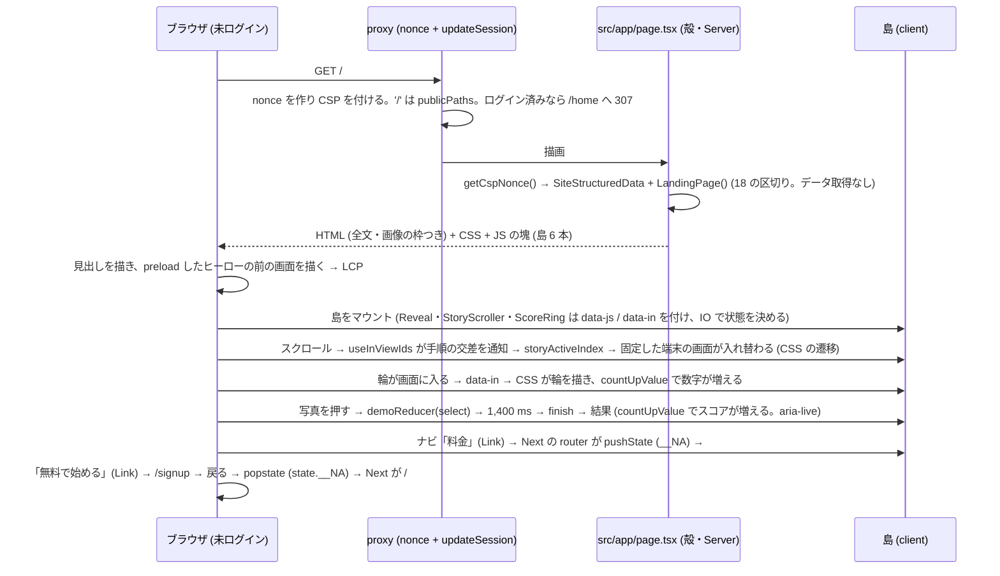

# marketing/01 本サイトの紹介ページ (ランディングページ) の設計 — 10 倍の紹介ページ (v2.0)

| | |
|---|---|
| 版 | v2.0 (2026-10-18。Issue #1867 の 2026-10-18 13 時台のコメントを受けて、v1.7 (8 区切り・主張 17 件・控えめな動き) を「量と見せ方の両方で 10 倍」に作り直す改訂。v1.7 の主張の表・テスト・門の資産は引き継いで広げる) |
| Status | v2.0 は設計ゲートの審査中。v1.7 (8 区切り) は段 0〜2 まで実装済みで本番に出ている (PR #1889・`2863cb79`)。本書の事実の基準は origin/main `f0dff7a9` (§2.2 の冒頭)。v2.0 の実装は、設計ゲートの通過後に 1 本の B 型 WF (§17 の段 0〜3) で行う |
| Issue | #1867 (サービスの本サイト (homegohan.com) を作り直す) の本文とコメント (2026-10-18 の 5 件) |
| 範囲の正本 | Issue #1867 の本文とコメント。本書はその上で決めた範囲 (紹介ページ 1 本 = `/`) と設計。Issue と食い違ったら本書が正 |
| 成果物 | 本書と、静的な試作 `docs/design/marketing/prototype/index.html` (§23。見た目の参考で、正典ではない) |
| 実装者 | Sonnet 5.5 が本書だけを読んで手を止めずに実装できることを完成条件にする |
| 改定履歴 | v1.0〜v1.7 (2026-10-18。設計ゲート wf_d9caf74c-12e・wf_fc234aa6-092 を通過。8 区切り・主張 17 件) → **v2.0 (2026-10-18)**: 区切りを 8 → 18 に、公開の主張を 17 → 46 件に広げ (§4.1)、スクロールに連動した物語 (固定した端末の画面の入れ替え・数値の増え方・図の描かれ方) と微細な動きを、受入の条件つきで置く (§6)。実際の画面を 6 → 17 枚にし、6 枚を新しく撮り (今の画面と文が食い違うガイドの画像 2 枚 `signup.png`・`badge-get.png` も撮り直す。画面写真は「写っているべきもの・写ってはいけないもの」の受入の条件だけを正典にし、撮影の台本の中身は実装が決める)、章 photo と章 menu では画面の一部を拡大して見せる (§5.4・§7)。横にスクロールする帯は 6 つで、どの幅でも同じ属性 (`role="region"`・`aria-label`・`tabIndex={0}`) を持つ (§5.4)。戻るの不具合の原因と、ページの中のリンクの作り (`Link` と、移った先の区切りへのフォーカス) を決める (§2.2・§8.3)。速さの予算を決め直す (§10) |

オーナーの指示 (2026-10-18) 逐語:「WEBサイトはめっちゃリッチでモダンで最高に手間をかけら素晴らしいページに仕立て上げて欲しい。世界最高のページを目標に手を抜かずにお願いします。」
オーナーの指示 (2026-10-18 11 時台) 逐語:「もう一旦デプロイしていいんだけども。」
オーナーの指示 (2026-10-18 13 時台) 逐語:「https://homegohan-app.vercel.app/signupからhttps://homegohan-app.vercel.app/#howなどへブラウザバックでもどっても画面遷移しない。あとこのメインのページの内容がしょぼすぎる。10倍目指してよ」

次の選択は変わらない (オーナーの選択 2026-10-18)。
- 今の Next.js のアプリに同居させ、homegohan.com 1 本でパスで分ける (/ が紹介と公開のページ、/login 以降がアプリ)。
- 更新は Claude が開発の流れで行う (月に数回まで)。

v1.7 から v2.0 で変える方針 (Issue #1867 の 2026-10-18 13 時台のコメントの「対応 2」のとおり): v1.7 が設計ゲートの構造の裁定 (R5 の時点) で入れた「書き切れない動きは外す・質は文言・写真・余白で出す・動きの数ではない」のうち、**『控えめ』『動きの数ではない』は v2.0 では採らない**。動きは、スクロールに連動した物語・固定した端末の中身の入れ替え・数値の増え方・図の描かれ方・微細な反応まで置く。ただし v1.7 の規律のうち次は v2.0 でも変えない: **各動きに受入の条件 (どの幅で・動きを減らす設定でどうなるか・測り方) を書く** (§6.2)。動きを減らす設定・キーボード・JS なしでも内容は全部届く (§13.1)。主張は製品の根拠 (file:line) と条件のある公開の主張の表の行だけ (§4.1)。実績の数字・利用者の声・受賞を作らない。回数を約束する語を書かない。見本の数値はアプリの計算式で出る値だけ。WCAG 2.2 AA・CSP の nonce・全ページ動的・SEO (#1874) の前提も変えない。

前提 (本書が従う条件): ローンチ前で利用者ゼロ。利用者数・利用者の声・受賞・メディア掲載などの実績を作らない。本番・コードは設計の段では変えない。

本冊は、`/` の紹介ページ (いまは v1.7 のとおり、Server Component の殻 `src/app/page.tsx` + 本体 `src/components/marketing/LandingPage.tsx` + 島 4 つ (`SiteHeader`・`DemoSection`・`FaqSection`・`Reveal`)) を、**Server Component の骨格 + 役目を 1 つずつ持つ client の島 (6 つ) + CSS 主体の動き** という構造のまま、18 の区切りに広げる (§3)。

本書の正典の持ち方 (§9 の冒頭に詳しく):

- **逐語の正典**にするのは、見た目と振る舞いの決まりまで: デザインのトークン (§5)、部品の一覧と責務と受入の条件 (§8)、文言と公開の主張の表 (§4。`landing-copy.ts` のデータと型: §9.1)、デモと物語と数値の状態機械の遷移表 (§13.3)。
- **CSS・部品のコード・テストのコードは逐語の正典にしない**。実装は受入の条件を満たすように書く。検査の項目 (E-n・U-n) は、正典の部品の名前・トークンの名前・文言・セクションの `id`・ランドマークと役割 (role) だけを参照し、実装のクラス名や DOM の形を前提にしない。試作 (`prototype/index.html`) は見た目の参考で、正典ではない。
- **主張の正本は 1 つの表** (§4.1 の公開の主張の表)。ページの見出し・本文・見本 (デモ・場面の物語) の文と数値は、この表の行に当たるものだけを使う。見本の数値は、アプリの実際の計算式で、隣に出す値から再計算できるものだけにする。

---

## 0. 外形固定と分冊判定 (相 1)

### 0.1 発注と決めること

Issue #1867 の 2026-10-18 のコメント (5 件) が本冊の成果物と基準を決めている。2 件目 (設計から作り直す。成果物 2 つ。見た目と動きの質・速さ・WCAG 2.2 AA・検索・主張の正確さ) と 4 件目 (試作の確認を待たずに進めてよい) に、5 件目 (2026-10-18 13 時台) が重なる: (1) `/signup` からブラウザの戻るで `/#how` などへ戻っても画面が切り替わらない不具合を調べて直す (B 型の修正は PR #1893 (origin/main `f0dff7a9`) でマージ済み: ルートの layout の `HashHistoryEntryBridge` が、ハッシュの移動で積まれた履歴の項目に Next の印を付ける。§2.2。本冊は原因の記録 (§2.2) と、紹介ページ側の作り (ページの中のリンクはすべて `next/link` の `Link`: §8.3 の `SiteHeader`・`HeroSection`・`FeaturesSection`。移った先の区切りへのフォーカス: `useInPageLinkFocus`) と、ページの中の戻るとフォーカスの検査 (E-23・E-29) を書く。`/signup` などを経る戻るは、#1893 が門に入れた `tests/e2e/back-navigation.spec.ts` が v2.0 のナビでも確かめる: §19)。(2) 紹介ページの内容を 10 倍に: **量** (製品の実際の機能を、機能ごとに深く見せる・実際の画面を大きく使う・使う人の場面ごとの物語・仕組みの流れ・家族と組織・安全とプライバシー・料金・よくある質問の拡充) と **見せ方の豊かさ** (スクロールに連動した物語・微細な反応・グラデーションと奥行き・図解 (SVG)・タイポグラフィの緩急) の両方。置き場所 (今のアプリに同居・`/` が紹介・月数回の更新) は変えない。

本書で決めること (列挙):

1. 情報の設計: 18 の区切りの構成と、それぞれの目的・中身・行動の呼びかけ → §3.1・§4
2. 文言: 見出し・本文の全文と、公開の主張の表 (46 件。根拠と条件) → §4
3. 視覚の設計: 色 (v1.7 の色のトークン 18 に、青の 3 つ `--lp-blue`・`--lp-blue-ink`・`--lp-blue-tint` を足して 21)・タイポグラフィの緩急・余白・奥行き (影と層)・写真と画面の方針 (端末の枠・重なり・並べ替え・画面の一部の拡大 (ズーム))・図解・アイコン・ダークモード → §5
4. 動きの設計: 17 の動き (スクロールに連動した物語・固定した端末の入れ替え・数値の増え方・図の描かれ方・画面の一部の拡大・微細な反応) と、それぞれの受入の条件 (幅・動きを減らす設定・JS 無し・測り方) → §6
5. 画像の調達: 既存の 15 枚のうち使う 11 枚 (うち今の画面と合わない画像を撮り直す。少なくとも文が食い違う 2 枚) と、新しく撮る 6 枚 (各画面に写っているべきもの・写ってはいけないものの受入の条件) → §7
6. 部品の分け方 (`src/components/marketing/`) と各部品の受入の条件・速さの予算と測り方・アクセシビリティの基準・検索の設計 → §8・§10・§11・§12
7. テスト: 見た目の記録・Lighthouse の予算・アクセシビリティの自動検査・主張の見張り・物語と数値の状態機械・戻るの検査 → §16・§22
8. 段分けと分冊 → §0.4・§17
9. 正典の範囲 (逐語で持つもの・持たないもの) → §9

### 0.2 要件行列

| # | 要件 | 出どころ | 本書の節 |
|---|---|---|---|
| R-1 | 紹介ページは `/` に置き、今の Next.js のアプリに同居し、パスで分ける (`/` が紹介と公開のページ、`/login` 以降がアプリ) | オーナーの選択 (2026-10-18) の逐語「/ が紹介と公開のページ、/login 以降がアプリ」 | §3.1, §8, §21 |
| R-2 | 見た人が「これは本物だ」と感じる、リッチでモダンな紹介ページ。国内外の最高水準の LP と並べて見劣りしない密度と完成度 | オーナーの指示 (2026-10-18)・Issue #1867 コメント 2 件目・5 件目 | §2.6, §3, §5, §6, §23 |
| R-3 | 速さ: Core Web Vitals の「良い」(LCP ≤ 2.5 s・INP ≤ 200 ms・CLS ≤ 0.1 を p75 で) と Lighthouse Performance ≥ 90。量が増えるので、予算 (JS・画像・LCP) は測り方とともに決め直す | Issue #1867 コメント 2 件目・5 件目・`docs/design/CLAUDE.md` E・`docs/design/cross/06-perf-cache.md` §3.1 | §10 |
| R-4 | アクセシビリティ: WCAG 2.2 AA (コントラスト・キーボード・見出し・代替テキスト・動きの抑制・ターゲットの大きさ・拡大・フォーカスの非遮蔽) | Issue #1867 コメント 2 件目・5 件目・`docs/design/cross/05-i18n-a11y.md` | §11 |
| R-5 | 検索: ページの title / description / canonical・構造化データ・見出しの階層。段 1 (main に着地済み: `publicPageMetadata`・`SiteStructuredData`・sitemap・全ページの canonical) の部品をそのまま使い、二重にしない | Issue #1867 コメント 1 件目「進め方 1」・2 件目 | §12 |
| R-6 | 主張の正確さ: 利用者数・利用者の声・受賞・メディア掲載・未確定の価格を書かない。健康上の効果を断定しない (薬機法・景品表示法・健康増進法)。機能の主張はすべて実コードに根拠を持ち、条件 (AI の 1 日の利用回数の上限・写真の記録の入口の違い・同意・共有の設定・組織は運営が作り管理者だけが管理する) を落とさない | Issue #1867 コメント 2 件目・5 件目・`tests/public-claims-guard.test.ts` | §2.5, §4.1, §22 |
| R-7 | 本番の CSP (nonce 方式・外部 CDN のスクリプト不可・`font-src 'self'`) と、ルート layout の `force-dynamic` (全ページ動的) の下で動く | `src/lib/security/csp.ts`・`src/app/layout.tsx:11`・`docs/design/cross/18-csp-nonce.md` §5 | §2.4, §3.2, §10 |
| R-8 | 既存の見張り (公開の主張・インラインスクリプト・HTML の差し込み・画像の実在・ガイドの画像・e2e の門) を赤にせず、新しい主張の見張りを足す | `tests/` の各番兵 (§19) | §19, §22 |
| R-9 | 文言と色は、設計書と試作で同じ。写真と画面の置き場には何が入るかを書く。試作は 1 ファイルで Desktop から開ける (既存の画面は data URI で埋め込む) | Issue #1867 コメント 2 件目 (試作の目的)・5 件目 | §23 |
| R-10 | 更新は Claude が開発の流れで行う (月に数回まで) | オーナーの選択 (2026-10-18) | §8, §9.1 |
| R-11 | アプリの画面 (`/login` 以降) は作り直さない。アプリ側で本冊が触るのは、撮影のための台本と見本のデータ (`scripts/guide-screenshots/`) だけ | 本冊の決定 (範囲を紹介ページに閉じるため) | §1, §7, §17 段 0, §21 |
| R-12 | 文言・画像・順序の変更が、1 ファイル (`landing-copy.ts`) の定数の変更で済む | 本冊の決定 (R-10 の月に数回の更新を軽くする作り) | §8, §9.1 |
| R-13 | 主張の正本は 1 つの表 (公開の主張の表)。各行は主張の文・製品の根拠 (file:line)・条件を持つ。ページの文と見本の文・数値は表の行に当たるものだけ。見本の数値はアプリの計算式で隣の値から再計算できるものだけ。ページに出す実際の画面の写真に写る AI の結果 (記録コメント・栄養メモ・スコア) も、アプリが作れる文と値だけにする。AI の自由な応答 (相談の返事・献立の振り返りの文) は画面写真に写さない | v1.7 の設計ゲートの構造の裁定 (R5 の時点) を引き継ぐ | §4.1, §4.5, §7, §9.1, §16 |
| R-14 | 逐語の正典は見た目と振る舞いの決まり (トークン・部品と受入の条件・文言・遷移表) まで。CSS・部品のコード・テストのコードは逐語の正典にせず、検査は部品・トークン・文言・セクションの id・役割だけを参照する | v1.7 の設計ゲートの構造の裁定 (R5 の時点) を引き継ぐ | §3.2, §6, §8.3, §9, §16 |
| R-15 | **量**: 製品の実際の機能を機能ごとに深く見せる。少なくとも: 写真で記録 (2 つの入口)・AI の献立 (週の献立・条件・買い物リスト)・栄養の見える化 (スコア・グラフ・週次)・健康の記録・勲章と続ける仕組み・家族で使う (家族の献立・共有)・組織で使う・食材の管理・AI に相談 (シート)・使い方ガイド・安全とプライバシー (データの扱い・同意・書き出しと退会)・料金 (今は無料・AI の 1 日の上限)・よくある質問 (拡充)。使う人の場面 (一人暮らし・子育て家庭・健康管理・チーム) ごとの物語。仕組み (写真 → 解析 → 記録 → 献立 の流れ) | Issue #1867 コメント 5 件目「対応 2」 | §3.1, §4 |
| R-16 | **実際のアプリの画面を大きく使う**: `public/guide` の 15 枚 (v1.7 の段 0 で撮り直し済み) のうち 11 枚 (#1890・#1892 の前の文を写す `signup.png`・`badge-get.png` と、段 0 の撮ったままとの比べで今の画面と合わないと分かった画像は、v2.0 の段 0 で撮り直す: §7.1 の P-6・G-1〜G-6) と、必要な追加の撮影 (`scripts/guide-screenshots` の台本・アプリが作れる値だけ) 6 枚を、端末の枠・重なり・ズーム・並べ替えで見せる。本書での当て方: 端末の枠 = `PhoneFrame` (§5.4)・重なり = ヒーローの 5 枚の扇 (§5.4。章の画面は札が隠れないよう重ねない)・ズーム = 章 photo と章 menu の画面の一部の拡大 `ScreenZoom` (§5.4 の「拡大」・§6.2 の M-17)・並べ替え = 章ごとの左右の入れ替えと、768 px 未満の横にスクロールする帯 (§5.4) | 同上 | §5.4, §6.2 (M-17), §7, §8.3 |
| R-17 | **見せ方の豊かさ**: スクロールに連動した物語 (区切りの切り替え・固定して中身が入れ替わる・数値が増える・図が描かれる)・微細な反応・グラデーションと奥行き・図解 (SVG)・タイポグラフィの緩急。各動きに受入の条件 (どの幅で・動きを減らす設定でどうなるか・測り方) を書く | 同上 | §5.3, §5.7, §6 |
| R-18 | 動きを減らす設定・キーボード・JS なしでも内容は全部届く (動きの無いときの最後の見え方がそのまま内容。FAQ の答えはブラウザの `details` で JS 無しでも開く) | 同上・WCAG 2.3.3 | §6.1, §8.3 (`FaqSection`), §13.1, §13.3 |
| R-19 | 戻るの不具合: `/signup` からブラウザの戻るで `/#how` などへ戻ると画面が切り替わらなかった。原因を記す (§2.2)。不具合そのものは B 型の修正 (Issue #1867 コメント 5 件目の「対応 1」。PR #1893 でマージ済み) が直した: ルートの layout の `HashHistoryEntryBridge` が、ハッシュの移動 (素の `<a href="#…">`・スキップリンク・アドレスバー) で積まれた `state = null` の項目に Next の印を付け、印の無い古い項目へ戻ったときは読み込み直す。紹介ページのページの中のリンクは `next/link` の `Link` で描き (Next が積む印つきの項目になり、bridge はその項目に何もしない)、移った先の区切りへフォーカスも移す。ページの中の戻る (E-23) とフォーカス (E-29) は本冊が持ち、`/signup` などを経る戻るは #1893 の門の spec `tests/e2e/back-navigation.spec.ts` が v2.0 のナビ 5 つで確かめる | オーナーの指示 (2026-10-18 13 時台) 逐語の前半 | §2.2, §8.3, §16.3 (E-23・E-29), §19, §24 Q-14 |
| R-20 | 設計ゲートを通ったら、試作の確認を待たずに実装 → 本番へ進む (見た目の直しは本番に出た後に受け付ける) | オーナーの指示 (2026-10-18 11 時台) 逐語「もう一旦デプロイしていいんだけども。」・Issue #1867 コメント 4 件目 | §17 |

### 0.3 ユーザーシナリオ (30 本。トレースは §3.3。テストとの対応は §16.5)

R-15 が「少なくとも」に挙げる機能は、どれも 1 本以上のシナリオが通る: 写真で記録 (S-1・S-6・S-25)・AI の献立と買い物リスト (S-25・S-30)・栄養の見える化 (S-17)・健康の記録 (S-26)・バッジと続ける仕組み (S-27)・家族で使う (S-21)・組織で使う (S-22)・食材の管理 (S-30)・AI に相談 (S-28)・使い方ガイド (S-3・S-24)・安全とプライバシー (データの扱いと同意: S-23・書き出しと退会と請求: S-29)・料金 (S-15・S-22・S-30)・よくある質問 (S-15・S-21・S-22・S-23・S-29)・場面 (S-18・S-21・S-22・S-26)・仕組み (S-16)。

| # | 誰が | 何を | 期待する結果 |
|---|---|---|---|
| S-1 | 未ログインの人 (PC・Chrome) | 検索結果から `/` を開き、下まで読んで「無料で始める」を押す | ヒーローの見出しは HTML に入っていて JS を待たずに出る (LCP はヒーローの前の端末の画面か見出しで、予算 2.5 s 以内。社内の狙いは 2.0 s: §10.1)。18 の区切りがスクロールに合わせて現れ (画面の大きさや拡大の倍率によらず、下まで読むと隠れたままの要素が無い)、仕組みの区切りでは固定した端末の画面が手順に合わせて入れ替わり、デモを試せ、`/signup` に着く |
| S-2 | 未ログインの人 (スマートフォン・Safari) | `/` を開き、片手でスクロールする | 横スクロールが出ない。上に固定されたヘッダーの「無料で始める」が、どこまでスクロールしても画面の中にある。ピンチで拡大できる。本文は 16 px 以上で、注記・ナビ・ボタン・写真の名前などの小さい文字も 14 px を下回らない (§5.2)。仕組みの区切りは手順ごとに画面が縦に並ぶ (固定の入れ替えは無い)。場面の区切りは横にスナップするカード (ページは横スクロールしない) |
| S-3 | キーボードだけで操作する人 | Tab で順に移動し、Enter / Space で操作する | スキップリンク → ヘッダー → ヒーローの CTA → デモの写真 → 機能の一覧のカード (ページの中のリンク) → 章の画面の帯と CTA → 場面のカードの帯 → 安心のリンク → ガイドの画面の帯 → FAQ の順に、見えるフォーカスで移動できる。横にスクロールする帯 (§5.4 の 6 つ) は、どの幅でも 1 回の Tab で帯の箱に入り、768 px 未満では矢印キーで中を送れる。デモの写真を Enter / Space で押すと、分析中も結果が出た後も、フォーカスと見えるリングは押したボタンに残る。FAQ は Enter で開閉。固定ヘッダーがフォーカスした要素を隠さない。ナビ・「デモを試す」・機能のカードを Enter で押すと、移った先の区切りにフォーカスが移り、次の Tab はその区切りの中の最初のフォーカスできる要素へ進む |
| S-4 | スクリーンリーダーの利用者 | ランドマークと見出しで移動する | `header` / `nav` / `main` / `footer` と、h1 が 1 つ・h2 が区切りごとにある。画像に意味のある代替テキスト。仕組みの固定した端末では、いま見えている画面だけが読み上げの対象 (ほかは `aria-hidden`)。デモの結果は `aria-live="polite"` で読み上げる。数値の増え方は読み上げに出ない (最後の値だけ) |
| S-5 | 動きを減らす設定 (`prefers-reduced-motion: reduce`) の人 | `/` を開く | フェード・スライド・立ち上がり・進捗の演出・数値の増え方・図の描かれ方・端末の入れ替えの溶け込みが無く、最終の状態がすぐ出る (仕組みの端末の画面は手順に合わせて一瞬で切り替わる)。内容は同じ |
| S-6 | 未ログインの人 | デモで写真を選ぶ → 待つ → 結果を読む → 別の写真を選ぶ | 選択 → 「分析中」(1.4 秒) → 結果 (スコアが 0 から増えて止まる・スコアの注記・記録コメント・推定の栄養 5 つ) → 別の写真で同じ流れ。「サンプル」の注記は写真を選ぶカードに、選ぶ前から常に出ている。待っている間の再選択は無視する。スコアは、隣に出す栄養の値から、アプリと同じ式で再計算できる (§4.5) |
| S-7 | ログイン済みの人 | `/` を開く | 既存どおり proxy が `/home` (運営ロールは `/admin`、初期設定が済んでいなければ初期設定) へ送る。紹介ページは描かれない |
| S-8 | モバイル App の WebView (`is_native_app` Cookie あり・未ログイン) | サインアウト後などに `/` に着く | 紹介ページがそのまま出る (App のストアへの導線は無い: §4.21)。「無料で始める」は `/signup` へ行く |
| S-9 | 検索エンジンと SNS のクローラー | `/` を取得する | 動的に描いた HTML に h1・description・canonical・OGP・JSON-LD (Organization・WebSite) がある。JS 無しでも 18 の区切りの全文が読める |
| S-10 | 遅い回線 (3G 相当) の人 | `/` を開く | 見出しと本文が先に出る (フォントは `swap`)。画像は遅延で読み、置き場の大きさは先に確保されている (CLS 無し)。ヒーローの前の 1 枚だけ先に読む。外部 CDN への要求は無い |
| S-11 | ブラウザで 200 % に拡大して読む人 (1280×720 の画面) | 下まで読み、デモと FAQ を使う | 横スクロールが出ない。文字は 2 倍に見え、区切りやカードが画面の高さより高くなっても隠れたままにならない。固定ヘッダーが、フォーカスした要素やアンカーの先を隠さない。仕組みの区切りは 1 列 (CSS の幅 640 px は 1024 px 未満) で固定の入れ替えは無い |
| S-12 | 本番の CSP の下のブラウザ | `/` を開き、デモと FAQ と仕組みを操作する | `securitypolicyviolation` が 0 件。アプリが書くインラインのスクリプトは JSON-LD (`SiteStructuredData`) の 1 本 (nonce つき) だけ |
| S-13 | 文言を直す開発者 | `landing-copy.ts` に「10万人が利用」や「写真を撮るたびに」と書く | `tests/public-claims-guard.test.ts` がソース走査と描画の両方で「10万人」を赤にし、`tests/landing-page-1867.test.ts` の U-20 が「たびに」を赤にする。`evidence` に無いパスを書いても赤 (U-2) |
| S-14 | 整合ゲートの検証者 | 本番ビルドで Lighthouse と e2e を流す | Performance ≥ 90・LCP / CLS が予算内・JS の転送量が予算内・CSP 違反 0・axe の違反 0 (§10・§16) |
| S-15 | 未ログインの人 (無料の範囲を確かめたい) | 料金の区切りと安心の区切りと FAQ の「本当に無料で使えますか？」を読む | 「いまは無料」と同じ段落に、AI を使う機能には 1 日に使える回数の上限があること・有料プランは準備中であることが書いてある。回数を約束する言い方 (「たびに」「毎回」「無制限」など) はページのどこにも無い |
| S-16 | 未ログインの人 (PC) | 仕組みの区切りを読み進める | 右に固定された端末の画面が、左の手順 (撮る → AI が見る → 褒められる → 献立へ) が画面の中央の帯に入るごとに入れ替わる (溶け込みの切り替え)。手順を飛ばして一気にスクロールしても、最後に中央の帯にある手順の画面になる。区切りの下の流れの図 (写真 → 解析 → 記録 → 献立 → 買い物リスト) は画面に入ったときに線が描かれる |
| S-17 | 未ログインの人 (PC) | 栄養の見える化の区切りを読む | スコアの輪が画面に入ると、輪が 0 から 89 まで描かれ、数字が 0 から 89 まで増えて止まる (89 はヒーローの前の画面 `comment.png` に写るスコアと同じ値で、アプリの式で再計算できる: §4.9)。隣に、ホームの今日の栄養スコアと今週の自炊率の説明がある |
| S-18 | 未ログインの人 (スマートフォン) | 場面の区切りで 4 枚のカードを横に送る | カードは 1 枚ずつスナップして止まる。ページ全体は横にスクロールしない。4 枚は 768 px 以上では並べて置かれ、送る操作は無い (帯の箱は、どの幅でも Tab で入れる箱のまま: §5.4) |
| S-19 | 未ログインの人 | ヘッダーのナビ (仕組み・機能・家族と組織・料金・よくある質問) を押し、戻るを押す | 押すと該当の区切りの上端が固定ヘッダーの下に来る (隠れない)。フォーカスもその区切りへ移る (見えるリングは出ない: §5.3)。ヘッダーのナビは、いま画面にある区切りを強調する。ブラウザの戻るで直前の位置 (ヒーロー) に戻る |
| S-20 | 未ログインの人 | `/#how` から「無料で始める」で `/signup` に移り、ブラウザの戻るを押す | `/#how` に戻り、紹介ページが描かれ、仕組みの区切りが画面にある (URL だけ変わって `/signup` の画面が残らない) |
| S-21 | 家族で使うか迷っている人 | 家族の区切りと FAQ「家族の記録は誰に見えますか？」を読む | 代表者・大人・子ども (アカウントの無い子どもも登録できる) の 3 つの立場、メールでの招待、共有の範囲 (食事の記録・健康・献立) を自分で選べること、献立表で家族の献立を見られること (相手が共有をオンにしている場合) が書いてある |
| S-22 | 職場で使うか調べている人 | 組織の区切りと料金の区切りと FAQ「会社やチームで使えますか？」を読む | 組織は運営が作るもので、登録しただけでは組織を作れず使えないこと (お問い合わせへの導線がある)・料金の「いま使える機能」(無料) の一覧に組織が入っていないこと・組織の管理者がメンバーを招待し、部署を作り、チャレンジを開けることと、一人ひとりの記録は管理者に見せず、個人の記録の集計 (活力スコアなど) は出していないこと、チャレンジの平均は終わった後に参加者が最小の人数以上のときだけ出ることが書いてある |
| S-23 | AI の扱いを確かめたい人 | 安心の区切り・料金の区切り・FAQ「どんな機能に AI を使っていますか？」を読む | AI を使う機能の一覧・日本国外の事業者へのデータ提供の同意・1 日の上限・上限に数えない自動の機能があること・運営の判断で AI 相談を一時停止することがあること・分析は推定で医療目的に使わないことが書いてある |
| S-24 | 撮影の台本を流す実装者 (段 0) | `scripts/guide-screenshots/run.sh` で 15 枚 + 新しい 6 枚を撮る | 新しい 6 枚 (`home`・`pantry`・`shopping`・`family`・`chat`・`consent`) が `public/marketing/screens/` に、撮り直した `signup.png`・`badge-get.png` (と、§7.1 の G-3 で置き換える画像) が `public/guide/` に、540×1080・300 KB 以下で置かれる。新しい 6 枚と置き換えた画像は §7.1 の表の「写っているべきもの」を写し、「写ってはいけないもの」(AI の自由な文・体重の記録・古い文言・実在の人の名前) を写さない。`signup.png` に `30秒` は無く、`badge-get.png` のお知らせの説明は今の `badges.description` の文。ほかの 13 枚の撮ったままが今の画像と違えば、違いの原因ごとの行き先 (§7.1 の G-1〜G-6) に従う。置き換えない画像は変わらず、`tests/guide-images-1852.test.ts` が緑のまま |
| S-25 | 未ログインの人 (PC と スマートフォン) | 章「写真で記録」と章「AI 献立と買い物」を読む | 端末の画面の下に、その画面の一部 (章 photo: スコアと記録コメント・章 menu: 朝食の 1 食) を大きくした箱 (拡大) がある。標準の設定では、箱が画面に入ると縮んだ透明の形から元の大きさへ大きくなりながら現れる (M-17)。動きを減らす設定・JS 無しでは最初から元の大きさで見える。箱の中は同じ実際の画面の画像で、札 (何の部分か) と代替テキストがある。320 px でも横にはみ出さない |
| S-26 | 健康の記録を続けたい人 (PC と スマートフォン) | 章「健康の記録」と、場面のカード「健康の記録を続けたい人」を読む | 章 health に要点 5 つ (記録できる項目 = 体組成・バイタル・生活習慣・体調やメンタル / 体重計の写真から / 健康診断・血液検査 / 推移のグラフ = 体重・体脂肪率・血圧・睡眠と、目標体重までの差 / 目標の管理) と、要点の下に免責 (AI の読み取りと分析は推定・医療目的での使用は控える) がある。実際の画面は `weight.png` の 1 枚 (帯にしない)。体重の減りが写る `trend.png`・`weight-photo.png` は出ない。数値の改善や健康上の効果を言う文は無い (§2.5)。場面のカードは、写真からの取り込み・推移のグラフ・目標までの差を言う |
| S-27 | 続けられるか気になる人 (PC と スマートフォン) | 章「バッジと続ける仕組み」を読む | バッジ 4 つ (`はじめの一歩`・`三日坊主卒業`・`週間チャンピオン`・`使い方マスター`) の名前と、付く条件を言う説明 (食事を「完了」にした回数・続けた日数・アプリの中の使い方の案内の完走) がある。ランク 5 段 (食の初心者 → 健康ルーキー → バランスの達人 → 栄養マスター → 食のレジェンド) と次のランクまでの数が出ることが書いてある。名前が付与の条件と食い違うバッジ (`カメラマン`・`計画上手`) と、ほかの利用者との比較に基づくバッジは出ない。実際の画面 2 枚 (`badge-get.png` = 新しいバッジのお知らせ。説明は今の `badges.description` の文・`badge-collection.png`) は帯の箱に入る。標準ではバッジ 4 つが順に立ち上がり (M-10)、動きを減らす設定・JS 無しでは最初から見える |
| S-28 | AI に相談したい人 (PC・キーボード) | 機能の一覧のカード「AI に相談」を Enter で押し、章「AI に相談」を読む | 章 chat へ移り、フォーカスも章 chat の区切りに移る (次の Tab は章 chat の「無料で始める」)。章 chat に、アプリの画面の右下の「AIアドバイザー」のボタンから相談のシートが開くこと・相談の中で頼むと AI が献立の作成・買い物リストへの追加・食材や目標の変更などをその場で行うこと・相談を終了すると要約を保存すること・AI 相談は 1 日の利用回数の上限に数え、運営の判断で一時停止することがあることが書いてある。実際の画面 `chat.png` (1 枚) には、シートの見出し・はじめのあいさつ・提案のボタンが写り、AI の返事は写っていない (R-13) |
| S-29 | 退会やデータの扱いを確かめたい人 | 安心の区切りの「退会・書き出し・請求」と、FAQ「データは安全ですか？」「退会やデータの削除はできますか？」を読む | 設定からいつでも退会できること・記録したデータを JSON 形式で書き出せること (FAQ では「退会の前に」)・開示・訂正・利用停止の請求を設定から送れることが書いてある。設定の中の画面や項目の名前は書かず「設定から」とだけ言う (`delete-export` の条件)。データの保存と第三者への提供は「プライバシーポリシーをご確認ください」とだけ言い、断定しない (`privacy`)。安心の区切りの「プライバシーポリシーを読む」で `/privacy` へ行ける。FAQ の 2 つは JS が無くても開いて読める |
| S-30 | 食材を無駄にしたくない人 (PC・キーボード) | 機能の一覧のカード「食材の管理」を Enter で押し、章「AI 献立と買い物」の要点「食材の管理」と、料金の「いま使える機能」を読む | 章 menu へ移り、フォーカスも章 menu の区切りに移る。章 menu の要点「食材の管理」に、冷蔵庫を撮ると食材を読み取ること・手入力でも足せること・期限切れ・期限間近の食材に印が付くことが書いてある。章 menu の画面の帯に `pantry.png` (見出し `食材管理`・食材 3 件以上・`期限間近` の印) がある。冷蔵庫の写真の読み取りが AI を使う機能であること (同意と 1 日の上限の範囲) は FAQ「どんな機能に AI を使っていますか？」の答えにある。料金の「いま使える機能」(無料) の一覧に `食材の管理` がある |

### 0.4 分冊判定 (相 1 で実施)

| 目安 | 本冊 | 判定 |
|---|---|---|
| 設計書 800 行超 | 超える (文言の全文・公開の主張の表 46 件・表 3 点・受入の条件・トレースを 1 冊に持つため) | 該当 |
| 消費先レーン 3 以上 | ページ (`src/app/page.tsx` の殻)・部品 (`src/components/marketing/`)・公開の資産 (`public/marketing/`)・撮影の台本 (`scripts/guide-screenshots/`)・単体の番兵 (`tests/`)・e2e の門 (`scripts/local-ci.sh`・`.github/workflows/e2e-local.yml`) = 6 | 該当 |
| 共有面 2 つ以上 | `tests/public-claims-guard.test.ts` (公開ページ共通の見張り)・e2e の門の一覧・`public/guide/*.png` と撮影の台本 `scripts/guide-screenshots/` (使い方ガイドと同じ台本で撮る。新しい 6 枚は `public/marketing/screens/` に置く。ガイドの 15 枚のうち置き換えるのは、今の画面と合わない画像だけ (少なくとも、文が食い違う `signup.png`・`badge-get.png` の 2 枚): §7.1 の P-6・G-1〜G-6)・`src/lib/seo/public-pages.ts` (`SITE_DESCRIPTION`。v2.0 では変えない) | 該当 |

判定: **設計は 1 冊 (本書) のまま、実装は 1 本の B 型 WF の中で 4 段 (段 0: 新しい画面写真 6 枚の撮影と、今の画面と合わないガイドの画像 (少なくとも 2 枚) の撮り直し / 段 1: 文言・主張・トークン・CSS・primitives と骨格・区切り (前半: ヘッダー〜バッジ) と FAQ / 段 2: 区切り (後半: AI に相談〜最終 CTA。FAQ を除く) / 段 3: e2e と門) に分け、段ごとに 2 枚レビューを挟み、マージは最後に 1 回**。理由: 核 (文言と部品) と配線 (ページ) を分けても、どちらも `LandingPage.tsx` の差し替えまで利用者には届かず、核だけをマージすると使われない部品が main に乗る。v1.7 と同じく共有面はどれも小さな差分で、別の冊にすると参照する「マージ済みの核」が無い。段 0 (撮影) は offload の Docker の枠を使う一番重い手順なので最初に済ませ、できなければ早く止める (§7.1 の「段 0 で作るもの」の 5)。文言の差し替え (§9.1) と区切りの前半を同じ段 1 にするのは、差し替えで消える鍵 (`how`・`badges`・`LANDING_IMAGE_SIZES.step`) と形の変わる型 (`FeatureCardId`) を読む既存の区切りを同じ段で書き換えないと、段 1 の終わりで型検査が通らず、段 1 のレビューが差し替えの結果を読めないため (vitest の全件の緑は段ごとには求めず、PR の先端だけで求める: §17)。区切りを前半 (段 1) と後半 (段 2) に分けるのは、区切りが 18 本 (ファイル 20 本超) で 1 段のレビューが重くなるため (正典の「段が 3 つ以上、または 1 段が 10 ファイル超なら段内レビュー」)。後半の v1.7 の区切り `TrustSection` が読む鍵は §9.1 でも同じ名前と型で残るので、段 1 の終わりでも型検査を通る (`FaqSection` は段 1 で `details` の作りに書き換える: §17)。

### 0.5 用語

- **紹介ページ (LP)**: `/` で返す、未ログインの人向けのページ。公開ページ (`/about` `/faq` ほか) は別のページで、本冊の範囲外 (§1)。
- **区切り (セクション)**: `main` の中の `section` 1 つ。v2.0 は 18 (§3.1)。**章 (チャプター)**: 区切りのうち、1 つの機能を深く見せるもの (写真で記録・AI 献立・栄養の見える化・健康の記録・バッジ・AI に相談の 6 つ)。同じ部品 `ChapterSection` で描く。
- **島 (client の島)**: `'use client'` の部品。状態 (スクロール・選択・いま見えている手順・数値の増え方) を持つものだけを島にし、文章と画像は Server Component で描く。v2.0 は 6 つ (§3.1)。FAQ の開閉はブラウザの `details` が持つので島にしない。
- **主張 (claim)**: アプリの機能や条件について紹介ページが言うこと。§4.1 の公開の主張の表の 1 行 = `landing-copy.ts` の `claims` の 1 件 (id・文・根拠のパス (`evidence`)・条件 (`condition`))。46 件。
- **受入の条件**: 部品ごとに、振る舞い・アクセシビリティ・動きを減らす設定と JS 無しのときの見え方・見た目の決まり (幅ごとの配置と大きさ)・確かめる検査を書いたもの (§8.3)。実装はこれを満たせば、書き方 (クラス名・DOM の入れ子・CSS の書き方) は自由。
- **実際の画面**: `public/guide/*.png` (Issue #1852 で撮り、v1.7 の段 0 で食事の写真の解析の 2 枚を、v2.0 の段 0 で今の画面と合わない画像 (少なくとも `signup.png`・`badge-get.png`) を撮り直すアプリの画面写真 15 枚。540×1080) と、本冊の段 0 で新しく撮る `public/marketing/screens/*.png` (6 枚。540×1080)。画面そのものは本物のアプリだが、写っている利用者と記録は撮影用の見本 (`scripts/guide-screenshots/seed.ts`) で、AI の読み取りの結果は撮影の台本が返す見本の値 (`scripts/guide-screenshots/meal-analysis-mock.ts` の `GUIDE_MEAL_ANALYSIS`)。だから数値と文は実際の利用者の結果ではない。画面を出す区切りには画面の注記 (`SCREENS_CAPTION`) を置く。
- **物語 (ストーリー)**: 仕組みの区切り (`how`) の、スクロールで読み進める 4 つの手順と、固定した端末の画面の入れ替え (`StoryScroller`。§6.2 の M-6)。
- **サンプル**: デモの結果 (スコア・記録コメント・推定の栄養)。AI は呼ばず、`landing-copy.ts` に書いた推定の値と料理の名前から、アプリと同じ式 (`demoScore`) と同じ定型の文 (`demoPraiseComment`) で作る。画面に「サンプル」と明記する。
- **食事の記録の画面**: 写真から食事を記録する画面 `src/app/(main)/meals/new/page.tsx` (ホームの「食事を記録」・下のナビの「スキャン」(`src/app/(main)/MainLayout.tsx:31`) から開く。撮影の種類は 食事・冷蔵庫・健診結果・体重計 の 4 つ: `src/app/(main)/meals/new/page.tsx:53` の `PhotoMode`)。献立表の中の「写真から入力」(`src/app/(main)/menus/weekly/page.tsx` の `analyzePhotoWithAI`・モーダル `PhotoEditModal.tsx`) は別の入口で、この画面ではない (§4.1 の経路の表)。
- **記録コメント**: 食事の記録の画面で写真から記録したときに出る、記録をほめるひと言 (`src/app/(main)/meals/new/page.tsx:1506-1520`)。アプリの定型の文で、AI が認識した料理の名前と食事の区分だけが変わる (§4.1 の `praise`)。
- **AI の 1 日の利用回数の上限**: AI を使う機能 (写真の解析・献立の生成・買い物リストの作り直し・AI 相談など) の 1 日の回数の合計の上限 (#1149。既定は free = 10 回・運営画面で変えられる)。上限に達すると、その日は AI を使う操作が止まる (§4.1 の `ai-daily-limit`)。画面を開くと自動で動く機能 (`nutrition_advice_auto`・`meal_image_auto`) は上限に数えない。

---

## 1. 目的・スコープ

- `/` を、見た人が「これは本物だ」と感じ、製品の全体を一度に理解できる紹介ページに作り直す。本物感の源は、実績の数字ではなく、**実際の画面 17 枚と、機能ごとの正直で深い文言と、受入の条件を持つ豊かな動き**に置く (利用者ゼロで実績が無いことは、設計の前提)。
- 速さ・アクセシビリティ・検索・主張の正確さを、機械で確かめられる形 (予算の定数・番兵のテスト・公開の主張の表) で設計に焼き込む。
- 文言・画像・順序を 1 ファイル (`landing-copy.ts`) に集め、月に数回の更新を 1 ファイルの変更で済ませる。

対象外 (別の案件):

| 本冊 | 対象外 |
|---|---|
| `/` の紹介ページ (ヘッダー・フッターを含む) | `/about` `/faq` `/guide` `/pricing` `/news` `/company` `/legal` `/contact` の作り直し (ヘッダー・フッターを共通化する案は §24 Q-6) |
| 新しい画面写真 6 枚の撮影と、今の画面と合わないガイドの画像 (少なくとも `signup.png`・`badge-get.png` の 2 枚。§7.1 の P-6・G-3) の撮り直し (段 0。撮影の台本 `scripts/guide-screenshots/` に 6 枚を撮る test と見本を足す: §7.1) | `/guide` の文言の見直し (§24 Q-11)・今の画面と合っているガイドの画像の撮り直し (段 0 の撮ったままが今の画像と同じ画面: §7.1 の G-1) |
| 戻るの不具合の原因の記録と、紹介ページ側のページの中のリンクの作り (§2.2・§8.3) と、ページの中の戻るとフォーカスの検査 (E-23・E-29) | 不具合そのものの修正 (B 型。Issue #1867 コメント 5 件目の「対応 1」。PR #1893 でマージ済み。`/signup` などを経る戻るの e2e `tests/e2e/back-navigation.spec.ts` も #1893 が門に入れた。§24 Q-14) |
| `/` のメタ情報と JSON-LD は段 1 (#1874) の部品をそのまま使う (v2.0 は `SITE_DESCRIPTION` も変えない) | 段 1 の部品の作り直し・sitemap・全ページの canonical (着地済み)・vercel.app の重複 (Issue #1867 の段 1 の残り) |
| 画像の置き場と調達の手順 (§7) | 新しいイラストの制作 (作らない。図解は SVG を部品が描く: §5.7) |
| 動きの設計と実装 (CSS・IntersectionObserver・小さな JS・デモだけ framer-motion) | 3D (Three.js など) の導入・大きな演出ライブラリ (GSAP・Lottie) の導入 (§3.2 で退ける) |
| アクセシビリティの自動検査 (`/` の `@axe-core/playwright` の検査 (E-20。v1.7 の段 2 で devDependency に足した)・構造の検査・コントラストの機械計算) | ほかの画面の axe の検査 |
| 計測 (Lighthouse の手順・Speed Insights) | Lighthouse CI のワークフロー |

---

## 2. 関連要件と現行の事実

### 2.1 関連 Issue・既存設計

| 文書 | 関係 |
|---|---|
| Issue #1867 (本文) | 置き場所とドメインの構成を決める発注。関わるもの (#1573・Supabase の Site URL・モバイルの `EXPO_PUBLIC_API_BASE_URL`・CORS・OGP #1845・既存の公開ページ) |
| Issue #1867 コメント 1 件目 (2026-10-18) | 置き場所の 4 つの選択 (同居・パスで分ける・Claude が更新・(上書きされた) 今のページを土台に)。進め方 (段 1: 検索の穴埋め → 文言の下書き → ドメインの切り替え) |
| Issue #1867 コメント 2 件目 (2026-10-18) | 設計から作り直す。成果物 2 つ。同時に満たす基準。置き場所は不変 |
| Issue #1867 コメント 3 件目 (2026-10-18) | v1.7 の設計ゲートの通過と、試作の置き場 (Desktop と `prototype/index.html`)。8 区切りの構成 |
| Issue #1867 コメント 4 件目 (2026-10-18 11 時台) | 試作の確認を待たずに進める。設計の PR → 実装 (段 0〜2) → 実装ゲート → 本番 → 整合ゲート |
| Issue #1867 コメント 5 件目 (2026-10-18 13 時台) | 戻るの不具合 (対応 1・B 型。PR #1893 でマージ済み) と、内容を 10 倍に (対応 2・本冊 v2.0)。『動きは控えめ・動きの数ではない』の裁定を上書き |
| PR #1889 (`2863cb79`) | v1.7 の段 0〜2 の実装 (本番に出ている紹介ページ)。本冊の「現行」(§2.2) |
| PR #1890・#1891・#1892 (origin/main `897182fc`・`79c705e9`・`5c58fa4e`) | アプリの中のバッジの説明を付与の条件に合わせた (#1890・§4.11・Q-13)。v1.7 の他の正典への追随 (#1891: `docs/design/CLAUDE.md` の `marketing/` の行・`docs/design/marketing/CLAUDE.md` の新設・billing/01・cross/03・cross/05・cross/06・番兵 `tests/landing-axe-states-doc-1867.test.ts`)。公開の画面の根拠の無い主張を直した (#1892・Q-11・Q-12・Q-18。`/faq`・`/guide`・`/signup`・`/pricing`・`/about`・`/news`・ログインの layout・`tests/public-claims-guard.test.ts`) |
| PR #1893 (origin/main `f0dff7a9`) | 戻るの不具合 (R-19) の B 型の修正。ルートの layout (`src/app/layout.tsx:4` の import・`:144`) に `HashHistoryEntryBridge` (`src/components/navigation/HashHistoryEntryBridge.tsx`) を 1 つ置き、判定は `src/lib/navigation/hash-history-entry.ts` (`decideOnHashChange`: 同じ画面の中のハッシュの移動で積まれた印の無い項目に、Next が差し替えた `history.replaceState` を通して印を付ける。`decideOnPopState`: 印の無い項目へ戻って画面と URL のルートが違えば、今の URL で読み込み直す)。e2e `tests/e2e/back-navigation.spec.ts` と番兵 `tests/e2e-back-navigation-suite.test.ts` を足し、spec を門 (`.github/workflows/e2e-local.yml`・`scripts/local-ci.sh` の `PW_ARGS`) に入れた (§19) |
| `docs/design/cross/18-csp-nonce.md` §5・§22 Q-7 | 全ページ動的 (`force-dynamic`)。LP の Lighthouse が 90 を下回っても静的化はせず、描画の軽量化で対処する (本冊 §3.2・§10) |
| `docs/design/cross/03-design-system.md` | トークン・タイポグラフィ・アイコンは lucide のみ (§16)・`prefers-reduced-motion` (§14.2)・ダークモードは Phase 2 (§7) |
| `docs/design/cross/05-i18n-a11y.md` | WCAG 2.1 AA の基準。本冊は 2.2 AA (2.5.8 ターゲットの大きさ・2.4.11 フォーカスの非遮蔽を足す) |
| `docs/design/cross/06-perf-cache.md` §3.1 | Lighthouse ≥ 90・LCP < 2.5 s・CLS < 0.1 (FID は INP に置き換わった: §10) |
| `docs/design/cross/08-legal-compliance.md` | 医療免責の方針 (本冊 §4.16・§4.20 の免責の文) |
| `docs/design/billing/01-billing-core.md` §18 項目 14 | 有料プランの文言 (`有料プランは準備中です（販売開始前）`) は販売開始の PR まで変えない |
| Issue #1149 / `src/lib/plan/entitlements.ts`・`supabase/functions/_shared/ai-daily-limit.ts`・`supabase/functions/_shared/ai-usage-core.ts` | AI の 1 日の利用回数の上限 (全 AI 機能の合計。既定 free = 10 回・運営画面 `/super-admin/llm/quotas` で変えられる)。紹介ページの AI の主張の条件 (§4.1 の `ai-daily-limit`) |
| Issue #1154 / `src/components/consent/AiDataConsentModal.tsx`・`src/lib/ai/consent-guard.ts`・`src/lib/ai/consent-config.ts` | AI 機能で使う日本国外の事業者へのデータ提供の同意。同意が無いと AI へ送らない (§4.1 の `ai-consent`)。同意画面の文 (`AI_CONSENT_COPY.intro`) が AI を使う機能を列挙する (食事の写真の解析・献立の作成・AI 相談・健康診断結果の読み取りなど) |
| Issue #1148 / `src/lib/ai/ai-chat-unavailable.ts`・`supabase/migrations/20261010120000_unify_feature_flags_seed.sql` | AI 相談の緊急停止 (`feature_flags.ai_chat_enabled`。既定 ON)。紹介ページは「運営の判断で一時停止することがある」と書く (§4.1 の `ai-stop`) |
| Issue #1852 / `src/app/guide/guide-content.ts`・`scripts/guide-screenshots/` | 実際の画面の画像 15 枚と、撮る手順 (`run.sh`)。本冊は同じ台本に 6 枚の撮影を足し、今の画面と合わない画像 (少なくとも 2 枚) を撮り直す (§7.1) |
| Issue #1584 の 1 / `docs/design/family/10-family-menu-view.md` | 週間献立の「家族の表示」(家族の共有の献立を見る)。紹介ページの `family-menu-view` の根拠 |
| `docs/design/membership/` | 家族・組織の招待・メンバー・共有の設定 (`share_meals` / `share_health` / `share_menu`) の正典。紹介ページの `family-roles`・`family-share`・`org-admin` の根拠 |
| `docs/design/org/07-challenge.md`・`10-challenge-diff-privacy.md` | 組織のチャレンジと、集計の差分から 1 人の値を逆算させない守り (#1688)。紹介ページの `org-challenge-privacy` の根拠 |
| Issue #1325 / #1120 (`src/app/(org)/org/dashboard/page.tsx:5-7` のコメント) | 組織の集計 (活力スコア・朝食摂取率・深夜食率・活動率) と部署別の表示は止めている。紹介ページは組織の集計を書かない |
| Issue #1314 / `src/lib/badges/awardable.ts` | 付与の処理があるバッジの一覧 (紹介ページに出すバッジはこの中から選ぶ: §4.11) |
| Issue #1845 / `src/lib/brand-image.tsx` | ブランドの色 `BRAND_COLORS`・OGP の画像 (layout が出す。本冊は変えない) |
| Issue #1867 段 1 (PR #1874・`be462ab4`) | 公開ページのメタ情報の正本 `src/lib/seo/public-pages.ts` (`publicPageMetadata`・`SITE_DESCRIPTION`・`PUBLIC_PAGE_PATHS`)・構造化データ `src/components/seo/SiteStructuredData.tsx`・`src/app/sitemap.ts`。本冊はこの部品を使い、本体だけを差し替える (§12) |

### 2.2 現行のトップ (v1.7 の実装。origin/main `f0dff7a9`・2026-10-18 に採取) と、戻るの不具合 (#1893 で直った)

本書の事実 (file:line・番兵の中身・他の文書の行) の基準は origin/main `f0dff7a9`。v1.7 の実装 (#1889・`2863cb79`) の後に main に入った 4 本 (#1890・#1891・#1892・#1893) は、紹介ページの本体 (`src/components/marketing/`)・殻 (`src/app/page.tsx`)・紹介ページの e2e と単体の番兵 (`tests/landing-page-1867.test.ts`・`tests/e2e/landing-page.spec.ts`)・撮影の台本 (`scripts/guide-screenshots/`) を変えていない。変えたのは、公開の画面 (`/faq`・`/guide`・`/signup`・`/pricing`・`/about`・`/news`・ログインの layout)・`src/lib/seo/public-pages.ts` (`/about` の description。`SITE_DESCRIPTION` は同じ)・`tests/public-claims-guard.test.ts`・バッジの説明の migration・他の設計書 (#1890〜#1892) と、ルートの layout (`src/app/layout.tsx`。`HashHistoryEntryBridge` の import と配置で行が 1 つずれ、`force-dynamic` は `:11`・`viewport` は `:104-113`・スキップリンクは `:124`)・`src/lib/navigation/`・`src/components/navigation/`・戻るの e2e と番兵・門の一覧 (#1893) で、本書が指すそれらの行は `f0dff7a9` の行に直してある (§2.1・§2.2・§2.4・§2.5・§4.1 の根拠・§19・§20)。

#1889 で v1.7 の段 0〜2 が着地し、トップは殻 `src/app/page.tsx` (Server・async。`metadata = publicPageMetadata('/')`・`viewport`・`getCspNonce()`・`SiteStructuredData`・`LandingPage`) と本体 `src/components/marketing/LandingPage.tsx` (Server・34 行。`.lp` の根に `SiteHeader` → `main` (区切り 8 つ) → `SiteFooter`) に分かれている。`src/app/LandingPageView.tsx` は無い (`tests/landing-page-1867.test.ts` の U-13 が見張る)。

| 事実 | 場所 | 本冊での扱い |
|---|---|---|
| 区切りは 8 つ (`hero` `how` `demo` `features` `badges` `trust` `faq` `cta`)。島は 4 つ (`SiteHeader`・`DemoSection`・`FaqSection`・`Reveal`)。framer-motion は `DemoSection.tsx` だけが読む | `LandingPage.tsx`・`sections/`・`primitives/` | 区切りを 18 に広げ、島は 6 つにする (§3.1。`StoryScroller`・`ScoreRing`・`ReadingProgress` を足し、`FaqSection` は開閉をブラウザの `details` に任せる Server の部品にして島から外す: §8.3)。`DemoSection` の framer-motion の使い方は変えない |
| 文言と主張は `landing-copy.ts` (533 行・主張 17 件 `CLAIM_IDS`)。`LandingCopySchema` (zod) で形を固定し、U-1 で 1 回だけ parse する | `src/components/marketing/landing-copy.ts` | 主張を 46 件に、文言の節を 18 に広げる (§9.1 を逐語で差し替える) |
| ヒーローは実際の画面 3 枚の扇 (前に `comment.png`・左右に `camera.png`・`analyze.png`。動かない)。使い方は静的な 3 列 | `HeroSection.tsx`・`HowItWorksSection.tsx` | ヒーローは 5 枚の扇に (640 px 以上。§5.4)。使い方は、固定した端末の画面がスクロールで入れ替わる物語 (`StoryScroller`。§6.2 M-6) に替える |
| 動きは 8 つ (M-1〜M-3・M-5・M-7〜M-10)。`marketing.css` (1,005 行) の動きの宣言はすべて `@media (prefers-reduced-motion: no-preference)` の中 (`:943` 以降)。`animation-timeline` は使わない (U-18) | `marketing.css`・`Reveal.tsx`・`useInViewOnce.ts` | 動きを 17 に (§6.2)。動きの宣言の置き場の規律 (no-preference の中だけ・`animation-timeline` 無し) は変えない |
| ヘッダーのナビ (`#features` `#how` `#badges` `#faq`) とヒーローの「デモを試す」(`#demo`) は、素の `<a href="#…">` で描いている (`next/link` を使っていない。`preventDefault` も router の処理も無い) | `SiteHeader.tsx:46-48`・`HeroSection.tsx` の `CtaLink` は `Link` だが、`DEMO_ANCHOR` は `#demo` | **戻るの不具合の原因だった** (下。#1893 の後は、素の `<a>` が積む項目にも bridge が印を付けるので、戻ると画面が切り替わる)。v2.0 はページの中のリンクをすべて `next/link` の `Link` で描く (§8.3。理由は下の「紹介ページ側の作り」) |
| 殻の `viewport` は `maximumScale: 5`・`userScalable: true` (`/` だけ)。E-18 が見張る | `src/app/page.tsx` | 変えない |
| `public/marketing/photos/` に写真 3 枚と `CREDITS.md` (Unsplash License の間に合わせ) | `public/marketing/photos/` | 変えない (Q-1 はそのまま) |
| `public/guide/` の 15 枚は v1.7 の段 0 で `comment.png`・`analyze.png` を撮り直し済み (`GUIDE_MEAL_ANALYSIS`。スコア 89) | `public/guide/`・`scripts/guide-screenshots/meal-analysis-mock.ts` | 15 枚のうち 11 枚を使う (§7.1)。#1890・#1892 の前の文を写す `signup.png` (`30秒で完了します。…`)・`badge-get.png` (バッジの説明 `…記録しました。…`) は段 0 で撮り直す。ほかの 13 枚は、段 0 で撮ったままが今の画像と同じ画面なら変えない (§7.1 の P-6・G-1〜G-6) |
| e2e `tests/e2e/landing-page.spec.ts` (E-1〜E-22) と門への登録 (`e2e-local.yml`・`PW_ARGS`) と番兵 `tests/e2e-landing-suite.test.ts` は着地済み。`@axe-core/playwright` は devDependency にある | `tests/`・`package.json` | 流用して広げる (§16)。依存は足さない |
| 速さの予算: JS gzip ≤ 240 KB (`LANDING_JS_BUDGET_BYTES` 既定 245760)。実測 227 KB (v1.7 §10.1) | `tests/e2e/landing-page.spec.ts` (E-11) | 予算を 256 KB に決め直す (§10.1) |

**戻るの不具合 (R-19) の原因** (#1893 の前): ブラウザの履歴の項目が「Next の router が作ったもの」でないとき、Next の App Router は `popstate` を扱わない。Next.js (canary・`packages/next/src/client/components/app-router.tsx` の `handlePopState`。2026-10-18 に GitHub の原文で確認) は、`popstate` の `event.state` が `null` なら何もせずに返り (コメント: pushState / replaceState が Next の外で呼ばれたときだけ起きる)、`state.__NA` が無ければ `window.location.reload()` する。v1.7 の紹介ページのヘッダーのナビは素の `<a href="#how">` なので、押すとブラウザが `state = null` の履歴の項目 (`/#how`) を作った。そこから `Link` で `/signup` へ移り (Next が `__NA` つきの項目を積む)、戻るを押すと `popstate` の `state` は `null` → Next は何もしない → URL は `/#how` に戻るが、画面は `/signup` のまま。これがオーナーの指示の前半 (`/signup` から `/#how` へ戻っても画面遷移しない) に一致した。

**#1893 の直し方 (B 型。マージ済み)**: `state = null` の項目を積むものは、紹介ページのリンクだけではなかった ((1) v1.7 の紹介ページのヘッダーのナビ (2) ルート layout のスキップリンク `<a href="#main-content">` (`src/app/layout.tsx:124`。`/` の上にもあり、S-3 の Tab の 1 つ目) (3) アドレスバーで打ち直したハッシュ (4) ほかの公開ページの素の `<a href="#…">`)。そこで #1893 は、ルートの layout に 1 つだけ置く `HashHistoryEntryBridge` (`src/app/layout.tsx:144`) で、(a) `hashchange` のあと、今の項目に印が無く、画面と URL のルート (パスと検索の部分) が同じなら、Next が差し替えた `history.replaceState` を通して印と今の画面の木を入れ (`decideOnHashChange`)、(b) `popstate` の `state` が `null` で画面と URL のルートが違えば、今の URL で読み込み直す (`decideOnPopState`)。印つきの項目 (Next が積んだ項目) には、(a) も (b) も何もしない。(1)〜(4) のどれのあとでも、戻ると画面が切り替わる。門の e2e `tests/e2e/back-navigation.spec.ts` が、紹介ページのヘッダーのハッシュ (`LANDING_COPY.header.nav` の `#` で始まるもの全部) → `/signup` → 戻る・戻ったあとの進む・ハッシュ 2 つのあとの戻る 2 回・ハッシュ → フッターのリンクで他の公開ページ → 戻る・ハッシュ無しの `/` の戻る (対照)・検索の部分の書き方の違い・文書の遷移・`/pricing` のスキップリンクを確かめる (§19)。**確かめ方** (手で): 本番か本番ビルドで `/` を開き、ヘッダーの「仕組み」(`#how`) を押してから「無料で始める」で `/signup` へ移り、戻るを押す。

**紹介ページ側の作り (本冊)**: ページの中のリンク (ヘッダーのナビ 5 つ・ヒーローの「デモを試す」・機能の一覧のカード 10 枚) をすべて `next/link` の `Link` (`href="#how"` のように `#` から始まる同じページの先) で描く。`Link` は Next の router を通して `__NA` つきの項目を積み、先の要素へスクロールする (`scroll-padding-top` が効く) ので、その項目へ戻ったときも Next が扱う。**#1893 の後は素の `<a href="#…">` でも戻ると画面は切り替わるが、v2.0 は `Link` のままにする**: `Link` が積むのは印つきの項目で、bridge は何もしない (`decideOnHashChange`・`decideOnPopState` とも `none`) ので、紹介ページの中の戻る・進むは Next がそのまま描き直し、bridge の判定 (画面と URL のルートの比較・印の無い項目の読み込み直し) に依らない (読み込み直しが起きないことを E-23 が確かめる)。素の `<a>` に戻す案 (フォーカスの起点はブラウザが移すので `useInPageLinkFocus` が要らない) は §24 Q-14 に置く。**`Link` に替えるとフォーカスが移らなくなるので、本冊が移す**: 素の `<a href="#…">` なら、ブラウザが「次の Tab で進む起点」を移った先へ移す。`Link` はクリックの既定の動作を止めて router で移り、next 16.4.1 の `layout-router` の `InnerScrollHandler` はハッシュの先に `scrollIntoView()` を呼ぶだけでフォーカスに触らない (原文のコメント「This handler intentionally leaves focus untouched」。2026-10-18 に unpkg の `next@16.4.1/dist/client/components/layout-router.js` で確認)。そのままでは、キーボードの人がナビの「料金」を Enter で押すと画面は `#pricing` へ動くが、次の Tab はヘッダーの次のナビへ行く。そこで (a) `main` の中の 18 の `section` に `tabIndex={-1}` を付け (Tab の順には入らない)、(b) `SiteHeader` が使う hook `useInPageLinkFocus` (§8.2・§8.3) が、`.lp` の中のページの中のリンクのクリック (Enter を含む) を `document` で受けて、先の `section` に `focus({ preventScroll: true })` する (スクロールは Next に任せる)。次の Tab は、その区切りの中の最初のフォーカスできる要素へ進む (E-29)。区切りのフォーカスの見た目は §5.3。

### 2.3 ブランドと画像の資産

| 資産 | 場所 | 使い方 |
|---|---|---|
| `BRAND_COLORS` (accent `#E07A5F`・accentGradientEnd `#FF9B7A`・background `#FAF9F7`・backgroundGradientEnd `#FDF0ED`・text `#2D2D2D`・textLight `#6B6B6B`・white・sparkle `#FFD700`・green = `STATUS_COLOR_TOKENS.success` = `#6B9B6B`・blue `#5B8BC7`) | `src/lib/brand-image.tsx:27-38`・`packages/shared/src/design-tokens.ts:25` | 紹介ページのトークンの元 (§5.1)。`brand-image.tsx` は `next/og` を読むので client から import しない。値はテスト (U-7) で突き合わせる。v2.0 は `blue` から章の色 (`--lp-blue`) を足す |
| ロゴ (湯気の立つお椀と星) | `public/icon.svg` ほか | ヘッダー・フッターのマークは `public/icon.svg` を `next/image` で出す (§4.2) |
| 実際の画面 15 枚 (540×1080 の PNG・1 枚 300 KB 以下。実測 28〜105 KB) | `public/guide/{signup,profile,ready,camera,analyze,comment,menu-request,menu-setting,menu-result,weight,weight-photo,trend,badge-get,badge-collection,badge-rare}.png` | 11 枚を使う (§7.1。`badge-rare.png`・`ready.png`・`trend.png`・`weight-photo.png` の 4 枚は使わない: ほかの利用者との比較に基づくバッジ・到達の予想の日付・体重の減りが写るため)。`signup.png`・`badge-get.png` は段 0 で撮り直す (今の画面と文が食い違う: §7.1)。ほかにも今の画面と合わない画像があれば撮り直す (§7.1 の G-3)。代替テキストは `guide-content.ts` の `imageAlt` と同じ文にする |
| 新しい画面 6 枚 (段 0 で撮る。540×1080 の PNG・300 KB 以下) | `public/marketing/screens/{home,pantry,shopping,family,chat,consent}.png` | 章と家族と安心の区切りで使う (§7.1)。代替テキストは `landing-screens.ts` の `alt` (§9.2) |
| サンプルの食事の写真 3 枚 (800×800 の WebP・120 KB 以下) | `public/marketing/photos/{salad-bowl,salmon-plate,pesto-pasta}.webp`・`CREDITS.md` | デモ (§4.5)。v1.7 のまま |
| OGP の画像・アイコンの PNG | `src/app/opengraph-image.tsx`・`src/app/icon-192.png/route.ts` ほか | 変えない |
| サイトの名前と一言 | `src/lib/site-config.ts` (`SITE_NAME` `SITE_TAGLINE`) | ヘッダー・フッター・JSON-LD の名前は `SITE_NAME` を使う (直接書かない) |

### 2.4 技術の制約

| 制約 | 事実 (場所) | 本冊の対応 |
|---|---|---|
| 全ページ動的 | `src/app/layout.tsx:11` の `export const dynamic = 'force-dynamic'`。`docs/design/cross/18-csp-nonce.md` §5.1。Next 公式の CSP のガイドも「nonce を使うページは動的に描画しなければならない」「PPR は nonce 方式の CSP と両立しない」と書く | 紹介ページも動的のまま (§3.2)。速さはサーバーの描画を軽く保つことで出す: データ取得ゼロ・`headers()` は JSON-LD の nonce の 1 回だけ・島は小さく (§10) |
| CSP | `src/lib/security/csp.ts` の `buildContentSecurityPolicy`: `script-src 'self' 'nonce-…' 'report-sample' *.vercel-scripts.com https://challenges.cloudflare.com` (外部 CDN のスクリプト不可)・`style-src 'self' 'unsafe-inline'` (inline style 可)・`img-src 'self' data: blob: *.supabase.co images.unsplash.com`・`font-src 'self'`・`connect-src 'self' *.supabase.co *.vercel.app wss://*.supabase.co https://holidays-jp.github.io`。nonce は `src/proxy.ts` が毎リクエスト作る | ライブラリは bundle に同梱 (framer-motion は依存にある)。フォントは `next/font` の自前配信のまま。画像は `public/` に置く。SVG の図解は部品が JSX で描く (外部ファイルを読まない)。CSP は変えない |
| proxy の matcher | `src/proxy.ts` の `config.matcher` が画像の拡張子 (`svg png jpg jpeg gif webp`) を除く | `public/marketing/**/*.{png,webp}` と `public/guide/*.png` は matcher の外 (未ログインでも読める)。`tests/metadata-public-paths-1845.test.ts` と U-4 が実在と matcher の外を確かめる |
| 未ログインの振り分け | `lib/supabase/middleware.ts` の `publicPaths` に `'/'` がある。ログイン済みは `lib/onboarding-routing.ts` の `resolveOnboardingRedirect` が `/` を `/home` (運営ロールは `/admin`・初期設定が未完なら `/onboarding/welcome` か `/onboarding/resume`) へ送る | 紹介ページはログイン済みの状態を考えない (S-7)。ヘッダーの右は常に「ログイン」と「無料で始める」 |
| フォント | `src/app/layout.tsx` の `next/font/google` の Noto Sans JP (400 / 500 / 700・`--font-sans`) と Noto Serif JP (400 / 700・`--font-serif`) | 新しいフォントは足さない。見出しは Noto Serif JP・本文は Noto Sans JP。緩急は大きさ・太さ・字間・行間で出す (§5.2) |
| 依存 | `package.json`: next 16.4.1・react ^19.2.8・framer-motion ^12.23.24・lucide-react・tailwindcss ^4・@vercel/speed-insights・@playwright/test ^1.64.0・@axe-core/playwright ^4.13.0 (devDependency。v1.7 の段 2 で足した)。gsap・lottie・three・lighthouse は無い | 製品の依存も devDependency も足さない (§3.2)。framer-motion は `LazyMotion` + `m` でデモの島だけが読む |
| `reduced-motion` | `src/app/globals.css:82-92` が全要素の `animation-duration` / `transition-duration` を 0.01 ms にする (遅れと `fill-mode: both` の CSS のアニメーションは残る)。framer-motion は既定で `reducedMotion: 'never'`。`src/components/handson-tour/useReducedMotion.ts` が JS 側の判定 | globals.css に頼らない。`marketing.css` の動きの宣言 (`animation*`・`transition*`) と、動きのための初期の見え方は、すべて `@media (prefers-reduced-motion: no-preference)` の中でだけ書く (§6.1。U-20 が宣言の場所を確かめる)。JS の動き (数値の増え方・デモの待ち・端末の入れ替えの溶け込み) は `useReducedMotion()` で止める (§6.4) |
| スクロール連動の動き (CSS) | CSS の `animation-timeline: scroll()` / `view()` は Chrome / Edge 115 以降と Safari 26 で動き、Firefox はフラグの後ろ (Chrome Developers「Animate elements on scroll with Scroll-driven animations」と 2026 年の二次資料。Baseline ではない: 2026-10-18 の WebSearch) | 使わない (U-18 で不在を固定)。スクロールに連動する動き (物語の入れ替え・現れ方・ナビの強調・読む位置の棒) は、すべて IntersectionObserver と `scroll` (`passive` + rAF) の小さな JS で作る (全ブラウザで同じ振る舞い。§6.3)。動きそのものは CSS の `transition` / `animation` (no-preference の中だけ) |
| モバイルの WebView | `apps/mobile/src/lib/webViewBridge.ts` の既定の行き先は `/home?mode=app`。`?mode=app` で `is_native_app` Cookie (`src/proxy.ts:58-67`) | 紹介ページは Cookie を読まない (S-8)。ストアへの導線は無い (§4.21) |
| 拡大 (viewport) | `src/app/layout.tsx:104-113` の `viewport` が `maximumScale: 1`・`userScalable: false`。殻 `src/app/page.tsx` が `/` だけ `maximumScale: 5`・`userScalable: true` で上書き (v1.7) | 変えない (E-18) |
| 計測 | Vercel Speed Insights (`src/components/SpeedInsightsClient.tsx`) が全ページで Web Vitals を送る | 実測は Speed Insights (field) と、整合ゲートの Lighthouse (lab) (§10.3) |
| ガイドの画像の番兵 | `tests/guide-images-1852.test.ts` は `public/guide/` に `guideImagePaths()` の 15 枚だけがあること (使わない画像が残っていない) を確かめる | 新しい 6 枚は `public/guide/` に置かず、`public/marketing/screens/` に置く (§7.1)。撮り直した画像 (`signup.png`・`badge-get.png` と §7.1 の G-3 に当たる画像) も名前・大きさ・重さの上限は同じなので、番兵は緑のまま。撮影の台本の最後の確認 (`shoot.pw.ts` の「撮った画像がガイドの画像の一覧と一致する」) は、ガイドの 15 枚と新しい 6 枚の和集合に広げる (§7.1 の「段 0 で作るもの」の 2) |

### 2.5 公開の主張の制約

**見張りのテスト** `tests/public-claims-guard.test.ts` (#1155): `PUBLIC_PAGES` (トップの本体 `src/components/marketing/LandingPage.tsx` ほか) のソースと描画の両方を `FORBIDDEN` (ダミーの事業者情報・架空の資金調達・`10万人`・`10,000+`・`ユーザーが実践中`・`App Store評価`・`1,234,567`・`98.7`・`継続率`・`食の分析実績`・`最長連続記録`・`90%以上の精度`・`Forbes` ほかのメディア名・`メディア掲載`・`リアルな声`・`変化のストーリー`・`血圧-15mmHg`・`-4.2kg`・`自炊率0%→70%`・`野菜摂取量2倍`・`体調スコア+30%`・`¥980` ほかの価格・`永久無料`・`第三者に共有されることはありません` ほかの断定) で検査する。#1892 で `FORBIDDEN` に、写真の記録のコメントを AI の文と言う語 (`良いところを見つけて褒めてくれます`・`AIコメント（褒める）` ほか)・製品に無い機能 (`週間レポート`・`レアバッジ`・`目標達成でバッジ`)・測っていない時間と認識の良し悪し (`30秒で`・`数秒で`・`認識精度がアップ` ほか)・根拠の無い効果と最上級 (`パフォーマンスを最大化`・`最適な` ほか) が足された。`PUBLIC_SOURCE_FILES` に `landing-copy.ts`・`src/lib/seo/public-pages.ts`・`src/app/(auth)/layout.tsx` と、#1892 で足した `src/app/(auth)/login/page.tsx`・`src/app/(auth)/signup/page.tsx`・`src/app/guide/page.tsx`・`src/app/guide/guide-content.ts`・`src/app/contact/page.tsx` がある。v2.0 の §9.1 の文言 (主張の `condition` を含む) と §9.2 の alt は、これらの語を含まない (2026-10-18 に origin/main `f0dff7a9` の `FORBIDDEN` の全語 (#1893 は `FORBIDDEN` を変えていない) で §9.1・§9.2 の逐語を引いて 0 件)。FAQ の `q: "データは安全ですか？"` の行に `プライバシーポリシー` があること、`/\d+%以上の精度/` が無いことも見る。`PAID_PLAN_PENDING_NOTICE = '有料プランは準備中です（販売開始前）'`。v2.0 は `landing-copy.ts` の新しい節 (`landing-screens.ts` の alt を含む) もこの見張りの対象にする (§9.7)。

**AI の 1 日の利用回数の上限** (#1149): AI を使う API は、AI へ送る直前に `consumeAiUsage` で 1 回数え、上限に達していれば数えずに 429 `AI_DAILY_LIMIT` を返す (写真の解析 `src/app/api/ai/analyze-meal-photo/route.ts:82-85`・献立の生成 `src/app/api/ai/menu/weekly/request/route.ts:172`・冷蔵庫 `src/app/api/ai/analyze-fridge/route.ts:80`・体重計 `src/app/api/ai/analyze-weight-scale/route.ts:41`・健康診断 `src/app/api/ai/analyze-health-checkup/route.ts:57`・買い物リストの作成と作り直し `src/app/api/shopping-list/regenerate/route.ts:71` (作成も作り直しも、献立表の画面がこの 1 つの API を呼ぶ: `src/app/(main)/menus/weekly/page.tsx:3398`。品の追加・削除の `src/app/api/shopping-list/route.ts` とレシピの材料の追加の `src/app/api/shopping-list/add-recipe/route.ts` は AI を使わず、数えない))。上限は全機能の合計で、既定は `supabase/migrations/20261011020000_ai_daily_limits.sql:78-82` の `free` = 10 回 (運営画面から変えられる: `src/lib/plan/entitlements.ts:7`)。上限に数えない機能は、画面を開くと自動で動くもの (`supabase/functions/_shared/ai-usage-core.ts:96` の `AI_UNMETERED_FEATURES` = `nutrition_advice_auto`・`meal_image_auto`) だけ。ホームの今日の栄養スコアは `nutrition_advice_auto` で数える (`src/app/api/ai/nutrition-analysis/route.ts:222-226`) ので上限に入らない。上限に達した利用者には `今日の AI の利用回数の上限 (10 回) に達しました。明日 0 時から使えます。` が出る (`supabase/functions/_shared/ai-daily-limit.ts:43-44`)。だから紹介ページは、AI を使う機能について回数を約束しない (「たびに」「毎回」「何度でも」「無制限」を書かない: §4.0)。「すべて無料」と書く段落には上限も書く (§4.1 の `free-now`)。

**AI 機能の同意** (#1154): 同意していない利用者が AI 機能を使おうとすると、日本国外の事業者へのデータ提供の同意の画面が出て、同意しないと AI へ送らない (`src/components/consent/AiDataConsentModal.tsx`・題と機能の列挙は `src/lib/ai/consent-config.ts:120-122` の `AI_CONSENT_COPY`・サーバーは `src/lib/ai/consent-guard.ts` で 403 `AI_CONSENT_REQUIRED`)。紹介ページは安心の区切りでこれを書き、同意の画面そのものを実際の画面 (`consent.png`) で見せる (§4.1 の `ai-consent`・§7.1)。

**AI 相談の緊急停止** (#1148): `feature_flags.ai_chat_enabled` (既定 ON) を運営が OFF にすると、AI 相談は 503 `AI_CHAT_DISABLED` のやさしい文面を返す (`src/lib/ai/ai-chat-unavailable.ts`)。紹介ページは「運営の判断で AI 相談を一時停止することがあります」と書く (§4.1 の `ai-stop`)。

**家族の共有の条件**: 家族のメンバーは、自分の 食事の記録 (`share_meals`)・健康 (`share_health`)・献立 (`share_menu`) を家族に見せるかを自分で選ぶ (`src/schemas/membership/share-settings.ts`・`src/app/api/family/members/me/share/route.ts:47-63`。既定は `share_meals` = true・`share_health` = false)。献立表の家族の表示は、相手が `share_menu` をオンにしている献立だけを読み取り専用で出す (`docs/design/family/10-family-menu-view.md` §0.3)。だから紹介ページは「家族の献立を見られる」を「相手が共有をオンにしている場合」の条件つきで書く (§4.1 の `family-menu-view`)。

**組織は運営が作り、使うのは組織の管理者とメンバー**: 組織を作る口は運営の `POST /api/admin/organizations` だけ (`src/app/api/admin/organizations/route.ts:1-4`。権限の判定は `:114` の `requireRole(['admin', 'super_admin'])`。作るときに `owner_id` を渡し、省けば作った運営がオーナー: `:27-33`・`:154`) で、利用者の API (`src/app/api/org/`) に組織を作る route は無い。組織のプラン (`standard`・`premium`・`enterprise`。同 `:29`) の課金は、個人の課金の冊の対象外 (`docs/design/billing/01-billing-core.md` §1 の対象外: 組織 (`org_*`) の課金は別の冊)。だから登録しただけの利用者は組織を作れず、組織の画面も使えない。`/org/*` は組織の `org_role` が owner / admin の人だけが開ける (`src/app/(org)/org/page.tsx:7-10` のコメントと `(org)/layout.tsx`)。組織の集計 (活力スコア・朝食摂取率・深夜食率・活動率) と部署別の表示は止めている (`src/app/(org)/org/dashboard/page.tsx:5-7`・#1325 / #1120)。チャレンジの平均は、終了したときに 1 回だけ確定した値を、終了時点の参加者が最小の人数以上のときだけ出す (`src/app/(org)/org/challenges/page.tsx:19-20`・#1688)。だから紹介ページは組織について「組織は運営が作る (お問い合わせへ案内する)」と「組織の管理者がメンバーを招待し、部署を作り、チャレンジを開ける」までを書き、組織を無料で使える機能の一覧に入れず、個人の記録の集計やランキングを書かない (§4.1 の `org-admin`・`org-challenge-privacy`・`free-now`)。

**ほかの利用者との比較に基づく表示**: 「みんなと比較」(`src/app/(main)/comparison/page.tsx:75`・「上位 N%」`:316`)・競争モードの通知・セグメント 1 位のバッジ (`breakfast_champion` ほか) は、ほかの利用者の記録の集計に基づく。算出の母数・最小人数の条件を本冊では確かめていない (リサーチの unknowns) ので、紹介ページには書かない (§24 Q-15)。`badge-collection.png` にその種のバッジ (朝食チャンピオン) が、`badge-get.png` のお知らせの後ろのトロフィールームにその種の札 (`上位5%` ほか) が写るが、どちらもアプリの本物の一覧で、紹介ページの文は 4 つのバッジ (§4.11) だけを言う。

**法令** (消費者庁・東京都の公式ページと、二次資料から引いた。段 0〜2 (#1889) はこの当てはめで実装済み。条文の原文と突き合わせた記録は無い):

| 法令 | 条文 | 紹介ページへの当てはめ |
|---|---|---|
| 景品表示法 第 5 条第 1 号 (優良誤認) | 「実際のものよりも著しく優良であると示す」表示の禁止。第 7 条第 2 項 (措置命令) は、根拠の資料の提出を求められて出せなければ、その表示を第 5 条第 1 号に該当する表示と「みなす」(消費者庁「事例でわかる 景品表示法 ガイドブック」・「優良誤認表示とは」の頁) | 機能の主張はすべて §4.1 の公開の主張の表の行に当たり、根拠 (file:line) と条件を持つ。条件 (1 日の利用回数の上限・写真の記録の入口の違い・同意・共有の設定・組織は運営が作り管理者だけが管理する) を落とした言い方をしない。写真を撮るだけで記録が終わる・残るとは書かない (解析の結果を保存するのは利用者の操作: §4.0)。写真の記録の「記録コメント」は定型の文 (`buildTemplatePraiseAndTip`) なので、写真の記録について「AI が食事を見て良いところを見つける」とは書かない。場面の物語 (§4.13) は機能の組み合わせを言うだけで、成果 (体重・数値の変化) を言わない。「〜で痩せる」「最高の」「完全」「最新の AI」のような、根拠を出せない形容を書かない。認識の精度・速さを数字で約束しない |
| 健康増進法 第 65 条第 1 項 (虚偽誇大表示の禁止) | 食品として販売に供する物の健康保持増進効果等について「著しく事実に相違する」「著しく人を誤認させる」表示の禁止 (消費者庁「健康食品に関する景品表示法及び健康増進法上の留意事項について」) | アプリは食品ではないが、見本のコメントや説明で食品の効能を書かない。アプリの「栄養メモ」の文 (食品の働きに触れる) はデモに出さない。体重が減っていく推移のグラフの画面 (`trend.png`・`weight-photo.png`) は使わない (§7.1)。健康の記録の章は「記録できる項目」と「グラフで見られる」だけを言い、数値の改善を言わない |
| 薬機法 第 66 条第 1 項 (誇大広告等) | 「何人も、医薬品 … の名称、製造方法、効能、効果又は性能に関して、明示的であると暗示的であるとを問わず、虚偽又は誇大な記事を広告し、記述し、又は流布してはならない」(東京都保健医療局の抜粋)。第 68 条は承認前の医薬品等の広告の禁止 | アプリが病気を治す・防ぐ・診断すると読める表現を書かない。健康診断・血液検査は「結果を記録し、グラフに重ねて見られる」とだけ言う。「医療目的での使用はお控えください」の免責を安心・FAQ・最終 CTA に置く (`docs/design/cross/08-legal-compliance.md`) |
| ステルスマーケティング (景品表示法の指定告示・2023-10-01) | 事業者の表示であることを隠した第三者の声の表示を不当表示とする | 利用者の声・口コミ・評価は一切載せない (利用者ゼロ)。場面の物語 (§4.13) は「こんな使い方」として事業者の文で書き、人物の名前・年齢・写真・引用の形 (かぎ括弧の発言) を使わない |

法令の当てはめは二次情報の要約に依る部分がある (リサーチの unknowns)。最終の判断は弁護士の確認を要する (§24 Q-16)。

### 2.6 世界水準の紹介ページの作り (事実と採用)

| 事実 (出どころ) | 採用 |
|---|---|
| Linear のトップは 8 区切り (ヒーロー → 「新しい種類のプロダクト」→ 機能の章 4 つ (取り込み・計画・AI・開発) → 顧客 → 最後の呼びかけ)。製品の画面写真を章ごとに大きく置き、図に番号 (Fig 0.1〜) を付ける。動画・イラストは無い (2026-10-18 に linear.app を取得して確認) | 章ごとに実際の画面を大きく置く (6 つの章)。画面の注記と番号の代わりに、画面の名前の札 (何の画面か) を付ける (§5.4) |
| Notion のトップは 7 区切り (ヒーロー → 顧客のロゴ → 3 つの機能の塊 → 使い方の例 → 顧客の声 → 実績の帯 → 引用)。ヒーローは重ねた写真と動画の再生の印、機能は画面写真、使い方の例はアイコン (2026-10-18 に notion.com を取得して確認) | 「使い方の例」= 場面の区切り (§4.13)。顧客のロゴ・声・実績の帯は、利用者ゼロなので置かない (R-6) |
| Stripe のトップは 13 区切り (ヒーロー → 製品の面 → サポート → 料金 → はじめ方 (番号つきの 3 手順) → 基盤の数字 → 企業 → 専門サービス → スタートアップ → SaaS → 開発者 → ニュース → 最後の呼びかけ)。製品の UI のモック・写真・図表 (2026-10-18 に stripe.com を取得して確認) | 区切りの密度 (18) と、料金・はじめ方 (使い方ガイド) を本文の中に持つ構成。数字の帯は置かない |
| 2026 年の傾向は「実際の UI のプレビューを早く・証拠を伴って・流し読みできる区切りで」「スクロールに連動した製品の見せ方 (Attio のダッシュボードの動き)」(saasframe.io・flowjam の二次資料。リサーチ) | ヒーローの 5 枚の画面・仕組みの固定した端末の入れ替え (M-6)・数値と図の描かれ方 (M-11・M-12)。すべてに受入の条件 (§6.2) |
| 見た目が派手でも、分かりやすさ・証拠・次の一歩が無いページは成果が出ない (saashero.net・vezadigital.com。v1.7 のリサーチ) | 証拠 = 実際の画面と、根拠と条件のある主張 (§4.1)。次の一歩 = 各章の終わりに同じ CTA (「無料で始める」) |
| Core Web Vitals の「良い」は LCP 2.5 s・INP 200 ms・CLS 0.1 (p75。web.dev「Web Vitals」) | 予算は 2.5 / 200 / 0.1 (§10)。社内の目標として LCP 2.0 s を狙う |
| 3D (WebGL) や大きなアニメーションのライブラリは、JS の量とバッテリーを食い、WCAG の動きの抑制と相性が悪い | 入れない (§3.2)。動きは CSS と小さな JS で作る。量が増えた分は、すべて「現れたとき 1 回」「操作のとき」「スクロールの位置で決まる」のどれかにし、自動で動き続けるものを置かない (§6.1) |

参考にした外部のページの構造は、本冊の採用の根拠で、文言・配色・動きを写したものではない。国内の食事・健康アプリの LP の計測された実例は見つからなかった (リサーチ)。

---

## 3. 構想 (相 2) と構造裁定 (相 3)

### 3.1 構造

**情報の設計 (上から順に。各区切りの目的と行動の呼びかけ)**

| # | 区切り (`id`) | 部品 | 目的 | 中身 | 行動の呼びかけ |
|---|---|---|---|---|---|
| 1 | ヘッダー (`header`) | `SiteHeader` (島) | いつでも登録とログインへ行ける。いまどこを読んでいるか分かる | マーク + 「ほめゴハン」・ナビ 5 つ (仕組み・機能・家族と組織・料金・よくある質問。いま画面にある区切りを強調)・ログイン・無料で始める・読む位置の棒 (M-4) | 無料で始める → `/signup` |
| 2 | ヒーロー (`hero`) | `HeroSection` | 3 秒で「写真を撮ると褒められ、献立まで続く」が分かる | 見出し・一文・CTA 2 つ・安心の 3 点・実際の画面 5 枚の扇 (前に褒められる画面。640 px 未満は 3 枚)・画面の注記 | 無料で始める → `/signup`・デモを試す → `#demo` |
| 3 | 仕組み (`how`) | `StorySection` + `StoryScroller` (島) + `FlowDiagram` | 写真 → 解析 → 記録 → 献立 の流れを、スクロールで読み進める | 4 つの手順 (撮る・AI が見る・褒められる・献立へ) と、1024 px 以上では右に固定した端末の画面が手順に合わせて入れ替わる (M-6)。下に流れの図 (写真 → 解析 → 記録 → 献立 → 買い物リスト。M-12)。画面の注記 | (なし) |
| 4 | デモ (`demo`) | `DemoSection` (島) | 「褒められる」を自分の手で体験する | サンプルの写真 3 枚から選ぶ → 分析中 → 結果 (スコアが増えて止まる (M-7)・スコアの注記・記録コメント・推定の栄養 5 つ)。「サンプル」の注記 | 自分の食事で試す → `/signup` |
| 5 | 機能の一覧 (`features`) | `FeaturesSection` | できることの全体を一目で見せ、各章へ送る | 10 枚のカード (ページの中のリンク。`Link` で各章へ)。画像のあるカードは端末の枠の画面がカードの下から覗く | 各章へ (`#photo` ほか) |
| 6 | 章: 写真で記録 (`photo`) | `ChapterSection` | 2 つの入口と、解析の結果 (5 つの値・記録コメント・栄養メモ) を深く見せる | 見出し・一文・要点 4 つ・実際の画面 3 枚 (`camera`・`analyze`・`comment`)・拡大 1 つ (`comment` のスコアと記録コメント。`ScreenZoom`・M-17) | 無料で始める |
| 7 | 章: AI 献立と買い物 (`menu`) | `ChapterSection` | 週の献立・条件・献立の修正・買い物リスト・食材の管理を 1 つの流れで見せる | 要点 5 つ・実際の画面 4 枚 (`menu-request`・`menu-setting`・`menu-result`・`shopping`) + 食材の画面 1 枚 (`pantry`)・拡大 1 つ (`menu-result` の朝食の 1 食。`ScreenZoom`・M-17) | 無料で始める |
| 8 | 章: 栄養の見える化 (`nutrition`) | `ChapterSection` + `ScoreRing` (島) | 数字で振り返れることを見せる | 要点 3 つ (今日の栄養スコア・今週の自炊率と統計・献立の振り返り)・スコアの輪 (M-11。89)・実際の画面 2 枚 (`home`・`comment`) | 無料で始める |
| 9 | 章: 健康の記録 (`health`) | `ChapterSection` | 体重・体重計の写真・健診・血液検査・グラフ・目標を見せる | 要点 5 つ・免責・実際の画面 1 枚 (`weight`) | 無料で始める |
| 10 | 章: バッジと続ける仕組み (`badges`) | `ChapterSection` + バッジの列 | 続ける仕掛けを見せる | 要点 2 つ (バッジ・ランク)・バッジ 4 つ (M-10)・実際の画面 2 枚 (`badge-get`・`badge-collection`) | 無料で始める |
| 11 | 章: AI に相談 (`chat`) | `ChapterSection` | 画面の右下のシートから相談でき、頼んだ操作 (献立の作成など) を AI がその場で行うことを見せる | 要点 4 つ・実際の画面 1 枚 (`chat`) | 無料で始める |
| 12 | 場面 (`scenes`) | `ScenesSection` | 自分の暮らしに当てはめる | 4 枚のカード (一人暮らし・子育て家庭・健康の記録を続けたい人・職場とチーム)。768 px 未満は横にスナップ (M-13) | (なし) |
| 13 | 家族で使う (`family`) | `FamilySection` | 家族の立場・招待・共有の範囲・家族の献立を見せる | 見出し・一文・要点 4 つ・実際の画面 1 枚 (`family`)・共有の範囲の図 (SVG) | 無料で始める |
| 14 | 組織で使う (`org`) | `OrgSection` | 職場で使えることを、正直な条件つきで見せる | 見出し・一文・要点 4 つ・組織の形の図 (SVG。管理者 → 部署 → メンバー)。実際の画面は無い (管理者の画面は図で示す) | お問い合わせ → `/contact` |
| 15 | 安全とプライバシー (`trust`) | `TrustSection` | 正直さで信頼を作る (実績の代わり) | 6 点 (無料と AI の 1 日の上限・データと同意・写真の保存・AI の限界・ログイン中の端末・退会と書き出しと請求)・実際の画面 1 枚 (`consent`) | プライバシーポリシーを読む → `/privacy` |
| 16 | 料金 (`pricing`) | `PricingSection` | 無料の範囲と上限をはっきり言う | 見出し・一文 (すべて無料 + 上限)・2 枚のカード (いまの無料・有料プランは準備中)・AI の上限の説明 3 点 | 無料で始める |
| 17 | 使い方ガイド (`guide`) | `GuideSection` | はじめ方が分かることを見せ、ガイドへ送る | 5 つの章の名前と手順の数・アプリの中の使い方の案内 (ハンズオンツアー)・実際の画面 2 枚 (`signup`・`profile`) | 使い方ガイドを読む → `/guide` |
| 18 | よくある質問 (`faq`) | `FaqSection` | 迷いを解く | 12 件の開閉 (`details` と `summary`。JS が無くても開いて答えを読める) + お問い合わせへのリンク | お問い合わせフォームへ → `/contact` |
| 19 | 最終 CTA (`cta`) | `FinalCtaSection` | 読み終えた人の背中を押す | 見出し・一文・CTA・安心の 3 点・医療の免責 | 無料で始める → `/signup` |
| 20 | フッター (`footer`) | `SiteFooter` | 法務と公開ページへの導線 | サービス・サポート・法的情報の 3 列と著作権 | (リンク) |

`main` の中の区切りは 18 (hero・how・demo・features・photo・menu・nutrition・health・badges・chat・scenes・family・org・trust・pricing・guide・faq・cta の順)。

**部品の構造 (Server Component の骨格 + client の島)**

```
src/app/page.tsx                         既存の殻 (変えない)。metadata・viewport・<SiteStructuredData nonce>・<LandingPage />
src/components/seo/SiteStructuredData.tsx 既存 (変えない)。JSON-LD の唯一の出し口
src/components/marketing/
  LandingPage.tsx                        Server Component。.lp の箱の中に SiteHeader → <main> (区切り 18 本) → SiteFooter
  landing-copy.ts                        文言・画像・公開の主張 (46 件)・デモの見本・定数 (文言の正本。§9.1)
  landing-screens.ts                     新しい画面写真 6 枚の名前と alt (撮影の台本と U-4 が読む。§9.2)
  demo-state.ts                          デモの状態機械 (v1.7 のまま。§9.3・§13.3)
  story-state.ts                         物語の「いま見えている手順」の純関数 storyActiveIndex (§9.4・§13.3)
  count-up.ts                            数値の増え方の純関数 countUpValue (§9.5)
  marketing.css                          .lp のトークン・タイポグラフィ・動き (§5・§6)
  sections/                              21 本
    SiteHeader.tsx                       島: スクロールで背景・読む位置の棒・いま画面にある区切りの強調 (M-1・M-4・M-14)・ページの中のリンクの先へのフォーカス (useInPageLinkFocus)
    HeroSection.tsx                      Server。実際の画面 5 枚の扇 (動かない。立ち上がりだけ)
    StorySection.tsx                     Server。仕組みの区切りの骨格 (手順 4 つ・流れの図・注記)。中に StoryScroller
    DemoSection.tsx                      島: デモの状態機械。framer-motion はここだけ。スコアの数値の増え方 (count-up.ts)
    FeaturesSection.tsx                  Server。10 枚のカード (Link で各章へ)
    ChapterSection.tsx                   Server。章の共通の骨格 (eyebrow・h2・lead・要点・画面・拡大・CTA)。6 つの章が使う
    PhotoChapter.tsx                     Server。章: 写真で記録 (ChapterSection に landing-copy の chapters.photo を渡す)
    MenuChapter.tsx                      Server。章: AI 献立と買い物
    NutritionChapter.tsx                 Server。章: 栄養の見える化 (中に ScoreRing)
    HealthChapter.tsx                    Server。章: 健康の記録
    BadgesChapter.tsx                    Server。章: バッジ (バッジ 4 つの列 M-10 を含む)
    ChatChapter.tsx                      Server。章: AI に相談
    ScenesSection.tsx                    Server。場面 4 枚 (768 px 未満は CSS のスナップ)
    FamilySection.tsx                    Server。家族 (共有の範囲の図を含む)
    OrgSection.tsx                       Server。組織 (組織の形の図を含む)
    TrustSection.tsx                     Server。安全とプライバシー 6 点
    PricingSection.tsx                   Server。料金
    GuideSection.tsx                     Server。使い方ガイド
    FaqSection.tsx                       Server。12 件の開閉 (details / summary。JS 無しでも開く)
    FinalCtaSection.tsx                  Server (v1.7 の部品に section の tabIndex={-1} を足すだけ)
    SiteFooter.tsx                       Server
  primitives/                            12 本
    Reveal.tsx                           島: 現れ方 (v1.7 のまま)
    ScreenZoom.tsx                       Server: 章の画面の一部の拡大 (ズーム。§5.4)。箱の立ち上がり (M-17) は CSS で、きっかけは包む Reveal
    StoryScroller.tsx                    島: 固定した端末の画面の入れ替え (M-6)。useInViewIds (useInViewSteps.ts) で手順の交差を見る
    ScoreRing.tsx                        島: スコアの輪の描かれ方と数値の増え方 (M-11)
    ReadingProgress.tsx                  島: 読む位置の棒 (M-4)。SiteHeader が置く
    FlowDiagram.tsx                      Server: 流れの図 (SVG)。線の描かれ方 (M-12) は CSS
    PhoneFrame.tsx                       Server: 端末の枠 (v1.7 のまま)
    CtaLink.tsx                          Server: Link にボタンの見た目 (v1.7 のまま)
    useInViewOnce.ts                     hook (v1.7 のまま。Reveal・ScoreRing が使う)
    useInViewSteps.ts                    hook: useInViewIds を export する。id で指す複数の要素の交差を 1 つの IntersectionObserver で見る (StoryScroller・SiteHeader が使う)
    useInPageLinkFocus.ts                hook: ページの中のリンクを押したら、先の区切り (tabindex="-1") へフォーカスを移す (SiteHeader が使う。§2.2)
    useReducedMotion.ts                  既存の再 export (v1.7 のまま)
public/marketing/photos/                 デモの写真 3 枚 (v1.7 のまま)
public/marketing/screens/                新しい画面写真 6 枚 (段 0。§7.1)
scripts/guide-screenshots/               撮影の台本 (段 0 で 6 枚の撮影を足し、public/guide の今の画面と合わない画像 (少なくとも 2 枚) を撮り直す。§7.1)
```

島は 6 (`SiteHeader`・`DemoSection`・`Reveal`・`StoryScroller`・`ScoreRing`・`ReadingProgress`。v1.7 の島の `FaqSection` は、開閉をブラウザの `details` に任せる Server の部品にする (JS 無しでも答えを読める: R-18・§8.3)。`ReadingProgress` は `SiteHeader` の中に置くが、`'use client'` を持つ別のファイルなので 1 本と数える。hook の `.ts` (`useInViewOnce.ts`・`useInViewSteps.ts`・`useInPageLinkFocus.ts`) は部品でないので数えない。`useInViewOnce.ts` は v1.7 から `'use client'` を持ち、新しい hook 2 本も持ってよい)。数え方: `'use client'` を持つ部品のファイル (`.tsx`) は `SiteHeader.tsx`・`DemoSection.tsx`・`Reveal.tsx`・`StoryScroller.tsx`・`ScoreRing.tsx`・`ReadingProgress.tsx` の 6 本 (U-10 が `.tsx` だけを数える)。文章と画像は Server Component で描くので、JS が無くても全文が HTML にある (S-9)。

### 3.2 代替案の比較と裁定 (1 回だけ)

| 案 | 中身 | 良い点 | 退ける理由 |
|---|---|---|---|
| **A (採用)** | v1.7 の構造 (Server の骨格 + 小さな島 + CSS 主体の動き) を保ったまま、区切りを 18 に、島を 6 本 (役目 1 つずつ。FAQ は `details` で島にしない) に、動きを 17 に広げる。スクロールに連動する動きは IntersectionObserver と `scroll` (rAF) の小さな JS + CSS の `transition` で作る | 文章と画像は HTML に出る。JS は島の分だけ (+ 約 10 KB gz)。動きは CSS (`transform` / `opacity` / `stroke-dashoffset`) と IO。LCP・INP・CSP・a11y・検索・月数回の更新を同時に満たす。v1.7 の番兵と e2e を流用して広げられる | – |
| B | 1 つの大きな client の島 + framer-motion の `useScroll` / `useTransform` でスクロール連動 | スクロール連動の動きが宣言的に書ける | framer-motion の `useScroll` は全体を 1 つの client にしやすく、`scroll` ごとの再描画が INP に悪い。`useScroll` を `LazyMotion` の下で使ったときの JS の増分は未計測 (リサーチの unknowns)。動きを減らす設定で止める処理を JS 側に全部書くことになる (CSS なら宣言の場所で止まる) |
| C | CSS の scroll-driven animations (`animation-timeline: scroll()` / `view()`) | JS 不要。滑らか | Firefox はフラグの後ろで Baseline ではない (§2.4)。`scroll()` が結び付くスクロールの箱の縁 (`overflow: hidden` の祖先)・スクロールで進む Animation が e2e の「終わるまで待つ」を止める縁 (v1.7 §3.2) が残る。採らない (U-18 で不在を固定) |
| D | 3D / 大きな演出ライブラリ (Three.js・GSAP・Lottie) | 派手な動きを作れる | 依存が増え、JS が数十〜数百 KB 増える。WCAG 2.3.3 と INP の予算に合わない。本物感は実際の画面 17 枚で出せる (§2.6) |
| E | 紹介ページだけ静的化 | CDN から配れる | `docs/design/cross/18-csp-nonce.md` §22 Q-7 で裁定済み (nonce と両立しない)。全ページ動的の決定を本冊で覆さない |

**縁の発生源を消すより単純な構造は無いか**: v1.7 は「書き切れない動きは外す」で固定した端末の入れ替え (旧 M-6) と視差 (旧 M-4) を外した。v2.0 は R-17 で「固定して中身が入れ替わる」を求められるので、旧 M-6 を**縁を 1 つずつ潰した形**で戻す: (1) 固定する列と手順の列の幅 → 1024 px 以上だけで 7 : 5 の 2 列、未満は 1 列で固定しない (幅ごとの出し分けは `display` の 2 通りだけ)。(2) 端末の高さが画面の高さを超えると固定が効かない → 端末の高さを `min(70vh, 34rem)` に決め、手順 1 つの最小の高さを `70vh` にして、端末が常に画面に収まる。(3) 中央の帯の判定 → `useInViewIds` (`useInViewSteps.ts`) の IntersectionObserver の `rootMargin` を `-40% 0px -40% 0px` (画面の中央の 20 % の帯) に固定し、判定の純関数 `storyActiveIndex` (§9.4) を遷移表 (§13.3) で閉じる。(4) 飛ばしの遷移 → 「帯にある手順のうち最も下のもの。帯に無ければ直前の値のまま」の 1 規則にし、溶け込みは `opacity` の `transition` だけ (位置を動かさない)。(5) JS 無し・動きを減らす設定 → 手順ごとに自分の画面を HTML に持ち (1 列のときと同じ)、1024 px 以上で JS が動いたときだけ固定した端末に切り替える。視差 (旧 M-4) は戻さない (伝える中身が無く、前庭の負担)。

同じ問いを新しい動きの 1 つずつに当て、置く根拠を §6.2 の「何を伝えるか」の列に書いた。置かないもの:

| 置かないもの | 同じ役目を持つ部品 | 置くと生まれる縁 |
|---|---|---|
| スマートフォンの下に出す固定の登録のボタン | ヘッダーの「無料で始める」(`position: sticky`。320 px でも出る) | v1.7 §3.2 のとおり (出す時と隠す時・`inert`・下の余白) |
| ヒーローの、自動で切り替わる画面 | ヒーローの 5 枚の扇 (前に褒められる画面) と、仕組みの物語 | WCAG 2.2.2 の止める操作・LCP の画像の食い違い |
| 背景の円の視差・ヒーローの地の動くグラデーション | ヒーローの静的な 2 層のグラデーションの地 (§5.3) | 自動で 5 秒を超えて続く動き (2.2.2)・前庭の負担・`animation-timeline` |
| バッジや画面の自動で流れる帯 (marquee) | バッジの立ち上がり (M-10)・場面のスナップ (M-13。利用者が送る) | 2.2.2 の止める操作・`infinite` の動きが増える (U-23) |
| 利用者の声・実績の数字の増え方 | スコアの輪の数値の増え方 (M-11。製品の式で出る見本の値) | 利用者ゼロで数字が無い (R-6)。数えるものが無い |
| ダークモードの切り替え | ライトだけ (§5.6) | アプリ本体がライトだけ |

**構造 A で確定**。以後、構造の疑義は blocking ではなく「裁定への差し戻し事由」として別に扱う。

### 3.3 シナリオのトレース (構造 A で手で走らせた記録)

| # | トレース |
|---|---|
| S-1 | `GET /` → proxy が nonce を付け `updateSession` (未ログイン・`/` は publicPaths) → `page.tsx` (殻) が `getCspNonce()` → `SiteStructuredData` + `LandingPage` を描く (データ取得なし) → HTML (18 の区切りの全文。`<head>` にヒーローの前の画面 `comment.png` の preload) → ブラウザ: 見出しが先に描かれ、ヒーローの文字と 5 枚の画面の塊が立ち上がり (M-2・M-3)、前の画面か見出しで LCP 確定 → `Reveal` が IO で区切りとカードを順に表示 → `#how` で `StoryScroller` が手順の交差で画面を入れ替え (M-6)、`FlowDiagram` が線を描く (M-12) → `#demo` で写真を選ぶ (S-6) → `#nutrition` で `ScoreRing` が輪と数字を描く (M-11) → … → 「無料で始める」(`CtaLink` = `Link href="/signup"`) → `/signup` |
| S-2 | 375 px: `<meta name="viewport">` は `maximum-scale=5, user-scalable=yes` (殻)。`.lp` の根は横方向を切り取り、どの部品も 320 px で横にはみ出さない。ヒーローの扇は 3 枚 (640 px 未満は遠くの 2 枚を `display: none`)。仕組みは 1 列 (手順ごとに画面 → 番号・見出し・本文。固定した端末は描かれない: `[data-js]` かつ 1024 px 以上のときだけ)。章は 1 列 (画面が 2 枚以上の章は横にスナップする帯、1 枚の章はその 1 枚)。場面とガイドの画面も帯 (帯の箱の中だけがスクロールし、ページの `scrollWidth` は増えない: §5.4)。ヘッダーの「無料で始める」は常に画面の上。本文 16 px・一文 17 px 以上・注記 14 px (E-19)。短い札 (デモの写真の名前・栄養の名前・バッジの名前・安心の見出し・料金のカードの見出し・場面のカードの見出し・フッターのリンク) は 1 行 (E-22) |
| S-3 | Tab: スキップリンク → マーク (`/`) → ナビ 5 つ (768 px 以上) → ログイン (640 px 以上) → 無料で始める → ヒーローの CTA 2 つ (ヒーローの画面は画像だけでフォーカスしない) → 仕組み (フォーカスする要素は無い) → デモの写真 3 つ (`button aria-pressed`。分析中は `aria-disabled`。フォーカスはそのボタンに残る) → (結果が出ていれば「自分の食事で試す」) → 機能の一覧のカード 10 枚 (`Link`。`#photo` ほか) → 章 6 つ (画面が 2 枚以上の章 (photo・menu・nutrition・badges) は画面の帯の箱 → CTA。health・chat は CTA だけ) → 場面の帯の箱 → 家族の CTA → 組織の「お問い合わせ」→ 安心の「プライバシーポリシーを読む」→ 料金の CTA → ガイドの画面の帯の箱 → ガイドの「使い方ガイドを読む」→ FAQ の `summary` 12 (Enter・Space で開閉。ブラウザの `details`) → 「お問い合わせフォームへ」→ 最終 CTA → フッターのリンク。帯の箱 (§5.4 の 6 つ。`role="region"`・`aria-label`・`tabIndex={0}`) は幅によらず Tab の順に入り、768 px 未満では左右の矢印キーで中を送れる (768 px 以上ではスクロールしないので、フォーカスしても動かない)。`:focus-visible` は globals.css の 2 トーンのリング。固定ヘッダーは `scroll-padding-top` で隠さない (E-9)。ナビ「料金」で Enter → `Link` の click → Next が `#pricing` へスクロール、`useInPageLinkFocus` が `section#pricing` (`tabindex="-1"`。Tab の順には入らない) に `focus({ preventScroll: true })` → 次の Tab は料金のカードの「無料で始める」(E-29)。機能のカード「AI に相談」で Enter → `section#chat` → 次の Tab は章 chat の CTA |
| S-4 | ランドマーク: `header` → `nav aria-label="サイトの案内"` → `main` → `section aria-labelledby` ×18 → `footer`。h1 は 1 つ (ヒーロー)。仕組みの手順は `ol`。固定した端末の 4 枚の画面は、いま見えている 1 枚だけが `aria-hidden="false"` (ほかは `aria-hidden="true"`)。デモの結果は `role="status" aria-live="polite"`。スコアの輪の数字は、増えている間も読み上げに出ない (`aria-hidden` の数字と、`aria-live` でない最後の値の `span` を分ける: §8.3 の `ScoreRing`)。読む位置の棒は `aria-hidden`。画像の alt は `landing-copy.ts` / `landing-screens.ts` の `alt` |
| S-5 | `prefers-reduced-motion: reduce`: `marketing.css` の動きの宣言はすべて no-preference の中なので、reduce では動きの宣言が 1 つも無い → 立ち上がり・現れ方・溶け込み・輪の描かれ方・線の描かれ方・バッジの立ち上がり・FAQ の開閉・ナビの強調の遷移は、どれも最初から最後の見え方。JS: `useReducedMotion()` が true → デモの待ち 0・スコアの数値は最初から最後の値 (`countUpValue` を呼ばない)・物語の画面の入れ替えは一瞬 (遷移の宣言が無い)。読む位置の棒はスクロールの位置そのもの (動きの宣言は無い)。内容は同じ |
| S-6 | 状態 `idle` → 写真 A を押す → `analyzing` (選んだ id・開始時刻) → 1,400 ms 後 `result` → 結果を描く (`aria-live`)。スコアの数字は no-preference なら `countUpValue` で 0 から 87 まで `COUNT_UP_MS` (600 ms) かけて増えて止まる (読み上げは最後の値だけ)。写真 B → `analyzing` → … 。`analyzing` の間に押しても無視 (§13.3)。スコアは隣の値から再計算できる (§4.5) |
| S-7 | ログイン済みで `GET /` → `updateSession` が `resolveOnboardingRedirect({ pathname: '/' })` → `/home` (運営ロールは `/admin`) へ 307。`page.tsx` は呼ばれない。本冊は何も変えない |
| S-8 | WebView で `GET /` (`is_native_app=1`・未ログイン) → S-1 と同じ HTML。ストアの札は無い (`storeLinks` が空)。「無料で始める」→ `/signup` |
| S-9 | クローラー: 同じ HTML。メタ情報は殻の `publicPageMetadata('/')`。JSON-LD は `SiteStructuredData`。JS 無しで 18 の区切りの全文 (仕組みの 4 つの画面は手順の中に 1 枚ずつ) |
| S-10 | 3G: HTML (約 70 KB gz。区切りが増えた分) → CSS → フォントは `swap` → 画像は `next/image` の `sizes` と `loading="lazy"` (前の 1 枚だけ `preload`)。枠は `aspect-ratio: 540 / 1080` で先に確保 → CLS 0。固定した端末の 4 枚は `display: none` の間は読まない (1024 px 未満)。外部への要求は Speed Insights の同一オリジンのパスだけ |
| S-11 | 1280×720 を 200 % に拡大 = CSS の 640×360: 並びは 1024 px 未満の行 (仕組みは 1 列・固定しない)。文字は `rem` と `clamp` なので 2 倍に見え、`overflow-wrap: anywhere` で横にはみ出さない (E-6)。`Reveal` は `threshold: 0` + `REVEAL_ROOT_MARGIN` なので隠れたままの要素は無い (E-1 の 640×360)。固定ヘッダー (64 px) は `scroll-padding-top` (6rem) より低い (E-9) |
| S-12 | 本番 CSP: インラインの `<script>` は `SiteStructuredData` の JSON-LD だけで nonce つき。`style` 属性 (読む位置の棒の `transform`・輪の `stroke-dashoffset`・`--lp-i` の遅れ) は `'unsafe-inline'` で可。SVG の図解は JSX (外部ファイル無し)。`securitypolicyviolation` 0 件 (E-12 は物語・輪・FAQ・デモの操作を含む) |
| S-13 | `landing-copy.ts` に `10万人が利用` → `public-claims-guard` のソース走査が赤、描画の走査も赤。`写真を撮るたびに` → U-20 が赤。`evidence: ['src/app/api/weekly-report/route.ts']` (実在しない) → U-2 が赤 |
| S-14 | 本番ビルド → Lighthouse (desktop・mobile ×3) → Performance ≥ 90 → e2e `landing-page.spec.ts` (LCP / CLS・JS の転送量・CSP 違反 0・構造・axe・物語・輪・戻る) → Speed Insights で p75 |
| S-15 | 料金の一文 `登録してお使いいただける機能は、いまはすべて無料です。AI を使う機能には、1 日にご利用いただける回数の上限があります。…` と、安心の 1 つ目と FAQ の 1 つ目の答えが同じ事実を言う (U-24 が「すべて無料」を含む文字列に「1 日にご利用いただける回数」があることを確かめる。当たる文字列は 3 つ)。ページの文に `たびに` `毎回` `何度でも` `無制限` `使い放題` は無い (U-20) |
| S-16 | 1280 px・JS あり・no-preference: `StoryScroller` がマウント → `data-js` を付け、1024 px 以上なので固定した端末 (4 枚を重ねた箱。`position: sticky`) を見せ、手順の中の画面を隠す (CSS)。`useInViewIds` が手順 4 つ (`how-step-1`〜`how-step-4`) を `rootMargin: -40% 0px -40% 0px` で見る → 手順 1 が帯に入る → `storyActiveIndex` = 0 → 1 枚目 `camera.png` が `opacity: 1`・ほかは 0 (溶け込み `--lp-dur`) → 手順 2 が帯に入る → 1 → `analyze.png` → … → 一気に末尾へ → 帯に手順 4 → 3 → `menu-result.png`。帯に何も無い瞬間 (手順と手順の間) は直前の値のまま。`FlowDiagram` を包む `Reveal` が画面に入る → `is-in` → 線が `stroke-dashoffset` で 1.2 s かけて描かれる (CSS) |
| S-17 | `ScoreRing` がマウント → 根に `data-js` (状態 armed: no-preference なら見える数字は 0、CSS の `[data-js]:not([data-in])` の規則で輪は `stroke-dashoffset: 100` に一瞬で隠れる。reduce なら見える数字は 89 で、隠す規則は no-preference の中なので輪も最後の形のまま) → `ScoreRing` の根が画面に入る (`useInViewOnce`) → 根に `data-in` → no-preference なら CSS が輪の `stroke-dashoffset` を全長から `全長 × (1 − 89 / 100)` まで `RING_DRAW_MS` (800 ms) で動かし、JS が `countUpValue` で数字を 0 → 89 に 800 ms で増やす (rAF)。reduce なら最初から最後の見え方。JS 無しなら HTML の最後の値 (89) と最後の offset (SVG の属性) がそのまま見える。89 = `comment.png` に写るスコア = `GUIDE_MEAL_ANALYSIS.overallScore` (U-28 が突き合わせる) |
| S-18 | 375 px: 場面の帯の箱 (`div`。`role="region"`・`aria-label="使い方の場面"`・`tabIndex={0}`。中に `ul`) は `overflow-x: auto; scroll-snap-type: x mandatory`、各 `li` は `scroll-snap-align: start`・幅 `min(85vw, 22rem)`。指で送ると 1 枚ずつ止まる。箱は `tabindex="0"` なのでキーボードでも送れる (axe の `scrollable-region-focusable`)。ページの `scrollWidth` は `clientWidth` 以下 (E-6)。768 px 以上は 2 列、1024 px 以上は 4 列で、箱はスクロールしない。箱の `role`・`aria-label`・`tabindex` は幅で変えない (§5.4。Server の HTML に出し、CSS で切り替えない) |
| S-19 | ナビ「料金」(`Link href="#pricing"`) を押す → Next の router が `__NA` つきで `pushState` し、`#pricing` の要素へスクロール (`html` の `scroll-padding-top: 6rem` で固定ヘッダーの下に上端が来る) → `SiteHeader` の `useInViewIds` (18 の区切りを `rootMargin: -40% 0px -55% 0px` で見る) が `pricing` を強調 (`aria-current="location"`)。同じ click を `useInPageLinkFocus` が `document` で受け、`section#pricing` へフォーカスを移す (E-29) → 戻る → `popstate` の `state` は Next のもの (bridge は何もしない) → ヒーローの位置へ戻り、文書は読み込み直さない (E-23) |
| S-20 | `/` → ナビ「仕組み」(`Link`) → `/#how` (Next の印つきの項目) → ヘッダーの「無料で始める」(`Link`) → `/signup` → 戻る → `popstate` の `state.__NA` あり → Next が `/#how` を描く (bridge は何もしない) → 紹介ページ・`#how` が画面に (門の `tests/e2e/back-navigation.spec.ts` (#1893) の「`/` → ハッシュ → `/signup` → 戻る」の型で、v2.0 のナビ 5 つのそれぞれを流す)。素の `<a href="#…">` が積む項目 (layout のスキップリンク `#main-content`・アドレスバーで打ったハッシュ) も、#1893 の bridge が `hashchange` のあとに印を付けるので、同じく戻ると画面が切り替わる (§2.2) |
| S-21 | 家族の区切り: 要点 4 つ (立場・招待・共有の範囲・家族の献立) の文はそれぞれ `family-roles`・`family-share`・`family-menu-view` の行。共有の範囲の図 (SVG) は 3 つの項目 (食事の記録・健康・献立) とそれぞれの既定 (オン・オフ・オン) を描く。FAQ「家族の記録は誰に見えますか？」の答えが同じ事実 |
| S-22 | 組織の区切り: 一文は「組織は運営が作ります（ご利用はお問い合わせください）。…」で、`org-admin` の条件 (組織は運営が作り、登録しただけでは使えない) を落とさない。要点 4 つの文は `org-admin`・`org-challenge-privacy` の行。一文と要点 4 は「一人ひとりの記録は、管理者に見せません」の事実を書き (条件を落とさない)、要点 4 は管理者に見える記録の集計をチャレンジの参加者数と終わった後の平均と書く (「管理者の画面に出る数はメンバー数だけ」と書かない)。料金の一文は「登録してお使いいただける機能は、いまはすべて無料です。…組織でのご利用は、運営が組織を作ってからになります（お問い合わせください）。」で、「いま使える機能」の一覧に組織は無い。図は 管理者 → 部署 → メンバー の形だけ。FAQ「会社やチームで使えますか？」の答えが同じ事実 |
| S-23 | 安心・料金・FAQ の AI の文はそれぞれ `ai-consent`・`ai-daily-limit`・`ai-stop`・`ai-estimate` の行。同意の画面の写真 (`consent.png`) が安心の区切りにあり、注記 `SCREENS_CAPTION` が付く |
| S-24 | 段 0: 撮影の台本 (`run.sh` → 見本 → 本番ビルド → `shoot.pw.ts` → `optimize.ts`) に新しい 6 枚の test と見本を足し (見本の利用者・データ・API の差し替えの有無は実装が決める)、256 の Docker の枠で流す → 新しい 6 枚 (`public/marketing/screens/`) と、撮り直した `signup.png`・`badge-get.png` (`public/guide/`) と、撮ったままの 15 枚 (`.guide-shots/raw`) を持ち帰る (置き換えない画像は作業ツリーでも書き換えない) → 段 0 のレビューが §7.1 の受入の条件 (P-1〜P-6・表 1・表 2) で新しい 6 枚と置き換えた画像を目で確かめ (例: `home.png` は上から `今日の献立`・2 つのボタン・`今週の自炊率` で健康記録のカードが写っていない・`shopping.png` に品がカテゴリごとに並び `買い物リストは空です` が無い・`chat.png` にあいさつと提案のボタンがあり AI の返事が無い・`signup.png` に `30秒` が無い・`badge-get.png` のお知らせの説明が今の `badges.description`)、撮ったままの 13 枚を今の画像と比べ、違えば原因ごとの行き先 (§7.1 の G-1〜G-6: 日付だけなら置き換えない・台本のせいなら台本を直して撮り直す・origin/main の画面の変化なら置き換える・拡大の矩形を測った 2 枚や紹介ページでの使い方が変わる画像や原因が分からないものはオーケストレーターに返す) に従う → 新しい 6 枚と置き換えた画像をコミット |
| S-25 | 1280 px・JS あり・no-preference: `ChapterSection` (章 photo) が画面の塊の下に `Reveal` で包んだ `ScreenZoom` を描く (サーバーの HTML: 箱は元の大きさ・不透明) → `Reveal` がマウントして JS の印 (`data-js`) を付ける → no-preference の CSS が、印があって「画面に入った」の印 (`is-in`) が無い `Reveal` の中の箱を `scale(0.85)`・`opacity: 0` に一瞬で隠す → スクロールで箱を包む `Reveal` が画面に入る → `is-in` → 箱が `--lp-dur-slow` (800 ms = `ZOOM_DRAW_MS`) で `scale(1)`・`opacity: 1` へ (`transform-origin` は箱の上の中央 = 上の画面の側)。箱の中の画像は `zoomFrame({ x: 14, y: 348, width: 512, height: 330 })` の幅 105.47 %・左 −2.73 %・上 −105.45 % で置かれ、`comment.png` のスコアの箱と記録コメントの箱が箱いっぱいに見える。章 menu も同じ (`menu-result.png` の朝食の 1 食)。reduce: 隠す規則と遷移が no-preference の中だけなので、マウントの後も箱は元の大きさ。JS 無し: `Reveal` の印が付かないので同じ。375 px: 箱は列の幅 (`min(100%, 24rem)`) で、章の画面の帯の箱の下に 1 つ。画像は箱より広いが箱が `overflow: hidden` なので、ページの幅は増えない (E-6) |
| S-26 | `HealthChapter` (Server・データ取得なし) が `ChapterSection` に `LANDING_COPY.chapters.health` を渡す → `section#health` (`aria-labelledby="health-title"`)・eyebrow `健康の記録`・h2・lead (`health-records`・`health-graphs`) → 要点の `ul` 5 つ (h3 と本文。claimIds は順に `health-items`・`health-records`・`health-records` と `blood-tests`・`health-graphs`・`health-goals`。U-3 が `claims` にあることを確かめる) → `children` の免責 (`chapters.health.disclaimer`。`ai-estimate`) → 画面の塊は `/guide/weight.png` の 1 枚 (`SCREEN_STRIP_MIN_SCREENS` (2) 未満なので帯の箱にしない。alt は `guide-content.ts` の `imageAlt`: U-5) → 画面の注記 `SCREENS_CAPTION` (U-26) → CTA `/signup`。`trend.png`・`weight-photo.png` は `LANDING_COPY` のどこにも無い (`landingImagePaths()` の 20 件に入らない: U-4)。Tab: 章 health の中でフォーカスできるのは CTA だけ (S-3)。場面の帯のカード `health` の本文は `health-records`・`health-graphs`・`health-goals` の行。reduce・JS 無し: 要点と画面は最初から見える (`Reveal` が隠さない) |
| S-27 | `BadgesChapter` が `ChapterSection` に `chapters.badges` を渡す → `section#badges`・h2・lead (`badges`) → 要点 2 (`badges`・`badge-ranks`) → `children` のバッジの列 (`ul` 4 枚。`chapters.badges.items` の code・名前・説明・アイコン。列を 1 つの `Reveal` で包む) → 画面 2 枚 (`badge-get.png`・`badge-collection.png`) の帯の箱 (`role="region"`・`aria-label` = `screenStripLabel(chapters.badges.eyebrow)`・`tabIndex={0}`。768 px 未満だけ横にスクロール) → 注記 → CTA。no-preference: 列の `Reveal` が画面に入ると (`is-in`) 4 枚が `scale(0.92) → 1`・`opacity 0 → 1` で `--lp-stagger` ずつずれて立ち上がる (M-10)。reduce・JS 無し: 最初から見える。U-6 が code (`AWARDABLE_BADGE_CODES`)・名前 (migration の `INSERT INTO public.badges`)・説明の語 (`完了`・`案内`) を確かめ、E-22 が名前 4 つの 1 行を確かめる。`photo_10`・`planner`・比較に基づくバッジは `items` に無い (§4.11)。`badge-get.png` は段 0 で撮り直した画像で、お知らせの説明は migration `20261018040000` の後の `badges.description` (§7.1 の表 1) |
| S-28 | 1280 px: Tab で機能の一覧のカード「AI に相談」(`Link href="#chat"`) に移り Enter → `click` → Next の router が `__NA` つきで `pushState` し `#chat` へスクロール → `useInPageLinkFocus` が `section#chat` (`tabindex="-1"`) に `focus({ preventScroll: true })` → 次の Tab は章 chat の CTA (章 chat の画面は 1 枚で帯の箱が無い。E-29)。`ChatChapter` が `ChapterSection` に `chapters.chat` を渡し、`tone` は `dark` (濃色の面。CTA は `on-dark`) → 要点 4 (claimIds は `ai-chat` ×3 と、`ai-daily-limit`・`ai-stop`) → 画面 `/marketing/screens/chat.png` 1 枚 (alt `AI 相談のシート`。`LANDING_SCREENS` と一致: U-4) → 注記 (U-26) → CTA。`chat.png` は段 0 で、新しい相談のシート (見出し・あいさつ・提案のボタン 4 つ・入力欄) を撮ったもので、AI の返事を写さない (§7.1 の表 2・P-4 の (a))。ヘッダーのナビの強調は「機能」(`SECTION_NAV_KEY.chat` = `features`。M-14)。戻ると直前の項目へ戻る (ナビ「機能」→ カード「AI に相談」と来たなら `/#features` で、`#features` が画面にある: E-23) |
| S-29 | `TrustSection` (Server) → `section#trust`・h2・lead → `ul` の 6 項目 (`trust.items`)。2 つ目 `データの取り扱い` の本文は `ai-consent`・`privacy` の行で、リンク `プライバシーポリシーを読む` (→ `/privacy`)。6 つ目 `退会・書き出し・請求` の本文 (`設定からいつでも退会できます。記録したデータは JSON 形式で書き出せます。開示・訂正・利用停止の請求も、設定から送れます。`) は `delete-export`・`data-requests` の行 → 画面 `consent.png`・注記。`FaqSection` の 12 の `details` のうち 5 (`データは安全ですか？`: `privacy`・`delete-export`) と 12 (`退会やデータの削除はできますか？`: `delete-export`・`data-requests`) は `summary` を押すと開く (JS 無しでも。ブラウザの `details`)。どの文も設定の中の画面や項目の名前を書かない。根拠のパス (`src/app/api/account/delete/route.ts`・`export/route.ts`・`src/app/api/account/data-requests/`・`src/app/(main)/settings/data-requests/page.tsx`) の実在は U-2、FAQ 5 の行の形 (`q: "データは安全ですか？"` と同じ行の `プライバシーポリシー`) は `tests/public-claims-guard.test.ts` が見る |
| S-30 | 1280 px: Tab で機能の一覧のカード「食材の管理」(`Link href="#menu"`。`claimId` = `pantry-manage`) に移り Enter → Next が `#menu` へスクロール → `useInPageLinkFocus` が `section#menu` にフォーカス → 次の Tab は章 menu の画面の帯の箱。`MenuChapter` の要点 5 `食材の管理` (claimIds は `fridge`・`pantry-manage`。U-34 がカードの `pantry-manage` を章 menu の要点の claimIds に見つける) → 画面 5 枚の帯の箱の 5 枚目が `/marketing/screens/pantry.png` (alt `食材管理の画面`。U-4) → 拡大 (`menu-result.png` の朝食の 1 食: S-25) → 注記 → CTA。375 px: 帯の箱を指か矢印キーで送ると 5 枚目に `pantry.png` (E-27)。料金の `PricingSection` のカード 1 の項目に `食材の管理` (`pantry-manage`)。FAQ 2 の答えの列挙に `冷蔵庫や体重計や健康診断の結果の写真の読み取り` (`ai-features`) |

---

## 4. 文言と公開の主張 (逐語の正典)

文言の正本は `landing-copy.ts` (§9.1) と `landing-screens.ts` (§9.2。新しい画面の alt)。ここは読みやすい形で全文を並べ、各文がどの主張 (§4.1 の表の行) に当たるかを添える。§4 と §9.1 の文は 1 文字も違わない (U-1 と実装ゲートのレビューで突き合わせる)。

### 4.0 書き方の決まり

- 表記: 数字と英字は半角、単位の前は半角スペース無し (例: 1週間)。絵文字は使わない (U-9)。「〜ます」で統一する。
- 機能・条件を言う文は、§4.1 の公開の主張の表の行に当たるものだけ。表に無い主張は書かない。見出しの気持ちの言葉 (例: `食べることを、もっと誇らしく。`) は主張を持たない (下の各表の「主張」の列が `–`)。**見出し (h2) でも、機能やその結果を言うもの (例: `撮るだけで、栄養の推定まで。`) は、本文と同じく §4.1 の行に当て (各表の「主張」の列に id を書く)、その行の文の範囲を超えない**。とくに、写真を撮るだけで記録が終わる・残るとは書かない: 写真の解析の結果は、利用者が結果の画面で「献立表に保存」(`src/app/(main)/meals/new/page.tsx:1762`) か「日時を選んで保存」(`:1629`) を押し、保存の日時を選ぶ (`:1654`) まで保存されない (閉じるときの確認は `:2555` の「解析した結果はまだ保存されていません。閉じると内容は失われます。」)。
- 場面の物語 (§4.13) は、機能の組み合わせを事業者の文で言う。人物の名前・年齢・写真・引用の形 (かぎ括弧の発言)・成果 (体重や数値の変化) を書かない (§2.5 のステルスマーケティングと健康増進法の当てはめ)。
- **書かない語** (`LANDING_COPY` と `LANDING_SCREENS` のすべての文字列と `SITE_DESCRIPTION` に、1 つも含めない。U-20・U-15):

| 語 | 理由 |
|---|---|
| `たびに`・`毎回`・`何度でも`・`無制限`・`使い放題` | AI を使う機能には 1 日の利用回数の上限がある (§2.5)。写真の記録のほめるひと言と栄養メモを記録のときに出すのは食事の記録の画面だけ (§4.1 の経路の表)。回数を約束する言い方は、どちらの条件でも偽になる |
| `いちばん`・`一番`・`最高`・`最新`・`完全`・`必ず`・`絶対`・`No.1`・`日本一`・`世界一` | 根拠を出せない最上級・断定 (景品表示法の当てはめ: §2.5) |
| `痩せ`・`効果`・`治る`・`予防`・`続きます` | 健康上の効果・習慣の定着を約束する語 (健康増進法・薬機法の当てはめ: §2.5) |
| `ダメ出しはしません` | 改善の提案 (`advice`・`nutritionTip`) があるので事実と違う |
| `確認してから実行`・`実行するかは` | AI 相談は、頼まれた操作をその場で行い、実行の前に確かめる手順は無い (§4.1 の `ai-chat`。`src/app/api/ai/consultation/sessions/[sessionId]/messages/route.ts:763`・`:1189-1198`) |
| `メンバー数だけ` | 組織の管理者の画面には、チャレンジの参加者数と終了後の平均も出る (§4.1 の `org-admin`。`src/app/(org)/org/challenges/page.tsx:245`) |
| `ランキング`・`上位`・`1位` | ほかの利用者との比較に基づく表示の条件を本冊で確かめていない (§2.5・§24 Q-15) |
| `認識しやすく`・`認識精度` | 撮り方 (明るさ・角度) による認識の良し悪しを確かめていない。撮り方は指示する文だけにする (公開の FAQ の「どんな写真を撮ればいいですか？」も、別の案件 (PR #1892) で同じ理由で指示だけの文に直した) |

語を足すときは、いまの `LANDING_COPY` に当たらないことを確かめてから足す (U-20 の一覧と同じ)。

- 「すべて無料」と書く文字列には、同じ文字列の中に `1 日にご利用いただける回数` の文を入れる (§4.1 の `free-now` の条件。U-24。v2.0 で当たる文字列は、安心の 1 つ目・料金の一文・FAQ の 1 つ目の 3 つ)。
- 実際の画面を出す区切りには、画面の注記 `SCREENS_CAPTION` を置く (U-26。v2.0 で当たる区切りは hero・how・features・photo・menu・nutrition・health・badges・chat・family・trust・guide の 12)。
- 画面の札 (何の画面か。`ChapterSection` の各画面の下の短い文) は 10 字以内で 1 行に収める。画面が 3〜5 枚の章 (3 列の格子: §5.4) の札は 8 字以内 (1024 px で端末の幅は約 115 px で、14 px の字が 8 つ入る) (E-22)。

### 4.1 公開の主張の表 (主張の正本)

各行 = `landing-copy.ts` の `claims` の 1 件。「主張の文」は `text`、「条件」は `condition` の要約 (§9.1 に逐語)、「根拠」の file:line は origin/main `f0dff7a9` の行で、`evidence` にはそのファイルのパス (行番号を除く) を持つ (`EVIDENCE_PATH_PATTERN` の下のもの。撮影の見本 `scripts/guide-screenshots/meal-analysis-mock.ts` (`demo-sample`) はその外なので持たず、U-28 が値を突き合わせる。「数えない」「route は無い」のように、無いことを言うために挙げたパスは持たなくてよい)。根拠の中身 (関数・行がその振る舞いを実装しているか) は機械で確かめられないので、実装ゲートのレビューで突き合わせる。主張は 46 件 (`CLAIM_IDS`)。v1.7 の 17 件 (id は同じ) に 29 件を足した。

| id | 主張の文 (ページが言ってよいこと) | 製品の根拠 (file:line) | 条件と、文での扱い | ページで使う場所 |
|---|---|---|---|---|
| `photo-analyze` | 写真を撮るだけで、AI が料理を認識して栄養を推定する | 食事の記録の画面が写真を送る (`src/app/(main)/meals/new/page.tsx:552`) → API が利用回数を数えてから解析の関数を呼ぶ (`src/app/api/ai/analyze-meal-photo/route.ts:82-85`) → `supabase/functions/_shared/nutrition-pipeline.ts` が料理と栄養を推定する (`:1069-1104`) | 同意 (`ai-consent`) と 1 日の利用回数の上限 (`ai-daily-limit`) の範囲で使える。数値は推定 (`ai-estimate`)。文は回数を約束しない (§4.0) | ヒーローの一文・仕組み 1・機能「写真で記録」・章 photo・場面「一人暮らし」・フッターの一文 |
| `praise` | 食事の記録の画面では、写真で記録すると、記録をほめるひと言 (記録コメント) が出る。献立の振り返りでは、AI が良い点を見つけて褒める | `buildTemplatePraiseAndTip` (`nutrition-pipeline.ts:749-779`) が料理の名前 (先頭 2 つ) と食事の区分で定型の文を作る (`:775`)。食事の記録の画面は結果を受け取り (`meals/new/page.tsx:586`)、「記録コメント」で出す (`:1506-1520`)。献立の振り返りは `src/app/api/ai/nutrition/feedback/route.ts:94` の指示「良い点を見つけて褒める。…批判は含めない」で AI が書く (`src/app/(main)/menus/weekly/page.tsx:2577` が呼ぶ) | 記録コメントは定型の文で、料理の中身は見ない → 写真の記録について「AI が食事を見て良いところを見つける」と書かない。記録のときの画面に出すのは食事の記録の画面だけ (下の経路の表) → 文は画面を名指しする。同意と上限の範囲で → 回数を約束しない | ヒーローの eyebrow と一文・仕組み 3・デモの記録コメント・機能「ほめるひと言」・章 photo・章 nutrition「献立の振り返り」・最終 CTA・フッターの一文 |
| `nutrition-tip` | 食事の記録の画面では、写真で記録すると、栄養のひと言のメモ (栄養メモ) が出る | `buildTemplatePraiseAndTip` の `nutritionTip` (`nutrition-pipeline.ts:767-772`) → 食事の記録の画面が受け取り (`meals/new/page.tsx:587`)、「栄養メモ:」で出す (`:1538-1543`) | 献立表の「写真から入力」では保存も表示もしない (下の経路の表)。栄養メモの文 (食品の働きに触れる) は紹介ページに写さない (§2.5) | ヒーローの一文・仕組み 3・機能「ほめるひと言」・章 photo |
| `demo-sample` | デモの結果はサンプル。スコアと記録コメントは、アプリの写真の解析と同じ式と同じ定型の文で、表示する推定の値と料理の名前から作る。栄養の見える化のスコアの輪の値も同じ式で、撮影の見本と同じ | スコアの式 `nutrition-pipeline.ts:762-765` と記録コメントの文 `:758-761`・`:775` (§4.5 の「ソースの式」の表。U-21 が突き合わせる)。輪の値 (89。§4.5 の「スコアの再計算」) は撮影の見本 `scripts/guide-screenshots/meal-analysis-mock.ts` の `overallScore` で、`comment.png` に写る値と同じ (U-28) | サンプルの値は実際の解析の値ではない (注記を常に出す)。デモは野菜の点の代わりに食物繊維を出す (再計算できるようにするため) | デモの一文・スコアの注記・サンプルの注記・結果・章 nutrition の輪の注記 |
| `weekly-menu` | 1週間の献立を AI が提案する (条件: 冷蔵庫優先・時短中心・和食多め・ヘルシー)。前後の日の献立 (記録した食事を含む) と同じ料理が続かないようにする | 週の献立の画面 `src/app/(main)/menus/weekly/page.tsx`・生成の依頼 `src/app/api/ai/menu/weekly/request/route.ts:172`・条件の名前 `src/components/ai-assistant/V4GenerateModal.tsx:730-733`・同じ料理が続かない: 公開の FAQ の答え `src/app/faq/page.tsx:73` (生成の読み方のコメントは `:68`) | 同意と上限の範囲で | ヒーローの一文・仕組み 4・機能「1週間の献立を AI が提案」・章 menu・場面「一人暮らし」・料金のカード・FAQ「本当に無料」 |
| `shopping-list` | 献立から買い物リストを作る | 献立表の「買い物リストを開く」`src/app/(main)/menus/weekly/page.tsx:5649` → シート `_components/modals/ShoppingModal.tsx:101` の「献立から再生成」(`:278`) → 範囲を選ぶと `regenerateShoppingList` (`menus/weekly/page.tsx:3358`。同意の確認は `:3372`) が `/api/shopping-list/regenerate` を呼ぶ (`:3398`。リストの作成も作り直しもこの 1 つの経路) → `src/app/api/shopping-list/regenerate/route.ts:71` が `consumeAiUsage(user.id, 'shopping_list')` で数える (同意の判定は `:34-35`)。品の追加・削除 (`src/app/api/shopping-list/route.ts`) とレシピの材料の追加 (`src/app/api/shopping-list/add-recipe/route.ts`) は AI を使わず、数えない | 生成と AI での作り直しは 1 日の利用回数の上限に数える → 章 menu の文に書く | ヒーローの一文・仕組み 4・機能「買い物リスト」・章 menu・場面「一人暮らし」・料金のカード |
| `health-records` | 体重 (体重計の写真からも) と健康診断の結果 (写真から) を記録し、推移をグラフで見る | `src/app/api/ai/analyze-weight-scale/route.ts:41`・`src/app/api/ai/analyze-health-checkup/route.ts:57`・`src/app/api/health/checkups/route.ts`・`src/app/(main)/health/` | 写真の読み取りは同意と上限の範囲で | ヒーローの一文・機能「体重と健康の記録」・章 health・場面「健康の記録を続けたい人」・料金のカード・FAQ「本当に無料」 |
| `badges` | 食べた食事を「完了」にした回数と続けた日数、アプリの中の使い方の案内の完走で、バッジが付く。新しく付くとお知らせが出る | 数える: `src/app/api/badges/route.ts:44-50`・`:59-70`・`:113`。付ける: `:123-138`・migration `supabase/migrations/20251126124224_create_meal_planner_tables.sql:1164-1173` (`tutorial_complete`)。一覧の許可: `src/lib/badges/awardable.ts:17-29`。名前: 同じ migration の `INSERT INTO public.badges` (`:14030-14032`・`:14045`。U-6)。写真から献立表に保存した食事は未完了: `src/app/api/meal-plans/add-from-photo/route.ts:171`。お知らせ: `src/app/(main)/badges/page.tsx` の見出し「新しいバッジを獲得！」 | 数えるのは「完了」にした食事だけ → 文は「完了」と書く。章 badges は、4 つのバッジ (§4.11 の表。`photo_10`・`planner` は下の理由で載せない) の名前と説明を出す。アプリの中のバッジの説明 (`badges.description`) は、別の案件 (PR #1890・migration `20261018040000`。origin/main `897182fc` にマージ済み) で付与の条件に合わせた文 (例: `first_bite` = `はじめて食事を「完了」にしました。新しい習慣の第一歩です！`) に直した。本冊はその新しい説明を前提にし、紹介ページの説明は付与の条件を短く言う自分の文のまま (DB の文を写す必要は無い: U-6)。`photo_10` (`カメラマン`)・`planner` (`計画上手`) は、説明が直っても名前が付与の条件と食い違うので載せない (Q-13) | 機能「バッジを集める」・章 badges・ガイド「アプリの中の案内」 |
| `fridge` | 冷蔵庫の写真から食材を読み取る | `src/app/api/ai/analyze-fridge/route.ts:80`・`src/app/(main)/pantry/page.tsx:116` | 同意と上限の範囲で | 機能「食材の管理」・章 menu「食材の管理」 |
| `family` | 家族を招待して献立を一緒に見る・記録を共有する | `src/app/api/family/groups/route.ts`・`src/app/api/family/invites/route.ts`・`src/app/api/family/members/me/share/route.ts`・`src/app/(main)/family/` | 共有は本人の設定の範囲で (`family-share`) | 機能「家族と組織で使う」・家族の区切り・FAQ「家族で使えますか？」 |
| `free-now` | 登録して使える機能は、いまは無料・有料プランは準備中 | `src/app/pricing/PricingPageView.tsx:45` の `有料プランは準備中です（販売開始前）`・`:71` (料金の FAQ の答え。#1892 で AI の 1 日の上限の文 `AI_DAILY_LIMIT_NOTE` が付いた) | AI を使う機能には 1 日の利用回数の上限がある → 「すべて無料」と書く文字列には上限の文も入れる (U-24)。組織は運営が作るもので、登録しただけでは使えない (`org-admin`) → 「すべて無料」の文は「登録してお使いいただける機能は」で範囲を言い、料金の「いま使える機能」の一覧に組織を入れない | 安心の 3 点・安心「いまは無料で使えます」・料金・FAQ「本当に無料」・`SITE_DESCRIPTION` |
| `ai-daily-limit` | AI を使う機能 (写真の解析や献立の提案など) は、1 日に使える回数に上限がある。上限に達した日は、翌日 0 時から使える。画面を開くと自動で動く機能は上限に数えない | 数える: `src/lib/plan/entitlements.ts:197`・止めたときの文: `supabase/functions/_shared/ai-daily-limit.ts:43-44`・既定の値: `supabase/migrations/20261011020000_ai_daily_limits.sql:78-82`・運営画面で変えられる: `entitlements.ts:7`・上限に数えない自動の機能: `supabase/functions/_shared/ai-usage-core.ts:96` | 回数の数字は書かない (運営画面で変えられる)。「AI のすべての機能」とは書かず「AI を使う機能」と書く | 安心「いまは無料で使えます」・料金の一文と 3 点・章 menu・章 chat・FAQ「本当に無料」・FAQ「どんな機能に AI を」 |
| `ai-consent` | AI を使う機能は、日本国外の AI 事業者へのデータ提供について同意を受けてから使える | `src/components/consent/AiDataConsentModal.tsx`・題と機能の列挙 `src/lib/ai/consent-config.ts:120-122`・サーバーの判定 `src/lib/ai/consent-guard.ts` (403 `AI_CONSENT_REQUIRED`) | 無し | 安心「データの取り扱い」・安心の画面 `consent.png`・FAQ「どんな機能に AI を」 |
| `no-card` | クレジットカード不要 | 新規登録の画面 `src/app/(auth)/signup/page.tsx:188` (`クレジットカードは不要です`)。決済の入力は無い | 無し | 安心の 3 点・ガイド「登録はメールか Google で」 |
| `delete-export` | いつでも退会できる・データを JSON で書き出せる | `src/app/api/account/delete/route.ts`・`src/app/api/account/export/route.ts`・`tests/account-delete-route.test.ts`・`tests/account-export.test.ts` | 画面の導線の名前は書かず「設定から」とだけ言う | 安心の 3 点・安心「退会・書き出し・請求」・FAQ「退会やデータの削除」 |
| `ai-estimate` | AI の分析は推定で、医療目的に使わない | `src/app/faq/page.tsx:59` の同じ趣旨の答え | 無し | 仕組み 2・デモの注記・章 photo・章 health の免責・安心「AI の分析は推定です」・FAQ「AI の分析は正確」・最終 CTA の免責 |
| `privacy` | データの取り扱いはプライバシーポリシーに書く | `src/app/privacy/page.tsx` | 断定しない (保存・第三者への提供は「プライバシーポリシーをご確認ください」とだけ言う) | 安心「データの取り扱い」・FAQ「データは安全」 |
| `photo-entrances` | 写真で記録する入口は 2 つ: 食事の記録の画面 (ホームと下のナビの「スキャン」から) と、献立表の 1 食に写真を入れる「写真から入力」 | 食事の記録の画面 `src/app/(main)/meals/new/page.tsx:552`・下のナビ「スキャン」`src/app/(main)/MainLayout.tsx:31`・献立表の「写真から入力」`src/app/(main)/menus/weekly/page.tsx:4323` (`analyzePhotoWithAI`) とモーダルの題 `_components/modals/PhotoEditModal.tsx:91`・保存先 `src/app/api/meal-plans/add-from-photo/route.ts:171` | 献立表の「写真から入力」では、記録コメントは記録のときの画面に出ず (後で食事の詳細に出る)、栄養メモは保存されない (下の経路の表) → 章 photo の文にそのまま書く | 仕組み 1・章 photo「2 つの入口」「記録コメントと栄養メモ」 |
| `nutrition-five` | 写真の解析の結果に、カロリー・タンパク質・炭水化物・脂質・野菜の点の 5 つが出る | 結果の画面 `src/app/(main)/meals/new/page.tsx:1521-1529`・解析の関数の結果 `supabase/functions/_shared/nutrition-pipeline.ts:1069-1104` | 数値は推定 (`ai-estimate`) | 仕組み 2・章 photo「5 つの値を推定」 |
| `photo-modes` | 撮影の画面は、食事・冷蔵庫・健康診断の結果・体重計の 4 種類を扱う | `src/app/(main)/meals/new/page.tsx:53` (`PhotoMode`)・`:1222` (撮影の種類ごとの題)・`:2396` (種類の選択) | 同意と上限の範囲で | 章 photo「撮るものは 4 種類」 |
| `menu-conditions` | 献立の提案は、作る範囲と、冷蔵庫優先・時短中心・和食多め・ヘルシーの条件、自由なメモを添えて頼める | 条件の名前 `src/components/ai-assistant/V4GenerateModal.tsx:730-733`・自由メモ `:289-291`・使い方ガイドの手順「条件を設定」`src/app/guide/guide-content.ts` (`menu` の章) | 同意と上限の範囲で | 章 menu「条件を選ぶ」 |
| `menu-edit` | 献立の 1 食は「AIで変更」で作り直すか「手動で修正」で書き換えられ、「レシピを見る」で材料と作り方を開ける | `src/app/(main)/menus/weekly/page.tsx:5572` (`AIで変更`)・`:5581` (`手動で修正`)・`:5496` (`レシピを見る`)・`_components/modals/RegenerateMealModal.tsx:75`・`_components/modals/RecipeModal.tsx`・`src/app/api/recipes/[id]/route.ts` | 「AIで変更」は同意と上限の範囲で | 章 menu「AI で変更・手動で修正・レシピを見る」 |
| `menu-stats` | 献立表の上に、自炊率と平均 kcal/日 が出る | `src/app/(main)/menus/weekly/page.tsx:5667` (`自炊率`)・`:5671` (`平均 … kcal/日`) | 無し | 章 menu「1週間分の献立表」 |
| `favorites` | 気に入ったレシピをお気に入りに残せる (献立のレシピのハートから) | `src/app/(main)/favorites/page.tsx:180` (`お気に入りレシピ`)・`:302` (`週間献立のレシピからハートを押して追加できます`)・`src/app/api/favorites/route.ts` | 無し | 章 menu「AI で変更・手動で修正・レシピを見る」 |
| `today-score` | ホームに、今日の記録から計算した栄養スコアと主要な栄養素のバーが出る。この計算は 1 日の利用回数の上限に数えない | `src/app/(main)/home/page.tsx:332-360` (今日の栄養スコア・主要栄養素のバー)・`src/hooks/useHomeData.ts:668`・`src/app/api/ai/nutrition-analysis/route.ts:222-226` (`nutrition_advice_auto` で数える = 上限に入らない) | スコアは記録した食事と目標から計算する値で、AI の自由な文ではない。AI のアドバイスの部分は同意の範囲で | 機能「栄養の見える化」・章 nutrition「今日の栄養スコア」・料金「数えない機能」 |
| `weekly-stats` | ホームの「今週の自炊率」のグラフと「今週の統計」で 1 週間を振り返れる | `src/app/(main)/home/page.tsx:938` (`今週の自炊率`)・`:1173` (`今週の統計`) | 無し | 章 nutrition「今週の自炊率と統計」 |
| `health-items` | 健康の記録の画面で、体組成・バイタル・生活習慣・体調やメンタルを折り畳みで記録する | `src/app/(main)/health/record/page.tsx:338` (`体組成`)・`:390` (`バイタル`)・`:469` (`生活習慣`)・`:555` (`体調・メンタル`) | 無し | 章 health「記録できる項目」 |
| `health-graphs` | 体重・体脂肪率・血圧・睡眠の推移を期間を選んで見られる。目標体重を決めると目標までの差が出る | `src/app/(main)/health/graphs/page.tsx:480-483` (4 つの指標)・`:716-731` (目標との比較)・使い方ガイドの手順「トレンドを確認」`src/app/guide/guide-content.ts` (`health` の章: 1週間〜1年) | 数値の改善を言わない (§2.5)。「目標までの差」は表示の事実 | 章 health「推移のグラフ」・場面「健康の記録を続けたい人」 |
| `blood-tests` | 血液検査の結果を記録できる | `src/app/(main)/health/blood-tests/page.tsx:127`・`src/app/api/health/blood-tests/route.ts` | 無し | 章 health「健康診断・血液検査」 |
| `health-goals` | 健康の目標を自分で決めて管理する | `src/app/(main)/health/goals/page.tsx:223`・`src/app/api/health/goals/route.ts` | 無し | 章 health「目標の管理」・場面「健康の記録を続けたい人」 |
| `badge-ranks` | 獲得したバッジの数で、食の初心者 → 健康ルーキー → バランスの達人 → 栄養マスター → 食のレジェンド とランクが上がり、次のランクまでの数が出る | `src/app/(main)/badges/page.tsx:63-69` (`RANKS`。min は 0・3・8・15・25)・`:208` (`あと … 個でランクアップ`) | ランクの名前と数は画面の定義 | 章 badges「ランク」 |
| `pantry-manage` | 食材は手入力でも追加・編集・削除でき、期限切れ・期限間近の食材に印が付く | `src/app/(main)/pantry/page.tsx:291` (`食材管理`)・`:311` (`写真で追加`)・`:441` (`手入力で追加`)・`:474-490` (期限切れ・期限間近)・`src/app/api/pantry/route.ts:6-70` | 無し | 機能「食材の管理」・章 menu「食材の管理」 |
| `ai-chat` | アプリの画面の右下の「AIアドバイザー」から相談のシートが開く。相談の中で頼むと、AI が献立の作成・買い物リストへの追加・食材や目標の変更などをその場で行う。相談を終了すると要約を保存する | `src/components/AIChatBubble.tsx:901` (`AIアドバイザーを開く`)・`:1008` (`相談を終了して要約を保存`)・その場で行う: `src/app/api/ai/consultation/sessions/[sessionId]/messages/route.ts:1189-1198` (ストリームの経路) と `:1423-1433` (ストリームでない経路) で、AI の返事にアクションがあれば `executeAndFinalizeAction` (`:40`) をそのまま呼ぶ。AI への指示は `:763` (`確認を求めずに、すぐにアクションを実行してください`)・`:967` (`ユーザーが依頼したら、確認せずに即座にアクションJSONを出力する`)。返事の下の「実行する」のボタン (`AIChatBubble.tsx:1334`。`/api/ai/consultation/actions/…/execute`: `:674`) は手で実行し直す口で、実行の前の確認ではない・全画面に常設 `src/app/(main)/MainLayout.tsx:305`・行える操作の種類 `src/lib/ai/consultation-action-executor.ts:319-1413` (`generate_day_menu`・`generate_week_menu`・`add_to_shopping_list`・`add_pantry_item`・`set_health_goal` ほか)・`src/app/api/ai/consultation/sessions/route.ts` | 同意と上限の範囲で。運営が一時停止できる (`ai-stop`)。AI の返事の文は画面写真に写さない (R-13)。実行の前に確かめる手順は無いので、「確認してから実行」「実行するかは利用者が決める」の類は書かない | 機能「AI に相談」・章 chat の 3 点 |
| `ai-features` | AI を使う機能は、食事の写真の解析・献立の作成・買い物リストの作り直し・冷蔵庫の写真・体重計の写真・健康診断の結果の読み取り・健康診断と血液検査の結果へのコメント・料理の画像の作成・AI 相談・献立の振り返りなど | 機能の一覧 `supabase/functions/_shared/ai-usage-core.ts:52-88` (`AI_FEATURES`。`menu_generation`・`consultation`・`photo_analysis`・`nutrition_advice`・`health_review`・`shopping_list`・`image_generation` ほか)・健康診断と血液検査の結果へのコメント `src/app/api/health/checkups/route.ts:119`・`src/app/api/health/blood-tests/route.ts:98` (`health_review`。同意の判定は `checkups/route.ts:113`・`blood-tests/route.ts:92`)・料理の画像の作成 `src/app/api/ai/image/generate/route.ts:79` (`image_generation`。同意の判定は `:60`)・同意画面の列挙 `src/lib/ai/consent-config.ts:121-122` (末尾は「など」)・目的 `:139-140` | すべて同意と上限の範囲で (上限に数えない自動の機能を除く)。`AI_FEATURES` のすべてを挙げてはいない (健康のインサイト・究極モードの献立ほか) ので、文は「など」で終え、列挙を全部と読ませない | FAQ「どんな機能に AI を」・料金「1 日の上限」 |
| `family-roles` | 家族は代表者・大人・子どもの 3 つの立場。アカウントの無い子どもも代表者が登録でき、大人はメールの招待リンクから参加する。代表者の役目は譲れる | 招待 `src/app/(main)/family/members/invite/page.tsx`・`src/app/api/family/invites/route.ts`・ダッシュボードの「大人メンバーを招待」「メールで招待リンクを送信」`src/app/(main)/family/dashboard/page.tsx:170-178`・子ども `src/app/(main)/family/members/child/new/page.tsx`・`src/app/api/family/members/child/route.ts`・譲渡 `src/app/(main)/family/representative-transfer/page.tsx` | 無し | 家族の区切り「3 つの立場」「メールで招待」・場面「子育て家庭」・FAQ「家族の記録は誰に」 |
| `family-share` | 家族に見せる範囲 (食事の記録・健康・献立) は自分で選ぶ。はじめは食事の記録はオン、健康はオフ | `src/schemas/membership/share-settings.ts:5-9`・`src/app/api/family/members/me/share/route.ts:47-63` (既定: `share_meals` true・`share_health` false)・画面 `src/app/(main)/family/members/[id]/page.tsx:318-330` | 献立の既定は文に書かない (本冊で確かめていない: Q-17) | 家族の区切り「共有の範囲は自分で」・場面「子育て家庭」・FAQ「家族の記録は誰に」 |
| `family-menu-view` | 献立表の「家族の表示」で、共有をオンにしている家族の献立を読み取り専用で見られる | `src/hooks/useFamilyMenu.ts`・`src/components/membership/FamilyMenuRows.tsx`・`src/app/api/family/menu/route.ts`・`src/app/(main)/menus/weekly/page.tsx:46-53`・設計 `docs/design/family/10-family-menu-view.md` | 相手が `share_menu` をオンにしている献立だけ → 「共有をオンにしている家族の」と書く | 家族の区切り「家族の献立を見る」・場面「子育て家庭」・FAQ「家族で使えますか？」 |
| `org-admin` | 組織は運営が作り、オーナーを決める (登録しただけでは組織は作れず、組織の画面も使えない)。組織の管理者 (オーナー・管理者) だけが開ける画面で、メンバー・部署・招待・チャレンジを管理する。管理者の画面に、一人ひとりの記録は出さない。チャレンジの参加者数と終了後の平均のほかに、個人の記録の集計 (活力スコアなど) と部署ごとの記録の集計は出していない | 組織を作る: 運営の `src/app/api/admin/organizations/route.ts:1-4` (`POST`。権限は `admin`・`super_admin`: `:114`)・`OrgCreateSchema` (`:27-33`。`owner_id` を省けば作った運営がオーナー: `:154`)。利用者の `src/app/api/org/` に組織を作る route は無い。画面: `src/app/(org)/org/page.tsx:7-10`・`src/app/(org)/layout.tsx`・`src/app/(org)/org/invites/page.tsx`・`departments/page.tsx`・`members/page.tsx` (表の列は `ユーザー`・`役割`・`参加日`: `:165-167`)・`challenges/page.tsx:233-240`・管理者に見える数: `challenges/page.tsx:245-248` (`管理者に見えるのは、チャレンジごとの集計 (参加者数と平均) だけです。`・`一人ひとりの記録・順位は、管理者にも表示されません。`)・参加した人 `:400-407`・終了時点の平均 `:90-121`・部署ごとの人数 `departments/page.tsx:181`・`src/app/api/org/invites/route.ts`・`departments/route.ts`・`challenges/route.ts`・集計を止めている `src/app/(org)/org/dashboard/page.tsx:5-7` (#1325 / #1120)・メンバー数 `src/app/api/org/stats/route.ts` | 「組織は運営が作り、登録しただけでは使えない」を落とさない (組織の区切りの一文・料金の一文・場面「職場とチーム」・機能のカード「家族と組織で使う」・FAQ「会社やチームで」に書く)。「一人ひとりの記録は管理者に見せない」を落とさない (組織の区切りの一文と要点 4・場面「職場とチーム」に書く)。管理者に見える数を、チャレンジの参加者数と終了後の平均を落として言わない (「管理者の画面に出る数はメンバー数だけ」の類を書かない)。組織を料金の「いま使える機能」(無料) の一覧に入れない (組織のプランの課金は別の冊: §2.5) | 機能の一覧の一文・機能「家族と組織で使う」・組織の区切りの一文と 4 点・場面「職場とチーム」・料金の一文・FAQ「会社やチームで」 |
| `org-challenge-privacy` | チャレンジの平均は、終了したときに 1 回だけ確定した値を、終了時点の参加者が最小の人数以上のときだけ出す | `src/app/(org)/org/challenges/page.tsx:19-20`・`:112`・`:121`・設計 `docs/design/org/10-challenge-diff-privacy.md` (#1688) | 開催中は出さない | 組織の区切り「チャレンジ」・場面「職場とチーム」 |
| `signup-methods` | メールアドレスか Google アカウントで登録できる | `src/app/(auth)/signup/page.tsx:47` (`handleGoogleSignup`)・`:235` (`Googleで登録`)・公開の FAQ `src/app/faq/page.tsx:48` | 「30秒」などの時間は書かない (一次の根拠が無い: Q-18) | ガイド「登録はメールか Google で」・FAQ「登録に必要なものは」 |
| `onboarding` | 初期設定で身長・体重・目標を入れると目標カロリーを自動で計算し、根拠を確かめて自分で微調整できる | `src/app/onboarding/questions/page.tsx`・`src/app/onboarding/complete/page.tsx:39-42` (`栄養設計まで完了しました`・`自動計算の根拠を確認して…目標カロリーを微調整できます`) | 到達の予想 (日付) は書かない (結果の見込みに読めるため) | ガイド「初期設定で目標カロリーを計算」 |
| `guide-exists` | 使い方ガイド (5 つの章・15 の手順・画面の写真つき) と、アプリの中の使い方の案内 (ハンズオンツアー) がある | `src/app/guide/guide-content.ts:58-114` (`GUIDES`: start・record・menu・health・badge の 5 章 × 3 手順)・`src/app/handson-tour/page.tsx`・卒業でバッジ: migration `:1164-1173` | 無し | ガイドの区切り・フッター「使い方ガイド」 |
| `sessions` | 設定の「ログイン中の端末」で、ログインしている端末の一覧と最近のログインを確かめ、ほかの端末のログインを個別に解除できる | `src/app/(main)/settings/security/sessions/page.tsx:3-4`・`:253` (`ログイン中の端末`)・`src/lib/auth/sessions/client.ts` | この端末 (いま使っている端末) は一覧から解除しない (画面の決まり)。二段階認証は運営ロールだけの機能なので書かない (Q-19) | 安心「ログイン中の端末」・FAQ「ログインしている端末」 |
| `data-requests` | 開示・訂正・利用停止の請求を設定から送れる (本人確認のメールが届く) | `src/app/api/account/data-requests/`・`src/app/(main)/settings/data-requests/page.tsx`・公開の FAQ `src/app/faq/page.tsx:90` | 無し | 安心「退会・書き出し・請求」・FAQ「退会やデータの削除」 |
| `photo-storage` | 写真は公開されない保存領域に保存し、表示するときはログインした本人のために有効期限つきの URL を発行する | 公開の FAQ `src/app/faq/page.tsx:84`・署名 `src/lib/photo-storage-signing.ts`・`src/app/api/storage/signed-urls/route.ts` | 第三者への共有や提供を断定する文は書かない (`FORBIDDEN` の語。`claims` の `condition` も見張りのソース走査の対象なので、FORBIDDEN の語そのものを `condition` に引用しない) | 安心「写真の保存」・FAQ「写真はどこに」 |
| `ai-stop` | 運営の判断で AI 相談を一時停止することがある | `src/lib/ai/ai-chat-unavailable.ts`・`supabase/migrations/20261010120000_unify_feature_flags_seed.sql:54` (`ai_chat_enabled`。既定 ON)・`src/components/AIChatBubble.tsx:22`・`:431` | 無し | 章 chat「上限と一時停止」・料金「一時停止」 |

**`praise` と `nutrition-tip` の経路の表** (v1.7 と同じ。origin/main `f0dff7a9` で変わらない):

| 経路 | 解析の頼み方 | ほめるひと言 (`praiseComment`) | 栄養のひと言メモ (`nutritionTip`) |
|---|---|---|---|
| 食事の記録の画面 (`src/app/(main)/meals/new/page.tsx`。§0.5) | `POST /api/ai/analyze-meal-photo` を `mealId` 無しで呼ぶ (`:552`) → 同期で解析して結果を返す (`supabase/functions/analyze-meal-photo/index.ts:83-119`) | 結果の画面の「記録コメント」に出る (`:586`・`:1506-1520`) | 結果の画面の「栄養メモ」に出る (`:587`・`:1538-1543`) |
| 献立表の「写真から入力」(`src/app/(main)/menus/weekly/page.tsx:4323` の `analyzePhotoWithAI`。モーダルの題 `PhotoEditModal.tsx:91`) | 同じ API を献立の 1 食の `mealId` つきで呼ぶ (`:4355`) → 裏で解析して `planned_meals.description` に `praiseComment` だけを保存する (`index.ts:247-264`) | 記録のときの画面には出ない。保存した文は後で食事の詳細の画面に出る (`src/app/(main)/meals/[id]/page.tsx:343-345`) | 保存されず、どこにも出ない |
| 食事の詳細の画面の「食べた！」(`src/app/(main)/meals/[id]/page.tsx:185`。写真を使わない) | `PATCH /api/meals/:id` で `is_completed` を true にするだけ | 作らない | 作らない |
| どの経路も、1 日の利用回数の上限に達した日 | 写真の解析の API が 429 `AI_DAILY_LIMIT` を返し、解析しない (`route.ts:82-85`) | 出ない | 出ない |

だから紹介ページは、ほめるひと言と栄養メモを「食事の記録の画面では、写真で記録すると」と画面と操作を名指しして言い、章 photo では献立表の「写真から入力」との違いをそのまま書き、回数は約束しない。

### 4.2 ヘッダー

| 要素 | 文言 | 先 | 主張 |
|---|---|---|---|
| マーク + 名前 | (`/icon.svg` の画像・alt は空) `ほめゴハン` (`SITE_NAME`) | `/` | – |
| ナビ (5 つ。すべて `Link`) | `仕組み` / `機能` / `家族と組織` / `料金` / `よくある質問` | `#how` / `#features` / `#family` / `#pricing` / `#faq` | – |
| ログイン | `ログイン` | `/login` | – |
| 主 CTA | `無料で始める` | `/signup` | `free-now` |
| 読む位置の棒 | (文字無し。`aria-hidden`) | – | – |

### 4.3 ヒーロー

| 要素 | 文言 | 主張 |
|---|---|---|
| 上の小さな見出し (eyebrow) | `褒めて伸ばす、AI 食事記録アプリ` | `praise` |
| h1 | `食べることを、もっと誇らしく。` (改行: `食べることを、` / `もっと誇らしく。`) | – |
| 一文 | `写真を 1 枚撮ると、AI が料理を認識して栄養を推定します。食事の記録の画面では、記録をほめるひと言と栄養のひと言メモが出ます。1週間の献立の提案から買い物リスト、体重や健康診断の記録まで、ひとつのアプリでそろいます。` | `photo-analyze`・`praise`・`nutrition-tip`・`weekly-menu`・`shopping-list`・`health-records` |
| 主 CTA | `無料で始める` → `/signup` | `free-now` |
| 副 CTA | `デモを試す` → `#demo` (`Link`) | – |
| 安心の 3 点 | `いまは無料で使えます` / `クレジットカード不要` / `いつでも退会できます` | `free-now`・`no-card`・`delete-export` |
| 実際の画面 (5 枚の扇。動かない。640 px 未満は 3 枚) | HTML の順 (読み上げの順): `/guide/camera.png` (alt `食事の写真を選んだ撮影の画面`・左の後ろ)・`/guide/analyze.png` (alt `食事の写真の解析結果の画面`・右の後ろ)・`/guide/comment.png` (alt `解析結果の記録コメント`・前の中央)・`/guide/menu-result.png` (alt `1 週間分の献立が入った献立表`・遠くの左)・`/guide/badge-collection.png` (alt `トロフィールームのバッジの一覧`・遠くの右) | `photo-analyze`・`praise`・`weekly-menu`・`badges` |
| 画面の注記 (扇の下) | `実際のアプリの画面です。表示している記録と数値は、撮影用の見本です。` (`SCREENS_CAPTION`) | – |
| スクロールの手がかり (文字 + `ChevronDown`。リンクではない) | `スクロールして、仕組みを見る` | – |

### 4.4 仕組み (物語と流れの図)

| 要素 | 文言 | 主張 |
|---|---|---|
| eyebrow | `仕組み` | – |
| h2 | `写真から、献立まで。` | `photo-analyze`・`weekly-menu` |
| 一文 | `撮る・見る・褒められる・献立へ。4 つの手順が、ひとつの流れでつながります。` | – |
| 手順 1 | 見出し `写真を撮る` / 本文 `食事の写真を撮るか、選ぶだけ。カロリーの入力も、食材の選択もいりません。献立表の「写真から入力」からも記録できます。` / 画面 `/guide/camera.png` | `photo-analyze`・`photo-entrances` |
| 手順 2 | 見出し `AI が見る` / 本文 `AI が料理を認識して、カロリー・タンパク質・炭水化物・脂質・野菜の点を推定します。数値はあくまで推定です。` / 画面 `/guide/analyze.png` | `nutrition-five`・`ai-estimate` |
| 手順 3 | 見出し `褒められる` / 本文 `食事の記録の画面に、記録をほめるひと言と栄養メモが出ます。献立の振り返りでは、AI が良いところを見つけて言葉にします。` / 画面 `/guide/comment.png` | `praise`・`nutrition-tip` |
| 手順 4 | 見出し `献立へつながる` / 本文 `AI が 1週間の献立を提案します。前後の日の献立（記録した食事を含む）と同じ料理が続かないようにします。献立から買い物リストを作れます。` / 画面 `/guide/menu-result.png` | `weekly-menu`・`shopping-list` |
| 流れの図 (`FlowDiagram`。5 つの節の名前) | `写真` → `解析` → `記録` → `献立` → `買い物リスト` | – |
| 流れの図の注記 | `AI を使う手順は、同意と 1 日の利用回数の上限の範囲で動きます。` | `ai-consent`・`ai-daily-limit` |
| 画面の注記 | `SCREENS_CAPTION` | – |

固定した端末 (`StoryScroller`) の 4 枚は手順の画面と同じファイル (`story.steps[].image`)。alt も同じ。

### 4.5 デモ

v1.7 と同じ文言・見本・式 (変えない。U-21 の期待値も同じ)。v2.0 で足すのは、結果のスコアの数字が 0 から増えて止まる動き (M-7) だけで、文言は変わらない。

| 要素 | 文言 | 主張 |
|---|---|---|
| 小さな見出し | `試してみる` | – |
| h2 | `褒められるって、こういうこと。` | `praise` |
| 一文 | `写真を 1 枚選ぶと、写真の解析の結果のサンプル（スコア・記録コメント・推定の栄養）が出ます。` | `demo-sample` |
| 写真の見出し | `食事の写真を選ぶ` | – |
| 待っている間 | `AI が見ています…` / 副文 `料理を認識して、栄養を推定しています` | `photo-analyze` |
| スコアの注記 | `スコアは、アプリと同じ計算で、タンパク質・食物繊維・カロリーの推定から出しています。` | `demo-sample` |
| 結果の見出し | `記録コメント` | `praise` |
| 数値の見出し | `推定の栄養` (`カロリー` kcal・`タンパク質` g・`炭水化物` g・`脂質` g・`食物繊維` g) | `demo-sample`・`ai-estimate` |
| 注記 (写真を選ぶカードの中。常に表示) | `表示はサンプルです。実際のアプリでは、写真から AI が認識した料理の名前が入り、数値は推定です。` | `demo-sample`・`ai-estimate` |
| 結果の下の CTA | `自分の食事で試す` → `/signup` | – |
| 空のとき | `写真を選ぶと、ここにスコアと記録コメントが出ます。` | – |

**見本 3 件** (v1.7 と同じ):

| id | 写真 (alt) | 名前 | 料理の名前 (`dishNames`) | 食事の区分 | 推定 (kcal / タンパク質 / 炭水化物 / 脂質 / 食物繊維) | スコア (`demoScore`) | 記録コメント (`demoPraiseComment`) |
|---|---|---|---|---|---|---|---|
| `salad-bowl` | `/marketing/photos/salad-bowl.webp` (`葉野菜とアボカドとミニトマトとひよこ豆のサラダボウル`) | `サラダ` | `サラダボウル` | `昼食` | 380 / 12 g / 28 g / 22 g / 10 g | 87 | `サラダボウルの記録がしっかりできていて素晴らしいです。昼食を丁寧に残せていて、とても良い流れです。` |
| `salmon-plate` | `/marketing/photos/salmon-plate.webp` (`焼いたサーモンといんげんとミニトマトを盛り合わせたプレート`) | `サーモン` | `焼きサーモン`、`いんげんとミニトマト` | `夕食` | 480 / 30 g / 40 g / 20 g / 4 g | 91 | `焼きサーモン、いんげんとミニトマトの記録がしっかりできていて素晴らしいです。夕食を丁寧に残せていて、とても良い流れです。` |
| `pesto-pasta` | `/marketing/photos/pesto-pasta.webp` (`バジルソースのファルファッレとミニトマトと葉野菜`) | `パスタ` | `バジルソースのパスタ` | `昼食` | 610 / 17 g / 74 g / 26 g / 3 g | 85 | `バジルソースのパスタの記録がしっかりできていて素晴らしいです。昼食を丁寧に残せていて、とても良い流れです。` |

**スコアの再計算** (アプリの式 = `buildTemplatePraiseAndTip` の `overallScore`): スコア = 70〜95 に収めた ( 四捨五入 ( 70 + min(10, タンパク質 ÷ 3) + min(8, 食物繊維 × 1.6) + (カロリーが 250〜900 なら 5、外なら 2) ) )。`salad-bowl` = 70 + 4 + 8 + 5 = 87・`salmon-plate` = 70 + 10 + 6.4 + 5 = 91.4 → 91・`pesto-pasta` = 70 + 5.67 + 4.8 + 5 ≈ 85.47 → 85。栄養の見える化の章の輪の 89 = 70 + min(10, 24 ÷ 3 = 8) + min(8, 4 × 1.6 = 6.4) + 5 (740 は 250〜900) = 89.4 → 89 (撮影の見本 `GUIDE_MEAL_ANALYSIS` と同じ値。U-28)。

**ソースの式** (`supabase/functions/_shared/nutrition-pipeline.ts`。v1.7 と同じ。U-21 が突き合わせる):

| 定数 (`landing-copy.ts`) | 値 | ソースの文字列 | 行 |
|---|---|---|---|
| `DEMO_PRAISE_MAX_DISHES` | 2 | `.slice(0, 2)` | `:758` |
| `DEMO_PRAISE_DISH_SEPARATOR` | `、` | `.join('、')` | `:759` |
| `DEMO_PRAISE_DISH_SUFFIX` | `の記録` | `${topDishes}の記録` | `:761` |
| `DEMO_PRAISE_RECORD_PHRASE`・`DEMO_PRAISE_MEAL_PHRASE` | `がしっかりできていて素晴らしいです。`・`を丁寧に残せていて、とても良い流れです` | `がしっかりできていて素晴らしいです。${mealTypeJa}を丁寧に残せていて、とても良い流れです` | `:775` |
| `DEMO_MEAL_TYPE_LABELS` | `朝食`・`昼食`・`夕食` | `'朝食'`・`'昼食'`・`'夕食'` (`toMealTypeLabel`) | `:740-747` |
| `DEMO_SCORE_PROTEIN_CAP`・`DEMO_SCORE_PROTEIN_DIVISOR` | 10・3 | `Math.min(10, totalNutrition.protein_g / 3)` | `:762` |
| `DEMO_SCORE_FIBER_CAP`・`DEMO_SCORE_FIBER_FACTOR` | 8・1.6 | `Math.min(8, totalNutrition.fiber_g * 1.6)` | `:763` |
| `DEMO_SCORE_KCAL_RANGE_MIN`・`DEMO_SCORE_KCAL_RANGE_MAX`・`DEMO_SCORE_KCAL_IN_RANGE`・`DEMO_SCORE_KCAL_OUT_OF_RANGE` | 250・900・5・2 | `totalNutrition.calories_kcal >= 250 && totalNutrition.calories_kcal <= 900 ? 5 : 2` | `:764` |
| `DEMO_SCORE_MIN`・`DEMO_SCORE_MAX`・`DEMO_SCORE_BASE` | 70・95・70 | `Math.max(70, Math.min(95, Math.round(70 + proteinScore + fiberScore + caloriesScore)))` | `:765` |

- 記録コメントはアプリの定型の文と同じ句だけで作る (末尾の絵文字 `✨` は `。` に替える。違いはこの 1 文字だけ)。料理の中身を褒める文・食品の効能は書かない。栄養メモの 3 つの文はデモに出さない。
- デモの栄養は `カロリー`・`タンパク質`・`炭水化物`・`脂質`・`食物繊維` (野菜の点は材料の重さから出すので再計算できないため: `nutrition-pipeline.ts:613-621`)。
- 名前は `DEMO_PHOTO_NAME_MAX_CHARS` (4) 字まで。名前・alt・料理の名前は写真に実際に写っているものだけ (§7.2)。

### 4.6 機能の一覧 (10 枚のカード。各章へのページの中のリンク)

h2 `写真の記録だけじゃない。` / 一文 `献立から買い物、体重や健康診断の記録、家族や職場での利用まで。ひとつのアプリでそろいます。` (主張: `weekly-menu`・`shopping-list`・`health-records`・`family`・`org-admin`)

| id | 大きさ | 見出し | 本文 | 画面 (alt) | 主張 (`claimId`) | 先 (`href`) |
|---|---|---|---|---|---|---|
| `photo` | 大 | `写真で記録` | `撮るだけで、AI が料理を認識して栄養を推定します。面倒な入力はいりません。` | `/guide/analyze.png` (`食事の写真の解析結果の画面`) | `photo-analyze` | `#photo` |
| `praise` | 大 | `ほめるひと言` | `食事の記録の画面では、写真で記録すると、ほめるひと言と「栄養メモ」が出ます。` | `/guide/comment.png` (`解析結果の記録コメント`) | `praise` | `#photo` |
| `menu` | 中 | `1週間の献立を AI が提案` | `冷蔵庫優先・時短中心・和食多め・ヘルシーなどの条件を選べます。` | `/guide/menu-result.png` (`1 週間分の献立が入った献立表`) | `weekly-menu` | `#menu` |
| `shopping` | 中 | `買い物リスト` | `献立から買い物リストを作ります。スーパーで迷いません。` | `/marketing/screens/shopping.png` (`献立から作った買い物リスト`) | `shopping-list` | `#menu` |
| `pantry` | 中 | `食材の管理` | `冷蔵庫を撮ると食材を読み取ります。手入力でも追加でき、期限が近い食材に印が付きます。` | `/marketing/screens/pantry.png` (`食材管理の画面`) | `pantry-manage` | `#menu` |
| `nutrition` | 中 | `栄養の見える化` | `今日の栄養スコアと今週の自炊率をホームで。献立の振り返りも。` | `/marketing/screens/home.png` (`ホームの画面`) | `today-score` | `#nutrition` |
| `health` | 中 | `体重と健康の記録` | `体重は体重計の写真からも。健康診断の結果も写真から取り込めます。推移はグラフで。` | `/guide/weight.png` (`体重を入力する画面`) | `health-records` | `#health` |
| `badges` | 中 | `バッジを集める` | `食べた食事を「完了」にしていくと、バッジが増えていきます。` | `/guide/badge-collection.png` (`トロフィールームのバッジの一覧`) | `badges` | `#badges` |
| `chat` | 小 | `AI に相談` | `画面の右下から相談できます。頼むと、献立の作成などを AI がその場で行います。` | (アイコンのみ `MessageCircle`) | `ai-chat` | `#chat` |
| `family` | 小 | `家族と組織で使う` | `家族を招待して献立を一緒に見る。職場では、運営が作った組織で、管理者がメンバーを招待できます。` | (アイコンのみ `Users`) | `family` | `#family` |

カードは `Link` (ページの中の先)。画面の注記 (一覧の下): `SCREENS_CAPTION`。並びは §8.3 の `FeaturesSection`。画像のあるカードでは端末の上の部分だけが見える (§5.4: 下の端で切れる)。`nutrition` のカードで見えるのは `home.png` の上の部分 (`今日の献立` の箱。§7.1) で、`今週の自炊率` のグラフは章 nutrition の端末で全体が見える。カードの本文は「ホームで」見られるものを言い、画像はそのホームの画面 (alt `ホームの画面`) なので食い違わない。

### 4.7 章: 写真で記録 (`photo`)

| 要素 | 文言 | 主張 |
|---|---|---|
| eyebrow | `写真で記録` | – |
| h2 | `撮るだけで、栄養の推定まで。` | `photo-analyze` |
| 一文 | `入口は 2 つ。食事の記録の画面と、献立表の「写真から入力」。` | `photo-entrances` |
| 要点 1 | 見出し `2 つの入口` / 本文 `ホームや下のナビの「スキャン」から開く食事の記録の画面と、献立表の 1 食に写真を入れる「写真から入力」。どちらも同じ AI が解析します。` | `photo-entrances`・`photo-analyze` |
| 要点 2 | 見出し `5 つの値を推定` / 本文 `カロリー・タンパク質・炭水化物・脂質・野菜の点。数値はあくまで推定で、料理や撮影の条件で実際の値と異なることがあります。` | `nutrition-five`・`ai-estimate` |
| 要点 3 | 見出し `記録コメントと栄養メモ` / 本文 `食事の記録の画面では、写真で記録すると、記録をほめるひと言と栄養のひと言メモが出ます。献立表の「写真から入力」では、ほめるひと言は後で食事の詳細に出て、栄養メモは出ません。` | `praise`・`nutrition-tip`・`photo-entrances` |
| 要点 4 | 見出し `撮るものは 4 種類` / 本文 `食事のほかに、冷蔵庫・健康診断の結果・体重計も、同じ画面から撮れます。` | `photo-modes` |
| 画面 (札) | `/guide/camera.png` (`撮影の画面`)・`/guide/analyze.png` (`解析の結果`)・`/guide/comment.png` (`記録コメント`) | – |
| 拡大 (札 / alt) | `/guide/comment.png` の矩形 x 14・y 348・幅 512・高さ 330 (スコアの箱と記録コメントの箱。§5.4) / 札 `スコアと記録コメント` / alt `解析結果のスコアと記録コメントを拡大した部分` | – |
| CTA | `無料で始める` → `/signup` | `free-now` |

### 4.8 章: AI 献立と買い物 (`menu`)

| 要素 | 文言 | 主張 |
|---|---|---|
| eyebrow | `AI 献立と買い物` | – |
| h2 | `「今日なに作ろう」を、引き受ける。` | `weekly-menu` |
| 一文 | `条件を選ぶと、AI が 1週間分の献立を提案します。直したいところは AI か手で修正し、献立から買い物リストへ。` | `weekly-menu`・`menu-edit`・`shopping-list` |
| 要点 1 | 見出し `条件を選ぶ` / 本文 `作る範囲と、冷蔵庫優先・時短中心・和食多め・ヘルシーの条件、自由なメモを添えて頼めます。` | `menu-conditions` |
| 要点 2 | 見出し `1週間分の献立表` / 本文 `朝・昼・夕が日ごとに並びます。表の上には自炊率と平均 kcal/日。` | `weekly-menu`・`menu-stats` |
| 要点 3 | 見出し `AI で変更・手動で修正・レシピを見る` / 本文 `献立の 1 食は「AIで変更」で作り直すか、「手動で修正」で書き換えられます。「レシピを見る」で材料と作り方を開き、気に入ったレシピはお気に入りに残せます。` | `menu-edit`・`favorites` |
| 要点 4 | 見出し `買い物リスト` / 本文 `献立の範囲を選んで買い物リストを作ります。作成と AI での作り直しは、1 日の利用回数の上限に数えます。` | `shopping-list`・`ai-daily-limit` |
| 要点 5 | 見出し `食材の管理` / 本文 `冷蔵庫を撮ると食材を読み取り、手入力でも足せます。期限切れ・期限間近の食材に印が付きます。` | `fridge`・`pantry-manage` |
| 画面 (札) | `/guide/menu-request.png` (`献立表`)・`/guide/menu-setting.png` (`条件の選択`)・`/guide/menu-result.png` (`1週間分の献立`)・`/marketing/screens/shopping.png` (`買い物リスト`)・`/marketing/screens/pantry.png` (`食材の管理`) | – |
| 拡大 (札 / alt) | `/guide/menu-result.png` の矩形 x 8・y 431・幅 524・高さ 437 (今日の朝食の 1 食の箱: 主菜と副菜の名前と kcal・「レシピを見る」・この食事の栄養素・「AIで変更」「手動で修正」。§5.4) / 札 `朝食の 1 食` / alt `献立表の朝食の 1 食を拡大した部分` | – |
| CTA | `無料で始める` → `/signup` | `free-now` |

### 4.9 章: 栄養の見える化 (`nutrition`)

| 要素 | 文言 | 主張 |
|---|---|---|
| eyebrow | `栄養の見える化` | – |
| h2 | `数字で、振り返る。` | `today-score`・`weekly-stats` |
| 一文 | `今日のスコア、今週の自炊率、献立の振り返り。がんばりが見える形で残ります。` | `today-score`・`weekly-stats`・`praise` |
| スコアの輪 (`ScoreRing`) | 札 `写真の解析のスコア（見本）` / 値 `89` / 注記 `ヒーローの画面に写るスコアと同じ値です。アプリと同じ計算で、タンパク質 24 g・食物繊維 4 g・740 kcal の推定から出しています。` | `demo-sample` |
| 要点 1 | 見出し `今日の栄養スコア` / 本文 `ホームに、今日の記録から計算した栄養スコアと主要な栄養素のバーが出ます。この計算は 1 日の利用回数の上限に数えません。` | `today-score` |
| 要点 2 | 見出し `今週の自炊率と統計` / 本文 `ホームの「今週の自炊率」のグラフと「今週の統計」で、1 週間を振り返れます。` | `weekly-stats` |
| 要点 3 | 見出し `献立の振り返り` / 本文 `献立表の振り返りでは、AI が良い点を見つけて褒めます。` | `praise` |
| 画面 (札) | `/marketing/screens/home.png` (`ホーム`)・`/guide/comment.png` (`解析の結果`) | – |
| CTA | `無料で始める` → `/signup` | `free-now` |

### 4.10 章: 健康の記録 (`health`)

| 要素 | 文言 | 主張 |
|---|---|---|
| eyebrow | `健康の記録` | – |
| h2 | `体のことも、同じアプリで。` | `health-records` |
| 一文 | `体重から健康診断の結果まで記録して、推移をグラフで見られます。` | `health-records`・`health-graphs` |
| 要点 1 | 見出し `記録できる項目` / 本文 `体組成・バイタル・生活習慣・体調やメンタルを、1 つの画面で折り畳んで記録します。` | `health-items` |
| 要点 2 | 見出し `体重計の写真から` / 本文 `体重計を撮ると、AI が数値を読み取ります。` | `health-records` |
| 要点 3 | 見出し `健康診断・血液検査` / 本文 `健康診断の結果は写真から取り込め、血液検査の結果も記録できます。` | `health-records`・`blood-tests` |
| 要点 4 | 見出し `推移のグラフ` / 本文 `体重・体脂肪率・血圧・睡眠の推移を、期間を選んで見られます。目標体重を決めると、目標までの差が出ます。` | `health-graphs` |
| 要点 5 | 見出し `目標の管理` / 本文 `健康の目標を自分で決めて管理します。` | `health-goals` |
| 免責 (要点の下) | `AI の読み取りと分析は推定です。医療目的での使用はお控えください。` | `ai-estimate` |
| 画面 (札) | `/guide/weight.png` (`健康の記録`) | – |
| CTA | `無料で始める` → `/signup` | `free-now` |

`trend.png`・`weight-photo.png` は使わない (体重の減りが写る: §7.1)。

### 4.11 章: バッジと続ける仕組み (`badges`)

| 要素 | 文言 | 主張 |
|---|---|---|
| eyebrow | `バッジと続ける仕組み` | – |
| h2 | `集めたくなる、あなたの勲章。` | `badges` |
| 一文 | `食べた食事を「完了」にした回数や、続けた日数で、バッジが増えていきます。` | `badges` |
| 要点 1 | 見出し `バッジ` / 本文 `完了にした食事の数や続けた日数、アプリの中の使い方の案内の完走でバッジが付きます。新しく付くと、お知らせが出ます。` | `badges` |
| 要点 2 | 見出し `ランク` / 本文 `獲得したバッジの数で、食の初心者 → 健康ルーキー → バランスの達人 → 栄養マスター → 食のレジェンド とランクが上がり、次のランクまでの数が出ます。` | `badge-ranks` |
| 画面 (札) | `/guide/badge-get.png` (`新しいバッジ`)・`/guide/badge-collection.png` (`トロフィールーム`) | – |
| CTA | `無料で始める` → `/signup` | `free-now` |

バッジ 4 つ (v1.7 と同じ。`code` と名前は `badges` テーブルの行と同じで、すべて `AWARDABLE_BADGE_CODES` にある。説明は紹介ページの短い文で、付与の条件を言う。アプリの中の説明は migration `20261018040000` (別の案件。PR #1890 でマージ済み) で付与の条件に合う文に直ったので、紹介ページの文と趣旨が同じ):

| code | 名前 (DB の `name`) | 説明 (紹介ページの文) | 付与の条件 (根拠) | アイコン (lucide) |
|---|---|---|---|---|
| `first_bite` | `はじめの一歩` | `はじめて食事を「完了」にすると付きます。` | 完了した食事が 1 食以上 (`src/app/api/badges/route.ts:124`) | `Footprints` |
| `streak_3` | `三日坊主卒業` | `3日続けて、食事を「完了」にすると付きます。` | 完了した食事のある日が 3 日続く (`route.ts:113`・`:132`) | `Flame` |
| `streak_7` | `週間チャンピオン` | `1週間続けて、食事を「完了」にすると付きます。` | 同じ数え方で 7 日続く (`route.ts:136`) | `Trophy` |
| `tutorial_complete` | `使い方マスター` | `アプリの中の使い方の案内を、最後まで終えると付きます。` | ハンズオンツアーの卒業で `complete_handson_tour` が付ける (migration `:1164-1173`) | `GraduationCap` |

載せないバッジ: `photo_10` (`カメラマン`。付与は完了した食事 10 食)・`planner` (`計画上手`。付与は使い方の練習のお試しの献立の追加だけ) は、migration `20261018040000` で説明は付与の条件に合う文に直るが名前が条件と食い違うまま (Q-13)。ほかの利用者との比較に基づくバッジ (`breakfast_champion` ほか) は §2.5 の理由で載せない。

### 4.12 章: AI に相談 (`chat`)

| 要素 | 文言 | 主張 |
|---|---|---|
| eyebrow | `AI に相談` | – |
| h2 | `迷ったら、聞ける。` | `ai-chat` |
| 一文 | `画面の右下のボタンから、AI アドバイザーに相談できます。` | `ai-chat` |
| 要点 1 | 見出し `どの画面からでも` / 本文 `アプリの画面の右下にある「AIアドバイザー」のボタンから、相談のシートが開きます。` | `ai-chat` |
| 要点 2 | 見出し `頼めば、その場で` / 本文 `相談の中で頼むと、AI が献立の作成や買い物リストへの追加、食材や目標の変更などを、その場で行います。` | `ai-chat` |
| 要点 3 | 見出し `相談の要約` / 本文 `相談を終了すると、相談の要約を保存します。` | `ai-chat` |
| 要点 4 | 見出し `上限と一時停止` / 本文 `AI 相談は、1 日の利用回数の上限に数えます。運営の判断で一時停止することがあります。` | `ai-daily-limit`・`ai-stop` |
| 画面 (札) | `/marketing/screens/chat.png` (`AI 相談のシート`) | – |
| CTA | `無料で始める` → `/signup` | `free-now` |

### 4.13 場面 (`scenes`)

h2 `あなたの暮らしに、当てはめると。` / 一文 `使い方は人それぞれ。4 つの場面で、機能の組み合わせを紹介します。` (主張: –)

| id | 見出し | 本文 | 主張 | アイコン |
|---|---|---|---|---|
| `solo` | `一人暮らし` | `帰りが遅い日も、写真を撮るだけで AI が料理を認識して栄養を推定します。週末に 1週間分の献立を AI に頼み、買い物リストを持ってスーパーへ。` | `photo-analyze`・`weekly-menu`・`shopping-list` | `User` |
| `family` | `子育て家庭` | `家族を招待して、献立表で家族の献立を一緒に見られます。アカウントの無い子どもも登録でき、共有する範囲は自分で選べます。` | `family-roles`・`family-share`・`family-menu-view` | `Users` |
| `health` | `健康の記録を続けたい人` | `体重計や健康診断の結果を写真から取り込み、推移をグラフで確かめます。目標を決めて、目標までの差を見ながら記録します。` | `health-records`・`health-graphs`・`health-goals` | `HeartPulse` |
| `team` | `職場とチーム` | `組織は運営が作り、組織の管理者がメンバーを招待して、部署やチャレンジを管理します。一人ひとりの記録は、管理者に見せません。` | `org-admin` | `Building2` |

人物の名前・年齢・写真・引用・成果は書かない (§4.0)。

### 4.14 家族で使う (`family`)

| 要素 | 文言 | 主張 |
|---|---|---|
| eyebrow | `家族で使う` | – |
| h2 | `家族の献立を、ひとつの表で。` | `family-menu-view` |
| 一文 | `代表者が家族を作り、大人を招待し、子どもを登録します。見せる範囲は、ひとりずつ自分で決めます。` | `family-roles`・`family-share` |
| 要点 1 | 見出し `3 つの立場` / 本文 `代表者・大人・子ども。アカウントの無い子どもも、代表者が登録できます。代表者の役目は、あとから譲れます。` | `family-roles` |
| 要点 2 | 見出し `メールで招待` / 本文 `大人のメンバーは、メールの招待リンクから参加します。` | `family-roles` |
| 要点 3 | 見出し `共有の範囲は自分で` / 本文 `食事の記録・健康・献立の 3 つを、家族に見せるかどうか自分で選びます。はじめは、食事の記録はオン、健康はオフです。` | `family-share` |
| 要点 4 | 見出し `家族の献立を見る` / 本文 `献立表の「家族の表示」で、共有をオンにしている家族の献立を読み取り専用で見られます。` | `family-menu-view`・`family` |
| 共有の範囲の図 (SVG。`FamilySection` が描く) | 3 つの札 `食事の記録`・`健康`・`献立` と、それぞれの既定 `はじめはオン`・`はじめはオフ`・`自分で選ぶ` | `family-share` |
| 画面 (札) | `/marketing/screens/family.png` (`家族の画面`) | – |
| CTA | `無料で始める` → `/signup` | `free-now` |

### 4.15 組織で使う (`org`)

| 要素 | 文言 | 主張 |
|---|---|---|
| eyebrow | `組織で使う` | – |
| h2 | `職場の健康づくりにも。` | – |
| 一文 | `組織は運営が作ります（ご利用はお問い合わせください）。組織の管理者が、メンバーを招待し、部署やチャレンジを管理します。一人ひとりの記録は、管理者に見せません。` | `org-admin` |
| 要点 1 | 見出し `管理者の画面` / 本文 `組織の管理者（オーナー・管理者）だけが開ける画面で、メンバー・部署・招待・チャレンジを管理します。` | `org-admin` |
| 要点 2 | 見出し `部署とメンバー` / 本文 `部署を作ってメンバーを分け、メールで招待します。` | `org-admin` |
| 要点 3 | 見出し `チャレンジ` / 本文 `期間を決めたチャレンジを開けます。平均は、チャレンジが終わった後に、終了時点の参加者が最小の人数以上のときだけ出します。` | `org-challenge-privacy` |
| 要点 4 | 見出し `一人ひとりの記録は見せません` / 本文 `管理者の画面に、一人ひとりの記録は出しません。チャレンジの参加者数と、終わった後の平均のほかに、活力スコアや部署ごとの記録の集計は、いまは出していません。` | `org-admin` |
| 組織の形の図 (SVG。`OrgSection` が描く) | 3 段の札 `管理者` → `部署` → `メンバー` | – |
| CTA | `組織での利用について問い合わせる` → `/contact` | – |

実際の画面は置かない (管理者の画面は図で示す。§7.1)。

### 4.16 安全とプライバシー (`trust`)

h2 `正直に、お伝えします。` / 一文 `できることと、できないこと。データの扱いも、ここに書きます。` (主張: –)

| 見出し | 本文 | 主張 |
|---|---|---|
| `いまは無料で使えます` | `登録してお使いいただける機能は、いまはすべて無料です。AI を使う機能には、1 日にご利用いただける回数の上限があります。有料プランは準備中です（販売開始前）。内容や料金が決まりましたらご案内します。` | `free-now`・`ai-daily-limit` |
| `データの取り扱い` | `AI を使う機能は、日本国外の AI 事業者へのデータ提供について同意をいただいてから使えます。写真や記録の保存と第三者への提供については、プライバシーポリシーをご確認ください。` (リンク `プライバシーポリシーを読む` → `/privacy`) | `ai-consent`・`privacy` |
| `写真の保存` | `写真は、公開されない保存領域に保存します。表示するときは、ログインしたご本人のために有効期限つきの URL を発行します。` | `photo-storage` |
| `AI の分析は推定です` | `料理や撮影の条件によって、実際の値と異なることがあります。医療目的での使用はお控えください。` | `ai-estimate` |
| `ログイン中の端末` | `設定の「ログイン中の端末」で、ログインしている端末の一覧と最近のログインを確かめ、ほかの端末のログインを個別に解除できます。` | `sessions` |
| `退会・書き出し・請求` | `設定からいつでも退会できます。記録したデータは JSON 形式で書き出せます。開示・訂正・利用停止の請求も、設定から送れます。` | `delete-export`・`data-requests` |

画面 (札): `/marketing/screens/consent.png` (`同意の画面`)。画面の注記: `SCREENS_CAPTION`。

### 4.17 料金 (`pricing`)

| 要素 | 文言 | 主張 |
|---|---|---|
| eyebrow | `料金` | – |
| h2 | `いまは、無料で使えます。` | `free-now` |
| 一文 | `登録してお使いいただける機能は、いまはすべて無料です。AI を使う機能には、1 日にご利用いただける回数の上限があります。有料プランは準備中です（販売開始前）。組織でのご利用は、運営が組織を作ってからになります（お問い合わせください）。` | `free-now`・`ai-daily-limit`・`org-admin` |
| カード 1 | 見出し `いま使える機能` / 札 `無料` / 項目 `写真で記録とほめるひと言`・`1週間の献立と買い物リスト`・`食材の管理`・`栄養の見える化`・`体重と健康の記録`・`バッジ`・`AI に相談`・`家族で使う` / CTA `無料で始める` → `/signup` | `photo-analyze`・`praise`・`weekly-menu`・`shopping-list`・`pantry-manage`・`today-score`・`health-records`・`badges`・`ai-chat`・`family` |
| カード 2 | 見出し `有料プラン` / 札 `準備中` / 本文 `有料プランは準備中です（販売開始前）。内容や料金が決まりましたらご案内します。` | `free-now` |
| AI の上限 1 | 見出し `1 日の上限` / 本文 `AI を使う機能（写真の解析・献立の提案・買い物リストの作り直し・AI 相談など）は、1 日に使える回数に上限があり、上限に達した日は翌日 0 時からまた使えます。回数は運営の設定で変わるため、ここには書きません。` | `ai-daily-limit`・`ai-features` |
| AI の上限 2 | 見出し `数えない機能` / 本文 `画面を開くと自動で動く機能（ホームの栄養スコアなど）は、上限に数えません。` | `ai-daily-limit`・`today-score` |
| AI の上限 3 | 見出し `一時停止` / 本文 `運営の判断で、AI 相談を一時停止することがあります。` | `ai-stop` |

価格の数字・「0 円」・通貨の記号は書かない (`FORBIDDEN` の価格と、未確定の価格の扱い)。「いま使える機能」(無料) の一覧に組織を入れない (組織は運営が作り、組織のプランの課金は別の冊: §2.5・`org-admin`)。

### 4.18 使い方ガイド (`guide`)

| 要素 | 文言 | 主張 |
|---|---|---|
| eyebrow | `使い方ガイド` | – |
| h2 | `はじめ方は、5 つの章で。` | `guide-exists` |
| 一文 | `登録から、食事の記録、献立、健康の記録、バッジまで。画面の写真つきの使い方ガイドを用意しています。` | `guide-exists` |
| 章の一覧 (5 つ。名前と手順の数) | `はじめかた` (3 手順) / `食事を記録する` (3 手順) / `献立を提案してもらう` (3 手順) / `健康を記録する` (3 手順) / `バッジを集める` (3 手順) | `guide-exists` |
| 要点 1 | 見出し `登録はメールか Google で` / 本文 `メールアドレスか Google アカウントで登録できます。クレジットカードは不要です。` | `signup-methods`・`no-card` |
| 要点 2 | 見出し `初期設定で目標カロリーを計算` / 本文 `身長・体重・目標を入れると、目標カロリーを自動で計算します。根拠を確かめて、自分の感覚に合わせて微調整できます。` | `onboarding` |
| 要点 3 | 見出し `アプリの中の案内` / 本文 `はじめてのときは、アプリの中の使い方の案内（ハンズオンツアー）で、写真の記録と献立とバッジを試せます。最後まで終えると「使い方マスター」のバッジが付きます。` | `guide-exists`・`badges` |
| 画面 (札) | `/guide/signup.png` (`新規登録`)・`/guide/profile.png` (`初期設定`) | – |
| CTA | `使い方ガイドを読む` → `/guide` | – |

章の名前は `guide-content.ts` の `GUIDES[].title` から絵文字を除いた文 (U-29 が突き合わせる)。`ready.png` は使わない (到達の予想の日付が写る: `onboarding` の条件)。

### 4.19 よくある質問 (`faq`)

h2 `よくある質問` / 一文 `気になることがあれば、ここで。` / 12 件 (`q` と `a`):

| # | q | a | 主張 |
|---|---|---|---|
| 1 | `本当に無料で使えますか？` | `はい。登録してお使いいただける機能は、写真の記録、ほめるひと言、献立の提案、健康の記録など、いまはすべて無料です。AI を使う機能（写真の解析や献立の提案など）は、1 日にご利用いただける回数に上限があり、上限に達した日は翌日 0 時からまたお使いいただけます。有料プランは準備中です（販売開始前）。内容や料金が決まりましたらご案内します。` | `free-now`・`ai-daily-limit` |
| 2 | `どんな機能に AI を使っていますか？` | `食事の写真の解析、献立の作成、買い物リストの作り直し、冷蔵庫や体重計や健康診断の結果の写真の読み取り、健康診断と血液検査の結果へのコメント、料理の画像の作成、AI 相談、献立の振り返りなどです。どれも、日本国外の AI 事業者へのデータ提供について同意をいただいてから使えます。画面を開くと自動で動く機能（ホームの栄養スコアなど）は、1 日の上限に数えません。` | `ai-features`・`ai-consent`・`ai-daily-limit` |
| 3 | `どんな写真を撮ればいいですか？` | `食事全体が写っていれば大丈夫です。真上からでも斜めからでも構いません。明るい場所で、料理が重ならないように撮ってください。` | `photo-analyze` (撮り方の指示だけで、撮り方による認識の良し悪しは言わない: §4.0) |
| 4 | `AI の分析は正確ですか？` | `AI による分析はあくまで推定値で、料理や撮影条件によっては実際の値と異なる場合があります。医療目的での使用はお控えください。日々の食生活の参考としてお使いください。` | `ai-estimate` |
| 5 | `データは安全ですか？` | `データの取り扱い（保存や第三者への提供など）については、プライバシーポリシーをご確認ください。いつでもデータの削除をリクエストできます。` | `privacy`・`delete-export` |
| 6 | `写真はどこに保存されますか？` | `公開されない保存領域に保存します。URL を知っているだけでは閲覧できず、表示するときはログインしたご本人のために有効期限つきの URL を発行します。詳しくはプライバシーポリシーをご確認ください。` | `photo-storage`・`privacy` |
| 7 | `家族で使えますか？` | `はい。家族を招待して、献立表で家族の献立を見たり、記録を共有したりできます。見られるのは、相手が共有をオンにしている献立と記録だけです。` | `family`・`family-menu-view` |
| 8 | `家族の記録は誰に見えますか？` | `家族のメンバーそれぞれが、食事の記録・健康・献立の 3 つを家族に見せるかどうかを自分で選びます。はじめは、食事の記録はオン、健康はオフです。アカウントの無い子どもの登録もできます。` | `family-share`・`family-roles` |
| 9 | `会社やチームで使えますか？` | `はい。組織は運営が作ります（お問い合わせください）。組織の管理者（オーナー・管理者）が、メンバーを招待し、部署を作り、チャレンジを開けます。個人の記録の集計（活力スコアなど）は、いまは出していません。チャレンジの平均は、終わった後に、参加者が最小の人数以上のときだけ出します。` | `org-admin`・`org-challenge-privacy` |
| 10 | `登録に必要なものは？` | `メールアドレスか、Google アカウントです。クレジットカードは不要です。` | `signup-methods`・`no-card` |
| 11 | `ログインしている端末を確かめられますか？` | `はい。設定の「ログイン中の端末」で、ログインしている端末の一覧と最近のログインを確かめ、ほかの端末のログインを個別に解除できます。` | `sessions` |
| 12 | `退会やデータの削除はできますか？` | `はい。設定からいつでも退会できます。記録したデータは、退会の前に JSON 形式で書き出せます。アカウントを残したまま一部のデータの消去を求めるときは、設定から開示・訂正・利用停止の請求を送れます。` | `delete-export`・`data-requests` |

末尾: `ほかに質問がある場合は` / リンク `お問い合わせフォームへ` → `/contact`。

FAQ 5 の行は `q: "データは安全ですか？"` (二重引用符) で 1 行に書き、同じ行に `プライバシーポリシー` を含める (`tests/public-claims-guard.test.ts` の `landingLine` が見る形)。「オフラインでも使えますか？」は根拠が無いので載せない。公開の FAQ (`/faq`) の「AIのコメントはどうやって生成されますか？」は載せない (Q-11)。

### 4.20 最終 CTA とフッター

最終 CTA (暖かい濃色の面):

| 要素 | 文言 | 主張 |
|---|---|---|
| h2 | `明日の食事が、楽しみになる。` | – |
| 一文 | `まずは 3 日、写真で記録してみてください。食事の記録の画面に、記録をほめるひと言が出ます。` | `praise` |
| CTA | `無料で始める` → `/signup` | `free-now` |
| 安心の 3 点 | §4.3 と同じ | `free-now`・`no-card`・`delete-export` |
| 免責 (小さく) | `AI の分析は推定値です。医療上の判断には使わず、気になることは医師にご相談ください。` | `ai-estimate` |

フッター (v1.7 と同じ):

| 列 | 行 |
|---|---|
| (左) | マーク + `ほめゴハン` / `写真を撮るだけで、AI が料理を認識して、記録をほめてくれる食事記録アプリ。` (主張: `photo-analyze`・`praise`) |
| `サービス` | `サービスについて` → `/about` / `新規登録` → `/signup` / `ログイン` → `/login` / `料金プラン` → `/pricing` |
| `サポート` | `使い方ガイド` → `/guide` / `お問い合わせ` → `/contact` / `よくある質問` → `/faq` / `お知らせ` → `/news` |
| `法的情報` | `利用規約` → `/terms` / `プライバシーポリシー` → `/privacy` / `特定商取引法に基づく表記` → `/legal` / `運営会社` → `/company` |
| 下 | `© 2026 ほめゴハン` (年は `COPYRIGHT_YEAR` 定数) |

`tests/e2e/public-policy-pages.spec.ts` が `footer` の中の `利用規約` / `プライバシーポリシー` のリンク (`exact: true`) を押す。名前を変えない。SNS のリンクは置かない (`socialLinks: []`)。

### 4.21 スマートフォンの登録の導線とアプリのストア

スマートフォンの下に出す固定の登録のボタンは置かない (§3.2)。登録への導線は、上に固定したヘッダーの「無料で始める」・ヒーローの CTA・デモの結果の下・各章の CTA (6 つ)・家族の CTA・料金の CTA・最終 CTA・フッターの「新規登録」。

アプリのストアへの札 (App Store / Google Play) は置かない: リポジトリにストアの URL が無い (`apps/mobile` はあるが、公開の URL は無い)。`storeLinks` は空の配列で、URL が決まったら足す (§24 Q-3)。スマートフォンのアプリの公開の時期も書かない。

---

## 5. 視覚の設計 (トークン。逐語の正典)

トークンは `src/components/marketing/marketing.css` の `.lp` の中の CSS 変数として持つ。変数の名前と値はこの節が正典で、`marketing.css` の書き方 (規則の並び・クラス名) は実装が決める (§9 の冒頭)。v1.7 のトークンはすべて残し、章の色 (青) と動きの時間を足す。

### 5.1 色のトークンとコントラストの組

値の元は `BRAND_COLORS` (§2.3)。白文字を乗せる下地は `--lp-ink`・`--lp-accent-ink`・`--lp-green-ink`・`--lp-blue-ink`・`--lp-dark` だけ (ブランドの `#E07A5F` は白文字で 2.95:1 しかない)。

| 変数 | 値 | 元 | 用途 |
|---|---|---|---|
| `--lp-bg` | `#FAF9F7` | `BRAND_COLORS.background` | ページの地 |
| `--lp-bg-tint` | `#FDF0ED` | `BRAND_COLORS.backgroundGradientEnd` | 帯 (デモ・章 menu・章 badges・家族・料金・FAQ)・カードの画面の箱・アイコンの下地・ヒーローの地のグラデーション |
| `--lp-surface` | `#FFFFFF` | `BRAND_COLORS.white` | カード |
| `--lp-ink` | `#2D2D2D` | `BRAND_COLORS.text` | 本文・見出し・主 CTA の下地・端末の枠 |
| `--lp-ink-soft` | `#5F5F5F` | 本冊で決める | 副文・注記 |
| `--lp-accent` | `#E07A5F` | `BRAND_COLORS.accent` | 装飾 (デモの進捗の棒・読む位置の棒・流れの図の線)。文字には使わない |
| `--lp-accent-soft` | `#FF9B7A` | `BRAND_COLORS.accentGradientEnd` | 濃色の面の上の CTA の下地・濃色の面の上のチェックの印 |
| `--lp-accent-ink` | `#B34D2D` | 本冊で決める | 強調の文字・リンク・eyebrow・写真の選択の枠・手順の番号・h1 の 2 行目のグラデーションの始まり・ナビの強調 |
| `--lp-green` | `#6B9B6B` | `BRAND_COLORS.green` | 装飾 (スコアの箱の輪郭・スコアの輪の線) |
| `--lp-green-ink` | `#3F6E3F` | 本冊で決める | スコアの数字・安心の 3 点のチェックの印・輪の数字 |
| `--lp-green-tint` | `#EDF5ED` | 本冊で決める | デモのスコアの箱の下地・章 nutrition の帯 |
| `--lp-blue` | `#5B8BC7` | `BRAND_COLORS.blue` | 装飾 (組織の図の線・健康の章のアイコンの輪郭)。文字には使わない |
| `--lp-blue-ink` | `#2F5A86` | 本冊で決める (`blue` を暗くした値。`--lp-blue-tint` 上で 6.43:1) | 章 health・組織の eyebrow と強調の文字・家族の図の札の文字 |
| `--lp-blue-tint` | `#EEF3F9` | 本冊で決める | 章 health・組織の帯 |
| `--lp-gold` | `#FFD700` | `BRAND_COLORS.sparkle` | バッジの輪の輝き (装飾のみ) |
| `--lp-dark` | `#1F1A17` | 本冊で決める (暖かい近黒) | 最終 CTA と章 chat の面 (単色) |
| `--lp-on-dark` | `#FFFFFF` | 本冊で決める | 濃色の面の見出し |
| `--lp-on-dark-soft` | `#EDE4DD` | 本冊で決める | 濃色の面の一文・本文・安心の 3 点 |
| `--lp-on-dark-muted` | `#B9ADA5` | 本冊で決める | 濃色の面の免責・注記 |
| `--lp-line` | `#E8E2DC` | 本冊で決める | 罫線・カードの縁・輪の下地の線 (非テキスト) |
| `--lp-heading-accent-end` | `#C4573C` | 本冊で決める | h1 の 2 行目のグラデーションの終わり |

コントラスト (WCAG 2.2 の 1.4.3 = 通常 4.5:1・大きい文字 3:1。相対輝度の式で計算した値。U-8 が 31 組を確かめる):

| 組み合わせ | 比 | 用途 | 求める比 |
|---|---|---|---|
| `--lp-ink` on `--lp-bg` | 13.09:1 | 本文 | 4.5 |
| `--lp-ink` on `--lp-surface` | 13.77:1 | カードの中の本文・見出し | 4.5 |
| `--lp-ink` on `--lp-bg-tint` | 12.37:1 | 帯の上の本文と見出し | 4.5 |
| `--lp-ink` on `--lp-green-tint` | 12.38:1 | 章 nutrition の帯の上・スコアの横の料理の名前 | 4.5 |
| `--lp-ink` on `--lp-blue-tint` | 12.34:1 | 章 health・組織の帯の上の本文と見出し | 4.5 |
| `--lp-ink-soft` on `--lp-bg` | 6.07:1 | 副文・注記 | 4.5 |
| `--lp-ink-soft` on `--lp-surface` | 6.39:1 | カードの中の副文・注記 | 4.5 |
| `--lp-ink-soft` on `--lp-bg-tint` | 5.74:1 | 帯の上の副文 | 4.5 |
| `--lp-ink-soft` on `--lp-green-tint` | 5.74:1 | 章 nutrition の帯の上の副文 | 4.5 |
| `--lp-ink-soft` on `--lp-blue-tint` | 5.72:1 | 章 health・組織の帯の上の副文 | 4.5 |
| `--lp-accent-ink` on `--lp-surface` | 5.23:1 | 強調の文字・リンク (カードの中) | 4.5 |
| `--lp-accent-ink` on `--lp-bg` | 4.97:1 | 同上 (ページの地)・eyebrow・ナビの強調 | 4.5 |
| `--lp-accent-ink` on `--lp-bg-tint` | 4.70:1 | 同上 (帯の上) | 4.5 |
| `--lp-accent-ink` on `--lp-green-tint` | 4.70:1 | 章 nutrition の eyebrow | 4.5 |
| `--lp-accent-ink` on `--lp-blue-tint` | 4.69:1 | 章 health・組織の CTA の文字 (使うなら) | 4.5 |
| `--lp-blue-ink` on `--lp-blue-tint` | 6.43:1 | 章 health・組織の eyebrow と強調 | 4.5 |
| `--lp-blue-ink` on `--lp-surface` | 7.17:1 | 家族の図の札の文字・カードの中の強調 | 4.5 |
| `--lp-blue-ink` on `--lp-bg` | 6.82:1 | 同上 (ページの地) | 4.5 |
| `#FFFFFF` on `--lp-ink` | 13.77:1 | 主 CTA の文字 | 4.5 |
| `#FFFFFF` on `--lp-blue-ink` | 7.17:1 | 組織の図の管理者の札 | 4.5 |
| `#FFFFFF` on `--lp-green-ink` | 5.98:1 | (予備。輪の中心の札に使うなら) | 4.5 |
| `--lp-green-ink` on `--lp-green-tint` | 5.37:1 | スコアの数字 (デモ) | 4.5 |
| `--lp-green-ink` on `--lp-surface` | 5.98:1 | 輪の数字 (カードの中) | 4.5 |
| `--lp-green-ink` on `--lp-bg` | 5.68:1 | 安心の 3 点のチェック (装飾)・輪の数字 (地の上) | 4.5 |
| `--lp-on-dark` on `--lp-dark` | 17.24:1 | 濃色の面の見出し | 4.5 |
| `--lp-on-dark-soft` on `--lp-dark` | 13.74:1 | 濃色の面の一文・本文・安心の 3 点 | 4.5 |
| `--lp-on-dark-muted` on `--lp-dark` | 7.87:1 | 濃色の面の免責・注記 | 4.5 |
| `--lp-dark` on `--lp-accent-soft` | 8.39:1 | 濃色の面の上の CTA | 4.5 |
| `#FFFFFF` on 黒 70 % の重ね (`rgba(0, 0, 0, 0.7)`。下が `#FFFFFF` のとき `#4D4D4D`) | 8.45:1 | デモの写真の上の名前 | 4.5 |
| `--lp-heading-accent-end` on `--lp-bg` | 4.18:1 | h1 の 2 行目のグラデーションの終わり (大きい文字) | 3 |
| `--lp-heading-accent-end` on `--lp-bg-tint` | 3.95:1 | 同上 (ヒーローのグラデーションの濃い所の上) | 3 |
| `#FFFFFF` on `#E07A5F` | 2.95:1 | (使わない) | 不合格 |

**文字の色と下地は、上の表にある組み合わせだけを使う** (不合格の行を除く 31 組)。地は 6 つ: ページの地 `--lp-bg`・カード `--lp-surface`・帯 `--lp-bg-tint`・緑の帯 `--lp-green-tint`・青の帯 `--lp-blue-tint`・濃色の面 `--lp-dark`。新しい組み合わせを作るときは、この表と U-8 の一覧に行を足す。

区切りごとの地 (§3.1 の順): hero = `--lp-bg` + 静的なグラデーション (§5.3)・how = `--lp-bg`・demo = `--lp-bg-tint`・features = `--lp-bg`・photo = `--lp-bg`・menu = `--lp-bg-tint`・nutrition = `--lp-green-tint`・health = `--lp-blue-tint`・badges = `--lp-bg-tint`・chat = `--lp-dark`・scenes = `--lp-bg`・family = `--lp-bg-tint`・org = `--lp-blue-tint`・trust = `--lp-bg`・pricing = `--lp-bg-tint`・guide = `--lp-bg`・faq = `--lp-bg-tint`・cta = `--lp-dark`。カードはどの地の上でも `--lp-surface`。濃色の面 (chat・cta) の上の文字は `--lp-on-dark*` の組だけ。

### 5.2 タイポグラフィ (緩急)

| 要素 | フォント | 大きさ (`clamp`) | 太さ / 行間 / 字間 |
|---|---|---|---|
| h1 | Noto Serif JP (`var(--font-serif)`) | `clamp(2.25rem, 1.2rem + 4.2vw, 4.5rem)` (36〜72 px) | 700 / 1.15 / `-0.01em` |
| 章の h2 (`ChapterSection`・家族・組織・料金) | Noto Serif JP | `clamp(2rem, 1.2rem + 3vw, 3.5rem)` (32〜56 px) | 700 / 1.18 / `-0.01em` |
| ほかの h2 | Noto Serif JP | `clamp(1.75rem, 1.1rem + 2.4vw, 3rem)` (28〜48 px) | 700 / 1.2 / `-0.005em` |
| h3 (カード・要点の見出し) | Noto Sans JP (`var(--font-sans)`) | `1.125rem` (18 px) | 700 / 1.4 |
| 大きな数字 (スコアの輪の値) | Noto Serif JP | `clamp(3rem, 2rem + 4vw, 5rem)` (48〜80 px) | 700 / 1 / `font-variant-numeric: tabular-nums` |
| 章の番号 (`01`〜`06`。飾り。`aria-hidden`) | Noto Serif JP | `0.875rem` | 400 / 1 / `0.1em` |
| eyebrow | Noto Sans JP | `0.875rem` (14 px) | 700 / 1 / `0.08em` |
| 一文 (lead) | Noto Sans JP | `clamp(1.0625rem, 0.95rem + 0.5vw, 1.25rem)` (17〜20 px) | 400 / 1.75 |
| 本文 | Noto Sans JP | `1rem` (16 px) | 400 / 1.75 |
| 注記・札・ナビ・ボタン | Noto Sans JP | `0.875rem`〜`1rem` | 400〜700 / 1〜1.6 |
| デモのスコアの数字 | Noto Sans JP | `2rem` (32 px) | 700 / 1 / `tabular-nums` |

文字の大きさの下限は 14 px (`0.875rem`。globals.css の `--a11y-min-font-size`)。紹介ページの中で文字を持つ要素はどれもこれを下回らない (E-19 が 375 px で確かめる)。見出しは `text-wrap: balance`、本文は `text-wrap: pretty`。`overflow-wrap: anywhere` を `.lp` に付ける。数字が増える要素 (輪の値・デモのスコア) は `tabular-nums` で幅が揺れない (CLS 0)。

どの文がどの大きさかは `landing-copy.ts` の鍵で言う: 本文 (16 px 以上。lead は 17 px 以上) = `hero.lead`・`story.lead`・`story.steps[].body`・`demo.lead`・デモの記録コメント・`features.lead`・`features.cards[].body`・`chapters.*.lead`・`chapters.*.points[].body`・`chapters.health.disclaimer`・`scenes.lead`・`scenes.items[].body`・`family.lead`・`family.points[].body`・`org.lead`・`org.points[].body`・`trust.lead`・`trust.items[].body`・`pricing.lead`・`pricing.plans[].body`・`pricing.limits[].body`・`guide.lead`・`guide.points[].body`・`faq.lead`・`faq.items[].a`・`finalCta.lead`。注記 (14 px) = それ以外の短い文 (eyebrow・安心の 3 点・画面の注記と札・デモの注記と栄養の名前と写真の名前・バッジの説明・流れの図の節と注記・輪の札と注記・家族と組織の図の札・料金の札・ガイドの章の手順の数・フッター・ヘッダーのナビとログイン)。

### 5.3 余白・グリッド・形・地・奥行き

| 項目 | トークン / 値 |
|---|---|
| コンテンツの最大幅 | `--lp-max-width: 72rem` (1152 px)。文章の幅は `36rem` (lead と見出しの塊は `40rem`) |
| 左右の余白 | `--lp-gutter: clamp(1rem, 4vw, 2.5rem)` |
| 区切りの上下 | `--lp-section-y: clamp(4rem, 10vw, 8rem)`。ヒーローの上だけ `clamp(2.5rem, 8vw, 6rem)`。章 (6 つ) は上下 `clamp(5rem, 12vw, 9rem)` (`--lp-chapter-y`) |
| 見出しの塊と中身の間 | `2.5rem` |
| カードの間 | `1rem` (機能・バッジ・安心・場面・料金)・`1.5rem` (デモの 2 枚・章の文字と画面の列の間は `3rem`) |
| ブレークポイント | Tailwind 既定 (`sm` 640・`md` 768・`lg` 1024・`xl` 1280) |
| 角丸 | `--lp-radius-card: 1.25rem` (カード)・`9999px` (ボタン・札)・`--lp-radius-phone: 2.25rem` (端末の枠)・`1rem` (画像・画面の箱・デモの写真のボタン・FAQ の項目) |
| 影 (奥行き) | `--lp-shadow-card: 0 1px 2px rgba(45, 45, 45, 0.04), 0 12px 32px -12px rgba(45, 45, 45, 0.12)`・`--lp-shadow-card-hover: 0 2px 4px rgba(45, 45, 45, 0.06), 0 20px 40px -16px rgba(45, 45, 45, 0.18)`・`--lp-shadow-phone: 0 30px 60px -20px rgba(45, 45, 45, 0.28)`・`--lp-shadow-phone-far: 0 16px 32px -16px rgba(45, 45, 45, 0.2)` (ヒーローの遠くの 2 枚) |
| 層 (ヒーローの扇の z) | 前 5・左右 4・遠く 3 (`--lp-z-*` は使わず、置き方のクラスが持つ) |
| 縁 | `1px solid var(--lp-line)` |
| ヘッダーの高さ | `4rem` (768 px 未満)・`5rem` (768 px 以上) |
| 読む位置の棒 | 高さ `3px`・ヘッダーの下端・`--lp-accent`・`transform: scaleX(進み)`・`transform-origin: left` |
| ページのスクロールの余白 | `--lp-scroll-padding-top: 6rem` (`html` の `scroll-padding-top`。§11 の 2.4.11) |
| 区切りのフォーカス (ページの中のリンクの先) | `main` の中の `section` (`tabindex="-1"`) は、`:focus` のときも `:focus-visible` のときも `outline: none` (枠も影も付けない)。区切りは操作する部品ではなく、移った先は画面の位置 (`scroll-padding-top` の下に上端) と、次の Tab で区切りの中の最初の要素に出るリング (globals.css の `:focus-visible`) で分かる。区切りの中のリンクとボタンのリングは変えない (§11 の 2.4.7) |
| 押せる大きさ | CTA `min-height: 3rem` (48 px)・ヘッダーの小さい CTA・ナビ・ログインは `min-height: 2.75rem` (44 px)・フッターと安心と組織のリンクは `min-height: 1.5rem` (24 px)・FAQ の `summary` は `min-height: 3rem`・機能のカード (リンク) は全体が押せる |
| 区切りの地 | §5.1 の区切りごとの地の列。帯は全幅、カードは帯の上でも `--lp-surface` |
| ヒーローの地 (静的。動かない) | `--lp-bg` の上に 2 つの放射状のグラデーションを重ねる: (1) 右上 (横 85 %・縦 20 %) を中心とする `--lp-bg-tint` (半径の 70 % で透明)・(2) 左下 (横 10 %・縦 95 %) を中心とする `--lp-green-tint` の 60 % の不透明度 (半径の 50 % で透明)。区切りの下の端は `--lp-bg`。背景のための要素 (円・装飾の画像・粒) は置かない |
| 固定した端末 (物語) | `position: sticky; top: calc(5rem + 2rem)` (ヘッダーの高さ + 余白)・高さ `min(70vh, 34rem)`・幅は高さの 1/2 (`aspect-ratio: 540 / 1080`)。手順 1 つの最小の高さ `70vh` |
| 拡大の箱 (`ScreenZoom`。§5.4) | 幅 `min(100%, var(--lp-zoom-width))`・`--lp-zoom-width: 24rem` (384 px)・高さは矩形の縦横比 (`aspect-ratio`)・中央寄せ・画面の塊 (768 px 未満は帯) との間 `1.5rem`・角丸 `1rem`・縁 `1px solid var(--lp-line)`・影 `--lp-shadow-phone`・下地 `--lp-surface`・`overflow: hidden`・`transform-origin: 50% 0` (箱の上の中央)。動き (M-17) の始まりの縮み `--lp-zoom-from: 0.85` (`ZOOM_FROM_SCALE` と同じ)。札 (`figcaption`) は箱の下 `0.5rem`・14 px・`--lp-ink-soft` (濃色の面には置かない: 拡大は章 photo (地 `bg`) と章 menu (地 `tint`) だけ) |
| ブランドのマーク | ヘッダーとフッターの `public/icon.svg` は 32×32 px |

### 5.4 写真と画面の方針

- **実際の画面**は端末の枠 (`PhoneFrame`: 角丸 `--lp-radius-phone`・縁の太さ `0.5rem`・下地 `--lp-ink`・影 `--lp-shadow-phone`) の中に `next/image` で出す。`width={540} height={1080}`。枠は `aspect-ratio: 540 / 1080` で先に確保する (CLS 0)。置き場所ごとの大きさと読み方 (`sizes` の値は `landing-copy.ts` の `LANDING_IMAGE_SIZES`):

| 置き場所 | 端末の幅 | `sizes` (`LANDING_IMAGE_SIZES` の鍵) | 読み方 |
|---|---|---|---|
| ヒーローの扇の箱 | 箱は `width: min(100%, 26rem)` (1024 px 以上は列の幅 `min(100%, 30rem)`)・`aspect-ratio: 4 / 5`・中央寄せ | – | – |
| ヒーローの前の中央 (`comment.png`) | 箱の幅 C の 56 % (最大 269 px)。左から 22 %・上の端 0・最前 | `heroFront` = `(max-width: 639px) 52vw, 270px` | `preload` (LCP の候補)。この 1 枚だけ |
| ヒーローの左の後ろ (`camera.png`)・右の後ろ (`analyze.png`) | 0.44C。左 (右) の端から 11 %・上から 10 %・∓6° | `heroBack` = `(max-width: 639px) 42vw, 212px` | 既定 (`loading="lazy"`) |
| ヒーローの遠くの左 (`menu-result.png`)・遠くの右 (`badge-collection.png`) | 0.30C。左 (右) の端から 6 %・上から 30 %・∓10°・影 `--lp-shadow-phone-far`。**640 px 未満は `display: none`** | `heroFar` = `(max-width: 1023px) 26vw, 144px` | 既定 |
| 物語の固定した端末 (4 枚を重ねる。1024 px 以上・JS あり) | 高さ `min(70vh, 34rem)`・幅はその 1/2 | `story` = `(max-width: 1023px) 60vw, 272px` | 既定 |
| 物語の手順の中の画面 (1024 px 未満、または JS 無し) | `min(100%, 13rem)`。手順の文の上 | `story` | 既定 |
| 機能のカード (画像のある 8 枚) | カードの画面の箱の幅の 56 % (最大 13rem)。箱の上から 1.5rem 下げて中央。下の端で切れる | `feature` = `(max-width: 767px) 50vw, 208px` | 既定 |
| 章の画面 (1〜5 枚) | 1 枚: `min(100%, 17rem)`・2 枚: 列の幅の 46 % ずつ (2 枚目を 2rem 下げる。段違い)・3〜5 枚: 3 列の格子 (各列 `minmax(0, 11rem)`・列の間 `0.75rem`・中央寄せ。列が狭いときは端末が縮む。4〜5 枚は 2 行目を 1 列ぶん右へずらす)。どの並びでも端末は重ねず、札は各端末の真下に置く。768 px 未満で 2 枚以上は横にスクロールする帯 (下の「横にスクロールする帯」。各 `li` の幅 `min(60vw, 14rem)`) | `chapter` = `(max-width: 767px) 60vw, (max-width: 1023px) 30vw, 200px` | 既定 |
| 章の拡大 (`ScreenZoom`。章 photo・menu の 2 つ。下の「拡大」) | 箱 `min(100%, var(--lp-zoom-width))` (24rem)・高さは矩形の縦横比・画面の塊 (768 px 未満は帯) の下・中央寄せ。中の画像の幅は箱の幅 × 540 ÷ 矩形の幅 (章 photo 約 1.05 倍・章 menu 約 1.03 倍。最大 405 px) | `zoom` = `(max-width: 479px) 100vw, 410px` | 既定 |
| 家族・安心・ガイドの画面 | 章の 1 枚 (家族・安心) / 2 枚 (ガイド。768 px 未満は横にスクロールする帯) と同じ | `chapter` | 既定 |
| デモの写真 | 正方形 (`1:1`)。3 列 | `demoPhoto` = `(max-width: 767px) 30vw, 160px` | 既定 |

- ヒーローの扇の形 (箱の幅を C、高さ 1.25C): 前の端末は幅 0.56C・高さ 1.12C。左右の端末は幅 0.44C・高さ 0.88C で中心が横 0.33C / 0.67C・縦 0.54C、6° 傾ける。6° の外接矩形は幅 0.44C cos 6° + 0.88C sin 6° = 0.530C・高さ 0.44C sin 6° + 0.88C cos 6° = 0.921C → 左の端 0.33C − 0.265C = 0.065C (内側)・上 0.080C・下 1.001C (内側)。遠くの端末は幅 0.30C・高さ 0.60C で中心が横 0.21C / 0.79C・縦 0.60C、10° 傾ける。外接矩形は幅 0.30C cos 10° + 0.60C sin 10° = 0.400C・高さ 0.30C sin 10° + 0.60C cos 10° = 0.643C → 左の端 0.21C − 0.200C = 0.010C (内側)・上 0.279C・下 0.922C (内側)。だから 5 枚とも箱から横にはみ出さず、320 px (3 枚) でも横スクロールを作らない (E-6)。
- 機能のカードの画面の箱は、大のカードで `aspect-ratio: 16 / 10`、中のカードで `4 / 3`。下地 `--lp-bg-tint`・角丸 `1rem`・はみ出しは切り取る。画像の無いカード (AI に相談・家族と組織) はアイコン (§5.5) を置く。
- 章の画面には札 (何の画面か。14 px・`--lp-ink-soft`・中央寄せ・1 行) を各端末の真下に付ける。札は `landing-copy.ts` の `chapters.*.screens[].label` (10 字以内。3〜5 枚の章は 8 字以内: §4.0。E-22)。端末を重ねる扇はヒーローだけで、章では使わない (重ねると、後ろの端末の札が前の端末に隠れるため)。
- **拡大 (ズーム。R-16)**: 章の実際の画面の一部 (矩形) を、端末の枠の外の箱 (`ScreenZoom`) に大きく出す。箱の中の画像は、同じ章の画面と同じファイル (`landingImagePaths` の 20 件は増えない)。矩形は `chapters.<id>.zoom.region` (画像の px で x・y・幅・高さ。左上が原点) に持ち、`zoomFrame` (§9.1) が箱の縦横比と、箱に対する画像の幅・左・上の % に変える (矩形がちょうど箱いっぱいになる)。箱の下の札は `zoom.label` (10 字以内。E-22) と `ZoomIn` のアイコン (`aria-hidden`)。拡大の倍率 (箱の中の矩形の幅 384 px ÷ 隣の端末の画面の中の同じ矩形の幅) は、768 px 以上で章 photo・章 menu とも 2 倍以上 (どちらも 3 列の格子で、端末の幅は `min(11rem, (列の幅 − 1.5rem) ÷ 3)`)。768〜1023 px は章が 1 列で端末は 11rem (176 px)、縁 0.5rem を除いた画面は 160 px、その中の矩形は章 photo が 160 × 512 ÷ 540 ≈ 152 px・章 menu が 160 × 524 ÷ 540 ≈ 155 px (約 2.5 倍)。1024 px 以上は画面の列の幅 C (1024〜1280 px で約 370〜430 px) を 3 列に分けて端末は約 115〜135 px、画面は約 99〜119 px、矩形は約 94〜116 px (約 3.3 倍以上)。箱を置くのは次の 2 つだけ (`zoom` が null の章 (nutrition・health・badges・chat) には置かない):

| 章 | 画像 (`zoom.src`) | 矩形 (`zoom.region`。x・y・幅・高さ) | 箱いっぱいに見えるもの | 札 (`zoom.label`) | alt (`zoom.alt`) |
|---|---|---|---|---|---|
| photo | `/guide/comment.png` | 14・348・512・330 | スコアの箱 (`89`・`いいね！`・料理の名前) と、記録コメントの箱 (見出しと定型の文) | `スコアと記録コメント` | `解析結果のスコアと記録コメントを拡大した部分` |
| menu | `/guide/menu-result.png` | 8・431・524・437 | 今日の朝食の 1 食の箱 (朝食・時短・kcal・主菜と副菜の名前と kcal・「レシピを見る」・この食事の栄養素・「AIで変更」「手動で修正」) | `朝食の 1 食` | `献立表の朝食の 1 食を拡大した部分` |

  矩形は origin/main `f0dff7a9` の `public/guide/comment.png`・`menu-result.png` (540×1080。本冊の段 0 で置き換えることになったら §7.1 の G-4) の画素を読んで決めた: `comment.png` はスコアの箱が y 356〜488・記録コメントの箱が y 511〜671・どちらも x 22〜517 で、矩形はその外に 8 px の余白を足した y 348〜677・x 14〜525。`menu-result.png` は朝食の箱が y 439〜867・x 16〜523 で、矩形は上と左右に 8 px の余白を足し、下は箱の下の端までの y 431〜867・x 8〜531 (y 869 から画面の右下の AI アドバイザーのボタンが始まるので、それを入れない)。2 枚を撮り直したら矩形を測り直す (§24 Q-22)。拡大の中に写るものは隣の端末に写るものと同じ (R-13 の範囲は変わらない)。
- **横にスクロールする帯** (R-16 の並べ替え・M-13。幅によらず 1 つの規則): 帯は次の 6 つで、ほかに横にスクロールする箱は作らない。帯にするのは画面が `SCREEN_STRIP_MIN_SCREENS` (2) 枚以上の塊と、場面のカードだけ (画面が 1 枚の章 health・chat と、家族・安心の画面は帯にしない)。

| 帯 | 中身 (`ul` の `li`) | `aria-label` (逐語) | 768 px 未満の `li` の幅 | 768 px 以上の並び |
|---|---|---|---|---|
| 場面 (`ScenesSection`) | カード 4 枚 | `使い方の場面` (`SCENES_STRIP_LABEL`) | `min(85vw, 22rem)` | 2 列 (768〜1023)・4 列 (1024〜) |
| 章 photo の画面 | 端末と札 3 | `写真で記録の画面` (`screenStripLabel(chapters.photo.eyebrow)`) | `min(60vw, 14rem)` | 3 列の格子 (上の「章の画面」の行) |
| 章 menu の画面 | 端末と札 5 | `AI 献立と買い物の画面` (`screenStripLabel(chapters.menu.eyebrow)`) | `min(60vw, 14rem)` | 3 列の格子 (2 行) |
| 章 nutrition の画面 | 端末と札 2 | `栄養の見える化の画面` (`screenStripLabel(chapters.nutrition.eyebrow)`) | `min(60vw, 14rem)` | 2 枚の段違い |
| 章 badges の画面 | 端末と札 2 | `バッジと続ける仕組みの画面` (`screenStripLabel(chapters.badges.eyebrow)`) | `min(60vw, 14rem)` | 2 枚の段違い |
| ガイドの画面 (`GuideSection`) | 端末と札 2 | `使い方ガイドの画面` (`screenStripLabel(guide.eyebrow)`) | `min(60vw, 14rem)` | 2 枚の段違い |

  作り: 帯の箱は `div` 1 つで、`role="region"`・`aria-label` (上の表)・`tabIndex={0}` を持ち、中に `ul` を 1 つ置く (`ul` に `role` を足さない。`role="region"` を `ul` に付けると `li` が一覧の外に出て、axe の `listitem` に当たるため)。**`role`・`aria-label`・`tabIndex={0}` は、幅・JS の有無・動きの設定によらず付ける** (Server の HTML に出し、CSS や JS で付け外ししない)。だから 768 px 以上で箱がスクロールしない幅でも、箱は Tab の順に入る。768 px 未満は箱が `overflow-x: auto; scroll-snap-type: x mandatory`、各 `li` が `scroll-snap-align: start` (スクロールするのは箱の中だけで、ページの幅は増えない: E-6)。768 px 以上は箱に `overflow` を指定しない (スクロールしない)。箱にフォーカスがあるときは globals.css の `:focus-visible` のリングをそのまま出す (区切りの `section` と違い、リングを消さない: §5.3)。キーボードの人は、768 px 未満で箱にフォーカスして左右の矢印キーで中を送る (ブラウザのスクロール。JS は持たない)。E-27 と U-14 が 6 つの箱の属性を確かめる。
- **食事の写真** (デモ) は自前の WebP (§7.2)。名前は不透明度 70 % の黒の帯の上の白文字。
- 装飾の画像は作らない。図解 (流れ・共有の範囲・組織の形) は部品が JSX の SVG と HTML で描く (§5.7)。
- 画像には必ず `alt` (ガイドの画面は `guide-content.ts` の `imageAlt` と同じ文・新しい画面は `landing-screens.ts` の `alt`・マークは `alt=""`)。

### 5.5 アイコン

`lucide-react` のみ (design-system §16)。絵文字は使わない。文字と並ぶアイコンは `aria-hidden="true"`。単独のアイコンのボタンは作らない。使うアイコン: 機能のカード `Camera` `MessageCircleHeart` `ChefHat` `ShoppingCart` `Refrigerator` `TrendingUp` `Scale` `Trophy` `MessageCircle` `Users`・章の eyebrow の横 (同じ対応)・バッジ §4.11 の列・安心 `Check` `ShieldCheck` `Lock` `Stethoscope` `MonitorSmartphone` `FileJson`・安心の 3 点 `Check`・場面 `User` `Users` `HeartPulse` `Building2`・流れの図 `Camera` `ScanSearch` `MessageCircleHeart` `ChefHat` `ShoppingCart`・組織の図 `UserCog` `Building2` `Users`・料金 `Check`・ガイドの章 `Smartphone` `Camera` `ChefHat` `Scale` `Trophy` (`guide-content.ts` と同じ)・ヒーローの手がかり `ChevronDown`・FAQ `ChevronDown`・拡大の札 `ZoomIn`。実装で名前が無ければ、同じ意味の lucide のアイコンに替えてよい (名前は `landing-copy.ts` に文字列で持たず、各部品が import する)。

### 5.6 ダークモード

**ライトだけ** (v1.7 と同じ。design-system §7 の Phase 1。アプリ本体もライトだけ)。`.lp` に `color-scheme: light` を宣言する。濃色の面 (章 chat・最終 CTA) はライトのページの中の面で、ダークモードではない。

### 5.7 図解 (SVG と HTML)

図解は 3 つ。どれも部品が JSX で描き、外部のファイル・画像・ライブラリを読まない。文字は HTML の要素 (14 px 以上。E-19 の対象) で、SVG は線と形だけ (`aria-hidden="true"`)。

| 図 | 部品 | 中身 | 動き |
|---|---|---|---|
| 流れの図 (仕組みの下) | `FlowDiagram` | 5 つの節 (アイコンの輪 3rem + 札) を横 (768 px 以上) / 縦 (未満) に並べ、節の間を SVG の 1 本の線 (`path`。`--lp-accent`・太さ 2 px・`stroke-linecap: round`) でつなぐ。線は節の中心を通る | M-12: 画面に入ったとき (`Reveal` の `is-in`) に `stroke-dasharray` / `stroke-dashoffset` で描かれる。長さは `pathLength="1"` で正規化し、`stroke-dasharray: 1; stroke-dashoffset: 1 → 0` |
| 共有の範囲の図 (家族) | `FamilySection` | 3 つの札 (`食事の記録`・`健康`・`献立`) と、それぞれの右に切り替えの形 (角丸の長方形 2.75rem × 1.5rem に丸。オンは `--lp-green` の下地で丸が右・オフは `--lp-line` の下地で丸が左・「自分で選ぶ」は半分) と既定の文。切り替えは飾り (`aria-hidden`。操作できない。文が意味を持つ) | 無し (現れ方 M-5 だけ) |
| 組織の形の図 (組織) | `OrgSection` | 3 段の札 (`管理者` (1 つ。`#FFFFFF` on `--lp-blue-ink`) → `部署` (2 つ) → `メンバー` (4 つ)) を SVG の線 (`--lp-blue`・2 px) でつなぐ | 無し (現れ方 M-5 だけ) |

---

## 6. 動きの設計 (逐語の正典は動きの一覧とトークン)

### 6.1 方針

- 動きは「製品の物語をはっきりさせる」ために置く。v2.0 は数を増やす (17) が、各動きに「何を伝えるか」と受入の条件 (幅・動きを減らす設定・JS 無し・測り方) を書く (§6.2)。書き切れない動きは置かない (R-14)。
- `transform`・`opacity`・`stroke-dashoffset` だけを動かす (レイアウトを動かさない。CLS 0・INP に優しい)。FAQ の答えの出し入れはブラウザの `details` が行い、動きを付けない (M-8 は矢印の回転だけ)。
- 時間のトークン: `--lp-dur-fast: 160ms` (UI の反応)・`--lp-dur: 320ms` (現れ方・開閉・溶け込み)・`--lp-dur-slow: 800ms` (輪の描かれ方・数値の増え方)・`--lp-dur-draw: 1200ms` (流れの図の線)・`--lp-hero-step: 60ms`・`--lp-stagger: 40ms` (`REVEAL_STAGGER_MS` と同じ)。イージングは `--lp-ease: cubic-bezier(0.2, 0.8, 0.2, 1)` (出)・数値の増え方は `countUpValue` の `easeOutCubic` (§9.5)。
- **動きは「減らす設定でない人」への足し算にする** (v1.7 と同じ規律): `marketing.css` の動きの宣言 (`animation`・`animation-*`・`transition`・`transition-*`) と、動きのための「隠す・ずらす」の初期の見え方は、すべて `@media (prefers-reduced-motion: no-preference)` の中に書く。外に書くのは動きの無いときの最後の見え方だけ。`prefers-reduced-motion: reduce` の at-rule は書かない。部品の `className` に Tailwind の動きのクラスを書かない。U-20 が機械で確かめる。JS の動き (デモの待ち・数値の増え方・物語の溶け込みの待ち) は `useReducedMotion()` で止める (§6.4)。内容は変えない (WCAG 2.3.3)。
- スクロールに連動する動き (物語の入れ替え・現れ方・ナビの強調・読む位置の棒) は、スクロールの位置で**状態**を決め (IntersectionObserver・`scroll` + rAF)、見え方の変化は CSS の `transition` (no-preference の中) に任せる。`animation-timeline` は使わない (U-18)。
- 自動で始まって動き続けるものは置かない。時間で繰り返す動きはデモの分析中の待ちの印の 1 つだけ (U-23)。読み込みから 2 秒後に動いている Animation は無い (E-17)。WCAG 2.2.2 の対象 (自動で始まり 5 秒を超えて続き、ほかの内容と並ぶ動き) は無いので、止める操作も置かない。
- 読む位置の棒 (M-4) はスクロールの位置そのもの (スクロールバーと同じ種類の表示) で、動きの宣言を持たない。reduce でも位置は変わる (動きではない)。

### 6.2 動きの一覧

| # | 部品 | 何を伝えるか | きっかけ | 動き | 時間 / イージング | 幅 | reduced-motion のとき | JS 無しのとき | 受入の検査 |
|---|---|---|---|---|---|---|---|---|---|
| M-1 | `SiteHeader` | 読み進めている | `scrollY > HEADER_SCROLLED_PX` (24) | 背景 `rgba(250, 249, 247, 0.85)` + `backdrop-filter: blur(12px)` + 下の罫線が付く・外れる | `--lp-dur-fast` | 全部 | 背景は一瞬で付く | 背景は付かない (透明のまま固定) | E-5・U-20 |
| M-2 | `HeroSection` の文字 | 順に読ませる | 読み込み | eyebrow → h1 → 一文 → CTA → 安心 → 手がかり の順に `translateY(12px)` + `opacity 0 → 1`。n 番目 (0〜5) を `n × --lp-hero-step` 遅らせる | `--lp-dur` / `--lp-ease`。最後が終わるのは 300 + 320 = 620 ms | 全部 | 動き無し (最初から最後の見え方) | CSS なので動く | E-7・E-17 |
| M-3 | `HeroSection` の画面の塊 (5 枚を包む箱) | 実際のアプリの画面がそこにある | 読み込み (1 回だけ) | 箱が `translateY(12px)` → `none` だけで立ち上がる (不透明度は動かさない: 前の 1 枚は LCP の候補)。遅れは h1 と同じ 1 × `--lp-hero-step`。5 枚の位置と傾きは動かさない | `--lp-dur` / `--lp-ease` | 全部 | 動き無し | CSS なので動く | E-7・E-10・E-17 |
| M-4 | `ReadingProgress` (ヘッダーの下端) | どこまで読んだか | `scroll` (`passive` + rAF) | 棒の `transform: scaleX(p)`。p = `scrollY ÷ (document の高さ − 画面の高さ)` を 0〜1 に収めた値。遷移の宣言は無い (位置そのもの) | 無し | 全部 | 同じ (動きではない) | 棒は 0 のまま (描かれるが伸びない) | E-24・U-20 |
| M-5 | `Reveal` | 読み進めるリズム | 要素のどこか 1 px でも、画面の下の 10 % を除いた範囲に入ったとき (`threshold: 0` + `REVEAL_ROOT_MARGIN`・1 回だけ) | `translateY(16px)` + `opacity 0 → 1`。`index` で `min(index, REVEAL_STAGGER_MAX) × REVEAL_STAGGER_MS` 遅らせる (包むものは §6.5) | `--lp-dur` / `--lp-ease` | 全部 | 隠さない (隠す規則も遷移も no-preference の中だけ) | 隠さない (JS の印が付かない) | E-1・E-7・U-22 |
| M-6 | `StoryScroller` (仕組み) | 手順ごとに画面が変わる | 手順の `li` が画面の中央の帯 (`STORY_BAND_ROOT_MARGIN` = `-40% 0px -40% 0px`) に入る | 固定した端末の中の 4 枚のうち、いま見えている手順の画面だけ `opacity: 1`・ほかは `opacity: 0` (溶け込み)。位置は動かさない。帯に手順が無い間は直前の値のまま (`storyActiveIndex`。§13.3) | `--lp-dur` / `--lp-ease` (opacity の遷移) | 1024 px 以上だけ固定した端末を出す。未満は手順ごとに画面を縦に並べ、入れ替えは無い | 切り替えは一瞬 (遷移の宣言が無い)。固定と入れ替えはする (動きではなく状態) | 固定した端末は描かれず (`[data-js]` が無い)、手順ごとの画面が見える | E-21・E-7・U-30 |
| M-7 | `DemoSection` | AI が「見ている」時間と、結果が出る手応え | 写真を押す | 押した写真に枠 → 待ちのパネル (framer-motion で `opacity` の出入り) に進捗の棒 (`scaleX 0 → 1` を `DEMO_ANALYZING_MS` かけて) と待ちの印 (回る輪。1 周 1 s・繰り返し) → 結果のパネルが `translateY(8px)` + `opacity` で現れ、スコアの数字が 0 から見本の値まで `COUNT_UP_MS` (600 ms) で増えて止まり (`countUpValue`。rAF)、栄養の 5 行が CSS で `--lp-stagger` ずつ立ち上がる | 待ち 1,400 ms / 出入り `DEMO_MOTION_DURATION_S`・`DEMO_MOTION_EASE` / 数字 600 ms・`easeOutCubic` | 全部 | 待ち 0・出入り 0・数字は最初から最後の値・棒は満ちた形・印は止まった形・栄養は最初から見える | ボタンは描かれるが押しても変わらない | E-3・E-7・E-20・U-31 |
| M-8 | `FaqSection` の矢印 | 開いているか | `summary` を押す (クリック・Enter・Space。開閉はブラウザの `details`) | 開いた `details` の `summary` の矢印 (`ChevronDown`) が `rotate(180deg)`。答えの出し入れはブラウザが行い、高さや不透明度の動きは付けない | `--lp-dur` / `--lp-ease` | 全部 | 矢印は一瞬で回る | 同じ (開閉はブラウザの機能。矢印の回転は CSS の `details` の `open` の状態で決まる) | E-4・U-20 |
| M-9 | `CtaLink`・機能のカード・場面のカード | 押せる | `:hover` / `:active` (`@media (hover: hover)`) | CTA は `translateY(-1px)` / `scale(0.98)`。カードは `translateY(-4px)` + 影を `--lp-shadow-card-hover` に。デモの写真のボタンは `translateY(-2px)` | `--lp-dur-fast` / `--lp-ease` | ポインタが `hover` できる端末だけ | 無し (`:hover` の `transform` も遷移も no-preference の中だけ) | CSS なので動く | U-20 |
| M-10 | `BadgesChapter` のバッジの列 | 増えていく楽しさ | 列を包む `Reveal` が画面に入ったとき | 各カードが `scale(0.92) → 1` + `opacity 0 → 1`、4 つを `--lp-stagger` ずつ | `--lp-dur` / `--lp-ease` | 全部 | 動き無し | 隠さない (最初から見える) | E-1・E-7 |
| M-11 | `ScoreRing` (章 nutrition) | スコアという数字の手応え | `ScoreRing` の根が画面に入ったとき (`useInViewOnce`。1 回だけ。入る前はマウントで付けた `data-js` の下で、見える数字 0・輪 `100` で待つ: §13.3 の armed) | 輪 (`circle`。`pathLength="100"`・`stroke-dasharray: 100`) の `stroke-dashoffset` が `100` から `100 − 89` (= 11) へ CSS の遷移で動く。数字は `countUpValue` で 0 → 89 を `RING_DRAW_MS` (800 ms) で増やす (rAF。読み上げは最後の値だけ: §8.3) | `--lp-dur-slow` / `--lp-ease`・数字は `easeOutCubic` | 全部 | 輪は最初から最後の形・数字は最初から 89 | HTML の最後の値 (89) と SVG の属性の最後の offset がそのまま見える | E-25・E-7・U-32 |
| M-12 | `FlowDiagram` (仕組みの下) | 流れがつながっている | 図を包む `Reveal` が画面に入ったとき (`is-in`) | 線 (`path`。`pathLength="1"`) の `stroke-dashoffset` が `1` → `0` へ CSS の遷移で動く (描かれる)。節は `Reveal` の立ち上がり | `--lp-dur-draw` / linear | 全部 | 線は最初から描かれている | 線は最初から描かれている (隠す規則は no-preference + `[data-js]` の下だけ) | E-26・E-7 |
| M-13 | 横にスクロールする帯 6 つ (場面・章 photo・menu・nutrition・badges の画面・ガイドの画面。§5.4) | 自分で送る | 指・ホイール・キーボード (帯の箱 (`role="region"`・`tabindex="0"`) にフォーカスして矢印キー) | CSS の `scroll-snap-type: x mandatory` で 1 枚ずつ止まる。動きの宣言は無い (ブラウザのスクロール) | 無し | 768 px 未満だけスクロールする。以上は各区切りの並び (場面は 2 列 / 4 列・画面は §5.4)。帯の箱の属性はどの幅でも同じ | 同じ (ブラウザの既定。`scroll-behavior` は書かない) | 同じ (CSS) | E-27・E-6 |
| M-14 | `SiteHeader` のナビ | いまどこを読んでいるか | 区切りが画面の中央の帯 (`NAV_CURRENT_ROOT_MARGIN` = `-40% 0px -55% 0px`) に入る (`useInViewIds` で 18 の区切りを見る) | いま画面にある区切りが属するナビの項目に `aria-current="location"` と下線 (`--lp-accent-ink`・2 px)。下線は `scaleX 0 → 1` | `--lp-dur-fast` / `--lp-ease` | 768 px 以上 (ナビが見えるとき) | 下線は一瞬で付く | 付かない | E-28・U-33 |
| M-15 | `PhoneFrame` (章の画面・ヒーローの前の 1 枚) | 手に取れる | `:hover` (`@media (hover: hover) and (pointer: fine)`) | 端末が `rotate(-1.5deg) translateY(-6px)` (傾きがある端末は元の傾きに足す)。影が濃くなる | `--lp-dur` / `--lp-ease` | マウスのある端末だけ | 無し | CSS なので動く | U-20 |
| M-16 | `FeaturesSection` の画像のあるカード | 中身が見える | カードの `:hover` (`@media (hover: hover)`) | カードの中の端末が `translateY(-8px)` (覗く量が増える) | `--lp-dur` / `--lp-ease` | マウスのある端末だけ | 無し | CSS なので動く | U-20 |
| M-17 | `ScreenZoom` (章 photo・menu の拡大の箱) | 画面の細部を手元に引き寄せて見ている (ズーム) | 箱を包む `Reveal` が画面に入ったとき (`is-in`。M-5 と同じ判定・1 回だけ) | 箱 (`data-zoom-lens` の要素) が `transform: scale(var(--lp-zoom-from))` (0.85) + `opacity: 0` から `none` + `opacity: 1` へ。`transform-origin: 50% 0` (上の画面の側から大きくなる)。中の画像と札は動かさない (包む `Reveal` の立ち上がり M-5 は箱と札を一緒に動かす)。隠す規則 (縮みと透明) は no-preference の中で、包む `Reveal` に JS の印 (`data-js`) があって「画面に入った」の印 (`is-in`) が無い間だけ。隠すときは遷移なし (`transition` の宣言は `is-in` の付いた `Reveal` の中の箱にだけ書く。`ScoreRing` の `[data-in]` と同じ書き方) | `--lp-dur-slow` (800 ms = `ZOOM_DRAW_MS`) / `--lp-ease` | 全部 (箱の幅は §5.3・§5.4) | 縮めも透明もしない (最初から元の大きさ) | 縮めも透明もしない (`Reveal` の JS の印が付かない) | E-31・E-1・U-20 |

点滅・自動スクロール・パララックスの大きな移動は作らない (前庭の負担: WCAG 2.3.3 の趣旨)。

### 6.3 実装の道具

| 動き | 道具 | 理由 |
|---|---|---|
| M-2, M-3, M-8, M-9, M-10, M-15, M-16, M-17 と M-7 の進捗の棒・待ちの印・栄養の立ち上がり、M-11 の輪、M-12 の線、M-14 の下線 | CSS (`@keyframes`・`transition`。宣言は `@media (prefers-reduced-motion: no-preference)` の中だけ) | JS 不要。reduce では宣言が無いので動かない |
| M-1, M-4 | 島 + `scroll` (`passive` + `requestAnimationFrame` で間引く) | 全ブラウザで動く。状態 (`scrolled`・進み) を付けるだけ |
| M-5, M-6, M-11 のきっかけ, M-12 のきっかけ, M-17 のきっかけ (包む `Reveal`), M-14 | IntersectionObserver (`useInViewOnce`: 1 回だけ / `useInViewIds` (`useInViewSteps.ts`): 複数の要素の交差を 1 つの observer で見続ける) | 全ブラウザで動く。「画面に入った」「帯にある」の印を付けるだけ |
| M-7 の出入り | framer-motion (`MotionConfig` + `LazyMotion features={domAnimation}` + `m.div`・`AnimatePresence`) をデモの島だけで | v1.7 と同じ |
| M-7 と M-11 の数字 | `countUpValue` (純関数。§9.5) + `requestAnimationFrame` の小さなループ (`useCountUp` は作らず、各島の中で `useEffect` で回す。`useReducedMotion()` が true なら回さず最後の値) | ライブラリ不要。読み上げは最後の値だけ |
| M-13 | CSS (`scroll-snap`) | JS 不要 |

`Reveal` と `useInViewOnce` の作りは v1.7 と同じ (`threshold: 0` + `rootMargin`。要素の高さに依らない。U-22)。

`useInViewIds` の作り (ファイルは `primitives/useInViewSteps.ts`。受入の条件は §8.3): `useInViewIds(ids: ReadonlyArray<string>, rootMargin: string): ReadonlyArray<boolean>`。マウントの後に `ids` の要素を `document.getElementById` で取り (見つからない id は飛ばす)、1 つの IntersectionObserver (`threshold: 0`・引数の `rootMargin`) で監視し、`ids` の順に要素ごとの「いま帯と交差しているか」の配列を返す。監視は続ける (`unobserve` しない)。IO が無い環境では全部 `false` を返す (物語は 1 枚目のまま・ナビは強調なし)。アンマウントで `disconnect`。`ids` が変わったら作り直す。`threshold` は 0 固定 (U-22 の走査の対象: IntersectionObserver を作るのは `useInViewOnce.ts` と `useInViewSteps.ts` の 2 本で、どちらも `threshold` は 0)。`refs` を返す形 (`count` を受け取る形) は作らない。

### 6.4 `useReducedMotion`

`src/components/handson-tour/useReducedMotion.ts` (既存) を `src/components/marketing/primitives/useReducedMotion.ts` から再 export して使う (v1.7 と同じ)。初回の描画は `false` (SSR と同じ) なので、デモの待ち時間と数字の増え方は押したとき・画面に入ったときに読む (描画時に固定しない)。reduce なら `countUpValue` のループを回さず、最初の描画から最後の値を出す (E-7)。

### 6.5 現れ方 (`Reveal`) で包むもの

カードは 1 枚ずつ包む (列ごと包まない)。**ただし、横にスクロールする帯の中の要素は 1 つずつ包まない**: 帯の箱 (`overflow-x: auto`。`overflow-y` も `auto` になる) は、中の要素と画面の交差を自分の見える幅で切り取るので、帯の見える幅の外にある要素 (375 px の場面の帯なら 3・4 枚目) は縦にどこまでスクロールしても交差せず、`is-in` が付かないまま `opacity: 0` で残る (E-1 の `hiddenByOpacity` が赤になる)。帯は帯ごと (帯の箱の外側の 1 つの `Reveal` で) 包む。`Reveal` は幅で包み方を変えられないので、帯になる幅 (768 px 未満) だけでなく、どの幅でも同じ包み方にする。

| 区切り | `Reveal` で包むもの (`index`) | 包まないもの |
|---|---|---|
| ヒーロー | 無し (M-2・M-3 の立ち上がりで出す) | 全部 |
| 仕組み (`StorySection`) | 見出しの塊 (0)・各手順の `li` の中の文の塊 (0〜3)・流れの図 (0。`is-in` が M-12 のきっかけ) | 固定した端末 (`StoryScroller`。隠すと LCP に関係ないが、入れ替えの判定と干渉するため包まない)・画面の注記 |
| デモ | 見出しの塊 (0)・写真を選ぶカードと結果のカード (0・1) | – |
| 機能の一覧 | 見出しの塊 (0)・カード 10 枚を 1 枚ずつ (`Reveal as="li"`。0〜9。遅れは最大 6 つぶん) | 画面の注記 |
| 章 (6 つ。`ChapterSection`) | 見出しの塊 (0)・要点を 1 つずつ (`Reveal as="li"`。0〜4)・画面の塊 (0。画面が 2 枚以上のときの帯の箱 (§5.4) を含む塊を、帯の箱の外側の 1 つの `Reveal` で包む。中の端末と帯の `li` は包まない)・拡大 (`ScreenZoom`。章 photo・menu だけ。画面の塊の `Reveal` とは別の 1 つの `Reveal` (0) で包む。箱の縮みと透明 (M-17) はこの `Reveal` の `is-in` で解ける。帯の中には置かない)・CTA (0) | 画面の注記・章 nutrition の `ScoreRing` (自分の `useInViewOnce` で出す)・章 badges のバッジの列 (列を 1 つの `Reveal` で包み、M-10 が中をずらす) |
| 場面 | 見出しの塊 (0)・カードの帯 (帯の箱 (§5.4) を 1 つの `Reveal` (`div`) で包む。0。768 px 未満では箱がスクロールするため。どの幅でも同じ) | カードの `li` (1 枚ずつは包まない。上の帯の理由) |
| 家族・組織 | 見出しの塊 (0)・要点 4 つを 1 つずつ (0〜3)・図 (0)・画面 (0)・CTA (0) | 画面の注記 |
| 安全とプライバシー | 見出しの塊 (0)・6 項目を 1 つずつ (0〜5)・画面 (0) | 画面の注記 |
| 料金 | 見出しの塊 (0)・カード 2 枚 (0・1)・AI の上限 3 点 (0〜2) | – |
| 使い方ガイド | 見出しの塊 (0)・章の一覧 (0)・要点 3 つ (0〜2)・画面の帯の箱 (0。§5.4。中の端末と `li` は包まない)・CTA (0) | 画面の注記 |
| よくある質問 | 見出しの塊 (0)・質問の列 (12 件。0)・末尾の問い合わせの行 (0) | – |
| 最終 CTA | 中身を 1 つ (0) | – |
| ヘッダー・フッター | 無し | 全部 |

---

## 7. 画像の調達

### 7.1 実際の画面 (17 枚: 既存の 11 枚 (うち少なくとも 2 枚を撮り直す) + 新しく撮る 6 枚)

正典が決めるのは、使う画面の一覧・各画面に写っているべきものと写ってはいけないもの・アプリが作れる値であること・大きさと形式 (下の受入の条件 P-1〜P-6 と表 1・表 2) と、段 0 で撮ったままが今の画像と違うときの行き先 (G-1〜G-6) まで。**撮影の台本の中身 (撮影用の利用者と見本のデータの入れ方・API の応答の差し替えの有無と方法・撮る前の操作・台本の中の確認) は実装が決める** (受入の条件を満たせばよい)。下の「台本を書くときに知っておく事実」は製品の振る舞いの記録で、手順の指定ではない。

**受入の条件 (P-1〜P-5 は紹介ページで使う 17 枚に共通。P-6 は `public/guide/` の 15 枚の扱い)**:

| # | 条件 |
|---|---|
| P-1 | 形式: 540×1080 の PNG・1 枚 300 KB 以下 (`tests/guide-images-1852.test.ts` と U-4 の上限)。置き場は、既存の画面は `public/guide/` (名前は変えない)、新しい 6 枚は `public/marketing/screens/` (名前と alt は `landing-screens.ts` (§9.2) が正本) |
| P-2 | 本物の画面: 本番と同じ組み立てのアプリ (`scripts/guide-screenshots/run.sh` の本番ビルドとローカルの Supabase。migration は origin/main のすべて) を、撮影用の利用者でログインして撮る。撮るために画面の部品や文言を書き換えない (DOM を書き換えない)。台本が選んでよいのは、開く画面・押す操作・スクロールの位置と、P-3 の範囲の見本 (データと API の応答) |
| P-3 | アプリが作れる値: 写る記録・数値・名前は撮影用の見本 (名前は架空) で、アプリの API や画面の操作で作れる形と値。AI の読み取りの結果は撮影の台本が返す見本の値で、アプリの式で再計算できるもの (`GUIDE_MEAL_ANALYSIS` と同じ扱い)。API の応答を台本で差し替えるなら、差し替えた値もアプリの API が返しうる形と値にする (R-13) |
| P-4 | 写してはいけないもの: (a) AI が書いた自由な文 (相談の返事・献立の振り返りの文・栄養のアドバイスの文・健康のインサイト) (b) 体重の記録 (体重・前回との差・目標まで) と、体重の減り (c) 根拠の無い主張と古い文言 = 撮った時点の origin/main の画面のソースに無い文 (#1890・#1892 の前の文。例: `30秒で完了します`・バッジの説明の `記録しました`) (d) 実在の人の名前・メールアドレス・秘密 (e) 到達の予想の日付 |
| P-5 | 文言の照合: 写っている固定の文 (見出し・ボタン・説明・あいさつ) は、origin/main の画面のソース (`src/`。DB の文は `supabase/migrations/`) にある文と同じ。段 0 のレビューは画像の文を読み、ソースを grep して突き合わせる |
| P-6 | `public/guide/` の 15 枚は使い方ガイドと共有で、今の画面と合うことを優先する (15 枚が変わらないことは約束しない)。置き換えるのは、今の画面と合わない画像 = P-5 を満たさない画像 (写っている文が今の main と食い違う) と、段 0 で撮ったまま (`.guide-shots/raw`) と比べて origin/main の画面の変化のぶん違う画像 (下の G-3)。origin/main `f0dff7a9` の画像を読んで突き合わせた結果は表 1 で、`signup.png`・`badge-get.png` の 2 枚は必ず置き換える。ほかの 13 枚は段 0 の比べ (G-1〜G-6) で決め、置き換えないものはコミットの差分に入れない。`comment.png`・`menu-result.png` は拡大の矩形 (§5.4) を測った画像で、U-36 が sha-256 で固定する (置き換えることになったら G-4) |

**表 1: 既存の 15 枚** (`public/guide/`。alt は `guide-content.ts` の `imageAlt` と同じ。U-5。「写っているもの」は 2026-10-18 に画像を読んで確かめた。「段 0」の列の `変えない` は origin/main `f0dff7a9` の画像を読んだ時点の判定で、段 0 の撮ったままと比べて違えば G-1〜G-6 に従う):

| ファイル | alt | 使う場所 | 写っているもの | 段 0 |
|---|---|---|---|---|
| `camera.png` | `食事の写真を選んだ撮影の画面` | ヒーロー (左の後ろ)・仕組み 1・章 photo | 見出し `食事を撮影`・案内の文・選んだ写真 1 枚・`AIで解析する`・ヒントの文 (どれも `src/app/(main)/meals/new/page.tsx` にある文) | 変えない |
| `analyze.png` | `食事の写真の解析結果の画面` | ヒーロー (右の後ろ)・仕組み 2・機能「写真で記録」・章 photo | スコアの箱の下の端・`記録コメント` (定型の文)・5 つの推定の値・`栄養メモ` (定型の文)・検出された料理 4 つ (見本 `GUIDE_MEAL_ANALYSIS`) | 変えない |
| `comment.png` | `解析結果の記録コメント` | ヒーロー (前)・仕組み 3・機能「ほめるひと言」・章 photo (と章 photo の拡大: §5.4)・章 nutrition | スコア `89` と `いいね！`・料理の名前・`記録コメント` | 変えない (U-36) |
| `menu-request.png` | `献立表の画面の AI 献立アシスタントのボタン` | 章 menu | 献立表 (`自炊率`・`平均 … kcal/日`・週の日付・`AIに埋めてもらう`・今日の朝食 (完了)・昼食の主菜と副菜・`AIで変更`・`手動で修正`) | 変えない |
| `menu-setting.png` | `AI アシスタントで条件を選ぶ画面` | 章 menu | AI アシスタントのシート (`条件を指定` の `冷蔵庫優先`・`時短中心`・`和食多め`・`ヘルシー`・自由なリクエストの欄。`src/components/ai-assistant/V4GenerateModal.tsx` の文) | 変えない |
| `menu-result.png` | `1 週間分の献立が入った献立表` | ヒーロー (遠くの左)・仕組み 4・機能「1週間の献立」・章 menu (と章 menu の拡大: §5.4) | 1 週間分の献立が入った献立表 (今日の朝食の 1 食の箱を含む) | 変えない (U-36) |
| `weight.png` | `体重を入力する画面` | 機能「体重と健康の記録」・章 health | `健康記録` の画面の `体組成` (体重・体脂肪率の入力)・`バイタル`・`生活習慣`・`体調・メンタル` | 変えない |
| `badge-get.png` | `新しいバッジを獲得したお知らせ` | 章 badges | `新しいバッジを獲得！` のお知らせ (バッジの名前と説明)。後ろにトロフィールーム (ランクと、比較に基づくバッジの札を含む一覧: §2.5) | **撮り直す**。いまの画像のお知らせの説明は `3日連続で記録しました。三日坊主は卒業です。` で、migration `20261018040000` (#1890) の前の文 (P-4 の (c))。撮り直した画像のお知らせの説明は、origin/main の `badges.description` の同じバッジの文 (お知らせが `streak_3` なら `3日連続で食事を「完了」にしました。三日坊主は卒業です。`) |
| `badge-collection.png` | `トロフィールームのバッジの一覧` | ヒーロー (遠くの右)・機能「バッジを集める」・章 badges | トロフィールームの一覧 (バッジの名前。説明は写っていない。比較に基づくバッジ `朝食チャンピオン` を含む: §2.5) | 変えない |
| `signup.png` | `新規登録の画面` | ガイド | `アカウント作成`・規約の同意・`Googleで登録`・メールアドレスとパスワード・`登録して始める` | **撮り直す**。いまの画像は見出しの下が `30秒で完了します。クレジットカードは不要です。` で、#1892 の前の文 (P-4 の (c)。§2.5 の `FORBIDDEN` の `30秒で`)。撮り直した画像の見出しの下は `クレジットカードは不要です。` だけ (`src/app/(auth)/signup/page.tsx:188`) |
| `profile.png` | `身長と体重を入力する画面` | ガイド | 初期設定の `基礎代謝を計算するために、身体情報を教えてください` と年齢・職業・身長・体重 | 変えない |
| `badge-rare.png`・`ready.png`・`trend.png`・`weight-photo.png` | `guide-content.ts` の `imageAlt` | 使わない (順に、ほかの利用者との比較に基づくバッジ (§2.5)・到達の予想の日付 (§4.1 の `onboarding`)・体重の減り (§2.5)・`0.5 kg 減`) | 使い方ガイドが使う。#1890・#1892 で文が変わった画面 (`src/app/(auth)/signup/page.tsx`・`src/app/(auth)/layout.tsx`・バッジの説明 5 つ) を写していない (`badge-rare.png` は `breakfast_champion` の詳細で、その説明は #1890 で変わっていない) | 変えない |

**表 2: 新しく撮る 6 枚** (`public/marketing/screens/`。名前と alt は `landing-screens.ts` (§9.2) が正本):

| ファイル | alt | 画面 | 写っているべきもの | 写ってはいけないもの (P-4 に加えて) | 使う場所 |
|---|---|---|---|---|---|
| `home.png` | `ホームの画面` | `/home` (今日の食事と献立を持つ見本の利用者) | 上から: `今日の献立` の箱 (今日の朝食・昼食・夕食の行)・`食事を記録` と `AI献立` の 2 つのボタン・`今週の自炊率` の箱 (週の % と曜日ごとの棒のグラフ)。右下の AI アドバイザーのボタンと、下の端のアプリの下のナビ | 健康記録のカード (`src/app/(main)/home/page.tsx:235-312`。体重・前回との差・目標まで)・今日の栄養スコアの箱 (`:333`。AI のアドバイスの文を含みうる: §24 Q-21)・`期限切れ間近` の箱 (食材は `pantry.png` だけに写す) | 機能「栄養の見える化」(カードで見えるのは上の `今日の献立` の部分: §4.6)・章 nutrition |
| `pantry.png` | `食材管理の画面` | `/pantry` (食材を持つ見本の利用者) | 見出し `食材管理`・食材の一覧 (名前・数量・期限) が 3 件以上・`期限間近` の印が 1 件以上 | – | 機能「食材の管理」・章 menu |
| `shopping.png` | `献立から作った買い物リスト` | `/menus/weekly` で `買い物リストを開く` (`src/app/(main)/menus/weekly/page.tsx:5649`) を押して開いたシート | シートの見出し `買い物リスト`・カテゴリごとにまとまった品 (名前と数量) が 3 件以上・下の追加のボタンの列。シートの上に献立表の上の部分 | `買い物リストは空です` (`_components/modals/ShoppingModal.tsx:139`)・家族の切り替え・冷蔵庫のボタンの件数の印・`早めに使い切り` の帯 | 機能「買い物リスト」・章 menu |
| `family.png` | `家族の画面` | `/family/dashboard` (家族の代表者の見本の利用者) | 家族のメンバー 3 人 (代表者・大人・子ども。名前は架空)・`大人メンバーを招待`・`共有設定` (`src/app/(main)/family/dashboard/page.tsx:176`・`:187`) | – | 家族 |
| `chat.png` | `AI 相談のシート` | `/home` で `AIアドバイザーを開く` (`src/components/AIChatBubble.tsx:901`) を押して開いた、新しい相談のシート | シートの見出し `AIアドバイザー` と `いつでも相談できます` (`:998`)・はじめのあいさつ (`こんにちは！` で始まるアプリの固定の文。`ほめゴハンのAIアドバイザーです。…`: `:424-428`)・提案のボタン 4 つ (`献立を提案してほしい` ほか: `:1119-1126`)・入力欄 (`メッセージを入力...`: `:1422`) | AI の返事 (利用者が送った文と、それへの返事)・前の相談の中身・シートの後ろのホームの健康記録のカード | 機能「AI に相談」・章 chat |
| `consent.png` | `AI 機能の同意の画面` | 同意していない見本の利用者で、食事の記録の画面 (`/meals/new?mode=meal`) に写真を選び `AIで解析する` を押した直後 | 同意の画面の題 `AI 機能で使う、日本国外の事業者へのデータ提供について` と文 (`AI_CONSENT_COPY`: `src/lib/ai/consent-config.ts:120-122`) | – | 安心 |

**写っているものの記録**: 画面は本物のアプリだが、利用者と記録は撮影用の見本で、AI の読み取りの結果は撮影の台本が返す見本の値。紹介ページは、画面を出す 12 の区切りのそれぞれに画面の注記 `SCREENS_CAPTION` を置く (U-26)。

**台本を書くときに知っておく事実** (origin/main `f0dff7a9`。手順の指定ではない):

- 献立表 (`/menus/weekly`) は、家族に属する利用者には家族の切り替えと家族の献立の行を出す (`src/app/(main)/menus/weekly/page.tsx:1165-1168` の `useFamilyMenu`・`:5863-5866` の `FamilyViewSwitcher`)。期限が `PANTRY_EXPIRING_SOON_DAYS` (3 日。`packages/shared/src/pantry-expiry.ts:15`) 以内の食材があると、冷蔵庫のボタンに件数の印 (`:5640-5644`) を、2 日以内なら `早めに使い切り` の帯 (`:5944-5951`) を出す。ホームも期限間近の食材を読む (`src/hooks/useHomeData.ts:474-481`)。だから、使い方ガイドの画像を撮る既存の見本の利用者 (`scripts/guide-screenshots/guide-users.ts` の demo・planner・onboarding) に家族や食材を入れると、`signup.png`・`badge-get.png` を除く 13 枚 (`menu-request.png`・`menu-result.png` ほか) の画面も変わる (下の「段 0 で作るもの」の 4 の (b) と G-2 で止まる)。
- 献立表のシートの買い物リストは、献立表を開いたときの `GET /api/meal-plans` の応答の `shoppingList.items` (利用者の有効な `shopping_lists` と `shopping_list_items`: `src/app/api/meal-plans/route.ts:93-108`) から読む (`page.tsx:1999-2010`・`:2064`)。`GET /api/shopping-list` を読むのは、品の追加・削除・作り直しの後と、範囲を選ぶシート。品はシートの中でカテゴリごとにまとまる (`ShoppingModal.tsx:142`)。
- AI アドバイザーのシートは、開くと相談の一覧 (`GET /api/ai/consultation/sessions?status=all`) を読み、一覧が空なら新しい相談を作る (`POST /api/ai/consultation/sessions`。`AIChatBubble.tsx:365-406`・`:408`)。作れたときだけ、あいさつと提案のボタンが出る (`:424-428`・`:1119-1126`)。一覧に相談があれば、その相談のメッセージを読む。
- ホーム (`/home`) の上の部分には、日付とあいさつ・連続自炊と今月の自炊のタイル (`home/page.tsx:162-230`)・健康記録のカード (`:235-312`)・今日の栄養スコアの箱の置き場 (`:333`)・今日のコンディション (`:432`)・30 秒チェックイン (`:549`) がある。撮影の画面は 390×780 (`shoot.pw.ts` の `SHOOT_VIEWPORT`) の 1 画面分。
- バッジのお知らせ (`/badges` を開いたときの `新しいバッジを獲得！`) の説明は DB の `badges.description` で、ローカルの Supabase に migration `20261018040000` を当てた後の文になる (`run.sh` は origin/main の migration をすべて当てる)。新規登録の画面の文は `src/app/(auth)/signup/page.tsx` の今の文。どちらも、台本を変えずに撮り直すだけで今の文になる。

**段 0 で作るもの** (§17 の段 0):

1. `src/components/marketing/landing-screens.ts` を新設する (§9.2 を逐語)。
2. 撮影の台本 (`scripts/guide-screenshots/`) に、新しい 6 枚を撮る test と、そのための見本 (利用者・データ) を足す。最後の確認 `撮った画像がガイドの画像の一覧と一致する` は、ガイドの 15 枚と `LANDING_SCREENS` の 6 枚の両方を見る形に広げる。`optimize.ts` は 6 枚を `public/marketing/screens/` に置く (大きさ・色数・重さの上限はガイドと同じ)。`run.sh` の先頭のコメントに 6 枚の持ち帰り先 (`public/marketing/screens`) を足す。台本の中の意味のある数値は名前つきの定数 (根拠のコメントつき) にする。
3. offload で 256 の Docker の枠に `run.sh` を流し、新しい 6 枚と、置き換える画像 (`signup.png`・`badge-get.png` と、4 の (b) で G-3 に当たった画像) と、確かめのための撮ったままの 15 枚 (`.guide-shots/raw`。git の管理外: `.gitignore:92`) を持ち帰る。置き換えない画像は作業ツリーでも書き換えない (`--fetch public/guide` は 15 枚を書き換えるので、置き換える画像だけを git の管理外の置き場に写して持ち帰るなど、持ち帰り方は実装が決める)。
4. 段 0 のレビュー (目視): (a) 新しい 6 枚と置き換えた画像が、表 1・表 2 の「写っているべきもの」を写し、「写ってはいけないもの」と P-4 (使わない 4 枚は P-4 を求めない: G-3) を写していない (b) `signup.png`・`badge-get.png` を除く 13 枚の撮ったまま (`.guide-shots/raw`) を今の画像と比べ、違う画像は違いの原因で下の G-1〜G-6 のどれかに分け、その行き先に従う (台本に見本を足しても既存の画面が変わっていないことは G-2 で確かめる) (c) 新しい 6 枚と置き換えた画像に写っている固定の文が origin/main のソースにある (P-5)。(a)・(c) を満たさなければ台本を直して撮り直し、直せなければ手を止めてオーケストレーターに返す (§14)。`tests/guide-images-1852.test.ts` は、画像を置き換えても緑 (名前・大きさ・重さの上限は同じ)。
5. 撮れない (offload の Docker の枠が使えない・撮影が失敗する) ときは、手を止めてオーケストレーターに返す (6 枚が無いと U-4 が赤になる)。

**撮ったままと今の画像の比べ (G-1〜G-6。段 0 のレビューの 4 の (b))**: `signup.png`・`badge-get.png` を除く 13 枚それぞれについて、撮ったまま (`.guide-shots/raw`) と今の `public/guide/` の画像を並べて見て、違いの原因で 1 つに分ける。

| # | 違いの原因 | 行き先 |
|---|---|---|
| G-1 | 違いが無い、または撮った日付と、日付から決まる表示 (週の日付・今日の印など) だけ | 同じ画面。置き換えない |
| G-2 | 台本の変更 (v2.0 で足した撮影用の利用者・見本のデータ・API の応答の差し替え) が既存の画面に出た (例: 献立表に家族の切り替えや `早めに使い切り` の帯が出る。上の「台本を書くときに知っておく事実」) | 画像は置き換えない。台本 (見本の入れ方) を直して撮り直し、G-1 になるまで繰り返す。直せなければ G-6 |
| G-3 | origin/main の画面の変化 (文・部品・並び) のぶん違う (今の画像が今の画面と合わない) | 置き換える (`signup.png`・`badge-get.png` と同じ扱い)。置き換えた画像は P-1・P-2・P-3・P-5 を満たす。紹介ページで使う画像 (表 1 の「使う場所」が `使わない` でないもの) は P-4 も満たす。使わない 4 枚 (`badge-rare.png`・`ready.png`・`trend.png`・`weight-photo.png`) は使い方ガイドだけが使うので P-4 は求めない。段 0 の報告と PR の本文に、置き換えた画像の名前・違い (今の画像 → 撮ったもの)・変化の根拠 (origin/main の画面のソースの file:line) を書く。名前・大きさ・重さの上限は同じなので `tests/guide-images-1852.test.ts`・U-4・U-5 は変わらない。`analyze.png`・`comment.png` を置き換えても U-25 は緑 (v1.7 の段 0 の前の画像でないことを見る。`GUIDE_MEAL_ANALYSIS` は変えない)。置き換えた画像が使い方ガイドの文 (`guide-content.ts`。本冊では変えない) と食い違うようになるなら、それを段 0 の報告に書く (`/guide` の文言の見直しは本冊の範囲の外: §24 Q-11)。次の G-4・G-5 に当たるときは、そちらに従う |
| G-4 | G-3 のうち `comment.png`・`menu-result.png` | 拡大の矩形 (§5.4 の表・§9.1 の `chapters.photo.zoom.region`・`chapters.menu.zoom.region`) と U-36 (§16.1) の矩形の値と sha-256 は本書の逐語なので、実装は変えない。置き換える画像を §5.4 の測り方 (箱の外に 8 px の余白。`menu-result.png` の下は箱の下の端まで) で測った矩形と、その画像の sha-256 を添えて手を止め、オーケストレーターに返す (本書を直してから続ける: §24 Q-22) |
| G-5 | G-3 のうち紹介ページで使う画像で、撮ったものが P-4 に当たる、またはその画像を出す区切りの文 (§9.1) と食い違う | 紹介ページでの使い方 (表 1 の「使う場所」と §9.1) を本書で決め直すので、撮ったものと今の画像を添えて手を止め、オーケストレーターに返す |
| G-6 | 原因を G-1〜G-3 に分けられない。または G-2 で台本を直せない | 撮ったまま・今の画像・目で見た違いを添えて手を止め、オーケストレーターに返す |

### 7.2 食事の写真 (デモ)

v1.7 と同じ (`public/marketing/photos/{salad-bowl,salmon-plate,pesto-pasta}.webp`・`CREDITS.md`。Unsplash License の間に合わせ。800×800・120 KB 以下)。変えない。権利は §24 Q-1。

### 7.3 作らないもの

新しいイラスト・3D・動画・写真は作らない。図解 (§5.7) は部品が描く。

---

## 8. 部品の一覧・facade 契約・受入の条件 (逐語の正典)

### 8.1 ファイルと役割

| ファイル | 種別 | 役割 | 状態 (島のとき) |
|---|---|---|---|
| `src/app/page.tsx` (既存・変えない) | Server (async) | 殻 (v1.7 のまま) | – |
| `src/components/seo/SiteStructuredData.tsx` (既存・変えない) | Server | JSON-LD の唯一の出し口 | – |
| `src/lib/seo/public-pages.ts` (既存・変えない) | データ | `SITE_DESCRIPTION` (v1.7 の文のまま) | – |
| `scripts/guide-screenshots/` の台本 (`shoot.pw.ts`・`optimize.ts`・`run.sh` と、見本を足すなら `guide-users.ts`・`seed.ts`。既存・変更・段 0。どこをどう変えるかは実装が決める) | 撮影の台本 | 6 枚の撮影 (§7.1) | – |
| `scripts/guide-screenshots/meal-analysis-mock.ts` (既存・変えない。§21 の保持) | 撮影の見本 | `GUIDE_MEAL_ANALYSIS` (`comment.png`・`analyze.png` に写る AI の読み取りの見本の値。U-25・U-28 が読み、§4.9 のスコアの輪の 89 の出どころ)。段 0 の撮影で `comment.png`・`analyze.png` を撮り直すことがあっても値は変えない。新しい 6 枚の撮影に AI の読み取りの見本が要るなら、このファイルの外 (台本のほかのファイル。どれかは実装が決める) に足す | – |
| `public/marketing/screens/*.png` (新設・段 0) | 資産 | 新しい画面 6 枚 | – |
| `public/guide/signup.png`・`badge-get.png` と、§7.1 の G-3 に当たる `public/guide/` の画像 (既存・撮り直し・段 0) | 資産 | 今の画面と合う画像に置き換える (§7.1 の表 1・G-3。名前・大きさは同じ) | – |
| `src/components/marketing/LandingPage.tsx` (変更) | Server | ページの骨格 (区切り 18 本) | – |
| `src/components/marketing/landing-copy.ts` (差し替え) | データ | 文言・画像・公開の主張 46 件・デモの見本・定数 (§9.1) | – |
| `src/components/marketing/landing-screens.ts` (新設) | データ | 新しい画面 6 枚の名前・alt・パス (§9.2) | – |
| `src/components/marketing/demo-state.ts` (変えない) | 純関数 | デモの状態機械 (§9.3) | – |
| `src/components/marketing/story-state.ts` (新設) | 純関数 | `storyActiveIndex` (§9.4・§13.3) | – |
| `src/components/marketing/count-up.ts` (新設) | 純関数 | `countUpValue`・`easeOutCubic` (§9.5) | – |
| `src/components/marketing/marketing.css` (変更) | CSS | `.lp` のトークン (§5)・タイポグラフィ・動き (§6) | – |
| `sections/SiteHeader.tsx` (変更) | 島 | ヘッダー (M-1・M-4・M-14)・ページの中のリンクの先へのフォーカス (`useInPageLinkFocus` を呼ぶ) | `scrolled: boolean`・`currentSection: SectionId \| null` |
| `sections/HeroSection.tsx` (変更) | Server | ヒーロー (5 枚の扇) | – |
| `sections/StorySection.tsx` (新設) | Server | 仕組みの骨格 (手順 4 つ・流れの図・注記)。中に `StoryScroller` | – |
| `sections/DemoSection.tsx` (変更) | 島 | デモ + スコアの数字の増え方 | `DemoState`・`shownScore: number` |
| `sections/FeaturesSection.tsx` (変更) | Server | 10 枚のカード (`Link`) | – |
| `sections/ChapterSection.tsx` (新設) | Server | 章の共通の骨格 | – |
| `sections/PhotoChapter.tsx`・`MenuChapter.tsx`・`NutritionChapter.tsx`・`HealthChapter.tsx`・`BadgesChapter.tsx`・`ChatChapter.tsx` (新設) | Server | 各章 (`ChapterSection` に `LANDING_COPY.chapters.<id>` を渡す。nutrition は `ScoreRing`、badges はバッジの列、health は免責を足す) | – |
| `sections/ScenesSection.tsx` (新設) | Server | 場面 4 枚 | – |
| `sections/FamilySection.tsx`・`OrgSection.tsx` (新設) | Server | 家族・組織 (図を含む) | – |
| `sections/TrustSection.tsx` (変更) | Server | 安全とプライバシー 6 点 + 画面 | – |
| `sections/PricingSection.tsx`・`GuideSection.tsx` (新設) | Server | 料金・使い方ガイド | – |
| `sections/FaqSection.tsx` (変更: 12 件・`details` にして `'use client'` を外す) | Server | よくある質問 (開閉はブラウザの `details`) | – |
| `sections/FinalCtaSection.tsx` (変更: `section#cta` に `tabIndex={-1}` を足すだけ。§8.3 の `LandingPage`) | Server | 最終 CTA | – |
| `sections/SiteFooter.tsx` (変えない) | Server | フッター | – |
| `sections/HowItWorksSection.tsx`・`BadgesSection.tsx` (削除) | – | v1.7 の使い方とバッジ (`StorySection`・`BadgesChapter` に置き換える) | – |
| `primitives/Reveal.tsx` (変えない) | 島 | 現れ方 (M-5。包むものは §6.5。v1.7 のまま) | `mounted: boolean`・`inView: boolean` |
| `primitives/PhoneFrame.tsx`・`CtaLink.tsx`・`useInViewOnce.ts`・`useReducedMotion.ts` (変えない) | – | v1.7 のまま (`useInViewOnce.ts` は v1.7 から `'use client'` を持つ hook で、島に数えない。§3.1) | – |
| `primitives/StoryScroller.tsx` (新設) | 島 | 固定した端末の入れ替え (M-6) | `activeIndex: number` |
| `primitives/ScreenZoom.tsx` (新設) | Server | 章の画面の一部の拡大 (ズーム。§5.4。M-17 は CSS で、きっかけは `ChapterSection` が包む `Reveal`) | – |
| `primitives/ScoreRing.tsx` (新設) | 島 | 輪と数字 (M-11) | `phase: 'server' \| 'armed' \| 'counting' \| 'final'` (§13.3 の数字の増え方の表)・`shown: number` |
| `primitives/ReadingProgress.tsx` (新設) | 島 | 読む位置の棒 (M-4) | `progress: number` |
| `primitives/FlowDiagram.tsx` (新設) | Server | 流れの図 (M-12 は CSS) | – |
| `primitives/useInViewSteps.ts` (新設) | hook | 複数の要素の交差 (§6.3) | – |
| `primitives/useInPageLinkFocus.ts` (新設) | hook | ページの中のリンクの先の区切りへフォーカスを移す (§2.2・§8.3) | – |

`src/components/marketing/` の中は、`react`・`next/link`・`next/image`・`lucide-react`・`framer-motion`・`zod`・`@/lib/site-config` (`SITE_NAME`)・`@/app/guide/guide-content`・`@/components/handson-tour/useReducedMotion`・`@/components/marketing/` と相対の import 以外を import しない (U-10)。`scripts/` を import しない (`GUIDE_MEAL_ANALYSIS` の値は `landing-copy.ts` の `chapters.nutrition.ring` に写し、U-28 が突き合わせる)。

### 8.2 facade 契約 (公開する関数と props)

| 名前 | シグネチャ | 呼ぶ側 |
|---|---|---|
| `LandingPage` | `(): JSX.Element` (props 無し。名前つきの export) | `src/app/page.tsx`・テスト |
| `LANDING_COPY` | `LandingCopy` (§9.1。`satisfies LandingCopy` の定数) | `LandingPage`・各区切り・テスト |
| `LANDING_SCREENS` | `readonly LandingScreen[]` (§9.2。6 枚) | 各区切り (`landingScreen(name)` 経由)・`scripts/guide-screenshots/`・テスト |
| `landingScreen` | `(name: LandingScreenName): LandingScreen` (無ければ throw) | 各区切り |
| `landingClaims` | `(copy?: LandingCopy): readonly LandingClaim[]` | テスト |
| `landingImagePaths` | `(copy?: LandingCopy): string[]` (ページが指す `public/` の画像のパス。出てくる順・重複なし。§9.1 の `LANDING_COPY` では 20 件 = 実際の画面 17 (`/guide/` 11・`/marketing/screens/` 6) + 写真 3。U-4 が件数を見る) | テスト |
| `inPageSectionId` | `(href: string): SectionId \| null` (§9.1。`#` で始まり、続きが `SECTION_IDS` のどれかなら、その id。ほかは null) | `useInPageLinkFocus`・テスト |
| `useInPageLinkFocus` | `(): void` (§8.3。`SiteHeader` が 1 回だけ呼ぶ) | `SiteHeader` |
| `demoPraiseComment`・`demoScore` | v1.7 と同じ (§9.1) | `DemoSection`・テスト |
| `demoReducer`・`selectedSampleId`・`DEMO_INITIAL_STATE` | v1.7 と同じ (§9.3) | `DemoSection`・テスト |
| `storyActiveIndex` | `(intersecting: ReadonlyArray<boolean>, current: number): number` (§9.4。帯にある手順のうち最も下の index。無ければ `current`) | `StoryScroller`・テスト |
| `countUpValue` | `(target: number, elapsedMs: number, durationMs: number): number` (§9.5。0 以上 target 以下の整数) | `DemoSection`・`ScoreRing`・テスト |
| `easeOutCubic` | `(t: number): number` (§9.5) | `countUpValue` |
| `Reveal`・`CtaLink`・`PhoneFrame`・`useInViewOnce`・`useReducedMotion` | v1.7 と同じ | 各区切り |
| `StoryScroller` | `({ steps, stepIds }: { steps: ReadonlyArray<{ src: string; alt: string }>; stepIds: ReadonlyArray<string> }): JSX.Element`。手順の `li` (`id="how-step-<n>"`) は `StorySection` が描き、`StoryScroller` はその id を props の `stepIds` で受け取る。マウント後に `useInViewIds(stepIds, STORY_BAND_ROOT_MARGIN)` (§6.3) で監視する | `StorySection` |
| `ScoreRing` | `({ value, max, label, note }: { value: number; max: number; label: string; note: string }): JSX.Element` (value は 0〜max の整数) | `NutritionChapter` |
| `ReadingProgress` | `(): JSX.Element` (props 無し。`aria-hidden` の `div`) | `SiteHeader` |
| `FlowDiagram` | `({ nodes, note }: { nodes: ReadonlyArray<{ id: FlowNodeId; label: string }>; note: string }): JSX.Element` (`FlowNodeId` = `'photo' \| 'analyze' \| 'record' \| 'menu' \| 'shopping'`。アイコンは id で部品が決める) | `StorySection` |
| `ScreenZoom` | `({ zoom }: { zoom: ChapterZoom }): JSX.Element` (名前つきの export。Server。`ChapterZoom` は §9.1 の `ChapterZoomSchema` の型) | `ChapterSection` |
| `zoomFrame` | `(region: ZoomRegion): ZoomFrame` (§9.1。箱の縦横比 `aspectRatio` (`'<幅> / <高さ>'`) と、箱の幅に対する画像の幅 `widthPercent`・箱の幅に対する画像の左 `leftPercent`・箱の高さに対する画像の上 `topPercent` (どれも %)。矩形がちょうど箱いっぱいになる) | `ScreenZoom`・テスト |
| `ChapterSection` | `({ chapter, number, tone, children }: { chapter: Chapter; number: number; tone: ChapterTone; children?: ReactNode }): JSX.Element` (`Chapter` は §9.1 の `ChapterSchema` の型。`tone` = `'bg' \| 'tint' \| 'green' \| 'blue' \| 'dark'`。`children` は章ごとの追加 (輪・バッジの列・免責) で、要点と画面の間に置く) | 各章の部品 |
| `useInViewIds` | `(ids: ReadonlyArray<string>, rootMargin: string): ReadonlyArray<boolean>` (§6.3。ファイルは `primitives/useInViewSteps.ts`) | `StoryScroller` (手順の id 4 つ)・`SiteHeader` (18 の区切りの id) |
| 各区切り (`SiteHeader`・`HeroSection`・`StorySection`・`DemoSection`・`FeaturesSection`・`PhotoChapter`・`MenuChapter`・`NutritionChapter`・`HealthChapter`・`BadgesChapter`・`ChatChapter`・`ScenesSection`・`FamilySection`・`OrgSection`・`TrustSection`・`PricingSection`・`GuideSection`・`FaqSection`・`FinalCtaSection`・`SiteFooter`) | `(): JSX.Element` (props 無し。`LANDING_COPY` を読む。名前つきの export) | `LandingPage` |

`useInViewSteps.ts` が export するのは `useInViewIds` だけで、`StoryScroller` と `SiteHeader` の両方がこれを使う (`refs` を返す形は作らない)。ファイル名は §18 の新設の一覧と U-22 の走査の対象に合わせて `useInViewSteps.ts` のまま。

### 8.3 受入の条件 (部品ごと)

実装はこの表の条件を満たせば、クラス名・DOM の入れ子・CSS の書き方は自由。「見た目の決まり」の数値はすべて §5 のトークン。幅は CSS の px。

| 部品 | 振る舞いと構造 | アクセシビリティ | 動きを減らす設定・JS 無し | 見た目の決まり (幅ごと) | 確かめる検査 |
|---|---|---|---|---|---|
| `LandingPage` | 根は `.lp` の `div` 1 つ。中に `SiteHeader` → `main` → `SiteFooter`。`main` の中に区切り 18 を `id` の順 `hero how demo features photo menu nutrition health badges chat scenes family org trust pricing guide faq cta` で置く。区切りの `section` (各区切りの部品が描く) は 18 とも `tabIndex={-1}` を持つ (ページの中のリンクの先にフォーカスを移すため: §2.2。Tab の順には入らない。見た目は §5.3)。データ取得・`headers()`・`cookies()` を呼ばない | `main` のランドマークは本部品が持つ | 文章と画像はすべて Server の HTML に出る | `.lp` の根は `color-scheme: light`・地 `--lp-bg`・文字 `--lp-ink`・`overflow-x: clip`・`overflow-wrap: anywhere` | U-12・U-14・E-1・E-6・E-29 |
| `SiteHeader` | `header` 1 つ。上に固定 (`position: sticky; top: 0`)。左にマーク + `SITE_NAME` (`Link` で `/`)、中にナビ (`Link` 5 つ。`href` は `#how` `#features` `#family` `#pricing` `#faq`)、右にログイン (`Link` `/login`) と「無料で始める」(`CtaLink` `primary` `compact` `/signup`)。下端に `ReadingProgress`。`scrollY > HEADER_SCROLLED_PX` で背景 (M-1)。`useInViewIds` で 18 の区切りの交差を見て、いま帯にある区切り (複数なら最も下) が属するナビの項目に `aria-current="location"` (M-14。対応: hero・how → 仕組み / demo・features・photo・menu・nutrition・health・badges・chat → 機能 / scenes・family・org → 家族と組織 / trust・pricing・guide → 料金 / faq・cta → よくある質問)。マウントの後に `useInPageLinkFocus()` を 1 回呼ぶ (ページの中のリンクの先へのフォーカス。下の行) | `nav aria-label="サイトの案内"`。リンクは高さ 44 px 以上。読む位置の棒は `aria-hidden="true"` | reduce: 背景と下線の切り替えに遷移が無い。JS 無し: 背景は付かず、下線は無く、棒は 0。ページの中のリンクはブラウザの既定のハッシュの移動になり、フォーカスの起点もブラウザが移す | 高さ 4rem (768 px 未満) / 5rem (以上)。ナビは 768 px 以上で見せる。ログインは 640 px 以上。「無料で始める」はどの幅でも 1 行 | E-2・E-5・E-9・E-15・E-23・E-24・E-28・E-29 |
| `ReadingProgress` | `aria-hidden` の `div`。`scroll` (`passive` + rAF) で `style.transform = scaleX(p)` を更新。`p` は 0〜1 に収める。`resize` でも更新 | 読み上げの対象にしない | 動きの宣言は持たない | 高さ 3 px・`--lp-accent`・`transform-origin: left`・ヘッダーの下端に重ねる | E-24 |
| `HeroSection` | `section#hero`・`aria-labelledby="hero-title"`。文字の列: eyebrow・h1 (`hero-title`。2 行目はグラデーションの文字)・lead・CTA 2 つ (`primary` → `/signup`・`secondary` → `#demo`。どちらも `CtaLink` = `Link`)・安心の 3 点 (`ul`)・手がかり (文字 + `ChevronDown`。リンクではない)。画面の列: 扇の箱に `PhoneFrame` 5 枚を `hero.screens` の順で置く (§5.4)。下に画面の注記 | h1 はページで 1 つ。画面は画像だけでフォーカスしない。前の 1 枚 (`comment.png`) だけ `preload` | reduce: 立ち上がり無し。JS 無し: 同じ (CSS なら動く) | 1024 px 以上: 2 列 (文字 7 : 画面 5)。未満: 1 列。640 px 未満: 遠くの 2 枚は `display: none` (3 枚の扇)。地は §5.3 のヒーローのグラデーション | U-14・E-1・E-7・E-10・E-17 |
| `StorySection` | `section#how`・`aria-labelledby="how-title"`。見出しの塊と、1024 px 以上で 2 列 (左 7: 手順の `ol`・右 5: `StoryScroller`)。手順の `li` は `id="how-step-<n>"` (n = 1〜4) を持ち、中は上から: 手順の中の画面 (`PhoneFrame` + 画像。1024 px 以上で `[data-js]` のときは `display: none`)・番号 (`aria-hidden`)・h3・本文。`ol` の下に `FlowDiagram` (`Reveal` で包む) と画面の注記。手順の `li` の最小の高さは 1024 px 以上で `70vh` | 手順の順は `ol` で伝える | reduce: 入れ替えは一瞬 (状態は変わる)。JS 無し: `[data-js]` が無いので固定した端末は描かれず (`display: none`)、手順の中の画面が見える | 1024 px 以上: 7 : 5 の 2 列、固定した端末。未満: 1 列 (手順の間 3rem・画面は `min(100%, 13rem)` で中央) | E-1・E-21・U-26・U-30 |
| `StoryScroller` | `'use client'`。マウントで根に `data-js` を付ける。`stepIds` の要素を `useInViewIds(stepIds, STORY_BAND_ROOT_MARGIN)` で監視し、`storyActiveIndex(intersecting, activeIndex)` で `activeIndex` を更新。固定した端末 (`PhoneFrame`) の中に 4 枚の画像を重ね、`activeIndex` の 1 枚だけ `data-active="true"` (CSS で `opacity: 1`。ほかは `0`)。画像の `alt` は `steps[].alt` | いま見えている 1 枚だけ `aria-hidden="false"`、ほかは `aria-hidden="true"`。フォーカスする要素は無い | reduce: `opacity` の遷移が無い (一瞬で替わる)。JS 無し: 描かれない (`display: none`) | `position: sticky; top: 7rem`・高さ `min(70vh, 34rem)`・幅は高さの 1/2・列の中央。1024 px 未満は `display: none` | E-21・E-7・U-30 |
| `FlowDiagram` | 5 つの節 (`ul`。アイコンの輪 3rem + 札) と、節をつなぐ SVG の `path` 1 本 (`pathLength="1"`・`aria-hidden`)。下に注記 | 札は文字 (14 px)。SVG は `aria-hidden` | reduce・JS 無し: 線は最初から描かれている (隠す = `stroke-dashoffset: 1` は no-preference かつ `[data-js]` の祖先の下だけ) | 768 px 以上: 横 1 行 (節の間は等間隔)。未満: 縦 1 列 (線は縦) | E-26・E-7 |
| `DemoSection` | v1.7 と同じ (`role="group"`・`aria-pressed`・`aria-disabled`・`role="status" aria-live="polite"`・遷移は §13.3)。足すもの: 結果のスコアの数字は、no-preference なら `countUpValue(score, elapsed, COUNT_UP_MS)` を rAF で回して描き、終わったら `score`。reduce なら最初から `score` | スコアの数字の読み上げは最後の値だけ: 増えている間の数字は `aria-hidden="true"` の `span` に描き、`role="status"` の箱には最後の値を持つ `span` (`class` で視覚的に隠す) を同時に置く | 待ち 0・出入り 0・数字は最初から最後の値 | v1.7 と同じ (推定の栄養は幅によらず 5 行の並び) | U-11・U-21・U-31・E-3・E-7・E-20・E-22 |
| `FeaturesSection` | `section#features`・`aria-labelledby="features-title"`。見出しの塊と、`ul` の中にカード 10 枚 (`features.cards` の順)。各カードは `Link` (`href` = カードの `href`。`#photo` ほか) で全体が押せる。画像のあるカード: 画面の箱の中に `PhoneFrame` + 画像。無いカード: アイコン。どちらも h3 + 本文。`ul` の下に画面の注記 | カードは `Link` なのでフォーカスする (アクセシブルな名前 = h3 の文 + 本文)。アイコンは `aria-hidden` | reduce・JS 無し: 全カードが最初から見え、`:hover` の動きは無い | 1024 px 以上: 12 列 (大 = 6 列ぶん ×2 が 1 行目・中 = 4 列ぶん ×6 が 2〜3 行目・小 = 6 列ぶん ×2 が 4 行目)。768〜1023 px: 2 列。未満: 1 列。カード: `--lp-surface`・角丸・影・内側の余白 1.5rem | U-3・U-4・U-5・U-26・E-1・E-8・E-15 |
| `ChapterSection` | `section#<chapter.id>`・`aria-labelledby="<id>-title"`。中は: 章の番号 (`aria-hidden`)・eyebrow・h2 (`<id>-title`)・lead・要点の `ul` (各 `li`: アイコンの輪・h3・本文)・`children`・画面の塊 (`PhoneFrame` ×1〜5 と札。§5.4 の並び)・拡大 (`chapter.zoom` が null でなければ、画面の塊の下に `ScreenZoom` (`zoom` = `chapter.zoom`) を 1 つの `Reveal` で包んで置く。画面の塊の `Reveal` とは別。§6.5。null なら何も置かない)・画面の注記・CTA (`CtaLink`。`tone` が `dark` なら `on-dark`、それ以外は `primary`)。1024 px 以上は 2 列 (文字 7 : 画面 5。章の番号が奇数なら文字が左、偶数なら画面が左 = 章ごとに左右を入れ替える。拡大は画面の列の中) | 画面の画像はフォーカスしない。画面が `SCREEN_STRIP_MIN_SCREENS` (2) 枚以上の章 (photo・menu・nutrition・badges) は、画面の塊を帯の箱 (§5.4 の「横にスクロールする帯」: `div` に `role="region"`・`aria-label` = `screenStripLabel(chapter.eyebrow)`・`tabIndex={0}`。中に `ul`) で描き、属性はどの幅でも同じ (Server の HTML に出す)。画面が 1 枚の章は帯にしない | reduce・JS 無し: 最初から見える (拡大の箱も元の大きさ) | 上下 `--lp-chapter-y`。地は `tone` (§5.1)。濃色のときの文字は `--lp-on-dark*`。画面の並びは §5.4 (3〜5 枚は 3 列の格子・2 枚は段違い・768 px 未満で 2 枚以上は帯) | E-1・E-8・E-19・E-22・E-27・E-31・U-14・U-26・U-36 |
| `ScreenZoom` | Server (`'use client'` を持たない)。根は `figure` 1 つ。中は上から: 箱 (`div`。`data-zoom-lens="1"`・`style` の `aspect-ratio` = `zoomFrame(zoom.region).aspectRatio`) と札 (`figcaption`。`ZoomIn` (`aria-hidden`) + `zoom.label`)。箱の中に `next/image` を 1 つ (`src` = `zoom.src`・`alt` = `zoom.alt`・`width` = `GUIDE_SCREEN_WIDTH_PX`・`height` = `GUIDE_SCREEN_HEIGHT_PX` (`primitives/PhoneFrame.tsx`。540・1080)・`sizes` = `LANDING_IMAGE_SIZES.zoom`・`style` の `width` / `left` / `top` = `zoomFrame` の `widthPercent` / `leftPercent` / `topPercent` に `%` を付けた文字列)。画像は箱の中で `position: absolute`・`max-width: none`・`height: auto` | `figure` のアクセシブルな名前は札 (`figcaption`)。画像の `alt` は何の部分の拡大か (`zoom.alt`)。フォーカスする要素は無い | reduce・JS 無し: 箱は最初から元の大きさで不透明 (縮みと透明の規則は、no-preference の中で、包む `Reveal` に JS の印があって「画面に入った」の印が無いときだけ: M-17) | 箱は §5.3 の「拡大の箱」の行 (`min(100%, var(--lp-zoom-width))`・中央寄せ・画面の塊の下 `1.5rem`・角丸 `1rem`・縁・影 `--lp-shadow-phone`・`overflow: hidden`。中の画像は箱より広いが、はみ出しは見えず、ページの幅を増やさない)。札は箱の下で 14 px・`--lp-ink-soft`・1 行 (E-22) | U-36・E-31・E-6・E-8・E-22 |
| `NutritionChapter` | `ChapterSection` の `children` に `ScoreRing` (`value` = `chapters.nutrition.ring.value`・`max` = `RING_MAX` (100)・`label`・`note`) | – | – | 輪はカードの中 (`--lp-surface`)。地は `green` | E-25・U-28・U-32 |
| `ScoreRing` | `'use client'`。状態は §13.3 の数字の増え方の表 (`ScoreRing` の行) のとおり。マウントで根に `data-js` を付ける (armed)。`useInViewOnce` で根が画面に入ったら根に `data-in` を付ける。SVG の `circle` 2 本 (下地 `--lp-line`・値 `--lp-green`。`pathLength="100"`・`stroke-dasharray: 100`)。値の `circle` の `stroke-dashoffset` は HTML の属性で `100 − value` (最後の形)。no-preference の中だけで: 根が `[data-js]:not([data-in])` の間は CSS が `stroke-dashoffset: 100` にし (隠すときは遷移なし。`transition` の宣言は `[data-in]` の付いた根の下にだけ書く)、`data-in` で `RING_DRAW_MS` かけて最後の形へ。見える数字: armed の間は、`useReducedMotion()` が false なら 0・true なら value。`data-in` で、false なら counting (`countUpValue` で 0 → value を `RING_DRAW_MS`)、true なら final (value)。札と注記は文字 | SVG は `aria-hidden`。数字の読み上げは最後の値だけ (`DemoSection` と同じ 2 つの `span`) | reduce: 輪と数字は最初から最後の形 (隠す規則は no-preference の中だけ・見える数字は armed でも value)。JS 無し: 同じ (HTML の属性が最後の形・`data-js` が付かない) | 輪の直径 `clamp(9rem, 20vw, 12rem)`・線の太さ 10 px。数字は §5.2 の大きな数字 | E-25・E-7・U-32 |
| `BadgesChapter` | `ChapterSection` の `children` にバッジの列 (`ul`。4 枚。アイコンの輪 (`--lp-gold` の輝き)・h3 (名前)・説明)。列を 1 つの `Reveal` で包み、M-10 が中をずらす | – | reduce・JS 無し: 最初から見える | 640 px 未満: 1 列・640〜1023: 2 列・1024 以上: 4 列。名前は 1 行 (E-22) | U-6・E-1・E-22 |
| `HealthChapter` | `ChapterSection` の `children` に免責 (`chapters.health.disclaimer`。14 px・`--lp-ink-soft`) | – | – | 地は `blue` | U-26 |
| `ScenesSection` | `section#scenes`・`aria-labelledby="scenes-title"`。見出しの塊と、帯の箱 (§5.4。`div`) の中の `ul` にカード 4 枚 (アイコン・h3・本文)。帯の箱は 1 つの `Reveal` (`div`。§6.5) の中に置き、カードの `li` は `Reveal` で包まない (帯の見える幅の外にある `li` は交差しないため)。768 px 未満は帯の箱が `overflow-x: auto; scroll-snap-type: x mandatory`・各 `li` が `scroll-snap-align: start`・幅 `min(85vw, 22rem)` | 帯の箱は `role="region"`・`aria-label={SCENES_STRIP_LABEL}` (`使い方の場面`)・`tabIndex={0}` を、どの幅でも持つ (§5.4。Server の HTML に出し、幅で付け外ししない) | reduce・JS 無し: 同じ (CSS) | 768〜1023 px: 2 列・1024 以上: 4 列 (帯の箱はスクロールしない)。カードは `--lp-surface`・角丸・影・内側の余白 1.5rem | E-27・E-6・E-30・U-14 |
| `FamilySection` | `section#family`・`aria-labelledby="family-title"`。eyebrow・h2・lead・要点 4 つ (`ul`)・共有の範囲の図 (3 つの札 + 切り替えの形 (`aria-hidden`) + 既定の文)・画面 1 枚 (`family.png`)・画面の注記・CTA | 図の文は読める文字。切り替えの形は `aria-hidden` | 最初から見える | 1024 px 以上: 2 列 (文字 7 : 図と画面 5)。地は `tint` | E-1・E-8・U-26 |
| `OrgSection` | `section#org`・`aria-labelledby="org-title"`。eyebrow・h2・lead・要点 4 つ・組織の形の図 (3 段の札 + SVG の線 `aria-hidden`)・CTA (`CtaLink` `secondary` → `/contact`) | 札は文字 | 最初から見える | 1024 px 以上: 2 列。地は `blue`。実際の画面は無い | E-1・E-8 |
| `TrustSection` | `section#trust`・`aria-labelledby="trust-title"`。見出しの塊・`ul` の中に 6 項目 (アイコン・h3・本文・あればリンク)・画面 1 枚 (`consent.png`)・画面の注記 | リンクは高さ 24 px 以上 | 最初から見える | 768 px 未満: 1 列。768〜1279: 2 列。1280 以上: 3 列 (6 項目が 2 行)。見出しは 1 行 (E-22) | U-24・U-26・E-9・E-22 |
| `PricingSection` | `section#pricing`・`aria-labelledby="pricing-title"`。eyebrow・h2・lead・カード 2 枚 (`ul`。見出し・札・項目の `ul` か本文・CTA)・AI の上限 3 点 (`ul`) | 札は文字 (14 px) | 最初から見える | 768 px 以上: カード 2 列・上限 3 列。未満: 1 列。地は `tint` | U-24・E-1・E-22 |
| `GuideSection` | `section#guide`・`aria-labelledby="guide-title"`。eyebrow・h2・lead・章の一覧 (`ol`。5 つ。アイコン・名前・手順の数)・要点 3 つ・画面 2 枚 (帯の箱 (§5.4) の中の `ul`。端末と札)・画面の注記・CTA (`CtaLink` `secondary` → `/guide`) | 章の順は `ol`。画面の帯の箱は `role="region"`・`aria-label` = `screenStripLabel(guide.eyebrow)` (`使い方ガイドの画面`)・`tabIndex={0}` を、どの幅でも持つ | 最初から見える | 1024 px 以上: 2 列。画面 2 枚は §5.4 の 2 枚の段違い (768 px 未満は帯の箱がスクロールする) | U-14・U-26・U-29・E-1・E-27 |
| `FaqSection` | Server (島にしない。`'use client'` を持たない)。`section#faq`・`aria-labelledby="faq-title"`・`tabIndex={-1}`。見出しの塊と、12 件の `details` (`faq.items` の順)。各 `details` の中は、`summary` (中に `h3` (問いの文 `q`) と `ChevronDown` (`aria-hidden`)) と、答えの箱 (`p` に `a`)。開閉はブラウザの `details` に任せ (`open` 属性。JS を持たない)、サーバーの HTML ではどれも閉じて描く。`name` 属性は付けない (どの `details` も自分だけで開閉し、複数を同時に開ける)。`summary` の既定の三角の印は出さない (矢印は `ChevronDown`)。末尾に問い合わせの行 (`Link`) | `summary` はフォーカスでき、Enter・Space で開閉でき、開いているかはブラウザが支援技術に伝える。アクセシブルな名前は問いの文。フォーカスのリングは globals.css の `:focus-visible`。文の中のリンクは下線 | reduce: 矢印の回転が一瞬 (遷移の宣言は no-preference の中だけ)。JS 無し: 開閉は JS ありと同じく動き、答えを読める (R-18) | 最大幅 48rem。`summary` は `min-height: 3rem` | E-4・E-9・E-20 |
| `FinalCtaSection` | v1.7 と同じ。足すのは `section#cta` の `tabIndex={-1}` だけ (§8.3 の `LandingPage`) | v1.7 と同じ | v1.7 と同じ | v1.7 と同じ | U-14・v1.7 と同じ |
| `SiteFooter`・`Reveal`・`useInViewOnce`・`PhoneFrame`・`CtaLink` | v1.7 と同じ | 同左 | 同左 | 同左 | 同左 |
| `useInViewIds` (`useInViewSteps.ts`) | 1 つの IntersectionObserver (`threshold: 0`・引数の `rootMargin`) で `ids` の要素を監視し、要素ごとの「いま交差しているか」の配列を返す。監視は続ける。IO が無い環境では全部 `false`。アンマウントで `disconnect`。`ids` が変わったら作り直す | – | – | – | U-22・U-30・U-33 |
| `useInPageLinkFocus` (`useInPageLinkFocus.ts`) | マウントで `document` に `click` の listener を 1 つ付け (bubble)、アンマウントで外す。listener: (1) `event.button !== 0`・`metaKey`・`ctrlKey`・`shiftKey`・`altKey` のどれかなら何もしない (2) `event.target` が `Element` でなければ何もしない。`target.closest('a[href]')` が無い、または `.closest('.lp')` の外なら何もしない (3) `inPageSectionId(a.getAttribute('href') ?? '')` が null なら何もしない (4) `document.getElementById(id)` が `HTMLElement` なら `focus({ preventScroll: true })` を呼ぶ (スクロールは `Link` (Next の router) に任せる)。`Link` の `onClick` は React の根で先に動くので、この listener はその後に動く。フォーカスの移動は Next のスクロールと順序によらない (`preventScroll`)。Enter で押したリンクも `click` が出るので同じ | 移った先の `section` は `tabindex="-1"` (§8.3 の `LandingPage`) なのでフォーカスでき、次の Tab はその中の最初のフォーカスできる要素へ進む。区切りのリングは出さない (§5.3) | JS 無し: listener は無いが、`Link` も素の `a` としてブラウザの既定で移るので、起点はブラウザが移す。reduce: 同じ (動きではない) | – | E-29・U-35 |
| `marketing.css` | §5 のトークンを `.lp` の中の CSS 変数で持つ。`html:has(.lp)` に `scroll-padding-top`。動きの宣言と動きのための初期の見え方は no-preference の中だけ。`reduce` の at-rule を書かない。`animation-timeline` / `scroll-timeline` / `view-timeline` を書かない。`infinite` は高々 1 つ。`scroll-behavior` を書かない (瞬時のスクロール: E-23 の判定が安定する) | – | – | – | U-7・U-8・U-18・U-20・U-23 |

---

## 9. 正典の範囲と、逐語で持つコード

**逐語の正典にするもの** (1 文字も変えずに実装する):

| もの | 節 | 理由 |
|---|---|---|
| デザインのトークン (変数の名前と値・コントラストの組・大きさ・動きの時間) | §5・§6.1 | 見た目の決まりそのもの。U-7・U-8 が値を突き合わせる |
| 部品の一覧・facade の名前とシグネチャ・受入の条件 | §8 | 振る舞いの決まり。検査はこの名前と条件だけを参照する |
| 文言・公開の主張の表・デモの見本・新しい画面の名前と alt (`landing-copy.ts`・`landing-screens.ts` のデータと Zod の型と、見本の文と数値を作る 2 つの純関数) | §4・§9.1・§9.2 | 主張そのもの |
| デモ・物語・数値の状態機械の型・初期値・純関数と遷移表 | §9.3・§9.4・§9.5・§13.3 | 振る舞いの決まり |

**逐語の正典にしないもの** (受入の条件を満たすように、実装が書く): `marketing.css` の規則の書き方とクラス名・各部品 (`.tsx`) のコード・テストのコード (it 名と確かめることは §16 が正典)・撮影の台本の書き方 (手順と見本の値は §7.1 が正典)・試作 (`prototype/index.html`)。

### 9.1 `src/components/marketing/landing-copy.ts` (文言・画像・公開の主張・見本・定数の正本)

```ts
// src/components/marketing/landing-copy.ts
// 紹介ページ (/) の文言・画像・公開の主張・デモの見本・動きの定数の正本。ここだけを直せば、月に数回の更新が済む。
// claims は docs/design/marketing/01-landing-site.md §4.1 の公開の主張の表と同じ行 (id・文・根拠のパス・条件) を持つ。
// 根拠のパスの実在とデモの見本の式は tests/landing-page-1867.test.ts が、載せてはいけない語は tests/public-claims-guard.test.ts が見る。
// 絵文字は書かない (アイコンは各部品が lucide-react から import する)。ドメイン (homegohan.*) は書かない (tests/site-config-guard.test.ts)。
// 新しい画面 (/marketing/screens/*.png) の名前と alt は landing-screens.ts が正本で、ここに書くパスはその一覧と一致する (U-4)。
import { z } from 'zod';
import { SITE_NAME } from '@/lib/site-config';
import { GUIDE_SCREEN_HEIGHT_PX, GUIDE_SCREEN_WIDTH_PX } from '@/components/marketing/primitives/PhoneFrame';

/** ページが指す public/ の画像 (ガイドの画面写真・紹介ページの写真・紹介ページの新しい画面写真)。実在は U-4 が見る */
export const LANDING_IMAGE_PATH_PATTERN = /^\/(?:guide\/[a-z-]+\.png|marketing\/(?:photos\/[a-z-]+\.webp|screens\/[a-z-]+\.png))$/;
/** 主張の根拠に書けるパス (リポジトリの根からの相対。ディレクトリは末尾 /)。.. を含まない */
export const EVIDENCE_PATH_PATTERN = /^(?:src|tests|supabase|packages|apps|docs)\/[^\s]+$/;

/** サイトの中のリンク先 (先頭が / か #)。外部の URL は紹介ページに置かない */
const InternalHrefSchema = z.string().regex(/^(?:\/[a-z0-9\-/]*|#[a-z0-9-]+)$/);
const ImagePathSchema = z.string().regex(LANDING_IMAGE_PATH_PATTERN);
const EvidencePathSchema = z.string().regex(EVIDENCE_PATH_PATTERN);

export const LandingImageSchema = z.object({ src: ImagePathSchema, alt: z.string().min(1) });
export const LandingLinkSchema = z.object({ label: z.string().min(1), href: InternalHrefSchema });

/** 公開の主張の id (§4.1 の表の 46 行と同じ順。先頭の 17 件は v1.7 と同じ) */
export const CLAIM_IDS = [
  'photo-analyze',
  'praise',
  'nutrition-tip',
  'demo-sample',
  'weekly-menu',
  'shopping-list',
  'health-records',
  'badges',
  'fridge',
  'family',
  'free-now',
  'ai-daily-limit',
  'ai-consent',
  'no-card',
  'delete-export',
  'ai-estimate',
  'privacy',
  'photo-entrances',
  'nutrition-five',
  'photo-modes',
  'menu-conditions',
  'menu-edit',
  'menu-stats',
  'favorites',
  'today-score',
  'weekly-stats',
  'health-items',
  'health-graphs',
  'blood-tests',
  'health-goals',
  'badge-ranks',
  'pantry-manage',
  'ai-chat',
  'ai-features',
  'family-roles',
  'family-share',
  'family-menu-view',
  'org-admin',
  'org-challenge-privacy',
  'signup-methods',
  'onboarding',
  'guide-exists',
  'sessions',
  'data-requests',
  'photo-storage',
  'ai-stop',
] as const;

/** 公開の主張。text は主張の文、evidence は根拠のパス (1 つ以上)、condition は主張が成り立つ条件 (無ければ null) */
export const LandingClaimSchema = z.object({
  id: z.enum(CLAIM_IDS),
  text: z.string().min(1),
  evidence: z.array(EvidencePathSchema).min(1),
  condition: z.string().min(1).nullable(),
});

/** main の中の区切りの id (§3.1 の順。U-14・E-1 が順を見る) */
export const SECTION_IDS = [
  'hero',
  'how',
  'demo',
  'features',
  'photo',
  'menu',
  'nutrition',
  'health',
  'badges',
  'chat',
  'scenes',
  'family',
  'org',
  'trust',
  'pricing',
  'guide',
  'faq',
  'cta',
] as const;
export type SectionId = (typeof SECTION_IDS)[number];

/** ヘッダーのナビの項目 (5 つ) と、各区切りがどの項目に属するか (M-14。U-33) */
export const NAV_KEYS = ['how', 'features', 'family', 'pricing', 'faq'] as const;
export type NavKey = (typeof NAV_KEYS)[number];
export const SECTION_NAV_KEY: Record<SectionId, NavKey> = {
  hero: 'how',
  how: 'how',
  demo: 'features',
  features: 'features',
  photo: 'features',
  menu: 'features',
  nutrition: 'features',
  health: 'features',
  badges: 'features',
  chat: 'features',
  scenes: 'family',
  family: 'family',
  org: 'family',
  trust: 'pricing',
  pricing: 'pricing',
  guide: 'pricing',
  faq: 'faq',
  cta: 'faq',
};

/** ページの中のリンクの href の頭 (同じページの区切りへ移るリンクは '#<区切りの id>') */
const IN_PAGE_HREF_PREFIX = '#';

/** ページの中のリンクの href から、移る先の区切りの id を返す。区切りでなければ null (useInPageLinkFocus がフォーカスを移す先。§2.2) */
export function inPageSectionId(href: string): SectionId | null {
  if (!href.startsWith(IN_PAGE_HREF_PREFIX)) return null;
  const id = href.slice(IN_PAGE_HREF_PREFIX.length);
  return SECTION_IDS.find((sectionId) => sectionId === id) ?? null;
}

// ─── デモの記録コメント (アプリの定型の文と同じ形。§4.5。v1.7 と同じ) ───
export const DEMO_PRAISE_DISH_SUFFIX = 'の記録';
export const DEMO_PRAISE_RECORD_PHRASE = 'がしっかりできていて素晴らしいです。';
export const DEMO_PRAISE_MEAL_PHRASE = 'を丁寧に残せていて、とても良い流れです';
/** 記録コメントの文の終わり。アプリは絵文字で終わるが、紹介ページは絵文字を使わない (U-9) ので句点にする */
export const DEMO_PRAISE_END = '。';
/** 記録コメントに入れる料理の名前の数の上限 (アプリの slice(0, 2) と同じ) */
export const DEMO_PRAISE_MAX_DISHES = 2;
/** 料理の名前をつなぐ文字 (アプリの join('、') と同じ) */
export const DEMO_PRAISE_DISH_SEPARATOR = '、';
/** 食事の区分の語。アプリの toMealTypeLabel が返す語のうち、デモで使うもの */
export const DEMO_MEAL_TYPE_LABELS = ['朝食', '昼食', '夕食'] as const;

// ─── デモのスコア (アプリの overallScore と同じ式。§4.5。v1.7 と同じ) ───
export const DEMO_SCORE_BASE = 70;
export const DEMO_SCORE_MIN = 70;
export const DEMO_SCORE_MAX = 95;
export const DEMO_SCORE_PROTEIN_DIVISOR = 3;
export const DEMO_SCORE_PROTEIN_CAP = 10;
export const DEMO_SCORE_FIBER_FACTOR = 1.6;
export const DEMO_SCORE_FIBER_CAP = 8;
export const DEMO_SCORE_KCAL_RANGE_MIN = 250;
export const DEMO_SCORE_KCAL_RANGE_MAX = 900;
export const DEMO_SCORE_KCAL_IN_RANGE = 5;
export const DEMO_SCORE_KCAL_OUT_OF_RANGE = 2;

/** デモの写真の名前の最大の字数 (320 px の帯の中で 1 行に入る長さ。v1.7 §8.3) */
export const DEMO_PHOTO_NAME_MAX_CHARS = 4;
/** 章の画面の札と拡大の札の最大の字数 (1〜2 枚の端末と拡大の箱の下で 14 px の字が 1 行に入る長さ。3〜5 枚の格子の札は §4.0 のとおり 8 字以内で、E-22 が 1024 px で確かめる) */
export const CHAPTER_SCREEN_LABEL_MAX_CHARS = 10;

/** 横にスクロールする帯 (§5.4) にする画面の塊の最小の枚数 (1 枚の塊は帯にしない) */
export const SCREEN_STRIP_MIN_SCREENS = 2;
/** 場面のカードの帯の aria-label (§5.4) */
export const SCENES_STRIP_LABEL = '使い方の場面';
/** 画面の帯の aria-label の末尾。章とガイドの eyebrow に付ける (§5.4) */
export const SCREEN_STRIP_LABEL_SUFFIX = 'の画面';

/** 画面の帯の aria-label (例: '写真で記録' → '写真で記録の画面')。ChapterSection と GuideSection が使う (§5.4) */
export function screenStripLabel(eyebrow: string): string {
  return `${eyebrow}${SCREEN_STRIP_LABEL_SUFFIX}`;
}

export const DemoNutritionSchema = z.object({
  kcal: z.number().int().min(0),
  proteinG: z.number().int().min(0),
  carbsG: z.number().int().min(0),
  fatG: z.number().int().min(0),
  fiberG: z.number().int().min(0),
});

export const DemoSampleSchema = z.object({
  id: z.enum(['salad-bowl', 'salmon-plate', 'pesto-pasta']),
  name: z.string().min(1).max(DEMO_PHOTO_NAME_MAX_CHARS),
  photo: LandingImageSchema,
  dishNames: z.array(z.string().min(1)).min(1).max(DEMO_PRAISE_MAX_DISHES),
  mealTypeLabel: z.enum(DEMO_MEAL_TYPE_LABELS),
  nutrition: DemoNutritionSchema,
});

const NutritionTextSchema = z.object({
  kcal: z.string().min(1),
  proteinG: z.string().min(1),
  carbsG: z.string().min(1),
  fatG: z.string().min(1),
  fiberG: z.string().min(1),
});

/** 機能の一覧のカード。href はページの中の先 (各章の id) */
export const FeatureCardSchema = z.object({
  id: z.enum(['photo', 'praise', 'menu', 'shopping', 'pantry', 'nutrition', 'health', 'badges', 'chat', 'family']),
  size: z.enum(['large', 'medium', 'small']),
  title: z.string().min(1),
  body: z.string().min(1),
  image: LandingImageSchema.nullable(),
  claimId: z.enum(CLAIM_IDS),
  href: InternalHrefSchema,
});

/** badges テーブルの行と同じ code / name。description は付与の条件を短く言う紹介ページの文 (DB の説明 (migration 20261018040000 で付与の条件に合わせた文) と同じでなくてよい) */
export const BadgeCardSchema = z.object({
  code: z.enum(['first_bite', 'streak_3', 'streak_7', 'tutorial_complete']),
  name: z.string().min(1),
  description: z.string().min(1),
});

/** 要点 (章・家族・組織・料金の上限・ガイド)。claimIds は §4 の各表の「主張」の列 */
export const PointSchema = z.object({ title: z.string().min(1), body: z.string().min(1), claimIds: z.array(z.enum(CLAIM_IDS)).min(1) });
/** 章の画面 (端末の枠に入れる実際の画面と、その下の札) */
export const ChapterScreenSchema = z.object({ image: LandingImageSchema, label: z.string().min(1).max(CHAPTER_SCREEN_LABEL_MAX_CHARS) });
/** 拡大 (§5.4 の「拡大」・M-17) の矩形。実際の画面の画像 (540×1080) の px で、左上が原点。画像の外へ出ない */
export const ZoomRegionSchema = z
  .object({
    x: z.number().int().min(0),
    y: z.number().int().min(0),
    width: z.number().int().positive(),
    height: z.number().int().positive(),
  })
  .refine((region) => region.x + region.width <= GUIDE_SCREEN_WIDTH_PX && region.y + region.height <= GUIDE_SCREEN_HEIGHT_PX, {
    message: '拡大の矩形は実際の画面の画像の中に収める',
  });
/** 章の拡大: 章の画面のどれか (src が同じ) の一部 (region) を、端末の枠の外の箱に大きく出す。src がその章の screens にあることは U-36 が見る */
export const ChapterZoomSchema = z.object({
  src: ImagePathSchema,
  region: ZoomRegionSchema,
  label: z.string().min(1).max(CHAPTER_SCREEN_LABEL_MAX_CHARS),
  alt: z.string().min(1),
});

export const CHAPTER_IDS = ['photo', 'menu', 'nutrition', 'health', 'badges', 'chat'] as const;
export type ChapterId = (typeof CHAPTER_IDS)[number];
/** 章の地 (§5.1 の区切りごとの地) */
export type ChapterTone = 'bg' | 'tint' | 'green' | 'blue' | 'dark';
export const CHAPTER_TONE: Record<ChapterId, ChapterTone> = { photo: 'bg', menu: 'tint', nutrition: 'green', health: 'blue', badges: 'tint', chat: 'dark' };

export const ChapterSchema = z.object({
  id: z.enum(CHAPTER_IDS),
  eyebrow: z.string().min(1),
  title: z.string().min(1),
  lead: z.string().min(1),
  points: z.array(PointSchema).min(2).max(5),
  screens: z.array(ChapterScreenSchema).min(1).max(5),
  /** 画面の一部の拡大 (§5.4)。置かない章は null */
  zoom: ChapterZoomSchema.nullable(),
  screensCaption: z.string().min(1),
  cta: LandingLinkSchema,
});

export const FaqItemSchema = z.object({ q: z.string().min(1), a: z.string().min(1) });
export const TrustItemSchema = z.object({ title: z.string().min(1), body: z.string().min(1), link: LandingLinkSchema.nullable() });
export const StepSchema = z.object({ title: z.string().min(1), body: z.string().min(1), image: LandingImageSchema });
export const SceneSchema = z.object({
  id: z.enum(['solo', 'family', 'health', 'team']),
  title: z.string().min(1),
  body: z.string().min(1),
  claimIds: z.array(z.enum(CLAIM_IDS)).min(1),
});
export const FLOW_NODE_IDS = ['photo', 'analyze', 'record', 'menu', 'shopping'] as const;
export type FlowNodeId = (typeof FLOW_NODE_IDS)[number];
export const FlowNodeSchema = z.object({ id: z.enum(FLOW_NODE_IDS), label: z.string().min(1) });
/** 家族の共有の範囲の図の 1 項目 (§5.7)。state は切り替えの形 */
export const ShareFigureItemSchema = z.object({ label: z.string().min(1), state: z.enum(['on', 'off', 'choose']), note: z.string().min(1) });
export const PlanCardSchema = z.object({
  id: z.enum(['free', 'paid']),
  title: z.string().min(1),
  badge: z.string().min(1),
  items: z.array(z.string().min(1)),
  body: z.string().min(1).nullable(),
  cta: LandingLinkSchema.nullable(),
});
export const GuideChapterSchema = z.object({ title: z.string().min(1), stepCount: z.number().int().positive() });

export const LandingCopySchema = z.object({
  header: z.object({ nav: z.array(LandingLinkSchema.extend({ key: z.enum(NAV_KEYS) })).length(5), login: LandingLinkSchema, cta: LandingLinkSchema }),
  hero: z.object({
    eyebrow: z.string().min(1),
    headlineLines: z.array(z.string().min(1)).length(2),
    lead: z.string().min(1),
    primaryCta: LandingLinkSchema,
    secondaryCta: LandingLinkSchema,
    assurances: z.array(z.string().min(1)).length(3),
    /** 扇に重ねる実際の画面 5 枚。順は HTML の順 (読み上げの順): 左の後ろ・右の後ろ・前の中央・遠くの左・遠くの右 */
    screens: z.array(LandingImageSchema).length(5),
    screensCaption: z.string().min(1),
    scrollCue: z.string().min(1),
  }),
  story: z.object({
    eyebrow: z.string().min(1),
    title: z.string().min(1),
    lead: z.string().min(1),
    steps: z.array(StepSchema).length(4),
    flow: z.object({ nodes: z.array(FlowNodeSchema).length(5), note: z.string().min(1) }),
    screensCaption: z.string().min(1),
  }),
  demo: z.object({
    eyebrow: z.string().min(1),
    title: z.string().min(1),
    lead: z.string().min(1),
    pickerTitle: z.string().min(1),
    analyzingTitle: z.string().min(1),
    analyzingBody: z.string().min(1),
    scoreNote: z.string().min(1),
    resultTitle: z.string().min(1),
    nutritionTitle: z.string().min(1),
    nutritionLabels: NutritionTextSchema,
    nutritionUnits: NutritionTextSchema,
    sampleNotice: z.string().min(1),
    emptyBody: z.string().min(1),
    cta: LandingLinkSchema,
    samples: z.array(DemoSampleSchema).length(3),
  }),
  features: z.object({ title: z.string().min(1), lead: z.string().min(1), cards: z.array(FeatureCardSchema).length(10), screensCaption: z.string().min(1) }),
  chapters: z.object({
    photo: ChapterSchema,
    menu: ChapterSchema,
    nutrition: ChapterSchema.extend({
      /** スコアの輪 (M-11)。value は撮影の見本 GUIDE_MEAL_ANALYSIS.overallScore と同じ (U-28) */
      ring: z.object({ label: z.string().min(1), value: z.number().int().min(0).max(100), note: z.string().min(1) }),
    }),
    health: ChapterSchema.extend({ disclaimer: z.string().min(1) }),
    badges: ChapterSchema.extend({ items: z.array(BadgeCardSchema).length(4) }),
    chat: ChapterSchema,
  }),
  scenes: z.object({ title: z.string().min(1), lead: z.string().min(1), items: z.array(SceneSchema).length(4) }),
  family: z.object({
    eyebrow: z.string().min(1),
    title: z.string().min(1),
    lead: z.string().min(1),
    points: z.array(PointSchema).length(4),
    shareFigure: z.array(ShareFigureItemSchema).length(3),
    screen: ChapterScreenSchema,
    screensCaption: z.string().min(1),
    cta: LandingLinkSchema,
  }),
  org: z.object({
    eyebrow: z.string().min(1),
    title: z.string().min(1),
    lead: z.string().min(1),
    points: z.array(PointSchema).length(4),
    figure: z.object({ admin: z.string().min(1), department: z.string().min(1), member: z.string().min(1) }),
    cta: LandingLinkSchema,
  }),
  trust: z.object({ title: z.string().min(1), lead: z.string().min(1), items: z.array(TrustItemSchema).length(6), screen: ChapterScreenSchema, screensCaption: z.string().min(1) }),
  pricing: z.object({
    eyebrow: z.string().min(1),
    title: z.string().min(1),
    lead: z.string().min(1),
    plans: z.array(PlanCardSchema).length(2),
    limits: z.array(PointSchema).length(3),
  }),
  guide: z.object({
    eyebrow: z.string().min(1),
    title: z.string().min(1),
    lead: z.string().min(1),
    chapters: z.array(GuideChapterSchema).length(5),
    points: z.array(PointSchema).length(3),
    screens: z.array(ChapterScreenSchema).length(2),
    screensCaption: z.string().min(1),
    cta: LandingLinkSchema,
  }),
  faq: z.object({ title: z.string().min(1), lead: z.string().min(1), items: z.array(FaqItemSchema).length(12), contactLead: z.string().min(1), contact: LandingLinkSchema }),
  finalCta: z.object({ title: z.string().min(1), lead: z.string().min(1), cta: LandingLinkSchema, assurances: z.array(z.string().min(1)).length(3), disclaimer: z.string().min(1) }),
  footer: z.object({
    tagline: z.string().min(1),
    columns: z.array(z.object({ title: z.string().min(1), links: z.array(LandingLinkSchema).min(1) })).length(3),
    socialLinks: z.array(LandingLinkSchema),
    storeLinks: z.array(LandingLinkSchema),
    copyrightYear: z.number().int().min(2025),
  }),
  claims: z.array(LandingClaimSchema).length(CLAIM_IDS.length),
});

export type LandingCopy = z.infer<typeof LandingCopySchema>;
export type LandingClaim = z.infer<typeof LandingClaimSchema>;
export type ClaimId = (typeof CLAIM_IDS)[number];
export type DemoSample = z.infer<typeof DemoSampleSchema>;
export type DemoSampleId = DemoSample['id'];
export type DemoNutrition = z.infer<typeof DemoNutritionSchema>;
export type DemoNutritionKey = keyof DemoNutrition;
export type FeatureCard = z.infer<typeof FeatureCardSchema>;
export type FeatureCardId = FeatureCard['id'];
export type BadgeCard = z.infer<typeof BadgeCardSchema>;
export type Chapter = z.infer<typeof ChapterSchema>;
export type ChapterScreen = z.infer<typeof ChapterScreenSchema>;
export type ZoomRegion = z.infer<typeof ZoomRegionSchema>;
export type ChapterZoom = z.infer<typeof ChapterZoomSchema>;
export type Point = z.infer<typeof PointSchema>;
export type Scene = z.infer<typeof SceneSchema>;
export type FlowNode = z.infer<typeof FlowNodeSchema>;

/** デモの栄養の表示の順 (v1.7 と同じ) */
export const DEMO_NUTRITION_KEYS: readonly DemoNutritionKey[] = ['kcal', 'proteinG', 'carbsG', 'fatG', 'fiberG'];

// ─── 動き・レイアウト・画像の定数 (根拠は docs/design/marketing/01-landing-site.md §5・§6) ───
/** デモの「分析中」の長さ (ms。M-7) */
export const DEMO_ANALYZING_MS = 1400;
/** 動きを減らす設定のときのデモの待ち時間 (ms) */
export const DEMO_ANALYZING_MS_REDUCED = 0;
/** デモの結果のスコアの数字が 0 から増えて止まるまで (ms。M-7) */
export const COUNT_UP_MS = 600;
/** スコアの輪の描かれ方と数字の増え方 (ms。M-11。marketing.css の --lp-dur-slow と同じ) */
export const RING_DRAW_MS = 800;
/** スコアの輪の目盛りの上限 (スコアは 0〜100 の点) */
export const RING_MAX = 100;
/** 拡大の箱が縮んだ形から元の大きさになるまで (ms。M-17。marketing.css の --lp-dur-slow と同じ) */
export const ZOOM_DRAW_MS = 800;
/** 拡大の箱の動きの始まりの縮み (M-17。marketing.css の --lp-zoom-from と同じ。元の大きさの 85 % から大きくなる) */
export const ZOOM_FROM_SCALE = 0.85;
/** ヘッダーに背景を付けるスクロール量 (px。M-1) */
export const HEADER_SCROLLED_PX = 24;
/** 現れ方 (M-5): 要素のどこか 1 px でも、画面の下の 10 % を除いた範囲に入ったら */
export const REVEAL_ROOT_MARGIN = '0px 0px -10% 0px';
/** 現れ方の子の遅れ (ms。marketing.css の --lp-stagger と同じ) と、遅らせる最大の個数 */
export const REVEAL_STAGGER_MS = 40;
export const REVEAL_STAGGER_MAX = 6;
/** 物語 (M-6): 手順が画面の中央の帯 (上下 40 % を除いた 20 %) にあるとき、その手順の画面を出す */
export const STORY_BAND_ROOT_MARGIN = '-40% 0px -40% 0px';
/** ヘッダーのナビの強調 (M-14): 区切りが画面の上から 40 %〜45 % の帯にあるとき、その区切りを「いま読んでいる」とみなす */
export const NAV_CURRENT_ROOT_MARGIN = '-40% 0px -55% 0px';
/** デモの結果の出入りの時間 (秒) と緩急 (v1.7 と同じ) */
export const DEMO_MOTION_DURATION_S = 0.32;
export const DEMO_MOTION_EASE = [0.2, 0.8, 0.2, 1] as const;
export const DEMO_RESULT_OFFSET_PX = 8;
/** / の viewport の maximum-scale (v1.7 と同じ) */
export const LANDING_VIEWPORT_MAXIMUM_SCALE = 5;
/** next/image の sizes (§5.4 の表) */
export const LANDING_IMAGE_SIZES = {
  heroFront: '(max-width: 639px) 52vw, 270px',
  heroBack: '(max-width: 639px) 42vw, 212px',
  heroFar: '(max-width: 1023px) 26vw, 144px',
  story: '(max-width: 1023px) 60vw, 272px',
  feature: '(max-width: 767px) 50vw, 208px',
  chapter: '(max-width: 767px) 60vw, (max-width: 1023px) 30vw, 200px',
  demoPhoto: '(max-width: 767px) 30vw, 160px',
  /** 拡大の箱の中の画像: 箱 min(100%, 24rem) × 540 ÷ 矩形の幅 (章 photo 約 1.05 倍) で最大 405 px。画面の幅 479 px 以下では、箱が列の幅になり、画像は画面の幅より狭い */
  zoom: '(max-width: 479px) 100vw, 410px',
} as const;
/** 著作権表示の年 (日付の計算はしない) */
export const COPYRIGHT_YEAR = 2026;
export const SIGNUP_HREF = '/signup';
export const DEMO_ANCHOR = '#demo';

const ASSURANCES: [string, string, string] = ['いまは無料で使えます', 'クレジットカード不要', 'いつでも退会できます'];
/** 実際の画面を出す区切りの注記 (§7.1) */
export const SCREENS_CAPTION = '実際のアプリの画面です。表示している記録と数値は、撮影用の見本です。';
const PRIMARY_CTA = { label: '無料で始める', href: SIGNUP_HREF };

const CAMERA = { src: '/guide/camera.png', alt: '食事の写真を選んだ撮影の画面' };
const ANALYZE = { src: '/guide/analyze.png', alt: '食事の写真の解析結果の画面' };
const COMMENT = { src: '/guide/comment.png', alt: '解析結果の記録コメント' };
const MENU_REQUEST = { src: '/guide/menu-request.png', alt: '献立表の画面の AI 献立アシスタントのボタン' };
const MENU_SETTING = { src: '/guide/menu-setting.png', alt: 'AI アシスタントで条件を選ぶ画面' };
const MENU_RESULT = { src: '/guide/menu-result.png', alt: '1 週間分の献立が入った献立表' };
const WEIGHT = { src: '/guide/weight.png', alt: '体重を入力する画面' };
const BADGE_GET = { src: '/guide/badge-get.png', alt: '新しいバッジを獲得したお知らせ' };
const BADGE_COLLECTION = { src: '/guide/badge-collection.png', alt: 'トロフィールームのバッジの一覧' };
const SIGNUP = { src: '/guide/signup.png', alt: '新規登録の画面' };
const PROFILE = { src: '/guide/profile.png', alt: '身長と体重を入力する画面' };
/** 新しい画面 (段 0 で撮る)。alt は landing-screens.ts の LANDING_SCREENS と同じ文 (U-4) */
const HOME = { src: '/marketing/screens/home.png', alt: 'ホームの画面' };
const PANTRY = { src: '/marketing/screens/pantry.png', alt: '食材管理の画面' };
const SHOPPING = { src: '/marketing/screens/shopping.png', alt: '献立から作った買い物リスト' };
const FAMILY_SCREEN = { src: '/marketing/screens/family.png', alt: '家族の画面' };
const CHAT = { src: '/marketing/screens/chat.png', alt: 'AI 相談のシート' };
const CONSENT = { src: '/marketing/screens/consent.png', alt: 'AI 機能の同意の画面' };

export const LANDING_COPY = {
  header: {
    nav: [
      { key: 'how', label: '仕組み', href: '#how' },
      { key: 'features', label: '機能', href: '#features' },
      { key: 'family', label: '家族と組織', href: '#family' },
      { key: 'pricing', label: '料金', href: '#pricing' },
      { key: 'faq', label: 'よくある質問', href: '#faq' },
    ],
    login: { label: 'ログイン', href: '/login' },
    cta: PRIMARY_CTA,
  },
  hero: {
    eyebrow: '褒めて伸ばす、AI 食事記録アプリ',
    headlineLines: ['食べることを、', 'もっと誇らしく。'],
    lead: '写真を 1 枚撮ると、AI が料理を認識して栄養を推定します。食事の記録の画面では、記録をほめるひと言と栄養のひと言メモが出ます。1週間の献立の提案から買い物リスト、体重や健康診断の記録まで、ひとつのアプリでそろいます。',
    primaryCta: PRIMARY_CTA,
    secondaryCta: { label: 'デモを試す', href: DEMO_ANCHOR },
    assurances: ASSURANCES,
    screens: [CAMERA, ANALYZE, COMMENT, MENU_RESULT, BADGE_COLLECTION],
    screensCaption: SCREENS_CAPTION,
    scrollCue: 'スクロールして、仕組みを見る',
  },
  story: {
    eyebrow: '仕組み',
    title: '写真から、献立まで。',
    lead: '撮る・見る・褒められる・献立へ。4 つの手順が、ひとつの流れでつながります。',
    steps: [
      { title: '写真を撮る', body: '食事の写真を撮るか、選ぶだけ。カロリーの入力も、食材の選択もいりません。献立表の「写真から入力」からも記録できます。', image: CAMERA },
      { title: 'AI が見る', body: 'AI が料理を認識して、カロリー・タンパク質・炭水化物・脂質・野菜の点を推定します。数値はあくまで推定です。', image: ANALYZE },
      { title: '褒められる', body: '食事の記録の画面に、記録をほめるひと言と栄養メモが出ます。献立の振り返りでは、AI が良いところを見つけて言葉にします。', image: COMMENT },
      { title: '献立へつながる', body: 'AI が 1週間の献立を提案します。前後の日の献立（記録した食事を含む）と同じ料理が続かないようにします。献立から買い物リストを作れます。', image: MENU_RESULT },
    ],
    flow: {
      nodes: [
        { id: 'photo', label: '写真' },
        { id: 'analyze', label: '解析' },
        { id: 'record', label: '記録' },
        { id: 'menu', label: '献立' },
        { id: 'shopping', label: '買い物リスト' },
      ],
      note: 'AI を使う手順は、同意と 1 日の利用回数の上限の範囲で動きます。',
    },
    screensCaption: SCREENS_CAPTION,
  },
  demo: {
    eyebrow: '試してみる',
    title: '褒められるって、こういうこと。',
    lead: '写真を 1 枚選ぶと、写真の解析の結果のサンプル（スコア・記録コメント・推定の栄養）が出ます。',
    pickerTitle: '食事の写真を選ぶ',
    analyzingTitle: 'AI が見ています…',
    analyzingBody: '料理を認識して、栄養を推定しています',
    scoreNote: 'スコアは、アプリと同じ計算で、タンパク質・食物繊維・カロリーの推定から出しています。',
    resultTitle: '記録コメント',
    nutritionTitle: '推定の栄養',
    nutritionLabels: { kcal: 'カロリー', proteinG: 'タンパク質', carbsG: '炭水化物', fatG: '脂質', fiberG: '食物繊維' },
    nutritionUnits: { kcal: 'kcal', proteinG: 'g', carbsG: 'g', fatG: 'g', fiberG: 'g' },
    sampleNotice: '表示はサンプルです。実際のアプリでは、写真から AI が認識した料理の名前が入り、数値は推定です。',
    emptyBody: '写真を選ぶと、ここにスコアと記録コメントが出ます。',
    cta: { label: '自分の食事で試す', href: SIGNUP_HREF },
    samples: [
      {
        id: 'salad-bowl',
        name: 'サラダ',
        photo: { src: '/marketing/photos/salad-bowl.webp', alt: '葉野菜とアボカドとミニトマトとひよこ豆のサラダボウル' },
        dishNames: ['サラダボウル'],
        mealTypeLabel: '昼食',
        nutrition: { kcal: 380, proteinG: 12, carbsG: 28, fatG: 22, fiberG: 10 },
      },
      {
        id: 'salmon-plate',
        name: 'サーモン',
        photo: { src: '/marketing/photos/salmon-plate.webp', alt: '焼いたサーモンといんげんとミニトマトを盛り合わせたプレート' },
        dishNames: ['焼きサーモン', 'いんげんとミニトマト'],
        mealTypeLabel: '夕食',
        nutrition: { kcal: 480, proteinG: 30, carbsG: 40, fatG: 20, fiberG: 4 },
      },
      {
        id: 'pesto-pasta',
        name: 'パスタ',
        photo: { src: '/marketing/photos/pesto-pasta.webp', alt: 'バジルソースのファルファッレとミニトマトと葉野菜' },
        dishNames: ['バジルソースのパスタ'],
        mealTypeLabel: '昼食',
        nutrition: { kcal: 610, proteinG: 17, carbsG: 74, fatG: 26, fiberG: 3 },
      },
    ],
  },
  features: {
    title: '写真の記録だけじゃない。',
    lead: '献立から買い物、体重や健康診断の記録、家族や職場での利用まで。ひとつのアプリでそろいます。',
    cards: [
      { id: 'photo', size: 'large', title: '写真で記録', body: '撮るだけで、AI が料理を認識して栄養を推定します。面倒な入力はいりません。', image: ANALYZE, claimId: 'photo-analyze', href: '#photo' },
      { id: 'praise', size: 'large', title: 'ほめるひと言', body: '食事の記録の画面では、写真で記録すると、ほめるひと言と「栄養メモ」が出ます。', image: COMMENT, claimId: 'praise', href: '#photo' },
      { id: 'menu', size: 'medium', title: '1週間の献立を AI が提案', body: '冷蔵庫優先・時短中心・和食多め・ヘルシーなどの条件を選べます。', image: MENU_RESULT, claimId: 'weekly-menu', href: '#menu' },
      { id: 'shopping', size: 'medium', title: '買い物リスト', body: '献立から買い物リストを作ります。スーパーで迷いません。', image: SHOPPING, claimId: 'shopping-list', href: '#menu' },
      { id: 'pantry', size: 'medium', title: '食材の管理', body: '冷蔵庫を撮ると食材を読み取ります。手入力でも追加でき、期限が近い食材に印が付きます。', image: PANTRY, claimId: 'pantry-manage', href: '#menu' },
      { id: 'nutrition', size: 'medium', title: '栄養の見える化', body: '今日の栄養スコアと今週の自炊率をホームで。献立の振り返りも。', image: HOME, claimId: 'today-score', href: '#nutrition' },
      { id: 'health', size: 'medium', title: '体重と健康の記録', body: '体重は体重計の写真からも。健康診断の結果も写真から取り込めます。推移はグラフで。', image: WEIGHT, claimId: 'health-records', href: '#health' },
      { id: 'badges', size: 'medium', title: 'バッジを集める', body: '食べた食事を「完了」にしていくと、バッジが増えていきます。', image: BADGE_COLLECTION, claimId: 'badges', href: '#badges' },
      { id: 'chat', size: 'small', title: 'AI に相談', body: '画面の右下から相談できます。頼むと、献立の作成などを AI がその場で行います。', image: null, claimId: 'ai-chat', href: '#chat' },
      { id: 'family', size: 'small', title: '家族と組織で使う', body: '家族を招待して献立を一緒に見る。職場では、運営が作った組織で、管理者がメンバーを招待できます。', image: null, claimId: 'family', href: '#family' },
    ],
    screensCaption: SCREENS_CAPTION,
  },
  chapters: {
    photo: {
      id: 'photo',
      eyebrow: '写真で記録',
      title: '撮るだけで、栄養の推定まで。',
      lead: '入口は 2 つ。食事の記録の画面と、献立表の「写真から入力」。',
      points: [
        { title: '2 つの入口', body: 'ホームや下のナビの「スキャン」から開く食事の記録の画面と、献立表の 1 食に写真を入れる「写真から入力」。どちらも同じ AI が解析します。', claimIds: ['photo-entrances', 'photo-analyze'] },
        { title: '5 つの値を推定', body: 'カロリー・タンパク質・炭水化物・脂質・野菜の点。数値はあくまで推定で、料理や撮影の条件で実際の値と異なることがあります。', claimIds: ['nutrition-five', 'ai-estimate'] },
        { title: '記録コメントと栄養メモ', body: '食事の記録の画面では、写真で記録すると、記録をほめるひと言と栄養のひと言メモが出ます。献立表の「写真から入力」では、ほめるひと言は後で食事の詳細に出て、栄養メモは出ません。', claimIds: ['praise', 'nutrition-tip', 'photo-entrances'] },
        { title: '撮るものは 4 種類', body: '食事のほかに、冷蔵庫・健康診断の結果・体重計も、同じ画面から撮れます。', claimIds: ['photo-modes'] },
      ],
      screens: [
        { image: CAMERA, label: '撮影の画面' },
        { image: ANALYZE, label: '解析の結果' },
        { image: COMMENT, label: '記録コメント' },
      ],
      // 矩形は public/guide/comment.png の画素で測った (スコアの箱 y 356〜488・記録コメントの箱 y 511〜671・x 22〜517 の外に 8 px の余白。§5.4)
      zoom: { src: COMMENT.src, region: { x: 14, y: 348, width: 512, height: 330 }, label: 'スコアと記録コメント', alt: '解析結果のスコアと記録コメントを拡大した部分' },
      screensCaption: SCREENS_CAPTION,
      cta: PRIMARY_CTA,
    },
    menu: {
      id: 'menu',
      eyebrow: 'AI 献立と買い物',
      title: '「今日なに作ろう」を、引き受ける。',
      lead: '条件を選ぶと、AI が 1週間分の献立を提案します。直したいところは AI か手で修正し、献立から買い物リストへ。',
      points: [
        { title: '条件を選ぶ', body: '作る範囲と、冷蔵庫優先・時短中心・和食多め・ヘルシーの条件、自由なメモを添えて頼めます。', claimIds: ['menu-conditions'] },
        { title: '1週間分の献立表', body: '朝・昼・夕が日ごとに並びます。表の上には自炊率と平均 kcal/日。', claimIds: ['weekly-menu', 'menu-stats'] },
        { title: 'AI で変更・手動で修正・レシピを見る', body: '献立の 1 食は「AIで変更」で作り直すか、「手動で修正」で書き換えられます。「レシピを見る」で材料と作り方を開き、気に入ったレシピはお気に入りに残せます。', claimIds: ['menu-edit', 'favorites'] },
        { title: '買い物リスト', body: '献立の範囲を選んで買い物リストを作ります。作成と AI での作り直しは、1 日の利用回数の上限に数えます。', claimIds: ['shopping-list', 'ai-daily-limit'] },
        { title: '食材の管理', body: '冷蔵庫を撮ると食材を読み取り、手入力でも足せます。期限切れ・期限間近の食材に印が付きます。', claimIds: ['fridge', 'pantry-manage'] },
      ],
      screens: [
        { image: MENU_REQUEST, label: '献立表' },
        { image: MENU_SETTING, label: '条件の選択' },
        { image: MENU_RESULT, label: '1週間分の献立' },
        { image: SHOPPING, label: '買い物リスト' },
        { image: PANTRY, label: '食材の管理' },
      ],
      // 矩形は public/guide/menu-result.png の画素で測った (朝食の箱 y 439〜867・x 16〜523 の上と左右に 8 px の余白。y 869 からの AI アドバイザーのボタンは入れない。§5.4)
      zoom: { src: MENU_RESULT.src, region: { x: 8, y: 431, width: 524, height: 437 }, label: '朝食の 1 食', alt: '献立表の朝食の 1 食を拡大した部分' },
      screensCaption: SCREENS_CAPTION,
      cta: PRIMARY_CTA,
    },
    nutrition: {
      id: 'nutrition',
      eyebrow: '栄養の見える化',
      title: '数字で、振り返る。',
      lead: '今日のスコア、今週の自炊率、献立の振り返り。がんばりが見える形で残ります。',
      ring: {
        label: '写真の解析のスコア（見本）',
        value: 89,
        note: 'ヒーローの画面に写るスコアと同じ値です。アプリと同じ計算で、タンパク質 24 g・食物繊維 4 g・740 kcal の推定から出しています。',
      },
      points: [
        { title: '今日の栄養スコア', body: 'ホームに、今日の記録から計算した栄養スコアと主要な栄養素のバーが出ます。この計算は 1 日の利用回数の上限に数えません。', claimIds: ['today-score'] },
        { title: '今週の自炊率と統計', body: 'ホームの「今週の自炊率」のグラフと「今週の統計」で、1 週間を振り返れます。', claimIds: ['weekly-stats'] },
        { title: '献立の振り返り', body: '献立表の振り返りでは、AI が良い点を見つけて褒めます。', claimIds: ['praise'] },
      ],
      screens: [
        { image: HOME, label: 'ホーム' },
        { image: COMMENT, label: '解析の結果' },
      ],
      zoom: null,
      screensCaption: SCREENS_CAPTION,
      cta: PRIMARY_CTA,
    },
    health: {
      id: 'health',
      eyebrow: '健康の記録',
      title: '体のことも、同じアプリで。',
      lead: '体重から健康診断の結果まで記録して、推移をグラフで見られます。',
      points: [
        { title: '記録できる項目', body: '体組成・バイタル・生活習慣・体調やメンタルを、1 つの画面で折り畳んで記録します。', claimIds: ['health-items'] },
        { title: '体重計の写真から', body: '体重計を撮ると、AI が数値を読み取ります。', claimIds: ['health-records'] },
        { title: '健康診断・血液検査', body: '健康診断の結果は写真から取り込め、血液検査の結果も記録できます。', claimIds: ['health-records', 'blood-tests'] },
        { title: '推移のグラフ', body: '体重・体脂肪率・血圧・睡眠の推移を、期間を選んで見られます。目標体重を決めると、目標までの差が出ます。', claimIds: ['health-graphs'] },
        { title: '目標の管理', body: '健康の目標を自分で決めて管理します。', claimIds: ['health-goals'] },
      ],
      disclaimer: 'AI の読み取りと分析は推定です。医療目的での使用はお控えください。',
      screens: [{ image: WEIGHT, label: '健康の記録' }],
      zoom: null,
      screensCaption: SCREENS_CAPTION,
      cta: PRIMARY_CTA,
    },
    badges: {
      id: 'badges',
      eyebrow: 'バッジと続ける仕組み',
      title: '集めたくなる、あなたの勲章。',
      lead: '食べた食事を「完了」にした回数や、続けた日数で、バッジが増えていきます。',
      points: [
        { title: 'バッジ', body: '完了にした食事の数や続けた日数、アプリの中の使い方の案内の完走でバッジが付きます。新しく付くと、お知らせが出ます。', claimIds: ['badges'] },
        { title: 'ランク', body: '獲得したバッジの数で、食の初心者 → 健康ルーキー → バランスの達人 → 栄養マスター → 食のレジェンド とランクが上がり、次のランクまでの数が出ます。', claimIds: ['badge-ranks'] },
      ],
      items: [
        { code: 'first_bite', name: 'はじめの一歩', description: 'はじめて食事を「完了」にすると付きます。' },
        { code: 'streak_3', name: '三日坊主卒業', description: '3日続けて、食事を「完了」にすると付きます。' },
        { code: 'streak_7', name: '週間チャンピオン', description: '1週間続けて、食事を「完了」にすると付きます。' },
        { code: 'tutorial_complete', name: '使い方マスター', description: 'アプリの中の使い方の案内を、最後まで終えると付きます。' },
      ],
      screens: [
        { image: BADGE_GET, label: '新しいバッジ' },
        { image: BADGE_COLLECTION, label: 'トロフィールーム' },
      ],
      zoom: null,
      screensCaption: SCREENS_CAPTION,
      cta: PRIMARY_CTA,
    },
    chat: {
      id: 'chat',
      eyebrow: 'AI に相談',
      title: '迷ったら、聞ける。',
      lead: '画面の右下のボタンから、AI アドバイザーに相談できます。',
      points: [
        { title: 'どの画面からでも', body: 'アプリの画面の右下にある「AIアドバイザー」のボタンから、相談のシートが開きます。', claimIds: ['ai-chat'] },
        { title: '頼めば、その場で', body: '相談の中で頼むと、AI が献立の作成や買い物リストへの追加、食材や目標の変更などを、その場で行います。', claimIds: ['ai-chat'] },
        { title: '相談の要約', body: '相談を終了すると、相談の要約を保存します。', claimIds: ['ai-chat'] },
        { title: '上限と一時停止', body: 'AI 相談は、1 日の利用回数の上限に数えます。運営の判断で一時停止することがあります。', claimIds: ['ai-daily-limit', 'ai-stop'] },
      ],
      screens: [{ image: CHAT, label: 'AI 相談のシート' }],
      zoom: null,
      screensCaption: SCREENS_CAPTION,
      cta: PRIMARY_CTA,
    },
  },
  scenes: {
    title: 'あなたの暮らしに、当てはめると。',
    lead: '使い方は人それぞれ。4 つの場面で、機能の組み合わせを紹介します。',
    items: [
      { id: 'solo', title: '一人暮らし', body: '帰りが遅い日も、写真を撮るだけで AI が料理を認識して栄養を推定します。週末に 1週間分の献立を AI に頼み、買い物リストを持ってスーパーへ。', claimIds: ['photo-analyze', 'weekly-menu', 'shopping-list'] },
      { id: 'family', title: '子育て家庭', body: '家族を招待して、献立表で家族の献立を一緒に見られます。アカウントの無い子どもも登録でき、共有する範囲は自分で選べます。', claimIds: ['family-roles', 'family-share', 'family-menu-view'] },
      { id: 'health', title: '健康の記録を続けたい人', body: '体重計や健康診断の結果を写真から取り込み、推移をグラフで確かめます。目標を決めて、目標までの差を見ながら記録します。', claimIds: ['health-records', 'health-graphs', 'health-goals'] },
      { id: 'team', title: '職場とチーム', body: '組織は運営が作り、組織の管理者がメンバーを招待して、部署やチャレンジを管理します。一人ひとりの記録は、管理者に見せません。', claimIds: ['org-admin'] },
    ],
  },
  family: {
    eyebrow: '家族で使う',
    title: '家族の献立を、ひとつの表で。',
    lead: '代表者が家族を作り、大人を招待し、子どもを登録します。見せる範囲は、ひとりずつ自分で決めます。',
    points: [
      { title: '3 つの立場', body: '代表者・大人・子ども。アカウントの無い子どもも、代表者が登録できます。代表者の役目は、あとから譲れます。', claimIds: ['family-roles'] },
      { title: 'メールで招待', body: '大人のメンバーは、メールの招待リンクから参加します。', claimIds: ['family-roles'] },
      { title: '共有の範囲は自分で', body: '食事の記録・健康・献立の 3 つを、家族に見せるかどうか自分で選びます。はじめは、食事の記録はオン、健康はオフです。', claimIds: ['family-share'] },
      { title: '家族の献立を見る', body: '献立表の「家族の表示」で、共有をオンにしている家族の献立を読み取り専用で見られます。', claimIds: ['family-menu-view', 'family'] },
    ],
    shareFigure: [
      { label: '食事の記録', state: 'on', note: 'はじめはオン' },
      { label: '健康', state: 'off', note: 'はじめはオフ' },
      { label: '献立', state: 'choose', note: '自分で選ぶ' },
    ],
    screen: { image: FAMILY_SCREEN, label: '家族の画面' },
    screensCaption: SCREENS_CAPTION,
    cta: PRIMARY_CTA,
  },
  org: {
    eyebrow: '組織で使う',
    title: '職場の健康づくりにも。',
    lead: '組織は運営が作ります（ご利用はお問い合わせください）。組織の管理者が、メンバーを招待し、部署やチャレンジを管理します。一人ひとりの記録は、管理者に見せません。',
    points: [
      { title: '管理者の画面', body: '組織の管理者（オーナー・管理者）だけが開ける画面で、メンバー・部署・招待・チャレンジを管理します。', claimIds: ['org-admin'] },
      { title: '部署とメンバー', body: '部署を作ってメンバーを分け、メールで招待します。', claimIds: ['org-admin'] },
      { title: 'チャレンジ', body: '期間を決めたチャレンジを開けます。平均は、チャレンジが終わった後に、終了時点の参加者が最小の人数以上のときだけ出します。', claimIds: ['org-challenge-privacy'] },
      { title: '一人ひとりの記録は見せません', body: '管理者の画面に、一人ひとりの記録は出しません。チャレンジの参加者数と、終わった後の平均のほかに、活力スコアや部署ごとの記録の集計は、いまは出していません。', claimIds: ['org-admin'] },
    ],
    figure: { admin: '管理者', department: '部署', member: 'メンバー' },
    cta: { label: '組織での利用について問い合わせる', href: '/contact' },
  },
  trust: {
    title: '正直に、お伝えします。',
    lead: 'できることと、できないこと。データの扱いも、ここに書きます。',
    items: [
      { title: 'いまは無料で使えます', body: '登録してお使いいただける機能は、いまはすべて無料です。AI を使う機能には、1 日にご利用いただける回数の上限があります。有料プランは準備中です（販売開始前）。内容や料金が決まりましたらご案内します。', link: null },
      { title: 'データの取り扱い', body: 'AI を使う機能は、日本国外の AI 事業者へのデータ提供について同意をいただいてから使えます。写真や記録の保存と第三者への提供については、プライバシーポリシーをご確認ください。', link: { label: 'プライバシーポリシーを読む', href: '/privacy' } },
      { title: '写真の保存', body: '写真は、公開されない保存領域に保存します。表示するときは、ログインしたご本人のために有効期限つきの URL を発行します。', link: null },
      { title: 'AI の分析は推定です', body: '料理や撮影の条件によって、実際の値と異なることがあります。医療目的での使用はお控えください。', link: null },
      { title: 'ログイン中の端末', body: '設定の「ログイン中の端末」で、ログインしている端末の一覧と最近のログインを確かめ、ほかの端末のログインを個別に解除できます。', link: null },
      { title: '退会・書き出し・請求', body: '設定からいつでも退会できます。記録したデータは JSON 形式で書き出せます。開示・訂正・利用停止の請求も、設定から送れます。', link: null },
    ],
    screen: { image: CONSENT, label: '同意の画面' },
    screensCaption: SCREENS_CAPTION,
  },
  pricing: {
    eyebrow: '料金',
    title: 'いまは、無料で使えます。',
    lead: '登録してお使いいただける機能は、いまはすべて無料です。AI を使う機能には、1 日にご利用いただける回数の上限があります。有料プランは準備中です（販売開始前）。組織でのご利用は、運営が組織を作ってからになります（お問い合わせください）。',
    plans: [
      {
        id: 'free',
        title: 'いま使える機能',
        badge: '無料',
        items: ['写真で記録とほめるひと言', '1週間の献立と買い物リスト', '食材の管理', '栄養の見える化', '体重と健康の記録', 'バッジ', 'AI に相談', '家族で使う'],
        body: null,
        cta: PRIMARY_CTA,
      },
      { id: 'paid', title: '有料プラン', badge: '準備中', items: [], body: '有料プランは準備中です（販売開始前）。内容や料金が決まりましたらご案内します。', cta: null },
    ],
    limits: [
      { title: '1 日の上限', body: 'AI を使う機能（写真の解析・献立の提案・買い物リストの作り直し・AI 相談など）は、1 日に使える回数に上限があり、上限に達した日は翌日 0 時からまた使えます。回数は運営の設定で変わるため、ここには書きません。', claimIds: ['ai-daily-limit', 'ai-features'] },
      { title: '数えない機能', body: '画面を開くと自動で動く機能（ホームの栄養スコアなど）は、上限に数えません。', claimIds: ['ai-daily-limit', 'today-score'] },
      { title: '一時停止', body: '運営の判断で、AI 相談を一時停止することがあります。', claimIds: ['ai-stop'] },
    ],
  },
  guide: {
    eyebrow: '使い方ガイド',
    title: 'はじめ方は、5 つの章で。',
    lead: '登録から、食事の記録、献立、健康の記録、バッジまで。画面の写真つきの使い方ガイドを用意しています。',
    chapters: [
      { title: 'はじめかた', stepCount: 3 },
      { title: '食事を記録する', stepCount: 3 },
      { title: '献立を提案してもらう', stepCount: 3 },
      { title: '健康を記録する', stepCount: 3 },
      { title: 'バッジを集める', stepCount: 3 },
    ],
    points: [
      { title: '登録はメールか Google で', body: 'メールアドレスか Google アカウントで登録できます。クレジットカードは不要です。', claimIds: ['signup-methods', 'no-card'] },
      { title: '初期設定で目標カロリーを計算', body: '身長・体重・目標を入れると、目標カロリーを自動で計算します。根拠を確かめて、自分の感覚に合わせて微調整できます。', claimIds: ['onboarding'] },
      { title: 'アプリの中の案内', body: 'はじめてのときは、アプリの中の使い方の案内（ハンズオンツアー）で、写真の記録と献立とバッジを試せます。最後まで終えると「使い方マスター」のバッジが付きます。', claimIds: ['guide-exists', 'badges'] },
    ],
    screens: [
      { image: SIGNUP, label: '新規登録' },
      { image: PROFILE, label: '初期設定' },
    ],
    screensCaption: SCREENS_CAPTION,
    cta: { label: '使い方ガイドを読む', href: '/guide' },
  },
  faq: {
    title: 'よくある質問',
    lead: '気になることがあれば、ここで。',
    items: [
      { q: '本当に無料で使えますか？', a: 'はい。登録してお使いいただける機能は、写真の記録、ほめるひと言、献立の提案、健康の記録など、いまはすべて無料です。AI を使う機能（写真の解析や献立の提案など）は、1 日にご利用いただける回数に上限があり、上限に達した日は翌日 0 時からまたお使いいただけます。有料プランは準備中です（販売開始前）。内容や料金が決まりましたらご案内します。' },
      { q: 'どんな機能に AI を使っていますか？', a: '食事の写真の解析、献立の作成、買い物リストの作り直し、冷蔵庫や体重計や健康診断の結果の写真の読み取り、健康診断と血液検査の結果へのコメント、料理の画像の作成、AI 相談、献立の振り返りなどです。どれも、日本国外の AI 事業者へのデータ提供について同意をいただいてから使えます。画面を開くと自動で動く機能（ホームの栄養スコアなど）は、1 日の上限に数えません。' },
      // 撮り方は指示するだけにし、撮り方による認識の良し悪しは言わない (確かめていない。公開の FAQ の同じ質問と同じ趣旨)
      { q: 'どんな写真を撮ればいいですか？', a: '食事全体が写っていれば大丈夫です。真上からでも斜めからでも構いません。明るい場所で、料理が重ならないように撮ってください。' },
      { q: 'AI の分析は正確ですか？', a: 'AI による分析はあくまで推定値で、料理や撮影条件によっては実際の値と異なる場合があります。医療目的での使用はお控えください。日々の食生活の参考としてお使いください。' },
      // データの取り扱いの最終的な文言は、プライバシーポリシーの見直しと合わせて決める。それまでは断定せず、プライバシーポリシーへ案内する (tests/public-claims-guard.test.ts がこの行を見る)
      { q: "データは安全ですか？", a: 'データの取り扱い（保存や第三者への提供など）については、プライバシーポリシーをご確認ください。いつでもデータの削除をリクエストできます。' },
      { q: '写真はどこに保存されますか？', a: '公開されない保存領域に保存します。URL を知っているだけでは閲覧できず、表示するときはログインしたご本人のために有効期限つきの URL を発行します。詳しくはプライバシーポリシーをご確認ください。' },
      { q: '家族で使えますか？', a: 'はい。家族を招待して、献立表で家族の献立を見たり、記録を共有したりできます。見られるのは、相手が共有をオンにしている献立と記録だけです。' },
      { q: '家族の記録は誰に見えますか？', a: '家族のメンバーそれぞれが、食事の記録・健康・献立の 3 つを家族に見せるかどうかを自分で選びます。はじめは、食事の記録はオン、健康はオフです。アカウントの無い子どもの登録もできます。' },
      { q: '会社やチームで使えますか？', a: 'はい。組織は運営が作ります（お問い合わせください）。組織の管理者（オーナー・管理者）が、メンバーを招待し、部署を作り、チャレンジを開けます。個人の記録の集計（活力スコアなど）は、いまは出していません。チャレンジの平均は、終わった後に、参加者が最小の人数以上のときだけ出します。' },
      { q: '登録に必要なものは？', a: 'メールアドレスか、Google アカウントです。クレジットカードは不要です。' },
      { q: 'ログインしている端末を確かめられますか？', a: 'はい。設定の「ログイン中の端末」で、ログインしている端末の一覧と最近のログインを確かめ、ほかの端末のログインを個別に解除できます。' },
      { q: '退会やデータの削除はできますか？', a: 'はい。設定からいつでも退会できます。記録したデータは、退会の前に JSON 形式で書き出せます。アカウントを残したまま一部のデータの消去を求めるときは、設定から開示・訂正・利用停止の請求を送れます。' },
    ],
    contactLead: 'ほかに質問がある場合は',
    contact: { label: 'お問い合わせフォームへ', href: '/contact' },
  },
  finalCta: {
    title: '明日の食事が、楽しみになる。',
    lead: 'まずは 3 日、写真で記録してみてください。食事の記録の画面に、記録をほめるひと言が出ます。',
    cta: PRIMARY_CTA,
    assurances: ASSURANCES,
    disclaimer: 'AI の分析は推定値です。医療上の判断には使わず、気になることは医師にご相談ください。',
  },
  footer: {
    tagline: '写真を撮るだけで、AI が料理を認識して、記録をほめてくれる食事記録アプリ。',
    columns: [
      { title: 'サービス', links: [{ label: 'サービスについて', href: '/about' }, { label: '新規登録', href: SIGNUP_HREF }, { label: 'ログイン', href: '/login' }, { label: '料金プラン', href: '/pricing' }] },
      { title: 'サポート', links: [{ label: '使い方ガイド', href: '/guide' }, { label: 'お問い合わせ', href: '/contact' }, { label: 'よくある質問', href: '/faq' }, { label: 'お知らせ', href: '/news' }] },
      { title: '法的情報', links: [{ label: '利用規約', href: '/terms' }, { label: 'プライバシーポリシー', href: '/privacy' }, { label: '特定商取引法に基づく表記', href: '/legal' }, { label: '運営会社', href: '/company' }] },
    ],
    socialLinks: [],
    storeLinks: [],
    copyrightYear: COPYRIGHT_YEAR,
  },
  claims: [
    { id: 'photo-analyze', text: '写真を撮るだけで、AI が料理を認識して栄養を推定する', evidence: ['src/app/api/ai/analyze-meal-photo/route.ts', 'src/app/(main)/meals/new/page.tsx', 'supabase/functions/_shared/nutrition-pipeline.ts'], condition: 'データ提供への同意 (ai-consent) と 1 日の利用回数の上限 (ai-daily-limit) の範囲で使える。数値は推定 (ai-estimate)' },
    { id: 'praise', text: '食事の記録の画面では、写真で記録すると、記録をほめるひと言 (記録コメント) が出る。献立の振り返りでは、AI が良い点を見つけて褒める', evidence: ['supabase/functions/_shared/nutrition-pipeline.ts', 'supabase/functions/analyze-meal-photo/index.ts', 'src/app/(main)/meals/new/page.tsx', 'src/app/api/ai/nutrition/feedback/route.ts', 'src/app/(main)/menus/weekly/page.tsx'], condition: '記録コメントは料理の名前と食事の区分だけが変わる定型の文。記録のときの画面に出すのは食事の記録の画面だけで、献立表の写真から入力では出さず、写真を使わない記録では作らない。同意と 1 日の利用回数の上限の範囲で' },
    { id: 'nutrition-tip', text: '食事の記録の画面では、写真で記録すると、栄養のひと言のメモ (栄養メモ) が出る', evidence: ['supabase/functions/_shared/nutrition-pipeline.ts', 'src/app/(main)/meals/new/page.tsx'], condition: '献立表の写真から入力では保存も表示もしない。同意と 1 日の利用回数の上限の範囲で' },
    { id: 'demo-sample', text: 'デモの結果はサンプル。スコアと記録コメントは、アプリの写真の解析と同じ式と同じ定型の文で、表示する推定の値と料理の名前から作る。栄養の見える化のスコアの輪の値も同じ式で、撮影の見本と同じ', evidence: ['supabase/functions/_shared/nutrition-pipeline.ts'], condition: 'サンプルの値は実際の解析の値ではない。アプリの結果の画面の栄養の 5 つ目は野菜の点で、デモはスコアを再計算できるよう食物繊維を出す' },
    { id: 'weekly-menu', text: '1週間の献立を AI が提案する (条件: 冷蔵庫優先・時短中心・和食多め・ヘルシー)。前後の日の献立 (記録した食事を含む) と同じ料理が続かないようにする', evidence: ['src/app/(main)/menus/weekly/page.tsx', 'src/app/api/ai/menu/weekly/request/route.ts', 'src/components/ai-assistant/V4GenerateModal.tsx', 'src/app/faq/page.tsx'], condition: '同意と 1 日の利用回数の上限の範囲で' },
    { id: 'shopping-list', text: '献立から買い物リストを作る', evidence: ['src/app/api/shopping-list/', 'src/app/(main)/menus/weekly/page.tsx', 'src/app/(main)/menus/weekly/_components/modals/ShoppingModal.tsx', 'tests/regenerate-shopping-list-request-ownership.test.ts'], condition: '生成と AI での作り直しは 1 日の利用回数の上限に数える' },
    { id: 'health-records', text: '体重 (体重計の写真からも) と健康診断の結果 (写真から) を記録し、推移をグラフで見る', evidence: ['src/app/api/ai/analyze-weight-scale/route.ts', 'src/app/api/ai/analyze-health-checkup/route.ts', 'src/app/api/health/checkups/route.ts', 'src/app/(main)/health/'], condition: '写真の読み取りは同意と 1 日の利用回数の上限の範囲で' },
    { id: 'badges', text: '食べた食事を「完了」にした回数と続けた日数、アプリの中の使い方の案内の完走で、バッジが付く。新しく付くとお知らせが出る', evidence: ['src/app/api/badges/route.ts', 'src/lib/badges/awardable.ts', 'src/lib/jst-day-ranges.ts', 'supabase/migrations/20251126124224_create_meal_planner_tables.sql', 'src/app/api/meal-plans/add-from-photo/route.ts', 'src/app/(main)/badges/page.tsx'], condition: '数えるのは完了にした食事 (使い方の練習のお試しの記録を除く) と、完了した食事のある日の連続日数。写真から献立表に保存しただけの食事は、完了にするまで数えない。photo_10 と planner は、名前が付与の条件と食い違うので載せない' },
    { id: 'fridge', text: '冷蔵庫の写真から食材を読み取る', evidence: ['src/app/api/ai/analyze-fridge/route.ts', 'src/app/(main)/pantry/'], condition: '同意と 1 日の利用回数の上限の範囲で' },
    { id: 'family', text: '家族を招待して献立を一緒に見る・記録を共有する', evidence: ['src/app/api/family/groups/route.ts', 'src/app/api/family/invites/route.ts', 'src/app/api/family/members/me/share/route.ts', 'src/app/(main)/family/'], condition: '共有は本人の設定の範囲で (family-share)' },
    { id: 'free-now', text: '登録して使える機能は、いまは無料・有料プランは準備中', evidence: ['src/app/pricing/PricingPageView.tsx'], condition: 'AI を使う機能には 1 日の利用回数の上限がある。無料と書く段落には上限の文も入れる。組織は運営が作るもので、登録しただけでは使えない (org-admin) ので、無料の範囲は「登録してお使いいただける機能」と書き、無料の機能の一覧に組織を入れない' },
    { id: 'ai-daily-limit', text: 'AI を使う機能 (写真の解析や献立の提案など) は、1 日に使える回数に上限がある。上限に達した日は、翌日 0 時から使える。画面を開くと自動で動く機能は上限に数えない', evidence: ['src/lib/plan/entitlements.ts', 'supabase/functions/_shared/ai-daily-limit.ts', 'supabase/functions/_shared/ai-usage-core.ts', 'supabase/migrations/20261011020000_ai_daily_limits.sql'], condition: '回数の数字は書かない (運営画面で変えられる。既定は free の 10 回)。上限に数えない自動の機能もある' },
    { id: 'ai-consent', text: 'AI を使う機能は、日本国外の AI 事業者へのデータ提供について同意を受けてから使える', evidence: ['src/components/consent/AiDataConsentModal.tsx', 'src/lib/ai/consent-guard.ts', 'src/lib/ai/consent-config.ts'], condition: null },
    { id: 'no-card', text: 'クレジットカード不要', evidence: ['src/app/(auth)/signup/'], condition: null },
    { id: 'delete-export', text: 'いつでも退会できる・データを JSON で書き出せる', evidence: ['src/app/api/account/', 'tests/account-delete-route.test.ts', 'tests/account-export.test.ts'], condition: null },
    { id: 'ai-estimate', text: 'AI の分析は推定で、医療目的に使わない', evidence: ['src/app/faq/page.tsx'], condition: null },
    { id: 'privacy', text: 'データの取り扱いはプライバシーポリシーに書く', evidence: ['src/app/privacy/page.tsx'], condition: '保存と第三者への提供は断定せず、プライバシーポリシーへ案内する' },
    { id: 'photo-entrances', text: '写真で記録する入口は 2 つ: 食事の記録の画面 (ホームと下のナビの「スキャン」から) と、献立表の 1 食に写真を入れる「写真から入力」', evidence: ['src/app/(main)/meals/new/page.tsx', 'src/app/(main)/MainLayout.tsx', 'src/app/(main)/menus/weekly/page.tsx', 'src/app/(main)/menus/weekly/_components/modals/PhotoEditModal.tsx', 'src/app/api/meal-plans/add-from-photo/route.ts'], condition: '献立表の写真から入力では、記録コメントは記録のときの画面に出ず (後で食事の詳細に出る)、栄養メモは保存されない' },
    { id: 'nutrition-five', text: '写真の解析の結果に、カロリー・タンパク質・炭水化物・脂質・野菜の点の 5 つが出る', evidence: ['src/app/(main)/meals/new/page.tsx', 'supabase/functions/_shared/nutrition-pipeline.ts'], condition: '数値は推定 (ai-estimate)' },
    { id: 'photo-modes', text: '撮影の画面は、食事・冷蔵庫・健康診断の結果・体重計の 4 種類を扱う', evidence: ['src/app/(main)/meals/new/page.tsx'], condition: '同意と 1 日の利用回数の上限の範囲で' },
    { id: 'menu-conditions', text: '献立の提案は、作る範囲と、冷蔵庫優先・時短中心・和食多め・ヘルシーの条件、自由なメモを添えて頼める', evidence: ['src/components/ai-assistant/V4GenerateModal.tsx', 'src/app/guide/guide-content.ts'], condition: '同意と 1 日の利用回数の上限の範囲で' },
    { id: 'menu-edit', text: '献立の 1 食は「AIで変更」で作り直すか「手動で修正」で書き換えられ、「レシピを見る」で材料と作り方を開ける', evidence: ['src/app/(main)/menus/weekly/page.tsx', 'src/app/(main)/menus/weekly/_components/modals/RegenerateMealModal.tsx', 'src/app/(main)/menus/weekly/_components/modals/RecipeModal.tsx', 'src/app/api/recipes/[id]/route.ts'], condition: '「AIで変更」は同意と 1 日の利用回数の上限の範囲で' },
    { id: 'menu-stats', text: '献立表の上に、自炊率と平均 kcal/日 が出る', evidence: ['src/app/(main)/menus/weekly/page.tsx'], condition: null },
    { id: 'favorites', text: '気に入ったレシピをお気に入りに残せる (献立のレシピのハートから)', evidence: ['src/app/(main)/favorites/page.tsx', 'src/app/api/favorites/route.ts'], condition: null },
    { id: 'today-score', text: 'ホームに、今日の記録から計算した栄養スコアと主要な栄養素のバーが出る。この計算は 1 日の利用回数の上限に数えない', evidence: ['src/app/(main)/home/page.tsx', 'src/hooks/useHomeData.ts', 'src/app/api/ai/nutrition-analysis/route.ts'], condition: 'スコアは記録した食事と目標から計算する値で、AI の自由な文ではない。AI のアドバイスの部分は同意の範囲で' },
    { id: 'weekly-stats', text: 'ホームの「今週の自炊率」のグラフと「今週の統計」で 1 週間を振り返れる', evidence: ['src/app/(main)/home/page.tsx'], condition: null },
    { id: 'health-items', text: '健康の記録の画面で、体組成・バイタル・生活習慣・体調やメンタルを折り畳みで記録する', evidence: ['src/app/(main)/health/record/page.tsx'], condition: null },
    { id: 'health-graphs', text: '体重・体脂肪率・血圧・睡眠の推移を期間を選んで見られる。目標体重を決めると目標までの差が出る', evidence: ['src/app/(main)/health/graphs/page.tsx', 'src/app/guide/guide-content.ts'], condition: '数値の改善を言わない。「目標までの差」は表示の事実' },
    { id: 'blood-tests', text: '血液検査の結果を記録できる', evidence: ['src/app/(main)/health/blood-tests/page.tsx', 'src/app/api/health/blood-tests/route.ts'], condition: null },
    { id: 'health-goals', text: '健康の目標を自分で決めて管理する', evidence: ['src/app/(main)/health/goals/page.tsx', 'src/app/api/health/goals/route.ts'], condition: null },
    { id: 'badge-ranks', text: '獲得したバッジの数で、食の初心者 → 健康ルーキー → バランスの達人 → 栄養マスター → 食のレジェンド とランクが上がり、次のランクまでの数が出る', evidence: ['src/app/(main)/badges/page.tsx'], condition: 'ランクの名前と数は画面の定義' },
    { id: 'pantry-manage', text: '食材は手入力でも追加・編集・削除でき、期限切れ・期限間近の食材に印が付く', evidence: ['src/app/(main)/pantry/page.tsx', 'src/app/api/pantry/route.ts'], condition: null },
    { id: 'ai-chat', text: 'アプリの画面の右下の「AIアドバイザー」から相談のシートが開く。相談の中で頼むと、AI が献立の作成・買い物リストへの追加・食材や目標の変更などをその場で行う。相談を終了すると要約を保存する', evidence: ['src/components/AIChatBubble.tsx', 'src/app/(main)/MainLayout.tsx', 'src/lib/ai/consultation-action-executor.ts', 'src/app/api/ai/consultation/sessions/route.ts', 'src/app/api/ai/consultation/sessions/[sessionId]/messages/route.ts'], condition: '同意と 1 日の利用回数の上限の範囲で。運営が一時停止できる (ai-stop)。AI の返事の文は画面写真に写さない。実行の前に確かめる手順は無い (頼むとその場で行う) ので、確かめてから行うと読める言い方は書かない' },
    { id: 'ai-features', text: 'AI を使う機能は、食事の写真の解析・献立の作成・買い物リストの作り直し・冷蔵庫の写真・体重計の写真・健康診断の結果の読み取り・健康診断と血液検査の結果へのコメント・料理の画像の作成・AI 相談・献立の振り返りなど', evidence: ['supabase/functions/_shared/ai-usage-core.ts', 'src/app/api/health/checkups/route.ts', 'src/app/api/health/blood-tests/route.ts', 'src/app/api/ai/image/generate/route.ts', 'src/lib/ai/consent-config.ts'], condition: 'すべて同意と上限の範囲で (上限に数えない自動の機能を除く)。AI_FEATURES のすべては挙げないので、文は「など」で終える' },
    { id: 'family-roles', text: '家族は代表者・大人・子どもの 3 つの立場。アカウントの無い子どもも代表者が登録でき、大人はメールの招待リンクから参加する。代表者の役目は譲れる', evidence: ['src/app/(main)/family/members/invite/page.tsx', 'src/app/api/family/invites/route.ts', 'src/app/(main)/family/dashboard/page.tsx', 'src/app/(main)/family/members/child/new/page.tsx', 'src/app/api/family/members/child/route.ts', 'src/app/(main)/family/representative-transfer/page.tsx'], condition: null },
    { id: 'family-share', text: '家族に見せる範囲 (食事の記録・健康・献立) は自分で選ぶ。はじめは食事の記録はオン、健康はオフ', evidence: ['src/schemas/membership/share-settings.ts', 'src/app/api/family/members/me/share/route.ts', 'src/app/(main)/family/members/[id]/page.tsx'], condition: '献立の既定は文に書かない' },
    { id: 'family-menu-view', text: '献立表の「家族の表示」で、共有をオンにしている家族の献立を読み取り専用で見られる', evidence: ['src/hooks/useFamilyMenu.ts', 'src/components/membership/FamilyMenuRows.tsx', 'src/app/api/family/menu/route.ts', 'src/app/(main)/menus/weekly/page.tsx', 'docs/design/family/10-family-menu-view.md'], condition: '相手が share_menu をオンにしている献立だけ' },
    { id: 'org-admin', text: '組織は運営が作り、オーナーを決める (登録しただけでは組織は作れず、組織の画面も使えない)。組織の管理者 (オーナー・管理者) だけが開ける画面で、メンバー・部署・招待・チャレンジを管理する。管理者の画面に、一人ひとりの記録は出さない。チャレンジの参加者数と終了後の平均のほかに、個人の記録の集計 (活力スコアなど) と部署ごとの記録の集計は出していない', evidence: ['src/app/api/admin/organizations/route.ts', 'src/app/(org)/org/page.tsx', 'src/app/(org)/layout.tsx', 'src/app/(org)/org/invites/page.tsx', 'src/app/(org)/org/departments/page.tsx', 'src/app/(org)/org/members/page.tsx', 'src/app/(org)/org/challenges/page.tsx', 'src/app/api/org/invites/route.ts', 'src/app/api/org/departments/route.ts', 'src/app/api/org/challenges/route.ts', 'src/app/(org)/org/dashboard/page.tsx', 'src/app/api/org/stats/route.ts'], condition: '「組織は運営が作り、登録しただけでは使えない」と「一人ひとりの記録は管理者に見せない」を落とさない。管理者に見える数を、チャレンジの参加者数と終了後の平均を落として言わない。組織を無料の機能の一覧に入れない (組織のプランの課金は別の冊)' },
    { id: 'org-challenge-privacy', text: 'チャレンジの平均は、終了したときに 1 回だけ確定した値を、終了時点の参加者が最小の人数以上のときだけ出す', evidence: ['src/app/(org)/org/challenges/page.tsx', 'docs/design/org/10-challenge-diff-privacy.md'], condition: '開催中は出さない' },
    { id: 'signup-methods', text: 'メールアドレスか Google アカウントで登録できる', evidence: ['src/app/(auth)/signup/page.tsx', 'src/app/faq/page.tsx'], condition: '「30秒」などの時間は書かない' },
    { id: 'onboarding', text: '初期設定で身長・体重・目標を入れると目標カロリーを自動で計算し、根拠を確かめて自分で微調整できる', evidence: ['src/app/onboarding/questions/page.tsx', 'src/app/onboarding/complete/page.tsx'], condition: '到達の予想 (日付) は書かない' },
    { id: 'guide-exists', text: '使い方ガイド (5 つの章・15 の手順・画面の写真つき) と、アプリの中の使い方の案内 (ハンズオンツアー) がある', evidence: ['src/app/guide/guide-content.ts', 'src/app/handson-tour/page.tsx', 'supabase/migrations/20251126124224_create_meal_planner_tables.sql'], condition: null },
    { id: 'sessions', text: '設定の「ログイン中の端末」で、ログインしている端末の一覧と最近のログインを確かめ、ほかの端末のログインを個別に解除できる', evidence: ['src/app/(main)/settings/security/sessions/page.tsx', 'src/lib/auth/sessions/client.ts'], condition: 'いま使っている端末は一覧から解除しない。二段階認証は運営ロールだけの機能なので書かない' },
    { id: 'data-requests', text: '開示・訂正・利用停止の請求を設定から送れる (本人確認のメールが届く)', evidence: ['src/app/api/account/data-requests/', 'src/app/(main)/settings/data-requests/page.tsx', 'src/app/faq/page.tsx'], condition: null },
    { id: 'photo-storage', text: '写真は公開されない保存領域に保存し、表示するときはログインした本人のために有効期限つきの URL を発行する', evidence: ['src/app/faq/page.tsx', 'src/lib/photo-storage-signing.ts', 'src/app/api/storage/signed-urls/route.ts'], condition: '第三者への共有や提供を断定する文は書かず、プライバシーポリシーへ案内する' },
    { id: 'ai-stop', text: '運営の判断で AI 相談を一時停止することがある', evidence: ['src/lib/ai/ai-chat-unavailable.ts', 'supabase/migrations/20261010120000_unify_feature_flags_seed.sql', 'src/components/AIChatBubble.tsx'], condition: null },
  ],
} satisfies LandingCopy;

/** サービスの名前 (ヘッダー・フッター)。直接書かず site-config から */
export const LANDING_SITE_NAME = SITE_NAME;

/** 主張の一覧 (テストから読む) */
export function landingClaims(copy: LandingCopy = LANDING_COPY): readonly LandingClaim[] {
  return copy.claims;
}

/** ページが指す public/ の画像のパス (出てくる順・重複なし。LANDING_COPY では 20 件 = /guide/ 11・/marketing/screens/ 6・写真 3。U-4) */
export function landingImagePaths(copy: LandingCopy = LANDING_COPY): string[] {
  const chapterScreens = Object.values(copy.chapters).flatMap((chapter) => chapter.screens.map((screen) => screen.image.src));
  // 拡大は章の画面と同じファイル (U-36) なので、重なりを除くと件数は増えない
  const chapterZooms = Object.values(copy.chapters).flatMap((chapter) => (chapter.zoom ? [chapter.zoom.src] : []));
  const paths = [
    ...copy.hero.screens.map((image) => image.src),
    ...copy.story.steps.map((step) => step.image.src),
    ...copy.demo.samples.map((sample) => sample.photo.src),
    ...copy.features.cards.flatMap((card) => (card.image ? [card.image.src] : [])),
    ...chapterScreens,
    ...chapterZooms,
    copy.family.screen.image.src,
    copy.trust.screen.image.src,
    ...copy.guide.screens.map((screen) => screen.image.src),
  ];
  return [...new Set(paths)];
}

/** デモの記録コメント (v1.7 と同じ) */
export function demoPraiseComment(sample: Pick<DemoSample, 'dishNames' | 'mealTypeLabel'>): string {
  const dishes = sample.dishNames.slice(0, DEMO_PRAISE_MAX_DISHES).join(DEMO_PRAISE_DISH_SEPARATOR);
  return `${dishes}${DEMO_PRAISE_DISH_SUFFIX}${DEMO_PRAISE_RECORD_PHRASE}${sample.mealTypeLabel}${DEMO_PRAISE_MEAL_PHRASE}${DEMO_PRAISE_END}`;
}

/** デモのスコア (v1.7 と同じ。アプリの overallScore と同じ式・同じ足し算の順) */
export function demoScore(nutrition: Pick<DemoNutrition, 'kcal' | 'proteinG' | 'fiberG'>): number {
  const proteinScore = Math.min(DEMO_SCORE_PROTEIN_CAP, nutrition.proteinG / DEMO_SCORE_PROTEIN_DIVISOR);
  const fiberScore = Math.min(DEMO_SCORE_FIBER_CAP, nutrition.fiberG * DEMO_SCORE_FIBER_FACTOR);
  const caloriesScore =
    nutrition.kcal >= DEMO_SCORE_KCAL_RANGE_MIN && nutrition.kcal <= DEMO_SCORE_KCAL_RANGE_MAX ? DEMO_SCORE_KCAL_IN_RANGE : DEMO_SCORE_KCAL_OUT_OF_RANGE;
  return Math.max(DEMO_SCORE_MIN, Math.min(DEMO_SCORE_MAX, Math.round(DEMO_SCORE_BASE + proteinScore + fiberScore + caloriesScore)));
}

/** 割合 (0〜1) を CSS の % にする倍率 */
const PERCENT = 100;

/** 拡大の箱 (§5.4) の縦横比と、箱の中の画像の置き方 (箱の幅・高さに対する %)。矩形がちょうど箱いっぱいになる */
export type ZoomFrame = { aspectRatio: string; widthPercent: number; leftPercent: number; topPercent: number };

/** 矩形 (画像の px) から、箱の aspect-ratio と、画像の width (箱の幅に対する %)・left (箱の幅に対する %)・top (箱の高さに対する %) を出す */
export function zoomFrame(region: ZoomRegion): ZoomFrame {
  return {
    aspectRatio: `${region.width} / ${region.height}`,
    widthPercent: (GUIDE_SCREEN_WIDTH_PX / region.width) * PERCENT,
    leftPercent: (-region.x / region.width) * PERCENT,
    topPercent: (-region.y / region.height) * PERCENT,
  };
}
```

`satisfies LandingCopy` で型を付け、`LandingCopySchema.parse(LANDING_COPY)` はテスト (U-1) で 1 回だけ通す。`chapters.photo.zoom`・`chapters.menu.zoom` の矩形は §5.4 の「拡大」の表と同じ値で、ほかの 4 つの章の `zoom` は null (U-36)。実際の画面の大きさ (540×1080) は `primitives/PhoneFrame.tsx` (§21 の保持) の `GUIDE_SCREEN_WIDTH_PX`・`GUIDE_SCREEN_HEIGHT_PX` を使う (`landing-copy.ts` は client の島からも読まれるので、`@/app/guide/guide-content` の `GUIDE_IMAGE_SIZE` を import して `GUIDES` の中身を client へ持ち込まない。値は同じ 540・1080)。FAQ の「データは安全ですか？」の行は `q: "データは安全ですか？"` (二重引用符) で 1 行に書き、同じ行に `プライバシーポリシー` を含める。`claims` の `condition` と `text` は画面には出さない (`LANDING_COPY` の文字列なので U-20 の検査は受ける)。`EVIDENCE_PATH_PATTERN` に `docs/` を足したのは、家族と組織の 2 行が設計の正典 (`docs/design/family/10-family-menu-view.md`・`docs/design/org/10-challenge-diff-privacy.md`) を根拠に持つため (U-2 の実在の検査はそのまま効く)。

### 9.2 `src/components/marketing/landing-screens.ts` (新しい画面 6 枚の正本)

```ts
// src/components/marketing/landing-screens.ts
// 紹介ページ (/) のために新しく撮る実際の画面 6 枚 (public/marketing/screens/*.png) の名前・alt・パスの正本 (docs/design/marketing/01-landing-site.md §7.1)。
// 撮影の台本 (scripts/guide-screenshots/shoot.pw.ts・optimize.ts) と tests/landing-page-1867.test.ts (U-4) が読む。
// landing-copy.ts はこの一覧のパスと alt を文字列で持つ (U-4 が両方の一致を見る)。画面の大きさはガイドの画像と同じ 540×1080。
export const LANDING_SCREENS_DIR = '/marketing/screens';

export const LANDING_SCREEN_NAMES = ['home', 'pantry', 'shopping', 'family', 'chat', 'consent'] as const;
export type LandingScreenName = (typeof LANDING_SCREEN_NAMES)[number];

export interface LandingScreen {
  name: LandingScreenName;
  /** 画像の代替テキスト (何の画面か) */
  alt: string;
  /** public/ からのパス */
  src: `${typeof LANDING_SCREENS_DIR}/${LandingScreenName}.png`;
}

function screen(name: LandingScreenName, alt: string): LandingScreen {
  return { name, alt, src: `${LANDING_SCREENS_DIR}/${name}.png` };
}

export const LANDING_SCREENS: readonly LandingScreen[] = [
  screen('home', 'ホームの画面'),
  screen('pantry', '食材管理の画面'),
  screen('shopping', '献立から作った買い物リスト'),
  screen('family', '家族の画面'),
  screen('chat', 'AI 相談のシート'),
  screen('consent', 'AI 機能の同意の画面'),
];

/** 名前で引く (無ければ例外。定数なので実行時に起きない) */
export function landingScreen(name: LandingScreenName): LandingScreen {
  const found = LANDING_SCREENS.find((item) => item.name === name);
  if (!found) throw new Error(`landing screen not found: ${name}`);
  return found;
}

/** 撮影の台本が撮る名前の一覧 (public/marketing/screens/ に置く順) */
export function landingScreenNames(): LandingScreenName[] {
  return LANDING_SCREENS.map((item) => item.name);
}
```

### 9.3 `src/components/marketing/demo-state.ts` (変えない)

v1.7 のまま (`DemoSampleKey`・`DemoState`・`DemoEvent`・`DEMO_INITIAL_STATE`・`demoReducer`・`selectedSampleId`)。遷移表は §13.3。

### 9.4 `src/components/marketing/story-state.ts` (物語の「いま見えている手順」)

```ts
// src/components/marketing/story-state.ts
// 物語 (仕組みの区切り。M-6) の「いま見えている手順」を決める純関数。React に依存しない。
// StoryScroller が useInViewIds の結果 (手順ごとの「帯と交差しているか」) を渡し、固定した端末に出す画面の index を得る。
// 遷移表は docs/design/marketing/01-landing-site.md §13.3 (U-30 が全行を確かめる)。

/**
 * 帯 (画面の中央の 20 %) と交差している手順のうち、最も下 (index が最大) のものを返す。
 * どの手順も交差していなければ current をそのまま返す (手順と手順の間を通る間、画面を変えない)。
 * current が範囲の外 (負・length 以上) なら 0 に直す (最初の描画)。
 */
export function storyActiveIndex(intersecting: ReadonlyArray<boolean>, current: number): number {
  let active = -1;
  for (let index = 0; index < intersecting.length; index += 1) {
    if (intersecting[index]) active = index;
  }
  if (active >= 0) return active;
  if (current < 0 || current >= intersecting.length) return 0;
  return current;
}
```

### 9.5 `src/components/marketing/count-up.ts` (数値の増え方)

```ts
// src/components/marketing/count-up.ts
// 数値が 0 から目標まで増えて止まる動き (M-7 のデモのスコア・M-11 の輪の数字) の値を決める純関数。React に依存しない。
// 島は requestAnimationFrame のループで経過時間を渡し、戻り値を描く。読み上げは最後の値だけ (§8.3)。
// 動きを減らす設定 (useReducedMotion() が true) のときは呼ばず、最初から目標の値を描く (§6.4)。

/** 速く始まり、ゆっくり止まる緩急 (0〜1 → 0〜1) */
export function easeOutCubic(t: number): number {
  const clamped = Math.min(1, Math.max(0, t));
  return 1 - (1 - clamped) ** 3;
}

/**
 * 経過時間 elapsedMs のときに描く値 (0 以上 target 以下の整数)。
 * durationMs 以上で target。durationMs が 0 以下なら常に target。target が 0 以下なら 0。
 */
export function countUpValue(target: number, elapsedMs: number, durationMs: number): number {
  if (target <= 0) return 0;
  if (durationMs <= 0 || elapsedMs >= durationMs) return Math.round(target);
  if (elapsedMs <= 0) return 0;
  return Math.min(Math.round(target), Math.round(Math.round(target) * easeOutCubic(elapsedMs / durationMs)));
}
```

### 9.6 `src/app/page.tsx`・`SITE_DESCRIPTION` (変えない)

殻 `src/app/page.tsx` (`metadata = publicPageMetadata('/')`・`viewport`・`getCspNonce()`・`SiteStructuredData`・`LandingPage`) と `SITE_DESCRIPTION` (`src/lib/seo/public-pages.ts`) は v1.7 のまま変えない。U-13・U-15・U-19 はそのまま緑。

### 9.7 `tests/public-claims-guard.test.ts` への差分 (見張りの拡張)

| # | 変えること | 段 |
|---|---|---|
| 1 | `PUBLIC_SOURCE_FILES` に `src/components/marketing/landing-screens.ts` を足す (新しい画面の alt もソース走査の対象) | 1 |
| 2 | ほかは変えない (`PUBLIC_PAGES` の 1 行目は `src/components/marketing/LandingPage.tsx` のまま。描画の走査は `LandingPage` を `renderToStaticMarkup` で描く。島の `StoryScroller`・`ScoreRing`・`ReadingProgress` は `'use client'` でも Server の描画で中身の HTML を出すので、文言 (札・注記) は走査に入る) | – |

描画の走査では `next/link`・`next/image` の既存のモックが効く。`LandingPage` は各区切りを直接 import する (`next/dynamic` にしない)。

### 9.8 既存の許可リスト (足す項目は無い)

`tests/csp-no-inline-script.test.ts` の `ALLOWED_INLINE_SCRIPTS` と `tests/inner-html-contract.test.ts` の `ALLOWED_HTML_SINKS` は変えない。新設ファイル (`src/components/marketing/**`) に `<script` の文字列・`next/script`・`dangerouslySetInnerHTML`・`innerHTML` を書かない (コメントにも書かない)。SVG の図解は JSX で描く (文字列の HTML を差し込まない)。

---

## 10. 速さの予算と測り方

### 10.1 目標 (R-3)

| 指標 | 予算 | 出どころ | 測る場所 |
|---|---|---|---|
| LCP | ≤ 2.5 s (p75。社内の狙いは 2.0 s) | web.dev「Web Vitals」・`docs/design/cross/06-perf-cache.md` §3.1 | field: Vercel Speed Insights。lab: e2e (環境変数 `LANDING_LCP_BUDGET_MS`、既定 2500)・Lighthouse |
| INP | ≤ 200 ms (p75) | web.dev | field: Speed Insights。lab: デモ・FAQ・物語の操作で `event timing` を取る (e2e、参考値) |
| CLS | ≤ 0.1 (p75) | 同上 | field: Speed Insights。lab: e2e (環境変数 `LANDING_CLS_BUDGET`、既定 0.1)。数字の増え方は `tabular-nums` で幅が揺れない・輪は SVG の属性で大きさが固定・拡大の箱は `aspect-ratio` で高さを先に確保し、縮み (M-17) は `transform` なので配置を動かさない |
| Lighthouse Performance (mobile・desktop) | ≥ 90 | `docs/design/CLAUDE.md` E・cross/06 §3.1 | 整合ゲートで本番ビルドを手で測る (§10.3) |
| `/` の JS の転送量 (gzip) | ≤ 256 KB (環境変数 `LANDING_JS_BUDGET_BYTES`、既定 262144 = 256 × 1024) | v1.7 の実測 227 KB (本番ビルド・Next 16.4.1。基礎 179 KB + 島・framer-motion・lucide 48 KB) に、v2.0 で足す島 (`StoryScroller`・`ScoreRing`・`ReadingProgress`・`useInViewIds`・`story-state`・`count-up`・ヘッダーの強調。見積もり 8〜12 KB gz。v1.7 の島の `FaqSection` は Server にするので、その分は減る) と lucide のアイコン (+20 個。約 4 KB gz) を足した 240〜245 KB に、余裕を足した値。実装で実測し、超えたら予算を上げずに島を削る (§10.2) | e2e (E-11): v1.7 と同じ測り方 (同じオリジンの `script` の応答の本文を zlib の gzip で圧縮した長さの合計) |
| 画像 (初期表示に入るもの) | ヒーローの前の 1 枚 (`comment.png`) だけ `preload`。ほかの 16 枚と写真 3 枚と、章 photo・menu の拡大の箱の画像 (`comment.png`・`menu-result.png` と同じファイル。`sizes` の `zoom` が大きいので、ブラウザは章の端末より大きい幅の変換を 1 回ずつ読みうる) は `loading="lazy"`。1 枚の元の重さ ≤ 300 KB (ガイドと同じ)・写真 ≤ 120 KB。全部の合計 (画面 17 枚 + 写真 3 枚 = `landingImagePaths` の 20 件) は 1.6 MB 以下 (使う 11 枚はガイドの 15 枚の実測の合計 0.8 MB 以下 + 新しい 6 枚の見込み 0.4 MB + 写真 0.24 MB) | §7 | U-4・`tests/guide-images-1852.test.ts` (既存の 15 枚) |
| HTML の大きさ | ≤ 120 KB (gzip 前。v1.7 の約 40 KB gz から区切りが増える。JSON-LD は 1 KB 未満) | 本冊 | E-11 (参考値として記録) |
| 外部のオリジンへの要求 | 0 (Speed Insights の同一オリジンのパスを除く) | §2.4 (CSP) | e2e (E-11) |
| サーバーの描画 | データ取得 0 回。`headers()` 1 回 (nonce) | §3.2 | U-10 |

### 10.2 予算を守る作り

| 工夫 | 効く指標 |
|---|---|
| 文章と画像を Server Component で描き、島は 6 本 (役目 1 つずつ。FAQ の開閉はブラウザの `details`)。島は自分の状態だけを持ち、ページ全体を再描画しない | LCP・INP・JS の量 |
| スクロールに連動する状態は IntersectionObserver (`useInViewOnce`・`useInViewIds`) で決め、`scroll` を読むのはヘッダー (M-1・M-4) の rAF で間引いた 1 か所だけ | INP・スクロールの滑らかさ |
| 見え方の変化は CSS の `transition` (`opacity`・`transform`・`stroke-dashoffset`) に任せる。JS で毎フレーム `style` を書くのは読む位置の棒 (`transform`) と数字 (`textContent`) だけ | INP |
| `next/image` に `width`・`height`・`sizes` を必ず渡し、枠は `aspect-ratio` で先に確保。前の 1 枚だけ `preload`。固定した端末の 4 枚と手順の 4 枚は同じ 4 ファイル (ブラウザが 1 回ずつ読む)。`display: none` の画像は読まない | CLS・LCP・転送量 |
| framer-motion は `LazyMotion` + `m` をデモの島だけで。数字の増え方・輪・線・溶け込みは framer-motion を使わない | JS の量 |
| 外部の画像・フォント・スクリプトを読まない。図解は JSX | LCP・CSP |
| 背景はヒーローの静的なグラデーション 2 つ (`filter: blur` の大きな要素を置かない)。`backdrop-filter` はヘッダーの 1 か所だけ。`will-change` は使わない | INP・スクロールの滑らかさ |
| 章の画面 (最大 5 枚) は 768 px 未満でスナップの帯に入れ、画面に入ったものから読む (lazy) | 転送量 |

### 10.3 測り方 (整合ゲートの手順)

1. 本番ビルド (`next build && next start`) で `/` を開き、`npx lighthouse http://localhost:3000/ --preset=desktop --only-categories=performance,accessibility,best-practices,seo` と mobile (preset 無し) を 3 回ずつ流し、中央値で Performance ≥ 90・Accessibility 100・Best Practices ≥ 90・SEO ≥ 90 を確かめる。結果の JSON を整合ゲートの成果物に残す。
2. e2e `tests/e2e/landing-page.spec.ts` (§16.3) を流す (LCP / CLS / JS の転送量 / 外部の要求 / CSP 違反 / axe / 物語 / 輪 / 戻る)。
3. デプロイ後、Speed Insights の `/` の p75 を 1 週間後に見る (参考値)。
4. 予算を超えたら、静的化はせず、描画の軽量化 (画像・島・フォント) で対処する。JS が 256 KB を超えたら、ヘッダーの強調 (M-14) → 読む位置の棒 (M-4) → 輪の数字の増え方 (M-11 の数字だけ) の順に JS を外す (CSS の部分は残る)。

---

## 11. アクセシビリティの基準 (WCAG 2.2 AA)

| 達成基準 | 本冊の対応 | 確かめ方 |
|---|---|---|
| 1.1.1 非テキストコンテンツ | すべての画像に `alt`。ガイドの画面は `guide-content.ts` の `imageAlt`・新しい画面は `landing-screens.ts` の `alt`・拡大の箱の画像は何の部分の拡大かを言う `chapters.*.zoom.alt` (札 `zoom.label` が `figcaption`)。マークは `alt=""`。アイコン・SVG の図解の線・切り替えの形・読む位置の棒は `aria-hidden`。固定した端末の見えていない画面は `aria-hidden="true"` | U-5・U-4・E-8 |
| 1.3.1 情報と関係性 | `header` / `nav` / `main` / `section aria-labelledby` ×18 / `footer`。h1 1 つ → h2 が区切りごと → h3 が要点・カード。仕組みの手順とガイドの章は `ol`。FAQ は `details` と `summary` (中に h3。開いているかはブラウザが伝える)。デモの写真は `group` + `aria-pressed`。図解の文は HTML の文字 | E-8・U-14 |
| 1.4.1 色の使用 | 文の中のリンクは下線。ナビの強調 (M-14) は下線 + `aria-current` (色だけでない)。家族の図の切り替えは文 (`はじめはオン` など) が意味を持つ | E-20・E-28 |
| 1.4.3 コントラスト | §5.1 の表 (31 組)。文字の色と下地は表にある組み合わせだけ | U-8・E-20・E-30 |
| 1.4.4 テキストのサイズ変更 | `rem` と `clamp` だけ。200 % に拡大しても横にはみ出さない。ピンチの拡大を止めない (殻の `viewport`) | U-19・E-18・E-6 |
| 1.4.10 リフロー | 320 px で横スクロール無し。どのグリッドも 768 px 未満で 1 列 (バッジは 640 px 未満で 1 列)。横にスクロールする帯 (§5.4 の 6 つ) は帯の箱の中だけがスクロール (ページは増えない)。拡大の箱は列の幅 (`min(100%, 24rem)`) に収まり、箱より広い中の画像は箱が切り取る。短い札は途中で折れない | E-6・E-22 |
| 1.4.11 非テキストのコントラスト | 写真の選択の枠・フォーカスのリング・輪の線 (`--lp-green` on `--lp-surface` は 2.4:1 だが、輪は数字 (文字) が値を伝えるので装飾) | 目視 (整合ゲート) |
| 1.4.12 テキストの間隔 | 行間 1.75。固定の高さを持つ文字の箱を作らない | 目視 |
| 2.1.1 キーボード | すべての操作は `a`・`button`・`summary` (FAQ)。横にスクロールする帯 (§5.4 の 6 つ) は、どの幅でも `role="region"`・`aria-label`・`tabindex="0"` の箱で、フォーカスして矢印キーで送れる (axe の `scrollable-region-focusable`) | E-3・E-4・E-15・E-27 |
| 2.2.2 一時停止、停止、非表示 | 自動で始まり 5 秒を超えて続く動きを置かない (時間で繰り返すのはデモの待ちの印だけ) | U-23・E-17 |
| 2.3.3 インタラクションによるアニメーション | すべての動きが `reduced-motion` で無くなる (§6.1)。数字の増え方・溶け込み・輪・線・拡大の箱の立ち上がり (M-17) も含む | U-20・E-7・E-31 |
| 2.4.1 ブロックスキップ | layout のスキップリンク (`#main-content`) | 既存・E-15 |
| 2.4.2 ページタイトル | `publicPageMetadata('/')` の title | 既存 |
| 2.4.3 フォーカス順序 | DOM の順 = 読む順。固定した端末 (後に描く) にフォーカスする要素は無い。帯の箱 (§5.4) は DOM の順で Tab の順に入る (§3.3 の S-3)。ページの中のリンク (`Link`) で移ったときは、移った先の区切り (`tabindex="-1"`) にフォーカスを移し、次の Tab をその区切りの中から始める (`useInPageLinkFocus`。§2.2) | E-15・E-29 |
| 2.4.6 見出しとラベル | 見出しは内容を表す (§4) | 目視 |
| 2.4.7 フォーカスの可視化 | globals.css の `:focus-visible`。フォーカスのある要素を `disabled` や `inert` にしない。区切りの `section` (`tabindex="-1"`。操作する部品ではない) はリングを出さない (§5.3)。区切りの中のリンクとボタンと帯の箱 (§5.4) のリングは変えない | E-3・E-9・E-15・E-29 |
| 2.4.11 フォーカスの非遮蔽 (最低限) | 固定ヘッダー (64〜80 px) がフォーカスした要素を隠さないよう `html:has(.lp)` に `scroll-padding-top: 6rem`。画面の下に固定する要素は置かない | E-9 |
| 2.5.3 ラベルの名前 | ボタンの見た目の文字と `aria-label` を食い違わせない | E-8 |
| 2.5.8 ターゲットのサイズ (最低限) | 文の中に無いボタンとリンクは 24×24 px 以上 (§5.3)。機能のカードは全体が押せる | E-9 |
| 3.1.1 ページの言語 | `html lang="ja"` (layout) | 既存 |
| 3.2.3 一貫したナビゲーション | ヘッダーとフッターの順は固定 | – |
| 4.1.2 名前、役割、値 | `aria-pressed`・`aria-current`・`role="status" aria-live="polite"`・FAQ の `details` の開閉 (ブラウザが expanded を伝える) | E-3・E-4・E-28 |
| 4.1.3 ステータスメッセージ | デモの「分析中」「結果」は `aria-live="polite"`。数字の増え方は読み上げに出ない (最後の値だけ) | E-3 |

自動検査の道具: `@axe-core/playwright` (v1.7 の段 2 で入れた) で、E-20 の 4 つの状態 (v1.7 のまま) と、E-30 の 2 つの状態 (「1280 px で物語の 3 番目の手順まで進めた状態」「375 px で場面の帯を 2 枚目まで送った状態」) の計 6 つの状態で `violations` が 0 (v2.0 で足す状態を E-20 に入れずに E-30 に分ける理由は §19 の `tests/landing-axe-states-doc-1867.test.ts` の行) (タグは `wcag2a`・`wcag2aa`・`wcag21a`・`wcag21aa`・`wcag22aa`)。整合ゲートでは Lighthouse の Accessibility 100 を確かめる (§10.3)。

---

## 12. 検索の設計 (R-5。Issue #1867 の段 1 と整合)

v1.7 と同じ: 殻の `publicPageMetadata('/')` と `SiteStructuredData` を流用し、置き換えない。`SITE_DESCRIPTION` も変えない (v1.7 の文のまま)。

| 項目 | 本冊 (実装後の `/`) | 出どころ |
|---|---|---|
| `<title>`・`<meta name="description">`・canonical・`og:url`・OGP / Twitter の画像 | v1.7 と同じ (段 1 の部品) | 変えない |
| 構造化データ | `SiteStructuredData` の 1 本 (Organization・WebSite)。`src/components/marketing/` は JSON-LD を出さない (U-12)。FAQ の `FAQPage` の JSON-LD は足さない (2 か所に同じ文を持つと食い違いの発生源になる。§24 Q-20) | 変えない |
| 見出し | h1 1 つ (ヒーロー)。h2 は区切り (18)。h3 は要点・カード。本文に機能の名前 (写真・献立・買い物リスト・食材・栄養スコア・体重・健康診断・血液検査・バッジ・AI 相談・家族・組織) | 本冊 |
| 内部リンク | フッターから公開ページ 12 本へ。ヘッダーからページの中の 5 つへ。機能の一覧から各章へ (10)。組織から `/contact`・ガイドから `/guide`・安心から `/privacy` | 本冊 |
| sitemap・robots・動的描画 | v1.7 と同じ | 変えない |

---

## 13. 表 3 点

### 13.1 ①全パターン表 (訪問者の種類 × 条件 → 何が描かれるか)

列の読み方は v1.7 と同じ (「端末の幅」はブラウザの拡大を反映した**後**の CSS の幅。ピンチはレイアウトを変えない。配色の列は持たない: ライトだけ)。スクロールに連動する動きは状態 (IO) + CSS の遷移なので、`animation-timeline` の対応の有無で描かれる結果は変わらない。

| 訪問者 | 端末の幅 (CSS px) | 拡大の倍率 | 入力手段 | JS | 動きの設定 | 結果 |
|---|---|---|---|---|---|---|
| 未ログイン | ≥ 1024 | ブラウザ (任意) | 任意 | あり | 標準 | 18 の区切り。ヒーローは 7 : 5 の 2 列 (右に 5 枚の扇)。仕組みは 7 : 5 の 2 列で右に固定した端末 (手順に合わせて溶け込みで入れ替わる。M-6)、下に流れの図 (線が描かれる。M-12)。デモは 2 列 (スコアの数字が増えて止まる。M-7)。機能の一覧は 12 列の格子 (大 2・中 6・小 2)。章は 7 : 5 の 2 列 (奇数の章は文字が左・偶数は画面が左)。章 photo・menu は画面の列の画面の下に拡大の箱があり、画面に入ると縮んだ透明の形から元の大きさへ大きくなる (M-17)。章 nutrition の輪が描かれ数字が増える (M-11)。章 chat は濃色の面。場面は 4 列。家族・組織は 2 列 (図と画面)。安心は 3 列 (1280 px 以上) / 2 列 (1024〜1279)。料金はカード 2 列 + 上限 3 列。ガイドは 2 列。ヘッダーのナビはいま読んでいる区切りを強調し (M-14)、読む位置の棒が伸びる (M-4)。立ち上がりと現れ方あり。自動で動き続けるものは無い |
| 未ログイン | 768〜1023 (タブレット) | ブラウザ (任意) | 任意 | あり | 標準 | ヘッダーは高さ 80 px でナビとログインが見える (強調あり)。ヒーローは 1 列 (見出しの下に 5 枚の扇)。仕組みは 1 列 (手順ごとに画面 → 文。固定した端末は描かれない)。デモは 2 列。機能の一覧は 2 列。章は 1 列 (文字 → 画面。画面は §5.4 の並び: 3〜5 枚は 3 列の格子・2 枚は段違い・1 枚はその 1 枚。章 photo・menu はその下に拡大の箱 (幅 24rem・中央。M-17))。場面は 2 列。家族・組織・ガイドは 1 列。安心は 2 列。料金はカード 2 列・上限 3 列 |
| 未ログイン | 640〜767 | ブラウザ (任意) | 任意 | あり | 標準 | 1 列。ヒーローは 5 枚の扇 (640 px 以上)。ナビのアンカーは非表示 (ログインは見える)。章の画面が 2 枚以上のときと、場面・ガイドの画面は横にスナップする帯 (帯の箱: §5.4)。章 photo・menu の拡大の箱は帯の下に 1 つ (帯の中ではない。M-17 は同じ)。場面も帯。バッジは 2 列 |
| 未ログイン | < 640 | ブラウザ (任意) | 任意 | あり | 標準 | 1 列。ヒーローは 3 枚の扇 (遠くの 2 枚は無い)。ナビとログインは非表示。ヘッダーの「無料で始める」はどこまでスクロールしても上。帯 (章の画面・場面・ガイドの画面) はスナップ。章 photo・menu の拡大の箱は帯の下で列の幅いっぱい (320 px でも横にはみ出さない)。バッジは 1 列 |
| 未ログイン | 任意 | ブラウザ (任意) | 任意 | あり | reduce | 動き無し (`marketing.css` の動きの宣言は no-preference の中だけ)。固定した端末は手順に合わせて一瞬で切り替わる (1024 px 以上)。輪と線は最初から最後の形、数字は最初から最後の値、拡大の箱は最初から元の大きさ。デモの待ち 0。ナビの強調と読む位置の棒は状態なので付く。並びは同じ幅の標準の行と同じ |
| 未ログイン | 任意 | ブラウザ (任意) | 任意 | あり (IntersectionObserver が無い古いブラウザ) | 任意 | `useInViewOnce` は最初から true (`Reveal` は隠さない。`ScoreRing` は `data-js` と `data-in` が同じ描画で付くので輪は最初から最後の形で、見える数字は標準なら 0 から 89 へ 1 回増え、reduce なら 89)。`useInViewIds` は全部 false (固定した端末は 1 枚目のまま・ナビの強調は無し)。ほかは同じ幅・同じ動きの設定の行と同じ |
| 未ログイン | ≥ 1024 | ブラウザ (任意) | 任意 | 無し | 標準 | 全文と画像 (HTML)。並びは ≥ 1024 × JS ありと同じだが、固定した端末は描かれず (`[data-js]` が無い)、手順ごとの画面が見える。`Reveal` は隠さない (拡大の箱も元の大きさ)。輪・線は最後の形、数字は最後の値。ヘッダーは透明のまま、強調も棒も無い。デモは押しても変わらない。FAQ は `summary` を押すと開き、答えを読める (`details` はブラウザの機能で JS を要らない)。ヒーローの立ち上がり (CSS) は動く |
| 未ログイン | < 1024 | ブラウザ (任意) | 任意 | 無し | 標準 | 並びは同じ幅の JS ありの行と同じ (1 列・帯)。島の扱いは ≥ 1024 × JS 無しの行と同じ |
| 未ログイン | 任意 | ブラウザ (任意) | 任意 | 無し | reduce | 幅ごとの並びと島の扱いは JS 無し × 標準と同じ。違いはヒーローの立ち上がり (M-2・M-3) が無いこと |
| ログイン済み | 任意 | 任意 | 任意 | 任意 | 任意 | proxy が `/home` / `/admin` / 初期設定へ送る (描かれない) |
| 未ログイン・WebView (`is_native_app`) | 任意 | ブラウザ (任意) | 任意 | あり | 標準 / reduce | 同じ幅の未ログインの行と同じ (Cookie を読まない。ストアの札は無い) |
| クローラー | – | – | – | 無し | – | JS 無しの行と同じ HTML + JSON-LD (手順の 4 枚の画面は手順の中に) |
| 未ログイン・メンテナンス中 | 任意 | 任意 | 任意 | – | – | メンテナンスの画面 (既存) |
| 未ログイン | 640 (1280×720 を 200 % に拡大。CSS の高さ 360) | ブラウザ 200 % | 任意 | あり | 標準 | 並びは 640〜767 の行と同じ (1 列・5 枚の扇・帯)。文字は 2 倍に見え、横にはみ出さない (E-6)。画面の高さが 360 px でも `Reveal` は `threshold: 0` + `REVEAL_ROOT_MARGIN` なので隠れたままの要素は無い (E-1)。固定した端末は無い (1024 px 未満)。固定ヘッダー (64 px) は `scroll-padding-top` (96 px) より低い (E-9) |
| 未ログイン | 任意 | ピンチ (最大 5 倍) | タッチ・トラックパッド | 任意 | 任意 | 並び・島・動きは拡大の前の幅の行と同じ (レイアウトのビューポートは変わらない)。`maximum-scale=5, user-scalable=yes` (E-18) |
| 未ログイン | 任意 | ブラウザ (任意) | キーボードのみ | あり | 任意 | Tab の順は §3.3 の S-3 (スキップリンク → マーク → ナビ 5 → ログイン → 無料で始める → ヒーローの CTA 2 → デモの写真 3 (→ 自分の食事で試す) → 機能のカード 10 → 章 6 つ (画面の帯の箱 4 (photo・menu・nutrition・badges) と CTA 6。章の中では帯の箱 → CTA) → 場面の帯の箱 → 家族の CTA → 組織のリンク → 安心のリンク → 料金の CTA → ガイドの画面の帯の箱 → ガイドのリンク → FAQ 12 → お問い合わせ → 最終 CTA → フッター)。帯の箱 6 つ (§5.4) はどの幅でも Tab の順に入る (768 px 未満では矢印キーで中を送れる。768 px 以上はスクロールしない)。固定した端末・輪・図にフォーカスする要素は無い。区切りの `section` は `tabindex="-1"` なので Tab の順に入らない。ナビ・「デモを試す」・機能のカードを Enter で押すと、移った先の区切りにフォーカスが移り (リングは出ない)、次の Tab はその区切りの中の最初の要素 (E-29)。`:hover` の動き (M-9・M-15・M-16) は起きない |
| 未ログイン | 任意 | ブラウザ (任意) | ポインタ (マウス) | あり | 標準 | `:focus-visible` のリングは出ない。`:hover` で CTA・カード・端末が動く (M-9・M-15・M-16)。タッチでは `:hover` に頼る表示は無い |
| 未ログイン | 任意 | ブラウザ (任意) | ポインタ (マウス) | あり | reduce | `:hover` の動きは無い (`transform` も遷移も no-preference の中だけ) |
| 未ログイン | 任意 | ブラウザ (任意) | キーボードのみ / ポインタ | 無し | 任意 | 並びと島の扱いは同じ幅の JS 無しの行と同じ。Tab の順は JS ありと同じ要素を同じ順にたどる (デモの「自分の食事で試す」は順に入らない)。デモのボタンは押しても変わらない。FAQ は JS ありと同じく開閉できる。`:hover` の CSS の動きは標準なら動く |
| 未ログイン | 任意 | ブラウザ (任意) | スクリーンリーダー (VoiceOver・NVDA ほか。読み上げの木をたどる) | あり | 任意 | ランドマークは `header` → `nav aria-label="サイトの案内"` → `main` (`section aria-labelledby` が 18) → `footer`。h1 は 1 つ (ヒーロー)、h2 は区切りごと、h3 は区切りの中の小見出し (章の要点・FAQ の問いほか。見出しの順は飛ばさない: E-8)。仕組みの固定した端末 (1024 px 以上) は、いま見えている 1 枚だけが読み上げの対象で、ほかの 3 枚は `aria-hidden="true"` (§13.3 の物語。1024 px 未満は固定した端末が描かれず、手順の中の 4 枚を順に読む)。デモは結果を `role="status" aria-live="polite"` で読み上げる (分析中は「AI が見ています…」)。スコアの数字 (デモ・輪) は、増えている間の見える数字が `aria-hidden` で、読み上げは最後の値だけ。読む位置の棒・流れの図の線 (SVG)・章と手順の番号は `aria-hidden`。横にスクロールする帯の箱 6 つは `role="region"` と §5.4 の `aria-label` を持つ名前つきの領域。ナビのいま画面にある区切りの項目は `aria-current="location"` (768 px 以上。未満はナビごと描かれない)。FAQ は `details` と `summary` で、開いているかはブラウザが伝える。画像の名前は `landing-copy.ts` / `landing-screens.ts` の `alt`。ページの中のリンクを押すと、移った先の `section` (名前は見出しの文) にフォーカスが移る (E-29) |
| 未ログイン | 任意 | ブラウザ (任意) | スクリーンリーダー | 無し | 任意 | 読み上げの木は JS ありと同じ要素から作られるが、島の状態が無い: 固定した端末は描かれず (`display: none`)、手順の中の 4 枚の画面を順に読む。デモは押しても変わらず、結果の読み上げは無い。数字は HTML の最後の値 (読み上げも同じ)。ナビの `aria-current` は付かない。FAQ は JS ありと同じく開閉でき、答えを読める。ページの中のリンクは素の `a` としてブラウザが移す |

### 13.2 ②状態比較表 (現行 vs 設計後)

| 観点 | 現行 (v1.7 の実装。`2863cb79`) | 設計後 (v2.0) |
|---|---|---|
| 構造 | 殻 + `LandingPage.tsx` (Server) + 島 4 つ。区切り 8 | 殻 (変えない) + `LandingPage.tsx` (Server) + 島 6 本 (役目 1 つずつ。v1.7 の島の `FaqSection` は `details` を使う Server の部品にする)。区切り 18 |
| 区切り | ヒーロー / 使い方 3 (静的 3 列) / デモ / 機能 8 / バッジ 4 / 安心 4 / FAQ 6 / 最終 CTA | ヒーロー (5 枚の扇) / 仕組み (固定した端末 + 流れの図) / デモ / 機能の一覧 10 (各章へのリンク) / 章 6 (写真・献立と買い物・栄養の見える化・健康・バッジ・AI に相談) / 場面 4 / 家族 / 組織 / 安心 6 / 料金 / 使い方ガイド / FAQ 12 / 最終 CTA |
| 主張 | 17 件 (`CLAIM_IDS`) | 46 件。各行に根拠 (file:line) と条件。新しい条件: 共有の設定・組織は運営が作り管理者だけが管理する (無料の機能の一覧に入れない)・一人ひとりの記録は管理者に見せない (見える記録の集計はチャレンジの参加者数と終了後の平均だけ)・上限に数えない自動の機能・運営の一時停止。無料の範囲は「登録してお使いいただける機能」と書く |
| よくある質問 | 6 件。`FaqSection` は島で、`h3` の中の `button aria-expanded` と `region`。閉じている間は高さ 0 + `inert`。同時に開くのは 1 つ。JS 無しでは閉じたまま (答えを読めない) | 12 件。`FaqSection` は Server (`'use client'` 無し) で、`details` と `summary` (中に `h3`)。開閉はブラウザが持ち、どれも独立して開閉できる。JS 無しでも開いて答えを読める (R-18)。動きは矢印の回転だけ (M-8) |
| 実際の画面 | 6 枚 (`public/guide`) | 17 枚 (`public/guide` の 11 枚 (今の画面と文が食い違う `signup.png`・`badge-get.png` と、段 0 の比べで今の画面と合わないと分かった画像は段 0 で撮り直す: §7.1 の G-3) + `public/marketing/screens` の 6 枚 (段 0 で撮る))。正典は各画面の受入の条件 (写っているべきもの・写ってはいけないもの: §7.1) で、撮影の台本の中身は実装が決める。画面の注記は 12 の区切りに。章 photo・menu に画面の一部の拡大 (ズーム) を 2 つ (同じファイル。`ScreenZoom`) |
| 動き | 8 (M-1〜M-3・M-5・M-7〜M-10)。控えめ。スクロール連動と固定した端末は置かない | 17 (M-1〜M-17)。固定した端末の入れ替え (M-6)・読む位置の棒 (M-4)・数字の増え方 (M-7・M-11)・輪 (M-11)・線 (M-12)・スナップ (M-13)・ナビの強調 (M-14)・端末とカードの反応 (M-15・M-16)・拡大の箱の立ち上がり (M-17)。各動きに受入の条件 |
| ページの中のリンク | 素の `<a href="#…">` (ヘッダーのナビ 4・デモを試す)。戻るの不具合の原因だったが、#1893 の bridge で直った (§2.2) | すべて `next/link` の `Link` (ナビ 5・デモを試す・機能のカード 10)。移った先の区切り (`tabindex="-1"`) へフォーカスを移す (`useInPageLinkFocus`)。E-23 がページの中の戻るを、E-29 がフォーカスを確かめる。`/signup` などを経る戻るは門の `tests/e2e/back-navigation.spec.ts` (#1893) が v2.0 のナビ 5 つで確かめる |
| 色 | 色のトークン 18 (`--lp-*` のうち色のもの。§5.1 の表の行)。文字と下地は 21 組 | 色のトークン 21 (`--lp-blue`・`--lp-blue-ink`・`--lp-blue-tint` を足す)。31 組 |
| タイポグラフィ | h1・h2・h3・lead・本文・注記 | 章の h2 (32〜56 px)・大きな数字 (48〜80 px)・章の番号・eyebrow を足す |
| 図解 | 無し | 3 つ (流れ・共有の範囲・組織の形)。JSX の SVG と HTML |
| `reduced-motion` | no-preference の中だけ + `MotionConfig` + `useReducedMotion` | 同じ規律。数字・溶け込み・輪・線も止まる |
| 速さの予算 | JS gzip ≤ 240 KB (実測 227 KB) | ≤ 256 KB。画像は画面 17 + 写真 3 枚 (前の 1 枚のほかは lazy)。HTML ≤ 120 KB |
| テスト | U-1〜U-26・E-1〜E-22 | U-1〜U-36 (U-3・U-4・U-7〜U-10・U-14・U-20・U-22・U-24・U-26 を広げ、U-27〜U-36 を足す)・E-1〜E-31 (E-1・E-3・E-4・E-7・E-9・E-11・E-12・E-15・E-17・E-19・E-21・E-22 を広げ、E-23〜E-31 を足す。E-20 は状態の名前と数が v1.7 のままで、2 つ目の状態で FAQ を開く操作だけを `summary` に変える) |
| 撮影の台本 | 15 枚 (`public/guide`) | 15 枚 + 6 枚 (`public/marketing/screens`)。新しい 6 枚の test と見本を足す (中身は実装が決める: §7.1)。`signup.png`・`badge-get.png` は撮り直して置き換え、ほかの 13 枚は段 0 の撮ったままが今の画像と同じ画面なら置き換えない (違えば §7.1 の G-1〜G-6) |
| 横にスクロールする帯 | 無し | 6 つ (場面・章 photo・menu・nutrition・badges の画面・ガイドの画面)。どの幅でも `role="region"`・`aria-label`・`tabindex="0"` の箱で、768 px 未満だけスクロールする (§5.4) |
| `SITE_DESCRIPTION`・殻・JSON-LD・OGP | v1.7 | 変えない |

### 13.3 ③状態遷移表

**デモ (`demoReducer`。v1.7 と同じ)**

| 状態 | 操作 | 遷移先 | ガード | 副作用 (`DemoSection`) |
|---|---|---|---|---|
| idle | select(id) | analyzing(id) | – | `setTimeout(finish(id), DEMO_ANALYZING_MS か、reduce なら DEMO_ANALYZING_MS_REDUCED)`。`aria-live` に「AI が見ています…」。写真のボタンは 3 つとも `aria-disabled="true"` |
| idle | finish(any) | idle (変化なし。同じ参照) | `phase !== 'analyzing'` | 無し |
| analyzing(id) | select(any) | analyzing(id) (変化なし) | – | 無し |
| analyzing(id) | finish(id) | result(id) | 同じ id | `aria-live` に結果。スコアの数字: no-preference なら `shownScore` を 0 にして rAF で `countUpValue(score, elapsed, COUNT_UP_MS)` を描き、終わったら `score`。reduce なら最初から `score`。写真のボタンは `aria-disabled="false"` |
| analyzing(id) | finish(other) | analyzing(id) (変化なし) | 違う id | 無し |
| result(id) | select(id2) | analyzing(id2) | – | 前のタイマーと数字の rAF を消して新しいタイマー |
| result(id) | finish(any) | result(id) (変化なし) | `phase !== 'analyzing'` | 無し |
| any | reset | idle | – | – |
| any | アンマウント | – | – | タイマーと rAF を消す |

**数字の増え方 (`DemoSection` のスコアと `ScoreRing` の数字。`countUpValue`)**

隠した `span` (読み上げの対象) は、どの状態でも target。下の「見える数字」は `aria-hidden` の `span` の値。

| 状態 | 操作 | 遷移先 | ガード | 見え方 |
|---|---|---|---|---|
| server (`ScoreRing`。サーバーの HTML・JS 無し・マウント前) | – | – | – | 見える数字は target (89)。輪は SVG の属性の最後の形 (`stroke-dashoffset` = `RING_MAX − value`)。根に `data-js` も `data-in` も無い |
| server (`ScoreRing`) | マウント | armed | – | 根に `data-js`。見える数字は `useReducedMotion()` が false なら 0、true なら target。輪は no-preference なら CSS (`[data-js]:not([data-in])`) で `stroke-dashoffset: 100` に一瞬で隠れ (遷移なし)、reduce なら隠す規則が無いので最後の形のまま |
| armed (`ScoreRing`) | `useReducedMotion()` の値が変わる | armed | – | 見える数字は上の行の規則で決め直す (false → 0・true → target) |
| armed (`ScoreRing`) | 根が画面に入る (`useInViewOnce`。根に `data-in`) | counting (開始時刻を記録) | `useReducedMotion()` が false | 輪は `[data-in]` の下の遷移で `RING_DRAW_MS` かけて最後の形へ。見える数字は 0 から増える |
| armed (`ScoreRing`) | 根が画面に入る (根に `data-in`) | final | `useReducedMotion()` が true | target。輪は最後の形 |
| (`DemoSection`) 結果が無い (idle・analyzing) | result に入る | counting (開始時刻を記録。見える数字は 0) | `useReducedMotion()` が false | – |
| (`DemoSection`) 結果が無い | result に入る | final | `useReducedMotion()` が true | 最初から target |
| counting | rAF (経過 < duration) | counting | – | 見える数字は `countUpValue(target, now − start, duration)` で増える (単調に非減少) |
| counting | rAF (経過 ≥ duration) | final | – | target。rAF を止める |
| counting・final (`DemoSection`) | 別の写真を押す (デモは analyzing に入る) | 結果が無い | – | rAF を止める (結果のパネルは消える)。次に result に入ったら、上の行どおり 0 から |
| final (`ScoreRing`) | スクロール (画面の外へ出る・また入る) | final | – | 変わらない (`useInViewOnce` は 1 回だけ) |
| counting | アンマウント | – | – | rAF を止める |

**物語 (`StoryScroller`。`storyActiveIndex`)**

| 状態 (`activeIndex`) | 操作 (`intersecting` の変化) | 遷移先 | ガード | 見え方 |
|---|---|---|---|---|
| (マウント直後) 0 | マウント | 0 | 根に `data-js`。`useInViewIds` が監視を始める | 1024 px 以上なら固定した端末 (1 枚目)。未満なら描かれない |
| i | 手順 j だけが帯にある | j | – | j の画面が `opacity: 1` (no-preference は `--lp-dur` の溶け込み)。`aria-hidden` も入れ替わる |
| i | 手順 j と k (j < k) が同時に帯にある | k | 最も下 | 同上 |
| i | どの手順も帯に無い (手順の間・区切りの外) | i (変化なし) | – | 変わらない |
| i | 一気に末尾へスクロール (途中の手順の交差が通知されない) | 帯にある手順 (無ければ i) | – | 最後に帯にある手順の画面 |
| 任意 | 幅が 1024 px 未満になる (`resize`) | 同じ値 (状態は保つ) | – | 固定した端末が `display: none` になり、手順の中の画面が見える (CSS) |
| 任意 | IO が無い | 0 のまま | `useInViewIds` が全部 false | 1 枚目のまま |
| 任意 | アンマウント | – | – | `disconnect` |

**読む位置の棒 (`ReadingProgress`)**

| 状態 (`progress`) | 操作 | 遷移先 |
|---|---|---|
| 0 (マウント直後) | マウント | 今の `scrollY ÷ (scrollHeight − innerHeight)` を 0〜1 に収めた値 |
| p | `scroll` / `resize` (rAF で間引く) | 新しい値 (0〜1) |
| p | `scrollHeight − innerHeight` が 0 以下 (短いページ) | 1 |

**ヘッダーの強調 (`SiteHeader`。`useInViewIds` で 18 の区切り)**

| 状態 (`currentSection`) | 操作 | 遷移先 | 見え方 |
|---|---|---|---|
| null (マウント直後) | マウント | 帯にある区切りのうち最も下 (無ければ null) | `SECTION_NAV_KEY[current]` の項目に `aria-current="location"` と下線 |
| s | 区切りの交差が変わる | 帯にある区切りのうち最も下 (無ければ s のまま) | 下線が移る (no-preference は `--lp-dur-fast`) |
| 任意 | IO が無い | null のまま | 強調なし |
| s (または null) | 幅が 768 px 未満になる (`resize`・端末の回転・ブラウザの拡大の倍率を上げる) | 同じ値 (状態は保ち、18 の区切りの監視も続ける。監視するのは区切りで、ナビの要素ではない) | ナビ (`.lp-nav`) が `display: none` になり、`aria-current="location"` の付いた項目ごと描かれず、読み上げの木からも外れる。強調は見えない |
| s (または null) | 768 px 未満のまま、区切りの交差が変わる | 上の 2 行目と同じ規則で決める (帯にある区切りのうち最も下。無ければそのまま) | 見えない (ナビが描かれていない)。`aria-current` は描かれていない項目の上で移る |
| s | 幅が 768 px 以上になる | s (変化なし。以後は上の 2 行目のとおり) | ナビが描かれ、`SECTION_NAV_KEY[s]` の項目に下線と `aria-current="location"` がはじめから付いて見える。`display: none` から現れる要素には前の描画が無いので、下線の `scaleX` の遷移は起きない (一瞬で付く。M-14 の下線の遷移は、描かれている間に s が変わったときだけ) |
| null | 幅が 768 px 以上になる | null | ナビが描かれ、強調なし |

**ヘッダーの項目の見え方 (幅で決まる。状態を持たない)**: ナビ・ログインが見えるか隠れるかは `marketing.css` の幅の条件だけで決まり (v1.7 と同じ: `.lp-nav` は 768 px 以上で `display: block`、`.lp-login` は 640 px 以上で `display: inline-flex`、それ未満は `display: none`)、`SiteHeader` の状態 (`scrolled`・`currentSection`) にも JS の有無にも依らない。

| 幅 (CSS px。ブラウザの拡大を反映した後) | マーク | ナビ 5 つ (と強調) | ログイン | 無料で始める | 読む位置の棒 |
|---|---|---|---|---|---|
| ≥ 768 | 見える | 見える (強調は `currentSection` のとおり) | 見える | 見える | 見える (`aria-hidden`) |
| 640〜767 | 見える | 隠れる (状態は保つ) | 見える | 見える | 見える (`aria-hidden`) |
| < 640 | 見える | 隠れる (状態は保つ) | 隠れる | 見える (どこまでスクロールしても上) | 見える (`aria-hidden`) |

768 px 未満の人は、ページの中の行き先をナビではなく、ヒーローの「デモを試す」・機能の一覧のカード 10 枚・スクロールでたどる (ナビが隠れても、ナビの 5 つの先の区切りはすべて本文の順にある)。E-28 は 1280 px で強調を確かめ、E-15 は 1280 px の Tab の順でナビ 5 つを確かめる。

**ページの中のリンクのフォーカス (`useInPageLinkFocus`。`document.activeElement`)**

| 状態 (フォーカスのある所) | 操作 | 遷移先 | ガード | 副作用 |
|---|---|---|---|---|
| ページの中のリンク (ナビ・「デモを試す」・機能のカード) | Enter か左クリック (`click`) | 移った先の `section#<id>` | 修飾キー無し・`button === 0`・リンクが `.lp` の中・`inPageSectionId(href)` が null でない・`document.getElementById(id)` がある | `focus({ preventScroll: true })`。スクロールは `Link` (Next の router) が `scrollIntoView` で行う。区切りにリングは出ない (§5.3) |
| 同上 | 修飾キーつきの click・中ボタン | 変わらない | 上のガードが偽 | 無し (`Link` もブラウザの既定に任せる) |
| ページの外へのリンク (`/signup` ほか) | click | 変わらない (Next が移る) | `inPageSectionId` が null | 無し |
| `section#<id>` | Tab | 区切りの中の最初のフォーカスできる要素 | – | 無し (ブラウザの順) |
| `section#<id>` | Shift+Tab | 区切りの前の最後のフォーカスできる要素 | – | 無し |
| 任意 | JS 無し | – | listener が無い | リンクは素の `a` としてブラウザが移り、フォーカスの起点もブラウザが移す |

**ヘッダーの背景 (`SiteHeader` の `scrolled`。M-1。遷移は v1.7 と同じ)**

| 状態 (`scrolled`) | 操作 | 遷移先 | ガード | 見え方 |
|---|---|---|---|---|
| (マウント直後) false | マウント | `scrollY > HEADER_SCROLLED_PX` なら true、そうでなければ false | 最初に 1 回だけ今の `scrollY` を読む | true なら背景と下の罫線 (M-1) |
| false | scroll (`scrollY > HEADER_SCROLLED_PX`) | true | `passive` + rAF で間引く | 背景が付く (no-preference は `--lp-dur-fast`・reduce は一瞬) |
| true | scroll (`scrollY <= HEADER_SCROLLED_PX`) | false | 同上 | 背景が外れる |
| false / true | 同じ側のままの scroll | 変化なし | – | 変わらない |
| 任意 | アンマウント | – | – | `scroll` の listener を外し、待っている rAF を消す |

**現れ方 (`Reveal`。M-5。遷移は v1.7 と同じ)**

| 状態 | 操作 | 遷移先 | ガード |
|---|---|---|---|
| server (隠さない・JS の印が無い) | マウント | hidden (JS の印あり・「画面に入った」の印なし) | IO がある |
| server | マウント | visible | IO が無い (`useInViewOnce` が最初から true) |
| hidden | 要素のどこか 1 px でも、画面の下の 10 % を除いた範囲に入った (要素の高さに依らない。`threshold: 0` + `REVEAL_ROOT_MARGIN`) | visible (「画面に入った」の印) | 1 回だけ (`unobserve`) |
| hidden | まだ範囲に入らないスクロール | hidden (変化なし) | – |
| visible | スクロール (見えなくなる・また見える) | visible (変化なし) | 監視は終わっている |

`prefers-reduced-motion: reduce` でも状態と遷移は上の表と同じ (`Reveal` は OS の設定を読まない)。違うのは見え方だけ: 隠す規則と遷移は `marketing.css` の no-preference の中にしか無いので、reduce では hidden の状態でも見え、visible になっても見え方は変わらない (M-5)。横にスクロールする帯 (§5.4 の 6 つ) は、帯の箱ごと 1 つの `Reveal` で包む (§6.5)。

**横にスクロールする帯 (§5.4・M-13。状態はブラウザのスクロールの位置とフォーカスだけで、部品は状態も JS も持たない)**

| 幅 | 状態 | 操作 | 遷移先 | ガード・副作用 |
|---|---|---|---|---|
| 任意 | 箱の前の要素にフォーカス | Tab | 箱にフォーカス (globals.css の `:focus-visible` のリング) | 箱は `tabIndex={0}` をどの幅でも持つ (Server の HTML) |
| 任意 | 箱にフォーカス | Tab | 箱の後の最初のフォーカスできる要素 (章は CTA・ガイドは「使い方ガイドを読む」・場面は家族の CTA) | 帯の `li` の中にフォーカスできる要素は無い (カードは文と画像だけ・端末は画像だけ) |
| < 768 px | 箱の中の位置 n (n 枚目の `li` の左端) | 指で送る・横のホイール・箱にフォーカスして左右の矢印キー | 送った向きの次の `li` の左端 (`scroll-snap-type: x mandatory`・`scroll-snap-align: start`) | 端の `li` では止まる。ページは横に動かない (E-6・E-27) |
| ≥ 768 px | 箱は並び (スクロールしない) | 箱にフォーカスして左右の矢印キー | 変化なし | 箱がスクロールしないので、ブラウザの既定のまま (上下の矢印キーはページの縦のスクロール) |
| 幅が 768 px をまたいで変わる | 任意 | 画面の回転・拡大の倍率の変更 | 新しい幅の行の状態 (768 px 未満は位置はブラウザが保つか先頭) | 属性 (`role`・`aria-label`・`tabIndex`) は変わらない |

**拡大 (`ScreenZoom`。M-17。状態は箱を包む `Reveal` が持つ。見え方は箱 (`data-zoom-lens`) の大きさと不透明度)**

| 状態 (包む `Reveal`) | 操作 | 遷移先 | ガード | 拡大の箱の見え方 |
|---|---|---|---|---|
| server (サーバーの HTML・JS 無し・マウント前) | – | – | – | 元の大きさ (`transform: none`)・不透明。中の画像は `zoomFrame` の位置で矩形が箱いっぱい |
| server | マウント | hidden (JS の印 `data-js` あり・「画面に入った」の印 `is-in` なし) | IO がある | no-preference: 箱が一瞬で `scale(0.85)`・`opacity: 0` (隠すときは遷移なし)。reduce: 隠す規則が無いので元の大きさのまま |
| server | マウント | visible | IO が無い (`useInViewOnce` が最初から true) | 元の大きさのまま |
| hidden | 箱を包む `Reveal` のどこか 1 px でも、画面の下の 10 % を除いた範囲に入る (`threshold: 0` + `REVEAL_ROOT_MARGIN`) | visible (`is-in`) | 1 回だけ | no-preference: 箱が `--lp-dur-slow` (800 ms = `ZOOM_DRAW_MS`) で `scale(1)`・`opacity: 1` へ (`transform-origin: 50% 0`)。reduce: 変わらない (最初から元の大きさ) |
| hidden | まだ範囲に入らないスクロール | hidden (変化なし) | – | 変わらない |
| visible | スクロール (画面の外へ出る・また入る) | visible (変化なし) | 監視は終わっている | 変わらない (元の大きさのまま) |
| 任意 | 幅が変わる (`resize`・回転・拡大の倍率) | 同じ状態 | – | 箱の幅は `min(100%, 24rem)`、中の画像の幅と位置は箱に対する % なので、矩形は幅によらず箱いっぱい |

**流れの図 (`FlowDiagram`。M-12。状態は図を包む `Reveal` が持つ。見え方は線の `path` (`pathLength="1"`・`stroke-dasharray: 1`) の `stroke-dashoffset`)**

| 状態 (包む `Reveal`) | 操作 | 遷移先 | ガード | 線の見え方 |
|---|---|---|---|---|
| server (サーバーの HTML・JS 無し・マウント前) | – | – | – | 描かれている (`stroke-dashoffset` は 0。隠す規則は no-preference かつ `[data-js]` の祖先の下だけ) |
| server | マウント | hidden (JS の印 `data-js` あり・「画面に入った」の印 `is-in` なし) | IO がある | no-preference: `stroke-dashoffset: 1` で隠れる (図は包む `Reveal` の現れ方 (M-5) で見えない間)。reduce: 隠す規則が無いので描かれたまま |
| server | マウント | visible | IO が無い (`useInViewOnce` が最初から true) | 描かれたまま |
| hidden | 図を包む `Reveal` のどこか 1 px でも、画面の下の 10 % を除いた範囲に入る (`threshold: 0` + `REVEAL_ROOT_MARGIN`) | visible (`is-in`) | 1 回だけ | no-preference: `stroke-dashoffset` が `1` → `0` へ `--lp-dur-draw` (1200 ms)・linear で描かれる (E-26)。reduce: 変わらない (最初から描かれている: E-7) |
| hidden | まだ範囲に入らないスクロール | hidden (変化なし) | – | 変わらない |
| visible | スクロール (画面の外へ出る・また入る) | visible (変化なし) | 監視は終わっている | 描かれたまま (描き直さない) |
| 任意 | 幅が 768 px をまたいで変わる (`resize`・回転・拡大の倍率) | 同じ状態 | – | 線の向きは横 (768 px 以上) ↔ 縦 (未満) に替わるが、長さは `pathLength="1"` で正規化されているので、`stroke-dashoffset` の値 (hidden は 1・visible は 0) の意味は変わらない |

**履歴 (戻る・進む。状態はブラウザの履歴の項目と、その `history.state` の Next の印 `__NA` の有無。紹介ページの部品は履歴の状態を持たない。§2.2・R-19)**

| 状態 (いまの項目) | 操作 | 遷移先 | ガード | 副作用・見え方 |
|---|---|---|---|---|
| `/` (印つき) | ページの中のリンク (ナビ・「デモを試す」・機能のカード。`Link href="#<id>"`) を押す | `/#<id>` (Next が `__NA` つきで `pushState` した新しい項目) | §13.3 のページの中のリンクのフォーカスの表と同じ (修飾キー無し・左ボタン) | Next が `#<id>` へスクロールし、`useInPageLinkFocus` が `section#<id>` にフォーカスを移す (E-29)。`HashHistoryEntryBridge` は何もしない (印つき)。ヘッダーの強調は `useInViewIds` の交差で移る |
| `/#<id>` (印つき) | 戻る | 1 つ前の項目 (`/` か、前の `/#<id2>`) | `popstate` の `state.__NA` がある | Next が描き直し、文書を読み込み直さない (`load` 0 回: E-23)。戻った項目の位置が画面に来る (`/` ならヒーロー、`/#features` なら `#features`: E-23)。bridge は何もしない。フォーカスは本冊では動かさない (`useInPageLinkFocus` は `click` だけを受ける) |
| `/#<id>` (印つき) | 戻ったあとで進む | 次の項目 | `state.__NA` がある | 同上 (Next が描き直す) |
| `/` または `/#<id>` (印つき) | ページの外へのリンク (`CtaLink` = `Link href="/signup"` ほか) | `/signup` など (印つき) | – | Next がその画面を描く |
| `/signup` など (印つき) | 戻る | 直前の `/` または `/#<id>` (印つき) | `state.__NA` がある | Next が紹介ページを描き、`#<id>` の区切りが画面にある。`/signup` の画面は残らない (S-20・門の `tests/e2e/back-navigation.spec.ts` (#1893)) |
| 紹介ページの任意の項目 | 素の `<a href="#…">` (layout のスキップリンク `#main-content`)・アドレスバーで打ったハッシュ | 新しい項目 (`state` が `null`) | – | `hashchange` のあと、bridge が今の項目に印を付ける (`decideOnHashChange`。画面と URL のルート (パスと検索の部分) が同じとき)。以後は上の印つきの行と同じ |
| 印の無い項目 (`state` が `null`) へ戻る | 戻る・進む | その項目 | `popstate` の `state` が `null` | 画面と URL のルートが違えば、bridge が今の URL で読み込み直す (`decideOnPopState`)。同じなら bridge も Next も何もせず、ブラウザがハッシュの先へ移る |
| 任意 | JS 無し | – | router と bridge が動かない | `Link` は素の `a` としてブラウザが移る (ハッシュの移動・文書の遷移)。戻る・進むもブラウザの既定 (文書の遷移は読み込み直し)。画面と URL が食い違う不具合の原因 (Next が扱わない `popstate`) が無い |

**FAQ (`FaqSection` の 12 の `details`。状態は各 `details` の `open` 属性で、ブラウザが持つ。M-8)**

| 状態 (`details` i の `open`) | 操作 | 遷移先 | ガード | 見え方 |
|---|---|---|---|---|
| (サーバーの HTML) 12 とも閉じている | 読み込み (JS あり・無しのどちらも) | 閉じている (変化なし) | – | 12 の `summary` (問いの文と矢印) が見える。答えの文は HTML にある (閉じている間は描かれない) |
| 閉じている | `summary` i を押す (クリック・Enter・Space。i は 0〜11) | 開いている | – | i の答えが見え、i の矢印が `rotate(180deg)` (M-8)。ほかの `details` は変わらない (`name` が無いので独立) |
| 開いている | `summary` i を押す | 閉じている | – | i の答えが隠れ、矢印が戻る |
| 開いている | ほかの `summary` j (j ≠ i) を押す | 開いている (変化なし) | – | i は開いたまま。j は上の行どおり開閉する |
| 閉じている | ページの中の検索 (Ctrl+F) が答えの文に当たる | 開いている (ブラウザによる) | ブラウザが閉じた `details` の中を検索して開く機能を持つとき | 当たった答えが見える。持たないブラウザでは閉じたまま (答えは `summary` を押せば読める) |

**JS 無し (島がマウントしない)**

| 島 | サーバーの HTML の状態 | 操作 | 遷移先 | 見え方 |
|---|---|---|---|---|
| `SiteHeader` | transparent・強調なし・棒 0 | scroll | 変化なし | 背景なし。固定は CSS |
| `ReadingProgress` | 0 | scroll | 変化なし | 棒は伸びない (`aria-hidden` なので害は無い) |
| `DemoSection` | idle | 押す | 変化なし | v1.7 と同じ |
| `FaqSection` (島ではない。比べるために置く) | 12 とも閉じた `details` | `summary` を押す | 押した `details` が開く (ブラウザ) | 答えが見える。JS ありと同じ |
| `Reveal` | server | スクロール | 変化なし | 隠さない (拡大の箱も元の大きさ) |
| `StoryScroller` | 描かれない (`[data-js]` が無いので `display: none`) | スクロール | 変化なし | 手順の中の画面が見える |
| `ScoreRing` | 最後の形・最後の値 (HTML の属性) | スクロール | 変化なし | 89 と描かれた輪 |

**JS 無しでも FAQ の答えは読める**: 開閉はブラウザの `details` の機能で JS を要らない (R-18。v1.7 の「JS 無しでは閉じたまま」は v2.0 で採らない。E-4 が JS 無しで答えが見えることを確かめる)。

---

## 14. エラー表

紹介ページはデータを取らず、API も呼ばないので、実行時のエラーコードは無い。失敗しうる点と扱い:

| 場面 | 起きること | 扱い |
|---|---|---|
| `getCspNonce()` が `null` | JSON-LD に nonce が付かない | 既存の挙動 (v1.7 と同じ) |
| 画像のファイルが無い (新しい 6 枚を含む) | 404 | U-4 がマージ前に赤にする |
| 段 0 の撮影ができない | 6 枚が無い・2 枚を撮り直せない | 手を止めてオーケストレーターに返す (§7.1 の「段 0 で作るもの」の 5)。古い構成のまま段 1 へ進まない |
| 撮った画面が受入の条件を満たさない (写っているべきものが無い・空のシート・写ってはいけないもの (AI の自由な文・体重の記録・古い文言) が写る) | 紹介ページに根拠の無い表示や体重の記録が載る (§2.5・R-13) | 段 0 のレビュー (§7.1 の「段 0 で作るもの」の 4) で止め、台本を直して撮り直す。直せなければ手を止めてオーケストレーターに返す (同じ 5)。受入の条件を緩めない。台本の中に確認 (例: 写るべき見出しの `toBeVisible()`・写ってはいけない要素の `not.toBeInViewport()`) を書くかは実装が決める |
| 台本の変更 (見本の追加) で、`signup.png`・`badge-get.png` を除く 13 枚の画面が変わる (例: 献立表に家族の切り替えや `早めに使い切り` の帯が出る) | 使い方ガイドの画像を次に撮り直したときに画面が変わる。`menu-result.png` なら拡大の矩形 (§5.4) もずれる | 段 0 のレビューの (b) で止め、見本の入れ方を直して撮り直す (§7.1 の G-2 と「台本を書くときに知っておく事実」)。直せなければ手を止めてオーケストレーターに返す (G-6) |
| 撮ったままの画像が、origin/main の画面の変化のぶん今の画像と違う (今の画像が今の画面と合わない) | 使い方ガイドと紹介ページに今と違う画面が残る | 置き換える (§7.1 の G-3)。拡大の矩形を測った `comment.png`・`menu-result.png` (G-4)・紹介ページでの使い方を決め直す画像 (G-5)・原因を分けられないもの (G-6) は、手を止めてオーケストレーターに返す |
| 拡大の矩形が画像の外 (`chapters.*.zoom.region`) | 箱の中に画像の無い部分が出る | `LandingCopySchema` の `ZoomRegionSchema` の `refine` で U-1 と U-36 が赤 |
| `IntersectionObserver` が無い | 現れ方・物語・輪・ナビの強調が動かない | `useInViewOnce` は true・`useInViewIds` は全部 false (§13.1 の行)。内容は見える |
| `matchMedia` が無い | `useReducedMotion` が例外 | 既存の hook の挙動のまま |
| `setTimeout` / rAF の途中でアンマウント | タイマー・rAF が残る | `useEffect` の後始末で消す (§13.3) |
| `document.getElementById(stepId)` が null (手順の id が変わった) | 物語が入れ替わらない | `useInViewIds` は見つからない id を飛ばす。U-30 と E-21 が id の一致を見る |
| 主張の根拠のパスが無い・書かない語がある・見本の式が違う・輪の値が見本と違う | – | unit テストが赤 (§22) |
| 描画中の例外 | Next の `error.tsx` | 既存どおり |

---

## 15. シーケンス



---

## 16. テスト一覧 (it 名と確かめること。逐語の正典は it 名と確かめることまでで、書き方は実装が決める)

検査は、正典の部品の名前・トークンの名前・`LANDING_COPY` / `LANDING_SCREENS` の文言・区切りの `id`・ランドマークと役割・アクセシブルな名前・`data-*` の印 (`data-js`・`data-in`・`data-active`・`data-zoom-lens`) だけを手がかりにする。実装のクラス名や DOM の入れ子を手がかりにしない (R-14)。

### 16.1 `tests/landing-page-1867.test.ts` (既存の拡張。v1.7 の it は番号と趣旨を保ち、数と対象を広げる)

| # | it | 確かめること (v2.0 で変わる点) |
|---|---|---|
| U-1 | `LANDING_COPY は LandingCopySchema を通る (文言の長さ・画像のパスの形・リンクの形・主張の根拠のパスの形・件数)` | 変更なし (スキーマが広がる) |
| U-2 | `claims の evidence のパスはすべてリポジトリに実在する (ディレクトリは末尾 /、ファイルはそのまま)` | 変更なし (`docs/` も対象) |
| U-3 | `claims の id は CLAIM_IDS の 46 個がちょうど 1 回ずつで、features の各カードの claimId と、要点・場面・料金の上限の claimIds は claims にある` | 対象に `chapters.*.points`・`family.points`・`org.points`・`guide.points`・`pricing.limits`・`scenes.items` の `claimIds` を足す |
| U-4 | `landingImagePaths はすべて public/ に実在し、画面 (.png) は 540×1080 で 300 KB 以下、写真 (.webp) は 120 KB 以下で、/marketing/screens/ のパスと alt は LANDING_SCREENS と両方向で一致する` | 新しい 6 枚の大きさと重さ・`LANDING_COPY` の中の `/marketing/screens/` の画像 (src と alt) の集合 = `LANDING_SCREENS` の集合・`landingImagePaths()` が 20 件 (`/guide/` 11・`/marketing/screens/` 6・`/marketing/photos/` 3) |
| U-5 | `実際の画面の alt は guide-content.ts の同じ画像の imageAlt と同じ文` | 対象に `story.steps[].image`・`chapters.*.screens[].image`・`guide.screens[].image` を足す (`/guide/` のものだけ) |
| U-6 | `バッジ 4 つの code は AWARDABLE_BADGE_CODES にあり、name は badges の migration の同じ code の行の name と同じで、first_bite・streak_3・streak_7 の description は「完了」を含み、tutorial_complete の description は「案内」を含む` | 読む先を `LANDING_COPY.chapters.badges.items` に。「DB の説明と同じでない」の検査はやめる (DB の説明は migration `20261018040000` で付与の条件に合う文に直り、同じ趣旨になるため)。名前は元の migration の `INSERT INTO public.badges` の行から読む (名前は変わらない) |
| U-7 | `marketing.css の --lp-bg / --lp-bg-tint / --lp-surface / --lp-ink / --lp-accent / --lp-accent-soft / --lp-green / --lp-gold / --lp-blue は BRAND_COLORS の同じ色` | `--lp-blue` を足す |
| U-8 | `文字と下地の組み合わせ (§5.1 の表の不合格の行を除く 31 組) はすべて求める比を満たす` | 31 組 (青の 10 組を足す) |
| U-9 | `landing-copy.ts と landing-screens.ts のソースに絵文字 (Extended_Pictographic) が無い` | `landing-screens.ts` を足す |
| U-10 | `src/components/marketing/ の import は許可した先だけで、'use client' を持つ .tsx のファイルは SiteHeader・DemoSection・Reveal・StoryScroller・ScoreRing・ReadingProgress の 6 本だけ` | `scripts/` を import しないことと、島の本数を足す (hook の `.ts` は数えない: `useInViewOnce.ts` は v1.7 から `'use client'` を持つ。v1.7 の島の `FaqSection.tsx` は v2.0 では `'use client'` を持たない) |
| U-11 | `demoReducer は §13.3 のデモの遷移表の全行どおり` | 変更なし |
| U-12 | `構造化データは SiteStructuredData の 1 本だけ (src/components/marketing/ に <script・dangerouslySetInnerHTML・application/ld+json が無く、描画した HTML にも <script が無い)` | 変更なし |
| U-13 | `src/app/LandingPageView.tsx は無く、src/app/page.tsx は LandingPage・SiteStructuredData・LANDING_VIEWPORT_MAXIMUM_SCALE を import する` | 変更なし |
| U-14 | `LandingPage を描画した HTML に h1 が 1 つ・section が 18 (SECTION_IDS の順) あり、section はすべて tabindex="-1" を持ち、横にスクロールする帯の箱 (role="region" で tabindex="0") が 6 つで aria-label が §5.4 の 6 つの文と同じで、footer の中に 利用規約 と プライバシーポリシー のリンクがある` | 8 → 18 (`SECTION_IDS`)・`tabindex="-1"` (§2.2)・帯の箱 6 つ (`SCENES_STRIP_LABEL` と、`screenStripLabel` に `chapters.photo`・`menu`・`nutrition`・`badges` と `guide` の `eyebrow` を渡した 5 つ。§5.4) を足す。この形にするのは段 2 (段 1 では後半の区切りと帯が無い: §17) |
| U-15 | `page.tsx の metadata は publicPageMetadata('/') と同じ値で、SITE_DESCRIPTION は v1.7 の文と同じ・50〜160 文字・書かない語を含まない` | 変更なし |
| U-16 | `footer の著作権の年は COPYRIGHT_YEAR で、new Date を使っていない` | 変更なし |
| U-17 | `ログイン済みの人は / で紹介ページを見ない (resolveOnboardingRedirect)` | 変更なし |
| U-18 | `スクロールに連動する動きは無い: marketing.css と src/components/marketing/ に animation-timeline・scroll-timeline・view-timeline が無い` | 変更なし |
| U-19 | `page.tsx の viewport は maximumScale 5 以上・userScalable true` | 変更なし |
| U-20 | `LANDING_COPY と LANDING_SCREENS のすべての文字列に §4.0 の書かない語 (ランキング・上位・1位・認識しやすく・認識精度・確認してから実行・実行するかは・メンバー数だけ を含む) が無く、marketing.css の動きの宣言は no-preference の中だけで、reduce の at-rule が無く、className に Tailwind の動きのクラスが無く、scroll-behavior の宣言が無い` | 語 8 つ (`ランキング`・`上位`・`1位`・`認識しやすく`・`認識精度`・`確認してから実行`・`実行するかは`・`メンバー数だけ`)・`LANDING_SCREENS`・`scroll-behavior` を足す |
| U-21 | `デモの見本はアプリと同じ (87・91・85・ソースの式)` | 変更なし |
| U-22 | `IntersectionObserver の判定は要素の高さに依らない: IntersectionObserver を作るのは useInViewOnce.ts と useInViewSteps.ts の 2 本だけで、どちらも threshold は 0` | 2 本に |
| U-23 | `自動で動き続けるものは高々 1 つ (infinite の宣言は 1 つ以下)` | 変更なし |
| U-24 | `「すべて無料」を含む LANDING_COPY の文字列 (3 つ) は、同じ文字列に「1 日にご利用いただける回数」を含む` | 当たる文字列が 3 つあることも見る |
| U-25 | `撮影の見本の値はアプリが作れる値で、食事の写真の解析の画面 2 枚は撮り直してある` | 変更なし |
| U-26 | `実際の画面を出す区切り (hero how features photo menu nutrition health badges chat family trust guide の 12) のそれぞれの中に SCREENS_CAPTION の文があり、LANDING_COPY の各 screensCaption は SCREENS_CAPTION と同じ` | 3 → 12 |
| U-27 | `ページの中のリンクはすべて next/link: SiteHeader.tsx・HeroSection.tsx・FeaturesSection.tsx のソースに、href が # で始まる素の <a 要素が無く、Link を import している。LANDING_COPY の # で始まる href の先は SECTION_IDS にある` | ページの中のリンクの作りを固定 (§2.2)。`href` の先 (`how` `features` `family` `pricing` `faq` `demo` `photo` `menu` `nutrition` `health` `badges` `chat`) が `SECTION_IDS` に入っている |
| U-28 | `スコアの輪の値は撮影の見本と同じ: chapters.nutrition.ring.value が GUIDE_MEAL_ANALYSIS.overallScore と同じで、demoScore({ kcal: totalCalories, proteinG: totalProtein, fiberG: nutrition.fiberG }) とも同じで、ring.note に 3 つの数値 (totalProtein・nutrition.fiberG・totalCalories) が入っている` | `scripts/guide-screenshots/meal-analysis-mock.ts` を相対のパスで import (U-25 と同じ) |
| U-29 | `ガイドの区切りの章の名前と手順の数は guide-content.ts の GUIDES と同じ (title から絵文字と空白を除いた文・steps.length)` | `guide.chapters` の 5 件を順に |
| U-30 | `storyActiveIndex は §13.3 の物語の遷移表の全行どおり: 1 つだけ交差 → その index・複数 → 最大の index・無し → current・current が範囲の外 → 0。StorySection の手順の li の id は how-step-1〜4 で、StoryScroller に渡す stepIds と同じ` | 純関数の 6 ケースと、描画した HTML の id の一致 |
| U-31 | `countUpValue は 経過 0 で 0・経過 ≥ duration で target・duration 0 で target・target 0 以下で 0・経過に対して単調に非減少・常に整数で target 以下` | 0〜duration を 50 分割して単調を見る |
| U-32 | `ScoreRing を描画した HTML に、最後の値 (89) を持つ要素と、stroke-dashoffset が RING_MAX − value (11) の circle があり、数字の増え方の要素は aria-hidden` | `renderToStaticMarkup(createElement(NutritionChapter))` |
| U-33 | `SECTION_NAV_KEY は SECTION_IDS の全部を鍵に持ち、値は NAV_KEYS にあり、header.nav の key は NAV_KEYS と同じ順` | M-14 の対応の閉包 |
| U-34 | `機能のカードの href の先は章か家族の id で、同じ章を指すカードの claimId はその章の要点の claimIds に含まれる` | 一覧と章の整合 (§9.1 では 10 枚とも含まれる: `photo` の `photo-analyze` は章 photo の要点 1、`family` の `family` は家族の要点 4) |
| U-35 | `inPageSectionId は # と SECTION_IDS の id から id を返し、ほかは null で、LANDING_COPY の # で始まる href はすべて null でない` | `'#pricing'` → `'pricing'`・`'#demo'` → `'demo'`・`'#main-content'` → null・`'#'` → null・`'/signup'` → null・`'pricing'` → null。`header.nav`・`hero.secondaryCta`・`features.cards` の `href` を全部通す |
| U-36 | `章の拡大は、その章の画面と同じ画像の、画像の中の矩形で、zoomFrame は矩形が箱いっぱいになる比と位置を返し、章 photo の描画に拡大の画像と箱の印が 1 つずつあり、矩形を測った 2 枚の画像は変わっていない` | (1) `chapters` の 6 つのうち `zoom` が null でないのは `photo` と `menu` の 2 つだけ (2) 各 `zoom.src` は同じ章の `screens[].image.src` のどれか (`photo` → `/guide/comment.png`・`menu` → `/guide/menu-result.png`) (3) 矩形は §5.4 の表の値 (`photo` = 14・348・512・330・`menu` = 8・431・524・437) で、`x + width ≤ 540`・`y + height ≤ 1080` (4) `ZoomRegionSchema` は画像の外へ出る矩形 (例 `{ x: 100, y: 0, width: 500, height: 100 }`) で `safeParse` が失敗する (5) `zoomFrame` が `photo` の矩形で `aspectRatio` = `'512 / 330'`・`widthPercent` ≈ 105.46875・`leftPercent` ≈ −2.734375・`topPercent` ≈ −105.4545 (`toBeCloseTo(…, 4)`)、`menu` の矩形で `'524 / 437'`・≈ 103.0534・≈ −1.5267・≈ −98.6270 (6) `renderToStaticMarkup(createElement(PhotoChapter))` の HTML に、`alt` が `chapters.photo.zoom.alt` の `img` が 1 つと `data-zoom-lens` の要素が 1 つあり、`chapters.photo.zoom.label` の文がある。`renderToStaticMarkup(createElement(NutritionChapter))` (U-32 と同じ描画) には `data-zoom-lens` が無い (7) 矩形を測った 2 枚が変わっていない: `public/guide/comment.png` の sha-256 が `0b30c4e8b68ef392da715d68293b89342c4a35058a1a0648ab959d7f2aaa80c1`、`public/guide/menu-result.png` が `76e2f0958e3662326102c3b4711d979c398a9460e1526455ca6c7ff8f1558295` (origin/main `f0dff7a9` のファイル。テストの中の名前つきの定数に持ち、根拠のコメントは「§5.4 の拡大の矩形を測った画像。撮り直したら矩形を測り直して、この値も替える: §24 Q-22」) |

U-28 の import は U-25 と同じ相対のパス。U-32 は `NutritionChapter` を Server として描く (`ScoreRing` は `'use client'` だが `renderToStaticMarkup` で HTML を出す)。U-36 は `PhotoChapter` を同じく描く (`ScreenZoom` は Server・包む `Reveal` は `'use client'` だがサーバーの HTML では隠さない)。

### 16.2 `tests/public-claims-guard.test.ts` (既存の拡張。it 名は変えない)

| 変更 (§9.7) | 効く it |
|---|---|
| `PUBLIC_SOURCE_FILES` に `src/components/marketing/landing-screens.ts` | `#1155 公開ページのソースに … が無い` (`it.each` の対象が 1 本増える) |

### 16.3 `tests/e2e/landing-page.spec.ts` (既存の拡張・未ログイン)

共通: `test.use({ storageState: { cookies: [], origins: [] } })`。FAQ を操作・指す手がかりは `#faq` の中の `summary` と `details` の `open` 属性 (v2.0 は `details`。v1.7 の `#faq` の `getByRole('button')`・`aria-expanded`・`aria-controls`・id `faq-button-<n>` は無い。E-9 のフォーカスの非遮蔽の手順は対象を 1 つ目と 2 つ目の `summary` にし、最後に 1 つ目の `summary` が `toBeFocused()`。E-12・E-20 で FAQ を開く操作は 1 つ目の `summary` を押す)。ハイドレーションを待つ手がかりに FAQ を使わない (島でない。デモの写真のボタンを使う)。「時間で進む Animation が終わるのを待つ」「main の見える要素」の定義は v1.7 と同じ (`aria-hidden` の中は除く。固定した端末の見えていない画面と、増えている間の数字は `aria-hidden`)。

| # | test | 確かめること (v2.0 で変わる点) |
|---|---|---|
| E-1 | `REVEAL_CHECK_VIEWPORTS (1280×720・375×667・640×360) のそれぞれで、18 の区切りが順にあり、末尾までスクロールすると隠れたままの要素が無い` | `section` の `id` が `SECTION_IDS` の順。h1 の文は同じ。375×667・640×360 では、場面の帯の 4 枚 (見える幅の外の 3・4 枚目を含む) と章とガイドの画面の帯の中の要素も `hiddenByOpacity` に出ない (帯は帯ごと 1 つの `Reveal` で包む: §6.5) |
| E-2 | `ヘッダーとヒーローの「無料で始める」は /signup を指し、「デモを試す」は #demo へスクロールする` | 変更なし |
| E-3 | `デモ: 写真を Enter で押すと分析中を経て結果が出て、スコアが 87 で止まり、フォーカスは押したボタンに残り、分析中の再選択は無視される` | 結果が出てから `COUNT_UP_MS` + 100 ms 待ち、`role=status` の中の見える数字が `87` (増えている間の数字は `aria-hidden`、最後の値の要素は常に `87`) |
| E-4 | `FAQ: 12 の details があり、summary を Enter で開閉でき、1 つ目の答えに 1 日の利用回数の上限の文があり、JS が無くても summary を押すと答えが見える` | `#faq` の中の `details` が 12 で、どれも `open` 属性を持たない。1 つ目の `summary` に `focus()` して Enter → 1 つ目の `details` が `open` を持ち、答えに `1 日にご利用いただける回数` が見える → もう一度 Enter → `open` が無い。1 つ目を開いたまま 2 つ目を Enter で開くと、両方が `open` を持つ (`name` が無いので独立)。JS 無し: `test.use({ javaScriptEnabled: false })` を付けた別の `test.describe` の中の test (名前は `E-4 JS 無し: summary を押すと答えが見える`) で `/` を開き (ハイドレーションを待たない。`browser.newContext` は使わない: 設定の `baseURL` が付かないため)、1 つ目の `summary` を `click` → 答えの文 (`LANDING_COPY.faq.items[0].a`) が `toBeVisible` (R-18)。v1.7 の `button aria-expanded`・`role="region"` の検査は外す |
| E-5 | `375 px: 横スクロールが無く、ヘッダーの「無料で始める」がどこまでスクロールしても画面の中に見える` | 変更なし |
| E-6 | `320 px と 640 px で横スクロールが無い (横にスクロールする帯はページの幅を増やさない)` | 変更なし |
| E-7 | `reduced-motion: 動く Animation が無く、最初から見え、デモの結果は待ち無しで最後の見え方で出て、輪と線は最初から最後の形、数字は最初から最後の値、固定した端末は一瞬で替わる` | `#nutrition` の `ScoreRing` の根に `data-js` が付いた時点 (マウントの後。§13.3 の armed) の見え方を記録する: 開く前に `page.addInitScript` で `MutationObserver` (`document` の `subtree: true`・`attributeFilter: ['data-js']`) を入れ、`#nutrition` の中の `ScoreRing` の根 (`data-js` が付いた要素のうち、中に SVG の `circle` を持つもの) に `data-js` が付いた通知のコールバックの中で、見える数字 (根の中の `aria-hidden="true"` の数字の文) と、輪の値の `circle` の computed の `stroke-dashoffset` を記録する。記録を待って (`expect.poll`)、数字が `89`・`stroke-dashoffset` が `11` (± 0.5) (reduce では armed でも最後の値と形。0 を経ない。`data-js` と `useReducedMotion()` の値は同じ effect の後の 1 回の描き直しで入る: `useReducedMotion` は `useState(false)` + `useEffect` (`src/components/handson-tour/useReducedMotion.ts`))。`#how` の `path` の `stroke-dashoffset` が `0`。固定した端末の入れ替えが一瞬であること: 1280 px で、`#how-step-3` へスクロールする**前に**固定した端末の 3 枚目の `img` に `MutationObserver` (`attributeFilter: ['data-active']`) を付け、`data-active` が `"true"` に変わった通知のコールバックの中で (同じタスクの中で) `getComputedStyle(img).opacity` を記録する。そのあと `#how-step-3` の中心を画面の中央へ `scrollTo` し、記録が出るのを待つ (`expect.poll`)。記録された値が `'1'` (遷移の宣言が無いので、`data-active` が付いた時点で最後の値。no-preference なら遷移の始まりの `0` が記録される)。`requestAnimationFrame` の時点では測らない: 描画の更新では rAF のコールバックの後に交差の判定が行われ、IntersectionObserver のコールバックと React の描き直しはその後なので、`scrollTo` の直後の rAF では `data-active` はまだ前の手順にある |
| E-8 | `img はすべて alt 属性を持ち、button はすべて見える名前を持ち、見出しは h1 → h2 → h3 の順を飛ばさない` | 変更なし |
| E-9 | `ターゲットの大きさとフォーカスの見え方と、固定ヘッダーがフォーカスを隠さないこと` | 対象に機能のカード (`#features` の中のリンク)・章と家族と料金の CTA・組織とガイドのリンクを足す (24×24 px 以上。CTA は 48 px) |
| E-10 | `LCP が予算以内で、LCP の要素が #hero の中にあり、CLS が予算以内` | 変更なし (輪と数字で CLS が出ないことも含む) |
| E-11 | `/ で読む同じオリジンの script を gzip した大きさの合計が予算 (LANDING_JS_BUDGET_BYTES、既定 256 KB) 以内で、外部のオリジンへの要求が無く、HTML の大きさを記録する` | 既定 262144。HTML の `content-length` 相当 (本文の長さ) を記録 (判定はしない) |
| E-12 | `securitypolicyviolation が 0 件 (デモ・FAQ・物語・輪・ナビの操作を含む)` | 操作を足す |
| E-13 | `JSON-LD の script が 1 つあり、@graph に Organization と WebSite` | 変更なし |
| E-14 | `見た目の記録: 1280 px と 375 px の全画面のスクリーンショットを保存する (比較はしない)` | 変更なし |
| E-15 | `1280 px のキーボード操作: Tab を押すたびに、スキップリンク → マーク → ナビ 5 つ → ログイン → ヘッダーの無料で始める → ヒーローの無料で始める → デモを試す → デモの 1 つ目の写真のボタン の順にフォーカスが移り、どれも outline が none でない` | ナビ 4 → 5 (`#how` `#features` `#family` `#pricing` `#faq`) |
| E-16 | `アプリの WebView (is_native_app=1・未ログイン) でも、同じ h1 と区切りが出て、ストアへのリンクが無い` | 変更なし |
| E-17 | `ヒーローは動かない 5 枚の画面 (375 px では 3 枚が見える) で、読み込みから 2 秒後に動いている Animation が無い` | 1280 px: `#hero` の中の `img` が 5 つで alt が HTML の順に 5 つの文。375 px: 見える `img` が 3 つ (遠くの 2 枚は `display: none`) |
| E-18 | `/ の viewport は拡大を止めず、/login の viewport は変わっていない` | 変更なし |
| E-19 | `375 px: 文字の大きさが下限を下回らず、本文の文は 16 px 以上 (lead は 17 px 以上)` | 本文の一覧に §5.2 の新しい鍵を足す |
| E-20 | `axe: 4 つの状態で WCAG 2.2 AA の違反が 0` | 1280 px の開いた直後・1280 px で FAQ の 1 つ目を開きデモの結果を出した後・375 px でページの末尾までスクロールした後・`reducedMotion: 'reduce'` の 1280 px の開いた直後 の 4 つで、各状態の前にページの末尾まで少しずつスクロールし (現れ方をすべて現す)、時間で進む Animation が終わるのを待ってから、`@axe-core/playwright` の `AxeBuilder` をタグ `wcag2a`・`wcag2aa`・`wcag21a`・`wcag21aa`・`wcag22aa` で流し、`violations` が 0 (失敗のときは規則の id と対象の要素を出す)。スクロールに連動する Animation は無い (U-18) ので、待ちは必ず終わる。v2.0 で変わるのは 2 つ目の状態で FAQ を開く操作だけ: v1.7 の test (origin/main `tests/e2e/landing-page.spec.ts:722-728`) は `#faq` の `getByRole('button').first()` でハイドレーションを待ち、Enter を押して `aria-expanded` が `true` になるのを待つが、v2.0 の FAQ は `details` と `summary` (§8.3 の `FaqSection`・E-4) でボタンも `aria-expanded` も無い。v2.0 は 1 つ目の `summary` に `focus()` して Enter を押し、1 つ目の `details` が `open` を持つのを待つ (ハイドレーションは FAQ で待たない。デモの写真を押す `pressPhoto` が写真のボタンで待つ: 本節の冒頭)。状態の名前・数・本行の書式は v1.7 のまま (番兵 `tests/landing-axe-states-doc-1867.test.ts` が本行の書式と状態の数を `landing-page.spec.ts` の `test('E-20 …')` の数と突き合わせるので、本行は v1.7 の書式と 4 つの状態のまま保つ。v2.0 で足す 2 つの状態は E-30。§19) |
| E-21 | `仕組み: 1280 px では固定した端末が手順に合わせて入れ替わり、375 px では手順ごとの画面が縦に並ぶ` | 1280 px: `#how` の中に `data-js` の根があり、固定した端末の `img` が 4 つ (alt は手順の順)、手順の中の `img` は見えない。手順 1 が帯にあるとき 1 枚目だけ `opacity` 1 でほかは 0 かつ `aria-hidden="true"`。`#how-step-3` の中心を画面の中央へ `scrollTo` して遷移を待つと 3 枚目だけ `opacity` 1。さらに画面の高さの 1/4 だけ下へスクロールしても固定した端末の矩形の上端が同じ (sticky)。末尾へ一気に `scrollTo` して戻ると、帯にある手順の画面になる。375 px: `#how` の中の見える `img` が 4 つで上から順、固定した端末は見えない |
| E-22 | `短いラベルは途中で折れない: 320・375・640・768・1024・1280 px で、デモの写真の名前 3・推定の栄養の名前 5・バッジの名前 4・安心の見出し 6・料金のカードの見出しと札 4・場面のカードの見出し 4・章の画面の札 (全部)・章の拡大の札 2 (`chapters.photo.zoom.label`・`chapters.menu.zoom.label`)・流れの図の節 5・ガイドの章の名前 5・フッターのリンクの文 12 が、それぞれ 1 行に収まる` | 対象を広げる (文は `LANDING_COPY` から取る) |
| E-23 | `戻る (ページの中): ナビの「料金」を押すと URL が /#pricing になり #pricing が画面に来て、戻ると URL が / に戻り #hero が画面にあり、文書を読み込み直さない。ナビの「機能」→ 機能のカード「AI に相談」で /#chat、戻ると /#features に戻り #features が画面にある` | 1280 px・標準。開いたあと文書の `load` を数え始め (`page.on('load')`)、各 `page.goBack()` の後に `toHaveURL`・`toBeInViewport` を見て、`load` が 0 回 (`Link` の項目は Next が描き直し、#1893 の bridge の読み込み直しに入らない)。`/signup` などを経る戻る (ナビの 5 つのハッシュ → `/signup` → 戻る・進む・ハッシュ 2 つのあとの戻る 2 回・フッターのリンク・スキップリンク・検索の部分の書き方の違い) は門の `tests/e2e/back-navigation.spec.ts` (#1893) が確かめるので、本 spec では繰り返さない (§19)。`/signup` へは移らない (`src/__tests__/config/e2e-auth-page-wait.test.ts` の規律に関わらない) |
| E-24 | `読む位置の棒: 開いた直後は scaleX が 0.05 未満、末尾までスクロールすると 0.95 以上で、途中 3 点で単調に増え、aria-hidden である` | computed の `transform` の行列から `scaleX` を読む |
| E-25 | `スコアの輪: マウントの後、#nutrition が画面に入る前は ScoreRing の根に data-js があって data-in が無く、見える数字が 0 で最後の値の要素は 89、circle の stroke-dashoffset が 100 (± 0.5)。入ってから RING_DRAW_MS + 200 ms 後に見える数字が 89 で、stroke-dashoffset が 11 (± 0.5)` | 1280 px・標準 (no-preference)。開いた直後 (先頭の位置) で `data-js` が付くのを待ってから見る (§13.3 の armed) |
| E-26 | `流れの図: 画面に入る前は path の stroke-dashoffset が 1 で、入ってから --lp-dur-draw + 200 ms 後に 0` | 1280 px・標準 |
| E-27 | `横にスクロールする帯: 375 px と 1280 px のどちらでも、帯の箱 6 つ (role="region"・§5.4 の aria-label・tabindex="0") があり、375 px では 6 つとも横にスクロールでき (scrollWidth > clientWidth)、場面の帯は 1 枚ぶん送ると 2 枚目の左端に止まり (± 2 px)、矢印キーでも送れて、ページは横にスクロールしない。1280 px では 6 つともスクロールしない` | 手がかりは `getByRole('region', { name, exact: true })` (名前は §5.4 の表の 6 つ。文は `SCENES_STRIP_LABEL` と `screenStripLabel(…eyebrow)` から作る)。各箱の `tabindex` が `"0"`。375 px: 各箱の `scrollWidth > clientWidth`。場面の箱で `scrollBy({ left: 1 枚目の li の幅 + 列の間 })` → 落ち着くまで待つ → 2 枚目の `li` の `getBoundingClientRect().left` と、箱の `getBoundingClientRect().left` + 箱の computed の `scroll-padding-left` の差が ± 2 px。箱を先頭へ戻し、`focus()` して `ArrowRight` を押すと `scrollLeft` が増える。1280 px: 各箱の `scrollWidth ≤ clientWidth` |
| E-28 | `ヘッダーのナビの強調: 開いた直後は「仕組み」だけが aria-current="location" で、#pricing へ移ると「料金」だけになる` | 1280 px。`aria-current` を持つのは常に 1 つ以下 |
| E-29 | `ページの中のリンクでフォーカスが移る: ナビの「料金」に Tab で移って Enter を押すと、フォーカスは section#pricing にあり、次の Tab で #pricing の中の「無料で始める」へ進む。機能のカード「AI に相談」で Enter → section#chat → 次の Tab で #chat の中の「無料で始める」。ヒーローの「デモを試す」で Enter → section#demo → 次の Tab でデモの 1 つ目の写真のボタン` | 1280 px・標準。`document.activeElement` の `id` と、次の Tab の後の `activeElement` が区切りの中 (`closest('section')` の `id`) にあること・アクセシブルな名前。区切りの `section` の computed の `outline-style` は `none` |
| E-30 | `axe: v2.0 で足す 2 つの状態で WCAG 2.2 AA の違反が 0` | 1280 px で物語の 3 番目の手順まで進めた状態 (E-21 と同じく `#how-step-3` の中心を画面の中央へ `scrollTo` し、3 枚目が `opacity` 1 になるのを待つ)・375 px で場面の帯を 2 枚目まで送った状態 (E-27 と同じく場面の帯の箱を `scrollBy` で 1 枚ぶん送り、落ち着くまで待つ) の 2 つ。test は状態ごとに 1 つで、名前は `E-30 ` で始める (`E-20 ` で始めない。E-20 の数は番兵が 4 と突き合わせる)。各状態の前の手順 (ページの末尾まで少しずつスクロールして現れ方をすべて現し、時間で進む Animation が終わるのを待つ)・`AxeBuilder` のタグ 5 つ・失敗のときの出力は E-20 と同じ |
| E-31 | `拡大: 章 photo の拡大の箱は、標準では画面に入る前は縮んで透明で、入ってから元の大きさで不透明になり、中の画像は矩形が箱いっぱいの位置にある。reduce と JS 無しでは最初から元の大きさ` | test は 3 つで、名前は `E-31 ` で始める。手がかりは `#photo` の中の `[data-zoom-lens]` (箱) と、その中の `img` (`alt` = `LANDING_COPY.chapters.photo.zoom.alt`)。(1) 標準 (no-preference)・1280 px: 開いた直後 (先頭の位置) で、箱の祖先の `[data-js]` が付くのを待つ (`expect.poll`。包む `Reveal` のマウント) → 箱の computed の `opacity` が `0` で、`transform` の行列の a (横の倍率) が `ZOOM_FROM_SCALE` (± 0.01) → 箱の中心を画面の中央へ `scrollTo` → `ZOOM_DRAW_MS` + 200 ms 待つ → `opacity` が `1`・`transform` が `none` (または単位行列) → 箱と画像の `getBoundingClientRect()` から、画像の幅 ÷ 箱の幅 = 540 ÷ 512 (± 0.01)・(箱の左 − 画像の左) ÷ 箱の幅 = 14 ÷ 512 (± 0.01)・(箱の上 − 画像の上) ÷ 箱の高さ = 348 ÷ 330 (± 0.01)。章 menu の箱も同じ手順で `opacity` 1・`transform` が `none` になる (2) `E-31 reduce`: `reducedMotion: 'reduce'`・1280 px で、箱の祖先の `[data-js]` が付いた後、スクロールする前から箱の `opacity` が `1`・`transform` が `none` (3) `E-31 JS 無し`: `javaScriptEnabled: false` の別の `test.describe` (E-4 の JS 無しと同じ作り) で `/` を開き、`#photo` の拡大の画像が `toBeVisible` で、箱の `opacity` が `1`・`transform` が `none` |

予算の環境変数はテストの実行時だけ読む。見た目の画素の比較は採らない (Q-4)。

### 16.4 `tests/e2e-landing-suite.test.ts`・`tests/seo-public-pages-1867.test.tsx` (変えない)

どちらも v1.7 のまま緑 (spec の名前・殻のメタ情報は変わらない)。

### 16.5 シナリオ (§0.3) とテストの対応

| # | 確かめるテスト | 機械では判定しない期待 (整合ゲート) |
|---|---|---|
| S-1 | E-1・E-2・E-3・E-10・E-21・E-25・E-26・E-31・U-14・U-26 | 動きの質 (時間・緩急) は E-14 の記録と目視。本番の LCP の p75 は Speed Insights |
| S-2 | E-5・E-6・E-18・E-19・E-22・E-27・U-14・U-19 | Safari の実機の感触 |
| S-3 | E-15・E-3・E-4・E-9・E-27・E-29・U-14・U-35 | – |
| S-4 | E-8・U-14・E-3・E-20・E-30・E-21 (`aria-hidden`)・E-24 (`aria-hidden`)・U-32・U-5 (実際の画面の alt) | VoiceOver での読み上げ |
| S-5 | E-7・E-17・E-31 (reduce)・U-20・U-23 | – |
| S-6 | U-11・U-21・U-31・E-3・E-22 | 見本の推定の値が写真の料理としてありうるか |
| S-7 | U-17・既存 `lib/supabase/__tests__/middleware.test.ts` | – |
| S-8 | E-16 | App の実機の WebView |
| S-9 | U-14・U-15・U-12 (JSON-LD は 1 本)・E-13・E-4 (JS 無しの FAQ)・既存 `tests/seo-public-pages-1867.test.tsx` | SNS のカードの見え方 |
| S-10 | E-10・E-11・U-4 | 3G 相当の体感 (Lighthouse の mobile) |
| S-11 | E-1 (640×360)・E-6 (640 px)・E-9・U-22 | 200 % での読みやすさ |
| S-12 | E-12・U-12 (インラインの script は `SiteStructuredData` の 1 本だけ)・既存 `tests/e2e/csp-nonce.spec.ts` | – |
| S-13 | `tests/public-claims-guard.test.ts`・U-1 (文言の長さと形)・U-2・U-20・U-21 | – |
| S-14 | E-10・E-11・E-12・E-8・E-18・E-19・E-20・E-30 | Lighthouse の 4 項目 |
| S-15 | U-24・U-20・E-4 | 根拠の中身は実装ゲートのレビュー |
| S-16 | E-21・E-26・U-30・U-22 | 溶け込みと線の描かれ方の質 (目視) |
| S-17 | E-25・U-28・U-25 (89 の出どころの見本はアプリが作れる値)・U-31・U-32 | 数字の増え方の質 (目視) |
| S-18 | E-27・E-6・E-30 | スナップの感触 (実機) |
| S-19 | E-23・E-28・E-29・U-27・U-33・U-35 | – |
| S-20 | 門の `tests/e2e/back-navigation.spec.ts` (#1893)・U-27 | 本番 (Vercel) での再現 (整合ゲートで手で 1 回) |
| S-21 | U-3・U-34・E-1・既存 `tests/public-claims-guard.test.ts` | 家族の要点の根拠の中身 (レビュー) |
| S-22 | U-3・U-20 (書かない語 `メンバー数だけ`)・E-1 | 組織の要点の根拠の中身・組織の一文と料金の一文と FAQ 9 に「組織は運営が作る」があり、料金の「いま使える機能」の一覧に組織が無いこと (レビュー。§9.1 の逐語と突き合わせる) |
| S-23 | U-24・U-26・E-4 | – |
| S-24 | U-4・U-25・既存 `tests/guide-images-1852.test.ts`・撮影の台本の最後の確認 (15 + 6 枚の一致)・撮影の台本の中の確認 (実装が書く) | 段 0 のレビューの目視 (§7.1 の「段 0 で作るもの」の 4: 新しい 6 枚と置き換えた画像が表 1・表 2 の「写っているべきもの」を写し、「写ってはいけないもの」と P-4 を写さない・撮ったままの 13 枚が今と同じ画面か、違えば G-1〜G-6 の行き先に従った・固定の文が origin/main のソースにある) |
| S-25 | E-31・U-36・E-6・E-8・E-22 | 拡大の箱の立ち上がりの質と、矩形が箱いっぱいに収まって見えること (目視。E-14 の記録) |
| S-26 | U-3 (章 health の要点の claimIds)・U-5 (`weight.png` の alt)・U-4 (`landingImagePaths()` が 20 件で、`trend.png`・`weight-photo.png` を含まない)・U-26 (章 health の注記)・U-20・E-1・E-9 (章の CTA) | 健康の要点の根拠の中身 (レビュー)・免責が要点の下にあること (目視。E-14 の記録) |
| S-27 | U-6・U-3・U-5 (`badge-get.png`・`badge-collection.png` の alt)・E-22 (バッジの名前 4)・E-27 (章 badges の帯の箱)・E-1・E-7 (reduce で動きが無い)・既存 `tests/badges-description-matches-award-contract.test.ts` | `badge-get.png` のお知らせの説明が今の `badges.description` の文であること (段 0 のレビューの目視)・バッジの立ち上がり (M-10) の質 |
| S-28 | E-29 (カード「AI に相談」→ `section#chat` → 章 chat の CTA)・E-23 (`/#chat` から戻る)・U-3・U-20 (書かない語 `確認してから実行`・`実行するかは`)・U-34 (カード `chat` と章 chat の要点)・U-4 (`chat.png` の alt と `LANDING_SCREENS`)・U-26・E-1 | `chat.png` に AI の返事が写っていない (段 0 のレビューの目視)・`ai-chat` の根拠の中身 (レビュー) |
| S-29 | U-2 (`delete-export`・`data-requests` の根拠のパスの実在)・U-3・E-4 (FAQ の 12 の `details`・JS 無しで開く)・E-22 (安心の見出し 6)・E-9 (安心のリンク)・既存 `tests/public-claims-guard.test.ts` (FAQ 5 の行) | 退会・書き出し・請求の根拠の中身 (レビュー) |
| S-30 | U-34 (カード `pantry` の `pantry-manage` が章 menu の要点の claimIds にある)・U-3・U-4 (`pantry.png` の alt と `LANDING_SCREENS`)・E-27 (章 menu の帯の箱)・E-29 (ページの中のリンクのフォーカス)・E-1 | `pantry.png` に `期限間近` の印と食材 3 件以上が写っている (段 0 のレビューの目視)・食材の要点の根拠の中身 (レビュー) |

**シナリオに現れない it (規則の番兵)**: 次の 8 本は、特定のシナリオの手順ではなく、文言と部品の作りの規則を見張る (どのシナリオでも守られている前提)。U-7 (CSS のトークンと `BRAND_COLORS`: §5.1)・U-8 (文字と下地の 31 組のコントラスト: §5.1・WCAG 2.2 AA)・U-9 (絵文字を使わない: docs/design/marketing/CLAUDE.md の守ること)・U-10 (import の許可先と `'use client'` の島の本数: §3 の島 6 本・§8.1)・U-13 (殻と本体の分け方: §2.2)・U-16 (著作権の年は `COPYRIGHT_YEAR` 定数: §4 の footer)・U-18 (スクロール連動の CSS (`animation-timeline` ほか) を使わない: §2.4・§3 の案 C)・U-29 (ガイドの区切りの章の名前と手順の数は `guide-content.ts` と同じ: §9.1)。

---

## 17. 段分け (実装 WF は 1 本・同じ worktree。段ごとに 2 枚レビューを閉じる)

| 段 | 中身 | 触るファイル |
|---|---|---|
| 0. 新しい画面写真 6 枚と撮り直し (少なくとも 2 枚) | `landing-screens.ts` (§9.2) の新設・撮影の台本の拡張 (§7.1 の「段 0 で作るもの」の 2)・撮影・新しい 6 枚と置き換えた画像と撮ったままの 13 枚の目視・コミット。段 0 のレビューは §7.1 の受入の条件 (P-1〜P-6・表 1・表 2) との突き合わせと画像の目視と、撮ったままの 13 枚の比べ (G-1〜G-6)。できなければ手を止めてオーケストレーターに返す | `src/components/marketing/landing-screens.ts` (新設)、`scripts/guide-screenshots/` の台本 (`shoot.pw.ts`・`optimize.ts`・`run.sh` と、見本を足すなら `guide-users.ts`・`seed.ts`)、`public/marketing/screens/{home,pantry,shopping,family,chat,consent}.png` (新設)、`public/guide/signup.png`・`badge-get.png` (撮り直し) と、§7.1 の G-3 に当たる `public/guide/` の画像 (撮り直し) |
| 1. 文言・主張・トークン・primitives と区切り (前半)・骨格 | `landing-copy.ts` (§9.1 を逐語で差し替え)・`story-state.ts`・`count-up.ts` (§9.4・§9.5)・`marketing.css` (§5 のトークン + §6 の動き。クラス名は実装が決める)・primitives の新設 5 本 (`StoryScroller`・`ScoreRing`・`ReadingProgress`・`FlowDiagram`・`ScreenZoom`) と hook 2 本 (`useInViewSteps.ts` の `useInViewIds`・`useInPageLinkFocus`)・`LandingPage.tsx` (前半の区切りと、v1.7 の `TrustSection`・`FinalCtaSection` と、書き換えた `FaqSection`。下の「段 1 の切り方」)・`SiteHeader` (ナビ 5・棒・強調)・`HeroSection` (5 枚)・`StorySection` (新設)・`DemoSection` (数字)・`FeaturesSection` (10 枚・`Link`)・`ChapterSection` (新設)・`PhotoChapter`・`MenuChapter`・`NutritionChapter`・`HealthChapter`・`BadgesChapter` (新設)・`FaqSection` (`details` にして `'use client'` を外す。12 件)・`HowItWorksSection.tsx`・`BadgesSection.tsx` の削除・`tests/landing-page-1867.test.ts` の it (U-1〜U-13・U-15〜U-25・U-27〜U-36 を §16.1 の形に。U-26 は読む鍵だけを直す。U-14 と U-26 の §16.1 の形は段 2: 下の「段 1 の終わりで赤でよいもの」。U-36 は段 1 で描く章 photo と章 nutrition を使うので段 1 で緑になる) | `src/components/marketing/landing-copy.ts`、`story-state.ts`、`count-up.ts`、`marketing.css`、`LandingPage.tsx`、`primitives/StoryScroller.tsx`、`ScoreRing.tsx`、`ReadingProgress.tsx`、`FlowDiagram.tsx`、`ScreenZoom.tsx`、`useInViewSteps.ts`、`useInPageLinkFocus.ts` (新設)、`sections/SiteHeader.tsx`、`HeroSection.tsx`、`StorySection.tsx` (新設)、`DemoSection.tsx`、`FeaturesSection.tsx`、`ChapterSection.tsx`・`PhotoChapter.tsx`・`MenuChapter.tsx`・`NutritionChapter.tsx`・`HealthChapter.tsx`・`BadgesChapter.tsx` (新設)、`sections/FaqSection.tsx`、`HowItWorksSection.tsx`・`BadgesSection.tsx` (削除)、`tests/landing-page-1867.test.ts`、`tests/public-claims-guard.test.ts` (§9.7) |
| 2. 区切り (後半) | `ChatChapter`・`ScenesSection`・`FamilySection`・`OrgSection`・`PricingSection`・`GuideSection` (新設)・`TrustSection` (6 点 + 画面)・`FinalCtaSection` (`tabIndex={-1}` を足すだけ)・`LandingPage.tsx` に後半の区切りを足して 18 にする・U-14 と U-26 を §16.1 の逐語にする (U-14 は 18 の区切りの `tabindex="-1"` と帯の箱 6 つ、U-26 は 12 の区切りの注記) | `sections/ChatChapter.tsx`・`ScenesSection.tsx`・`FamilySection.tsx`・`OrgSection.tsx`・`PricingSection.tsx`・`GuideSection.tsx` (新設)、`TrustSection.tsx`、`FinalCtaSection.tsx`、`LandingPage.tsx`、`tests/landing-page-1867.test.ts` |
| 3. e2e | `tests/e2e/landing-page.spec.ts` (§16.3。E-1〜E-31)。門への登録と番兵は v1.7 のまま | `tests/e2e/landing-page.spec.ts` |

**緑の門は PR の先端だけ** (実装は 1 本の B 型 WF・1 本の PR・同じ worktree)。段ごとの中間で vitest の全件が緑であることは求めない。後の段で入る要素に依るテストは、その段で足す・広げる: U-14 (18 の区切りの `tabindex="-1"` と帯の箱 6 つ。`FinalCtaSection` の `tabIndex={-1}` と、場面・ガイドの帯は段 2) と U-26 (12 の区切りの注記) は段 2 で §16.1 の逐語にする。e2e (`tests/e2e/landing-page.spec.ts`) は段 3 で書き直し、段 3 まで Playwright は流さない。PR の先端 (段 3 の終わり) で、`npx tsc --noEmit`・lint・vitest 全件・e2e の門がすべて緑。

**各段の終わりの報告**: `npx tsc --noEmit` と lint は緑 (段のレビューが読める状態)。vitest 全件は実数を報告し、赤があれば、下の「段 1 の終わりで赤でよいもの」だけであることを示す (段 2・段 3 の終わりは赤なし)。

**段 1 の切り方**: §9.1 の `landing-copy.ts` の差し替えと、差し替えで消える・形が変わる鍵を読む既存のファイルは、同じ段 (段 1) に入れる (段 1 の終わりで型検査を通すため)。origin/main で旧い鍵を読むのは `sections/HowItWorksSection.tsx` (`:9` が `LANDING_COPY.how`・`:26` が `LANDING_IMAGE_SIZES.step`)・`sections/BadgesSection.tsx` (`:16` が `LANDING_COPY.badges`)・`sections/FeaturesSection.tsx` (`:11` の `Record<FeatureCardId, LucideIcon>` が旧い id の組 (`fridge` を持ち `pantry`・`nutrition`・`chat` を持たない))・`tests/landing-page-1867.test.ts` (U-3・U-5・U-6・U-26 が `features.cards`・`how.steps`・`badges.items`・`how.screensCaption` を読む) で、どれも段 1 で書き換えるか消す。段 1 で書き換えない v1.7 の `TrustSection.tsx` (`trust.items` の `title`・`body`・`link` と `trust.title` を読む)・`FinalCtaSection.tsx`・`SiteFooter.tsx` が読む鍵は、§9.1 でも同じ名前と型で残る (`TrustItemSchema`・`finalCta`・`footer`) ので、段 1 の終わりでも型検査を通る。`FaqSection.tsx` は段 1 で `details` の作り (`'use client'` 無し・`tabIndex={-1}`) に書き換える (U-10 の `'use client'` の `.tsx` が 6 本。v1.7 の `FaqSection.tsx` は `'use client'` を持つので、残すと 7 本になる)。`tests/` と `scripts/` は `tsconfig.json` の `exclude` にあり `tsc` の対象ではない。段 1 の `LandingPage.tsx` は、段 1 の部品の区切り (`hero how demo features photo menu nutrition health badges`) と、v1.7 の `TrustSection` (`trust`)・段 1 で書き換えた `FaqSection` (`faq`)・v1.7 の `FinalCtaSection` (`cta`) を、この順で置く。後半の新しい区切り (`chat scenes family org pricing guide`) は段 2 で `SECTION_IDS` の順の位置に足す (段 1 に空の区切りは置かない)。

**段 1 の終わりで赤でよいもの**: U-14 だけ (v1.7 の it は区切り 8 を `hero how demo features badges trust faq cta` の順で見るので、区切りが 12 になる段 1 の終わりでは赤。段 2 で §16.1 の形に書き換えて緑)。U-26 は段 1 で読む鍵を `how.screensCaption` → `story.screensCaption` に直し、対象は v1.7 の 3 つの区切り (hero how features) のままで緑にする (段 2 で 12 に広げる)。ほかの U-n は段 1 で §16.1 の形にして緑。依存 (`package.json`) は変えないので、マージの前に CI の dependency review を待つ必要は無い。

---

## 18. 新設一覧

列挙の基準は v1.7 と同じ (本書が逐語の正典として名前を決めるもの)。v1.7 で新設済みのものは載せない (変更は §19)。

| 種類 | 名前 |
|---|---|
| ディレクトリ | `public/marketing/screens/` |
| ファイル (製品) | `src/components/marketing/landing-screens.ts`、`story-state.ts`、`count-up.ts`、`sections/StorySection.tsx`、`sections/ChapterSection.tsx`、`sections/PhotoChapter.tsx`、`sections/MenuChapter.tsx`、`sections/NutritionChapter.tsx`、`sections/HealthChapter.tsx`、`sections/BadgesChapter.tsx`、`sections/ChatChapter.tsx`、`sections/ScenesSection.tsx`、`sections/FamilySection.tsx`、`sections/OrgSection.tsx`、`sections/PricingSection.tsx`、`sections/GuideSection.tsx`、`primitives/StoryScroller.tsx`、`primitives/ScoreRing.tsx`、`primitives/ReadingProgress.tsx`、`primitives/FlowDiagram.tsx`、`primitives/ScreenZoom.tsx`、`primitives/useInViewSteps.ts`、`primitives/useInPageLinkFocus.ts` |
| ファイル (資産・段 0) | `public/marketing/screens/home.png`、`pantry.png`、`shopping.png`、`family.png`、`chat.png`、`consent.png` |
| 関数・部品 | `landingScreen`、`landingScreenNames`、`screenStripLabel`、`storyActiveIndex`、`countUpValue`、`easeOutCubic`、`useInViewIds`、`inPageSectionId`、`useInPageLinkFocus`、`StorySection`、`StoryScroller`、`ScoreRing`、`ReadingProgress`、`FlowDiagram`、`ScreenZoom`、`zoomFrame`、`ChapterSection`、`PhotoChapter`、`MenuChapter`、`NutritionChapter`、`HealthChapter`、`BadgesChapter`、`ChatChapter`、`ScenesSection`、`FamilySection`、`OrgSection`、`PricingSection`、`GuideSection` |
| 定数 (`landing-copy.ts`) | `SECTION_IDS`、`NAV_KEYS`、`SECTION_NAV_KEY`、`CHAPTER_IDS`、`CHAPTER_TONE`、`FLOW_NODE_IDS`、`CHAPTER_SCREEN_LABEL_MAX_CHARS`、`SCREEN_STRIP_MIN_SCREENS`、`SCENES_STRIP_LABEL`、`SCREEN_STRIP_LABEL_SUFFIX`、`COUNT_UP_MS`、`RING_DRAW_MS`、`RING_MAX`、`ZOOM_DRAW_MS`、`ZOOM_FROM_SCALE`、`STORY_BAND_ROOT_MARGIN`、`NAV_CURRENT_ROOT_MARGIN`、`LANDING_IMAGE_SIZES` の鍵 `heroFar`・`story`・`chapter`・`zoom`、`chapters.*.zoom` (章 photo・menu の拡大の矩形・札・alt。ほかの章は null)、(非 export) `CAMERA`〜`CONSENT` の画像の定数・`IN_PAGE_HREF_PREFIX`・`PERCENT` |
| 定数 (`landing-screens.ts`) | `LANDING_SCREENS_DIR`、`LANDING_SCREEN_NAMES`、`LANDING_SCREENS` |
| 撮影の台本の利用者・見本・定数 | 本書は名前と値を決めない (撮影の台本の中身は実装が決める: §7.1)。既存の `scripts/guide-screenshots/meal-analysis-mock.ts` の `GUIDE_MEAL_ANALYSIS` は新設でなく変えない (§8.1・§21) ので、この一覧に入れない。台本の中の意味のある数値は名前つきの定数 (根拠のコメントつき) にする |
| 型 / Zod (`landing-copy.ts`) | `SectionId`、`NavKey`、`ChapterId`、`ChapterTone`、`FlowNodeId`、`PointSchema`、`ChapterScreenSchema`、`ZoomRegionSchema`、`ChapterZoomSchema`、`ChapterSchema`、`SceneSchema`、`FlowNodeSchema`、`ShareFigureItemSchema`、`PlanCardSchema`、`GuideChapterSchema`、`Chapter`、`ChapterScreen`、`ZoomRegion`、`ChapterZoom`、`ZoomFrame`、`Point`、`Scene`、`FlowNode` |
| 型 (`landing-screens.ts`) | `LandingScreenName`、`LandingScreen` |
| CSS の変数 | `--lp-blue`、`--lp-blue-ink`、`--lp-blue-tint`、`--lp-dur-slow`、`--lp-dur-draw`、`--lp-chapter-y`、`--lp-shadow-card-hover`、`--lp-shadow-phone-far`、`--lp-zoom-width`、`--lp-zoom-from` |
| DOM の id / 属性 | 区切りの id 10 個 (`photo` `menu` `nutrition` `health` `chat` `scenes` `family` `org` `pricing` `guide`) と見出しの id (`<id>-title`) (18 の区切りのうち `hero` `how` `demo` `features` `badges` `trust` `faq` `cta` の 8 個は v1.7 からある id なので、この一覧に入れない。`badges` は v1.7 の `BadgesSection` から v2.0 の `BadgesChapter` へ役目を移すが、id は同じ)・手順の id `how-step-1`〜`how-step-4`・区切りの `section` 18 の `tabindex="-1"`・印 `data-js` (`StoryScroller`・`ScoreRing`。`Reveal` は v1.7 から)・`data-in` (`ScoreRing`)・`data-active` (固定した端末の画面)・`data-zoom-lens` (拡大の箱)・`aria-current="location"` (ナビ)・横にスクロールする帯の箱 6 つ (`div`) の `role="region"`・`aria-label` (§5.4 の表)・`tabindex="0"` |
| 依存・環境変数・許可リストの行・route・テーブル・列・RLS・Storage・エラーコード | 無し (e2e の予算の既定 `LANDING_JS_BUDGET_BYTES` = 262144 はテストの中の定数) |
| 消すもの | `src/components/marketing/sections/HowItWorksSection.tsx`、`BadgesSection.tsx` (役目は `StorySection`・`BadgesChapter` へ)、`landing-copy.ts` の `how`・`badges`・`trust` (4 点) の旧い節 (新しい節に置き換える)、`LANDING_IMAGE_SIZES.step` |

---

## 19. 既存の番兵 (契約テスト・走査テスト) の追随表

grep の語 = 本設計が足す・変える・移すものの名前で `tests/` `scripts/` `src/__tests__/` を引いた結果 (origin/main `f0dff7a9`。2026-10-18 に採取)。

| 番兵 | grep の語 (反応するもの) | いま | 直し方 | 段 |
|---|---|---|---|---|
| `tests/landing-page-1867.test.ts` | `CLAIM_IDS`・`17 個`・`section が 8 つ`・`hero how demo features badges trust faq cta`・`21 組`・`useInViewOnce.ts だけ`・`3 つ`・`screensCaption`・`BadgesSection`・`HowItWorksSection`・`LANDING_COPY.how`・`LANDING_COPY.hero.screens`・`LANDING_COPY.features.cards`・`LANDING_COPY.badges.items`・`GUIDE_MEAL_ANALYSIS`・`meal-analysis-mock` | 主張 17・区切り 8・組 21・IO 1 本・注記 3 区切り。読む `LANDING_COPY` の鍵: U-3 が `features.cards` (8 枚) の `claimId`、U-5 が `hero.screens` (3 枚)・`how.steps[].image` (3 件)・`features.cards[].image` の alt、U-6 が `badges.items` (4)、U-26 が `hero`・`how`・`features` の `screensCaption`。`trust` は読まない | §16.1 のとおり数と対象を広げ、U-27〜U-36 を足す。鍵の読み替え (§18 で `how`・`badges` の旧い節を消すので、旧い鍵のままでは実行時に `undefined` を読んで赤になる。`tests/` は `tsconfig.json` の `exclude` にあり `tsc` の対象ではない): U-3 は `features.cards` 8 → 10 枚。U-5 は `hero.screens` 3 → 5 枚、`how.steps[].image` → `story.steps[].image` (3 → 4 件)、`chapters.*.screens[].image`・`guide.screens[].image` を足す (`/guide/` のものだけ)。U-6 は `badges.items` → `chapters.badges.items` (4 のまま)。U-26 は `how.screensCaption` → `story.screensCaption` (段 1)、対象の区切りを 3 → 12 (段 2)。U-14 の 18 の区切りと帯の箱 6 つは段 2 (§17)。U-25 (と v2.0 で足す U-28) が相対のパスで import する `scripts/guide-screenshots/meal-analysis-mock.ts` の `GUIDE_MEAL_ANALYSIS` は変えない (§8.1・§21) ので U-25 は変更なし。U-25 が SHA-256 を比べる画像は `comment.png`・`analyze.png` の 2 つだけで、v2.0 の段 0 で撮り直す `signup.png`・`badge-get.png` は対象の外 | 1・2 |
| `tests/e2e/landing-page.spec.ts` | `8 つのセクション`・`LANDING_JS_BUDGET_BYTES`・`245760`・`ナビ 4 つ`・`img が 3 つ`・`E-21`・`E-22`・`#features` `#how` `#badges` `#faq` `#trust`・`copy.how`・`copy.badges`・`copy.trust.items`・`aria-expanded`・`aria-controls`・`faq-button-0`・`#faq` の `getByRole('button')` | §16.3 の v1.7 の値。FAQ は `#faq` の `getByRole('button')` と `aria-expanded`・`aria-controls`・`role="region"`・id `faq-button-0` で触る: E-4 (`:307-336`。開閉・`aria-controls` の先の `role="region"`・2 つ目を開くと 1 つ目が閉じる)・E-9 (`:463` のハイドレーションの待ち・`:487` の outline・`:493-508` の Shift+Tab と `faq-button-0`)・E-20 の 2 つ目の状態 (`:722-728`)。読む `LANDING_COPY` の鍵: E-19 (本文の一覧) が `copy.how.lead`・`copy.badges.lead`・`copy.how.steps[].body`・`copy.trust.items[].body`、E-22 が `#badges` の中の `copy.badges.items[].name` と `#trust` の中の `copy.trust.items[].title`。E-9 は `#trust` の中のリンクを 24×24 px 以上で確かめ、E-15 は Tab の順の `href` に `#features` `#how` `#badges` `#faq` を期待し、E-21 は `#how img` (3 つ) を見る | §16.3 のとおり広げ、E-23〜E-31 を足す (E-20 は状態の名前と数が v1.7 のままで、2 つ目の状態で FAQ を開く操作だけを変える (下の FAQ の読み替え)。v2.0 で足す axe の 2 つの状態は E-30)。既定 262144・ナビ 5・ヒーロー 5 枚・E-21 を書き直す。鍵の読み替え (§18 で `how`・`badges` の旧い節を消すので、旧い鍵のままでは実行時に `undefined` を読んで赤になる。`tests/` は `tsconfig.json` の `exclude` にあり `tsc` の対象ではない): E-19 は `copy.how.lead` → `copy.story.lead`、`copy.badges.lead` → `copy.chapters.badges.lead`、`copy.how.steps` → `copy.story.steps` (3 → 4 件)、`copy.trust.items` は 4 → 6 件 (鍵は同じ)。E-22 は `copy.badges.items` → `copy.chapters.badges.items` (区切りの id `#badges` は v2.0 でも章 badges の id なので同じ)、`#trust` と `copy.trust.items[].title` はそのまま (6 件)。E-9 の `#trust` はそのまま (v2.0 の安心の区切りにもリンクが 1 つある: プライバシーポリシーを読む)。E-15 の期待は `#how` `#features` `#family` `#pricing` `#faq`。FAQ の読み替え (v2.0 の FAQ は `details` と `summary` でボタンも `aria-expanded` も無いので、v1.7 の手がかりのままでは数が 0 で赤になる。§16.3 の冒頭): E-4 は §16.3 の E-4 の行のとおり書き直す (`details` 12・`summary` を Enter で開閉・`open` 属性・2 つは独立に開く・JS 無しの test を足す。v1.7 の `aria-expanded`・`aria-controls`・`role="region"`・「2 つ目を開くと 1 つ目は閉じる」の検査は外す)。E-9 はハイドレーションの待ちをデモの写真のボタンにし、outline と Shift+Tab の対象を 1 つ目と 2 つ目の `summary` にし、最後の `faq-button-0` の比較を 1 つ目の `summary` の `toBeFocused()` にする。E-20 の 2 つ目の状態は 1 つ目の `summary` を Enter で開き、1 つ目の `details` が `open` を持つのを待つ (§16.3 の E-20 の行。状態の名前と数は同じなので `tests/landing-axe-states-doc-1867.test.ts` は変更なし) | 3 |
| `tests/landing-axe-states-doc-1867.test.ts` | `E-20`・`axe: N つの状態`・`の N つで、`・`reducedMotion`・`a11y (紹介ページ`・`tests/e2e/landing-page.spec.ts` (読むファイルは本書・`landing-page.spec.ts`・`docs/design/cross/05-i18n-a11y.md`) | 3 つの it: (1) 本書 §16.3 の E-20 の行の 2 列目「axe: N つの状態」と 3 列目の頭「… の N つで、」の N と、3 列目が `・` で区切って挙げる状態の数が、`landing-page.spec.ts` の `test('E-20 …')` の数 (いま 4) と同じ。E-20 の行は本書にちょうど 1 つ (2) cross/05 §7 の紹介ページの a11y の行が E-20 の状態をすべて挙げ「N つの状態」と書く (いま「4 つの状態」。origin/main `docs/design/cross/05-i18n-a11y.md:542`) (3) E-20 の状態に `reducedMotion` を含むものがある | 変更なし。本冊は E-20 の行を v1.7 の書式と 4 つの状態のまま保ち (§16.3)、v2.0 で足す axe の 2 つの状態は別の番号 E-30 (`test('E-30 …')`) にする。こうすると、本冊の設計 PR のマージから実装 PR (段 3) のマージまでの間も、その後も、E-20 の数は本書・spec・cross/05 で 4 にそろったままで、番兵は赤にならない (E-20 を 6 にすると、設計 PR のマージの時点で本書 (6) と spec (4) と cross/05 (4) が食い違い、main が赤になる)。段 3 の実装は E-30 の test の名前を `E-20 ` で始めない。E-20 の 4 つの test の名前と順は変えない | 3 |
| `tests/public-claims-guard.test.ts` | `PUBLIC_SOURCE_FILES`・`landing-copy.ts` | `landing-copy.ts`・`public-pages.ts`・`(auth)/layout.tsx`・`(auth)/login/page.tsx`・`(auth)/signup/page.tsx`・`guide/page.tsx`・`guide/guide-content.ts`・`contact/page.tsx` (後ろの 5 つは #1892 で足した)。`landing-copy.ts` を読む it は `#1155 FAQ` の 2 つ (`q: "データは安全ですか？"` の行・`/\d+%以上の精度/`) | `landing-screens.ts` を足す (§9.7)。#1892 で足した `FORBIDDEN` の語は v2.0 の文言に無い (§2.5) | 1 |
| `tests/guide-images-1852.test.ts` | `public/guide`・`guideImagePaths`・`使わない画像が残っていない` | `public/guide/` にガイドの 15 枚だけ | 変更なし (新しい 6 枚は `public/marketing/screens/`。`public/guide/` は `signup.png`・`badge-get.png` を同じ名前・540×1080・300 KB 以下で置き換えるだけで、15 枚の一覧は同じ) | 0 |
| `scripts/guide-screenshots/shoot.pw.ts` の最後の確認 | `guideImagePaths`・`readdirSync(RAW_DIR)` | 撮った PNG = ガイドの 15 枚 | ガイドの 15 枚と `LANDING_SCREENS` の 6 枚の両方を見る (置き場は実装が決める。§7.1 の「段 0 で作るもの」の 2) | 0 |
| `scripts/guide-screenshots/optimize.ts` | `guideImagePaths`・`OUT_DIR` | 15 枚を `public/guide/` に | 6 枚を `public/marketing/screens/` に (§7.1 の「段 0 で作るもの」の 2) | 0 |
| `scripts/guide-screenshots/run.sh` | `scripts/guide-screenshots/run.sh` (`tests/guide-images-1852.test.ts:85` の失敗の文が「`run.sh` で撮って `public/guide/` に置く」と名指しする)・`--fetch public/guide` | 撮影の流れ (ローカルの Supabase の起動 → `.env.local` → `seed.ts` → 本番ビルド → `shoot.pw.ts` (`.guide-shots/raw`) → `optimize.ts` (`public/guide/`))。先頭のコメントに offload の例 (`--fetch public/guide --fetch .guide-shots/raw`) と、持ち帰った画像を目で確かめてからコミットする手順がある | 先頭のコメントに、6 枚の持ち帰り先 (`public/marketing/screens`) と、`comment.png`・`menu-result.png` を撮り直すと U-36 が赤になること (§20 の `run.sh` の行) を足す。流れの中身は実装が決める (§7.1)。`tests/guide-images-1852.test.ts` の文は変えない (ガイドの 15 枚は今も `run.sh` で撮る) | 0 |
| `scripts/guide-screenshots/seed.ts`・`guide-users.ts` | `GUIDE_USERS`・`DEMO_TODAY_WEIGHT_KG`・`SHOOT_VIEWPORT` (読むのは `seed.ts`・`shoot.pw.ts` で、`tests/` は読まない) | 見本の利用者 3 人 (`demo`・`planner`・`onboarding`。名前とメールアドレスは架空・ドメインは `homegohan.test`) と、そのデータ (食事・献立・健康の記録・バッジ) を、ローカルの Supabase にだけ入れる (`seed.ts` は URL が `localhost` / `127.0.0.1` でなければ何もせずに止まる) | 新しい 6 枚の撮影に見本が要るなら足す (中身は実装が決める: §7.1・§18)。決まりは 3 つ: (1) 既存の 3 人に家族や食材を足すと、既存の 13 枚の画面も変わる (§7.1 の「台本を書くときに知っておく事実」の 1 つ目) ので、G-2 で止まらない入れ方にする (2) ローカル以外に書かない作りを保つ (3) 名前・メールアドレスは架空のもの (`homegohan.test`) | 0 |
| `scripts/` を走査の対象に持つ番兵: `tests/e2e-test-session.test.ts` (#1547)・`tests/local-ci-slot-consumers.test.ts`・`tests/meal-types-no-handwritten-1446.test.ts`・`tests/site-config-guard.test.ts` (#1573)・`tests/posthog-not-adopted-contract.test.ts` (#1166) | `"scripts"` / `'scripts/'` を走査の対象のディレクトリに持つ (段 0 で撮影の台本に足すコードが対象に入る) | 撮影の台本 (`seed.ts`・`guide-users.ts`・`shoot.pw.ts`・`run.sh` ほか) は今の規律を満たして緑 | 変更なし。段 0 で台本に足すコードも同じ規律を守る: パスワードのログイン (`signInWithPassword`・`grant_type=password`) を呼ばず、セッションを作る `/auth/v1/admin/generate_link`・`/auth/v1/verify`・`verifyOtp`・`/auth/v1/factors` を直接呼ばない (e2e-test-session)・シェルにローカルの Supabase とアプリのポートを決め打ちしない (枠の値は `scripts/lib/local-ci-slot.sh`。local-ci-slot-consumers)・食事の区分の 5 値 (と `snack`・`midnight_snack` の並び) を手書きの並びで書かない (meal-types-no-handwritten)・旧ドメインと `https://homegohan.com` の URL を書かない (site-config-guard)・PostHog の package を import しない (posthog-not-adopted) | 0 |
| `tests/metadata-public-paths-1845.test.ts` | `/guide/`・`.png` の文字列 (`src/app` の下だけ走査) | `src/app` の画像のパス | 変更なし (紹介ページの画像のパスは `src/components/marketing/` にあり走査の対象外。実在は U-4) | – |
| `tests/faq-guide-wording-1859.test.ts` | `冷蔵庫優先`・`時短中心`・`和食多め`・`AI献立アシスタント`・`SCREEN_SOURCE_DIRS` | FAQ とガイドが「」で挙げる名前が画面のソースにある | 変更なし (`landing-copy.ts` は画面のソース側。走査の向きは FAQ とガイド → 画面) | – |
| `tests/site-config-guard.test.ts` | `homegohan.` | src にドメインを書かない | 変更なし | 1 |
| `tests/jst-today-source-scan.test.ts` | `new Date`・`toISOString` | 日付の書き方 | 新設コードに日付の処理は無い (`countUpValue` は経過時間を受け取るだけ。`performance.now()` は島が使う。U-16) | 1 |
| `tests/csp-no-inline-script.test.ts`・`tests/inner-html-contract.test.ts` | `<script`・`dangerouslySetInnerHTML` | 許可リストは `SiteStructuredData.tsx` | 変更なし (SVG は JSX) | – |
| `tests/badges-awardable-contract.test.ts` | `AWARDABLE_BADGE_CODES` | 付与の経路の一致 | 変更なし (紹介ページは読むだけ) | – |
| `tests/e2e/public-policy-pages.spec.ts` (門) | `footer`・`利用規約`・`プライバシーポリシー` | フッターのリンク | 変更なし | – |
| `tests/e2e/csp-nonce.spec.ts` (門)・`smoke.spec.ts`・`b10-unexplored-areas.spec.ts`・`b12-a11y-i18n.spec.ts` | `page.goto("/")`・`a[href="/pricing"]` ほか | `/` の nonce・title・フッターのリンク・`lang`・alt | 変更なし (フッターは同じ。`networkidle` に達する: 常時の通信は無い) | – |
| `tests/e2e/back-navigation.spec.ts` (門。#1893) | `LANDING_COPY.header.nav`・`LANDING_COPY.header.cta.label`・`navigation` の名前 `サイトの案内`・`a[href="#…"]`・区切りの id (`#hero` `#how` `#faq` と `header.nav` の先)・`contentinfo` の中のリンクの名前 (`ログイン`・`料金プラン`・`使い方ガイド`。`exact: true`) | `header.nav` の `#` で始まる項目 (v1.7 は `#features` `#how` `#badges` `#faq` の 4 つ) のそれぞれで `/` → ハッシュ → ヘッダーの「無料で始める」→ `/signup` → 戻る (URL・区切りが画面にある・`/signup` の h1 が無い)。ほかに `#how` → `/signup` → 戻る → 進む・`#how` → `#faq` → `/signup` → 戻る 2 回・`#how` → フッターの 3 つ → 戻る・ハッシュ無しの `/` → `/signup` → 戻る で `#hero` が画面に・検索の部分の書き方の違い (`?utm_campaign=a%20b`・`?ref`) で `#how` → `#faq` → 戻る が読み込み直さない・`#how` → 文書の遷移で `/signup` → 戻る・`/pricing` のスキップリンク | 変更なし。v2.0 では `header.nav` の `#` で始まる 5 つ (`#how` `#features` `#family` `#pricing` `#faq`) の型になる。緑のままであるための v2.0 の条件 (本書の正典が満たす): ナビは `nav aria-label="サイトの案内"` の中の `Link` (描かれる `a` の `href` は `#how` などのまま)・`header.nav` の 5 つの先は `section` の id (`SECTION_IDS`)・`header.cta.label` は `無料で始める` (`PRIMARY_CTA`)・`hero` が先頭の区切り・フッターの `ログイン`・`料金プラン`・`使い方ガイド` のリンクの名前は v1.7 のまま (§4.20)。`Link` の項目は Next が描き直すので、検索の部分の書き方の違いの型でも読み込み直さない。段 1 で `header.nav` が 5 つになるが、Playwright は段 3 まで流さない (§17) | 3 (段 3 で流して緑を確かめる) |
| `src/__tests__/components/hash-history-entry-bridge.test.tsx` (#1893) | `HashHistoryEntryBridge`・`hash-history-entry`・`src/app/layout.tsx`・`next/link のハッシュの移動` | 3 つの `describe`: 判定 (`src/lib/navigation/hash-history-entry.ts` の純関数。検索の部分の書き方の違いは `it.each` で 3 通り)・部品 (印の無いハッシュの移動に印を付ける・既に印のある項目 (`next/link` のハッシュの移動) には何もしない・画面と URL のルートが違えば印を付けない・印の無い項目へ戻ってずれたら読み込み直す ほか)・置き場所 (`src/app/layout.tsx` が部品を import し、ちょうど 1 つ置く) | 変更なし。本冊は `src/app/layout.tsx`・`HashHistoryEntryBridge.tsx`・`src/lib/navigation/*` を変えない (§21 の保持)。v2.0 はナビ 5 つ・「デモを試す」・機能のカード 10 枚を `Link` にするので、紹介ページのページの中のリンクが積む項目は印つきで、部品は何もしない (この番兵の「既に印のある項目には何もしない」の型。§2.2)。layout のスキップリンク (`#main-content`) とアドレスバーのハッシュは v1.7 と同じく部品が受け持つ | – |
| `tests/public-claims-guard.test.ts` の `#1151 料金ページ (/pricing)`・`#1867 (Q-12) 無料の説明に、AI を使う機能の 1 日の利用回数の上限を書く` (主張 `free-now` の根拠の番兵) | `PricingPageView`・`PAID_PLAN_PENDING_NOTICE`・`AI_DAILY_LIMIT_PHRASE`・`現在、料金はかかりますか？` | `src/app/pricing/PricingPageView.tsx` を買えるプラン 0 件で描いた文に `有料プランは準備中です（販売開始前）` があり、上限の文が 2 か所 (フリーのカードと販売開始前の FAQ) にあり、`/faq` の「現在、料金はかかりますか？」の答えにも上限の文がある | 変更なし。本冊は `PricingPageView.tsx` と `src/app/faq/page.tsx` を変えない (§21 の保持・§20)。§4.1 の `free-now` の根拠の `PricingPageView.tsx:45` (`PAID_PLAN_PENDING`)・`:71` (料金の FAQ の答え) は origin/main `f0dff7a9` の行の記録で、ほかの案件が `PricingPageView.tsx` を編集して行がずれても、根拠の事実 (準備中の文・上限の文) が残っているかはこの番兵が見る (事実が消えれば赤)。根拠のパスの実在は U-2 が見る。行の番号のずれは記録の古さで、見つけた案件が本書の §4.1 の行を同日の docs PR で直す | – |
| `tests/e2e-back-navigation-suite.test.ts` (#1893) | `tests/e2e/back-navigation.spec.ts`・`e2e-local.yml`・`PW_ARGS` | spec が実在し、`e2e-local.yml` の Playwright の実行と `scripts/local-ci.sh` の `PW_ARGS` に入っている | 変更なし (本冊は門の一覧を変えない) | – |
| `tests/e2e-landing-suite.test.ts`・`tests/local-ci-workflow-sync.test.ts` | `tests/e2e/landing-page.spec.ts`・`PW_ARGS` | 門に入っている | 変更なし (spec の名前は同じ) | – |
| `tests/e2e-api-paths.test.ts` | `"/api/`・`SPEC_FILES` | 一覧の spec が叩く `/api/...` が実在 | 変更なし (`landing-page.spec.ts` は `/api/` を書かない。撮影の台本 `shoot.pw.ts` は `tests/e2e/` の外で対象外) | – |
| `src/__tests__/config/e2e-auth-page-wait.test.ts` | `goto(…/login`・`networkidle` | ログイン系の画面のあと `networkidle` を待たない | 変更なし (v2.0 の E-23 は `/signup` へ移らない。`/signup` を経る戻るは `tests/e2e/back-navigation.spec.ts` (#1893) が持つ) | – |
| `tests/test-speed-ratchet.test.ts` (記録のみ) | – | 1 ファイル 5 秒 | 描画は `LandingPage` 1 回 + `NutritionChapter` 2 回 (U-32・U-36) + `PhotoChapter` 1 回 (U-36)。純関数の it は軽い | 1 |
| `tests/docs-table-column-count.test.ts` | `docs/**/*.md` の表 | 表の列の数 | 本書の表は列の数をそろえる (セルの中の `\|` はエスケープ) | – |
| `tests/zod-single-copy-1444.test.ts`・`tests/zod-jitless-client.test.ts` | `from 'zod'` | zod の入口・client で `.parse` を呼ばない | `landing-copy.ts` は定義だけ (`.parse` はテストでしか呼ばない) | 1 |
| `tests/seo-public-pages-1867.test.tsx`・`tests/og-image-1845.test.tsx`・`src/__tests__/app/route-uniqueness.test.ts`・`tests/eslint-next16-config.test.ts` | `src/app/page.tsx`・`SITE_DESCRIPTION`・`viewport` | 殻とメタ情報 | 変更なし (殻を触らない) | – |
| `tests/signed-photo-display-scan.test.ts` | 写真のバケットの URL を描く `img` | 利用者の写真は署名付きで描く | 変更なし (紹介ページの画像は `public/` の静的なファイルだけ) | – |
| `tests/badges-description-matches-award-contract.test.ts`・`tests/integration/security/badges-description-matches-award.test.ts` | 名前の grep には反応しない (2 行目のコメントが `marketing/01 §24 Q-13` を指すだけ) | バッジの説明を付与の条件に合わせる migration (`20261018040000`) の静的な検査と結合テスト | 変更なし (v2.0 も §24 の Q-13 を同じ番号で持ち、内容は「説明は直した」の現在形) | – |

---

## 20. 他の文書への追随表 (本設計では編集しない。マージと同日の docs PR で足す)

| 文書 | 直すこと | 期日 |
|---|---|---|
| `docs/design/CLAUDE.md` のドメイン構成の表 | 直すことは無い。`marketing/` の行は origin/main `f0dff7a9` の 15 行目に既にある (#1891。担当範囲 = 未ログインの人向けの紹介ページ (`/`)・公開ページの見た目 (`01-landing-site.md`)。要件参照 = Issue #1867)。v2.0 は担当範囲を変えない | – |
| `docs/design/marketing/CLAUDE.md` (既存を改訂。#1891 で新設され、origin/main `f0dff7a9` にファイル一覧の表 (`01-landing-site.md`・`prototype/index.html`)・実装の置き場所の文・守ること 1〜8 (文言の正本は `landing-copy.ts`・主張は公開の主張の表の行だけ・回数を約束する語を書かない・実績の数字を作らない・絵文字を使わない・逐語の正典の範囲・CSP と全ページ動的・更新の頻度) がある) | 既存との差分だけを直す: (1) 実装の置き場所の文に `landing-screens.ts` (新しい画面 6 枚の正本)・`story-state.ts`・`count-up.ts` を足す (2) 守ること 9 を足す: 新しい画面の写真は `public/marketing/screens/` に置き、alt と大きさの正本は `landing-screens.ts` (`LANDING_SCREENS`)。画面の写真の正典は「写っているべきもの・写ってはいけないもの」の受入の条件 (§7.1) で、撮影の台本の中身は実装が決める。`public/guide/` の画像は使い方ガイドと共有で、今の画面と合わない画像は撮り直す (§7.1 の P-6・G-1〜G-6) (3) 守ること 10 を足す: ページの中のリンク (`#…`) は `next/link` の `Link` で描き、素の `<a href="#…">` を書かない (Next が積む印つきの項目にして、戻る・進むを Next に描き直させ、#1893 の bridge の判定に依らないため。移った先の区切りへのフォーカスは `useInPageLinkFocus`: §2.2・§8.3) (4) 守ること 11 を足す: 章の拡大 (§5.4) の矩形は `public/guide/comment.png`・`menu-result.png` の今の画素に合わせてあり、`tests/landing-page-1867.test.ts` の U-36 が 2 枚の sha-256 を見張る。2 枚を撮り直す PR は、同じ PR で `chapters.photo.zoom.region`・`chapters.menu.zoom.region` と U-36 の sha-256 を直す (§24 Q-22)。守ること 1〜6 と 8 とファイル一覧の表は変えない (指す節 §2.4・§2.5・§4.0・§4.1・§4〜§6・§8〜§13・§16・§23 は v2.0 でも同じ中身。守ること 7 は下の行) | 本冊の実装 PR のマージと同日 (それより前に書くと、まだ無い `landing-screens.ts` ほかを指す) |
| `docs/design/marketing/CLAUDE.md` の守ること 7 | `src/app/layout.tsx:10` の `force-dynamic` → `:11` (#1893 が layout に import を 1 行足して、行がずれた。中身は同じ) | 本冊の設計 PR のマージと同日 (origin/main `f0dff7a9` で既にずれている) |
| `docs/design/cross/05-i18n-a11y.md` §7 | 「a11y (紹介ページ `/`)」の行 (origin/main の 542 行目) に、v2.0 で足した E-30 の 2 つの状態 (1280 px で物語の 3 番目の手順まで進めた状態・375 px で場面の帯を 2 枚目まで送った状態) を書き足す。E-20 の 4 つの状態の文と「4 つの状態」は消さない (番兵 `tests/landing-axe-states-doc-1867.test.ts` が E-20 の状態と数を見る。§19) | 本冊の実装 PR のマージと同日 (それより前に足すと、まだ無い検査を書くことになる。番兵は E-20 の状態だけを見るので、書き足す前も後も赤にならない) |
| `docs/design/cross/06-perf-cache.md` §3.1 | 直すことは無い。FID → INP は #1891 で直した (origin/main `f0dff7a9` の 29 行目) | – |
| `docs/design/billing/01-billing-core.md` (`/pricing` を指す箇所の一覧の行。origin/main `f0dff7a9` の 3849 行目) | 置き場所の直し (`LandingPageView.tsx:586` → `landing-copy.ts` のフッターの `料金プラン` → `/pricing`) は #1891 で済んでいる。残るのは節の番号だけ: 行の末の `docs/design/marketing/01-landing-site.md` §4.8 (v1.7 の「最終 CTA とフッター」) を §4.20 に直す (v2.0 では §4.8 は「章: AI 献立と買い物」) | 本冊の設計 PR のマージと同日 |
| `docs/design/cross/05-i18n-a11y.md` の拡大 (viewport) の段落 (origin/main `f0dff7a9` の 232 行目) | `docs/design/marketing/01-landing-site.md` §9.3 (v1.7 の殻 `src/app/page.tsx` の節) を §9.6 に直す (v2.0 では §9.3 は `demo-state.ts`) | 本冊の設計 PR のマージと同日 |
| 保持する製品のファイルのコメントが指す本書の節 | `src/app/page.tsx:3` の `§9.3` → `§9.6`・`src/components/marketing/sections/SiteFooter.tsx:1` の `§4.8` → `§4.20`。コメントの節の番号だけで、振る舞いは変えない (§21 の「保持」は振る舞いのこと)。ほかの保持するファイルのコメント (`demo-state.ts` の §13.3・`Reveal.tsx`・`useInViewOnce.ts` の §6.3・§6.5・§8.3・`PhoneFrame.tsx` の §5.4・§8.3・`CtaLink.tsx` の §8.3・`useReducedMotion.ts` の §6.4・`meal-analysis-mock.ts` の §7.1) は v2.0 でも同じ中身を指すので変えない | 本冊の実装 PR (段 1) |
| `src/app/about/page.tsx:24` のコメント (「紹介ページ (`landing-copy.ts` の `claims`) と同じく、製品の根拠のある主張だけを書く」) | **変えない**。コメントが挙げる `claims` の id (`photo-analyze`・`ai-estimate`・`praise`・`nutrition-tip`・`health-records`・`family`) は v2.0 にもあり、主張の文も同じ。v2.0 が `family` に足した条件 (共有は本人の設定の範囲で: `family-share`) は、`/about` の「家族を招待して、献立を一緒に見たり、記録を共有したりできます。」(`family` の主張の文そのもの) と食い違わない (共有の範囲を言っていない)。v2.0 の新しい条件 (組織・集計・上限に数えない自動の機能・運営の一時停止) に当たる文は `/about` に無い | – |
| `src/app/faq/page.tsx:35` のコメント (同じ趣旨) と、同じファイルの `:64` (`praise`・`nutrition-tip`)・`:77` (`free-now`・`ai-daily-limit`) のコメント | **変えない**。`:35`・`:64` の事実 (写真の記録のコメントは定型の文・献立の振り返りは AI) は v2.0 の `praise`・`nutrition-tip` と同じ。`:77` の答え「現在ご提供している機能は無料でご利用いただけます。」+ 上限の文は、v2.0 の `free-now` の条件 (「すべて無料」の文字列に上限の文を入れる) を満たす。v2.0 が `free-now` に足した範囲の言い方 (「登録してお使いいただける機能は」。組織は運営が作るもので登録しただけでは使えない: `org-admin`) は紹介ページの文の決まりで、`/faq` の答えは組織に触れず、組織の課金も origin/main `f0dff7a9` のコードに無い (`src/app/api/admin/organizations/route.ts` の `plan` は区分の値だけ) ので、偽の文にはならない。`/faq` の答えの言い方を紹介ページにそろえるかは本冊の範囲の外 (そろえるなら別の案件で `/faq` を直す。本冊は `/faq` を変えない) | – |
| `src/app/guide/guide-content.ts:10` のコメント (同じ趣旨) | **変えない**。コメントが挙げる事実 (写真の記録のコメントは定型の文・時間を書かない・バッジは完了した食事の数と連続日数と期間ごとの集計の順位と改善率で付き、目標の達成や「レア」は無い) は v2.0 の `praise`・`badges` と食い違わない。v2.0 の新しい条件に当たる文はガイドに無い。`guide-content.ts` は §21 の保持 | – |
| `src/app/pricing/PricingPageView.tsx` (主張 `free-now` の根拠。§4.1 の `:45`・`:71`) | **変えない** (§21 の保持)。根拠の事実は §19 の `tests/public-claims-guard.test.ts` の `#1151`・`#1867 (Q-12)` の番兵が見る。ほかの案件の編集で行がずれたら、その案件が §4.1 の行の番号を同日の docs PR で直す (記録の古さで、製品の振る舞いには触れない) | – |
| `scripts/guide-screenshots/run.sh` の先頭のコメント | 撮る枚数 (15 + 6) と持ち帰る場所 (`public/marketing/screens`) と、`public/guide/comment.png`・`menu-result.png` を撮り直して持ち帰ると紹介ページの U-36 (拡大の矩形を測った画像の sha-256) が赤になるので、矩形を測り直す (`docs/design/marketing/01-landing-site.md` §5.4・§24 Q-22) こと — これは段 0 の実装で直す (docs ではなく台本) | 段 0 |
| Issue #1867 | v2.0 の設計の要点 (18 の区切り・主張 46 件・動き 17 (画面の一部の拡大を含む)・新しい画面 6 枚・戻るの原因と作り) をコメントで記録 | 実装 WF の投入時 (オーケストレーター) |

---

## 21. 既存実装との関連

| 区分 | 対象 |
|---|---|
| 保持 (変えない) | `src/app/page.tsx`、`src/app/layout.tsx`、`src/components/navigation/HashHistoryEntryBridge.tsx`・`src/lib/navigation/*` (#1893)、`tests/e2e/back-navigation.spec.ts`・`tests/e2e-back-navigation-suite.test.ts` (#1893)、`src/proxy.ts`、`lib/supabase/middleware.ts`、`src/lib/security/csp.ts`、`src/lib/site-config.ts`、`src/lib/brand-image.tsx`、`src/app/guide/guide-content.ts`、`src/app/about/page.tsx`、`src/app/faq/page.tsx`、`src/app/pricing/PricingPageView.tsx`、`src/__tests__/components/hash-history-entry-bridge.test.tsx` (#1893)、`public/guide/*.png` のうち段 0 で置き換えない画像 (`signup.png`・`badge-get.png` と §7.1 の G-3 に当たる画像を除く)、`public/marketing/photos/*`、`public/icon.svg`、`src/components/seo/SiteStructuredData.tsx`、`src/lib/seo/*`、`src/lib/seo/public-pages.ts` (`SITE_DESCRIPTION` も)、`demo-state.ts`、`primitives/Reveal.tsx`・`PhoneFrame.tsx`・`CtaLink.tsx`・`useInViewOnce.ts`・`useReducedMotion.ts`、`sections/SiteFooter.tsx`、`scripts/guide-screenshots/meal-analysis-mock.ts`、`tests/e2e-landing-suite.test.ts`、`tests/seo-public-pages-1867.test.tsx`、`package.json`・`package-lock.json`、`supabase/functions/_shared/nutrition-pipeline.ts`、アプリの画面 (`/login` 以降)、`apps/mobile` |
| 変更 | `src/components/marketing/LandingPage.tsx`、`landing-copy.ts` (差し替え)、`marketing.css`、`sections/SiteHeader.tsx`・`HeroSection.tsx`・`DemoSection.tsx`・`FeaturesSection.tsx`・`TrustSection.tsx`・`FaqSection.tsx`・`FinalCtaSection.tsx` (`tabIndex={-1}` だけ)、`tests/landing-page-1867.test.ts`、`tests/public-claims-guard.test.ts` (1 行)、`tests/e2e/landing-page.spec.ts`、`scripts/guide-screenshots/` の台本 (段 0。`shoot.pw.ts`・`optimize.ts`・`run.sh` と、見本を足すなら `guide-users.ts`・`seed.ts`)、`public/guide/signup.png`・`badge-get.png` と §7.1 の G-3 に当たる画像 (段 0 で撮り直し) |
| 新規 | §18 |
| 削除 | `sections/HowItWorksSection.tsx`・`BadgesSection.tsx` |

---

## 22. 機械検査

| 検査 | どこで | 赤になる条件 |
|---|---|---|
| 公開の主張 (FORBIDDEN) がソースにも描画にも無い | `tests/public-claims-guard.test.ts` | `LandingPage.tsx`・`landing-copy.ts`・`landing-screens.ts`・`public-pages.ts`・`(auth)/layout.tsx` のソース、または描画に FORBIDDEN の語 |
| 主張の表と根拠 | U-2・U-3・U-34 | `evidence` が実在しない。`claims` が 46 ちょうどでない。カード・要点・場面・上限の claimId が無い。カードの先と章の要点が食い違う |
| 文言の形 | U-1 | `LandingCopySchema.parse` が失敗 |
| 書かない語・条件の落とし | U-15・U-20・U-24 | 書かない語 (回数・最上級・効能・比較)。「すべて無料」の 3 つの文字列に上限の文が無い |
| デモと輪の見本の正直さ | U-21・U-28 | 見本の値が式と違う。輪の値が撮影の見本と違う |
| 画像の実在と重さ・新しい画面の一致 | U-4 | `public/` に無い。大きさ・重さが外れる。`LANDING_COPY` の `/marketing/screens/` の画像と `LANDING_SCREENS` が食い違う |
| 代替テキスト | U-5・U-4 | ガイドの画面の `alt` が `imageAlt` と違う。新しい画面の `alt` が `LANDING_SCREENS` と違う |
| バッジの実在と説明 | U-6 | code が `AWARDABLE_BADGE_CODES` に無い。name が migration の行と違う。食事のバッジ 3 つの説明に「完了」が無い。使い方マスターの説明に「案内」が無い |
| ガイドの章の名前と数 | U-29 | `guide-content.ts` と違う |
| 画面の注記 | U-26 | 12 の区切りのどれかに `SCREENS_CAPTION` が無い |
| ページの中のリンク・戻る | U-27・U-35・E-23・E-29・U-14・門の `tests/e2e/back-navigation.spec.ts` (#1893) | 素の `<a href="#…">` がある。ページの中の戻るで画面が戻らない・文書を読み込み直す (E-23)。`/signup` などを経る戻るで画面が切り替わらない (back-navigation)。移った先の区切りにフォーカスが移らない (`section` に `tabindex="-1"` が無い・次の Tab が区切りの中から始まらない) |
| 短いラベルの折れ | E-22・U-1 (`CHAPTER_SCREEN_LABEL_MAX_CHARS`・`DEMO_PHOTO_NAME_MAX_CHARS`) | 2 行になる札がある |
| ブランドの色・コントラスト | U-7・U-8・E-20・E-30 | トークンの値が違う。31 組のどれかが下回る。axe の `color-contrast` |
| 絵文字・依存の範囲・島の本数 | U-9・U-10 | 絵文字がある。許可外の import。`'use client'` が 6 本でない |
| 状態機械 | U-11・U-30・U-31 | デモ・物語・数字の遷移が表と違う |
| 構造化データ・殻・メタ情報・拡大・日付・振り分け | U-12・U-13・U-15・U-16・U-17・U-19 | v1.7 と同じ |
| ページの骨格 | U-14・E-1 | 区切りが 18 (順) でない。h1 が 1 つでない |
| スクロール連動の動き・IO の判定 | U-18・U-22・E-21 | `animation-timeline` がある。IO の `threshold` が割合。固定した端末が入れ替わらない・sticky でない |
| 動きを減らす設定 | U-20・E-7 | 動きの宣言が no-preference の外。reduce で輪・数字・線・溶け込みが動く |
| 自動で動き続けるもの | U-23・E-17 | `infinite` が 2 つ以上。2 秒後に動いている Animation |
| 輪・線・棒・強調・帯 | E-25・E-26・E-24・E-28・E-27・U-32・U-33 | 最後の値・形にならない。棒が単調でない。`aria-current` が 2 つ以上。帯がスナップしない・ページが横に伸びる・帯の箱に `role="region"`・§5.4 の `aria-label`・`tabindex="0"` が無い (どちらかの幅で) |
| 章の拡大 (ズーム。R-16) | U-36・E-31・U-1 | 矩形を測った 2 枚 (`comment.png`・`menu-result.png`) の sha-256 が変わった (撮り直した)。拡大の画像がその章の画面に無い。矩形が画像の外 (`ZoomRegionSchema`)・§5.4 の値と違う。拡大を持つ章が photo・menu の 2 つでない。`zoomFrame` の比と位置が矩形と合わない。章の描画に拡大の画像・箱の印・札が無い。標準で画面に入っても元の大きさにならない・reduce と JS 無しで縮んだまま |
| 画面の写真の写り (段 0) | 段 0 のレビューの目視 (§7.1 の受入の条件) と、撮影の台本の中の確認 (実装が書く。例: 写るべき見出しの `toBeInViewport()`・写ってはいけない要素の `not.toBeInViewport()`) | 表 1・表 2 の「写っているべきもの」が無い。「写ってはいけないもの」(AI の自由な文・体重の記録・古い文言 (`30秒` など)・実在の人の名前) が写る |
| スマートフォンの登録の導線・リフロー | E-5・E-6 | v1.7 と同じ |
| 速さ・CSP・a11y・門 | E-10・E-11・E-12・E-20・E-30・E-3・E-4・E-8・E-9・E-15・`tests/e2e-landing-suite.test.ts` | 予算超え (JS 256 KB)。CSP 違反。axe の違反 (E-20 の 4 つと E-30 の 2 つの状態)。Tab の順が違う |

---

## 23. 静的な試作 (`docs/design/marketing/prototype/index.html`)

- 1 ファイルの HTML。CSS と JS を中に含む。外部の CDN・フォント・画像を読まない (ブラウザで開くだけで見られる)。**既存の 11 枚のうち 9 枚の実際の画面は、`public/guide/*.png` を data URI で埋め込む** (オーナーが Desktop に写した 1 ファイルで開けるように。R-9)。新しい 6 枚はまだ無く、`signup.png`・`badge-get.png` の今の画像は古い文を写す (段 0 で撮り直す: §7.1) ので、この 8 枚は何が入るかを書いた枠 (例: `実際の画面: /marketing/screens/home.png (ホームの画面)`) を置く。
- **見た目の参考で、正典ではない** (§9 の冒頭)。実装は本書の正典 (トークン・受入の条件・文言) に従い、試作のコードは写さない。試作と本書が食い違ったら本書が正。
- 文言と色は本書 (§4・§5.1) と同じ (R-9)。18 の区切り・ヒーローの 5 枚の扇 (§5.4 の形)・仕組みの固定した端末の入れ替え (M-6。中央の帯の判定と溶け込み)・流れの図の線 (M-12)・デモ (M-7。スコアの数字の増え方を含む)・機能の一覧 10 枚・章 6 つ (左右の入れ替え・画面の札・3〜5 枚の 3 列の格子・横にスクロールする帯の箱 (`role="region"`))・スコアの輪 (M-11)・場面のスナップ (M-13)・家族と組織の図・安心 6 点・料金・ガイド・FAQ 12 (`details` で開閉。JS を使わない)・ヘッダーの強調 (M-14) と読む位置の棒 (M-4)・現れ方 (M-5)・バッジ (M-10)・章 photo と章 menu の画面の一部の拡大 (§5.4 の矩形と M-17。拡大の画像は同じ data URI を使う)・`reduced-motion` の扱い (動きの宣言は no-preference の中だけ) を、同じ時間と緩急で再現する。
- ページの中のリンクは素の `<a href="#…">` (試作は Next ではない。本番は `Link`)。
- フォントは、端末にあれば Noto Serif JP / Noto Sans JP、無ければ代替。
- 試作には `docs/` の表の検査 (`tests/docs-table-column-count.test.ts`) は掛からない (`.md` だけが対象)。

---

## 24. 未解決事項 (設計は上の既定で進める)

番号は v1.7 と揃えるため詰めない。欠番: Q-2 は v1.7 より前の改定で閉じた。Q-8 (1 日の流れの区切りを置くか) は v1.7 の既定「置かない」のまま v2.0 で閉じた (使う人の場面は `scenes`、写真から献立までの流れは `how` が受け持ち、1 日の流れの区切りは置かない)。

| # | 事項 | 既定 |
|---|---|---|
| Q-1 | デモの食事の写真 3 枚の権利 (v1.7 と同じ) | 間に合わせに Unsplash License の 3 枚。オーナーの写真が届いたら差し替える |
| Q-3 | アプリのストアの URL | 置かない (`storeLinks: []`) |
| Q-4 | 見た目の回帰 (画素の比較) | 比較せず記録だけ (E-14) |
| Q-5 | ダークモード | ライトだけ |
| Q-6 | ほかの公開ページのヘッダー・フッターの共通化 | 本冊の範囲外 |
| Q-7 | 変換の計測 (CTA の押下数) | 計測しない |
| Q-9 | 退会・書き出しの画面の導線の名前 | 「設定から」とだけ |
| Q-10 | アプリの画面の拡大の禁止 | 本冊は `/` だけ外す |
| Q-11 | 公開の FAQ と使い方ガイドの「AI が良いところを見つけて褒める」の食い違い | 別の案件 (PR #1892。origin/main `5c58fa4e` にマージ済み) で直した: `/faq`・`/guide` は、写真の記録のコメントを定型の「記録コメント」と「栄養メモ」で説明し、AI が良いところを見つけて言葉にするのは献立の振り返りだけと書く。`/about` と `/guide` の「AI分析で気づき」(生成の呼び出しが無い) と、`/faq` の撮り方の答えの認識の良し悪しの約束も外した。紹介ページは同じ事実に揃える (§4.1 の `praise`・§4.19 の FAQ 3・§4.0 の書かない語) |
| Q-12 | ほかの公開ページの AI の上限の記載 | 同じ別の案件 (PR #1892。マージ済み) で直した: `/pricing` と `/faq` の無料の答えに、AI を使う機能の 1 日の上限を書いた。紹介ページの `free-now`・`ai-daily-limit` の行と同じ事実 |
| Q-13 | アプリの中のバッジの説明は、別の案件 (PR #1890・migration `20261018040000`。origin/main `897182fc` にマージ済み) で付与の条件に合わせて直した (`photo_10` = 食事を 10 食「完了」・`planner` = 使い方ガイドのお試しの献立の追加・`first_bite`・`streak_3`・`streak_7` = 「完了」の語)。名前 (`カメラマン`・`計画上手`) と付与の条件の食い違いは残る | 紹介ページは `photo_10`・`planner` を載せない (名前が条件と食い違うため)。4 つの説明は紹介ページの短い文のまま。U-6 は DB の説明との不一致を求めない。章 badges が出す `badge-get.png` は、段 0 で今の説明のお知らせに撮り直す (§7.1) |
| Q-14 | 戻るの不具合 (R-19) の B 型との分担と、ページの中のリンクを素の `<a>` に戻すか | B 型は PR #1893 (origin/main `f0dff7a9`) でマージ済み: ルートの layout の `HashHistoryEntryBridge` が、素の `<a href="#…">`・layout のスキップリンク・アドレスバーで打ったハッシュ・ほかの公開ページのハッシュが積む `state = null` の項目に印を付け、印の無い古い項目へ戻ったときは読み込み直す (§2.2)。`/signup` などを経る戻るの e2e は #1893 の `tests/e2e/back-navigation.spec.ts` (門) が持ち、v2.0 のナビ 5 つでも流れる (§19)。本冊は紹介ページの中のリンクを `Link` で描き (印つきの項目になり bridge の判定に依らない)、移った先の区切りへフォーカスを移し、E-23 (ページの中の戻る・読み込み直しが起きない)・E-29 (フォーカス) を持つ。素の `<a>` に戻す案 (フォーカスの起点はブラウザが移すので `useInPageLinkFocus` と区切りの `tabindex="-1"` が要らなくなる) は、v2.0 では採らない (設計ゲートの構造の裁定 A のまま。戻すなら別の改定で、E-23・E-29・U-27・U-35 と §8.3 を合わせて直す) |
| Q-15 | ほかの利用者との比較に基づく表示 (みんなと比較・競争モード・セグメント 1 位のバッジ) を紹介ページに書くか。算出の母数・最小人数の条件が未確認 | 書かない (§4.0 の書かない語に `ランキング`・`上位`・`1位`)。条件が確かめられたら別の改定で足す |
| Q-16 | 法令の当てはめの最終の確認 (弁護士) | 本冊の文は §2.5 の方針で書く。確認で直す語があれば `landing-copy.ts` だけで済む |
| Q-17 | 家族の共有の「献立」の既定 (`share_menu`) | 文に書かない。図は「自分で選ぶ」 |
| Q-18 | 「30秒で登録完了」(使い方ガイドの文) | 別の案件 (PR #1892。マージ済み) で、`/guide` と `/signup` の「30秒」を外した (`tests/public-claims-guard.test.ts` の `FORBIDDEN` に `30秒で` が入った) (一次の根拠が無い)。紹介ページも書かない (`signup-methods` の条件)。使い方ガイドの区切りが出す `signup.png` も、段 0 で `30秒` の無い今の画面に撮り直す (§7.1) |
| Q-19 | 二段階認証 (運営ロールだけ) を一般の利用者にも開くか | 本冊の範囲外。紹介ページには書かない |
| Q-20 | FAQ の構造化データ (`FAQPage`) を足すか | 足さない (2 か所に同じ文を持たない)。要るなら `SiteStructuredData` 側で `landing-copy.ts` の `faq.items` を読む形を別に設計する |
| Q-21 | `home.png` には今日の栄養スコアの箱が写らない (§7.1 の表 2: `今日の献立` を先頭にした 1 画面に、健康記録のカードと同じく箱は入らず、AI のアドバイスの文も写さない)。実際のアプリでは箱が出る。章 nutrition の文は「ホームに … 出ます」と言う | 文は根拠 (`home/page.tsx:332-360`) に基づく事実で、画像に写らないことは画面の注記 (撮影用の見本) の範囲。`home.png` に写るのは要点 2 (`今週の自炊率`) の画面。スコアを写すなら、体重の記録を持たない専用の利用者と、AI を使わずにスコアを出せる見本が要る (別の改定) |
| Q-22 | 章の拡大の矩形 (§5.4) は `public/guide/comment.png`・`menu-result.png` の今の画素に合わせた値。2 枚を撮り直すと (使い方ガイドの案件など)、矩形がずれて箱の中の見え方が変わる | U-36 の (7) が 2 枚の sha-256 を見張るので、撮り直すと赤になる。2 枚を撮り直す案件は、同じ PR で `chapters.photo.zoom.region`・`chapters.menu.zoom.region` を測り直し、§5.4 の表と U-36 の矩形の値と sha-256 を直す。矩形の中身 (何が写るか) は機械で確かめられないので目視 (E-14 の記録)。本冊の段 0 で 2 枚のどちらかが今の画面と合わないと分かったときは、実装は手を止め、オーケストレーターが本書の矩形の値と sha-256 を直してから続ける (§7.1 の G-4) |
