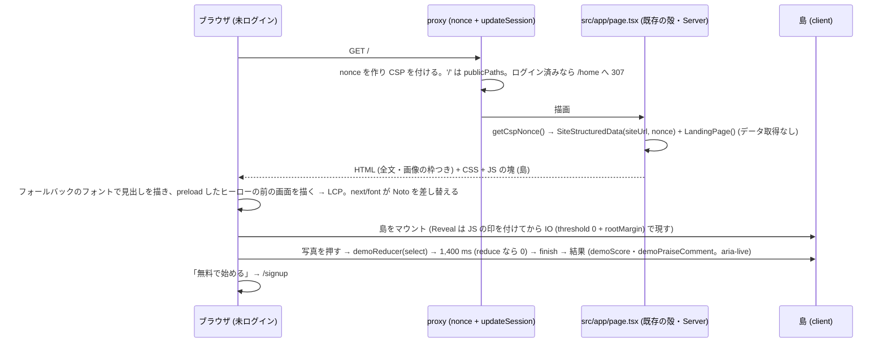

# marketing/01 本サイトの紹介ページ (ランディングページ) の設計 — 設計から作り直す

| | |
|---|---|
| 版 | v1.7 (2026-10-18。設計ゲート R6 の指摘 4 件を反映: バッジは付与の条件と名前・説明が合う 4 つにし (§4.6)、デモの栄養は幅によらず行の並びにし (§8.3)、食事の写真の解析の画面 2 枚はアプリが作れる値で撮り直し (§7.1)、デモのサンプルの注記の検査の場所を直した (E-3)) |
| Status | 設計ゲート通過 (wf_d9caf74c-12e・wf_fc234aa6-092)。段 0〜2 は実装済み (1 本の WF・1 本の PR) |
| Issue | #1867 (サービスの本サイト (homegohan.com) を作り直す) の本文とコメント (2026-10-18 の 2 件) |
| 範囲の正本 | Issue #1867 の本文とコメント。本書はその上で決めた範囲 (紹介ページ 1 本 = `/`) と設計。Issue と食い違ったら本書が正 |
| 成果物 | 本書と、静的な試作 `docs/design/marketing/prototype/index.html` (§23。見た目の参考で、正典ではない) |
| 実装者 | Sonnet 5.5 が本書だけを読んで手を止めずに実装できることを完成条件にする |

オーナーの指示 (2026-10-18) 逐語:「WEBサイトはめっちゃリッチでモダンで最高に手間をかけら素晴らしいページに仕立て上げて欲しい。世界最高のページを目標に手を抜かずにお願いします。」
これは、同じ日の先の選択「紹介ページの中身は今のページを土台に直す」を上書きする。

次の選択は変わらない (オーナーの選択 2026-10-18)。
- 今の Next.js のアプリに同居させ、homegohan.com 1 本でパスで分ける (/ が紹介と公開のページ、/login 以降がアプリ)。
- 更新は Claude が開発の流れで行う (月に数回まで)。

前提 (本書が従う条件): ローンチ前で利用者ゼロ。利用者数・利用者の声・受賞・メディア掲載などの実績を作らない。本番・コードは設計の段では変えない。

本冊は、`/` の紹介ページ (いまは Server Component の殻 `src/app/page.tsx` (27 行。メタ情報と JSON-LD) と、画面の本体 `src/app/LandingPageView.tsx` (629 行・`'use client'` の 1 ファイル)) を、**Server Component の骨格 + 小さな client の島 + CSS 主体の控えめな動き** という構造で設計から作り直す (§3)。

本書の正典の持ち方 (§9 の冒頭に詳しく):

- **逐語の正典**にするのは、見た目と振る舞いの決まりまで: デザインのトークン (§5。色・コントラストの組・余白・大きさ・角丸・影・動きの時間)、部品の一覧と責務と受入の条件 (§8)、文言と公開の主張の表 (§4。`landing-copy.ts` のデータと型: §9.1)、デモの状態機械の遷移表 (§13.3)。
- **CSS・部品のコード・テストのコードは逐語の正典にしない**。実装は受入の条件を満たすように書く。検査の項目 (E-n・U-n・M-n) は、正典の部品の名前・トークンの名前・文言・セクションの `id`・ランドマークと役割 (role) だけを参照し、実装のクラス名や DOM の形を前提にしない。試作 (`prototype/index.html`) は見た目の参考で、正典ではない。
- **主張の正本は 1 つの表** (§4.1 の公開の主張の表)。ページの見出し・本文・見本 (デモ) の文と数値は、この表の行に当たるものだけを使う。見本の数値は、アプリの実際の計算式で、隣に出す栄養の値から再計算できるものだけにする。

「世界最高のページ」の質は、文言・実際の画面・写真・タイポグラフィ・余白・色と、控えめで確かな動きで出す (動きの数ではない)。

---

## 0. 外形固定と分冊判定 (相 1)

### 0.1 発注と決めること

Issue #1867 の 2026-10-18 のコメント (2 件目) が、本冊の成果物と基準を決めている: 設計書 `docs/design/marketing/01-landing-site.md` と静的な試作 `docs/design/marketing/prototype/index.html`。同時に満たす基準は、見た目と動きの質・速さ (Core Web Vitals)・アクセシビリティ (WCAG 2.2 AA)・検索・主張の正確さ (法令・利用者数などの実績を作らない)。置き場所 (今のアプリに同居・パスで分ける) は変わらず、検索まわりの穴埋め (Issue #1867 の「進め方」の段 1: canonical・sitemap・ページごとの title / description・vercel.app の重複) は別の B 型として先に main に着地した (#1874・`be462ab4`。`src/lib/seo/public-pages.ts` の `publicPageMetadata`・`src/components/seo/SiteStructuredData.tsx`・`src/app/sitemap.ts`)。本冊はその部品をそのまま使い、作り直さない (§12)。

本書で決めること (列挙):

1. 情報の設計: セクションの構成と、それぞれの目的・中身・行動の呼びかけ → §3.1・§4
2. 文言: 見出し・本文の全文と、公開の主張の表 (根拠と条件) → §4
3. 視覚の設計: 色・タイポグラフィ・余白・グリッド・写真の方針・アイコン・ダークモード → §5
4. 動きの設計: どのセクションでどう動くか・時間・イージング・reduced-motion のときの代わり → §6
5. 画像の調達: 何を使うか・新しく作るなら作り方と置き場 → §7
6. 部品の分け方 (`src/components/marketing/`) と各部品の受入の条件・速さの予算と測り方・アクセシビリティの基準・検索の設計 → §8・§10・§11・§12
7. テスト: 見た目の記録・Lighthouse の予算・アクセシビリティの自動検査・主張の見張り → §16・§22
8. 段分けと分冊 → §0.4・§17
9. 正典の範囲 (逐語で持つもの・持たないもの) → §9

### 0.2 要件行列

| # | 要件 | 出どころ | 本書の節 |
|---|---|---|---|
| R-1 | 紹介ページは `/` に置き、今の Next.js のアプリに同居し、パスで分ける (`/` が紹介と公開のページ、`/login` 以降がアプリ) | オーナーの選択 (2026-10-18) の逐語「/ が紹介と公開のページ、/login 以降がアプリ」 | §3.1, §8, §21 |
| R-2 | 見た人が「これは本物だ」と感じる、リッチでモダンな紹介ページ。国内外の最高水準の LP と並べて見劣りしない | オーナーの指示 (2026-10-18)・Issue #1867 コメント 2 件目 | §3, §5, §6, §23 |
| R-3 | 速さ: Core Web Vitals の「良い」(LCP ≤ 2.5 s・INP ≤ 200 ms・CLS ≤ 0.1 を p75 で) と Lighthouse Performance ≥ 90 | Issue #1867 コメント 2 件目・`docs/design/CLAUDE.md` E・`docs/design/cross/06-perf-cache.md` §3.1 | §10 |
| R-4 | アクセシビリティ: WCAG 2.2 AA (コントラスト・キーボード・見出し・代替テキスト・動きの抑制・ターゲットの大きさ・拡大) | Issue #1867 コメント 2 件目・`docs/design/cross/05-i18n-a11y.md` | §11 |
| R-5 | 検索: ページの title / description / canonical・構造化データ・見出しの階層。段 1 (main に着地済み: `publicPageMetadata`・`SiteStructuredData`・sitemap・全ページの canonical) の部品をそのまま使い、二重にしない | Issue #1867 コメント 1 件目「進め方 1」・2 件目 | §12 |
| R-6 | 主張の正確さ: 利用者数・利用者の声・受賞・メディア掲載・未確定の価格を書かない。健康上の効果を断定しない (薬機法・景品表示法・健康増進法)。機能の主張はすべて実コードに根拠を持ち、条件 (AI の 1 日の利用回数の上限・写真の記録の入口の違い・同意) を落とさない | Issue #1867 コメント 2 件目・`tests/public-claims-guard.test.ts` | §2.5, §4.1, §22 |
| R-7 | 本番の CSP (nonce 方式・外部 CDN のスクリプト不可・`font-src 'self'`) と、ルート layout の `force-dynamic` (全ページ動的) の下で動く | `src/lib/security/csp.ts`・`src/app/layout.tsx:10`・`docs/design/cross/18-csp-nonce.md` §5 | §2.4, §3.2, §10 |
| R-8 | 既存の見張り (公開の主張・インラインスクリプト・HTML の差し込み・画像の実在・e2e の門) を赤にせず、新しい主張の見張りを足す | `tests/` の各番兵 (§19) | §19, §22 |
| R-9 | 文言と色は、設計書と試作で同じ。写真の置き場には何が入るかを書く | Issue #1867 コメント 2 件目 (試作の目的) | §23 |
| R-10 | ログイン画面などに残る実績の表示 (`src/app/(auth)/layout.tsx:51` の「10,000+ ユーザーが実践中」) を消し、見張りの対象にする | Issue #1867 コメント 2 件目「実績を作らない」 | §4.10, §17 段 0, §19 |
| R-11 | 更新は Claude が開発の流れで行う (月に数回まで) | オーナーの選択 (2026-10-18) | §8, §9.1 |
| R-12 | アプリの画面 (`/login` 以降) は作り直さない。アプリ側で触るのは段 0 の `src/app/(auth)/layout.tsx` (ログイン・新規登録の画面の layout) の実績の表示の削除 (R-10) だけ | 本冊の決定 (範囲を紹介ページに閉じるため。R-1 の選択そのものではない) | §1, §4.10, §17 段 0, §21 |
| R-13 | 文言・画像・順序の変更が、1 ファイル (`landing-copy.ts`) の定数の変更で済む | 本冊の決定 (R-11 の月に数回の更新を軽くする作り) | §8, §9.1 |
| R-14 | 主張の正本は 1 つの表 (公開の主張の表)。各行は主張の文・製品の根拠 (file:line)・条件を持つ。ページの文と見本の文・数値は表の行に当たるものだけ。見本の数値はアプリの計算式で隣の値から再計算できるものだけ。ページに出す実際の画面の写真に写る AI の結果 (記録コメント・栄養メモ・スコア) も、アプリが作れる文と値だけにする | 設計ゲートの構造の裁定 (R5 の時点) | §4.1, §4.5, §7.1, §9.1, §16 (U-3・U-20・U-21・U-24・U-25) |
| R-15 | 逐語の正典は見た目と振る舞いの決まり (トークン・部品と受入の条件・文言) まで。CSS・部品のコード・テストのコードは逐語の正典にせず、検査は部品・トークン・文言・セクションの id・役割だけを参照する。受入の条件を書き切れない動きは置かない | 設計ゲートの構造の裁定 (R5 の時点) | §3.2, §6, §8.3, §9, §16 |

### 0.3 ユーザーシナリオ (15 本。トレースは §3.3)

| # | 誰が | 何を | 期待する結果 |
|---|---|---|---|
| S-1 | 未ログインの人 (PC・Chrome) | 検索結果から `/` を開き、下まで読んで「無料で始める」を押す | ヒーローの見出しは HTML に入っていて JS を待たずに出る (最大の描画 = LCP はヒーローの中で、予算 2.5 s 以内。社内の狙いは 2.0 s: §10.1)。スクロールに合わせて各セクションが現れ (画面の大きさや拡大の倍率によらず、下まで読むと隠れたままの要素が無い)、デモを試せ、`/signup` に着く |
| S-2 | 未ログインの人 (スマートフォン・Safari) | `/` を開き、片手でスクロールする | 横スクロールが出ない。上に固定されたヘッダーの「無料で始める」が、どこまでスクロールしても画面の中にある (登録へいつでも行ける)。ピンチで拡大できる。本文は 16 px 以上で、注記・ナビ・ボタン・写真の名前などの小さい文字も 14 px (`--a11y-min-font-size`) を下回らない (§5.2) |
| S-3 | キーボードだけで操作する人 | Tab で順に移動し、Enter / Space で操作する | スキップリンク → ヘッダー → ヒーローの CTA → デモの写真 → FAQ の順に、見えるフォーカスで移動できる。デモの写真を Enter / Space で押すと、分析中も結果が出た後も、フォーカスと見えるリングは押したボタンに残る。FAQ は Enter で開閉 |
| S-4 | スクリーンリーダーの利用者 | ランドマークと見出しで移動する | `header` / `nav` / `main` / `footer` と、h1 が 1 つ・h2 がセクションごとにある。画像に意味のある代替テキスト。デモの結果は `aria-live="polite"` で読み上げる |
| S-5 | 動きを減らす設定 (`prefers-reduced-motion: reduce`) の人 | `/` を開く | フェード・スライド・立ち上がり・進捗の演出が無く、最終の状態がすぐ出る (デモの結果の出入りも含む)。内容は同じ |
| S-6 | 未ログインの人 | デモで写真を選ぶ → 待つ → 結果を読む → 別の写真を選ぶ | 選択 → 「分析中」(1.4 秒) → 結果 (スコア・スコアの注記・記録コメント・推定の栄養 5 つ) → 別の写真で同じ流れ。「サンプル」の注記は写真を選ぶカードに、選ぶ前から常に出ている。待っている間の再選択は無視する。スコアは、隣に出す栄養の値から、アプリと同じ式で再計算できる (§4.5)。推定の栄養の名前は、どの幅でも 1 行に収まる (途中で折れない) |
| S-7 | ログイン済みの人 | `/` を開く | 既存どおり proxy が `/home` (運営ロールは `/admin`、初期設定が済んでいなければ初期設定) へ送る。紹介ページは描かれない |
| S-8 | モバイル App の WebView (`is_native_app` Cookie あり・未ログイン) | サインアウト後などに `/` に着く | 紹介ページがそのまま出る (App のストアへの導線は無い: §4.9)。「無料で始める」は `/signup` へ行く |
| S-9 | 検索エンジンと SNS のクローラー | `/` を取得する | 動的に描いた HTML に h1・description・canonical・OGP (殻の `publicPageMetadata('/')` が出す。画像は `/opengraph-image` と `/twitter-image`: §12)・JSON-LD (Organization・WebSite) がある。JS 無しでも全文が読める |
| S-10 | 遅い回線 (3G 相当) の人 | `/` を開く | 見出しと本文が先に出る (フォントは `swap`)。画像は遅延で読み、置き場の大きさは先に確保されている (CLS 無し)。外部 CDN への要求は無い |
| S-11 | ブラウザで 200 % に拡大して読む人 (1280×720 の画面) | 下まで読み、デモと FAQ を使う | 横スクロールが出ない。文字は 2 倍に見え、セクションやカードが画面の高さより高くなっても隠れたままにならない。固定ヘッダーが、フォーカスした要素やアンカーの先を隠さない |
| S-12 | 本番の CSP の下のブラウザ | `/` を開き、デモを操作する | `securitypolicyviolation` が 0 件。アプリが書くインラインのスクリプトは JSON-LD (`SiteStructuredData`) の 1 本 (nonce つき) だけ |
| S-13 | 文言を直す開発者 | `landing-copy.ts` に「10万人が利用」や「写真を撮るたびに」と書く | `tests/public-claims-guard.test.ts` がソース走査と描画の両方で「10万人」を赤にし、`tests/landing-page-1867.test.ts` の U-20 が「たびに」を赤にする。`evidence` に無いパスを書いても赤 (U-2) |
| S-14 | 整合ゲートの検証者 | 本番ビルドで Lighthouse と e2e を流す | Performance ≥ 90・LCP / CLS が予算内・JS の転送量が予算内・CSP 違反 0・axe の違反 0 (§10・§16) |
| S-15 | 未ログインの人 (無料の範囲を確かめたい) | 安心のセクションと FAQ の「本当に無料で使えますか？」を読む | 「いまは無料」と同じ段落に、AI を使う機能には 1 日に使える回数の上限があること・有料プランは準備中であることが書いてある。回数を約束する言い方 (「たびに」「毎回」「無制限」など) はページのどこにも無い |

### 0.4 分冊判定 (相 1 で実施)

| 目安 | 本冊 | 判定 |
|---|---|---|
| 設計書 800 行超 | 超える (文言の全文・公開の主張の表・表 3 点・受入の条件・トレースを 1 冊に持つため) | 該当 |
| 消費先レーン 3 以上 | ページ (`src/app/page.tsx` の殻の中身の差し替えと `src/app/LandingPageView.tsx` の削除)・部品 (`src/components/marketing/`)・公開の資産 (`public/marketing/`)・単体の番兵 (`tests/`)・e2e の門 (`scripts/local-ci.sh`・`.github/workflows/e2e-local.yml`) = 5 | 該当 |
| 共有面 2 つ以上 | `tests/public-claims-guard.test.ts` (公開ページ共通の見張り)・e2e の門の一覧 (yml と `PW_ARGS`)・`src/app/(auth)/layout.tsx` (段 0)・`public/guide/*.png` と撮影の台本 `scripts/guide-screenshots/` (使い方ガイド `/guide` と紹介ページが同じ画像を読む。段 0 で撮り直す)・`src/lib/seo/public-pages.ts` (公開ページのメタ情報の正本。`SITE_DESCRIPTION` の値)・`tests/seo-public-pages-1867.test.tsx` (トップの殻の検査)・`package.json` / `package-lock.json` (段 2 の devDependency `@axe-core/playwright`) | 該当 |

判定: **設計は 1 冊 (本書) のまま、実装は 1 本の B 型 WF の中で 3 段 (段 0: 今ある公開の画面に残る、製品と食い違う表示の掃除 (ログイン画面の実績の表示・ガイドの食事の写真の解析の画面 2 枚) と見張りの拡張 / 段 1: 紹介ページの本体 / 段 2: e2e と門) に分け、段ごとに 2 枚レビューを挟み、マージは最後に 1 回**。理由: 核 (文言と部品) と配線 (ページ) を分けても、どちらも `src/app/page.tsx` の差し替えまで利用者には届かず、核だけをマージすると、使われない部品が main に乗る。共有面は 7 つとも小さな差分 (見張りの一覧に行を足す・読む先を変える・一覧の末尾に 1 語足す・1 行消す・撮影の見本の値を直して撮り直す・定数の文を 1 つ直す・devDependency を 1 つ足す) で、別の冊にすると参照する「マージ済みの核」が無い。段 0 は独立して意味がある (ローンチ前に、今ある画面から実績の表示と、アプリが作らない文とスコアの画面写真を消す) ので最初に置く。

### 0.5 用語

- **紹介ページ (LP)**: `/` で返す、未ログインの人向けのページ。公開ページ (`/about` `/faq` ほか) は別のページで、本冊の範囲外 (§1)。
- **島 (client の島)**: `'use client'` の部品。状態 (スクロール・選択・開閉) を持つものだけを島にし、文章と画像は Server Component で描く。
- **主張 (claim)**: アプリの機能や条件について紹介ページが言うこと。§4.1 の公開の主張の表の 1 行 = `landing-copy.ts` の `claims` の 1 件 (id・文・根拠のパス (`evidence`)・条件 (`condition`))。
- **受入の条件**: 部品ごとに、振る舞い・アクセシビリティ・動きを減らす設定と JS 無しのときの見え方・見た目の決まり (幅ごとの配置と大きさ)・確かめる検査を書いたもの (§8.3)。実装はこれを満たせば、書き方 (クラス名・DOM の入れ子・CSS の書き方) は自由。
- **実際の画面**: `public/guide/*.png` (Issue #1852 で撮った、アプリの画面写真 15 枚。540×1080)。画面そのものは本物のアプリだが、写っている利用者と記録は撮影用の見本 (`scripts/guide-screenshots/seed.ts`) で、AI の読み取りの結果は撮影の台本が返す見本の値 (`scripts/guide-screenshots/shoot.pw.ts:67-70` の `mockAi`)。だから数値と文は実際の利用者の結果ではない。紹介ページが使う食事の写真の解析の 2 枚 (`comment.png`・`analyze.png`) は、見本の値をアプリが作れる文と値 (定型の記録コメント・定型の栄養メモ・アプリの式のスコア) に直して撮り直す (§7.1)。画面の注記 (`SCREENS_CAPTION`) で、データが見本であることを書く。
- **サンプル**: デモの結果 (スコア・記録コメント・推定の栄養)。AI は呼ばず、`landing-copy.ts` に書いた推定の値と料理の名前から、アプリと同じ式 (`demoScore`) と同じ定型の文 (`demoPraiseComment`) で作る。画面に「サンプル」と明記する。
- **食事の記録の画面**: 写真から食事を記録する画面 `src/app/(main)/meals/new/page.tsx` (ホームの「食事を記録」・下のナビの「スキャン」(`src/app/(main)/MainLayout.tsx:31`)・App の食事のタブ (`apps/mobile/app/(tabs)/meals.tsx` が WebView で開く) から開く)。献立表の中の「写真から入力」(`src/app/(main)/menus/weekly/page.tsx`) は別の経路で、この画面ではない (§4.1 の経路の表)。
- **記録コメント**: 食事の記録の画面で写真から記録したときに出る、記録をほめるひと言 (`src/app/(main)/meals/new/page.tsx:1506-1520`)。アプリの定型の文で、AI が認識した料理の名前と食事の区分だけが変わる (§4.1 の `praise`)。
- **AI の 1 日の利用回数の上限**: AI を使う機能 (写真の解析・献立の生成など) の 1 日の回数の合計の上限 (#1149。既定は free = 10 回・運営画面で変えられる)。上限に達すると、その日は AI を使う操作が止まる (§4.1 の `ai-daily-limit`)。

---

## 1. 目的・スコープ

- `/` を、見た人が「これは本物だ」と感じる紹介ページに作り直す。本物感の源は、実績の数字ではなく、**実際の画面と、正直な文言と、手触りの良い控えめな動き**に置く (利用者ゼロで実績が無いことは、設計の前提)。
- 速さ・アクセシビリティ・検索・主張の正確さを、機械で確かめられる形 (予算の定数・番兵のテスト・公開の主張の表) で設計に焼き込む。
- 文言・画像・順序を 1 ファイル (`landing-copy.ts`) に集め、月に数回の更新を 1 ファイルの変更で済ませる。

対象外 (別の案件):

| 本冊 | 対象外 |
|---|---|
| `/` の紹介ページ (ヘッダー・フッターを含む) | `/about` `/faq` `/guide` `/pricing` `/news` `/company` `/legal` `/contact` の作り直し (ヘッダー・フッターを共通化する案は §24 Q-6。AI の上限の記載は §24 Q-12) |
| `src/app/(auth)/layout.tsx` の実績の表示の削除 (段 0。アバターと実績の段落の削除と見張り。R-12) | ログイン・新規登録の画面の作り直し |
| 使い方ガイドの画面写真の撮り直し (段 0。撮影の台本の食事の写真の解析の見本の値を、アプリが作れる文と値に直し、`scripts/guide-screenshots/run.sh` で撮り直す: §7.1) | `/guide` の文言の見直し (手順「コメントをもらう」の説明が定型の記録コメントと食い違う件: §24 Q-11) |
| `/` のメタ情報と JSON-LD は段 1 の部品 (`publicPageMetadata('/')`・`SiteStructuredData`) をそのまま使う。直すのは `SITE_DESCRIPTION` の文 1 つ (R-5・§9.4) | 段 1 の部品の作り直し・sitemap・全ページの canonical (段 1 で着地済み)・vercel.app の重複 (Issue #1867 の段 1 の残り) |
| 画像の置き場と調達の手順 (§7) | 新しいイラストの制作 (作らない: §7.3) |
| 動きの設計と実装 (CSS・IntersectionObserver・デモだけ framer-motion) | 3D (Three.js など) の導入・スクロールに連動する動き (視差・固定した画面の切り替え) (§3.2 で退ける) |
| アクセシビリティの自動検査 (`/` の `@axe-core/playwright` の検査 (E-20。段 2 で devDependency に足す)・構造の検査・コントラストの機械計算) | ほかの画面の axe の検査 (`docs/design/cross/05-i18n-a11y.md` §7 の「全主要画面で violations = 0」の残り。`/login` 以降) |
| 計測 (Lighthouse の手順・Speed Insights) | Lighthouse CI のワークフロー (`docs/design/cross/06-perf-cache.md` §7 の案。リポジトリに実体が無い) |

---

## 2. 関連要件と現行の事実

### 2.1 関連 Issue・既存設計

| 文書 | 関係 |
|---|---|
| Issue #1867 (本文) | 置き場所とドメインの構成を決める発注。関わるもの (#1573・Supabase の Site URL・モバイルの `EXPO_PUBLIC_API_BASE_URL`・CORS・OGP #1845・既存の公開ページ) |
| Issue #1867 コメント 1 件目 (2026-10-18) | 置き場所の 4 つの選択 (同居・パスで分ける・Claude が更新・(上書きされた) 今のページを土台に)。進め方 (段 1: 検索の穴埋め → 文言の下書き → ドメインの切り替え) |
| Issue #1867 コメント 2 件目 (2026-10-18) | 設計から作り直す。成果物 2 つ。同時に満たす基準。置き場所は不変 |
| `docs/design/cross/18-csp-nonce.md` §5・§22 Q-7 | 全ページ動的 (`force-dynamic`)。LP の Lighthouse が 90 を下回っても静的化はせず、描画の軽量化で対処する (本冊 §3.2 C・§10) |
| `docs/design/cross/03-design-system.md` | トークン (§3.1 の値は `src/app/globals.css` には実装されていない)・タイポグラフィ・アイコンは lucide のみ (§16)・`prefers-reduced-motion` (§14.2)・ダークモードは Phase 2 (§7) |
| `docs/design/cross/05-i18n-a11y.md` | WCAG 2.1 AA の基準。本冊は 2.2 AA (2.5.8 ターゲットの大きさ・2.4.11 フォーカスの非遮蔽を足す) |
| `docs/design/cross/06-perf-cache.md` §3.1 | Lighthouse ≥ 90・LCP < 2.5 s・CLS < 0.1 (FID は INP に置き換わった: §10) |
| `docs/design/cross/08-legal-compliance.md` | 医療免責の方針 (本冊 §4.7・§4.8 の免責の文) |
| `docs/design/billing/01-billing-core.md` §18 項目 14 | 有料プランの文言 (`有料プランは準備中です（販売開始前）`) は販売開始の PR まで変えない |
| Issue #1149 / `src/lib/plan/entitlements.ts`・`supabase/functions/_shared/ai-daily-limit.ts`・`supabase/functions/_shared/ai-usage-core.ts` | AI の 1 日の利用回数の上限 (全 AI 機能の合計。既定 free = 10 回・運営画面 `/super-admin/llm/quotas` で変えられる)。紹介ページの AI の主張の条件 (§4.1 の `ai-daily-limit`) |
| Issue #1154 / `src/components/consent/AiDataConsentModal.tsx`・`src/lib/ai/consent-guard.ts` | AI 機能で使う日本国外の事業者へのデータ提供の同意。同意が無いと AI へ送らない (§4.1 の `ai-consent`) |
| Issue #1852 / `src/app/guide/guide-content.ts` | 実際の画面の画像 15 枚と、その撮り直しの手順 (`scripts/guide-screenshots/run.sh`)。食事の写真の解析の見本の値 (`scripts/guide-screenshots/shoot.pw.ts:27-45` の `MEAL_ANALYSIS`) は、アプリが作らない文とスコアなので、段 0 で直して撮り直す (§7.1) |
| Issue #1845 / `src/lib/brand-image.tsx` | ブランドの色 `BRAND_COLORS`・OGP の画像 (layout が出す。本冊は変えない) |
| Issue #1314 / `src/lib/badges/awardable.ts` | 付与の処理があるバッジの一覧 (紹介ページに出すバッジはこの中から選ぶ: §4.6) |
| Issue #1867 段 1 (PR #1874・`be462ab4`) | 公開ページのメタ情報の正本 `src/lib/seo/public-pages.ts` (`publicPageMetadata`・`SITE_DESCRIPTION`・`PUBLIC_PAGE_PATHS`)・構造化データ `src/components/seo/SiteStructuredData.tsx` と `src/lib/seo/json-ld.ts` (`buildSiteJsonLd`・`serializeJsonLd`)・`src/app/sitemap.ts`。トップを殻 (`src/app/page.tsx`) と本体 (`src/app/LandingPageView.tsx`) に分けた。本冊はこの部品を使い、本体だけを差し替える (§9.3・§12) |

### 2.2 現行のトップ (殻 `src/app/page.tsx` と本体 `src/app/LandingPageView.tsx`・origin/main `be462ab4`・2026-10-18 に採取。`01d62462` でも同じ)

#1874 (`be462ab4`) で、トップは殻と本体に分かれた。本体 `src/app/LandingPageView.tsx` は、それより前の `src/app/page.tsx` (`835fbe7c`) と 1 行も違わない (同じ 629 行を移しただけ) ので、下の表の行番号は `LandingPageView.tsx` の行番号として読む。

| 事実 | 場所 | 本冊での扱い |
|---|---|---|
| 殻 `src/app/page.tsx` (27 行・Server Component・async)。`export const metadata = publicPageMetadata('/')` (`:17`)。本体は `getCspNonce()` を読み、`<SiteStructuredData siteUrl={getSiteUrl()} nonce={nonce} />` と `<LandingPageView />` を描く (`:19-27`) | `src/app/page.tsx:17-27` | 殻の形はそのまま。`<LandingPageView />` を `<LandingPage />` (`src/components/marketing/LandingPage.tsx`) に替え、`viewport` の export を足す (§9.3) |
| 本体 `src/app/LandingPageView.tsx` は `'use client'` の 1 ファイル (629 行)。状態 6 つ (`selectedMeal` `isAnalyzing` `analysisComplete` `expandedFaq` `activeFeature` `scrollY`)。`scroll` イベントで `scrollY` を state に入れ、全体を再描画する | `:129-141` | 捨てる (§3.2 B)。ヘッダーの状態だけを島にする |
| 色は `colors` 定数にハードコード (primary `#E07A5F`・secondary `#3D5A80`・text `#1A1A1A` ほか 19 個)。`BRAND_COLORS` (text `#2D2D2D`・textLight `#6B6B6B`) と一致しない | `:16-36`・`src/lib/brand-image.tsx:27-38` | トークンを `BRAND_COLORS` の値に合わせ、U-7 で突き合わせる (§5.1) |
| 白文字 on `#E07A5F` のボタン (コントラスト 2.95:1。AA の 4.5:1 も、大きい文字の 3:1 も満たさない) | `:207` `:366` `:537` `:621` | 白文字の下地は `#2D2D2D` か `#B34D2D` にする (§5.1) |
| 食事のサンプル画像は `images.unsplash.com` の外部 URL 3 件 + 1 日の流れ 4 件 (`?w=400` `?w=300`) | `:42` `:51` `:60` `:409-412` | 自前の写真に置き換える (§7.2)。本番の紹介ページから外部の画像の要求を無くす |
| 未検証の効能・断定: 「吸収率が3倍」`:63`・「医者いらず」「免疫力アップ」`:56`・「森のバター」「美肌効果」`:47`・「ダイエット中の方にも最適」`:410`・「あなたのダイエットパートナー」`:532`・「30秒で登録完了」`:208` `:543` `:625`・「1分で使い始められる」`:218`・「完全無料」`:216`・「8つの機能で、あなたの食生活を完全サポート」`:379`・「他にも50種類以上のバッジ」`:467` | 同左 | 全部捨てる。新しい文言は §4 (公開の主張の表の行に当たるものだけ) |
| 機能 8 件のうち「週次レポート」の実装は見つからない (`src/app/api` に該当なし)。「オフラインでも写真の撮影と保存ができる」(FAQ `:102`) の根拠も見つからない | `:76` `:102` | 書かない (§4.6・§4.7) |
| バッジ 12 件 (「朝食マスター」「7日連続」「野菜マニア」…) は、`badges` テーブルの行 (`supabase/migrations/20251126124224_create_meal_planner_tables.sql:14030` 付近の 38 行) に無い名前 | `:81-93` | 実在し、付与の処理があり、名前が付与の条件と食い違わないバッジ 4 つだけを、DB の名前と、付与の条件をそのまま言う紹介ページの説明で出す (§4.6) |
| FAQ 6 件のうち「本当に無料」「データは安全」「AI の分析は正確」は見張りの対象 (`tests/public-claims-guard.test.ts:395-424`。本体の読み先は `:397` の `src/app/LandingPageView.tsx`) | `:96-103` | 3 件は趣旨を保ち、「本当に無料」には AI の 1 日の上限の文を足す。「オフライン」は根拠が無いので別の質問に替える (§4.7) |
| 絵文字を多用 (`✨` `📸` `🤖` `🎉` `🏆` ほか) | 全体 | 使わない (design-system §16: lucide のみ) |
| フッターの SNS は `href="#"` のプレースホルダー 3 件 | `:574-576` | 置かない (公開の SNS の先が無い。`landing-copy.ts` の `socialLinks` は空の配列。§4.9) |
| `motion.button` を `Link` の中に置く (a の中に button。無効な入れ子) | `:177-181` `:206-210` | `Link` 1 つにボタンの見た目を当てる (`CtaLink`。§8.3) |
| モバイルの固定 CTA は `scrollY > 400` で出す | `:619` | 置かない。上に固定したヘッダーの「無料で始める」(全幅で表示) が同じ役目を持つ (§3.2) |

### 2.3 ブランドと画像の資産

| 資産 | 場所 | 使い方 |
|---|---|---|
| `BRAND_COLORS` (accent `#E07A5F`・accentGradientEnd `#FF9B7A`・background `#FAF9F7`・backgroundGradientEnd `#FDF0ED`・text `#2D2D2D`・textLight `#6B6B6B`・white・sparkle `#FFD700`・green = `STATUS_COLOR_TOKENS.success` = `#6B9B6B`・blue `#5B8BC7`) | `src/lib/brand-image.tsx:27-38`・`packages/shared/src/design-tokens.ts:25` | 紹介ページのトークンの元 (§5.1)。`brand-image.tsx` は `next/og` を読むので client から import しない。値はテスト (U-7) で突き合わせる |
| ロゴ (湯気の立つお椀と星。丸 / 角丸の四角) | `public/icon.svg`・`public/icon-512.svg`・`public/apple-touch-icon.svg`・`src/lib/brand-image.tsx` の `BrandMark` | ヘッダー・フッターのマークは `public/icon.svg` を `next/image` で出す (§4.2) |
| 実際の画面 15 枚 (540×1080 の PNG・1 枚 300 KB 以下) | `public/guide/{signup,profile,ready,camera,analyze,comment,menu-request,menu-setting,menu-result,weight,weight-photo,trend,badge-get,badge-collection,badge-rare}.png` | ヒーロー・使い方・機能の画像 (§7.1。使うのは 6 枚)。代替テキストは `guide-content.ts` の `imageAlt` と同じ文にする。写っている利用者と記録は撮影用の見本で、AI の読み取りの結果は撮影の台本の見本の値 (§0.5)。`comment.png`・`analyze.png` の見本の値 (記録コメント `主食・主菜・汁物がそろった定食ですね！…`・栄養メモ `揚げ物の日は、…`・スコア 82) はアプリが作らない文とスコアなので、段 0 で直して撮り直す (§7.1) |
| サンプルの食事の写真 1 枚 | `public/handson-tour/sample-meal.webp` | 使わない (ツアーの資産。大きさが紹介ページに合わない) |
| OGP の画像・アイコンの PNG | `src/app/opengraph-image.tsx`・`src/app/icon-192.png/route.ts` ほか | 変えない。紹介ページの JSON-LD の `logo` は `/icon-512.png` を指す (§12) |
| サイトの名前と一言 | `src/lib/site-config.ts:432-433` (`SITE_NAME` `SITE_TAGLINE`) | ヘッダー・フッター・JSON-LD の名前は `SITE_NAME` を使う (直接書かない) |

### 2.4 技術の制約

| 制約 | 事実 (場所) | 本冊の対応 |
|---|---|---|
| 全ページ動的 | `src/app/layout.tsx:10` の `export const dynamic = 'force-dynamic'` (#1169)。`docs/design/cross/18-csp-nonce.md` §5.1 「静的化した HTML には nonce が入らず、Next のインラインスクリプトが止まる」。Next 公式の CSP のガイド (2026-03-20 更新) も「nonce を使うページは動的に描画しなければならない」「PPR は nonce 方式の CSP と両立しない」と書く | 紹介ページも動的のまま (§3.2 C)。速さはサーバーの描画を軽く保つことで出す: データ取得ゼロ・`headers()` は JSON-LD の nonce の 1 回だけ・島は小さく (§10) |
| CSP | `src/lib/security/csp.ts:237-252`: `script-src 'self' 'nonce-…' 'report-sample' *.vercel-scripts.com https://challenges.cloudflare.com` (外部 CDN のスクリプト不可)・`style-src 'self' 'unsafe-inline'` (inline style 可)・`img-src 'self' data: blob: *.supabase.co images.unsplash.com`・`font-src 'self'`・`connect-src 'self' *.supabase.co *.vercel.app wss://*.supabase.co https://holidays-jp.github.io` | ライブラリは bundle に同梱 (framer-motion は依存にある)。フォントは `next/font` の自前配信のまま。画像は `public/` に置く。CSP は変えない |
| proxy の matcher | `src/proxy.ts:99`: `_next/static` `_next/image` `_vercel/` `favicon.ico` `manifest.json` `robots.txt` `sitemap.xml$` (段 1 で追加) `sw.js` `workbox-` `api/health$` `opengraph-image$` `twitter-image$` と画像の拡張子 (`svg png jpg jpeg gif webp`) を除く | `public/marketing/**/*.webp` と `public/guide/*.png` は matcher の外 (未ログインでも読める)。`tests/metadata-public-paths-1845.test.ts` が実在と matcher の外を確かめる |
| 未ログインの振り分け | `lib/supabase/middleware.ts:308-331` の `publicPaths` に `'/'` がある (未ログインで開ける)。ログイン済みは `lib/onboarding-routing.ts:90-113` の `resolveOnboardingRedirect` が `/` を `/home` (運営ロールは `/admin`・初期設定が未完なら `/onboarding/welcome` か `/onboarding/resume`) へ送る | 紹介ページはログイン済みの状態を考えない (S-7)。ヘッダーの右は常に「ログイン」と「無料で始める」 |
| メンテナンスモード | `src/lib/maintenance-mode.ts:87-110` (origin/main `e66cacf5`) の `isMaintenanceExemptPath` に `/` は無い。未ログインで `/` を開くとメンテナンスの画面 (`lib/supabase/middleware.ts:336-339`) | 既存どおり (変えない) |
| フォント | `src/app/layout.tsx:15-25`: `next/font/google` の Noto Sans JP (400 / 500 / 700・`--font-sans`) と Noto Serif JP (400 / 700・`--font-serif`)。`subsets: ["latin"]` だが、Google Fonts の CSS が持つ unicode-range の分割 (日本語の字形は分割ファイル) を `next/font` がすべて自前に取り込み、ブラウザは使う分割だけを読む。e2e のビルドは `tests/e2e/fixtures/google-fonts-mock.cjs` で Google へ取りに行かない | 新しいフォントは足さない。見出しは Noto Serif JP (既に読んでいる)・本文は Noto Sans JP (§5.2)。`google-fonts-mock.cjs` の `FONT_REQUESTS` は変えない (`tests/e2e-google-fonts-mock.test.ts` が layout と突き合わせる) |
| 依存 | `package.json`: next 16.4.1・react ^19.2.8・framer-motion ^12.23.24・lucide-react ^0.554.0・tailwindcss ^4.1.17・@vercel/speed-insights ^2.0.0。gsap・lottie・three・lighthouse・@axe-core/playwright は無い。`docs/design/CLAUDE.md` F と `docs/design/cross/05-i18n-a11y.md` §5.2・§7 は、a11y の検査を「`@axe-core/playwright` (CI 必須)」と決めている | 製品の依存は足さない (§3.2)。足すのは devDependency の `@axe-core/playwright` 1 つ (段 2。e2e の axe の検査 E-20 のため。§11・§17)。framer-motion は `LazyMotion` + `m` でデモの島だけが読む (§6.3) |
| Tailwind v4 | `src/app/globals.css` が `@import "tailwindcss"` と `@theme inline` (`--color-accent: #FF8A65` など、design-system §3.1 とは別の値)。`tailwind.config` は無い | 紹介ページのトークンは `src/components/marketing/marketing.css` の `.lp` の中の CSS 変数に閉じる (既存の `--accent` と衝突しない)。Tailwind のユーティリティは余白・配置に使ってよく、色は変数で指す (§5.1) |
| `reduced-motion` | `src/app/globals.css:82-92` が全要素の `animation-duration` / `transition-duration` を 0.01 ms に、`animation-iteration-count` を 1 に、`scroll-behavior` を `auto` にする。止めないもの: 遅れ (`animation-delay` / `transition-delay`)・JS の動き (framer-motion は既定で `reducedMotion: 'never'` で、CSS の `!important` も効かない)。`src/components/handson-tour/useReducedMotion.ts` が JS 側の判定。加えて、時間を 0.01 ms に縮めても、`fill-mode: both` の CSS のアニメーションは要素が出るたびに作られ、その間は `running` として残る | globals.css に頼らない。`marketing.css` の動きの宣言 (`animation*`・`transition*`) は、すべて `@media (prefers-reduced-motion: no-preference)` の中でだけ書き、reduce では動きの宣言そのものが無い (§6.1。U-20 が宣言の場所を確かめる)。framer-motion は `MotionConfig` と `initial={false}` (§8.3 の `DemoSection`)。JS の待ち時間は `useReducedMotion` で 0 に (§6.4) |
| スクロール連動の動き | CSS の `animation-timeline` は Chrome / Edge 115 以降・Safari 26 以降で動き、Firefox はフラグの後ろ (MDN は「Baseline ではない」と記す)。`scroll()` は引数が無いと最も近いスクロールの箱 (`overflow: hidden` の祖先も含む) に結び付く | 使わない (§3.2 の「置かないもの」。背景の円の視差 M-4 を外した)。現れ方は IntersectionObserver (全ブラウザ)。U-18 が `animation-timeline` の不在を確かめる |
| モバイルの WebView | `apps/mobile/src/lib/webViewBridge.ts:35` の既定の行き先は `/home?mode=app`。`?mode=app` で `is_native_app` Cookie (`src/proxy.ts:58-67`)。`/` を開く経路は通常無い | 紹介ページは Cookie を読まない (S-8)。ストアへの導線は無い (§4.9) |
| 拡大 (viewport) | `src/app/layout.tsx:103-112` の `export const viewport` が `maximumScale: 1`・`userScalable: false` (全ページ。ピンチの拡大を止める)。Lighthouse のアクセシビリティの監査 `meta-viewport` は `user-scalable=no` か `maximum-scale` が 5 未満で不合格。Next は viewport を layout → page の順に鍵ごとに上書きする (子が書いた鍵だけが替わる) | `/` の殻 `src/app/page.tsx` だけが `viewport` を export し、`maximumScale` と `userScalable` を上書きする (§9.3)。layout は変えない (ほかの画面の拡大の扱いは本冊の範囲外: §24 Q-10) |
| 計測 | Vercel Speed Insights (`src/components/SpeedInsightsClient.tsx`・`src/app/layout.tsx:138`) が全ページで Web Vitals を送る。Lighthouse CI の実体は無い | 実測は Speed Insights (field) と、整合ゲートの Lighthouse (lab) (§10.3) |

### 2.5 公開の主張の制約

**見張りのテスト** `tests/public-claims-guard.test.ts` (#1155): `PUBLIC_PAGES` (トップの本体 `src/app/LandingPageView.tsx` (`:78`。描画は `@/app/LandingPageView` の default を `:65` で読む) ほか 6 本の計 7 本) のソースと描画の両方を `FORBIDDEN` (ダミーの事業者情報・架空の資金調達・`10万人`・`App Store評価`・`1,234,567`・`98.7`・`継続率`・`食の分析実績`・`最長連続記録`・`90%以上の精度`・`Forbes` ほかのメディア名・`メディア掲載`・`リアルな声`・`変化のストーリー`・`血圧-15mmHg`・`-4.2kg`・`自炊率0%→70%`・`野菜摂取量2倍`・`体調スコア+30%`・`¥980` ほかの価格・`永久無料`・`第三者に共有されることはありません` ほかの断定) で検査する。トップの FAQ の `q: "データは安全ですか？"` の行に `プライバシーポリシー` があること、`/\d+%以上の精度/` が無いことも見る。`PAID_PLAN_PENDING_NOTICE = '有料プランは準備中です（販売開始前）'`。

**ログイン画面に残る実績の表示**: `src/app/(auth)/layout.tsx:51` に「10,000+ ユーザーが実践中」と、アバターのプレースホルダー (`:43-50`。どちらも `:42-52` の `div` の中)。`FORBIDDEN` の `10万人` には当たらず、`(auth)/layout.tsx` は `PUBLIC_PAGES` に無いので、見張りをすり抜けている (段 0 で消し、見張りに足す: §4.10・§17)。

**AI の 1 日の利用回数の上限** (#1149。origin/main `01d62462` で確認): AI を使う API は、AI へ送る直前に `consumeAiUsage` で 1 回数え、上限に達していれば数えずに 429 `AI_DAILY_LIMIT` を返す (写真の解析: `src/app/api/ai/analyze-meal-photo/route.ts:82-85`・献立の生成: `src/app/api/ai/menu/weekly/request/route.ts:172`・冷蔵庫: `src/app/api/ai/analyze-fridge/route.ts:80`・体重計: `src/app/api/ai/analyze-weight-scale/route.ts:41`・健康診断: `src/app/api/ai/analyze-health-checkup/route.ts:57`)。上限は全機能の合計で、既定は `supabase/migrations/20261011020000_ai_daily_limits.sql:78-82` の `free` = 10 回 (運営画面から変えられる: `src/lib/plan/entitlements.ts:7`)。上限に数えない機能は、画面を開くと自動で動くもの (`supabase/functions/_shared/ai-usage-core.ts:96` の `AI_UNMETERED_FEATURES` = `nutrition_advice_auto`・`meal_image_auto`) だけ。上限に達した利用者には `今日の AI の利用回数の上限 (10 回) に達しました。明日 0 時から使えます。` が出る (`supabase/functions/_shared/ai-daily-limit.ts:43-44`)。だから紹介ページは、AI を使う機能について回数を約束しない (「たびに」「毎回」「何度でも」「無制限」を書かない: §4.0)。「すべて無料」と書く段落には上限も書く (§4.1 の `free-now`)。

**AI 機能の同意** (#1154): 同意していない利用者が AI 機能を使おうとすると、日本国外の事業者へのデータ提供の同意の画面が出て、同意しないと AI へ送らない (`src/components/consent/AiDataConsentModal.tsx:3-8`・題 `AI 機能で使う、日本国外の事業者へのデータ提供について` は `src/lib/ai/consent-config.ts:120`・サーバーは `src/lib/ai/consent-guard.ts:1-10` で 403 `AI_CONSENT_REQUIRED`)。紹介ページは安心のセクションでこれを書く (§4.1 の `ai-consent`)。

**法令** (消費者庁・東京都の公式ページと、二次資料から引いた。段 0〜2 (#1889) はこの当てはめで実装済み。条文の原文と突き合わせた記録は無い):

| 法令 | 条文 | 紹介ページへの当てはめ |
|---|---|---|
| 景品表示法 第 5 条第 1 号 (優良誤認) | 「実際のものよりも著しく優良であると示す」表示の禁止。第 7 条第 2 項 (措置命令) は、根拠の資料の提出を求められて出せなければ、その表示を第 5 条第 1 号に該当する表示と「みなす」。第 8 条第 3 項 (課徴金) は「推定する」(消費者庁「優良誤認表示とは」の頁) | 機能の主張はすべて §4.1 の公開の主張の表の行に当たり、根拠 (file:line) と条件を持つ。条件 (1 日の利用回数の上限・写真の記録の入口の違い・同意) を落とした言い方をしない。写真の記録の「記録コメント」は定型の文 (`buildTemplatePraiseAndTip`。料理の名前と食事の区分だけが変わる) なので、写真の記録について「AI が食事を見て良いところを見つける」とは書かず、デモの見本も定型の文とアプリの式で作る (§4.5)。ページに出す実際の画面の写真に写る記録コメント・栄養メモ・スコアも、アプリが作れる文と値で撮る (§7.1)。「〜で痩せる」「最高の」「完全」「最新の AI」のような、根拠を出せない形容を書かない。認識の精度・速さを数字で約束しない |
| 健康増進法 第 65 条第 1 項 (虚偽誇大表示の禁止) | 食品として販売に供する物の健康保持増進効果等について「著しく事実に相違する」「著しく人を誤認させる」表示の禁止 (神奈川県・宮城県の資料)。消費者庁「健康食品に関する景品表示法及び健康増進法上の留意事項について」(2016 年制定。2022-12-05 の改定は二次資料で言及) は「〇〇だけで△kg 痩せる」「医者に行かずとも治る」型を虚偽・誇大の例に挙げる | アプリは食品ではないが、見本のコメントや説明で食品の効能 (「免疫力アップ」「美肌」「吸収率が 3 倍」「医者いらず」) を書かない。デモの見本の記録コメントは、アプリの定型の文と同じ形 (料理の名前の記録をほめる文。§4.5) にし、料理の中身や効能を褒めない。アプリの「栄養メモ」の文 (食品の働きに触れる) はデモに出さない (§4.5)。実際の画面の写真も、食品の働きに触れる栄養メモが写らない値で撮り (§7.1)、体重が減っていく推移のグラフの画面 (`trend.png`。撮影用の見本の記録で `-2.1 kg`) は、アプリを使った結果の体重の減りに見えるので使わない (§7.1) |
| 薬機法 第 66 条第 1 項 (誇大広告等) | 「何人も、医薬品 … の名称、製造方法、効能、効果又は性能に関して、明示的であると暗示的であるとを問わず、虚偽又は誇大な記事を広告し、記述し、又は流布してはならない」(東京都保健医療局の抜粋)。第 68 条は承認前の医薬品等の広告の禁止 | アプリが病気を治す・防ぐ・診断すると読める表現 (「血圧が下がる」「健康診断の数値が…」) を書かない。「医療目的での使用はお控えください」の免責を安心・FAQ・最終 CTA に置く (`docs/design/cross/08-legal-compliance.md` の医療免責の方針) |
| ステルスマーケティング (景品表示法の指定告示・2023-10-01) | 事業者の表示であることを隠した第三者の声の表示を不当表示とする (二次資料) | 利用者の声・口コミ・評価は一切載せない (利用者ゼロ) |

### 2.6 世界水準の紹介ページの作り (事実と採用)

| 事実 (出どころ) | 採用 |
|---|---|
| Notion・Linear・Framer のヒーローは、説明する前にプロダクトの動きを見せる。2026 年の傾向は「実際の UI のプレビューを早く・証拠を伴って・流し読みできる区切りで」(saasframe.io・mockflow.com・2026 年の二次資料) | ヒーローの右に実際の画面 3 枚を扇に重ねて置く (前に褒められる画面、左右の後ろに撮る・見る画面。動かない)。文章は短く、各セクションに 1 つの主張 |
| 見た目が派手でも、分かりやすさ・証拠・次の一歩が無いページは成果が出ない (saashero.net・vezadigital.com) | 証拠 = 実際の画面と、根拠と条件のある主張 (§4.1)。次の一歩 = 各セクションの終わりに同じ CTA |
| 動きは「製品の物語をはっきりさせる」ためだけに使う (shift8web.ca) | 動きの一覧 (§6.2) は、すべて「何を伝えるか」の列を持つ。装飾だけの動き (視差など) は置かない。背景は静的なグラデーション (§5.3) |
| Core Web Vitals の「良い」は LCP 2.5 s・INP 200 ms・CLS 0.1 (p75。web.dev「Web Vitals」2024-10-31 更新)。2026 年に LCP が 2.0 s になったという記事は公式に裏づけが無い | 予算は 2.5 / 200 / 0.1 (§10)。社内の目標として LCP 2.0 s を狙う |
| 3D (WebGL) や大きなアニメーションのライブラリは、JS の量とバッテリーを食い、WCAG の動きの抑制と相性が悪い | 入れない (§3.2)。動きは CSS と小さな JS で作る |

---

## 3. 構想 (相 2) と構造裁定 (相 3)

### 3.1 構造

**情報の設計 (上から順に。各セクションの目的と行動の呼びかけ)**

| # | セクション (`id`) | 目的 | 中身 | 行動の呼びかけ |
|---|---|---|---|---|
| 1 | ヘッダー (`header`) | いつでも登録とログインへ行ける | マーク + 「ほめゴハン」・ナビ (機能・使い方・バッジ・よくある質問)・ログイン・無料で始める | 無料で始める → `/signup` |
| 2 | ヒーロー (`hero`) | 3 秒で「写真を撮ると褒められる」が分かる | 見出し・一文・CTA 2 つ・安心の 3 点・実際の画面 3 枚を扇に重ねた構成 (前の中央に褒められる画面、左右の後ろに撮る・見る画面。動かない)・画面の注記 (データは撮影用の見本) | 無料で始める → `/signup`・デモを試す → `#demo` |
| 3 | 使い方 (`how`) | 手順が 3 つしかないことを見せる | 3 つの手順を順に並べ (768 px 以上は横に 3 列)、各手順に実際の画面を 1 枚ずつ。動かない (現れ方だけ)。画面の注記 | (なし) |
| 4 | デモ (`demo`) | 「褒められる」を自分の手で体験する | サンプルの写真 3 枚から選ぶ → 分析中 → 結果 (スコア・スコアの注記・記録コメント・推定の栄養 5 つ)。「サンプル」の注記 | 自分の食事で試す → `/signup` |
| 5 | 機能 (`features`) | 写真の記録のほかに何ができるかを一覧で | 大 2 + 中 4 + 小 2 のカード (画像のあるカードは、端末の枠に入れた実際の画面がカードの下の端から覗く。§5.4)。各カードの主張は §4.1 の表の行。画面の注記 | (なし) |
| 6 | バッジ (`badges`) | 続ける仕掛けがあることを見せる | 実在し、付与の処理があり、名前が付与の条件と食い違わないバッジ 4 つ (DB の名前と、付与の条件を言う説明) | (なし) |
| 7 | 安心 (`trust`) | 正直さで信頼を作る (実績の代わり) | 無料と AI の 1 日の上限・データと同意・AI の限界・退会と書き出しの 4 点 | (なし) |
| 8 | よくある質問 (`faq`) | 迷いを解く | 6 件のアコーディオン + お問い合わせへのリンク | お問い合わせフォームへ → `/contact` |
| 9 | 最終 CTA (`cta`) | 読み終えた人の背中を押す | 見出し・一文・CTA・安心の 3 点・医療の免責 | 無料で始める → `/signup` |
| 10 | フッター (`footer`) | 法務と公開ページへの導線 | サービス・サポート・法的情報の 3 列と著作権 | (リンク) |

**部品の構造 (Server Component の骨格 + client の島)**

```
src/app/page.tsx                         既存の殻 (Server Component・async。#1874)。metadata = publicPageMetadata('/')・
                                         viewport (新設)・<SiteStructuredData nonce> (既存)・<LandingPage /> (本冊で <LandingPageView /> から替える)
src/app/LandingPageView.tsx              削除 (現行の本体。§18 消すもの)
src/components/seo/SiteStructuredData.tsx 既存 (変えない)。JSON-LD (Organization・WebSite) の唯一の出し口
src/components/marketing/
  LandingPage.tsx                        Server Component。.lp の箱の中に SiteHeader → <main> (セクション 8 つ) → SiteFooter
  landing-copy.ts                        文言・画像・公開の主張・デモの見本・定数 (文言の正本。§9.1)
  demo-state.ts                          デモの状態機械 (demoReducer。純関数。§9.2・§13.3)
  marketing.css                          .lp のトークン・タイポグラフィ・動き (§5・§6)
  sections/                              10 本
    SiteHeader.tsx                       島: スクロールで背景が付く
    HeroSection.tsx                      Server。実際の画面 3 枚を扇に重ねた、動かない構成
    HowItWorksSection.tsx                Server。3 つの手順と画面を並べた、動かない構成
    DemoSection.tsx                      島: デモの状態機械を使う。framer-motion はここだけ
    FeaturesSection.tsx                  Server (bento のカード。カードを 1 枚ずつ Reveal で包む)
    BadgesSection.tsx                    Server
    TrustSection.tsx                     Server
    FaqSection.tsx                       島: アコーディオン
    FinalCtaSection.tsx                  Server
    SiteFooter.tsx                       Server
  primitives/                            5 本
    Reveal.tsx                           島: 現れ方 (IntersectionObserver・1 回だけ。要素の高さに依らない判定: §6.3)
    PhoneFrame.tsx                       Server: 端末の枠
    CtaLink.tsx                          Server: Link にボタンの見た目
    useInViewOnce.ts                     島の中で使う hook (Reveal が使う)
    useReducedMotion.ts                  既存 src/components/handson-tour/useReducedMotion.ts を再 export
public/marketing/photos/                 デモの写真 3 枚 (§7.2)
```

`src/components/marketing/` の新設は 19 本 (直下 4 本: `LandingPage.tsx`・`landing-copy.ts`・`demo-state.ts`・`marketing.css` + `sections/` 10 本 + `primitives/` 5 本。§8.1・§17・§18 の列挙と同じ)。JSON-LD の部品は新設しない (段 1 の `SiteStructuredData` をそのまま使う。§12)。

島の数は 4 (SiteHeader・DemoSection・FaqSection・Reveal)。文章と画像は Server Component で描くので、JS が無くても全文が HTML にある (S-9)。

### 3.2 代替案の比較と裁定 (1 回だけ)

| 案 | 中身 | 良い点 | 退ける理由 |
|---|---|---|---|
| **A (採用)** Server Component の骨格 + 小さな島 + CSS 主体の動き。framer-motion はデモの島だけ (`LazyMotion`) | 文章と画像は HTML に出る。JS は島の分だけ。動きは CSS (`transform` / `opacity`) と IntersectionObserver | LCP (文字が先に出る)・INP (再描画が島に閉じる)・CSP (インライン無し)・a11y (`reduced-motion` で動きの宣言が無い)・検索 (全文が HTML) を同時に満たす。月に数回の更新は `landing-copy.ts` だけ | – |
| B 現行の延長 | `'use client'` の 1 ファイル + framer-motion の全面使用 | 書き慣れた形。`whileInView` で現れ方が 1 行 | 全体が 1 つの client で、`scroll` の state が全体を再描画する (INP に悪い)。framer-motion が初期の JS に乗る (約 30 KB gz 以上)。文章の更新と見た目の変更が同じファイルで混ざる。現行の品質の問題 (§2.2) の発生源 |
| C 紹介ページだけ静的化 | route group と別の layout・hash / SRI 方式の CSP | CDN から配れる。TTFB が最短 | `docs/design/cross/18-csp-nonce.md` §4 で hash 方式を退け、§22 Q-7 で「LP だけ静的に戻す案は nonce と両立しない」と裁定済み。Next 公式も「PPR は nonce 方式と両立しない」「SRI は実験的」と書く。全ページ動的の決定を本冊で覆さない |
| D 3D / 大きな演出ライブラリを入れる | Three.js・GSAP・Lottie | 派手な動きを作れる | 依存が増え (CSP は bundle 同梱なら可)、JS が数十〜数百 KB 増える。WCAG 2.3.3 (動きの抑制) と INP の予算に合わない。「本物感」は実際の画面で出せる (§2.6) |

**縁の発生源を消すより単純な構造は無いか**: 島をさらに減らす (ヘッダーの背景を CSS だけで付ける・FAQ を `details`/`summary` にする) 案を検討した。ヘッダーは `scroll-state()` が Baseline でなく、固定ヘッダーに常に背景を付けると、ヒーローの上で重く見える。FAQ の `details` は開閉の動きを付けにくく、`aria-expanded` を持つ `button` + `region` の方が支援技術で安定する。島 4 つはそれぞれ 1 つの状態しか持たず、これ以上減らすと見た目か a11y を落とす。

部品と動きの単位でも同じ問いを当て、次の 4 つは置かない。どれも、伝える中身はほかの部品が既に持ち、受入の条件 (どの幅で・どう配置し・動きを減らす設定でどうなるか・どう測るか) を書き切るには縁が多すぎる。後の 2 つは、設計ゲートの構造の裁定 (R5 の時点) で外した。

| 置かないもの | 同じ役目を持つ部品 | 置くと生まれる縁 |
|---|---|---|
| スマートフォンの下に出す固定の登録のボタン | ヘッダーの「無料で始める」(`position: sticky` で常に画面の上。幅で隠さないので 320 px でも出る。§8.3 の `SiteHeader`) | 出す時と隠す時 (ヒーローの箱との交差・ページの中のリンクでの一気の移動)・中にフォーカスがある間の扱い (`inert`)・ページの下の余白 (`scroll-padding-bottom`)・高さの手計算 |
| ヒーローの、自動で切り替わる画面 | ヒーローの 3 枚の扇 (前に褒められる画面) と、使い方の 3 つの手順の画面 | WCAG 2.2.2 の止める操作・動きを減らす設定のときに見える 1 枚と LCP の画像の食い違い・3 秒の間に褒められる画面が出ない |
| 背景の円の視差 (旧 M-4。`animation-timeline: scroll()`) | ヒーローの静的なグラデーションの地 (§5.3) | `scroll()` が結び付くスクロールの箱 (ヒーローの箱が `overflow: hidden` だと、その箱に結び付いて動かない)・未対応のブラウザ (Firefox)・動きを減らす設定・スクロールで進む Animation が e2e の「終わるまで待つ」を止める |
| 使い方の、固定した端末とスクロールでの画面の切り替え (旧 M-6) | 使い方の 3 つの手順に、それぞれの画面を 1 枚ずつ並べる (§8.3 の `HowItWorksSection`) | 固定する列と手順の列の幅・端末の幅と高さ (画面の高さを超えると固定が効かない)・手順の高さ・幅ごとの出し分け・中央の帯の判定・飛ばしの遷移 |

ヒーローは 3 枚を扇に重ねて動かさず (前に褒められる画面)、流れを順に見せる役目は使い方の静的な 3 列が持つ。**構造 A で確定**。以後、構造の疑義は blocking ではなく「裁定への差し戻し事由」として別に扱う。

### 3.3 シナリオのトレース (構造 A で手で走らせた記録)

| # | トレース |
|---|---|
| S-1 | `GET /` → proxy が nonce を付け `updateSession` (未ログイン・`/` は publicPaths) → `page.tsx` (既存の殻) が `getCspNonce()` → `SiteStructuredData` (既存) + `LandingPage` を描く (データ取得なし) → HTML (全文。`<head>` にヒーローの前の画面 `comment.png` の preload) → ブラウザ: 見出しがフォールバックのフォントで描かれ、ヒーローの文字と画面の塊が立ち上がり (M-2・M-3。画面の塊は不透明度を動かさない)、前の画面か見出し (フォントの差し替えで描き直されたとき) で LCP 確定 → `Reveal` が IO でセクションとカードを順に表示 (要素の高さに依らない判定: §6.3) → `#demo` で写真を選ぶ (S-6) → 「無料で始める」(`CtaLink` = `Link href="/signup"`) → `/signup` |
| S-2 | 375 px: `<meta name="viewport">` は `maximum-scale=5, user-scalable=yes` (殻の `viewport`。§9.3) でピンチの拡大ができる。`.lp` の根は横方向を切り取り (§8.3 の `marketing.css`)、どの部品も 320 px で横にはみ出さない。bento は 1 列。ヒーローの 3 枚の画面は見出しの下に置く (扇の箱は `min(100%, 26rem)` で、傾けた後ろの端末の外接矩形も箱の中に収まる: §5.4)。使い方は 1 列で、手順ごとに画面 → 番号・見出し・本文の順。ヘッダーは上に固定 (`SiteHeader`) で、ヘッダーの「無料で始める」(小さい CTA。幅で隠さない) は、少しずつのスクロールでも、`#demo` などのページの中のリンクで一気に移っても、画面の上にある。ヘッダーの中身は 320 px でも 1 行に収まる (マークと名前・「無料で始める」。ナビのアンカーは 768 px 未満、ログインは 640 px 未満で隠す)。本文は 16 px・一文 (lead) は 17 px 以上、注記・ナビ・ボタン・デモの写真の名前は 14 px (下限) (§5.2。E-19 が確かめる)。デモの推定の栄養は、幅によらず 5 行の並び (各行の左に名前、右に値と単位) で、名前は途中で折れない。バッジは 1 列 (アイコンの輪の右に名前と説明) で、名前は 1 行。デモの写真の名前 (4 字まで)・安心の見出し・フッターのリンクの文も 1 行 (E-22) |
| S-3 | Tab: スキップリンク (layout) → マーク (`/`) → ナビ 4 つ → ログイン → 無料で始める → ヒーローの CTA 2 つ (ヒーローの画面は画像だけでフォーカスしない) → デモの写真 3 つ (`button aria-pressed`。Enter / Space で押すと分析中は `aria-disabled="true"` になるが `disabled` にはしないので、フォーカスとリングはそのボタンに残る。§13.3) → (結果が出ていれば「自分の食事で試す」) → 機能のカード (リンク無し・フォーカスしない) → 安心の「プライバシーポリシーを読む」 → FAQ の `button aria-expanded` → Enter で開閉 → FAQ の末尾の「お問い合わせフォームへ」→ 最終 CTA → フッターのリンク (§13.1 のキーボードのみの行)。`:focus-visible` は globals.css の 2 トーンのリング |
| S-4 | ランドマーク: `header` → `nav aria-label="サイトの案内"` → `main` (`LandingPage` が描く。layout の `#main-content` は `div` でランドマークではない: `src/app/layout.tsx:126`) → `section aria-labelledby` ×8 → `footer`。h1 は 1 つ (ヒーロー)。使い方の手順は `ol` (番号は読み上げの順で伝わる)。デモの結果は `role="status" aria-live="polite"` の箱に入り、選ぶたびに「分析中」「結果: …」を読み上げる。画像の alt は `landing-copy.ts` の `alt` (実際の画面は `guide-content.ts` の `imageAlt` と同じ文) |
| S-5 | `prefers-reduced-motion: reduce`: `marketing.css` の動き (`animation*`・`transition*`) はすべて `@media (prefers-reduced-motion: no-preference)` の中でだけ書く (§6.1) ので、reduce では動きの宣言が 1 つも無い → ヒーローの文字と画面の立ち上がり・現れ方 (隠す規則も no-preference の中)・進捗の棒・待ちの印・数値の現れ方・バッジの立ち上がり・FAQ の開閉は、どれも最初から最後の見え方。ヒーローと使い方の画面はもともと動かない構成なので、reduce でも no-preference でも同じ位置に見える (違いは読み込みのときの立ち上がり (M-3) の有無だけ)。JS: `useReducedMotion()` が true → デモの待ち時間を `0` に。デモの島は `MotionConfig reducedMotion="user"`・時間 0 の transition・各パネルの `initial={false}` で、分析中のパネルの退場は時間 0、結果のパネルは最初の描画から最後の見え方 (`opacity: 1`・`transform: none`)。内容は同じ |
| S-6 | 状態 `idle` (写真を選ぶカードにサンプルの注記 `sampleNotice` が出ている。結果の箱 (`role="status"`) の外なので、結果のたびに読み上げ直さない) → 写真 A を押す → `analyzing` (選んだ id・開始時刻) → 1,400 ms 後 `result` → 結果 (スコア = `demoScore(A の栄養)`・スコアの注記・記録コメント = `demoPraiseComment(A)`・推定の栄養 5 行) を描く (`aria-live`) → 写真 B を押す → `analyzing` → … 。`analyzing` の間に押しても無視 (§13.3。写真のボタンは `disabled` にせず `aria-disabled="true"` にし、押したときの処理の先頭と `demoReducer` が無視する。押したボタンのフォーカスは残る)。結果の下の CTA は `/signup`。スコアは、隣に出すタンパク質・食物繊維・カロリーから、§4.5 の式で読者が再計算できる |
| S-7 | ログイン済みで `GET /` → `updateSession` が `resolveOnboardingRedirect({ pathname: '/' })` → `/home` (運営ロールは `/admin`) へ 307。`page.tsx` は呼ばれない。本冊は何も変えない |
| S-8 | WebView で `GET /` (`is_native_app=1`・未ログイン) → S-1 と同じ HTML。ストアの札は無い (`storeLinks` が空)。「無料で始める」→ `/signup` (WebView でも開ける既存の画面) |
| S-9 | クローラー: 同じ HTML。メタ情報は殻の `publicPageMetadata('/')` (段 1): `<title>` は `SITE_DEFAULT_TITLE` (`ほめゴハン \| AIで食事管理をもっと簡単に`・absolute)、`<meta name="description">` と OGP の description は `SITE_DESCRIPTION` (本冊で文を直す: §9.4)、`<link rel="canonical" href="<siteUrl>/">`・`og:url`、OGP / Twitter の画像は `/opengraph-image` / `/twitter-image` を明示。JSON-LD は `SiteStructuredData` (nonce つき・`Organization` と `WebSite`)。JS 無しで全文 |
| S-10 | 3G: HTML (約 40 KB gz) → CSS → フォントは `swap` で後から → 画像は `next/image` の `sizes` と `loading="lazy"` (ヒーローの前の 1 枚 `comment.png` だけ `preload`。`<head>` の `<link rel="preload">` で早く読み始める)。枠は `aspect-ratio: 540 / 1080` で先に確保 → CLS 0。外部への要求は Speed Insights の同一オリジンのパスだけ |
| S-11 | 1280×720 を 200 % に拡大 = CSS の 640×360: 並びは 768 px 未満の行 (1 列。ナビのアンカーは隠れ、ログインは 640 px 以上なので見える。ヘッダーは高さ 64 px)。文字は `rem` と `clamp` なので 2 倍に見え、`overflow-wrap: anywhere` で横にはみ出さない (E-6)。セクションやカードが画面の高さ (360 px) より高くなるが、`Reveal` は `threshold: 0` + `REVEAL_ROOT_MARGIN` (1 px でも画面の下の 10 % を除いた範囲に入れば現れる) なので、下まで読むと隠れたままの要素は無い (E-1 の 640×360)。固定ヘッダー (64 px) は `scroll-padding-top` (6rem = 96 px) より低いので、アンカーで移った先とフォーカスした要素がヘッダーに隠れない (E-9) |
| S-12 | 本番 CSP: アプリが書くインラインの `<script>` は `SiteStructuredData` の JSON-LD だけで nonce つき (Next 自身のインラインスクリプトも proxy の nonce を持つ)。`style` 属性は `'unsafe-inline'` で可。画像は `self`。framer-motion は bundle。`securitypolicyviolation` 0 件 (e2e で確認) |
| S-13 | `landing-copy.ts` に `10万人が利用` → `public-claims-guard` のソース走査 (`PUBLIC_SOURCE_FILES` に `landing-copy.ts`) が赤、描画の走査も赤。`写真を撮るたびに` → U-20 が赤 (`たびに` は §4.0 の書かない語)。`evidence: ['src/app/api/weekly-report/route.ts']` (実在しない) → U-2 が赤 |
| S-14 | 本番ビルド (`next build && next start`) → `npx lighthouse http://localhost:3000/ --preset=desktop` と mobile → Performance ≥ 90 を確認 → e2e `tests/e2e/landing-page.spec.ts` (LCP / CLS・JS の転送量・CSP 違反 0・構造・axe) → Speed Insights で p75 を確認 (デプロイ後) |
| S-15 | 安心の 1 つ目「いまは無料で使えます」の本文 = `現在ご提供している機能は、すべて無料です。AI を使う機能には、1 日にご利用いただける回数の上限があります。…` → FAQ の「本当に無料で使えますか？」の答えも同じ段落に上限の文 (U-24 が「すべて無料」を含む文字列に「1 日にご利用いただける回数」があることを確かめる)。ページの文に `たびに` `毎回` `何度でも` `無制限` は無い (U-20) |

---

## 4. 文言と公開の主張 (逐語の正典)

文言の正本は `landing-copy.ts` (§9.1)。ここは読みやすい形で全文を並べ、各文がどの主張 (§4.1 の表の行) に当たるかを添える。§4 と §9.1 の文は 1 文字も違わない (U-1 と実装ゲートのレビューで突き合わせる)。

### 4.0 書き方の決まり

- 表記: 数字と英字は半角、単位の前は半角スペース無し (例: 1週間)。絵文字は使わない (U-9)。「〜ます」で統一する。
- 機能・条件を言う文は、§4.1 の公開の主張の表の行に当たるものだけ。表に無い主張は書かない。見出しの気持ちの言葉 (例: `食べることを、もっと誇らしく。`) は主張を持たない (下の各表の「主張」の列が `–`)。
- **書かない語** (`LANDING_COPY` のすべての文字列と `SITE_DESCRIPTION` に、1 つも含めない。U-20・U-15):

| 語 | 理由 |
|---|---|
| `たびに`・`毎回`・`何度でも`・`無制限`・`使い放題` | AI を使う機能には 1 日の利用回数の上限がある (§2.5)。写真の記録のほめるひと言と栄養メモを記録のときに出すのは食事の記録の画面だけ (§4.1 の経路の表)。回数を約束する言い方は、どちらの条件でも偽になる |
| `いちばん`・`一番`・`最高`・`最新`・`完全`・`必ず`・`絶対`・`No.1`・`日本一`・`世界一` | 根拠を出せない最上級・断定 (景品表示法の当てはめ: §2.5) |
| `痩せ`・`効果`・`治る`・`予防`・`続きます` | 健康上の効果・習慣の定着を約束する語 (健康増進法・薬機法の当てはめ: §2.5) |
| `ダメ出しはしません` | 改善の提案 (`advice`・`nutritionTip`) があるので事実と違う |

語を足すときは、いまの `LANDING_COPY` に当たらないことを確かめてから足す (U-20 の一覧と同じ)。

- 「すべて無料」と書く文字列には、同じ文字列の中に `1 日にご利用いただける回数` の文を入れる (§4.1 の `free-now` の条件。U-24)。

### 4.1 公開の主張の表 (主張の正本)

各行 = `landing-copy.ts` の `claims` の 1 件。「主張の文」は `text`、「条件」は `condition` の要約 (§9.1 に逐語)、「根拠」の file:line は origin/main `01d62462` の行で、`evidence` にはそのファイルのパス (行番号を除く) を持つ。根拠の中身 (関数・行がその振る舞いを実装しているか) は機械で確かめられないので、実装ゲートのレビューで突き合わせる。主張は 17 件 (`CLAIM_IDS`)。

| id | 主張の文 (ページが言ってよいこと) | 製品の根拠 (file:line) | 条件と、文での扱い | ページで使う場所 |
|---|---|---|---|---|
| `photo-analyze` | 写真を撮るだけで、AI が料理を認識して栄養を推定する | 食事の記録の画面が写真を送る (`src/app/(main)/meals/new/page.tsx:552`) → API が利用回数を数えてから解析の関数を呼ぶ (`src/app/api/ai/analyze-meal-photo/route.ts:82-85`) → `supabase/functions/_shared/nutrition-pipeline.ts` が料理と栄養を推定し、結果に kcal・タンパク質・炭水化物・脂質・食物繊維・野菜の点を返す (`:1069-1104`。食物繊維は `:1075`) | 同意 (`ai-consent`) と 1 日の利用回数の上限 (`ai-daily-limit`) の範囲で使える。数値は推定 (`ai-estimate`)。文は回数を約束しない (§4.0) | ヒーローの一文の前半・使い方 1・2・機能「写真で記録」・`SITE_DESCRIPTION` |
| `praise` | 食事の記録の画面では、写真で記録すると、記録をほめるひと言 (記録コメント) が出る。献立の振り返りでは、AI が良い点を見つけて褒める | `buildTemplatePraiseAndTip` (`nutrition-pipeline.ts:749-779`) が料理の名前 (先頭 2 つ) と食事の区分で定型の文を作る (`:775`)。食事の記録の画面は結果を受け取り (`meals/new/page.tsx:586`)、「記録コメント」で出す (`:1506-1520`)。献立の振り返りは `src/app/api/ai/nutrition/feedback/route.ts:94` の指示「良い点を見つけて褒める。…批判は含めない」で AI が書く (`src/app/(main)/menus/weekly/page.tsx:2577` が呼ぶ) | 記録コメントは定型の文で、料理の中身 (彩り・組み合わせ・量) は見ない → 写真の記録について「AI が食事を見て良いところを見つける」と書かない (書くのは献立の振り返りの場面だけ)。記録のときの画面に出すのは食事の記録の画面だけ (下の経路の表) → 文は「食事の記録の画面では」と画面を名指しする。同意と 1 日の利用回数の上限の範囲で → 回数を約束しない | ヒーローの一文・使い方 3・デモの記録コメント・機能「ほめるひと言」・最終 CTA の一文・フッターの一文・`SITE_DESCRIPTION` |
| `nutrition-tip` | 食事の記録の画面では、写真で記録すると、栄養のひと言のメモ (栄養メモ) が出る | `buildTemplatePraiseAndTip` の `nutritionTip` (`nutrition-pipeline.ts:767-772`。タンパク質と食物繊維で定型の 3 つの文から 1 つ) → 食事の記録の画面が受け取り (`meals/new/page.tsx:587`)、「栄養メモ:」で出す (`:1538-1543`) | 献立表の「写真から入力」では保存も表示もしない (下の経路の表)。同意と 1 日の利用回数の上限の範囲で。栄養メモの文 (食品の働きに触れる) は紹介ページに写さない (§2.5) | ヒーローの一文の後半・機能「ほめるひと言」 |
| `demo-sample` | デモの結果はサンプル。スコアと記録コメントは、アプリの写真の解析と同じ式と同じ定型の文で、表示する推定の値と料理の名前から作る | スコアの式 `nutrition-pipeline.ts:762-765` と記録コメントの文 `:758-761`・`:775` (§4.5 の「ソースの式」の表。U-21 が突き合わせる) | サンプルの値は実際の解析の値ではない (注記を常に出す)。アプリの結果の画面の栄養の 5 つ目は「野菜」(点) だが、野菜の点は材料の重さから出すので隣の値から再計算できない。デモは代わりにスコアの式が使う食物繊維を出し、スコアを再計算できるようにする (結果の画面に出る栄養のサンプルとは書かない) | デモの一文・スコアの注記・サンプルの注記・結果 |
| `weekly-menu` | 1週間の献立を AI が提案する (条件: 冷蔵庫優先・時短中心・和食多め) | 週の献立の画面 `src/app/(main)/menus/weekly/page.tsx`・生成の依頼 `src/app/api/ai/menu/weekly/request/route.ts:172` (利用回数を数える)・条件を選ぶモーダル `src/components/ai-assistant/V4GenerateModal.tsx` (条件の名前は `guide-content.ts` の `menu` の章と同じ) | 同意と 1 日の利用回数の上限の範囲で | 機能「1週間の献立を AI が提案」・FAQ「本当に無料」の「献立の提案」 |
| `shopping-list` | 献立から買い物リストを作る | `src/app/api/shopping-list/` (`route.ts`・`regenerate`・`add-recipe`)・`tests/regenerate-shopping-list-request-ownership.test.ts` | AI での作り直しは 1 日の利用回数の上限に数える (`ai-usage-core.ts` の `shopping_list`)。文は AI と言わない | 機能「買い物リスト」 |
| `health-records` | 体重 (体重計の写真からも) と健康診断の結果 (写真から) を記録し、推移をグラフで見る | `src/app/api/ai/analyze-weight-scale/route.ts:41`・`src/app/api/ai/analyze-health-checkup/route.ts:57` (どちらも写真の解析として数える)・`src/app/api/health/checkups/route.ts`・`src/app/(main)/health/` | 写真の読み取りは同意と 1 日の利用回数の上限の範囲で | 機能「体重と健康の記録」・FAQ「本当に無料」の「健康の記録」 |
| `badges` | 食べた食事を「完了」にした回数と続けた日数、アプリの中の使い方の案内の完走で、バッジが付く (4 つの名前と説明) | 数える: `src/app/api/badges/route.ts:44-50` (完了した食事の数。`planned_meals.is_completed` が true で、使い方の練習のお試しの記録 (`is_sandbox`) を除く)・`:59-70` と `:113` (完了した食事のある日の連続日数。数え方は `src/lib/jst-day-ranges.ts:201-214`)。付ける: `route.ts:123-138` (`first_bite` = 1 食以上・`streak_3` = 3 日連続・`streak_7` = 7 日連続)・`supabase/migrations/20251126124224_create_meal_planner_tables.sql:1164-1173` (`complete_handson_tour` が `tutorial_complete` を付ける)。一覧に出す許可: `src/lib/badges/awardable.ts:17-29` (`AWARDABLE_BADGE_CODES`)。名前: 同じ migration の `INSERT INTO public.badges` (`:14030-14032`・`:14045`。U-6 が突き合わせる)。写真から献立表に保存した食事は未完了で作られる: `src/app/api/meal-plans/add-from-photo/route.ts:171` (`is_completed: false`) | 数えるのは「完了」にした食事 (ホームと献立表の完了の印・食事の詳細の「食べた！」) だけで、写真で記録して献立表に保存しただけの食事は、完了にするまで数えない → 文は「記録すると付く」「写真で記録すると付く」とは言わず、「完了」と書く。DB の説明 (`はじめて食事を記録しました` など) は「記録」を完了の意味で使っていて、紹介ページの「写真で記録」と読み違えるので写さない (説明は付与の条件を言う紹介ページの文: §4.6)。`photo_10` (名前 `カメラマン`・DB の説明 `写真を10枚撮影しました…`。付与は完了した食事 10 食で、写真を数えない: `route.ts:127-130`) と `planner` (名前 `計画上手`・DB の説明 `1週間の献立を作成しました…`。付与は `src/app/api/menu-plans/add/route.ts:156` だけで、呼ぶのは使い方の練習のお試しの献立の追加 (`src/components/ai-assistant/V4GenerateModal.tsx:190-202`・`src/app/handson-tour/menu/page.tsx:169`・`apps/mobile/src/components/menu/V4GenerateModal.tsx:266-275`) だけ。AI の週の献立の生成 (`/api/ai/menu/weekly/request`) では付かない) は、名前が付与の条件と食い違うので載せない | 機能「バッジを集める」・バッジのセクション |
| `fridge` | 冷蔵庫の写真から食材を読み取る | `src/app/api/ai/analyze-fridge/route.ts:80` (写真の解析として数える)・`src/app/(main)/pantry/` | 同意と 1 日の利用回数の上限の範囲で | 機能「冷蔵庫の写真から食材を読み取り」 |
| `family` | 家族を招待して献立を一緒に見る・記録を共有する | `src/app/api/family/groups/route.ts`・`src/app/api/family/invites/route.ts`・`src/app/api/family/members/me/share/route.ts`・`src/app/(main)/family/` | 無し | 機能「家族で使える」・FAQ「家族で使えますか？」 |
| `free-now` | いまは無料で使える・有料プランは準備中 | `src/app/pricing/PricingPageView.tsx` の `有料プランは準備中です（販売開始前）` | AI を使う機能には 1 日の利用回数の上限がある (`ai-daily-limit`) → 「すべて無料」と書く文字列には上限の文も入れる (U-24)。安心の 3 点の短い札 (`いまは無料で使えます`) は上限を書かないが、同じページの安心と FAQ が書く | 安心の 3 点 (ヒーローと最終 CTA)・安心「いまは無料で使えます」・FAQ「本当に無料」・`SITE_DESCRIPTION` |
| `ai-daily-limit` | AI を使う機能 (写真の解析や献立の提案など) は、1 日に使える回数に上限がある。上限に達した日は、翌日 0 時から使える | 数える: `src/lib/plan/entitlements.ts:197` (`consumeAiUsage`)・止めたときの文: `supabase/functions/_shared/ai-daily-limit.ts:43-44`・既定の値: `supabase/migrations/20261011020000_ai_daily_limits.sql:78-82` (`free` = 10)・運営画面で変えられる: `entitlements.ts:7`・上限に数えない自動の機能: `supabase/functions/_shared/ai-usage-core.ts:96` | 回数の数字は書かない (運営画面で変えられるため。数字を書くと値を変えたときに偽になる)。上限に数えない自動の機能があるので「AI のすべての機能」とは書かず「AI を使う機能」と書く | 安心「いまは無料で使えます」・FAQ「本当に無料」 |
| `ai-consent` | AI を使う機能は、日本国外の AI 事業者へのデータ提供について同意を受けてから使える | 同意の画面 `src/components/consent/AiDataConsentModal.tsx:3-8` (題は `src/lib/ai/consent-config.ts:120`)・サーバーの判定 `src/lib/ai/consent-guard.ts:1-10` (未同意は 403 `AI_CONSENT_REQUIRED`) | 無し | 安心「データの取り扱い」 |
| `no-card` | クレジットカード不要 | 新規登録の画面 `src/app/(auth)/signup/` に決済の入力が無い (`src/lib/billing/` の Checkout は購入の導線でだけ使う) | 無し | 安心の 3 点 (ヒーローと最終 CTA) |
| `delete-export` | いつでも退会できる・データを JSON で書き出せる | `src/app/api/account/` (退会 `delete`・書き出し `export`・削除の依頼 `data-requests`)・`tests/account-delete-route.test.ts`・`tests/account-export.test.ts` | 無し (画面の導線の名前は書かず「設定から」とだけ言う: §24 Q-9) | 安心の 3 点・安心「退会と書き出し」・FAQ「退会やデータの削除」 |
| `ai-estimate` | AI の分析は推定で、医療目的に使わない | `src/app/faq/page.tsx` の同じ趣旨の答え | 無し | 使い方 2・デモの注記・安心「AI の分析は推定です」・FAQ「AI の分析は正確」・最終 CTA の免責 |
| `privacy` | データの取り扱いはプライバシーポリシーに書く | `src/app/privacy/page.tsx` | 断定しない (保存・第三者への提供は「プライバシーポリシーをご確認ください」とだけ言う。`tests/public-claims-guard.test.ts` の FAQ の検査) | 安心「データの取り扱い」・FAQ「データは安全」 |

**`praise` と `nutrition-tip` の経路の表** (origin/main `01d62462` で確認)。`buildTemplatePraiseAndTip` は解析のたびに呼ばれる (`nutrition-pipeline.ts:1046-1054` の「Step 5: テンプレート文言生成」) が、画面に出るかどうかは記録の経路で違う:

| 経路 | 解析の頼み方 | ほめるひと言 (`praiseComment`) | 栄養のひと言メモ (`nutritionTip`) |
|---|---|---|---|
| 食事の記録の画面 (`src/app/(main)/meals/new/page.tsx`。§0.5) | `POST /api/ai/analyze-meal-photo` を `mealId` 無しで呼ぶ (`:552`) → 解析の関数が同期で解析して結果を返し (`supabase/functions/analyze-meal-photo/index.ts:83-119`)、API が結果に料理の候補 (`catalogMatches`) を足して返す (`src/app/api/ai/analyze-meal-photo/route.ts:155-158`) | 結果の画面の「記録コメント」に出る (`:586`・`:1506-1520`) | 結果の画面の「栄養メモ」に出る (`:587`・`:1538-1543`) |
| 献立表の「写真から入力」(`src/app/(main)/menus/weekly/page.tsx:4323` の `analyzePhotoWithAI`。モーダルの題は `src/app/(main)/menus/weekly/_components/modals/PhotoEditModal.tsx:91`) | 同じ API を献立の 1 食の `mealId` つきで呼ぶ (`:4355`) → API は「裏で解析を始めた」とだけ返し (`route.ts:127-133`)、解析の関数が裏で解析して `planned_meals.description` に `praiseComment` だけを保存する (`index.ts:247-264`) | 記録のときの画面には出ない (成功したらモーダルを閉じて献立を読み直すだけ: `weekly/page.tsx:4366-4388`)。保存した文は、後で食事の詳細の画面の説明の行に出る (`src/app/(main)/meals/[id]/page.tsx:343-345`) | 保存されず、どこにも出ない (写真の解析の `nutritionTip` を読むのは `meals/new/page.tsx` の `:381`・`:587`・`:1539-1543` だけ。献立表の画面とその部品の `nutritionTip` は、献立の振り返り (`/api/ai/nutrition/feedback`) が返す別の値) |
| 食事の詳細の画面の「食べた！」(`src/app/(main)/meals/[id]/page.tsx:185` の `toggleCompletion`。写真を使わない) | `PATCH /api/meals/:id` で `is_completed` を true にするだけ | 作らない | 作らない |
| どの経路も、1 日の利用回数の上限に達した日 | 写真の解析の API が 429 `AI_DAILY_LIMIT` を返し、解析しない (`route.ts:82-85`) | 出ない (解析しないので写真から記録できない) | 出ない |

だから紹介ページは、ほめるひと言と栄養メモを「食事の記録の画面では、写真で記録すると」と画面と操作を名指しして言い、回数は約束しない (`たびに` を書かない: §4.0)。「食べた！」の完了もアプリ自身が「記録」と数える (`src/app/api/badges/route.ts` が `planned_meals.is_completed` を数えて `first_bite` (「はじめて食事を記録しました」) を付ける) ので、「記録すると」だけでは言わない (「写真で記録すると」と書く)。使い方の練習 (ハンズオンツアー。`src/app/handson-tour/photo/page.tsx`) の写真の画面は、ここで言う食事の記録の画面に含めない。

### 4.2 ヘッダー

| 要素 | 文言 | 先 | 主張 |
|---|---|---|---|
| マーク + 名前 | (`/icon.svg` の画像・alt は空) `ほめゴハン` (`SITE_NAME`) | `/` | – |
| ナビ | `機能` / `使い方` / `バッジ` / `よくある質問` | `#features` / `#how` / `#badges` / `#faq` | – |
| ログイン | `ログイン` | `/login` | – |
| 主 CTA | `無料で始める` | `/signup` | `free-now` |

### 4.3 ヒーロー

| 要素 | 文言 | 主張 |
|---|---|---|
| 上の小さな見出し (eyebrow) | `褒めて伸ばす、AI 食事記録アプリ` | `praise` |
| h1 | `食べることを、もっと誇らしく。` (改行: `食べることを、` / `もっと誇らしく。`) | – |
| 一文 | `写真を撮るだけ。AI が料理を認識して、栄養を推定します。食事の記録の画面では、写真で記録すると、ほめるひと言と栄養のひと言メモが出ます。` | `photo-analyze`・`praise`・`nutrition-tip` |
| 主 CTA | `無料で始める` → `/signup` | `free-now` |
| 副 CTA | `デモを試す` → `#demo` | – |
| 安心の 3 点 | `いまは無料で使えます` / `クレジットカード不要` / `いつでも退会できます` | `free-now`・`no-card`・`delete-export` |
| 実際の画面 (3 枚を扇に重ねる。動かない) | 左の後ろ `/guide/camera.png` (alt: `食事の写真を選んだ撮影の画面`)・右の後ろ `/guide/analyze.png` (alt: `食事の写真の解析結果の画面`)・前の中央 `/guide/comment.png` (alt: `解析結果の記録コメント`)。HTML の順 (読み上げの順) は camera → analyze → comment | `photo-analyze`・`praise` |
| 画面の注記 (扇の下) | `実際のアプリの画面です。表示している記録と数値は、撮影用の見本です。` (`SCREENS_CAPTION`。§0.5・§7.1) | – |

### 4.4 使い方 (3 つの手順)

| 要素 | 文言 | 主張 |
|---|---|---|
| h2 | `使い方は、3 つだけ。` | – |
| 一文 | `難しい設定はありません。今日から始められます。` | – |
| 1 | 見出し `写真を撮る` / 本文 `食事の写真を撮るか、選ぶだけ。カロリーの入力も、食材の選択もいりません。` / 画面 `/guide/camera.png` (alt は §4.3 と同じ) | `photo-analyze` |
| 2 | 見出し `AI が見る` / 本文 `AI が料理を認識して、カロリー・タンパク質・野菜のバランスを推定します。数値はあくまで推定です。` / 画面 `/guide/analyze.png` | `photo-analyze`・`ai-estimate` |
| 3 | 見出し `褒められる` / 本文 `食事の記録の画面に、記録をほめるひと言が出ます。献立の振り返りでは、AI が良いところを見つけて言葉にします。` / 画面 `/guide/comment.png` | `praise` |
| 画面の注記 (手順の下) | `SCREENS_CAPTION` (§4.3 と同じ文) | – |

流れは `src/app/guide/guide-content.ts` の `record` の章 (画面の文言) と同じ。

### 4.5 デモ

| 要素 | 文言 | 主張 |
|---|---|---|
| 小さな見出し | `試してみる` | – |
| h2 | `褒められるって、こういうこと。` | `praise` |
| 一文 | `写真を 1 枚選ぶと、写真の解析の結果のサンプル（スコア・記録コメント・推定の栄養）が出ます。` | `demo-sample` |
| 写真の見出し | `食事の写真を選ぶ` | – |
| 待っている間 | `AI が見ています…` / 副文 `料理を認識して、栄養を推定しています` | `photo-analyze` |
| スコアの注記 (スコアの下) | `スコアは、アプリと同じ計算で、タンパク質・食物繊維・カロリーの推定から出しています。` | `demo-sample` |
| 結果の見出し | `記録コメント` (アプリの食事の記録の画面の見出しと同じ語: `src/app/(main)/meals/new/page.tsx:1514`) | `praise` |
| 数値の見出し | `推定の栄養` (列の名前と単位: `カロリー` kcal・`タンパク質` g・`炭水化物` g・`脂質` g・`食物繊維` g。この順) | `demo-sample`・`ai-estimate` |
| 注記 (写真を選ぶカードの中。選ぶ前から常に表示し、結果の箱 (`role="status"`) の外に置く) | `表示はサンプルです。実際のアプリでは、写真から AI が認識した料理の名前が入り、数値は推定です。` | `demo-sample`・`ai-estimate` |
| 結果の下の CTA | `自分の食事で試す` → `/signup` | – |
| 空のとき | `写真を選ぶと、ここにスコアと記録コメントが出ます。` | – |

**見本 3 件** (`landing-copy.ts` の `demo.samples`。写真は §7.2)。スコアと記録コメントは `landing-copy.ts` に値として持たず、推定の値から `demoScore`、料理の名前と食事の区分から `demoPraiseComment` が作る (§9.1)。下の「スコア」と「記録コメント」の列は、その関数の結果 (U-21 が期待値として持つ):

| id | 写真 (alt) | 名前 (写真の帯と結果) | 料理の名前 (`dishNames`) | 食事の区分 | 推定 (kcal / タンパク質 / 炭水化物 / 脂質 / 食物繊維) | スコア (`demoScore`) | 記録コメント (`demoPraiseComment`) |
|---|---|---|---|---|---|---|---|
| `salad-bowl` | `/marketing/photos/salad-bowl.webp` (`葉野菜とアボカドとミニトマトとひよこ豆のサラダボウル`) | `サラダ` | `サラダボウル` | `昼食` | 380 / 12 g / 28 g / 22 g / 10 g | 87 | `サラダボウルの記録がしっかりできていて素晴らしいです。昼食を丁寧に残せていて、とても良い流れです。` |
| `salmon-plate` | `/marketing/photos/salmon-plate.webp` (`焼いたサーモンといんげんとミニトマトを盛り合わせたプレート`) | `サーモン` | `焼きサーモン`、`いんげんとミニトマト` | `夕食` | 480 / 30 g / 40 g / 20 g / 4 g | 91 | `焼きサーモン、いんげんとミニトマトの記録がしっかりできていて素晴らしいです。夕食を丁寧に残せていて、とても良い流れです。` |
| `pesto-pasta` | `/marketing/photos/pesto-pasta.webp` (`バジルソースのファルファッレとミニトマトと葉野菜`) | `パスタ` | `バジルソースのパスタ` | `昼食` | 610 / 17 g / 74 g / 26 g / 3 g | 85 | `バジルソースのパスタの記録がしっかりできていて素晴らしいです。昼食を丁寧に残せていて、とても良い流れです。` |

**スコアの再計算** (アプリの式 = `buildTemplatePraiseAndTip` の `overallScore`。隣に出すタンパク質・食物繊維・カロリーだけで決まる):

スコア = 70〜95 に収めた ( 四捨五入 ( 70 + min(10, タンパク質 ÷ 3) + min(8, 食物繊維 × 1.6) + (カロリーが 250〜900 なら 5、外なら 2) ) )

| id | タンパク質の点 | 食物繊維の点 | カロリーの点 | 合計 → 四捨五入 → 範囲に収める |
|---|---|---|---|---|
| `salad-bowl` | min(10, 12 ÷ 3) = 4 | min(8, 10 × 1.6 = 16) = 8 | 380 は範囲内 → 5 | 70 + 4 + 8 + 5 = 87 → 87 |
| `salmon-plate` | min(10, 30 ÷ 3) = 10 | min(8, 4 × 1.6) = 6.4 | 480 は範囲内 → 5 | 70 + 10 + 6.4 + 5 = 91.4 → 91 |
| `pesto-pasta` | min(10, 17 ÷ 3) ≈ 5.67 | min(8, 3 × 1.6) = 4.8 | 610 は範囲内 → 5 | 70 + 5.67 + 4.8 + 5 ≈ 85.47 → 85 |

**ソースの式** (`supabase/functions/_shared/nutrition-pipeline.ts`。origin/main `01d62462`)。U-21 は、`landing-copy.ts` の定数を埋めた下の「ソースの文字列」が、このファイルのソースにそのまま含まれることを確かめる (アプリの式か定型の文が変わったら赤になり、デモを同じ PR で直す):

| 定数 (`landing-copy.ts`) | 値 | ソースの文字列 | 行 |
|---|---|---|---|
| `DEMO_PRAISE_MAX_DISHES` | 2 | `.slice(0, 2)` | `:758` |
| `DEMO_PRAISE_DISH_SEPARATOR` | `、` | `.join('、')` | `:759` |
| `DEMO_PRAISE_DISH_SUFFIX` | `の記録` | `${topDishes}の記録` | `:761` |
| `DEMO_PRAISE_RECORD_PHRASE`・`DEMO_PRAISE_MEAL_PHRASE` | `がしっかりできていて素晴らしいです。`・`を丁寧に残せていて、とても良い流れです` | `がしっかりできていて素晴らしいです。${mealTypeJa}を丁寧に残せていて、とても良い流れです` | `:775` |
| `DEMO_MEAL_TYPE_LABELS` | `朝食`・`昼食`・`夕食` | `'朝食'`・`'昼食'`・`'夕食'` (`toMealTypeLabel`) | `:740-747` |
| `DEMO_SCORE_PROTEIN_CAP`・`DEMO_SCORE_PROTEIN_DIVISOR` | 10・3 | `Math.min(10, totalNutrition.protein_g / 3)` | `:762` |
| `DEMO_SCORE_FIBER_CAP`・`DEMO_SCORE_FIBER_FACTOR` | 8・1.6 | `Math.min(8, totalNutrition.fiber_g * 1.6)` | `:763` |
| `DEMO_SCORE_KCAL_RANGE_MIN`・`DEMO_SCORE_KCAL_RANGE_MAX`・`DEMO_SCORE_KCAL_IN_RANGE`・`DEMO_SCORE_KCAL_OUT_OF_RANGE` | 250・900・5・2 | `totalNutrition.calories_kcal >= 250 && totalNutrition.calories_kcal <= 900 ? 5 : 2` | `:764` |
| `DEMO_SCORE_MIN`・`DEMO_SCORE_MAX`・`DEMO_SCORE_BASE` | 70・95・70 | `Math.max(70, Math.min(95, Math.round(70 + proteinScore + fiberScore + caloriesScore)))` | `:765` |

- 記録コメントは、アプリの定型の文と同じ句だけで作る。アプリの文の末尾の絵文字 (`✨`) は、紹介ページは絵文字を使わない (U-9) ので `。` に替える。違いはこの 1 文字だけ。
- 料理の中身 (彩り・組み合わせ・量) を褒める文は書かない (写真の記録の記録コメントは料理の中身を見ないので、書くとアプリにできないことを見せることになる。§2.5 の景品表示法の当てはめ)。ページに出す実際の画面の写真も同じ決まりで撮る (§7.1)。食品の効能も言わない。アプリの栄養メモの 3 つの文はデモに出さない (§4.1 の `nutrition-tip`)。
- アプリの結果の画面の栄養は `カロリー`・`タンパク質`・`炭水化物`・`脂質`・`野菜` (点) の 5 つ (`meals/new/page.tsx:1521-1529`)。デモは前の 4 つを同じ順に出し、5 つ目を `食物繊維` (g) にする。野菜の点は材料の重さ (`estimateVegetableScore`。`nutrition-pipeline.ts:613-621`) から出し、隣の値から再計算できないため (§4.1 の `demo-sample`)。一文と注記は「写真の解析の結果のサンプル」と言い、「結果の画面に出る」とは言わない。
- 名前 (写真の帯と結果) は `DEMO_PHOTO_NAME_MAX_CHARS` (4) 字まで。320 px でも写真の帯の中で 1 行に収まり、途中で折れない長さ (§8.3 の `DemoSection`。E-22)。料理の名前 (`dishNames`。記録コメントに入る) は長くてよい。
- 名前・alt・料理の名前は、写真に**実際に写っているもの**だけで書く (写っていない料理を書かない。§7.2 の「中身」の列と、置いた写真を目で見て突き合わせる)。推定の値は、写っている料理の 1 人前としてありうる値 (タンパク質・脂質・炭水化物から計算した熱量が kcal と 10 % 以内で合う) にした。

### 4.6 機能とバッジ

h2 `写真の記録だけじゃない。` / 一文 `献立から買い物、体重や健康診断の記録まで。ひとつのアプリでそろいます。` (主張: `weekly-menu`・`shopping-list`・`health-records`)

| 大きさ | 見出し | 本文 | 画面 | 主張 (`claimId`) |
|---|---|---|---|---|
| 大 | `写真で記録` | `撮るだけで、AI が料理を認識して栄養を推定します。面倒な入力はいりません。` | `/guide/analyze.png` | `photo-analyze` |
| 大 | `ほめるひと言` | `食事の記録の画面では、写真で記録すると、ほめるひと言と「栄養メモ」が出ます。献立の振り返りでは、AI が良いところを見つけて言葉にします。` | `/guide/comment.png` | `praise` (本文の「栄養メモ」は `nutrition-tip`) |
| 中 | `1週間の献立を AI が提案` | `「今日なに作ろう」を、AI 献立アシスタントが引き受けます。冷蔵庫優先・時短中心・和食多めなどの条件も選べます。` | `/guide/menu-result.png` | `weekly-menu` |
| 中 | `買い物リスト` | `献立から買い物リストを作ります。スーパーで迷いません。` | (アイコンのみ) | `shopping-list` |
| 中 | `体重と健康の記録` | `体重は体重計の写真からも記録できます。推移はグラフで。健康診断の結果も写真から取り込めます。` | `/guide/weight.png` | `health-records` |
| 中 | `バッジを集める` | `食べた食事を「完了」にしていくと、バッジが増えていきます。` | `/guide/badge-collection.png` | `badges` |
| 小 | `冷蔵庫の写真から食材を読み取り` | `冷蔵庫を撮ると、食材を読み取って献立の材料にします。` | (アイコンのみ) | `fridge` |
| 小 | `家族で使える` | `家族を招待して、献立を一緒に見たり、記録を共有したりできます。` | (アイコンのみ) | `family` |

画面の注記 (カードの一覧の下): `SCREENS_CAPTION` (§4.3 と同じ文)。

「1週間の献立」の条件の名前 (冷蔵庫優先・時短中心・和食多め) は `guide-content.ts` の `menu` の章と同じ (`tests/faq-guide-wording-1859.test.ts` が画面の文言と突き合わせる語)。「週次レポート」は書かない (§2.2)。

バッジ: h2 `集めたくなる、あなたの勲章。` / 一文 `食べた食事を「完了」にした回数や、続けた日数で、バッジが増えていきます。` (主張: `badges`) / 4 つ (`code` と名前は `badges` テーブルの行と同じで、すべて `AWARDABLE_BADGE_CODES` にある。説明は紹介ページの文で、付与の条件 (§4.1 の `badges` の行) をそのまま言う):

| code | 名前 (DB の `name`) | 説明 (紹介ページの文) | 付与の条件 (根拠) | アイコン (lucide) |
|---|---|---|---|---|
| `first_bite` | `はじめの一歩` | `はじめて食事を「完了」にすると付きます。` | 完了した食事が 1 食以上 (`src/app/api/badges/route.ts:124`) | `Footprints` |
| `streak_3` | `三日坊主卒業` | `3日続けて、食事を「完了」にすると付きます。` | 完了した食事のある日が 3 日続く (日は JST。今日 (か昨日) からさかのぼって数える: `route.ts:113`・`:132`) | `Flame` |
| `streak_7` | `週間チャンピオン` | `1週間続けて、食事を「完了」にすると付きます。` | 同じ数え方で 7 日続く (`route.ts:136`) | `Trophy` |
| `tutorial_complete` | `使い方マスター` | `アプリの中の使い方の案内を、最後まで終えると付きます。` | 使い方の案内 (ハンズオンツアー) の卒業で `complete_handson_tour` が付ける (migration `:1164-1173`) | `GraduationCap` |

- 名前は U-6 が migration の行と突き合わせる (§16)。説明は DB の文を写さない: DB の説明は「記録」を「完了」の意味で使い (`はじめて食事を記録しました` など)、紹介ページの「写真で記録」(食事の記録の画面で写真から献立表に保存すること。保存した食事は未完了: §4.1 の `badges`) と読み違えるため。`tutorial_complete` の DB の説明は内部向けの注記も含む。
- `tutorial_complete` の説明は「使い方ガイド」と言わない (フッターの `使い方ガイド` (`/guide`。読むだけのページ) を読んでも付かないため)。アプリの中の案内 (ハンズオンツアー) を指して「アプリの中の使い方の案内」と書く。
- 載せないバッジ: `photo_10` (`カメラマン`) と `planner` (`計画上手`)。どちらも付与の処理はある (`AWARDABLE_BADGE_CODES`) が、名前と DB の説明が付与の条件と食い違う (`photo_10` は写真でなく完了した食事 10 食で付き、`planner` は使い方の練習のお試しの献立の追加でだけ付く: §4.1 の `badges`)。説明だけを直しても名前が条件と食い違うので、載せない。アプリの中の説明の食い違いは本冊の範囲外 (§24 Q-13)。
- 並びは幅で変える (§8.3 の `BadgesSection`): 640 px 未満は 1 列 (アイコンの輪の右に名前と説明)・640〜1023 px は 2 列・1024 px 以上は 4 列。どの幅でも名前は 1 行に収まる (E-22)。

### 4.7 安心と FAQ

安心: h2 `正直に、お伝えします。` / 4 点:

| 見出し | 本文 | 主張 |
|---|---|---|
| `いまは無料で使えます` | `現在ご提供している機能は、すべて無料です。AI を使う機能には、1 日にご利用いただける回数の上限があります。有料プランは準備中です（販売開始前）。内容や料金が決まりましたらご案内します。` | `free-now`・`ai-daily-limit` |
| `データの取り扱い` | `AI を使う機能は、日本国外の AI 事業者へのデータ提供について同意をいただいてから使えます。写真や記録の保存と第三者への提供については、プライバシーポリシーをご確認ください。` (リンク `プライバシーポリシーを読む` → `/privacy`) | `ai-consent`・`privacy` |
| `AI の分析は推定です` | `料理や撮影の条件によって、実際の値と異なることがあります。医療目的での使用はお控えください。` | `ai-estimate` |
| `退会と書き出し` | `設定からいつでも退会できます。記録したデータは JSON 形式で書き出せます。` | `delete-export` |

FAQ: h2 `よくある質問` / 一文 `気になることがあれば、ここで。` / 6 件 (`q` と `a`):

| q | a | 主張 |
|---|---|---|
| `本当に無料で使えますか？` | `はい。現在ご提供している機能は、写真の記録、ほめるひと言、献立の提案、健康の記録など、すべて無料でお使いいただけます。AI を使う機能（写真の解析や献立の提案など）は、1 日にご利用いただける回数に上限があり、上限に達した日は翌日 0 時からまたお使いいただけます。有料プランは準備中です（販売開始前）。内容や料金が決まりましたらご案内します。` | `free-now`・`ai-daily-limit` |
| `どんな写真を撮ればいいですか？` | `食事全体が写っていれば大丈夫です。真上からでも斜めからでも構いません。明るい場所で撮ると、料理を認識しやすくなります。` | `photo-analyze` |
| `データは安全ですか？` | `データの取り扱い（保存や第三者への提供など）については、プライバシーポリシーをご確認ください。いつでもデータの削除をリクエストできます。` | `privacy`・`delete-export` |
| `家族で使えますか？` | `はい。家族を招待して、献立を一緒に見たり、記録を共有したりできます。` | `family` |
| `AI の分析は正確ですか？` | `AI による分析はあくまで推定値で、料理や撮影条件によっては実際の値と異なる場合があります。医療目的での使用はお控えください。日々の食生活の参考としてお使いください。` | `ai-estimate` |
| `退会やデータの削除はできますか？` | `はい。設定からいつでも退会できます。記録したデータは、退会の前に JSON 形式で書き出せます。` | `delete-export` |

末尾: `ほかに質問がある場合は` / リンク `お問い合わせフォームへ` → `/contact`。

FAQ の答えの「本当に無料」の上限の文は、安心の 1 つ目と同じ事実を、答えの形で言い直したもの (U-24 はどちらも「1 日にご利用いただける回数」を含むことを見る)。「オフラインでも使えますか？」(現行) は根拠が無いので載せない。公開の FAQ (`/faq`) の「AIのコメントはどうやって生成されますか？」は、写真の記録の記録コメント (定型の文) と食い違うので、紹介ページの FAQ には載せない (§24 Q-11)。

### 4.8 最終 CTA とフッター

最終 CTA (暖かい濃色の面):

| 要素 | 文言 | 主張 |
|---|---|---|
| h2 | `明日の食事が、楽しみになる。` | – |
| 一文 | `まずは 3 日、写真で記録してみてください。食事の記録の画面に、記録をほめるひと言が出ます。` | `praise` |
| CTA | `無料で始める` → `/signup` | `free-now` |
| 安心の 3 点 | §4.3 と同じ | `free-now`・`no-card`・`delete-export` |
| 免責 (小さく) | `AI の分析は推定値です。医療上の判断には使わず、気になることは医師にご相談ください。` | `ai-estimate` |

フッター:

| 列 | 行 |
|---|---|
| (左) | マーク + `ほめゴハン` / `写真を撮るだけで、AI が料理を認識して、記録をほめてくれる食事記録アプリ。` (主張: `photo-analyze`・`praise`) |
| `サービス` | `サービスについて` → `/about` / `新規登録` → `/signup` / `ログイン` → `/login` / `料金プラン` → `/pricing` |
| `サポート` | `使い方ガイド` → `/guide` / `お問い合わせ` → `/contact` / `よくある質問` → `/faq` / `お知らせ` → `/news` |
| `法的情報` | `利用規約` → `/terms` / `プライバシーポリシー` → `/privacy` / `特定商取引法に基づく表記` → `/legal` / `運営会社` → `/company` |
| 下 | `© 2026 ほめゴハン` (年は `landing-copy.ts` の `COPYRIGHT_YEAR` 定数。日付の計算はしない) |

`tests/e2e/public-policy-pages.spec.ts` が `footer` の中の `利用規約` / `プライバシーポリシー` のリンク (`exact: true`) を押す。名前を変えない。SNS のリンクは置かない (`socialLinks: []`)。

### 4.9 スマートフォンの登録の導線とアプリのストア

スマートフォンの下に出す固定の登録のボタンは置かない (§3.2)。登録への導線は、上に固定したヘッダーの「無料で始める」(§4.2。320 px でも出る)・ヒーローの CTA・デモの結果の下の「自分の食事で試す」・最終 CTA・フッターの「新規登録」。

アプリのストアへの札 (App Store / Google Play) は置かない: リポジトリにストアの URL が無い (`apps.apple.com` / `play.google.com` の grep 0 件)。`landing-copy.ts` の `storeLinks` は空の配列で、URL が決まったら足す (§24 Q-3)。

### 4.10 ログイン画面に残る実績の表示 (段 0)

`src/app/(auth)/layout.tsx:42-52` の、アバターのプレースホルダー 3 つ (`:43-50`) と `10,000+ ユーザーが実践中` の段落 (`:51`) を、`<div className="flex items-center gap-4 text-sm text-gray-400">` (`:42`) から閉じタグ (`:52`) まで消す。これはログイン・新規登録の画面 (`/login` `/signup`) の layout の変更で、アプリ側で本冊が触る唯一の箇所 (R-12)。代わりの文は置かない (左の面の見出しと一文は残す)。`tests/public-claims-guard.test.ts` の `FORBIDDEN` に `10,000+` (根拠のない利用者数) と `ユーザーが実践中` (根拠のない利用者数) を足し、`PUBLIC_SOURCE_FILES` (§9.5) に `src/app/(auth)/layout.tsx` を足す (ソースの走査だけ。描画は `children` が要るので対象にしない)。

---

## 5. 視覚の設計 (トークン。逐語の正典)

トークンは `src/components/marketing/marketing.css` の `.lp` (紹介ページの根の要素のクラス) の中の CSS 変数として持つ。変数の名前と値はこの節が正典で、`marketing.css` の書き方 (規則の並び・クラス名) は実装が決める (§9 の冒頭)。

### 5.1 色のトークンとコントラストの組

値の元は `BRAND_COLORS` (§2.3)。白文字を乗せる下地は、コントラストのために濃い `--lp-accent-ink` か `--lp-ink` を使う (ブランドの `#E07A5F` は白文字で 2.95:1 しかなく、AA の 4.5:1 も大きい文字の 3:1 も満たさない。§2.2)。

| 変数 | 値 | 元 | 用途 |
|---|---|---|---|
| `--lp-bg` | `#FAF9F7` | `BRAND_COLORS.background` | ページの地 |
| `--lp-bg-tint` | `#FDF0ED` | `BRAND_COLORS.backgroundGradientEnd` | 帯・カードの画面の箱・アイコンの下地・ヒーローの地のグラデーション (§5.3) |
| `--lp-surface` | `#FFFFFF` | `BRAND_COLORS.white` | カード |
| `--lp-ink` | `#2D2D2D` | `BRAND_COLORS.text` | 本文・見出し・主 CTA の下地・端末の枠 |
| `--lp-ink-soft` | `#5F5F5F` | 本冊で決める (`textLight #6B6B6B` は `--lp-bg-tint` 上で 4.79:1 と余裕が無いので 1 段濃くする) | 副文・注記 |
| `--lp-accent` | `#E07A5F` | `BRAND_COLORS.accent` | 装飾 (デモの進捗の棒)。文字には使わない |
| `--lp-accent-soft` | `#FF9B7A` | `BRAND_COLORS.accentGradientEnd` | 濃色の面の上の CTA の下地・濃色の面の上のチェックの印 |
| `--lp-accent-ink` | `#B34D2D` | 本冊で決める (accent を暗くした値。`--lp-surface` 上で 5.23:1・`--lp-bg` 上で 4.97:1・`--lp-bg-tint` 上で 4.70:1) | 強調の文字・リンク・写真の選択の枠・使い方の手順の番号・見出しのグラデーションの始まり |
| `--lp-green` | `#6B9B6B` | `BRAND_COLORS.green` (= `STATUS_COLOR_TOKENS.success`) | 装飾 (スコアの箱の輪郭) |
| `--lp-green-ink` | `#3F6E3F` | 本冊で決める (白で 5.98:1・`--lp-green-tint` 上で 5.37:1) | スコアの数字・安心の 3 点のチェックの印 |
| `--lp-green-tint` | `#EDF5ED` | 本冊で決める | デモのスコアの箱の下地 |
| `--lp-gold` | `#FFD700` | `BRAND_COLORS.sparkle` | バッジの輪の輝き (装飾のみ) |
| `--lp-dark` | `#1F1A17` | 本冊で決める (暖かい近黒) | 最終 CTA の面 (単色。光の重ねを置かない) |
| `--lp-on-dark` | `#FFFFFF` | 本冊で決める | 濃色の面の見出し |
| `--lp-on-dark-soft` | `#EDE4DD` | 本冊で決める | 濃色の面の一文・安心の 3 点 |
| `--lp-on-dark-muted` | `#B9ADA5` | 本冊で決める | 濃色の面の免責 |
| `--lp-line` | `#E8E2DC` | 本冊で決める | 罫線・カードの縁・写真のボタンの枠 (選ぶ前) (非テキスト。隣接色との比は装飾のため求めない) |
| `--lp-heading-accent-end` | `#C4573C` | 本冊で決める | h1 の 2 行目のグラデーションの終わり (`--lp-accent-ink` → この色。100°) |

コントラスト (WCAG 2.2 の 1.4.3 = 通常 4.5:1・大きい文字 3:1。相対輝度の式で計算した値):

| 組み合わせ | 比 | 用途 | 求める比 |
|---|---|---|---|
| `--lp-ink` on `--lp-bg` | 13.09:1 | 本文 | 4.5 |
| `--lp-ink` on `--lp-surface` | 13.77:1 | カードの中の本文・見出し | 4.5 |
| `--lp-ink` on `--lp-bg-tint` | 12.37:1 | 帯の上・ヒーローのグラデーションの上の本文と見出し | 4.5 |
| `--lp-ink-soft` on `--lp-bg` | 6.07:1 | 副文・注記 | 4.5 |
| `--lp-ink-soft` on `--lp-surface` | 6.39:1 | カードの中の副文・注記 | 4.5 |
| `--lp-ink-soft` on `--lp-bg-tint` | 5.74:1 | 帯の上の副文・デモの栄養の見出し | 4.5 |
| `--lp-accent-ink` on `--lp-surface` | 5.23:1 | 強調の文字・リンク (カードの中) | 4.5 |
| `--lp-accent-ink` on `--lp-bg` | 4.97:1 | 同上 (ページの地) | 4.5 |
| `--lp-accent-ink` on `--lp-bg-tint` | 4.70:1 | 同上 (帯の上: デモの小見出し・FAQ の末尾のリンク・使い方の手順の番号・機能のアイコン) | 4.5 |
| `#FFFFFF` on `--lp-ink` | 13.77:1 | 主 CTA の文字 | 4.5 |
| `--lp-green-ink` on `--lp-green-tint` | 5.37:1 | スコアの数字 | 4.5 |
| `--lp-ink` on `--lp-green-tint` | 12.38:1 | スコアの横の料理の名前 | 4.5 |
| `--lp-on-dark` on `--lp-dark` | 17.24:1 | 最終 CTA の見出し | 4.5 |
| `--lp-on-dark-soft` on `--lp-dark` | 13.74:1 | 最終 CTA の一文・安心の 3 点 | 4.5 |
| `--lp-on-dark-muted` on `--lp-dark` | 7.87:1 | 最終 CTA の免責 | 4.5 |
| `--lp-dark` on `--lp-accent-soft` | 8.39:1 | 濃色の面の上の CTA | 4.5 |
| `#FFFFFF` on 黒 70 % の重ね (`rgba(0, 0, 0, 0.7)`。下の写真が最も明るい `#FFFFFF` のとき `#4D4D4D`) | 8.45:1 | デモの写真の上の名前 (写真の色によらず、これが最も低い) | 4.5 |
| `--lp-accent-ink` on `--lp-bg` | 4.97:1 | h1 の 2 行目のグラデーションの始まり (大きい文字) | 3 |
| `--lp-heading-accent-end` on `--lp-bg` | 4.18:1 | h1 の 2 行目のグラデーションの終わり (大きい文字) | 3 |
| `--lp-accent-ink` on `--lp-bg-tint` | 4.70:1 | h1 の 2 行目の始まり (ヒーローのグラデーションの濃い所の上) | 3 |
| `--lp-heading-accent-end` on `--lp-bg-tint` | 3.95:1 | h1 の 2 行目の終わり (同上) | 3 |
| `#FFFFFF` on `#E07A5F` | 2.95:1 | (使わない) | 不合格 |

**文字の色と下地は、上の表にある組み合わせだけを使う** (不合格の行を除く 21 組)。地は 5 つ: ページの地 `--lp-bg`・カード `--lp-surface`・帯とヒーローのグラデーション `--lp-bg-tint` (と、`--lp-bg` との間の色。間の色の上の比は両端の比の間にある)・スコアの箱 `--lp-green-tint`・濃色の面 `--lp-dark`。新しい組み合わせを作るときは、この表と U-8 の一覧に行を足す。重ねの行は、U-8 が下の色を `#FFFFFF` (最も明るい場合) として重ねた色で計算する。

### 5.2 タイポグラフィ

| 要素 | フォント | 大きさ (`clamp`) | 太さ / 行間 / 字間 |
|---|---|---|---|
| h1 | Noto Serif JP (`var(--font-serif)`) | `clamp(2.25rem, 1.2rem + 4.2vw, 4.5rem)` (36〜72 px) | 700 / 1.15 / `-0.01em` |
| h2 | Noto Serif JP | `clamp(1.75rem, 1.1rem + 2.4vw, 3rem)` (28〜48 px) | 700 / 1.2 / `-0.005em` |
| h3 (カードの見出し) | Noto Sans JP (`var(--font-sans)`) | `1.125rem` (18 px) | 700 / 1.4 |
| 一文 (lead) | Noto Sans JP | `clamp(1.0625rem, 0.95rem + 0.5vw, 1.25rem)` (17〜20 px) | 400 / 1.75 |
| 本文 | Noto Sans JP | `1rem` (16 px) | 400 / 1.75 |
| 注記 | Noto Sans JP | `0.875rem` (14 px。`--a11y-min-font-size` と同じ下限) | 400 / 1.6 |
| eyebrow・ナビ・ボタン | Noto Sans JP | `0.875rem`〜`1rem` | 500〜700 / 1 / ボタンは `0.01em` |
| デモのスコアの数字 | Noto Sans JP | `2rem` (32 px) | 700 / 1 |

文字の大きさの下限は 14 px (`0.875rem`。globals.css の `--a11y-min-font-size`)。紹介ページの中で文字を持つ要素は、どれもこれを下回らない (`text-xs` (12 px) などは使わない)。E-19 が 375 px で computed の値を確かめる。どの文がどの大きさかは次の 2 つの一覧が正典 (`landing-copy.ts` の鍵で言う):

| 大きさ | 文 (`LANDING_COPY` の鍵) |
|---|---|
| 本文 (16 px 以上。lead は 17 px 以上) | `hero.lead`・`how.lead`・`how.steps[].body`・`demo.lead`・デモの記録コメント (`demoPraiseComment` の文)・`features.lead`・`features.cards[].body`・`badges.lead`・`trust.items[].body`・`faq.lead`・`faq.items[].a`・`finalCta.lead` |
| 注記 (14 px) | `hero.eyebrow`・`hero.assurances[]`・`hero.screensCaption`・`how.screensCaption`・`features.screensCaption`・`demo.eyebrow`・`demo.analyzingBody`・`demo.scoreNote`・`demo.sampleNotice`・`demo.emptyBody`・`demo.nutritionLabels`・`demo.samples[].name` (写真の帯)・`badges.items[].description`・`trust.items[].link`・`faq.contactLead` と `faq.contact`・`finalCta.assurances[]`・`finalCta.disclaimer`・`footer.tagline`・フッターのリンクと著作権の行・ヘッダーのナビとログイン |

和文の見出しは Serif、UI と本文は Sans。見出し (h1・h2・h3) は `text-wrap: balance`、本文は `text-wrap: pretty` (未対応ブラウザでは無視される)。日本語の折り返しは `overflow-wrap: anywhere` を `.lp` に付け、長い URL やメールアドレスで横にはみ出さないようにする。

### 5.3 余白・グリッド・形・地

| 項目 | トークン / 値 |
|---|---|
| コンテンツの最大幅 | `--lp-max-width: 72rem` (1152 px)。文章の幅は `36rem` (lead と各セクションの見出しの塊は `40rem`) |
| 左右の余白 | `--lp-gutter: clamp(1rem, 4vw, 2.5rem)` |
| セクションの上下 | `--lp-section-y: clamp(4rem, 10vw, 8rem)` (design-system §5 の `spacing-16` = 64 px を下限にする)。ヒーローの上だけ `clamp(2.5rem, 8vw, 6rem)` |
| 見出しの塊と中身の間 | `2.5rem` |
| カードの間 | `1rem` (機能・バッジ・安心)・`1.5rem` (デモの 2 枚・使い方の 768〜1023 px)・`2rem` (使い方の 1024 px 以上) |
| ブレークポイント | Tailwind 既定 (`sm` 640・`md` 768・`lg` 1024・`xl` 1280) |
| 角丸 | `--lp-radius-card: 1.25rem` (カード)・`9999px` (ボタン)・`--lp-radius-phone: 2.25rem` (端末の枠)・`1rem` (画像・画面の箱・デモの写真のボタン・FAQ の項目) |
| 影 | `--lp-shadow-card: 0 1px 2px rgba(45, 45, 45, 0.04), 0 12px 32px -12px rgba(45, 45, 45, 0.12)`・`--lp-shadow-phone: 0 30px 60px -20px rgba(45, 45, 45, 0.28)` |
| 縁 | `1px solid var(--lp-line)` |
| ヘッダーの高さ | `4rem` (768 px 未満)・`5rem` (768 px 以上) |
| ページのスクロールの余白 | `--lp-scroll-padding-top: 6rem` (ページのスクロールの箱 (`html`) の `scroll-padding-top`。ヘッダーの最大の高さ 5rem より大きい。§11 の 2.4.11) |
| 押せる大きさ | CTA `min-height: 3rem` (48 px)・ヘッダーの小さい CTA・ナビのリンク・ログインは `min-height: 2.75rem` (44 px)・フッターと安心のリンクは `min-height: 1.5rem` (24 px)・FAQ のボタンは `min-height: 3rem` |
| セクションの地 | 帯 (`--lp-bg-tint`) を敷くのは デモ・バッジ・よくある質問 の 3 つ。使い方・機能・安心は `--lp-bg`。最終 CTA は `--lp-dark` (単色)。カードは帯の上でも `--lp-surface` |
| ヒーローの地 (静的。動かない) | `--lp-bg` の上に、右上 (横 85 %・縦 20 %) を中心とする `--lp-bg-tint` の放射状のグラデーションを 1 つ重ねる (中心から半径の 70 % で透明になる大きさ)。セクションの下の端は `--lp-bg` (次のセクションとの境目を作らない)。背景のための要素 (円・装飾の画像) は置かない |
| ブランドのマーク | ヘッダーとフッターの `public/icon.svg` は 32×32 px |

### 5.4 写真と画面の方針

- **実際の画面**は端末の枠 (`PhoneFrame`: 角丸 `--lp-radius-phone`・縁の太さ `0.5rem`・下地 `--lp-ink`・影 `--lp-shadow-phone`・上のノッチ無し) の中に `next/image` で出す。`width={540} height={1080}`。枠は `aspect-ratio: 540 / 1080` で先に確保する (CLS 0)。端末の幅は置き場所が決める。置き場所ごとの大きさと読み方 (`sizes` の値は `landing-copy.ts` の `LANDING_IMAGE_SIZES`):

| 置き場所 | 端末の幅 | `sizes` (`LANDING_IMAGE_SIZES` の鍵) | 読み方 |
|---|---|---|---|
| ヒーローの扇の箱 | 箱は `width: min(100%, 26rem)`・`aspect-ratio: 4 / 5`・中央寄せ | – | – |
| ヒーローの前の中央 (`comment.png`) | 箱の幅の 62.5 % (最大 260 px)。左から 18.75 %・上の端 0・後ろの 2 枚より手前 | `heroFront` = `(max-width: 639px) 58vw, 260px` | `preload` (LCP の候補。Next 16 で `priority` は `preload` に置き換わった)。この 1 枚だけ |
| ヒーローの左の後ろ (`camera.png`) | 箱の幅の 50 % (最大 208 px)。左から 6 %・上から 9 %・-6° 傾ける | `heroBack` = `(max-width: 639px) 46vw, 208px` | 既定 (`loading="lazy"`) |
| ヒーローの右の後ろ (`analyze.png`) | 箱の幅の 50 %。右から 6 %・上から 9 %・6° 傾ける | `heroBack` | 既定 |
| 使い方の各手順 | `min(100%, 13rem)` (最大 208 px)。列の中央 | `step` = `208px` | 既定 |
| 機能のカード (画像のある 5 枚) | カードの画面の箱の幅の 56 % (最大 13rem = 208 px)。箱の上から 1.5rem 下げて中央に置き、端末の下の部分は箱の下の端で切れる (端末がカードの下から覗く見え方) | `feature` = `(max-width: 767px) 50vw, 208px` | 既定 |
| デモの写真 | 正方形 (`1:1`)。3 列 | `demoPhoto` = `(max-width: 767px) 30vw, 160px` | 既定 |

- ヒーローの扇の形 (箱の幅を C とする): 前の端末は幅 0.625C・高さ 1.25C (箱の高さと同じ)。後ろの端末は幅 0.5C・高さ C で、上から箱の高さの 9 % 下げる。6° 傾けた後ろの端末の外接矩形は幅 0.602C (= 0.5C × cos 6° + C × sin 6°)・高さ 1.047C (= 0.5C × sin 6° + C × cos 6°)。左の端末の中心は横 0.31C (= 0.06C + 0.25C) なので、外接矩形の左の端は 0.31C − 0.301C = 0.009C で箱の内側 (右の端末も対称)。縦の中心は 0.6125C (= 0.1125C + 0.5C) なので、外接矩形の上の端は 0.089C、下の端は 1.136C で、どちらも箱の高さ 1.25C の内側。だから扇は箱から横にはみ出さず、320 px でも横スクロールを作らない (E-6)。
- 機能のカードの画面の箱は、大のカードで `aspect-ratio: 16 / 10`、中のカードで `4 / 3`。下地 `--lp-bg-tint`・角丸 `1rem`・はみ出しは切り取る。画像を切り抜かない (端末の枠の中は 540×1080 の画面の全体を `object-fit: cover` で出し、見えないのは箱の下の端より下の部分だけ)。画像の無いカード (買い物リスト・冷蔵庫・家族) は、画面の箱の代わりにアイコン (§5.5) を置く。
- **食事の写真** (デモ) は自前の WebP (§7.2)。写真の上の名前は、写真の下端に置く不透明度 70 % の黒の帯の上の白文字 (写真がどんなに明るくても 8.45:1。§5.1)。グラデーションで透かさない (文字の上の端が明るい写真の上に乗り、4.5:1 を下回るため)。
- 装飾の画像は作らない。背景はヒーローの静的なグラデーション (§5.3) だけ。
- 画像には必ず `alt` (実際の画面は `guide-content.ts` の `imageAlt` と同じ文・マークは `alt=""`)。

### 5.5 アイコン

`lucide-react` のみ (design-system §16)。絵文字は使わない (現行の `✨` `📸` などは捨てる)。文字と並ぶアイコンは `aria-hidden="true"`。単独のアイコンのボタンは作らない (すべて文字つき)。使うアイコン: 機能のカード `Camera` (写真で記録) `MessageCircleHeart` (ほめるひと言) `ChefHat` (献立) `ShoppingCart` (買い物リスト) `Scale` (体重と健康) `Trophy` (バッジ) `Refrigerator` (冷蔵庫) `Users` (家族)・バッジ §4.6 の列・安心 `Check` (無料) `ShieldCheck` (データ) `Stethoscope` (AI の推定) `FileJson` (退会と書き出し)・安心の 3 点 `Check`・FAQ `ChevronDown`。描くのは画像の無いカードとバッジと安心と FAQ のアイコンだけ (画像のあるカードは画面を出す)。実装で名前が無ければ、同じ意味の lucide のアイコンに替えてよい (名前は `landing-copy.ts` に文字列で持たず、各セクションの部品が import する)。

### 5.6 ダークモード

**第 1 段はライトだけ** (design-system §7 の Phase 1 と同じ。アプリ本体もライトだけで、紹介ページから `/signup` に移ったときに明暗が切り替わるのを避ける)。`.lp` に `color-scheme: light` を宣言し、ブラウザのダークモードでもフォームやスクロールバーが暗くならないようにする。トークンは CSS 変数なので、ダークを足すときは `.lp` の `@media (prefers-color-scheme: dark)` の 1 ブロックで済む (値は §24 Q-5 で決める)。

---

## 6. 動きの設計 (逐語の正典は動きの一覧とトークン)

### 6.1 方針

- 動きは「製品の物語をはっきりさせる」ためだけ。各動きに「何を伝えるか」を書く (§6.2)。装飾だけの動き (視差など) とスクロールに連動する動き (`animation-timeline`・スクロールの位置で進む演出・固定した画面の切り替え) は置かない (§3.2)。
- `transform` と `opacity` だけを動かす (レイアウトを動かさない。CLS 0・INP に優しい)。例外は FAQ の開閉 (高さを測らない方法で開く: M-8)。
- 時間のトークン: `--lp-dur-fast: 160ms` (UI の反応)・`--lp-dur: 320ms` (現れ方・開閉)・`--lp-hero-step: 60ms` (ヒーローの文字の順の遅れ)・`--lp-stagger: 40ms` (列の子の遅れ。`landing-copy.ts` の `REVEAL_STAGGER_MS` と同じ値)。イージングは `--lp-ease: cubic-bezier(0.2, 0.8, 0.2, 1)` (出)。
- **動きは「減らす設定でない人」への足し算にする**: `marketing.css` の動きの宣言 (`animation`・`animation-*`・`transition`・`transition-*`) と、動きのための「隠す・ずらす」の初期の見え方 (現れ方の `opacity: 0`・`translateY` など) は、すべて `@media (prefers-reduced-motion: no-preference)` の中に書く。外に書くのは、動きの無いときの最後の見え方だけ。だから `prefers-reduced-motion: reduce` (と、この media query に未対応のブラウザ) では、動きの宣言が 1 つも無く、どの要素も最初から最後の見え方になる (globals.css の 0.01 ms に頼らない。§2.4: 時間を縮めても、遅れと `fill-mode: both` で作られるアニメーションは残るため)。reduce のための打ち消しの規則は書かない。部品の `className` に Tailwind の動きのクラス (`animate-*`・`transition*`・`duration-*`・`delay-*`・`ease-*`) を書かない。U-20 がこの 3 つを機械で確かめる。デモの島の framer-motion は `MotionConfig` と各パネルの `initial={false}` で止める (§8.3 の `DemoSection`)。JS の待ち時間は `useReducedMotion()` で 0 にする。内容は変えない (WCAG 2.3.3)。
- 自動で始まって動き続けるものは置かない。ヒーローと使い方の画面は動かない構成で、ヒーローは読み込みのときに 1 回だけ立ち上がる (M-3)。時間で繰り返す動きはデモの分析中の待ちの印 (分析中の 1.4 秒だけ) の 1 つで、WCAG 2.2.2 (一時停止、停止、非表示。レベル A) の対象 (自動で始まり、5 秒を超えて続き、ほかの内容と並んで出る動き) は無い。だから止める操作も置かない。U-23 が「`infinite` の動きの宣言は高々 1 つ」を、E-17 が「読み込みから 2 秒後に動いている Animation が無い」を確かめる。

### 6.2 動きの一覧

M-4 (背景の円の視差) と M-6 (使い方の固定した端末の切り替え) は外した (欠番。§3.2)。

| # | 部品 | 何を伝えるか | きっかけ | 動き | 時間 / イージング | reduced-motion のとき | 受入の検査 |
|---|---|---|---|---|---|---|---|
| M-1 | `SiteHeader` | 読み進めている | `scrollY > HEADER_SCROLLED_PX` (24) | 背景 `rgba(250, 249, 247, 0.85)` + `backdrop-filter: blur(12px)` + 下の罫線 (`--lp-line`) が付く・外れる | `--lp-dur-fast` (背景色と影) | 背景は一瞬で付く (遷移の宣言は no-preference の中だけ) | E-5 (ヘッダーの CTA が常に見える)・U-20 |
| M-2 | `HeroSection` の文字 | 順に読ませる | 読み込み | eyebrow → h1 → 一文 → CTA → 安心の順に `translateY(12px)` + `opacity 0 → 1`。n 番目 (0〜4) を `n × --lp-hero-step` 遅らせる | `--lp-dur` / `--lp-ease`。最後が終わるのは 240 + 320 = 560 ms | 動き無し (最初から最後の見え方) | E-7・E-17 |
| M-3 | `HeroSection` の画面の塊 (3 枚を包む箱) | 実際のアプリの画面がそこにある | 読み込み (1 回だけ) | 3 枚を包む箱が M-2 と同じ時間と緩急で、`translateY(12px)` → `none` だけで立ち上がる (不透明度は最初から 1 で動かさない。前の 1 枚は LCP の候補で、Chromium は不透明度 0 で最初に描いた要素を LCP の候補に数えず、後で見えるようになっても描き直されるまで数えない (Chrome 86 の LCP の変更) ため)。遅れは h1 と同じ 1 × `--lp-hero-step`。3 枚の位置と傾きは動かさない (傾きは置き方で、動きではない。立ち上がりは外側の箱に付け、中の端末の傾きを上書きしない) | `--lp-dur` / `--lp-ease` | 動き無し (最初から 3 枚が同じ位置に見える) | E-7・E-10・E-17 |
| M-5 | `Reveal` | 読み進めるリズム | 要素のどこか 1 px でも、画面の下の 10 % を除いた範囲に入ったとき (IO の `threshold: 0` + `rootMargin: REVEAL_ROOT_MARGIN` = `0px 0px -10% 0px`・1 回だけ。要素の高さに依らない: §6.3) | `translateY(16px)` + `opacity 0 → 1`。`index` (列の中の何番目か) で `min(index, REVEAL_STAGGER_MAX) × REVEAL_STAGGER_MS` 遅らせる (包むものは §6.5) | `--lp-dur` / `--lp-ease` | 隠さない (隠す規則も遷移も no-preference の中だけ)。JS が無くても見える (§6.3) | E-1・E-7・U-22 |
| M-7 | `DemoSection` | AI が「見ている」時間 | 写真を押す | 押した写真に枠 (`--lp-accent-ink`) → 待ちのパネル (framer-motion で `opacity` の出入り) に進捗の棒 (`scaleX 0 → 1` を `DEMO_ANALYZING_MS` かけて・線形) と待ちの印 (回る輪。1 周 1 s・線形・繰り返し) → 結果のパネルが framer-motion で `translateY(DEMO_RESULT_OFFSET_PX)` + `opacity` で現れ、栄養の 5 行が CSS で `--lp-stagger` ずつ遅れて立ち上がる | 待ち 1,400 ms (`DEMO_ANALYZING_MS`) / 出入り `DEMO_MOTION_DURATION_S` (= `--lp-dur`)・`DEMO_MOTION_EASE` (= `--lp-ease`) | 待ち時間 0 (`DEMO_ANALYZING_MS_REDUCED`)。framer-motion は `MotionConfig reducedMotion="user"` + 時間 0 の transition で退場も 0、各パネルは `initial={false}` で最初の描画から最後の見え方。進捗の棒・待ちの印・栄養の立ち上がりは CSS の宣言が no-preference の中だけなので動かない (棒は満ちた形・印は止まった形・値は最初から見える) | E-3・E-7・E-20 |
| M-8 | `FaqSection` | 開閉 | ボタン | 答えの箱が高さを測らずに開く (例: `grid-template-rows: 0fr → 1fr`) + 矢印の回転 180° | `--lp-dur` / `--lp-ease` | 一瞬 (遷移の宣言は no-preference の中だけ。矢印の向きは開いている間 180° のまま) | E-4 |
| M-9 | `CtaLink` | 押せる | `:hover` / `:active` | `translateY(-1px)` / `scale(0.98)`。デモの写真のボタンは `:hover` で `translateY(-2px)` | `--lp-dur-fast` / `--lp-ease` | 無し (`:hover` / `:active` の `transform` も遷移も no-preference の中だけ) | U-20 |
| M-10 | `BadgesSection` | 増えていく楽しさ | バッジの列を包む `Reveal` が画面に入ったとき | 各カードが `scale(0.92) → 1` + `opacity 0 → 1`、4 つを `--lp-stagger` ずつ | `--lp-dur` / `--lp-ease` | 動き無し | E-1・E-7 |

点滅・自動スクロール・パララックスの大きな移動は作らない (前庭の負担: WCAG 2.3.3 の趣旨)。

### 6.3 実装の道具

| 動き | 道具 | 理由 |
|---|---|---|
| M-2, M-3, M-8, M-9, M-10 と M-7 の進捗の棒・待ちの印・栄養の立ち上がり | CSS (`@keyframes`・`transition`。宣言は `@media (prefers-reduced-motion: no-preference)` の中だけ) | JS 不要。reduce では宣言が無いので動かない (§6.1) |
| M-1, M-5 | 小さな島 + `scroll` (`passive` + `requestAnimationFrame` で間引く) / IntersectionObserver | 全ブラウザで動く。`Reveal` は「画面に入った」の印を付けるだけ |
| M-7 の出入り | framer-motion (`MotionConfig` + `LazyMotion features={domAnimation}` + `m.div`・`AnimatePresence`) をデモの島だけで | 状態の出入りの動き (`exit`) は CSS だけでは書きにくい。`LazyMotion` で読む量を抑える。framer-motion の動きは CSS の `!important` が効かないので、reduce は `MotionConfig` と `initial={false}` で止める |

`Reveal` の作り (受入の条件は §8.3): サーバーの HTML では隠さない (JS が無くても見える)。島がマウントしたら「JS が動いた」の印を付け、no-preference のときだけ、まだ画面に入っていない間を隠す。IO で「画面に入った」の印を付けたら現す。JS が動く前に隠さないので、JS 無し・遅い回線でも文章は消えない (S-10)。reduce では隠す規則が無いので、印が付いても見えたまま。

判定は要素の高さに依らない形にする: `useInViewOnce` は IntersectionObserver を `threshold: 0` (1 px でも交差したら通知) で作り、どこまで入ったら現すかは `rootMargin` (`REVEAL_ROOT_MARGIN`: 画面の下の 10 % を除く) で決める。`threshold` を 0.2 のような割合にすると、交差の割合 (`intersectionRatio` = 交差の面積 ÷ 要素の面積) は「画面の高さ ÷ 要素の高さ」を超えないので、画面の高さの 5 倍より高い要素 (例えば 375 px で 1 列に並べた機能の一覧を 1 つの箱で包んだもの (約 2,500 px)。200 % に拡大した画面や横向きのスマートフォンでは、画面の高さが 360〜375 px まで縮むので、もっと低い箱でも当たる) は、どれだけスクロールしても通知の条件に届かず、隠れたままになる。だから `useInViewOnce` は `threshold` を引数に取らない (U-22 が確かめる)。下の 10 % は、ページの末尾の要素も必ず入る幅 (末尾の `Reveal` (最終 CTA の中身) の下には、セクションの下の余白 (`--lp-section-y`。64 px 以上) とフッター (リンクの列と著作権の行) があり、ページの末尾までスクロールすると、合わせた高さが画面の高さの 10 % より大きい)。

### 6.4 `useReducedMotion`

`src/components/handson-tour/useReducedMotion.ts` (既存。`matchMedia('(prefers-reduced-motion: reduce)')` を監視) を `src/components/marketing/primitives/useReducedMotion.ts` から再 export して使う (ツアーの部品を紹介ページが直接 import しない。将来 `src/hooks/` へ移すときの入れ替え口)。初回の描画は `false` (SSR と同じ) なので、デモの待ち時間は押したときに読む (描画時に固定しない)。

### 6.5 現れ方 (`Reveal`) で包むもの

カードは 1 枚ずつ包む (列ごと包まない)。カードが画面に入った順に現れ、読み進めるリズムになる。判定は §6.3 のとおり箱の高さに依らないので、包み方は見た目のための決め事。

| セクション | `Reveal` で包むもの (`index`) | 包まないもの |
|---|---|---|
| ヒーロー (`HeroSection`) | 無し (M-2・M-3 の立ち上がりで出す) | 全部 |
| 使い方 (`HowItWorksSection`) | 見出しの塊 (h2 と一文。`index` 0)・3 つの手順 (各手順の `li` を `Reveal as="li"` で包む。`index` 0〜2。中に画面と番号・見出し・本文) | 画面の注記 (`ol` の下。最初から見える) |
| デモ (`DemoSection`) | 見出しの塊 (小さな見出し・h2・一文。`index` 0)・写真を選ぶカードと結果のカードを 1 枚ずつ (`index` 0・1) | – |
| 機能 (`FeaturesSection`) | 見出しの塊 (`index` 0)・カード 8 枚を 1 枚ずつ (`Reveal as="li"`。`index` 0〜7。遅れは最大 6 つぶん) | 画面の注記 (`ul` の下。最初から見える) |
| バッジ (`BadgesSection`) | 見出しの塊 (`index` 0)・カードの列 (`ul`) を 1 つ (M-10 の各カードの立ち上がりは、この箱が画面に入ったことをきっかけに CSS が `--lp-stagger` ずつずらす) | – |
| 安心 (`TrustSection`) | 見出しの塊 (`index` 0)・4 項目を 1 つずつ (`Reveal as="li"`。`index` 0〜3) | – |
| よくある質問 (`FaqSection`) | 見出しの塊 (`index` 0)・質問の列 (6 件。`index` 0)・末尾の問い合わせの行 (`index` 0) | – |
| 最終 CTA (`FinalCtaSection`) | 中身 (見出し・一文・CTA・安心の 3 点・免責) を 1 つ (`index` 0) | – |
| ヘッダー・フッター | 無し | 全部 |

---

## 7. 画像の調達

### 7.1 実際の画面 (既存の 15 枚から 6 枚を使う。食事の写真の解析の 2 枚は段 0 で撮り直す)

| 使う場所 | ファイル (`public/guide/`) | alt (`guide-content.ts` の `imageAlt` と同じ) |
|---|---|---|
| ヒーローの左の後ろ・使い方 1 | `camera.png` | `食事の写真を選んだ撮影の画面` |
| ヒーローの右の後ろ・使い方 2・機能「写真で記録」 | `analyze.png` (段 0 で撮り直す) | `食事の写真の解析結果の画面` |
| ヒーローの前の中央・使い方 3・機能「ほめるひと言」 | `comment.png` (段 0 で撮り直す) | `解析結果の記録コメント` |
| 機能「1週間の献立」 | `menu-result.png` | `1 週間分の献立が入った献立表` |
| 機能「体重と健康の記録」 | `weight.png` | `体重を入力する画面` |
| 機能「バッジ」 | `badge-collection.png` | `トロフィールームのバッジの一覧` |

画面の文言を変えて撮り直したら (`scripts/guide-screenshots/run.sh`)、紹介ページも同じファイルを読むので自動で追随する。紹介ページ側の `alt` は U-5 が `guide-content.ts` の `imageAlt` と突き合わせる。

**写っているもの**: 画面は本物のアプリ (本番と同じ組み立て) だが、利用者と記録は撮影用の見本 (`scripts/guide-screenshots/seed.ts`) で、AI の読み取りの結果は撮影の台本が返す見本の値 (`scripts/guide-screenshots/shoot.pw.ts:67-70` の `mockAi`)。だから、写っている文と数値は実際の利用者の結果ではない。紹介ページは、画面を出す 3 つのセクション (ヒーロー・使い方・機能) のそれぞれに画面の注記 `SCREENS_CAPTION` (`実際のアプリの画面です。表示している記録と数値は、撮影用の見本です。`) を置いて、これを書く (U-26)。画面の中の絵文字 (アプリの画面の一部) は紹介ページの文ではないので、§4.0 と §5.5 の対象外。

**見本の値もアプリが作れる文と値にする (段 0 で撮り直す)**: origin/main の `comment.png`・`analyze.png` は、撮影の台本の見本の値 (`shoot.pw.ts:27-45` の `MEAL_ANALYSIS`) を写している。その記録コメント (`主食・主菜・汁物がそろった定食ですね！キャベツの千切りが添えてあって、野菜もちゃんととれています。`) は料理の中身を褒める文で、栄養メモ (`揚げ物の日は、次の食事で野菜のおかずを 1 品足すとバランスが整います。`) はアプリの定型の 3 つの文のどれでもなく、スコア 82 は、写っているタンパク質 31 g と 740 kcal からアプリの式 (§4.5) で出る値 (85 以上) ではない。どれもアプリの写真の解析 (`buildTemplatePraiseAndTip`) が作らない。これをヒーローの前の 1 枚 (LCP の画像) と使い方と機能に出すと、紹介ページの画面写真が §4.5 と §2.5 の決まり (アプリにできないことを見せない) を破る。だから段 0 で、見本の値を次の表に直して撮り直す。使い方ガイド (`/guide`) も同じ画像を読むので、ガイドの画面も同じに直る。

| 項目 (`GUIDE_MEAL_ANALYSIS`。応答の形は `/api/ai/analyze-meal-photo` と同じ) | 値 | 根拠 |
|---|---|---|
| `dishes` | 今と同じ 4 つ (`鶏の唐揚げ` 420 kcal・`ごはん` 250 kcal・`キャベツの千切り` 20 kcal・`味噌汁` 50 kcal。`role` も今と同じ) | 撮る写真 (`public/handson-tour/sample-meal.webp`) に写っている料理 |
| `totalCalories` | 740 | 料理の合計 |
| `totalProtein` | 24 | 写っている量の 1 人前としてありうる値。25 未満なので、栄養メモは食品の働きに触れない文 (下の `nutritionTip`) になる |
| `totalCarbs` | 92 | 今と同じ |
| `totalFat` | 27 | 今と同じ (24 × 4 + 92 × 4 + 27 × 9 = 707 kcal で、740 kcal と 5 % 以内) |
| `nutrition.fiberG` | 4 | 6 未満 (栄養メモの分かれ目)。アプリの応答は食物繊維を `nutrition.fiberG` に入れる (`supabase/functions/_shared/nutrition-pipeline.ts:1073-1075`) |
| `overallScore` | 89 | アプリの式 (§4.5): 70 + min(10, 24 ÷ 3 = 8) + min(8, 4 × 1.6 = 6.4) + 5 (740 は 250〜900) = 89.4 → 89 |
| `vegScore` | 45 | 今と同じ (野菜の点は野菜の材料の重さ ÷ 120 g × 100 を 0〜100 に収めた値: `nutrition-pipeline.ts:613-621`。キャベツの千切りと味噌汁の具で 54 g ほど) |
| `praiseComment` | `鶏の唐揚げ、ごはんの記録がしっかりできていて素晴らしいです。昼食を丁寧に残せていて、とても良い流れです✨` | アプリの定型の文 (`nutrition-pipeline.ts:755-761`・`:775`)。料理の名前の先頭 2 つと、食事の区分 `昼食`。結果の画面には食事の区分が出ないので、昼食の記録としてアプリが作る文と同じ |
| `nutritionTip` | `食事を記録して振り返ること自体が、バランス改善の近道です。` | アプリの定型の 3 つの文の 1 つ目 (`:767`)。タンパク質が 25 g 未満で、食物繊維が 6 g 未満のときに選ばれる (`:768-772`) |
| `nutritionalAdvice`・`catalogMatches` | `''`・`[]` | 今と同じ |

撮り直しの手順 (段 0。§17):

1. `scripts/guide-screenshots/meal-analysis-mock.ts` を新設し、上の表の値を `export const GUIDE_MEAL_ANALYSIS` として持つ (先頭のコメントに、値はアプリの写真の解析が作れる文と値で、`tests/landing-page-1867.test.ts` の U-25 が確かめることを書く)。`shoot.pw.ts` の `MEAL_ANALYSIS` (`:27-45`) を消し、`mockAi` (`:67-70`) はこの定数を返す。ほかは変えない (体重計の見本の値 `WEIGHT_SCALE_READING` も変えない)。
2. `scripts/guide-screenshots/run.sh` の先頭のコメントの手順 (`:9-14`。offload で 256 の Docker の枠に流し、`public/guide` と `.guide-shots/raw` を持ち帰る) で撮る。run.sh は 15 枚すべてを撮り直すので、持ち帰った 15 枚を目で見て確かめてから、まとめてコミットする: (a) `comment.png` と `analyze.png` に、スコア `89`・上の表の記録コメントと栄養メモ・`740` `24` `92` `27` `45` が写っている (b) ほかの 13 枚は今と同じ画面で、違いは撮った日付と、日付から決まる表示 (週の範囲・グラフの横軸など) だけ (c) 秘密や個人の情報が写っていない (run.sh の先頭のコメントと同じ確かめ)。
3. 撮り直せない (offload の Docker の枠が使えない・撮影が失敗する) ときは、古い画像のまま進めず、手を止めてオーケストレーターに返す (古い 2 枚のままでは U-25 が赤になる)。

**使わない画面**: `trend.png` (体重の推移のグラフ) は、撮影用の見本の記録が `-2.1 kg` の体重の減りを示し、紹介ページではアプリを使った結果の体重の減りに見える (§2.5 の健康増進法・景品表示法の当てはめ) ので使わない。体重と健康の記録のカードは `weight.png` (体重を入力する画面) を使う。`weight-photo.png` も `0.5 kg 減` が写るので使わない。

### 7.2 食事の写真 (デモ。新規に `public/marketing/photos/` に置く)

| ファイル | 中身 | 大きさ | 重さの上限 |
|---|---|---|---|
| `salad-bowl.webp` | 葉野菜・アボカド・ミニトマト・ひよこ豆・さつまいも・紫キャベツ・黄パプリカのサラダボウル (真上から) | 800×800 | 120 KB |
| `salmon-plate.webp` | 焼いたサーモン・いんげん・ミニトマト・ハーブを混ぜた白い穀物 (または カリフラワーライス) のプレート。横にミニトマトの小鉢 (真上から) | 800×800 | 120 KB |
| `pesto-pasta.webp` | バジルソースのファルファッレ・ミニトマト・葉野菜 (上から。白い器の一部) | 800×800 | 120 KB |

調達の順 (上から試す。どれを使ったかは `public/marketing/photos/CREDITS.md` に書く):

1. **オーナーが撮った、または撮ってもらった食事の写真** (権利が自社にある。本番の紹介ページに最もふさわしい)。
2. それまでの間に合わせとして、Unsplash License (商用利用可・帰属不要・再配布は改変して用途に組み込む形なら可) の写真を、現行のトップが指している 3 枚 (`photo-1512621776951-a57141f2eefd` → `salad-bowl.webp`・`photo-1547592180-85f173990554` → `salmon-plate.webp`・`photo-1473093295043-cdd812d0e601` → `pesto-pasta.webp`) から `?w=800&h=800&fit=crop&fm=webp&q=75` で取得し、ファイルに落として置く。`CREDITS.md` に写真の ID・作者・License・**写っているもの** (上の表の列の文) を書く。
   - 現行のトップ (`src/app/LandingPageView.tsx:51` ほか) はこの 2 枚目を「和風定食」、3 枚目を「トマト」の料理として載せていたが、実物は上の表のとおり (サーモンのプレートと、バジルソースのパスタ。本書の設計の段で 3 枚を取得して目で確かめた)。現行の名前は引き継がない。
   - 置いた写真を**目で見て**、上の表の「中身」と、§4.5 の名前・alt・料理の名前 (`dishNames`) に写っていない料理が無いことを確かめる (実装者が取得した時点で、整合ゲートの検証者がもう一度)。違ったら、写真を差し替えるのではなく、手を止めてオーケストレーターに返す (§4.5 の文言と推定の値は写真と対で決めるため)。機械の検査 (U-4) はファイルの実在と重さしか見ないので、この目視が写真の中身の唯一の確認になる。
   - 上の取得 (`q=75`) のままでは 800×800 の WebP が 120 KB を超える写真がある (2026-10-18 に取得した `salad-bowl` は 181 KB・`salmon-plate` は 233 KB)。取得した WebP を、Pillow で品質 75・method 6 に作り直して置く (800×800 のまま。`salad-bowl` 78 KB・`salmon-plate` 107 KB・`pesto-pasta` 51 KB)。`CREDITS.md` に作り方を書く。
3. 紹介ページは `images.unsplash.com` を実行時に読まない (外部の要求ゼロ)。`next.config.mjs` の `remotePatterns` と CSP の `img-src` は、ほかの画面が使っているので変えない。

写真の権利は §24 Q-1 (オーナーの確認)。

### 7.3 作らないもの

新しいイラスト・3D・動画は作らない。本物感は実際の画面と正直な文言で出す (§1)。将来、料理の画像 (アプリが生成する `meal_image`) を紹介ページに使うなら、生成物の権利と利用者の同意を確かめてから別の案件で足す。

---

## 8. 部品の一覧・facade 契約・受入の条件 (逐語の正典)

### 8.1 ファイルと役割

この表は、部品と、部品が載る殻・データ・撮影の資産だけを挙げる。段 0〜2 で変わる既存のファイルの全部 (母集合) は §21 の「変更」の行 (この表に無い `src/app/(auth)/layout.tsx`・`scripts/local-ci.sh`・`.github/workflows/e2e-local.yml`・`package.json`・`package-lock.json`・`tests/public-claims-guard.test.ts`・`tests/seo-public-pages-1867.test.tsx` を含む)、新しく作るファイルの全部は §18 にある。

| ファイル | 種別 | 役割 | 状態 |
|---|---|---|---|
| `src/app/page.tsx` (既存の殻・変更) | Server (async) | `metadata = publicPageMetadata('/')` (既存)・`viewport` (新設)・`getCspNonce()`・`<SiteStructuredData siteUrl nonce>` (既存) + `<LandingPage />` (§9.3) | 無し |
| `src/app/LandingPageView.tsx` (既存・削除) | – | 現行の本体。ファイルごと消す (§18) | – |
| `src/components/seo/SiteStructuredData.tsx` (既存・変えない) | Server | JSON-LD の `<script type="application/ld+json">` (nonce つき)。紹介ページの部品からは出さない (二重にしない) | 無し |
| `src/lib/seo/public-pages.ts` (既存・値だけ変更) | データ | `SITE_DESCRIPTION` の文 (§9.4)。ほかの定数・関数は変えない | – |
| `scripts/guide-screenshots/meal-analysis-mock.ts` (新設・段 0) | データ | 撮影の台本が `/api/ai/analyze-meal-photo` の応答の代わりに返す見本の値 `GUIDE_MEAL_ANALYSIS` (値は §7.1 の表。アプリが作れる文と値) | – |
| `scripts/guide-screenshots/shoot.pw.ts` (既存・変更・段 0) | 撮影の台本 | `MEAL_ANALYSIS` (`:27-45`) を消し、`mockAi` が `GUIDE_MEAL_ANALYSIS` を返す。ほかは変えない | – |
| `public/guide/*.png` (既存・撮り直し・段 0) | 資産 | `run.sh` で 15 枚を撮り直す (§7.1 の手順)。名前・大きさ (540×1080)・重さの上限は変えない | – |
| `src/components/marketing/LandingPage.tsx` | Server | ページの骨格 (§8.3) | 無し |
| `src/components/marketing/landing-copy.ts` | データ | 文言・画像・公開の主張・デモの見本・定数 (§9.1。逐語の正典) | 無し |
| `src/components/marketing/demo-state.ts` | 純関数 | デモの状態機械 `demoReducer`・`DEMO_INITIAL_STATE`・`selectedSampleId` (型と初期値は §9.2、遷移は §13.3)。React に依存しない | – |
| `src/components/marketing/marketing.css` | CSS | `.lp` のトークン (§5)・タイポグラフィ・動き (§6) | – |
| `src/components/marketing/sections/SiteHeader.tsx` | 島 | ヘッダー (§8.3) | `scrolled: boolean` |
| `src/components/marketing/sections/HeroSection.tsx` | Server | ヒーロー (§8.3) | 無し |
| `src/components/marketing/sections/HowItWorksSection.tsx` | Server | 使い方 (§8.3) | 無し |
| `src/components/marketing/sections/DemoSection.tsx` | 島 | デモ (§8.3) | `DemoState` |
| `src/components/marketing/sections/FeaturesSection.tsx` | Server | 機能の bento (§8.3) | 無し |
| `src/components/marketing/sections/BadgesSection.tsx` | Server | バッジ (§8.3) | 無し |
| `src/components/marketing/sections/TrustSection.tsx` | Server | 安心 (§8.3) | 無し |
| `src/components/marketing/sections/FaqSection.tsx` | 島 | よくある質問 (§8.3) | `openIndex: number \| null` |
| `src/components/marketing/sections/FinalCtaSection.tsx` | Server | 最終 CTA (§8.3) | 無し |
| `src/components/marketing/sections/SiteFooter.tsx` | Server | フッター (§8.3) | 無し |
| `src/components/marketing/primitives/Reveal.tsx` | 島 | 現れ方 (M-5。包むものは §6.5) | `mounted`・`inView` |
| `src/components/marketing/primitives/PhoneFrame.tsx` | Server | 端末の枠。`GUIDE_SCREEN_WIDTH_PX` (540)・`GUIDE_SCREEN_HEIGHT_PX` (1080) を export (ヒーロー・使い方・機能が `next/image` に渡す) | 無し |
| `src/components/marketing/primitives/CtaLink.tsx` | Server | `Link` にボタンの見た目 | 無し |
| `src/components/marketing/primitives/useInViewOnce.ts` | hook | IO で 1 回だけ true (`Reveal` が使う) | – |
| `src/components/marketing/primitives/useReducedMotion.ts` | hook | 既存の再 export (§6.4) | – |

`src/components/marketing/` の中は、`react`・`next/link`・`next/image`・`lucide-react`・`framer-motion`・`zod`・`@/lib/site-config` (`SITE_NAME`)・`@/app/guide/guide-content`・`@/components/handson-tour/useReducedMotion`・`@/components/marketing/` と相対の import 以外を import しない (アプリの状態・Supabase・環境変数に触れない。U-10 が import を走査する)。`LandingPage.tsx` は `marketing.css` を `import './marketing.css'` で読む (App Router は部品からのグローバルの CSS の import を許す)。

### 8.2 facade 契約 (公開する関数と props)

| 名前 | シグネチャ | 呼ぶ側 |
|---|---|---|
| `LandingPage` | `(): JSX.Element` (props 無し。`LANDING_COPY` を読む。名前つきの export) | `src/app/page.tsx`・`tests/public-claims-guard.test.ts`・`tests/landing-page-1867.test.ts`・`tests/seo-public-pages-1867.test.tsx` (モック) |
| `SiteStructuredData` (既存・変えない) | `({ siteUrl, nonce }: { siteUrl: string; nonce: string \| null }): JSX.Element` | `src/app/page.tsx` |
| `publicPageMetadata` (既存・変えない) | `(pagePath: PublicPagePath): Metadata` | `src/app/page.tsx` (`'/'`) |
| `viewport` (`src/app/page.tsx` の export・新設) | `Viewport` = `{ maximumScale: LANDING_VIEWPORT_MAXIMUM_SCALE, userScalable: true }` (ほかの鍵は layout のまま) | Next (`/` の `<meta name="viewport">`)・U-19 |
| `LANDING_COPY` | `LandingCopy` (§9.1。`satisfies LandingCopy` の定数) | `LandingPage`・各セクション・テスト |
| `landingClaims` | `(copy?: LandingCopy): readonly LandingClaim[]` (`copy.claims`) | テスト |
| `landingImagePaths` | `(copy?: LandingCopy): string[]` (ページが指す `public/` の画像のパス。出てくる順・重複なし) | テスト (実在の確認) |
| `demoPraiseComment` | `(sample: Pick<DemoSample, 'dishNames' \| 'mealTypeLabel'>): string` (§9.1) | `DemoSection`・テスト |
| `GUIDE_MEAL_ANALYSIS` (`scripts/guide-screenshots/meal-analysis-mock.ts`) | `/api/ai/analyze-meal-photo` の応答と同じ形のオブジェクトの定数 (鍵と値は §7.1 の表。`nutrition` は `{ fiberG }` だけを持つ) | `scripts/guide-screenshots/shoot.pw.ts` (`mockAi`)・`tests/landing-page-1867.test.ts` (U-25) |
| `demoScore` | `(nutrition: Pick<DemoNutrition, 'kcal' \| 'proteinG' \| 'fiberG'>): number` (§9.1) | `DemoSection`・テスト |
| `demoReducer` | `DemoReducer` = `(state: DemoState, event: DemoEvent) => DemoState` (§9.2・遷移は §13.3) | `DemoSection` (`useReducer`)・テスト |
| `selectedSampleId` | `(state: DemoState) => DemoSampleKey \| null` (idle は null) | `DemoSection`・テスト |
| `Reveal` | `({ children, index = 0, className, as = 'div' }: { children: ReactNode; index?: number; className?: string; as?: 'div' \| 'li' }): JSX.Element` | 各セクション |
| `CtaLink` | `({ href, variant, size = 'regular', className, children }: { href: string; variant: 'primary' \| 'secondary' \| 'on-dark'; size?: 'regular' \| 'compact'; className?: string; children: ReactNode }): JSX.Element` | 各セクション |
| `PhoneFrame` | `({ children, className }: { children: ReactNode; className?: string }): JSX.Element` (幅は呼ぶ側が決める) | ヒーロー・使い方・機能 |
| `useInViewOnce` | `<T extends Element>(): { ref: RefObject<T \| null>; inView: boolean }` (引数を取らない。`threshold` は 0・`rootMargin` は `REVEAL_ROOT_MARGIN` に固定) | `Reveal` |
| 各セクション (`SiteHeader`・`HeroSection`・`HowItWorksSection`・`DemoSection`・`FeaturesSection`・`BadgesSection`・`TrustSection`・`FaqSection`・`FinalCtaSection`・`SiteFooter`) | `(): JSX.Element` (props 無し。`LANDING_COPY` を読む。名前つきの export) | `LandingPage` |

### 8.3 受入の条件 (部品ごと)

実装はこの表の条件を満たせば、クラス名・DOM の入れ子・CSS の書き方は自由。「見た目の決まり」の数値はすべて §5 のトークン。幅は CSS の px (ブラウザの拡大の後のレイアウトのビューポート)。

| 部品 | 振る舞いと構造 | アクセシビリティ | 動きを減らす設定・JS 無し | 見た目の決まり (幅ごと) | 確かめる検査 |
|---|---|---|---|---|---|
| `LandingPage` | 根は `.lp` のクラスを持つ `div` 1 つ。中に `SiteHeader` → `main` → `SiteFooter`。`main` の中にセクション 8 つを `id` の順 `hero` `how` `demo` `features` `badges` `trust` `faq` `cta` で置く。データ取得・`headers()`・`cookies()` を呼ばない | `main` のランドマークは本部品が持つ (layout の `#main-content` は `div`) | 文章と画像はすべて Server の HTML に出る | `.lp` の根は `color-scheme: light`・地 `--lp-bg`・文字 `--lp-ink`・横方向を切り取る (`overflow-x: clip`。スクロールの箱にはしない)・`overflow-wrap: anywhere` | U-12・U-14・E-1・E-6 |
| `SiteHeader` | `header` 1 つ。上に固定 (`position: sticky; top: 0`。どの幅でも)。左にマーク (`/icon.svg`・`alt=""`・32 px) + `SITE_NAME` (`/` へのリンク)、中にナビ (アンカー 4 つ)、右にログイン (`/login`) と「無料で始める」(`CtaLink` の `primary`・`compact`・`/signup`)。`scrollY > HEADER_SCROLLED_PX` で背景を付ける (M-1)。`scroll` は `passive` + rAF で間引き、アンマウントで外す | `nav aria-label="サイトの案内"`。マークのリンク・ナビとログインのリンク・「無料で始める」は、どれも高さ 44 px 以上 (マークは 32 px の画像なので、リンクの箱を 44 px にして縦の中央に置く) | reduce: 背景の切り替えに遷移が無い。JS 無し: 背景は付かない (透明のまま固定される) | 高さ 4rem (768 px 未満)・5rem (768 px 以上)。ナビは 768 px 以上で見せ、未満は隠す (`display: none`)。ログインは 640 px 以上で見せる。「無料で始める」はどの幅でも隠さず、320 px でも中身が 1 行に収まる | E-2・E-5・E-9・E-15 |
| `HeroSection` | `section#hero`・`aria-labelledby="hero-title"`。文字の列: eyebrow (p)・h1 (`id="hero-title"`。`headlineLines` の 1 行目、改行、2 行目は `--lp-accent-ink` → `--lp-heading-accent-end` のグラデーションの文字)・lead・CTA 2 つ (`primary` → `/signup`・`secondary` → `#demo`)・安心の 3 点 (`ul`。各項目に `Check` のアイコン (`aria-hidden`・`--lp-green-ink`))。画面の列: 扇の箱に `PhoneFrame` 3 枚を `hero.screens` の順 (camera・analyze・comment) で置き (§5.4 の扇の形)、下に画面の注記 (`hero.screensCaption`) | h1 はページで 1 つ。画面は画像だけでフォーカスしない。前の 1 枚 (`comment.png`) だけ `preload` | reduce: 立ち上がり (M-2・M-3) が無く、最初から最後の見え方。JS 無し: 同じ (立ち上がりは CSS なので no-preference なら動く) | 1024 px 以上: 2 列 (文字 7 : 画面 5)・縦の中央でそろえる。1024 px 未満: 1 列 (文字の下に画面)。地は §5.3 のヒーローの静的なグラデーション。上の余白は `clamp(2.5rem, 8vw, 6rem)`・下は `--lp-section-y` | U-14・E-1・E-7・E-10・E-17 |
| `HowItWorksSection` | `section#how`・`aria-labelledby="how-title"`。見出しの塊 (h2 `id="how-title"`・lead) と、手順の `ol` (3 つの `li`。順は `how.steps`)。各手順の中は上から: `PhoneFrame` (手順の画面)・番号 (1〜3。`aria-hidden`)・h3 (見出し)・本文。`ol` の下に画面の注記 (`how.screensCaption`)。固定 (`sticky`)・切り替え・スクロールで変わる見た目は持たない | 手順の順は `ol` で伝える (番号の数字は飾り) | reduce・JS 無しとも、3 つの手順と画面が最初から同じ位置に見える (現れ方 M-5 だけが no-preference + JS ありで付く) | 768 px 以上: 3 列 (同じ幅。間は 768〜1023 px で 1.5rem・1024 px 以上で 2rem・上の端でそろえる)。768 px 未満: 1 列 (手順の間 3rem)。端末は `min(100%, 13rem)` で列の中央。番号は 2.5rem の円 (`--lp-accent-ink` の文字 on `--lp-bg-tint`)。本文は 16 px・`--lp-ink-soft`。画面の注記は 14 px・`--lp-ink-soft`・中央寄せ | E-1・E-8・E-21・U-26 |
| `DemoSection` | `section#demo`・`aria-labelledby="demo-title"`・帯の地。見出しの塊と、カード 2 枚 (写真を選ぶ・結果)。写真を選ぶカード: h3・`role="group"` (`aria-label` = `pickerTitle`) に `button` 3 つ (写真の `img`・名前の帯。`aria-pressed` = 選ばれている・分析中は 3 つとも `aria-disabled="true"`・`disabled` 属性は付けない)・サンプルの注記。結果のカード: `role="status" aria-live="polite"` の箱 1 つで、状態ごとに中身を替える: idle = `emptyBody`・analyzing = 待ちの印 (`aria-hidden`) と `analyzingTitle`・`analyzingBody`・進捗の棒・result = スコアの箱 (`demoScore` の値 (`--lp-green-ink`・32 px) と見本の名前)・`scoreNote`・h3 `resultTitle`・`demoPraiseComment` の文・h3 `nutritionTitle`・`dl` (`DEMO_NUTRITION_KEYS` の順に `dt` = 名前・`dd` = 値と単位)・`CtaLink` (`primary`・`/signup`)。押したときの処理: 分析中なら何もしない → `select` を送る → 前のタイマーを消し、`DEMO_ANALYZING_MS` (reduce は `DEMO_ANALYZING_MS_REDUCED`) 後に `finish` を送る。アンマウントでタイマーを消す。遷移は §13.3 | フォーカスは押したボタンに残る (`disabled` にすると Chromium と WebKit がフォーカスを `body` に戻すため)。結果は `aria-live` で読み上げる | reduce: 待ち 0・出入りの時間 0・各パネルは `initial={false}`・進捗の棒は満ちた形・待ちの印は止まった形・栄養は最初から見える。JS 無し: ボタンは描かれるが押しても変わらない (idle の文が出たまま) | 768 px 以上: 2 列 (同じ幅・間 1.5rem)。768 px 未満: 1 列。カードの内側の余白は 1.5rem。写真は 3 列の正方形 (間は 640 px 未満で 0.5rem・640 px 以上で 0.75rem。角丸 1rem・枠 2 px: 選ぶ前 `--lp-line`・選んだ後 `--lp-accent-ink`)。名前の帯は 70 % の黒の上の白文字 14 px (帯の内側の余白は上下 0.375rem・左右 0.25rem)。名前は `DEMO_PHOTO_NAME_MAX_CHARS` 字までなので、どの幅でも 1 行に収まる (320 px で帯の中の幅は 62 px ほど = 14 px × 4 字 + 6 px)。スコアの箱は `--lp-green-tint`・角丸 1rem。栄養は、幅によらず 5 行の並び (`dl` の各行の左に `dt` (名前。14 px・`--lp-ink-soft`)、右に `dd` (値は 16 px・太字・`--lp-ink`、単位は 14 px)。行の間は `--lp-line` の 1 px の罫線。箱は下地 `--lp-bg-tint`・角丸 0.75rem・内側の余白 0.75rem 1rem)。列に分けない (5 列にすると、768 px 未満と 2 列のカードでは 1 列が 60 px 前後になり、`タンパク質` (14 px × 5 字 = 70 px) が途中で折れるため)。名前と値は、どの幅でも 1 行に収まる (320 px の結果のカードの内側は 240 px、栄養の箱の内側は 208 px)。結果のカードは高さ 16rem 以上 (中身が替わってもカードの高さが縮まない) | U-11・U-21・E-3・E-7・E-20・E-22 |
| `FeaturesSection` | `section#features`・`aria-labelledby="features-title"`。見出しの塊と、`ul` の中にカード 8 枚 (`features.cards` の順)。画像のあるカード: 画面の箱 (§5.4) の中に `PhoneFrame` + 画像。画像の無いカード: アイコン (§5.5。2.5rem の角丸の箱・`--lp-accent-ink` on `--lp-bg-tint`・`aria-hidden`)。どちらも h3 + 本文 | カードはリンクを持たず、フォーカスしない | reduce・JS 無し: 全カードが最初から見える | 1024 px 以上: 12 列 (大 = 6 列ぶん・中 = 3・小 = 6。1 行目に大 2 枚・2 行目に中 4 枚・3 行目に小 2 枚)。768〜1023 px: 2 列 (どのカードも 1 列ぶん)。768 px 未満: 1 列。カード: `--lp-surface`・角丸 `--lp-radius-card`・影 `--lp-shadow-card`・内側の余白 1.5rem。小のカードはアイコンを文字の左に置く。本文は `--lp-ink-soft`。`ul` の下に画面の注記 (`features.screensCaption`。14 px・`--lp-ink-soft`・中央寄せ) | U-3・U-4・U-5・U-26・E-1・E-8 |
| `BadgesSection` | `section#badges`・`aria-labelledby="badges-title"`・帯の地。見出しの塊と、`ul` の中にカード 4 枚 (`badges.items` の順。アイコンの輪 (`--lp-gold` の放射状の輝き・`aria-hidden`)・h3 (名前)・説明) | – | reduce・JS 無し: 最初から見える (M-10 が無い) | 640 px 未満: 1 列 (カードの中は、左にアイコンの輪 (3rem)、右に名前と説明)。640〜1023 px: 2 列。1024 px 以上: 4 列 (640 px 以上は、輪の下に名前と説明を中央寄せ)。カードの間は 1rem・内側の余白は 1.25rem。名前 (h3・18 px) は、どの幅でも 1 行に収まる (最も長い `週間チャンピオン` は 8 字 = 144 px。名前に使える幅は、320 px の 1 列で 184 px (輪と間 1rem を引いた後)・640 px の 2 列で 246 px・1024 px の 4 列で 184 px)。説明は 14 px・`--lp-ink-soft` | U-6・E-1・E-22 |
| `TrustSection` | `section#trust`・`aria-labelledby="trust-title"`。見出しと、`ul` の中に 4 項目 (アイコン・h3・本文・あればリンク) | リンク (`プライバシーポリシーを読む`) は高さ 24 px 以上 | reduce・JS 無し: 最初から見える | 768 px 未満: 1 列。768〜1279 px: 2 列。1280 px 以上: 4 列 (見出し (h3・18 px) は、どの幅でも 1 行に収まる: 最も長い `いまは無料で使えます` は 10 字 = 180 px で、カードの内側の幅は 320 px の 1 列で 240 px・1024 px の 2 列で 416 px・1280 px の 4 列で 228 px。1024 px で 4 列にすると 176 px になり、最後の 1 字が折れるため 1280 px からにする)。項目はカードの見た目 (§5.3。内側の余白 1.5rem)。本文 16 px・`--lp-ink-soft`。リンクは `--lp-accent-ink`・太字 | U-24・E-9・E-22 |
| `FaqSection` | `section#faq`・`aria-labelledby="faq-title"`・帯の地。見出しの塊と、質問 6 件。各質問: `h3` の中の `button` (`aria-expanded`・`aria-controls` = 答えの箱の id。矢印 `ChevronDown` (`aria-hidden`) は開いている間 180°)・答えの箱 (`role="region"`・`aria-labelledby` = ボタンの id。閉じている間は高さ 0 で、中身を `inert` にして Tab で入らない。`hidden` は使わない)。同時に開くのは 1 つ (`openIndex`。同じボタンで閉じる・別のボタンで切り替える)。末尾に `contactLead` + リンク `contact` | 文の中のリンク「お問い合わせフォームへ」は下線を付ける (色だけで区別しない: 1.4.1)・`--lp-accent-ink`。ボタンは高さ 48 px 以上 | reduce: 開閉が一瞬。JS 無し: 閉じたまま (答えは DOM にあり、クローラーは読める。§13.3 の JS 無しの表と判断) | 最大幅 48rem。各質問は `--lp-surface`・縁 `--lp-line`・角丸 1rem・間 0.75rem。答えは 16 px・`--lp-ink-soft` | E-4・E-9・E-20 |
| `FinalCtaSection` | `section#cta`・`aria-labelledby="cta-title"`。中央寄せで h2・lead・`CtaLink` (`on-dark` → `/signup`)・安心の 3 点 (`Check` は `--lp-accent-soft`)・免責 | – | reduce・JS 無し: 最初から見える | 面は `--lp-dark` の単色 (光や模様を重ねない)。文字は §5.1 の濃色の面の組だけ。最大幅 48rem | U-8・E-1 |
| `SiteFooter` | `footer` 1 つ。左にマーク + 名前と `footer.tagline`、右に 3 列 (`footer.columns`)、下に `© {COPYRIGHT_YEAR} {SITE_NAME}`。年は定数 (日付の計算をしない) | リンクは高さ 24 px 以上。リンクの名前は §4.8 のまま (`tests/e2e/public-policy-pages.spec.ts` が `exact: true` で押す) | – | 768 px 未満: 1 列。768〜1023 px: 上にマークと一文、その下にリンクの 3 列。1024 px 以上: 4 列 (マークと一文の列は残りの幅、リンクの 3 列は幅 12rem 以上)。リンクの文はどの幅でも 1 行に収まる (最も長い `特定商取引法に基づく表記` は 14 px × 12 字 = 168 px で、リンクの列は 768 px 以上で 12rem = 192 px 以上、768 px 未満は全幅)。列の間 2rem。地 `--lp-surface`・上に罫線・下の余白 3rem | U-14・U-16・E-9・E-22 |
| `Reveal` | 子を `as` の要素 (`div` か `li`) で包む。サーバーの HTML では隠さない。マウントの後に「JS が動いた」の印を付け、`useInViewOnce` の `inView` が true になったら「画面に入った」の印を付ける。遅れ = `min(index, REVEAL_STAGGER_MAX) × REVEAL_STAGGER_MS` | 隠している間も DOM と読み上げの順は変わらない | no-preference + JS ありのときだけ、印の付く前を `opacity: 0` + `translateY(16px)` で隠す。reduce・JS 無し・IO が無い: 隠さない | – | E-1・E-7・U-22 |
| `useInViewOnce` | IntersectionObserver を `threshold: 0`・`rootMargin: REVEAL_ROOT_MARGIN` で作り、交差したら `inView` を true にして監視をやめる。IO が無い環境では true を返す。アンマウントで `disconnect` | – | – | – | U-22・E-1 |
| `PhoneFrame` | 端末の枠と中の画面の箱 (はみ出しを切り取る・白の下地) を描く。中身は呼ぶ側が渡す (`next/image`)。幅は呼ぶ側が決める | 枠は飾り (役割を持たない) | – | 角丸 `--lp-radius-phone`・縁の太さ 0.5rem (下地 `--lp-ink`)・影 `--lp-shadow-phone`・`aspect-ratio: 540 / 1080`・中の画面の角丸は `--lp-radius-phone` から 0.5rem 引いた値 | E-10 (CLS) |
| `CtaLink` | `next/link` の `a` 1 つ (中に `button` を置かない)。`variant` と `size` で見た目を替える | 文字と下地は §5.1 の組 (`primary` = 白 on `--lp-ink`・`secondary` = `--lp-ink` on `--lp-surface` + 縁 `--lp-line`・`on-dark` = `--lp-dark` on `--lp-accent-soft`) | reduce: `:hover` / `:active` で動かない (M-9) | 角丸 9999px・太字・16 px・`regular` は高さ 48 px 以上 (余白 0.875rem 1.75rem)・`compact` は高さ 44 px 以上 (余白 0.5rem 1.125rem・14 px)。`primary` は影 `0 10px 24px -12px rgba(45, 45, 45, 0.6)` | E-2・E-9 |
| `marketing.css` | §5 のトークンを `.lp` の中の CSS 変数で持つ。ページのスクロールの箱に `scroll-padding-top: var(--lp-scroll-padding-top)` を付ける (紹介ページのときだけ。例: `html:has(.lp)`) | – | 動きの宣言と動きのための初期の見え方は `@media (prefers-reduced-motion: no-preference)` の中だけ。`prefers-reduced-motion: reduce` の at-rule を書かない。`animation-timeline` / `scroll-timeline` / `view-timeline` を書かない。`infinite` の動きは高々 1 つ (デモの待ちの印) | – | U-7・U-8・U-18・U-20・U-23 |

---

## 9. 正典の範囲と、逐語で持つコード

**逐語の正典にするもの** (1 文字も変えずに実装する):

| もの | 節 | 理由 |
|---|---|---|
| デザインのトークン (変数の名前と値・コントラストの組・大きさ・動きの時間) | §5・§6.1 | 見た目の決まりそのもの。U-7・U-8 が値を突き合わせる |
| 部品の一覧・facade の名前とシグネチャ・受入の条件 | §8 | 振る舞いの決まり。検査はこの名前と条件だけを参照する |
| 文言・公開の主張の表・デモの見本 (`landing-copy.ts` のデータと Zod の型と、見本の文と数値を作る 2 つの純関数) | §4・§9.1 | 主張そのもの。見本の数値と文はアプリの式・文と同じであることが主張の中身なので、関数ごと逐語で持つ |
| デモの状態機械の型・初期値と遷移表 | §9.2・§13.3 | 振る舞いの決まり。`demoReducer` の中身は遷移表を満たすように書く |
| `SITE_DESCRIPTION` の文・殻の export | §9.3・§9.4 | 文言とメタ情報の決まり |

**逐語の正典にしないもの** (受入の条件を満たすように、実装が書く): `marketing.css` の規則の書き方とクラス名・各部品 (`.tsx`) のコード・テストのコード (it 名と確かめることは §16 が正典で、書き方は自由)・試作 (`prototype/index.html`)。

### 9.1 `src/components/marketing/landing-copy.ts` (文言・画像・公開の主張・見本・定数の正本)

```ts
// src/components/marketing/landing-copy.ts
// 紹介ページ (/) の文言・画像・公開の主張・デモの見本・動きの定数の正本。ここだけを直せば、月に数回の更新が済む。
// claims は docs/design/marketing/01-landing-site.md §4.1 の公開の主張の表と同じ行 (id・文・根拠のパス・条件) を持つ。
// 根拠のパスの実在とデモの見本の式は tests/landing-page-1867.test.ts が、載せてはいけない語は tests/public-claims-guard.test.ts が見る。
// 絵文字は書かない (アイコンは各部品が lucide-react から import する)。ドメイン (homegohan.*) は書かない (tests/site-config-guard.test.ts)。
import { z } from 'zod';
import { SITE_NAME } from '@/lib/site-config';

/** ページが指す public/ の画像 (ガイドの画面写真か、紹介ページの写真)。実在は tests/metadata-public-paths-1845.test.ts と U-4 が見る */
export const LANDING_IMAGE_PATH_PATTERN = /^\/(?:guide\/[a-z-]+\.png|marketing\/photos\/[a-z-]+\.webp)$/;
/** 主張の根拠に書けるパス (リポジトリの根からの相対。ディレクトリは末尾 /)。.. を含まない */
export const EVIDENCE_PATH_PATTERN = /^(?:src|tests|supabase|packages|apps)\/[^\s]+$/;

/** サイトの中のリンク先 (先頭が / か #)。外部の URL は紹介ページに置かない */
const InternalHrefSchema = z.string().regex(/^(?:\/[a-z0-9\-/]*|#[a-z0-9-]+)$/);
const ImagePathSchema = z.string().regex(LANDING_IMAGE_PATH_PATTERN);
const EvidencePathSchema = z.string().regex(EVIDENCE_PATH_PATTERN);

export const LandingImageSchema = z.object({ src: ImagePathSchema, alt: z.string().min(1) });
export const LandingLinkSchema = z.object({ label: z.string().min(1), href: InternalHrefSchema });

/** 公開の主張の id (§4.1 の表の 17 行と同じ順) */
export const CLAIM_IDS = [
  'photo-analyze',
  'praise',
  'nutrition-tip',
  'demo-sample',
  'weekly-menu',
  'shopping-list',
  'health-records',
  'badges',
  'fridge',
  'family',
  'free-now',
  'ai-daily-limit',
  'ai-consent',
  'no-card',
  'delete-export',
  'ai-estimate',
  'privacy',
] as const;

/** 公開の主張。text は主張の文、evidence は根拠のパス (1 つ以上)、condition は主張が成り立つ条件 (無ければ null) */
export const LandingClaimSchema = z.object({
  id: z.enum(CLAIM_IDS),
  text: z.string().min(1),
  evidence: z.array(EvidencePathSchema).min(1),
  condition: z.string().min(1).nullable(),
});

// ─── デモの記録コメント (アプリの定型の文と同じ形。§4.5) ───
/** 記録コメントの句。nutrition-pipeline.ts の buildTemplatePraiseAndTip の定型の文と同じ (U-21 がソースと突き合わせる) */
export const DEMO_PRAISE_DISH_SUFFIX = 'の記録';
export const DEMO_PRAISE_RECORD_PHRASE = 'がしっかりできていて素晴らしいです。';
export const DEMO_PRAISE_MEAL_PHRASE = 'を丁寧に残せていて、とても良い流れです';
/** 記録コメントの文の終わり。アプリは絵文字で終わるが、紹介ページは絵文字を使わない (U-9) ので句点にする */
export const DEMO_PRAISE_END = '。';
/** 記録コメントに入れる料理の名前の数の上限 (アプリの slice(0, 2) と同じ) */
export const DEMO_PRAISE_MAX_DISHES = 2;
/** 料理の名前をつなぐ文字 (アプリの join('、') と同じ) */
export const DEMO_PRAISE_DISH_SEPARATOR = '、';
/** 食事の区分の語。アプリの toMealTypeLabel が返す語のうち、デモで使うもの */
export const DEMO_MEAL_TYPE_LABELS = ['朝食', '昼食', '夕食'] as const;

// ─── デモのスコア (アプリの overallScore と同じ式。§4.5 の「ソースの式」。U-21 がソースと突き合わせる) ───
/** スコアの土台の点 */
export const DEMO_SCORE_BASE = 70;
/** スコアの下限と上限 (アプリは Math.max(70, Math.min(95, …)) で収める) */
export const DEMO_SCORE_MIN = 70;
export const DEMO_SCORE_MAX = 95;
/** タンパク質の点 = min(DEMO_SCORE_PROTEIN_CAP, タンパク質 g ÷ DEMO_SCORE_PROTEIN_DIVISOR) */
export const DEMO_SCORE_PROTEIN_DIVISOR = 3;
export const DEMO_SCORE_PROTEIN_CAP = 10;
/** 食物繊維の点 = min(DEMO_SCORE_FIBER_CAP, 食物繊維 g × DEMO_SCORE_FIBER_FACTOR) */
export const DEMO_SCORE_FIBER_FACTOR = 1.6;
export const DEMO_SCORE_FIBER_CAP = 8;
/** カロリーの点 = kcal が DEMO_SCORE_KCAL_RANGE_MIN〜DEMO_SCORE_KCAL_RANGE_MAX なら DEMO_SCORE_KCAL_IN_RANGE、外なら DEMO_SCORE_KCAL_OUT_OF_RANGE */
export const DEMO_SCORE_KCAL_RANGE_MIN = 250;
export const DEMO_SCORE_KCAL_RANGE_MAX = 900;
export const DEMO_SCORE_KCAL_IN_RANGE = 5;
export const DEMO_SCORE_KCAL_OUT_OF_RANGE = 2;

/**
 * デモの写真の名前の最大の字数。320 px の画面で写真のボタンは 74 px ほど (結果のカードの内側 240 px から間 0.5rem × 2 を引いて 3 等分)、
 * 枠 2 px × 2 と帯の左右の余白 0.25rem × 2 を引くと 62 px で、14 px の字が 4 字まで 1 行に入る (docs/design/marketing/01-landing-site.md §8.3)
 */
export const DEMO_PHOTO_NAME_MAX_CHARS = 4;

/** デモの推定の栄養 (サンプル)。表示の順は DEMO_NUTRITION_KEYS */
export const DemoNutritionSchema = z.object({
  kcal: z.number().int().min(0),
  proteinG: z.number().int().min(0),
  carbsG: z.number().int().min(0),
  fatG: z.number().int().min(0),
  fiberG: z.number().int().min(0),
});

/** デモの見本 (AI は呼ばない。スコアは demoScore、記録コメントは demoPraiseComment が作る) */
export const DemoSampleSchema = z.object({
  id: z.enum(['salad-bowl', 'salmon-plate', 'pesto-pasta']),
  /** 写真の帯と結果に出す名前 (DEMO_PHOTO_NAME_MAX_CHARS 字まで。写真の帯の中で 1 行に収まる長さ) */
  name: z.string().min(1).max(DEMO_PHOTO_NAME_MAX_CHARS),
  photo: LandingImageSchema,
  /** AI が認識した料理の名前のサンプル (写真に写っているものだけ。先頭から DEMO_PRAISE_MAX_DISHES 個まで) */
  dishNames: z.array(z.string().min(1)).min(1).max(DEMO_PRAISE_MAX_DISHES),
  mealTypeLabel: z.enum(DEMO_MEAL_TYPE_LABELS),
  nutrition: DemoNutritionSchema,
});

const NutritionTextSchema = z.object({
  kcal: z.string().min(1),
  proteinG: z.string().min(1),
  carbsG: z.string().min(1),
  fatG: z.string().min(1),
  fiberG: z.string().min(1),
});

export const FeatureCardSchema = z.object({
  /** カードの id。画像の無いカードのアイコンの鍵を兼ねる */
  id: z.enum(['photo', 'praise', 'menu', 'shopping', 'health', 'badges', 'fridge', 'family']),
  size: z.enum(['large', 'medium', 'small']),
  title: z.string().min(1),
  body: z.string().min(1),
  image: LandingImageSchema.nullable(),
  claimId: z.enum(CLAIM_IDS),
});

/**
 * badges テーブルの行と同じ code / name。description は紹介ページの文で、付与の条件をそのまま言う (DB の説明は写さない)。
 * photo_10・planner は、名前が付与の条件と食い違うので載せない (docs/design/marketing/01-landing-site.md §4.6)
 */
export const BadgeCardSchema = z.object({
  code: z.enum(['first_bite', 'streak_3', 'streak_7', 'tutorial_complete']),
  name: z.string().min(1),
  description: z.string().min(1),
});

export const FaqItemSchema = z.object({ q: z.string().min(1), a: z.string().min(1) });
export const TrustItemSchema = z.object({ title: z.string().min(1), body: z.string().min(1), link: LandingLinkSchema.nullable() });
export const StepSchema = z.object({ title: z.string().min(1), body: z.string().min(1), image: LandingImageSchema });

export const LandingCopySchema = z.object({
  header: z.object({ nav: z.array(LandingLinkSchema).length(4), login: LandingLinkSchema, cta: LandingLinkSchema }),
  hero: z.object({
    eyebrow: z.string().min(1),
    headlineLines: z.array(z.string().min(1)).length(2),
    lead: z.string().min(1),
    primaryCta: LandingLinkSchema,
    secondaryCta: LandingLinkSchema,
    assurances: z.array(z.string().min(1)).length(3),
    /** 扇に重ねる実際の画面 3 枚。順は HTML の順 (読み上げの順) で、左の後ろ・右の後ろ・前の中央 */
    screens: z.array(LandingImageSchema).length(3),
    screensCaption: z.string().min(1),
  }),
  how: z.object({ title: z.string().min(1), lead: z.string().min(1), steps: z.array(StepSchema).length(3), screensCaption: z.string().min(1) }),
  demo: z.object({
    eyebrow: z.string().min(1),
    title: z.string().min(1),
    lead: z.string().min(1),
    pickerTitle: z.string().min(1),
    analyzingTitle: z.string().min(1),
    analyzingBody: z.string().min(1),
    scoreNote: z.string().min(1),
    resultTitle: z.string().min(1),
    nutritionTitle: z.string().min(1),
    nutritionLabels: NutritionTextSchema,
    nutritionUnits: NutritionTextSchema,
    sampleNotice: z.string().min(1),
    emptyBody: z.string().min(1),
    cta: LandingLinkSchema,
    samples: z.array(DemoSampleSchema).length(3),
  }),
  features: z.object({ title: z.string().min(1), lead: z.string().min(1), cards: z.array(FeatureCardSchema).length(8), screensCaption: z.string().min(1) }),
  badges: z.object({ title: z.string().min(1), lead: z.string().min(1), items: z.array(BadgeCardSchema).length(4) }),
  trust: z.object({ title: z.string().min(1), items: z.array(TrustItemSchema).length(4) }),
  faq: z.object({ title: z.string().min(1), lead: z.string().min(1), items: z.array(FaqItemSchema).length(6), contactLead: z.string().min(1), contact: LandingLinkSchema }),
  finalCta: z.object({ title: z.string().min(1), lead: z.string().min(1), cta: LandingLinkSchema, assurances: z.array(z.string().min(1)).length(3), disclaimer: z.string().min(1) }),
  footer: z.object({
    tagline: z.string().min(1),
    columns: z.array(z.object({ title: z.string().min(1), links: z.array(LandingLinkSchema).min(1) })).length(3),
    socialLinks: z.array(LandingLinkSchema),
    storeLinks: z.array(LandingLinkSchema),
    copyrightYear: z.number().int().min(2025),
  }),
  claims: z.array(LandingClaimSchema).length(CLAIM_IDS.length),
});

export type LandingCopy = z.infer<typeof LandingCopySchema>;
export type LandingClaim = z.infer<typeof LandingClaimSchema>;
export type ClaimId = (typeof CLAIM_IDS)[number];
export type DemoSample = z.infer<typeof DemoSampleSchema>;
export type DemoSampleId = DemoSample['id'];
export type DemoNutrition = z.infer<typeof DemoNutritionSchema>;
export type DemoNutritionKey = keyof DemoNutrition;
export type FeatureCard = z.infer<typeof FeatureCardSchema>;
export type FeatureCardId = FeatureCard['id'];
export type BadgeCard = z.infer<typeof BadgeCardSchema>;

/** デモの栄養の表示の順 (アプリの結果の画面の カロリー・タンパク質・炭水化物・脂質 の順に、スコアの式が使う食物繊維を続ける。§4.5) */
export const DEMO_NUTRITION_KEYS: readonly DemoNutritionKey[] = ['kcal', 'proteinG', 'carbsG', 'fatG', 'fiberG'];

// ─── 動き・レイアウト・画像の定数 (根拠は docs/design/marketing/01-landing-site.md §5・§6) ───
/** デモの「分析中」の長さ (ms)。AI の実際の応答より短く、進捗の棒が読める長さ (M-7) */
export const DEMO_ANALYZING_MS = 1400;
/** 動きを減らす設定のときのデモの待ち時間 (ms。結果をすぐ出す) */
export const DEMO_ANALYZING_MS_REDUCED = 0;
/** ヘッダーに背景を付けるスクロール量 (px。M-1) */
export const HEADER_SCROLLED_PX = 24;
/**
 * 現れ方 (M-5): 要素のどこか 1 px でも、画面の下の 10 % を除いた範囲に入ったら (IntersectionObserver の rootMargin。threshold は 0)。
 * 要素の何割が見えたか (threshold の割合) では決めない: 割合は「画面の高さ ÷ 要素の高さ」を超えないので、高い要素が隠れたままになる (§6.3)
 */
export const REVEAL_ROOT_MARGIN = '0px 0px -10% 0px';
/** 現れ方の子の遅れ (ms。marketing.css の --lp-stagger と同じ) と、遅らせる最大の個数 */
export const REVEAL_STAGGER_MS = 40;
export const REVEAL_STAGGER_MAX = 6;
/** デモの結果の出入りの時間 (秒。framer-motion は秒で受ける)。marketing.css の --lp-dur (320ms) と同じ (M-7) */
export const DEMO_MOTION_DURATION_S = 0.32;
/** デモの出入りの緩急。marketing.css の --lp-ease (cubic-bezier(0.2, 0.8, 0.2, 1)) と同じ */
export const DEMO_MOTION_EASE = [0.2, 0.8, 0.2, 1] as const;
/** デモの結果のパネルが下から上がる距離 (px。M-7) */
export const DEMO_RESULT_OFFSET_PX = 8;
/** / の viewport の maximum-scale。Lighthouse の meta-viewport の監査は 5 未満を不合格にする (WCAG 1.4.4 の拡大)。ルートの layout の 1 を / だけ上書きする (§9.3) */
export const LANDING_VIEWPORT_MAXIMUM_SCALE = 5;
/** next/image の sizes (§5.4 の表。表示の幅に合わせて読む画像の大きさを決める) */
export const LANDING_IMAGE_SIZES = {
  heroFront: '(max-width: 639px) 58vw, 260px',
  heroBack: '(max-width: 639px) 46vw, 208px',
  step: '208px',
  feature: '(max-width: 767px) 50vw, 208px',
  demoPhoto: '(max-width: 767px) 30vw, 160px',
} as const;
/** 著作権表示の年 (日付の計算はしない。年が変わったらここを直す) */
export const COPYRIGHT_YEAR = 2026;
/** 新規登録と、デモのアンカー */
export const SIGNUP_HREF = '/signup';
export const DEMO_ANCHOR = '#demo';

const ASSURANCES: [string, string, string] = ['いまは無料で使えます', 'クレジットカード不要', 'いつでも退会できます'];
/** 実際の画面 (public/guide/*.png) を出すセクション (ヒーロー・使い方・機能) の注記。画面は本物のアプリで、記録と数値は撮影用の見本 (docs/design/marketing/01-landing-site.md §7.1) */
export const SCREENS_CAPTION = '実際のアプリの画面です。表示している記録と数値は、撮影用の見本です。';
const PRIMARY_CTA = { label: '無料で始める', href: SIGNUP_HREF };

export const LANDING_COPY = {
  header: {
    nav: [
      { label: '機能', href: '#features' },
      { label: '使い方', href: '#how' },
      { label: 'バッジ', href: '#badges' },
      { label: 'よくある質問', href: '#faq' },
    ],
    login: { label: 'ログイン', href: '/login' },
    cta: PRIMARY_CTA,
  },
  hero: {
    eyebrow: '褒めて伸ばす、AI 食事記録アプリ',
    headlineLines: ['食べることを、', 'もっと誇らしく。'],
    lead: '写真を撮るだけ。AI が料理を認識して、栄養を推定します。食事の記録の画面では、写真で記録すると、ほめるひと言と栄養のひと言メモが出ます。',
    primaryCta: PRIMARY_CTA,
    secondaryCta: { label: 'デモを試す', href: DEMO_ANCHOR },
    assurances: ASSURANCES,
    screens: [
      { src: '/guide/camera.png', alt: '食事の写真を選んだ撮影の画面' },
      { src: '/guide/analyze.png', alt: '食事の写真の解析結果の画面' },
      { src: '/guide/comment.png', alt: '解析結果の記録コメント' },
    ],
    screensCaption: SCREENS_CAPTION,
  },
  how: {
    title: '使い方は、3 つだけ。',
    lead: '難しい設定はありません。今日から始められます。',
    steps: [
      { title: '写真を撮る', body: '食事の写真を撮るか、選ぶだけ。カロリーの入力も、食材の選択もいりません。', image: { src: '/guide/camera.png', alt: '食事の写真を選んだ撮影の画面' } },
      { title: 'AI が見る', body: 'AI が料理を認識して、カロリー・タンパク質・野菜のバランスを推定します。数値はあくまで推定です。', image: { src: '/guide/analyze.png', alt: '食事の写真の解析結果の画面' } },
      { title: '褒められる', body: '食事の記録の画面に、記録をほめるひと言が出ます。献立の振り返りでは、AI が良いところを見つけて言葉にします。', image: { src: '/guide/comment.png', alt: '解析結果の記録コメント' } },
    ],
    screensCaption: SCREENS_CAPTION,
  },
  demo: {
    eyebrow: '試してみる',
    title: '褒められるって、こういうこと。',
    lead: '写真を 1 枚選ぶと、写真の解析の結果のサンプル（スコア・記録コメント・推定の栄養）が出ます。',
    pickerTitle: '食事の写真を選ぶ',
    analyzingTitle: 'AI が見ています…',
    analyzingBody: '料理を認識して、栄養を推定しています',
    scoreNote: 'スコアは、アプリと同じ計算で、タンパク質・食物繊維・カロリーの推定から出しています。',
    resultTitle: '記録コメント',
    nutritionTitle: '推定の栄養',
    nutritionLabels: { kcal: 'カロリー', proteinG: 'タンパク質', carbsG: '炭水化物', fatG: '脂質', fiberG: '食物繊維' },
    nutritionUnits: { kcal: 'kcal', proteinG: 'g', carbsG: 'g', fatG: 'g', fiberG: 'g' },
    sampleNotice: '表示はサンプルです。実際のアプリでは、写真から AI が認識した料理の名前が入り、数値は推定です。',
    emptyBody: '写真を選ぶと、ここにスコアと記録コメントが出ます。',
    cta: { label: '自分の食事で試す', href: SIGNUP_HREF },
    samples: [
      {
        id: 'salad-bowl',
        name: 'サラダ',
        photo: { src: '/marketing/photos/salad-bowl.webp', alt: '葉野菜とアボカドとミニトマトとひよこ豆のサラダボウル' },
        dishNames: ['サラダボウル'],
        mealTypeLabel: '昼食',
        nutrition: { kcal: 380, proteinG: 12, carbsG: 28, fatG: 22, fiberG: 10 },
      },
      {
        id: 'salmon-plate',
        name: 'サーモン',
        photo: { src: '/marketing/photos/salmon-plate.webp', alt: '焼いたサーモンといんげんとミニトマトを盛り合わせたプレート' },
        dishNames: ['焼きサーモン', 'いんげんとミニトマト'],
        mealTypeLabel: '夕食',
        nutrition: { kcal: 480, proteinG: 30, carbsG: 40, fatG: 20, fiberG: 4 },
      },
      {
        id: 'pesto-pasta',
        name: 'パスタ',
        photo: { src: '/marketing/photos/pesto-pasta.webp', alt: 'バジルソースのファルファッレとミニトマトと葉野菜' },
        dishNames: ['バジルソースのパスタ'],
        mealTypeLabel: '昼食',
        nutrition: { kcal: 610, proteinG: 17, carbsG: 74, fatG: 26, fiberG: 3 },
      },
    ],
  },
  features: {
    title: '写真の記録だけじゃない。',
    lead: '献立から買い物、体重や健康診断の記録まで。ひとつのアプリでそろいます。',
    cards: [
      { id: 'photo', size: 'large', title: '写真で記録', body: '撮るだけで、AI が料理を認識して栄養を推定します。面倒な入力はいりません。', image: { src: '/guide/analyze.png', alt: '食事の写真の解析結果の画面' }, claimId: 'photo-analyze' },
      { id: 'praise', size: 'large', title: 'ほめるひと言', body: '食事の記録の画面では、写真で記録すると、ほめるひと言と「栄養メモ」が出ます。献立の振り返りでは、AI が良いところを見つけて言葉にします。', image: { src: '/guide/comment.png', alt: '解析結果の記録コメント' }, claimId: 'praise' },
      { id: 'menu', size: 'medium', title: '1週間の献立を AI が提案', body: '「今日なに作ろう」を、AI 献立アシスタントが引き受けます。冷蔵庫優先・時短中心・和食多めなどの条件も選べます。', image: { src: '/guide/menu-result.png', alt: '1 週間分の献立が入った献立表' }, claimId: 'weekly-menu' },
      { id: 'shopping', size: 'medium', title: '買い物リスト', body: '献立から買い物リストを作ります。スーパーで迷いません。', image: null, claimId: 'shopping-list' },
      { id: 'health', size: 'medium', title: '体重と健康の記録', body: '体重は体重計の写真からも記録できます。推移はグラフで。健康診断の結果も写真から取り込めます。', image: { src: '/guide/weight.png', alt: '体重を入力する画面' }, claimId: 'health-records' },
      { id: 'badges', size: 'medium', title: 'バッジを集める', body: '食べた食事を「完了」にしていくと、バッジが増えていきます。', image: { src: '/guide/badge-collection.png', alt: 'トロフィールームのバッジの一覧' }, claimId: 'badges' },
      { id: 'fridge', size: 'small', title: '冷蔵庫の写真から食材を読み取り', body: '冷蔵庫を撮ると、食材を読み取って献立の材料にします。', image: null, claimId: 'fridge' },
      { id: 'family', size: 'small', title: '家族で使える', body: '家族を招待して、献立を一緒に見たり、記録を共有したりできます。', image: null, claimId: 'family' },
    ],
    screensCaption: SCREENS_CAPTION,
  },
  badges: {
    title: '集めたくなる、あなたの勲章。',
    lead: '食べた食事を「完了」にした回数や、続けた日数で、バッジが増えていきます。',
    items: [
      { code: 'first_bite', name: 'はじめの一歩', description: 'はじめて食事を「完了」にすると付きます。' },
      { code: 'streak_3', name: '三日坊主卒業', description: '3日続けて、食事を「完了」にすると付きます。' },
      { code: 'streak_7', name: '週間チャンピオン', description: '1週間続けて、食事を「完了」にすると付きます。' },
      { code: 'tutorial_complete', name: '使い方マスター', description: 'アプリの中の使い方の案内を、最後まで終えると付きます。' },
    ],
  },
  trust: {
    title: '正直に、お伝えします。',
    items: [
      { title: 'いまは無料で使えます', body: '現在ご提供している機能は、すべて無料です。AI を使う機能には、1 日にご利用いただける回数の上限があります。有料プランは準備中です（販売開始前）。内容や料金が決まりましたらご案内します。', link: null },
      { title: 'データの取り扱い', body: 'AI を使う機能は、日本国外の AI 事業者へのデータ提供について同意をいただいてから使えます。写真や記録の保存と第三者への提供については、プライバシーポリシーをご確認ください。', link: { label: 'プライバシーポリシーを読む', href: '/privacy' } },
      { title: 'AI の分析は推定です', body: '料理や撮影の条件によって、実際の値と異なることがあります。医療目的での使用はお控えください。', link: null },
      { title: '退会と書き出し', body: '設定からいつでも退会できます。記録したデータは JSON 形式で書き出せます。', link: null },
    ],
  },
  faq: {
    title: 'よくある質問',
    lead: '気になることがあれば、ここで。',
    items: [
      { q: '本当に無料で使えますか？', a: 'はい。現在ご提供している機能は、写真の記録、ほめるひと言、献立の提案、健康の記録など、すべて無料でお使いいただけます。AI を使う機能（写真の解析や献立の提案など）は、1 日にご利用いただける回数に上限があり、上限に達した日は翌日 0 時からまたお使いいただけます。有料プランは準備中です（販売開始前）。内容や料金が決まりましたらご案内します。' },
      { q: 'どんな写真を撮ればいいですか？', a: '食事全体が写っていれば大丈夫です。真上からでも斜めからでも構いません。明るい場所で撮ると、料理を認識しやすくなります。' },
      // データの取り扱いの最終的な文言は、プライバシーポリシーの見直しと合わせて決める。それまでは断定せず、プライバシーポリシーへ案内する (tests/public-claims-guard.test.ts がこの行を見る)
      { q: "データは安全ですか？", a: 'データの取り扱い（保存や第三者への提供など）については、プライバシーポリシーをご確認ください。いつでもデータの削除をリクエストできます。' },
      { q: '家族で使えますか？', a: 'はい。家族を招待して、献立を一緒に見たり、記録を共有したりできます。' },
      { q: 'AI の分析は正確ですか？', a: 'AI による分析はあくまで推定値で、料理や撮影条件によっては実際の値と異なる場合があります。医療目的での使用はお控えください。日々の食生活の参考としてお使いください。' },
      { q: '退会やデータの削除はできますか？', a: 'はい。設定からいつでも退会できます。記録したデータは、退会の前に JSON 形式で書き出せます。' },
    ],
    contactLead: 'ほかに質問がある場合は',
    contact: { label: 'お問い合わせフォームへ', href: '/contact' },
  },
  finalCta: {
    title: '明日の食事が、楽しみになる。',
    lead: 'まずは 3 日、写真で記録してみてください。食事の記録の画面に、記録をほめるひと言が出ます。',
    cta: PRIMARY_CTA,
    assurances: ASSURANCES,
    disclaimer: 'AI の分析は推定値です。医療上の判断には使わず、気になることは医師にご相談ください。',
  },
  footer: {
    tagline: '写真を撮るだけで、AI が料理を認識して、記録をほめてくれる食事記録アプリ。',
    columns: [
      { title: 'サービス', links: [{ label: 'サービスについて', href: '/about' }, { label: '新規登録', href: SIGNUP_HREF }, { label: 'ログイン', href: '/login' }, { label: '料金プラン', href: '/pricing' }] },
      { title: 'サポート', links: [{ label: '使い方ガイド', href: '/guide' }, { label: 'お問い合わせ', href: '/contact' }, { label: 'よくある質問', href: '/faq' }, { label: 'お知らせ', href: '/news' }] },
      { title: '法的情報', links: [{ label: '利用規約', href: '/terms' }, { label: 'プライバシーポリシー', href: '/privacy' }, { label: '特定商取引法に基づく表記', href: '/legal' }, { label: '運営会社', href: '/company' }] },
    ],
    socialLinks: [],
    storeLinks: [],
    copyrightYear: COPYRIGHT_YEAR,
  },
  claims: [
    {
      id: 'photo-analyze',
      text: '写真を撮るだけで、AI が料理を認識して栄養を推定する',
      evidence: ['src/app/api/ai/analyze-meal-photo/route.ts', 'src/app/(main)/meals/new/page.tsx', 'supabase/functions/_shared/nutrition-pipeline.ts'],
      condition: 'データ提供への同意 (ai-consent) と 1 日の利用回数の上限 (ai-daily-limit) の範囲で使える。数値は推定 (ai-estimate)',
    },
    {
      id: 'praise',
      text: '食事の記録の画面では、写真で記録すると、記録をほめるひと言 (記録コメント) が出る。献立の振り返りでは、AI が良い点を見つけて褒める',
      evidence: ['supabase/functions/_shared/nutrition-pipeline.ts', 'supabase/functions/analyze-meal-photo/index.ts', 'src/app/(main)/meals/new/page.tsx', 'src/app/api/ai/nutrition/feedback/route.ts', 'src/app/(main)/menus/weekly/page.tsx'],
      condition: '記録コメントは料理の名前と食事の区分だけが変わる定型の文。記録のときの画面に出すのは食事の記録の画面だけで、献立表の写真から入力では出さず、写真を使わない記録では作らない。同意と 1 日の利用回数の上限の範囲で',
    },
    {
      id: 'nutrition-tip',
      text: '食事の記録の画面では、写真で記録すると、栄養のひと言のメモ (栄養メモ) が出る',
      evidence: ['supabase/functions/_shared/nutrition-pipeline.ts', 'src/app/(main)/meals/new/page.tsx'],
      condition: '献立表の写真から入力では保存も表示もしない。同意と 1 日の利用回数の上限の範囲で',
    },
    {
      id: 'demo-sample',
      text: 'デモの結果はサンプル。スコアと記録コメントは、アプリの写真の解析と同じ式と同じ定型の文で、表示する推定の値と料理の名前から作る',
      evidence: ['supabase/functions/_shared/nutrition-pipeline.ts'],
      condition: 'サンプルの値は実際の解析の値ではない。アプリの結果の画面の栄養の 5 つ目は野菜の点で、デモはスコアを再計算できるよう食物繊維を出す',
    },
    {
      id: 'weekly-menu',
      text: '1週間の献立を AI が提案する (条件: 冷蔵庫優先・時短中心・和食多め)',
      evidence: ['src/app/(main)/menus/weekly/page.tsx', 'src/app/api/ai/menu/weekly/request/route.ts', 'src/components/ai-assistant/V4GenerateModal.tsx'],
      condition: '同意と 1 日の利用回数の上限の範囲で',
    },
    {
      id: 'shopping-list',
      text: '献立から買い物リストを作る',
      evidence: ['src/app/api/shopping-list/', 'tests/regenerate-shopping-list-request-ownership.test.ts'],
      condition: 'AI での作り直しは 1 日の利用回数の上限に数える',
    },
    {
      id: 'health-records',
      text: '体重 (体重計の写真からも) と健康診断の結果 (写真から) を記録し、推移をグラフで見る',
      evidence: ['src/app/api/ai/analyze-weight-scale/route.ts', 'src/app/api/ai/analyze-health-checkup/route.ts', 'src/app/api/health/checkups/route.ts', 'src/app/(main)/health/'],
      condition: '写真の読み取りは同意と 1 日の利用回数の上限の範囲で',
    },
    {
      id: 'badges',
      text: '食べた食事を「完了」にした回数と続けた日数、アプリの中の使い方の案内の完走で、バッジが付く',
      evidence: ['src/app/api/badges/route.ts', 'src/lib/badges/awardable.ts', 'src/lib/jst-day-ranges.ts', 'supabase/migrations/20251126124224_create_meal_planner_tables.sql', 'src/app/api/meal-plans/add-from-photo/route.ts'],
      condition: '数えるのは完了にした食事 (使い方の練習のお試しの記録を除く) と、完了した食事のある日の連続日数。写真から献立表に保存しただけの食事は、完了にするまで数えない。photo_10 と planner は、名前が付与の条件と食い違うので載せない',
    },
    {
      id: 'fridge',
      text: '冷蔵庫の写真から食材を読み取る',
      evidence: ['src/app/api/ai/analyze-fridge/route.ts', 'src/app/(main)/pantry/'],
      condition: '同意と 1 日の利用回数の上限の範囲で',
    },
    {
      id: 'family',
      text: '家族を招待して献立を一緒に見る・記録を共有する',
      evidence: ['src/app/api/family/groups/route.ts', 'src/app/api/family/invites/route.ts', 'src/app/api/family/members/me/share/route.ts', 'src/app/(main)/family/'],
      condition: null,
    },
    {
      id: 'free-now',
      text: 'いまは無料で使える・有料プランは準備中',
      evidence: ['src/app/pricing/PricingPageView.tsx'],
      condition: 'AI を使う機能には 1 日の利用回数の上限がある。無料と書く段落には上限の文も入れる',
    },
    {
      id: 'ai-daily-limit',
      text: 'AI を使う機能 (写真の解析や献立の提案など) は、1 日に使える回数に上限がある。上限に達した日は、翌日 0 時から使える',
      evidence: ['src/lib/plan/entitlements.ts', 'supabase/functions/_shared/ai-daily-limit.ts', 'supabase/functions/_shared/ai-usage-core.ts', 'supabase/migrations/20261011020000_ai_daily_limits.sql'],
      condition: '回数の数字は書かない (運営画面で変えられる。既定は free の 10 回)。上限に数えない自動の機能もある',
    },
    {
      id: 'ai-consent',
      text: 'AI を使う機能は、日本国外の AI 事業者へのデータ提供について同意を受けてから使える',
      evidence: ['src/components/consent/AiDataConsentModal.tsx', 'src/lib/ai/consent-guard.ts', 'src/lib/ai/consent-config.ts'],
      condition: null,
    },
    {
      id: 'no-card',
      text: 'クレジットカード不要',
      evidence: ['src/app/(auth)/signup/'],
      condition: null,
    },
    {
      id: 'delete-export',
      text: 'いつでも退会できる・データを JSON で書き出せる',
      evidence: ['src/app/api/account/', 'tests/account-delete-route.test.ts', 'tests/account-export.test.ts'],
      condition: null,
    },
    {
      id: 'ai-estimate',
      text: 'AI の分析は推定で、医療目的に使わない',
      evidence: ['src/app/faq/page.tsx'],
      condition: null,
    },
    {
      id: 'privacy',
      text: 'データの取り扱いはプライバシーポリシーに書く',
      evidence: ['src/app/privacy/page.tsx'],
      condition: '保存と第三者への提供は断定せず、プライバシーポリシーへ案内する',
    },
  ],
} satisfies LandingCopy;

/** サービスの名前 (ヘッダー・フッター)。直接書かず site-config から (JSON-LD は SiteStructuredData が site-config から直接読む) */
export const LANDING_SITE_NAME = SITE_NAME;

/** 主張の一覧 (テストから読む) */
export function landingClaims(copy: LandingCopy = LANDING_COPY): readonly LandingClaim[] {
  return copy.claims;
}

/** ページが指す public/ の画像のパス (出てくる順・重複なし) */
export function landingImagePaths(copy: LandingCopy = LANDING_COPY): string[] {
  const paths = [
    ...copy.hero.screens.map((image) => image.src),
    ...copy.how.steps.map((step) => step.image.src),
    ...copy.demo.samples.map((sample) => sample.photo.src),
    ...copy.features.cards.flatMap((card) => (card.image ? [card.image.src] : [])),
  ];
  return [...new Set(paths)];
}

/**
 * デモの記録コメント。アプリの定型の文 (nutrition-pipeline.ts の buildTemplatePraiseAndTip) と同じ形:
 *   <料理の名前 (先頭 2 つを、でつなぐ)>の記録がしっかりできていて素晴らしいです。<食事の区分>を丁寧に残せていて、とても良い流れです。
 * 違いは文の終わりだけ (アプリは絵文字・紹介ページは句点)。料理の中身を褒める文は作らない (§4.5)
 */
export function demoPraiseComment(sample: Pick<DemoSample, 'dishNames' | 'mealTypeLabel'>): string {
  const dishes = sample.dishNames.slice(0, DEMO_PRAISE_MAX_DISHES).join(DEMO_PRAISE_DISH_SEPARATOR);
  return `${dishes}${DEMO_PRAISE_DISH_SUFFIX}${DEMO_PRAISE_RECORD_PHRASE}${sample.mealTypeLabel}${DEMO_PRAISE_MEAL_PHRASE}${DEMO_PRAISE_END}`;
}

/**
 * デモのスコア。アプリの overallScore と同じ式・同じ足し算の順 (nutrition-pipeline.ts :762-765)。
 * 表示するタンパク質・食物繊維・カロリーだけで決まるので、読者が隣の値から再計算できる (§4.5)
 */
export function demoScore(nutrition: Pick<DemoNutrition, 'kcal' | 'proteinG' | 'fiberG'>): number {
  const proteinScore = Math.min(DEMO_SCORE_PROTEIN_CAP, nutrition.proteinG / DEMO_SCORE_PROTEIN_DIVISOR);
  const fiberScore = Math.min(DEMO_SCORE_FIBER_CAP, nutrition.fiberG * DEMO_SCORE_FIBER_FACTOR);
  const caloriesScore =
    nutrition.kcal >= DEMO_SCORE_KCAL_RANGE_MIN && nutrition.kcal <= DEMO_SCORE_KCAL_RANGE_MAX ? DEMO_SCORE_KCAL_IN_RANGE : DEMO_SCORE_KCAL_OUT_OF_RANGE;
  return Math.max(DEMO_SCORE_MIN, Math.min(DEMO_SCORE_MAX, Math.round(DEMO_SCORE_BASE + proteinScore + fiberScore + caloriesScore)));
}
```

`satisfies LandingCopy` で型を付け、`LandingCopySchema.parse(LANDING_COPY)` はテスト (U-1) で 1 回だけ通す (実行時には検証しない: 定数なので)。FAQ の「データは安全ですか？」の行は `q: "データは安全ですか？"` (二重引用符) で 1 行に書き、同じ行に `プライバシーポリシー` を含める (`tests/public-claims-guard.test.ts` の `landingLine` が見る形。§9.5)。`claims` の `condition` の文は §4.1 の「条件と、文での扱い」の列の要約で、画面には出さない (`LANDING_COPY` の文字列なので U-20 の書かない語の検査は受ける)。

### 9.2 `src/components/marketing/demo-state.ts` (型と初期値)

```ts
// src/components/marketing/demo-state.ts の型と初期値 (逐語の正典)。
// demoReducer と selectedSampleId の中身は、docs/design/marketing/01-landing-site.md §13.3 のデモの遷移表の全行を満たすように書く
// (U-11 が全行を確かめる)。React に依存しない純関数。DemoSection.tsx が useReducer で使う。
export type DemoSampleKey = 'salad-bowl' | 'salmon-plate' | 'pesto-pasta';

export type DemoState =
  | { phase: 'idle' }
  | { phase: 'analyzing'; sampleId: DemoSampleKey; startedAt: number }
  | { phase: 'result'; sampleId: DemoSampleKey };

export type DemoEvent =
  | { type: 'select'; sampleId: DemoSampleKey; now: number }
  | { type: 'finish'; sampleId: DemoSampleKey }
  | { type: 'reset' };

export const DEMO_INITIAL_STATE: DemoState = { phase: 'idle' };

/** demoReducer の型。「変化なし」の行は、受け取った state をそのまま (同じ参照で) 返す */
export type DemoReducer = (state: DemoState, event: DemoEvent) => DemoState;
/** selectedSampleId の型。idle は null、それ以外は state.sampleId */
export type SelectedSampleIdOf = (state: DemoState) => DemoSampleKey | null;
```

`DemoSampleKey` は `landing-copy.ts` の `DemoSampleId` と同じ 3 つ (`DemoSection` が `sample.id` を `select` に渡すので、食い違うと型検査で止まる)。

### 9.3 `src/app/page.tsx` (既存の殻の中身を替える)

殻は #1874 (Issue #1867 段 1) で作られた形をそのまま使う。メタ情報 (`publicPageMetadata('/')`) と構造化データ (`SiteStructuredData`) は段 1 の部品で、本冊は作り直さない (二重にしない)。実装後の殻の決まり:

| export / 中身 | 決まり | 確かめる検査 |
|---|---|---|
| `metadata` | `publicPageMetadata('/')` のまま (`title` は `{ absolute: SITE_DEFAULT_TITLE }`。本冊は title を足さない・変えない) | U-15・既存 `tests/seo-public-pages-1867.test.tsx`・`tests/og-image-1845.test.tsx` |
| `viewport` (新設) | `{ maximumScale: LANDING_VIEWPORT_MAXIMUM_SCALE, userScalable: true }` の 2 つの鍵だけ (`width`・`initialScale`・`themeColor` は layout のまま)。描かれる `<meta name="viewport">` は `width=device-width, initial-scale=1, maximum-scale=5, user-scalable=yes` | U-19・E-18 |
| `default` (`HomePage`。async) | `await getCspNonce()` → `<SiteStructuredData siteUrl={getSiteUrl()} nonce={nonce} />` と `<LandingPage />` を並べて返す。関数の名前と `SiteStructuredData` の渡し方は現行のまま (`tests/seo-public-pages-1867.test.tsx:407-426` が `default` を await して描く) | U-13・既存 `seo-public-pages-1867` |
| import | `@/components/marketing/LandingPage` の `LandingPage`・`@/components/marketing/landing-copy` の `LANDING_VIEWPORT_MAXIMUM_SCALE`・既存の 4 つ (`SiteStructuredData`・`publicPageMetadata`・`getCspNonce`・`getSiteUrl`) と `Metadata`・`Viewport` の型。`./LandingPageView` は import しない | U-13 |
| 先頭のコメント | 「画面の本体は `src/components/marketing/LandingPage.tsx` (Server Component + 小さな client の島)。文言の正本は `landing-copy.ts`。殻が持つのはメタ情報・viewport・構造化データだけ」の趣旨に書き替える (現行の「画面の本体は LandingPageView.tsx」「画面の文言・動きは LandingPageView.tsx のまま変えていない」を消す) | レビュー |

- `src/app/LandingPageView.tsx` はファイルごと消す (§18)。
- 構造化データの中身 (`buildSiteJsonLd`。Organization の `name` は事業者名 `BUSINESS_NAME`・WebSite の `name` はサービス名 `SITE_NAME`・`description` は `SITE_DESCRIPTION`) も変えない。価格 (`offers`)・評価 (`aggregateRating`)・利用者数は入っていない (`tests/seo-public-pages-1867.test.tsx` の `toEqual` が全体を固定しているので、足すと赤になる)。

### 9.4 `SITE_DESCRIPTION` の文 (`src/lib/seo/public-pages.ts:36-37`。値だけ)

名前・型・使う場所は変えない。新しい値 (逐語):

```text
写真を撮るだけで、AI が料理を認識して栄養を推定し、その記録をほめてくれる食事記録アプリ。1週間の献立の提案、買い物リスト、体重や健康診断の記録まで。いまは無料で使えます。
```

- 現行の文 (`写真を撮るだけでAIが栄養分析。毎日の食事記録から献立提案、健康管理まで。あなたの食生活をサポートする次世代の食事管理アプリ。`) の「次世代の」は根拠を出せない形容 (§2.5 の景品表示法の当てはめ) なので外し、紹介ページの本文 (§4.3・§4.6) と同じ主張 (§4.1 の `photo-analyze`・`praise`・`weekly-menu`・`shopping-list`・`health-records`・`free-now`) にそろえる。検索結果の 1 行の説明なので、条件 (同意・1 日の上限) は書かない (回数を約束する語も書かない: U-15)。条件はページの安心と FAQ が書く。
- この 1 つの値が、`/` の `description`・`og:description` (`publicPageMetadata('/')`)・ルートの layout の `description` と `openGraph.description` (`src/app/layout.tsx:32`・`:59`)・JSON-LD の WebSite の `description` (`src/lib/seo/json-ld.ts:51`) に同時に効く (どれも定数を参照し、文字を直接書いていない)。テストは定数を参照するので、文を替えても赤にならない (`tests/seo-public-pages-1867.test.tsx:252`・`:373`)。
- 長さは 50〜160 文字 (U-15 が確かめる)。`SITE_TWITTER_DESCRIPTION` (`:40`) は変えない (「次世代」などの形容が無い)。
- 有料プランの販売を始めるときは、「いまは無料で使えます」を `landing-copy.ts` の `ASSURANCES` と同じ PR で直す (`docs/design/billing/01-billing-core.md` §18 項目 14 の文言の扱いと同じ時期)。

### 9.5 `tests/public-claims-guard.test.ts` への差分 (見張りの拡張)

origin/main `01d62462` の現状: トップの描画は `const { default: LandingPage } = await import('@/app/LandingPageView');` (`:65`)・`PUBLIC_PAGES` の 1 行目は `{ file: 'src/app/LandingPageView.tsx', Page: LandingPage }` (`:78`)・FAQ の検査は `const landing = readSource('src/app/LandingPageView.tsx');` (`:397`)。`LandingPageView.tsx` を消すので、3 か所とも読む先を変える。変えることの一覧 (書き方は実装が決める。it 名は変えない):

| # | 変えること | 段 |
|---|---|---|
| 1 | 描画の import を `@/components/marketing/LandingPage` の名前つき export `LandingPage` (Server Component・同期) にする。`page.tsx` は async (nonce を読む) なので `createElement(Page)` では描けない (現行 `:63-65` のコメントも合わせて直す) | 1 |
| 2 | `PUBLIC_PAGES` の 1 行目の `file` を `src/components/marketing/LandingPage.tsx` に | 1 |
| 3 | ソースだけ走査するファイルの一覧 `PUBLIC_SOURCE_FILES` (新設) = `PUBLIC_PAGES` の `file` 全部 + `src/components/marketing/landing-copy.ts` + `src/lib/seo/public-pages.ts` (`SITE_DESCRIPTION` と公開ページごとの説明) + `src/app/(auth)/layout.tsx`。ソース走査の `it.each` はこの一覧を回す (段 0 では `(auth)/layout.tsx` だけを足し、段 1 で残りを足す) | 0, 1 |
| 4 | `FORBIDDEN` に `{ text: '10,000+', reason: '根拠のない利用者数 (ログイン画面に残っていた表示)' }` と `{ text: 'ユーザーが実践中', reason: '根拠のない利用者数' }` を足す | 0 |
| 5 | FAQ の検査の `landing` を `src/components/marketing/landing-copy.ts` から読む (`q: "データは安全ですか？"` の行に `プライバシーポリシー`・`/\d+%以上の精度/` が無い、はそのまま) | 1 |

描画の走査 (`renderText(LandingPage)`) には `next/link` と `next/image` の既存のモックが効く。`LandingPage` は `DemoSection` を**直接 import する** (`next/dynamic` にしない。`renderToStaticMarkup` では `dynamic` の `loading` が出るだけで中身が描かれず、デモの文が走査から漏れるため)。framer-motion の塊は `LazyMotion` で小さく、`DemoSection` 自体は `'use client'` なので Next がクライアントの塊に分ける (§10.1 の予算で確かめる)。`marketing.css` の import は vitest では空のモジュールとして読まれる。

### 9.6 既存の許可リスト (足す項目は無い)

`tests/csp-no-inline-script.test.ts` の `ALLOWED_INLINE_SCRIPTS` (`:67-76`) と `tests/inner-html-contract.test.ts` の `ALLOWED_HTML_SINKS` (`:181-189`) には、段 1 (#1874) が `src/components/seo/SiteStructuredData.tsx` の 1 件 (JSX の `<script>`・`count: 1`・中身は `serializeJsonLd(...)` の戻り値) を載せ済み。本冊は JSON-LD を `SiteStructuredData` に任せ、新しい `<script>`・`dangerouslySetInnerHTML` を書かないので、どちらの許可リストも変えない。

- 新設ファイル (`src/components/marketing/**`) に `<script` の文字列・`next/script`・`dangerouslySetInnerHTML`・`innerHTML` を書かない (コメントにも書かない。`INLINE_SCRIPT_QUICK_FILTER` で構文木にされる)。書くと、2 本の走査テストが「許可リストに無い検出」として赤にする (U-12 が重ねて見る)。
- `ALLOWED_INLINE_SCRIPTS` の `reason` の文中の「`src/app/page.tsx` が読んで渡す」は、殻を残すので事実のまま (変えない)。

---

## 10. 速さの予算と測り方

### 10.1 目標 (R-3)

| 指標 | 予算 | 出どころ | 測る場所 |
|---|---|---|---|
| LCP | ≤ 2.5 s (p75。社内の狙いは 2.0 s) | web.dev「Web Vitals」(2024-10-31 更新)・`docs/design/cross/06-perf-cache.md` §3.1 | field: Vercel Speed Insights。lab: e2e (環境変数 `LANDING_LCP_BUDGET_MS`、既定 2500)・Lighthouse |
| INP | ≤ 200 ms (p75) | web.dev (FID は 2024-03-12 に INP へ置き換わった) | field: Speed Insights。lab: デモの操作で `event timing` を取る (e2e、参考値) |
| CLS | ≤ 0.1 (p75) | 同上 | field: Speed Insights。lab: e2e (環境変数 `LANDING_CLS_BUDGET`、既定 0.1) |
| Lighthouse Performance (mobile・desktop) | ≥ 90 | `docs/design/CLAUDE.md` E・cross/06 §3.1 | 整合ゲートで本番ビルドを手で測る (§10.3) |
| `/` の JS の転送量 (gzip) | ≤ 240 KB (環境変数 `LANDING_JS_BUDGET_BYTES`、既定 245760 = 240 × 1024) | 実装で実測して決めた (2026-10-18・本番ビルド・Next 16.4.1。当初の 170 KB は見積もりが成り立たなかった): ルートの layout が全ページに載せる基礎が、紹介ページの島を 1 つも持たない `/terms` の時点で 179 KB (react-dom 74 KB・Next の実行時 44 KB・zod を含む共有の塊 32 KB ほか)。紹介ページは 227 KB (島・framer-motion・lucide の分が 48 KB)。実測に約 8 % の余裕を足した値 | e2e (E-11): `/` を開いて読む同じオリジンの `script` の応答の本文を集め、それぞれを zlib の既定の強さの gzip で圧縮した長さの合計。応答の `content-length` は使わない (`next start` は既定で gzip して返し、そのとき `Content-Length` を付けず、Playwright の `response.body()` は展開した後のバイトを返すため) |
| 画像 (初期表示に入るもの) | ヒーローの前の 1 枚 (`comment.png`) だけ `preload`。ほかは `loading="lazy"`。1 枚の元の重さ ≤ 300 KB (ガイドの画像の上限と同じ)・写真 ≤ 120 KB | §7 | U-4・`tests/guide-images-1852.test.ts` (既存) |
| 外部のオリジンへの要求 | 0 (Speed Insights の同一オリジンのパスを除く) | §2.4 (CSP) | e2e (E-11。要求のホストを数える) |
| サーバーの描画 | データ取得 0 回。`headers()` 1 回 (nonce) | §3.2 | U-10 (`src/components/marketing/` が Supabase・`next/headers` を import しない) |

### 10.2 予算を守る作り

| 工夫 | 効く指標 |
|---|---|
| 文章と画像を Server Component で描き、島は 4 つ (状態 1 つずつ) | LCP (HTML に文字がある)・INP (再描画が小さい)・JS の量 |
| フォントは既存の `next/font` (自前配信・`font-display: swap`・サイズ調整つきの代替フォント)。新しい字形を足さない | LCP・CLS |
| `next/image` に `width`・`height`・`sizes` (`LANDING_IMAGE_SIZES`) を必ず渡し、枠は `aspect-ratio` で先に確保。ヒーローの前の 1 枚 (`comment.png`) だけ `preload` (`<head>` の `<link rel="preload">`)。ヒーローの画面の立ち上がり (M-3) は位置だけ動かし、不透明度を動かさない (LCP の候補の画像を不透明度 0 で最初に描くと、見えるようになっても描き直されるまで LCP に数えられないため)。遅れは h1 と同じ 60 ms。自動で切り替わる画面を置かないので、動きを減らす設定でも見える画像と LCP の要素が同じ | CLS・LCP |
| 動きは `transform` / `opacity` だけ。`scroll` は `passive` + rAF。IO で現れ方。スクロールに連動する動きは置かない | INP・CLS |
| framer-motion は `LazyMotion` + `m` (`domAnimation` だけ) をデモの島だけで使う。`motion` (全機能) は import しない | JS の量 |
| 外部の画像・フォント・スクリプトを読まない | LCP (接続の往復が無い)・CSP |
| 背景はヒーローの静的なグラデーション 1 つ (`filter: blur` の大きな要素を置かない)。`will-change` は使わない | INP・スクロールの滑らかさ |
| JSON-LD は小さな定数 (1 KB 未満) | HTML の大きさ |

### 10.3 測り方 (整合ゲートの手順)

1. 本番ビルド (`next build && next start`。CSP は本番と同じ nonce 方式) で `/` を開き、`npx lighthouse http://localhost:3000/ --preset=desktop --only-categories=performance,accessibility,best-practices,seo` と mobile (preset 無し) を 3 回ずつ流し、中央値で Performance ≥ 90・Accessibility 100・Best Practices ≥ 90・SEO ≥ 90 を確かめる (`lighthouse` はリポジトリに入れず `npx` で使う。結果の JSON を整合ゲートの成果物に残す)。
2. e2e `tests/e2e/landing-page.spec.ts` (§16.3) を流す (LCP / CLS / JS の転送量 / 外部の要求 / CSP 違反 / axe の違反 (E-20))。
3. デプロイ後、Speed Insights の `/` の p75 を 1 週間後に見る (利用者ゼロの間は自分たちのアクセスだけなので、参考値)。
4. 予算を超えたら、`docs/design/cross/18-csp-nonce.md` §22 Q-7 のとおり静的化はせず、描画の軽量化 (画像・島・フォント) で対処する。

---

## 11. アクセシビリティの基準 (WCAG 2.2 AA)

| 達成基準 | 本冊の対応 | 確かめ方 |
|---|---|---|
| 1.1.1 非テキストコンテンツ | すべての画像に `alt`。実際の画面は `guide-content.ts` の `imageAlt` と同じ文。マークは `alt=""`。アイコンは `aria-hidden` | U-5・E-8 |
| 1.3.1 情報と関係性 | `header` / `nav` / `main` (`LandingPage` が描く。layout の `#main-content` は `div`) / `section aria-labelledby` / `footer`。h1 1 つ → h2 がセクションごと → h3 がカード。使い方の手順は `ol`。FAQ は `button aria-expanded` + `region`。デモの写真は `group` + `aria-pressed` | E-8・U-14 |
| 1.4.1 色の使用 | 文の中のリンク (FAQ の末尾の「お問い合わせフォームへ」) は下線を付ける (色だけで区別しない。§8.3 の `FaqSection`) | E-20 (axe の `link-in-text-block`) |
| 1.4.3 コントラスト (最低限) | §5.1 の表 (通常の文字は 4.5:1 以上。h1 の 2 行目のグラデーションは大きい文字で 3.95:1 以上)。文字の色と下地は表にある組み合わせだけ (デモの写真の上の名前は黒 70 % の帯の上で 8.45:1) | U-8 (トークンの値から相対輝度で計算)・E-20 (axe の `color-contrast`) |
| 1.4.4 テキストのサイズ変更 | `rem` と `clamp` だけ。200 % に拡大しても横にはみ出さない (`overflow-wrap: anywhere`)。ピンチの拡大を止めない: 殻の `viewport` が layout の `maximumScale: 1`・`userScalable: false` を `/` だけ上書きする (§9.3) | U-19・E-18・E-6・整合ゲートの Lighthouse (`meta-viewport` の監査) |
| 1.4.10 リフロー | 320 px で横スクロール無し。どのグリッドも 640 px 未満で 1 列 (バッジ以外は 768 px 未満で 1 列・バッジは 640〜767 px で 2 列)。デモの推定の栄養は幅によらず 5 行の並びで、短いラベル (デモの写真の名前・栄養の名前・バッジの名前・安心の見出し・フッターのリンクの文) は途中で折れない | E-6 (320 px と 640 px)・E-22 |
| 1.4.11 非テキストのコントラスト | 写真の選択の枠は `--lp-accent-ink` (白と 5.23:1)。フォーカスのリングは globals.css の 2 トーン | 目視 (整合ゲート) |
| 1.4.12 テキストの間隔 | 行間 1.75・段落の間隔は `margin` で。固定の高さを持つ文字の箱を作らない (デモの結果のカードの最小の高さは中身で伸びる) | 目視 |
| 2.1.1 キーボード | すべての操作は `a` と `button`。写真の選択は `button`。アコーディオンは `button` | E-3・E-4・E-15 |
| 2.2.2 一時停止、停止、非表示 | 対象が無い形にする: 自動で始まり、5 秒を超えて続き、ほかの内容と並んで出る動きを置かない。ヒーローは読み込みのときに 1 回だけ立ち上がる (M-3。最長 560 ms)。時間で繰り返す動きは、デモの分析中の待ちの印 (押してから 1.4 秒だけ) の 1 つ。スクロールに連動する動き・点滅は無い (§6.1) | U-23・E-17 |
| 2.3.3 インタラクションによるアニメーション | すべての動きが `reduced-motion` で無くなる (§6.1): `marketing.css` の動きの宣言と動きのための初期の見え方は `@media (prefers-reduced-motion: no-preference)` の中だけ。部品の `className` に Tailwind の動きのクラスを書かない。デモの出入り (framer-motion) は `MotionConfig` と `initial={false}` | U-20・E-7 |
| 2.4.1 ブロックスキップ | layout のスキップリンク (`#main-content`) | 既存 (`tests/design-system-1058.test.ts`)・E-15 |
| 2.4.2 ページタイトル | `publicPageMetadata('/')` の title | 既存 (`tests/og-image-1845.test.tsx`・`tests/seo-public-pages-1867.test.tsx`) |
| 2.4.6 見出しとラベル | 見出しは内容を表す (§4) | 目視 |
| 2.4.7 フォーカスの可視化 | globals.css の `:focus-visible` (2 トーンのリング)。フォーカスのある要素を `disabled` や `inert` にしない (デモの写真のボタンは分析中も `aria-disabled="true"` だけ。`disabled` にすると Chromium と WebKit はフォーカスを `body` に戻し、リングと読み上げの位置が消える: 2.4.3 にも当たる) | E-3・E-9・E-15 |
| 2.4.11 フォーカスの非遮蔽 (最低限) (2.2 で新設) | 固定ヘッダー (64〜80 px) がフォーカスした要素を隠さないよう、ページのスクロールの箱に `scroll-padding-top: var(--lp-scroll-padding-top)` (6rem) を付ける (§8.3 の `marketing.css`)。`scroll-padding` はスクロールの箱の性質なので、アンカーへの移動と、Tab / Shift+Tab でフォーカスした要素を見える所へ動かすスクロールの両方に効く (要素の `scroll-margin` はその要素へのスクロールにしか効かないので使わない)。`:has()` が無いブラウザでは余白が付かない (内容は同じ)。画面の下に固定する要素は置かない (§3.2) | E-9 |
| 2.5.3 ラベルの名前 | ボタンの見た目の文字と `aria-label` を食い違わせない (デモの写真の `group` の外では `aria-label` を使わない) | E-8・既存 `tests/e2e/b12-a11y-i18n.spec.ts` A-04 |
| 2.5.8 ターゲットのサイズ (最低限) (2.2 で新設) | 文の中に無いボタンとリンクは 24×24 px 以上。大きさはトークン (§5.3 の「押せる大きさ」): CTA 48 px・ヘッダーの CTA とナビとログイン 44 px・フッターと安心のリンク 24 px・FAQ のボタン 48 px・デモの写真は 24 px を十分に超える。FAQ の末尾の「お問い合わせフォームへ」は文の中のリンク (2.5.8 の例外) | E-9 |
| 3.1.1 ページの言語 | `html lang="ja"` (layout) | 既存 |
| 3.2.3 一貫したナビゲーション | ヘッダーとフッターの順は固定 | – |
| 4.1.2 名前、役割、値 | `aria-pressed`・`aria-expanded`・`aria-controls`・`role="status" aria-live="polite"` | E-3・E-4 |
| 4.1.3 ステータスメッセージ | デモの「分析中」「結果」は `aria-live="polite"` の箱に入れる | E-3 |

自動検査の道具: リポジトリの規約 (`docs/design/CLAUDE.md` F「a11y: @axe-core/playwright (CI 必須)」・`docs/design/cross/05-i18n-a11y.md` §5.2 の組み込み方と §7 の「全主要画面で violations = 0」) に従い、段 2 で devDependency の `@axe-core/playwright` (`^4.13.0`。依存は `axe-core` だけ。peer は `playwright-core >= 1.0.0` で、リポジトリの `@playwright/test` ^1.64.0 と合う) を足し、e2e の門の中で axe の `violations` が 0 であることを確かめる (E-20。タグは cross/05 §5.2 の 4 つ (`wcag2a`・`wcag2aa`・`wcag21a`・`wcag21aa`) に `wcag22aa` を足した 5 つ)。axe が見ない項目 (動きの止まり方・フォーカスの非遮蔽・ターゲットの大きさの一部・文字の大きさ) は、上の表の Playwright の素の API の検査が受け持つ。整合ゲートでは、さらに Lighthouse の Accessibility (axe を内蔵) で 100 を確かめる (§10.3)。

---

## 12. 検索の設計 (R-5。Issue #1867 の段 1 と整合)

段 1 (#1874・`be462ab4`) は main に着地済み。ルートの layout の `canonical: '/'` と `og:url` は段 1 で外され (`src/app/layout.tsx:54-56` のコメント)、公開ページは `src/lib/seo/public-pages.ts` の `publicPageMetadata(パス)` で自分のパスの canonical・og:url・title・description・OGP を持つ。トップの殻 (`src/app/page.tsx:17`) は既に `publicPageMetadata('/')` を使い、`SiteStructuredData` で JSON-LD を出している。本冊は**この 2 つを流用し、置き換えない** (メタ情報の直書き・紹介ページ専用の JSON-LD の部品は作らない。2 か所に同じ値を持つと食い違いの発生源になるため)。紹介ページ側で変えるのは `SITE_DESCRIPTION` の文 1 つだけ (§9.4)。

| 項目 | 本冊 (実装後の `/`) | 出どころ |
|---|---|---|
| `<title>` | `ほめゴハン \| AIで食事管理をもっと簡単に` (`SITE_DEFAULT_TITLE`。`publicPageMetadata('/')` が `title.absolute` で渡す。layout の `title.default` と同じ文字) | 段 1 の部品 (変えない) |
| `<meta name="description">` | `SITE_DESCRIPTION` (§9.4 で文を直す。50〜160 文字)。`og:description` も同じ。`twitter:description` は `SITE_TWITTER_DESCRIPTION` (変えない) | `src/lib/seo/public-pages.ts` (値だけ本冊で変える) |
| canonical・`og:url` | `/` (相対。`metadataBase` = `getSiteUrl()` = `NEXT_PUBLIC_APP_URL` が前に付く) | 段 1 の部品 (変えない) |
| OGP / Twitter Card の画像 | `/opengraph-image` / `/twitter-image` を明示 (子で openGraph を書くと file convention の画像が消えるため。`src/lib/brand-asset-paths.ts`) | 段 1 の部品 (変えない) |
| 構造化データ | `SiteStructuredData` の 1 本 (`buildSiteJsonLd`: Organization (`name` = `BUSINESS_NAME`・`logo` = `/icon-512.png`) と WebSite (`name` = `SITE_NAME`・`description` = `SITE_DESCRIPTION`・`inLanguage: 'ja'`)。価格・評価・利用者数は入れない)。`src/components/marketing/` は JSON-LD を出さない (U-12) | 段 1 の部品 (変えない) |
| 見出し | h1 1 つ (ヒーロー)。h2 はセクション。本文に機能の名前 (写真・献立・買い物リスト・体重・健康診断・バッジ・家族) | 本冊 |
| 内部リンク | フッターから公開ページ 12 本へ。ヘッダーからアンカー 4 つ | 本冊 |
| sitemap | `src/app/sitemap.ts` (`PUBLIC_PAGE_PATHS` の 12 本。`/` を含む)。本冊は変えない | 段 1 の部品 (変えない) |
| robots | layout の `robots: index, follow` と `src/app/robots.ts` (変えない) | 既存 |
| 動的描画 | 全ページ動的のまま (クローラーは HTML を受け取る。JS 不要で全文) | 既存 |

---

## 13. 表 3 点

### 13.1 ①全パターン表 (訪問者の種類 × 条件 → 何が描かれるか)

列の読み方: 「端末の幅」は、ブラウザの拡大 (Ctrl / ⌘ と +) を反映した**後**のレイアウトのビューポートの CSS の幅。ブラウザの拡大は CSS の幅を狭めるだけなので (1280 px の画面を 200 % にすると 640 px)、「拡大の倍率」が「ブラウザ (任意)」の行は、拡大の後の幅の行で読む。ピンチの拡大 (スマートフォンの 2 本指・トラックパッド) はレイアウトのビューポートを変えず、見える範囲だけを拡大するので、別の行にする。「入力手段」が「任意」の行は、キーボードでもポインタでも描かれる結果が同じ (違いが出るのはフォーカスのリングと `:hover` と、キーボードで押したときの島の反応だけで、それは入力手段の 4 行 (JS あり・無しの各 2 行) に書く)。スクロールに連動する動きは置かない (§3.2) ので、`animation-timeline` の対応の有無で描かれる結果は変わらない (列を持たない)。配色 (ブラウザ・OS のダークモードの指定 `prefers-color-scheme: dark`) も列を持たない: 第 1 段はライトだけで、`.lp` に `color-scheme: light` を宣言する (§5.6・§24 Q-5)。トークンにダークの組は無く、ルートの layout の `themeColor` も明暗の両方で `#E07A5F` (`src/app/layout.tsx:109-110`)、`globals.css` に暗色の指定は無い。このため、ダークの指定のときも、下の全行の結果はライトの見え方 (§5.1 の 21 組) と同じ。

| 訪問者 | 端末の幅 (CSS px) | 拡大の倍率 | 入力手段 | JS | 動きの設定 | 結果 |
|---|---|---|---|---|---|---|
| 未ログイン | ≥ 1024 | ブラウザ (任意) | 任意 | あり | 標準 | 全セクション。ヒーローは 7 : 5 の 2 列 (右に 3 枚の画面の扇。地は静的なグラデーション)。使い方は 3 列 (手順ごとに画面と文)。デモは 2 列 (結果の推定の栄養は、幅によらず 5 行の並び)。機能の bento は 12 列 (大 2・中 4・小 2)。バッジは 4 列・安心は 1280 px 以上で 4 列 (1024〜1279 px は 2 列)・フッターは 4 列 (リンクの列は 12rem 以上)。ヒーロー・使い方・機能の画面の下に画面の注記 (データは撮影用の見本)。ヒーローの文字と画面の立ち上がり・現れ方あり。自動で動き続けるもの・スクロールで動くものは無い。登録の導線はヘッダーの「無料で始める」(常に上) ほか |
| 未ログイン | 768〜1023 (タブレット) | ブラウザ (任意) | 任意 | あり | 標準 | ヘッダーは高さ 80 px でナビのアンカー 4 つとログインが見える。ヒーローは 1 列 (見出しと CTA の下に 3 枚の画面の扇)。使い方は 3 列。デモは 2 列。機能の bento は 2 列 (どのカードも 1 列ぶん)。バッジは 2 列・安心は 2 列・フッターは上にマークと一文、下にリンクの 3 列。デモの推定の栄養と画面の注記は ≥ 1024 の行と同じ |
| 未ログイン | < 768 | ブラウザ (任意) | 任意 | あり | 標準 | 1 列 (使い方は手順ごとに画面 → 文・デモ・bento・安心・フッターも 1 列。バッジは 640 px 未満で 1 列 (アイコンの輪の右に名前と説明)、以上で 2 列)。デモの推定の栄養は ≥ 1024 の行と同じ 5 行の並び (名前は途中で折れない)。ナビのアンカーは非表示 (ログインは 640 px 以上で見える)。ヘッダーの「無料で始める」は幅で隠さず、どこまでスクロールしても上にある。カードは 1 枚ずつ現れる (§6.5) |
| 未ログイン | 任意 | ブラウザ (任意) | 任意 | あり | reduce | 動き無し (`marketing.css` の動きの宣言は no-preference の中だけなので、どの要素も最初から最後の見え方。`Reveal` も隠さない)。ヒーローの 3 枚の画面と使い方の画面は標準と同じ位置に、最初から見える (立ち上がりだけが無い)。デモの待ち 0 ms・退場は時間 0・結果は `initial={false}` で最初から最後の見え方。並びは同じ幅の標準の行と同じ |
| 未ログイン | 任意 | ブラウザ (任意) | 任意 | あり (IntersectionObserver が無い古いブラウザ) | 任意 | `useInViewOnce` が最初から true を返すので、`Reveal` はどれも隠さない (現れ方の動きだけが無い)。ほかは同じ幅・同じ動きの設定の行と同じ |
| 未ログイン | ≥ 1024 | ブラウザ (任意) | 任意 | 無し | 標準 | 全文と画像 (HTML)。並び (ヒーローの 7 : 5 と画面の扇・使い方の 3 列・bento・デモの 2 列) は ≥ 1024 × JS ありの行と同じ (CSS だけで決まる)。島が動かないので次のとおり (下の JS 無しの行に共通): `Reveal` は隠さない (JS の印が付かない)。ヘッダーは透明のまま (固定はされる: CSS)。デモは押しても変わらない (ボタンは描かれ、空のときの文が出る)。FAQ は閉じたまま (中身は DOM にあり、クローラーは読める。各島の状態と、答えを読めないことの判断は §13.3 の JS 無しの表)。ヒーローの立ち上がり (M-2・M-3) は CSS なので動く |
| 未ログイン | 768〜1023 | ブラウザ (任意) | 任意 | 無し | 標準 | 並びは 768〜1023 × JS ありの行と同じ。島の扱いは ≥ 1024 × JS 無しの行と同じ |
| 未ログイン | < 768 | ブラウザ (任意) | 任意 | 無し | 標準 | 並びは < 768 × JS ありの行と同じ (1 列)。島の扱いは ≥ 1024 × JS 無しの行と同じ。登録の導線は、上に固定で残るヘッダーの「無料で始める」と、ヒーローと最終 CTA のリンク (デモの結果の下のリンクは JS 無しでは出ない) |
| 未ログイン | 任意 | ブラウザ (任意) | 任意 | 無し | reduce | 幅ごとの並びと島の扱いは同じ幅の JS 無し × 標準の行と同じ。違いは、`marketing.css` の no-preference のブロック (CSS の `@media`。JS 不要) が効かないこと: ヒーローの文字と画面の立ち上がり (M-2・M-3) が無い (最初から見える) |
| ログイン済み | 任意 | 任意 | 任意 | 任意 | 任意 | proxy が `/home` / `/admin` / 初期設定へ送る (描かれない) |
| 未ログイン・WebView (`is_native_app`) | 任意 | ブラウザ (任意) | 任意 | あり | 標準 | 同じ幅の未ログイン × JS あり × 標準の行と同じ (紹介ページは `is_native_app` の Cookie を読まない。ストアの札は全員に無い)。App はスマートフォンが主なので、ふつうは < 768 の行 |
| 未ログイン・WebView (`is_native_app`) | 任意 | ブラウザ (任意) | 任意 | あり | reduce | 同じ幅の未ログイン × JS あり × reduce の行と同じ (OS の「視差効果を減らす」/「アニメーションを削除」は WebView の `prefers-reduced-motion` にも届く) |
| 未ログイン・WebView (`is_native_app`) | – | – | – | 無し | – | 起きない (App の WebView は `javaScriptEnabled={true}` 固定: `apps/mobile/src/components/web/WebViewScreen.tsx:300`)。仮に JS が止まっても、同じ幅の JS 無しの行と同じ |
| クローラー | – | – | – | 無し | – | JS 無しの行と同じ HTML + JSON-LD |
| 未ログイン・メンテナンス中 | 任意 | 任意 | 任意 | – | – | メンテナンスの画面 (既存。紹介ページは描かれない) |
| 未ログイン | 640 (1280×720 の画面を 200 % に拡大。CSS の高さは 360) | ブラウザ 200 % | 任意 | あり | 標準 | 並びは < 768 × JS ありの行と同じ (1 列・ナビのアンカーは非表示。ログインは 640 px 以上なので、ちょうど 640 px では見える・ヘッダーは 64 px)。文字は `rem` と `clamp` なので 2 倍に見え、横にはみ出さない (`overflow-wrap: anywhere`。E-6)。画面の高さが 360 px と低く、セクションやカードが画面の高さより高くなるが、`Reveal` は `threshold: 0` + `REVEAL_ROOT_MARGIN` なので、下まで読むと隠れたままの要素は無い (E-1 の 640×360・U-22)。固定ヘッダー (64 px) は `scroll-padding-top` (96 px) より低いので、アンカーで移った先とフォーカスした要素がヘッダーに隠れない |
| 未ログイン | 任意 (拡大の前の幅) | ピンチ (最大 `LANDING_VIEWPORT_MAXIMUM_SCALE` = 5 倍) | タッチ・トラックパッド | 任意 | 任意 | 並び・島の扱い・動きは、拡大の前の幅の行と同じ (レイアウトのビューポートは変わらないので、ブレークポイントも `Reveal` の判定も変わらない)。`<meta name="viewport">` が `maximum-scale=5, user-scalable=yes` なので拡大できる (`/` だけ。`/login` 以降は layout の `maximum-scale=1` のまま: E-18)。固定ヘッダーはレイアウトのビューポートの上端に留まるので、拡大して見ている範囲の外に出ることがある (ブラウザの既定の挙動。拡大を戻せば上にある。E-5 は拡大していない 375 px で見る) |
| 未ログイン | 任意 | ブラウザ (任意) | キーボードのみ | あり | 任意 | 並びは同じ幅の JS ありの行と同じ。Tab の順はスキップリンク → マーク → ナビ 4 つ (768 px 以上) → ログイン (640 px 以上) → ヘッダーの「無料で始める」→ ヒーローの CTA 2 つ → デモの写真 3 つ (結果が出ていれば、その下の「自分の食事で試す」) → 安心の「プライバシーポリシーを読む」→ FAQ のボタン 6 つ → FAQ の末尾の「お問い合わせフォームへ」→ 最終 CTA → フッターのリンク (幅で隠れるナビとログインは順から抜ける。ヒーローと使い方の画面と機能のカードはフォーカスしない: E-15)。フォーカスした要素には globals.css の `:focus-visible` の 2 トーンのリングが出る (E-9・E-15)。デモの写真は `button` なので Enter / Space で押せ、分析中は 3 つとも `aria-disabled="true"` (押せるが状態は変わらない: §13.3)、フォーカスとリングは押したボタンに残る (E-3)。FAQ は Enter / Space で開閉 (E-4)。Shift+Tab で上へ戻っても、`scroll-padding-top` でフォーカスした要素が固定ヘッダーに隠れない (E-9)。`:hover` の動き (M-9) は起きない |
| 未ログイン | 任意 | ブラウザ (任意) | ポインタ (マウス・タッチ) | あり | 任意 | 並びは同じ幅の JS ありの行と同じ。押した要素にはフォーカスが移るが、`:focus-visible` はポインタの操作では当たらないので、リングは出ない (ブラウザの判定。キーボードに切り替えて Tab を押すとリングが出る)。マウスでは、動きの設定が標準のときだけ `:hover` / `:active` でボタンが動く (M-9。reduce では動かない)。タッチでは `:hover` に頼る表示は無い。デモの写真は押すと分析中の間 `aria-disabled="true"` で、押しても状態は変わらない (§13.3) |
| 未ログイン | 任意 | ブラウザ (任意) | キーボードのみ | 無し | 任意 | 並びと島の扱いは同じ幅の JS 無しの行と同じ。Tab の順は、JS ありのキーボードのみの行と同じ要素を同じ順にたどる (スキップリンク・アンカー・リンクは HTML だけで動き、`:focus-visible` のリングと `scroll-padding-top` は CSS なので、JS ありと同じ: E-9・E-15)。違いは次のとおり (島がマウントしない。§13.3 の JS 無しの表): デモの結果が出ないので「自分の食事で試す」は順に入らない。デモの写真のボタン 3 つはフォーカスでき、Enter / Space を押しても状態は変わらない (3 つとも `aria-pressed="false"` のまま・結果のカードは空のときの文のまま)。FAQ のボタン 6 つはフォーカスでき、Enter / Space を押しても開かない (`aria-expanded="false"` のまま)。答えの箱は高さ 0 で `inert` なので、Tab は答えの中に入らず、6 つ目のボタンの次は FAQ の末尾の「お問い合わせフォームへ」。`:hover` の動き (M-9) は起きない |
| 未ログイン | 任意 | ブラウザ (任意) | ポインタ (マウス・タッチ) | 無し | 任意 | 並びと島の扱いは同じ幅の JS 無しの行と同じ。フォーカスのリング (`:focus-visible`) と、マウスの `:hover` / `:active` の動き (M-9。動きの設定が標準のときだけ) は CSS なので、JS ありのポインタの行と同じ。デモの写真と FAQ のボタンは押しても変わらない (キーボードのみ × JS 無しの行と同じ。§13.3 の JS 無しの表) |

### 13.2 ②状態比較表 (現行 vs 設計後)

| 観点 | 現行 (殻 `src/app/page.tsx` + 本体 `src/app/LandingPageView.tsx`。`be462ab4`) | 設計後 |
|---|---|---|
| 構造 | 殻 `src/app/page.tsx` (27 行・Server) + 本体 `src/app/LandingPageView.tsx` (`'use client'` 1 ファイル・629 行)。状態 6 つ。`scroll` で全体を再描画 | 殻はそのまま (+ `viewport`) + 本体 `src/components/marketing/LandingPage.tsx` (Server Component の骨格) + 島 4 つ (状態 1 つずつ)。文言は `landing-copy.ts`。`LandingPageView.tsx` は削除 |
| セクション | ヒーロー / AI デモ / 3 ステップ / 機能 8 / 1 日の流れ / バッジ 12 / FAQ 6 / 最終 CTA / フッター / 固定 CTA | ヘッダー (登録の導線を常に上に) / ヒーロー (実際の画面 3 枚の扇。動かない) / 使い方 3 (手順ごとに画面。動かない) / デモ / 機能 8 (大 2・中 4・小 2) / バッジ 4 / 安心 4 / FAQ 6 / 最終 CTA / フッター。固定 CTA は置かない (§3.2) |
| 主張 | 根拠の無いもの多数 (§2.2)。「週次レポート」「50 種類以上のバッジ」「30 秒で登録」「完全サポート」。デモの AI コメントが料理の中身を褒める (実際の写真の記録の記録コメントは定型の文)。AI の回数の上限・同意に触れない | 公開の主張の表 (§4.1) の 17 行だけ。各行に根拠 (file:line) と条件。数字の約束・断定・最上級・回数の約束 (「たびに」ほか) は無い (U-20)。無料は「いまは無料・有料プランは準備中・AI を使う機能には 1 日の回数の上限」(U-24)。AI の同意を安心に書く。写真の記録のほめるひと言は「食事の記録の画面では、写真で記録すると」と画面を名指し。デモはアプリと同じ式と同じ定型の文で、スコアは隣の値から再計算できる (U-21)。バッジは付与の条件を「完了」の語で言う 4 つ (名前が付与の条件と食い違う `photo_10`・`planner` は載せない) |
| 健康の効能 | 「免疫力アップ」「美肌効果」「吸収率が 3 倍」「医者いらず」「ダイエットパートナー」 | 無し。免責 (医療目的に使わない) を安心・FAQ・最終 CTA に |
| 実績の表示 | トップには無い。ログイン画面に「10,000+ ユーザーが実践中」 | トップ無し。ログイン画面の表示も削除 (段 0)。見張りに `10,000+` `ユーザーが実践中` を追加 |
| 画像 | Unsplash の外部 URL 7 件 (実行時に読む)。実際の画面は無い。デモの写真の名前と中身が食い違う (「和風定食」の写真はサーモンのプレート) | 実際の画面 6 枚 (`public/guide`。体重のカードは減りのグラフでなく入力の画面)。画面の注記でデータが撮影用の見本であることを書く。食事の写真の解析の 2 枚 (`comment.png`・`analyze.png`) は、アプリが作れる記録コメント・栄養メモ・スコアで撮り直す (段 0。現行は撮影の台本の見本の値が、料理の中身を褒める文と、アプリの式で出ないスコア 82: §7.1。U-25)。写真 3 枚は自前 (`public/marketing/photos`)。名前・alt・料理の名前は写っているものに合わせる (§7.2)。外部の要求 0 |
| 色 | `colors` 定数 19 個 (ブランドと不一致)。白 on `#E07A5F` のボタン (2.95:1) | `.lp` のトークン (ブランドと一致・U-7 で突き合わせ)。白文字は `--lp-ink` / `--lp-accent-ink` の上 (5.23:1 以上)。文字と下地は §5.1 の表の 21 組だけ |
| 絵文字 | 多数 | 無し (lucide のみ) |
| フォント | Sans のみ | 見出し Serif・本文 Sans (既存の 2 書体) |
| 動き | framer-motion を全面 (`whileInView`・`motion.button`)。`scrollY` の state | CSS + IO。framer-motion はデモの島だけ (`LazyMotion`)。スクロールに連動する動き・視差・固定した画面の切り替えは無い |
| `reduced-motion` | globals.css の CSS 側だけ (時間を縮めるだけ。framer-motion の `whileInView` は止まらない)。`setTimeout` の 1,800 ms は止まらない | `marketing.css` の動きは no-preference の中だけ (reduce では動きの宣言が無い) + `MotionConfig` と `initial={false}` (framer-motion の出入り 0) + `useReducedMotion` (待ち 0 ms)。U-20 が宣言の場所を見張る |
| 拡大 (viewport) | ルートの layout の `maximum-scale=1, user-scalable=no` のまま (ピンチで拡大できない) | `/` だけ `maximum-scale=5, user-scalable=yes` (殻の `viewport`)。ほかの画面は layout のまま |
| 自動で動き続けるもの | 無い | 無い (時間で繰り返すのはデモの分析中の待ちの印だけ。U-23・E-17) |
| a の中に button | あり (`Link > motion.button`) | 無し (`CtaLink` = `Link` にボタンの見た目) |
| SNS のリンク | `href="#"` 3 件 | 無し (`socialLinks: []`) |
| メタ情報 | 殻の `publicPageMetadata('/')` (title・description = `SITE_DESCRIPTION`・canonical `/`・OGP)。JSON-LD は `SiteStructuredData` (段 1・`be462ab4`) | 同じ部品を流用 (変えない)。`SITE_DESCRIPTION` の文だけを直す (「次世代の」を外し、根拠のある主張にそろえる。§9.4) |
| 見張り | `public-claims-guard` (ソースと描画。トップは `LandingPageView.tsx`)・`seo-public-pages-1867` (殻のメタ情報と JSON-LD) | `public-claims-guard` の読む先を `LandingPage.tsx`・`landing-copy.ts` に替え・`seo-public-pages-1867` のモックを `LandingPage` に替え + `landing-page-1867` (根拠の実在・主張の表・トークン・alt・バッジ・コントラスト・import の範囲・画像の重さ・見本の式・撮影の見本の値と撮り直し・画面の注記) + e2e (構造・a11y・予算・CSP) |
| e2e の門 | `/` をブラウザで開く spec は 13 本 (数え方: origin/main の `tests/e2e/` で `goto("/")` と BASE_URL つきの同じ形 `` goto(`${BASE_URL}/`) `` を引いた 14 本から、`tests/e2e/.exploration/` の探索用 1 本 (`weekly-explore.spec.ts`。ログイン済みの別タブで `/` を開き `/home` へ送られるだけで、門にも PR の MVP スイートにも入らない) を除く)。ほかに `request.get("/")` で応答のヘッダー (CSP) だけを見る spec が 2 本 (`bug-140-145-security-auth`・`adversarial-deep`)。この 15 本が §19 の e2e の行。門 (`e2e-local.yml` と `PW_ARGS`) に入るのは `public-policy-pages` (フッターのリンク)・`csp-nonce` (`/` の nonce と CSP 違反 0)・`w5-3-menu-gen-adversarial` (ログイン済みで `/` → 転送) の 3 本 | 同 + `landing-page.spec.ts` を門に追加 |

### 13.3 ③状態遷移表

**デモ (`demoReducer`。§9.2)**

| 状態 | 操作 | 遷移先 | ガード | 副作用 (`DemoSection`) |
|---|---|---|---|---|
| idle | select(id) | analyzing(id) | – | `setTimeout(finish(id), DEMO_ANALYZING_MS か、reduce なら DEMO_ANALYZING_MS_REDUCED)`。`aria-live` に「AI が見ています…」。写真のボタンは 3 つとも `aria-disabled="true"` (`disabled` にはしない。押したボタンのフォーカスとリングはそのまま) |
| idle | finish(any) | idle (変化なし。同じ参照を返す) | `phase !== 'analyzing'` | 無し。ふつうは起きない (タイマーはアンマウントで消し、`reset` を送る部品も無い) が、古いタイマーが届いても無視する |
| analyzing(id) | select(any) | analyzing(id) (変化なし) | – | 無し (押したときの処理の先頭で返る。ボタンは `aria-disabled="true"` のまま押せて、フォーカスは押したボタンに残る) |
| analyzing(id) | finish(id) | result(id) | 同じ id | `aria-live` に結果 (スコア = `demoScore(見本の nutrition)`・スコアの注記・記録コメント = `demoPraiseComment(見本)`・推定の栄養 5 つ)。写真のボタンは `aria-disabled="false"` に戻る (フォーカスは動かさない)。結果の現れ方: no-preference では framer-motion の `translateY(8px)` + `opacity` と、栄養 5 つの CSS の 40 ms ずつの遅れ。reduce では `initial={false}` と CSS の動きの宣言が無いことで、最初の描画から `opacity: 1`・`transform: none` (E-7) |
| analyzing(id) | finish(other) | analyzing(id) (変化なし) | 違う id (古いタイマー) | 無し |
| result(id) | select(id2) | analyzing(id2) | – | 前のタイマーを消して新しいタイマー (id2 は id と同じでもよい: もう一度分析する) |
| result(id) | finish(any) | result(id) (変化なし。同じ参照を返す) | `phase !== 'analyzing'` | 無し (結果を出したタイマーは使い終わっている。古いタイマーが届いても無視する) |
| any | reset | idle (`DEMO_INITIAL_STATE`) | – | – (`DemoSection` は `reset` を送らない。reducer の契約として持つ) |
| any | アンマウント | – | – | タイマーを消す |

`selectedSampleId(state)`: idle → null・analyzing(id) → id・result(id) → id。

**ヘッダー (M-1)**

| 状態 | 操作 | 遷移先 | ガード |
|---|---|---|---|
| (マウント直後) | マウント | `scrollY > 24` なら scrolled、そうでなければ transparent | 最初に 1 回だけ今の `scrollY` を読む |
| transparent | scroll (`scrollY > 24`) | scrolled | rAF で間引く |
| scrolled | scroll (`scrollY <= 24`) | transparent | rAF で間引く |
| transparent / scrolled | 同じ側のままの scroll | 変化なし | – |

**現れ方 (`Reveal`)**

| 状態 | 操作 | 遷移先 | ガード |
|---|---|---|---|
| server (隠さない・JS の印が無い) | マウント | hidden (JS の印あり・「画面に入った」の印なし) | IO がある |
| server | マウント | visible | IO が無い (`useInViewOnce` が最初から true) |
| hidden | 要素のどこか 1 px でも、画面の下の 10 % を除いた範囲に入った (要素の高さに依らない。`threshold: 0` + `REVEAL_ROOT_MARGIN`) | visible (「画面に入った」の印) | 1 回だけ (`unobserve`) |
| hidden | まだ範囲に入らないスクロール | hidden (変化なし) | – |
| visible | スクロール (見えなくなる・また見える) | visible (変化なし) | 監視は終わっている |

`prefers-reduced-motion: reduce` でも状態と遷移は上の表と同じ (`Reveal` は OS の設定を読まない)。違うのは見え方だけ: 隠す規則と遷移は `marketing.css` の no-preference の中にしか無いので、reduce では hidden の状態でも `opacity: 1` のまま見え、visible になっても見え方は変わらない (§13.1 の reduce の行・M-5)。JS 無しは印が付かないので、この表の server のまま (隠れない)。

**FAQ**

| 状態 | 操作 | 遷移先 |
|---|---|---|
| (サーバーの HTML) closed (all) | マウント (JS あり) | closed (all) (変化なし。サーバーと同じ初期値 `openIndex = null` のまま) |
| closed (all) | ボタン i を押す | open(i) |
| open(i) | ボタン i を押す | closed (all) |
| open(i) | ボタン j (j ≠ i) を押す | open(j) (i は閉じる) |

**JS 無し (島がマウントしない。ブラウザで JS を止めた人とクローラー)**

JS ありでは、マウントは状態を変えない (デモは `DEMO_INITIAL_STATE` の idle、FAQ は closed (all) のまま。マウントで状態を決めるのは、今の `scrollY` を読むヘッダーと、印を付ける `Reveal` だけ: 上の各表)。JS 無しでは島がマウントしないので、どの島もサーバーの HTML の状態のまま、操作で変わらない。

| 島 | サーバーの HTML の状態 (JS 無しでは、この状態のまま) | 操作 | 遷移先 | 見え方 |
|---|---|---|---|---|
| `SiteHeader` | transparent | scroll | transparent (変化なし。`scroll` の受け手が付かない) | 背景なし。上への固定は CSS (`position: sticky`) なので効く |
| `DemoSection` | idle (`DEMO_INITIAL_STATE`) | 写真のボタンを押す (クリック・Enter・Space) | idle (変化なし。押したときの処理が付かない) | 3 つとも `aria-pressed="false"`。結果のカードは空のときの文。「自分の食事で試す」は出ない |
| `FaqSection` | closed (all) | ボタン i を押す (クリック・Enter・Space) | closed (all) (変化なし) | 6 つとも `aria-expanded="false"`。答えの箱は高さ 0 + `inert` (読み上げにも Tab にも出ない)。答えの文は HTML にある (クローラーは読める: S-9) |
| `Reveal` | server | スクロール | server (変化なし) | 隠さない (上の現れ方の表) |

**判断: JS 無しで FAQ の答えを読めないことは受け入れる。** 理由は次の 3 つ。(1) JS 無しで見に来るのは、ブラウザで JS を止めた人とクローラーだけ (App の WebView は JS が常に有効: §13.1)。クローラーは HTML の答えの文を読める。(2) FAQ の 6 件のうち 5 件 (無料と上限・データ・AI の推定・家族・退会と書き出し) の要点は、JS 無しでも見える安心の 4 点 (§4.7) と機能のカード「家族で使える」(§4.6) に同じ事実がある。JS 無しで読めないのは「どんな写真を撮ればいいですか？」の撮り方のこつと、上限が翌日 0 時に戻ることだけで、登録の判断に要る主張 (§4.1 の表の行) は欠けない。(3) JS 無しでも開ける形 (`details` / `summary`) は §3.2 で採らなかった (開閉の動きと、支援技術での安定)。サーバーの HTML で答えを開いておき、マウントで閉じる形も採らない。JS ありの人には読み込みのあとで FAQ の高さが縮む (下の最終 CTA とフッターが動く) 縁を生み、JS 無しの HTML では `aria-expanded="false"` なのに答えが見える食い違いを生むため (R-15・§3.2: 受入の条件を書き切れない縁は足さない)。

使い方 (`HowItWorksSection`) は状態を持たない (動かない構成。旧 `StorySteps` の遷移表は、M-6 を外したので無い)。

---

## 14. エラー表

紹介ページはデータを取らず、API も呼ばないので、実行時のエラーコードは無い。失敗しうる点と扱い:

| 場面 | 起きること | 扱い |
|---|---|---|
| `getCspNonce()` が `null` (proxy の外・ビルド時) | JSON-LD (`SiteStructuredData`) に nonce が付かない | JSON-LD は実行されないので、CSP に止められず問題にならない。`nonce` 属性は出ない (既存の挙動。`tests/seo-public-pages-1867.test.tsx` が確かめる) |
| 画像のファイルが無い | 404 | `tests/metadata-public-paths-1845.test.ts` と U-4 がマージ前に赤にする |
| 段 0 の画面写真の撮り直しができない (offload の Docker の枠が使えない・撮影が失敗する) | `comment.png`・`analyze.png` が、アプリの作らない文とスコアのまま残る | 実装の段 0 で手を止めてオーケストレーターに返す (§7.1 の手順の 3)。古い画像のまま段 1 へ進むと U-25 が赤になる |
| `IntersectionObserver` が無い | 現れ方が動かない | `useInViewOnce` が true を返し、`Reveal` は隠さない (§13.1 の IO が無い行) |
| `matchMedia` が無い (古い環境) | `useReducedMotion` が例外 | 既存の hook の挙動のまま (`window.matchMedia` は 2012 年以降の全ブラウザにある。テストの jsdom には `matchMedia` を足す) |
| `setTimeout` の途中でアンマウント | タイマーが残る | `useEffect` の後始末で消す (§13.3) |
| 主張の根拠のパスが無い・書かない語や FORBIDDEN の語がある・見本の式がアプリと食い違う | – | unit テストが赤 (§22) |
| 描画中の例外 | Next の `error.tsx` (既存 `src/app/error.tsx`) | 既存どおり |

---

## 15. シーケンス



---

## 16. テスト一覧 (it 名と確かめること。逐語の正典は it 名と確かめることまでで、書き方は実装が決める)

検査は、正典の部品の名前・トークンの名前・`LANDING_COPY` の文言・セクションの `id`・ランドマークと役割 (role)・アクセシブルな名前だけを手がかりにする。実装のクラス名や DOM の入れ子を手がかりにしない (R-15)。

### 16.1 `tests/landing-page-1867.test.ts` (新設・unit・node)

| # | it | 確かめること |
|---|---|---|
| U-1 | `LANDING_COPY は LandingCopySchema を通る (文言の長さ・画像のパスの形・リンクの形・主張の根拠のパスの形・件数)` | `LandingCopySchema.parse(LANDING_COPY)` が例外を投げない |
| U-2 | `claims の evidence のパスはすべてリポジトリに実在する (ディレクトリは末尾 /、ファイルはそのまま)` | 各パスが `fs.existsSync` で真 (末尾 / はディレクトリであること) |
| U-3 | `claims の id は CLAIM_IDS の 17 個がちょうど 1 回ずつで、features の各カードの claimId は claims にある` | `claims` の id を並べたものが `CLAIM_IDS` と同じ集合で重複が無い。カードの `claimId` がすべてその中にある |
| U-4 | `landingImagePaths はすべて public/ に実在し、ガイドの画像 (.png) は 540×1080、写真 (.webp) は 120 KB 以下` | PNG は IHDR の幅と高さを読む。WebP はファイルの大きさ |
| U-5 | `実際の画面の alt は guide-content.ts の同じ画像の imageAlt と同じ文` | `hero.screens`・`how.steps[].image`・`features.cards[].image` の `/guide/` の画像それぞれ |
| U-6 | `バッジ 4 つの code は AWARDABLE_BADGE_CODES にあり、name は badges の migration の同じ code の行の name と同じで、description は同じ行の description と同じでない (付与の条件を言う紹介ページの文)` | `supabase/migrations/20251126124224_create_meal_planner_tables.sql` の `INSERT INTO public.badges` の行を正規表現で拾う。説明を DB の文に戻すと赤 (DB の説明は「記録」を完了の意味で使い、紹介ページの「写真で記録」と読み違える: §4.6) |
| U-7 | `marketing.css の --lp-bg / --lp-bg-tint / --lp-surface / --lp-ink / --lp-accent / --lp-accent-soft / --lp-green / --lp-gold は BRAND_COLORS の同じ色 (大文字小文字を区別しない)` | 変数の宣言の値を読む (§5.1 の「元」の列が BRAND_COLORS の行) |
| U-8 | `文字と下地の組み合わせ (§5.1 の表の不合格の行を除く 21 組) はすべて求める比 (通常 4.5:1・h1 の 2 行目のグラデーションの 4 組は 3:1) を満たす (--lp-* は marketing.css の値を読み、重ねの行は黒を 0.7 の不透明度で #FFFFFF に重ねた色で、相対輝度から計算)` | 計算の式は `tests/design-system-1058.test.ts` と同じ相対輝度の式 |
| U-9 | `landing-copy.ts のソースに絵文字 (Unicode の Extended_Pictographic) が無い` | – |
| U-10 | `src/components/marketing/ の import は許可した先 (react・next/link・next/image・lucide-react・framer-motion・zod・@/lib/site-config・@/app/guide/guide-content・@/components/handson-tour/useReducedMotion・@/components/marketing/・相対・./marketing.css) だけ` | Supabase・`@/lib/env`・`next/headers` などを読まない |
| U-11 | `demoReducer は §13.3 のデモの遷移表の全行どおり (「変化なし」は同じ参照を返す) で、selectedSampleId は idle で null・analyzing と result で sampleId` | 表の 8 行 (アンマウントの行を除く) を 1 行ずつ。`reset` は idle・analyzing・result の 3 つから |
| U-12 | `構造化データは SiteStructuredData の 1 本だけ: src/components/marketing/ のソースに application/ld+json・dangerouslySetInnerHTML・<script が無く、LandingPage を描画した HTML にも <script が無い` | – |
| U-13 | `src/app/LandingPageView.tsx は無く、src/app/page.tsx は LandingPage・SiteStructuredData・LANDING_VIEWPORT_MAXIMUM_SCALE を import し、./LandingPageView を import しない (ソースの構文木で確かめる)` | §9.3 の import の行 |
| U-14 | `LandingPage を描画した HTML に h1 が 1 つ・section が 8 つ (hero how demo features badges trust faq cta) の id の順にあり、footer の中に 利用規約 と プライバシーポリシー のリンク (href /terms・/privacy) がある` | `renderToStaticMarkup(createElement(LandingPage))`。`next/link`・`next/image` は `tests/public-claims-guard.test.ts` と同じモック |
| U-15 | `page.tsx の metadata は publicPageMetadata('/') と同じ値で、SITE_DESCRIPTION は §9.4 の文と同じ・50〜160 文字・「次世代」と §4.0 の書かない語を含まない` | – |
| U-16 | `footer の著作権の年は COPYRIGHT_YEAR で、Date を使って年を作っていない (landing-copy.ts と SiteFooter.tsx に new Date が無い)` | – |
| U-17 | `ログイン済みの人は / で紹介ページを見ない: resolveOnboardingRedirect の pathname '/' は、初期設定が済んだ人 → /home・途中の人 → /onboarding/resume・まだの人 → /onboarding/welcome・運営ロール (admin / super_admin) → /admin を返し、null を返す組み合わせが無い` | `lib/onboarding-routing.ts` の純関数を直接呼ぶ |
| U-18 | `スクロールに連動する動きは無い: marketing.css に animation-timeline・scroll-timeline・view-timeline の宣言が無く、src/components/marketing/ の .ts / .tsx にもその語が無い` | M-4・M-6 を外したことを固定する (§3.2) |
| U-19 | `page.tsx の viewport は maximumScale が LANDING_VIEWPORT_MAXIMUM_SCALE (5 以上) で userScalable が true (ルートの layout の viewport は変えていない)` | – |
| U-20 | `LANDING_COPY のすべての文字列 (claims を含む) に §4.0 の書かない語が無く、marketing.css の animation・animation-*・transition・transition-* の宣言 (@keyframes の中を除く) はすべて @media (prefers-reduced-motion: no-preference) の中にあり、marketing.css に prefers-reduced-motion: reduce の at-rule が無く、src/components/marketing/ の .tsx の className の文字列に Tailwind の動きのクラス (animate-*・transition*・duration-*・delay-*・ease-*。接頭辞つき・任意の値を含む) が無い` | CSS は postcss を使わず、コメントを除いてから `{` `}` `;` をたどって、宣言と、それを囲む at-rule を取る (postcss は直接の依存に無い) |
| U-21 | `デモの見本はアプリと同じ: 各見本の demoPraiseComment と demoScore が §4.5 の表の文と値 (87・91・85) と同じで、どのスコアも DEMO_SCORE_MIN 以上 DEMO_SCORE_MAX 以下で、nutrition-pipeline.ts のソースに §4.5 の「ソースの文字列」(定数を埋めたもの) がすべてある` | アプリの式か定型の文が変わったら赤 → デモを同じ PR で直す |
| U-22 | `IntersectionObserver の判定は要素の高さに依らない: src/components/marketing/ の .ts / .tsx のコメントを除いたソースで、IntersectionObserver を作るのは useInViewOnce.ts だけで、その threshold は 0 (割合でない)` | 割合の `threshold` は、画面の高さの 1 / 割合 倍より高い要素を隠したままにする (§6.3) |
| U-23 | `自動で動き続けるものは高々 1 つ: marketing.css の宣言 (@keyframes の中を除く) のうち、animation か animation-iteration-count の値に infinite を含むものは 1 つ以下` | デモの待ちの印だけ (§6.1。WCAG 2.2.2 の止める操作が要らない形を保つ) |
| U-24 | `「すべて無料」を含む LANDING_COPY の文字列は、同じ文字列に「1 日にご利用いただける回数」を含む` | §4.1 の `free-now` の条件 (安心の 1 つ目と FAQ の 1 つ目の 2 つが当たる。当たる文字列が 1 つ以上あることも見る) |
| U-25 | `撮影の見本の値はアプリが作れる値で、食事の写真の解析の画面 2 枚は撮り直してある: GUIDE_MEAL_ANALYSIS の overallScore は demoScore (kcal = totalCalories・proteinG = totalProtein・fiberG = nutrition.fiberG) と同じ、praiseComment は dishes の先頭 2 つの名前と DEMO_MEAL_TYPE_LABELS のどれか 1 つで組み立てたアプリの定型の文、nutritionTip はアプリの定型の 3 つの文のうちタンパク質と食物繊維で選ばれる 1 つ、public/guide/comment.png と analyze.png の SHA-256 は撮り直す前の値ではない` | 記録コメントは `DEMO_PRAISE_DISH_SUFFIX`・`DEMO_PRAISE_RECORD_PHRASE`・`DEMO_PRAISE_MEAL_PHRASE` で組み立て、末尾の 1 文字は `nutrition-pipeline.ts` のソースの `とても良い流れです` の直後の文字。定型の 3 つの文はソースの `nutritionTip = '…'` の 3 か所から順に取り (既定・タンパク質・食物繊維)、選び方の分かれ目 (`totalNutrition.protein_g >= 25`・`totalNutrition.fiber_g >= 6`) がソースにあることも見る。撮り直す前の SHA-256 (origin/main `e5ce8e65`): `comment.png` = `1a23feb83e4a881b05d7b8c3b77e9537f72ca6015f46386b656de5c3a6a33dce`・`analyze.png` = `9b64b20a4cbeb53471f4395626a83639b1483bae5650e06fad2a6e7384ff5264` (§7.1) |
| U-26 | `実際の画面を出すセクションには画面の注記がある: LandingPage を描画した HTML で、id が hero・how・features の section のそれぞれの中に SCREENS_CAPTION の文があり、LANDING_COPY の hero・how・features の screensCaption は SCREENS_CAPTION と同じ` | 画面の記録と数値が撮影用の見本であることを、画面を出す所で必ず書く (§7.1) |

U-25 は `scripts/guide-screenshots/meal-analysis-mock.ts` を相対のパスで import し (Playwright を読む `shoot.pw.ts` は import しない)、`supabase/functions/_shared/nutrition-pipeline.ts` はソースの文字列として読み (Deno のモジュールなので import しない)、画像の SHA-256 は `node:crypto` で計算する。

U-15 は `import('@/app/page')` で殻を読むので、`next/headers` は読まれない (`metadata` は定数) が、殻が import する `LandingPage` の島 (framer-motion など) は node の環境で読み込みだけ行われる (描画はしない)。

### 16.2 `tests/public-claims-guard.test.ts` (既存の拡張。it 名は変えない)

| 変更 (§9.5) | 効く it |
|---|---|
| 描画の import を `@/app/LandingPageView` の default (`:65`) から `@/components/marketing/LandingPage` の `LandingPage` に。`PUBLIC_PAGES` の 1 行目 (`:78`) の `file` を `src/components/marketing/LandingPage.tsx` に | `#1155 公開ページを描画した結果にも … が無い` |
| `PUBLIC_SOURCE_FILES` に `landing-copy.ts`・`src/lib/seo/public-pages.ts`・`src/app/(auth)/layout.tsx` | `#1155 公開ページのソースに … が無い` (`it.each` の対象が 3 本増える) |
| `FORBIDDEN` に `10,000+`・`ユーザーが実践中` | 同上 (段 0 の削除の前は `(auth)/layout.tsx` で赤) |
| FAQ の `landing` を `src/app/LandingPageView.tsx` (`:397`) から `src/components/marketing/landing-copy.ts` に | `データの保存・第三者への提供は断定せず…`・`AI の認識精度を数字で約束しない` |

### 16.3 `tests/e2e/landing-page.spec.ts` (新設・未ログイン)

共通: `test.use({ storageState: { cookies: [], origins: [] } })`。「時間で進む Animation が終わるのを待つ」とは、`document.getAnimations()` のうち `timeline` が `document.timeline` で `effect.getComputedTiming().iterations` が `Infinity` でないものの `finished` をすべて待つこと (取り消された Animation の `finished` の拒否は、待ち終わりとして扱う)。「main の見える要素」とは、`main` の中で、空白だけでない文字のテキストノードを子に持つ要素と `img` のこと (`aria-hidden` の中を除く)。

| # | test | 確かめること |
|---|---|---|
| E-1 | `REVEAL_CHECK_VIEWPORTS (1280×720・375×667・640×360) のそれぞれで、8 つのセクションが順にあり、末尾までスクロールすると隠れたままの要素が無い` | h1 が `食べることを、もっと誇らしく。` (改行を除いた文字)。`main` の中の `section` の `id` が `hero how demo features badges trust faq cta` の順。ログインのフォーム (`#email`) が無い。ページの末尾まで `mouse.wheel` で画面の高さの半分ずつスクロールし、時間で進む Animation が終わるのを待ったあと、main の見える要素のそれぞれについて、その要素から `main` までの先祖 (自分を含む) の computed の `opacity` がすべて `1` |
| E-2 | `ヘッダーとヒーローの「無料で始める」は /signup を指し、「デモを試す」は #demo へスクロールする` | `getByRole('banner')` の中のリンク `無料で始める` と、`#hero` の中のリンク `無料で始める` の `href` が `/signup`。`#hero` の `デモを試す` を押すと、`#demo` の上の端が画面の中 (0 以上・画面の高さ未満) |
| E-3 | `デモ: 写真を Enter で押すと分析中を経て結果が出て、フォーカスは押したボタンに残り、分析中の再選択は無視される` | (1) `getByRole('group', { name: '食事の写真を選ぶ' })` の 1 つ目のボタン (サラダ) に `focus()` して Enter → `role=status` に `AI が見ています…`・3 つのボタンが `aria-disabled="true"` で `disabled` 属性が無い・`document.activeElement` が押したボタンで、その `outline-style` が `none` でない。(2) 1.4 秒後に `role=status` に `87`・`scoreNote`・見出し `記録コメント`・`demoPraiseComment` の文・見出し `推定の栄養`・5 つの名前と値 (`380` `kcal`・`12` `g`・`28` `g`・`22` `g`・`10` `g`)・`/signup` を指す `自分の食事で試す` が出て、ボタンは `aria-disabled="false"`、`document.activeElement` は押したボタンのまま。(3) 続けて 2 つ目 (サーモン) を押すと、もう一度 `AI が見ています…` を経て `91` の結果に替わり、2 つ目の分析中に 3 つ目を押しても `role=status` の中身と `aria-pressed` (2 つ目だけが true) は変わらない。(4) `sampleNotice` の文は `#demo` の中にあり、開いた直後 (写真を押す前) から見えていて、(1)〜(3) のどの時点でも `role=status` の要素の中には無い (写真を選ぶカードに常に出し、結果のたびに読み上げ直さない: §4.5・§8.3) |
| E-4 | `FAQ: ボタンは aria-expanded を持ち、Enter で開閉し、1 つ目の答えに 1 日の利用回数の上限の文がある` | `#faq` の中のボタン 6 つが `aria-expanded="false"`。1 つ目に `focus()` して Enter → `aria-expanded="true"`・`aria-controls` の指す `region` が見え、その文に `1 日にご利用いただける回数` がある。もう一度 Enter で閉じる。2 つ目を開くと 1 つ目は閉じる |
| E-5 | `375 px: 横スクロールが無く、ヘッダーの「無料で始める」がどこまでスクロールしても画面の中に見える` | `scrollWidth <= clientWidth`。`getByRole('banner')` の中の `/signup` のリンクが、開いた直後・「デモを試す」で `#demo` へ一気に移った後・末尾まで少しずつスクロールした後のどれでも、矩形の上端 0 以上・下端が画面の高さ以下で、computed の `visibility` が `visible` |
| E-6 | `320 px と 640 px (1280 px を 200 % に拡大した幅) で横スクロールが無い` | `scrollWidth <= clientWidth` (ページの末尾まで少しずつスクロールしながら、各位置で) |
| E-7 | `reduced-motion (reducedMotion: 'reduce'): 動く Animation が無く、最初から見え、デモの結果は待ち無しで最後の見え方で出る` | 開いた直後 (スクロールの前) に、紹介ページの根 (`.lp`) の `getAnimations({ subtree: true })` に `playState` が `running` のものが無く、main の見える要素がすべて (E-1 と同じ判定で) `opacity` 1。`#hero` の中の 3 枚の画面の `img` と、その先祖の `opacity` が 1。デモの 1 つ目の写真を押すと、`role=status` に結果が待ち無しで出て、結果が出た直後の `requestAnimationFrame` の中で、`role=status` の中のすべての要素の computed の `opacity` が `1`・`transform` が `none` で、`role=status` の要素の `getAnimations({ subtree: true })` に `running` のものが無い |
| E-8 | `img はすべて alt 属性を持ち、button はすべて見える名前を持ち、見出しは h1 → h2 → h3 の順を飛ばさない` | – |
| E-9 | `ターゲットの大きさとフォーカスの見え方と、固定ヘッダーがフォーカスを隠さないこと` | ヘッダーの見えているリンク (`getByRole('banner')` の中。幅で隠れたナビとログインを除く) は高さ 44 px 以上、ヒーローと最終 CTA のリンク・`footer` の中のリンク・`#trust` の中のリンクは 24×24 px 以上。各リンクとボタンに `focus()` すると `outline-style` が `none` でない。1280 px と 375 px のそれぞれで: `#faq` の 1 つ目のボタンの下端が画面の上端より上になる位置へ `window.scrollTo` で移り、2 つ目のボタンに `focus()` してから Shift+Tab で 1 つ目のボタンへ戻ると、1 つ目のボタンの矩形の上端が `getByRole('banner')` の矩形の下端以上 |
| E-10 | `LCP が予算 (LANDING_LCP_BUDGET_MS、既定 2500) 以内で、LCP の要素が #hero の中にあり、CLS が予算 (LANDING_CLS_BUDGET、既定 0.1) 以内` | `PerformanceObserver` の `largest-contentful-paint` と `layout-shift` を `addInitScript` で積む |
| E-11 | `/ で読む同じオリジンの script を gzip した大きさの合計が予算 (LANDING_JS_BUDGET_BYTES、既定 240 KB) 以内で、外部のオリジンへの要求が無い (同一オリジンと /_vercel/ を除く)` | 測り方は §10.1 の表 |
| E-12 | `securitypolicyviolation が 0 件 (デモの操作を含む)` | `addInitScript` で `window` に積み、最後に 0 件 |
| E-13 | `JSON-LD の script が 1 つあり、type は application/ld+json、中身は @graph に Organization と WebSite` | – |
| E-14 | `見た目の記録: 1280 px と 375 px の全画面のスクリーンショットを tests/e2e/.evidence/landing/ に保存する (比較はしない。整合ゲートで目視)` | 記録のみ。どのシナリオの期待も機械では判定しない (§16.6 の 3 列目・§24 Q-4) |
| E-15 | `1280 px のキーボード操作: Tab を押すたびに、スキップリンク → マーク → ナビ 4 つ → ログイン → ヘッダーの無料で始める → ヒーローの無料で始める → デモを試す → デモの 1 つ目の写真のボタン の順にフォーカスが移り、どれも outline が none でない` | 各フォーカス先を `href` (`#main-content`・`/`・`#features` `#how` `#badges` `#faq`・`/login`・`/signup`・`/signup`・`#demo`) と、最後は `getByRole('group', { name: '食事の写真を選ぶ' })` の 1 つ目のボタンで見分ける (ヒーローの画面は画像だけで、フォーカスしない) |
| E-16 | `アプリの WebView (is_native_app=1 の Cookie・未ログイン) で / を開くと、未ログインの / と同じ h1 とセクションが出て、アプリのストアへのリンク (apps.apple.com・play.google.com) が無く、ヒーローの無料で始めるは /signup を指す` | – |
| E-17 | `ヒーローは動かない 3 枚の画面で、読み込みから 2 秒後に動いている Animation が無い` | 標準 (no-preference) と `reducedMotion: 'reduce'` のそれぞれで: `#hero` の中の `img` が 3 つあり、HTML の順に alt が `食事の写真を選んだ撮影の画面`・`食事の写真の解析結果の画面`・`解析結果の記録コメント`。開いてから `HERO_SETTLE_MS` (2,000 ms。ヒーローの立ち上がりの最長 560 ms より十分長い) 待ち、スクロールもデモの操作もしない状態で、紹介ページの根 (`.lp`) の `getAnimations({ subtree: true })` に `playState` が `running` のものが無く、`iterations` が `Infinity` のものも無い (layout の部品は数えない) |
| E-18 | `/ の <meta name="viewport"> の content に user-scalable=no が無く、maximum-scale が 5 以上 (ピンチで拡大できる)。/login の viewport は変わっていない (maximum-scale=1 のまま)` | – |
| E-19 | `375 px: 文字の大きさが下限を下回らず、本文の文は 16 px 以上` | `.lp` の中で、空白だけでない文字のテキストノードを子に持つ要素の computed の `font-size` がすべて 14 px (`--a11y-min-font-size`) 以上。§5.2 の「本文」の一覧の文 (`LANDING_COPY` から取る。記録コメントはデモの結果を出してから) を持つ要素の `font-size` が 16 px 以上 (lead は 17 px 以上) |
| E-20 | `axe: 4 つの状態で WCAG 2.2 AA の違反が 0` | 1280 px の開いた直後・1280 px で FAQ の 1 つ目を開きデモの結果を出した後・375 px でページの末尾までスクロールした後・`reducedMotion: 'reduce'` の 1280 px の開いた直後 の 4 つで、各状態の前にページの末尾まで少しずつスクロールし (現れ方をすべて現す)、時間で進む Animation が終わるのを待ってから、`@axe-core/playwright` の `AxeBuilder` をタグ `wcag2a`・`wcag2aa`・`wcag21a`・`wcag21aa`・`wcag22aa` で流し、`violations` が 0 (失敗のときは規則の id と対象の要素を出す)。スクロールに連動する Animation は無い (U-18) ので、待ちは必ず終わる |
| E-21 | `使い方は動かない 3 つの手順で、1280 px では画面が横に、375 px では縦に並び、スクロールしても位置が変わらない` | `#how` の中の `img` が 3 つあり、HTML の順に alt が `食事の写真を選んだ撮影の画面`・`食事の写真の解析結果の画面`・`解析結果の記録コメント`。1280 px: 3 つの矩形の上端の差が 1 px 以内で、左の端が左から順に大きくなる。375 px: 3 つの左の端の差が 1 px 以内で、上の端が上から順に大きくなる。どちらの幅でも、`#how` の上の端が画面の上の端にある位置と、そこから画面の高さの半分だけ下へスクロールした位置で、各 `img` の上の端から `#how` の上の端を引いた値が同じ (固定の配置が無い) |
| E-22 | `短いラベルは途中で折れない: 320・375・640・768・1024・1280 px で、デモの写真の名前 3 つ・推定の栄養の名前 5 つ・バッジの名前 4 つ・安心の見出し 4 つ・フッターのリンクの文 12 個が、それぞれ 1 行に収まる` | 各幅で `reducedMotion: 'reduce'` にしてデモの 1 つ目の写真を押して結果を出し、`#demo` の写真のボタンの中の `demo.samples[].name`・`role=status` の中の `demo.nutritionLabels` の 5 つ・`#badges` の中の `badges.items[].name`・`#trust` の中の `trust.items[].title`・`footer` の中の `footer.columns[].links[].label` の文のそれぞれについて、その文字を囲む `Range` の `getClientRects()` の矩形の上端が 1 種類 (1 行)。横スクロールも無い (`scrollWidth <= clientWidth`)。どの文も `LANDING_COPY` から取る |

予算の環境変数 (`LANDING_LCP_BUDGET_MS`・`LANDING_CLS_BUDGET`・`LANDING_JS_BUDGET_BYTES`) はテストの実行時だけ読む (計測機の性能差のため)。dev サーバ (`next dev`) では LCP が本番より遅いので、`local-ci.sh` の e2e 段 (本番ビルド) で測る。見た目の画素の比較 (`toHaveScreenshot`) は、フォントの代替 (e2e のビルドは Google Fonts を読まない) が機械ごとに違って揺れるので採らない (§24 Q-4)。

### 16.4 `tests/e2e-landing-suite.test.ts` (新設)

`tests/e2e-csp-nonce-suite.test.ts` と同じ作り。

| it |
|---|
| `tests/e2e/landing-page.spec.ts: spec が実在する` |
| `tests/e2e/landing-page.spec.ts: e2e-local.yml の Playwright の実行に入っている` |
| `tests/e2e/landing-page.spec.ts: scripts/local-ci.sh の PW_ARGS に入っている` |

### 16.5 `tests/seo-public-pages-1867.test.tsx` (既存の追随。段 1 のテスト)

| 場所 (origin/main `01d62462`) | いま | 直し方 |
|---|---|---|
| `:407-426` の it `トップ (src/app/page.tsx) は、このリクエストの nonce と NEXT_PUBLIC_APP_URL で JSON-LD を出し、画面の本体を続けて描く` | `vi.doMock('@/app/LandingPageView', () => ({ default: () => createElement('main', { id: 'landing' }) }))` (`:413`) と `vi.doUnmock('@/app/LandingPageView')` (`:424`) | モックの先を `@/components/marketing/LandingPage` に、形を名前つき export に替える (`{ LandingPage: () => createElement('main', { id: 'landing' }) }`)・`vi.doUnmock` の先も同じ。it 名と期待値 (`nonce` つきの JSON-LD・事業者名・URL・`<main id="landing"></main>`・canonical `/`) は変えない |
| `:428-431` の it `画面の本体 (LandingPageView.tsx) はクライアントコンポーネントのまま、殻 (page.tsx) は Server Component` | `isClientModule('src/app/LandingPageView.tsx')` が true・`isClientModule('src/app/page.tsx')` が false | it 名を `紹介ページの本体 (src/components/marketing/LandingPage.tsx) と殻 (page.tsx) はどちらも Server Component (client は島だけ)` に替え、`isClientModule('src/components/marketing/LandingPage.tsx')` と `isClientModule('src/app/page.tsx')` が両方 false を見る |
| `:252` の `expect(metadata.description).toBe(SITE_DESCRIPTION)`・`:373` の JSON-LD の `description: SITE_DESCRIPTION` | 定数を参照 | 変更なし (`SITE_DESCRIPTION` の文を替えても、定数どうしの比較なので赤にならない) |
| `:148` (`/` のメタ情報を持つファイルは `src/app/page.tsx`) | 殻が `publicPageMetadata('/')` を呼ぶ | 変更なし (殻を残す) |
| `:174-186` の it `PUBLIC_PAGE_PATHS は重複が無く、全部に title と description があり、title と description はページごとに違う` | `PUBLIC_PAGE_SEO['/'].description` (= `SITE_DESCRIPTION`) がほかの公開ページの description と違い、空でない | 変更なし (§9.4 の新しい文は空でなく、ほかの 11 本の description のどれとも同じでない) |
| `:222-237` の it.each (canonical と og:url) と `:239-247` の it.each (OGP / Twitter の画像の明示) (どちらも `/` を含む) | `/` の `description`・`openGraph.description` が `PUBLIC_PAGE_SEO['/'].description` と同じ。`openGraph.images` / `twitter.images` が `/opengraph-image` / `/twitter-image` | 変更なし (OGP は殻の `publicPageMetadata('/')` が出す) |

### 16.6 シナリオ (§0.3) とテストの対応

3 列目は、機械のテストでは判定しない期待 (見た目・実機の操作感・本番の計測)。整合ゲートが目視・Lighthouse・実機で確かめる。E-14 のスクリーンショットは記録だけで比較しないので、どのシナリオの期待も E-14 では判定しない。

| # | 確かめるテスト | 機械では判定しない期待 (整合ゲート) |
|---|---|---|
| S-1 | E-1 (8 つのセクション・3 つの画面の大きさで下までスクロールして隠れたままの要素が無い)・U-22・E-2・E-3・E-10 (LCP の予算と、LCP の要素がヒーローの中)・U-14 (h1 が HTML にある = JS を待たない)・U-25 (画面写真に写る記録コメント・栄養メモ・スコアがアプリの作れる文と値)・U-26 (画面の注記) | 現れ方の動きの質 (時間・緩急) は E-14 の記録と整合ゲートの目視。本番の LCP の p75 は Speed Insights (§10.3 の 3) |
| S-2 | E-5・E-6・E-18・E-19・E-22・U-14・U-19 | Safari の実機での片手のスクロールの感触と、1 列の並びの見た目 (E-14 の 375 px の記録を目視) |
| S-3 | E-15・E-3・E-4・E-9 | – |
| S-4 | E-8・U-14・E-3 (`role=status`・押したボタンにフォーカスが残る)・E-20 | スクリーンリーダー (VoiceOver) での読み上げの聞こえ方 |
| S-5 | E-7・E-17 (標準でも reduce でもヒーローに動き続けるものが無く、同じ 3 枚が見える)・U-20・U-23 | – |
| S-6 | U-11 (遷移の全行)・U-21 (見本の文と値がアプリの式と定型の文と同じ)・E-3 (サンプルの注記は結果の箱の外で、選ぶ前から見える)・E-22 (栄養の名前が 1 行) | 見本の推定の値が写真の料理としてありうるか (§4.5 の最後の箇条) |
| S-7 | U-17・既存 `lib/supabase/__tests__/middleware.test.ts` (`updateSession` が `resolveOnboardingRedirect` を通る経路)・既存 e2e `tests/e2e/fixtures-smoke/fresh-user-smoke.spec.ts` (初期設定がまだの人が `/` → `/onboarding`) | – |
| S-8 | E-16 | App の実機の WebView での見え方 |
| S-9 | U-14 (JS 無しの HTML に全文)・U-15・E-13・既存 `tests/seo-public-pages-1867.test.tsx` (§16.5 の行) | SNS のカードの実際の見え方 (共有のデバッガーで目視) |
| S-10 | E-10・E-11・U-4 | 3G 相当の回線での体感 (Lighthouse の mobile の throttling が代わりの計測: §10.3) |
| S-11 | E-1 (640×360)・E-6 (640 px)・E-9 (固定ヘッダーがフォーカスを隠さない)・U-22 | 200 % での読みやすさ (目視) |
| S-12 | E-12・既存 `tests/e2e/csp-nonce.spec.ts:136-158` | – |
| S-13 | `tests/public-claims-guard.test.ts` (§16.2)・U-2・U-20・U-21 | – |
| S-14 | E-10・E-11・E-12・E-8・E-18・E-19・E-20 | Lighthouse の 4 項目 (§10.3。Accessibility 100 は E-18 の拡大の許可と E-20 が前提) |
| S-15 | U-24 (「すべて無料」の文字列に上限の文)・U-20 (回数を約束する語が無い)・E-4 (FAQ の 1 つ目の答えに上限の文) | §4.1 の公開の主張の表の根拠の中身 (file:line がその振る舞いを実装しているか) は実装ゲートのレビュー |

---

## 17. 段分け (実装 WF は 1 本・同じ worktree。段ごとに 2 枚レビューを閉じる)

| 段 | 中身 | 触るファイル |
|---|---|---|
| 0. 今ある公開の画面の、製品と食い違う表示の掃除 | (1) `(auth)/layout.tsx` (ログイン・新規登録の画面の layout。アプリ側で触る唯一の箇所: R-12) の「10,000+ ユーザーが実践中」とアバターのプレースホルダー (`:42-52`) を消す。`public-claims-guard` に `FORBIDDEN` 2 語と `PUBLIC_SOURCE_FILES` (まず `(auth)/layout.tsx` だけ)。(2) 使い方ガイドの画面写真の撮り直し: `scripts/guide-screenshots/meal-analysis-mock.ts` を新設し (§7.1 の表の値)、`shoot.pw.ts` の `mockAi` がそれを返すようにして、`run.sh` で 15 枚を撮り直し、目で確かめてからコミットする (§7.1 の手順。撮り直せないときは古い画像のまま進めず、手を止めてオーケストレーターに返す)。段 0 の値と撮り直しは、段 1 の U-25 が機械で確かめる (段 0 のレビューは §7.1 の表との突き合わせと画像の目視) | `src/app/(auth)/layout.tsx`、`tests/public-claims-guard.test.ts`、`scripts/guide-screenshots/meal-analysis-mock.ts` (新設)、`scripts/guide-screenshots/shoot.pw.ts`、`public/guide/*.png` (15 枚の撮り直し) |
| 1. 紹介ページの本体 | `landing-copy.ts` (§9.1 を逐語)・`demo-state.ts` (§9.2 の型と初期値 + 遷移表を満たす `demoReducer`・`selectedSampleId`)・`marketing.css` (§5 のトークン + §6 の動き)・`LandingPage.tsx`・sections 10 本・primitives 5 本 (どれも §8.3 の受入の条件を満たす)・殻 `page.tsx` の本体の差し替えと `viewport` の export (§9.3)・`LandingPageView.tsx` の削除・`SITE_DESCRIPTION` の文 (§9.4)・写真 3 枚と `CREDITS.md`・`public-claims-guard` の残り (§9.5)・`seo-public-pages-1867` のモックの先 (§16.5)・`tests/landing-page-1867.test.ts` (§16.1)。許可リスト (`csp-no-inline-script`・`inner-html-contract`) は変えない (§9.6) | `src/app/page.tsx` (変更)、`src/app/LandingPageView.tsx` (削除)、`src/lib/seo/public-pages.ts` (値 1 つ)、`src/components/marketing/**` (19 本)、`public/marketing/photos/{salad-bowl,salmon-plate,pesto-pasta}.webp`、`public/marketing/photos/CREDITS.md`、`tests/public-claims-guard.test.ts`、`tests/seo-public-pages-1867.test.tsx`、`tests/landing-page-1867.test.ts` |
| 2. e2e と門 | `landing-page.spec.ts` (§16.3。E-20 の axe を含む)・門への登録 (yml と `PW_ARGS` の末尾に同じ 1 語)・番兵 (§16.4)・devDependency `@axe-core/playwright` | `tests/e2e/landing-page.spec.ts`、`.github/workflows/e2e-local.yml` (1 本目の `npx playwright test` の引数の末尾に `tests/e2e/landing-page.spec.ts` の 1 行)、`scripts/local-ci.sh` (`PW_ARGS` の末尾に同じ 1 語)、`tests/e2e-landing-suite.test.ts`、`package.json` (`devDependencies` に `"@axe-core/playwright": "^4.13.0"` の 1 行。名前の順の位置)、`package-lock.json` (`npm install --package-lock-only` で作り直す。ERESOLVE になったら、リポジトリの `CLAUDE.md` の手順 (`npm install --package-lock-only --legacy-peer-deps` → `npm install --package-lock-only` → 差分が `@axe-core/playwright` と `axe-core` だけで `npm ci --dry-run` が通ることを確かめる)) |

段 2 は依存 (`package.json` / `package-lock.json`) を変えるので、PR (段 0〜2 の 1 本) のマージの前に、CI の `security.yml` の dependency review と npm audit の緑を待つ (リポジトリの `CLAUDE.md` の「マージ前の検査」。`tests/local-ci-workflow-sync.test.ts` の `EXCLUDED_JOBS` の理由と同じ。ローカル CI では再現できない)。足すのは devDependency なので、本番の依存の npm audit (`--omit=dev`) には入らない。

段 0 を先にするのは、今ある画面 (ログイン画面・使い方ガイド) の食い違いを消すのに、紹介ページの完成を待たせないため。撮り直しは offload の Docker の枠を使う一番重い手順なので最初に済ませ、できなければ早く止める。段 1 は 29 ファイル (製品の変更 2・削除 1・新設 19、資産の新設 4、テスト 3 (変更 2・新設 1)) だが、`sections/` と `primitives/` は互いに独立で、`landing-copy.ts` の型に従うだけなので 1 段で積む (レビューは §8.3 の受入の条件と §16 の it で確かめる)。`LandingPageView.tsx` の削除と、それを読む 2 本のテスト (`public-claims-guard`・`seo-public-pages-1867`) の読む先の変更は、同じ段の同じコミットで行う (片方だけだと import が解決できず赤)。

---

## 18. 新設一覧

列挙の基準: 本書が逐語の正典として名前を決めるもの (§9 の冒頭)。部品の中の局所の定数・関数・クラス名・テストの中の定数の名前は、実装が決める (逐語の正典にしない) ので載せない。既存のファイルに元からある名前 (`tests/public-claims-guard.test.ts` の `PUBLIC_PAGES`・`FORBIDDEN` など) は新設ではないので載せず、変更は §16.2 と §19 に書く。

| 種類 | 名前 |
|---|---|
| ディレクトリ | `src/components/marketing/`、`src/components/marketing/sections/`、`src/components/marketing/primitives/`、`public/marketing/photos/`、`docs/design/marketing/`、`docs/design/marketing/prototype/` |
| ファイル (製品・19 本) | `src/components/marketing/landing-copy.ts`、`demo-state.ts`、`marketing.css`、`LandingPage.tsx`、`sections/SiteHeader.tsx`、`sections/HeroSection.tsx`、`sections/HowItWorksSection.tsx`、`sections/DemoSection.tsx`、`sections/FeaturesSection.tsx`、`sections/BadgesSection.tsx`、`sections/TrustSection.tsx`、`sections/FaqSection.tsx`、`sections/FinalCtaSection.tsx`、`sections/SiteFooter.tsx`、`primitives/Reveal.tsx`、`primitives/PhoneFrame.tsx`、`primitives/CtaLink.tsx`、`primitives/useInViewOnce.ts`、`primitives/useReducedMotion.ts` |
| ファイル (資産) | `public/marketing/photos/salad-bowl.webp`、`salmon-plate.webp`、`pesto-pasta.webp`、`CREDITS.md` |
| ファイル (撮影の台本・段 0) | `scripts/guide-screenshots/meal-analysis-mock.ts` (撮り直した `public/guide/*.png` は既存の名前のまま置き換えるので新設ではない) |
| ファイル (テスト) | `tests/landing-page-1867.test.ts`、`tests/e2e/landing-page.spec.ts`、`tests/e2e-landing-suite.test.ts` |
| ファイル (設計) | `docs/design/marketing/01-landing-site.md`、`docs/design/marketing/prototype/index.html` |
| ファイル (設計・追随の docs PR で新設) | `docs/design/marketing/CLAUDE.md` (ドメインの指針。本冊の設計 PR には含めない。中身と期日は §20 の行のとおりで、本冊の設計 PR のマージと同日の docs PR で作る) |
| 関数・部品 | `landingClaims`、`landingImagePaths`、`demoPraiseComment`、`demoScore`、`demoReducer`、`selectedSampleId`、`useInViewOnce`、`LandingPage`、`SiteHeader`、`HeroSection`、`HowItWorksSection`、`DemoSection`、`FeaturesSection`、`BadgesSection`、`TrustSection`、`FaqSection`、`FinalCtaSection`、`SiteFooter`、`Reveal`、`PhoneFrame`、`CtaLink` (JSON-LD の関数・部品は新設しない: 段 1 の `buildSiteJsonLd`・`serializeJsonLd`・`SiteStructuredData` を使う) |
| 定数 (`landing-copy.ts`) | `LANDING_IMAGE_PATH_PATTERN`、`EVIDENCE_PATH_PATTERN`、`CLAIM_IDS`、`DEMO_PRAISE_DISH_SUFFIX`、`DEMO_PRAISE_RECORD_PHRASE`、`DEMO_PRAISE_MEAL_PHRASE`、`DEMO_PRAISE_END`、`DEMO_PRAISE_MAX_DISHES`、`DEMO_PRAISE_DISH_SEPARATOR`、`DEMO_MEAL_TYPE_LABELS`、`DEMO_SCORE_BASE`、`DEMO_SCORE_MIN`、`DEMO_SCORE_MAX`、`DEMO_SCORE_PROTEIN_DIVISOR`、`DEMO_SCORE_PROTEIN_CAP`、`DEMO_SCORE_FIBER_FACTOR`、`DEMO_SCORE_FIBER_CAP`、`DEMO_SCORE_KCAL_RANGE_MIN`、`DEMO_SCORE_KCAL_RANGE_MAX`、`DEMO_SCORE_KCAL_IN_RANGE`、`DEMO_SCORE_KCAL_OUT_OF_RANGE`、`DEMO_PHOTO_NAME_MAX_CHARS`、`DEMO_NUTRITION_KEYS`、`DEMO_ANALYZING_MS`、`DEMO_ANALYZING_MS_REDUCED`、`HEADER_SCROLLED_PX`、`REVEAL_ROOT_MARGIN`、`REVEAL_STAGGER_MS`、`REVEAL_STAGGER_MAX`、`DEMO_MOTION_DURATION_S`、`DEMO_MOTION_EASE`、`DEMO_RESULT_OFFSET_PX`、`LANDING_VIEWPORT_MAXIMUM_SCALE`、`LANDING_IMAGE_SIZES`、`COPYRIGHT_YEAR`、`SIGNUP_HREF`、`DEMO_ANCHOR`、`SCREENS_CAPTION`、`LANDING_COPY`、`LANDING_SITE_NAME`、(非 export) `ASSURANCES`、`PRIMARY_CTA` |
| 定数 (ほか) | (`scripts/guide-screenshots/meal-analysis-mock.ts`) `GUIDE_MEAL_ANALYSIS`、(`demo-state.ts`) `DEMO_INITIAL_STATE`、(`PhoneFrame.tsx`) `GUIDE_SCREEN_WIDTH_PX`、`GUIDE_SCREEN_HEIGHT_PX`、(殻) `viewport` (`src/app/page.tsx` の export)、(既存のテスト `tests/public-claims-guard.test.ts` への追加。§9.5) `PUBLIC_SOURCE_FILES` |
| 型 / Zod | (`landing-copy.ts`) `InternalHrefSchema`・`ImagePathSchema`・`EvidencePathSchema`・`NutritionTextSchema` (非 export)、`LandingImageSchema`、`LandingLinkSchema`、`LandingClaimSchema`、`DemoNutritionSchema`、`DemoSampleSchema`、`FeatureCardSchema`、`BadgeCardSchema`、`FaqItemSchema`、`TrustItemSchema`、`StepSchema`、`LandingCopySchema`、`LandingCopy`、`LandingClaim`、`ClaimId`、`DemoSample`、`DemoSampleId`、`DemoNutrition`、`DemoNutritionKey`、`FeatureCard`、`FeatureCardId`、`BadgeCard`、(`demo-state.ts`) `DemoSampleKey`、`DemoState`、`DemoEvent`、`DemoReducer`、`SelectedSampleIdOf` |
| CSS のクラス / 変数 | 根の要素のクラス `.lp`、§5 のトークン (`--lp-bg` `--lp-bg-tint` `--lp-surface` `--lp-ink` `--lp-ink-soft` `--lp-accent` `--lp-accent-soft` `--lp-accent-ink` `--lp-green` `--lp-green-ink` `--lp-green-tint` `--lp-gold` `--lp-dark` `--lp-on-dark` `--lp-on-dark-soft` `--lp-on-dark-muted` `--lp-line` `--lp-heading-accent-end` `--lp-dur-fast` `--lp-dur` `--lp-hero-step` `--lp-stagger` `--lp-ease` `--lp-radius-card` `--lp-radius-phone` `--lp-shadow-card` `--lp-shadow-phone` `--lp-max-width` `--lp-gutter` `--lp-section-y` `--lp-scroll-padding-top`)。ほかのクラス名と keyframes の名前は実装が決める |
| DOM の id / 役割 | id: セクションの `hero` `how` `demo` `features` `badges` `trust` `faq` `cta` と、それぞれの `aria-labelledby` が指す見出しの `hero-title` `how-title` `demo-title` `features-title` `badges-title` `trust-title` `faq-title` `cta-title`。役割と属性: `nav aria-label="サイトの案内"`・デモの `role="group"` (`aria-label` = `pickerTitle`)・`role="status" aria-live="polite"`・FAQ の `aria-expanded` / `aria-controls` / `role="region"` (§8.3) |
| 依存 (devDependency) | `@axe-core/playwright` (`^4.13.0`。段 2。E-20 の axe の検査。製品の依存は足さない) |
| 環境変数 | 無し (e2e の予算の上書き `LANDING_LCP_BUDGET_MS` `LANDING_CLS_BUDGET` `LANDING_JS_BUDGET_BYTES` はテストの実行時だけ読む。`src/lib/env.ts` の一覧には足さない: アプリは読まない) |
| 許可リストの行 | 無し (`ALLOWED_INLINE_SCRIPTS`・`ALLOWED_HTML_SINKS` は段 1 の `SiteStructuredData.tsx` の 1 件ずつのまま。§9.6) |
| 消すもの | `src/app/LandingPageView.tsx` (ファイルごと。現行の本体の全部: `colors`・`sampleMeals`・`features`・`badges`・`faqs`・`useCountUp`・`LandingPage` の本体)、`src/app/page.tsx` の `import LandingPageView from './LandingPageView'` と `<LandingPageView />` と、先頭のコメントの「画面の本体は LandingPageView.tsx」「画面の文言・動きは LandingPageView.tsx のまま変えていない」(§9.3)、`src/app/(auth)/layout.tsx:42-52` の実績の表示、`scripts/guide-screenshots/shoot.pw.ts:27-45` の `MEAL_ANALYSIS` (見本の値は `GUIDE_MEAL_ANALYSIS` に移して直す) |
| route・テーブル・列・RLS・Storage・エラーコード | 無し |

---

## 19. 既存の番兵 (契約テスト・走査テスト) の追随表

grep の語 = 本設計が足す・変える・移すものの名前で `tests/` `scripts/` `src/__tests__/` `lib/**/__tests__/` `apps/mobile/__tests__/` `packages/*/src/*.test.ts` を引いた結果 (origin/main `be462ab4` で採取し、`cf6393c3` と `01d62462` と `e5ce8e65` (2026-10-18。R5 の反映の時点の origin/main。`01d62462` からの 1 コミット (#1885) が本書の指すファイルで変えたのは `lib/supabase/middleware.ts` のコメント 2 行の文言だけで、行番号は変わらない) と `e66cacf5` (2026-10-18。R6 の反映の時点の origin/main。`e5ce8e65` からの 1 コミット (#1886) が本書の指すファイルで変えたのは、`lib/supabase/middleware.ts` のコメント 1 行の文言 (行番号は変わらない) と `src/lib/maintenance-mode.ts` (Resend の Webhook を止めない。`isMaintenanceExemptPath` が `:87-110` に移った。`/` を止めないパスに足してはいない。§2.4 は直し済み)) で突き合わせ直した。`be462ab4` からの変更のうち本書が指すファイルは、`tests/faq-guide-wording-1859.test.ts` と `src/app/faq/page.tsx` (#1876)・`lib/supabase/middleware.ts` (#1875。§2.4 の行番号は直し済み)・`tests/jst-today-source-scan.test.ts`・`src/lib/env.ts`・`docs/design/cross/08-legal-compliance.md`・`docs/design/billing/01-billing-core.md` で、どれも本書が頼る中身は変わらない)。e2e は `tests/e2e/` の `goto("/")` (と BASE_URL つきの同じ形) を引いた 14 本から `tests/e2e/.exploration/` の探索用 1 本 (`weekly-explore.spec.ts`。ログイン済みで `/` を開き `/home` へ送られるだけ。門 (`PW_ARGS`) にも PR の MVP スイートにも入らない) を除いた 13 本と、`request.get("/")` で `/` の応答のヘッダーだけを見る 2 本 (`bug-140-145-security-auth`・`adversarial-deep`) の計 15 本 (§13.2 の e2e の門の行と同じ数え方)。

| 番兵 | grep の語 (反応するもの) | いま | 直し方 | 段 |
|---|---|---|---|---|
| `tests/public-claims-guard.test.ts` | `LandingPageView`・`LandingPage`・`q: "データは安全ですか？"`・`%以上の精度`・`10万人` | 描画は `@/app/LandingPageView` の default (`:65`)。`PUBLIC_PAGES` の 1 行目は `src/app/LandingPageView.tsx` (`:78`)。FAQ の行は `src/app/LandingPageView.tsx` から読む (`:397`) | §9.5・§16.2 | 0, 1 |
| `tests/seo-public-pages-1867.test.tsx` | `src/app/page.tsx`・`LandingPageView`・`SITE_DESCRIPTION`・`SiteStructuredData`・`isClientModule` | `:407-426` が殻の `default` を await して描き、本体は `vi.doMock('@/app/LandingPageView')` (`:413`・`:424`)。`:428-431` が `isClientModule('src/app/LandingPageView.tsx')` が true・`isClientModule('src/app/page.tsx')` が false を見る | §16.5 | 1 |
| `tests/eslint-next16-config.test.ts` | `src/app/page.tsx` | `WEB_FILES = ['src/app/page.tsx', 'next.config.mjs']` (`:39`) で、そのパスの ESLint の設定を確かめる | 変更なし (殻 `src/app/page.tsx` を残す) | – |
| `tests/csp-no-inline-script.test.ts` | `<script`・`ALLOWED_INLINE_SCRIPTS`・`INLINE_SCRIPT_QUICK_FILTER` | 許可リストは `src/components/seo/SiteStructuredData.tsx` の 1 件 (`:67-76`) | 変更なし (§9.6。新設ファイルに `<script` の文字列を書かない。コメントにも書かない) | 1 |
| `tests/inner-html-contract.test.ts` | `dangerouslySetInnerHTML`・`ALLOWED_HTML_SINKS` | `AIChatBubble.tsx` と `src/components/seo/SiteStructuredData.tsx` (`:181`) の 2 件 | 変更なし (§9.6) | – |
| `tests/metadata-public-paths-1845.test.ts` | `/guide/`・`/marketing/photos/`・`.webp` | src の中のルートからの画像のパスは public に実在し matcher の外 | 写真 3 枚を `public/marketing/photos/` に置く。`.webp` は matcher の除外に当たる。`/icon.svg` は既存のファイル | 1 |
| `tests/guide-images-1852.test.ts` | `/guide/*.png`・`literalGuideImagePaths` | `src/app/guide` の中だけを走査。`public/guide/` の 15 枚の実在・PNG・540×1080・300 KB 以下・使わない画像が残らない・matcher の外 | 変更なし (紹介ページの `/guide/*.png` は `src/components/marketing/` にあるので走査の対象外。実在は 1845 と U-4 が見る)。段 0 で撮り直した 15 枚も、`optimize.ts` が同じ大きさと重さで置くので、この番兵を通る (段 0 の全件で確かめる) | 0 |
| `tests/faq-guide-wording-1859.test.ts` | `AI献立アシスタント`・`冷蔵庫優先`・`時短中心`・`和食多め`・`SCREEN_SOURCE_DIRS` (`src/components` を含む) | FAQ とガイドが「」で挙げる名前が画面のソースにある | 変更なし (`landing-copy.ts` は画面のソース側。走査の向きは FAQ とガイドの語を画面のソースで探す) | – |
| `tests/site-config-guard.test.ts` | `homegohan.` | src の全ファイルにドメインを書かない | 変更なし (`landing-copy.ts` はドメインを書かない) | 1 |
| `tests/design-system-1058.test.ts` | `src/app/layout.tsx`・`globals.css` | layout と globals.css の a11y の固定 | 変更なし (どちらも触らない) | – |
| `src/__tests__/app/route-uniqueness.test.ts` | `page.tsx` | `/` の page は 1 つ | 変更なし (殻を残し、中身を替えるだけ) | 1 |
| `tests/og-image-1845.test.tsx` | `title.default`・`SITE_TAGLINE`・`viewport` | layout の title は `SITE_NAME` と `SITE_TAGLINE` をつないだ文字。`:312` が layout の `viewport.themeColor` を見る | 変更なし (殻の `viewport` は `themeColor` を書かないので layout の値が残り、layout の `viewport` も変えない) | 1 |
| `tests/speed-insights-1179.test.tsx`・`tests/metadata-public-paths-1845.test.ts` | `next/font/google` の `vi.mock` | layout を import するテストは font をモック | 変更なし (`LandingPage` は layout を import しない) | – |
| `tests/jst-today-source-scan.test.ts` | `toISOString`・`new Date` | 日付の書き方 | 新設コードに日付の処理は無い (`COPYRIGHT_YEAR` は定数。U-16) | – |
| `tests/e2e/public-policy-pages.spec.ts` (門) | `footer`・`利用規約`・`プライバシーポリシー`・`page.goto("/")` (`:70`) | LP のフッターのリンクから /terms /privacy へ | 変更なし (フッターのリンクの名前と `footer` 要素を保つ。U-14 が先に見る) | 1 |
| `tests/e2e/csp-nonce.spec.ts` (門) | `page.goto("/")` (`:142`) | `/` の src の無い `<script>` が 1 本以上あり、すべて応答の CSP の nonce と同じで、`securitypolicyviolation` が 0 件 | 変更なし (E-12 が操作を含めて重ねて見る) | 1 |
| `tests/e2e/smoke.spec.ts` | `page.goto("/")` (`:5`) | `/` の応答が 400 未満で、title が空でない | 変更なし | 1 |
| `tests/e2e/b10-unexplored-areas.spec.ts` | `page.goto("/")` (`:286`・`:302`・`:316`)・`a[href="/pricing"]`・`a[href="/faq"]`・`a[href="/legal"]`・`networkidle` | 未ログインの `/` のフッターに `/pricing`・`/faq`・`/legal` のリンクがあり、押すと着く | 変更なし (フッター §4.8 に 3 つともある。紹介ページは常時の通信をしないので `networkidle` に達する) | 1 |
| `tests/e2e/b12-a11y-i18n.spec.ts` | `page.goto("/")` (`:44`・`:89`・`:624`)・`html[lang]`・`button` の名前・`img` の alt | `/` の `lang=ja` (A-01)、ボタンに名前 (A-04)、画像に alt (A-19) | 変更なし (E-8 が重ねて見る) | 1 |
| `tests/e2e/w5-3-menu-gen-adversarial.spec.ts` (門)・`tests/e2e/bug-01-15-19-queue-flow.spec.ts`・`tests/e2e/bug-294-catalog-uuid-validation.spec.ts`・`tests/e2e/fixtures-smoke/fresh-user-smoke.spec.ts` | `authedPage.goto("/")`・`tourPendingUser.goto("/")`・`onboardingPendingUser.goto("/")` | ログイン済みで `/` を開く (proxy が `/home`・初期設定へ送る) | 変更なし (S-7・U-17) | – |
| `tests/e2e/w5-12-admin-adversarial.spec.ts`・`tests/e2e/w5-13-new-features-adversarial.spec.ts`・`tests/e2e/wave5-w56-settings-account-profile-adversarial.spec.ts`・`tests/e2e/health/checkups-crud.spec.ts` | `page.goto("/")` / BASE_URL つきの同じ形 | 同じオリジンのページを 1 枚開いてから、`fetch` で API の 401 を確かめる (`/` の中身は見ない) | 変更なし (`/` が 200 で開けば足りる) | – |
| `tests/e2e/bug-140-145-security-auth.spec.ts`・`tests/e2e/adversarial-deep.spec.ts` | `content-security-policy`・`frame-ancestors`・`/` | `/` の応答に CSP | 変更なし (proxy が付ける) | – |
| `tests/local-ci-workflow-sync.test.ts` | `PW_ARGS`・`npx playwright test`・`e2e-local.yml` | yml と `PW_ARGS` が同じ並び | 両方の末尾に `tests/e2e/landing-page.spec.ts` の同じ 1 語 (片方だけだと赤) | 2 |
| `tests/posthog-not-adopted-contract.test.ts`・`tests/zod-single-copy-1444.test.ts`・`tests/react-types-version-contract.test.ts`・`tests/next16-bundler-contract.test.ts` | `package.json`・`package-lock.json`・`devDependencies` | ルート (と `apps/mobile`・`packages/*`) の `package.json` と lockfile の依存を読み、PostHog が無い・zod の実体が 1 つ・React と型のメジャーが同じ・next が 16 を見る | 変更なし (足すのは `@axe-core/playwright` と、その依存の `axe-core` だけ。§17 の段 2 で lockfile の差分がこの 2 つだけであることを確かめる) | 2 |
| `tests/local-ci-workflow-sync.test.ts` の `EXCLUDED_JOBS` (`security.yml` の `dependency-review`・`npm-audit`) | `package.json`・`package-lock.json` | 依存を変える PR は、ローカル CI で再現できない 2 つのジョブの CI の緑を待ってからマージする | 変更なし。本冊の PR は依存を変えるので、マージの前に CI のこの 2 つの緑を待つ (§17) | 2 |
| `tests/e2e-csp-nonce-suite.test.ts`・`tests/e2e-menu-queue-suite.test.ts`・`tests/e2e-tour-contract.test.ts` | `PW_ARGS`・`e2e-local.yml` | 自分の spec が両方にある (`toContain`) | 変更なし (末尾に足すだけ) | 2 |
| `tests/e2e-api-paths.test.ts` | `"/api/`・`SPEC_FILES` | 一覧の spec が叩く `/api/...` が実在 | 変更なし (新 spec は `/api/` を書かないので `SPEC_FILES` に足さない) | – |
| `src/__tests__/config/e2e-auth-page-wait.test.ts` | `goto(…/login`・`networkidle` | ログイン系の画面のあと `networkidle` を待たない | 変更なし。E-18 は `/login` を開くが、`networkidle` を待たず `<meta name="viewport">` を読むだけにする (この番兵は spec のソースを行の順に読み、ログイン系の画面への `goto` から、次の `goto` / `click` / `waitForURL` までの間の `networkidle` 待ちを赤にする。E-11 などで `networkidle` を待つ処理は、E-18 より前の行 (spec の先頭の関数) に置くか、`/` への `goto` の後に置く) | 2 |
| `tests/test-speed-ratchet.test.ts` (記録のみ) | – | 1 ファイル 5 秒 | 新設の unit は `LandingPage` の描画 1 回と小さなファイルの読み取りだけ (5 秒に収まる)。migration の走査は `badges` の `INSERT` 行だけを正規表現で拾う | 1 |
| `tests/next15-async-request-api-scan.test.ts` | `headers()` | `headers()` は await の直下 | 変更なし (`getCspNonce` は既存。殻の `await getCspNonce()` もそのまま) | – |
| `tests/docs-table-column-count.test.ts` | `docs/**/*.md` の表 | 表の列の数 | 本書の表は列の数をそろえる (セルの中の `\|` はエスケープ。`prototype/` の html は対象外) | – |
| `tests/zod-single-copy-1444.test.ts`・`tests/zod-jitless-client.test.ts` | `from 'zod'` | zod の写しは 1 つ・client で jit を使わない | `landing-copy.ts` は `import { z } from 'zod'` (既存と同じ入口)。client の部品からも読まれるが、スキーマは定義だけで `.parse` はテストでしか呼ばない | 1 |
| `apps/mobile/__tests__/**` | – | – | 変更なし (モバイルは触らない) | – |

**`SITE_DESCRIPTION` の値の消費者** (§9.4 で値を 1 つ直すと同時に効く場所。origin/main の `git grep -n SITE_DESCRIPTION` の全件から、定義 `src/lib/seo/public-pages.ts:36-37` とテストを除いたもの)。どれも定数を参照し、文字を直接書いていないので、ソースは変えない。

| 消費者 | 使い方 | 値を直した後に変わるもの | 見張るテスト | 段 |
|---|---|---|---|---|
| `src/lib/seo/public-pages.ts:93` | `PUBLIC_PAGE_SEO['/'].description` → `publicPageMetadata('/')` の `description`・`openGraph.description` | `/` の `<meta name="description">` と `og:description` | `tests/seo-public-pages-1867.test.tsx` `:174-186`・`:222-237`・`:249-253`・U-15 | 1 |
| `src/app/layout.tsx:32` | ルートの layout の `metadata.description` | 自分の description を持たない画面 (`/login`・`/signup`・`/home` などアプリの画面) の `<meta name="description">`。公開ページは `publicPageMetadata` で上書きするので変わらない | 値を固定するテストは無い (定数の参照だけ)。U-15 が値そのものを見る | 1 |
| `src/app/layout.tsx:59` | ルートの layout の `metadata.openGraph.description` | 同じく、自分の `openGraph` を持たない画面の `og:description` | 同上 | 1 |
| `src/lib/seo/json-ld.ts:51` | `buildSiteJsonLd` の WebSite の `description` | `/` の JSON-LD の WebSite の説明 | `tests/seo-public-pages-1867.test.tsx` `:356-382`・E-13 | 1 |

アプリの画面の description も「いまは無料で使えます」を含む文になる。紹介ページと同じ主張 (§4.1 の `free-now`) なので、それでよい。有料プランの販売を始めるときは、この 4 か所に同時に効く 1 つの値を、`landing-copy.ts` の `ASSURANCES` と同じ PR で直す (§9.4)。

---

## 20. 他の文書への追随表 (本設計では編集しない。マージと同日の docs PR で足す)

| 文書 | 直すこと | 期日 |
|---|---|---|
| `docs/design/CLAUDE.md` のドメイン構成の表 | `marketing/` の行を足す (担当範囲: 未ログインの人向けの紹介ページ (`/`)・公開ページの見た目。要件参照: Issue #1867) | 本冊の設計 PR のマージと同日 |
| `docs/design/marketing/CLAUDE.md` (新設。§18 の「追随の docs PR で新設」の行) | ドメインの指針: ファイル一覧 (01)・文言は `landing-copy.ts` が正本で、主張は公開の主張の表 (01 §4.1) の行だけ (根拠と条件つき)・回数を約束する語を書かない・実績の数字を作らない・絵文字を使わない・逐語の正典は見た目と振る舞いの決まりまで (01 §9)・CSP と全ページ動的の前提・更新は月に数回 | 同上 |
| `docs/design/cross/18-csp-nonce.md` §9.11 付近 (許可リストの説明。origin/main の `:898`・`:963-971`) | 段 1 (#1874) が「`SiteStructuredData.tsx` の 1 本。nonce は `src/app/page.tsx` が読んで渡す」と現在形で書き済み。本冊は殻と `SiteStructuredData` を残すので、直すことは無い (確認だけ) | – |
| `docs/design/billing/01-billing-core.md` (origin/main の `:3849`。`/pricing` を指す箇所の一覧の行) | `src/app/LandingPageView.tsx:586` (トップのフッターの「料金プラン」) を、`src/components/marketing/landing-copy.ts` のフッターの `料金プラン` → `/pricing` (§4.8) を指す記述に直す (`LandingPageView.tsx` を消すため、指し先が無くなる) | 本冊の実装 PR のマージと同日 |
| `docs/design/cross/03-design-system.md` §16 | 絵文字の禁止の例として「紹介ページも lucide のみ」を 1 行 (任意) | 任意 |
| `SITE_DESCRIPTION` の文 (§9.4) を書き写した文書 | 無し (origin/main の `docs/` を `SITE_DESCRIPTION`・`次世代` で引いて 0 件。確認だけ) | – |
| `docs/design/cross/06-perf-cache.md` §3.1 | FID の行を INP (≤ 200 ms) に置き換える (web.dev の 2024-03-12 の置き換え) | 任意 (本冊の §10 が先に INP を使う) |
| `docs/design/cross/05-i18n-a11y.md` | ルートの layout (`src/app/layout.tsx:103-112`) がピンチの拡大を止めていることと、`/` だけを殻の `viewport` で外したこと (本冊 §9.3) を 1 行で記録する。あわせて §7 の「全主要画面で violations = 0 (@axe-core/playwright)」の行に、`/` は `tests/e2e/landing-page.spec.ts` の E-20 が確かめること (`@axe-core/playwright` を devDependency に入れたのは本冊の段 2。タグは §5.2 の 4 つに `wcag22aa` を足した 5 つ) を 1 行で記録する | 本冊の実装 PR のマージと同日 |
| Issue #1867 | 段 1 (検索の穴埋め) は #1874 で先に着地し、本冊はその部品を流用して本体だけを差し替えること・`SITE_DESCRIPTION` の文を直すこと・公開の主張の表が AI の 1 日の上限と同意を条件に持つこと (§4.1) をコメントで記録 | 実装 WF の投入時 (オーケストレーター) |

---

## 21. 既存実装との関連

| 区分 | 対象 |
|---|---|
| 保持 (変えない) | `src/app/layout.tsx` (title・OGP・`force-dynamic`・フォント・スキップリンク・viewport)、`src/proxy.ts`、`lib/supabase/middleware.ts`、`src/lib/security/csp.ts`、`src/lib/security/csp-nonce.ts`、`src/lib/site-config.ts`、`src/lib/brand-image.tsx`、`src/app/guide/guide-content.ts` (画像の名前と `imageAlt`)、`public/icon.svg`、`src/app/robots.ts`、`src/app/sitemap.ts`、`src/components/seo/SiteStructuredData.tsx`、`src/lib/seo/json-ld.ts`、`src/lib/brand-asset-paths.ts`、`src/lib/seo/public-pages.ts` の `SITE_DESCRIPTION` 以外、`tests/csp-no-inline-script.test.ts`、`tests/inner-html-contract.test.ts`、`tests/eslint-next16-config.test.ts`、`src/app/globals.css`、`next.config.mjs`、`src/components/handson-tour/useReducedMotion.ts`、`supabase/functions/_shared/nutrition-pipeline.ts` (デモの見本が式と文を写す元。変えない)、`src/lib/plan/entitlements.ts`・`supabase/functions/_shared/ai-daily-limit.ts` (主張の根拠。変えない)、ほかの公開ページ (`/about` ほか)、`apps/mobile` |
| 変更 | `src/app/page.tsx` (殻の形は保ち、`<LandingPageView />` を `<LandingPage />` に替える・`viewport` の export を足す・先頭のコメント。§9.3)、`src/lib/seo/public-pages.ts` (`SITE_DESCRIPTION` の値 1 つ。§9.4)、`src/app/(auth)/layout.tsx` (実績の表示の削除。R-12)、`tests/public-claims-guard.test.ts` (§9.5)、`tests/seo-public-pages-1867.test.tsx` (モックの先と it 1 本。§16.5)、`scripts/local-ci.sh` (`PW_ARGS` の末尾 1 語)、`.github/workflows/e2e-local.yml` (1 行)、`package.json` (`devDependencies` に `@axe-core/playwright` の 1 行)、`package-lock.json` (同じ依存と `axe-core`)、`scripts/guide-screenshots/shoot.pw.ts` (`MEAL_ANALYSIS` を消し、`mockAi` が `GUIDE_MEAL_ANALYSIS` を返す。段 0)、`public/guide/*.png` (15 枚を撮り直す。名前と大きさは変えない。段 0) |
| 新規 | §18 |
| 削除 | `src/app/LandingPageView.tsx` (現行の本体の全部。`useCountUp` を含む)、`src/app/page.tsx` の `LandingPageView` の import と描画、`(auth)/layout.tsx` の実績の表示 |

---

## 22. 機械検査

| 検査 | どこで | 赤になる条件 |
|---|---|---|
| 公開の主張 (FORBIDDEN) がソースにも描画にも無い | `tests/public-claims-guard.test.ts` | `LandingPage.tsx`・`landing-copy.ts`・`src/lib/seo/public-pages.ts`・`(auth)/layout.tsx` のソース、または `LandingPage` の描画に FORBIDDEN の語 (`10,000+`・`ユーザーが実践中` を含む) |
| 主張の表と根拠 | U-2・U-3 | `evidence` のパスが実在しない。`claims` が `CLAIM_IDS` の 17 個ちょうどでない。カードの `claimId` が `claims` に無い |
| 文言の形 | U-1 | `LandingCopySchema.parse` が失敗 (長さ・パスの形・リンクの形・件数) |
| 書かない語・条件の落とし | U-15・U-20・U-24 | 画面の文か `SITE_DESCRIPTION` に §4.0 の書かない語 (回数の約束・最上級・断定・効能)。「すべて無料」の文字列に 1 日の上限の文が無い |
| デモの見本の正直さ | U-21 | `demoPraiseComment` か `demoScore` の値が §4.5 の表と違う。アプリの式か定型の文 (`nutrition-pipeline.ts`) が変わった。スコアがアプリの範囲 (70〜95) の外 |
| 画像の実在と重さ | U-4・`tests/metadata-public-paths-1845.test.ts` | `public/` に無い。写真が 120 KB 超。ガイドの画像が 540×1080 でない |
| 代替テキスト | U-5 | 実際の画面の `alt` が `guide-content.ts` の `imageAlt` と違う |
| バッジの実在と説明 | U-6 | code が `AWARDABLE_BADGE_CODES` に無い。name が migration の行と違う。description が DB の説明のまま (付与の条件を言う紹介ページの文でない) |
| 画面写真の見本の正直さ | U-25 | `GUIDE_MEAL_ANALYSIS` のスコア・記録コメント・栄養メモが、アプリの式と定型の文と違う。`public/guide/comment.png`・`analyze.png` が撮り直す前の画像のまま |
| 画面の注記 | U-26 | ヒーロー・使い方・機能のどれかに `SCREENS_CAPTION` の文が無い |
| 短いラベルの折れ | E-22・U-1 (`DEMO_PHOTO_NAME_MAX_CHARS`) | 320〜1280 px のどれかの幅で、デモの写真の名前・推定の栄養の名前・バッジの名前・安心の見出し・フッターのリンクの文のどれかが 2 行になる。デモの写真の名前が 4 字を超える |
| ブランドの色 | U-7 | `marketing.css` のトークンが `BRAND_COLORS` と違う |
| コントラスト | U-8・E-20 | §5.1 の表の組のどれかが求める比を下回る。描かれたページに axe の `color-contrast` の違反がある (表に無い組み合わせを作った) |
| 絵文字 | U-9 | `landing-copy.ts` に Extended_Pictographic |
| 依存の範囲 | U-10 | `src/components/marketing/` が許可外のモジュール (Supabase・`@/lib/env`・`next/headers` など) を import |
| デモの遷移 | U-11 | §13.3 の表と違う遷移 |
| 構造化データの中身 | 既存 `tests/seo-public-pages-1867.test.tsx` (`buildSiteJsonLd` の `toEqual`)・U-12・E-13 | JSON-LD が段 1 の形と違う。紹介ページの部品が 2 本目の JSON-LD を出す |
| 殻と本体 | U-13・§16.5 | `LandingPageView.tsx` が残る・殻が `LandingPage` と `SiteStructuredData` を描かない・本体が `'use client'` になる |
| HTML の差し込み・インラインスクリプト | `tests/inner-html-contract.test.ts`・`tests/csp-no-inline-script.test.ts`・U-12 | `SiteStructuredData.tsx` (と `AIChatBubble.tsx`) 以外で差し込む。nonce が式でない |
| ページの骨格 | U-14・E-1 | h1 が 1 つでない。セクションの順が違う。フッターの法務リンクが無い |
| メタ情報 | U-15・既存 `tests/seo-public-pages-1867.test.tsx` | `/` の metadata が `publicPageMetadata('/')` と違う。`SITE_DESCRIPTION` が §9.4 の文と違う・長さが外れる・「次世代」を含む |
| ログイン済みの振り分け | U-17 | `/` の振り分け先が変わる・`null` (紹介ページを描く) を返す組み合わせができる |
| スクロール連動の動き | U-18・E-17・E-21 | `animation-timeline` などの宣言がある。読み込みから 2 秒後に動いている Animation がある。使い方の画面がスクロールで位置を変える |
| 日付 | U-16・`tests/jst-today-source-scan.test.ts` | `new Date` で年を作る |
| 拡大 | U-19・E-18 | `/` の viewport が拡大を止める (`userScalable: false`・`maximumScale` < 5) |
| ターゲットの大きさとフォーカスの非遮蔽 | E-9 | ヘッダー・CTA・フッターと安心のリンクが決めた大きさ未満。1280 px か 375 px で、フォーカスした FAQ のボタンが固定ヘッダーと重なる |
| 文字の大きさ | E-19 | 375 px で、文字を持つ要素が 14 px を下回る・本文の文が 16 px を下回る |
| 隠れたままのセクション | E-1・U-22 | 3 つの画面の大きさ (1280×720・375×667・640×360) のどれかで、下までスクロールしても `opacity` が 1 にならない要素が残る。IntersectionObserver の判定に割合の `threshold` を使う |
| 200 % の拡大のリフロー | E-6 | 320 px か 640 px で横スクロールが出る |
| 動きを減らす設定 | U-20・E-7 | `marketing.css` の動きの宣言が `no-preference` のブロックの外にある。`prefers-reduced-motion: reduce` のブロックがある。部品の `className` に Tailwind の動きのクラスがある。reduce で動く Animation がある・デモの結果が動いて現れる |
| 自動で動き続けるもの | U-23・E-17 | `infinite` の動きの宣言が 2 つ以上ある。読み込みから 2 秒後に `iterations` が `Infinity` の Animation がある |
| スマートフォンの登録の導線 | E-5 | 375 px で、ヘッダーの「無料で始める」が開いた直後・ページの中のリンクで移った後・末尾までスクロールした後のどれかで画面の外にある。横スクロールが出る |
| 速さ | E-10・E-11 | LCP / CLS / JS の転送量 / 外部の要求が予算超え |
| CSP | E-12 | `securitypolicyviolation` が 1 件以上 |
| a11y | E-3・E-4・E-8・E-9・E-15・E-20 | §11 の表の各行。axe の違反が 1 件以上。デモの写真を押した後にフォーカスがそのボタンから外れる |
| 門 | `tests/e2e-landing-suite.test.ts`・`tests/local-ci-workflow-sync.test.ts` | spec が yml か `PW_ARGS` から抜ける。並びが違う |

---

## 23. 静的な試作 (`docs/design/marketing/prototype/index.html`)

- 1 ファイルの HTML。CSS と JS を中に含む。外部の CDN・フォント・画像を読まない (ブラウザで開くだけで見られる)。
- **見た目の参考で、正典ではない** (§9 の冒頭)。実装は本書の正典 (トークン・受入の条件・文言) に従い、試作のコードは写さない (試作は Tailwind も `next/image` も使っていない)。試作と本書が食い違ったら本書が正。
- 文言と色は本書 (§4・§5.1) と同じ (R-9)。ヒーローの文字と画面の立ち上がり (M-2・M-3)・ヒーローの 3 枚の画面の扇 (動かない。§5.4 の形)・ヒーローの静的なグラデーションの地 (§5.3)・使い方の静的な 3 列 (§8.3)・デモの動き (M-7) と見本 (スコア・スコアの注記・記録コメント・推定の栄養 5 行 (幅によらず行の並び)。値は §4.5 の表と同じで、スコアは試作の中でも同じ式で計算する)・サンプルの注記 (写真を選ぶカードに常に表示し、結果の箱の外)・現れ方 (M-5。`threshold: 0` + `REVEAL_ROOT_MARGIN` で、カードは 1 枚ずつ)・ヘッダー (M-1)・FAQ (M-8)・機能の bento (端末がカードの下から覗く画面の箱)・画面の注記 (ヒーロー・使い方・機能の 3 か所)・バッジ (M-10。4 つ。640 px 未満は 1 列・640〜1023 px は 2 列・1024 px 以上は 4 列)・`reduced-motion` の扱い (動きの宣言は `@media (prefers-reduced-motion: no-preference)` の中だけ) を、同じ時間と緩急で再現する。セクションの地 (帯はデモ・バッジ・よくある質問)・文字と下地の組み合わせ (§5.1 の表)・デモの写真のボタン (分析中も `aria-disabled` で、`disabled` にしない)・文字の大きさの下限 (14 px) も本書と同じ。
- **写真と実際の画面の代わりの置き場**には、何が入るかを書いた枠を置く (例: `実際の画面: /guide/camera.png (食事の写真を選んだ撮影の画面)`)。端末の枠の中は、本物の画面に似せた簡単な絵 (CSS) で、数値は書かない (本物の画面の数値は実装で画像が出す。§7.1)。端末の中の簡単な絵の文字だけは 14 px 未満でよい (実装では画像になり、文字の要素ではない)。
- フォントは、端末にあれば Noto Serif JP / Noto Sans JP、無ければ代替 (serif / sans-serif)。
- 試作には `docs/` の表の検査 (`tests/docs-table-column-count.test.ts`) は掛からない (`.md` だけが対象)。

---

## 24. 未解決事項 (設計は上の既定で進める)

| # | 事項 | 既定 |
|---|---|---|
| Q-1 | デモの食事の写真 3 枚の権利: オーナーが撮った写真を使えるか。それまで Unsplash License の写真をファイルに落として使ってよいか (§7.2) | 間に合わせに Unsplash License の 3 枚 (現行のトップと同じ ID。写っているものは、葉野菜のサラダボウル・焼いたサーモンのプレート・バジルソースのパスタで、名前 (`サラダ`・`サーモン`・`パスタ`)・alt・料理の名前はこれに合わせ直した) を自前のファイルで置き、`CREDITS.md` に書く。オーナーの写真が届いたら、写真に合わせて §4.5 の見本の名前・alt・料理の名前・推定の値も直す (スコアと記録コメントは `demoScore`・`demoPraiseComment` が作り直す。U-21 の期待値も同じ PR で直す) |
| Q-3 | アプリのストア (App Store / Google Play) の URL。公開されたら紹介ページに札を置くか | 置かない (`storeLinks: []`)。URL が決まったら `landing-copy.ts` に足し、フッターとヒーローの下に札を出す (札の画像は各ストアの公式の素材) |
| Q-4 | 見た目の回帰 (画素の比較)。`toHaveScreenshot` は e2e のビルドのフォントの代替が機械ごとに違って揺れる | 比較せず記録だけ (E-14)。フォントを同梱した安定した環境 (CI の固定のコンテナ) ができたら比較に切り替える |
| Q-5 | ダークモード (§5.6)。アプリ本体がライトだけの間は紹介ページもライトだけ | ライトだけ。足すときは `.lp` の `@media (prefers-color-scheme: dark)` にトークンを 1 組足す (値は design-system §7 の Phase 2 と同時に決める) |
| Q-6 | ほかの公開ページ (`/about` `/faq` ほか) のヘッダー・フッターを `SiteHeader` / `SiteFooter` に揃える | 本冊の範囲外。揃えるなら別の B 型 (公開ページごとの `colors` 定数の撤去と同時) |
| Q-7 | 変換の計測 (CTA の押下数)。PostHog は採らない (#1166)。Vercel Web Analytics は未採用 | 計測しない。Speed Insights (速度) だけ。要るなら別の判断 (計測の道具の採用は CSP と同意の設計に関わる) |
| Q-8 | 1 日の流れ (朝・昼・おやつ・夜の例) のセクション (現行にある) | 置かない (使い方の 3 つの手順と重なり、見本の文が増えるほど効能の表現の管理が増える)。欲しければ `landing-copy.ts` にデータを足して `HowItWorksSection` の下に 1 セクション足す |
| Q-9 | 「いつでも退会できます」「JSON で書き出せます」は、退会・書き出しの API がある事実から書く。画面の導線 (設定 → 退会) の名前が変わったら文言も直す | `claims` の `evidence` が実在する限り保つ。画面の名前は書かない (「設定から」とだけ) |
| Q-10 | ルートの layout の拡大の禁止 (`maximumScale: 1`・`userScalable: false`) を、アプリの画面 (`/login` 以降) でも外すか (WCAG 1.4.4。入力欄で iOS が勝手に拡大するのを避けるための設定と思われるが、理由の記録はリポジトリに見つからない) | 本冊は `/` だけ外す (R-12 の範囲)。アプリ側は別の判断 |
| Q-11 | 公開の FAQ (`src/app/faq/page.tsx` の「AIのコメントはどうやって生成されますか？」) は「食事の栄養バランス、食材の組み合わせ、過去の記録などを総合的に分析し、良いところを見つけてコメントを生成しています」と答えるが、写真の記録の記録コメントは定型の文 (`buildTemplatePraiseAndTip`。§4.1 の `praise`) で、この答えと食い違う (origin/main `cf6393c3` で確認) | 本冊の範囲外 (`/faq` は作り直さない: §1)。紹介ページの文は定型の文に合わせ、`/faq` の答えの見直しは別の案件 (公開の主張の見直し) で決める。それまで紹介ページの FAQ にはこの質問を載せない。使い方ガイドの手順「コメントをもらう」の説明 (`src/app/guide/guide-content.ts:69` の `AIがあなたの食事の良いところを見つけて褒めてくれます！`) も同じ食い違いで、段 0 で `comment.png` を定型の記録コメントで撮り直すと、ガイドの画像と説明の食い違いが見えるようになる。説明の見直しも同じ別の案件 |
| Q-12 | ほかの公開ページ (`/pricing` の「現在ご利用いただける機能」・`/faq` の無料の答え) は、AI の 1 日の利用回数の上限に触れていない。`src/app/pricing/PricingPageView.tsx:47` のコメントは「回数や期間の上限・広告の有無など、実際には無いものは書かない」で、上限 (#1149) が入る前の書き方のまま | 本冊の範囲外 (`/pricing` `/faq` は作り直さない: §1)。紹介ページは §4.1 の `free-now` と `ai-daily-limit` の行のとおり上限を書く。ほかの公開ページへの記載は、公開の主張の見直し (Q-11 と同じ案件) で決める |
| Q-13 | アプリの中のバッジの説明 (DB の `badges.description`) が付与の条件と食い違う: `photo_10` (`写真を10枚撮影しました…`。付与は完了した食事 10 食: `src/app/api/badges/route.ts:127-130`)・`planner` (`1週間の献立を作成しました…`。付与は使い方の練習のお試しの献立の追加だけ: `src/app/api/menu-plans/add/route.ts:156`)。あわせて、食事の記録の画面で写真から保存した食事は未完了で作られる (`src/app/api/meal-plans/add-from-photo/route.ts:171`) ので、写真で記録しただけでは `first_bite` も連続日数も数えない (`src/app/faq/page.tsx:60` のコメントの「写真からの記録も含む」とも食い違う) | 本冊の範囲外 (アプリのバッジと記録の扱いは変えない)。紹介ページは、名前が条件と食い違う 2 つを載せず、残りの 4 つは付与の条件を「完了」の語で言う (§4.6)。アプリ側の説明と、写真の記録を完了に数えるかどうかは、別の案件で決める |
