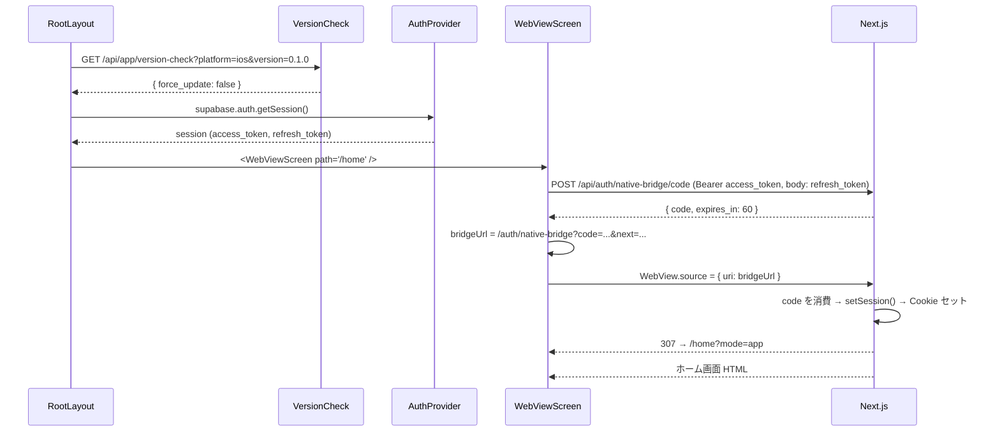
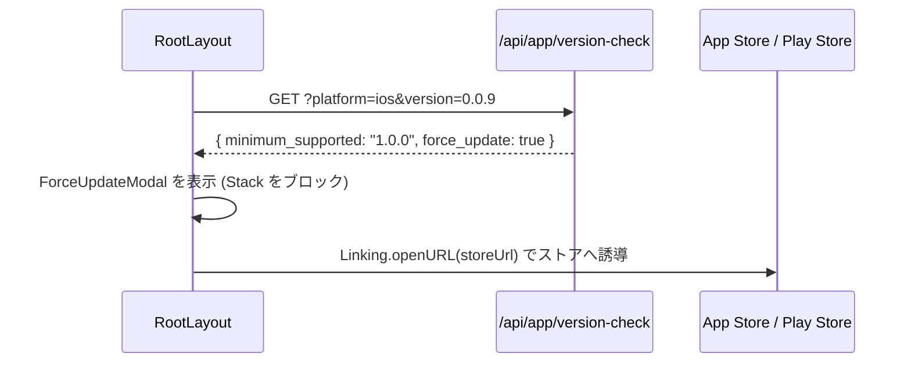

# モバイル App アーキテクチャ設計

## 1. 目的・スコープ

React Native + Expo SDK 58 によるモバイルアプリの全体構成を定義する。
WebView ハイブリッド設計・セッション同期・ビルド設定・強制アップデートを扱う。

**対象外**:
- ディープリンク詳細 → `02-deep-link.md`
- Push 通知詳細 → `03-push-notification.md`
- カメラ/ストレージ詳細 → `04-storage-camera.md`

## 2. 関連要件

- 要件定義 `01-family-management.md §15` (モバイル App 実装要件 全体)
- 要件定義 `01 §15.5` (アプリバージョン強制更新)
- 要件定義 `01 §15.7` (Android FCM / iOS APNs 対応)

## 3. 詳細仕様

### 3.1 技術スタック

| 項目 | 採用 | 備考 |
|------|------|------|
| フレームワーク | React Native (Expo SDK 58) | managed workflow |
| ルーティング | Expo Router 58 (file-based) | `app/` ディレクトリ構成 |
| UI ライブラリ | RN 標準 + `react-native-safe-area-context` | Tailwind 非採用 (Web 側のみ) |
| WebView | `react-native-webview` | WebView ハイブリッドの核 |
| アプリ内課金 | `react-native-purchases` 10.14.0 (RevenueCat)・`expo-dev-client` ~58.0.14 | 有料プランの購入の画面 (billing/03 §8.10・§10.6)。Expo Go では購入が動かない (開発ビルドが要る) |
| ストレージ | `expo-secure-store` (セッション) / `@react-native-async-storage/async-storage` (設定) | |
| 通知 | `expo-notifications` | APNs / FCM 自動振り分け |
| カメラ | `expo-image-picker` | iOS 18 カメラバグ回避のためネイティブ必須 |
| フォント | `@expo-google-fonts/noto-sans-jp` | 既存 |
| ビルド | EAS Build (Expo Application Services) | |
| 配布 | Apple Configurator 2 → TestFlight → App Store | |

### 3.2 WebView ハイブリッド設計

#### 方針

ほめゴハンの全 UI の約 80% は Web 側 (`src/app/` = Next.js App Router) で実装する。
Mobile はそれを `WebViewScreen` コンポーネント経由で表示するラッパーとなる。
ネイティブ専用画面は以下に限定する:

| ネイティブ画面 | ファイル | 理由 |
|-------------|---------|------|
| タブバー + タブ画面群 | `app/(tabs)/` | OS ネイティブタブ UX |
| 家族招待受諾 | `app/family/invite-accept.tsx` | ディープリンクを直接受け取る |
| 組織招待受諾 | `app/org/invite-accept.tsx` | 同上 |
| 認証画面群 | `app/(auth)/` | Supabase Auth セッション初期取得 |
| 設定画面 | `app/(tabs)/settings.tsx` | 通知権限・ログアウト等の OS API |

設定画面はタブバーに出さない (`app/(tabs)/_layout.tsx` の `tabBarButton: () => null` と `tabBarItemStyle: { display: "none" }`。expo-router 58 の `href: null` は route を届かなくするので使わない。mobile/07 §9.10)。入口は、マイページのタブ (WebView) の上に置いた歯車
(`app/(tabs)/profile.tsx`、testID `profile-settings-button`。`WebViewScreen` の `header` に渡す) (#1037)。
ログアウト・通知の設定・退会 (`app/settings/account.tsx`) はここから行う。
アカウントの画面 (`app/settings/account.tsx`) には、個人情報の開示・訂正・利用停止・消去の請求の項目 (testID `account-data-requests-row`) も置く。
押すと Web の請求の画面 (`DSR_SETTINGS_PATH` = `/settings/data-requests`) を WebView で開く画面 (`app/settings/data-requests.tsx`) へ移る
(パス・見出し・説明の文は Web と同じ `@homegohan/shared` の値。cross/15 §9.1・§19。#1812)。

アプリの中で開いた Web の設定画面 (`/settings`) とマイページ (`/profile`) は、ログアウトと退会を出さず、ネイティブの設定画面に一本化する。
「アプリの中か」は既にある判定 (`useNativeAppMode` と `window.ReactNativeWebView`) のどちらかで決め、描画が終わるまでは出さない側に倒す
(`src/hooks/useAccountActionsPlacement.ts`)。ブラウザで開いたときは、Web の画面にログアウトと退会を出す。
Web の設定画面にしか無い項目 (パスワード・メールアドレスの変更など) へは、マイページの「アプリ設定」→「設定」から行ける。

#### WebViewScreen の役割

`src/components/web/WebViewScreen.tsx` が担う処理:

1. **セッションブリッジ URL 生成**: ネイティブが `POST /api/auth/native-bridge/code` (Bearer 認証・body は `refresh_token`) でワンタイム code (単一使用・60 秒有効) を受け取り、`/auth/native-bridge?code=...&next=PATH` を WebView で開く。URL にトークンは載せない (#1036)。実装は `src/lib/webViewBridge.ts`
2. **WebView へのセッション注入はしない**: Web 側のセッションは native-bridge が Cookie に張る (Web のクライアントは Cookie を読む)。localStorage へのセッションの注入は廃止した (#1036)。読み込み前 (`injectedJavaScriptBeforeContentLoaded`) に注入するのは、ネイティブのログアウト・退会のあとの利用者別の localStorage の掃除 (`webViewUserStorageCleanup.ts`、#1037) と、bridge 無しで開くときの前の利用者の Supabase の認証の Cookie の掃除 (#1612 F7-16。05-auth-session.md §8) だけで、自アプリのオリジンのページでだけ動く (`buildOwnOriginOnlyScript`)。Cookie の掃除は bridge で開くときは入れない (bridge のリダイレクトの先のページで動くので、bridge がいま張った新しい利用者の Cookie を消してしまう。bridge は同じ名前の Cookie を上書きする)。localStorage の掃除はセッションに触れないので、bridge との順序はぶつからない
3. **タブ間ナビゲーション intercept**: `buildTabInterceptScript` を inject し、別タブへの `<a>` クリックを `postMessage` で捕捉して Expo Router に委譲。自アプリのオリジン上でのみ実行する。どのパスがどのタブのものか (タブの prefix・Expo Router のルート・タブの既定のパス) は `packages/shared/src/native-app-tabs.ts` の `NATIVE_APP_TABS` だけが決め、Web の `src/components/native-app/NativeAppTabRouter.tsx` も同じ表を見る (#1612 F7-22。以前は Web が `/meals/new`、ネイティブが `/meals` と別々の一覧を持ち、Web が送った tab-navigate が読み捨てられていた)。tab-navigate の `path` はタブの `pathPrefix` そのもので、ネイティブは完全一致で引く (`findNativeAppTabByPathPrefix`)。`tests/native-app-tabs-contract.test.ts` が表と `app/(tabs)` の画面・2 か所の配線を突き合わせる
4. **SPA pushState hook**: `history.pushState` を override し programmatic ナビゲーションも interceptor に流す
5. **ダウンロード処理**: Web 側 `postMessage({ type: 'download' })` を受け取り `expo-sharing` で共有
6. **タブ再タップ時リセット**: `navigation.addListener('tabPress')` でアクティブ WebView を初期 URL へ `window.location.replace`。**オリジンガードは付けない**: 起動時のオフラインで直接 URL の読み込みに失敗して `about:blank` のまま固まった場合や、Android のナビゲーションガードが待ち時間切れで許可して外部ページが載った場合は、WebView が自アプリのオリジンを表示していない。そのとき戻れる手段の一つ (読み込みの失敗の画面の「再読み込み」は 10. を参照)。スクリプトが持つのは公開されている自オリジンの URL だけでトークン・code は含まないので、外部ページ上で実行されても漏れるものは無い
7. **WebView を自アプリのオリジンに固定**: `onShouldStartLoadWithRequest` / `onOpenWindow` で他オリジンへのトップフレームの遷移を遮断し、OS の既定ブラウザで開く (#1158)。`onMessage` は送信元が自アプリのオリジンのときだけ処理する。オリジンは `EXPO_PUBLIC_WEB_URL` の 1 つだけ (Cookie はホスト単位のため)。
   他オリジンの http(s) の**サブフレーム** (iframe) は WebView の中で読み込む。どの iframe を読めるかは Web の CSP (`src/lib/security/csp.ts` の `frame-src`。`src/proxy.ts` が毎リクエスト付ける #1169) が決め、WebView にはページから参照できるトークンが無いため。今 `frame-src` が許す他オリジンは Cloudflare Turnstile (`https://challenges.cloudflare.com`) だけで、`/login` や設定のパスワード変更 (`/settings/account`) がこれを使う (止めるとトークンが取れず送信できない)。
   Android はどのフレームの遷移かを報告しない (`isTopFrame` が無い) ので、`frame-src` の他オリジンの一覧 (`WEB_VIEW_EMBED_ORIGINS`) はフレームを問わず WebView の中で読み込む。`frame-src` に他オリジンを足したら `WEB_VIEW_EMBED_ORIGINS` にも足す (Jest が `src/lib/security/csp.ts` と突き合わせる。OTA が無効なので配布済みのアプリは後から直せない)。Android の WebView が iframe の読み込みをこの判定に渡すかは、Turnstile のある画面を Android 実機で確かめる
8. **`initialPath` の検証**: deep link (`homegohan://home?initialPath=...`) からも指定できるため、単一の `/` で始まる同一オリジンのパスで、かつどれかのタブの prefix (`NATIVE_APP_TABS` の `pathPrefix` = `/menus` `/meals` `/comparison` `/profile` `/home`) か、その画面自身の `path` のパス部分の配下のものだけを受け付ける。`//evil.example` や、攻撃者の code で被害者を攻撃者のアカウントにログインさせる `/auth/native-bridge?code=...` (login CSRF)、`/menus/../auth/...` のようにドットセグメントで prefix の外へ抜けるものは、その画面の既定パス (`path`) へ戻す。tab-navigate が渡す `fullPath` は必ずどれかのタブの prefix に一致するので、正規の経路は塞がない。
   画面自身の `path` を入れるのは、タブ以外の画面 (`/settings/ai-consent`・`/settings/data-requests`) でも `session-expired` の再ブリッジ (`initialPath` に使い捨ての `_rb` を付けて開き直す。05-auth-session.md §6.2) を効かせるため。`path` はコードに書かれた値なので、受け付ける範囲はタブの prefix と同じ強さで限られる。再ブリッジは、この検証を通ったあとのパス (`effectivePath`) に `_rb` を付ける (検証で弾かれた `initialPath` を基準にすると、`_rb` を付けても既定パスに戻されて読み込み直しが起きない)
9. **ネイティブの部品の差し込み**: `header` に渡した部品を WebView の上 (上端の安全領域の内側) に置く (マイページの歯車。#1037)
10. **読み込みの失敗の案内と再読み込み** (#1612 F7-15): 読み込みそのものの失敗 (オフライン・DNS・接続・時間切れなど) は `renderError` で、サーバーの 5xx は `onHttpError` で受け、WebView の部分 (header を除く) を覆う日本語の案内と「再読み込み」を出す (`src/components/web/WebViewErrorView.tsx`)。4xx は Web のページが案内を出すので何もしない。503 も重ねない: Web はメンテナンス中に専用の画面 (再読み込み・運営の方のログインの導線つき。`src/lib/maintenance-mode.ts` の `maintenancePageResponse`) を 503 で返し、`onHttpError` には本文が渡らないので、503 を「エラー」と断定して覆うとメンテナンス中が「エラー」と伝わる (`shouldCoverHttpStatus`)。5xx の案内は、5xx を受けなかった読み込みの `onLoadEnd` か `onError` で消す (`onLoadStart` は Android で `onHttpError` より後に来るので使わない。iOS のページの中の移動の `onLoadEnd` は数えない。`src/components/web/useWebViewHttpFailure.ts`)。「再読み込み」は `reload()` ではなく、WebView を作り直して bridge の code の発行からやり直す (code は一度しか使えない)
11. **タブを離れたときの `initialPath` の消去** (#1612 F7-15): タブ同士の移動で離れたタブの route の `initialPath` を `setParams` で消す (`src/components/web/useResetInitialPathOnBlur.ts`)。残ったままだと、同じ `initialPath` を渡し直しても値が変わらず読み込み直さない。タブの上にネイティブの画面を重ねたとき (タブを持つ親の画面が手前でない) と、タブ以外の WebViewScreen では消さない
12. **規約の同意画面** (#1442・設計書 cross/13b): 同意が要る間はルートのゲート (`LegalConsentGate`) がスタックを同意画面の route (`app/legal-consent.tsx` = `WebViewScreen path="/legal-consent"`) 1 つに畳み、Web の同意画面が `legal-consent-accepted` を送ったら入口へ戻す。`onMessage` はこの合図を `LegalConsentProvider` に知らせる。ログアウト後の移り先は props の `afterSignOut` で変えられ、同意画面だけが渡す

#### postMessage プロトコル (Web → Native)

```typescript
// Web 側から送信するメッセージ型
type WebToNativeMessage =
  | { type: 'tab-navigate'; path: string; fullPath: string }
  | { type: 'navigate-back' }
  | { type: 'download'; filename: string; content: string; mimeType: string }
  | { type: 'open-image-picker'; mode: 'camera' | 'library'; context: UploadContext }
  | { type: 'upload-meal-photo'; familyGroupId?: string };

// Native → Web (injectJavaScript 経由)
type NativeToWebMessage =
  | { type: 'upload-complete'; url: string; path: string }
  | { type: 'upload-error'; code: string; message: string }
  | { type: 'session-expired' };
```

`open-image-picker` と `upload-meal-photo` は `nativeBridge.ts` (新規実装) で処理し、
カメラ起動 → Supabase Storage アップロード → `upload-complete` で Web 側に URL を返す。

#### `download` メッセージの制約 (#1159)

`download` の `filename` / `content` / `mimeType` と、メッセージを送ってきたページは、WebView の中で動く JS が自由に作れる。
ネイティブは何も信用せず、`src/lib/webViewDownload.ts` で次のとおりに扱う。Web 側でエクスポートを増やすときは、この制約に収まるようにする
(収まらないものは、ネイティブ側が書かずに捨てるか、別の名前・形式に直して書く)。
Web 側は `postMessage` を投げたら終わりで、結果を受け取れない。そのため、自アプリの Web ページからの書き出しが失敗したときは、
アプリの画面にアラートを出して利用者に知らせる (何も出さないと、エクスポートを押しても何も起きないように見える)。

| 項目 | 扱い |
|------|------|
| 送信元 | `EXPO_PUBLIC_WEB_URL` (未設定・空文字は既定の本番 URL。WebViewScreen が WebView で開く URL と同じ `getWebBaseUrl()`) と同じオリジン (スキーム + ホスト + ポート) のページからのメッセージだけ処理する。それ以外は何も書かずに捨てる (画面には何も出さず、ログだけ) |
| `filename` | ディレクトリ区切り (`/` `\`) より前は捨てる。英数字と `.` `_` `-` 以外は `_` にする。`..` は作らない。100 文字まで。拡張子は `csv` / `json` / `txt` だけで、それ以外・無いときは `mimeType` から決め、決まらなければ `txt`。使える名前が残らなければ `homegohan-export.<拡張子>` |
| `mimeType` | 共有シートに渡す値は、最終的な拡張子から決める (`csv` → `text/csv`、`json` → `application/json`、`txt` → `text/plain`)。送られてきた値は、拡張子が使えないときの手がかりにだけ使う |
| `content` | 文字列で、52,428,800 文字 (50MiB、`MAX_DOWNLOAD_CONTENT_LENGTH`) 以下。UTF-8 の文字列として書くので、画像や PDF のようなバイナリは扱えない。上限の根拠は下の「本文の上限」 |
| 保存先 | `cacheDirectory` の下の `webview-downloads/`。`documentDirectory` には書かない。1 時間より古いファイルは、次の書き出しのときに消す (共有した直後に消すと、Android では共有先のアプリがまだ読み終えていないことがある) |
| 失敗したとき | 上限超え・本文が文字列でない・書き込みや共有の失敗は、アラート「エクスポートに失敗しました」で知らせる (文面は `getDownloadFailureNotice`。送られてきたファイル名や本文は載せない) |

形式を増やすときは、`webViewDownload.ts` の `ALLOWED_EXTENSIONS` / `MIME_TYPE_BY_EXTENSION` と `__tests__/lib/webViewDownload.test.ts` を合わせて直す。

OTA 更新は無効なので、配布済みのアプリの許可リストは後から直せない。許可リストにない拡張子の `download` は、このサニタイズが入ったアプリでは `txt` として書かれる。
新しい形式を Web 側で使い始めるのは、その形式に対応したアプリが行き渡ってからにする。

##### 本文の上限 (`MAX_DOWNLOAD_CONTENT_LENGTH`)

この上限は、設定画面から送られる 2 種類のエクスポートの大きいほうに合わせる。

| エクスポート | ファイル名 | 大きさ |
|------|------|------|
| 献立の CSV (`GET /api/export/meals`) | `homegohan-meals-YYYY-MM-DD.csv` | 取得する行数に PostgREST の既定の上限 (1000 行) があるため、数 MB 以下 |
| 個人データ一式の JSON (`GET /api/account/export`、#1131) | `homegohan-export-YYYY-MM-DD.json` | UTF-8 で最大 50MiB (`src/lib/account-export.ts` の `DEFAULT_EXPORT_LIMITS.maxTotalBytes`)。データの多いアカウントでは 10MB を軽く超える |

JS の文字列の長さ (UTF-16 の単位数) は UTF-8 のバイト数以下なので、上限を 50MiB 文字にしておけば、API が出すエクスポートは必ず通る。
上限を小さくすると (例えば 10MiB にすると)、データの多い利用者のエクスポートが、エラーも出ないまま失敗する。
API の上限を上げるときは、`MAX_DOWNLOAD_CONTENT_LENGTH` も合わせる。ずれたままだと、ルートの `tests/webview-download-export-limit-contract.test.ts` が失敗する。
新しい上限は新しいアプリのビルドを配布するまで届かず、配布済みのアプリでは古い上限のまま、大きいエクスポートが失敗する点に注意する。

この上限は、ディスク使用量の総量を抑えるものではない (1 時間以内なら別の名前でいくつでも書ける)。主な守りは、送信元の確認。

### 3.3 セッション同期

WebView ハイブリッドにおける最大の課題は「ネイティブ側セッション ↔ WebView 内 Web セッション」の同期である。

#### ログイン時フロー

```
1. ユーザーがネイティブ認証画面でメール/パスワードを入力
2. Supabase Auth → access_token + refresh_token 取得
3. ネイティブ側: expo-secure-store に保存 (AuthProvider)
4. WebViewScreen: ネイティブのセッションを取得 (access_token の残りが 210 秒未満なら先に refreshSession。下の「code 発行時の access_token の残りの閾値」を参照)
5. WebViewScreen: POST {WEB}/api/auth/native-bridge/code (Authorization: Bearer <access_token>, body: { refresh_token }) → { code, expires_in: 60 }
6. WebViewScreen: /auth/native-bridge?code=C&next=/home?mode=app を WebView に表示 (URL に載るのは code のみ)
7. native-bridge (Next.js Route): code を 1 回だけ消費 → Supabase setSession → Cookie にセット → next へリダイレクト
8. これ以降 WebView は Cookie のセッションで認証済み (localStorage へセッションは注入しない)
9. code 発行に失敗した場合 (ネットワーク・非 2xx 等) は、トークンを含まない直接 URL を表示する。旧方式 (トークン付き URL) には決してフォールバックしない
```

#### code 発行時の access_token の残りの閾値

Web 側は、有効期限までの残りが 150 秒未満の access_token には code を発行せず、`401 AUTH_TOKEN_EXPIRING` を返す
(`src/lib/auth/native-bridge-code.ts` の `MIN_ACCESS_TOKEN_REMAINING_SECONDS`)。code の引き換え時とその直後に、Web 側が
refresh_token をローテーションしてしまわないようにするため (ローテーションされると、ネイティブが持つ refresh_token が使用済みになる)。

| 値 | 意味 | 定義 |
|----|------|------|
| 90 秒 | 端末の supabase-js の `getSession()` が自動更新を始める残り (`EXPIRY_MARGIN_MS`)。これを切るまで更新しない | supabase-js (auth-js) |
| 150 秒 | Web 側の下限 = code の有効期間 60 秒 + 上の 90 秒 | Web: `MIN_ACCESS_TOKEN_REMAINING_SECONDS` / モバイル: `BRIDGE_SERVER_MIN_TOKEN_TTL_SEC` |
| 210 秒 | モバイルが先に `refreshSession` する閾値 = 150 秒 + 余裕 60 秒 (通信時間は最大 8 秒。残りは端末の時計の遅れを見込む) | モバイル: `BRIDGE_MIN_TOKEN_TTL_SEC` |

- 端末の `getSession()` は残り 90 秒を切るまで更新しないので、bridge の時点の access_token の残りは 90〜3600 秒になる。90〜150 秒の区間は、事前に更新しないと Web 側が必ず 401 にする。
  閾値を Web 側の下限より低くすると、その差の区間に開いたタブが、code を取れずに未ログインの直接 URL になる (例: 閾値が 120 秒なら、残り 120〜150 秒 = 1 時間のうち 30 秒)
- 閾値を 210 秒にしたことで、`refreshSession` が走るのは 1 時間のうち約 3% のタブ表示 (残り 90〜210 秒) になる
- 更新に失敗したときは、残りが 150 秒以上なら現在のトークンで code を発行してもらい、足りなければ code 発行を呼ばずに直接 URL を表示する (Web 側が必ず 401 にする POST を省く)。auth-js 2.117 では、60 秒以内に同じ refresh_token の更新が失敗していると、`refreshSession` は `/token` を呼ばずに控えた失敗を返すので、これも「更新に失敗した」に入る (`docs/design/mobile/05-auth-session.md` §9.6 ① の bridge の行・S-24)
- Web 側の 150 秒と、モバイル側の `BRIDGE_SERVER_MIN_TOKEN_TTL_SEC` は必ず同じ値に保つ。OTA が無効なので、配布済みのアプリの値は後から直せない
- 端末の時計が実時間より 1 分前後以上遅れていると、余裕を使い切って 401 になり得る (そのときは直接 URL に倒れる)

#### ログアウト時フロー

順の正は `apps/mobile/src/lib/signOut.ts` (設定画面のログアウトと、アカウントの画面 (`app/settings/account.tsx`) で退会の API が 401 (ログインが切れている) を返したときのログアウトは `signOutOnDevice`、退会のあとは `signOutAfterAccountDeletion`)。
未ログインになるほかの経路 (起動時・`SIGNED_OUT`) との関係は `apps/mobile/src/providers/AuthProvider.tsx` の先頭の表と 05-auth-session.md §3。

```
1. この端末の push token の行を user_push_tokens から消す (退会のあとは無し。ON DELETE CASCADE で消える)
2. clearUserScopedLocalData(userId) (apps/mobile/src/lib/userScopedLocalData.ts。サインアウトの前に)
   - 利用者別の AsyncStorage のキーを消す
   - 次に開く WebView に、利用者別の localStorage の掃除を頼む
   - 端末の Cookie の置き場を空にする (Networking.clearCookies。完了を待つ。上限 WEB_VIEW_NATIVE_COOKIE_CLEAR_TIMEOUT_MS)
3. supabase.auth.signOut() → ネイティブ SecureStore のトークン削除 (失敗したら端末だけで消し、画面の状態も消す)
4. WebView の Cookie セッションは 2 段で消える (#1612 F7-16。05-auth-session.md §6.4)
   ① 2 の Networking.clearCookies (Android は WebView の CookieManager、iOS は NSHTTPCookieStorage)
   ② iOS の WKWebView が自分で持つ置き場は、次に bridge 無しで開く WebView の注入の JS が sb- の Cookie を期限切れにする
      (bridge で開くときは、bridge が同じ名前の Cookie を上書きする)
5. 画面は未ログインになり、index.tsx がログイン画面へリダイレクトする
```

#### セッションリフレッシュ

- ネイティブ側: `AuthProvider` が `supabase.auth.onAuthStateChange` を listen し、自動リフレッシュ
- WebView 側: Next.js middleware の `updateSession()` が Cookie を自動リフレッシュ
- トークン期限切れ時: Native → `injectJavaScript` で `{ type: 'session-expired' }` をポスト → Web 側でログアウト処理

## 4. データモデル

セッション同期専用のデータは既存テーブルを使用。新規マイグレーション不要。

```sql
-- 既存テーブル: セッション関連
-- user_push_tokens: Push Token 登録 (03-push-notification.md で詳細)
-- notification_preferences: 通知設定 (03-push-notification.md で詳細)
```

バージョンチェック用 API は DB テーブルではなく環境変数から動的に返す:

```typescript
// src/app/api/app/version-check/route.ts (新規)
// GET /api/app/version-check?platform=ios&version=1.2.3
// Response: { minimum_supported: "1.0.0", current: "1.2.3", force_update: false }
```

## 5. シーケンス

### 5.1 アプリ起動からホーム表示まで



### 5.2 強制アップデートモーダル



## 6. ファイル構成

```
apps/mobile/
├── app/                              # Expo Router (ページ)
│   ├── _layout.tsx                  # 既存 + Linking.addEventListener 追加 (02-deep-link.md)
│   ├── index.tsx                    # ルートリダイレクト
│   ├── legal-consent.tsx            # 規約の同意画面: WebViewScreen path="/legal-consent" (13b。#1442)
│   ├── (auth)/                      # ネイティブ認証画面
│   ├── (tabs)/                      # ネイティブタブバー (WebView のタブの表の正は @homegohan/shared の NATIVE_APP_TABS)
│   │   ├── _layout.tsx
│   │   ├── home.tsx                 # WebViewScreen path="/home"
│   │   ├── menus.tsx                # WebViewScreen path="/menus/weekly" (NATIVE_APP_TABS の rootPath)
│   │   ├── meals.tsx                # WebViewScreen path="/meals/new" (NATIVE_APP_TABS の rootPath)
│   │   ├── comparison.tsx           # WebViewScreen path="/comparison"
│   │   ├── profile.tsx              # WebViewScreen path="/profile" (設定への歯車つき)
│   │   └── settings.tsx             # ネイティブ設定画面 (OS API 使用。タブバーには出さない: tabBarButton: () => null と display: none)
│   ├── family/
│   │   └── invite-accept.tsx        # 新規: homegohan://invite/family/{token}
│   └── org/
│       └── invite-accept.tsx        # 新規: homegohan://invite/org/{token}
│
├── src/
│   ├── components/
│   │   ├── web/
│   │   │   └── WebViewScreen.tsx    # 既存 (メンテナンス)
│   │   └── legal/
│   │       └── LegalConsentGate.tsx # 新規: 同意が要る間、スタックを同意画面 1 つに畳む (13b)
│   ├── lib/
│   │   ├── supabase.ts              # 既存
│   │   ├── api.ts                   # 既存
│   │   ├── deeplink.ts              # 既存 + parseInviteLink() 追加 (02-deep-link.md)
│   │   ├── pushNotifications.ts     # 既存 (setBadgeCountAsync は呼ばない。03-push-notification.md §3.5)
│   │   ├── storage.ts               # 既存 + uploadMealPhoto() 追加 (04-storage-camera.md。以前の storage.ts は 2026-10-16 に削除した。#1598)
│   │   ├── nativeBridge.ts          # 新規: Web ↔ Native 通信ハブ
│   │   └── legal-consent.ts         # 新規: 403 LEGAL_CONSENT_REQUIRED の見分け・同意画面の扱い (13b)
│   ├── providers/
│   │   ├── AuthProvider.tsx         # 既存
│   │   ├── ProfileProvider.tsx      # 既存
│   │   └── LegalConsentProvider.tsx # 新規: GET /api/legal/status から同意の状態を決める (13b)
│   └── theme/                       # 既存
│
├── app.json                         # scheme: "homegohan" 設定済み
└── eas.json                         # preview/production プロファイル定義済み
```

以前の木にあった `(tabs)` の健康の画面 (`health.tsx`)・お気に入り (`favorites.tsx`) は、通常の操作で届かないネイティブの画面として 2026-10-16 に削除した。#1598
同じとき、タブ・設定の歯車の先から届かない残りのネイティブの画面 (AI 相談・健康の記録と健診・食事の詳細・週の献立・冷蔵庫・買い物リスト・レシピ・バッジ・`(org)`・`(support)`・`(super-admin)`) も削除した。

## 7. ビルド設定

### 7.1 app.json 概要

```json
{
  "expo": {
    "name": "ほめゴハン",
    "slug": "homegohan",
    "scheme": "homegohan",
    "version": "0.1.0",
    "runtimeVersion": { "policy": "fingerprint" },
    "ios": {
      "bundleIdentifier": "com.homegohan.app",
      "infoPlist": {
        "NSCameraUsageDescription": "食事写真を撮影するためにカメラを使用します。",
        "NSPhotoLibraryUsageDescription": "食事写真を選択するために写真ライブラリを使用します。"
      }
    },
    "android": {
      "package": "com.homegohan.app",
      "permissions": ["android.permission.CAMERA", "android.permission.POST_NOTIFICATIONS"]
    },
    "plugins": [
      "expo-router",
      "expo-image-picker",
      "expo-notifications",
      ["expo-splash-screen", { "image": "./assets/splash-ios.png", "resizeMode": "contain", "backgroundColor": "#FFF7ED", "enableFullScreenImage_legacy": true }]
    ]
  }
}
```

`scheme: "homegohan"` は既に設定済みのため、ディープリンク `homegohan://` は追加設定不要。

### 7.2 EAS Build プロファイル

```
development  → developmentClient + iOS simulator + channel: development
preview      → internal distribution + iOS .ipa (Apple Configurator 2) + Android .apk
production   → App Store submission + Android .aab
```

`eas.json` の既存設定で対応済み。使う環境変数 (どれも既存):

| 変数 | プロファイル | 用途 |
|------|-----------|------|
| `EXPO_PUBLIC_EAS_PROJECT_ID` | preview / production | Expo Push Token 取得 (既存) |
| `EXPO_PUBLIC_WEB_URL` | 全プロファイル | WebView ベース URL (既存)。`http://` は開発ビルド (`__DEV__`) か localhost / 10.0.2.2 等の開発用ホストだけ。本番ビルドで `http://` を設定しても、refresh_token を平文で送らないよう既定の https オリジンに戻る |
| `EXPO_PUBLIC_SUPABASE_URL` | 全プロファイル | Supabase URL (既存) |

Android の FCM は、FCM V1 の資格情報 (Google のサービスアカウントキー) を EAS に登録する (環境変数・EAS Secret ではない。旧い FCM サーバーキーは使わない)。登録はオーナーの作業で、未登録の間は Android の端末だけ届かない (`mobile/06-push-send.md` §14)。 iOS の APNs キーは登録済み。

### 7.3 配布フロー

```
開発: eas build --platform ios --profile development --local
      → Apple Configurator 2 で USB インストール

Preview: eas build --platform ios --profile preview --local
         → Apple Configurator 2 で実機テスト
         eas build --platform android --profile preview
         → adb install で Android 実機テスト

本番: eas build --platform ios --profile production
     eas submit --platform ios
     eas build --platform android --profile production
     eas submit --platform android
```

## 8. 強制アップデート

破壊的 API 変更 (snake_case 統一・エンドポイントリネーム等) で旧バージョンのアプリが動作不能になる際に強制更新ダイアログを表示する。

### API 仕様

```
GET /api/app/version-check?platform=ios&version=0.1.0

Response 200:
{
  "minimum_supported": "1.0.0",
  "current": "1.2.0",
  "force_update": false
}
```

`force_update: true` の場合、RootLayout でモーダルを表示して操作をブロックし、
App Store / Play Store のアプリページへ誘導する。

### 実装箇所

- API: `src/app/api/app/version-check/route.ts` (新規)
  - 環境変数 `MINIMUM_SUPPORTED_VERSION`, `CURRENT_APP_VERSION` から返す
- ネイティブ: `app/_layout.tsx` にて起動直後に `fetch('/api/app/version-check')` を呼び出す
  - `force_update: true` なら `<ForceUpdateModal>` を Stack の上に被せてレンダリングをブロック

```typescript
// app/_layout.tsx への追加イメージ
const [forceUpdate, setForceUpdate] = useState(false);

useEffect(() => {
  (async () => {
    try {
      const res = await fetch(`${API_BASE}/api/app/version-check?platform=${Platform.OS}&version=${appVersion}`);
      const data = await res.json();
      if (data.force_update) setForceUpdate(true);
    } catch {
      // ネットワークエラー時はスキップ (オフライン対応)
    }
  })();
}, []);
```

## 9. エラーハンドリング

| シナリオ | 対処 |
|---------|------|
| WebView の読み込み中 | `renderLoading` のスピナー |
| WebView の読み込み失敗 (オフライン・DNS・接続・TLS・時間切れ) | `renderError` で `WebViewErrorView` (「画面を読み込めませんでした」の案内 + 「再読み込み」)。「再読み込み」は `WebViewScreen` を作り直し、bridge の code の取得からやり直す (#1612 F7-15) |
| サーバーが 5xx (503 を除く) を返した | `onHttpError` で覚え (`useWebViewHttpFailure.ts`)、エラーの番号つきの `WebViewErrorView` を WebView の上に重ねる。503 (メンテナンス中の画面など) と 4xx は Web のページをそのまま見せる (#1612 F7-15) |
| セッション取得失敗 | `uri = WEB_BASE_URL + path?mode=app` (未ログイン状態で表示) |
| bridge code 発行失敗 (ネットワーク・タイムアウト 8 秒・非 2xx) | 同上。トークンを含まない直接 URL を表示し、旧方式のトークン付き URL にはフォールバックしない |
| access_token の残りが Web 側の下限 (150 秒) 未満で、`refreshSession` にも失敗 | code 発行を呼ばず (Web 側が必ず 401 にするため)、同上の直接 URL を表示 |
| 他オリジンへの遷移 (レシピ等の外部リンク) | WebView では開かず OS の既定ブラウザで開く。WebView は元のページのまま |
| バージョンチェック API エラー | スキップして起動継続 (オフライン対応) |
| native-bridge の code の引き換えの失敗 (形式不正・期限切れ・使用済み・DB 障害)・`setSession` の失敗 | 500 にせず `/login` へ 307。code の引き換えに失敗したときは、WebView に残った Cookie セッションでは進まず、`sb-` の Cookie を消してから (#1647)。WebView の中のログイン画面は `session-expired` を送り、ネイティブが新しい code で開き直す (回数制限つき。05-auth-session.md §6.2) |

## 10. テスト方針

| レベル | ツール | カバレッジ |
|--------|--------|-----------|
| Unit | Jest (RNTL) | `nativeBridge.ts` のメッセージ解析、セッションブリッジ URL 生成 |
| Integration | Jest + MSW | バージョンチェック API レスポンス処理 |
| E2E | Maestro | アプリ起動 → ホーム表示 → ログアウト |
| Manual | Apple Configurator 2 | 実機での WebView/カメラ/Push |

## 11. 既存実装との関連

### 保持

- `apps/mobile/` 全体 (ファイル構成・WebView ハイブリッド設計)
- `src/components/web/WebViewScreen.tsx` (既存実装そのまま。`postMessage` ハンドラー追加のみ)
- `src/providers/AuthProvider.tsx`, `ProfileProvider.tsx`
- `app/(tabs)/` 全画面
- `app.json` の `scheme: "homegohan"` 設定

### 修正

- `app/_layout.tsx`: Linking.addEventListener 追加 + バージョンチェック呼び出し追加
- `src/components/web/WebViewScreen.tsx`: `onMessage` ハンドラーに `open-image-picker` / `upload-meal-photo` 追加。規約の同意画面向けに `legal-consent-accepted` の受け口と props `afterSignOut` (13b。#1442)

### 新規

- `app/family/invite-accept.tsx`
- `app/org/invite-accept.tsx`
- `src/lib/nativeBridge.ts`
- `src/app/api/app/version-check/route.ts` (Web 側)

## 12. ハンズオンチュートリアル ルーティング (family/09 連携)

family/09 初回オンボーディングハンズオンチュートリアルが Mobile 側に追加するルーティング・コンポーネント・コンテキストの canonical。詳細(行数目安、ファイル一覧、テスト fixture)は family/09 §16-files-structure.md 参照。

### 12.1 Expo Router 経路

家族・組織の WebView ハイブリッドとは異なり、ハンズオンチュートリアルは **ネイティブ画面** で実装する(WebView ではない)。理由は family/09 設計書 §00 §3:

- Spotlight overlay の精度確保(`MaskedView` + Reanimated v3 ネイティブ実装が必要)
- iOS Dynamic Type AX5 (2.85x) 対応のため、WebView 内 CSS では制御困難
- 紙吹雪アニメーション(Step 4)を 60fps で出すため

| ルート | ファイル | 用途 |
|---|---|---|
| `/handson-tour` | `apps/mobile/app/handson-tour/_layout.tsx` | TourProvider でラップする layout |
| `/handson-tour` (index) | `apps/mobile/app/handson-tour/index.tsx` | Step 0 ウェルカム |
| `/handson-tour/photo` | `apps/mobile/app/handson-tour/photo.tsx` | Step 1 写真追加 sandbox |
| `/handson-tour/menu` | `apps/mobile/app/handson-tour/menu.tsx` | Step 2 AI 献立 sandbox |
| `/handson-tour/badges` | `apps/mobile/app/handson-tour/badges.tsx` | Step 3 バッジ確認 |
| `/handson-tour/graduate` | `apps/mobile/app/handson-tour/graduate.tsx` | Step 4 卒業 |

Step 5(welcome toast)は通常 `/home` 復帰後にネイティブ Toast として表示。

### 12.2 ディープリンク

`homegohan://handson-tour` および `homegohan://handson-tour?force=1` を受け付ける。`apps/mobile/src/lib/deeplink.ts`(既存ファイル)の `parseInviteLink()` 列に handson-tour 分岐を追加。

ただし Phase 1 では deep link は未公開、`/settings` の「使い方ガイドをもう一度見る」リンクのみが `router.push('/handson-tour?force=1')` で再表示する仕組み(family/03 §11.6)。

### 12.3 新規 Mobile 側ファイル

```
apps/mobile/
├── app/handson-tour/
│   ├── _layout.tsx
│   ├── index.tsx              # Step 0
│   ├── photo.tsx              # Step 1
│   ├── menu.tsx               # Step 2
│   ├── badges.tsx             # Step 3
│   └── graduate.tsx           # Step 4
└── src/handson-tour/
    ├── TourOverlay.tsx        # MaskedView + Reanimated
    ├── TourBubble.tsx
    ├── TourProgress.tsx
    ├── TourSandboxWrapper.tsx
    ├── Confetti.tsx           # Step 4 紙吹雪 (Reanimated 自前)
    ├── useTourOverlayLogic.ts
    ├── useReducedMotion.ts    # AccessibilityInfo.isReduceMotionEnabled()
    └── index.ts
```

加えて:
- `apps/mobile/src/contexts/TourContext.tsx` 新規(Tour 全体 state)
- `apps/mobile/assets/handson-tour/sample-meal.jpg` 新規(~200KB、Web から cp)

詳細行数目安は family/09 §16-files-structure.md §1.3 参照(合計 ~1740 行)。

上の木は設計時の一覧。あとから `src/handson-tour/` に足したファイル (`useLeaveTour.ts`・`tour-platform.ts`・`safe-nickname.ts`・`photo-save-failure.ts`・`menu-tour-profile.ts`・`tour-bubbles.ts`) を含むいまの一覧は 16-files-structure.md の §1.3 の表と §5 の木 (`tests/handson-tour-files-structure-doc.test.ts` が実ファイルと突き合わせる)。

### 12.4 既存ファイル修正

| 既存ファイル | 修正内容 |
|---|---|
| `apps/mobile/src/components/menu/V4GenerateModal.tsx` (642 行) | `mode='sandbox'` prop 対応 + sandbox 用 props 受信(§99 §1.2 Q9) |
| ~~`apps/mobile/app/badges/index.tsx`~~ | (2026-10-16 に削除した。#1598。バッジの一覧は Web の画面で、ツアーの Step 3 は `app/handson-tour/badges.tsx` が受け持つ) |
| `apps/mobile/app/(tabs)/settings.tsx` 等の settings 画面 | 「使い方ガイドをもう一度見る」行追加(family/03 §11.6) |
| ~~`apps/mobile/app/meals/new.tsx`~~ | (2026-10-15 に削除。#1598。スキャンのタブは WebView で、ツアーの Step 1 は `app/handson-tour/photo.tsx` が受け持つ) |
| `apps/mobile/src/lib/posthog.ts`(新規) | `posthog-react-native` 初期化(operator/07 §15.1) |

### 12.5 共通 package との連携

`packages/handson-tour-shared/`(workspace package)を `apps/mobile/package.json` の dependencies に追加:

```json
{
  "dependencies": {
    "@homegohan/handson-tour-shared": "workspace:*"
  }
}
```

mock データ・型・i18n・analytics ヘルパーはすべて此処から import。Web/Mobile で重複実装しない(設計書 §99 §1.1 確定)。

### 12.6 ネイティブ依存追加

| パッケージ | 用途 | 既存 / 新規 |
|---|---|---|
| `@react-native-masked-view/masked-view` | TourOverlay の Spotlight 穴抜き | 新規(EAS Build 設定で nativewind / linking 必要) |
| `react-native-reanimated` v3 | 入場 / spotlight 移動 / 紙吹雪 | 既存(確認要) or 新規 |
| `posthog-react-native` | Analytics 配信 | 新規 |

EAS Build 前にローカル `npm ci` + 型チェック必須(lock 不整合・型エラーは静的に潰すこと、CI 待ちで検出する運用は不可)。

### 12.7 a11y 要件 (Mobile 固有)

- iOS Dynamic Type AX5 (2.85x) で TourBubble がはみ出ないこと(§99 Q17 open、Phase 4 で実機検証)
- VoiceOver / TalkBack で各 Step タイトル → 本文 → primary action の順
- `AccessibilityInfo.isReduceMotionEnabled()` 購読で reduced-motion 対応
- ハードバック(Android)は `BackHandler` で skip API 発火

### 12.8 テスト方針

Maestro flow を `apps/mobile/maestro/flows/tour/` 配下に 12 件追加(family/09 §16 §1.7):

| flow | 内容 |
|---|---|
| `01-handson-completion.yaml` | 正常系(Step 0 → 4 完走) |
| `02-skip-at-welcome.yaml` | Step 0 でスキップ |
| `03-hard-back.yaml` | ハードバックで skip |
| `04-step1-error-retry.yaml` | Step 1 API 失敗 → リトライ |
| `05-step2-menu-success.yaml` | Step 2 正常 |
| `06-step2-error-retry.yaml` | Step 2 API 失敗 → リトライ |
| `07-step3-badges.yaml` | Step 3 バッジ表示 |
| `08-step4-graduation.yaml` | Step 4 卒業 |
| `09-step4-retry.yaml` | Step 4 API 失敗 → リトライ |
| `10-force-replay.yaml` | force=1 再表示 |
| `11-admin-skip.yaml` | admin ロール auto-skip |
| `12-existing-user-skip.yaml` | 既存ユーザー auto-skip |

ハンズオン Maestro 着手は Issue #626(testID 不足)/ #627(Maestro stuck)解消後に並列着手。

## 13. 未解決事項

| 項目 | 優先度 | 担当 |
|------|--------|------|
| Android FCM 動作確認 (実機テスト) | 高 | 送信の worker (`GET /api/cron/push-outbox`) は本番の Vercel Cron に登録済み。ただし本番に `EXPO_ACCESS_TOKEN` が入るまでは、送らずに掃除だけをする (iOS・Android とも届かない。入れるのはオーナーの作業で、#1115)。Android はこれに加えて、FCM V1 の資格情報を EAS に登録してから実機で確かめる (`mobile/06-push-send.md` §14。登録までは Android の端末だけ届かない) |
| iOS 18 カメラ dismiss バグの根本解消 | 高 | `04-storage-camera.md` に詳細 |
| Universal Links 対応 (Phase 2) | 低 | Apple Configurator 2 配布が続く間は不要 |
| Biometric 認証 (Face ID / Touch ID) | 中 | `cross/01-auth-session.md` Phase 2 予定 |
| OTA Update (expo-updates) | 低 | `app.json` で `enabled: false` のまま。`runtimeVersion` は fingerprint (mobile/07 §11)。番兵 `tests/mobile-toolchain-contract.test.ts` |

## 14. 課金 (アプリ内課金の購入の画面。Web の購入のページへは誘導しない)

正典は `docs/design/billing/03-paid-plans-and-iap.md` §8.10・§10.6 (`docs/design/billing/01-billing-core.md` §10.4 を改めたもの)。

- アプリ内課金の購入の画面 (`app/settings/plan.tsx`。billing/03 §10.6)。設定タブの「プランとお支払い」の行から開く。購入・購入の復元・ストアの購読の管理はこの画面で行う。依存は `react-native-purchases` 10.14.0 と `expo-dev-client` ~58.0.14 (開発ビルドが要る。Expo Go では購入が動かない)。
- Web の購入のページへの誘導は引き続き出さない。アプリ内 (ネイティブの画面と、アプリが開く WebView のページの両方) に、Web の有料プランの価格・購入ボタン・Web での購入への誘導 (リンク・文言) を出さない。Web で申し込んだ契約は、購入の画面に「Web の「プランとお支払い」から行えます」の文だけを出す (リンクは出さない)。
- 例外 (法定表示): 購入の画面 (`app/settings/plan.tsx:383`) は「特定商取引法に基づく表記」の `/legal` を外部のブラウザ (`Linking.openURL`) で開く。`/legal` は法定表示として Web の支払方法・Web の無料体験の文を含み (`src/app/legal/page.tsx:52`・`:79`)、ヘッダのロゴから紹介ページ経由で `/pricing` に届く (`src/components/marketing/landing-copy.ts:789`)。`/legal` に購入への CTA は置かない。
- ネイティブの料金の画面 `app/(public)/pricing.tsx` (Web の `/pricing` を外部のブラウザで開いていた) と、入口の画面 `app/index.tsx` の「料金」のリンクは削除した (外部のブラウザには `is_native_app` の Cookie が無く、Web の `/pricing` が価格と購入の CTA を描くため)。`apps/mobile/__tests__/app/no-web-purchase-links.test.ts` が、`app/` と `src/` に `/pricing`・`/account/billing` を開くコードが無いことを見張る。
- Web の `/pricing`・`/account/billing`・`/account/billing/checkout` は `is_native_app` の Cookie (`cookies()` / `useNativeAppMode`) で購入導線を描かない。`/frozen/billing` はアプリの WebView (`isInNativeWebView()`) では解約と Billing Portal のボタンを描かない。API には制限を付けない (認可は同じ。制限は表示の規則)。
- 配布の順: 料金の画面を消した版のアプリを配布してから、Web で販売を始める (billing/01 §17.3)。ストアの規約の最新の文面と審査での判断は billing/01 §18 の 2。
