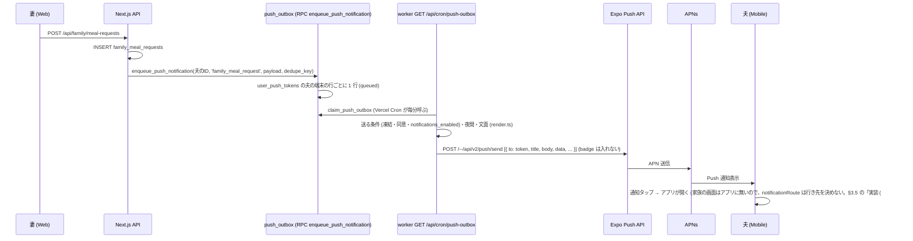
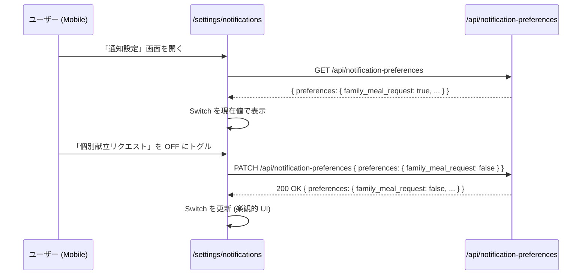

# Push 通知設計

## 1. 目的・スコープ

Expo Push Notifications を使用したプッシュ通知の設計を定義する。
トークン登録・通知ペイロード・バッジカウント・通知種別 on/off・Quiet Hours を扱う。

**対象外**:
- Web 側の通知ベル UI → `family/03-ui-spec.md` / `org/03-ui-spec.md`
- メール通知 (`notify-email` Edge Function) → `operator/08-cron-batches.md`
- サーバーからの送信 (送信待ち `push_outbox`・worker `GET /api/cron/push-outbox`・receipt・種類の一覧 `PUSH_NOTIFICATION_KINDS`) → `06-push-send.md` (#1136)

## 2. 関連要件

- 要件定義 `01-family-management.md §15.3` (Push 通知バッジカウント)
- 要件定義 `01-family-management.md §15.4` (通知種別 on/off)
- 要件定義 `01-family-management.md §15.7` (Android FCM / iOS APNs)

## 3. 詳細仕様

### 3.1 Expo Push 通知の概要

```
送信者 (Next.js の worker GET /api/cron/push-outbox。06-push-send.md)
  → Expo Push API (https://exp.host/--/api/v2/push/send)
    → APNs (iOS) / FCM (Android)
      → ユーザーのデバイス
```

- Expo Push Token 形式: `ExponentPushToken[xxxxxxxxxxxxxxxxxxxxxx]`
- Expo がプラットフォーム差異 (APNs/FCM) を吸収するため、送信側のコードは統一できる
- ただし iOS と Android で通知の表示動作に差異があるため注意 (§3.8 参照)

### 3.2 Push Token 登録

#### 既存実装 (`src/lib/pushNotifications.ts`)

`registerAndSaveExpoPushToken()` 関数が以下を行う:
1. `expo-notifications` で権限確認・リクエスト
2. Android: 通知チャンネル `"default"` 作成
3. `Notifications.getExpoPushTokenAsync({ projectId })` でトークン取得
4. `user_push_tokens` テーブルに `upsert` (onConflict: `user_id,expo_push_token`)
5. `POST /api/push-tokens/claim` で、同じトークンのほかの利用者の行をサーバー (service_role) で外す (#1599)。
   共有の端末で前の利用者のログアウトの削除がオフラインなどで失敗しても、次に登録した利用者だけにトークンが紐づく
   (同じトークンは、最後に登録した 1 人だけ)。失敗したら登録の失敗として扱い、次回起動時に再試行する。
   起動時の自動登録 (`ensurePushTokenRegistered`) は、起動・ログインした利用者が変わるたびに 1〜5 を通す (「登録済み」の印で省かない。
   ほかの利用者の claim で行が消えていても、次のログインで登録し直すため)

#### 所有の証明 — 端末の秘密の値 (#1636)

トークンの値を知っているだけの他人が、自分の行としてその値を登録 (RLS で自分の行は書ける) して claim すると、持ち主の行を消せた。
そこで、claim が外す行を「同じ端末の前の利用者の行」に絞る。取り決めの正本は `packages/shared/src/push-token-claim.ts`。

- **端末の秘密の値 (install secret)**: 端末 (アプリのインストール) ごとに 1 つ。32 バイトの乱数の base64url (43 文字)。
  サーバーが作って claim の応答で 1 度だけ返し、端末が保管庫 (`expo-secure-store`。`AFTER_FIRST_UNLOCK_THIS_DEVICE_ONLY`) に置く
  (`apps/mobile/src/lib/pushInstallSecret.ts`)。サーバーは値を持たず、SHA-256 (16 進の小文字 64 文字) を `user_push_tokens.install_secret_hash` に持つ
  (migration `20261016163600_user_push_tokens_install_secret.sql`。CHECK で形を固定)。
  利用者ごとではない (同じ端末でログインした利用者はみな同じ値)。ログアウト・退会の掃除では消さない。
  アプリに安全な乱数の部品 (`expo-crypto` など) が無いので、ネイティブの部品を足さずに済むよう、サーバー (`node:crypto`) で作る
- **claim の本文と動き** (`src/app/api/push-tokens/claim/route.ts`)

  | 本文 | アプリがこう送るとき | 本人の行のハッシュ | 外す行 (同じトークンの、ほかの利用者の行のうち) | 応答 |
  |---|---|---|---|---|
  | `{ expo_push_token, install_secret }` | 保管庫に値がある | 送った値のハッシュを書く | ハッシュが同じ行 (= 同じ端末の前の利用者) と、ハッシュの無い行 | `{ released }` |
  | `{ expo_push_token, issue_install_secret: true }` | 保管庫に値が無い (初回・保管庫の値が壊れた) | 作った値のハッシュを書く | ハッシュの無い行 | `{ released, install_secret }` (アプリが保管庫に置く) |
  | `{ expo_push_token }` | 古い版のアプリ (#1636 より前)・保管庫を読めなかった | 触れない | ハッシュの無い行 | `{ released }` |

  両方を同時に送る・形の違う値は 400。ハッシュの無い行 (古い版のアプリの行) は、移行のあいだ今までどおり外す
  (新しい版のアプリは起動のたびに claim して自分の行にハッシュを書くので、新しい版の利用者の行は守られる。古い版の利用者の行は守られない)。
  応答は `Cache-Control: private, no-store`
- 保管庫を読めないときは、値を作り直さない (作り直すと、この端末の前の利用者の行を外せなくなる)。次の起動でやり直す
- 本人の行のハッシュは RLS で本人が書き換えられるが、守っているのはハッシュではなく秘密の値 (端末の保管庫にだけある)。
  サーバーは本文の値からハッシュを計算し直して比べるので、自分の行に好きなハッシュを書いても、ほかの利用者の行は外せない
- 他人の端末の値では外せない代わりに、他人が同じトークンで登録した行 (別のハッシュ) は、持ち主の claim でも外れない
  (他人の通知が持ち主の端末に届くことはありうる。持ち主の情報は漏れない。#1599 より前と同じ)
- 比べた案: Expo の push receipt や通知で送ったノンスを端末に返させる案は、通知の到達 (iOS の無音の通知の間引きなど) に頼り、
  往復と待ちが要る。端末で作った鍵の署名は、アプリに暗号の部品を足す必要がある。サーバーが作る秘密の値が部品も往復も最も少ない

#### セッションの無いときの後片付け — release (#1636)

ログアウト (`signOut.ts`) を通らずにセッションが終わったとき (自動更新で refresh_token が失効と答えた `SIGNED_OUT`・起動時にサーバーが失効と明言したとき) は、
セッションが無いので RLS では行を消せない。`POST /api/push-tokens/release` (`{ expo_push_token, install_secret, user_id }`。認証なし) で消す
(`src/app/api/push-tokens/release/route.ts`)。サーバーは利用者 ID・トークン・秘密の値のハッシュの 3 つが合う行だけを消す
(本文の利用者の行だけなので、サインアウトのあとにすぐ別の利用者がログインして登録した行は巻き込まない。ハッシュの無い行は所有を確かめられないので消さない)。
アプリ側の流れは `05-auth-session.md` §3 と `apps/mobile/src/lib/pushTokenRelease.ts`。

- 消せなかったとき (圏外・メンテナンス中の 503・サーバーのエラー) は、宛先 (利用者 ID とトークンの値) を AsyncStorage の `push_token_release_pending_v1`
  (利用者別のキーではない。上限 10 件) に控え、次の起動 (未ログインと決まったとき) と次の `SIGNED_OUT` でやり直す。400 は控えから捨てる
- サインアウトした利用者が分からないとき (アプリが閉じている間に refresh_token が失効し、次の起動で supabase-js の初期化がセッションを消したときなど) は、
  端末に残っている値 (`push_token_value_v1:<利用者>`) を全部宛先にする (端末は未ログインなので、どれもサインアウトした利用者のもの)。
  起動時に未ログインと決まったときは、掃除が値を消す前に控える (`05-auth-session.md` §3)
- 同じトークンの claim が秘密の値つきで成功したら、そのトークンの控えを捨てる (同じ端末の前の利用者の行はそれで外れる)
- 登録 (upsert) は、動いている release が終わってから行う (未ログインの起動で始めた release が、すぐにログインした同じ利用者の登録し直した行を消さないように)
- 端末に秘密の値が無いとき (古い版のアプリで登録した端末) は、release では消せないので控えを捨てる (次にこの端末でログインした利用者の claim が外す)

#### middleware の例外 (#1636)

claim は利用者の操作ではなく端末の後片付けなので、メンテナンス中 (503)・凍結中 (403) でも middleware が止めない
(`src/lib/push-tokens.ts` の `isPushTokenClaimApiPath`。完全一致の 1 本だけ。`src/lib/maintenance-mode.ts` の `isMaintenanceExemptPath` と
`lib/supabase/middleware.ts` の凍結の判定が使う)。route は今までどおり本人の認証を求める。
release は例外にしない (メンテナンス中は 503 で止まり、アプリが次の起動でやり直す。凍結は未ログインの要求には効かない)。
例外が claim から広がらないことは `lib/supabase/__tests__/middleware-push-token-claim-exemption.test.ts` が `src/app/api` の全 route を
middleware に通して確かめる。

規約の同意ゲート (`LEGAL_CONSENT_ENFORCE=on`。設計書 `docs/design/cross/13a-legal-consent-api-server.md` §6.4) でも claim は止めない。
同じ理由 (利用者のデータの読み書きではなく端末の後片付け) で、凍結中・メンテナンス中は同意の画面に進めないため、同意で止めると上の例外が意味を失う。
`packages/shared/src/legal-consent-api.ts` の `LEGAL_CONSENT_EXEMPT_API_PATHS` に claim の exact の行 (理由の種類 `device_cleanup`) を持つ。
release は載せない (セッション無しで route が端末の秘密の値で認可するので、同意の判定に来ない)。
ENFORCE=on × 未同意 (凍結あり・なし・メンテナンス中) で claim が通ることは同じテストのファイルが、凍結・メンテナンスの判定で通るパスが
すべて同意の許可リストにあることは `lib/supabase/__tests__/middleware-legal-consent-api.test.ts` が全 route で確かめる。

#### DB スキーマ変更 (`user_push_tokens`)

現在の `user_push_tokens` テーブルに `organization_id` 列を追加する。
組織に紐づくユーザーへの通知を効率的に一斉送信するために使用。

```sql
-- マイグレーション: alter_user_push_tokens_add_org.sql
ALTER TABLE user_push_tokens
  ADD COLUMN IF NOT EXISTS organization_id UUID REFERENCES organizations(id) ON DELETE SET NULL,
  ADD COLUMN IF NOT EXISTS device_model TEXT,
  ADD COLUMN IF NOT EXISTS os_version TEXT,
  ADD COLUMN IF NOT EXISTS app_version TEXT;

CREATE INDEX IF NOT EXISTS idx_user_push_tokens_org ON user_push_tokens(organization_id)
  WHERE organization_id IS NOT NULL;
```

`organization_id` は `registerAndSaveExpoPushToken()` 呼び出し時にユーザーの `user_profiles.organization_id` から取得して設定する:

```typescript
// pushNotifications.ts の修正箇所
const { data: profile } = await supabase
  .from('user_profiles')
  .select('organization_id')
  .eq('id', auth.user.id)
  .single();

await supabase.from('user_push_tokens').upsert({
  user_id: auth.user.id,
  expo_push_token: token,
  platform: Platform.OS,
  organization_id: profile?.organization_id ?? null,
  app_version: Constants.expoConfig?.version ?? null,
}, { onConflict: 'user_id,expo_push_token' });
```

### 3.3 ペイロード形式

サーバーが Expo に渡す 1 件の型は `06-push-send.md` §6.3 の `PushMessage` (`src/lib/push/outbox.ts`) が正。
項目は `to` (Expo Push Token)・`title`・`body`・`data`・`sound` (`'default'`)・`channelId` (Android。`EXPO_DEFAULT_ANDROID_CHANNEL_ID` = `'default'`)・
`priority`・`ttl` (秒。種類ごとの `ttlSeconds`) で、`badge` (§3.5) と `categoryIdentifier` (§3.4) は入れない。

`data` フィールドは通知タップ後の画面遷移に使用する。いま送る種類 (`weekly_menu_completed` / `weekly_menu_failed`) の `data` は
`{ kind, path, request_id }` (`path` は献立のタブ。06 §3.2)。下は後回しの家族の種類 (06 §3.2) の例で、行き先は決まっていない (§3.5 の注):

```typescript
// 家族献立リクエスト通知の例 (後回しの種類。06 §3.2)
{
  type: 'family_meal_request',
  family_group_id: 'uuid',
  request_id: 'uuid',
  deep_link: 'homegohan://family/meal-requests',
}
```

### 3.4 通知種別と categoryIdentifier

| 通知種別 | `categoryIdentifier` | タイトル例 | 本文例 |
|---------|---------------------|-----------|--------|
| 個別献立リクエスト | `family_meal_request` | 「献立リクエストが届きました」| 「{送信者名} さんからリクエスト: {日付}の{食事}」|
| 献立提案完了 | `family_meal_proposed` | 「献立が提案されました」| 「{提案者名} さんが提案: {料理名}」|
| 退職猶予 (凍結警告) | `family_freeze_warning` | 「家族グループについてご確認ください」| 「{家族グループ名} は {N} 日後に凍結されます」|
| 家族凍結 | `family_frozen` | 「家族グループが凍結されました」| 「移行手続きをお願いします」|
| プラン deprecated | `plan_deprecated` | 「ご利用プランの変更について」| 「現在のプランは {日付} に終了します」|
| 試用期間終了 | `trial_ending` | 「試用期間が間もなく終了します」| 「あと {N} 日で試用期間が終了します」|
| ライセンス更新 | `license_renewal` | 「ライセンスの更新が必要です」| 「年間ライセンスが {日付} に期限切れになります」|

この 7 種はどれも後回し (`06-push-send.md` §3.2 の「後回し」の表。発火元の機能が未実装か、アプリに行き先の画面が無い)。
いま送る種類は 06 §3.2 の `weekly_menu_completed` / `weekly_menu_failed` の 2 つ (`packages/shared/src/push-notification-kinds.ts` の `PUSH_NOTIFICATION_KINDS`)。
送るペイロードに `categoryIdentifier` は入れない (§3.3)。

### 3.5 バッジカウント設計

#### クライアント側実装

アプリはバッジを手で数え直さない (`setBadgeCountAsync` を呼ばない)。サーバーからの送信 (`06-push-send.md`) は、いまペイロードに `badge` を入れない (06 §1.2。下の「サーバー側バッジ計算」)。
ペイロードに `badge` がある通知は、後ろで受けたときは OS が、前面で受けたときは下の `NotificationRouter` の `shouldSetBadge: true` で、その値を付ける。

> **実装 (#1049 F7-11)**: フォアグラウンドの表示 (`setNotificationHandler`) と通知のタップ (`addNotificationResponseReceivedListener` /
> `getLastNotificationResponseAsync`) は、`src/components/NotificationRouter.tsx` にまとめ、`app/_layout.tsx` が Provider の内側に置く
> (置かれている間だけ有効で、外されたら `setNotificationHandler(null)` とリスナーの `remove()` で解除する)。
> 表示は `shouldShowBanner` / `shouldShowList` / `shouldPlaySound` / `shouldSetBadge` (expo-notifications 0.31 では `shouldShowAlert` は非推奨)。
> タップの行き先は `data.path` (アプリ内のパス) か `data.deep_link` (`homegohan://…`) から `src/lib/notificationRoute.ts` が決め、
> 許した画面 (`NOTIFICATION_ROUTES`) にだけ遷移する。画面が無い下位のパス (例: `health/blood-tests/abc`) は、一番近い上位の画面 (`/health/blood-tests`) を開く (以前の例の `/health/streaks` の画面は、通常の操作で届かないネイティブの画面として 2026-10-16 に削除した。#1598)。
> アプリには家族の画面が無い (ネイティブの家族の画面 `app/family/index.tsx` は、通常の操作で届かない画面として消した。#1598 / #1610)。
> §3.3 の例の `homegohan://family/meal-requests` のような家族の通知は、行き先が決まらず、アプリが開くだけになる。
> 家族の通知の行き先 (WebView で Web の家族の画面を開くなど) は、`06-push-send.md` §3.2 の後回しの行のとおり、家族の種類を足すときに決める。

#### サーバー側バッジ計算

付けない (`06-push-send.md` §1.2)。サーバーからの送信はペイロードに `badge` を入れない。未読の数え方の元
(`family_meal_requests` / `user_notifications`) が実装に無いため。

#### バッジデクリメントのタイミング

いまは対象外。サーバーからの送信はペイロードに `badge` を入れず (06 §1.2)、アプリはバッジを数え直さない (上の「クライアント側実装」) ので、
下の表の減らし方は実装に無い。バッジを付けるときに決め直す (06 §1.2 の対象外)。

| タイミング | 処理 | 実装箇所 |
|-----------|------|---------|
| 家族タブ表示時 | 家族関連バッジをデクリメント | `app/(tabs)/home.tsx` の `useFocusEffect` |
| 通知タップからの画面遷移後 | 対象 1 件をデクリメント | 各受諾・詳細画面の `useEffect` |
| 「すべて既読」操作 | バッジを 0 にリセット | Web 側の既読 API 呼び出し後 → Native bridge で `setNotificationBadge(0)` |

### 3.6 通知種別 on/off

#### DB スキーマ

```sql
-- 要件 §15.4 の ALTER TABLE
ALTER TABLE notification_preferences
  ADD COLUMN IF NOT EXISTS preferences JSONB
  NOT NULL DEFAULT '{
    "family_meal_request": true,
    "family_meal_proposed": true,
    "family_shared_menu": true,
    "family_shopping_list": true,
    "family_freeze_warning": true,
    "family_frozen": true,
    "plan_deprecated": true,
    "trial_ending": true,
    "license_renewal": true
  }';

-- JSONB のキー存在チェック制約
ALTER TABLE notification_preferences
  ADD CONSTRAINT check_preferences_is_object
  CHECK (jsonb_typeof(preferences) = 'object');
```

#### API 拡張

```
PATCH /api/notification-preferences
Content-Type: application/json

{
  "preferences": {
    "family_meal_request": false,
    "family_meal_proposed": true
  }
}

Response 200:
{
  "preferences": {
    "family_meal_request": false,
    "family_meal_proposed": true,
    ...
  }
}
```

既存の `PATCH /api/notification-preferences` に `preferences` フィールドを追加するだけでよい。
`notifications_enabled: false` の場合は `preferences` の内容に関わらず全通知を送信しない (AND 条件)。

#### ネイティブ設定 UI

`app/(tabs)/settings.tsx` を拡張する。現在は単一 boolean (`notifications_enabled`) のみ。

修正方針:
1. 「通知設定 →」という新しい `SettingRow` を「一般」セクションに追加
2. タップで `/settings/notifications` 専用画面へ遷移 (`app/settings/notifications.tsx` 新規)
3. 専用画面で各種別の Switch を表示

```
settings.tsx (既存) の「一般」セクション変更:
  Before: 通知 [Switch on/off]
  After:  通知設定 [→] (別画面で細かい設定)
          ├ 全体の通知 ON/OFF (設定画面内の最上部)
          ├ 個別献立リクエスト [Switch]
          ├ 献立提案完了 [Switch]
          ├ 家族グループ凍結警告 [Switch]
          ├ プラン変更 [Switch]
          └ ライセンス更新 [Switch]
```

### 3.7 Quiet Hours

**デフォルト**: 22:00-07:00。夜間に送るか待つかは種類ごとに決める (`06-push-send.md` §3.2 の「夜間」の列。以前の「緊急通知だけ即送信」を種類ごとの方針にした: 06 の R-06)。

#### サーバー側実装 → `06-push-send.md` §6.3

- 夜間の判定は worker (`src/lib/push/outbox.ts`) が送る直前に行う。種類の方針 (`PUSH_NOTIFICATION_KIND_SPECS` の `quietHours`) が
  `defer` なら夜の終わりまで延期し (`defer_push_outbox` で `push_outbox.next_attempt_at` を延ばす。試行の回数は増やさない)、`send` なら夜でも送る。
  いま送る 2 種 (`weekly_menu_completed` / `weekly_menu_failed`) はどちらも `send`
- 夜間の時刻は `notification_preferences.quiet_hours_start` / `quiet_hours_end` (NULL や形の違う値なら 22:00 / 07:00)。
  時計は JST 固定 (`PUSH_QUIET_HOURS_UTC_OFFSET_MINUTES` = 540。`user_profiles` に `timezone` 列は無い)
- 表 `pending_push_notifications` は作らない (§4)

#### ユーザーカスタマイズ

夜間の時刻 (`quiet_hours_start` / `quiet_hours_end`) は、Web の健康記録の設定画面 (`src/app/(main)/health/settings/page.tsx`。`GET/PUT /api/health/notifications/preferences`) が読み書きし、
worker はその値を使う (06 §2・§6.3)。

### 3.8 iOS / Android 差分

| 機能 | iOS | Android |
|------|-----|---------|
| バッジ | ペイロードの `badge` を OS が付ける (前面では `NotificationRouter` の `shouldSetBadge: true`。アプリは `setBadgeCountAsync` を呼ばない)。いまのサーバーからの送信は `badge` を入れないので付かない (06 §1.2) | Android 8+ は `setNotificationChannelAsync` のバッジ設定が必要 |
| 通知音 | `sound: 'default'` | チャンネルの `sound` 設定を継承 |
| 通知チャンネル | 不要 (iOS は自動) | `setNotificationChannelAsync` で `"default"` チャンネル必須 |
| 通知権限 | 初回起動時に `requestPermissionsAsync` | Android 13+ (`POST_NOTIFICATIONS`) は手動リクエスト必要 |
| APNs / FCM | APNs キー (.p8) を EAS Secret に登録済み | FCM V1 の資格情報 (Google のサービスアカウントキー) を EAS に登録する (未登録。`mobile/06-push-send.md` §14) |
| フォアグラウンド表示 | `setNotificationHandler` で制御 | 同左 |

#### Android チャンネル設定

現在の `registerAndSaveExpoPushToken()` に `"default"` チャンネルのみ。
通知種別ごとに専用チャンネルを作成することで Android の通知設定 UI をより細かく制御できる:

```typescript
// Android 向けチャンネル設定 (将来対応)
if (Platform.OS === 'android') {
  await Notifications.setNotificationChannelAsync('family', {
    name: '家族通知',
    importance: Notifications.AndroidImportance.HIGH,
    vibrationPattern: [0, 250, 250, 250],
  });
  await Notifications.setNotificationChannelAsync('system', {
    name: 'システム通知',
    importance: Notifications.AndroidImportance.DEFAULT,
  });
}
```

現時点では `"default"` チャンネルのみ実装し、Phase 2 で細分化。

### 3.9 サーバーからの送信の経路 → `06-push-send.md` §4

Edge Function `notify-push` は作らない (06 §4.3 で退けた案 A)。送信の経路は次のとおり (正は 06)。

```
登録 (発火元):
  RPC enqueue_push_notification(p_user_id, p_kind, p_payload, p_dedupe_key)  (06 §5.2 (1)。EXECUTE は service_role だけ)
    → 利用者の端末の行 (user_push_tokens) ごとに push_outbox に 1 行 (queued)。端末が無ければ 0 行
  いまの発火元は weekly_menu_requests のトリガー enqueue_weekly_menu_result_push だけ (06 §5.3)。
  後回しの種類 (§3.4 の 7 種など) は、PUSH_NOTIFICATION_KINDS に足してから発火元がこの RPC を呼ぶ (06 §3.2)

送信 (worker = GET /api/cron/push-outbox。Vercel Cron が毎分呼ぶ。06 §6.6):
  1. claim_push_outbox で送信待ちを取る (SKIP LOCKED とリース)
  2. 送る条件を確かめる (凍結・同意・notifications_enabled。種類ごとの on/off (§3.6) は見ない)
  3. 夜間の判定 (§3.7)
  4. 文面を作る (src/lib/push/render.ts。badge は入れない)
  5. Expo Push API に 100 件ずつ送る (src/lib/push/expo-transport.ts だけが Expo を呼ぶ)
  6. 約 15 分後の回で receipt を確かめる・期限の行を掃除する。回の件数と届けられなかった行の理由は app_logs (06 §8)
```

## 4. データモデル

```sql
-- user_push_tokens (既存 + 拡張)
CREATE TABLE IF NOT EXISTS user_push_tokens (
  id UUID PRIMARY KEY DEFAULT gen_random_uuid(),
  user_id UUID NOT NULL REFERENCES auth.users(id) ON DELETE CASCADE,
  expo_push_token TEXT NOT NULL,
  platform TEXT NOT NULL CHECK (platform IN ('ios', 'android')),
  organization_id UUID REFERENCES organizations(id) ON DELETE SET NULL, -- 新規追加
  device_model TEXT,     -- 新規追加
  os_version TEXT,       -- 新規追加
  app_version TEXT,      -- 新規追加
  created_at TIMESTAMPTZ NOT NULL DEFAULT NOW(),
  updated_at TIMESTAMPTZ NOT NULL DEFAULT NOW(),
  UNIQUE (user_id, expo_push_token)
);

-- notification_preferences (既存 + 拡張)
-- preferences JSONB 列を追加 (§3.6 参照)

-- pending_push_notifications は作らない (06-push-send.md §1.2)。
-- 夜間の延期は push_outbox.next_attempt_at で表す (§3.7)。
-- 送信待ちの表 push_outbox は 06 §5.1 (migration 20261016237000_push_outbox.sql)
```

## 5. シーケンス

### 5.1 個別献立リクエスト通知フロー

個別献立リクエストの種類 (`family_meal_request`) は後回し (`06-push-send.md` §3.2)。下の図は、種類を `PUSH_NOTIFICATION_KINDS` に足したあとの流れで、
送信の経路は 06 §4 (足すまでは、この種類の行は worker が `unknown_kind` で届けられなかった行にする)。



### 5.2 通知種別 on/off 設定フロー



## 6. エラーハンドリング

| シナリオ | 対処 |
|---------|------|
| `getExpoPushTokenAsync` が null を返す | エラーを silent に処理、設定画面で手動再試行を促す |
| `user_push_tokens` への upsert 失敗 | エラーログ、次回起動時に再試行 |
| `POST /api/push-tokens/claim` の失敗 (#1599) | エラーログ (段 `claim_token`)、次回起動時に再試行 (起動のたびに登録と claim を通す) |
| claim で発行された端末の秘密の値を保管庫に置けない (#1636) | 登録は成功扱い。次の claim でまた作ってもらう (本人の行のハッシュは書き換わる) |
| 端末の保管庫を読めない (#1636) | claim は秘密の値なしで送る (ハッシュの無い古い行だけが外れる)。値は作り直さない。次回起動時に再試行 |
| `POST /api/push-tokens/release` の失敗 (#1636) | 宛先を控え (`push_token_release_pending_v1`)、次の起動 (未ログイン)・次の `SIGNED_OUT` で再試行。400 は捨てる |
| Expo Push API がトークン無効を返す (`DeviceNotRegistered`) | worker が `user_push_tokens` から該当の端末の行を削除 (ticket と receipt の両方。その端末宛ての送信待ちの行は FK の CASCADE で消える。`06-push-send.md` §6.3) |
| Push 権限が拒否済み | OS 設定画面へ誘導 (`Linking.openSettings()`) |
| Quiet Hours 中の通知 | 種類の方針 (`quietHours`) が `send` なら即送信、`defer` なら夜の終わりまで延期 (§3.7・06 §6.3) |
| Android FCM 未設定 | 06 の worker で `InvalidCredentials` になり (receipt で返れば error の記録と warn、ticket で返れば届けられなかった行)、iOS には届く (06 §1.2・§9) |

## 7. テスト方針

### Unit テスト

| テスト | ファイル | 内容 |
|--------|---------|------|
| フォアグラウンドの表示と通知のタップ (#1049 F7-11) | `__tests__/components/NotificationRouter.test.tsx` | `setNotificationHandler` の表示の設定と、外したときの解除。タップ (起動中・終了からの起動) で `resolveNotificationHref` の行き先へ遷移する |
| 通知の行き先 (#1049 F7-11) | `__tests__/lib/notification-route.test.ts` | `data.path` / `data.deep_link` の許す形・上位の画面への置き換え・`NOTIFICATION_ROUTES` の画面が `app/` に実在すること・静的な区間を動的な区間 (`:name`) より優先して当て、動的な区間の画面が飲み込む `app/` の静的な兄弟は `NOTIFICATION_ROUTES` か `NOTIFICATION_CLOSED_STATIC_ROUTES` に載っていること (#1612) |
| Quiet Hours ロジック (サーバー) | `src/__tests__/lib/push/outbox.test.ts` (リポジトリの根からの相対。06 §10) | 22:00〜07:00 をまたぐ判定・`defer` の種類だけ延期し `send` の種類は夜でも送る |

### Manual テスト (必須)

| 検証項目 | 手順 |
|---------|------|
| iOS Push 受信 | Apple Configurator 2 インストール → Push 送信テスト |
| バッジ数表示 | いまは対象外 (サーバーからの送信は `badge` を入れない: 06 §1.2)。バッジを付けるときに、Push 受信後にホーム画面でバッジを確認する |
| バッジデクリメント | いまは対象外 (§3.5 の「バッジデクリメントのタイミング」)。バッジを付けるときに、対象画面を開いてバッジが減ることを確認する |
| Android FCM (未実機確認) | Android 実機 or エミュレーターで確認 |

### Maestro E2E

下の例はいまは対象外で、`maestro/push-notification-badge.yaml` は置かない (サーバーからの送信は `badge` を入れない: 06 §1.2)。バッジを付けるときに置く。

```yaml
# maestro/push-notification-badge.yaml (いまは対象外)
# Push 送信後のバッジ表示確認 (テスト環境での送信)
appId: com.homegohan.app
---
- launchApp
- assertVisible: "バッジが表示されている"
```

## 8. 既存実装との関連

### 保持

- `src/lib/pushNotifications.ts` の `registerAndSaveExpoPushToken()` (基本フローはそのまま)
- `app/_layout.tsx` の `PushTokenRegistrar` コンポーネント
- `app/(tabs)/settings.tsx` の通知権限リクエストロジック

### 修正

- `src/lib/pushNotifications.ts`:
  - `organization_id` 取得 + `user_push_tokens` への保存を追加
- `app/_layout.tsx`: 通知の受け取り口 `src/components/NotificationRouter.tsx` を Provider の内側に置く (実装済み。#1049 F7-11。`setupNotificationHandler()` は作っていない)
- `app/(tabs)/settings.tsx`: 「通知」の単一 Switch を「通知設定 →」リンクに変更 (未実装。`app/settings/notifications.tsx` がまだ無く、単一 Switch のまま)

### 新規

- `app/settings/notifications.tsx` (通知種別個別設定画面)
- `supabase/functions/notify-push/index.ts` (Edge Function) → 作らない (`06-push-send.md`。送信は Next の worker `src/app/api/cron/push-outbox/route.ts`。サーバーからの送信の新設の一覧は 06 §12)
- `supabase/migrations/alter_user_push_tokens_add_org.sql`
- `supabase/migrations/alter_notification_preferences_add_jsonb.sql`
- `supabase/migrations/create_pending_push_notifications.sql` → 作らない (06。夜間の延期は `push_outbox.next_attempt_at`)

## 9. 未解決事項

| 項目 | 優先度 | 担当 |
|------|--------|------|
| Android の FCM V1 の資格情報の EAS への登録 | 高 | 送信の worker (`GET /api/cron/push-outbox`) は本番の Vercel Cron に登録済み。ただし本番に `EXPO_ACCESS_TOKEN` が入るまでは、送らずに掃除だけをする (iOS・Android とも届かない。入れるのはオーナーの作業で、#1115)。Android はこれに加えて、FCM V1 の資格情報を EAS に登録してから実機で確かめる (`mobile/06-push-send.md` §14。登録までは Android の端末だけ届かない) |
| ~~`pending_push_notifications` の pg_cron 送信バッチ (Quiet Hours 遅延送信)~~ | – | 解消済み: 表もバッチも作らない。夜間の延期は `push_outbox.next_attempt_at` で、毎分の worker が送る (06 §6.3) |
| iOS の Rich Push (通知に画像表示) | 低 | Phase 2 |
| Push 通知アクション (通知センターから直接「承認」ボタン) | 低 | iOS `categoryIdentifier` + Action Buttons で実装可能、Phase 2 |
| バッジ数の正確性担保 (複数デバイス対応) | 中 | いまのサーバーからの送信は `badge` を入れない (06 §1.2) ので、端末の間の食い違いは起きない。バッジを付けるときに決め直す (06 §1.2 の対象外) |
| Expo Push Token の有効期限・再登録 | 中 | 端末リセット時にトークンが変わる → `DeviceNotRegistered` エラーをトリガーとして自動削除＆再登録 |
