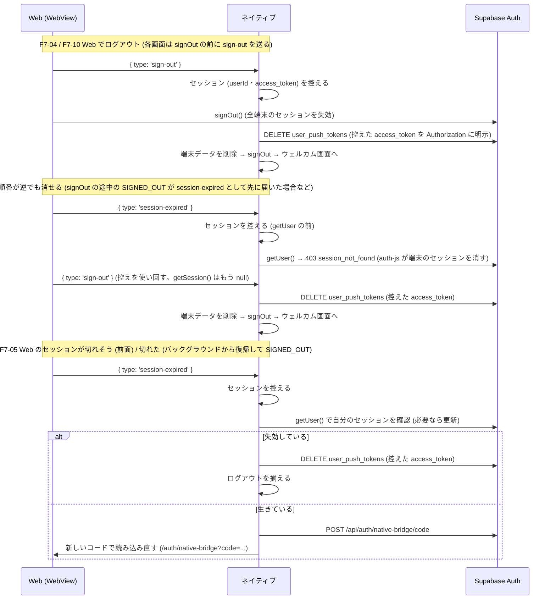

# モバイル 認証・セッション・push token の扱い

## 1. 目的・スコープ

モバイルアプリの認証まわり (セッションの保管、起動時の復元、Google ログイン、WebView との状態の食い違い、push token) の設計。
Issue #1038 (F7-04〜F7-10) の修正に合わせて整理した。

`01-architecture.md` の「3.3 セッション同期」は、この文書の内容で置き換わる部分がある (特に、セッションの保管先と、`session-expired` の向き)。
WebView の認証ブリッジそのもの (ワンタイムコード方式、オリジンの固定) は #1036 / #1158 (`webViewBridge.ts`) の担当で、ここでは扱わない。

| 項目 | 内容 | 実装 |
|------|------|------|
| F7-06 | セッションを平文の AsyncStorage ではなく、端末の安全な保管庫に置く | `src/lib/secureSessionStorage.ts` / `src/lib/supabase.ts` |
| F7-07 | オフライン起動でログイン済みのユーザーをウェルカム画面に落とさない | `src/providers/AuthProvider.tsx` / `src/lib/authErrors.ts` |
| F7-08 | Google ログインのコールバック URL を捨てない。成功と誤表示しない | `app/(auth)/login.tsx` / `app/(auth)/auth/verify.tsx` / `src/lib/authLink.ts` |
| F7-09 | push token の登録が、展開されなかった `$VAR` で静かに失敗しない | `eas.json` / `src/lib/pushNotifications.ts` |
| F7-10 | ログアウトで、この端末の push token を `user_push_tokens` から消す | `src/lib/signOut.ts` / `src/lib/pushNotifications.ts` |
| F7-04 | Web (WebView) でログアウトしたら、ネイティブもログアウトする | `src/lib/webViewAuthMessages.ts` / Web: `src/lib/native-auth-bridge.ts` |
| F7-05 | Web とネイティブが同じ refresh_token を別々に更新して、セッションごと失効するのを防ぐ | 同上 / Web: `native-bridge/route.ts`, `NativeSessionWatcher.tsx` |

## 2. セッションの保管 (F7-06)

Supabase のセッション (access_token と refresh_token) は、iOS Keychain / Android Keystore に置く (`expo-secure-store`)。
以前は AsyncStorage (平文) に置いていた。refresh_token は長期間有効なログイン権限なので、バックアップやファイルの読み取りで見えてはいけない。

- expo-secure-store は 1 つの値を 2048 バイトまでに制限する (超えると警告。将来の SDK ではエラーになり得る)。セッションは 3〜5KB なので、値を小さく分けて保存する
  - `<key>` に目次 `v1.<世代>.<断片数>`、`<key>.<世代>.<番号>` に断片
  - 書き込みは「新しい世代の断片 → 目次 → 古い世代の削除」の順。途中で失敗しても、読み手は古い世代をそのまま読める
- Supabase 公式ドキュメントの「乱数鍵を SecureStore、暗号化したセッションを AsyncStorage」方式は採らなかった。暗号ライブラリ (aes-js) と乱数のネイティブモジュールが増え、認証タグの無い AES-CTR を自前で持つことになる。OS の保管庫に直接置くほうが部品が少ない
- 読み取りのたびに保管庫へ問い合わせず、メモリにも持つ (`getSession()` は API 呼び出しごとに走る)
- 移行: 旧バージョンが AsyncStorage に保存した平文のセッションは、最初に読んだときに保管庫へ移して AsyncStorage から消す。ログアウトされない
- 保管庫に書けない端末 (Keystore の破損など) では、ログインできなくならないよう AsyncStorage に退避する (次に読んだときに移行を再試行する)
- 保管庫に書けたのに平文の削除だけが失敗すると、平文には使用済み (ローテーション済み) の古いセッションが残る。AsyncStorage に値があるときは、
  セッションの有効期限 (`expires_at`) を保管庫の値と比べ、**保管庫のほうが新しければ保管庫を採って平文を消す**。古い平文で新しい値を上書きすると、
  使用済みの refresh_token をサーバーが再利用とみなして、セッションごと失効し得るため。比べられない値 (PKCE の code-verifier など) は、これまでどおり平文を採る
- **iOS の Keychain はアプリを削除しても残る**。AsyncStorage に「入っている」印を置き、印が無いのに保管庫に値があれば再インストールの残りとみなして消す。前のユーザーのセッションが復活しない
- 保存キーは supabase-js の既定 (`sb-<ref>-auth-token`) のまま

## 3. 起動時のセッション復元 (F7-07)

`AuthProvider` は起動時に保存済みのセッションをサーバーで検証する。**サーバーが失効と明言したときだけ**捨てる。

| `getUser()` のエラー | 扱い |
|---|---|
| 401 / 403、`session_not_found`、`user_not_found`、`refresh_token_not_found` など | 通常のログアウトと同じ掃除 (`clearUserScopedLocalData`。失効したセッションの利用者の ID で) を先に通してから、セッションを捨てる (`signOut({ scope: 'local' })`) |
| `AuthRetryableFetchError`、status 0 / 408 / 429 / 5xx、fetch の例外 | 保存済みのセッションを信頼して起動する |
| 上記以外 | 失効を確認できていないので、捨てない |

未ログインになるどの経路でも、通常のログアウトと同じ掃除 (`apps/mobile/src/lib/userScopedLocalData.ts` の `clearUserScopedLocalData`。AsyncStorage の利用者別のキーと、次に開く WebView の利用者別の localStorage と、端末の Cookie の置き場 (§6.4)) を通す (#1599 / #1615)。
経路ごとの掃除の順と、掃除する利用者の表は `apps/mobile/src/providers/AuthProvider.tsx` の先頭が正。

| 経路 | 掃除する利用者 | 順 |
|---|---|---|
| 起動時、サーバーが失効と明言した (上の表の 1 行目) | 失効したセッションの利用者 | push token の行の release の宛先を控える (#1636。通信はしない) → 掃除 → `signOut({ scope: 'local' })`。そのあとの `SIGNED_OUT` で release |
| 起動時、`getSession()` が `session: null` (refresh_token の失効・保管庫を読めない・一度もログインしていない)、通信の失敗で保存済みのセッションも無い、`getSession()` の例外 | 直前に分かっていたセッションの利用者。ふつうは分からず、ID なし (利用者別のキーを接頭辞で全員分消す) | 掃除の前に、端末に残っている push token の値 (`push_token_value_v1:<利用者>`) を全部 release の宛先として控える (#1636。利用者が分からないので全部。通信はしない。値を読むところまで待つ。下の注) → 掃除 → 控えた宛先 (と前に消せなかった宛先) の release を始める (待たない)。掃除が済んでから未ログインの画面を出す。ただし端末の Cookie の置き場の掃除 (`Networking.clearCookies`) は始めるだけで完了を待たない (`{ webViewNativeCookies: "background" }`。下の注。#1647) |
| `onAuthStateChange` の `SIGNED_OUT` (自動更新で refresh_token が失効と答えた・`getUser()` が失効を見つけて端末のセッションを消した・ログアウトの `signOut()`) | 直前に分かっていたセッションの利用者 (無ければ ID なし) | supabase-js がセッションを消したあと。画面はすぐ未ログインにし、掃除はそのあと。この掃除 (`clearUserScopedLocalDataAfterSignedOut`) だけは、この端末の push token の値 (`push_token_value_v1:<利用者>`) を残す。端末の Cookie の置き場の掃除は完了を待たない (#1647)。掃除のあと、残した値と端末の秘密の値で `user_push_tokens` の行をセッション無しで消す (release。利用者が分からない (ID なし) ときは残っている値を全部。#1636。下の注) |
| Web からの `session-expired` で、`getUser()` が失効を見つけた (`webViewAuthMessages.ts`) | `SIGNED_OUT` の行は直前に分かっていたセッションの利用者、`signOut.ts` は `getUser()` の前に控えた利用者 (同じ利用者) | `getUser()` が端末のセッションを消して `SIGNED_OUT` が届く → `SIGNED_OUT` の行の掃除 (push token の値は残す) → `signOut.ts` の push token の行の削除 (残した値を読む。`SIGNED_OUT` の release が先に消していて 0 件なら、release の宛先を控える。#1706。release は合う行が無ければ 0 件で控えから外れるだけ) → 掃除 (値もここで消える) → `signOut()` |
| ログアウト (設定画面の `signOutOnDevice`、アカウントの画面 (`app/settings/account.tsx`) で退会の API が 401 を返したときの `signOutOnDevice`、退会のあとの `signOutAfterAccountDeletion`)、パスワード再設定のあと (`auth/reset-password.tsx` の `signOutWithCleanup`)、Web からの `sign-out` (`webViewAuthMessages.ts` の `signOutWithCleanup`) | 画面が持つ利用者 (パスワード再設定のあとは `updateUser()` が返した利用者、Web からのときは処理の最初に控えた利用者) | push token の行の削除 (退会のあとは無し。削除が失敗・0 件なら、掃除が値を消す前に release の宛先を控える (`recordPushTokenRelease`。#1706。通信はしない)) → 掃除 → `signOut()`。そのあと届く `SIGNED_OUT` で、`SIGNED_OUT` の行の掃除がもう一度走り、控えた宛先があれば release が消す |
| 上の行の `signOut()` が、通信の失敗 (オフラインなど) で `{ error }` を返した | 上の行と同じ | `signOut()` の前の掃除だけ。supabase-js は保管庫のセッションを消さず、`SIGNED_OUT` も届かないので、`SIGNED_OUT` の行の掃除は走らない。設定画面のログアウト・アカウントの画面の 401 のときのログアウトと退会のあと (`signOutOnDevice`・`signOutAfterAccountDeletion`) は、保管庫のセッションを端末だけで消し (`clearStoredSessionLocally`)、`clearSession()` で画面の状態を消す。サーバーのセッションは、設定画面のログアウトでは失効しないまま残り、アカウントの画面の 401 のときは、サーバーがいまのセッションを既に認めていない (退会の API の `getUser()` が失敗した)。退会のあとは `auth.users` の削除と一緒に既に消えている。パスワード再設定のあとと Web からの `sign-out` (`signOutWithCleanup`) は端末だけで消す処理を持たず、保管庫のセッションと画面の状態が残る (ログイン中のまま)。push token の行の削除が通信の失敗で済まなければ、掃除が値を消す前に release の宛先を控えてある (#1706)。`SIGNED_OUT` が届かないので、起動時に未ログインと決まったとき (`flushPendingPushTokenReleases`) か次の `SIGNED_OUT` で消す。パスワード再設定のあとと Web からの `sign-out` はログイン中のまま残るので、控えはその利用者の次の登録 (claim の成功) で外れるか、次のサインアウトで消す |

- ログアウト (`signOut.ts`) と失効の明言は、サインアウトの前に掃除し、そのあとに届く `SIGNED_OUT` でもう一度掃除する。二重の掃除に害は無い (同じキーを消し直し、WebView の掃除の ID を作り直すだけ。次に開く WebView が一度だけ消す)
- `SIGNED_OUT` の掃除が push token の値を残すのは、`SIGNED_OUT` が `signOut.ts` の push token の行の削除 (値を読む) より前に届くことがあるため (上の表の `session-expired` の行。ほかに、ログアウトの途中で自動更新が失効を答えたとき)。先に消すと、削除が値を読めず、端末から取り直せなければ `user_push_tokens` の行が残り、共有端末で前の利用者宛ての通知が届く (#1038 F7-10)。値はこの端末のトークンでどの利用者でも同じ値になり、利用者の ID 付きのキーなので次の利用者は読まない。`signOut.ts` を通らない `SIGNED_OUT` (自動更新の失効) では値が残るが、その利用者が次にログインしたときの登録で書き直され、起動時に未ログインと決まったときの掃除 (ID なし) で消える
- `SIGNED_OUT` の掃除は画面を未ログインにしたあとに走るが、次の利用者のログイン (人の操作) より先に終わる。万一ログインが先でも、消えるのは次の利用者の値で、前の利用者の値は残らない
- 端末の Cookie の置き場の掃除 (`Networking.clearCookies`。§6.4 の①) の完了を待つのは、このあとにサインアウトする経路 (ログアウト・退会の `signOut.ts` と、起動時の失効の明言) だけ。サインアウトの前に消す順を保つため (上限 `WEB_VIEW_NATIVE_COOKIE_CLEAR_TIMEOUT_MS` = 3 秒)。起動時に未ログインと決まったときと `SIGNED_OUT` は、サインアウトが済んでいて待っても順は変わらないので、始めるだけで待たず、失敗はログに残すだけ (#1647)。待つと、ネイティブから知らせが来ない端末では、未ログインで起動するたびに (一度もログインしていない端末も) 読み込み中の表示が上限まで延びる。AsyncStorage の掃除と WebView の localStorage の掃除の依頼は、どの経路でも待つ
- `signOut.ts` を通らない `SIGNED_OUT` (自動更新の失効) と起動時の失効の明言では、セッションが無いので RLS では `user_push_tokens` の行を消せない (#1636)。
  `SIGNED_OUT` の掃除のあとに、残した値と端末の秘密の値 (`03-push-notification.md` §3.2) で release の API を呼ぶ
  (`apps/mobile/src/lib/pushTokenRelease.ts` の `releasePushTokenAfterSignedOut`)。起動時の失効の明言では、掃除が値を消す前に宛先を控え
  (`recordPushTokenRelease`)、そのあとの `SIGNED_OUT` の release が消す。消せなかったら宛先を控え、起動時に未ログインと決まったとき
  (`flushPendingPushTokenReleases`) と次の `SIGNED_OUT` でやり直す。どれも画面は待たない。
  サインアウトした利用者が分からないとき (アプリが閉じている間に refresh_token が失効し、次の起動で supabase-js の初期化がセッションを消したときなど。
  起動時に未ログインと決まったとき・利用者の分からない `SIGNED_OUT`) は、端末に残っている値 (`push_token_value_v1:<利用者>`) を全部宛先にする
  (端末は未ログインなので、残っている値はどれもサインアウトした利用者のもの)。起動時は ID なしの掃除が値を消すので、掃除の前に控える
  (`recordPushTokenReleasesForStoredValues`。値を読むところまで待ち、控えへの書き込みは release の順番の列に積む)。`SIGNED_OUT` の掃除は値を残すので、
  掃除のあとの release (`releasePushTokenAfterSignedOut(null)`) が読む。保管庫を読めない起動 (実はログイン中) ではログイン中の利用者の値も宛先になるが、
  端末の秘密の値も同じ保管庫で読めないので、やり直しは通信せずに控えを残し、次にセッションが戻った起動の登録 (claim の成功) が同じトークンの控えを外す。
  `signOut.ts` を通った `SIGNED_OUT` では、`signOut.ts` が値を先に消しているので、release は控えのやり直しだけをする。
  行は、`signOut.ts` の削除で消えているか、削除が失敗・0 件だったとき (アカウントの画面で退会の API が 401 を返したときのログアウトのように、
  セッションが既に失効しているなど) は、`signOut.ts` が掃除で値を消す前に控えた宛先 (`recordPushTokenRelease`) として、このやり直しが消す (#1706)。
  `session-expired` では、`signOut.ts` の削除と release が同じ行を消しに行くことがある (どちらかが 0 件になるだけで害は無い。
  `signOut.ts` の側が 0 件だと `push_token_unregister_no_rows` が端末のコンソールに出る)
- 保管庫を読めない起動 (iOS で端末のロックを一度も解除していない間のバックグラウンドの起動など) でも、未ログインと決まるので掃除する。ログイン中の利用者の設定 (`v4_range_days` など) と、この端末の push token の控えが消える。控えは次の起動・ログインの登録で書き直される

`apps/mobile/__tests__/providers/auth-provider.test.tsx` (呼ばれる経路と順) と `apps/mobile/__tests__/providers/auth-provider-sign-out-cleanup.test.tsx` (本物の掃除で、利用者別のキーが消えること。`Networking.clearCookies` が未ログインの起動と `SIGNED_OUT` で呼ばれ、その完了を待たずに未ログインの画面が出ること・失効の明言では待ってからサインアウトすること) が確かめる。`session-expired` の行は `apps/mobile/__tests__/lib/web-view-auth-messages.real-auth.test.ts` (本物の AuthProvider・掃除・supabase-js で、`SIGNED_OUT` の掃除が先に走っても、保存済みの値で行を消すこと) が確かめる。

access_token が期限切れで、更新に通信が必要な機内モード起動では、`getSession()` が `session: null` を返す (保存済みのセッションは消えていない)。
通信エラーのときは `getStoredSession()` で保存済みのセッションを読み、それで起動する。通信が戻れば supabase-js が更新し (`TOKEN_REFRESHED`)、差し替わる。
サーバーが `refresh_token` を失効と答えれば `SIGNED_OUT` になるので、検証を省いても失効の取りこぼしにはならない。

- **この場合は `getUser()` による検証を省く**。`getUser()` も同じ更新をもう一度試みて、同じ理由で失敗するだけだから。
  supabase-js は更新に失敗すると約 25 秒かけてやり直す (`_initialize` と `getSession()` のそれぞれで)。実測で、期限切れ + オフラインの起動は、
  `getSession()` が約 51 秒、そのあと `getUser()` がさらに約 51 秒かかっていた (合わせて約 100 秒)。検証を省いて、約 51 秒にした
- それでも、読み込み中の表示が約 50 秒続く。短くするには、保存済みのセッションで先に画面を出し、更新と検証を裏で行う設計が要る (未対応。§8)

## 4. Google ログインのコールバック (F7-08)

iOS の `ASWebAuthenticationSession` は、コールバック URL を `openAuthSessionAsync` の `result.url` にだけ返し、`Linking` のイベントには流さない。
以前は `result.url` を捨てて `/auth/verify` へ遷移していたため、verify 画面が URL を取れず、セッションが無いまま「確認が完了しました」と表示した。

- `login.tsx` が `result.url` から `code` / `access_token`+`refresh_token` を取り出し、その場でセッションにする (`completeAuthLink`)
- `verify.tsx` は、リンクの情報が無い・`error` がある・交換に失敗したときはエラー表示にする (見出しのアイコンと色もエラーのもの。成功の緑のチェックにするのは、エラーなく終わったときだけ)。
  起動リンクの取得が済むまでは、エラーを出さず確認中のままにする
- Android では同じコールバックが `result.url` とディープリンクの両方で届き得る。`code` は 1 回しか交換できないので、同じリンクの処理は 1 回にして結果を共有する
- 既知の見え方 (実機で確認する): Android の Google ログインでは、リダイレクトのディープリンクで expo-router も `/auth/verify` を開く。
  verify の `Linking.useURL()` は購読前に流れたイベントを受け取れないので、`login.tsx` の `routeAfterSignIn` が画面を移すまでの 1〜2 秒、
  「確認できませんでした」が見える可能性がある。ログイン自体は `login.tsx` 側で完了し、画面が移れば消える

## 5. push token (F7-09 / F7-10)

登録 (`registerAndSaveExpoPushToken`)
- EAS の project ID は UUID 形式を確認し、不正な値 (展開されなかった `"$EXPO_PUBLIC_EAS_PROJECT_ID"` など) は読み飛ばして次の候補へ進む
  (環境変数 → `easConfig` → `app.json` の `extra.eas.projectId` → `extra.projectId`)
- `eas.json` の `EXPO_PUBLIC_EAS_PROJECT_ID` の行は削除した。`app.json` の `extra.eas.projectId` を使う。
  eas.json の `"$VAR"` は展開されずに文字列のまま入っていた (Issue #1038 の報告)。形式の検査があるので、どちらでも壊れない。
  `01-architecture.md` §7.2 の表にある同名の行 (preview / production) は、この変更で eas.json に設定しなくなった (環境変数や EAS Secret として注入することは今でもできる)
- 失敗は端末のコンソールとサーバーログ (`POST /api/log` → `app_logs`。エラー境界の記録と同じ経路) に出す (`push_token_registration_failed`。トークンやユーザー ID は載せない)。PostHog には送らない (#1166)。
  サーバーログに送るのは決まった値だけ (イベント名・OS・段 (`stage`)・エラーの名前とコード (英数字と `._:-` の 64 文字以内。外れたら `unknown`)・HTTP の状態・project ID の出どころ) で、エラーの本文は送らない (#1413)。
  送る本文と送ってよいキーの一覧は `apps/mobile/src/lib/push-issue-log.ts` (`PUSH_ISSUE_SERVER_METADATA_KEYS`)。キー名に `password` / `token` / `secret` / `authorization` / `api_key` を含めない
  (`/api/log` の `sanitizeLogEntry` がキー名だけで値を `***` にするため。`tests/push-issue-log-sanitizer.test.ts` が本物の `sanitizeLogEntry` で確かめる)。
  登録の失敗では送信を待たない
- 起動時の自動登録 (`ensurePushTokenRegistered`) は、起動・ログインした利用者が変わるたびに、登録 (upsert) と claim
  (`POST /api/push-tokens/claim`。同じトークンのほかの利用者の行を外す) を通す。どちらも何度呼んでも同じ結果になる (#1599)。
  claim には端末の秘密の値を付け、外すのは同じ端末の前の利用者の行 (とハッシュの無い古い行) だけ (#1636。`03-push-notification.md` §3.2)。
  登録は、動いている release (セッションの無いときの後片付け) が終わってから行う。
  「登録済み」の印で省くことはしない。claim はほかの利用者の行を消すので、印があっても行があるとは限らない
  (共有の端末で、利用者 A のセッションが掃除を通らずに終わる → B がログインして claim で A の行を消す → A が再びログインする、のとき、
  印で省くと A の行が無いまま再登録されず、A 宛ての通知がこの端末に届かなくなる)。
  旧ビルドが付けた印 (`push_token_registered_v2:<uid>`、#1038 より前の `push_token_registered_v1:<uid>`。v1 は権限を拒否されても付いていた) は
  読まず書かず、ログアウトで消す
- 権限のダイアログ: 起動時の自動登録では、まだ一度も尋ねていない (`undetermined`) ときだけ出す。拒否された後も毎回出すと、
  Android 13 以降は、一度拒否した利用者に次の起動でもう一度ダイアログが出る。拒否した利用者は OS の設定で許可すれば、次の起動で登録される。
  設定画面の登録ボタン (`userInitiated: true`) は利用者の操作なので、OS がまだ尋ねられる (`canAskAgain` が `false` でない) なら出す

削除 (`apps/mobile/src/lib/signOut.ts` の `signOutOnDevice` / `signOutWithCleanup`)
- ログアウトは「push token の削除 → 端末データの削除 → サインアウト」の順。削除は RLS (本人の行のみ) のため、サインアウトの前に行う
- 通る場所と、削除を認可するもの

  | 通る場所 | 削除を認可するもの |
  |---|---|
  | 設定画面のログアウト (`signOutOnDevice(user?.id ?? null, { clearSession })`)、パスワード再設定後の全端末サインアウト (`auth/reset-password.tsx` の `signOutWithCleanup`) | いまのセッション。セッションが生きているうちに呼ぶので、supabase-js が付ける |
  | アカウントの画面で、退会の API (`/api/account/delete`) が 401 を返したときのログアウト (`app/settings/account.tsx` の `signOutOnDevice(user?.id ?? null, { clearSession })`。#1562) | いまのセッション (supabase-js が付ける)。サーバーはこのセッションを既に認めていないので、削除が 0 件・失敗になり得る。そのときも下のとおりログアウトは止めず、行は release で消す (下の「削除が失敗・0 件のとき」。#1706) |
  | Web (WebView) からの `sign-out` / `session-expired` の反映 (`webViewAuthMessages.ts`) | **処理の最初に控えた本人のアクセストークン**。`Authorization` ヘッダーで明示する (下) |

- Web (WebView) からのログアウトでは、**キャッシュ済みのセッションに頼らず、控えた値を使う**。Web の `signOut()` は全端末のセッションをサーバーで失効させ、
  失効したあとにネイティブが `getUser()` を呼ぶと、サーバーは `403 session_not_found` を返す。auth-js (2.105) はそれを `AuthSessionMissingError` にして、
  端末のセッションを消す (`_removeSession`)。auth-js の処理はロックで直列なので、そのあとに動く `getSession()` は `null` を返す。
  すると、ユーザー ID が分からず削除を諦める (skipped)、または削除の通信が anon キーで送られて RLS で 0 行になる (エラーにならない)。
  詳しい順番と対策は §6.2
- `Authorization` ヘッダーを明示すると、supabase-js は上書きしない (`fetchWithAuth` は、既にあれば付けない)。
  PostgREST は JWT の署名と期限だけを見て、セッションが失効済みかどうかは見ないので、アクセストークンの期限内なら、失効後でも RLS で本人の行を消せる
- 消えた行の件数を数える (`delete({ count: 'exact' })`)。0 件 (RLS に弾かれた、または行が既に無い。どちらもエラーにならない) のときは `push_token_unregister_no_rows` を端末のコンソールとサーバーログ (`app_logs`。#1413) に出す (PostHog には送らない: #1166)。
  以前は 0 件でも「削除できた」扱いで、RLS を素通りしても気づけなかった。Web からアカウントを削除したときも `sign-out` が届くが、そのときは `auth.users` の削除で行が CASCADE で先に消えているので、この通知が出る (正常)
- 消すのは「この端末のトークンの、このユーザーの行」だけ。同じユーザーの他の端末の行を消すと、その端末では次にアプリを起動するまで再登録されず、その間は通知が届かなくなる
- 削除が失敗・0 件のとき (`unregisterExpoPushToken` が `failed` / `no_rows` を返した、または万一例外を投げた) は、端末データの削除が
  値 (`push_token_value_v1:<利用者>`) を消す前に、その行を release の宛先として控える (`apps/mobile/src/lib/pushTokenRelease.ts` の
  `recordPushTokenRelease`。通信はしない。#1706)。控えないと、あとに届く `SIGNED_OUT` の release (`releasePushTokenAfterSignedOut`) は値を読めず、
  行が残る (§3 の注)。控えた宛先は、その `SIGNED_OUT` の release か、起動時に未ログインと決まったときのやり直し (`flushPendingPushTokenReleases`) が
  端末の秘密の値で消す。消せたとき (`deleted`)・何もしなかったとき (`skipped`。利用者や値が分からず、控える値も無い) は控えない。
  行が既に無かった (`SIGNED_OUT` の release や `auth.users` の削除の CASCADE が先に消した) ときも控えるが、release は合う行が無ければ 0 件で `200` を返し、
  控えから外れるだけ。`apps/mobile/__tests__/lib/sign-out-push-token-release.test.ts` (本物の `signOut.ts`・`pushTokenRelease.ts`・掃除) と
  `apps/mobile/__tests__/settings/account-delete.test.tsx` (退会の API の 401) が確かめる
- 失敗・タイムアウト (3 秒) でもログアウトは止めない。失敗 (エラー・タイムアウト・途中の例外) は `push_token_unregister_failed` (`reason`: `error` / `timeout` / `exception`) として端末のコンソールとサーバーログに出す (#1413)
- 0 件・失敗のサーバーログには、原因を切り分ける値として、削除に使った push の値の出どころ (`push_value_source`: `stored` = 端末に控えた値 / `refetched` = 取り直した値。`timeout` と `exception` では送らない) と、
  控えたアクセストークンで `Authorization` を明示したか (`explicit_auth_header`) を送る。0 件では件数 (`deleted_count`: 0)、`error` ではエラーのコードと HTTP の状態、`exception` ではエラーの名前も送る。
  端末のコンソールでは同じ値を `token_source` / `explicit_access_token` の名前で出す (サーバーには送らないのでマスクされない)。
  `explicit_auth_header` が `true` になるのは Web から始まったサインアウト・`session-expired` だけで、その記録は下のとおり `app_logs` にはほぼ載らない
  (`app_logs` で見えるのは、ほぼ端末からのサインアウトの `false` の行)
- サーバーログへの送信 (0 件・失敗) は、`unregisterExpoPushToken` が返る前に待つ (上限 2 秒 = `PUSH_ISSUE_LOG_TIMEOUT_MS`)。サインアウトでセッションが消えたあとでは `/api/log` の認証を通らないため。
  控えたアクセストークンがあれば `Authorization` で明示して送る。送れなかった記録は諦める (ログアウトは止めない)
- この順番で記録が `app_logs` に残るのは、端末からのサインアウト (設定画面・パスワード再設定のあと。セッションが生きているうちに呼ぶ) だけ。アカウントの画面で退会の API が 401 を返したときのログアウトは、端末から始まるが、サーバーがセッションを既に認めていないので、ふつうは残らない (`/api/log` の `getUser()` も 401 になる)。
  Web から始まったサインアウト・`session-expired` では、端末が送るより前に、ふつうは Web の `signOut()` がサーバー側のセッションを失効させている
  (`session-expired` は `getUser()` で失効を確かめてからログアウトするので必ず。Web からアカウントを削除したあとの `sign-out` も、ユーザーが消えているので同じ)。`/api/log` (`src/app/api/log/route.ts`) はサーバーで `getUser()`
  (GoTrue の `GET /user`。JWT の `session_id` のセッションが残っているかまで確かめる) を呼ぶので、控えたアクセストークンを明示しても `401` になり、記録は残らない
  (端末のコンソールには出る)。削除の `DELETE` が同じトークンで通るのは、PostgREST が JWT の署名と期限しか見ないからで、`/api/log` はそうではない。
  送る順番では防げない (端末が送る前にサーバー側のセッションが消えている)。`sign-out` は Web の `signOut()` の前に届くので、Web の失効より先に送れたときだけは残りうる。
  この経路の記録も残すには `/api/log` の認証 (サーバー側) を変える必要がある (この変更では変えていない)。
  この食い違いは `tests/integration/security/push-issue-log-after-session-revoked.test.ts` が本物のサーバーで固定する
- アカウント削除 (アプリの `app/settings/account.tsx`) では不要。`auth.users` の削除で `user_push_tokens` が `ON DELETE CASCADE` で消える

## 6. Web (WebView) とネイティブの状態を揃える (F7-04 / F7-05)

ログイン状態の持ち主は**ネイティブ**。WebView の Web 側は、ネイティブが張った借り物の Cookie セッションで動く。

> 3 つ目のメッセージ `{ type: 'mfa-verify-required' }` (Web → ネイティブ。運営ロールの二段階認証の 6 桁の確認をネイティブの確認画面に頼む。
> `docs/design/cross/12-operator-mfa.md` §16.4) は、Web の送る側 (`src/lib/native-auth-bridge.ts` の `requestNativeMfaVerify`) が段 A で、
> ネイティブの受け取り・確認画面・読み込み直しが段 D で入った (段 D より前のアプリは知らない type として捨てる)。受け取りの規則は §6.2 の末尾。

### 6.1 refresh_token の持ち主はネイティブだけ (F7-05)

ネイティブの refresh_token をそのまま Web の Cookie にも入れると、Web (middleware / ブラウザの supabase-js) とネイティブが同じ refresh_token を別々にローテーションする。
片方が使った古い refresh_token をもう片方が使うと、Supabase は再利用とみなしてセッションごと失効させ、突然のログアウトになる。

- `/auth/native-bridge?code=...` (`handleCode`) は、Web の Cookie セッションに access_token だけを実際の値で入れ、refresh_token には使えない値
  (`NATIVE_BRIDGE_WEB_REFRESH_TOKEN_PLACEHOLDER`) を入れる。Web は自分で更新できない
- 期限が近づいたら Web が `{ type: 'session-expired' }` を送り (§6.2)、ネイティブが新しいコードで WebView を読み込み直す
- 旧方式 (トークンを URL で渡す GET) は変えない。旧アプリは再ブリッジの仕組みを持たないため
- 従来の動作 (実際の refresh_token を入れる) へ戻すスイッチ: 環境変数 `NATIVE_BRIDGE_SHARE_REFRESH_TOKEN=on` (Vercel は再デプロイ後に効く)
- この作りの帰結として、WebView の借り物のセッションでは、Supabase のセッションの token を発行し直す操作 (二段階認証の 6 桁の verify・解除の後の refresh) を Web の側でしない。持ち主のネイティブが行い、WebView を読み込み直す (`docs/design/cross/12-operator-mfa.md` §16.4)

**「切れる前に頼むので、Web は更新しない」は、前面で使っているときしか成り立たない。** ブラウザの supabase-js (auth-js 2.105) は、次の時点で必ず更新を試みる。
借り物の refresh_token では更新が 400 になり、auth-js はセッションを捨てて `SIGNED_OUT` を出す。

| auth-js が更新を試みる契機 | 更新を試みる残り時間 |
|---|---|
| 自動更新の tick (30 秒ごと。前面のときだけ) | 120 秒未満 (`floor(残り / 30 秒) <= AUTO_REFRESH_TICK_THRESHOLD (3)`) |
| `getSession()` (Supabase への API 呼び出しのたびに走る)・バックグラウンドからの復帰 (`visibilitychange`) | 90 秒未満 (`EXPIRY_MARGIN_MS`)。復帰時は tick も直ちに走る |

そのため 2 段構えにしている。

1. **前面で使っているとき**: `NativeSessionWatcher` が、auth-js より先に再ブリッジを頼む (`REFRESH_AHEAD_SECONDS` = 180 秒)。
   20 秒ごとの確認の遅れと、ネイティブの再ブリッジにかかる時間を見込んでも、auth-js の tick (120 秒) より前に済む。
   (以前の 120 秒は tick と同じ閾値で、tick が先に走ると (およそ 3 回に 1 回) 借り物の refresh_token で更新して失敗していた。90 秒という説明も誤りで、90 秒は `getSession()` の閾値)
2. **先回りできないとき**: 1 時間以上バックグラウンドに置いて戻ると、その間タイマーが止まっているので、復帰した瞬間に auth-js が更新を試みる。
   どんな閾値でも先回りできない。WebView の中の `SIGNED_OUT` は「利用者のログアウト」とは限らないので、`MainLayout` は §6.3 のとおり扱う。

閾値の関係は `src/__tests__/lib/native-session-authjs-thresholds.test.ts` が、本物の auth-js (GoTrueClient) の動きで確かめる (auth-js を上げて閾値が変わると落ちる)。

### 6.2 Web → ネイティブ のメッセージ

`window.ReactNativeWebView.postMessage(JSON.stringify(message))`。ネイティブは、自分の Web オリジンのページから届いたものだけを処理する。

```typescript
type WebToNativeAuthMessage =
  | { type: 'sign-out' }             // 利用者が Web でログアウトした
  | { type: 'session-expired' }      // Web のセッションが切れた・切れそう
  | { type: 'mfa-verify-required' }; // 運営の二段階認証の 6 桁の確認をネイティブに頼む (cross/12 §16.4)
```

| 送る場所 (Web) | メッセージ |
|---|---|
| 各画面のログアウト処理が `supabase.auth.signOut()` の**前**に呼ぶ `notifyNativeSignOut()` (`src/lib/native-auth-bridge.ts`)。設定・マイページ (ログアウトと退会)・組織レイアウト・`family/promotions/[token]`・パスワード再設定後の全端末ログアウト・凍結ページ。`signOut()` の後の `broadcastSignOut()` (`src/lib/user-storage.ts`) も、まだ送っていなければ送る | `sign-out` |
| `NativeSessionWatcher` (認証が必要なページの共通レイアウトに常駐)。20 秒ごと・前面復帰時に確認し、セッションが無い、または (ネイティブから借りたセッションで) 有効期限までの残りが 180 秒を切った | `session-expired` |
| `MainLayout` の `onAuthStateChange`。WebView の中で `SIGNED_OUT` になった (§6.3) | `session-expired` |
| ログイン画面が表示されたとき (WebView でログイン画面 = セッションが無い) | `session-expired` |
| 運営の MFA の確認画面 (`/settings/security/mfa/verify`) を WebView の中で開いたとき (`NativeAppMfaNotice` の kind=verify。描画の後に 1 回と、[確認画面を開く] を押したとき。cross/12 §16.4.3) | `mfa-verify-required` |

`session-expired` は Web 側で 15 秒以内に続けて送らず、ログアウトを知らせた後は送らない。`sign-out` は 1 つのページで 1 回だけ送る。普通のブラウザでは何も送らない。

**ログアウトの `sign-out` は、`signOut()` の前に送る。** 利用者のログアウトでも、`signOut()` の途中で auth-js が `SIGNED_OUT` を出す。
`MainLayout` がそれを `session-expired` として先に送ると、ネイティブは自分のセッションをサーバーで確かめ、(Web の `signOut()` が全端末を失効させるので) 失効と返り、
auth-js が端末のセッションを消す。そのあとに届く `sign-out` では、ユーザー ID も本人の JWT も取れず、push token を消せない (§5)。そこで二重に備える。

1. **Web**: 各画面が `signOut()` の前に `notifyNativeSignOut()` を呼ぶ。このページはログアウト通知済みになり、`session-expired` を送らなくなる。ネイティブには `sign-out` だけが先に届く。
   `broadcastSignOut()` 自体は `signOut()` の**あと**に呼ぶ (先に呼ぶと、同じタブの `BroadcastChannel` で `MainLayout` が `/login` へ移り、`signOut()` が途中で止まる)。
   並び (`notifyNativeSignOut` → `signOut` → `broadcastSignOut`) は `tests/native-sign-out-order-source-scan.test.ts` が検査する
2. **ネイティブ**: 順番が違っても消せるように、処理の最初にセッションを控える (下)。呼び忘れた画面、別のタブのログイン画面が送る `session-expired`、
   ログアウトの途中で届く `session-expired` でも、取りこぼさない

ネイティブの処理 (`src/lib/webViewAuthMessages.ts`)
- **セッションの控え**: 処理の最初に `getSession()` で `userId` と `accessToken` を控える。同時に動く他のメッセージとは、同じ控えを使い回す
  (メッセージごとに `getSession()` を呼ぶと、先に動いている `session-expired` の `getUser()` が端末のセッションを消したあとで、`null` を受け取る)。
  控えは、処理中のメッセージが無くなったとき、またはログアウトが済んだときに捨てる (次のログインの別ユーザーに使わない)。
  ログアウトでは、この控えを `signOutWithCleanup(userId, { accessToken })` に渡し、push token の削除を本人の JWT で認可する (§5)
- `sign-out`: 共通のログアウト (§5) を行い、ウェルカム画面へ戻る。5 つのタブが同時に送ってきても 1 回だけ行う
- `session-expired`:
  1. ネイティブも未ログインなら何もしない (上の控えが無い)。この控えは、次の `getUser()` より**前**に取る
  2. ネイティブのセッションをサーバーで確かめる。失効していれば (Web のログアウトで全端末のセッションが失効した後など)、読み込み直さず、控えた値でログアウトを揃える
  3. 生きている (または確かめられない) なら、その画面 (タブ、タブ以外の `/settings/ai-consent`) を、いま開いているパス (`WebViewScreen` が `initialPath` を検証したあとの `effectivePath`) に使い捨ての `_rb` を付けた `initialPath` で開き直させる (= bridge をやり直す)
  4. 回数制限: タブごとに、10 秒以上の間隔、5 分で 3 回まで。ブリッジが失敗し続けても延々と繰り返さない
  5. 確かめている間に `sign-out` が始まった・済んだら、読み込み直しも二重のログアウトもしない
- `mfa-verify-required` (cross/12 §16.4.4・§16.4.5): セッションの控え・`getSession()` / `getUser()`・回数制限のどれにも触れず、`WebViewScreen` にネイティブの確認画面 (`NativeMfaVerifyModal`) を出させる。
  確認画面はネイティブのセッションで 6 桁を verify し (既に aal2 なら 6 桁を求めない)、済んだら閉じて、いま開いているパス (`effectivePath`) に `_rb` を付けて開き直させる
  (`session-expired` の 3 と同じ組み立て。回数制限は通さない: 6 桁を入れた後に 1 回だけ呼ぶもので、制限に当たると aal2 になったのに WebView が古いままになるため)。
  [閉じる] では開き直さない。登録・回復・設定はブラウザだけ (確認画面は案内を出す)



### 6.3 WebView の中の SIGNED_OUT (`MainLayout`)

`MainLayout` は `onAuthStateChange` の `SIGNED_OUT` で、これまで `clearUserScopedLocalStorage()` と `/login` への移動を行っていた (ほかのタブでのログアウトを伝えるため。#145)。
WebView の中では、`SIGNED_OUT` は利用者のログアウトとは限らない (§6.1)。ログアウト扱いにすると、ログアウトしていないのに、次のことが起きる。

- user-scoped の localStorage のキーが消える。Cookie と localStorage は全タブの WebView で共有なので、開いているすべてのタブが失う。
  `v4MenuGenerating` など (献立タブがページリロード時に進行中の生成を復元する値)、`v4_range_days` / `v4_include_existing` (AI 生成の設定)、`profile_reminder_dismissed` (閉じたバナーが再び出る)
- `/login` が一瞬出てから、ネイティブの再ブリッジで読み込み直される

そこで、WebView の中 (`isInNativeWebView()`) の `SIGNED_OUT` は次のとおり扱う。

1. `session-expired` を送って、再ブリッジを頼む。localStorage は消さず、`/login` へも移さない
2. ネイティブが読み込み直すと、ページごと入れ替わるので、待ちは自然に終わる
3. `NATIVE_REBRIDGE_WAIT_MS` (15 秒) 待っても読み込み直されなければ、従来どおりログアウトとして扱う (localStorage を消して `/login` へ移る)。
   `session-expired` を知らない旧アプリ、ネイティブ側の回数制限、ネイティブも未ログイン、通信が極端に遅い場合のため。旧アプリでは、実際の refresh_token を持つセッションの失効が従来より最大 15 秒遅れて `/login` に移るだけ
4. 待っている間に、セッションが戻った (`SIGNED_IN` など。別のタブが先に再ブリッジされ、共有の Cookie が新しくなった場合) とき、またはこのレイアウトを離れたときは、待ちをやめる

利用者が意図したログアウト (設定・マイページ・組織レイアウトなど) は、この扱いに頼らない。各画面が `signOut()` の前に自分で `clearUserScopedLocalStorage()` を呼び、
続けて `notifyNativeSignOut()` で `sign-out` を送る。このページはログアウト通知済みになるので、`signOut()` が出す `SIGNED_OUT` では `session-expired` を送らず、
ネイティブには `sign-out` だけが届く (§6.2)。再ブリッジの待ち (上の 3.) のタイマーは動くが、`signOut()` のあとの `broadcastSignOut()` が同じタブの `BroadcastChannel` で
すぐ `/login` へ移し、ページごと入れ替わるので、15 秒を待たずに終わる。
ほかのタブからの `BroadcastChannel('auth')` の `SIGNED_OUT` (意図したログアウト) は、従来どおりすぐログアウト扱いにする。

`src/__tests__/app/main-layout-signed-out.test.tsx` が、本物の auth-js (GoTrueClient) で更新を失敗させて `SIGNED_OUT` を出し、この扱いを確かめる。
同じファイルで、実際の設定画面を `MainLayout` の中に置いてログアウトし、ネイティブに届くのが `sign-out` だけであること (`session-expired` が先に届かないこと) も確かめる。

### 6.4 WebView の Cookie の掃除 (#1612 F7-16 / #1647)

ネイティブのログアウトは Web の `signOut()` (Cookie を消す) を通らないので、同じ掃除の経路 (`clearUserScopedLocalData`) の上で 2 段で消す。正は `apps/mobile/src/lib/webViewUserStorageCleanup.ts` の「Cookie」。

1. ①ログアウトの時点で `clearWebViewNativeCookies()` が React Native の `Networking.clearCookies` で端末の Cookie の置き場を空にする (Android は WebView の `CookieManager` そのもの、iOS は `sharedCookiesEnabled` が WebView を作るたびに書き戻す `NSHTTPCookieStorage`)。未ログインになるどの経路でも走る (§3)。完了を待つかは経路で分ける (§3 の注)
2. ②iOS の `WKWebView` が自分で持つ置き場は①で空にできないので、次に bridge 無しで WebView を開くとき、localStorage の掃除と同じ注入の JS が `USER_SCOPED_COOKIE_NAME_PREFIXES` (`sb-`) の Cookie を `Path=/` で期限切れにする。bridge で開くときは消さない (bridge が同じ名前の Cookie を上書きする)

- ①は `sb-` に限らず端末の Cookie をすべて消すが、未ログインの間に作られて消えると困る Cookie は無い (#1647 で洗った。Web が張るのは `sb-`・`is_native_app`・ログイン中の画面だけの `aiChatBubblePosition` / `handson_tour_force`。未ログインで使う WebView は Turnstile のウィジェットだけ。ネイティブのログインは supabase-js で Cookie を使わない)
- `is_native_app` は利用者のものではない端末の印で、WebViewScreen が毎回 `?mode=app` で開き直す (middleware が張り直す) ので②では消さない。①で消えるのは Android だけ (iOS は WKWebView の置き場に残る。①が空にするのは `NSHTTPCookieStorage` だけ)
- 限界: iOS で①のあと最初に bridge 無しで開いた WebView の最初の要求は、WKWebView に残った前の利用者の Cookie を送る (注入の JS は応答のあとに動く)。サーバーのセッションがログアウトで失効していれば Web の middleware が Cookie を消すので、前の利用者として表示され得るのは、オフラインでログアウトしたときだけ
- bridge で開いたのに code の引き換えに失敗した (期限切れ・使用済み・DB 障害) ときは、`/auth/native-bridge` は WebView に残った Cookie セッションでは進まず、`sb-` の Cookie を消して `/login` へ戻す (#1647)。以前は残った Cookie で `getUser()` が通れば next へ進んでいたので、iOS で前の利用者がオフラインでログアウトしたあと、次の利用者のブリッジの引き換えが失敗すると、前の利用者のまま進み得た。WebView の中のログイン画面は `session-expired` を送り、ネイティブがいまの利用者の新しい code で開き直す (§6.2)。`tests/auth/native-bridge.test.ts` のケース 8 と `tests/integration/security/native-bridge-flow.test.ts` の S-7 が確かめる

## 7. 互換性とリリースの順序

| 変更 | 新しい Web + 旧アプリ | 旧 Web + 新アプリ |
|---|---|---|
| `sign-out` / `session-expired` の送信 | 旧アプリは未知の `type` を無視する。変化なし | メッセージが来ないだけ。ネイティブの処理は何も起きない |
| ログアウトの `sign-out` を `signOut()` の前に送る (§6.2) | 旧アプリは未知の `type` を無視する。変化なし | この変更より前の Web (`session-expired` が先、`sign-out` が `signOut()` のあとに届く) でも、新アプリは処理の最初に控えたセッションで push token を消せる |
| WebView の中の `SIGNED_OUT` (§6.3) | 旧アプリは `session-expired` を無視するので、`NATIVE_REBRIDGE_WAIT_MS` (15 秒) 後に従来どおり localStorage を消して `/login` へ移る。従来より最大 15 秒遅れるだけ | — |
| `native-bridge` の Cookie の refresh_token | コード方式を使うのは新ビルドだけ (旧アプリは旧方式)。変化なし | — |

- Web の変更は、先に本番へ出して問題ない。旧アプリは何も変わらない
- ただし、**コード方式のブリッジ (#1036 / #1289) を載せたビルドと、この変更のネイティブ側は、同じビルドで出す**こと。
  Web 側の refresh_token が使えない値になるため、`session-expired` を処理するネイティブが無いと、WebView は最長 1 時間で未ログインの表示になる
- OTA が無効 (`updates.enabled=false`) で、`expo-secure-store` はネイティブモジュールなので、反映には EAS Build とストアリリースが必要

## 8. 未解決事項

- ログアウトがオフラインで失敗したとき (`signOut()` が `{ error }` を返す、または例外を投げてセッションが残る) の扱いは、#1037 で対応済み。`apps/mobile/src/lib/signOut.ts` の `signOutOnDevice` (設定画面の通常のログアウトと、アカウントの画面で退会の API が 401 を返したときのログアウト) と `signOutAfterAccountDeletion` (退会のあと) が、失敗したら `clearStoredSessionLocally()` で保管庫のセッション (と PKCE の code-verifier) を端末だけで消し、呼び出し側から渡された AuthProvider の `clearSession()` で画面の状態も消す (`SIGNED_OUT` が届かないため)。`apps/mobile/__tests__/settings/logout.test.tsx` と `apps/mobile/__tests__/lib/sign-out.test.ts` が確かめる
- ネイティブのログアウト・退会は、Web の画面の `clearUserScopedLocalStorage()` を通らない。代わりに `signOut.ts` がサインアウトの前に `requestWebViewUserScopedStorageClear()` (`apps/mobile/src/lib/webViewUserStorageCleanup.ts`) で掃除の ID を残し、次に開く WebView が `injectedJavaScriptBeforeContentLoaded` の先頭で `USER_SCOPED_LOCAL_STORAGE_KEYS` (`packages/shared/src/user-scoped-storage.ts`。Web と共有の一覧) を消す (#1037)
- Web の設定・マイページのログアウト / 退会ボタンは、WebView 内では出さない (#1037。PR #1079 で main に入った。判定は `src/hooks/useAccountActionsPlacement.ts`)。この変更の `sign-out` 通知は、隠れなかった経路 (凍結ページなど) の二重の備え
- `invite/[token]` の「ログアウトしてやり直す」は `notifyNativeSignOut()` / `broadcastSignOut()` を通らないのでネイティブへ直接は通知しない (WebView の主要な導線ではない)。
  Web のログアウトのあとに移るログイン画面が `session-expired` を送り、ネイティブがサーバーで失効を確かめて、控えたセッションでログアウトを揃える (§6.2)
- 再ブリッジは、開いていたパスではなく画面の既定のパス (または検証を通った直前の `initialPath`) を開き直す。入力中のフォームの内容は失われる
- `MainLayout` 以外にも、API が 401 を返したときに自分で `/login` へ移る画面がある (献立ページの生成ポーリング `weeklyMenuGenerating` / `singleMealGenerating` を消して移る処理、設定の書き出しなど)。
  WebView の借り物のセッションが失われた直後の 1〜3 秒 (ネイティブの再ブリッジが終わる前) にそのリクエストが重なると、その画面は従来どおり `/login` へ移る。
  `MainLayout` の扱い (§6.3) は、ほぼすべての画面に共通する localStorage の削除と `/login` への移動を避けるもので、個々の画面の 401 の扱いは変えていない
- 起動時の読み込み中の表示 (§3): access_token が期限切れのままオフラインで起動すると、約 50 秒続く (supabase-js の更新のやり直し)。保存済みのセッションで先に画面を出し、更新と検証を裏で行う設計にすれば無くせるが、
  検証前のセッションで画面を出すことになる (失効済みでも一瞬ホームが見える)。未対応
- Android の `react-native-webview` は `window.ReactNativeWebView` を `addJavascriptInterface` で全フレームに出す。自分のオリジンのページに埋め込まれた他オリジンの iframe からも
  `sign-out` / `session-expired` を送れ、`nativeEvent.url` (メインフレームの URL) の検査を通り得る。影響は強制ログアウトと再ブリッジの要求まで。`download` の送信元の検査と同じ信頼モデルで、
  自分の Web が他オリジンの iframe を埋め込まない限り起きないため、いまは対処しない
- `NATIVE_REBRIDGE_WAIT_MS` (15 秒): 回線が遅いと、ネイティブの再ブリッジ (`getUser()` + コードの発行 + ページの読み込み) が間に合わず、避けたかった localStorage の削除と `/login` への移動が起きる。
  ネイティブが受け付けたことを Web に返す仕組み (`injectJavaScript`) を入れるか、待ち時間を延ばす余地がある。旧アプリで行き止まりになるのを避ける 15 秒を優先して、いまは変えない
- ログアウトのあと、同じタブの `MainLayout` が `BroadcastChannel` で `window.location.href = '/login'` と全体を読み込み直す。ページごと入れ替わるので `notifyNativeSignOut()` の記録が初期化され、
  ログイン画面が `session-expired` をもう一度送る。ネイティブ側で `ignored` (ログアウト処理中) か `no-session` (ログアウト済み) になるだけで害は無いので、そのままにしている。
  `sessionStorage` に印を残して抑える案は、印が残る期間の管理が要り、本当に再ブリッジが要るときに止めてしまう危険のほうが大きい
- push token を DB 側で端末ごとに 1 ユーザーへ紐づけ直す (別ユーザーのログインで古い行を消す) には、サービスロールの処理が要る。サーバー側の送信は `06-push-send.md` (送信待ち `push_outbox` と worker `GET /api/cron/push-outbox`。#1136)
