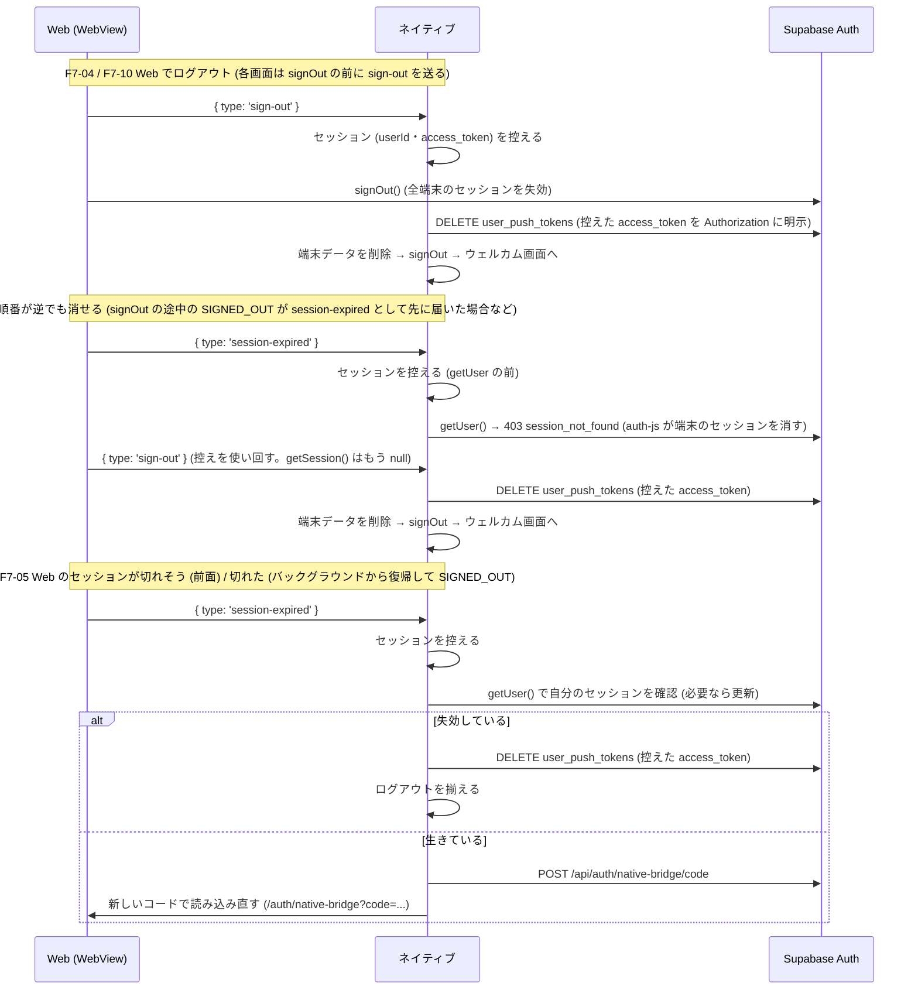

# モバイル 認証・セッション・push token の扱い

> 版: v1.1。改定履歴: v1.0 Issue #1038 (F7-04〜F7-10) の整理。v1.1 2026-10-17 Issue #1768: `@supabase/supabase-js` 2.117.3 と `@supabase/ssr` 0.12.7 への更新に合わせ、借り物のセッションを捨てる合図 (§6.1・§6.3) を auth-js 2.117 の挙動 (access token が有効なうちの先回りの更新の失敗ではセッションを捨てず `SIGNED_OUT` も出さない) で決め直し、§3・§5・§7 の auth-js の版に依る記述を現在形にし、§0 (範囲と分冊判定) と §9 (更新の設計: 要件・シナリオとトレース・構造裁定・表 3 点・Cookie の読み書きの移行・テストの直し方・apps/mobile の版・段分け・番兵と他の文書の追随表) を足した。

## 0. 改定 #1768 の範囲と分冊判定 (v1.1)

範囲の正本は Issue #1768 の本文 (関連: #1621・Dependabot #1590)。`@supabase/supabase-js` を 2.105.3 から 2.117.3 へ、`@supabase/ssr` を 0.1.0 から 0.12.7 へ上げるために、本書の §6.1・§6.3 の前提 (借り物のセッションを捨てる合図) を 2.117 の挙動に合わせて改め、Cookie の読み書き (ssr 0.12 の `getAll` / `setAll`) への移行・赤になる既存テストの直し方・apps/mobile の版・段分けを §9 に書く。§6.1・§6.3 は改定後の本文で、§9 は実装者が手を止めずに実装できる粒度の設計。

分冊判定: **1 冊** (核と配線に分けない)。本書は改定後に約 1,050 行で 800 行を超え、消費先 (Web の Supabase の呼び出し口 3 ファイルと proxy・テスト・apps/mobile の `package.json`) も 3 を超える (判定のトリガーに当たる) が、変更は「依存の版を上げる」1 つの操作に閉じていて分けられない。ssr 0.12.7 は peer に `@supabase/supabase-js` `^2.114.0` を要る (npm の 0.12.7 の `peerDependencies`) ので 2 つは同時に上げる。`getAll` / `setAll` は ssr 0.1.0 に無く (0.1.0 の `dist/index.js:253-339` は `get` / `set` / `remove` だけを見る)、赤になるテストは 2.117 の挙動で初めて意味を持つので、版を上げる PR と同じ PR で直す。共有面 (`package-lock.json`・`lib/supabase/*`) に触るのはこの 1 本の PR だけ (§9.13)。

## 1. 目的・スコープ

モバイルアプリの認証まわり (セッションの保管、起動時の復元、Google ログイン、WebView との状態の食い違い、push token) の設計。
Issue #1038 (F7-04〜F7-10) の修正に合わせて整理した。

`01-architecture.md` の「3.3 セッション同期」は、この文書の内容で置き換わる部分がある (特に、セッションの保管先と、`session-expired` の向き)。
WebView の認証ブリッジそのもの (ワンタイムコード方式、オリジンの固定) は #1036 / #1158 (`webViewBridge.ts`) の担当で、ここでは扱わない。

| 項目 | 内容 | 実装 |
|------|------|------|
| F7-06 | セッションを平文の AsyncStorage ではなく、端末の安全な保管庫に置く | `src/lib/secureSessionStorage.ts` / `src/lib/supabase.ts` |
| F7-07 | オフライン起動でログイン済みのユーザーをウェルカム画面に落とさない | `src/providers/AuthProvider.tsx` / `src/lib/authErrors.ts` |
| F7-08 | Google ログインのコールバック URL を捨てない。成功と誤表示しない | `app/(auth)/login.tsx` / `app/(auth)/auth/verify.tsx` / `src/lib/authLink.ts` |
| F7-09 | push token の登録が、展開されなかった `$VAR` で静かに失敗しない | `eas.json` / `src/lib/pushNotifications.ts` |
| F7-10 | ログアウトで、この端末の push token を `user_push_tokens` から消す | `src/lib/signOut.ts` / `src/lib/pushNotifications.ts` |
| F7-04 | Web (WebView) でログアウトしたら、ネイティブもログアウトする | `src/lib/webViewAuthMessages.ts` / Web: `src/lib/native-auth-bridge.ts` |
| F7-05 | Web とネイティブが同じ refresh_token を別々に更新して、セッションごと失効するのを防ぐ | 同上 / Web: `native-bridge/route.ts`, `NativeSessionWatcher.tsx` |

## 2. セッションの保管 (F7-06)

Supabase のセッション (access_token と refresh_token) は、iOS Keychain / Android Keystore に置く (`expo-secure-store`)。
以前は AsyncStorage (平文) に置いていた。refresh_token は長期間有効なログイン権限なので、バックアップやファイルの読み取りで見えてはいけない。

- expo-secure-store は 1 つの値を 2048 バイトまでに制限する (超えると警告。将来の SDK ではエラーになり得る)。セッションは 3〜5KB なので、値を小さく分けて保存する
  - `<key>` に目次 `v1.<世代>.<断片数>`、`<key>.<世代>.<番号>` に断片
  - 書き込みは「新しい世代の断片 → 目次 → 古い世代の削除」の順。途中で失敗しても、読み手は古い世代をそのまま読める
- Supabase 公式ドキュメントの「乱数鍵を SecureStore、暗号化したセッションを AsyncStorage」方式は採らなかった。暗号ライブラリ (aes-js) と乱数のネイティブモジュールが増え、認証タグの無い AES-CTR を自前で持つことになる。OS の保管庫に直接置くほうが部品が少ない
- 読み取りのたびに保管庫へ問い合わせず、メモリにも持つ (`getSession()` は API 呼び出しごとに走る)
- 移行: 旧バージョンが AsyncStorage に保存した平文のセッションは、最初に読んだときに保管庫へ移して AsyncStorage から消す。ログアウトされない
- 保管庫に書けない端末 (Keystore の破損など) では、ログインできなくならないよう AsyncStorage に退避する (次に読んだときに移行を再試行する)
- 保管庫に書けたのに平文の削除だけが失敗すると、平文には使用済み (ローテーション済み) の古いセッションが残る。AsyncStorage に値があるときは、
  セッションの有効期限 (`expires_at`) を保管庫の値と比べ、**保管庫のほうが新しければ保管庫を採って平文を消す**。古い平文で新しい値を上書きすると、
  使用済みの refresh_token をサーバーが再利用とみなして、セッションごと失効し得るため。比べられない値 (PKCE の code-verifier など) は、これまでどおり平文を採る
- **iOS の Keychain はアプリを削除しても残る**。AsyncStorage に「入っている」印を置き、印が無いのに保管庫に値があれば再インストールの残りとみなして消す。前のユーザーのセッションが復活しない
- 保存キーは supabase-js の既定 (`sb-<ref>-auth-token`) のまま

## 3. 起動時のセッション復元 (F7-07)

`AuthProvider` は起動時に保存済みのセッションをサーバーで検証する。**サーバーが失効と明言したときだけ**捨てる。

| `getUser()` のエラー | 扱い |
|---|---|
| 401 / 403、`session_not_found`、`user_not_found`、`refresh_token_not_found` など | 通常のログアウトと同じ掃除 (`clearUserScopedLocalData`。失効したセッションの利用者の ID で) を先に通してから、セッションを捨てる (`signOut({ scope: 'local' })`) |
| `AuthRetryableFetchError`、status 0 / 408 / 429 / 5xx、fetch の例外 | 保存済みのセッションを信頼して起動する |
| 上記以外 | 失効を確認できていないので、捨てない |

未ログインになるどの経路でも、通常のログアウトと同じ掃除 (`apps/mobile/src/lib/userScopedLocalData.ts` の `clearUserScopedLocalData`。AsyncStorage の利用者別のキーと、次に開く WebView の利用者別の localStorage と、端末の Cookie の置き場 (§6.4)) を通す (#1599 / #1615)。
経路ごとの掃除の順と、掃除する利用者の表は `apps/mobile/src/providers/AuthProvider.tsx` の先頭が正。

| 経路 | 掃除する利用者 | 順 |
|---|---|---|
| 起動時、サーバーが失効と明言した (上の表の 1 行目) | 失効したセッションの利用者 | push token の行の release の宛先を控える (#1636。通信はしない) → 掃除 → `signOut({ scope: 'local' })`。そのあとの `SIGNED_OUT` で release |
| 起動時、`getSession()` が `session: null` (refresh_token の失効・保管庫を読めない・一度もログインしていない)、通信の失敗で保存済みのセッションも無い、`getSession()` の例外 | 直前に分かっていたセッションの利用者。ふつうは分からず、ID なし (利用者別のキーを接頭辞で全員分消す) | 掃除の前に、端末に残っている push token の値 (`push_token_value_v1:<利用者>`) を全部 release の宛先として控える (#1636。利用者が分からないので全部。通信はしない。値を読むところまで待つ。下の注) → 掃除 → 控えた宛先 (と前に消せなかった宛先) の release を始める (待たない)。掃除が済んでから未ログインの画面を出す。ただし端末の Cookie の置き場の掃除 (`Networking.clearCookies`) は始めるだけで完了を待たない (`{ webViewNativeCookies: "background" }`。下の注。#1647) |
| `onAuthStateChange` の `SIGNED_OUT` (自動更新で refresh_token が失効と答えた (access token の失効の後。§9.1)・`getUser()` が失効を見つけて端末のセッションを消した・ログアウトの `signOut()` (access token が有効なうちに呼んだときは、サーバーへのログアウトが失敗したときも。失効していて更新もできないときは届かない。下の表の `{ error }` の行)) | 直前に分かっていたセッションの利用者 (無ければ ID なし) | supabase-js がセッションを消したあと。画面はすぐ未ログインにし、掃除はそのあと。この掃除 (`clearUserScopedLocalDataAfterSignedOut`) だけは、この端末の push token の値 (`push_token_value_v1:<利用者>`) を残す。端末の Cookie の置き場の掃除は完了を待たない (#1647)。掃除のあと、残した値と端末の秘密の値で `user_push_tokens` の行をセッション無しで消す (release。利用者が分からない (ID なし) ときは残っている値を全部。#1636。下の注) |
| Web からの `session-expired` で、`getUser()` が失効を見つけた (`webViewAuthMessages.ts`) | `SIGNED_OUT` の行は直前に分かっていたセッションの利用者、`signOut.ts` は `getUser()` の前に控えた利用者 (同じ利用者) | `getUser()` が端末のセッションを消して `SIGNED_OUT` が届く → `SIGNED_OUT` の行の掃除 (push token の値は残す) → `signOut.ts` の push token の行の削除 (残した値を読む。`SIGNED_OUT` の release が先に消していて 0 件なら、release の宛先を控える。#1706。release は合う行が無ければ 0 件で控えから外れるだけ) → 掃除 (値もここで消える) → `signOut()` |
| ログアウト (設定画面の `signOutOnDevice`、アカウントの画面 (`app/settings/account.tsx`) で退会の API が 401 を返したときの `signOutOnDevice`、退会のあとの `signOutAfterAccountDeletion`)、パスワード再設定のあと (`auth/reset-password.tsx` の `signOutWithCleanup`)、Web からの `sign-out` (`webViewAuthMessages.ts` の `signOutWithCleanup`) | 画面が持つ利用者 (パスワード再設定のあとは `updateUser()` が返した利用者、Web からのときは処理の最初に控えた利用者) | push token の行の削除 (退会のあとは無し。削除が失敗・0 件なら、掃除が値を消す前に release の宛先を控える (`recordPushTokenRelease`。#1706。通信はしない)) → 掃除 → `signOut()`。そのあと届く `SIGNED_OUT` で、`SIGNED_OUT` の行の掃除がもう一度走り、控えた宛先があれば release が消す |
| 上の行の `signOut()` が、通信の失敗 (オフラインなど)・5xx で `{ error }` を返した | 上の行と同じ | `signOut()` の前の掃除のあとは、保管庫の access token の状態で 2 つの枝に分かれる (§9.1 の `_signOut` の失敗の行の ①・②)。**(a) access token が有効** (残り 90 秒未満で更新に失敗していても、失効の前なら有効): サーバーへのログアウトまで届いて失敗する。supabase-js (auth-js 2.117) は保管庫のセッションを消して `SIGNED_OUT` を出す (scope `others` を除く) ので、成功のときと同じく `SIGNED_OUT` の行の掃除と release が走る (S-20)。**(b) access token が失効していて、更新もできない** (更新が接続の失敗・5xx で終わった、または失敗の控えの 60 秒の間): `signOut()` はサーバーへのログアウトを呼ばずに `{ error }` を返し、保管庫のセッションは残り、`SIGNED_OUT` も届かない (2.105 と同じ。S-22)。`SIGNED_OUT` の行の掃除と release は走らない。設定画面のログアウト・アカウントの画面の 401 のときのログアウトと退会のあと (`signOutOnDevice`・`signOutAfterAccountDeletion`) は、どちらの枝でも (と `signOut()` が例外を投げたときも)、保管庫のセッションを端末だけで消し (`clearStoredSessionLocally`)、`clearSession()` で画面の状態を消す。(b) と例外では、これが後始末の本体 (`SIGNED_OUT` が来ない) で、(a) では supabase-js の消去と重なる (二重でも害は無い)。パスワード再設定のあとと Web からの `sign-out` (`signOutWithCleanup`) は端末だけで消す処理を持たないので、(a) では `SIGNED_OUT` で未ログインになるが、(b) では保管庫のセッションと画面の状態が残る (ログイン中のまま。パスワード再設定のあとは、ログイン画面へ移っても `(auth)/_layout.tsx` がセッションを見てホームへ戻す)。サーバーのセッションは、設定画面のログアウト・パスワード再設定のあと・Web からの `sign-out` では失効しないまま残り (端末から消えても、GoTrue の上のセッションと refresh_token は有効なまま)、アカウントの画面の 401 のときは、サーバーがいまのセッションを既に認めていない (退会の API の `getUser()` が失敗した)。退会のあとは `auth.users` の削除と一緒に既に消えている。push token の行の削除が通信の失敗で済まなければ、掃除が値を消す前に release の宛先を控えてある (#1706)。(a) では `SIGNED_OUT` の release が控えを消しに行き、(b) では起動時に未ログインと決まったとき (`flushPendingPushTokenReleases`) か次の `SIGNED_OUT` で消す。release が通信の失敗で済まなければ控えに残り、同じ契機でやり直す。(b) でログイン中のまま残る `signOutWithCleanup` の経路の控えは、その利用者の次の登録 (claim の成功) で外れるか、次のサインアウトで消す |

- ログアウト (`signOut.ts`) と失効の明言は、サインアウトの前に掃除し、そのあとに届く `SIGNED_OUT` でもう一度掃除する。二重の掃除に害は無い (同じキーを消し直し、WebView の掃除の ID を作り直すだけ。次に開く WebView が一度だけ消す)
- `SIGNED_OUT` の掃除が push token の値を残すのは、`SIGNED_OUT` が `signOut.ts` の push token の行の削除 (値を読む) より前に届くことがあるため (上の表の `session-expired` の行。ほかに、ログアウトの途中で自動更新が失効を答えたとき)。先に消すと、削除が値を読めず、端末から取り直せなければ `user_push_tokens` の行が残り、共有端末で前の利用者宛ての通知が届く (#1038 F7-10)。値はこの端末のトークンでどの利用者でも同じ値になり、利用者の ID 付きのキーなので次の利用者は読まない。`signOut.ts` を通らない `SIGNED_OUT` (自動更新の失効) では値が残るが、その利用者が次にログインしたときの登録で書き直され、起動時に未ログインと決まったときの掃除 (ID なし) で消える
- `SIGNED_OUT` の掃除は画面を未ログインにしたあとに走るが、次の利用者のログイン (人の操作) より先に終わる。万一ログインが先でも、消えるのは次の利用者の値で、前の利用者の値は残らない
- 端末の Cookie の置き場の掃除 (`Networking.clearCookies`。§6.4 の①) の完了を待つのは、このあとにサインアウトする経路 (ログアウト・退会の `signOut.ts` と、起動時の失効の明言) だけ。サインアウトの前に消す順を保つため (上限 `WEB_VIEW_NATIVE_COOKIE_CLEAR_TIMEOUT_MS` = 3 秒)。起動時に未ログインと決まったときと `SIGNED_OUT` は、サインアウトが済んでいて待っても順は変わらないので、始めるだけで待たず、失敗はログに残すだけ (#1647)。待つと、ネイティブから知らせが来ない端末では、未ログインで起動するたびに (一度もログインしていない端末も) 読み込み中の表示が上限まで延びる。AsyncStorage の掃除と WebView の localStorage の掃除の依頼は、どの経路でも待つ
- `signOut.ts` を通らない `SIGNED_OUT` (自動更新の失効) と起動時の失効の明言では、セッションが無いので RLS では `user_push_tokens` の行を消せない (#1636)。
  `SIGNED_OUT` の掃除のあとに、残した値と端末の秘密の値 (`03-push-notification.md` §3.2) で release の API を呼ぶ
  (`apps/mobile/src/lib/pushTokenRelease.ts` の `releasePushTokenAfterSignedOut`)。起動時の失効の明言では、掃除が値を消す前に宛先を控え
  (`recordPushTokenRelease`)、そのあとの `SIGNED_OUT` の release が消す。消せなかったら宛先を控え、起動時に未ログインと決まったとき
  (`flushPendingPushTokenReleases`) と次の `SIGNED_OUT` でやり直す。どれも画面は待たない。
  サインアウトした利用者が分からないとき (アプリが閉じている間に refresh_token が失効し、次の起動で supabase-js の初期化がセッションを消したときなど。
  起動時に未ログインと決まったとき・利用者の分からない `SIGNED_OUT`) は、端末に残っている値 (`push_token_value_v1:<利用者>`) を全部宛先にする
  (端末は未ログインなので、残っている値はどれもサインアウトした利用者のもの)。起動時は ID なしの掃除が値を消すので、掃除の前に控える
  (`recordPushTokenReleasesForStoredValues`。値を読むところまで待ち、控えへの書き込みは release の順番の列に積む)。`SIGNED_OUT` の掃除は値を残すので、
  掃除のあとの release (`releasePushTokenAfterSignedOut(null)`) が読む。保管庫を読めない起動 (実はログイン中) ではログイン中の利用者の値も宛先になるが、
  端末の秘密の値も同じ保管庫で読めないので、やり直しは通信せずに控えを残し、次にセッションが戻った起動の登録 (claim の成功) が同じトークンの控えを外す。
  `signOut.ts` を通った `SIGNED_OUT` では、`signOut.ts` が値を先に消しているので、release は控えのやり直しだけをする。
  行は、`signOut.ts` の削除で消えているか、削除が失敗・0 件だったとき (アカウントの画面で退会の API が 401 を返したときのログアウトのように、
  セッションが既に失効しているなど) は、`signOut.ts` が掃除で値を消す前に控えた宛先 (`recordPushTokenRelease`) として、このやり直しが消す (#1706)。
  `session-expired` では、`signOut.ts` の削除と release が同じ行を消しに行くことがある (どちらかが 0 件になるだけで害は無い。
  `signOut.ts` の側が 0 件だと `push_token_unregister_no_rows` が端末のコンソールに出る)
- 保管庫を読めない起動 (iOS で端末のロックを一度も解除していない間のバックグラウンドの起動など) でも、未ログインと決まるので掃除する。ログイン中の利用者の設定 (`v4_range_days` など) と、この端末の push token の控えが消える。控えは次の起動・ログインの登録で書き直される

`apps/mobile/__tests__/providers/auth-provider.test.tsx` (呼ばれる経路と順) と `apps/mobile/__tests__/providers/auth-provider-sign-out-cleanup.test.tsx` (本物の掃除で、利用者別のキーが消えること。`Networking.clearCookies` が未ログインの起動と `SIGNED_OUT` で呼ばれ、その完了を待たずに未ログインの画面が出ること・失効の明言では待ってからサインアウトすること) が確かめる。`session-expired` の行は `apps/mobile/__tests__/lib/web-view-auth-messages.real-auth.test.ts` (本物の AuthProvider・掃除・supabase-js で、`SIGNED_OUT` の掃除が先に走っても、保存済みの値で行を消すこと) が確かめる。

access_token が期限切れで、更新に通信が必要な機内モード起動では、`getSession()` が `session: null` を返す (保存済みのセッションは消えていない)。
通信エラーのときは `getStoredSession()` で保存済みのセッションを読み、それで起動する。通信が戻ると supabase-js が更新し (`TOKEN_REFRESHED`)、差し替わる。
auth-js 2.117 は、やり直せる失敗 (`AuthRetryableFetchError`。5xx・接続の失敗) でも、同じ refresh_token の更新を 60 秒控える (`REFRESH_FAILURE_COOLDOWN_MS`。セッションは捨てない。§9.1)。
そのため更新は、最後の失敗から 60 秒が過ぎた最初の契機 (30 秒ごとの tick か `getSession()`) まで待つ。通信が戻ってから差し替わるまで最大で 60 秒 + tick の 30 秒かかる (2.105 は次の契機で更新した)。
その間、`getSession()` は控えた失敗 (`session: null`) を返し、supabase-js の要求は anon キーで出る。この遅れは受け入れる (§9.5 の裁定 G。§9.4 の T-19)。
サーバーが `refresh_token` を失効と答えれば `SIGNED_OUT` になるので、検証を省いても失効の取りこぼしにはならない。
auth-js 2.117 (#1768。§9.1) では、access token がまだ有効なうちの先回りの更新 (残り 120 秒未満の tick・残り 90 秒未満の `getSession()`) が失効と答えられても、セッションを捨てず `SIGNED_OUT` も出さない (失敗を 60 秒控え、その間は同じ refresh_token で `/token` を呼ばない)。
捨てて `SIGNED_OUT` を出すのは、access token が失効したあとの更新の失敗 (失効から最大 90 秒 = 控えの 60 秒 + tick の 30 秒の遅れ)。上の表の `SIGNED_OUT` の行 (ネイティブの経路と掃除) の中身は変わらず、届く時刻が access token の失効の後になるだけ (§9.6 の表②)。`getUser()` の `403 session_not_found` で端末のセッションを消す経路 (起動時の失効の明言・`session-expired`) は 2.117 でも同じ (§5)。

- **この場合は `getUser()` による検証を省く**。`getUser()` も同じ更新を試みて、同じ理由で失敗するだけだから (2.117 では、控えた失敗をすぐ受け取る)。
  supabase-js は、やり直せる失敗の更新を約 25 秒かけてやり直す (`_refreshAccessToken` の指数バックオフ。次の待ちが tick の 30 秒を越えるまで。§9.1)。
  2.105 は `_initialize` と `getSession()` のそれぞれでやり直した。実測で、期限切れ + オフラインの起動は `getSession()` が約 51 秒かかり、そのあと `getUser()` がさらに約 51 秒かかっていた (合わせて約 100 秒)。検証を省いて約 51 秒にした。
  2.117 は `_initialize` の失敗を控え、`getSession()` は控えた失敗をすぐ返す。そのため約 25 秒になる (コードから導いた値。§9.4 の T-19)
- それでも、読み込み中の表示が約 25 秒 (2.105 のビルドでは約 50 秒) 続く。短くするには、保存済みのセッションで先に画面を出し、更新と検証を裏で行う設計が要る (未対応。§8)

## 4. Google ログインのコールバック (F7-08)

iOS の `ASWebAuthenticationSession` は、コールバック URL を `openAuthSessionAsync` の `result.url` にだけ返し、`Linking` のイベントには流さない。
以前は `result.url` を捨てて `/auth/verify` へ遷移していたため、verify 画面が URL を取れず、セッションが無いまま「確認が完了しました」と表示した。

- `login.tsx` が `result.url` から `code` / `access_token`+`refresh_token` を取り出し、その場でセッションにする (`completeAuthLink`)
- `verify.tsx` は、リンクの情報が無い・`error` がある・交換に失敗したときはエラー表示にする (見出しのアイコンと色もエラーのもの。成功の緑のチェックにするのは、エラーなく終わったときだけ)。
  起動リンクの取得が済むまでは、エラーを出さず確認中のままにする
- Android では同じコールバックが `result.url` とディープリンクの両方で届き得る。`code` は 1 回しか交換できないので、同じリンクの処理は 1 回にして結果を共有する
- 既知の見え方 (実機で確認する): Android の Google ログインでは、リダイレクトのディープリンクで expo-router も `/auth/verify` を開く。
  verify の `Linking.useURL()` は購読前に流れたイベントを受け取れないので、`login.tsx` の `routeAfterSignIn` が画面を移すまでの 1〜2 秒、
  「確認できませんでした」が見える可能性がある。ログイン自体は `login.tsx` 側で完了し、画面が移れば消える

## 5. push token (F7-09 / F7-10)

登録 (`registerAndSaveExpoPushToken`)
- EAS の project ID は UUID 形式を確認し、不正な値 (展開されなかった `"$EXPO_PUBLIC_EAS_PROJECT_ID"` など) は読み飛ばして次の候補へ進む
  (環境変数 → `easConfig` → `app.json` の `extra.eas.projectId` → `extra.projectId`)
- `eas.json` の `EXPO_PUBLIC_EAS_PROJECT_ID` の行は削除した。`app.json` の `extra.eas.projectId` を使う。
  eas.json の `"$VAR"` は展開されずに文字列のまま入っていた (Issue #1038 の報告)。形式の検査があるので、どちらでも壊れない。
  `01-architecture.md` §7.2 の表にある同名の行 (preview / production) は、この変更で eas.json に設定しなくなった (環境変数や EAS Secret として注入することは今でもできる)
- 失敗は端末のコンソールとサーバーログ (`POST /api/log` → `app_logs`。エラー境界の記録と同じ経路) に出す (`push_token_registration_failed`。トークンやユーザー ID は載せない)。PostHog には送らない (#1166)。
  サーバーログに送るのは決まった値だけ (イベント名・OS・段 (`stage`)・エラーの名前とコード (英数字と `._:-` の 64 文字以内。外れたら `unknown`)・HTTP の状態・project ID の出どころ) で、エラーの本文は送らない (#1413)。
  送る本文と送ってよいキーの一覧は `apps/mobile/src/lib/push-issue-log.ts` (`PUSH_ISSUE_SERVER_METADATA_KEYS`)。キー名に `password` / `token` / `secret` / `authorization` / `api_key` を含めない
  (`/api/log` の `sanitizeLogEntry` がキー名だけで値を `***` にするため。`tests/push-issue-log-sanitizer.test.ts` が本物の `sanitizeLogEntry` で確かめる)。
  登録の失敗では送信を待たない
- 起動時の自動登録 (`ensurePushTokenRegistered`) は、起動・ログインした利用者が変わるたびに、登録 (upsert) と claim
  (`POST /api/push-tokens/claim`。同じトークンのほかの利用者の行を外す) を通す。どちらも何度呼んでも同じ結果になる (#1599)。
  claim には端末の秘密の値を付け、外すのは同じ端末の前の利用者の行 (とハッシュの無い古い行) だけ (#1636。`03-push-notification.md` §3.2)。
  登録は、動いている release (セッションの無いときの後片付け) が終わってから行う。
  「登録済み」の印で省くことはしない。claim はほかの利用者の行を消すので、印があっても行があるとは限らない
  (共有の端末で、利用者 A のセッションが掃除を通らずに終わる → B がログインして claim で A の行を消す → A が再びログインする、のとき、
  印で省くと A の行が無いまま再登録されず、A 宛ての通知がこの端末に届かなくなる)。
  旧ビルドが付けた印 (`push_token_registered_v2:<uid>`、#1038 より前の `push_token_registered_v1:<uid>`。v1 は権限を拒否されても付いていた) は
  読まず書かず、ログアウトで消す
- 権限のダイアログ: 起動時の自動登録では、まだ一度も尋ねていない (`undetermined`) ときだけ出す。拒否された後も毎回出すと、
  Android 13 以降は、一度拒否した利用者に次の起動でもう一度ダイアログが出る。拒否した利用者は OS の設定で許可すれば、次の起動で登録される。
  設定画面の登録ボタン (`userInitiated: true`) は利用者の操作なので、OS がまだ尋ねられる (`canAskAgain` が `false` でない) なら出す

削除 (`apps/mobile/src/lib/signOut.ts` の `signOutOnDevice` / `signOutWithCleanup`)
- ログアウトは「push token の削除 → 端末データの削除 → サインアウト」の順。削除は RLS (本人の行のみ) のため、サインアウトの前に行う
- 通る場所と、削除を認可するもの

  | 通る場所 | 削除を認可するもの |
  |---|---|
  | 設定画面のログアウト (`signOutOnDevice(user?.id ?? null, { clearSession })`)、パスワード再設定後の全端末サインアウト (`auth/reset-password.tsx` の `signOutWithCleanup`) | いまのセッション。セッションが生きているうちに呼ぶので、supabase-js が付ける |
  | アカウントの画面で、退会の API (`/api/account/delete`) が 401 を返したときのログアウト (`app/settings/account.tsx` の `signOutOnDevice(user?.id ?? null, { clearSession })`。#1562) | いまのセッション (supabase-js が付ける)。サーバーはこのセッションを既に認めていないので、削除が 0 件・失敗になり得る。そのときも下のとおりログアウトは止めず、行は release で消す (下の「削除が失敗・0 件のとき」。#1706) |
  | Web (WebView) からの `sign-out` / `session-expired` の反映 (`webViewAuthMessages.ts`) | **処理の最初に控えた本人のアクセストークン**。`Authorization` ヘッダーで明示する (下) |

- Web (WebView) からのログアウトでは、**キャッシュ済みのセッションに頼らず、控えた値を使う**。Web の `signOut()` は全端末のセッションをサーバーで失効させ、
  失効したあとにネイティブが `getUser()` を呼ぶと、サーバーは `403 session_not_found` を返す。auth-js はそれを `AuthSessionMissingError` にして、
  端末のセッションを消す (`_removeSession`。2.105.3 の `dist/main/GoTrueClient.js:2506-2511` と 2.117.3 の同 `:2724-2729` で同じ)。
  2.105 では auth-js の処理がロック (`_acquireLock` の待ち行列) で直列だったので、そのあとに動く `getSession()` は `null` を返した。2.117 はロック無しが既定 (`lock = null`。同 `:157`・`:2494-2507` の `_useSession` は直列化しない) で、
  `getUser()` の途中に動く `getSession()` がまだ消えていないセッションを返すこともあるが、どちらの版でも「処理の最初に控える」(§6.2) は成り立つ。
  控えが無いと、ユーザー ID が分からず削除を諦める (skipped)、または削除の通信が anon キーで送られて RLS で 0 行になる (エラーにならない)。
  詳しい順番と対策は §6.2
- `Authorization` ヘッダーを明示すると、supabase-js は上書きしない (`fetchWithAuth` は、既にあれば付けない)。
  PostgREST は JWT の署名と期限だけを見て、セッションが失効済みかどうかは見ないので、アクセストークンの期限内なら、失効後でも RLS で本人の行を消せる
- 消えた行の件数を数える (`delete({ count: 'exact' })`)。0 件 (RLS に弾かれた、または行が既に無い。どちらもエラーにならない) のときは `push_token_unregister_no_rows` を端末のコンソールとサーバーログ (`app_logs`。#1413) に出す (PostHog には送らない: #1166)。
  以前は 0 件でも「削除できた」扱いで、RLS を素通りしても気づけなかった。Web からアカウントを削除したときも `sign-out` が届くが、そのときは `auth.users` の削除で行が CASCADE で先に消えているので、この通知が出る (正常)
- 消すのは「この端末のトークンの、このユーザーの行」だけ。同じユーザーの他の端末の行を消すと、その端末では次にアプリを起動するまで再登録されず、その間は通知が届かなくなる
- 削除が失敗・0 件のとき (`unregisterExpoPushToken` が `failed` / `no_rows` を返した、または万一例外を投げた) は、端末データの削除が
  値 (`push_token_value_v1:<利用者>`) を消す前に、その行を release の宛先として控える (`apps/mobile/src/lib/pushTokenRelease.ts` の
  `recordPushTokenRelease`。通信はしない。#1706)。控えないと、あとに届く `SIGNED_OUT` の release (`releasePushTokenAfterSignedOut`) は値を読めず、
  行が残る (§3 の注)。控えた宛先は、その `SIGNED_OUT` の release か、起動時に未ログインと決まったときのやり直し (`flushPendingPushTokenReleases`) が
  端末の秘密の値で消す。消せたとき (`deleted`)・何もしなかったとき (`skipped`。利用者や値が分からず、控える値も無い) は控えない。
  行が既に無かった (`SIGNED_OUT` の release や `auth.users` の削除の CASCADE が先に消した) ときも控えるが、release は合う行が無ければ 0 件で `200` を返し、
  控えから外れるだけ。`apps/mobile/__tests__/lib/sign-out-push-token-release.test.ts` (本物の `signOut.ts`・`pushTokenRelease.ts`・掃除) と
  `apps/mobile/__tests__/settings/account-delete.test.tsx` (退会の API の 401) が確かめる
- 失敗・タイムアウト (3 秒) でもログアウトは止めない。失敗 (エラー・タイムアウト・途中の例外) は `push_token_unregister_failed` (`reason`: `error` / `timeout` / `exception`) として端末のコンソールとサーバーログに出す (#1413)
- 0 件・失敗のサーバーログには、原因を切り分ける値として、削除に使った push の値の出どころ (`push_value_source`: `stored` = 端末に控えた値 / `refetched` = 取り直した値。`timeout` と `exception` では送らない) と、
  控えたアクセストークンで `Authorization` を明示したか (`explicit_auth_header`) を送る。0 件では件数 (`deleted_count`: 0)、`error` ではエラーのコードと HTTP の状態、`exception` ではエラーの名前も送る。
  端末のコンソールでは同じ値を `token_source` / `explicit_access_token` の名前で出す (サーバーには送らないのでマスクされない)。
  `explicit_auth_header` が `true` になるのは Web から始まったサインアウト・`session-expired` だけで、その記録は下のとおり `app_logs` にはほぼ載らない
  (`app_logs` で見えるのは、ほぼ端末からのサインアウトの `false` の行)
- サーバーログへの送信 (0 件・失敗) は、`unregisterExpoPushToken` が返る前に待つ (上限 2 秒 = `PUSH_ISSUE_LOG_TIMEOUT_MS`)。サインアウトでセッションが消えたあとでは `/api/log` の認証を通らないため。
  控えたアクセストークンがあれば `Authorization` で明示して送る。送れなかった記録は諦める (ログアウトは止めない)
- この順番で記録が `app_logs` に残るのは、端末からのサインアウト (設定画面・パスワード再設定のあと。セッションが生きているうちに呼ぶ) だけ。アカウントの画面で退会の API が 401 を返したときのログアウトは、端末から始まるが、サーバーがセッションを既に認めていないので、ふつうは残らない (`/api/log` の `getUser()` も 401 になる)。
  Web から始まったサインアウト・`session-expired` では、端末が送るより前に、ふつうは Web の `signOut()` がサーバー側のセッションを失効させている
  (`session-expired` は `getUser()` で失効を確かめてからログアウトするので必ず。Web からアカウントを削除したあとの `sign-out` も、ユーザーが消えているので同じ)。`/api/log` (`src/app/api/log/route.ts`) はサーバーで `getUser()`
  (GoTrue の `GET /user`。JWT の `session_id` のセッションが残っているかまで確かめる) を呼ぶので、控えたアクセストークンを明示しても `401` になり、記録は残らない
  (端末のコンソールには出る)。削除の `DELETE` が同じトークンで通るのは、PostgREST が JWT の署名と期限しか見ないからで、`/api/log` はそうではない。
  送る順番では防げない (端末が送る前にサーバー側のセッションが消えている)。`sign-out` は Web の `signOut()` の前に届くので、Web の失効より先に送れたときだけは残りうる。
  この経路の記録も残すには `/api/log` の認証 (サーバー側) を変える必要がある (この変更では変えていない)。
  この食い違いは `tests/integration/security/push-issue-log-after-session-revoked.test.ts` が本物のサーバーで固定する
- アカウント削除 (アプリの `app/settings/account.tsx`) では不要。`auth.users` の削除で `user_push_tokens` が `ON DELETE CASCADE` で消える

## 6. Web (WebView) とネイティブの状態を揃える (F7-04 / F7-05)

ログイン状態の持ち主は**ネイティブ**。WebView の Web 側は、ネイティブが張った借り物の Cookie セッションで動く。

> 3 つ目のメッセージ `{ type: 'mfa-verify-required' }` (Web → ネイティブ。運営ロールの二段階認証の 6 桁の確認をネイティブの確認画面に頼む。
> `docs/design/cross/12-operator-mfa.md` §16.4) は、Web の送る側 (`src/lib/native-auth-bridge.ts` の `requestNativeMfaVerify`) が段 A で、
> ネイティブの受け取り・確認画面・読み込み直しが段 D で入った (段 D より前のアプリは知らない type として捨てる)。受け取りの規則は §6.2 の末尾。

### 6.1 refresh_token の持ち主はネイティブだけ (F7-05)

ネイティブの refresh_token をそのまま Web の Cookie にも入れると、Web (middleware / ブラウザの supabase-js) とネイティブが同じ refresh_token を別々にローテーションする。
片方が使った古い refresh_token をもう片方が使うと、Supabase は再利用とみなしてセッションごと失効させ、突然のログアウトになる。

- `/auth/native-bridge?code=...` (`handleCode`) は、Web の Cookie セッションに access_token だけを実際の値で入れ、refresh_token には使えない値
  (`NATIVE_BRIDGE_WEB_REFRESH_TOKEN_PLACEHOLDER`) を入れる。Web は自分で更新できない
- 期限が近づいたら Web が `{ type: 'session-expired' }` を送り (§6.2)、ネイティブが新しいコードで WebView を読み込み直す
- 旧方式 (トークンを URL で渡す GET) は変えない。旧アプリは再ブリッジの仕組みを持たないため
- 従来の動作 (実際の refresh_token を入れる) へ戻すスイッチ: 環境変数 `NATIVE_BRIDGE_SHARE_REFRESH_TOKEN=on` (Vercel は再デプロイ後に効く)
- この作りの帰結として、WebView の借り物のセッションでは、Supabase のセッションの token を発行し直す操作 (二段階認証の 6 桁の verify・解除の後の refresh) を Web の側でしない。持ち主のネイティブが行い、WebView を読み込み直す (`docs/design/cross/12-operator-mfa.md` §16.4)

**「切れる前に頼むので、Web は更新しない」は、前面で使っているときしか成り立たない。** ブラウザの supabase-js (auth-js 2.117.3。#1768 で 2.105.3 から上げた。§9.1 に file:line) は、次の時点で必ず更新を試みる。
借り物の refresh_token では更新が 400 (`refresh_token_not_found`) になる。auth-js 2.117 はその失敗を次のとおり扱う (2.105 は、どちらの契機でも失敗した時点でセッションを捨てて `SIGNED_OUT` を出していた)。

| auth-js が更新を試みる契機 | 更新を試みる残り時間 | 失敗したとき (2.117.3) |
|---|---|---|
| 自動更新の tick (30 秒ごと。前面のときだけ) | 120 秒未満 (`floor(残り / 30 秒) <= AUTO_REFRESH_TICK_THRESHOLD (3)`) | access token が**まだ有効**なら、セッションを残し `SIGNED_OUT` を出さない。失敗を 60 秒 (`REFRESH_FAILURE_COOLDOWN_MS`) 控え、その間は同じ refresh_token で `/token` を呼ばない。access token が**失効した後**なら、セッションを捨てて `SIGNED_OUT` を出す |
| `getSession()` (Supabase への API 呼び出しのたびに走る)・バックグラウンドからの復帰 (`visibilitychange`) | 90 秒未満 (`EXPIRY_MARGIN_MS`)。復帰時は tick も直ちに走る | 同上。残したセッションがあれば `getSession()` はそれを返す (失効前は access token がそのまま使える)。失効後で控えが効いている間は `{ session: null, error }` を返し、保管はまだ消えていない (次の実際の更新で捨てる) |

`SIGNED_OUT` が出るのは、**access token が失効したあとの更新の失敗** (やり直せない失敗。5xx・接続の失敗では、失効後でも捨てず、60 秒控えるだけ) か、利用者のログアウト (`signOut()`) だけになった。失効から `SIGNED_OUT` までは最大 90 秒 (控えの 60 秒 + 次の tick までの 30 秒。§9.4 の T-4)。

そのため 2 段構えにしている (構えは #1038 と同じ。2.117 で変わるのは、1 と 2 の間の「捨てられるが使える」期間が無くなったこと)。

1. **前面で使っているとき**: `NativeSessionWatcher` が、auth-js より先に再ブリッジを頼む (`REFRESH_AHEAD_SECONDS` = 180 秒)。
   20 秒ごとの確認の遅れと、ネイティブの再ブリッジにかかる時間を見込んでも、auth-js の tick (120 秒) より前に済む。
   (以前の 120 秒は tick と同じ閾値で、tick が先に走ると (およそ 3 回に 1 回) 借り物の refresh_token で更新して失敗していた。90 秒という説明も誤りで、90 秒は `getSession()` の閾値)。
   2.117 では、万一 tick が先に走っても access token が有効な間はセッションが残り、画面は動き続ける (借り物の値での `/token` の 400 が 1 回出るだけ)。180 秒は、その無駄な `/token` を避け、失効の前に読み込み直しを済ませるための値として据え置く
2. **先回りできないとき**: 1 時間以上バックグラウンドに置いて戻ると、その間タイマーが止まっているので、復帰した瞬間に auth-js が更新を試みる (access token は失効しているので、捨てて `SIGNED_OUT`)。
   どんな閾値でも先回りできない。WebView の中の `SIGNED_OUT` は「利用者のログアウト」とは限らないので、`MainLayout` は §6.3 のとおり扱う。
   復帰時は `NativeSessionWatcher` の `visibilitychange` も走り、`getSession()` が `null` なら `session-expired` を送る。`MainLayout` の送信と重なっても、Web 側の最小の間隔 (`SESSION_EXPIRED_MIN_INTERVAL_MS` = 15 秒) で 1 回になる

閾値の関係は `src/__tests__/lib/native-session-authjs-thresholds.test.ts` が、本物の auth-js (GoTrueClient) の動きで確かめる (auth-js を上げて閾値が変わると落ちる)。
#1768 で、同じファイルに「失敗の控えは 60 秒」「先回りの失敗ではセッションを残す」「失効後の失敗で捨てて `SIGNED_OUT`」も足す (§9.9)。

### 6.2 Web → ネイティブ のメッセージ

`window.ReactNativeWebView.postMessage(JSON.stringify(message))`。ネイティブは、自分の Web オリジンのページから届いたものだけを処理する。

```typescript
type WebToNativeAuthMessage =
  | { type: 'sign-out' }             // 利用者が Web でログアウトした
  | { type: 'session-expired' }      // Web のセッションが切れた・切れそう
  | { type: 'mfa-verify-required' }; // 運営の二段階認証の 6 桁の確認をネイティブに頼む (cross/12 §16.4)
```

| 送る場所 (Web) | メッセージ |
|---|---|
| 各画面のログアウト処理が `supabase.auth.signOut()` の**前**に呼ぶ `notifyNativeSignOut()` (`src/lib/native-auth-bridge.ts`)。設定・マイページ (ログアウトと退会)・組織レイアウト・`family/promotions/[token]`・パスワード再設定後の全端末ログアウト・凍結ページ。`signOut()` の後の `broadcastSignOut()` (`src/lib/user-storage.ts`) も、まだ送っていなければ送る | `sign-out` |
| `NativeSessionWatcher` (認証が必要なページの共通レイアウトに常駐)。20 秒ごと・前面復帰時に確認し、セッションが無い、または (ネイティブから借りたセッションで) 有効期限までの残りが 180 秒を切った | `session-expired` |
| `MainLayout` の `onAuthStateChange`。WebView の中で `SIGNED_OUT` になった (§6.3) | `session-expired` |
| ログイン画面が表示されたとき (WebView でログイン画面 = セッションが無い) | `session-expired` |
| 運営の MFA の確認画面 (`/settings/security/mfa/verify`) を WebView の中で開いたとき (`NativeAppMfaNotice` の kind=verify。描画の後に 1 回と、[確認画面を開く] を押したとき。cross/12 §16.4.3) | `mfa-verify-required` |

`session-expired` は Web 側で 15 秒以内に続けて送らず、ログアウトを知らせた後は送らない。`sign-out` は 1 つのページで 1 回だけ送る。普通のブラウザでは何も送らない。

**ログアウトの `sign-out` は、`signOut()` の前に送る。** 利用者のログアウトでも、`signOut()` の途中で auth-js が `SIGNED_OUT` を出す。
`MainLayout` がそれを `session-expired` として先に送ると、ネイティブは自分のセッションをサーバーで確かめ、(Web の `signOut()` が全端末を失効させるので) 失効と返り、
auth-js が端末のセッションを消す。そのあとに届く `sign-out` では、ユーザー ID も本人の JWT も取れず、push token を消せない (§5)。そこで二重に備える。

1. **Web**: 各画面が `signOut()` の前に `notifyNativeSignOut()` を呼ぶ。このページはログアウト通知済みになり、`session-expired` を送らなくなる。ネイティブには `sign-out` だけが先に届く。
   `broadcastSignOut()` 自体は `signOut()` の**あと**に呼ぶ (先に呼ぶと、同じタブの `BroadcastChannel` で `MainLayout` が `/login` へ移り、`signOut()` が途中で止まる)。
   並び (`notifyNativeSignOut` → `signOut` → `broadcastSignOut`) は `tests/native-sign-out-order-source-scan.test.ts` が検査する
2. **ネイティブ**: 順番が違っても消せるように、処理の最初にセッションを控える (下)。呼び忘れた画面、別のタブのログイン画面が送る `session-expired`、
   ログアウトの途中で届く `session-expired` でも、取りこぼさない

ネイティブの処理 (`src/lib/webViewAuthMessages.ts`)
- **セッションの控え**: 処理の最初に `getSession()` で `userId` と `accessToken` を控える。同時に動く他のメッセージとは、同じ控えを使い回す
  (メッセージごとに `getSession()` を呼ぶと、先に動いている `session-expired` の `getUser()` が端末のセッションを消したあとで、`null` を受け取る)。
  控えは、処理中のメッセージが無くなったとき、またはログアウトが済んだときに捨てる (次のログインの別ユーザーに使わない)。
  ログアウトでは、この控えを `signOutWithCleanup(userId, { accessToken })` に渡し、push token の削除を本人の JWT で認可する (§5)
- `sign-out`: 共通のログアウト (§5) を行い、ウェルカム画面へ戻る。5 つのタブが同時に送ってきても 1 回だけ行う
- `session-expired`:
  1. ネイティブも未ログインなら何もしない (上の控えが無い)。この控えは、次の `getUser()` より**前**に取る
  2. ネイティブのセッションをサーバーで確かめる。失効していれば (Web のログアウトで全端末のセッションが失効した後など)、読み込み直さず、控えた値でログアウトを揃える
  3. 生きている (または確かめられない) なら、その画面 (タブ、タブ以外の `/settings/ai-consent`) を、いま開いているパス (`WebViewScreen` が `initialPath` を検証したあとの `effectivePath`) に使い捨ての `_rb` を付けた `initialPath` で開き直させる (= bridge をやり直す)
  4. 回数制限: タブごとに、10 秒以上の間隔、5 分で 3 回まで。ブリッジが失敗し続けても延々と繰り返さない
  5. 確かめている間に `sign-out` が始まった・済んだら、読み込み直しも二重のログアウトもしない
- `mfa-verify-required` (cross/12 §16.4.4・§16.4.5): セッションの控え・`getSession()` / `getUser()`・回数制限のどれにも触れず、`WebViewScreen` にネイティブの確認画面 (`NativeMfaVerifyModal`) を出させる。
  確認画面はネイティブのセッションで 6 桁を verify し (既に aal2 なら 6 桁を求めない)、済んだら閉じて、いま開いているパス (`effectivePath`) に `_rb` を付けて開き直させる
  (`session-expired` の 3 と同じ組み立て。回数制限は通さない: 6 桁を入れた後に 1 回だけ呼ぶもので、制限に当たると aal2 になったのに WebView が古いままになるため)。
  [閉じる] では開き直さない。登録・回復・設定はブラウザだけ (確認画面は案内を出す)



### 6.3 WebView の中の SIGNED_OUT (`MainLayout`)

`MainLayout` は `onAuthStateChange` の `SIGNED_OUT` で、これまで `clearUserScopedLocalStorage()` と `/login` への移動を行っていた (ほかのタブでのログアウトを伝えるため。#145)。
WebView の中では、`SIGNED_OUT` は利用者のログアウトとは限らない (§6.1。auth-js 2.117 では、借り物の access token が失効したあとの更新の失敗で出る。失効の前は出ない)。ログアウト扱いにすると、ログアウトしていないのに、次のことが起きる。

- user-scoped の localStorage のキーが消える。Cookie と localStorage は全タブの WebView で共有なので、開いているすべてのタブが失う。
  `v4MenuGenerating` など (献立タブがページリロード時に進行中の生成を復元する値)、`v4_range_days` / `v4_include_existing` (AI 生成の設定)、`profile_reminder_dismissed` (閉じたバナーが再び出る)
- `/login` が一瞬出てから、ネイティブの再ブリッジで読み込み直される

そこで、WebView の中 (`isInNativeWebView()`) の `SIGNED_OUT` は次のとおり扱う。**借り物のセッションを捨てる合図は、2.117 でも `SIGNED_OUT` のまま** (§9.5 の裁定)。
失効の前に auth-js がセッションを捨てなくなったぶん、合図は「失効してから最大 90 秒」に遅れて届くが、その間は `NativeSessionWatcher` が `getSession()` の `null` で `session-expired` を送る (§6.1 の 2.)。`MainLayout` のコードは変えない。

1. `session-expired` を送って、再ブリッジを頼む。localStorage は消さず、`/login` へも移さない
2. ネイティブが読み込み直すと、ページごと入れ替わるので、待ちは自然に終わる
3. `NATIVE_REBRIDGE_WAIT_MS` (15 秒) 待っても読み込み直されなければ、従来どおりログアウトとして扱う (localStorage を消して `/login` へ移る)。
   `session-expired` を知らない旧アプリ、ネイティブ側の回数制限、ネイティブも未ログイン、通信が極端に遅い場合のため。旧アプリでは、実際の refresh_token を持つセッションの失効が従来より最大 15 秒遅れて `/login` に移るだけ
4. 待っている間に、セッションが戻った (`SIGNED_IN` など。別のタブが先に再ブリッジされ、共有の Cookie が新しくなった場合) とき、またはこのレイアウトを離れたときは、待ちをやめる

利用者が意図したログアウト (設定・マイページ・組織レイアウトなど) は、この扱いに頼らない。各画面が `signOut()` の前に自分で `clearUserScopedLocalStorage()` を呼び、
続けて `notifyNativeSignOut()` で `sign-out` を送る。このページはログアウト通知済みになるので、`signOut()` が出す `SIGNED_OUT` では `session-expired` を送らず、
ネイティブには `sign-out` だけが届く (§6.2)。再ブリッジの待ち (上の 3.) のタイマーは動くが、`signOut()` のあとの `broadcastSignOut()` が同じタブの `BroadcastChannel` で
すぐ `/login` へ移し、ページごと入れ替わるので、15 秒を待たずに終わる。
ほかのタブからの `BroadcastChannel('auth')` の `SIGNED_OUT` (意図したログアウト) は、従来どおりすぐログアウト扱いにする。

`src/__tests__/app/main-layout-signed-out.test.tsx` が、本物の auth-js (GoTrueClient) で、失効した借り物のセッションの更新を失敗させて `SIGNED_OUT` を出し、この扱いを確かめる。
あわせて、失効の前 (残り 100 秒・60 秒) の更新の失敗では、セッションが残り、`MainLayout` が何も送らず localStorage も消さないことを確かめる (2.117 で変わった前提の固定。it の一覧は §9.9)。
同じファイルで、実際の設定画面を `MainLayout` の中に置いてログアウトし、ネイティブに届くのが `sign-out` だけであること (`session-expired` が先に届かないこと) も確かめる。

### 6.4 WebView の Cookie の掃除 (#1612 F7-16 / #1647)

ネイティブのログアウトは Web の `signOut()` (Cookie を消す) を通らないので、同じ掃除の経路 (`clearUserScopedLocalData`) の上で 2 段で消す。正は `apps/mobile/src/lib/webViewUserStorageCleanup.ts` の「Cookie」。

1. ①ログアウトの時点で `clearWebViewNativeCookies()` が React Native の `Networking.clearCookies` で端末の Cookie の置き場を空にする (Android は WebView の `CookieManager` そのもの、iOS は `sharedCookiesEnabled` が WebView を作るたびに書き戻す `NSHTTPCookieStorage`)。未ログインになるどの経路でも走る (§3)。完了を待つかは経路で分ける (§3 の注)
2. ②iOS の `WKWebView` が自分で持つ置き場は①で空にできないので、次に bridge 無しで WebView を開くとき、localStorage の掃除と同じ注入の JS が `USER_SCOPED_COOKIE_NAME_PREFIXES` (`sb-`) の Cookie を `Path=/` で期限切れにする。bridge で開くときは消さない (bridge が同じ名前の Cookie を上書きする)

- ①は `sb-` に限らず端末の Cookie をすべて消すが、未ログインの間に作られて消えると困る Cookie は無い (#1647 で洗った。Web が張るのは `sb-`・`is_native_app`・ログイン中の画面だけの `aiChatBubblePosition` / `handson_tour_force`。未ログインで使う WebView は Turnstile のウィジェットだけ。ネイティブのログインは supabase-js で Cookie を使わない)
- `is_native_app` は利用者のものではない端末の印で、WebViewScreen が毎回 `?mode=app` で開き直す (middleware が張り直す) ので②では消さない。①で消えるのは Android だけ (iOS は WKWebView の置き場に残る。①が空にするのは `NSHTTPCookieStorage` だけ)
- 限界: iOS で①のあと最初に bridge 無しで開いた WebView の最初の要求は、WKWebView に残った前の利用者の Cookie を送る (注入の JS は応答のあとに動く)。サーバーのセッションがログアウトで失効していれば Web の middleware が Cookie を消すので、前の利用者として表示され得るのは、オフラインでログアウトしたときだけ
- bridge で開いたのに code の引き換えに失敗した (期限切れ・使用済み・DB 障害) ときは、`/auth/native-bridge` は WebView に残った Cookie セッションでは進まず、`sb-` の Cookie を消して `/login` へ戻す (#1647)。以前は残った Cookie で `getUser()` が通れば next へ進んでいたので、iOS で前の利用者がオフラインでログアウトしたあと、次の利用者のブリッジの引き換えが失敗すると、前の利用者のまま進み得た。WebView の中のログイン画面は `session-expired` を送り、ネイティブがいまの利用者の新しい code で開き直す (§6.2)。`tests/auth/native-bridge.test.ts` のケース 8 と `tests/integration/security/native-bridge-flow.test.ts` の S-7 が確かめる

## 7. 互換性とリリースの順序

| 変更 | 新しい Web + 旧アプリ | 旧 Web + 新アプリ |
|---|---|---|
| `sign-out` / `session-expired` の送信 | 旧アプリは未知の `type` を無視する。変化なし | メッセージが来ないだけ。ネイティブの処理は何も起きない |
| ログアウトの `sign-out` を `signOut()` の前に送る (§6.2) | 旧アプリは未知の `type` を無視する。変化なし | この変更より前の Web (`session-expired` が先、`sign-out` が `signOut()` のあとに届く) でも、新アプリは処理の最初に控えたセッションで push token を消せる |
| WebView の中の `SIGNED_OUT` (§6.3) | 旧アプリは `session-expired` を無視するので、`NATIVE_REBRIDGE_WAIT_MS` (15 秒) 後に従来どおり localStorage を消して `/login` へ移る。従来より最大 15 秒遅れるだけ | — |
| `native-bridge` の Cookie の refresh_token | コード方式を使うのは新ビルドだけ (旧アプリは旧方式)。変化なし | — |
| auth-js 2.117 への更新 (#1768。§9) | Web の借り物のセッションが失効の前に捨てられなくなるだけ。旧アプリが受けるメッセージ (`session-expired` / `sign-out`) と意味は同じ。ネイティブの auth-js は 2.105 のまま | ネイティブの自動更新で refresh_token が失効と答えたときの `SIGNED_OUT` が、access token の失効の後 (最大 90 秒後) に届く。経路と掃除は同じ (§3)。access token が期限切れの間に通信が失敗すると、通信が戻ってから更新まで最大約 90 秒かかる (控えの 60 秒 + tick。§3)。期限切れ + オフラインの起動の読み込み中は約 25 秒に縮む。access token が有効なうちのログアウトは、`/logout` が失敗しても `SIGNED_OUT` で未ログインになる (失効していて更新もできないときは従来どおり端末での消去。§3 の `{ error }` の行)。Web の借り物の扱いは旧 Web のまま |
| Web の Cookie の書式 (ssr 0.12 の `base64-` 接頭辞。§9.7) | 旧アプリの WebView は Cookie の名前しか見ない (`sb-` の接頭辞で期限切れにする注入の JS・`Networking.clearCookies` は全部を消す §6.4)。変化なし | — (Cookie は Web が書き、ネイティブは読まない) |

- Web の変更は、先に本番へ出して問題ない。旧アプリは何も変わらない
- ただし、**コード方式のブリッジ (#1036 / #1289) を載せたビルドと、この変更のネイティブ側は、同じビルドで出す**こと。
  Web 側の refresh_token が使えない値になるため、`session-expired` を処理するネイティブが無いと、WebView は最長 1 時間で未ログインの表示になる
- OTA が無効 (`updates.enabled=false`) で、`expo-secure-store` はネイティブモジュールなので、反映には EAS Build とストアリリースが必要

## 8. 未解決事項

- ログアウトがオフラインで失敗したとき (`signOut()` が `{ error }` を返す、または例外を投げてセッションが残る) の扱いは、#1037 で対応済み。auth-js 2.117 で `{ error }` のあとにセッションが残るのは、access token が失効していて更新もできないとき (§3 の表の `{ error }` の行の (b)。S-22) で、access token が有効なうちの失敗では supabase-js が保管を消して `SIGNED_OUT` を出す (同じ行の (a)。S-20)。`apps/mobile/src/lib/signOut.ts` の `signOutOnDevice` (設定画面の通常のログアウトと、アカウントの画面で退会の API が 401 を返したときのログアウト) と `signOutAfterAccountDeletion` (退会のあと) が、失敗したら `clearStoredSessionLocally()` で保管庫のセッション (と PKCE の code-verifier) を端末だけで消し、呼び出し側から渡された AuthProvider の `clearSession()` で画面の状態も消す (`SIGNED_OUT` が届かないため)。`apps/mobile/__tests__/settings/logout.test.tsx` と `apps/mobile/__tests__/lib/sign-out.test.ts` が確かめる
- ネイティブのログアウト・退会は、Web の画面の `clearUserScopedLocalStorage()` を通らない。代わりに `signOut.ts` がサインアウトの前に `requestWebViewUserScopedStorageClear()` (`apps/mobile/src/lib/webViewUserStorageCleanup.ts`) で掃除の ID を残し、次に開く WebView が `injectedJavaScriptBeforeContentLoaded` の先頭で `USER_SCOPED_LOCAL_STORAGE_KEYS` (`packages/shared/src/user-scoped-storage.ts`。Web と共有の一覧) を消す (#1037)
- Web の設定・マイページのログアウト / 退会ボタンは、WebView 内では出さない (#1037。PR #1079 で main に入った。判定は `src/hooks/useAccountActionsPlacement.ts`)。この変更の `sign-out` 通知は、隠れなかった経路 (凍結ページなど) の二重の備え
- `invite/[token]` の「ログアウトしてやり直す」は `notifyNativeSignOut()` / `broadcastSignOut()` を通らないのでネイティブへ直接は通知しない (WebView の主要な導線ではない)。
  Web のログアウトのあとに移るログイン画面が `session-expired` を送り、ネイティブがサーバーで失効を確かめて、控えたセッションでログアウトを揃える (§6.2)
- 再ブリッジは、開いていたパスではなく画面の既定のパス (または検証を通った直前の `initialPath`) を開き直す。入力中のフォームの内容は失われる
- `MainLayout` 以外にも、API が 401 を返したときに自分で `/login` へ移る画面がある (献立ページの生成ポーリング `weeklyMenuGenerating` / `singleMealGenerating` を消して移る処理、設定の書き出しなど)。
  WebView の借り物のセッションが失われた直後の 1〜3 秒 (ネイティブの再ブリッジが終わる前) にそのリクエストが重なると、その画面は従来どおり `/login` へ移る。
  `MainLayout` の扱い (§6.3) は、ほぼすべての画面に共通する localStorage の削除と `/login` への移動を避けるもので、個々の画面の 401 の扱いは変えていない
- 起動時の読み込み中の表示 (§3): access_token が期限切れのままオフラインで起動すると、約 25 秒続く (supabase-js の更新のやり直し。auth-js 2.105 のビルドでは約 50 秒)。保存済みのセッションで先に画面を出し、更新と検証を裏で行う設計にすれば無くせるが、
  検証前のセッションで画面を出すことになる (失効済みでも一瞬ホームが見える)。未対応
- Android の `react-native-webview` は `window.ReactNativeWebView` を `addJavascriptInterface` で全フレームに出す。自分のオリジンのページに埋め込まれた他オリジンの iframe からも
  `sign-out` / `session-expired` を送れ、`nativeEvent.url` (メインフレームの URL) の検査を通り得る。影響は強制ログアウトと再ブリッジの要求まで。`download` の送信元の検査と同じ信頼モデルで、
  自分の Web が他オリジンの iframe を埋め込まない限り起きないため、いまは対処しない
- `NATIVE_REBRIDGE_WAIT_MS` (15 秒): 回線が遅いと、ネイティブの再ブリッジ (`getUser()` + コードの発行 + ページの読み込み) が間に合わず、避けたかった localStorage の削除と `/login` への移動が起きる。
  ネイティブが受け付けたことを Web に返す仕組み (`injectJavaScript`) を入れるか、待ち時間を延ばす余地がある。旧アプリで行き止まりになるのを避ける 15 秒を優先して、いまは変えない
- ログアウトのあと、同じタブの `MainLayout` が `BroadcastChannel` で `window.location.href = '/login'` と全体を読み込み直す。ページごと入れ替わるので `notifyNativeSignOut()` の記録が初期化され、
  ログイン画面が `session-expired` をもう一度送る。ネイティブ側で `ignored` (ログアウト処理中) か `no-session` (ログアウト済み) になるだけで害は無いので、そのままにしている。
  `sessionStorage` に印を残して抑える案は、印が残る期間の管理が要り、本当に再ブリッジが要るときに止めてしまう危険のほうが大きい
- push token を DB 側で端末ごとに 1 ユーザーへ紐づけ直す (別ユーザーのログインで古い行を消す) には、サービスロールの処理が要る。サーバー側の送信は `06-push-send.md` (送信待ち `push_outbox` と worker `GET /api/cron/push-outbox`。#1136)
- auth-js 2.117 への更新 (#1768) で残る未解決は §9.17

## 9. `@supabase/supabase-js` 2.117.3 と `@supabase/ssr` 0.12.7 への更新 (#1768)

Issue #1768 の本文が範囲の正本 (Dependabot #1590・仕分け #1621 の見送り分)。本章は、2.117 で変わる auth-js の挙動のもとで借り物のセッションを捨てる合図を決め直し (§9.2〜§9.6)、ssr 0.12 の Cookie の読み書きへ移行し (§9.7・§9.8)、赤になる既存のテストを新しい挙動の意味のある assert に書き直し (§9.9)、apps/mobile の版 (§9.10) と段分け (§9.13) を決める。
行番号は、npm の tgz を展開した `package/dist/main/` (auth-js 2.117.3・2.105.3、ssr 0.12.7) と `package/dist/index.js` (ssr 0.1.0)、リポジトリは origin/main `6f66070e` (2026-10-17) のもの。更新後の木では `node_modules/@supabase/auth-js/dist/main/` と `node_modules/@supabase/ssr/dist/main/` に同じファイルがある。

### 9.1 前提の実測 (file:line)

**auth-js 2.117.3 (`dist/main/`)**

| 事実 | 場所 |
|---|---|
| 定数: `AUTO_REFRESH_TICK_DURATION_MS` = 30 秒・`AUTO_REFRESH_TICK_THRESHOLD` = 3・`EXPIRY_MARGIN_MS` = 90 秒 (2.105.3 と同じ値)。**新設** `REFRESH_FAILURE_COOLDOWN_MS` = 2 tick = 60 秒 | `lib/constants.js:6`・`:9`・`:13`・`:14-21` |
| 更新の失敗の控え `lastRefreshFailure` (refresh_token ごと。成功・他タブの `TOKEN_REFRESHED` / `SIGNED_IN`・`_removeSession` で消える) | `GoTrueClient.js:105-119`・`:282-284`・`:4430` |
| `_callRefreshToken`: 同じ refresh_token で控えが有効 (`Date.now() < expiresAt`) なら `/token` を呼ばず控えた結果を返す | `GoTrueClient.js:4211-4216` |
| `_callRefreshToken` の失敗 (やり直せないエラー = `AuthRetryableFetchError` でない `AuthError`): 保管の `expires_at * 1000 > Date.now()` なら**セッションを残す** (`_removeSession` を呼ばない)。失効後なら `_removeSession` → `SIGNED_OUT` | `GoTrueClient.js:4295-4334` (分岐 `:4299`・残す `:4310-4314`・捨てる `:4316`) |
| `_callRefreshToken` の失敗の控え: やり直せるエラー (`AuthRetryableFetchError`。5xx・接続の失敗) を**含む**どの `AuthError` でも、上の分岐の**外**で失敗を `REFRESH_FAILURE_COOLDOWN_MS` 控える。やり直せるエラーではセッションを捨てない (失効後でも) | `GoTrueClient.js:4297`・`:4324-4328` (控え)。成功で控えを消す `:4291` |
| `_refreshAccessToken`: やり直せるエラーは指数バックオフ (200 ms から倍々) でやり直し、次の待ちが tick (30 秒) を越えるところでやめる (待ちの合計は約 25 秒) | `GoTrueClient.js:4021-4058` (待ち `:4031-4033`・やめる条件 `:4042-4047`) |
| `refreshSession()` (引数なし): 保管の refresh_token で `_callRefreshToken` を呼ぶので、控えに当たる | `GoTrueClient.js:3220-3240` (`:3234`) |
| `__loadSession` (= `getSession()`): 残り 90 秒未満で更新 → 失敗しても保管が有効なら**その保管を返す**。保管が無い・失効済みなら `{ session: null, error }` | `GoTrueClient.js:2540-2547`・`:2563-2573` |
| `_recoverAndRefresh` (初期化・復帰): 残り 90 秒未満で更新。失敗は `_debug` だけ (`console.error` も `_removeSession` もしない) | `GoTrueClient.js:4126-4145` |
| tick: `floor(残り / 30 秒) <= 3` (= 残り 120 秒未満) で更新。ロック無しの既定では更新中の tick を飛ばす | `GoTrueClient.js:4688-4691`・`:4702-4706` |
| `_startAutoRefresh`: 30 秒の `setInterval` と、直後の 1 回 (`setTimeout` 0) | `GoTrueClient.js:4466`・`:4487-4490` |
| 復帰 (`visibilitychange` → visible): `_recoverAndRefresh` | `GoTrueClient.js:4752-4791` (`:4782`) |
| `_removeSession`: 控えを消し、保管・PKCE の verifier・`-user` を消して `SIGNED_OUT` | `GoTrueClient.js:4421-4439` |
| ロック: 既定は無し (`lock = null`。`settings.lock` を渡したときだけ)。`_useSession` は直列化しない | `GoTrueClient.js:157`・`:202-206`・`:2494-2507` |
| `getUser()`: `403 session_not_found` (`AuthSessionMissingError`) で `_removeSession` (2.105.3 と同じ) | `GoTrueClient.js:2724-2731` (2.105.3: `:2506-2511`) |
| `mfa.enroll`: TOTP の `qr_code` に `data:image/svg+xml;utf-8,` を前置 (2.105.3 と同じ文) | `GoTrueClient.js:4893-4895` (2.105.3: `:4368-4370`) |
| `_updateUser`: 保管にセッションが無いと `AuthSessionMissingError` (2.105.3 と同じ) | `GoTrueClient.js:2868-2870` (2.105.3: `:2646-2648`) |
| `_signOut`: 保管にセッション (access token) が無ければ GoTrue を呼ばず `_removeSession` だけして `{ error: null }` (2.105.3 と同じ) | `GoTrueClient.js:3427-3458` (`:3437-3456`。2.105.3: `:3182-3208`) |
| `admin.signOut(jwt, scope)`: `POST /logout?scope=` を渡された JWT で呼ぶ (2.105.3 と同じ) | `GoTrueAdminApi.js:67-78` (両版で同じ行) |
| `/token` の URL は `token?grant_type=refresh_token` のまま (テストの `refreshRequests` が引く語) | `GoTrueClient.js:4035` |
| `handleError`: 本文が JSON でなく status が 500/501/502/503/504/520〜530 なら `AuthRetryableFetchError(message, status)` (message は `statusText`、空なら `'HTTP <status>'`)。JSON なら本文の `msg` / `message` | `lib/fetch.js:29-54` (`:44-48`)・`lib/errors.js:238-243` |
| サブパスの import `@supabase/auth-js/dist/main/lib/constants` は引き続き解決する (`package.json` に `exports` が無い。`main` = `dist/main/index.js`) | `package.json:22-24` |
| 実行環境の API: `navigator.locks` / `BroadcastChannel` / `crypto.subtle` / `structuredClone` / `TextEncoder` の参照はいずれも 2.105.3 にもあり、新しく要る API は無い (dist の grep) | — |
| `_useSession` を通る呼び出しは `__loadSession` の結果を受け取る: 引数なしの `getUser()` (`_getUser` `:2707-2722`)・`updateUser` (`:2863-2870`)・`signOut` (`:3428`)・`mfa.challenge` / `mfa.verify` (`:4948-4955`・`:4906-4913`。`mfa.challengeAndVerify` は 2 つを順に呼ぶ `:4999-5011`)・`mfa.unenroll` (`:4851-4858`)・引数なしの `refreshSession()` (`:3220-3235`)。`mfa.listFactors` は `getUser()` を (`:5015-5020`)、引数なしの `mfa.getAuthenticatorAssuranceLevel()` は `getSession()` を通る (`:5075-5084`)。残り 90 秒未満で更新が失敗しても access token が有効なら保管を受け取り、その token で GoTrue を呼ぶ。2.105.3 は `{ session: null, error }` を受け取り、呼び出しはそのエラー (または `AuthSessionMissingError`) で終わった | `GoTrueClient.js:2494-2507`・`:2563-2573` (2.105.3: `:2381-2384`) |
| `_signOut` の失敗は 2 つの枝に分かれる。**①セッションの読み込みの失敗** (`_useSession` が受け取る `__loadSession` の結果が `{ session: null, error }` = 保管の access token が失効していて、更新がやり直せる失敗 (5xx・接続の失敗) で終わったか、失敗の控えの間): `AuthSessionMissingError` でなければ、`/logout` を呼ばず、保管も消さず、`SIGNED_OUT` も出さずに `{ error }` を返す (両版で同じ。`_removeSession` を通らない)。失効後の更新がやり直せない失敗 (400 など) なら、`_callRefreshToken` が先に `_removeSession` → `SIGNED_OUT` してから、同じくここで `{ error }` を返す (両版で同じ)。2.105.3 は残り 90 秒未満の失効前でも、更新が失敗すればここで返った (`__loadSession` が `{ session: null, error }` を返した) が、2.117.3 は失効前なら保管を受け取って ② へ進む。**②`/logout` の失敗** (読み込みが通った = access token が有効): `admin.signOut` が 401 / 403 / 404 と `AuthSessionMissingError` 以外のエラー (5xx・接続の失敗の `AuthRetryableFetchError` を含む) を返すと、scope が `others` でなければ `_removeSession` (→ `SIGNED_OUT`) してから `{ error }` を返す。2.105.3 は保管を残したまま `{ error }` を返した (`SIGNED_OUT` も無い)。scope `others` はどちらの版も保管を消さない | ① `GoTrueClient.js:3433-3435` (2.105.3: `:3185-3187`)・読み込みの失敗 `:2563-2573` (2.105.3: `:2381-2384`)。② `:3439-3449` (`:3446-3448`。2.105.3: `:3191-3198`) |
| `getClaims(jwt)`: 期限切れの JWT は `AuthInvalidJwtError` にして `{ data: null, error }` で返す。2.105.3 は `validateExp` の `Error` (`AuthError` でない) をそのまま投げた | `GoTrueClient.js:5529-5534` (2.105.3: `:4834`) |
| `_setSession`: 渡された access token が失効していなければ `_getUser(access_token)` で確かめて保存し `SIGNED_IN` (`/token` を呼ばない。2.105.3 と同じ)。失効していれば渡された refresh_token で `_callRefreshToken` (保管と別の token なので控えに当たらない `:4211-4213`) | `GoTrueClient.js:3036-3075` (`:3050-3058`・`:3059-3075`) |
| PKCE の verifier: 始めるたびに 3 つ書く (flow ごとの `<storageKey>-flow-<flow id>-code-verifier`・一覧 `<storageKey>-flows-code-verifier`・従来の `<storageKey>-code-verifier`)。同時に置く flow は `PKCE_MAX_CONCURRENT_FLOWS` = 5 本まで。flow id を渡さない `exchangeCodeForSession(code)` は、ブラウザでなければ従来のキーを読み、成功・失敗のどちらでも従来のキーだけを消す。redirect の URL への `sb_flow_id` の付加は `experimental.appendPkceFlowIdToRedirects` のときだけ (`experimental` の既定は `{}` で、付かない)。`_removeSession` は一覧にある flow と従来のキーを全部消す。verifier を書くのは `flowType: 'pkce'` のときだけで、`createClient` の既定は `'implicit'` (verifier を書かず、`exchangeCodeForSession` も verifier を求めない)。2.105.3 は従来のキー 1 つだけ | `lib/helpers.js:303`・`:305`・`:327-341`・`:349-356`・`:362-366`・`:394-401`・`:424-435`・`lib/constants.js:45`・`:50`・`GoTrueClient.js:24`・`:182`・`:1609-1625`・`:1627-1629`・`:4433`・`:4838-4843` (2.105.3: `lib/helpers.js:264-274`)。supabase-js 2.117.3 の既定 `flowType: "implicit"` は `dist/index.cjs:36` |
| 型の名前: `Session`・`Factor`・`User` は auth-js の `lib/types.d.ts:283`・`:371`・`:402`。supabase-js 2.117.3 は realtime-js と auth-js を再 export し (`RealtimeChannel` はここから)、`SupabaseClient`・`PostgrestError`・`createClient` を export する | `dist/index.d.mts:6-7`・`:829` (supabase-js 2.117.3) |

**auth-js 2.105.3 (比較。`dist/main/`)**: `_callRefreshToken` の失敗はやり直せないエラーなら**必ず** `_removeSession`、やり直せるエラーなら捨てず、どちらも控えは無い (次の契機でまた `/token` を呼ぶ。`GoTrueClient.js:3928-3936`)、`__loadSession` は失敗を `{ session: null, error }` にする (`:2381-2384`)、`_recoverAndRefresh` は失敗を `console.error` に出して `_removeSession` (`:3859-3866`)、ロックは `navigator.locks` があればそれ・無ければ `lockNoOp` で、`_acquireLock` の待ち行列 (`pendingInLock`) が同じクライアントの処理を直列にしていた (`:140-154`・`_acquireLock` は `:2252` から)。`handleError` は 5xx を本文を読む前に `AuthRetryableFetchError(_getErrorMessage(Response), status)` にし、`Response` を `JSON.stringify` した `'{}'` が message だった (`lib/fetch.js:32-41`)。

**ssr 0.12.7 (`dist/main/`)**

| 事実 | 場所 |
|---|---|
| `createServerClient`: `cookieEncoding` の既定は `base64url`。auth の設定は `flowType: 'pkce'`・`autoRefreshToken: false`・`persistSession: true`・`skipAutoInitialize: true` (最初の `getSession()` / `getUser()` / `getClaims()` まで読まない) | `createServerClient.js:18-21`・`:32-42` |
| `createServerClient`: `SIGNED_IN` / `TOKEN_REFRESHED` / `USER_UPDATED` / `PASSWORD_RECOVERY` / `SIGNED_OUT` / `MFA_CHALLENGE_VERIFIED` で、溜めた書き込みを `applyServerStorage` でまとめて `setAll` に渡す | `createServerClient.js:52-70` |
| `createBrowserClient`: `cookies` を省くと (`get` も `getAll` も無い object も同じ) `document.cookie` を読み書きする。`isSingleton` の既定はブラウザなら true | `cookies.js:77-79`・`:165-169`・`createBrowserClient.js:14-18`・`:25-28` |
| `get` / `set` / `remove` は動くが非推奨 (型は `@deprecated`)。`set` / `remove` の無い server client は書くときに `console.warn` | `cookies.js:98-145` (`:139`)・`createServerClient.d.ts:3-12` |
| `getAll` / `setAll` の経路。`setAll` の第 2 引数は応答に付けるべきヘッダー (`Cache-Control: private, no-cache, no-store, must-revalidate, max-age=0`・`Expires: 0`・`Pragma: no-cache`。同じ server client では最初の書き込みのときだけ中身がある) | `cookies.js:146-159`・`:323-331`・`:505-509`・`types.d.ts:23-58` |
| 読み: `base64-` で始まる値は base64url を戻して JSON として検証し、壊れていれば `console.warn` して「無い」扱い。**始まらない値 (0.1.0 が書いた JSON) はそのまま返す** | `cookies.js:45-65` |
| 書き (server): 変わった Cookie だけを書き、古いチャンク (分割の数が減ったとき) を `maxAge: 0` で消す。書き (browser) も同じ | `cookies.js:435-509` (`:444-461`)・`:210-267` |
| 値の書式: `base64-` + base64url(JSON)。チャンクの上限 3,180 バイト (0.1.0 と同じ) | `cookies.js:9`・`:214-217`・`utils/chunker.js:8` |
| Cookie の既定: `path: '/'`・`sameSite: 'lax'`・`httpOnly: false`・`maxAge` 400 日 (0.1.0 は 1,000 年。ブラウザは 400 日で切る) | `utils/constants.js:4-11` (0.1.0: `dist/index.js:46-51`) |
| 型: `CookieMethodsServer = { encode?; getAll; setAll? }`・`CookieMethodsBrowser = { encode?; getAll?; setAll? }`・`CookieOptions = Partial<SerializeOptions>` (`cookie` 1.x) | `types.d.ts:3`・`:66-89`・`:97-128` |
| peer: `@supabase/supabase-js ^2.114.0`。依存: `cookie ^1.0.2` だけ | npm の `package.json` |

**ssr 0.1.0 (比較。`dist/index.js`)**: `createBrowserClient` に options を渡すと `cookies` が `undefined` で上書きされ `typeof cookies.get` で落ちるので `cookies: {}` が要った (`:133-138`)。型でも `cookies: CookieMethods` が必須 (`index.d.ts:17-21`)。Cookie の値は JSON そのまま (`combineChunks` `:86-103`)。

**リポジトリ (origin/main `6f66070e`)**

| 事実 | 場所 |
|---|---|
| 版: ルートの `package.json` は `@supabase/ssr ^0.1.0`・`@supabase/supabase-js ^2.78.0`、`apps/mobile/package.json` は `@supabase/supabase-js ^2.78.0`。`package-lock.json` の実体は auth-js / supabase-js / postgrest-js / realtime-js / storage-js / functions-js が 2.105.3、ssr が 0.1.0 で、`apps/mobile/node_modules/@supabase/*` は無い (ワークスペースの 1 コピーに巻き上げ) | `package.json:37-38`・`apps/mobile/package.json:24`・`package-lock.json:5523-5607` |
| Node: `engines.node` = `22.x`・`.nvmrc` = 22 (supabase-js 2.117.3 の `engines.node >= 22`) | `package.json:32-34` |
| Web の Supabase の呼び出し口 (ssr): ① `lib/supabase/middleware.ts:147-184` (`get` / `set` / `remove`。`request.cookies` と `supabaseResponse.cookies` の両方に書く)・`:67` と `lib/legal-consent-minor.ts:13` の `ReturnType<typeof createServerClient>` (型だけ) ② `lib/supabase/server.ts:36-65` (`get` / `set` / `remove`。`set` / `remove` は `try` で包む) ③ `lib/supabase/client.ts:8` (`createBrowserClient(url, key)`。options 無し) ④ `src/proxy.ts:9`・`:54` (`updateSession` を呼ぶだけ) ⑤ `src/__tests__/helpers/real-auth-js.ts:65-72` (`createBrowserClient` に `cookies: {}`)。ssr の値の import (`createServerClient` / `createBrowserClient`) は製品コードでは `lib/supabase/` の 3 ファイルだけ (`git grep "@supabase/ssr" origin/main`。ほかは `vi.mock('@supabase/ssr')` のテストと型だけの import)。**`src/lib/supabase/` は origin/main に無い** (`git ls-tree origin/main src/lib/supabase` が空。Supabase のクライアントを作る口は `lib/supabase/` だけで、`src/lib/` には無い) | 左のとおり |
| Supabase の呼び出し口 (supabase-js の `createClient` を値で import。ssr を通らない) ⑥: `lib/supabase/server.ts:2`・`:20-21` (`getSupabaseAdmin`。service_role)・`src/lib/db-logger.ts:9`・`:80-81` (service_role)・`src/app/api/health/route.ts:22`・`:101-102` (anon)・`apps/mobile/src/lib/supabase.ts:3`・`:54-63`。前 3 つは `autoRefreshToken: false`・`persistSession: false` で、更新の失敗の扱い (2.117 の変化) も Cookie (ssr 0.12 の変化) も通らない。`supabase/functions/` (Deno) は `supabase/functions/deno.json:10` の `jsr:@supabase/supabase-js@2.99.1` で、npm の版とは別 (本改定で変えない)。`scripts/` の `.mjs` は手で流す運用の道具で、npm の版に従う (呼び方は変わらない) | `tests/supabase-service-role-client-scan.test.ts:71-90` の `SUPABASE_JS_CLIENT_ALLOWLIST`と同じ 3 ファイル + モバイル |
| middleware の更新の契機: `/api` は `getSession()` (`:191`) と `getUser()` (`:220`)、画面は `getUser()` (`:291`)。更新した Cookie は `supabaseResponse` に溜め、置き換える応答へは `withSessionCookies` (`:39-44`) で引き継ぐ | `lib/supabase/middleware.ts` |
| native-bridge: Cookie の**名前**だけを見る (`SUPABASE_AUTH_COOKIE_PATTERN` `:50`・`clearSupabaseAuthCookies` `:127-134`)。`setSession` で書く (`:141-156`) | `src/app/(auth)/auth/native-bridge/route.ts` |
| `MainLayout` の `SIGNED_OUT` の扱い (§6.3) と、2.105 の挙動を前提にしたコメント | `src/app/(main)/MainLayout.tsx:146-173` (`:157-167`) |
| `NativeSessionWatcher`: `SESSION_CHECK_INTERVAL_MS` = 20 秒・`REFRESH_AHEAD_SECONDS` = 180・`getSession()` が `null` なら送る・借り物でなければ何もしない | `src/components/native-app/NativeSessionWatcher.tsx:12`・`:34`・`:58-79` |
| `native-auth-bridge.ts`: 2.105 の閾値のコメント `:48-60`・`SESSION_EXPIRED_MIN_INTERVAL_MS` = 15 秒 `:73`・`NATIVE_REBRIDGE_WAIT_MS` = 15 秒 `:84` | `src/lib/native-auth-bridge.ts` |
| 赤になるテスト ①: `main-layout-signed-out.test.tsx` の `it.each([100, 60])` (`:200-218`)・待ち時間 (`:220-236`)・離脱 (`:238-255`)・セッションが戻る (`:257-276`)・ふつうのブラウザ (`:361-372`) の計 6 件。どれも「残り 60〜100 秒の借り物の更新の失敗 → `SIGNED_OUT`」を前提 (`getSession()` が `null`) | `src/__tests__/app/main-layout-signed-out.test.tsx` |
| 赤になるテスト ②: `integration-auth-transient-retry.test.ts:100-107` (`error?.message` が `'{}'`)。やり直しの判定は status だけを見る (`tests/integration/helpers/auth-transient-retry.ts:200`) ので、仕組みは変わらない | `tests/integration-auth-transient-retry.test.ts` |
| 緑のまま (本物の auth-js): `native-session-authjs-thresholds.test.ts` (更新を**試みる**ことだけを見る)、`main-layout-signed-out` の残り 3 件 (`:278`・`:291`・`:337`。どれも残り 3,000 秒で更新が走らない)、apps/mobile の本物の supabase-js を使う 3 本 =  `supabase-client.test.ts` (`setSession → getSession → signOut`)・`webViewBridge.supabase.test.ts` (更新が成功する経路)・`web-view-auth-messages.real-auth.test.ts` (`getUser()` の 403 → `_removeSession`。`:173` の `/token` の 400 は呼ばれない経路の備え) | 左のとおり |
| Cookie の値を JSON として読むテスト: `tests/integration/security/native-bridge-flow.test.ts:173-188` (`readSession`)・`tests/integration/security/operator-mfa.test.ts:163-180` (`sessionFromSetCookie`。`:139-141` に「0.1.0」の注記)・`tests/e2e/fixtures/auth.ts:140-146`。JSON の Cookie を**書く**側 (`operator-mfa.test.ts:155`・`e2e/fixtures/auth.ts:232-239`・`fresh-user.ts:261-273`・`global-setup.ts:188-193`) は 0.12 でもそのまま読める | 左のとおり |
| middleware のテストのモックが `options.cookies.set(...)` を呼ぶ: `middleware-maintenance.test.ts:225`・`:436`、`middleware-legal-consent.test.ts:113-119`、`middleware-legal-consent-api.test.ts:128-134` | `lib/supabase/__tests__/` |
| apps/mobile: `createClient(url, anonKey, { auth: { storage: secureSessionStorage, storageKey, autoRefreshToken: true, persistSession: true, detectSessionInUrl: false } })`。OTA は無効 (`updates.enabled: false`) | `apps/mobile/src/lib/supabase.ts:54-63`・`apps/mobile/app.json:66-70` |
| 2.105 の挙動を書いたコメント (apps/mobile): `webViewAuthMessages.ts:33-35`・`__tests__/lib/web-view-auth-messages.real-auth.test.ts:12-13`・`__tests__/lib/web-view-auth-messages.test.ts:472-473`・`:492`・`:540` | 左のとおり |
| 他の設計書の版の記述: `cross/12-operator-mfa.md:97`・`:100`・`:1059`・`:1484`、`cross/16-auth-history-sessions.md:84`・`:92`。`cross/14-parental-consent.md:1325-1329` は `createServerClient` の型だけ (変わらない)。`mobile/01-architecture.md` の 90 秒 (`EXPIRY_MARGIN_MS`) の行は値が変わらない | 左のとおり |

**auth の呼び出しの閉包 (製品のコードと apps/mobile。origin/main `6f66070e`)**

母集合は `git grep -n -E '\.auth\.[A-Za-z.]+\(' origin/main -- src lib apps/mobile packages ':!**/__tests__/**' ':!*.test.*'` の 335 行から、コメントの行 (`*`・`//`・`/*` で始まる) を除いた **316 行** (Web 272・apps/mobile 44 = `apps/mobile/src` 23 と画面 `apps/mobile/app` 21)。呼び出しの種類はこの表の行で尽きる (表に無い種類の呼び出しは無い)。「規則 U」= §9.1 の `_useSession` の行 (残り 90 秒未満で更新が失敗しても、access token が有効なら保管の token で GoTrue を呼ぶ。2.105.3 はそのエラーで終わった。サーバーが失効と答えれば 401 / 403 で、`getUser()` の 403 は `_removeSession`。どちらの版も同じ)。Web のサーバーのクライアント (`lib/supabase/server.ts`・`middleware.ts`) は要求ごとに作るので、失敗の控え (60 秒) はその要求の中でしか効かない。

| 群 | 呼び出し (origin/main の file:line) | 行数 | 2.117.3 での扱い |
|---|---|---|---|
| W-1 Web・service_role (セッションを持たない) | `auth.admin.*` 12 行 (`getUserById`: `src/app/api/org/owner-transfer/propose/route.ts:149`・`src/lib/account-deletion-notification.ts:83`・`src/lib/admin/send-ticket-reply-email.ts:67`・`src/lib/data-subject-requests/notifications.ts:72`・`src/lib/membership/resolve-auth-emails.ts:117`、`mfa.listFactors` / `mfa.deleteFactor`: `src/app/api/auth/mfa/recover/route.ts:114`・`:137`・`src/app/api/super-admin/admins/[id]/mfa/reset/route.ts:120`・`:153`、`signOut`: `src/app/api/auth/mfa/recover/route.ts:130`・`src/lib/auth/sessions/store.ts:90`、`deleteUser`: `src/lib/account-deletion.ts:352`) と `admin.auth.getUser(jwt)` (`src/app/api/auth/native-bridge/code/route.ts:83`) | 13 | 変わらない。保管も更新も通らない。`admin.signOut` は §9.1 の行 (両版で同じ)。`getUser(jwt)` は `/user` を直接呼ぶ (`GoTrueClient.js:2679-2681`・`:2700-2705`) |
| W-2 Web・引数なしの `getUser()` | 215 行。入口の多くは `src/lib/auth/helpers.ts:29` (`getAuthUser`。route の認証)・`lib/supabase/middleware.ts:220`・`:291`。ほかは母集合の grep の `getUser()` の行 (この 3 行のほか、`src/app/api/**` 171 行・画面と hooks と `src/lib/**`・`src/components/**` 41 行) | 215 | **変わる** (規則 U)。残り 90 秒未満で更新が失敗しても access token が有効なら `/user` が通り、route は 401 にならず、画面は `/login` に移らない (§9.6 ① の middleware の行と同じ)。失効後は 2.105.3 と同じく失敗 |
| W-3 Web・`getSession()` | `lib/supabase/middleware.ts:191`・`src/app/(auth)/auth/reset-password/page.tsx:62`・`src/app/api/auth/mfa/factors/[id]/route.ts:68`・`src/app/api/auth/mfa/verify/route.ts:89`・`src/app/api/auth/session-sync/route.ts:11`・`src/components/native-app/NativeSessionWatcher.tsx:60`・`src/hooks/useHomeData.ts:169`・`src/lib/auth/mfa/assurance.ts:53` | 8 | **変わる** (§9.1 の `__loadSession` の行。失効前の失敗は保管を返す)。見張りは §6.1・S-2〜S-4、`assurance.ts:53` は Cookie の access token (失効前なら有効) を返す |
| W-4 Web・引数なしの `refreshSession()` | `src/app/api/auth/mfa/factors/[id]/route.ts:101`・`src/app/api/auth/session-sync/route.ts:20`・`src/hooks/useHomeData.ts:183` | 3 | **変わる** (控え)。同じクライアントで同じ refresh_token の更新が 60 秒以内に失敗していれば `/token` を呼ばず控えた失敗を返す。route の 2 つは要求ごとのクライアントの最初の更新なので控えに当たらない。`useHomeData.ts:183` は `getSession()` が `null` のときだけ呼ぶ (結果は `null` のまま同じ)。成功の経路は同じ |
| W-5 Web・`setSession` | `src/app/(auth)/auth/native-bridge/route.ts:147`・`src/hooks/useHomeData.ts:160` | 2 | 変わらない。渡す token は直前に発行されたもの (失効していない) で、`_setSession` は `_getUser(access_token)` で確かめて保存する (§9.1) |
| W-6 Web・`signOut` | 既定 (global) 9 行: `src/app/(main)/profile/page.tsx:375`・`:623`・`src/app/(main)/settings/page.tsx:221`・`src/app/(org)/layout.tsx:77`・`src/app/family/promotions/[token]/page.tsx:210`・`src/app/frozen/page.tsx:37`・`src/app/invite/[token]/page.tsx:218`・`src/app/legal-consent/LegalConsentForm.tsx:186`・`src/lib/account-self-service.ts:185`、明示の global 1 行: `src/app/(auth)/auth/reset-password/page.tsx:33`、scope `others` 1 行: `src/app/(main)/settings/account/page.tsx:151` | 11 | global の 10 行は**変わる**: access token が有効なうちなら、`/logout` が失敗 (5xx・接続の失敗) しても Cookie のセッションを消して `SIGNED_OUT` を出す (成功のときと同じ後続。`MainLayout` §6.3)。2.105.3 は失敗なら Cookie が残った。access token が失効していて更新もできない (5xx・接続の失敗・控えの間) ときは、両版とも `/logout` を呼ばずに `{ error }` を返し、Cookie は残り `SIGNED_OUT` も出ない (§9.1 の `_signOut` の失敗の ①。呼び出し側のコードは変えない)。`others` の 1 行は変わらない (保管を消さない) |
| W-7 Web・PKCE を始める (ブラウザの `lib/supabase/client.ts`。ssr は `flowType: 'pkce'`) | `signInWithOAuth`: `src/app/(auth)/login/page.tsx:78`・`src/app/(auth)/signup/page.tsx:55`、`signUp`: `src/app/(auth)/signup/page.tsx:104`、`resetPasswordForEmail`: `src/app/(auth)/auth/forgot-password/page.tsx:41`、メールの `updateUser`: `src/app/(main)/settings/account/page.tsx:299` | 5 | **変わる**: verifier の Cookie が 1 つから 3 つ (flow ごと・一覧・従来のキー。§9.1 の PKCE の行) になる。redirect の URL は変わらない (`sb_flow_id` を付けない)。メールの `updateUser` は規則 U も |
| W-8 Web・PKCE を終える (サーバー) | `exchangeCodeForSession(code)`: `src/app/(auth)/auth/callback/route.ts:63` | 1 | **変わる**: flow id を渡さないので従来のキーを読む。更新の前に始めた flow (従来のキーだけ) も、後に始めた flow (3 つ書き、従来のキーも同じ値) も通る (S-21)。終えたあと消すのは従来のキーだけで、flow ごとのキーと一覧の Cookie は次の `_removeSession` (ログアウト・失効) か、新しい flow が 5 本を越えたときに消える |
| W-9 Web・そのほか | `verifyOtp` (token_hash。verifier を使わない): `src/app/(auth)/auth/callback/route.ts:79`・`:100`、`signInWithPassword`: `src/app/(main)/settings/account/page.tsx:125`・`src/app/api/auth/login/route.ts:198`、パスワードの `updateUser`: `src/app/(main)/settings/account/page.tsx:138`・`src/app/(auth)/auth/reset-password/page.tsx:90`、`resend`: `src/app/(auth)/auth/verify/page.tsx:46`、`mfa.enroll`: `src/app/api/auth/mfa/enroll/route.ts:69`、`mfa.unenroll`: `src/app/api/auth/mfa/enroll/route.ts:65`・`src/app/api/auth/mfa/factors/[id]/route.ts:86`、`mfa.challengeAndVerify`: `src/app/api/auth/mfa/verify/route.ts:112`、`getClaims(token)`: `src/lib/auth/mfa/assurance.ts:68`、`onAuthStateChange`: `src/app/(main)/MainLayout.tsx:146`・`src/hooks/useHomeData.ts:979` | 14 | `verifyOtp`・`signInWithPassword`・`resend`・`mfa.enroll` (§9.1 の data URL) は変わらない。`updateUser`・`mfa.unenroll`・`mfa.challengeAndVerify` は規則 U。`getClaims(token)` は**変わる**: 期限切れの token は `{ error }` で返り、`readSessionAssurance` は `AUTH_UNAUTHENTICATED` (401) にする (2.105.3 は例外が route まで上がった)。token は直前の `getSession()` か Bearer なので、期限切れが届くのはその間に失効したときだけ。`onAuthStateChange` は事象の種類が同じで、`MainLayout` は §6.3、`useHomeData.ts:979` はどの事象でも読み直す (失効前の `SIGNED_OUT` が来なくなるだけ) |
| M-1 apps/mobile・`getSession()` | `apps/mobile/src/providers/AuthProvider.tsx:142`・`apps/mobile/src/lib/api.ts:86`・`apps/mobile/src/components/ai/AIAdvisorSheet.tsx:328`・`:436`・`apps/mobile/src/lib/webViewAuthMessages.ts:204`、画面: `apps/mobile/app/(auth)/auth/reset-password.tsx:29`・`:55`・`apps/mobile/app/(auth)/auth/verify.tsx:80`・`apps/mobile/app/(tabs)/settings.tsx:151` | 9 | **変わる** (W-3 と同じ)。`AuthProvider.tsx:142` は §3・S-19。`api.ts:86` と `AIAdvisorSheet.tsx` の 2 行は API に付ける access token で、失効前の失敗では保管の token が返り要求は通る。失効後の控えの間は `null` で token 無しの要求になる (既存の 401 の扱いのまま)。`webViewAuthMessages.ts:204` は §6.2 の控え。画面の 4 行はセッションの有無と access token を読むだけで、失効前の失敗でも「セッションあり」のまま進む |
| M-2 apps/mobile・引数なしの `getUser()` | `apps/mobile/src/providers/AuthProvider.tsx:175`・`apps/mobile/src/lib/webViewAuthMessages.ts:255`・`apps/mobile/src/lib/pushNotifications.ts:258`・`apps/mobile/src/components/settings/AccountCredentialsSection.tsx:268`、画面: `apps/mobile/app/(auth)/login.tsx:76`・`apps/mobile/app/onboarding/complete/index.tsx:82`・`:157`・`apps/mobile/app/onboarding/questions.tsx:760`・`:930`・`apps/mobile/app/onboarding/resume.tsx:36`・`apps/mobile/app/profile/nutrition-targets.tsx:80`・`:110`・`apps/mobile/app/settings/account.tsx:59` | 13 | **変わる** (規則 U)。`AuthProvider.tsx:175` は §3、`webViewAuthMessages.ts:255` は §6.2・S-17 (403 → `_removeSession` は同じ)、`pushNotifications.ts:258` は push の登録の前の利用者の確認 (失効前の失敗でも通る)。画面の 9 行は利用者の ID を読むだけで、失効前の失敗でも利用者が返る |
| M-3 apps/mobile・`updateUser` | `apps/mobile/src/lib/account-credentials.ts:67` (パスワード)・`:98` (メール)・`apps/mobile/app/(auth)/auth/reset-password.tsx:90` (パスワードの再設定) | 3 | 規則 U。apps/mobile は `flowType` を渡さず既定の `'implicit'` なので、メールの変更でも verifier を書かない (§9.1) |
| M-4 apps/mobile・`signOut` | `apps/mobile/src/lib/signOut.ts:101` (`signOutOrForgetLocally`)・`:127` (`signOutWithCleanup`)・`apps/mobile/src/providers/AuthProvider.tsx:207` (scope `local`)・`apps/mobile/src/lib/account-credentials.ts:80` (scope `others`) | 4 | 前の 3 行は**変わる**: access token が有効なうちなら、サーバーへのログアウトが失敗しても保管を消して `SIGNED_OUT` を出し、AuthProvider の `SIGNED_OUT` の行 (`AuthProvider.tsx:240-259`。成功のときと同じ掃除と release) が走る (S-20)。access token が失効していて更新もできないときは、両版とも `/logout` を呼ばずに `{ error }` を返し、保管は残り `SIGNED_OUT` も出ない (§9.1 の `_signOut` の失敗の ①。S-22)。`signOutOrForgetLocally` の端末での消去 (`signOut.ts:107-110`) はコードを変えずに残す: 失効後で更新もできないときと例外のときは、これが後始末の本体 (`SIGNED_OUT` が来ない)。有効なうちの失敗では supabase-js の消去と重なるが、二重でも害は無い (無いキーの `removeItem` と `null` への `setSession`)。AuthProvider の scope `local` (`AuthProvider.tsx:207`。起動時の失効の明言) は、`getSession()` が有効なセッションを返した直後 (`getUser()` の検証のあと) に呼ぶので、ふつうは ① の枝に当たらない (この経路はコードも挙動も変えない)。`others` の 1 行は変わらない |
| M-5 apps/mobile・リンク | `setSession`: `apps/mobile/src/lib/authLink.ts:72`・`apps/mobile/app/(auth)/auth/reset-password.tsx:48`、`exchangeCodeForSession`: `apps/mobile/src/lib/authLink.ts:63`・`apps/mobile/app/(auth)/auth/reset-password.tsx:45`、`verifyOtp`: `apps/mobile/src/lib/authLink.ts:66` | 5 | 変わらない。リンクの token は発行直後で `_setSession` は `_getUser(access_token)` を通る。`'implicit'` なので `exchangeCodeForSession` は verifier を求めない (`GoTrueClient.js:1627-1629`。`code_verifier` が無く交換できないのは 2.105.3 と同じで、cross/16 §8 の行 28 の記述のまま) |
| M-6 apps/mobile・MFA | `mfa.listFactors`: `apps/mobile/src/components/MfaVerifyGate.tsx:74`、`mfa.challengeAndVerify`: `:100`、`mfa.getAuthenticatorAssuranceLevel`: `apps/mobile/src/lib/operator-mfa.ts:26` | 3 | 規則 U (`listFactors` は `getUser()`、AAL は `getSession()` を通る) |
| M-7 apps/mobile・`onAuthStateChange` | `apps/mobile/src/providers/AuthProvider.tsx:229` | 1 | 事象の種類は同じ。`SIGNED_OUT` が失効前の更新の失敗では来なくなり (S-16)、access token が有効なうちのログアウトの失敗でも来る (S-20。失効していて更新もできないときのログアウトの失敗では、両版とも来ない S-22) |
| M-8 apps/mobile・ログインを始める | `signInWithOAuth`: `apps/mobile/app/(auth)/login.tsx:106`・`apps/mobile/app/(auth)/signup.tsx:39`、`signUp`: `apps/mobile/app/(auth)/signup.tsx:100`、`resetPasswordForEmail`: `apps/mobile/app/(auth)/auth/forgot-password.tsx:40`、`signInWithPassword`: `apps/mobile/app/(auth)/login.tsx:163`・`apps/mobile/src/lib/account-credentials.ts:59` | 6 | 変わらない。`'implicit'` なので verifier を書かず (§9.1 の PKCE の行は `flowType: 'pkce'` のときだけ)、redirect の URL も変わらない |

**製品の Supabase のパッケージの import の閉包**

母集合は `git grep -l -E "@supabase/(supabase-js|ssr|auth-js)" origin/main -- ':!docs' ':!package-lock.json' ':!package.json' ':!apps/mobile/package.json' ':!supabase/functions'` からテスト (`__tests__/`・`*.test.*`・`*.spec.*`・`tests/`) を除いた 77 ファイル。

| 群 | ファイル | 数 | 判定 |
|---|---|---|---|
| 値の import (クライアントを作る) | `lib/supabase/client.ts:1`・`lib/supabase/middleware.ts:1`・`lib/supabase/server.ts:1-2`・`src/app/api/health/route.ts:22`・`src/lib/db-logger.ts:9`・`apps/mobile/src/lib/supabase.ts:3` | 6 | 上の表の ①〜④・⑥。変えるのは §9.7 の ①・② だけ |
| 型だけの import | `apps/mobile/src/providers/AuthProvider.tsx:1`・`lib/catalog-products.ts:1`・`lib/legal-consent-minor.ts:9`・`lib/meal-image-jobs.ts:1`・`src/app/(main)/menus/weekly/page.tsx:26`・`src/lib/account-deletion-storage.ts:24`・`src/lib/account-deletion.ts:38`・`src/lib/account-export.ts:17`・`src/lib/admin/audit.ts:42`・`src/lib/admin/moderation-backend.ts:31`・`src/lib/admin/user-ban.ts:26`・`src/lib/admin/user-emails.ts:20`・`src/lib/ai/ai-queue-writer.ts:1`・`src/lib/ai/consent-guard.ts:17`・`src/lib/ai/consent.ts:31`・`src/lib/auth/helpers.ts:9`・`src/lib/auth/mfa/assurance.ts:9`・`src/lib/auth/mfa/backup-codes.ts:11`・`src/lib/auth/mfa/factors.ts:6`・`src/lib/auth/org-member.ts:15`・`src/lib/auth/sessions/session-claims.ts:6`・`src/lib/auth/sessions/store.ts:9`・`src/lib/badges/awardBadge.ts:1`・`src/lib/data-subject-requests/requester-http.ts:12`・`src/lib/data-subject-requests/service.ts:14`・`src/lib/experiments/assignment.ts:20`・`src/lib/handson-tour/sandbox-eligibility.ts:1`・`src/lib/handson-tour/sandbox-photo-meal.ts:1`・`src/lib/handson-tour/tour-profile.ts:19`・`src/lib/health-insight-meals.ts:13`・`src/lib/membership/exit-notification.ts:24`・`src/lib/membership/org-invite.ts:12`・`src/lib/nutrition-feedback-watch.ts:12`・`src/lib/org-challenge-api.ts:10`・`src/lib/org-challenge-privacy.ts:5`・`src/lib/photo-storage-signing.ts:23`・`src/lib/plan/coupon.ts:29`・`src/lib/planned-meals-snapshot.ts:1`・`src/lib/shopping-list/active-list.ts:17`・`src/lib/super-admin/flag-active-users.ts:18`・`src/lib/super-admin/plan-subscribers.ts:23`・`src/lib/v4-target-slots.ts:1`・`src/lib/weekly-menu-request-stale.ts:45` | 43 | 変わらない。名前は `SupabaseClient`・`User`・`Session`・`Factor`・`RealtimeChannel`・`PostgrestError` と ssr の `createServerClient` (`typeof` だけ) で、2.117.3 / 0.12.7 にもある (§9.1 の型の名前の行)。auth の呼び出しは上の表 (W-* / M-*) で扱う。型の変化は `npx tsc --noEmit` で確かめる (赤なら型の変化として扱い、`any` で逃げない) |
| コメントだけ (import は無い) | `apps/mobile/src/lib/signOut.ts:91`・`packages/shared/src/user-scoped-storage.ts:58`・`src/app/(auth)/auth/native-bridge/route.ts:49`・`src/app/api/cron/process-menu-queue/route.ts:12`・`src/components/native-app/NativeSessionWatcher.tsx:18`・`src/lib/auth/native-bridge-code.ts:31`・`src/lib/native-auth-bridge.ts:49` | 7 | `signOut.ts`・`NativeSessionWatcher.tsx`・`native-bridge-code.ts`・`native-auth-bridge.ts` は段 4 で現在形に (§9.13)。`user-scoped-storage.ts:58-61` は接頭辞 `sb-` だけを使い、2.117 の verifier の新しい名前 (`sb-<ref>-auth-token-flow-…`) も同じ接頭辞で消える。`native-bridge/route.ts:49` の名前の型と `process-menu-queue/route.ts:12` の説明は変わらない |
| 手で流す道具 (`scripts/`) | `scripts/` の 17 ファイル (うち `scripts/lib/e2e-ai-consent.ts:12`・`scripts/lib/meal-image-backfill.ts:27` は型だけ) | 17 | 変えない (§9.1 ⑥)。service_role / anon で PostgREST を呼ぶ道具で、更新の失敗も Cookie も通らない |
| コードでない文書 | `.github/workflows/deploy-supabase-functions.yml`・`DESIGN.md`・`README.md`・`SPECIFICATION.md` | 4 | 変えない (Edge Function の配備と説明。npm の版を書かない) |

### 9.2 要件行列

| # | 要件 | 根拠 | 本章の節 |
|---|---|---|---|
| R-1 | `@supabase/supabase-js` 2.117.3 と `@supabase/ssr` 0.12.7 を同時に上げる (ssr 0.12.7 の peer は supabase-js `^2.114.0`) | Issue #1768 本文 | §9.13 |
| R-2 | 借り物のセッションを捨てる合図を、2.117 の挙動 (有効な access token のうちの先回りの更新の失敗ではセッションを捨てず `SIGNED_OUT` も出さない) のもとで決める | Issue #1768 本文「やること」1 | §9.4〜§9.6 |
| R-3 | `MainLayout` の扱い (localStorage を消さない・`/login` へ移さない・`NATIVE_REBRIDGE_WAIT_MS` 待つ) と、`NativeSessionWatcher` の閾値 (180 秒) を変えない。変えるのはコメント | #1038 F7-05 (§6.1・§6.3) | §9.5 |
| R-4 | ssr 0.12 の `getAll` / `setAll` へ移行する (middleware・server)。`client.ts` は変えない。`cookieEncoding` は既定 (`base64url`) | Issue #1768 本文「やること」2 | §9.7 |
| R-5 | すでにログインしている利用者のセッション (0.1.0 が書いた JSON の Cookie・分割あり) が、更新のあとも切れない。機械検査と本番の確認の手順を持つ | Issue #1768 本文「やること」2 | §9.8 |
| R-6 | 赤になる既存のテスト (`main-layout-signed-out` 6 件・`integration-auth-transient-retry:105`) は、期待値を緩めず、新しい挙動の意味のある assert に書き直す | Issue #1768 本文 | §9.9 |
| R-7 | 2.117 の新しい前提 (`REFRESH_FAILURE_COOLDOWN_MS`・失効前は残す・失効後は捨てる・やり直せる失敗も捨てずに控える・ログアウトの失敗の 2 つの枝) を本物の auth-js で固定するテストを持つ (次に auth-js を上げたとき気づく) | §6.1 の閾値テストと同じ考え | §9.9 |
| R-8 | apps/mobile も同じ版にし、ワークスペースの 1 コピーを保つ。ネイティブモジュールは増えない | Issue #1768 本文「やること」(apps/mobile) | §9.10 |
| R-9 | cross/12・cross/16 が依る auth-js の挙動 (`mfa.enroll` の data URL・セッションが無いときの `_updateUser` / `_signOut`・`admin.signOut`・`getUser()` の 403) が 2.117.3 でも同じことを file:line で裏づける | Issue #1768 本文・仕様の指示 | §9.1 |
| R-10 | `any` への cast を使わない。意味のある数値は名前付き定数 (テストの期待値も auth-js の定数から導く) | 設計の絶対条件 | §9.9・§9.11 |
| R-11 | 1 PR で上げ、lock の整合 (`npm ci` が通る) と CI の依存の検査 (Dependency review / `npm audit`) の緑をマージの門にする | `tests/local-ci-workflow-sync.test.ts:84-86` の決まり | §9.13 |

### 9.3 ユーザーシナリオ (22 本)

| # | 誰が | 何をする | 期待 (設計後) |
|---|---|---|---|
| S-1 | WebView の利用者 (前面) | 献立を見続け、借り物の access token の残りが 180 秒を切る | `NativeSessionWatcher` が `session-expired` → ネイティブが読み込み直す。auth-js は `/token` を呼ばない (従来どおり) |
| S-2 | WebView の利用者 (前面) | 見張りの確認が遅れ、残り 119 秒で tick が先に走る | 借り物の値で `/token` → 400。**セッションは残り、画面は動き続ける** (`SIGNED_OUT` 無し・localStorage そのまま)。20 秒以内の次の確認で `session-expired` → 読み込み直し。2.105 ではここで捨てられ `/login` が一瞬出ていた |
| S-3 | WebView の利用者 (前面) | 残り 89 秒で API を呼ぶ (`getSession()` が走る) | 更新に失敗しても `getSession()` は残したセッション (同じ access token) を返し、API は通る。控えの 60 秒は `/token` を呼ばない |
| S-4 | WebView の利用者 | 1 時間以上バックグラウンドに置いて戻る (access token は失効) | 復帰の `_recoverAndRefresh` が `/token` → 400 → 失効後なので捨てて `SIGNED_OUT` → `MainLayout` が `session-expired` を送り、localStorage を消さずに待つ → ネイティブが読み込み直す。`NativeSessionWatcher` の復帰の確認も `null` を見て送るが、15 秒の間隔で 1 回 |
| S-5 | S-4 の利用者 (旧アプリ) | ネイティブが `session-expired` を知らない | `NATIVE_REBRIDGE_WAIT_MS` (15 秒) 後に従来どおり localStorage を消して `/login` へ (変わらない) |
| S-6 | S-4 の利用者 | 待っている間に別のタブが先に読み込み直され、共有の Cookie が新しくなる | `SIGNED_IN` で待ちをやめる (変わらない) |
| S-7 | WebView の利用者 | WebView の中の画面 (凍結の画面など) でログアウトする | `notifyNativeSignOut` → `signOut()` → `broadcastSignOut`。ネイティブに届くのは `sign-out` だけ (変わらない) |
| S-8 | WebView の利用者 | `notifyNativeSignOut` を呼ばない画面でログアウトする | `session-expired` → `sign-out` の順でも、ネイティブは控えで push token を消す (変わらない) |
| S-9 | ふつうのブラウザの利用者 | 別の端末からの全端末ログアウトで refresh_token が失効し、残り 60 秒で先回りの更新が失敗する | セッションは残り、画面はそのまま。失効後の更新の失敗で `SIGNED_OUT` → `/login` へ (2.105 より最大 120 秒遅く、失効まで使える) |
| S-10 | 更新の前にログインしていた利用者 (ふつうのブラウザ) | 更新 (本番デプロイ) のあとにページを開く | middleware の `getAll` が 0.1.0 の JSON の Cookie を読み、`getUser()` が通る。次の token の更新で `base64-` の値に書き直される。ログアウトされない |
| S-11 | S-10 の利用者 | Cookie が 2 つに分割されている (`.0` / `.1`) | 同じ。分割も JSON のまま読める |
| S-12 | S-10 の利用者 | 更新後の最初の書き直しで分割の数が変わる (JSON 2 分割 → base64 3 分割、または逆) | `applyServerStorage` が古いチャンクを `maxAge: 0` で消し、新しいチャンクを同じ応答で書く。読み手は新しい値を読む |
| S-13 | WebView の利用者 (新 Web + 旧アプリ) | ブリッジで `/auth/native-bridge?code=` を開く | `setSession` が `base64-` の Cookie を書く。アプリは名前しか見ないので変わらない。`clearSupabaseAuthCookies` も名前で消す |
| S-14 | ローカル Supabase の結合テスト | `Set-Cookie` からセッションを取り出す | `base64-` の値を戻す共通の読み取り (`tests/helpers/supabase-session-cookie.ts`) で、0.1.0 の JSON と 0.12 の値の両方を読む |
| S-15 | 結合テストのプロセス | ゲートウェイが 504 を返す | やり直しは status だけを見るので変わらない。やり直しが無いときのエラーは `AuthRetryableFetchError` で message は `'HTTP 504'` (2.105 は `'{}'`) |
| S-16 | ネイティブの利用者 (新アプリ) | Web の `signOut()` (全端末の失効) のあと、アプリの tick が先回りの更新をする | 400 → access token が有効なら残す → 失効後の更新で `SIGNED_OUT` (最大 90 秒遅れ) → AuthProvider の `SIGNED_OUT` の行の掃除と release (§3。内容は同じ) |
| S-17 | ネイティブの利用者 (新アプリ) | Web からの `session-expired` → `getUser()` が `403 session_not_found` | `_removeSession` → `SIGNED_OUT` (2.117 でも同じ経路)。控えで push token を消す (変わらない) |
| S-18 | 旧アプリの利用者 | 新しい Web を開く | ネイティブの auth-js は 2.105 のまま。Web の変化 (借り物を失効前に捨てない・Cookie の書式) はアプリから見えない |
| S-19 | ネイティブの利用者 (新アプリ) | access token が期限切れのまま機内モードで起動し、しばらくして通信が戻る | 読み込み中は約 25 秒 (初期化のやり直し) で、保存済みのセッションで起動する (§3。経路は変わらない)。通信が戻ってから、最後の失敗から 60 秒の控えが切れた最初の契機 (tick ≤ 30 秒・`getSession()`) で更新し、`TOKEN_REFRESHED` で差し替わる (最大約 90 秒。2.105 は次の契機)。その間の supabase-js の要求は anon キーで出る (裁定 G で受け入れる) |
| S-20 | ネイティブの利用者 (新アプリ。保管の access token は有効) | 通信が切れた状態で、設定画面のログアウトを押す | サーバーへのログアウトは接続の失敗で `{ error }` になるが、access token が有効なので 2.117 は保管を消して `SIGNED_OUT` を出す → AuthProvider の `SIGNED_OUT` の行 (成功のときと同じ掃除と release) → `signOutOrForgetLocally` の端末での消去が重なる (害は無い) → ログインの画面へ。2.105 は `SIGNED_OUT` が無く、端末での消去と `clearSession` だけだった (§9.1 の `_signOut` の失敗の行・閉包 M-4) |
| S-21 | ふつうのブラウザの利用者 | 更新 (本番デプロイ) の前に Google ログイン (またはパスワードの再設定のメール) を始め、更新の後にコールバックへ戻る | 2.105 が書いた従来の verifier の Cookie (`sb-<ref>-auth-token-code-verifier`) を、コールバックの route の `exchangeCodeForSession(code)` が flow id 無しで従来のキーから読み、ログインが通る。更新の後に始めた flow も同じ (従来のキーにも同じ値を書く)。flow ごとと一覧の Cookie は次のログアウト・失効で消える (閉包 W-7・W-8) |
| S-22 | S-19 の利用者 (新アプリ。access token が失効し、通信はまだ戻っていない) | 保存済みのセッションで起動した画面から、設定画面のログアウトを押す | push token の行の削除は通信の失敗で済まず、release の宛先を控える (#1706)。`signOut()` は `/logout` を呼ばずに `{ error }` (`AuthRetryableFetchError`) を返し、保管は残り `SIGNED_OUT` も出ない (2.105 と同じ。§9.1 の `_signOut` の失敗の ①) → `signOutOrForgetLocally` が保管を端末だけで消し (`clearStoredSessionLocally`)、`clearSession` で画面を未ログインにする → ログインの画面へ。`SIGNED_OUT` の行の掃除と release は走らず、控えた宛先は起動時に未ログインと決まったとき (`flushPendingPushTokenReleases`) か次の `SIGNED_OUT` で消す。サーバーのセッションは残る。失敗の控えが切れていれば、`signOut()` は更新のやり直し (約 25 秒) のあとで返る (§3 の表の `{ error }` の行の (b)) |

### 9.4 構想とトレース

構想: **捨てる合図は `SIGNED_OUT` のまま、失効の前は見張り (`NativeSessionWatcher`) が受け持つ**。2.117 は「捨てたが access token はまだ使えた」区間 (失効前 120 秒) を無くし、代わりに「失効したがまだ `SIGNED_OUT` が出ていない」区間 (失効後最大 90 秒) を作る。前者は 2 段構えの 1 (見張り) が、後者は見張りの `getSession()` が `null` を返すこと (`NativeSessionWatcher.tsx:65-67`) と `MainLayout` の `SIGNED_OUT` で受ける。コードは変えず、テストと説明を 2.117 に合わせる。Cookie は `getAll` / `setAll` へ移し、書式は ssr の既定に任せる。

トレース (時刻は借り物の access token の失効を E とし、auth-js の内部は §9.1 の行):

- **T-1 (S-1)**: 前面。E-180 秒で見張りの `check` → `session.expires_at - now < 180` → `notifyNativeSessionExpired()` → ネイティブが `getUser()` で自分のセッションを確かめ、code を発行し WebView を開き直す (§6.2)。auth-js の tick は残り ≥ 120 秒で動かない (`:4702-4706`)。
- **T-2 (S-2)**: 前面。見張りの最後の確認が E-181 秒 (閾値の直前) で、次の確認 (20 秒後 = E-161) より先に tick が走ることは無い (E-120 まで tick は更新しない)。見張りが止まっていた (例: タブが非活性) とき、E-119 の tick → `_callRefreshToken` → `/token` 400 → `isAuthRetryableFetchError` でない → 保管の `expires_at*1000 > now` → 残す (`:4312-4314`) → 控え (E-119 から 60 秒。`:4324-4328`)。`MainLayout` には何も届かない。E-90 の tick → `__loadSession` が `hasExpired` → `_callRefreshToken` → 控えを返す (`:4211-4216`) → `__loadSession` は保管が有効なので保管を返す (`:2563-2572`) → tick は残り 3 tick 以下なので `_callRefreshToken` → 控え。見張りの次の確認 → 残り < 180 → `session-expired` → 読み込み直し。
- **T-3 (S-3)**: E-89 で API 呼び出し → `getSession()` → `hasExpired` (`:2540-2542`) → `/token` 400 → 残す → `__loadSession` は保管を返す → 呼び出し側は access token を付けて API を呼べる。E-60 までの `getSession()` は `/token` を呼ばない (控え)。E-59 の `getSession()` → 控えが切れている → `/token` 400 → まだ有効 → 残す → 控え (E-59 から 60 秒)。
- **T-4 (S-4)**: バックグラウンドで E を過ぎる (タイマー停止)。復帰 → `_onVisibilityChanged` → `_recoverAndRefresh` (`:4782`) → `expiresWithMargin` → `_callRefreshToken` (控えは無いか切れている) → 400 → 保管の `expires_at*1000 > now` が偽 → `_removeSession` (`:4316`) → `SIGNED_OUT` (`:4438`) → `MainLayout` (`isInNativeWebView`) → `notifyNativeSessionExpired()` → 15 秒のタイマー → ネイティブが読み込み直し、ページが入れ替わる。同時に `_startAutoRefresh` の即時の tick と見張りの `visibilitychange` の `check` が走るが、保管は消えているので tick は何もせず、見張りは `null` を見て送ろうとして 15 秒の間隔で止まる。
  失効から `SIGNED_OUT` までの上限: 前面に居続けた場合、E の前の最後の実際の `/token` が E-x (0 < x ≤ 60) なら控えは E-x+60 まで効き、その後の最初の tick (30 秒以内) で `/token` → 失効後 → 捨てる。よって ≤ (60 - x) + 30 < 90 秒。`SIGNED_OUT_AFTER_EXPIRY_MAX_MS` = `REFRESH_FAILURE_COOLDOWN_MS + AUTO_REFRESH_TICK_DURATION_MS` (§9.9 の A-1 が失効の後を 1 秒ずつ進める上限と、B-4 が待つ時間)。
- **T-5 (S-5)**: T-4 のあと 15 秒で `treatAsSignedOut` → `clearUserScopedLocalStorage()` → `/login`。変わらない。
- **T-6 (S-6)**: T-4 のあと別タブの読み込み直しで Cookie が新しくなる → このタブの auth-js は `BroadcastChannel` (`:270-290`) か次の `getSession()` で新しいセッションを見る → `SIGNED_IN` / `INITIAL_SESSION` → `if (session) stopWaitingForRebridge()`。変わらない。
- **T-7 (S-7)・T-8 (S-8)**: 借り物の access token が失効の前なら (控えの有無に依らず `_useSession` が保管を受け取る `:2563-2572`)、`signOut()` → `_signOut` → `admin.signOut` → `_removeSession` → `SIGNED_OUT` (`:3427-3458`。`/logout` が失敗しても `_removeSession` を通る `:3446-3448`)。読み込み直しが済まないまま失効した後 (`SIGNED_OUT` の前の最大 90 秒) にログアウトすると、控えの間は `/logout` を呼ばずに `{ error }` を返し、Cookie は残り `SIGNED_OUT` も出ない (`:3433-3435`)。控えが切れていれば更新が 400 → `_removeSession` → `SIGNED_OUT` → `{ error }`。残った Cookie は、次に auth-js (ブラウザか middleware) が失効後の更新を試みたとき、借り物の値なので 400 → 捨てる (§9.6 ① の WebView の失効後・控え切れの行)。S-7 では `notifyNativeSignOut()` が `signOut()` の前に済んでいるので、ネイティブには `sign-out` が届き、`session-expired` は送られない。S-8 (呼ばない画面) は、`SIGNED_OUT` が出たときだけ `session-expired` が先に届き、ネイティブは §6.2 の控えで受ける (変わらない。呼び出し側のコードも変えない)。2.105 は失効の前に借り物のセッションを捨てていたので、失効後のログアウトは保管が無く `_removeSession` だけして `{ error: null }` だった。
- **T-9 (S-9)**: 実際の refresh_token がサーバーで失効 → E-119 の tick で 400 (`refresh_token_not_found`) → 残す → E 以降の最初の実際の更新で捨てて `SIGNED_OUT` → `MainLayout` (ブラウザ) → `treatAsSignedOut`。
- **T-10 (S-10)**: 要求の Cookie `sb-<ref>-auth-token=<JSON>` → middleware の `getAll` → `combineChunks` → `decodeChunkedCookieValue` が接頭辞無しの値をそのまま返す (`cookies.js:46-48`) → `getUser()` 通る。残り 90 秒未満なら更新 → `TOKEN_REFRESHED` → `applyServerStorage` → `base64-` の値を `setAll` へ (`:447-459`・`:487-509`) → 応答の `Set-Cookie`。
- **T-11 (S-11)**: `.0` / `.1` を `combineChunks` がつなぐ (0.12 も `.N` の順につなぐ) → JSON → 同上。
- **T-12 (S-12)**: `applyServerStorage` の `removeExistingCookiesForItem` が、新しいチャンクの名前に無い古い名前 (`.1` や `.2`) を `maxAge: 0` で `setAll` に渡す (`:448-457`・`:495-499`)。`middleware.ts` の `setAll` はそれを `supabaseResponse.cookies.set({ name, value: '', ...options })` で書く。
- **T-13 (S-13)**: `handleCode` → `createClient(cookieStore)` → `setSession` → `_saveSession` → `setItem` → `applyServerStorage` は `SIGNED_IN` で走る (`createServerClient.js:52-70`) → `server.ts` の `setAll` → `store.set(...)`。アプリの注入 JS と `Networking.clearCookies` は名前 (`sb-`) か全部 (§6.4)。
- **T-14 (S-14)**: `Set-Cookie` の `sb-*-auth-token(.N)` を番号順につなぎ → `decodeURIComponent` → `base64-` なら base64url を戻す → `JSON.parse`。
- **T-15 (S-15)**: `gateway(504)` = 本文 `upstream error`・`statusText` 空 → `handleError` の `error.json()` が失敗 → 504 は `NETWORK_ERROR_CODES` → `AuthRetryableFetchError('HTTP 504', 504)`。`withAuthTransientRetry` は `response.status` で判定 (`auth-transient-retry.ts:200`) → やり直しは今までどおり。
- **T-16 (S-16)**: ネイティブ (2.117)。Web の `signOut()` が全端末を失効 → アプリの tick (残り < 120 秒) → `/token` → 400 → 残す → E 以降の更新で捨てて `SIGNED_OUT` → AuthProvider の `SIGNED_OUT` の行 (§3) → 掃除と release。E までは access token で API が通る (サーバーのセッションの失効を見るのは GoTrue の `/user` と Next の `/api/*` の `getUser()` で、それらは 401 / 403 を返す。既存の 401 の扱いのまま)。
- **T-17 (S-17)**: `takeSessionSnapshot` (控え) → `getUser()` → 403 → `AuthSessionMissingError` → `_removeSession` (`:2726-2729`) → `SIGNED_OUT` → 控えた JWT で DELETE。2.117 の lock 無しで `sign-out` 側の `getSession()` が先に走っても、控えは共有 (§6.2 の「同じ控えを使い回す」)。
- **T-18 (S-18)**: 旧アプリの auth-js は端末に入ったまま。Web の `session-expired` / `sign-out` の意味・順番は変わらない (§6.2)。
- **T-19 (S-19)**: ネイティブ (2.117)。起動 → `_initialize` → `_recoverAndRefresh` (`:4126-4145`) → 失効済み (残り < 90 秒) → `_callRefreshToken` → `_refreshAccessToken` が接続の失敗をやり直す (約 25 秒。`:4042-4047`) → `AuthRetryableFetchError` → `:4299` の分岐に入らず捨てない → 控え (失敗の時刻 F から 60 秒。`:4324-4328`) → AuthProvider の `getSession()` (初期化を待つ) → `__loadSession` → `hasExpired` → `_callRefreshToken` → 控えを返す (`:4211-4216`) → 保管は失効済みなので `{ session: null, error: AuthRetryableFetchError }` (`:2563-2573`) → `classifyAuthError` が `transient` → `getStoredSession()` で起動 (§3。ここまで約 25 秒)。tick (30 秒ごと。RN では `_handleVisibilityChange` が常に動かす `:4724-4729`) は、控えの間 `__loadSession` が控えを受け取り `/token` を呼ばない。F + 60 秒より後の最初の tick か `getSession()` で `/token` を呼ぶ: 通信が戻っていれば成功 → `TOKEN_REFRESHED` (控えは消える `:4291`) → AuthProvider の `onAuthStateChange` で差し替わる。まだ戻っていなければ約 25 秒やり直して失敗し、控えを張り直す。通信が時刻 R に戻ったとき、更新までは (控えの残り ≤ 60 秒) + (次の tick ≤ 30 秒) で、最大約 90 秒。その間、supabase-js の要求は `getSession()` の `null` により anon キーで出る (2.105 は R の後の最初の契機で更新した)。
- **T-20 (S-20)**: ネイティブ (2.117)。`signOutOrForgetLocally` → `signOut()` → `_signOut` (`:3427`) → `_useSession` (保管の access token は有効) → `admin.signOut(jwt, 'global')` → 接続の失敗 (`AuthRetryableFetchError`) → 無視する 401 / 403 / 404 / `AuthSessionMissingError` でない (`:3443-3445`) → scope が `others` でないので `_removeSession` (`:3446-3448`) → 保管・verifier・`-user` を消して `SIGNED_OUT` (`:4432-4438`) → AuthProvider (`AuthProvider.tsx:240-259`) が画面を未ログインにし、掃除と release を流す → `signOut()` が `{ error }` を返す (`:3449`) → `signOutOrForgetLocally` (`signOut.ts:107-110`) が `clearStoredSessionLocally` (もう無いキーの `removeItem`) と `clearSession` (`setSession(null)`) → 呼び出し側がログインの画面へ。サーバーのセッションは失効していない (2.105 と同じ)。`signOutWithCleanup` (`signOut.ts:127`) と AuthProvider の scope `local` (`AuthProvider.tsx:207`) も、access token が有効なら同じ経路で保管を消す。access token が失効していて更新もできないときは `_useSession` の読み込みが失敗し、`/logout` まで届かない (T-22)。
- **T-21 (S-21)**: 更新の前、ブラウザの `signInWithOAuth` (ssr 0.1.0・auth-js 2.105.3) が `getCodeChallengeAndMethod` (2.105.3 `lib/helpers.js:264-274`) で従来のキーに verifier を書く (Cookie) → Google → 更新 → `/auth/callback?code=` → route の `createClient()` (ssr 0.12.7 の `getAll`) → `exchangeCodeForSession(code)` → ブラウザでなく flow id も渡さないので `requestedFlowId` は null (`GoTrueClient.js:1610-1615`) → `retrievePKCEVerifier` が従来のキーを読む (`lib/helpers.js:354-355`。値に `base64-` が無いのでそのまま `cookies.js:46-48`) → `/token?grant_type=pkce` → `_saveSession` → `SIGNED_IN` → `setAll` に `base64-` のセッションの Cookie と、従来のキーを消す書き込み (`removePKCEVerifier` `lib/helpers.js:362-366`)。更新の後に始めた flow は 3 つのキーを書き (`:327-341`)、コールバックは同じく従来のキーを読む。flow ごとのキーと一覧の Cookie は残り、次の `_removeSession` が一覧から消す (`:394-401`)。
- **T-22 (S-22)**: ネイティブ (2.117)。T-19 のあと (保管の access token は失効済み、通信は無い)。`signOutOnDevice` → `unregisterPushTokenOrRecordRelease` (削除は通信の失敗 → `recordPushTokenRelease`) → `clearUserScopedLocalData` → `signOutOrForgetLocally` → `signOut()` → `_signOut` (`:3427`) → `_useSession` → `__loadSession` → `hasExpired` → `_callRefreshToken`: 控えが有効なら控えた失敗を返す (`:4211-4216`)、切れていれば約 25 秒やり直して `AuthRetryableFetchError` → `:4299` の分岐に入らず捨てない → 控え (`:4324-4328`) → 保管は失効済みなので `{ session: null, error }` (`:2563-2573`) → `_signOut` は `AuthSessionMissingError` でないので `{ error }` を返す (`:3433-3435`。`admin.signOut` も `_removeSession` も通らない) → `signOutOrForgetLocally` (`signOut.ts:107-110`) が `clearStoredSessionLocally` (保管のキーと従来の verifier のキーを消す) と `clearSession` (`setSession(null)`) → 呼び出し側がログインの画面へ。`SIGNED_OUT` は出ないので、AuthProvider の `SIGNED_OUT` の行は走らない。そのあとの tick は保管が無いので何もしない。2.105.3 も同じ (`:3185-3187`。控えが無いぶん、毎回約 25 秒やり直す)。

### 9.5 構造裁定 (1 回だけ)

| 案 | 中身 | 判定 |
|---|---|---|
| A: 合図は `SIGNED_OUT` のまま。見張りの 180 秒も `MainLayout` も変えない | 2.117 の「失効前は残す」は、見張りが受け持つ区間に重なる。失効後の `SIGNED_OUT` の遅れ (≤ 90 秒) は見張りの `null` の送信で埋まる | **採用**。コードを変えず、テストと説明を直す。縁 (新しい状態・新しい定数) を増やさない |
| B: `MainLayout` が自分で `expires_at` を見張り、失効の時点で `session-expired` を送る | 失効後の遅れ (≤ 90 秒) を無くせる | 不採用。見張り (`NativeSessionWatcher`) が同じことを既に 180 秒前からしている。`MainLayout` に 2 つ目の時計を置くと、送信の重なり (15 秒の間隔で畳むが) と 2 か所の閾値の保守が増える |
| C: 見張りの閾値を 120 秒より下げる (2.117 なら失敗しても害が無い) | 読み込み直しの回数を減らせる | 不採用。借り物の値での `/token` の 400 が毎回 1 回出て GoTrue のログと端末のコンソールを汚す。180 秒の根拠 (読み込み直しが失効の前に終わる) は 2.117 でも同じ。閾値テストの関係 (180 > 120 > 90) も据え置く |
| D: `cookieEncoding: 'raw'` で書式を 0.1.0 のまま保つ | 結合テストと e2e の JSON の読み取りを直さずに済む | 不採用。ssr の既定から外れ (次の版で `raw` が消えたときの保守)、本番の Cookie を JSON のまま置き続ける理由が無い。読み取り側はヘルパ 1 つで両方を読める (§9.7) |
| E: middleware の `setAll` で `NextResponse.next({ request })` を作り直す (Supabase の Next.js の例の形) | 同じ要求の Server Component が更新後の Cookie を読める | 不採用 (この改定では)。いまの 2 か所に書く形 (`request.cookies` と同じ `supabaseResponse`) を保つのが最小の差分で、`withLegalConsentPendingHeader` (`:89-98`) との順番も変わらない。作り直す案は §9.17 Q-2 に残す |
| F: 2 PR (Web と apps/mobile を分ける) | — | 不採用。lock は 1 つで、apps/mobile は巻き上げで同じ実体を使う (§9.10)。`package.json` の宣言だけ別 PR にする意味が無い |
| G: やり直せる失敗の控え (60 秒) による更新の遅れを避ける (通信の回復で `refreshSession()` を呼ぶ・控えを消す) | 通信が戻ってすぐ更新できる (S-19) | 不採用 (遅れを受け入れる)。`refreshSession()` は保管の refresh_token で `_callRefreshToken` を呼ぶので控えに当たる (§9.1 `:3234`・`:4211-4216`)。控えを消す公開の API は無く、`lastRefreshFailure` (private) を書き換えるには型を外す cast が要る (禁止)。遅れが起きるのは「access token が失効している間に通信が失敗した」ときだけで、その間は通信できない。通信の回復から更新までは最大約 90 秒で、画面は §3 の保存済みのセッションで出たまま、失効の取りこぼしも無い (サーバーが失効と答えれば `SIGNED_OUT`) |

縁の発生源を消すより単純な構造は無いか: 合図を 1 つ (`SIGNED_OUT`) に保ち、失効前の区間を見張り 1 つに任せる A が最も単純。2.117 が消した「捨てたが使える」区間は、本書の 2 段構えがもともと避けたかった区間そのもの (S-2 の `/login` の一瞬) で、構造は簡単になる方向。

### 9.6 表 3 点

**① 全パターン表** (借り物 = `refresh_token` が `NATIVE_BRIDGE_WEB_REFRESH_TOKEN_PLACEHOLDER`。E = access token の失効)

| 実行環境 | 契機 | 残り | 2.105.3 | 2.117.3 | 受ける側 (設計後) |
|---|---|---|---|---|---|
| WebView (借り物) | tick | ≥ 120 秒 | 何もしない | 何もしない | 見張りが E-180 で `session-expired` (S-1) |
| WebView (借り物) | tick | 120〜90 秒 | 捨てて `SIGNED_OUT` | 残す + 控え 60 秒 | 見張り (S-2)。`MainLayout` には届かない |
| WebView (借り物) | `getSession()` (API)・復帰 | 90〜0 秒 | 捨てて `SIGNED_OUT`。`getSession()` は `null` | 残す + 控え。`getSession()` は保管を返す | 見張り (S-3)。API は通る |
| WebView (借り物) | tick・`getSession()`・復帰 | 失効後 (控え有効) | (保管は既に無い) | `/token` を呼ばず `{ session: null, error }`。保管はまだある | 見張りが `null` で `session-expired` (S-4 の復帰の確認) |
| WebView (借り物) | tick・`getSession()`・復帰 | 失効後 (控え切れ) | — | 捨てて `SIGNED_OUT` | `MainLayout` → `session-expired`・15 秒の待ち (S-4〜S-6) |
| WebView (借り物) | `signOut()` | 失効前 (控えの有無に依らない) | `SIGNED_OUT` (サーバーへのログアウトが失敗したら保管が残り `SIGNED_OUT` も無い) | `SIGNED_OUT` (`/logout` が失敗しても保管を消す) | `notifyNativeSignOut` 済みなら送らない (S-7・S-8) |
| WebView (借り物) | `signOut()` | 失効後 (控え有効) | (保管は既に無い。`_removeSession` だけして `{ error: null }`・`SIGNED_OUT`) | `/logout` を呼ばずに `{ error }`。Cookie は残り `SIGNED_OUT` 無し (`:3433-3435`) | ネイティブには `sign-out` が先に届いている (S-7)。残った Cookie は次の失効後の更新 (控えの無いクライアント・middleware) の 400 で捨てる (T-7) |
| WebView (借り物) | `signOut()` | 失効後 (控え切れ) | (同上) | 更新が 400 → 捨てて `SIGNED_OUT` → `{ error }` | 成功のときと同じ (S-7・S-8) |
| ふつうのブラウザ (実 token) | tick・`getSession()` | 120〜0 秒 (失効と答えられた) | 捨てて `/login` | 残す → 失効後に `SIGNED_OUT` → `/login` | `MainLayout` (S-9) |
| ふつうのブラウザ (実 token) | 更新が成功 | 120〜0 秒 | `TOKEN_REFRESHED` | 同じ (控えは消える) | — |
| Next の middleware (借り物の Cookie) | `/api` の `getSession()`・画面の `getUser()` | 90〜0 秒 | 捨てて `SIGNED_OUT` → `applyServerStorage` が Cookie を消す応答 | 残す。Cookie は変わらない | 要求は access token で通る。見張りが先に読み込み直すのが常 |
| Next の middleware (借り物の Cookie) | 同上 | 失効後 | Cookie を消す | 同じ (捨てて `SIGNED_OUT` → Cookie を消す応答) | 画面は `/login` へ → ログイン画面が `session-expired` (§6.2) |
| Next の middleware (実 token の Cookie) | 同上 | 90〜0 秒 (失効と答えられた) | Cookie を消す → `/login` | 残す → 失効後に Cookie を消す | 利用者は失効まで使える |
| ネイティブ (実 token) | tick・`getSession()` | 120〜0 秒 (失効と答えられた) | 捨てて `SIGNED_OUT` | 残す → 失効後に `SIGNED_OUT` | AuthProvider の `SIGNED_OUT` の行 (S-16) |
| ネイティブ (実 token) | `getUser()` の 403 | 任意 | `_removeSession` → `SIGNED_OUT` | 同じ | §3・§6.2 (S-17) |
| ネイティブ (実 token) | 起動時 `getSession()` (期限切れ + オフライン) | 失効後 | `AuthRetryableFetchError` → 保管は残り `null`。初期化と `getSession()` のそれぞれで約 25 秒やり直す | 捨てない (保管は残り `null`)。初期化の失敗を 60 秒控え、`getSession()` は控えた失敗をすぐ返す (合わせて約 25 秒) | §3 の `getStoredSession()` (経路は変わらない)。更新は控えが切れてから (S-19) |
| どれでも (実 token・借り物、Web・ネイティブ) | tick・`getSession()`・復帰で `/token` が 5xx・接続の失敗 (`AuthRetryableFetchError`) | 任意 | 捨てない。次の契機でまた `/token` | 捨てない (失効後でも)。失敗を 60 秒控え、その間は `/token` を呼ばない。失効前の `getSession()` は保管を返し、失効後は控えた失敗 (`{ session: null, error }`) を返す | 見張りは `AuthRetryableFetchError` なら送らない (`NativeSessionWatcher.tsx:62`)。ネイティブは S-19。遅れは裁定 G で受け入れる |
| どれでも (Web・ネイティブ) | `signOut()` (scope global / local) の `/logout` が 5xx・接続の失敗 | 失効前 (access token が有効。残り 90 秒未満で更新に失敗していても) | 保管を残して `{ error }`。`SIGNED_OUT` 無し (残り 90 秒未満で更新が失敗したときは `/logout` まで届かず、`{ error }` で返った。やり直せない失敗なら、その更新が捨てて `SIGNED_OUT`) | 保管を消して `SIGNED_OUT` を出し `{ error }` (§9.1 の `_signOut` の失敗の ②) | Web は `MainLayout` §6.3 (成功のときと同じ)。ネイティブは AuthProvider の `SIGNED_OUT` の行と `signOutOrForgetLocally` の端末での消去 (S-20・閉包 W-6・M-4)。scope `others` は両版とも保管を残す |
| どれでも (Web・ネイティブ) | `signOut()` (scope global / local) で、更新が 5xx・接続の失敗で終わる (控えの間も) | 失効後 | `/logout` を呼ばずに `{ error }`。保管は残り `SIGNED_OUT` 無し (`:3185-3187`) | 同じ (`:3433-3435`。§9.1 の `_signOut` の失敗の ①) | ネイティブは `signOutOrForgetLocally` の端末での消去 (`clearStoredSessionLocally`・`clearSession`) が後始末の本体 (S-22。§3 の `{ error }` の行の (b))。`signOutWithCleanup` の経路はログイン中のまま残る。Web は Cookie が残る (呼び出し側は変えない) |
| どれでも (Web・ネイティブ) | `signOut()` (scope global / local) で、更新がやり直せない失敗 (400 など) | 失効後 | 更新が捨てて `SIGNED_OUT`、`signOut()` は `{ error }` | 同じ | 成功のときと同じ後続 (`SIGNED_OUT` の行)。ネイティブの `signOutOrForgetLocally` の端末での消去は重なる (害は無い) |
| どれでも (Web・ネイティブ) | `_useSession` を通る呼び出し (規則 U: 引数なしの `getUser()`・`updateUser`・`mfa.*`・引数なしの `refreshSession()`) | 90〜0 秒 (更新が失敗) | `{ session: null, error }` を受け取り、呼び出しはそのエラーで終わる | 保管の access token で GoTrue を呼ぶ (`refreshSession()` は控えの間は控えた失敗) | 閉包 W-2・W-4・W-9・M-2・M-3・M-6。サーバーが失効と答えれば 401 / 403 (両版で同じ) |
| ふつうのブラウザ (PKCE) | `signInWithOAuth` / `signUp` / `resetPasswordForEmail` / メールの `updateUser` → コールバックの route の `exchangeCodeForSession(code)` | — | verifier の Cookie は従来のキー 1 つ | 3 つ (flow ごと・一覧・従来)。コールバックは flow id 無しで従来のキーを読む | 更新をまたぐ flow も通る (S-21・閉包 W-7・W-8)。flow ごとと一覧の Cookie は `_removeSession` か 5 本の輪で消える |
| Next の route (Cookie / Bearer の token) | `getClaims(token)` で token が期限切れ | 失効後 | `Error` を投げ、route まで上がる | `{ data: null, error }` → `readSessionAssurance` が `AUTH_UNAUTHENTICATED` (401) | `src/lib/auth/mfa/assurance.ts:68-69` (閉包 W-9) |

**② 状態比較表** (現行 = 2.105.3 + ssr 0.1.0 / 設計後 = 2.117.3 + ssr 0.12.7)

| 項目 | 現行 | 設計後 |
|---|---|---|
| 借り物の先回りの更新 (失効前) の失敗 | セッションを捨てて `SIGNED_OUT`。`getSession()` は `null` | セッションを残す。`SIGNED_OUT` 無し。`getSession()` は保管を返す。失敗を 60 秒控える |
| 借り物の失効後の更新の失敗 | (失効前に捨てている) | 捨てて `SIGNED_OUT` (失効から ≤ 90 秒) |
| 同じ refresh_token での `/token` の回数 | 契機のたび (tick 30 秒ごと + `getSession()` のたび) | 失敗のあとは 60 秒に 1 回まで (やり直せる失敗も同じ) |
| やり直せる失敗 (5xx・接続の失敗) のあとの回復 | 次の契機 (tick ≤ 30 秒・`getSession()`) で実際に更新する | 失敗から 60 秒は `/token` を呼ばない。失効後は `getSession()` が控えた失敗 (`session: null`) を返し、要求は anon キーで出る。通信の回復から更新まで最大約 90 秒 (60 秒 + tick。S-19・裁定 G) |
| 期限切れ + オフラインの起動 (ネイティブ) の読み込み中 | 約 51 秒 (初期化と `getSession()` のそれぞれで約 25 秒のやり直し) | 約 25 秒 (`getSession()` は初期化の失敗の控えをすぐ受け取る) |
| `MainLayout` の `SIGNED_OUT` の扱い | §6.3 | 同じ (コードは変えない)。コメントを 2.117 に |
| `NativeSessionWatcher` の閾値 | 180 秒 | 同じ。コメントを 2.117 に |
| 見張りが `null` を見る場面 | Cookie が消えた | Cookie が消えた・失効後で控えが効いている間 |
| auth-js の lock | `navigator.locks` / `lockNoOp` + 待ち行列で直列 | 無し (`lock = null`)。更新だけ単一化 (`refreshingDeferred`) |
| middleware / server の Cookie の API | `get` / `set` / `remove` | `getAll` / `setAll` (`setAll` の `headers` は middleware だけ応答に付ける) |
| 書かれる Cookie の値 | JSON (チャンク 3,180 バイト) | `base64-` + base64url(JSON) (同じチャンクの上限。約 1.33 倍の長さ) |
| 読める Cookie の値 | JSON | JSON と `base64-` の両方 |
| Cookie の `maxAge` | 1,000 年 (ブラウザは 400 日で切る) | 400 日 |
| `createBrowserClient` のテスト用の options | `cookies: {}` が要る | 不要 (省く) |
| 504 (本文が JSON でない) の message | `'{}'` | `statusText` か `'HTTP 504'` |
| `_recoverAndRefresh` の失敗のログ | `console.error` | 出ない (`_debug` だけ) |
| `mfa.enroll` の data URL・`_updateUser` / `_signOut` のセッション無し・`admin.signOut`・`getUser()` の 403 | — | 同じ (§9.1) |
| `signOut()` (scope global / local) の `/logout` の失敗 (access token が有効) | 保管を残して `{ error }`。`SIGNED_OUT` 無し | 保管を消して `SIGNED_OUT` を出し `{ error }` (scope `others` は両版とも残す) |
| `signOut()` (scope global / local) で、access token が失効していて更新もできない (5xx・接続の失敗・控えの間) | `/logout` を呼ばずに `{ error }`。保管は残り `SIGNED_OUT` 無し | 同じ (端末での消去 `clearStoredSessionLocally`・`clearSession` が後始末の本体。S-22) |
| `_useSession` を通る呼び出し (規則 U) の、残り 90 秒未満の更新の失敗 | 呼び出しがそのエラーで終わる | access token が有効なら保管の token で呼び通る |
| PKCE の verifier の Cookie (Web) | `sb-<ref>-auth-token-code-verifier` の 1 つ | 従来の名前と `…-flow-<flow id>-code-verifier`・`…-flows-code-verifier` (同時に 5 flow まで)。コールバックは従来の名前を読む |
| 期限切れの token の `getClaims(token)` | `Error` を投げる | `{ data: null, error: AuthInvalidJwtError }` |
| 版の宣言 | ルート `ssr ^0.1.0`・`supabase-js ^2.78.0`、apps/mobile `^2.78.0` | ルート `ssr ^0.12.7`・`supabase-js ^2.117.3`、apps/mobile `^2.117.3` |

**③ 状態遷移表**

(a) auth-js 2.117 の借り物のセッション (1 つのクライアント)

| 状態 | 事象 | 遷移先 | ガード | 副作用 |
|---|---|---|---|---|
| 有効 (残り ≥ 90 秒。tick は ≥ 120 秒で動かない) | tick (残り < 120 秒) / `getSession()` (残り < 90 秒) / 復帰 (残り < 90 秒) | 失効前・控え中 | `/token` が 400・保管の `expires_at*1000 > now` | 控え (60 秒)。`SIGNED_OUT` 無し |
| 失効前・控え中 | tick / `getSession()` / 復帰 | 失効前・控え中 | 控えが有効 | `/token` を呼ばない。`getSession()` は保管を返す |
| 失効前・控え中 | 控えが切れた後の契機 (まだ失効前) | 失効前・控え中 | `/token` が 400・まだ有効 | 控えを張り直す |
| 失効前・控え中 / 有効 | 時刻が E を過ぎる | 失効後・控え中 (控えが残っていれば) / 失効後・控え無し | — | 無し (保管はそのまま) |
| 失効後・控え中 | tick / `getSession()` / 復帰 | 失効後・控え中 | 控えが有効 | `getSession()` は `{ session: null, error }` (保管は残る)。見張りは `null` で送る |
| 失効後・控え無し | tick / `getSession()` / 復帰 | 捨てた | `/token` が 400・保管の `expires_at*1000 > now` が偽 | `_removeSession` → `SIGNED_OUT` |
| 有効 / 失効前・控え中 (控えが切れた後) / 失効後・控え無し | tick / `getSession()` / 復帰 | その時間帯の控え中 (失効前・控え中 / 失効後・控え中) | `/token` が 5xx・接続の失敗 (`AuthRetryableFetchError`。約 25 秒やり直した後) | 捨てない (失効後でも)。控え (60 秒)。`SIGNED_OUT` 無し |
| 任意 | `setSession` (読み込み直し後の新しい Cookie) / 他タブの `SIGNED_IN` | 有効 | — | 控えを消す |
| 有効 / 失効前・控え中 | `signOut()` (scope `others` 以外) | 捨てた | — (`/logout` が失敗しても。2.105.3 は失敗なら元の状態のまま) | `SIGNED_OUT` |
| 失効後・控え中 | `signOut()` (scope `others` 以外) | 失効後・控え中 | 控えが有効 | `/logout` を呼ばずに `{ error }` (`:3433-3435`)。保管は残り `SIGNED_OUT` 無し |
| 失効後・控え無し | `signOut()` (scope `others` 以外) | 捨てた | `/token` が 400 | 更新が `_removeSession` → `SIGNED_OUT`。`signOut()` は `{ error }` |
| 失効後・控え無し | `signOut()` (scope `others` 以外) | 失効後・控え中 | `/token` が 5xx・接続の失敗 (約 25 秒やり直した後) | `{ error }`。保管は残り `SIGNED_OUT` 無し。控え (60 秒) |

(b) `MainLayout` (WebView の中。コードは変えない)

| 状態 | 事象 | 遷移先 | ガード | 副作用 |
|---|---|---|---|---|
| 監視中 | `SIGNED_OUT` (auth-js) | 再ブリッジ待ち | `isInNativeWebView()`・`signOutNotified` でない・15 秒の間隔 | `session-expired` を送る。タイマー 15 秒 |
| 監視中 | `SIGNED_OUT` (auth-js) | ログアウト済み | `isInNativeWebView()` でない | localStorage を消し `/login` |
| 監視中 / 再ブリッジ待ち | `BroadcastChannel('auth')` の `SIGNED_OUT` | ログアウト済み | — | 同上 |
| 再ブリッジ待ち | `SIGNED_IN` / `INITIAL_SESSION` / `TOKEN_REFRESHED` (session あり) | 監視中 | — | タイマーを止める |
| 再ブリッジ待ち | タイマー満了 | ログアウト済み | — | localStorage を消し `/login` |
| 再ブリッジ待ち / 監視中 | unmount | 離脱 | — | 購読とタイマーを止める |

2.117 で変わるのは (a) だけ。(b) の「監視中 → 再ブリッジ待ち」の事象は、失効前に来なくなり、失効後 (≤ 90 秒) か `signOut()` (失効後・控え中の `signOut()` を除く) でだけ来る。

### 9.7 Cookie の読み書き (ssr 0.12) への移行

呼び出し口の母集合 (§9.1 の表の ①〜⑤) のうち変えるのは ①・②・⑤。③ `client.ts` (options 無し) と ④ `proxy.ts` (`updateSession` を呼ぶだけ) は変えない。`lib/legal-consent-minor.ts:13` の型 (`ReturnType<typeof createServerClient>`) は 0.12.7 でも同じ名前の関数の戻り値 (`SupabaseClient`) なので変えない。

`cookieEncoding` は指定しない (既定の `base64url`。裁定 D)。`cookieOptions` も指定しない (既定 `path: '/'`・`sameSite: 'lax'`・`httpOnly: false`・400 日。native-bridge の `clearSupabaseAuthCookies` が `path: '/'` で消すのと一致)。

**① `lib/supabase/middleware.ts:147-184` を次に置き換える** (ほかの行は変えない。`request.cookies` と `supabaseResponse.cookies` の両方に書く 2 か所の形を保つ。裁定 E)。

```ts
// tsc:skip  (@supabase/ssr 0.12.7 の型 CookieMethodsServer (getAll / setAll) を使う。依存を上げる前の木では型検査を通らないので、実装者は同じ PR で `npx tsc --noEmit` を通す)
  const supabase = createServerClient(
    supabaseConfig.url,
    supabaseConfig.anonKey,
    {
      global: authHeader ? { headers: { Authorization: authHeader } } : undefined,
      cookies: {
        getAll() {
          return request.cookies.getAll()
        },
        setAll(cookiesToSet, headers) {
          // リクエストとレスポンスの両方に書く (#1768 より前の set / remove と同じ 2 か所。同じレスポンスのインスタンスに蓄積する)。
          // 消すときは value が '' で options.maxAge が 0 (ssr が作る)。request 側は name と value だけ
          for (const { name, value } of cookiesToSet) request.cookies.set(name, value)
          for (const { name, value, options } of cookiesToSet) supabaseResponse.cookies.set({ name, value, ...options })
          // Cookie を書いた応答を共有キャッシュに置かせないヘッダー (ssr が渡す。同じクライアントでは最初の書き込みのときだけ中身がある)。
          // 画面の応答は下で Cache-Control を上書きする (private, no-store のまま)
          for (const [headerName, headerValue] of Object.entries(headers)) supabaseResponse.headers.set(headerName, headerValue)
        },
      },
    }
  )
```

- `request.cookies.getAll()` は `{ name, value }[]` (Next の `RequestCookies`) で `GetAllCookies` に合う。`request.cookies.set(name, value)` は既存の `set` の形と同じ。
- `supabaseResponse.cookies.set({ name, value, ...options })` は現行の `set` / `remove` (`:158-168`・`:171-181`) と同じ書き方 (`CookieOptions` = `Partial<SerializeOptions>` の展開は 0.1.0 でも同じ型で通っていた)。
- 置き換える応答 (`maintenanceApiResponse` / 同意の 403 / リダイレクト) は `withSessionCookies` (`:39-44`) と同意のリダイレクトの `for` (`:430`) で Cookie だけを引き継ぐ。`headers` は引き継がない (それらは `Cache-Control: private, no-store` を自分で付けるか、リダイレクトで本文が無い)。
- `fetchMiddlewareProfile` の引数の型 (`:67`) は変えない。

**② `lib/supabase/server.ts:1`・`:32-66` を次に置き換える** (`getSupabaseAdmin` は変えない)。

```ts
// tsc:skip  (同上。@supabase/ssr 0.12.7 の型が要る)
import { createServerClient } from '@supabase/ssr'
import { createClient as createAdminClient } from '@supabase/supabase-js'
import { cookies, headers } from 'next/headers'
import { getSupabaseAnonKey, getSupabaseServiceRoleKey, getSupabaseUrl } from '@/lib/env-required'

export async function createClient(cookieStore?: Awaited<ReturnType<typeof cookies>>) {
  const store = cookieStore ?? (await cookies())
  const authHeader = (await headers()).get('authorization')

  return createServerClient(
    getSupabaseUrl(),
    getSupabaseAnonKey(),
    {
      global: authHeader ? { headers: { Authorization: authHeader } } : undefined,
      cookies: {
        getAll() {
          return store.getAll()
        },
        setAll(cookiesToSet) {
          try {
            for (const { name, value, options } of cookiesToSet) store.set({ name, value, ...options })
          } catch {
            // Server Component から呼ばれたとき (応答の Cookie に書けない)。
            // middleware (lib/supabase/middleware.ts) が同じ更新を応答に書くので無視してよい (#1768 より前の set / remove と同じ扱い)
          }
        },
      },
    }
  )
}
```

- `type CookieOptions` の import は使わなくなるので外す (`tests/supabase-service-role-client-scan.test.ts` は `createServerClient` の import を見るだけで、`CookieOptions` には反応しない)。
- `setAll` の第 2 引数 (`headers`) は受け取らない。`cookies()` の API からは応答のヘッダーに触れない。route handler の応答は各 route が作る (native-bridge は `Cache-Control: no-store` を自分で付ける `route.ts:76-80`)。

**⑤ `src/__tests__/helpers/real-auth-js.ts:65-72`** は `cookies: {}` と 0.1.0 の注記を外し、`isSingleton: false` と `global.fetch` だけにする (0.12.7 は `cookies` を省くと `document.cookie` を使う `cookies.js:165-169`。型も `cookies?`)。`seedBorrowedSession` (`:75-93`) は**変えない**: JSON のまま書く Cookie は「0.1.0 が書いた形」そのもので、0.12.7 がそれを読むことの検査になる (§9.8)。`'borrowed-access-token'` (`:77`) は `export const BORROWED_ACCESS_TOKEN` に出し、§9.9 のテストが「同じ access token が残る」を見る。同じファイルに、§9.9 の A と B が共に使う `ALREADY_EXPIRED_REMAINING_SECONDS` と `SIGNED_OUT_AFTER_EXPIRY_MAX_MS` も export する (§9.11。auth-js の定数は `@supabase/auth-js/dist/main/lib/constants` から import する)。

**Cookie の値の読み取り (テスト用。新設)** — `tests/helpers/supabase-session-cookie.ts`。結合テスト 2 本と e2e の fixture が、`Set-Cookie` / Cookie の一覧から 0.1.0 の JSON と 0.12 の `base64-` の両方を読めるようにする。

```ts
/** Cookie の名前と値 (Set-Cookie を切り出したもの、または Playwright の cookies()) */
export type NamedCookie = { name: string; value: string }

/** @supabase/ssr がセッションを置く Cookie の名前 (sb-<project-ref>-auth-token と、分割時の .0 .1 ...)。native-bridge/route.ts の SUPABASE_AUTH_COOKIE_PATTERN と同じ */
export const SUPABASE_SESSION_COOKIE_PATTERN = /^sb-.+-auth-token(?:\.\d+)?$/

/** @supabase/ssr 0.12 が base64url の値に付ける接頭辞 (dist/main/cookies.js の BASE64_PREFIX)。0.1.0 が書いた JSON には付かない */
export const SUPABASE_COOKIE_BASE64_PREFIX = 'base64-'

/** 分割の番号 (sb-x-auth-token は -1、.0 は 0 ...)。つなぐ順に使う */
function chunkIndexOf(name: string): number {
  const dot = name.lastIndexOf('.')
  return dot < 0 ? -1 : Number(name.slice(dot + 1))
}

/** 0.12 の値 (base64- + base64url(JSON)) は JSON に戻し、0.1.0 の値 (JSON そのまま) はそのまま返す */
export function decodeSupabaseCookieValue(value: string): string {
  if (!value.startsWith(SUPABASE_COOKIE_BASE64_PREFIX)) return value
  return Buffer.from(value.slice(SUPABASE_COOKIE_BASE64_PREFIX.length), 'base64url').toString('utf8')
}

/**
 * Cookie の一覧から sb-*-auth-token(.N) を番号順につなげ、セッションの JSON を返す。
 * 無ければ null。壊れていれば (JSON にならない) null (例外にしない)。値は URL エンコードを戻してからつなぐ
 */
export function readSupabaseSessionCookie(cookies: readonly NamedCookie[]): unknown {
  const chunks = cookies
    .filter((cookie) => SUPABASE_SESSION_COOKIE_PATTERN.test(cookie.name) && cookie.value !== '')
    .sort((a, b) => chunkIndexOf(a.name) - chunkIndexOf(b.name))
  if (chunks.length === 0) return null
  try {
    return JSON.parse(decodeSupabaseCookieValue(chunks.map((cookie) => decodeURIComponent(cookie.value)).join('')))
  } catch {
    return null
  }
}
```

- `tests/integration/security/native-bridge-flow.test.ts:173-188` の `readSession` と `tests/integration/security/operator-mfa.test.ts:163-180` の `sessionFromSetCookie` は、自前の `JSON.parse` をこの `readSupabaseSessionCookie` に置き換える (返り値を既存の型に `as` で合わせるのは今までどおり。`any` への cast は使わない)。`operator-mfa.test.ts:139-141` の「(0.1.0)」の注記は版を書かない文にする。
- `tests/e2e/fixtures/auth.ts:140-166` の Cookie の確認 (名前が `sb-` で始まり `-auth-token` で終わる Cookie を 1 つずつ `decodeURIComponent` → `JSON.parse`) は、`readSupabaseSessionCookie(state.cookies ?? [])` 1 回に置き換える (storageState の Cookie が 0.12 の値になるため。0.12 の値は JSON の約 1.33 倍の長さで `.0` / `.1` に分かれることがあり、`endsWith('-auth-token')` は分割の名前を拾わない)。返り値の `expires_at` で残りを見る判定 (`:147-153`) は今と同じ。返り値が `null` (Cookie が無い・壊れている) なら、今の localStorage の確認 (`:168-189`) へ進む。返り値に `expires_at` が無いときは、今の Cookie の `expires` の確認 (`:159-163`) を、名前が `SUPABASE_SESSION_COOKIE_PATTERN` に合う Cookie の `expires` のうち最も早いもので行う。localStorage の確認 (`:174`) と refresh_token のファイル (`:215`) は Cookie でないので変えない。
- JSON の Cookie を**書く**側 (`operator-mfa.test.ts:155`・`tests/e2e/fixtures/auth.ts:232-239`・`tests/e2e/fixtures/fresh-user.ts:261-273`・`tests/e2e/global-setup.ts:188-193`・`tests/e2e/membership/02-org-invite-new-user.spec.ts:112-125`・`:219`。`tests/e2e/helpers/test-session.mjs:104` はその形の型の説明) は変えない (0.12 は JSON をそのまま読む。§9.8 の「0.1.0 の Cookie を 0.12 のサーバーが読む」の検査を兼ねる)。

### 9.8 すでにログインしている利用者のセッションが切れないことの確かめ方

読める書式は 2 つ (JSON = 0.1.0 が書いたもの、`base64-` = 0.12 が書くもの) で、読み手は `decodeChunkedCookieValue` (`cookies.js:45-65`) の 1 か所。確かめ方は 3 段。

1. **単体 (新設 `src/__tests__/lib/supabase-ssr-cookie-compat.test.ts`。本物の `@supabase/ssr` 0.12.7 と本物の auth-js)**: `createServerClient` に `getAll` / `setAll` の小さな保管 (Map) を渡し、(a) JSON の Cookie 1 つ (b) JSON を 2 つに分割 (`.0` / `.1`) (c) `base64-` の値、のそれぞれで `getSession()` が同じ `access_token` を返すこと、`getUser()` が偽の fetch (`createFakeSupabaseFetch`) で `user-1` を返すこと。(d) `setSession` で書くと `setAll` が `base64-` で始まる値を受け取り、(b) の古い `.1` が `maxAge: 0` で同じ呼び出しに入ること。(e) `createBrowserClient` (options 無し・jsdom) が `document.cookie` の JSON を読むこと (= `seedBorrowedSession` の形。`main-layout-signed-out` の全 it がこの経路を通る)。it の名前は §9.9。
2. **結合 (ローカル Supabase。既存)**: `tests/integration/security/native-bridge-flow.test.ts` (ブリッジの `setSession` → `Set-Cookie` → 同じ Cookie で middleware を通す) と `operator-mfa.test.ts` (JSON の Cookie で route を呼び、`Set-Cookie` の新しい値を読む) が、§9.7 のヘルパで両方の書式を読んだうえで緑であること。`operator-mfa.test.ts:155` は JSON の Cookie を**送る**ので、「0.1.0 の Cookie を 0.12 のサーバーが読む」の結合の検査そのもの。
3. **本番 (整合ゲート)**: デプロイの前からログインしているブラウザ (オーケストレーターの自分の利用者) で、デプロイ後に `/home` を再読み込みし、(a) ログイン画面に落ちない (b) 1 時間以内 (access token の更新の後) に DevTools の Application → Cookies で `sb-<ref>-auth-token` の値が `base64-` で始まる (c) Vercel のランタイムログに `@supabase/ssr: could not base64url-decode` / `chunked cookie decoded to invalid JSON` の warn が出ていない、を確かめる。アプリは、更新前のビルド (2.105) の WebView でブリッジ → ホームが開くこと (S-13・S-18)。

### 9.9 テストの直し方 (it の一覧)

期待値は緩めず、2.117 の挙動を名指しする assert に書き直す。数値は auth-js の定数から導く (`import { AUTO_REFRESH_TICK_DURATION_MS, REFRESH_FAILURE_COOLDOWN_MS } from '@supabase/auth-js/dist/main/lib/constants'`。2.105.3 には `REFRESH_FAILURE_COOLDOWN_MS` が無いので、この import は依存を上げた後でだけ通る)。

**A. `src/__tests__/app/main-layout-signed-out.test.tsx`** (ヘッダーのコメント `:2-13` も 2.117 の文に直す)

このファイルの it は 9 件 (`it.each` の 2 行を 2 件と数える)。2.117.3 で赤になるのは次の 6 件で、残る 3 件 (`:278`・`:291`・`:337`) は残り 3,000 秒の種で更新が走らないので緑のまま (A-5〜A-7)。

| 現行の it (origin/main の行) | 種 | 2.117.3 で赤になる assert | 赤になる理由 | 直した後 |
|---|---|---|---|---|
| `it.each([100, 60])` の 100 (`:200-218`) | `seedBorrowedSession(100)` | `:212` `expect(data.session).toBeNull()`・`:214` `expect(sentTypes()).toEqual(['session-expired'])` | tick の先回りの更新が 400 でも、access token が有効なのでセッションが残り (`GoTrueClient.js:4310-4314`)、`SIGNED_OUT` が出ない → `getSession()` は保管を返し、`MainLayout` は何も送らない | A-1 (100) |
| `it.each([100, 60])` の 60 (`:200-218`) | `seedBorrowedSession(60)` | 同上 (`:212`・`:214`) | 同上 (`getSession()` の更新の失敗も、`__loadSession` が保管を返す `:2563-2572`) | A-1 (60) |
| 待ち時間を過ぎたら /login (`:220-236`) | `seedBorrowedSession(60)` | `:226` `expect(sentTypes()).toEqual(['session-expired'])` (以降の `/login` への遷移も起きない) | 同上。`SIGNED_OUT` が来ないので待ちも始まらない | A-2 (種を失効済みに) |
| 待ちの途中で離脱 (`:238-255`) | `seedBorrowedSession(60)` | `:244` `expect(sentTypes()).toEqual(['session-expired'])` | 同上 | A-3 (種を失効済みに) |
| 待っている間にセッションが戻る (`:257-276`) | `seedBorrowedSession(60)` | `:263` `expect(sentTypes()).toEqual(['session-expired'])` | 同上 | A-4 (種を失効済みに) |
| ふつうのブラウザ (`:361-372`) | `seedBorrowedSession(60)` | `:369` `expect(hrefSetter).toHaveBeenCalledWith('/login')`・`:370` `expect(remainingKeys()).toEqual([])` | 同上。`SIGNED_OUT` が来ないので `treatAsSignedOut` が走らない | A-8 (2 行: 残り 60 秒 = 残る / 失効済み = 現行の assert) |

| # | it (新しい名前) | 中身 |
|---|---|---|
| A-1 | `it.each([100, 60])` 「借り物のセッション (残り %i 秒) の先回りの更新に auth-js が失敗しても、access token が有効な間はセッションを捨てず、何も送らず、user-scoped のキーも残る。失効して SIGNED_OUT が出たら、ログアウト扱いにせず session-expired を送る」 | (1) `seedBorrowedSession(remaining)` → mount → `advance(1_000)`: `refreshRequests(fakeFetch).length >= 1`・`getSession().data.session?.access_token === BORROWED_ACCESS_TOKEN`・`sentTypes()` が `[]`・`remainingKeys()` が全部・`hrefSetter` 未呼び出し。(2) `advance(remaining * 1000 - 1_000 - 1)` (= 失効 E の 1 ms 前): `sentTypes()` が `[]`・`remainingKeys()` が全部・`hrefSetter` 未呼び出し。(3) 失効の後は `SIGNED_OUT_POLL_STEP_MS` ずつ進め、`sentTypes()` が空でなくなった時点で止める: `for (let waited = 0; sentTypes().length === 0 && waited <= SIGNED_OUT_AFTER_EXPIRY_MAX_MS; waited += SIGNED_OUT_POLL_STEP_MS) await advance(SIGNED_OUT_POLL_STEP_MS)`。(4) 止めた時点で: `sentTypes()` が `['session-expired']`・`getSession().data.session` が `null`・`remainingKeys()` が全部・`hrefSetter` 未呼び出し。(3) の前に `expect(SIGNED_OUT_POLL_STEP_MS).toBeLessThan(NATIVE_REBRIDGE_WAIT_MS)` (前提) |
| A-2 | 「ネイティブが読み込み直してくれないまま待ち時間を過ぎたら (古いアプリ・再ブリッジが止められたとき)、従来どおりログアウトとして /login へ移し、user-scoped のキーを消す」 | `seedBorrowedSession(ALREADY_EXPIRED_REMAINING_SECONDS)` (= -1。1 時間以上バックグラウンドに置いて戻った状態) → mount → `advance(1_000)`: `sentTypes()` が `['session-expired']`。以降は現行と同じ (`NATIVE_REBRIDGE_WAIT_MS - 1_000 - 1` で未遷移・`+1` で `/login` とキー削除) |
| A-3 | 「待ち時間の途中でこのレイアウトから離れた…」 | 種を失効済みにするだけ。中身は現行 |
| A-4 | 「待っている間にセッションが戻ったとき…」 | 同上 |
| A-5〜A-7 | 設定画面にログアウトが出ない / WebView の中のログアウト / 安全網 | 変えない (残り 3,000 秒。更新は走らない) |
| A-8 | ふつうのブラウザ: `it.each` で 2 行 — 「[残り 60 秒] 先回りの更新に失敗してもセッションは残り、/login へ移らず、キーも消えない」/「[失効済み] すぐに user-scoped のキーを消して /login へ移る。ネイティブへは何も送らない」 | 前者: `advance(1_000)` 後に `refreshRequests ≥ 1`・`getSession()` が同じ access token・`hrefSetter` 未呼び出し・キー全部。後者: 現行の assert |

A-1 の (3) を 1 歩ずつ進める理由: `MainLayout` は `SIGNED_OUT` を受けると `NATIVE_REBRIDGE_WAIT_MS` (15 秒) の待ちを張り (`MainLayout.tsx:167-172`)、待ちを止めるのはセッションありの事象だけ (`:148`) なので、失効の後を一度に `SIGNED_OUT_AFTER_EXPIRY_MAX_MS` (90 秒) 進めると、待ちが満了して `/login` へ移りキーも消える (A-2 の挙動。§9.6 ③ (b) の「タイマー満了」)。§9.4 のトレースでは、`SIGNED_OUT` は残り 60 秒の種で E ちょうどの tick (表示直後 (E - 60) の失敗の控えが E で切れる)、残り 100 秒の種で E + 20 秒の tick (E - 100 の失敗 → 控え E - 40 → E - 40 で実際に 1 回 → 控え E + 20 → E + 20 で失効後なので `_removeSession`) に出る。どちらも `SIGNED_OUT_AFTER_EXPIRY_MAX_MS` 以内で、1 歩 (1 秒) で止めれば `SIGNED_OUT` からの経過は 1 秒以内、15 秒の待ちはまだ満了しない。到達の時刻はトレースの説明で、it は時刻を直書きせず「上限以内に届く・届いた時点では待ち中」を見る。

`console.error` の 'Invalid Refresh Token' の黙らせ (`:159-161`) は 2.117 では出なくなるが、残してよい。

**B. `src/__tests__/lib/native-session-authjs-thresholds.test.ts`** (既存の it は変えない。新しい `describe('auth-js 2.117 の更新の失敗の扱い (借り物のセッション)')` を足す)

| # | it | 中身 |
|---|---|---|
| B-1 | 「失敗の控えは 60 秒 (REFRESH_FAILURE_COOLDOWN_MS = 2 tick)」 | `REFRESH_FAILURE_COOLDOWN_MS === 2 * AUTO_REFRESH_TICK_DURATION_MS` かつ `=== 60_000` |
| B-2 | 「先回りの更新 (残り 100 秒の tick) が失敗しても、セッションは残り (getSession が同じ access_token を返す)、SIGNED_OUT は出ない」 | `onAuthStateChange` で `SIGNED_OUT` を数える → `startClientWithSession(100)` → `refreshRequests` が 1・`getSession()` の `access_token` が `BORROWED_ACCESS_TOKEN`・`SIGNED_OUT` 0 回 |
| B-3 | 「同じ refresh_token での更新の失敗は 60 秒控える: 控えの間の getSession() は /token を呼ばず、控えが切れた最初の契機で 1 回だけ呼び、また控える」 | タイマーを進めずに残り 89 秒で作る (既存の `getSession()` の it と同じ形。初期化の復帰処理が 1 回更新を試みる) → `getSession()` → `/token` の回数を n とする (n ≥ 1) → 続けて `getSession()` を 3 回 → n のまま (控え) → `vi.advanceTimersByTimeAsync(REFRESH_FAILURE_COOLDOWN_MS)` (この間の tick は残り 59 秒 → 控え、60 秒の境で控えが切れて実際に 1 回) → n + 1 → `getSession()` → n + 1 のまま (控えを張り直した)。`getSession()` はどの時点でも同じ access token を返す (残り 29 秒でも失効前) |
| B-4 | 「access token が失効したあとの更新の失敗で、セッションを捨てて SIGNED_OUT を出す (失効から最大 90 秒)」 | `it.each([100, 60])` (A-1 と同じ 2 行: tick だけが更新を試みる残りと、`getSession()` も試みる残り) → `startClientWithSession(remaining)` → `vi.advanceTimersByTimeAsync(remaining * 1000 + SIGNED_OUT_AFTER_EXPIRY_MAX_MS)` → `SIGNED_OUT` 1 回・`getSession()` が `null`・`/token` の回数 ≥ 2 (失効前の 1 回以上と失効後の 1 回) |
| B-5 | 「/token がやり直せる失敗 (503) のときは、access token が失効していてもセッションを捨てず (Cookie は残る)、失敗を 60 秒控える: 控えの間の getSession() は /token を呼ばずに AuthRetryableFetchError を返し、控えが切れたあとの契機で 1 回呼ぶ」 | このファイルに `createTransientRefreshFailureFetch()` を置く: `createFakeSupabaseFetch()` と同じ型の `vi.fn`。`/auth/v1/token?grant_type=refresh_token` には本文 `upstream error` (JSON でない)・status `TRANSIENT_GATEWAY_STATUS` (= 503。auth-js が `AuthRetryableFetchError` にする 5xx) を返し、ほかは `createFakeSupabaseFetch()` に任せる。手順: `seedBorrowedSession(ALREADY_EXPIRED_REMAINING_SECONDS)` → `client = createRealBrowserClient(transientFetch)` → `const pending = client.auth.getSession()` → `vi.advanceTimersByTimeAsync(AUTO_REFRESH_TICK_DURATION_MS)` (初期化のやり直しを流しきる) → `await pending` が `data.session === null`・`error?.name === 'AuthRetryableFetchError'` → `/token` の回数を n とする (n ≥ 1) → `document.cookie` に `STORAGE_KEY` が残る (捨てていない) → `getSession()` を 3 回 → どれも同じ `error.name`・`/token` は n のまま → `vi.advanceTimersByTimeAsync(REFRESH_FAILURE_COOLDOWN_MS + AUTO_REFRESH_TICK_DURATION_MS)` (控えが切れた後の tick で実際に呼び、そのやり直しも流しきる) → `/token` が n より多い → `document.cookie` に `STORAGE_KEY` が残る・`SIGNED_OUT` 0 回 (`onAuthStateChange` で数える) |
| B-6 | `it.each` で 2 行 — 「[access token が有効] signOut() の /logout が 503 でも、保管を消して SIGNED_OUT を出し { error } を返す」/「[失効済みで /token も 503] signOut() は /logout を呼ばずに { error } を返し、保管は残り SIGNED_OUT も出ない」 | このファイルに `createTransientSignOutFailureFetch()` を置く: `createFakeSupabaseFetch()` と同じ型の `vi.fn`。`/auth/v1/logout` と `/auth/v1/token?grant_type=refresh_token` には本文 `upstream error` (JSON でない)・status `TRANSIENT_GATEWAY_STATUS` を返し、ほかは `createFakeSupabaseFetch()` に任せる。表の入力は `{ remaining, logoutCalls, cookieKept, signedOutCount }` = `{ LONG_REMAINING_SECONDS, 1, false, 1 }` と `{ ALREADY_EXPIRED_REMAINING_SECONDS, 0, true, 0 }`。手順: `seedBorrowedSession(remaining)` → `client = createRealBrowserClient(fetch)` → `onAuthStateChange` で `SIGNED_OUT` を数える → `const pending = client.auth.signOut()` → `vi.advanceTimersByTimeAsync(AUTO_REFRESH_TICK_DURATION_MS)` (失効済みの行で、初期化の更新のやり直しを流しきる) → `const { error } = await pending` が `error?.name === 'AuthRetryableFetchError'`・`error?.status === TRANSIENT_GATEWAY_STATUS` → `/auth/v1/logout` を呼んだ回数が `logoutCalls`・`document.cookie` に `STORAGE_KEY` があるかが `cookieKept`・`SIGNED_OUT` の回数が `signedOutCount`。有効の行は `refreshRequests` が 0 (更新は走らない。前提として `expect(LONG_REMAINING_SECONDS).toBeGreaterThan(TICK_REFRESHES_BELOW_SECONDS)`。`TICK_REFRESHES_BELOW_SECONDS` はこのファイルの既存の定数 `:29`)。失効済みの行は `getSession()` が `data.session === null`・`error?.name === 'AuthRetryableFetchError'` (控えた失敗) を返すことも見る。前の行は 2.117 の変化 (§9.1 の `_signOut` の失敗の ②。2.105.3 では保管が残り赤)、後の行は両版で同じ挙動 (同 ①) で、`signOutOrForgetLocally` の端末での消去が要る理由 (S-22) を本物の auth-js で固定する |

**C. `tests/integration-auth-transient-retry.test.ts:100-107`**

```ts
// tsc:skip  (vitest の it。相対 import は既存のファイルのもの)
it("やり直しが無いと、504 で signInWithPassword はゲートウェイの失敗のエラーになる (AuthRetryableFetchError。本文が JSON でなく statusText も無いので message は 'HTTP 504'。落ち方の再現)", async () => {
  const fake = scriptedFetch([gateway(504)]);
  vi.stubGlobal("fetch", fake.fn);
  const { data, error } = await adminClient().auth.signInWithPassword({ email: TEST_EMAIL, password: TEST_PASSWORD });
  expect(data.session).toBeNull();
  expect(error?.name).toBe("AuthRetryableFetchError");
  expect(error?.message).toBe("HTTP 504");
  expect(error?.status).toBe(504);
});
```

ヘッダーのコメント `:8-9` の「`{}` というメッセージのエラー」は「ゲートウェイの失敗 (502 / 503 / 504) のエラー (auth-js 2.105 では message が `{}`、2.117 からは `HTTP 504`)」に直す。`describe` の名前 (`:99`) の「beforeAll の `{}`」も同じく。やり直しのヘルパ `tests/integration/helpers/auth-transient-retry.ts:6-9` の説明 (「`{}` というメッセージのエラー」「そのメッセージに Response を JSON にしたもの (`{}`) を入れる」) も同じ文に直す (ヘルパのコードは変えない。判定は status だけ `:200`)。

**D. middleware のテストのモック (4 か所)** — `options.cookies.set('sb-…', 'value', { path: '/' })` を `options.cookies.setAll([{ name: 'sb-…', value: 'value', options: { path: '/' } }], {})` に置き換える (`middleware-maintenance.test.ts:225`・`:436`、`middleware-legal-consent.test.ts:116`、`middleware-legal-consent-api.test.ts:131`)。assert (`set-cookie` に `sb-…=value` が入る) は変えない。コメント「`cookies.set` が呼ばれる」は「`cookies.setAll` が呼ばれる」に。

**E. 新設 `src/__tests__/lib/supabase-ssr-cookie-compat.test.ts`** (jsdom。本物の ssr と auth-js。fetch は `createFakeSupabaseFetch`)

| # | it |
|---|---|
| E-1 | 「ssr 0.1 が書いた JSON の Cookie (1 つ) を、getAll / setAll の createServerClient が読み、getSession が同じ access_token を返し、getUser が通る」 |
| E-2 | 「2 つに分割された JSON の Cookie (.0 / .1) も読む」 |
| E-3 | 「ssr 0.12 が書く base64- の Cookie も読む」 |
| E-4 | 「セッションを書くと base64- で書き、古い分割 (.0 / .1) を同じ setAll で maxAge 0 にする」 |
| E-5 | 「createBrowserClient (options 無し) は document.cookie の JSON の Cookie を読む (seedBorrowedSession の形)」 |

**F. 新設 `tests/supabase-session-cookie-helper.test.ts`** (`tests/helpers/supabase-session-cookie.ts` の単体)

| # | it |
|---|---|
| F-1 | 「base64- の無い値はそのまま返す」 |
| F-2 | 「base64- の値を base64url で戻す」 |
| F-3 | 「sb-*-auth-token(.N) を番号順につなげてから戻し、JSON にする。無ければ null・壊れていれば null」 |

**G. 変えないテスト (実測で緑を確かめる)**

母集合は「`@supabase/supabase-js`・`@supabase/auth-js`・`@supabase/ssr` を import するテストと、それらを import するヘルパを使うテスト」(`git grep -l "@supabase/supabase-js\|@supabase/auth-js\|@supabase/ssr" origin/main -- tests src lib apps/mobile/__tests__` の 271 ファイルから製品のコードを除いた 219 ファイル。閉包は表の下)。どれも実装の枠の全件 (`npx vitest run`・`npm run test:integration` 相当・apps/mobile の `npx jest`) に入るので、ここでは**本物のライブラリの挙動を通るか**で分け、通るものを名指しする。赤になったら、2.117 の lock 無し (§9.6 ②) による順番の違いか、`refresh_token_not_found` の扱いの違いか、本文が JSON でない 5xx の message の違い (§9.12) かを切り分け、assert の意味を保って直す。期待値は緩めない。

| 群 | テスト (origin/main) | 本物のライブラリを通る経路 | 2.117.3 / 0.12.7 で変わるか |
|---|---|---|---|
| G-1 Web・本物の auth-js | `src/__tests__/lib/native-session-authjs-thresholds.test.ts` の既存の it | 定数 (`dist/main/lib/constants`) と、更新を**試みる**こと | 変わらない (定数は同じ値 §9.1) |
| G-2 Web・本物の auth-js | `main-layout-signed-out.test.tsx` の `:278`・`:291`・`:337` (A-5〜A-7) | `createBrowserClient` (`real-auth-js.ts`) と `signOut()` | 変わらない (更新が走らない。`signOut` は §9.1 の `_signOut`) |
| G-3 apps/mobile・本物の supabase-js | `apps/mobile/__tests__/lib/supabase-client.test.ts` (`jest.dontMock('@supabase/supabase-js')` `:50`) | `setSession → getSession → signOut` を `secureSessionStorage` に通す | 変わらない見込み (lock 無しでも 1 呼び出しずつ `await` する) |
| G-4 apps/mobile・本物の supabase-js | `apps/mobile/__tests__/lib/webViewBridge.supabase.test.ts` (`:19` で `createClient` を直接 import) | `getSession()` の自動更新の条件 (残り 90 秒) と更新の成功 | 変わらない (`EXPIRY_MARGIN_MS` は同じ。成功の経路は控えに触れない) |
| G-5 apps/mobile・本物の supabase-js | `apps/mobile/__tests__/lib/web-view-auth-messages.real-auth.test.ts` (`:234` で本物の `supabase.ts`) | `getUser()` の 403 → `_removeSession` | 変わらない (§9.1 `:2724-2731`)。コメント `:12-13` だけ段 4 |
| G-6 結合・本物の supabase-js (ローカル Supabase) | `tests/integration/helpers/supabase.ts:17`・`:33-34`・`:61-62`・`:80-81`、`tests/integration/helpers/mfa.ts:9`・`:105-108` と、それを使う `tests/integration/rls/*`・`tests/integration/security/*`・`tests/integration/operator/*`・`tests/integration/handson-tour/*`・`tests/integration/edge-functions/smoke.test.ts` | クライアントは全部 `autoRefreshToken: false`・`persistSession: false`。`signInWithPassword` と PostgREST の呼び出し | 更新の失敗の扱いは通らない。Cookie を読む 2 本 (`native-bridge-flow`・`operator-mfa`) だけ段 2 で直す (§9.7) |
| G-7 結合・本物の supabase-js (偽の fetch) | `tests/integration-setup-transient-retry.test.ts:14`・`:108-109` | PostgREST の 5xx (本文は JSON `:81`) の `error.message` | 変わらない見込み (本文が JSON なら message は本文から)。`integration-auth-transient-retry` は C で直す |
| G-8 型だけの import | `src/__tests__/lib/badges/award-badge.test.ts:3`・`src/__tests__/lib/data-subject-requests/fake-dsr-db.ts:15`・`notifications.test.ts:5`・`src/__tests__/lib/membership/exit-notification.test.ts:2`・`src/lib/auth/__tests__/mfa-assurance.test.ts:5`・`mfa-factors.test.ts:4`・`sessions-session-claims.test.ts:4`・`tests/api/account-data-requests-missing-profile.test.ts:19`・`account-data-requests-route.test.ts:14`・`tests/award-badge.test.ts:13`・`tests/meal-image-backfill-trigger.test.ts:21`・`tests/meal-image-skip.test.ts:30`・`tests/integration/helpers/org-owner.ts:12`・`setup-transient-retry.ts:26` | `import type` (`SupabaseClient`・`User`・`Factor`) だけ | 型の名前は 2.117.3 にもある。`tsc` で確かめる (赤なら型の変化として扱い、`any` で逃げない) |
| G-9 ssr をモック | `lib/supabase/__tests__/` の `vi.mock('@supabase/ssr')` のうち D で直さない 5 本 (`middleware.test.ts`・`middleware-family-menu.test.ts`・`middleware-frozen-allowed-api.test.ts`・`middleware-legal-consent-matrix.test.ts`・`middleware-push-token-claim-exemption.test.ts`)・`tests/health-middleware-exemption.test.ts`・`tests/next16-proxy-convention.test.ts`・`src/__tests__/lib/maintenance-mode.test.ts` | 本物の ssr は通らない。モックが `options.cookies.set` を呼ばないこと | 変わらない (D の 4 か所以外に `cookies.set(` を呼ぶモックは無い §9.14) |
| G-10 supabase-js をモック・走査 | `native-session-watcher.test.tsx` (`getSession` をモック)・`tests/auth/native-bridge.test.ts` (server の `createClient` をモック)・`apps/mobile/__tests__/lib/supabase-config.test.ts` (`jest.mock('@supabase/supabase-js')` `:26`)・`tests/supabase-service-role-client-scan.test.ts`・`tests/edge-function-dep-pinning.test.ts` (文字列の走査) | 本物は通らない | 変わらない (§9.14) |
| G-11 supabase-js を `vi.mock` で丸ごと差し替え (27 本) | `src/__tests__/api/account/delete-missing-env.test.ts`・`src/__tests__/api/cron/process-menu-queue.test.ts`・`src/__tests__/api/log.test.ts`・`src/__tests__/api/operator/membership/family-candidates.test.ts`・`family-dissolve.test.ts`・`family-transfer.test.ts`・`org-candidates.test.ts`・`org-dissolve.test.ts`・`org-transfer.test.ts`・`src/__tests__/api/org/owner-transfer/propose.test.ts`・`src/__tests__/lib/db-logger-env.test.ts`・`src/__tests__/lib/db-logger-missing-env.test.ts`・`tests/aggregate-org-stats-disabled.test.ts`・`tests/ai-usage-edge.test.ts`・`tests/api-security-cluster.test.ts`・`tests/api/health-route.test.ts`・`tests/calculate-segment-stats-planned-meals.test.ts`・`tests/catalog-import-run-finalize.test.ts`・`tests/cron-process-menu-queue-ai-consent.test.ts`・`tests/cron-secret.test.ts`・`tests/e2e-membership-cleanup.test.ts`・`tests/edge-db-logger-supabase-js.test.ts`・`tests/edge-function-cors.test.ts`・`tests/edge-missing-env-response.test.ts`・`tests/logger.test.ts`・`tests/process-meal-image-jobs-worker-edges.test.ts`・`tests/purge-hidden-content-edge.test.ts` | 本物は通らない (`createClient` は偽物。`auth.admin.*` も偽物の関数) | 変わらない |
| G-12 supabase-js を `importOriginal` で残し `createClient` だけ差し替え (7 本) | `tests/ai-chat-flag-edge.test.ts`・`tests/ai-consent-enforcement-edge.test.ts`・`tests/ai-consent-enforcement-routes.test.ts`・`tests/ai-consent-stored-failure.test.ts`・`tests/ai-usage-direct-jwt-edge.test.ts`・`tests/edge-public-error-1444.test.ts`・`tests/edge-stored-failure-raw-error.test.ts` | Edge Function のコードを Vitest で読む。`@supabase/supabase-js` は Vitest では npm の版 (更新後は 2.117.3) に解決し (Deno の `jsr:` 2.99.1 ではない)、クライアント以外の export (エラーのクラスなど) は本物 | 変わらない見込み (クライアントは偽物で、更新も Cookie も通らない)。赤なら export の名前・エラーのクラスの変化として切り分ける |
| G-13 e2e (Playwright。実装の枠の全件 = Vitest / Jest の外) (16 本) | `tests/e2e/fixtures/fresh-family.ts`・`fresh-org.ts`・`fresh-user.ts`・`tests/e2e/global-setup.ts`・`tests/e2e/helpers/membership-paste.ts`・`membership.ts`・`test-session.mjs`・`tests/e2e/legal-consent-gate.spec.ts`・`tests/e2e/membership/01-org-invite-existing-user.spec.ts`〜`07-family-child-management.spec.ts` (7 本)・`tests/e2e/signup-email-callback-full.spec.ts` | service_role のクライアント (`autoRefreshToken: false`・`persistSession: false`) と `auth.admin.*`、JSON の Cookie を書く (§9.7) | 変わらない (Cookie を読む側の `tests/e2e/fixtures/auth.ts` だけ段 2 で直す)。e2e は実装の枠では流さず、本番の Cookie の経路は §9.8 の 3 で見る |
| G-14 Cookie の名前だけ (1 本) | `apps/mobile/__tests__/lib/web-view-cookie-cleanup.test.ts` (`sb-…-auth-token`・`.0`・`.1`・`-code-verifier` を接頭辞 `sb-` で消す) | 本物は通らない | 変わらない (0.12.7 / 2.117.3 でも名前の形は同じで、2.117 の verifier の新しい名前も `sb-` で始まる §9.1) |
| G-15 文字列・コメントだけ (3 本) | `lib/supabase/__tests__/supabase-public-env.ts` (コメント)・`tests/log-sanitizer.test.ts:157` (スタックの文字列)・`tests/integration/helpers/auth-transient-retry.ts:6-9` (2.105 の `{}` の説明) | 本物は通らない | テストは変わらない。`auth-transient-retry.ts:6-9` のコメントだけ段 3 で 2.117 の message (`statusText` か `'HTTP <status>'`) の文に直す (§9.9 C と同じ) |

閉包: 上の grep の 271 ファイルから製品のコード (§9.1 の import の閉包) 52 ファイルを除いた **219 ファイル**が、A〜F で直す・新設するものと G-1〜G-15 で尽きる。G-6 の `*` は、ファイルごとの判定を書かずクライアントの作り方 (`tests/integration/helpers/supabase.ts`・`mfa.ts`) で一括に判定する (2026-10-17 の数: `rls` 55・`security` 67 (うち 2 本は段 2)・`operator` 1・`handson-tour` 3・`edge-functions/smoke.test.ts` 1)。origin/main が進んでこの表に無いファイルが母集合に出たら、全件 (`npx vitest run`・`cd apps/mobile && npx jest`) の緑で判定し、赤ならこの節の規則 (切り分け → assert の意味を保って直す。期待値は緩めない) で直す。

### 9.10 apps/mobile

- `apps/mobile/package.json:24` を `"@supabase/supabase-js": "^2.117.3"` にする。ルートの lock はワークスペースの 1 コピー (`apps/mobile/node_modules/@supabase/*` は無い) なので、ルートを上げた時点で apps/mobile も 2.117.3 を使う。宣言を同じ範囲にして、巻き上げが 1 つであることを宣言でも保つ (`tests/zod-single-copy-1444.test.ts` と同じ考え。supabase-js 用の番兵は作らない: 範囲が違っても npm は 1 コピーに巻き上げ、違いが出るのは apps/mobile だけが古い範囲を要求したとき)。
- **ネイティブのビルドは要らない**: supabase-js も auth-js も JS だけで、ネイティブモジュールの追加・変更は無い (依存は `tslib` だけ)。実行環境の API も 2.105.3 と同じ (§9.1)。ただし OTA は無効 (`app.json:66-70`) なので、端末に届くのは次の EAS Build からで、この更新のためだけにビルドは出さない。
- 端末側の挙動の変化は §9.6 ① の 5 行: 「ネイティブ (実 token)」の tick・`getSession()` の行 (失効と答えられたときの `SIGNED_OUT` が失効の後になる)、起動時の `getSession()` の行 (期限切れ + オフラインの起動の読み込み中が約 25 秒に縮む)、「どれでも」の 5xx・接続の失敗の行 (通信の回復から更新まで最大約 90 秒。S-19・裁定 G)、「どれでも」の `signOut()` の `/logout` の失敗の行 (access token が有効なうちなら、失敗でも保管を消して `SIGNED_OUT`。S-20)、「どれでも」の規則 U の行 (残り 90 秒未満の更新の失敗でも `getUser()`・`updateUser`・MFA が保管の token で通る)。access token が失効していて更新もできないときの `signOut()` (両版とも `{ error }` で保管が残る。S-22) は変わらない。呼び出しごとの扱いは §9.1 の auth の呼び出しの閉包 (M-1〜M-8)。§3 の経路と掃除のコードは変わらない (`signOut()` の失敗は、access token が有効なうちなら成功のときと同じ `SIGNED_OUT` の行を通り、失効していて更新もできないときは `signOutOrForgetLocally` の端末での消去が受ける。§3 の表の `{ error }` の行)。
- `secureSessionStorage` (`getItem` / `setItem` / `removeItem` の非同期の保管) は 2.117 の `SupportedStorage` のまま。`lock` は渡さない (既定の無し。2.105 でも RN には `navigator.locks` が無く `lockNoOp` だった)。

### 9.11 新設一覧と定数

| 種類 | 名前 | 場所 | 中身 |
|---|---|---|---|
| ファイル | `tests/helpers/supabase-session-cookie.ts` | 新設 | §9.7 の 4 つの export |
| ファイル | `tests/supabase-session-cookie-helper.test.ts` | 新設 | §9.9 F |
| ファイル | `src/__tests__/lib/supabase-ssr-cookie-compat.test.ts` | 新設 | §9.9 E |
| 定数 | `SUPABASE_SESSION_COOKIE_PATTERN` / `SUPABASE_COOKIE_BASE64_PREFIX` | `tests/helpers/supabase-session-cookie.ts` | §9.7 |
| 定数 | `BORROWED_ACCESS_TOKEN` = `'borrowed-access-token'` | `src/__tests__/helpers/real-auth-js.ts` (export) | `seedBorrowedSession` が書く access token。A-1・A-8・B-2・E が「同じ token が残る」を見る |
| 定数 | `ALREADY_EXPIRED_REMAINING_SECONDS` = -1 | `src/__tests__/helpers/real-auth-js.ts` (export) | 失効済みの借り物のセッションの残り (バックグラウンドから戻った状態)。A-2〜A-4・A-8・B-5・B-6 が使う |
| 定数 | `SIGNED_OUT_AFTER_EXPIRY_MAX_MS` = `REFRESH_FAILURE_COOLDOWN_MS + AUTO_REFRESH_TICK_DURATION_MS` | `src/__tests__/helpers/real-auth-js.ts` (export。1 か所で定義) | 失効から `SIGNED_OUT` までの上限 (§9.4 T-4)。auth-js の定数から導く (数字を直書きしない)。A-1・B-4 が使う |
| 定数 | `SIGNED_OUT_POLL_STEP_MS` = 1_000 | `main-layout-signed-out.test.tsx` | A-1 の (3) で失効の後を進める 1 歩。`NATIVE_REBRIDGE_WAIT_MS` (15 秒) より短くして、`SIGNED_OUT` を見つけた時点で待ちが満了していないようにする (it の中で前提として assert)。既存の it の `advance(1_000)` と同じ 1 秒 |
| 定数 | `TRANSIENT_GATEWAY_STATUS` = 503 | `native-session-authjs-thresholds.test.ts` | B-5 の `/token` と B-6 の `/logout`・`/token` が返す状態。auth-js の `handleError` が本文が JSON でない 5xx を `AuthRetryableFetchError` にする (`lib/fetch.js:44-48`) |
| 関数 | `createTransientRefreshFailureFetch(): FakeSupabaseFetch` | `native-session-authjs-thresholds.test.ts` (ファイル内) | B-5。`/token` だけ `TRANSIENT_GATEWAY_STATUS` を返し、ほかは `createFakeSupabaseFetch()` |
| 関数 | `createTransientSignOutFailureFetch(): FakeSupabaseFetch` | `native-session-authjs-thresholds.test.ts` (ファイル内) | B-6。`/logout` と `/token` が `TRANSIENT_GATEWAY_STATUS` を返し、ほかは `createFakeSupabaseFetch()` |
| 定数 | `LONG_REMAINING_SECONDS` = 3_000 | `native-session-authjs-thresholds.test.ts` | B-6 の有効の行の残り。tick (残り 120 秒未満) も `getSession()` (残り 90 秒未満) も更新を試みない長さ (`main-layout-signed-out` の A-5〜A-7 の種と同じ値) |
| 関数 | `decodeSupabaseCookieValue(value: string): string` / `readSupabaseSessionCookie(cookies: readonly NamedCookie[]): unknown` | `tests/helpers/supabase-session-cookie.ts` | §9.7 |

製品コード (`src/`・`lib/`・`apps/mobile/src/`) に新しい識別子は無い。環境変数・migration・テーブル・route・エラーコードの新設も無い。

### 9.12 エラー表

| 事象 | 2.105.3 | 2.117.3 | 扱う場所 |
|---|---|---|---|
| 借り物の refresh_token で `/token` → 400 `refresh_token_not_found` (`AuthApiError`。やり直さない) | セッションを捨て `SIGNED_OUT` | access token が有効なら残す (控え 60 秒)。失効後なら捨て `SIGNED_OUT` | `MainLayout` §6.3・見張り §6.1 |
| `/token` が 5xx・接続の失敗 (`AuthRetryableFetchError`) | 捨てない (保管は残る)。約 25 秒のやり直し。控えは無く、次の契機でまた `/token` | 捨てない (失効後でも。保管は残る)。約 25 秒のやり直しのあと、失敗を 60 秒控える (`:4324-4328`)。控えの間は `/token` を呼ばず、失効後の `getSession()` は控えた失敗 (`session: null`) を返す | 見張りは `AuthRetryableFetchError` なら何もしない (`NativeSessionWatcher.tsx:62`)。ネイティブは §3 の `getStoredSession()` で起動し、更新の遅れ (最大約 90 秒) は裁定 G で受け入れる (S-19) |
| `/token` などが 504 で本文が JSON でない | `AuthRetryableFetchError('{}')` | `AuthRetryableFetchError` で message は `statusText` (空なら `'HTTP 504'`) | `tests/integration-auth-transient-retry.test.ts` (§9.9 C) |
| `GET /user` → 403 `session_not_found` | `AuthSessionMissingError` → `_removeSession` | 同じ | §3・§6.2 (ネイティブ)・middleware の画面の分岐 (`/login`) |
| `_updateUser` で保管にセッションが無い | `AuthSessionMissingError` | 同じ | cross/16 §3 (本人の access token を明示して GoTrue を呼ぶ) |
| `_signOut` で保管にセッションが無い | GoTrue を呼ばず `{ error: null }` | 同じ | cross/16 §3 |
| `signOut()` (scope global / local) の `/logout` が 5xx・接続の失敗 (access token が有効) | 保管を残して `{ error }`。`SIGNED_OUT` 無し | 保管を消して `SIGNED_OUT` を出し `{ error }` (`GoTrueClient.js:3446-3449`) | Web は `MainLayout` §6.3。ネイティブは AuthProvider の `SIGNED_OUT` の行と `signOutOrForgetLocally` (S-20) |
| `signOut()` (scope global / local) で、access token が失効していて更新が 5xx・接続の失敗で終わる (控えの間も) | `/logout` を呼ばずに `{ error }`。保管は残り `SIGNED_OUT` 無し (`:3185-3187`) | 同じ (`GoTrueClient.js:3433-3435`) | ネイティブは `signOutOrForgetLocally` の端末での消去が後始末の本体 (S-22)。`signOutWithCleanup` の経路と Web は保管が残る (§3 の `{ error }` の行の (b)) |
| `getClaims(token)` で token が期限切れ | `Error` を投げる (route まで上がる) | `{ data: null, error: AuthInvalidJwtError }` | `src/lib/auth/mfa/assurance.ts:68-69` が `AUTH_UNAUTHENTICATED` (401) にする |
| PKCE のコールバックで verifier が無い (`flowType: 'pkce'`) | `AuthPKCECodeVerifierMissingError` | 同じ (flow id 無しは従来のキーを読む。`GoTrueClient.js:1627-1629`) | コールバックの route の既存の失敗の扱いのまま |
| ssr: `createServerClient` に `set` / `remove` の無い `get` だけ | 動く | 書くときに `console.warn` (非推奨) | 本改定で `getAll` / `setAll` へ (§9.7)。残っていたら実装の誤り |
| ssr: `base64-` の値が base64url / JSON として壊れている | — | `console.warn` して「無い」扱い → 未ログインとして進む | 想定外 (チャンクの書き損じ)。本番の確認 §9.8 の 3 (c) で warn が無いことを見る |
| ssr: `createBrowserClient` に `cookies` を渡さずブラウザ以外で `setItem` | — | 例外 (`cookies.js:179-181`) | テストは jsdom (isBrowser 真) で動かす。SSR の描画では `createClient()` (`client.ts`) を呼ばない (現行どおり) |

### 9.13 段分けと触るファイル

**1 PR・コミットは 4 段**。段ごとのレビューは要らない (変更は 34 ファイル = 段 1 が 3・段 2 が 12 (うち新設 3)・段 3 が 4・段 4 が 15。挙動を変える製品コードは `lib/supabase/middleware.ts` と `lib/supabase/server.ts` の 2 ファイルで、ほかの製品コードはコメントだけ。15 ファイルを超えるので、実装ゲートのレビューは段 2・段 3・段 1 + 4 を担当に分けた分割パネル + 横断の 1 枚で組む)。`package-lock.json` の差分は生成物で、レビューは `package.json` の宣言と lock の実体 (`node_modules/@supabase/*` の版・`apps/mobile/node_modules/@supabase` が無いこと) を数えるだけにする。

| 段 | 中身 | 触るファイル | 段の完了条件 (数えて確かめる) |
|---|---|---|---|
| 1 依存 | `package.json` (`ssr ^0.12.7`・`supabase-js ^2.117.3`)・`apps/mobile/package.json` (`^2.117.3`)・`package-lock.json` の再生成。**版を名指しして**入れる (宣言の範囲だけで作ると、`^2.117.3` の中の最新 (2026-10-17 の時点で 2.118.0) が入り、本章の file:line (2.117.3) と食い違う)。M2 では流さず、テスト用の機械 (offload の行き先) で流して 3 ファイルを持ち帰る: `offload --no-install --fetch package.json --fetch apps/mobile/package.json --fetch package-lock.json -- bash -c 'npm install --package-lock-only --ignore-scripts --no-audit --no-fund @supabase/supabase-js@2.117.3 @supabase/ssr@0.12.7 && npm install --package-lock-only --ignore-scripts --no-audit --no-fund -w apps/mobile @supabase/supabase-js@2.117.3'` (2 つの `package.json` の宣言は npm が `^2.117.3`・`^0.12.7` に書く) | `package.json`・`apps/mobile/package.json`・`package-lock.json` | (1) `git diff origin/main -- package-lock.json` で変わる `packages` の項目が次の集合と一致し、ほかに 1 つも無い: `""` と `apps/mobile` の宣言・`node_modules/@supabase/{supabase-js,auth-js,postgrest-js,realtime-js,storage-js,functions-js}` (2.105.3 → 2.117.3)・`node_modules/@supabase/ssr` (0.1.0 → 0.12.7)・`node_modules/@supabase/phoenix` (0.4.1 → 0.4.5。realtime-js 2.117.3 の固定)・`node_modules/cookie` (0.5.0 → ssr 0.12.7 の `^1.0.2` の範囲の最新。2026-10-17 は 1.1.1。使うのは ssr だけ)・`node_modules/@types/ws` は**残り**、`"dev": true` が付くだけ (ルートの `devDependencies` の `"@types/ws": "^8.18.2"` が要る。本番の依存から要っていた realtime-js 2.105.3 は `ws` と `@types/ws` に依っていたが、2.117.3 は依らない)・`node_modules/ramda` の削除 (使っていたのは ssr 0.1.0 だけ)。`node_modules/ws` は変わらない。計 13 項目。この集合は 2026-10-17 にテスト用の機械で上のコマンドを流し、origin/main の lock と `packages` の項目ごとに比べた実測 (npm の `dependencies` (`npm view <名前>@<版> dependencies`) と lock の逆引きとも合う) (2) zod・react・react-dom・@types/react の実体の版が origin/main と同じ (`tests/zod-single-copy-1444.test.ts`・`tests/react-types-version-contract.test.ts` が緑) (3) `npm ci` が lock のまま通る (4) `npm ls @supabase/supabase-js @supabase/ssr @supabase/auth-js` が 2.117.3 / 0.12.7 / 2.117.3 を 1 つずつ・`apps/mobile/node_modules/@supabase` が無い。(1) に無い項目が出たら、lock の再生成がほかの依存を動かしたので、その項目を origin/main の版に戻して作り直す (戻せないなら理由を deviations に書く) |
| 2 Cookie | §9.7 の ①・②・⑤と、D のモック 4 か所、§9.7 のヘルパと結合テスト・e2e の読み取りの置き換え、F・E のテスト | `lib/supabase/middleware.ts`・`lib/supabase/server.ts`・`src/__tests__/helpers/real-auth-js.ts`・`lib/supabase/__tests__/middleware-maintenance.test.ts`・`middleware-legal-consent.test.ts`・`middleware-legal-consent-api.test.ts`・`tests/helpers/supabase-session-cookie.ts` (新)・`tests/supabase-session-cookie-helper.test.ts` (新)・`src/__tests__/lib/supabase-ssr-cookie-compat.test.ts` (新)・`tests/integration/security/native-bridge-flow.test.ts`・`tests/integration/security/operator-mfa.test.ts`・`tests/e2e/fixtures/auth.ts` | `lib/supabase/middleware.ts`・`server.ts` の `cookies:` に `get` / `set` / `remove` が残らない (`getAll` / `setAll` だけ)・`lib/supabase/__tests__` のモックに `cookies.set(` が残らない (`git grep -n "cookies.set(" -- lib/supabase/__tests__` の 4 か所が `cookies.setAll(` に)・結合テスト 2 本と e2e の fixture の Cookie の読み取りが `tests/helpers/supabase-session-cookie.ts` を通る・E-1〜E-5 と F-1〜F-3 が緑・`server.ts` から `type CookieOptions` の import が消えている |
| 3 auth の挙動 | §9.9 の A・B・C | `src/__tests__/app/main-layout-signed-out.test.tsx`・`src/__tests__/lib/native-session-authjs-thresholds.test.ts`・`tests/integration-auth-transient-retry.test.ts`・`tests/integration/helpers/auth-transient-retry.ts` (`:6-9` のコメントだけ) | §9.9 A の赤の 6 件が A-1〜A-4・A-8 に置き換わって緑・A-5〜A-7 は差分無し・B-1〜B-6 と C が緑・`auth-transient-retry.ts` の差分がコメントの行だけ (`git grep -n "{}" -- tests/integration/helpers/auth-transient-retry.ts tests/integration-auth-transient-retry.test.ts` に 2.105 の message をいまの挙動として書く行が残らない)・テストに秒数の直書きが無い (auth-js の `lib/constants` と `NATIVE_REBRIDGE_WAIT_MS` から導く。そうでない値は §9.11 の名前付きの定数: `ALREADY_EXPIRED_REMAINING_SECONDS`・`SIGNED_OUT_POLL_STEP_MS`・`TRANSIENT_GATEWAY_STATUS`・`LONG_REMAINING_SECONDS`。`it.each` の残り秒 (100・60) は既存の it と同じく表の入力) |
| 4 説明 | 2.105 の挙動を書いたコメントを 2.117 に (製品の挙動は変えない) | `src/lib/native-auth-bridge.ts:48-60`・`src/components/native-app/NativeSessionWatcher.tsx:17-27`・`src/app/(main)/MainLayout.tsx:157-167`・`src/app/(auth)/auth/native-bridge/route.ts:29-31`・`apps/mobile/src/lib/webViewAuthMessages.ts:33-35`・`apps/mobile/__tests__/lib/web-view-auth-messages.real-auth.test.ts:12-13`・`apps/mobile/__tests__/lib/web-view-auth-messages.test.ts:472-473`・`:492`・`:540`・`tests/api/auth-mfa-routes.test.ts:215`・`apps/mobile/src/lib/pushNotifications.ts:396`・`src/lib/auth/native-bridge-code.ts:31` (`EXPIRY_MARGIN_MS` の版の記述。値 90 は変えない)・`src/lib/auth/mfa/factors.ts:21`・`src/lib/auth/__tests__/mfa-factors.test.ts:75`・`apps/mobile/src/providers/AuthProvider.tsx:147-154` (「通信が戻れば supabase-js が自動で更新」「約 25 秒かけてやり直す」「約 50 秒」「約 100 秒」を §3 の文に合わせる: やり直せる失敗も 60 秒控えるので更新は控えが切れてから・2.117 の起動は約 25 秒・`getUser()` を省く判断は版に依らず保つ)・`apps/mobile/__tests__/providers/auth-provider.test.tsx:317`・`:321` (it の名前とコメントの「約 50 秒」を同じく。assert は変えない)・`apps/mobile/src/providers/AuthProvider.tsx:18-26` (`clearSession` の説明「`signOut()` はネットワークエラー等で失敗すると `SIGNED_OUT` を発火せず」を、2 つの枝に書き分ける: access token が失効していて更新もできない (オフライン・5xx・失敗の控えの間) ときは `{ error }` を返すだけで保管も残り `SIGNED_OUT` も発火しない (このとき `clearSession` が画面の状態を消す本体)、access token が有効なうちなら、サーバーへのログアウトが失敗しても保管を消して `SIGNED_OUT` を出す。`clearSession` を呼ぶ理由 (自動クリアが効かないことがある) は残す)・`:39` (先頭の表の「上の行の signOut が、通信の失敗 (オフラインなど) で { error } を返した」の行を、§3 の表の同じ行 (改定後。(a) と (b) の 2 つの枝) に合わせる。いまの文は (b) の枝として残し、(a) の枝を足す。この表は §3 が「掃除の順の正」と呼ぶもの)・`apps/mobile/src/lib/signOut.ts:88-96` (「サーバーへのログアウトの呼び出しが…失敗すると、例外を投げずに { error } を返し、保管庫のセッションを消さないまま終わる」を 2 つの枝に: access token が失効していて更新もできないときは、サーバーへのログアウトを呼ばずに `{ error }` を返し、保管庫のセッションを消さず `SIGNED_OUT` も届かない (この関数の端末での消去が後始末の本体)。access token が有効なうちなら、サーバーへのログアウトが失敗しても supabase-js が保管を消して `SIGNED_OUT` を出す (端末での消去は重なるが害は無い))・`:172-174` (「scope: "local" でも…それが失敗すると消さない」を「scope: "local" でも、access token が失効していて更新もできないと、サーバーへのログアウトに届かずに `{ error }` を返して消さない」に)。`signOutOrForgetLocally` と `clearStoredSessionLocally` のコードは変えない。§9.1 の `_signOut` の失敗の行の ①・②・閉包 M-4・S-20・S-22 | 左の各行が、いまの版 (2.117.3) の挙動を現在形で書く (2.105 を「いまの版」として名指しする行が無い。`git grep -n "2\.105" -- src lib apps/mobile tests` の残りは、2.105 との違いを過去の版として書いた行だけ)・製品コードの差分がコメントの行だけ |

変えないもの (母集合の閉包): §9.1 の import の閉包の「型だけの import」43 ファイルと「コメントだけ」のうち段 4 に挙げないもの (`packages/shared/src/user-scoped-storage.ts`・`src/app/(auth)/auth/native-bridge/route.ts:49`・`src/app/api/cron/process-menu-queue/route.ts`)・§9.1 の auth の呼び出しの閉包の全 316 行のコード (W-* / M-* の「変わる」は auth-js の中の変化で、呼び出し側のコードは変えない)・`lib/supabase/client.ts`・`src/proxy.ts`・`lib/legal-consent-minor.ts`・`src/app/(main)/MainLayout.tsx` のコード・`NativeSessionWatcher.tsx` のコードと定数・`native-auth-bridge.ts` の定数・`apps/mobile/src/lib/supabase.ts`・`secureSessionStorage.ts`・supabase-js の `createClient` のほかの呼び出し口 (`src/lib/db-logger.ts`・`src/app/api/health/route.ts`。§9.1 ⑥)・`supabase/functions/deno.json` (Edge Function の `jsr:@supabase/supabase-js@2.99.1`)・`scripts/`・migration・環境変数・`vercel.json`・`.github/workflows/*`。

検証 (実装・修正の枠。M2 では打たず offload で): `npx tsc --noEmit`・`npm run lint`・`npx vitest run` 全件 (JSON の実数)・`cd apps/mobile && npx jest` 全件・`git diff origin/main...HEAD | grep -n 'as any'` が 0・`npm ci` が lock のまま通る・`npm ls @supabase/supabase-js @supabase/ssr @supabase/auth-js` が 2.117.3 / 0.12.7 / 2.117.3 を 1 つずつ (dedupe されていること)。マージの門: 上の緑 + CI の依存の検査 (Dependency review・`npm audit`) の緑 (`tests/local-ci-workflow-sync.test.ts:84-86`)。本番の確認は §9.8 の 3。

### 9.14 既存の番兵 (契約テスト・走査テスト) の追随表

本設計が足す・変える名前を grep の語にして `tests/`・`scripts/`・`lib/**/__tests__`・`src/__tests__`・`apps/mobile/__tests__` を引いた結果。

| grep の語 | 反応する番兵 | 反応 | 直し方 | 段 |
|---|---|---|---|---|
| `cookies.set(` / `cookies.remove(` (middleware のモック) | `lib/supabase/__tests__/middleware-maintenance.test.ts:225`・`:436`、`middleware-legal-consent.test.ts:116`、`middleware-legal-consent-api.test.ts:131` | `options.cookies.set` が無くなり TypeError → `set-cookie` の assert が赤 | §9.9 D | 2 |
| `auth-token` + `JSON.parse` | `tests/integration/security/native-bridge-flow.test.ts:173-188`・`operator-mfa.test.ts:163-180`・`tests/e2e/fixtures/auth.ts:140-146` | `base64-` の値を `JSON.parse` できず null → 赤 (結合)・期限の確認が空振り (e2e) | §9.7 のヘルパに置き換え | 2 |
| `cookies: {}` | `src/__tests__/helpers/real-auth-js.ts:67-68` | 0.12.7 では不要 (動くが注記が古い) | 外す | 2 |
| `dist/main/lib/constants` | `src/__tests__/lib/native-session-authjs-thresholds.test.ts:12-16` | 2.117.3 でも解決する (exports 無し)。既存の it は緑 | B を足す | 3 |
| `refresh_token_not_found` / `grant_type=refresh_token` | `src/__tests__/helpers/real-auth-js.ts:33-37`・`:58-62`、`apps/mobile/__tests__/lib/web-view-auth-messages.real-auth.test.ts:173` | URL も応答の形も変わらない。反応しない | — | — |
| `NATIVE_REBRIDGE_WAIT_MS` / `REFRESH_AHEAD_SECONDS` / `SESSION_CHECK_INTERVAL_MS` | `main-layout-signed-out.test.tsx`・`native-session-watcher.test.tsx`・`native-session-authjs-thresholds.test.ts` | 値を変えないので反応しない | — | — |
| `createServerClient` / `createBrowserClient` (import の走査) | `tests/supabase-service-role-client-scan.test.ts:47-49`・`:241-244`・`tests/native-app-tabs-contract.test.ts:93` | import の名前は変わらない。反応しない | — | — |
| `@supabase/ssr` (型だけの import) | `lib/legal-consent-minor.ts:9`・`tests/supabase-service-role-client-scan.test.ts:244` | `import type` のまま。反応しない | — | — |
| `package-lock.json` | `tests/react-types-version-contract.test.ts`・`tests/zod-single-copy-1444.test.ts` | React・zod だけを見る。反応しない (lock の再生成で zod の実体が動いたら `zod-single-copy` が赤 → `--package-lock-only` で zod を動かさないこと) | 赤なら lock を作り直す | 1 |
| `2.105` / `auth-js (2.105)` (コメント) | `tests/api/auth-mfa-routes.test.ts:215`・`apps/mobile/__tests__/lib/web-view-auth-messages.real-auth.test.ts:12`・`apps/mobile/src/lib/webViewAuthMessages.ts:33`・`apps/mobile/src/lib/pushNotifications.ts:396`・`src/components/native-app/NativeSessionWatcher.tsx:18`・`src/lib/native-auth-bridge.ts:49`・`src/lib/auth/native-bridge-code.ts:31`・`src/lib/auth/mfa/factors.ts:21`・`src/lib/auth/__tests__/mfa-factors.test.ts:75` (`git grep -n "2\.105" origin/main -- ':!docs' ':!package-lock.json'` の全件) | 記述だけ。テストは反応しない | 段 4 で現在形に | 4 |
| `ssr 0.1.0` / `(0.1.0)` (コメント) | `src/__tests__/helpers/real-auth-js.ts:67`・`tests/integration/security/operator-mfa.test.ts:139` | 記述だけ | 段 2 で外す (§9.7 ⑤・ヘルパの置き換え) | 2 |
| `createClient` を `@supabase/supabase-js` から値で import (構文木の走査) | `tests/supabase-service-role-client-scan.test.ts:46`・`:71-90` (`SUPABASE_JS_CLIENT_ALLOWLIST` = `lib/supabase/server.ts`・`src/lib/db-logger.ts`・`src/app/api/health/route.ts`)・`:339` (ssr のクライアントを作るファイルは service_role の取り出し口に触れない。canonical を除く) | `server.ts` は §9.7 ② のあとも `createClient as createAdminClient` を import し、`createServerClient` も import する (canonical なので `:253` の対象外。いまと同じ)。ほかの 2 本は変えない。新設のヘルパ・テストは `tests/` と `src/__tests__/` で走査の外。反応しない | — | — |
| `type CookieOptions` (型だけの import) | `tests/supabase-service-role-client-scan.test.ts:242`・`:244` (走査関数そのものの単体。文字列の入力) | 入力は文字列の定数で、`server.ts` の import の形に依らない。反応しない | — | — |
| `jsr:@supabase/supabase-js` / `esm.sh/@supabase/supabase-js` (Edge Function の版の固定) | `tests/edge-function-dep-pinning.test.ts` (`supabase/functions/deno.json:10` = 2.99.1) | npm の版と別。本改定は `supabase/functions/` を変えない。反応しない | — | — |
| `signOutOnDevice` / `端末からのサインアウト` (本書を走査) | `tests/mobile-sign-out-doc-callers.test.ts:46` | 本改定で `signOutOnDevice` を書く行 (§3 の表の `{ error }` の行・T-22 など) は、呼ばない画面 (`NON_CALLER_SCREEN_NAMES` の名前) を書かず、§3 の行は呼ぶ画面 (設定画面・アカウントの画面) を書く。§5 の該当行はそのまま。反応しない (本書の改定の PR で全件の緑を見る) | — | — |
| 消したモバイルの画面のパスの名指し (本書を走査) | `tests/design-doc-removed-mobile-screens.test.ts` | 本改定は消した画面を名指ししない (本章が挙げるモバイルのファイルは `apps/mobile/src/`・`apps/mobile/__tests__/`・`apps/mobile/package.json`・`app.json` と、§9.1 の auth の呼び出しの閉包が挙げる画面 (`apps/mobile/app/(auth)/`・`onboarding/`・`profile/nutrition-targets.tsx`・`settings/account.tsx`・`(tabs)/settings.tsx`。どれも `tests/helpers/mobile-removed-1598.ts` の一覧に無く、origin/main にある))。反応しない | — | — |
| `docs/design/mobile/*push*.md` の `path:` (本書は対象外) | `tests/design-doc-push-paths-resolve.test.ts` | 対象は `*push*.md` だけ。反応しない | — | — |
| `updateSession` / `@/lib/supabase/middleware` | `tests/next16-proxy-convention.test.ts`・`tests/health-middleware-exemption.test.ts` | 名前も呼び方も変わらない。反応しない | — | — |
| `NEXT_PUBLIC_SUPABASE_URL` (env の走査) | `tests/env-source-scan.test.ts` | proxy の import は変わらない (ssr 0.12.7 の依存は `cookie` だけ)。反応しない | — | — |
| `{}` というメッセージ (コメント。`2.105` の語を含まない) | `tests/integration-auth-transient-retry.test.ts:8-9`・`:99`・`tests/integration/helpers/auth-transient-retry.ts:6-9` | 記述だけ (2.117 の message は `statusText` か `'HTTP <status>'`) | §9.9 C の文に | 3 |
| サインアウトの失敗で保管が残る・`SIGNED_OUT` を発火しない (コメント。`2.105` の語を含まない) | `apps/mobile/src/lib/signOut.ts:88-96`・`:172-174`・`apps/mobile/src/providers/AuthProvider.tsx:18-26`・`:39` | 記述だけ。いまの記述は、access token が失効していて更新もできない枝 (両版で同じ。S-22) では正しく、access token が有効なうちの `/logout` の失敗 (2.117 は保管を消して `SIGNED_OUT`。S-20) では古い。`signOut` を偽物にするテストは反応しない | 段 4 で 2 つの枝を書き分ける (コードは変えない。§9.13 の段 4 の行) | 4 |
| `-code-verifier` (Cookie の名前) | `apps/mobile/__tests__/lib/web-view-cookie-cleanup.test.ts:108-113`・`:131`・`packages/shared/src/user-scoped-storage.ts:58-61` (接頭辞 `sb-`)・`src/app/(auth)/auth/native-bridge/route.ts:50` (`SUPABASE_AUTH_COOKIE_PATTERN` は verifier の名前に合わない) | 2.117 の verifier の新しい名前 (`…-flow-<flow id>-code-verifier`・`…-flows-code-verifier`) も接頭辞 `sb-` で消える。native-bridge が verifier の Cookie を消さないのは従来どおり (セッションの Cookie ではない)。反応しない | — | — |
| `-auth-token` で終わる名前の判定 (`endsWith`) | `tests/e2e/fixtures/auth.ts:143` | 0.12 の値は長く分割 (`.0` / `.1`) されることがあり、分割の名前を拾わない (毎回「期限切れ扱い」) | §9.7 の `readSupabaseSessionCookie` に置き換え | 2 |

### 9.15 他の文書への追随表

本書の PR (設計) は他の設計書を変えない。実装 PR も設計書を変えない (記述のみの不一致は整合ゲートで blocking にせず、オーケストレーターの docs PR で現在形化する決まり)。

| 文書 | 行 | いまの記述 | 直し方 | 誰が・いつ |
|---|---|---|---|---|
| `docs/design/cross/12-operator-mfa.md` | `:97` | 「`@supabase/supabase-js` 2.105.3 (`@supabase/auth-js` 2.105.3)・`@supabase/ssr` 0.1.0・…・Next 15.5」 | 版を 2.117.3 / 0.12.7 に (Next は #1744 の追随と同じ扱い)。auth-js の API の列挙は同じ | オーケストレーターの docs PR (実装のマージ後) |
| 同上 | `:100` | 「auth-js 2.105.3 の `admin.signOut(jwt, scope)`」 | 「auth-js の `admin.signOut(jwt, scope)` (2.117.3 でも同じ: `GoTrueAdminApi.js:67-78`)」 | 同上 |
| 同上 | `:1059`・`:1484` | 「auth-js (@supabase/auth-js 2.105.3 の GoTrueClient._enroll) は … 前置」 | 「2.117.3 でも同じ (`dist/main/GoTrueClient.js:4893-4895`)」を添える。route の `toBareQrCodeSvg` は変えない | 同上 |
| `docs/design/cross/16-auth-history-sessions.md` | `:84` | 「auth-js 2.105.3 の `_updateUser` は … `AuthSessionMissingError` … `_signOut` は … `{ error: null }`」 | 「2.117.3 でも同じ (`:2868-2870`・`:3437-3456`)」を添える | 同上 |
| 同上 | `:92` | 「`@supabase/supabase-js` / `auth-js` 2.105.3 … `@supabase/ssr` 0.1.0 … Next 15.5」 | 版を現在形に | 同上 |
| `docs/design/cross/14-parental-consent.md` | `:1325-1329` | `import type { createServerClient } from '@supabase/ssr'` の型 | 変わらない (0.12.7 も同じ名前・同じ戻り値)。直さない | — |
| `docs/design/mobile/01-architecture.md` | 「90 秒 … `EXPIRY_MARGIN_MS`」の行 | 値は 2.117.3 でも 90 秒 | 直さない | — |
| `docs/design/mobile/CLAUDE.md` | — | 版の記述は無い | 直さない | — |
| `docs/design/mobile/01-architecture.md` | `:187` | 「supabase.auth.signOut() → ネイティブ SecureStore のトークン削除 (失敗したら端末だけで消し、画面の状態も消す)」 | 直さない (`signOutOrForgetLocally` のコードは変えず、失敗のときの端末での消去は残る。2.117 では、access token が有効なうちの失敗なら supabase-js も保管を消し、失効していて更新もできないときは両版とも消さないので、端末での消去が後始末の本体。§9.1 の `_signOut` の失敗の行の ①・②) | — |
| `docs/design/cross/16-auth-history-sessions.md` | `:358`・`:1365` | モバイルの再設定の画面の `exchangeCodeForSession` は client が implicit で `code_verifier` が無く交換できない | 直さない (2.117 も `flowType: 'pkce'` のときだけ verifier を書き・求める。§9.1 の PKCE の行・閉包 M-5) | — |
| `.github/dependabot.yml` / Dependabot #1590 | — | #1590 は本 PR のマージで閉じる (同じ版に達する) | Dependabot が自動で閉じる。閉じなければオーケストレーターが閉じる | マージ後 |

### 9.16 受入 (デプロイ後整合ゲート) の項目

1. 本番の `/home` を、デプロイ前からログインしているブラウザで再読み込みしてログインが続く (§9.8 の 3 (a)〜(c))。
2. 更新前のビルド (2.105) のアプリの WebView でブリッジ → ホームが開き、1 時間以上バックグラウンドに置いて戻ると読み込み直される (S-4。`SIGNED_OUT` の遅れが見えないこと)。
3. Vercel のランタイムログに `@supabase/ssr` の warn (非推奨の `get` / `set` / `remove`・`setAll` 無し・base64 の復号の失敗) が 0 件。
4. `npm ls` で `@supabase/*` が 1 コピーずつ (apps/mobile に入れ子が無い)。
5. Dependabot #1590 が閉じている。
6. デプロイ後に、ふつうのブラウザで Google ログインとパスワードの再設定のメールのリンクが通る (PKCE の verifier の Cookie。S-21)。

### 9.17 未解決

- Q-1 (決着): `package-lock.json` の再生成は、テスト用の機械 (offload の行き先) で版を名指しして流し、3 ファイルを持ち帰る (§9.13 の段 1 のコマンド)。2026-10-17 に流した実測で、差分は段 1 の完了条件 (1) の 13 項目と一致した (`@supabase/*` 8 項目・`cookie`・`@types/ws` の `dev` の印・`ramda` の削除と、2 つの宣言)。版を名指ししない再生成は `^2.117.3` の中の最新 (同日 2.118.0) を選ぶので使わない。
- Q-2: middleware の `setAll` で `NextResponse.next({ request })` を作り直す形 (Supabase の Next.js の例。同じ要求の Server Component が更新後の Cookie を読める) は、本改定では採らない (裁定 E)。要るなら別の Issue で、`withLegalConsentPendingHeader` (`:89-98`) との順番と `tests/middleware-csp.test.ts` の作り直しの前提を含めて設計する。
- Q-3: 失効から `SIGNED_OUT` までの最大 90 秒の間、個々の画面の 401 の扱い (§8 の 5 つ目) は従来どおり。短くするなら `MainLayout` が `expires_at` を見張る案 (裁定 B) だが、見張りの `null` の送信で足りるかを本番の観察 (S-4 の読み込み直しの遅れ) で確かめてから決める。
- Q-4: apps/mobile の本物の supabase-js を使うテスト 3 本 (§9.9 G) が 2.117 の lock 無しで順番の違いを出すか。実装の全件 (`npx jest`) で確かめ、赤ならその it の意味を保って直す。
- Q-5: ssr 0.12 の `maxAge` 400 日 (0.1.0 は 1,000 年) で、400 日以上開かなかった利用者の Cookie がブラウザから消える時期が変わるか。ブラウザは 0.1.0 の値も 400 日で切っていた (Chrome の上限) ので、実質は変わらないと見る。
