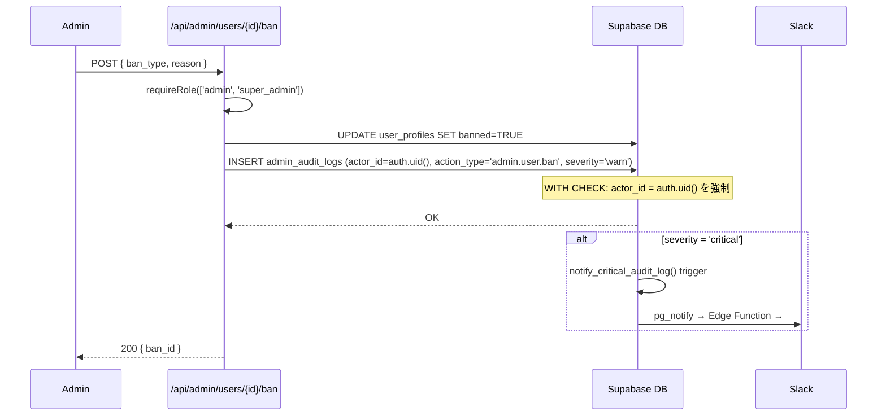

# operator/ 監査・モニタリング設計

## 1. 目的・スコープ

監査ログの不可逆設計・監査対象操作の網羅リスト・エラー監視と性能計測 (`app_logs` と Vercel Speed Insights。Sentry / Better Stack は採用しない)・インシデント管理フロー・死活監視 (Status Page は設置しない) を定義する。

### 1.1 採用状況 (オーナー決定 2026-10-08、#1179)

| 項目 | 採用状況 | 実態 |
|------|---------|------|
| エラー監視 | `app_logs` テーブル + `/super-admin/logs` + エラー急増のメール通知 | Sentry は採用しない。`@sentry/nextjs` は入れていない (§7)。急増したら運用のメールアドレス (`OPS_ALERT_EMAIL`) に 1 通知らせる (§8.3。宛先の設定と、メールの送信ドメインの検証はオーナーの作業) |
| 性能の計測 | Vercel Speed Insights のみ | `@vercel/speed-insights` を、送る URL から `?` 以降と招待トークンを消す部品 (`SpeedInsightsClient`) 経由で `src/app/layout.tsx` に置く。本番ではすでに有効とみられる (§7.3) |
| ログ集約 | `app_logs` テーブル | Better Stack (Logtail) は採用しない。`@logtail/node` は入れていない (§8) |
| Status Page | 設置しない | `status.homegohan.app` は作らない。死活監視用の `/api/health` は実装済み (§9) |

§8 のアラートルール、§9 の監視対象の表、§10.1 の手順のうち、Better Stack / Sentry / Status Page を前提にしていた部分は、
採用しないことが決まる前の記述で、実装の根拠にしない (各節に注記を置いた)。

## 2. 関連要件

- 要件 03 §5.3 F-OP-003 監査ログ
- 要件 03 §15.8 監査ログ対象操作の網羅リスト
- 要件 03 §15.9 監査ログ保持期間
- 要件 03 §22.9 Status Page (要件定義にはあるが、設置しないことをオーナーが決めた。§1.1)
- 100-scenarios.md F17, F18

## 3. admin_audit_logs DDL + RLS (不可逆)

### 3.1 テーブル定義 (最終版)

```sql
-- 既存テーブルへの ALTER (01-data-model.md で定義済み、ここは補足)
CREATE TABLE IF NOT EXISTS admin_audit_logs (
  id                      UUID PRIMARY KEY DEFAULT gen_random_uuid(),
  actor_id                UUID REFERENCES auth.users(id) ON DELETE SET NULL,
  -- GDPR 削除対応: actor が削除された場合 NULL にして履歴を保持
  -- 削除前スナップショット (削除後の参照用)
  actor_email_snapshot    VARCHAR(255),   -- 削除前の email を保持
  actor_role_snapshot     VARCHAR(50),    -- 削除前の主ロールを保持
  action_type             VARCHAR(100) NOT NULL,
  target_id               UUID,
  target_type             VARCHAR(30),
  details                 JSONB NOT NULL DEFAULT '{}',
  severity                VARCHAR(20) NOT NULL DEFAULT 'info'
    CHECK (severity IN ('info', 'warn', 'critical')),
  ip_address              INET,
  user_agent              TEXT,
  session_id              VARCHAR(255),
  impersonated_by         UUID REFERENCES auth.users(id) ON DELETE SET NULL,  -- 履歴用 (#1124: impersonate は提供しない。新しく書く処理は無い)
  created_at              TIMESTAMPTZ NOT NULL DEFAULT NOW()
);

-- インデックス
CREATE INDEX idx_audit_logs_actor ON admin_audit_logs(actor_id, created_at DESC);
CREATE INDEX idx_audit_logs_action ON admin_audit_logs(action_type, created_at DESC);
CREATE INDEX idx_audit_logs_target ON admin_audit_logs(target_id, created_at DESC);
CREATE INDEX idx_audit_logs_severity ON admin_audit_logs(severity, created_at DESC);
CREATE INDEX idx_audit_logs_created ON admin_audit_logs(created_at DESC);  -- 7年分のスキャン用
```

### 3.2 RLS ポリシー (不可逆性の保証)

```sql
ALTER TABLE admin_audit_logs ENABLE ROW LEVEL SECURITY;

-- =========================================
-- SELECT: super_admin のみ
-- (admin が自分の操作を消せない設計)
-- (support / sales / finance も閲覧不可 — 事案調査は super_admin に依頼)
-- =========================================
CREATE POLICY "audit_logs_select_super_admin" ON admin_audit_logs
  FOR SELECT USING (
    EXISTS (
      SELECT 1 FROM user_profiles
      WHERE id = auth.uid() AND 'super_admin' = ANY(roles)
    )
  );

-- =========================================
-- INSERT: admin 系全ロールから可 (本人の JWT。INSERT のポリシーはこの 1 本だけ。#1736)
-- WITH CHECK で actor_id = auth.uid() を強制
-- (他の admin のログを偽装して INSERT できない。actor_id を NULL にもできない)
-- action_type の 'system.' で始まる名前は、service_role / SECURITY DEFINER が actor_id NULL で書く予約の名前なので、本人の JWT では書けない
-- actor の表示に使う列 (actor_email_snapshot / actor_role_snapshot / impersonated_by) も本人の JWT では書けない
-- =========================================
CREATE POLICY "audit_logs_insert_admins" ON admin_audit_logs
  FOR INSERT TO authenticated WITH CHECK (
    actor_id = auth.uid()
    AND action_type NOT LIKE 'system.%'
    AND actor_email_snapshot IS NULL
    AND actor_role_snapshot IS NULL
    AND impersonated_by IS NULL
    AND EXISTS (
      SELECT 1 FROM user_profiles
      WHERE id = auth.uid()
        AND ARRAY['admin','super_admin','support','sales','finance','content_moderator']::TEXT[]
            && roles
    )
  );

-- =========================================
-- UPDATE: 完全禁止 (不可逆性)
-- =========================================
CREATE POLICY "audit_logs_no_update" ON admin_audit_logs
  FOR UPDATE USING (false);

-- =========================================
-- DELETE: 完全禁止 (不可逆性)
-- =========================================
CREATE POLICY "audit_logs_no_delete" ON admin_audit_logs
  FOR DELETE USING (false);

-- コメント
COMMENT ON TABLE admin_audit_logs IS
  '監査ログ。RLS で UPDATE/DELETE 完全禁止。SELECT は super_admin のみ。7年保管 (個人情報保護法/SOC2)';
COMMENT ON COLUMN admin_audit_logs.impersonated_by IS
  '履歴用 (#1124: impersonate は提供しない)。過去に super_admin が別ユーザーとして操作した行にだけ、super_admin の user_id が入っている';
COMMENT ON POLICY "audit_logs_insert_admins" ON admin_audit_logs IS
  '#1736: 本人の JWT からの INSERT は、actor_id = auth.uid()・運営の 6 ロール・action_type が system.* でない・snapshot / impersonated_by が NULL のときだけ。system.* と actor_id NULL の行は service_role / SECURITY DEFINER だけが書く';
```

**注 (#1736)**: 本番には actor も action_type も見ない古い INSERT のポリシー "Admins can create audit logs" があったが、
`20261016238000_admin_audit_logs_insert_actor_only.sql` で外した。書き手の分け方:
- 本人の JWT (`createClient()`) で `recordAdminAudit()` を呼ぶ運営の route — 上のポリシーで書く。action_type は `admin.*` / `super_admin.*` など (system.* は使わない)。
- service_role (`getSupabaseAdmin()`) — `recordMfaAudit()` (`admin.mfa.*` / `super_admin.mfa.reset`) と課金の監査 (`user.billing.*` / `system.*`)。RLS の対象外。
- SECURITY DEFINER の関数 (`billing_apply_stripe_subscription`・pg_cron の `cleanup_handson_tour_sandbox_rows`) — actor_id NULL。RLS の対象外。

system の事実 (バックアップの鮮度・DR 訓練・照合の差分など) を記録するときは、サーバー (service_role / SECURITY DEFINER) が
actor_id NULL・action_type `system.*` で書く。読んで判断する側は action_type に加えて `actor_id IS NULL` でも絞れる
(本人の JWT では actor_id を NULL にできず、system.* も書けない)。

**注 (#1124)**: なりすまし (impersonate) は提供しない。`impersonated_by` 列は、過去に書かれた行 (`action_type = 'impersonate'` の行) の履歴として残し、
新しく書き込む処理は無い。監査ログは UPDATE / DELETE 不可なので、過去の行 (`details.impersonation_token` を含む) もそのまま残る。
このトークンは、どこでも受け付けない値なので使い道が無い (検証する側が無かった)。

## 4. 監査対象操作の網羅リスト (§15.8)

**注 (#1124)**: なりすまし (impersonate) は提供しないため、`admin.user.impersonate` / `admin.user.impersonate_end` / `super_admin.impersonate` は一覧から外した。
以前の実装は `action_type = 'impersonate'` で記録していた (この一覧の名前とは違う)。終了用の `'impersonate_end'` を書く関数もあったが、呼び出す箇所は無かった。
過去に `'impersonate'` で書かれた行は、監査ログなので残る。

### 4.1 admin 系操作

実コードが `action_type` に書く名前 (#1571 で実コードに合わせた)。対象の API と実装の場所を右に書く。
`super_admin.*` の名前のものも、運営の画面から行う変更なので、ここにまとめる (4.2 の一覧の名前と食い違うものは 4.2 に注記した)。
`(記録なし)` の行は、設計で予定していたが API が無い (操作そのものが未実装) ため、記録する箇所も無いもの。

```
admin.user.ban                      - ユーザー BAN (POST /api/admin/users/{id}/freeze)
admin.user.unban                    - BAN 解除 (DELETE /api/admin/users/{id}/freeze)
admin.user.role_change              - ロール変更 (PATCH / PUT /api/admin/users/{id}/role)
admin.user.note_add                 - 管理ノート追加 (PATCH /api/admin/users/{id}・POST /api/support/users/{id}/notes)
admin.organization.create           - 組織作成 (POST /api/admin/organizations)
admin.organization.suspend          - 組織停止 (記録なし)
admin.organization.restore          - 組織復旧 (記録なし)
admin.organization.delete           - 組織削除 (記録なし)
admin.organization.plan_change      - 組織プラン変更 (手動) (PATCH /api/admin/organizations/{id}。details は変える前と後のプラン。今と同じプランなら記録しない)
                                      更新は直前に読んだプランのままのときだけ書く (読んでから書くまでに別の運営が変えていたら書かず記録もしない。
                                      今の値が送られたプランと同じなら 200、違えば 409 CONFLICT_STALE_DATA)。from は書いた時点の実際の直前の値
create_coupon                       - クーポン作成 (POST /api/super-admin/coupons。旧名 admin.coupon.create)
update_coupon                       - クーポンの編集・一時停止・有効化 (PATCH /api/super-admin/coupons/{id}。一時停止・有効化は status の変更で、
                                      専用の action は無い。旧名 admin.coupon.pause / admin.coupon.activate)
delete_coupon                       - クーポン削除 (DELETE /api/super-admin/coupons/{id})
apply_coupon                        - 契約へのクーポンの適用 (遡及適用、super_admin 承認) (POST /api/super-admin/coupons/{id}/apply。旧名 admin.coupon.retroactive_apply)
admin.refund.issue                  - 返金指示 (Stripe Dashboard 誘導) (POST /api/admin/finance/refunds)
admin.finance.export                - 財務データの CSV 書き出し (POST /api/admin/finance/exports。旧名 admin.export.request)
admin.catalog.import                - 商品カタログの取り込み (POST /api/admin/catalog/import)
admin.notification.campaign_send    - 通知キャンペーン送信 (記録なし)
admin.moderation.<action>           - モデレーションの判定 (POST / PUT /api/admin/moderation/{type}/{id})。<action> は
                                      approve / delete_only / delete_and_warn / delete_and_temp_ban / delete_and_perm_ban / escalate
                                      (src/lib/admin/moderation-schemas.ts の ModerationActions。旧名 admin.moderation.resolve)
admin.moderation.restore            - 隠したコンテンツを戻す (POST /api/admin/moderation/{type}/{id}/restore) (#1538)
admin.announcement.create           - お知らせ作成 (POST /api/announcements は記録していない。#1571 の範囲の外)
admin.announcement.delete           - お知らせ削除 (記録なし)
admin.support.ticket.create         - チケット作成 (POST /api/admin/support/tickets)
admin.support.ticket.update         - チケットの状態・優先度などの更新 (PATCH /api/admin/support/tickets/{id})
admin.support.ticket.assign         - チケット担当者変更 (POST /api/admin/support/tickets/{id}/assign。旧名 admin.support.ticket_assign)
admin.support.ticket.message_add    - チケットへのメッセージ (返信・内部メモ) の追加 (POST /api/admin/support/tickets/{id}/messages) (#1571)
                                      (対象は 4.1.1 のチケットの閲覧と同じくチケットを作ったユーザー。details: ticket_id / message_id / is_internal。本文は入れない)
admin.sales.lead.create             - 営業リード作成 (POST /api/admin/sales/leads)
admin.sales.lead.update             - 営業リード更新 (PATCH /api/admin/sales/leads/{id})
admin.sales.lead.activity_add       - 営業リードへの活動の記録 (POST /api/admin/sales/leads/{id}/activities) (#1571)
                                      (対象はリード (target_type = 'sales_lead')。details: activity_id / activity_type。活動の本文 details は入れない)
admin.inquiry.update                - 問い合わせのステータス・管理者メモ更新 (PATCH / PUT /api/admin/inquiries/{id})。更新後の本文を返すので、変更が無い更新も記録する
                                      (details: inquiry_id / status_from / status_to / admin_notes_changed / changed。メモの中身は入れない。対象は 4.1.1 と同じ)
admin.mfa.enroll                    - 運営ロールの二段階認証 (TOTP) の登録 (POST /api/auth/mfa/verify で unverified の factor の verify が成功したとき。#1176)
                                      (severity: info。details: factor_id / backup_codes_issued / failed_step)
admin.mfa.backup_codes_regenerate   - バックアップコードの再発行 (POST /api/auth/mfa/backup-codes。段 B。#1176)
                                      (severity: info。details: backup_codes_issued / failed_step)
admin.mfa.unenroll                  - 認証アプリの解除 (DELETE /api/auth/mfa/factors/{id}。段 B。#1176)
                                      (severity: warn。details: factor_id / backup_codes_deleted / failed_step)
admin.mfa.recover                   - バックアップコードによる回復 (POST /api/auth/mfa/recover。TOTP とコードを全部消す。#1176)
                                      (severity: warn。details: factors_deleted / backup_codes_deleted / failed_step)
super_admin.mfa.reset               - 別の super_admin による運営の二段階認証の解除 (POST /api/super-admin/admins/{id}/mfa/reset。段 C。#1707)
                                      (severity: critical。actor = 実行した super_admin・target = 対象 (target_type 'user')。
                                      details: reason / identity_check / factors_before / backup_codes_before。fail-closed: 削除より先に書き、
                                      書けなければ何もしない。後の手順 (全セッションの終了・factor・コードの削除) の結果は details に持たない)
```

運営ロールの二段階認証の 4 種 (`admin.mfa.*`。`docs/design/cross/12-operator-mfa.md` §17・§17.2) の記録のルール:
- 本人の操作なので `actor_id` = `target_id` = 本人、`target_type` は `'user'`。書くのは `recordMfaAudit()` (`src/lib/auth/mfa/audit.ts`) だけで、
  client は service_role (`org_industrial_doctor` は `audit_logs_insert_admins` の一覧に無く、本人の client では INSERT できないため)。
- 秘密 (secret・QR・コードの値・ハッシュ) は details に入れない。数の欄の `null` は「その手順に届かなかった・失敗した」。
- **fail-open**。ただし監査の起点 (取り消せない操作: verify の成功・コードの消費・unenroll の成功・再発行の呼び出し) の後は、
  続く手順が途中で失敗しても、止まった手順の名前を `failed_step` に入れて **必ず 1 行書いてから** 応答する (起点より前の失敗は書かない)。
- ログインごとの 6 桁の確認 (verified な factor の verify) は記録しない (ログインの一部。Supabase の auth 監査に残る)。
- 自己サービスの `/api/auth/mfa/*` は `tests/admin-mutation-audit-coverage-1571.test.ts` の走査の 4 つのディレクトリの外にあるが、上の 4 種を記録する。

#### 4.1.1 ユーザー PII 閲覧系操作 (#1200)

運営側がユーザーの個人情報を **閲覧** したことも記録する。開示請求のときに「誰が・いつ・誰の情報を見たか」に答えるため。
実装は `src/lib/admin/audit.ts` の `recordAdminAudit()`。

```
admin.user.view                     - 管理コンソールでのユーザー詳細閲覧 (GET /api/admin/users/{id})
admin.user.view_support             - サポートコンソールでのユーザー詳細閲覧 (GET /api/support/users/{id})
admin.user.view_notes               - サポートコンソールでの管理ノート閲覧 (GET /api/support/users/{id}/notes)
admin.user.view_login_history       - 管理コンソールでの利用者のログイン履歴 (IP・端末・国) の閲覧 (GET /api/admin/users/{id}/login-history)。1 件以上返したとき。details: returned_count・severity info (#1720・cross/16 §14.9)
admin.support.ticket.view           - チケット詳細 (件名・メッセージ本文) の閲覧 (GET /api/admin/support/tickets/{id})
admin.support.ticket.view_messages  - チケットのメッセージ一覧の閲覧 (GET /api/admin/support/tickets/{id}/messages)
admin.inquiry.view                  - 問い合わせ詳細 (本文・管理者メモ) の閲覧 (GET /api/admin/inquiries/{id})。一覧は概要 (件名・連絡先・状態) だけなので記録しない
admin.user.list                     - ユーザー一覧・検索 (GET /api/admin/users。サポート画面も使う) (#1326)
admin.support.ticket.list           - チケット一覧 (GET /api/admin/support/tickets) (#1326)
admin.moderation.view               - 通報 1 件 (コンテンツの写真など) の閲覧 (GET /api/admin/moderation/{type}/{id}) (#1326)
admin.finance.invoice.view          - 請求書詳細の閲覧 (GET /api/admin/finance/invoices/{id}) (#1326)
admin.sales.lead.list               - 営業リード一覧 (担当者の連絡先を含む) (GET /api/admin/sales/leads) (#1326)
admin.sales.lead.view               - 営業リード詳細 (連絡先・活動履歴) の閲覧 (GET /api/admin/sales/leads/{id}) (#1326)
super_admin.coupon.view_redemptions - クーポン適用履歴の閲覧 (GET /api/super-admin/coupons/{id}/redemptions) (#1326)
admin.dsr.list                      - 個人情報の請求の一覧 (GET /api/admin/data-requests)。1 件以上返したとき・1 検索 = 1 行 (#1178)
admin.dsr.view                      - 個人情報の請求の詳細 (内容・本人への応答・内部メモ・請求者のメールアドレス) の閲覧 (GET /api/admin/data-requests/{id}) (#1178)
admin.dsr.update                    - 個人情報の請求の対応 (状態・本人への応答・内部メモ。PATCH /api/admin/data-requests/{id})。200 のたびに (変更が無くても)。対応済み・対応できずにしたときは severity warn (#1178)
super_admin.app_logs.list           - アプリログの一覧・本文の検索 (GET /api/super-admin/logs) (#1708)
```

個人情報の請求 (`admin.dsr.*`。canonical は `docs/design/cross/15-data-subject-requests.md` §11): 対象は請求した本人 (`target_type = 'user'`)。
退会済み (`user_id` が NULL) の請求は請求そのもの (`target_type = 'data_subject_request'`・`target_id` = 請求の id)。一覧は `target_id` = null・`target_type = 'data_subject_request'`。
請求の id はどれも `details.request_id` に入れる (一覧は `buildListViewDetails()` の条件と件数だけ)。内容・応答・内部メモの値は入れない。

一覧・検索の記録 (#1326):
- 1 回の検索 (1 回の GET) = 1 行。`details` は `{ filters, returned_count, total }` (`buildListViewDetails()`)。
  `filters` は検索条件 (検索語を含む。未指定は落とし、文字列は 200 文字まで)。返した行の ID や値は入れない。
- `target_id` は null、`target_type` は返した行の種類 (`user` / `support_ticket` / `sales_lead`)。
  クーポン適用履歴は 1 つのクーポンの履歴なので、`target_id` = クーポンの id、`target_type = 'coupon'`。
- 0 件のときは記録しない (下の記録のルールと同じ)。
- `super_admin.app_logs.list` (#1708。`10-logs-and-mail-retry.md` §10): `target_id` は null、`target_type = 'app_log'`。
  `filters` は `level` / `source` / `function_name` / `user_id` / `request_id` / `from` / `to` / `q` (本文の検索語) / `has_cursor`。
  「さらに読み込む」も 1 回の GET = 1 行。0 件・401 / 403 / 400 / 500 / 504 は記録しない。fail-open。
- メールの送信待ちの一覧 (`GET /api/super-admin/email-outbox`) は記録しない (宛先はマスク済みで、件名・本文を返さない)。
  再送 (`POST /api/super-admin/email-outbox/{id}/requeue`) は変更系として `super_admin.email_outbox.requeue` を記録する
  (再送できたときだけ。対象は行の `user_id` (`target_type = 'user'`)、無ければ行の id (`target_type = 'email_outbox'`)。
  `details` は `outbox_id` / `template` / `previous_status`。404 / 409 / 500 は記録しない。fail-open。#1708・`10-logs-and-mail-retry.md` §10)。

- `admin.moderation.restore`: 対象は通報 (`target_type = 'moderation_item:<type>'`)。`details`: `moderation_type` / `flag_id` / `content_id` / `content_user_id` / `restore_note` / `hidden_at_before` / `hidden_by_before` / `hidden_reason_before` / `target_ids` / `restored_ids` / `restored` / `restore_error` / `approved_flag_ids` / `status_saved` / `status_error` / `restore_window_days`。状態を変えた操作と DB の失敗で 1 行。成功 info・失敗と書いたあとの 0 行は warn。何も書かずに断った 409 / 410 は記録しない。

詳細の対象 (#1326):
- `admin.moderation.view`: 対象はコンテンツの持ち主 (`target_type = 'user'`)。持ち主が分からないときは通報の id
  (`target_type = 'moderation_item:<type>'`)。`details` は `moderation_type` / `flag_id` / `content_id` / `viewed_fields`。
- `admin.finance.invoice.view`: 対象は請求先のユーザー (`target_type = 'user'`)。サブスクリプションから引けないときは
  `target_id = null`・`target_type = 'stripe_event'`。Stripe のイベント ID (`evt_...`。uuid ではない) は `details.stripe_event_id` に入れる。
- `admin.sales.lead.view`: 対象はリード (`target_type = 'sales_lead'`。リードはユーザーではない)。`details` は `viewed_fields` と `activity_count`。

変更系の記録 (#1326): `src/app/api/admin/**` と `src/app/api/super-admin/**` は `admin_audit_logs` へ直接 INSERT せず、
すべて `recordAdminAudit()` を通す (`x-forwarded-for` を直接読まない)。`tests/admin-view-audit-1326.test.ts` が検査する。

変更系を記録する範囲 (#1571): 運営の操作で状態を変えるもの (POST / PUT / PATCH / DELETE) は、すべて記録する。
`src/app/api/{admin,super-admin,support,operator}` の変更系の handler と、記録の有無 (記録しないものは理由) の表を
`tests/admin-mutation-audit-coverage-1571.test.ts` が持ち、実コードと突き合わせる (handler が増えたら表に足す)。
同じテストが、`recordAdminAudit()` の呼び出しがすべて `request` を渡していることも見る。
- 運営の二段階認証の解除 (`POST /api/super-admin/admins/{id}/mfa/reset`。cross/12 §14.7) は、`super_admin.mfa.reset` を `recordMfaAudit()` (`src/lib/auth/mfa/audit.ts`) の中の `recordAdminAudit()` で書くので、表には `exempt` に理由を書いて載せる (別のファイルの関数なので、走査では audited と判定できない。cross/12 §23 N-38)。
- 自己サービスの `/api/auth/mfa/*` は走査の 4 つのディレクトリの外にあるが、4 種 (`admin.mfa.*`) を記録する (上の 4.1 の記録のルール)。

記録のルール:
- `target_id` は **情報を見られた本人 (ユーザー)** の id、`target_type` は `'user'`。チケットの閲覧も、チケットではなくチケットを作ったユーザーを対象にする。
  こうすると、開示請求のときに `target_id = 本人` で全ての閲覧をまとめて引ける。チケット ID は `details.ticket_id` に入れる。
  問い合わせ (`admin.inquiry.view` / `admin.inquiry.update`) も同じで、会員の問い合わせは `inquiries.user_id` の本人を対象にし、問い合わせ ID は `details.inquiry_id` に入れる。
  ゲストの問い合わせ (`user_id` なし。会員が退会して外れたものを含む) には本人の id が無いので、`target_type = 'inquiry'` で問い合わせ自体の id を対象にする。
- `details` には **閲覧した項目名だけ** を入れる (`viewed_fields`)。ニックネーム・メール・本文などの値は入れない。
- `severity` は `info`。情報を実際に返したときだけ記録する (404 / 401 / 403 / 0 件のときは記録しない)。
- `ip_address` は **利用者の IP**。`x-forwarded-for` の先頭 1 IP (無ければ `x-real-ip`) を検証して入れる (inet 列のため、複数 IP や不正値をそのまま渡すと INSERT が失敗する)。`user_agent` も保存する。
  取り出しは `src/lib/admin/client-ip.ts` の `extractClientIp()`。`recordAdminAudit()` には必ず `request` を渡す (渡さないと `ip_address` / `user_agent` が null になる)。
- サーバーコンポーネントから `adminFetch()` (`src/lib/admin/fetch.ts`) で内部 API を呼ぶとき (#1571): Vercel は内部 API への問い合わせの
  `x-forwarded-for` / `x-real-ip` を、問い合わせたサーバー (Vercel の関数) の IP に付け直す (転送した値は捨てられる)。そのため `adminFetch()` は、
  元のリクエストの利用者の IP を専用のヘッダー (`x-homegohan-admin-client-ip`) に入れ、時刻と、service_role キーから導いた鍵の HMAC で署名して送る。
  内部 API の側は、署名が正しく新しい (前後 5 分以内) ときだけその IP を使い、それ以外は `x-forwarded-for` の先頭に戻る
  (ブラウザから同じヘッダーを付けても、鍵を知らないので署名を作れず、偽装できない)。service_role キーが無い環境では署名しない。
- 定期処理 (pg_cron) が DB の中で書く行 (例: `cleanup_handson_tour_sandbox_rows` の `handson_tour_sandbox_cleanup`) は、
  操作した利用者がいないので `ip_address` は NULL のまま (#1571。付けるべき IP が無い。NULL は記録漏れではなく、利用者のいない操作を表す)。
- 閲覧の記録は **fail-open**: 記録に失敗しても閲覧は止めず、失敗は db-logger (`app_logs`) に error で残す。
  「記録できないなら実行しない」べき操作 (返金など) は、`recordAdminAudit()` の戻り値 `ok` を見て呼び出し側で止める。

#### 4.1.2 返金の記録 (#1185)

このアプリは返金を実行しない。担当者が Stripe ダッシュボードで返金する **前に**、`POST /api/admin/finance/refunds`
(実装: `src/app/api/admin/finance/refunds/route.ts`) で `admin.refund.issue` を 1 行記録する。API の仕様は `02-api-spec.md` §9。

記録のルール:
- `target_id` は **返金されるユーザー** の id、`target_type` は `'user'` (4.1.1 と同じく、`target_id = 本人` で本人に関わる操作をまとめて引ける)。
- `severity` は `warn`。`details` は `{ amount, currency, reason, stripe_charge_id, stripe_invoice_id }`
  (`amount` は Stripe と同じ最小通貨単位の整数。JPY は円そのもの。使わない側の Stripe ID は `null`)。
- 4.1.1 と違い **fail-closed**: 記録できなかったら 500 を返し、Stripe ダッシュボードへのリンクは返さない
  (監査ログの残らない返金を作らない)。失敗は `recordAdminAudit()` が db-logger (`app_logs`) に error で残す。
- 記録は本人のセッションの client (RLS 有効) で行い、`actor_id` には `requireRole` が返した本人の id を渡す。
  INSERT のポリシーは `audit_logs_insert_admins` の 1 本で、`actor_id = auth.uid()` と運営ロールを DB 側でも強制する
  (`actor_id` を検査しない旧ポリシー "Admins can create audit logs" は #1736 で外した)。
  `finance` ロールは `admin_audit_logs` を SELECT できないため、INSERT した行を読み戻してはいけない。
- 2 名承認 (`finance.refund.approve`) と、Stripe の `charge.refunded` Webhook との突き合わせは Stripe 連携 (#1125) 側で後続。

### 4.2 super_admin 系操作

実コードの名前が下の一覧と違うもの (#1571 の時点。名前は変えていない):
- プランの作成・更新・削除は `create_plan` / `update_plan` / `delete_plan` (POST /api/super-admin/plans・PATCH / DELETE /api/super-admin/plans/{id})。
  公開・非公開・廃止・廃止の取り消しは `update_plan` の中の変更として記録する。価格変更は `change_price` (POST /api/super-admin/plans/{id}/price-change)。
- A/B テスト (/api/super-admin/experiments) の作成・更新・削除は `super_admin.plan.create` / `super_admin.plan.update` を使っている。
- 機能パッケージは `create_feature_package` / `update_feature_package` / `delete_feature_package`。
- 機能フラグの作成・更新・削除は、すべて `super_admin.feature_flag.toggle`。
- LLM クォータの変更は `super_admin.llm_quota.update` (`src/lib/super-admin/ai-daily-limits.ts` の LLM_QUOTA_AUDIT_ACTION)。

#1571 で記録を足したもの:
- `super_admin.setting.change` (下の一覧のとおり): PUT /api/super-admin/settings。details: key / value / description_changed。severity は warn。
- `super_admin.embeddings.regenerate`: POST /api/super-admin/embeddings/regenerate が成功したとき。details: table / only_missing / offset / processed / has_more。
- 運営の家族・組織の緊急操作 (/api/operator/membership/*。RPC が書く membership_audit とは別に記録する):
  `super_admin.organization.dissolve` (severity=critical) / `super_admin.organization.transfer_admin` (warn。下の一覧の名前) /
  `super_admin.family.dissolve` (critical) / `super_admin.family.transfer_representative` (warn)。
  details: reason (譲渡は to_user_id / from_user_id も)。

```
super_admin.plan.create             - プラン作成
super_admin.plan.update             - プラン更新
super_admin.plan.publish            - プラン公開
super_admin.plan.unpublish          - プラン非公開
super_admin.plan.deprecate          - プラン廃止 (severity=critical)
super_admin.plan.un_deprecate       - 廃止ロールバック (severity=critical)
super_admin.plan.price_change       - 価格変更
super_admin.feature_package.create  - 機能パッケージ作成
super_admin.feature_package.update  - 機能パッケージ更新
super_admin.feature_package.delete  - 機能パッケージ削除
super_admin.feature_flag.toggle     - 機能フラグ切替
super_admin.feature_flag.rollout    - ロールアウト戦略変更
super_admin.cron.run_now            - cron 手動実行
super_admin.cron.pause              - cron 一時停止
super_admin.organization.transfer_admin - org_admin 緊急転送
super_admin.gdpr_delete.execute     - GDPR 削除実行
super_admin.llm_quota.override      - LLM クォータ手動変更
super_admin.setting.change          - システム設定変更
super_admin.embeddings.regenerate   - 埋め込みの再生成 (POST /api/super-admin/embeddings/regenerate) (#1571)
super_admin.organization.dissolve   - 組織の緊急解散 (severity=critical) (#1571)
super_admin.family.dissolve         - 家族グループの緊急解散 (severity=critical) (#1571)
super_admin.family.transfer_representative - 家族の代表者の緊急譲渡 (severity=warn) (#1571)
super_admin.email_outbox.requeue    - 届けられなかったメール (dead) の再送 (POST /api/super-admin/email-outbox/{id}/requeue。§4.1.1) (#1708)
admin.billing.manual_grant          - 運営者による手動のプラン付与 (POST /api/super-admin/users/{id}/manual-plan。severity=warn。details: subscription_id / plan_key / expires_at / reason。billing/02) (#1797)
admin.billing.manual_revoke         - 手動付与の取り消し (DELETE /api/super-admin/users/{id}/manual-plan。severity=warn。details: subscription_id / plan_key / reason。billing/02) (#1797)
```

### 4.3 finance 系操作

```
finance.invoice.generate            - 請求書生成
finance.invoice.regenerate          - 請求書再生成
finance.invoice.cancel              - 請求書キャンセル
finance.invoice.resend              - 請求書再送
finance.refund.approve              - 返金承認
finance.stripe_reconcile.manual     - 手動 reconcile 実行
```

### 4.4 support 系操作

```
support.ticket.escalate             - エスカレーション
support.ticket.close                - チケット close
support.user.password_reset         - パスワードリセット実行
support.user.email_resend           - 確認メール再送
```

### 4.5 システム自動操作

```
system.payment.failed               - 支払失敗 (Stripe webhook)
system.billing.subscription_created - 個人の契約の行ができた (写像 billing_apply_stripe_subscription。billing/01)
system.billing.subscription_status_changed - 個人の契約の status が変わった (写像。past_due / grace になったときは severity=warn)
system.stripe.event_failed          - Stripe の Webhook のイベントの処理に失敗した (severity=warn。target_type='stripe_event'・target_id は NULL)
system.revenuecat.event_failed      - RevenueCat の Webhook のイベントの処理に失敗した (severity=warn。target_type='revenuecat_event'・target_id は NULL。details は event_id・event_type・error_code だけ。billing/03 §8.1)
system.billing.account_deletion_stripe_cancelled - 退会で Stripe の Checkout を閉じ・契約を即時解約し・顧客を匿名化した (退会の段階 billing / billing_recheck)
system.billing.orphan_subscription_cancelled - 退会した利用者の顧客に残った契約を即時解約した (severity=warn。target_type='stripe_subscription'・target_id は NULL)
system.billing.manual_grant_expired - 運営者が手動で付与した個人の契約が有効期限を過ぎて expired になった (DB 関数 billing_expire_manual_subscription_for_user。日次のプロシージャ billing_expire_manual_subscriptions が利用者ごとに呼ぶ。severity=info。target は利用者。billing/02 §6.4)
system.stripe.chargeback            - チャージバック発生 (severity=critical)
system.stripe.reconcile_discrepancy - reconcile 不一致検出
system.plan.auto_expire             - プラン自動期限切れ
system.gdpr_delete.batch            - GDPR 削除バッチ実行
system.ban.auto                     - 自動 BAN (不正検知)
system.family.dissolved_purge       - 解散から 90 日を過ぎた家族のグループの物理削除 (pg_cron purge-dissolved-family-groups。target_type='cron_job'・actor NULL。operator/11 §5.4)
```

### 4.5a バックアップと DR 訓練の操作 (cross/17-backup-automation.md §10)

| action_type | 誰が | 書き方 | severity | target_type |
|---|---|---|---|---|
| `backup.daily.completed` / `backup.weekly.completed` / `backup.annual.completed` | GitHub Actions (actor 無し) | `record_backup_audit` (所有者 `postgres` だけが呼べる) | info | `database_backup` |
| `backup.daily.failed` / `backup.weekly.failed` / `backup.annual.failed` | 同上 | 同上 | warn | 同上 |
| `dr.test.monthly.pitr` / `dr.test.quarterly.restore` / `dr.test.annual.drill` | super_admin | `recordAdminAudit` (本人の client。`actor_id = auth.uid()`) | success → info、failed / skipped → warn | `dr_test` |

読む側 (`/super-admin/backups`・`/api/cron/backup-freshness`) は action_type だけで信じず、書いた経路の印で絞る。取得の行は actor_id が NULL かつ target_type が `database_backup`、訓練の行は target_type が `dr_test` かつ actor が今の super_admin (cross/17 §7.1・§10)。`admin_audit_logs` の INSERT のポリシーが action_type を見ない既存の欠陥は Issue #1736 で直す。

### 4.6 監査ログ INSERT ヘルパー

```typescript
// src/lib/audit/log.ts
import { createSupabaseServiceClient } from '@/lib/supabase/service';

interface AuditLogParams {
  actorId: string;
  actionType: string;
  targetId?: string;
  targetType?: string;
  details?: Record<string, unknown>;
  severity?: 'info' | 'warn' | 'critical';
  ipAddress?: string;
}

export async function insertAuditLog(params: AuditLogParams): Promise<void> {
  const supabase = createSupabaseServiceClient();  // service_role で RLS バイパス (INSERT のみ)

  // actor の email / roles をスナップショットとして取得 (GDPR 削除後も逆引き可能にする)
  let actorEmailSnapshot: string | null = null;
  let actorRoleSnapshot: string | null = null;
  if (params.actorId) {
    const { data: authUser } = await supabase.auth.admin.getUserById(params.actorId);
    actorEmailSnapshot = authUser?.user?.email ?? null;

    const { data: profile } = await supabase
      .from('user_profiles')
      .select('roles')
      .eq('id', params.actorId)
      .single();
    actorRoleSnapshot = (profile?.roles ?? []).join(',') || null;
  }

  await supabase.from('admin_audit_logs').insert({
    actor_id: params.actorId,
    actor_email_snapshot: actorEmailSnapshot,
    actor_role_snapshot: actorRoleSnapshot,
    action_type: params.actionType,
    target_id: params.targetId ?? null,
    target_type: params.targetType ?? null,
    details: params.details ?? {},
    severity: params.severity ?? 'info',
    ip_address: params.ipAddress ?? null,
  });
  // エラーは握り潰さず、呼び出し元にスローする (監査ログ失敗は操作を中断させる)
}
```

**注意**:
- `actor_id` は RLS の WITH CHECK で `auth.uid()` と一致することを強制するが、`service_role` を使う場合は RLS をバイパスするため、アプリ層で `actorId = await getCurrentUserId()` を必ず取得して渡すこと。
- `actor_email_snapshot` / `actor_role_snapshot` は GDPR 削除により `actor_id` が NULL になった後も actor を特定するために使用する。これらはスナップショット列であり、後から変更されない。

### 4.7 利用者の課金の操作 (billing/01)

利用者本人の操作 (`actor_id` = `target_id` = 本人・`target_type = 'user'`)。書くのは `src/lib/billing/service.ts` だけ。
billing/01 の利用者の操作 (本節) と自動の処理 (4.5 の `system.payment.failed`・`system.stripe.event_failed` と、`system.billing.manual_grant_expired` を除く `system.billing.*` の 4 つ) が書く名前の一覧は、`src/lib/billing/core.ts` の `BILLING_AUDIT_ACTIONS` (9 つ) が正。手動のプランの付与 (billing/02) の監査 (4.2 の `admin.billing.manual_grant`・`admin.billing.manual_revoke` と、DB 関数が書く 4.5 の `system.billing.manual_grant_expired`) の一覧は `src/lib/billing/manual-grant.ts` の `MANUAL_GRANT_AUDIT_ACTIONS` で、`BILLING_AUDIT_ACTIONS` には含まない。

```
user.billing.checkout_started       - Checkout Session を作った (POST /api/billing/checkout)
user.billing.cancel_scheduled       - 有料プランの解約を予約した (期間末。POST /api/billing/subscription/cancel)
user.billing.cancel_revoked         - 解約の予約を取り消した (POST /api/billing/subscription/resume)
```

課金の監査の `target_type` は `src/lib/billing/core.ts` の `BILLING_AUDIT_TARGET_TYPES` の 3 つ:
`user` (target_id = 利用者の id)・`stripe_event` (利用者を解決できない Webhook の失敗。`system.stripe.event_failed`)・
`stripe_subscription` (退会した利用者の顧客に残った契約の解約。`system.billing.orphan_subscription_cancelled`)。
後の 2 つは `target_id` を NULL にし、Stripe の id (`evt_…` / `sub_…`。uuid ではない) は `details` に入れる。

## 5. 7 年保管とアーカイブ

### 5.1 保持期間一覧

| テーブル | 保持期間 | 根拠 | アーカイブ先 |
|---------|---------|------|------------|
| `admin_audit_logs` | 7 年 | 個人情報保護法、SOC2 | Supabase → S3 Glacier (1 年経過後) |
| `org_license_audit_log` | 7 年 | 法人契約監査要件 | 同上 |
| `org_health_access_logs` | 10 年 | 産業医記録、医療法 | 同上 |
| `family_activity_log` | 3 年 | プライバシーバランス | 同上 |
| `gdpr_deletion_requests` | 永久 | 削除証明 | アーカイブしない |

### 5.2 アーカイブジョブ (pg_cron 月次)

```sql
-- 1 年経過した admin_audit_logs を Cold Storage 用テーブルに移動
-- 実際の S3 転送は Vercel Cron が担当
-- (未実装の計画。DB の論理バックアップは cross/17 の GitHub Actions → R2 で、このアーカイブの転送は担わない。7 年アーカイブは別の設計。cross/17 §1・§21)
SELECT cron.schedule(
  'audit-log-archive',
  '0 3 1 * *',  -- 毎月1日 03:00 UTC
  $$
  -- 1 年超のログを archive テーブルに移動
  WITH moved AS (
    DELETE FROM admin_audit_logs
    WHERE created_at < NOW() - INTERVAL '1 year'
    RETURNING *
  )
  INSERT INTO admin_audit_logs_archive SELECT * FROM moved;
  $$
);
```

```sql
CREATE TABLE admin_audit_logs_archive (LIKE admin_audit_logs INCLUDING ALL);
-- archive テーブルは RLS 同様、UPDATE/DELETE 禁止
ALTER TABLE admin_audit_logs_archive ENABLE ROW LEVEL SECURITY;
CREATE POLICY "archive_no_update" ON admin_audit_logs_archive FOR UPDATE USING (false);
CREATE POLICY "archive_no_delete" ON admin_audit_logs_archive FOR DELETE USING (false);
```

## 6. アラート設定

### 6.1 連続失敗アラート

```typescript
// src/lib/monitoring/audit-alerts.ts

// 同一 admin による短時間での大量 BAN (異常操作の検知)
export async function checkBulkBanAnomaly(actorId: string): Promise<void> {
  const { count } = await supabase
    .from('admin_audit_logs')
    .select('*', { count: 'exact' })
    .eq('actor_id', actorId)
    .eq('action_type', 'admin.user.ban')
    .gte('created_at', new Date(Date.now() - 60 * 60 * 1000).toISOString()); // 1時間以内

  if ((count ?? 0) > 50) {
    await notifySlack({
      channel: '#security-alert',
      message: `⚠️ 異常 BAN 操作: actor_id=${actorId} が1時間以内に ${count} 件 BAN`,
    });
  }
}
```

### 6.2 severity='critical' の即時通知

`admin_audit_logs` に severity='critical' が INSERT された場合:

```sql
-- Supabase DB trigger (critical ログ検出)
CREATE OR REPLACE FUNCTION notify_critical_audit_log()
RETURNS TRIGGER AS $$
BEGIN
  IF NEW.severity = 'critical' THEN
    PERFORM pg_notify('critical_audit_log', row_to_json(NEW)::text);
  END IF;
  RETURN NEW;
END;
$$ LANGUAGE plpgsql;

CREATE TRIGGER audit_log_critical_notify
  AFTER INSERT ON admin_audit_logs
  FOR EACH ROW EXECUTE FUNCTION notify_critical_audit_log();
```

Edge Function が `pg_notify` をリッスンして Slack #incident に即時通知。

## 7. エラー監視と性能計測 (Sentry は採用しない)

### 7.1 方針

オーナー決定 (2026-10-08、#1179): Sentry は採用しない。`@sentry/nextjs` は入れておらず (`package.json` に無い)、
`Sentry.captureException` などを呼ぶコードも作らない。旧案にあった Sentry 連携のコード例
(`setSentryAdminContext`・`captureException`・`startTransaction`) は削除した。
エラーの記録・閲覧と性能の計測は、次で足りる。

| 目的 | 手段 |
|------|------|
| エラー・警告の記録 | `app_logs` テーブルへ構造化ログを書く。Next.js は `src/lib/db-logger.ts`、Edge Functions は `supabase/functions/_shared/db-logger.ts`。新規のエンドポイント・Edge Function は必ずこれを通す。ブラウザ側のログは `/api/log` 経由で同じテーブルに入る |
| エラーの閲覧 | `/super-admin/logs` (運用ログ画面) で `app_logs` を見る |
| 性能の計測 (Web Vitals) | Vercel Speed Insights (§7.3) |

### 7.2 重大エラーの記録

重大エラーは `error` レベルで `app_logs` に残す。管理者の操作に関わるものは、`app_logs` とは別に `admin_audit_logs` (§3-4) にも
記録する (運用ログと監査ログは用途が違う。混同しない)。

```typescript
import { createLogger } from '@/lib/db-logger';

const logger = createLogger('stripe-webhook');
logger.error('payment_failed を処理できなかった', error, {
  stripe_event_id: eventId,
  action_type: 'payment_failed',
});
```

### 7.3 Vercel Speed Insights (性能の計測)

- パッケージ: `@vercel/speed-insights` (`package.json` の dependencies)。
- 読み込み: `src/app/layout.tsx` の `<body>` の中に `<SpeedInsightsClient />` (`src/components/SpeedInsightsClient.tsx`) を 1 つだけ置く。画面には何も描画しない。
  `SpeedInsightsClient` は `'use client'` の小さな部品で、`@vercel/speed-insights/next` の `<SpeedInsights />` に `beforeSend` を渡す。
  `beforeSend` は関数なので、サーバーコンポーネントの `layout.tsx` からは渡せない。`<SpeedInsights />` を、この部品を通さずに置かない
  (理由は下の「URL に含まれる情報」。`tests/speed-insights-scrub-1179.test.ts` が、`src` の中で読み込むのはこの部品だけであることを検査する)。
- 計測するもの: Web Vitals (LCP / INP / CLS など) だけ。エラーの記録はしない (§7.1 の `app_logs` が担う)。
- 有効化の状態: **本番ではすでに有効とみられ、このコードをデプロイした時点から、全ページで計測が始まる。** ダッシュボードで有効にするのを待つ関門は無い。
  2026-10-08 に、本番 (`homegohan-app.vercel.app`) へ GET だけで確かめた (計測値の POST はしていない)。
  - `/_vercel/speed-insights/script.js` は 200 で JavaScript を返す。アプリのミドルウェアを通らず、Vercel が先に応答している。
  - 有効にしていない `/_vercel/insights/script.js` や、存在しない `/_vercel/speed-insights/nonexistent-check.js` は、アプリのミドルウェアに届いて `/login` への 307 になる。

  ダッシュボードの実際の状態 (有効か、いつから有効か) は、デプロイの前にオーナーが確かめる。計測を止めたいときは、ダッシュボードで Speed Insights を無効にする (コードを変えずに止まる)。
- 配信と CSP: スクリプトも計測値の送信先も、同じオリジンのパス。設定が無いときの既定値は `/_vercel/speed-insights/script.js` と `/_vercel/speed-insights/vitals`。
  有効にしたプロジェクトのビルドでは、Vercel が `NEXT_PUBLIC_VERCEL_OBSERVABILITY_CLIENT_CONFIG` を渡し、その中の `speedInsights.scriptSrc` / `endpoint`
  (`/<固有のパス>/script.js` / `/<固有のパス>/vitals` の形) が優先される。どちらも同じオリジンなので、CSP (`src/lib/security/csp.ts`) の `script-src` / `connect-src` の
  `'self'` で足り、CSP は変えていない。読み込み先と `'self'` は `tests/speed-insights-1179.test.tsx` が検査する (設定が無いときの既定値と、設定が渡ったときの両方)。
  実際の送信先は検査できないので、デプロイ後に、ブラウザの開発者ツールで `script[data-sdkn]` の `src` と計測値の送信先を見て、
  未ログインでも 2xx になること、コンソールに CSP 違反が出ていないことを確かめる。
- 認証ミドルウェア: `src/proxy.ts` の matcher は `/_vercel/` 以下を対象から外してある (`tests/speed-insights-middleware-1179.test.ts`)。
  Vercel 上で有効にした機能のパスは、上のとおり Vercel がミドルウェアより前に応答するので、この除外が Vercel 上の計測を守っているわけではない。
  効くのは、Vercel が応答しないとき (有効にしていない機能、存在しないパス、`next start` で Vercel の外に置いたとき) に、
  `/_vercel/*` の応答が `/login` の HTML にすり替わるのを防ぐ場面。害は無いので残している。
- 料金と間引き: 計測するデータの数に応じて Vercel の料金が増えることがある。抑えたいときは `SpeedInsightsClient` の `<SpeedInsights … />` に
  `sampleRate={0.5}` のように渡して間引ける (既定は全件)。
- 外部送信の表示: 計測データは Vercel へ送られる。プライバシーポリシーなどへの表示が要るかは、弁護士の確認 (T30) を待って決める (未確認)。
- URL に含まれる情報: 計測値にはページの URL も載る。Vercel が配るスクリプトは、`location.href` (`?` 以降と `#` 以降を含む URL 全体) をそのまま送る
  (パッケージが `data-path` を付けないため)。このアプリには、URL に個人情報や招待用の値が入るページがある。
  - 招待先のメールアドレス: `/login?redirect=/invite/<token>&email=…`・`/signup?redirect=…&email=…`・`/auth/verify?email=…`
  - パスに入る招待トークン: `/invite/[token]`・`/family/promotions/[token]`

  本番はすでに有効とみられるので、対策なしで出すと、デプロイした時点から、これらが URL ごと Vercel へ送られる。
  そこで `beforeSend` (`scrubSpeedInsightsEvent`、`src/lib/speed-insights-scrub.ts`) で、送る前に URL を直す。
  - `?` 以降、`#` 以降、ユーザー名、パスワードを消す。オリジンとパスだけが残る。
  - `route` (動的セグメントを置き換えた形。例: `/invite/[token]`・`/meals/[id]`) があれば、パスはそれにする。トークンや ID が URL に残らない。
  - パスに招待トークンが入るページ (`/invite/…`・`/family/promotions/…`) は、送るパスが `…/[token]` の形に置き換わっているときだけ送る。
    `route` が無いとき、置き換えに失敗して生のトークンが残っているときは、計測値ごと送らない。
    配られるスクリプトは、`beforeSend` が返した `route` を使わず、元の `route` を送るので、直さずに落とす。
  - URL として読めないときも送らない。

  `beforeSend` の仕様 (計測値を送る直前に 1 件ずつ呼ばれる。null などを返すと送られない。返した `url` が送られる) は、
  配られるスクリプト (scriptVersion 0.1.3) を読んで確かめた。スクリプトは Vercel が更新できるので、デプロイ後に、実際の送信内容
  (開発者ツールの Network) で、`href` にクエリ・`#`・招待トークンが無いことを確かめる。
  `beforeSend` に渡す関数はモジュール直下に置き、参照を変えない (参照が変わるたびに、パッケージが登録し直す)。
  パスに秘密の値が入る `[token]` のページを足したら、`src/lib/speed-insights-scrub.ts` の `TOKEN_PATH_PREFIX` にも足す
  (`tests/speed-insights-scrub-1179.test.ts` が `src/app` を走査して検査する)。
  限界: 変わるのは、Speed Insights の計測値に載る URL だけ。計測の通信そのものに、ブラウザが付ける `Referer` ヘッダなどは残る
  (同じオリジンへの通信で、ページの取得や API と同じ扱い)。Vercel 側がそれを保存するかどうかは確認できていない。

## 8. Better Stack (Logtail) 統合 (採用しない)

オーナー決定 (2026-10-08、#1179): Better Stack は採用しない。`@logtail/node` は入れておらず、`BETTER_STACK_TOKEN` も使わない。
ログは `app_logs` に集める (§7.1)。旧案にあった `logger` ラッパーとログ出力例のコードは削除した。

### 8.1 旧案のアラートルール (未実装)

下の表は Better Stack で設定する予定だったもので、実現する手段がなくなったため実装されていない。
代わりが必要になったら、`app_logs` の集計などで改めて設計する (§16)。
ただし 1 行目 (`error` の急増) だけは、Slack ではなくメールで、`app_logs` の集計から通知する形で実装した (§8.3。しきい値・窓も旧案とは違う)。

| 条件 | アクション |
|-----|---------|
| `error` ログが 5 分間に 10 件超 | Slack #incident 通知 (→ §8.3 のメール通知で代替: 15 分間に 20 件超) |
| `stripe.webhook` の processing_time > 5s | Slack #stripe-alerts |
| pg_cron ジョブ失敗 | Slack #cron-alerts |
| API p95 > 1000ms (3 分間継続) | Slack #performance |

### 8.2 アプリログ画面 (実装済み: #1157)

Better Stack は採用しない (上記)。代わりに、`app_logs` (db-logger が書く構造化ログ) を super_admin が画面で読める (§7.1)。

| 項目 | 内容 |
|-----|------|
| 画面 | `/super-admin/logs` (左メニュー「運用 > アプリログ」)。読み取り専用 |
| API | `GET /api/super-admin/logs`。権限は super_admin のみ (admin も不可)。`app_logs` の RLS は本人の行だけ読める (#1171) ため、`requireRole` を通したあとで service role の client を使う |
| 絞り込み | `level` / `source` / `function_name` / `user_id` / `request_id` (いずれも完全一致) と `from` / `to` (ISO 8601、両端を含む)、`q` (`message` / `error_message` の部分一致・大文字小文字を区別しない・1〜100 文字・制御文字は 400。`%` `_` は文字どおりに探す。索引は無く、時間切れは 504。#1708・`10-logs-and-mail-retry.md` §9.1) |
| ページ送り | 新しい順 (`created_at`、同時刻は `id`)。`limit` は既定 50・最大 200。応答の `meta.next_cursor` を次回の `cursor` に渡す (OFFSET は使わない) |
| 表示 | 文面は保存されたまま表示する。秘密情報のマスクは書き込み時 (`supabase/functions/_shared/log-sanitizer.ts`: #1171 / #1287) |
| 索引 | `created_at` / `level` / `function_name` / `source` / `user_id`。`request_id` と本文 (`q`) には索引が無く、単独で探すと全行を順に調べる |
| 監査 | 1 行以上返した GET ごとに `super_admin.app_logs.list` を 1 行 (条件と件数だけ。§4.1.1。#1708) |

この画面と API は読み取り専用で、通知は含まない。しきい値を超えたときの通知は、別の仕組み (§8.3) が行う。Sentry は採用しない (§7)。

### 8.3 エラー急増のメール通知 (実装済み: #1157)

`app_logs` の `error` が短時間に増えたら、運用のメールアドレスに 1 通知らせる (#1157。オーナーの選択は 2026-10-09 の「推奨案」= ログの閲覧に加え、しきい値はあとで調整する)。
通知先は、共有の受信箱ができるまでは個人のアドレスでもよい。`infra_alerts` は書かない (インフラ画面は「未接続」のまま: #1180)。

| 項目 | 内容 |
|-----|------|
| 起動 | Vercel Cron が 15 分おきに `GET /api/cron/app-log-alerts` を呼ぶ (`vercel.json`)。認証は他の cron と同じ `requireCronAuth` (`CRON_SECRET` の Bearer。旧シークレット `CRON_SECRET_PREVIOUS` の受け付けを含む。#1196) |
| 宛先 | 環境変数 `OPS_ALERT_EMAIL` (メールアドレス 1 つ)。**未設定なら何もしない** (info ログを 1 行残すだけで、DB にもメールにも触れない)。形が不正なときは warn を残して送らない |
| 数え方 | DB の `app_log_error_counts(窓 15 分, 上位 10)` が、サーバーが書いた `level='error'` (`source <> 'client'`) を `function_name` ごとに数える。ブラウザ・端末から `POST /api/log` で届いた error (`source = 'client'`) は `app_log_client_error_counts` が同じ形で別に数える (#1493。migration `20261011080000_app_log_error_counts_split_client.sql`)。返すのは関数名と件数 (と全体の件数) だけで、ログの本文・ユーザー ID は読まない。既存の索引 `idx_app_logs_created_at` で足りる |
| 判定 | サーバーの error の全体の合計が **20 件を超えた** (21 件以上) とき。関数ごとではなく合計で見る (小さな失敗が広く散らばる障害も拾うため)。ブラウザ・端末から届いた error は、別の通知として **100 件を超えた** (101 件以上) ときに知らせる (#1493。端末や回線の都合の失敗も混ざり、1 つの不具合でも画面の数だけ届くため、サーバーより高くする)。既定値は `src/lib/ops-alerts/app-log-error-spike.ts` の定数で、環境変数 `OPS_ALERT_ERROR_THRESHOLD` / `OPS_ALERT_CLIENT_ERROR_THRESHOLD` (どちらも 1〜100000 の整数) で上書きできる。整数でない・範囲外の値は既定値に戻し、無視した変数の名前だけを warn に残す。窓 (15 分) は `vercel.json` の間隔と結びついているので、環境変数では変えない |
| 重複の抑止 | 同じアラートは **60 分は送り直さない** (環境変数 `OPS_ALERT_COOLDOWN_MINUTES` (1〜10080 分。`claim_ops_alert` が受け付ける範囲) で上書きできる。不正な値はしきい値と同じ扱い)。表 `ops_alert_state (alert_key PK, last_sent_at)` (service_role のみ) に覚える。「送ってよいか」は `claim_ops_alert` が 1 つの `INSERT ... ON CONFLICT DO UPDATE ... WHERE` で原子的に決める (Vercel Cron は同じ回をまれに 2 回呼ぶ。読んでから書くと 2 通出る)。キーは固定で、サーバーの通知が `app_logs_error_spike`、ブラウザ・端末の通知が `app_logs_client_error_spike` (#1493。キーが別なので、片方を送っても、もう片方のクールダウンは始まらない。分数は同じ値を使う)。関数名など動的な値は入れない |
| 送れなかったとき | メールは届くことに依存しない。`sendEmail` は送信待ち (`email_outbox`) に登録するだけで、送るのは worker (`GET /api/cron/email-outbox`。#1193・`10-logs-and-mail-retry.md` §6)。送信の設定が未完了 (`RESEND_API_KEY` なし)・送信待ちへの登録の失敗 (`outbox_failed`)・例外のときは、`release_ops_alert` で取った権利を返し (「送った」と記録したままにしない)、15 分後の次の回でもう一度試す。**権利を返す条件** (#1577 の 8・`10-logs-and-mail-retry.md` §8.3): `sendEmail` の結果のコードが `suppressed` (宛先が停止リスト) か `invalid_envelope` (文面の不備) のときだけは返さない (送り直しても同じ結果で、15 分ごとの繰り返しになるため。60 分の抑止が効き、suppressed は dead の行が送信待ちの画面に残る)。それ以外の `ok: false` は返す。失敗は `sendEmail` が `app_logs` に error で残し (宛先はマスク)、cron も件数と関数名を warn で残す。応答は 200 のまま (`status: send_failed` / `send_skipped`) |
| 届けられなかったメール (3 つ目の種類。#1193) | 送信待ち (`email_outbox`) の dead を 1 件から知らせる (`10-logs-and-mail-retry.md` §8)。server → client のあとに判定する。**窓は持たない**: DB の `email_outbox_dead_counts(上位 10)` が、まだ知らせていない (`dead_alerted_at` が NULL の) dead を template ごとに数える (宛先停止 `suppressed`・退会 `recipient_deleted`・運用メール自身 (template が `ops_` で始まる) は数えない)。1 件以上なら、キー `email_dead_letter` で権利 (`claim_ops_alert`。クールダウンは `OPS_ALERT_COOLDOWN_MINUTES`) を取り、`mark_email_outbox_dead_alerted(取った時刻)` でその行に印 (`dead_alerted_at`) を付け、**印を付けた行の件数**で 1 通送る (文面は `src/lib/emails/ops/email-dead-letter.ts`。template `ops_email_dead_letter`。template ごとの件数と `/super-admin/email-outbox` へのリンクだけを載せる)。権利が取れない回 (抑止の間) は印を付けないので、その間に dead になった行は抑止が明けた最初の回で知らせる。送れずに権利を返すときは、`unmark_email_outbox_dead_alerted(取った時刻)` で印も外してから権利を返す (次の回で数え直す)。返さないコード (`suppressed` / `invalid_envelope`) では印も外さない。応答には `email_dead_letter: { status, total, threshold }` を足す (しきい値は 0 = 1 件から。環境変数では変えない) |
| 定期処理の失敗と pg_cron の停止 (4 つ目・5 つ目の種類。#1125 の B) | pg_cron の失敗した実行と Vercel Cron の route の 500 を 1 件から、pg_cron の停止を知らせる (`operator/11-ops-batches-non-billing.md` §4〜§6)。email_dead_letter のあとに cron_failure → pg_cron_stalled の順で判定する (後ろの失敗は前の通知を止めない)。**cron_failure**: DB の `cron_failure_counts(上位 10)` が、直近 7 日の失敗のうち台帳 `cron_failure_alerts` に無いもの (`cron.job_run_details` の `status = 'failed'` と、`app_logs` の cron の route の `internalError` の行。`source = 'client'` は除く) を `pg_cron/<ジョブ名>` / `vercel_cron/<route 名>` ごとに数える (窓は持たない)。1 件以上なら、キー `cron_failure` で権利 (`claim_ops_alert`) を取り、`mark_cron_failures_alerted(取った時刻)` で台帳に書いて、書けた件数で 1 通送る (文面は `src/lib/emails/ops/cron-failure.ts`。template `ops_cron_failure`)。送れずに権利を返すときは `unmark_cron_failures_alerted(取った時刻)` で台帳の行も消す。応答は `cron_failure: { status, total, threshold }` (しきい値は 0)。**pg_cron_stalled**: DB の `pg_cron_last_run_at()` が返す最新の実行の時刻が、環境変数 `OPS_ALERT_PG_CRON_STALL_MINUTES` (10〜1440 分。既定 60) を超えて古く、有効なジョブがあるとき、キー `pg_cron_stalled` の権利を取って 1 通送る (文面は `src/lib/emails/ops/pg-cron-stalled.ts`。template `ops_pg_cron_stalled`。台帳は使わない)。応答は `pg_cron_stalled: { status, total (分数), threshold (分) }` |
| cron の共有シークレットのずれと入れ替えの途中 (6 つ目・7 つ目の種類。#1560) | Edge Function secrets と Vault の食い違いなど、pg_cron からの Edge Function の呼び出しが止まる状態 (pg_net は非同期で `cron.job_run_details` に出ない) と、入れ替えの途中・`CRON_SECRET_PREVIOUS` の残りを知らせる (正本は `operator/12-cron-secret-drift-monitor.md` §4〜§8)。pg_cron_stalled のあとに判定する。毎回 DB の `send_cron_secret_probe()` が Vault の `app_cron_secret` を Bearer に付けて Edge Function `cron-secret-probe` を pg_net で 1 回呼び (値は route に来ない)、次の回が `cron_secret_probe_results(60 分, 8 行)` で結果を読んで判定する (検知の遅れは最大 30 分。確認は表 `cron_secret_probes` に残り、24 時間で消える)。**cron_secret_drift** = fail の所見 (食い違い 401・Edge に値が無い 503・Vault が無い / 空 / 復号できない・ゲートウェイの JWT 検証・未デプロイ・時間切れ・pg_net の不達): キー `cron_secret_drift`・抑止は `OPS_ALERT_COOLDOWN_MINUTES` (既定 60 分。台帳は使わず、続く間は抑止ごとに知らせる)。**cron_secret_rotation** = warn の所見 (Vault が旧い値で一致・Edge / Vercel の `CRON_SECRET_PREVIOUS` の残り・Vault が service role key): キー `cron_secret_rotation`・抑止は `OPS_ALERT_CRON_SECRET_ROTATION_COOLDOWN_MINUTES` (1440〜10080 分・既定 24 時間 = 1 日 1 通まで)。ずれの通知には載せない。文面は 1 本 (`ops_cron_secret_drift`。種類で件名と前置きを書き分ける)。Vercel の `CRON_SECRET` と Supabase 側の一致は比べない。値もダイジェストも、メール・ログ・応答・DB に出さない (載せるのは所見の題と対処・id と件数だけ) |
| 載せる内容 | 件数・関数名 (多い順に最大 10 件、残りは合計)・`/super-admin/logs` へのリンク・検知した時刻 (日本時間)。**ユーザー ID・メールアドレス・ログの本文は載せない** (送信先の Resend は米国の事業者)。関数名も、UUID・メールアドレス・トークンの書式はマスクし、80 文字までにしてから載せる |
| 実装 | `src/app/api/cron/app-log-alerts/route.ts` (届けられなかったメールは `checkEmailDeadLetters`・定期処理の失敗は `checkCronFailures`・pg_cron の停止は `checkPgCronStalled`・共有シークレットのずれは `checkCronSecretDrift` / `notifyCronSecret`)、`src/lib/ops-alerts/app-log-error-spike.ts` (判定・整形)、`src/lib/ops-alerts/cron-failure.ts` (定期処理の失敗と停止の判定。#1125 の B)、`src/lib/emails/ops/app-log-error-spike.ts` (文面。件名と最初の段落でサーバー / ブラウザ・端末を書き分ける)、`src/lib/emails/ops/email-dead-letter.ts` (届けられなかったメールの文面。#1193)、`src/lib/emails/ops/cron-failure.ts`・`src/lib/emails/ops/pg-cron-stalled.ts` (定期処理の失敗・pg_cron の停止の文面。#1125 の B)、`src/lib/ops-alerts/cron-secret-drift.ts` (共有シークレットのずれの判定。#1560)・`src/lib/emails/ops/cron-secret-drift.ts` (その文面。template `ops_cron_secret_drift`)・Edge Function `cron-secret-probe`・migration `*_cron_secret_drift_monitor.sql` (表 1・関数 3。#1560)、migration `20261017220000_cron_failure_monitoring.sql` (台帳と関数 5 本。#1125 の B)・`20261010123500_ops_alert_state.sql`・`20261011080000_app_log_error_counts_split_client.sql`・`20261016234000_email_outbox.sql` (#1193) |
| `/api/log` の回数制限 | ログイン済みなら誰でも `source='client'` の行を書けるので、利用者ごとに 1 分 30 回・直近 24 時間 1000 回まで (#1493。`src/lib/rate-limit.ts` の `client-log`、key = 認証で確定した `user.id`)。超えたら 429 で、保存しない。送り手 (Web の `logToServer`、端末の `error-report.ts`・`push-issue-log.ts`) はどれも失敗を握りつぶすので、画面やサインアウトは止まらない |
| テスト | `src/__tests__/api/cron/app-log-alerts.test.ts` (401・しきい値・重複の抑止・メールの内容・送れなかったとき・サーバーとブラウザ/端末を別に数える・届けられなかったメール (T-1〜T-11。#1193)・定期処理の失敗と pg_cron の停止 (CF-1〜CF-16・ST-1〜ST-10・ORD-1〜ORD-2。#1125 の B)・共有シークレットのずれと入れ替えの途中 (CS-1〜CS-12・CR-1〜CR-8・CO-1〜CO-4。#1560))、`src/__tests__/lib/ops-alerts/cron-secret-drift.test.ts`・`tests/cron-secret-drift-monitor-contract.test.ts` (#1560)、`src/__tests__/lib/ops-alerts/`、`src/__tests__/lib/emails/ops/`、`tests/integration/rls/ops-alert-state.test.ts` (DB の関数。同時に呼んでも権利を取れるのは 1 本だけ。`source='client'` の error はサーバーの数え方に入らない)、`tests/app-log-error-counts-split-contract.test.ts`、`src/__tests__/api/log.test.ts` (回数制限の境界) |

限界:

- 窓 (15 分) と cron の間隔が同じなので、窓の境目をまたいで集中した少数の error は、どちらの窓でも届かず見逃すことがある。続く障害は次の窓で届く。
- 数えるのは `app_logs` に書かれた error だけ。ログを書く前に落ちる障害 (関数ごと落ちる・DB に繋がらない) は数えられない。死活の監視 (§9.1) は別。
- `error` レベルのログがそのままアラートの種になる。想定内の失敗 (入力の誤りなど) は `warn` で書く。`error` で書き続けると、本物の障害と区別できなくなる。
- Vercel の `CRON_SECRET` が無いとき、または Vercel の中で値が食い違って `app-log-alerts` 自身が止まるときは、共有シークレットの検知は働かない (Vercel の Cron Jobs の画面の HTTP ステータスで分かる。operator/12 §17)。
- ブラウザ・端末の通知は、利用者 1 人でも鳴らせる (回数制限の 1 分 30 回でも、15 分で 100 件を超えられる)。その抑止で止められるのもブラウザ・端末の通知だけで、サーバーの障害の通知には響かない (#1493)。
- 本番はメールの送信ドメインが未検証で、メールは届かない (`docs/operations/email-domain.md`)。それまでは、送れなかったことが `app_logs` に残るだけ。

## 9. Status Page (status.homegohan.app) は設置しない

オーナー決定 (2026-10-08、#1179): Status Page は設置しない。`status.homegohan.app` は作らず、Better Stack の Status Page 機能も使わない。
障害を利用者へ公開する画面は無いので、利用者への連絡は、影響の範囲に応じてメール / Push で個別に行う (§10.1)。
外部の死活監視サービス (UptimeRobot など) から見る URL は、次のとおり残す。

### 9.1 死活監視の対象

**監視コンポーネント** (表は旧案の Status Page 用のものをそのまま残す。どの監視サービスで見るかは、この文書では決めない。Better Stack は使わない):

| コンポーネント | 監視 URL / 方法 | 更新頻度 |
|-------------|--------------|--------|
| Web App | `https://homegohan.app/api/health` | 1 分 |
| Web App (画面) | `https://homegohan.app/login` | 1 分 |
| API (アプリ経由の DB 疎通) | `https://homegohan.app/api/health?deep=1` | 1 分 |
| Database (Supabase) | Supabase Uptime API | 1 分 |
| AI Chat (xAI) | `https://api.x.ai/v1/models` (HEAD) | 5 分 |
| AI Images (Gemini) | Google API Health | 5 分 |
| Email (Resend) | Resend Status API | 5 分 |
| Payments (Stripe) | Stripe Status API | 1 分 |

**`/api/health` について (#1181、実装: `src/app/api/health/route.ts`)**:

- 認証不要・個人情報なし・`Cache-Control: no-store`。HEAD にも同じステータスで応答する
  (UptimeRobot などは既定で HEAD)。判定は HTTP ステータスだけで足りる (200 = 正常)。
- `/api/health` は認証ミドルウェアを通さず、アプリが応答できるかだけを見る (DB には触れない)。
  画面側の不具合 (ミドルウェアや描画の故障) は拾えないため、`/login` も別に監視する。
- `/api/health?deep=1` は加えて DB (Supabase) に anon キーで 1 行読みに行き、届かない・2 秒を超えると 503 を返す。
  Supabase 側の障害だけでなく、アプリから DB に届かない状態 (鍵・権限・設定の不備) も拾える。
- 旧設計の `/api/auth/status` は実装せず廃止した。認証系の疎通は `?deep=1` と、
  `npm run test:smoke` の「未認証 API が 401」(500 ではない) の確認で代替する。
- 独自ドメインが確定するまでは、`https://homegohan.app` を実 URL の `https://homegohan-app.vercel.app` に読み替える。

### 9.2 インシデント記録フロー

Status Page が無いので、旧案の「Better Stack でインシデントを作成し、`status.homegohan.app` に表示する」流れは使わない。
記録は、§10.1 の Slack スレッドの作業ログと、§10.2 のポストモーテムで行う。

## 10. インシデント管理フロー

### 10.1 検知 → 対応フロー

```
Step 1: 検知
  - 自動: severity='critical' の監査ログ (§6.2) → Slack #incident
    (Better Stack / Sentry のアラートは採用しないため無い。`app_logs` の error の急増は、§8.3 のメール通知で検知する。宛先 `OPS_ALERT_EMAIL` を設定した場合のみ。それ以外の自動検知は未実装)
  - 手動: ユーザー報告 → support チケット → admin が確認

Step 2: トリアージ (5 分以内)
  - インシデントリーダーを指名 (on-call)
  - 影響範囲を特定 (どのサービス / 何人のユーザーに影響)
  - 重要度を分類:
    P0: サービス全停止 (30 分以内に対応)
    P1: 主要機能停止 (2 時間以内に対応)
    P2: 部分的な機能低下 (翌営業日まで)
    P3: 軽微な問題 (計画的に対応)

Step 3: 通知 (P0/P1 は即時)
  - (Status Page は設置しない。利用者への連絡は、影響の範囲に応じてメール / Push で個別に行う)
  - Slack #incident に状況共有
  - Org Pro/Enterprise 顧客には直接メール通知

Step 4: 対応
  - Slack スレッドで作業ログを記録
  - 5 分毎に進捗更新

Step 5: 復旧確認
  - smoke test 実施
  - (Status Page は設置しないので、更新するものは無い)
  - ユーザーへ復旧通知

Step 6: ポストモーテム (P0/P1 は 48 時間以内)
  - 以下のテンプレートを使用
```

### 10.2 ポストモーテムテンプレート

```markdown
# インシデントポストモーテム: [タイトル]

**日時**: YYYY-MM-DD HH:MM JST
**重要度**: P0 / P1 / P2
**影響時間**: N 分
**影響ユーザー数**: N 人

## タイムライン

| 時刻 | イベント |
|-----|---------|
| HH:MM | 最初の検知 |
| HH:MM | 原因特定 |
| HH:MM | 対応開始 |
| HH:MM | 復旧確認 |

## 根本原因

[1-2 段落で根本原因を記述]

## 影響

- 機能停止: [具体的な機能]
- 影響ユーザー: [数]
- データ損失: [あり/なし]

## 対応内容

[実施した対応の詳細]

## 再発防止策

| アクション | 担当者 | 期限 |
|----------|--------|------|
| [具体的な作業] | [名前] | YYYY-MM-DD |

## 学んだこと

[チーム全体で共有すべき教訓]
```

## 11. シーケンス — 監査ログ記録フロー



## 12. エラーハンドリング

| シナリオ | 対処 |
|---------|------|
| 監査ログ INSERT 失敗 | 操作自体をロールバック (監査ログなしの破壊的操作は禁止) |
| `app_logs` への記録失敗 | 握りつぶす (`console.error` に出すだけで、業務の処理は止めない。`src/lib/db-logger.ts` の `saveLog`) |
| Slack 通知失敗 | `app_logs` に warn で記録 |

## 13. テスト方針

主要テストケース:

1. `it('rejects UPDATE on admin_audit_logs via audit_logs_no_update policy')`
2. `it('rejects DELETE on admin_audit_logs via audit_logs_no_delete policy')`
3. `it('rejects INSERT when actor_id does not match auth.uid()')`
4. `it('returns 0 rows when admin role (non-super_admin) selects audit_logs')`
5. `it('super_admin can SELECT all audit_logs')`
6. `it('E2E: BAN action creates audit_log entry visible to super_admin')`
7. `it('writes an error row to app_logs when an API route handles an unexpected exception')`
8. `it('Slack alert is sent when error rate exceeds 1% threshold')` (未実装: Better Stack を採用しないため、エラー率のアラートは §8.1 の旧案のまま)

```typescript
// tests/integration/operator/audit-log-rls.integration.test.ts
import { describe, it, expect, beforeAll } from 'vitest';
import { createClient } from '@supabase/supabase-js';
// 接続情報は src/lib の getter で取り出す (`process.env.<変数名>!` は使わない。#1182・#1434)
import { getSupabaseAnonKey, getSupabaseServiceRoleKey, getSupabaseUrl } from '@/lib/env-required';
import { signInAsUser } from '../../helpers/auth';

const supabaseAdmin = createClient(
  getSupabaseUrl(),
  getSupabaseServiceRoleKey(),
);

describe('admin_audit_logs RLS ポリシー', () => {
  let superAdminToken: string;
  let adminToken: string;
  let testLogId: string;

  beforeAll(async () => {
    superAdminToken = await signInAsUser('super@test.local');
    adminToken = await signInAsUser('admin@test.local');

    // テスト用の監査ログを service_role で INSERT
    const { data } = await supabaseAdmin
      .from('admin_audit_logs')
      .insert({
        actor_id: faker.string.uuid(),
        action_type: 'test_action',
        target_type: 'user',
        target_id: faker.string.uuid(),
        severity: 'info',
      })
      .select()
      .single();
    testLogId = data!.id;
  });

  it('rejects UPDATE on admin_audit_logs (audit_logs_no_update policy)', async () => {
    const superClient = createClient(
      getSupabaseUrl(),
      getSupabaseAnonKey(),
      { global: { headers: { Authorization: `Bearer ${superAdminToken}` } } },
    );
    const { error } = await superClient
      .from('admin_audit_logs')
      .update({ action_type: '改ざん試行' } as never)
      .eq('id', testLogId);
    expect(error).not.toBeNull();
  });

  it('rejects DELETE on admin_audit_logs (audit_logs_no_delete policy)', async () => {
    const superClient = createClient(
      getSupabaseUrl(),
      getSupabaseAnonKey(),
      { global: { headers: { Authorization: `Bearer ${superAdminToken}` } } },
    );
    const { error } = await superClient
      .from('admin_audit_logs')
      .delete()
      .eq('id', testLogId);
    expect(error).not.toBeNull();
  });

  it('returns 0 rows when admin role (non-super_admin) selects audit_logs', async () => {
    const adminClient = createClient(
      getSupabaseUrl(),
      getSupabaseAnonKey(),
      { global: { headers: { Authorization: `Bearer ${adminToken}` } } },
    );
    const { data, error } = await adminClient
      .from('admin_audit_logs')
      .select('id');
    expect(error).toBeNull();
    expect(data).toHaveLength(0); // admin は super_admin 専用ログを閲覧不可
  });

  it('super_admin can SELECT all audit_logs', async () => {
    const superClient = createClient(
      getSupabaseUrl(),
      getSupabaseAnonKey(),
      { global: { headers: { Authorization: `Bearer ${superAdminToken}` } } },
    );
    const { data, error } = await superClient
      .from('admin_audit_logs')
      .select('id')
      .eq('id', testLogId);
    expect(error).toBeNull();
    expect(data!.length).toBeGreaterThanOrEqual(1);
  });

  it('rejects INSERT when actor_id does not match auth.uid()', async () => {
    const adminClient = createClient(
      getSupabaseUrl(),
      getSupabaseAnonKey(),
      { global: { headers: { Authorization: `Bearer ${adminToken}` } } },
    );
    // actor_id を別ユーザーの UUID に偽装して INSERT 試行
    const { error } = await adminClient.from('admin_audit_logs').insert({
      actor_id: faker.string.uuid(), // 現在の auth.uid() と不一致
      action_type: 'fake_action',
      target_type: 'user',
      target_id: faker.string.uuid(),
      severity: 'info',
    });
    expect(error).not.toBeNull(); // WITH CHECK 違反
  });
});

// tests/e2e/operator/operator-ban-audit-log.spec.ts
test('BAN action creates audit_log entry visible to super_admin', async ({
  page,
}) => {
  await page.goto('/operator/users');
  const targetRow = page.locator('[data-testid=user-row]').first();
  const targetUserId = await targetRow.getAttribute('data-user-id');

  await targetRow.locator('[data-testid=ban-user-button]').click();
  await page.click('[data-testid=confirm-ban-button]');
  await expect(
    page.locator('[data-testid=ban-success-toast]'),
  ).toBeVisible();

  // 監査ログページで確認
  await page.goto('/operator/audit-logs');
  const latestLog = page.locator('[data-testid=audit-log-entry]').first();
  await expect(latestLog).toContainText('user_ban');
  await expect(latestLog).toContainText(targetUserId ?? '');
});
```

## 14. 既存実装との関連

- `admin_audit_logs`: 既存テーブルあり、ALTER で拡張
- Sentry: 採用しない (#1179)。`@sentry/nextjs` は入れていない (`package.json` に無い)。以前ここに書いていた「既存インストール済み」は誤りだった
- Better Stack: 採用しない (#1179)。`@logtail/node` は入れない
- Status Page: 設置しない (#1179)。`status.homegohan.app` は作らない
- エラー監視: `app_logs` (`src/lib/db-logger.ts` / `supabase/functions/_shared/db-logger.ts`) と `/super-admin/logs`
- 性能の計測: Vercel Speed Insights (`@vercel/speed-insights`。`src/app/layout.tsx` から `src/components/SpeedInsightsClient.tsx` 経由で置く)

## 15. プロダクト Analytics イベント (PostHog) 【不採用】

> **【不採用】オーナー判断 (2026-10-08, #1166)**: PostHog による利用状況の計測は採用しない。
> 本節 (§15.1〜§15.10) は 2026-05-08 時点の旧設計で、**実装の根拠にしない**。経緯の記録として残している。
>
> - コードからは、PostHog の SDK (`posthog-js` / `posthog-react-native`)、初期化コード、`PostHogProvider`、CSP の送信先許可、環境変数 (`NEXT_PUBLIC_POSTHOG_KEY` / `NEXT_PUBLIC_POSTHOG_HOST` / `EXPO_PUBLIC_POSTHOG_KEY` / `EXPO_PUBLIC_POSTHOG_HOST`) の読み取りと設定例を取り除いた。再び import すると `tests/posthog-not-adopted-contract.test.ts` が落ちる。Vercel・EAS に入っている値の削除と、PostHog 側のキーの失効はオーナー作業 (`docs/operations/posthog-dashboard.md` の「後始末」)。
> - モバイルの ErrorBoundary (#1207) が PostHog へ送っていた `app_error_boundary` (§15.3.1) も、送らなくなった。例外の記録は、コンソールとサーバーログ (`app_logs`) だけ。
> - モバイルの異常の通知 (#1038 / #1405) も PostHog 専用だったので、PostHog への送信はやめた。push token の登録失敗・削除失敗・削除が 0 件
>   (`push_token_registration_failed` / `push_token_unregister_failed` / `push_token_unregister_no_rows`) は、端末のコンソール (`console.warn`) に加えて、
>   エラー境界の記録と同じ `POST /api/log` でサーバーログ (`app_logs`) に残す (#1413。送るのは決まった値だけで、トークンの値・エラーの本文は送らない。詳細は `mobile/05-auth-session.md` §5)。
>   ただし、Web から始まったサインアウト・`session-expired` のときの削除の失敗・0 件は、サーバー側のセッションが先に失効していて `/api/log` が `401` を返すので、`app_logs` には残らない (端末のコンソールだけ)。
>   セッション保管庫の異常 (`secure_session_storage_issue`) は端末のコンソールだけ
>   (アクセストークンを取る `getSession()` がその保管庫を読むので、保管庫の中から API を呼べない)。
> - `packages/handson-tour-shared/src/analytics.ts` の `fireAnalytics` は残してあるが、送り先 (adapter) を誰も注入していないので何も送らない。イベント名・プロパティの定義 (§15.3〜§15.4) は、将来計測を足すときの出発点として残す。
> - §15.6 の KPI 集計と §15.8 のダッシュボード公開は PostHog 前提のため実施しない。運用手順 `docs/operations/posthog-dashboard.md` も同じく不採用。
> - `cookie_consents` テーブルは残す (migration は変えない)。同意バナーの扱い (cross/08 §12〜§13) は、この判断とは別に決める。
> - 利用状況の数字が必要になったときは、先に「何を・どこへ・どの同意で」送るかを決め直してから設計する。PostHog を戻す場合は、オーナーの判断を取り直す。

### 15.1 配信基盤の確定 (2026-05-08)

PostHog を採用(family/09 §99 §1.2 Q8 確定)。既存基盤なし、設計書 22-analytics.md §4 が既に PostHog 前提。

| 環境変数 | 用途 |
|---|---|
| `NEXT_PUBLIC_POSTHOG_KEY` | Web 公開鍵 |
| `NEXT_PUBLIC_POSTHOG_HOST` | Web 配信先 |
| `EXPO_PUBLIC_POSTHOG_KEY` | Mobile 公開鍵 |

導入物:
- Web: `posthog-js`
- Mobile: `posthog-react-native`

設定:
- `person_profiles: 'identified_only'`(認証ユーザーのみプロファイル化)
- `autocapture: false`(手動 capture のみ)
- `capture_pageview: false`(手動制御)
- `sanitize_properties` で PII フィルタ(§15.7)

`admin_audit_logs`(本ファイル §3-4)とは別系統。admin_audit_logs は破壊的・課金的・セキュリティ操作の監査ログ(7 年保管)、PostHog はプロダクト UX のイベント計測。混同しない。

### 15.2 Analytics ヘルパー実装

```
packages/handson-tour-shared/src/analytics.ts
```

`fireAnalytics<T>(eventName, payload)` ラッパーが PostHog SDK を抽象化。dev mode では Zod で payload schema を検証する。詳細は family/09 §22 §4 参照。

### 15.3 ハンズオンチュートリアル 10 イベント (canonical)

family/09 が新規追加するイベント。

| event_name | カテゴリ | 発火タイミング | 主要プロパティ |
|---|---|---|---|
| `handson_tour_eligible` | trigger | `/api/handson-tour/status` が `should_show=true` | `entry_source: 'auto'\|'settings_force'` |
| `handson_tour_started` | progression | Step 0 で【はじめる】タップ | `entry_source` |
| `handson_tour_step_viewed` | progression | 各 Step マウント | `step: 0..5`, `sub_step?: string` |
| `handson_tour_step_completed` | progression | 各 Step 進行 | `step`, `dwell_ms` |
| `handson_tour_skipped` | progression | スキップ動作(明示 / hard_back / auto-skip) | `step: -1..4`, `reason: 'user_action'\|'hard_back'\|'admin_role'\|'existing_user'\|'feature_disabled'\|'not_in_rollout'` |
| `handson_tour_completed` | completion | Step 4 卒業 API 成功 | `total_duration_ms`, `step_skipped_count`, `badge_awarded: 'tutorial_complete'`, `already_completed` |
| `handson_tour_step_error` | error | API エラー / mock 失敗 / 想定外状態 | `step`, `error_code`, `error_message` (max 500, PII 不可), `http_status?` |
| `handson_tour_force_replayed` | re-engagement | `/handson-tour?force=1` 再表示 | `previous_completed_at` |
| `web_vitals_lcp` / `web_vitals_cls` / `web_vitals_fid` | performance | Web Vitals 計測(Web のみ) | `value` / `value_ms`, `page` |

数えるとハンズオン固有 8 + Web Vitals 3 = 11 イベント、family/09 設計書では「10 イベント種類」と表記される(Web Vitals 3 種を「performance」で 1 グループ扱い)。本表では明示的に 11 行を canonical 化。

#### 15.3.1 アプリ共通のイベント (ハンズオン以外) 【送らなくなった (#1166)】

> **【送らなくなった】** モバイルの ErrorBoundary (#1207) は、当初この節のイベント `app_error_boundary` を PostHog へ送っていた。
> PostHog を採用しない判断 (#1166) に合わせて、`apps/mobile/src/lib/error-report.ts` から PostHog への送信をやめた。今は PostHog へ何も送らない。
> 画面の描画中の例外の記録として残っているのは、**コンソール (`console.error`) とサーバーログ (`POST /api/log` → `app_logs`) だけ**。
> 下の表と項目は、送っていたときの定義の記録で、実装の根拠にしない。

| event_name | カテゴリ | 発火タイミング | 主要プロパティ |
|---|---|---|---|
| `app_error_boundary` (送らない) | error | モバイルの ErrorBoundary が、画面の描画中の例外を受けた (#1207) | `boundary`, `platform`, `error_name?`, `error_fingerprint?` |

送っていたときは、§15.7 に従い **例外の文面 (`message`) もスタックも送らなかった**。PostHog は外部の計測サービスで、イベントがユーザー ID に紐づくうえ、§15.7 の PII フィルタはキー名しか見ず値の中身は除かないため。送っていたのは次の項目だけ。

- `boundary`: どの境界か (例: `root` / `tabs` / `org`)。画面遷移のパスではない
- `platform`: OS
- `error_name`: 例外の種類。`/^[A-Za-z0-9_$.]{1,64}$/` に合う識別子 (`TypeError` など) のときだけ付いた
- `error_fingerprint`: 種類と文面から作る指紋 (32 bit FNV-1a の 16 進 8 桁)。元に戻せず、同じ例外を数えるためだけに使う

今も残っているサーバーログ (`app_logs`) の `metadata` には、`app` (`mobile`) / `boundary` / `platform` / `name` / `message` (300 文字に切り詰め済み) / `stack` (1500 文字に切り詰め済み) / `fingerprint` が入る。`fingerprint` は上の `error_fingerprint` と同じ計算で、`app_logs` の上で同じ例外をまとめて数えるために使う。これらはサーバー側 (`sanitizeLogEntry`) で秘密情報をマスクして保存される (ログイン前の画面の例外は、`/api/log` が 401 で断るので残らない)。実装は `apps/mobile/src/lib/error-report.ts`。`apps/mobile/__tests__/lib/error-report.test.ts` が、送り先がサーバーログだけであることを確かめる。

### 15.4 共通プロパティ (全イベント)

```ts
const CommonPropertiesSchema = z.object({
  user_id: z.string().uuid(),
  timestamp: z.string().datetime(),
  platform: z.enum(['web', 'ios', 'android']),
  app_version: z.string().regex(/^\d+\.\d+\.\d+$/),
  session_id: z.string().uuid().optional(),
  trace_id: z.string().optional(),
});
```

各イベントの完全 Zod schema は family/09 §22 §2.3 参照。型定義は `packages/handson-tour-shared/src/analytics.ts` で `HandsonTourEventName` / `HandsonTourEventPayload<T>` として export。

### 15.5 user identify ポリシー

認証後 `posthog.identify(userId, props)` を呼ぶ。`props` に含めて良いのはコホート分析用の **PII でない** 属性のみ:

| 含めて良い | 含めない |
|---|---|
| `signup_at`(profile.created_at) | `nickname` |
| `platform`(`'web'`/`'ios'`/`'android'`) | `email` |
| `plan_key_cached`(粗いプラン区分) | `weight_kg` / `height_cm` / `age` / `gender` |
| | `allergies` / `dietary_preferences` / `nutrition_goal` |
| | `password` / JWT / session token |
| | GPS / 詳細 IP |

### 15.6 KPI 集計クエリ

PostHog Insights で実装。詳細 SQL は family/09 §22 §5(開始率 / 完了率 / 漏斗 / 7 日継続率 / 平均所要時間 / エラー率)を参照。本セクションは KPI 一覧のみ:

| KPI | 算出 | 目標値 |
|---|---|---|
| 開始率 | `started / signed_up` (30 日コホート) | (Phase 4 で確定) |
| 完了率 | `completed / started` (7 日窓) | 80% (family/09 §00 §6) |
| 平均所要時間 | `AVG(total_duration_ms)` | 90 秒前後 |
| Step 別離脱率 | 漏斗(`step_viewed: 0→4`) | 各ステップ 5% 以内 |
| 7 日継続率 | 完了群 vs スキップ群の `non-sandbox meal_logs` 7 日後存在率 | (Phase 4 で確定) |
| エラー率 | `step_error / step_viewed` 1 時間粒度 | < 1% |

### 15.7 PII フィルタ (cross/08-legal-compliance §13 連携)

```ts
sanitize_properties: (props) => {
  const FORBIDDEN_KEYS = [
    'nickname', 'email', 'phone', 'address',
    'weight_kg', 'height_cm', 'age', 'gender',
    'allergies', 'dietary_preferences', 'nutrition_goal',
    'password', 'jwt', 'token',
  ];
  for (const key of FORBIDDEN_KEYS) {
    if (key in props) delete props[key];
  }
  return props;
};
```

`error_message` は max 500 文字 + PII 含まない実装(個人名や食事名のような UGC は含めず、`'api_500'` `'network_timeout'` 等の error_code を主軸にする)。

### 15.8 ダッシュボード公開タイミング

- Phase 4(a11y + Analytics 実装)完了時に PostHog Insights ダッシュボード作成
- Phase 6(canary 段階公開)で本格モニタリング開始
- Looker Studio などへの転載は v2 検討

### 15.9 Cookie 同意との連携

cross/08-legal-compliance §13 に従い、`cookie_consents` テーブルで「計測 Cookie」の opt-in が取得されたユーザーのみ PostHog `init` を呼ぶ(Web)。同意取消し時は `posthog.opt_out_capturing()` を呼ぶ。Mobile は同様に EXPO_PUBLIC キーの初期化を遅延。

### 15.10 残不確実性

- [ ] sub_step の粒度(1.5 / 1.6 を全部送るか、step のみで十分か) — Phase 4 で決定
- [ ] event sampling(高頻度 event は 10% 等) — Phase 6 でコスト確認後
- [ ] PII フィルタの null チェック(nullable な PII フィールドの処理) — Phase 4 実装時
- [ ] Analytics 配信失敗時のリトライ(PostHog SDK 内蔵で十分か) — Phase 4 検証

## 16. 既存未解決事項

- 監査ログの 1 年後コールドストレージ移行: S3 Glacier への転送ジョブは別途実装 (Phase 3)
- PagerDuty 連携 (要件 §5.10.2 の将来): 現在は Slack のみ対応。PagerDuty は組織 Enterprise 契約時に検討
- `audit_logs_archive` テーブルへの移動でインデックスが再作成されるため、large scale 時のパフォーマンス確認が必要
- エラー急増の自動通知 (§8.1 の旧案の 1 行目): `app_logs` の集計とメールで実装した (§8.3。#1157)。ログの本文の検索と閲覧の監査 (§8.2・§4.1.1)、届けられなかったメールの通知 (§8.3) と送信待ちの画面 `/super-admin/email-outbox` での再送 (#1193・#1708。`10-logs-and-mail-retry.md`) も実装した。残る作業はオーナーのもの: `OPS_ALERT_EMAIL` の決定と設定、本番のメール送信の有効化 (Resend の送信ドメインの検証。`docs/operations/email-domain.md`)
- Stripe webhook の遅延・pg_cron の失敗・API p95 悪化の自動通知 (§8.1 の旧案の残り): Better Stack を採用しないため未実装。`app_logs` の集計で代替するか、自動通知を持たない運用にするかを決める (#1179)
- Speed Insights の計測データ (ページの URL を含む) を Vercel へ送ることの表示 (§7.3): 記載が要るかは弁護士の確認 (T30) を待って決める。本番はすでに有効とみられ、デプロイした時点から送られる。送る URL からは `?` 以降・`#` 以降・招待トークンを消してある (`beforeSend`)。デプロイ後に、実際の送信内容で確かめる (#1179)
