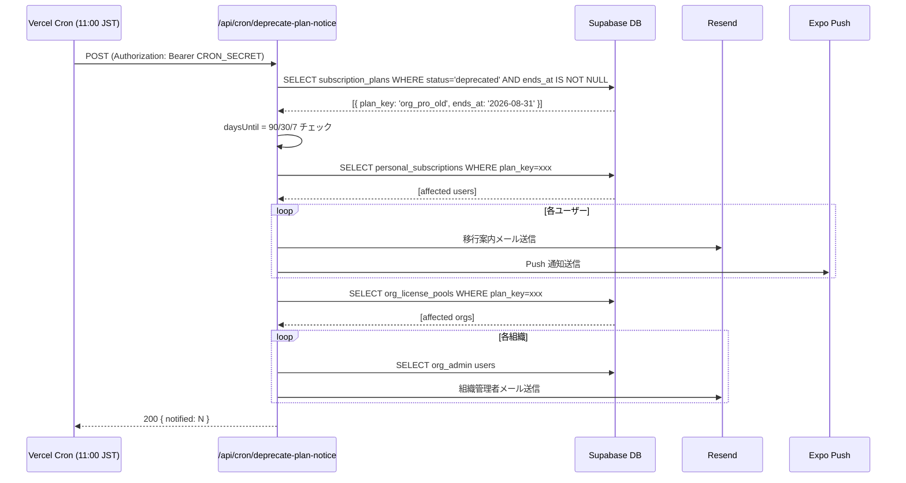

# operator/ Cron / バッチジョブ設計

## 1. 目的・スコープ

pg_cron (Supabase DB 内) および Vercel Cron (HTTP トリガー) の全ジョブ仕様を定義する。スケジュール・処理内容・失敗時アラート・手動実行 UI を含む。

## 2. 関連要件

- 要件 03 §15.17
- 要件 03 §22.x
- 要件 00-architecture.md §6 (pg_cron + Vercel Cron)

## 3. ジョブ一覧

### 3.0 実装状況 (2026-10-17 更新)

§3.1 以降の表と各節は、設計時の計画であり、**ほとんどは実装されていない**。§4 の pg_cron 用の関数 (`process_license_expire()` など 7 本) は本番に無く (`supabase/baseline/catalog/catalog_functions.csv`)、`vercel.json` に登録されている Vercel Cron は `process-menu-queue`・`app-log-alerts` (§3.2 の `app_log_alerts`。#1157)・`email-outbox` (毎分。メールの送信待ちを送る worker。#1193・`10-logs-and-mail-retry.md` §6.5)・`push-outbox` (毎分。Push 通知の送信待ちを送る worker。#1136・`mobile/06-push-send.md` §6.6)・`backup-freshness` (§3.2 の `backup_freshness`。#1129)・`login-alerts` (毎分。新しい端末・地域からのログインを本人にメールで知らせる worker。#1190・`cross/16-auth-history-sessions.md` §14.8)・`iap-reconcile` (毎時 41 分。期限を過ぎたストアの購読の行を RevenueCat から取り直して写す。#1912・`billing/04-iap-reconcile.md` §9) の 7 本である。
Stripe Webhook・収益スナップショット・ライセンス系のバッチは、オーナーの選択「課金は無料のまま計測」により、この段 (#1125 の第 1 段) では足さない (#1125 の残り)。
いま、このリポジトリの migration が pg_cron に登録しているジョブは 14 つある。この節で扱うのは、#1125 の第 1 段で足した次の 2 つ (migration `20261010150000_schedule_log_cleanup_and_dau_snapshot.sql`)。残りの 12 つ `calculate-segment-stats`・`calculate-segment-stats-finalize-retry`・`cleanup-stale-login-failures-and-grant-claims`・`update-org-challenge-progress`・`requeue-stale-meal-image-jobs`・`process-pending-meal-image-jobs`・`purge-hidden-content`・`cleanup-email-outbox`・`cleanup-auth-sessions-and-login-history`・`expire-manual-plan-grants`・`purge-dissolved-family-groups`・`cleanup-cron-run-history` は、下の箇条書きの「そのほか」に書く。

| ジョブ名 | 実行時刻 | 実行する SQL | 内容 |
|---------|---------|-------------|------|
| `cleanup-old-app-logs` | 毎日 03:15 JST (`15 18 * * *` UTC) | `SELECT public.cleanup_old_logs();` | `app_logs` の `created_at` が 30 日より古い行を削除する (#1157) |
| `snapshot-daily-active-users` | 毎日 01:30 JST (`30 16 * * *` UTC) | `SELECT public.snapshot_daily_active_users((now() AT TIME ZONE 'Asia/Tokyo')::date - 1);` | 前日 (JST) の DAU / WAU / MAU を数えて `daily_active_users` に書く (#1125) |

- pg_cron は UTC で時刻を解釈する (`cron.timezone` = GMT)。JST は UTC + 9 時間。
- 2 つとも所有者 `postgres` として動く。2 つの関数の `EXECUTE` は `service_role` だけに付けてあり、`anon` / `authenticated` は呼べない。
- migration は同じ処理を呼ぶ既存のジョブ (名前は問わない) と同じ名前のジョブを先に登録解除してから登録するので、何度流しても、この 2 つの処理を呼ぶジョブは 2 つだけになる。登録解除できるのは `postgres` が作ったジョブだけ (§3.0.3)。
- ロールバック: `supabase/rollbacks/20261010150000_schedule_log_cleanup_and_dau_snapshot.down.sql` (ジョブの登録解除・関数の削除・`cleanup_old_logs()` の権限とコメントの復元)。消えたログと、migration が登録解除した既存のジョブ (定義を保存していない) は戻らない。集計した行は消さない。
- そのほか、migration `20261009100000_schedule_calculate_segment_stats.sql` (#1406) が、ジョブ `calculate-segment-stats` を毎時 5 分 (`5 * * * *` UTC。JST も毎時 5 分) に登録している。比較ランキングの集計 (Edge Function `calculate-segment-stats`) を、`public.invoke_calculate_segment_stats()` から HTTP (`net.http_post`) で呼ぶ。詳しくはその migration の冒頭のコメント。
- そのほか、migration `20261011120000_segment_stats_finalize_retry.sql` (#1500) が、ジョブ `calculate-segment-stats-finalize-retry` を毎日 00:20 と 00:35 JST (`20,35 15 * * *` UTC) に登録している。期間が切り替わった直後の確定の回 (JST 00:05。本文 `previousPeriod: true`) の再試行で、`public.invoke_calculate_segment_stats_finalize_retry()` が、確定の回の本文だけを `calculate-segment-stats` と同じ呼び先・同じ秘密 (Vault の `app_cron_secret`) で送る。確定の回をやり終えた期間は表 `segment_stats_finalized_periods` に記録され、Edge Function は記録のある期間への確定の回では何も読まず何も書かない (二重に判定しない)。3 回とも失敗したことを知らせる仕組みは無い (運用メールのエラー急増の通知は、この 3 件だけでは届かない)。ロールバックは `supabase/rollbacks/20261011120000_segment_stats_finalize_retry.down.sql`。詳しくはその migration の冒頭のコメント。
- そのほか、migration `20261011070000_schedule_login_failure_and_grant_claim_cleanup.sql` (#1492) が、ジョブ `cleanup-stale-login-failures-and-grant-claims` を毎日 03:45 JST (`45 18 * * *` UTC) に登録している。`SELECT public.cleanup_stale_auth_login_failures(), public.cleanup_expired_ai_usage_grant_claims();` を呼び、ログイン失敗の記録 (`auth_login_failures`) のうち最後の失敗 (`last_failed_at`。無ければ `updated_at`) が 8 日より古い行と、数え済みの印の使用済みの記録 (`ai_usage_grant_claims`) のうち `claimed_at` が 1 日より古い行を消す。8 日はアプリの上限 `LOGIN_FAILURE_RESET_MINUTES_MAX` (7 日) + 余裕 1 日、1 日は `claim_ai_usage_grant` の `c_claim_retention` と同じ値。2 つの関数の `EXECUTE` は `service_role` と所有者 (`postgres`) だけ (`PUBLIC`・`anon`・`authenticated` から外す)。ロールバックは `supabase/rollbacks/20261011070000_schedule_login_failure_and_grant_claim_cleanup.down.sql`。詳しくはその migration の冒頭のコメント。
- そのほか、migration `20261014100100_org_challenge_progress.sql` (#1132) が、ジョブ `update-org-challenge-progress` を毎日 03:10 JST (`10 18 * * *` UTC) に登録している。`SELECT public.update_org_challenge_progress()` を呼び、開催中の組織チャレンジ (朝食・野菜スコア・自炊の 3 種類) の参加者ごとの進み具合 (`current_value`) と順位 (`rank`) を食事の記録から計算し、終了日 (JST) を過ぎたチャレンジを `completed` にする。`completed` にする UPDATE で、管理者に見せる平均が確定する (同じトランザクションのトリガー `trg_org_challenge_finalize`。migration `20261016240000_org_challenge_diff_privacy.sql:227`〜`:231`、#1688。詳しくは `org/10-challenge-diff-privacy.md`)。関数の `EXECUTE` は `service_role` だけ。ロールバックは `supabase/rollbacks/20261014100100_org_challenge_progress.down.sql`。詳しくは `org/07-challenge.md` §15 とその migration の冒頭のコメント。
- そのほか、migration `20261015180000_meal_image_jobs_pickup_cron.sql` (#1561) が、料理画像のジョブ (`meal_image_jobs`) の 2 つのジョブを登録している。
  - `requeue-stale-meal-image-jobs`: 5 分ごと (`*/5 * * * *` UTC。毎時 0, 5, 10, … 分)。`SELECT public.requeue_stale_meal_image_jobs()` を呼び、`processing` のまま貸し出しの期限 (`leased_until`) から 5 分より長く過ぎたジョブの `attempt_count` を 1 足して、3 回に届いたら `failed` (料理が生成中で同じ料理なら、献立の料理も `image_status = 'failed'` にする)、届かなければ `pending` に戻す。SQL だけで、秘密は使わない。関数の `EXECUTE` は `service_role` だけ。
  - `process-pending-meal-image-jobs`: 5 分ごと、取り戻しの 2 分後 (`2-59/5 * * * *` UTC。毎時 2, 7, 12, … 分)。`SELECT public.invoke_process_meal_image_jobs()` を呼び、最後の更新から 1 分を過ぎた待ち (`pending`) のジョブがあれば、Edge Function `process-meal-image-jobs` を Vault の `app_cron_secret` (Edge 側は `CRON_SECRET`) で 1 回呼ぶ (本文 `{ "limit": 5 }`)。待ちが無ければ何も送らない。`app_cron_secret` が Vault に無いと例外で失敗し、Edge Function secrets の `CRON_SECRET` が未設定なら関数が 503 を返す (#1406 のオーナー作業)。関数の `EXECUTE` は誰にも付けない (所有者 `postgres` = pg_cron だけ)。
  - 間隔の定数・猶予の決め方・ロールバック (`supabase/rollbacks/20261015180000_meal_image_jobs_pickup_cron.down.sql`) は、その migration の冒頭のコメント。運用の手順は `docs/operations/meal-image-pipeline.md`。
- そのほか、migration `20261016100000_purge_hidden_content.sql` (#1538) が、ジョブ `purge-hidden-content` を毎日 03:25 JST (`25 18 * * *` UTC) に登録している。運営が隠した (`hidden_at` が入った) 食事 (`meals`)・レシピ (`recipes`) のうち、隠してから 90 日 (オーナーの選択 2026-10-15) を過ぎた行と、その画像のファイルを完全に消す。画像は SQL では消せない (`storage.objects` の `protect_objects_delete` トリガー) ので、`public.invoke_purge_hidden_content()` が `calculate-segment-stats` と同じ秘密 (Vault の `app_cron_secret`) を付けて Edge Function `purge-hidden-content` を `net.http_post` で呼び、その中で「画像を Storage API で消す → 行を消す」を行う (本体は `supabase/functions/_shared/hidden-content-purge.ts`)。画像は、行の持ち主のフォルダにあり、ほかの行が使っていないもの (`public.hidden_content_purge_referenced_needles` で確かめる) だけを消す。1 回の実行は 300 秒で切り上げ、残りは翌日に消す。通報 (`moderation_flags` / `recipe_flags`) は外部キーの CASCADE で一緒に消え、運営の判断の記録は `admin_audit_logs` に残る (02-api-spec.md の `delete_*` の意味)。呼び出しの関数の `EXECUTE` は所有者 (`postgres`) だけ、画像の確認の関数は `service_role` だけ。運営が戻した行 (`hidden_at` が NULL に戻った行。`POST /api/admin/moderation/{type}/{id}/restore`。operator/13) は対象から外れ、画像も「使っている行がある」として残る。戻せるのは隠してから 89 日以内 (ジョブの期限 90 日と同じ行を扱わない幅)。ロールバックは `supabase/rollbacks/20261016100000_purge_hidden_content.down.sql`。詳しくはその migration の冒頭のコメント。
- そのほか、migration `20261016234000_email_outbox.sql` (#1193) が、ジョブ `cleanup-email-outbox` を毎日 03:20 JST (`20 18 * * *` UTC) に登録している。`SELECT public.cleanup_email_outbox();` を呼び、`email_outbox` の sent を 7 日・dead を 30 日で消す (queued は消さない)。関数の `EXECUTE` は `service_role` だけ。ロールバックは `supabase/rollbacks/20261016234000_email_outbox.down.sql`。詳しくは `10-logs-and-mail-retry.md` §5
- そのほか、migration `20261016243000_auth_history_sessions.sql` (#1190) が、ジョブ `cleanup-auth-sessions-and-login-history` を毎日 03:55 JST (`55 18 * * *` UTC) に登録している。`SELECT public.expire_idle_auth_sessions(), public.reconcile_user_sessions_metadata(), public.cleanup_ended_user_sessions_metadata();` を呼び、30 日更新の無いセッションを終え (`expire_idle_auth_sessions()`)、GoTrue 側に無いのに終わっていないログインの記録を終え (`reconcile_user_sessions_metadata()`)、終わってから 90 日を過ぎたログインの記録を消す (`cleanup_ended_user_sessions_metadata()`)。3 つの関数の `EXECUTE` は `service_role` だけ。ロールバックは `supabase/rollbacks/20261016243000_auth_history_sessions.down.sql`。詳しくは cross/16 §11.6。
- そのほか、migration `20261017230000_billing_manual_plan_grant.sql` (#1797) が、ジョブ `expire-manual-plan-grants` を毎日 00:11 JST (`11 15 * * *` UTC) に登録している。`CALL public.billing_expire_manual_subscriptions();` を呼び (プロシージャ。期限を過ぎた利用者ごとに 1 人分の関数 `billing_expire_manual_subscription_for_user` を呼んで COMMIT する。1 トランザクションで扱う利用者は 1 人だけ)、運営者が手動で付与した個人の契約 (`personal_subscriptions` の `stripe_subscription_id IS NULL` の行) のうち有効期限 (`current_period_end`) を過ぎた行を `expired` にし、家族グループのプランと `plan_key_cached` を合わせ、監査 `system.billing.manual_grant_expired` を書く。1 人分の関数の `EXECUTE` は `service_role` だけ、プロシージャの `EXECUTE` は誰にも付けない (所有者 `postgres` = pg_cron だけ)。ロールバックは `supabase/rollbacks/20261017230000_billing_manual_plan_grant.down.sql`。詳しくは `billing/02-manual-plan-grant.md` §6.4。
- そのほか、migration `20261018010000_purge_dissolved_family_groups.sql` (#1125 の B・段 C) が、ジョブ `purge-dissolved-family-groups` を毎日 03:40 JST (`40 18 * * *` UTC) に登録している。`SELECT public.purge_dissolved_family_groups(false);` を呼び、解散した家族のグループ (`family_groups.status = 'dissolved'`) のうち、解散 (`dissolved_at`) から 90 日を過ぎたものを、古い順に 1 回 500 件まで物理削除する。`family_members`・`family_invites`・`family_promotion_requests` は外部キーの CASCADE で一緒に消える。保護者の同意の記録 (`parental_consents`) を持つグループは消さずに残し、数を戻り値の `skipped_with_consents_count` に返す。消す回だけ、監査ログ `system.family.dissolved_purge` (actor NULL・`target_type = 'cron_job'`) を書く。`purge_dissolved_family_groups(true)` は件数を数えるだけで、何も消さず、監査ログも書かない。関数の `EXECUTE` は `service_role` だけ。ロールバックは `supabase/rollbacks/20261018010000_purge_dissolved_family_groups.down.sql` (消えたグループは戻らない)。詳しくは `11-ops-batches-non-billing.md` §5.4 とその migration の冒頭のコメント。
- そのほか、migration `20261018020000_cleanup_cron_run_history.sql` (#1125 の B・operator/11 §5.3) が、ジョブ `cleanup-cron-run-history` を毎日 03:35 JST (`35 18 * * *` UTC) に登録している。`SELECT public.cleanup_cron_run_history();` を呼び、30 日より古い pg_cron の実行履歴 (`cron.job_run_details`。`end_time` が無い行は `start_time` で判断する) と、失敗の監視の台帳 (`cron_failure_alerts`。`alerted_at` が 30 日より古い行) を消して、消した件数 (`run_details_deleted`・`alerts_deleted`) を返す。関数の `EXECUTE` は誰にも付けない (所有者 `postgres` = pg_cron だけ)。ロールバックは `supabase/rollbacks/20261018020000_cleanup_cron_run_history.down.sql` (ジョブの登録解除と関数の削除。すでに消えた行は戻らない)。詳しくは `11-ops-batches-non-billing.md` §5.3。
- 過去の migration で登録されたジョブ (`catalog-import-*` の 5 本、`handson-tour-sandbox-cleanup`) もある。これらは #1116 でベースラインに統合され、いまの migration には登録の SQL が無い。本番で動いているかは `cron.job` で確認する。この 6 本も含め、本番の `cron.job` の定義は DB バックアップの書庫の `cron_jobs.sql` に入り、新しいプロジェクトへの復元で戻す (cross/17 §4.3・`docs/operations/backup-restore.md` §6)。

`cron.job_run_details` (pg_cron の実行履歴) は、Supabase が自動では消さない。ジョブ `cleanup-cron-run-history` が 30 日より古い行と、失敗の監視の台帳 `cron_failure_alerts` の古い行を毎日消す (`11-ops-batches-non-billing.md` §5.3)。失敗の監視が数える範囲は直近 7 日 (同 §4) で、保持の 30 日より短いので、失敗を数え終える前に実行履歴が消えることは無い。

#### 3.0.1 `snapshot-daily-active-users` — アクティブ利用者 (DAU / WAU / MAU) の数え方

財務ダッシュボード (`GET /api/admin/finance/dashboard`、画面は `/admin/finance`) の MAU カードは、`daily_active_users` のうち `plan_type = 'all'` かつ `plan_key = ''` の**最新の行**の `mau` を出す (`src/app/api/admin/finance/dashboard/route.ts`)。この行を毎日書くのが `public.snapshot_daily_active_users(p_date date)` である。

**「アクティブ」の元データ** (Supabase Auth の表。GoTrue のどの版にもある列だけを使う):

| 元データ | 意味 |
|---------|------|
| `auth.sessions.created_at` | サインインでセッションが作られた時刻 |
| `auth.sessions.updated_at` | セッションが更新された時刻 (アクセストークンの更新。アプリを開いている間に起きる) |
| `auth.users.last_sign_in_at` | 最後にサインインした時刻 |

この 3 つのどれかが「その日」にある利用者を、その日のアクティブ利用者とする (`auth.users.deleted_at` が入っている利用者は除く)。

ローカルのスタックの GoTrue (v2.183.0。`auth.schema_migrations` の最新が `20251111201300`) で動きを確かめた: サインインすると `sessions.created_at` と `sessions.updated_at` と `users.last_sign_in_at` がほぼ同じ時刻になり、トークンを更新するたびに `sessions.updated_at` だけが進む (`last_sign_in_at` は変わらない)。
本番の GoTrue の版は、リポジトリの `supabase/.temp/gotrue-version` では **v2.183.0** (`supabase link` をした時点の版。`scripts/supabase-local.sh` が、ローカル / CI のスタックをこの版に合わせる)。その後に本番が更新されたかは、リポジトリからは分からない。本番でも `updated_at` が更新で進んでいるかは、§3.0.3 の読み取り SQL で確かめる。

- 日付は `Asia/Tokyo` の暦日。範囲は「その日の 0:00 以上、翌日の 0:00 未満」。0:00 ちょうどはその日に入り、翌日の 0:00 ちょうどは翌日に入る。
- DAU = その日。WAU = その日を最後の日とする 7 日間。MAU = その日を最後の日とする 30 日間 (どちらも JST の暦日)。
- `auth.sessions.refreshed_at` と `auth.users.is_anonymous` は使わない。GoTrue の古い版には無く、本番が更新されたあとの版はリポジトリから分からないため、版を問わず存在する列だけを使う (本番に `refreshed_at` があると分かれば、数え方を細かくできる)。使う列を足すときは、全ての版にあることを確かめる。
- 運営・テスト用のアカウントも、サインインしていれば数える。プランの区別はせず、`plan_type = 'all'` の 1 行だけを書く。
- 関数は `LANGUAGE sql` で書いてある。列名の誤りは migration の適用時 (`CREATE FUNCTION`) に分かる。`plpgsql` に書き換えると、最初の cron の実行まで分からなくなる。
- migration は関数を作った直後に、昔の日付 (2000-01-01) で 1 回試し実行し、書いた行を取り消す。auth の表を読めない・`daily_active_users` に書けない、といった「作れるが動かない」状態は、翌日の cron ではなく、適用時に migration が止まって分かる。
- migration を適用してから最初の 01:30 JST までは、`daily_active_users` に行が無いので、MAU カードは 0 のまま。

**数字は概算で、実際より小さめに出る**:

- セッションはサインアウトや期限切れで消える。消えたセッションの活動は数えられない。
- `last_sign_in_at` は利用者ごとに最後の 1 回分、`sessions.updated_at` は 1 セッションにつき最後の 1 回分しか残らない。あとから更新されると、前の日の分は見えなくなる (集計の 01:30 JST までに更新された分を含む)。
- そのため、日が終わった直後 (翌日 01:30 JST) に 1 度だけ数えて固定する。**過去の日を後から数え直すと、消えたセッションの分だけ小さくなることがある** (数え直すと、その日の行を上書きする)。
- MAU カードの数字は「サインインまたはトークン更新があった利用者数の目安」であり、請求や契約の根拠には使わない。

#### 3.0.2 `cleanup-old-app-logs` — 古いログの削除

`public.cleanup_old_logs()` は `DELETE FROM app_logs WHERE created_at < NOW() - INTERVAL '30 days'` を行う (本番に以前からあった関数。中身は変えていない)。これまで呼ぶジョブが無く、`app_logs` は溜まる一方だった。

- **最初の実行 (migration を本番に適用したあとの、次の 03:15 JST) で、30 日より古い行がまとめて消える。** 以降は毎日、その日に 30 日を超えた分が消える。
- `app_logs` を 30 日より長く残したいときは、先にジョブを止めて (下記)、保存期間を決め直す。
- 権限: `PUBLIC` / `anon` / `authenticated` から `EXECUTE` を外した (本番では、これらにも付いていた)。ジョブは所有者 `postgres` として動くので影響しない。
- `meal_nutrition_debug_logs` / `llm_usage_logs` の保存期間は、この PR の対象外 (必要ならオーナー判断のうえで別の PR)。`failed_invite_lookups` と `infra_metrics` は書き込む処理が無い (表が常に空) ため、この段では掃除のジョブを足さない。

#### 3.0.3 確認・手動実行・停止

ジョブの登録・変更は migration で行う (本番への直接 DDL は禁止。CLAUDE.md)。次は SQL エディタ (`postgres` ロール) から読み取りに使ってよい。

```sql
-- ジョブが登録されているか (command は表示しない。秘密が入っているジョブがあるため)
SELECT jobid, jobname, schedule, active, username
FROM cron.job
WHERE jobname IN ('cleanup-old-app-logs', 'snapshot-daily-active-users');

-- 直近の実行結果。status が failed のとき、エラーの内容が return_message に入る
SELECT j.jobname, d.status, d.start_time, d.end_time, d.return_message
FROM cron.job_run_details AS d
JOIN cron.job AS j USING (jobid)
WHERE j.jobname IN ('cleanup-old-app-logs', 'snapshot-daily-active-users')
ORDER BY d.start_time DESC
LIMIT 10;

-- 集計の結果。MAU カードに出る値は、いちばん新しい日の mau
SELECT date, dau, wau, mau, computed_at
FROM public.daily_active_users
WHERE plan_type = 'all' AND plan_key = ''
ORDER BY date DESC
LIMIT 7;

-- 次の cleanup-old-app-logs の実行で消える行数 (読み取りのみ)
SELECT count(*) AS rows_to_delete, min(created_at) AS oldest
FROM public.app_logs
WHERE created_at < now() - interval '30 days';

-- すでに cleanup_old_logs() を呼ぶジョブが無いか (command は表示しない。migration は、あれば登録解除して、上の 2 つに置き換える)。
-- username は、ジョブを持つロール。postgres 以外のロールのジョブは、migration が登録解除できず (postgres に cron.job の DELETE 権限が無い)、
-- 適用が「permission denied for table job」で止まる。calls_cleanup_old_logs が true で username が postgres 以外の行があれば、migration を本番に入れる前に開発側へ知らせる。
SELECT jobid, jobname, schedule, active, username,
       command ~* '[[:<:]]cleanup_old_logs[[:>:]]' AS calls_cleanup_old_logs
FROM cron.job
ORDER BY jobid;

-- auth.sessions の updated_at が、トークン更新のたびに進んでいるか (読み取りのみ。個人情報は出ない)。
-- updated_after_1h が 0 に近いときは、updated_at が更新で進まない版の可能性があり、MAU が小さく出る (§3.0.1)
SELECT count(*) AS sessions,
       count(*) FILTER (WHERE updated_at > created_at + interval '1 hour') AS updated_after_1h,
       min(created_at) AS oldest_session,
       max(updated_at) AS latest_update
FROM auth.sessions;
```

抜けた日を埋めるなど、集計を手で流すときは `service_role` か `postgres` で実行する (結果の行を返し、その日の行を上書きする)。過去の日は、消えたセッションの分だけ小さい値になりうる (§3.0.1)。

```sql
SELECT * FROM public.snapshot_daily_active_users(DATE '2026-10-07');
```

緊急にジョブを止めるときだけ、`SELECT cron.unschedule('snapshot-daily-active-users');` (または `'cleanup-old-app-logs'`) を使い、そのあと同じ内容を migration にして PR で入れる。

### 3.1 pg_cron ジョブ (Supabase 内)

| ジョブ名 | スケジュール | 概要 |
|---------|-----------|------|
| `license_expire_batch` | daily 02:00 UTC | ライセンス期限切れ処理 |
| `license_used_count_reconcile` | monthly 01 04:00 UTC | ライセンス使用数照合 |
| `infra_metrics_cleanup` | daily 05:00 UTC | 30 日超の infra_metrics 削除 |
| `stripe_event_stuck_check` | daily 05:00 UTC | Stripe webhook の processing 状態スタック検出。再処理のためには不要 (処理済みでないイベントに 2xx を返さず Stripe の再送で取り直す。billing/01 §9.6)。残るのは 3 日の再送が尽きたイベントの整合 (reconcile) と一覧だけ |
| `failed_invite_lookups_cleanup` | daily 05:30 UTC | 7 日超の failed_invite_lookups 削除 |
| `update-org-challenge-progress` | daily 18:10 UTC (03:10 JST) | 組織チャレンジの進み具合 (current_value) と順位 (rank) を食事の記録から計算し、終了日 (JST) を過ぎたチャレンジを completed にする (`update_org_challenge_progress()`。#1132。詳細は `org/07-challenge.md` §15)。completed にする UPDATE で平均が確定する (トリガー `trg_org_challenge_finalize`。migration `20261016240000_org_challenge_diff_privacy.sql:227`〜`:231`。#1688) |

> **2026-10-16 時点の状態**: 上の 6 本のうち `update-org-challenge-progress` (#1132。migration `20261014100100_org_challenge_progress.sql`) のほかの 5 本は、どれも migration で登録していない (§4 の関数 3 本は本番に無い)。
> `family_freeze_grace_batch`・`family_archive_purge_batch`・`meal_request_expire_batch`・`data_integrity_check` の 4 本は、operator/11 §2.2 で 08 の計画から外した (発生源が無い・制約が守る)。解散した家族の物理削除は `purge-dissolved-family-groups` (§3.0。operator/11 §5.4)。
> `infra_metrics_cleanup` と `failed_invite_lookups_cleanup` は、それぞれの表に書き込む処理がまだ無く (表が常に空)、消す対象が無いため、この段では足さない。
> `stripe_event_stuck_check` (Stripe Webhook) と、ライセンス系の `license_expire_batch`・`license_used_count_reconcile` は、オーナーの選択「課金は無料のまま計測」により、この段 (#1125 の第 1 段) では足さない (#1125 の残り)。
> migration が pg_cron に登録しているのは、この表の `update-org-challenge-progress` と、この表に無い `cleanup-old-app-logs`・`snapshot-daily-active-users`・`calculate-segment-stats`・`calculate-segment-stats-finalize-retry`・`cleanup-stale-login-failures-and-grant-claims`・`requeue-stale-meal-image-jobs`・`process-pending-meal-image-jobs`・`purge-hidden-content`・`cleanup-email-outbox`・`cleanup-auth-sessions-and-login-history`・`expire-manual-plan-grants`・`purge-dissolved-family-groups`・`cleanup-cron-run-history` の 14 つ (§3.0)。

### 3.2 Vercel Cron ジョブ (HTTP)

| ジョブ名 | スケジュール (JST) | 概要 |
|---------|-----------------|------|
| `trial_ending_reminder` | daily 09:00 | 試用終了リマインダー |
| `license_renewal_reminder` | daily 10:00 | ライセンス更新リマインダー |
| `deprecate_plan_notice` | daily 11:00 | deprecated プラン移行通知 |
| `stripe_integrity_check` | daily 12:00 | Stripe reconciliation。billing/01 §12 の契約 (1 文の直接 UPDATE / 写像を呼ぶ) で作る。課金の配線の残りの冊 (運用バッチ。未作成) の対象 |
| `re_engagement_email` | daily 13:00 | 再エンゲージメントメール (当面は送らない: operator/11 §8) |
| `nps_survey_sender` | daily 14:00 | NPS サーベイ送信 (当面は送らない: operator/11 §8) |
| `hr_revoke_jobs_processor` | hourly :30 | HR revoke ジョブ処理 (HR 連携の冊に同梱: operator/11 §2.2) |
| `grace_period_check` | daily 09:30 | 支払失敗グレースペリオドチェック |
| `revenue_snapshot` | daily 01:00 | 日次収益スナップショット生成 |
| `dau_snapshot` | daily 01:30 | DAU/WAU/MAU スナップショット |
| `logical_backup` (実装済み: cross/17・#1765 段 A) | daily 02:23 | GitHub Actions の `db-backup.yml` が取って R2 に置く (Vercel Cron としては置かない)。鮮度は下の `backup_freshness` の行 (cross/17 §7.3) |
| `app_log_alerts` (実装済み: #1157) | 15 分おき | `app_logs` の error が 15 分で 20 件を超えたら `OPS_ALERT_EMAIL` へメールで通知 (`/api/cron/app-log-alerts`。設計は 07-audit-monitoring.md §8.3) |
| `backup_freshness` (実装済み: #1129) | daily 14:37 | 最新の `backup.daily.completed` が 30 時間より古ければ `OPS_ALERT_EMAIL` へメールで通知 (`/api/cron/backup-freshness`。設計は cross/17 §7.3) |
| `login_alerts` (実装済み: #1190) | 毎分 | 新しい端末・地域からのログインを本人にメールで知らせる (`/api/cron/login-alerts`。設計は cross/16-auth-history-sessions.md §13.3・§14.8) |
| `iap_reconcile` (実装済み: #1912・billing/04) | 毎時 41 分 | 期限を過ぎたストアの購読の行を RevenueCat から取り直して写す (`/api/cron/iap-reconcile`。設計は billing/04 §9) |

> **2026-10-17 時点の状態**: `vercel.json` に登録されている Vercel Cron は `process-menu-queue`・`app-log-alerts` (この表の `app_log_alerts`。#1157)・`email-outbox` (この表に無い。#1193)・`push-outbox` (この表に無い。毎分。Push 通知の送信待ちを送る worker。#1136・`mobile/06-push-send.md` §6.6)・`backup-freshness` (この表の `backup_freshness`。#1129)・`login-alerts` (この表の `login_alerts`。#1190)・`iap-reconcile` (この表の `iap_reconcile`。#1912・billing/04) の 7 本。この表のほかの 10 本は、Vercel Cron としては実装されていない (`logical_backup` は GitHub Actions で取る。cross/17)。
> 課金・収益に関わるバッチ (`revenue_snapshot`・`stripe_integrity_check`・`grace_period_check` など) は、オーナーの選択「課金は無料のまま計測」により、この段 (#1125 の第 1 段) では足さない (#1125 の残り)。
> `dau_snapshot` は、Vercel Cron ではなく pg_cron のジョブ `snapshot-daily-active-users` として実装した (§3.0)。時刻は同じ 01:30 JST。
> それ以外の行は未実装のまま (作るときは別の PR)。

---

## 4. pg_cron ジョブ詳細

### 4.1 セットアップ

```sql
-- Supabase で pg_cron 有効化
CREATE EXTENSION IF NOT EXISTS pg_cron;
GRANT USAGE ON SCHEMA cron TO postgres;

-- ジョブ登録
SELECT cron.schedule('license_expire_batch', '0 2 * * *', $$
  SELECT process_license_expire();
$$);

SELECT cron.schedule('license_used_count_reconcile', '0 4 1 * *', $$
  SELECT reconcile_license_used_count();
$$);

SELECT cron.schedule('infra_metrics_cleanup', '0 5 * * *', $$
  DELETE FROM infra_metrics WHERE recorded_at < NOW() - INTERVAL '30 days';
$$);

SELECT cron.schedule('failed_invite_lookups_cleanup', '30 5 * * *', $$
  DELETE FROM failed_invite_lookups WHERE attempted_at < NOW() - INTERVAL '7 days';
$$);

SELECT cron.schedule('stripe_event_stuck_check', '0 5 * * *', $$
  SELECT process_stripe_event_stuck();
$$);
```

### 4.2 `license_expire_batch` — ライセンス期限切れ

```sql
CREATE OR REPLACE FUNCTION process_license_expire()
RETURNS void
SECURITY DEFINER
SET search_path = public
AS $$
BEGIN
  -- 1. 期限切れ org_license_pools の関連 assignments を expired に変更
  UPDATE org_license_assignments ola
  SET status = 'expired', revoked_at = NOW()
  FROM org_license_pools olp
  WHERE ola.license_pool_id = olp.id
    AND ola.status = 'active'
    AND olp.ends_at <= NOW()
    AND olp.auto_renew = FALSE;

  -- 2. 期限切れ personal_subscriptions を expired に変更
  UPDATE personal_subscriptions
  SET status = 'expired'
  WHERE status IN ('trialing', 'active')
    AND current_period_end <= NOW()
    AND stripe_subscription_id IS NULL;  -- Stripe なしの手動管理プランのみ

  -- 3. deprecated プランで ends_at 経過したプールを処理
  UPDATE org_license_pools
  SET ends_at = NOW()
  WHERE plan_key IN (
    SELECT plan_key FROM subscription_plans WHERE status = 'deprecated'
  ) AND ends_at > NOW()
    AND (
      -- subscription_plans.ends_at が設定されていて、既に経過している場合
      SELECT ends_at FROM subscription_plans sp
      WHERE sp.plan_key = org_license_pools.plan_key
        AND sp.status = 'deprecated'
    ) <= NOW();

  -- 4. expired になった assignment に紐付く family_groups を frozen へ
  -- 要件 02 §7.2.8: expired 遷移時に family_groups.source_org_assignment_id を持つグループを凍結フローへ
  UPDATE family_groups
  SET status = 'frozen',
      frozen_at = NOW(),
      freeze_grace_until = NOW() + INTERVAL '30 days'
  WHERE source_org_assignment_id IN (
    SELECT id FROM org_license_assignments
    WHERE status = 'expired'
      AND expires_at >= NOW() - INTERVAL '24 hours'
  )
  AND status = 'active';

  RAISE NOTICE 'license_expire_batch completed at %', NOW();
END;
$$ LANGUAGE plpgsql;
```

### 4.3 `family_freeze_grace_batch` — 家族グループ凍結猶予チェック

この節の `family_freeze_grace_batch` はoperator/11 §2.2 の仕分けで 08 の計画から外した (発生源が無い・制約が守る。コードは残さない)。

### 4.4 `family_archive_purge_batch` — 解散グループの物理削除 (90 日後)

この節の `family_archive_purge_batch` はoperator/11 §2.2 の仕分けで 08 の計画から外した (発生源が無い・制約が守る。コードは残さない)。解散した家族の物理削除は、pg_cron のジョブ `purge-dissolved-family-groups` として実装した (§3.0。解散から 90 日を過ぎた行を消す。設計は operator/11 §5.4)。

### 4.5 `meal_request_expire_batch` — 期限切れ食事リクエスト

この節の `meal_request_expire_batch` はoperator/11 §2.2 の仕分けで 08 の計画から外した (発生源が無い・制約が守る。コードは残さない)。

### 4.6 `data_integrity_check` — データ整合性確認

この節の `data_integrity_check` はoperator/11 §2.2 の仕分けで 08 の計画から外した (発生源が無い・制約が守る。コードは残さない)。

### 4.7 `license_used_count_reconcile` — ライセンス使用数月次照合

```sql
CREATE OR REPLACE FUNCTION reconcile_license_used_count()
RETURNS void
SECURITY DEFINER
SET search_path = public
AS $$
DECLARE
  mismatch_count INT := 0;
BEGIN
  UPDATE org_license_pools p
  SET used_licenses = (
    SELECT COUNT(*)
    FROM org_license_assignments a
    WHERE a.license_pool_id = p.id AND a.status = 'active'
  )
  WHERE p.used_licenses != (
    SELECT COUNT(*)
    FROM org_license_assignments a
    WHERE a.license_pool_id = p.id AND a.status = 'active'
  );

  GET DIAGNOSTICS mismatch_count = ROW_COUNT;

  IF mismatch_count > 0 THEN
    INSERT INTO admin_audit_logs (actor_id, action_type, severity, details)
    VALUES (
      '00000000-0000-0000-0000-000000000000',
      'system.license.used_count_reconcile',
      'warn',
      jsonb_build_object('corrected_pools', mismatch_count)
    );
  END IF;
END;
$$ LANGUAGE plpgsql;
```

---

## 5. Vercel Cron ジョブ詳細

> **2026-10-17 時点**: §5 は設計時の計画である。`vercel.json` にあるのは `process-menu-queue`・`app-log-alerts`・`email-outbox` (#1193)・`push-outbox` (#1136・`mobile/06-push-send.md` §6.6)・`backup-freshness` (cross/17 §7.3)・`login-alerts` (#1190・cross/16 §14.8)・`iap-reconcile` (#1912・billing/04 §9) だけで、`/api/cron/dau-snapshot` と `/api/cron/revenue-snapshot` は作っていない。
> `revenue_snapshot` (§5.8) は、オーナーの選択「課金は無料のまま計測」により、この段 (#1125 の第 1 段) では足さない (#1125 の残り)。DAU / WAU / MAU の日次集計は、pg_cron のジョブ `snapshot-daily-active-users` として実装した (§3.0)。

### 5.1 vercel.json 設定

```json
{
  "crons": [
    { "path": "/api/cron/trial-ending-reminder",   "schedule": "0 0 * * *" },
    { "path": "/api/cron/license-renewal-reminder", "schedule": "0 1 * * *" },
    { "path": "/api/cron/deprecate-plan-notice",    "schedule": "0 2 * * *" },
    { "path": "/api/cron/stripe-reconcile",         "schedule": "0 3 * * *" },
    { "path": "/api/cron/grace-period-check",       "schedule": "30 0 * * *" },
    { "path": "/api/cron/revenue-snapshot",         "schedule": "0 16 * * *" },
    { "path": "/api/cron/dau-snapshot",             "schedule": "30 16 * * *" }
  ]
}
```

*UTC → JST: UTC+9 で変換。例: `0 0 * * *` UTC = 09:00 JST*

上の JSON は設計時の計画の例である (いまの `vercel.json` は §3.0)。`/api/cron/logical-backup` (GitHub Actions で取る。cross/17)・`/api/cron/hr-revoke-processor` (HR 連携の冊に同梱。operator/11 §2.2)・`/api/cron/re-engagement-email`・`/api/cron/nps-survey-sender` (当面は送らない。operator/11 §8) は、例から外した。

### 5.2 共通認証

```typescript
// src/app/api/cron/_auth.ts
export function authenticateCron(request: Request): boolean {
  const auth = request.headers.get('Authorization');
  return auth === `Bearer ${process.env.CRON_SECRET}`;
}

// 各 cron handler の先頭で呼び出す
export function POST(request: Request) {
  if (!authenticateCron(request)) {
    return new Response('Unauthorized', { status: 401 });
  }
  // ...
}
```

### 5.3 `trial_ending_reminder` (09:00 JST)

```typescript
// src/app/api/cron/trial-ending-reminder/route.ts
export async function POST(request: Request) {
  if (!authenticateCron(request)) return new Response('Unauthorized', { status: 401 });

  // 3 日後・1 日後・当日に終了する trialing subscription を抽出
  const { data: expiringSubs } = await supabase
    .from('personal_subscriptions')
    .select('user_id, plan_key, trial_ends_at')
    .eq('status', 'trialing')
    .gte('trial_ends_at', new Date().toISOString())
    .lte('trial_ends_at', new Date(Date.now() + 3 * 24 * 60 * 60 * 1000).toISOString());

  for (const sub of expiringSubs ?? []) {
    const daysLeft = Math.ceil(
      (new Date(sub.trial_ends_at).getTime() - Date.now()) / (1000 * 60 * 60 * 24)
    );

    await sendEmail({
      to: sub.user_id,
      template: 'trial_ending_reminder',
      params: { days_left: daysLeft, plan_key: sub.plan_key },
    });

    await sendPushNotification({
      userId: sub.user_id,
      title: `無料トライアルが ${daysLeft} 日後に終了します`,
      body: '継続してご利用いただくには、プランを設定してください。',
      deepLink: 'homegohan://account/billing',
    });
  }

  return new Response(JSON.stringify({ processed: expiringSubs?.length ?? 0 }), { status: 200 });
}
```

### 5.4 `deprecate_plan_notice` (11:00 JST)

```typescript
// src/app/api/cron/deprecate-plan-notice/route.ts
export async function POST(request: Request) {
  if (!authenticateCron(request)) return new Response('Unauthorized', { status: 401 });

  const { data: deprecatedPlans } = await supabase
    .from('subscription_plans')
    .select('id, plan_key, ends_at, superseded_by_plan_id')
    .eq('status', 'deprecated')
    .not('ends_at', 'is', null);

  for (const plan of deprecatedPlans ?? []) {
    const endsAt = new Date(plan.ends_at!);
    const daysUntil = Math.ceil((endsAt.getTime() - Date.now()) / (1000 * 60 * 60 * 24));

    // 90/30/7 日前のいずれかの場合にのみ通知
    if (![90, 30, 7].includes(daysUntil)) continue;

    // 影響ユーザーを抽出 (personal)
    const { data: affectedUsers } = await supabase
      .from('personal_subscriptions')
      .select('user_id')
      .eq('plan_key', plan.plan_key)
      .in('status', ['active', 'trialing', 'paused']);

    for (const user of affectedUsers ?? []) {
      await sendEmail({
        to: user.user_id,
        template: 'plan_deprecation_notice',
        params: { plan_key: plan.plan_key, ends_at: plan.ends_at, days_until: daysUntil },
      });
    }

    // 影響組織の org_admin を抽出 (org_license_pools に status 列はなく、ends_at で active 判定)
    const { data: affectedOrgs } = await supabase
      .from('org_license_pools')
      .select('organization_id')
      .eq('plan_key', plan.plan_key)
      .gt('ends_at', new Date().toISOString());

    for (const org of affectedOrgs ?? []) {
      await notifyOrgAdmins(org.organization_id, {
        template: 'plan_deprecation_notice_org',
        params: { plan_key: plan.plan_key, ends_at: plan.ends_at, days_until: daysUntil },
      });
    }
  }

  return new Response('OK', { status: 200 });
}
```

### 5.5 `re_engagement_email` (13:00 JST)

この節の `re_engagement_email` は、当面は送らない (operator/11 §8.1。08 の「いま」の計画から外した。送り始めるなら別の設計ゲート。コードは残さない)。

### 5.6 `hr_revoke_jobs_processor` (hourly :30)

この節の `hr_revoke_jobs_processor` は、operator/11 §2.2 の仕分けで 08 の「いま」の計画から外した (HR の Webhook・`hr_revoke_jobs` が main に無く、バッチだけ先に作ると対象の無い処理になる。HR 連携の冊 (org/02 §14) に同梱する。コードは残さない)。

### 5.7 `grace_period_check` (09:30 JST)

billing/01 §12 の契約 (1 文の直接 UPDATE / 写像を呼ぶ) で作る。課金の配線の残りの冊 (運用バッチ。未作成) の対象。

```typescript
// === Stage 1: past_due (支払失敗) から 7 日経過 → status='grace' (機能制限開始) ===
const { data: pastDueSubs } = await supabase
  .from('personal_subscriptions')
  .select('id, user_id, stripe_subscription_id, past_due_since')
  .eq('status', 'past_due')
  .lte('past_due_since', new Date(Date.now() - 7 * 24 * 60 * 60 * 1000).toISOString());

for (const sub of pastDueSubs ?? []) {
  await supabase.from('personal_subscriptions')
    .update({ status: 'grace', grace_started_at: new Date() })
    .eq('id', sub.id);
  await sendEmail({ to: sub.user_id, subject: 'AI 解析等の機能を制限しました', /* ... */ });
}

// === Stage 2: grace (機能制限) から 23 日経過 (合計 30 日) → status='cancelled' ===
const { data: graceSubs } = await supabase
  .from('personal_subscriptions')
  .select('id, user_id, stripe_subscription_id')
  .eq('status', 'grace')
  .lte('grace_started_at', new Date(Date.now() - 23 * 24 * 60 * 60 * 1000).toISOString());

for (const sub of graceSubs ?? []) {
  await supabase.from('personal_subscriptions')
    .update({ status: 'cancelled', cancelled_at: new Date() })
    .eq('id', sub.id);

  // Stripe subscription もキャンセル
  if (sub.stripe_subscription_id) {
    await stripe.subscriptions.cancel(sub.stripe_subscription_id);
  }

  await sendEmail({
    to: sub.user_id,
    template: 'subscription_cancelled_due_to_payment',
  });
}
```

### 5.8 `revenue_snapshot` (01:00 JST)

```typescript
// 前日のデータを集計して revenue_snapshots に INSERT
const yesterday = new Date();
yesterday.setDate(yesterday.getDate() - 1);
const dateStr = yesterday.toISOString().slice(0, 10);

const { data: mrr } = await supabase.rpc('calculate_daily_mrr', { calc_date: dateStr });

await supabase.from('revenue_snapshots').upsert({
  date: dateStr,
  ...mrr,
  computed_at: new Date(),
});
```

---

## 6. 監視・失敗時アラート

定期処理の失敗の監視は、既存の運用アラート (`GET /api/cron/app-log-alerts`・15 分おき・宛先 `OPS_ALERT_EMAIL`・抑止 `claim_ops_alert`。07-audit-monitoring.md §8.3) に、4 つ目の種類 `cron_failure` と 5 つ目の種類 `pg_cron_stalled` を足して行う (正本は operator/11 §4〜§6)。Slack・Sentry は採用していない (07 §1.1・#1179) ので、`check_cron_failures` (6 時間ごとの pg_cron) と `withCronMonitoring` (ラッパー) は作らない。cron の共有シークレットのずれ (Edge Function secrets と Vault の食い違いなど。pg_net は非同期なので `cron.job_run_details` に出ない) は、6 つ目・7 つ目の種類 `cron_secret_drift` / `cron_secret_rotation` が見る (正本は operator/12)。

### 6.1 pg_cron 失敗監視

- 対象: `cron.job_run_details` の `status = 'failed'` の行 (1 実行 = 1 件)。直近 7 日のうち、まだ知らせていないものを 1 件から数える (DB の `cron_failure_counts`)。知らせた失敗は台帳 `cron_failure_alerts` に記録し、同じ失敗を 2 回知らせない (窓で数えない。operator/11 §4.2)。
- 通知: 運用メール (template `ops_cron_failure`)。載せるのは `pg_cron/<ジョブ名>` ごとの件数と運用ログ画面へのリンクだけ (`command` / `return_message` は載せない)。
- 停止: 有効なジョブがあるのに、最新の実行から `OPS_ALERT_PG_CRON_STALL_MINUTES` (既定 60 分) を超えて 1 つも動いていなければ、5 つ目の種類 `pg_cron_stalled` (template `ops_pg_cron_stalled`) で知らせる。止まったままなら、抑止 (既定 60 分) ごとに 1 通。
- pg_cron → Edge Function の 401 / 503 は失敗の行に出ないので、operator/12 の確認 (15 分おき) が受け持つ。

### 6.2 Vercel Cron 失敗監視

- 対象: cron の route が 500 を返した回。`internalError` (`src/lib/api/errors.ts`) が `app_logs` に固定の文で残す `error` の行のうち、`function_name` が cron の route の名前 (`cron/<名前>` または `<METHOD> /api/cron/<名前>`) のもの。`source = 'client'` の行 (利用者が `POST /api/log` で書ける) と、届けられなかったメールの 1 通ごとの `error` は数えない。
- 通知: 同じ運用メール (`vercel_cron/<route 名>` ごとの件数)。`vercel.json` の 7 本 (`backup-freshness`・`login-alerts`・`iap-reconcile` を含む) と `app-log-alerts` 自身の 500 が対象になる。

---

## 7. 手動実行 UI (/super-admin/cron-jobs)

### 7.1 画面仕様

**ジョブ一覧テーブル**:

| カラム | 内容 |
|------|------|
| ジョブ名 | テキスト |
| 種別 | `pg_cron` / `Vercel Cron` バッジ |
| スケジュール | cron 式 + 人間語 (例: 「毎日 09:00 JST」) |
| 最終実行 | 日時 + `success` / `failed` バッジ |
| 最終実行時間 | ミリ秒 |
| 次回実行予定 | 日時 |
| 操作 | [今すぐ実行] [一時停止] |

**今すぐ実行フロー**:
1. [今すぐ実行] ボタン
2. 確認モーダル: 「`trial_ending_reminder` を今すぐ手動実行しますか？」
3. パスワード再認証
4. [実行確定] → API 呼び出し
5. 実行ログを画面にリアルタイム表示

**実行ログパネル** (展開): 直近 10 回の実行記録 (開始時刻 / 終了時刻 / ステータス / 処理件数)

### 7.2 手動実行 API

```typescript
// POST /api/super-admin/cron-jobs/{jobName}/run
// Next 15: route handler の params は Promise (await して読む)
export async function POST(request: Request, { params }: { params: Promise<{ jobName: string }> }) {
  const user = await requireRole(['super_admin']);
  const { jobName } = await params;

  // 監査ログ
  await insertAuditLog({
    actorId: user.id,
    actionType: 'super_admin.cron.run_now',
    details: { job_name: jobName },
    severity: 'warn',
  });

  // pg_cron ジョブの場合は SQL 直接実行
  if (PG_CRON_JOBS.includes(jobName)) {
    await supabase.rpc(`${jobName}`);  // 各関数を RPC で呼び出し
  }

  // Vercel Cron ジョブの場合は自分自身の API を呼び出し
  if (VERCEL_CRON_JOBS[jobName]) {
    const response = await fetch(VERCEL_CRON_JOBS[jobName], {
      method: 'POST',
      headers: { Authorization: `Bearer ${process.env.CRON_SECRET}` },
    });
    return Response.json({ status: response.status });
  }

  return Response.json({ error: 'Unknown job' }, { status: 400 });
}
```

---

## 8. シーケンス — deprecated プラン移行通知 cron



## 9. エラーハンドリング

| ジョブ | 失敗時の対処 |
|-------|-----------|
| pg_cron 全般 | `cron.job_run_details` に記録 → `app-log-alerts` の回 (15 分おき) が 1 件から検知 → 運用メール (operator/11 §4)。止まったときは `pg_cron_stalled` |
| Vercel Cron 全般 | route が 500 を返すと `internalError` が `app_logs` に error を残す → `app-log-alerts` の回が 1 件から検知 → 運用メール (operator/11 §4) |
| `hr_revoke_jobs_processor` | 未実装 (HR 連携の冊に同梱: operator/11 §2.2)。リトライの方針は HR 連携の冊が決める |
| `stripe_integrity_check` | 不一致検出 → 自動修復しない → Slack + 監査ログ |
| `purge-dissolved-family-groups` | 乾いた実行 (dry run) を持つ (`SELECT * FROM public.purge_dissolved_family_groups(true);` は件数だけ返す)。1 回に消すのは 500 件まで (operator/11 §5.4) |

## 10. テスト方針

- **Unit**:
  - `authenticateCron()` の CRON_SECRET 検証
  - `deprecate_plan_notice` の 90/30/7 日前計算
  - `grace_period_check` の 7 日判定
- **Integration** (Supabase Local):
  - `process_license_expire()` の動作確認
  - 失敗の監視の DB の関数 (台帳・候補・数え方・pg_cron の停止。operator/11 §11.3)
  - `reconcile_license_used_count()` の used_licenses 同期確認
- **E2E** (Playwright):
  - `/super-admin/cron-jobs` で手動実行 → 監査ログに記録されることを確認

## 11. 既存実装との関連

- `pg_cron setup.sql`: `00-architecture.md §6` で言及済み、本ドキュメントが詳細を定義
- Vercel Cron: `vercel.json` に crons を追加
- `hr_revoke_jobs`: 未実装 (org/02 §14)

## 12. 未解決事項

- `purge-dissolved-family-groups` の dry run → `purge_dissolved_family_groups(true)` (operator/11 §5.4)
- `revenue_snapshot` の `calculate_daily_mrr` RPC: Stripe データと DB の差異をどう調整するか → stripe reconcile 後に実行するよう依存順序を設定 (`revenue_snapshot` は、オーナーの選択「課金は無料のまま計測」により、#1125 の第 1 段では足さない (#1125 の残り)。この論点は、`revenue_snapshot` を足すときまで保留)
- pg_cron の失敗ログ長期保管: `cron.job_run_details` は自動では消えない。`cleanup-cron-run-history` が 30 日で消す (operator/11 §5.3) ため、重要な失敗は `admin_audit_logs` に都度 INSERT する設計で対応
