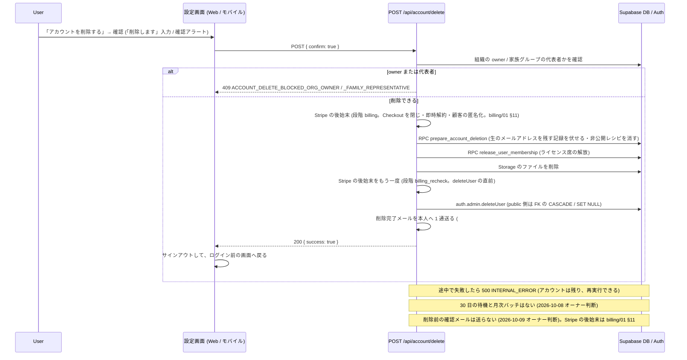

# operator/ 運用手順書 (Runbook)

## 1. 目的・スコープ

本番運用で必要となる手順を網羅する。Stripe reconciliation・pg_cron 手動実行・deprecated プラン rollback・緊急 bulk-revoke・org_admin ゼロ復旧・退会 (GDPR 削除)・情報漏洩報告・DR シナリオ・マイグレーション適用手順・障害対応フロー・開示・訂正・利用停止・消去の請求の対応 (§9.3) を定義する。

**このドキュメントは super_admin および on-call エンジニア向け。本番操作は必ず 2 名確認を推奨。**

## 2. 関連要件

- 要件 03 §15 運用手順書
- 要件 03 §16.5 DR / バックアップ
- 要件 03 §11.0 マイグレーション順序

## 3. マイグレーション本番適用手順 (§11.0 順序)

### 3.1 前提

- **ダウンタイム目標**: 30 分以内
- **SLA に従った告知**: Pro 7 日前、Org 14-30 日前
- **ブルーグリーン不要**: スキーマ変更が backward compatible であることを前提
- **全マイグレーションは `BEGIN; ... COMMIT;` でトランザクション化**

### 3.2 適用順序 (必須)

```
1.  03-operator-admin (運営マスター系)
    ├── subscription_plans         ← 'free' レコードを必ず seed
    ├── feature_packages
    ├── plan_price_history
    ├── coupons / coupon_redemptions  ← organization_id FK は DEFERRABLE INITIALLY DEFERRED (organizations より先に作成)
    ├── personal_subscriptions
    ├── billing_customers         ← 利用者と Stripe Customer の対応 (billing/01 §6.3。FK: auth.users ON DELETE SET NULL)
    └── revenue_snapshots

2.  02-organization-management (組織系)
    ├── organizations (既存テーブルは移行ガイド参照)
    ├── departments / department_history
    ├── org_license_pools          ← FK: subscription_plans(plan_key)
    └── org_license_assignments / org_license_audit_log
    + ALTER TABLE user_profiles (organization_id 等)

3.  01-family-management (家族系)
    ├── family_groups              ← FK: subscription_plans(plan_key)
    ├── family_members
    ├── family_invites
    ├── family_shared_menus
    └── family_meal_requests

4.  admin_audit_logs (拡張)
5.  support_tickets / messages
6.  sales_leads / activities
7.  infra_metrics / alerts
8.  experiments / assignments
9.  consent 系 (cookie_consents / terms_acceptances 等)
10. gdpr_deletion_requests
11. parental_consents  ← cross/14-parental-consent.md §6.4 の 4 で定義 (migration 20261017030000)
12. password_history
13. user_sessions_metadata
14. pg_cron setup (08-cron-batches.md 参照)
15. rls_hardening (全テーブルの RLS 確認・補強)
```

### 3.3 実行手順

```bash
# 1. staging で事前テスト
supabase db reset --linked  # staging プロジェクトで実行

# 2. マイグレーションを順番に適用
supabase db push --linked --include-all

# 3. smoke test (staging)
npm run test:smoke -- --base-url=https://staging.homegohan.app

# 4. 本番適用 (2 名確認)
supabase db push --linked --include-all
# (本番プロジェクトの PROJECT_ID を確認してから実行)

# 5. 型の再生成 (出力先は src/types/database.types.ts。packages/shared/src/database.types.ts に同じ内容を写す)
#    本番に接続せずに作る: ローカルの Supabase をベースライン方式で組み立て (本番スキーマのスナップショット supabase/baseline/ を当て、
#    そのあとにベースラインより新しい migration だけを当てる。scripts/supabase-local.sh の冒頭)、--local で出力する。
#    --workdir は組み立てた枠の作業ディレクトリ (枠 0 は .supabase-local、LOCAL_CI_SLOT=n は .supabase-local-s<n>)。
#    --local は __InternalSupabase の PostgrestVersion を出さないので既存の値を残す (#1495)。
#    tests/database-types-migrations-contract.test.ts が migration と型ファイルの突き合わせ・写しの一致を確かめる
#    (npm run types:supabase は --linked で本番に接続するので、この手順では使わない)
bash scripts/supabase-local.sh start
bash scripts/supabase-local.sh reset
npx supabase@2.62.10 gen types typescript --local --schema public --workdir .supabase-local > /tmp/database.types.generated.ts
# 出力には __InternalSupabase の PostgrestVersion が無い。src/types/database.types.ts の __InternalSupabase のブロックはそのまま残し、
# それ以外を /tmp/database.types.generated.ts の中身で置き換える (ファイルを丸ごと上書きすると PostgrestVersion が消え、
# tests/database-types-migrations-contract.test.ts の PostgrestVersion の検査が赤になる)
cp src/types/database.types.ts packages/shared/src/database.types.ts
git add src/types/database.types.ts packages/shared/src/database.types.ts
git commit -m "chore: Supabase 型を再生成"

# 6. seed データ投入
supabase db execute --file supabase/seeds/subscription_plans.sql

# 7. 動作確認
npm run test:smoke -- --base-url=https://homegohan.app
```

> `npm run test:smoke` の確認項目と使い方は `cross/07-dr-backup.md` §7.1 を参照 (#1181)。
> 独自ドメインが確定するまでは、本番の URL は `https://homegohan-app.vercel.app` を指定する。

### 3.4 ロールバック手順

```bash
# マイグレーション失敗時 (BEGIN...COMMIT のため自動 ROLLBACK)
# PITR で指定時刻に巻き戻す場合:
# 1. Supabase ダッシュボード → Database → Backups → Point-in-time recovery
# 2. ターゲット時刻を入力 (マイグレーション開始 5 分前)
# 3. staging で確認後、本番で実行
```

---

## 4. Stripe ↔ DB Reconciliation 手順

### 4.1 日次 cron (自動)

`/api/cron/stripe-reconcile` が毎日 12:00 JST に自動実行。

不一致検出時は Slack `#stripe-alerts` に通知 + `admin_audit_logs` に記録。

**自動修復は行わない。**

### 4.2 手動 Reconciliation 手順 (不一致発見時)

```
Step 1: 不一致内容の確認
  - /admin/audit-logs で action_type='system.stripe.reconcile_discrepancy' を検索
  - details に { type, stripe_subscription_id, stripe_status, db_status } が記録されている

Step 2: Stripe Dashboard で実態確認
  - https://dashboard.stripe.com/subscriptions/{stripe_subscription_id}
  - 実際のステータス・課金状態を確認

Step 3: 修正
  a) Stripe が正しい場合 (DB を更新):
     -- super_admin が直接 DB 更新 (Supabase Dashboard の SQL Editor)
     UPDATE personal_subscriptions
     SET status = '{stripe_status}',
         current_period_end = {stripe_period_end}
     WHERE stripe_subscription_id = '{sub_id}';

  b) DB が正しい場合 (Stripe 側に問題):
     - Stripe Support に連絡 or Stripe Dashboard で手動修正

Step 4: 監査ログ記録
  -- 手動修正後に必ず記録
  INSERT INTO admin_audit_logs (actor_id, action_type, severity, details)
  VALUES (
    auth.uid(),
    'finance.stripe_reconcile.manual',
    'warn',
    '{"subscription_id": "sub_xxx", "fix": "status corrected to active"}'
  );
```

---

## 5. pg_cron 失敗時の手動実行

### 5.1 失敗確認

pg_cron のジョブの失敗は、運用メール (`ops_cron_failure`。`OPS_ALERT_EMAIL`) で届く。知らせた失敗は `public.cron_failure_alerts` に残る (operator/11 §4)。止まっているとき (有効なジョブがあるのに 60 分以上動いていない) は `ops_pg_cron_stalled` が届く。cron の共有シークレットのずれ (pg_cron → Edge Function の 401 / 503) は `ops_cron_secret_drift` で届く (operator/12 §8.1.1 の所見の表と対処)。次の SQL で確かめる。

```sql
-- pg_cron が動いているか (停止の確認。最新の start_time が古ければ止まっている)
SELECT jobname, schedule, active FROM cron.job ORDER BY jobid;
SELECT jobid, status, start_time, end_time FROM cron.job_run_details ORDER BY start_time DESC LIMIT 20;
```

```sql
-- 失敗したジョブを確認
SELECT jobid, status, start_time, end_time, return_message
FROM cron.job_run_details
WHERE status = 'failed'
  AND start_time > NOW() - INTERVAL '24h'
ORDER BY start_time DESC;
```

### 5.2 手動実行

**方法 A: /super-admin/cron-jobs UI から実行** (未実装。08 §7)
1. super_admin でログイン
2. `/super-admin/cron-jobs` を開く
3. 失敗したジョブの [今すぐ実行] をクリック
4. パスワード再認証
5. [実行確定]

**方法 B: Supabase SQL Editor から直接実行**

```sql
-- 例: cleanup-old-app-logs の関数を手動実行
SELECT public.cleanup_old_logs();

-- 例: purge-dissolved-family-groups の乾いた実行 (dry run。件数だけ返し、何も消さない)
SELECT * FROM public.purge_dissolved_family_groups(true);
```

### 5.3 Vercel Cron の手動実行

```bash
# CRON_SECRET を使って HTTP で呼び出す
curl -X POST https://homegohan.app/api/cron/trial-ending-reminder \
  -H "Authorization: Bearer ${CRON_SECRET}"
```

### 5.4 届けられなかったメールの再送 (#1193・#1708)

運用メール「届けられなかったメールがあります」が届いたとき、またはメールが届かないという問い合わせがあったとき。

1. super_admin でログインし、`/super-admin/email-outbox` (左メニュー「運用 > メール送信」) を開く (既定で「届けられなかった」行を新しい順に出す)
2. 行の「失敗」(`last_error_code`・HTTP の状態・文面) で原因を見る。送信元ドメインが未検証 (`validation_error` / 403) なら `docs/operations/email-domain.md`、鍵の誤り (`invalid_api_key` / 401) なら `RESEND_API_KEY` を先に直す
3. 原因を直したら、行の [再送] を押す (確認のダイアログは無い。1 行ずつ。一括の再送は無い)。行は「送信待ち」になり、次の送信の処理 (1 分ごと) で送られる。操作は監査ログ (`super_admin.email_outbox.requeue`) に残る
4. 宛先を伏せた行 (退会した人宛・招待などの秘密を含む文面の送信後) は再送できない。作成から 7 日を超えた行は再送しても `expired` で届かない。どちらも、招待などを画面から出し直す
5. 運用メール自身 (template が `ops_` で始まる) が届けられなかった場合は通知が来ないので、`OPS_ALERT_EMAIL` の宛先と停止リストをこの画面で確かめる (`10-logs-and-mail-retry.md` §8.3)

---

## 6. deprecated プラン ロールバック手順

### 6.1 シナリオ

`super_admin` が誤って `org_pro` を deprecated にした。

### 6.2 手順

```
Step 1: 被害確認
  - /admin/audit-logs で action_type='super_admin.plan.deprecate' の最新ログを確認
  - 影響を受けた org_license_pools を確認:
    SELECT * FROM org_license_pools
    WHERE plan_key='org_pro' AND auto_renew_was_force_disabled_at IS NOT NULL;

Step 2: un-deprecate 実行
  - /super-admin/plans で対象プランを開く
  - [廃止をロールバック] ボタンをクリック
  - パスワード再認証
  - [確定]
  → status='private' に変更 (public には自動で戻さない)

Step 3: auto_renew 復元確認
  - API が自動的に auto_renew_was_force_disabled_at IS NOT NULL のレコードを TRUE に戻す
  - 確認クエリ:
    SELECT COUNT(*) FROM org_license_pools
    WHERE plan_key='org_pro' AND auto_renew=TRUE;

Step 4: ステータス確認・再公開 (必要な場合)
  - [公開する] ボタンで public に戻す

Step 5: 影響組織への通知確認
  - API が自動送信する「誤操作のため更新有効化を戻しました」通知を確認

Step 6: 監査ログ確認
  - /admin/audit-logs で severity='critical' を確認
```

---

## 7. 誤大量 CSV 割当の緊急 bulk-revoke 手順

### 7.1 シナリオ

`org_admin` が 10,000 人 CSV 割当 → 数千人が誤配布。

### 7.2 手順

```
Step 1: 被害範囲の特定
  SELECT COUNT(*), MIN(created_at), MAX(created_at)
  FROM org_license_assignments
  WHERE license_pool_id = '{pool_id}'
    AND created_at BETWEEN '{誤操作開始時刻}' AND '{誤操作終了時刻}';

Step 2: bulk-revoke 実行 (API)
  POST /api/org/licenses/assignments/bulk-revoke
  Body:
  {
    "pool_id": "uuid",
    "criteria": {
      "assigned_after": "2026-05-06T10:00:00Z",
      "assigned_before": "2026-05-06T11:00:00Z"
    }
  }

  または特定ユーザー指定:
  {
    "pool_id": "uuid",
    "user_ids": ["uuid1", "uuid2", ...]
  }

Step 3: 確認モーダルで人数を確認
  - 「N 人のライセンスを取消します」(N > 1000 の場合は追加の super_admin 確認が必要)
  - パスワード再認証

Step 4: 実行後の確認
  SELECT COUNT(*) FROM org_license_assignments
  WHERE license_pool_id = '{pool_id}' AND status = 'revoked'
    AND revoked_at > NOW() - INTERVAL '1h';

Step 5: 影響ユーザーへの通知
  - 自動送信される「ライセンスが取り消されました」メール/Push を確認

Step 6: family_groups 凍結フローの確認
  - source_org_assignment_id を持つ family_groups が frozen になっていることを確認
  SELECT COUNT(*) FROM family_groups
  WHERE source_org_assignment_id IN (
    SELECT id FROM org_license_assignments WHERE license_pool_id='{pool_id}' AND status='revoked'
      AND revoked_at > NOW() - INTERVAL '1h'
  );
```

---

## 8. org_admin ゼロ状態の緊急復旧

### 8.1 シナリオ

唯一の org_admin が退職 (HR Webhook で revoke) → 組織管理者不在。

### 8.2 設計上の防止策

```typescript
// HR revoke 処理前にチェック (自動)
async function checkOrgAdminCount(organizationId: string, userId: string): Promise<boolean> {
  const { count } = await supabase
    .from('user_profiles')
    .select('*', { count: 'exact' })
    .eq('organization_id', organizationId)
    .contains('roles', ['org_admin'])
    .neq('id', userId);

  if (count === 0) {
    // revoke を保留して super_admin に通知
    await notifySlack({
      channel: '#hr-alerts',
      message: `⚠️ org_admin がゼロになる revoke を保留: org_id=${organizationId}, user_id=${userId}`,
    });
    return false; // revoke を実行しない
  }
  return true;
}
```

### 8.3 発生した場合の手順

```
Step 1: 確認
  SELECT COUNT(*) FROM user_profiles
  WHERE organization_id = '{org_id}'
    AND 'org_admin' = ANY(roles)
    AND organization_id IS NOT NULL;
  -- 0 であれば緊急対応が必要

Step 2: 新 org_admin の候補特定
  - 組織の連絡先 (sales_leads から契約担当者情報を確認)
  - または組織内の org_manager から昇格

Step 3: super_admin 緊急介入
  POST /api/super-admin/organizations/{orgId}/transfer-admin
  Body:
  {
    "new_admin_user_id": "uuid",
    "reason": "唯一の org_admin が退職したため緊急転送"
  }

Step 4: 通知確認
  - 新 org_admin にメール通知が送られることを確認
  - admin_audit_logs に記録されることを確認

Step 5: org_admin に手順案内
  - ライセンス管理の操作方法を support チームからサポート
```

---

## 9. 退会 (アカウント削除) 対応フロー (§15.7)

> **オーナー判断 (2026-10-08, #1130)**: 退会は **即時削除が正式仕様**。30 日の cooling period (クーリングオフ) は設けない。
> 旧版の「`gdpr_deletion_requests` に記録 → 30 日待機 → 月次バッチで削除」は廃止した。
> `POST /api/account/gdpr-delete-request` と `/api/cron/gdpr-delete` は作らない。
> 仕様は cross/08-legal-compliance.md §16。本節はその運用面。

### 9.1 フロー全体

```
削除の実行 (即時):
  ユーザー: 設定画面「アカウントを削除する」→ 確認 (Web は「削除します」入力 / モバイルは確認アラート)
  → POST /api/account/delete { confirm: true }
  → 削除をブロックする条件 (409。先に譲渡または解散してもらう):
     - 組織の owner         → ACCOUNT_DELETE_BLOCKED_ORG_OWNER
     - 家族グループの代表者  → ACCOUNT_DELETE_BLOCKED_FAMILY_REPRESENTATIVE
  → Stripe の後始末 (段階 billing。billing/01 §11): 顧客の開いたままの Checkout を閉じ、終端でない契約を即時解約し、Stripe の顧客を匿名化する
     (顧客も契約の行も無ければ Stripe を呼ばない。失敗したら削除しない。まだ何も変えていないので再実行できる)
  → 生のメールアドレスを残す記録を伏せ、本人の非公開レシピを消す (RPC prepare_account_deletion。メール配信ログ・問い合わせ・招待)
  → ライセンス席を解放 (RPC release_user_membership。失敗しても続ける)
  → Storage のファイルを削除 (meal_photos / fridge-images / health-checkups の <user_id>/ 以下など)
  → Stripe の後始末をもう一度 (段階 billing_recheck。deleteUser の直前。段階 billing のあとに完了した Checkout の契約・作られた顧客を閉じる。
     失敗したら削除しない。アカウントは残り、もう一度の退会で片付く)
  → auth.users を削除 (auth.admin.deleteUser)
     - 旧設計の「email を deleted+...@example.com に書き換える匿名化」はしない。行ごと削除する
     - public 側は FK の ON DELETE CASCADE / SET NULL で削除・匿名化される (本人だけの記録は削除、サポート・会計の記録は行を残して紐づけを外す)
  → 200 { success: true }。クライアントはサインアウトする
  → 途中で失敗したら 500 (#1172 の internalError。本文は汎用メッセージと INTERNAL_ERROR だけ)。アカウントは残り、もう一度実行できる

削除後:
  - 取り消し・復旧はできない (画面にも明記している)
  - 監査ログ (admin_audit_logs) は FK の ON DELETE SET NULL で操作者 ID が外れて残る (法的要件)
  - org_health_access_logs など、ほかの法定保管データの扱いは未確認。棚卸しが必要 (作業計画 T11)

Stripe の後始末は billing/01 §11 (開いた Checkout を閉じ・即時解約・顧客の匿名化)。退会のあとに Stripe に生まれた契約は、
届いた Webhook の写像の入口 (syncSubscription) が即時解約し、監査 system.billing.orphan_subscription_cancelled (warn) を残す
(最初の請求が済んでいれば運営が Stripe で返金する。billing/01 §18 の 17)
```

### 9.2 運営が関わる場合 (サポート経由の依頼)

運営が本人に代わって削除する画面・API は未実装。旧版の「GDPR 削除要求を代理作成」ボタンと `cooling_until` の短縮は、30 日の待機を廃止したため不要になった。
依頼を受けたら、次の手順で本人に削除してもらう。

```
Step 1: 本人確認
  - パスポート / 運転免許証の写真をサポートチャンネルで確認
  - メールアドレスが一致することを確認

Step 2: 本人に設定画面から削除してもらう
  - ログインできる場合: 設定画面の「アカウントを削除する」を案内する
  - ログインできない場合: /auth/forgot-password でパスワードを再設定してもらい、
    ログインを回復してから削除してもらう
  - 409 で止まった場合 (組織の owner / 家族グループの代表者):
    先に譲渡または解散してもらう (運営の強制操作は membership/05-operator-emergency-ui.md)

Step 3: 削除完了の確認
  SELECT COUNT(*) FROM auth.users WHERE id = '{user_id}';
  -- 0 であれば削除済み

Step 4: 期限と記録
  - 受付から 1 ヶ月以内に完了させる (EU GDPR の回答期限)
  - 受付・本人確認・案内の内容を support チケットに残す
```

### 9.3 開示・訂正・利用停止・消去の請求の対応 (#1178)

> 仕様は `docs/design/cross/15-data-subject-requests.md` (運営の画面 §9.2・状態遷移 §8.3・期限 §12・未解決 §21)。本節はその運用面。
> 対応できるのは admin / super_admin だけ (`DSR_OPERATOR_ROLES`)。support は登録メールアドレスを見られないので含めない (cross/15 §3.2)。

請求の流れ: 本人が設定画面 (`/settings/data-requests`) から種類と内容を送る → 登録アドレスに届いたリンクを本人が開いて本人確認 → 「受付済み」になり応答期限が付く → 運営への知らせ「【運営】個人情報の請求 (種類) を受け付けました」が `ADMIN_NOTIFICATION_EMAIL` に届く (未設定なら送られず、warn のログだけが残る)。知らせのメールに請求者の情報は無いので、本文のリンクから運営の画面を開いて確かめる。

#### 9.3.1 一覧の見方 (`/admin/data-requests`)

- 左メニュー「開示等の請求」から開く (admin / super_admin にだけ出る。API も同じロールだけ)
- タブ: 受付済み (既定) / 対応中 / 期限超過 / 本人確認待ち / 終了 (対応済み・対応できず・取り下げをタブの中で切り替える) / すべて。50 件ずつ
- 並びは応答期限 (`due_at`) の早い順 (期限の無いものは最後) → 作成の新しい順
- 期限超過のタブ: 受付済み・対応中のうち、応答期限を過ぎたもの。一覧と詳細の期限の欄は赤字で「(期限超過)」が付く。終わった請求 (対応済み・対応できず・取り下げ) は期限超過に数えない。催促のメール・cron は無いので、期限超過はこのタブで見る (cross/15 §21)
- 本人確認待ちのタブ: 本人がまだ確認のリンクを開いていない請求。運営は手を付けない (状態も応答も保存できない。API も 409)。本人のセッションを盗んだ第三者が出した請求もここに残りうる (本人は開かないか取り下げる。cross/15 S-5)。確認のリンクの期限は送ってから 24 時間で、本人は設定画面から確認メールを再送できる (初回を含めて 5 通まで。凍結中の本人は確認も再送もできない。§9.3.5)
- 請求者の列: ニックネーム、無ければ user_id の先頭 8 桁、退会した人は「退会済み」
- 一覧で 1 件以上が返った検索は 1 回ごとに監査 `admin.dsr.list`、詳細を開くと `admin.dsr.view`、保存すると `admin.dsr.update` が残る (operator/07 §4.1.1)

#### 9.3.2 詳細での対応 (`/admin/data-requests/{id}`)

```
Step 1: 確かめる
  - 種類・請求の内容・請求者 (ニックネーム / 登録メールアドレス / user_id。利用者詳細へのリンク)・
    本人確認 (確認の日時・確認メールの送信回数)・応答期限
  - 請求者が凍結中かどうか (§9.3.5)

Step 2: 着手する (任意)
  - 状態を「対応中」にして保存する。受付済みから直接「対応済み」「対応できず」にもできる

Step 3: 種類ごとの手段で対応する (下の表。詳細の画面の「対応の手段」にも同じ案内が出る)

Step 4: 応答して閉じる
  - 「本人への応答」に結果を書き、状態を「対応済み」または「対応できず」にして保存する
  - 応答が空だと保存できない (422「応答を書いてください」)
  - 保存すると本人に完了のメール「【ほめゴハン】個人情報の請求への対応が完了しました」が届く。
    メールの本文に応答は載せない。本人は設定画面 (/settings/data-requests) で応答を読む
```

- 「内部メモ」は運営だけが読める (本人の経路には列の権限が無い)。応答に書いてよいことと内部メモに書くことを分ける
- 状態を変えずに、応答・内部メモだけを保存することもできる (受付済み・対応中のとき)
- 保存は楽観的ロック。別の運営者が先に保存していると「別の運営者が更新しました。再読み込みしてください」(412 / 409) になるので、再読み込みしてからやり直す
- 本人確認待ちと、終わった請求 (対応済み・対応できず・取り下げ) は表示だけで、状態・応答・内部メモを変えられない (API も 409)。閉じる前に応答の中身を確かめる
- 本人は開いている請求 (本人確認待ち・受付済み・対応中) をいつでも取り下げられる (凍結中の本人はできない。§9.3.5)。取り下げた請求は「取り下げ」になり、運営は変えられない

| 種類 | 手段 (cross/15 §9.2) |
|---|---|
| 開示 | 利用者詳細 (`/admin/users/{user_id}`) で保有している情報を確かめ、開示する内容を「本人への応答」に書く。登録した記録は本人が設定の「データをエクスポート」から自分で書き出せるので、案内として応答に添える (凍結中の本人は凍結の画面の「退会・データの書き出し」= `/frozen/account` から書き出せる。§9.3.5)。応答は本文だけ (ファイルの添付は無い。cross/15 §21) |
| 訂正 | プロフィールなど本人が直せる項目は、その画面を案内する。運営が直す項目は利用者詳細で直し、何を直したかを応答に書く |
| 利用停止 | 請求の内容から止める利用の範囲を確かめ、止めた内容・本人が設定で止められる項目 (AI の外部送信の同意・通知の設定)・全体を止めたいときは退会 (消去の請求) できることを応答に書く。**凍結 (BAN) は利用停止の手段に使わない**: 凍結は規約違反への措置で、凍結すると本人は `/settings` にも `/api/account/data-requests` にも入れず (画面は `/frozen` へ回り、API は 403)、応答を読めなくなる (cross/15 §8.1・§9.2) |
| 消去 | 本人に設定画面からの退会 (アカウントの削除。§9.1) を案内する (凍結中の本人は凍結の画面の「退会・データの書き出し」= `/frozen/account` から退会できる。§9.3.5)。運営が代わりに退会させる画面・API は無い (§9.2・cross/15 §21)。本人が退会すると請求者が「退会済み」になるので、そのあとで対応済みにする (§9.3.4) |

#### 9.3.3 応答期限

- 応答期限 (`due_at`) は本人確認 (受付) の時点から `DSR_RESPONSE_DUE_DAYS` 日 (環境変数・任意・サーバー用)
- 未設定、または 1〜365 の 10 進の整数でない値 (0・負・小数・範囲外など) のときは既定の 30 日 (`DSR_RESPONSE_DUE_DAYS_DEFAULT`。読み方は `src/lib/data-subject-requests/core.ts` の `resolveDsrResponseDueDays`、読むのは `src/lib/data-subject-requests/config.ts` だけ)
- 期限は受付の時点で `due_at` に保存する。環境変数を変えても、すでに受け付けた請求の期限は変わらない (変えたあとに受け付けた請求から効く)
- 既定の 30 日は GDPR 第 12 条 3 項の「1 か月以内」に合わせたもの。法務として掲げる日数は未決 (cross/15 §21)
- 本人の設定画面にも応答期限が出る

#### 9.3.4 退会済みの請求 (cross/15 S-11)

- 本人が退会すると、請求の `user_id` が外れて (外部キー ON DELETE SET NULL) 請求者が「退会済み」になる。状態は変わらず、請求の内容と応答の記録は残る
- 消去の請求は、請求者が「退会済み」になったのを確かめてから、応答を書いて「対応済み」にする (応答は記録として残る)
- 退会済みでも、受付済み・対応中の請求は閉じるまで期限超過のタブに出る。状態の変更と応答の保存は、本人がいるときと同じにできる
- 完了のメールは宛先が無いので送られない (`app_logs` に info のログが残るだけ)
- 退会済みの本人確認待ちの請求は、誰も確認も取り下げもできない。本人確認の済んでいない請求なので運営の対応も期限も無く、記録として残るだけ (既定のタブには出ない)

#### 9.3.5 請求者が凍結中のとき (cross/15 S-13)

凍結中の利用者は `/settings` に入れず (`/frozen` へ回る)、`/api/account/data-requests` も 403 (`FROZEN_ALLOWED_API_PATHS` に含まれない)。請求を出した後に凍結された本人は、応答を設定画面で読めない。本人確認のリンク (`/settings/data-requests/verify`)・確認メールの再送・取り下げもできない。

凍結中でもできること: 凍結の画面 (`/frozen`) の「退会・データの書き出し」から開く `/frozen/account` で、退会 (アカウントの削除) とデータの書き出しができる (#1445。呼ぶ API の `/api/account/delete`・`/api/account/export` は `FROZEN_ALLOWED_API_PATHS` に入っている。`src/app/frozen/account/page.tsx`・`src/lib/auth/frozen.ts`)。凍結の画面の「サポートに問い合わせる」から開く `/contact` で、お問い合わせも送れる (#1871。`POST /api/contact` は `src/lib/auth/frozen.ts` の `isFrozenContactSubmitRequest` で凍結中も通る。回数の制限はそのまま。届いた問い合わせは `/support/inquiries` で見る)。組織のオーナー・家族グループの代表者は、凍結中は譲渡・解散の操作ができないので退会が 409 で止まり、画面はサポートへの問い合わせを案内する (`src/app/frozen/account/page.tsx` の `DELETE_BLOCKED_GUIDANCE`)。§9.3.2 の表が案内するほかの画面 (プロフィール・AI の外部送信の同意・通知の設定など) は、凍結中は開けない。

```
Step 1: 凍結中かを確かめる
  - 詳細の請求者のリンクから利用者詳細 (/admin/users/{user_id}) を開き、「ステータス」が「凍結中」かを見る

Step 2: 種類ごとの手段を凍結中の本人に合わせる (§9.3.2 の表のうち、次の 2 つ)
  - 開示: データの書き出しの案内は、設定の「データをエクスポート」ではなく /frozen/account にする
  - 消去: 退会の案内は、設定画面ではなく /frozen/account にする。案内は Step 4 のサポート窓口のメールで先に送り、
    請求者が「退会済み」になってから応答を書いて「対応済み」にする (§9.3.4。退会のあとの完了のメールは宛先が無いので送られない)

Step 3: 応答を保存する (§9.3.2 の Step 4 と同じ)
  - 記録として「本人への応答」に書いて閉じる (消去は Step 2 のとおり、請求者が「退会済み」になってから)

Step 4: サポート窓口のメールでも応答を送る (消去は、Step 2 の退会の案内を、請求を閉じる前に送る)
  - 同じ応答を、サポート窓口のアドレス (getSupportEmail()。NEXT_PUBLIC_SUPPORT_EMAIL、未設定なら support@homegohan.app) から
    本人の登録アドレスへ送る
  - 完了のメールの本文にも「設定画面を開けない場合は (サポート窓口のアドレス) までお問い合わせください」の案内が入っている
```

- 凍結中の本人確認待ちの請求は、凍結の間は本人が確認できないので受付済みにならない (運営の対応も期限も無い。§9.3.1)
- 凍結中の利用者は設定画面から新しい請求を出せない。`/frozen` の画面から行ける `/contact` のサポート窓口 (凍結中も開ける) で連絡を受ける。凍結中でも請求を出せる経路を作るかは未決 (cross/15 §21)

---

## 10. 情報漏洩 72 時間報告フロー (§18.3)

### 10.1 検知 → 72 時間以内の対応

```
T+0: 漏洩検知
  □ インシデントリーダーを指名
  □ Slack #incident スレッドを作成
  □ 被害範囲の初期調査開始
    - 漏洩したデータの種類 (PII / 健康データ / 課金情報 等)
    - 影響ユーザー数の概算
    - 漏洩経路の特定

T+1h: 初期封じ込め
  □ 脆弱な API / 機能を緊急停止 (feature_flag で OFF)
  □ 関連するアクセストークンを全 rotate
  □ Supabase の疑わしいサービスロール token を無効化

T+2h: 影響範囲の確定
  □ 正確な漏洩データの種類と件数を確定
  □ 漏洩開始時刻の特定 (ログ調査)

T+4h: ユーザーへの通知 (影響を受けた全ユーザー)
  □ Email: 「重要なセキュリティに関するお知らせ」
  □ 漏洩した情報の種類を明記
  □ ユーザーが取るべきアクションを案内 (パスワード変更等)

T+24h: 個人情報保護委員会への報告 (日本)
  □ 個人情報保護委員会の報告フォームを提出
  □ EU 拠点企業ユーザーがいる場合: 所管 DPA (監督当局) にも報告

T+72h: 詳細報告書提出
  □ 委員会報告書に詳細情報を追記
  □ 再発防止策を含む

T+1week: ポストモーテム
  □ 09-runbook.md §10.2 テンプレートに従って作成
  □ 全 admin に共有
```

### 10.2 報告書テンプレート (個人情報保護委員会向け)

```
【個人データ漏洩報告書】

報告日時: YYYY-MM-DD HH:MM
事業者名: ほめゴハン株式会社 (仮称)

1. 事故の概要
   [1-2 段落で漏洩の経緯を記述]

2. 漏洩した個人データの種類と件数
   - 種類: [メールアドレス / 氏名 / 健康データ 等]
   - 件数: [X 名]
   - 時期: [期間]

3. 漏洩の原因
   [技術的原因と運用上の原因]

4. 影響を受けた本人への対応
   - 通知日時: YYYY-MM-DD
   - 通知方法: Email
   - 内容: [概要]

5. 再発防止策
   - 短期: [実施済み対応]
   - 中期: [実施予定の対応と期限]

6. 添付資料
   - インシデントポストモーテム (別紙)
   - 影響ユーザーリスト (別紙、厳秘)
```

---

## 11. DR シナリオ別手順 (§16.5)

### 11.1 シナリオ 1: Supabase DB 障害

**目標 RTO**: org_pro 以上 = 30 分

```
Step 1: 影響確認 (T+0)
  □ status.homegohan.app で Supabase ステータスを確認
  □ Supabase Status Page (status.supabase.com) を確認

Step 2: 一時的な対応 (T+5 min)
  □ API で DB 接続エラーを返す場合: Maintenance Mode を ON
    → /super-admin/flags → maintenance_mode を ON (admin / super_admin 以外は、画面がメンテナンス中の表示、API が 503 MAINTENANCE_MODE になる。
      反映まで最大 30 秒。/login・/terms・/privacy・/legal・/contact は見られる。operator/02-api-spec.md §7)
  □ status.homegohan.app を Investigating に更新

Step 3: Supabase サポートに連絡 (T+10 min)
  □ Supabase Pro/Team サポートチャンネルで報告
  □ インシデント ID を取得

Step 4: PITR 復旧が必要な場合
  □ Supabase ダッシュボード → Database → Backups → PITR
  □ 復旧ターゲット時刻を選択 (障害発生前の最も新しい時刻)
  □ staging で復元テスト → 本番復元
  □ RTO: 30 分 (org_pro)
  □ PITR が無い間 (Pro でない間。cross/17 §9.2) は、論理バックアップ (R2 の書庫) から復元する
    docs/operations/backup-restore.md §5 (ローカルで確かめる) / §6 (新しい Supabase プロジェクトへ復元)

Step 5: 復旧確認
  □ ヘルスチェックで疎通確認
    curl -s "https://homegohan.app/api/health?deep=1" (200 = アプリ + DB OK / 503 = DB に届いていない)
  □ smoke test 実施
    npm run test:smoke -- --base-url=https://homegohan.app
  □ Maintenance Mode を OFF
  □ status.homegohan.app を Resolved に更新
```

### 11.2 シナリオ 2: Vercel 障害

```
Step 1: 影響確認
  □ Vercel Status (vercel-status.com) を確認

Step 2: フォールバック (該当する場合)
  □ 別リージョンの Vercel への手動 redirect (Cloudflare の DNS を変更)
  □ または Cloudflare Pages への一時的なフォールバック (静的ページのみ)

Step 3: Vercel サポートに連絡
```

### 11.3 シナリオ 3: リージョン全体障害 (東京)

**Phase 1 (現在): 単一リージョン運用のため手動復旧**

```
Step 1: 影響確認 (東京リージョン全体の障害)
  □ AWS Tokyo (ap-northeast-1) の Status を確認

Step 2: フォールバック先の準備
  □ Supabase: Singapore (sin1) Read Replica への手動切替 (Phase 2 機能)
    → Phase 1 では利用不可 → RTO best effort (6-12 時間)
  □ Vercel: 大阪 (kix1) へのリダイレクト設定

Step 3: ユーザー通知
  □ status.homegohan.app を Major Outage に更新
  □ 影響ユーザーへメール送信 (キャッシュ済みのメールリストから)

Step 4: 復旧後
  □ Read Replica のデータ整合性確認
  □ Stripe reconciliation を手動実行
```

### 11.4 シナリオ 4: データ破壊 (誤 DELETE)

```
Step 1: 被害範囲の確認
  □ どのテーブル・どの条件で DELETE されたかを admin_audit_logs で確認
  □ 件数を確認

Step 2: PITR で巻き戻し (T-1h 相当)
  □ Supabase Dashboard → PITR で DELETE 発生前の時刻を選択
  □ staging の別 DB で復元 → 正常を確認
  □ 本番で復元 (ダウンタイム発生)

Step 3: または論理バックアップから部分復元
  □ Daily Logical Backup から対象テーブルのみ抽出
  □ pg_restore --table='{table_name}' で部分復元
  □ PITR が無い間 (cross/17 §9.2) の論理バックアップは R2 の暗号化した書庫で、取り出し・復号・展開は
    docs/operations/backup-restore.md §5 / §6 の手順どおり (中身は SQL ファイル = schema.sql / data.sql)

Step 4: 整合性確認
  □ restore 後に data_integrity_check を手動実行
  □ Stripe reconcile を手動実行

Step 5: 原因究明・防止策
  □ admin_audit_logs で操作者を特定
  □ 誤操作の場合: super_admin への操作権限の再教育
  □ セキュリティ問題の場合: §10 漏洩対応フローへ
```

### 11.5 シナリオ 5: ランサムウェア / 侵害

```
Step 1: 即時対応 (T+0)
  □ 全サービスをオフライン (Maintenance Mode ON)
  □ status.homegohan.app を Major Outage に更新
  □ Supabase の全 API キーを即時 rotate
    - anon key
    - service_role key
    - SUPABASE_JWT_SECRET
  □ Vercel の全環境変数を rotate
    - STRIPE_SECRET_KEY
    - CRON_SECRET
    - RESEND_API_KEY
    - 全 LLM API キー
  □ cron の共有シークレットを rotate (Vercel の CRON_SECRET とは別の保管場所。Supabase 側の 2 か所を同じ新しい値にそろえる)
    - Supabase の Edge Function secrets: CRON_SECRET (別名 SERVICE_ROLE_SECRET。入れ替えの間だけ CRON_SECRET_PREVIOUS)
    - Supabase Vault: app_cron_secret (pg_cron が Edge Function を呼ぶときの Bearer)
    - 手順: ENV_SETUP.md の「Cron の共有シークレットの保管場所とローテーション」→「ローテーション手順」
    - 侵害時は旧い値を受け付け続けないよう、CRON_SECRET_PREVIOUS は使わないか、使うならできるだけ早く外す
      (ENV_SETUP.md の手順 5 の注意と、「旧い値の控えが無いとき」の進め方)
  □ 入れ替えの後、node scripts/check-cron-secret-drift.mjs --project-ref <ref> で確かめる
    - Edge Function secrets と Vault の app_cron_secret が一致している (Edge ⇔ Vault が PASS)
    - CRON_SECRET_PREVIOUS が残っていない (WARN が出ない)
    - Vault は SUPABASE_DB_URL (psql) か、SQL Editor で得たダイジェストを --vault-digest で渡す (値は表示されない)
  □ 自動の確認 (GET /api/cron/app-log-alerts の cron_secret_drift / cron_secret_rotation。operator/12) も 30 分以内に判定する
    - CRON_SECRET_PREVIOUS を外し忘れると 24 時間に 1 通「入れ替えが途中です」が届く
    - 侵害時は外すまでの時間を短くする (届いたら即日外す)

Step 2: 被害調査 (T+1h)
  □ 侵害経路の特定 (ログ調査)
  □ 漏洩データの特定

Step 3: Cold Backup から復元
  □ Weekly Cold Backup (R2 の weekly/。bucket lock の下) から最新の未侵害の対象物を選択
  □ sha256sum -c <base>.sha256 で検証し、age の秘密鍵で復号 (GPG の署名は置かない。cross/17 §3.2)
  □ 新しい Supabase プロジェクトに復元 (docs/operations/backup-restore.md §6)
  □ DNS を新プロジェクトに切替

Step 4: 段階的な復旧
  □ Read-only モードで一部機能を復旧
  □ 全ログを監視しながら段階的に機能を解放

Step 5: ユーザー通知 (§10.1 漏洩対応フロー)
  □ 個人情報保護委員会への報告 (72 時間以内)
```

---

## 12. 障害対応 Runbook (汎用)

### 12.1 Slack #incident スレッド運用

```
[インシデント宣言]
@channel P0 障害発生: homegohan.app が応答しない
影響範囲: 全ユーザー / 特定機能 / 特定プラン
リーダー: [名前]
ブリッジ: [Slack スレッド / Zoom URL]

[5 分毎の状況更新]
T+05: 原因調査中 - Vercel ログを確認
T+10: DB クエリタイムアウトを確認 - Supabase に問い合わせ中
T+20: Supabase 側の問題と確認 - 復旧待ち
T+35: 復旧完了 - smoke test 実施中
T+40: smoke test OK - Resolved
```

### 12.2 影響範囲特定クエリ

```sql
-- 直近のエラーを持つ Stripe Webhook を確認
SELECT id, event_type, error_message, received_at
FROM stripe_webhook_events
WHERE processing_status = 'failed'
  AND received_at > NOW() - INTERVAL '1h'
ORDER BY received_at DESC;

-- past_due のユーザー数
SELECT COUNT(*) FROM personal_subscriptions WHERE status = 'past_due';

-- 最近 BAN されたユーザー
SELECT actor_id, target_id, details, created_at
FROM admin_audit_logs
WHERE action_type = 'admin.user.ban'
  AND created_at > NOW() - INTERVAL '1h';
```

### 12.3 ユーザーへの通知文テンプレート

```
件名: 【ほめゴハン】サービス障害のお知らせ

{user_name} 様

現在、ほめゴハンの一部サービスにおいて障害が発生しております。

■ 影響範囲: [具体的な機能]
■ 発生日時: YYYY-MM-DD HH:MM 頃〜
■ 現在の状況: 調査中 / 対応中 / 復旧済み

ご不便をおかけして大変申し訳ございません。
復旧状況は https://status.homegohan.app でご確認いただけます。

ご質問がございましたら support@homegohan.app までお問い合わせください。

ほめゴハン運営チーム
```

### 12.4 ポストモーテム作成

障害解決後 48 時間以内に 07-audit-monitoring.md §10.2 のテンプレートを使用して作成。

作成後は全 admin に Slack で共有し、再発防止策のタスクを GitHub Issues に起票。

---

## 13. シーケンス — 退会 (即時削除) フロー



## 14. エラーハンドリング

| シナリオ | 対処 |
|---------|------|
| PITR 復元失敗 | Supabase サポートに即時連絡、Cold Backup 復元に切替 |
| 退会 API が途中で失敗 | 500 (#1172 の internalError。本文は汎用メッセージと `INTERNAL_ERROR` だけで、`request_id` は返さない) を返し、`auth.users` は消えない。手前の後始末 (メールアドレスを伏せる・Storage の削除) は何度流しても結果が変わらないので、再実行できる。原因は `app_logs` で探す (`function_name = 'lib/account-deletion'` の error 行。metadata の `step` が失敗した段階。同じ `request_id` で `function_name = 'POST /api/account/delete'` の「内部エラーのため 500 を返しました」の行が並ぶ)。`auth.users` を指す NO ACTION の外部キーは無く (#1175)、外部キー違反では失敗しない |
| bulk-revoke 途中失敗 | `org_license_assignments` の revoked_at で冪等化 → 再実行可能 |
| reconcile 不一致 > 100 件 | Slack #incident に escalate + 手動調査 |

## 15. テスト方針

- **Integration**:
  - `process_license_expire()` のテスト (期限切れ = 正しく expired に変更)
  - 退会 (即時削除) の確認: 組織の owner / 家族グループの代表者は 409 で止まること、削除後に `auth.users` が残らないこと、admin_audit_logs の操作者 ID が NULL になること
  - `bulk-revoke` の冪等性 (同じ条件で 2 回実行しても副作用なし)
- **E2E** (Staging 環境で定期実行):
  - マイグレーション手順の smoke test
  - PITR 復元テスト (月 1 回。Pro になるまでは `skipped` で記録。cross/17 §9.2)

## 16. 既存実装との関連

- `logical_backup` (DB の論理バックアップ): cross/17-backup-automation.md で GitHub Actions + R2 として決めた (秘密は同 §13・初回の設定は `docs/operations/backup-restore.md` の 2 章)
- `hr_revoke_jobs` テーブル: 要件 §15.2 で DDL 定義
- `gdpr_deletion_requests` テーブル: 01-data-model.md で DDL 定義。#1562 から削除の実行記録 (cross/08-legal-compliance.md §16.4)
- `org_license_pools.auto_renew_was_force_disabled_at`: 要件 §15.4 で定義

## 17. 未解決事項

- 削除完了の通知: 削除完了メールは追加済み (#1152。cross/08-legal-compliance.md §16.2 の手順 6)。旧設計の「削除完了証明書 PDF」を別に出すかは未決 (出す場合の生成方法: pdf-lib / Puppeteer / Vercel Edge は Phase 2 で決定)
- EU GDPR の 1 ヶ月以内回答 SLA: 退会は即時削除 (cooling period なし) のため、アプリからの削除で遅れは出ない。サポート経由の依頼は受付から 1 ヶ月以内に完了させる (§9.2)。EU 規制との整合性の法務確認は引き続き必要
- 退会の実行記録: #1562 で `gdpr_deletion_requests` に残すようにした (利用者の id の HMAC・日時・理由・実行者。cross/08-legal-compliance.md §16.4)。admin_audit_logs には残さない
- ランサムウェア対応での「新しい Supabase プロジェクト」への DNS 切替: Vercel の環境変数変更とドメイン設定変更の手順を別途ドキュメント化が必要
