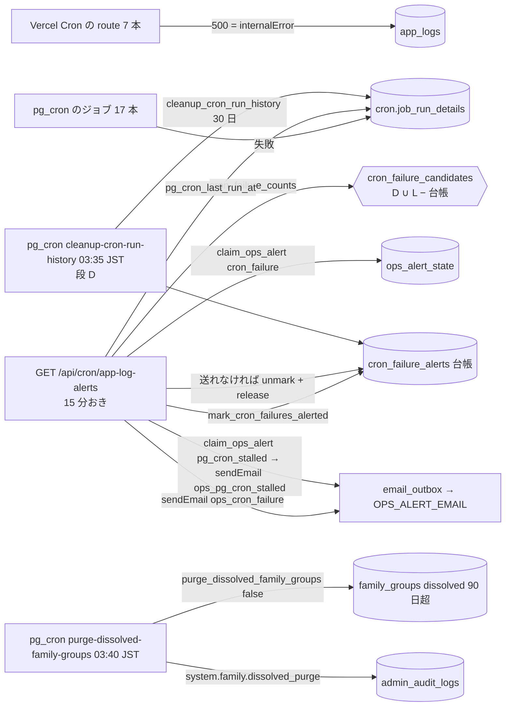

# operator/ 課金と関係のない運用バッチの残り (#1125 の B) — 棚卸しと、ジョブの失敗の監視・解散した家族の物理削除の設計

版: v1.3 (2026-10-17・A 型設計ゲートの網羅性の反映 周 2)
Status: 設計ゲート通過 (2026-10-17・R2 で Opus 5.5 と Sonnet 5.5 の 2 枚が PASS)。§0.4 の Q-1〜Q-3 はオーナーの確認 (2026-10-17) で仮の決定のとおりに決まった。段 A (#1828)・段 B (#1835)・段 C (#1842)・段 D (#1847) は main に入っている
改定履歴: v1.0 2026-10-17 新設 (Issue #1125 の 2026-10-10 のコメントの (B) の設計ゲート・A 型 4 相) / v1.1 2026-10-17 網羅性の反映 (Vercel Cron の母集合を 5 本に・`backup-freshness` を実装済みとして扱う・表 3 点とシナリオの行の追加・追随表と段分けの対応の明記) / v1.2 2026-10-17 修正 R1 (実行履歴の掃除を段 A から切り出して段 D (Q-3 の確認の後) に・同意の記録を持つグループだけが残る回は監査ログを書かないことを S-15・Q-2・表にそろえる (P-27)・`src/__tests__/lib/env.test.ts` を追随表に・`app-log-alerts.test.ts` の追随を逐語に (§14.1)・route の RPC の数の事実を 7 本に訂正) / v1.3 2026-10-17 網羅性の反映 周 2 (D-1 の「作る 2 件」の列挙を B-9・B-2 にそろえる・cron_failure の文面の作成・送信の例外の行 P-28・権利の遷移表に `claim_ops_alert` の error の行・テストの追加 (CF-12〜CF-16・ST-9・ST-10・ORD-2・K-2・結合 B-5〜B-7) と表の行・シナリオとテストの対応表 (§11.4)・番兵 `tests/email-send-throttle-contract.test.ts` の行・追随表に cross/14 と operator/10 §8.1 の行・変えないものに `src/lib/backups/core.ts`)

要件の正本は Issue #1125 の本文と、2026-10-10 のコメントの (B)。(A) の課金のもの (Stripe の Webhook・収益のスナップショット・ライセンス系の pg_cron・`stripe_event_stuck_check`・課金系の Vercel Cron) は、オーナーの選択「課金は無料のまま計測」により #1125 の残りとして本書の範囲の外に置く (08 §3.0 の言い回しのまま)。本書は (B) の 9 項目を「いまの事実」で仕分け、作るものを Sonnet 5.5 の実装者が手を止めずに実装できる粒度まで展開する。

本書の前提 (範囲と方針):
- 利用者へのメールを新しく送り始めるもの (`re_engagement_email`・`nps_survey_sender`) は業務の判断になる。本書は選択肢と推奨を書くだけにし、実装の段には入れない (§8。当面は送らないに決まった: Q-5)。
- データを消すもの (解散した家族のグループの物理削除・pg_cron の実行履歴の掃除) は、消す範囲と保存期間を、オーナーが確かめる点として §0.4 に挙げる (Q-1・Q-2・Q-3)。3 つともオーナーの確認 (2026-10-17) で仮の決定のとおりに決まった。マージの前に本番へ当ててよいのは、確認された保存期間のときだけである。解散した家族の物理削除は §12 の段 C、実行履歴の掃除は §12 の段 D に分ける。失敗の監視 (段 A・段 B) は既存の行を消さないので、確認とは関係なく着手した。段 A〜D はどれも main に入っている。
- ローンチ前で利用者ゼロ (正しい形で作る)。本番の DB には触らない (設計ゲートでは読むだけ)。
- 規約は `docs/design/CLAUDE.md` (章構成・snake_case・RLS 厳格化・監査ログ必須) と `operator/CLAUDE.md`。cron の正本は `08-cron-batches.md` (本書は 08 の改定を §15 の追随表で指定する)。運用アラートの正本は `07-audit-monitoring.md` §8.3 と `10-logs-and-mail-retry.md` §8。

---

## 0. 位置づけ・前提・分冊判定 (相 1)

### 0.1 決めること (要約)

| # | 決めること | 本書の決定 (要約) | 詳細 |
|---|---|---|---|
| D-1 | (B) の 9 項目の仕分け (作る / 不要 = 08 から外す / 済み = 08 を現在形に / 当面は送らない) | §2.2 の表。作る = B-9 ジョブの失敗の監視 (pg_cron の失敗・Vercel Cron の route の失敗・pg_cron の停止。その土台の実行履歴の保持 (段 D) を含む) と、B-2 解散した家族のグループの物理削除の 2 件 (9 項目の数え方。実装の単位は §0.2 の 3 件 = 失敗の監視・実行履歴の掃除・解散した家族の物理削除)。不要 = `family_freeze_grace_batch`・`meal_request_expire_batch`・`data_integrity_check`・`hr_revoke_jobs_processor` の 4 件。済み = `logical_backup`。当面は送らない (Q-5) = `re_engagement_email`・`nps_survey_sender` | §2.2 §8 |
| D-2 | ジョブの失敗をどう知るか | 既存の運用アラート (`GET /api/cron/app-log-alerts`・15 分おき・`OPS_ALERT_EMAIL`・`claim_ops_alert`) に **4 つ目の種類 `cron_failure`** (pg_cron の失敗した実行 + Vercel Cron の route の 500) と **5 つ目の種類 `pg_cron_stalled`** (pg_cron が一定時間 1 つも動いていない) を足す。失敗は「まだ知らせていないもの」を数え、知らせた失敗を台帳 `cron_failure_alerts` に記録する (10 §8 の `dead_alerted_at` と同じ考え方。窓で数えない) | §4 §5 §6 |
| D-3 | 実行履歴 (`cron.job_run_details`) の保持 | Supabase は自動では消さない (本番で 2026-05-01 からの行が残っている)。pg_cron のジョブ `cleanup-cron-run-history` (毎日 03:35 JST) が 30 日より古い実行履歴と台帳の行を消す。既存の行を消すので、段 A から切り出した段 D に置いた (Q-3 はオーナーの確認 (2026-10-17) で確定) | §5.3 §12 |
| D-4 | 解散した家族のグループ (`family_groups.status = 'dissolved'`。解散は運営の強制解散と利用者の解散 (family/11) の 2 つ) の物理削除 | 08 §4.4 の `family_archive_purge_batch` は `archived` 状態を前提にするが、実装の状態は `active` / `dissolved` だけ。解散から 90 日 (保存期間) を過ぎた行を、pg_cron のジョブ `purge-dissolved-family-groups` (毎日 03:40 JST) が 1 回 500 件まで物理削除する (`purge_dissolved_family_groups(p_dry_run)`)。保護者の同意の記録 (`parental_consents`) を持つグループは消さずに数だけ報告する。消す範囲と保存期間はオーナーの確認点 (§0.4) | §5.4 |
| D-5 | 凍結 (`frozen`) 系・食事リクエスト・HR 連携のバッチ | 発生源 (ライセンスの失効 = (A)・HR の Webhook・`family_meal_requests`) がどれも main に無く、バッチだけ先に作ると「何も対象の無い処理」になる。08 の「いま」の計画から外し、発生源を作る冊に同梱する (08 の記述の外し方は §15) | §2.2 §15 |
| D-6 | 利用者へ送るメール 2 本 | 2 本とも当面は送らない (オーナーの選択 (2026-10-17)。§8)。実装しない。08 からは「当面は送らない」として外す | §8 |

### 0.2 分冊判定

目安 3 つ (800 行超・消費先 3 以上・共有面 2 つ以上) のうち、「800 行超」と「共有面 2 つ以上」(運用アラートの route と定数・`admin_audit_logs` の action_type の一覧・08 §3.0 の状態の注記・env の一覧) に当たる。それでも **1 冊にする**。理由: (a) 作るものは「失敗の監視 (台帳 1 表 + RPC 5 本 + route の 2 種類 + 文面 2 本)」「実行履歴の掃除 (関数 1 本 + ジョブ 1 本)」「解散した家族の物理削除 (関数 1 本 + ジョブ 1 本)」の 3 件で、互いに契約を共有しない (結ぶのは 08 §3.0 の数の注記と、掃除が台帳の古い行も消すことだけ)。(b) 棚卸し (§2.2) と選択肢 (§8) は表と文だけで、実装の契約を持たない。(c) 実装 WF は §12 の 4 段 (A: 失敗の監視の DB / B: 失敗の監視のアプリ / C: 解散した家族の物理削除の DB / D: 実行履歴の掃除の DB) に分け、段ごとに 2 枚のレビューを閉じる。データを消す段 C と段 D は、§0.4 の確認 (段 C は Q-1・Q-2、段 D は Q-3。オーナーの確認 2026-10-17 で決まった) のとおりに実装する (それぞれ別の Issue・別の PR でよい)。収束しなければ段 C・段 D を別冊に切り出す (核は段 A + B)。

### 0.3 用語

| 語 | 意味 |
|---|---|
| 失敗した実行 | pg_cron: `cron.job_run_details.status = 'failed'` の行 (1 実行 = 1 行)。Vercel Cron: `app_logs` の `level = 'error'`・`source <> 'client'`・`message` が `internalError` の固定文「内部エラーのため 500 を返しました」・`function_name` が cron の route の名前 (`cron/<名前>` または `<METHOD> /api/cron/<名前>`) の行 (route が 500 を返した 1 回 = 1 行) |
| 台帳 (`cron_failure_alerts`) | 知らせた失敗の記録。(source, item_id) で 1 失敗 = 1 行。item_id は pg_cron なら `runid`、Vercel Cron なら `app_logs.id` |
| 見る範囲 (look-back) | 失敗を数える範囲 = 直近 7 日 (`cron_failure_candidates()` の `c_lookback`)。初回の適用で古い失敗をまとめて知らせない・走査を短くするための上限 |
| 停止 (stalled) | `cron.job` に有効なジョブがあるのに、`cron.job_run_details` の最新の `start_time` から `OPS_ALERT_PG_CRON_STALL_MINUTES` (既定 60 分) より長く過ぎている (または実行履歴が 1 行も無い) |
| 権利 (claim) | `claim_ops_alert(alert_key, cooldown)` が返す時刻。同じ種類の通知をクールダウン (`OPS_ALERT_COOLDOWN_MINUTES`・既定 60 分) の間に送り直さないための仕組み (07 §8.3) |
| 保存期間 (retention) | 解散した家族のグループを消すまでの期間 = 解散 (`dissolved_at`) から 90 日。実行履歴と台帳は 30 日 |

### 0.4 オーナーが確かめる点 (本書の決定を置き換えうるもの)

| # | 確かめること | 本書の仮の決定 | 変えるときに触る場所 |
|---|---|---|---|
| Q-1 | 解散した家族のグループを物理削除してよいか・保存期間は 90 日でよいか | 消す。90 日 (org/05 §7.3 の「90 日後に物理削除」・隠したコンテンツの 90 日と同じ) | `purge_dissolved_family_groups` の `c_retention`・08 §3.0 の行・§12 の段 C の着手 |
| Q-2 | 消える範囲 (§5.4.2 の表: `family_groups` と、外部キーの CASCADE で `family_members`・`family_invites`・`family_promotion_requests`・`parental_consents`) でよいか。とくに `parental_consents` (保護者の同意の記録) | 同意の記録を持つグループは**消さず**に残す。残した数は関数の戻り値 `skipped_with_consents_count` に出る (dry run の `purge_dissolved_family_groups(true)` でいつでも確かめられる)。同じ回にほかのグループを消したときは、その回の監査ログの `skipped_with_consents_count` にも載る。残すものだけで消すものが無い回は、何も変わらないので監査ログを書かない (P-27)。同意の記録まで消してよいなら、候補の条件から `parental_consents` の除外を外す | §5.4.1 の `NOT EXISTS (parental_consents)`・§7.1 の行 P-20・P-27 |
| Q-3 | pg_cron の実行履歴 (`cron.job_run_details`) を 30 日で消してよいか | 消す (30 日。`app_logs` と同じ。失敗の監視が見る範囲 7 日より長い)。オーナーの確認 (2026-10-17) で確定した | `cleanup_cron_run_history` の `c_retention`・§12 の段 D |
| Q-4 | 家族の凍結 (`frozen` → `archived`) の機能を今後も作るか (本書は 08 の「いま」の計画から外すだけで、family/07 §3・org/05 §8 の設計は残す) | 作るときは、発生源 (ライセンスの失効 (A) または HR 連携) の冊で `frozen` の列と遷移とバッチを一緒に設計する | 08 §3.1・§4.3 (本書 §15)・family/07 §3.3・org/05 §8 |
| Q-5 | `re_engagement_email`・`nps_survey_sender` を送り始めるか (§8 の選択肢) | 決まった (オーナーの選択 (2026-10-17)): 当面は送らない。08 から外し、送り始めるなら別の設計ゲート | §8・08 §3.2・§5.5・operator/02 の `POST /api/cron/re-engagement-email`・`POST /api/cron/nps-survey-sender` の 2 節 (§15 の行 18) |

### 0.5 Issue 本文との食い違い (本書を正とする)

- #1125 の本文「vercel.json の cron は `process-menu-queue` 1 本のみ」「migration の cron.schedule は 2 本のみ」は古い。origin/main (2026-10-17・`8f8dc1d6`) の `vercel.json` は 5 本 (`process-menu-queue`・`app-log-alerts`・`email-outbox`・`push-outbox`・`backup-freshness` (`37 5 * * *` UTC = 14:37 JST))、migration が pg_cron に登録しているジョブは 11 本 (08 §3.0)。本番の `cron.job` は 17 本 (上の 11 + ベースラインに統合された `catalog-import-*` 5 本と `handson-tour-sandbox-cleanup`)。
- 08 §12 の「`cron.job_run_details` は Supabase が自動でクリアする」は事実と違う。本番には 2026-05-01 からの実行履歴 1,096 行が残っている (2026-10-17 の読み取り)。5 分おきのジョブ 2 本 (#1561) だけで 1 日に約 576 行増える。
- 08 §3.2 の `logical_backup` の行「daily 02:00 pg_dump → S3」は古い。cross/17 (#1129・#1191) が設計し、#1765 の段 A で GitHub Actions `db-backup.yml` (毎日 02:23 JST = `23 17 * * *` UTC) と migration `20261017090000_backup_audit_record.sql` (`record_backup_audit`) が main に入っている。鮮度の cron `/api/cron/backup-freshness` (`src/app/api/cron/backup-freshness/route.ts`・`vercel.json` に登録済み) も #1765 の段 C (#1813) で main に入っており、08 §3.2 には `backup_freshness` (実装済み: #1129) の行がある。08 §3.2 の `logical_backup` の行の概要にも「GitHub Actions の `db-backup.yml` (02:23 JST) が取って R2 に置く」が足されたが、ジョブ名の列は計画の名前のまま。
- 家族の Web の画面 (`src/app/(main)/family/*`・`src/app/api/family/*`) は main に残っている。#1733 (PR) が消したのはモバイルのネイティブの画面 (#1598 の続き) で、`family_groups` の表と機能は残っている。本書は「家族の機能は残っている」を前提にする。

---

## 1. 目的・スコープ

### 1.1 解決すること

- 定期処理 (調査時点 8f8dc1d6 で pg_cron のジョブ 17 本・Vercel Cron 5 本) のどれが失敗しても、誰にも届かない。migration の冒頭 (`20261010150000`・`20261011070000` など) にも「ジョブの失敗は `cron.job_run_details` に残る。通知は出ない」と明記されている。08 §6 の計画 (6 時間ごとの pg_cron で `admin_audit_logs` に書く・Slack・Sentry) は、Slack も Sentry も採用していない (07 §1.1・#1179) ので、そのままでは作れない。
- pg_cron の worker が止まると (DB の再起動など)、失敗の行すら増えない。「動いていない」ことを知る手段が無い。
- `cron.job_run_details` が溜まる一方 (§0.5)。
- 解散した家族のグループ (`status = 'dissolved'`) が永久に残る (名前・メンバーの履歴・招待)。org/05 §7.3 の「90 日後に物理削除」は `archived` 前提で、いまの状態機械 (`active` / `dissolved`) に合っていない。
- 08 の §3.1・§3.2・§4・§5・§6・§9・§10・§12 に、作れないもの (発生源が無い) と古い記述 (済んだもの) が「計画」として残り、読む人を迷わせる。

### 1.2 対象外 (本書では決めない・変えない)

- (A) の課金のもの (§冒頭)。`data_integrity_check` は課金の表を読むが、制約が守るので作らない (§2.2)。08 §3.1 の `infra_metrics_cleanup`・`failed_invite_lookups_cleanup` も (B) の 9 項目に無く、要らない: 2 つの表 (`infra_metrics`・`failed_invite_lookups`) に書き込む処理が main に無く (前者は `GET /api/super-admin/infra/metrics` が読むだけで、RLS は super_admin の SELECT の 1 本。後者は RLS が `USING (false)` の 1 本だけで、読み書きするコードも無い)、行が増えないので消す対象が無い (08 §3.1 の注記)。書き込む処理を足す冊が、掃除のジョブも一緒に足す。
- 08 §7 の手動実行 UI (`/super-admin/cron-jobs`) と §7.2 の API。本番に無く、(B) の一覧にも無い。09 §5.2 の「方法 A」が指すが、本書では触らない (§15 で「無い」ことを注記する行だけ)。
- Vercel Cron の route を増やすこと (`vercel.json` は変えない)。失敗の監視は既存の `app-log-alerts` の回で行う。
- 急増通知の既存の 3 種類 (server / client / email_dead_letter) のしきい値・窓・抑止・文面は変えない。
- cross/17 の鮮度の cron (`backup-freshness`・#1765 段 C・#1813 で main に入った) は cross/17 が正。本書は変えない (その route の 500 は、ほかの Vercel Cron と同じく本書の失敗の監視の対象になる: S-20)。08 の `logical_backup` の行を現在形にするだけ。
- 家族の凍結 (`frozen`)・食事リクエスト・HR 連携そのものの設計 (Q-4・D-5)。
- `withCronMonitoring` (08 §6.2) のようなラッパーは作らない。cron の route の 500 は既存の `internalError` (`src/lib/api/errors.ts`) が `app_logs` に 1 行残しており、それを数える。

---

## 2. 関連要件と現行の事実 (相 1 の「いまの事実」)

### 2.1 根拠

- 要件: `docs/requirements/03-operator-admin.md` §15.17 (バッチ)・§22.9 (監視)。Issue #1125 の本文と 2026-10-10 のコメント (B)。
- 現行 (origin/main `8f8dc1d6`・2026-10-17。本番は Supabase MCP の読み取り 2026-10-17 02:20 JST):
  - `vercel.json`: 5 本 (調査時点 8f8dc1d6。§0.5)。cron の認証は `requireCronAuth` (`src/lib/cron-auth.ts:29`)。
  - `src/app/api/cron/app-log-alerts/route.ts`: 宛先は `resolveOpsAlertRecipient()` (`src/lib/ops-alerts/recipient.ts`。`backup-freshness` と共有。#1129) が返す `{ status: 'ok', email }` の `email`。server → client → email_dead_letter の順に判定 (`checkScope` / `checkEmailDeadLetters`)。DB への入口は RPC 7 本 (`app_log_error_counts`・`app_log_client_error_counts`・`email_outbox_dead_counts`・`mark_email_outbox_dead_alerted`・`unmark_email_outbox_dead_alerted`・`claim_ops_alert`・`release_ops_alert`)。テスト O-1 (`src/__tests__/api/cron/app-log-alerts.test.ts`) が固定しているのは、既定の場面 (届けられなかったメールが 0 件) で呼ばれる 5 本 (mark / unmark を除く)。応答は `{ …server, window_minutes, client, email_dead_letter }`。
  - `src/lib/ops-alerts/app-log-error-spike.ts`: `AppLogAlertScope = 'server' | 'client' | 'email_dead_letter'`、`APP_LOG_ALERT_COUNT_RPC` (as const satisfies Record)、`APP_LOG_ALERT_KEYS`、`resolveAppLogAlertSettings` (3 つの環境変数)、`parseErrorCountRows` / `normalizeDeadCountRows` / `summarizeErrorCounts` / `exceedsErrorThreshold` / `sanitizeFunctionNameForAlert`。
  - `src/lib/emails/ops/app-log-error-spike.ts`・`src/lib/emails/ops/email-dead-letter.ts`: 文面 (`template` は `ops_` で始まる。`email_outbox_dead_counts` が数えない)。
  - migration `20261010123500_ops_alert_state.sql`: `ops_alert_state`・`claim_ops_alert(TEXT, INTEGER)`・`release_ops_alert(TEXT, TIMESTAMPTZ)`。`20261016234000_email_outbox.sql`: `email_outbox_dead_counts(INTEGER)`・`mark_email_outbox_dead_alerted`・`unmark_email_outbox_dead_alerted` (印を付ける・外す)。
  - `src/lib/api/errors.ts:44`: `const INTERNAL_ERROR_LOG_MESSAGE = '内部エラーのため 500 を返しました'` (export されていない)。`internalError(routeName, …)` が `createLogger(routeName)` でこの文を `level = 'error'` で書く。cron の route の名前: `cron/app-log-alerts`・`cron/email-outbox`・`cron/push-outbox`・`cron/backup-freshness` (各 route の `ROUTE_NAME`)・`GET /api/cron/process-menu-queue` (`internalError` の第 1 引数)。5 本とも `vercel.json` の 5 本と 1 対 1 (調査時点 8f8dc1d6。いまは #1720 段 B の `cron/login-alerts` (`ROUTE_NAME`) と #1912 billing/04 の `cron/iap-reconcile` (`ROUTE_NAME`) を足した 7 本で、どれも 1 対 1)。
  - `email-outbox` の worker は届けられなかった 1 通ごとに `error` を書く (`src/lib/emails/outbox.ts:280`。文は「メールを届けられませんでした (dead)」)。この行は `internalError` の文ではないので、本書の「失敗した実行」に入らない (届けられなかったメールの通知が受け持つ)。
  - `POST /api/log` はログインした人なら `source = 'client'` の行を書ける (#1493)。`function_name` も送り手が決めるので、client の行は失敗に数えない。
  - 本番の `cron.job`: 17 本 (全部 `username = postgres`・`active`)。`cron.job_run_details`: 1,096 行、最古 2026-05-01、`failed` 0 行、`succeeded` / `failed` 以外の status 0 行。pg_cron 1.6.4。`cleanup-email-outbox`・`cleanup-auth-sessions-and-login-history` は登録直後で実行 0 回。
  - `family_groups` (本番・ベースライン `supabase/baseline/prod_schema.sql:311-323`): 列は `id, name, representative_id, plan_key, member_limit, status, created_at, updated_at, dissolved_at`。`status` の CHECK は `active` / `dissolved` だけ。`frozen_at` / `freeze_grace_until` / `archived_at` は無い。本番の行数 0。解散は `operator_force_dissolve_family` (migration `20261008090100`:188・membership/05) が `status = 'dissolved', dissolved_at = now()` にし、`family_members` を `left`、`user_profiles.family_id` を NULL にする。
  - `family_groups` を参照する外部キー: `family_invites.family_id` (CASCADE)・`family_members.family_id` (CASCADE)・`family_promotion_requests.family_id` (CASCADE)・`user_profiles.family_id` (SET NULL)・`parental_consents.family_id` (CASCADE。migration `20261017030000`:93)。`family_meal_logs` は `legacy_family_members` を参照し、`family_groups` とは結ばれていない。`membership_audit` は `scope_id` に外部キーが無い (消えない)。`family_groups` のトリガーは `BEFORE UPDATE` の 1 つだけ (`trg_guard_family_groups_privileged`)。DELETE を止めるトリガーは無い。
  - `family_meal_requests`: 表も関数も無い (family/04 は未実装。mobile/06 §3.2 の表も「発火元が実装に無い」)。
  - `hr_revoke_jobs` / `hr_webhook_events` / `POST /api/webhooks/hr`: 無い (org/02 §14 は未実装。`organizations.scim_token_hash` の列だけ)。
  - `personal_subscriptions`: `plan_key` は `subscription_plans(plan_key)` への外部キー (`ON UPDATE CASCADE ON DELETE RESTRICT`。ベースライン 9202 行目)。有効な契約の重複は一意部分索引 `idx_personal_subscriptions_active_per_user` (8130 行目) が防ぐ。
  - `nps_surveys`: 表 (0 行)・`nps_insert_self` (本人が書ける) と管理の集計 (`src/lib/admin/nps-summary.ts`・`/admin/finance/nps`) はある。送る処理・回答の画面は無い。
  - `user_profiles.last_login_at`: 65 人中 4 人だけ値がある (列のコメントは「Edge Function が同期」だが、同期は当てにならない)。`plan_key_cached` も「常に最新とは限らない」。アプリの活動の実測は `daily_active_users` (08 §3.0.1) と `auth.sessions`。
  - 監査ログの決まり (07 §3.2・§4.5): `system.*` の action_type は `actor_id` NULL で、`service_role` / `SECURITY DEFINER` / pg_cron の所有者 `postgres` だけが書く。`admin_audit_logs.actor_id` は `auth.users` への外部キー (ベースライン 8627 行目) なので、08 §4.4・§4.6 の `'00000000-0000-0000-0000-000000000000'` は書けない (NULL にする)。`severity` は `info` / `warn` / `critical`。先例: `cleanup_handson_tour_sandbox_rows` (`target_type = 'cron_job'`・actor NULL)・`record_backup_audit` (actor NULL・`target_type = 'database_backup'`)。

### 2.2 (B) の 9 項目の仕分け

| # | 項目 (08 の名前) | 前提の機能は main にあるか | 別の Issue で入ったか | 08 の記述は main と合っているか | 仕分け | 本書 |
|---|---|---|---|---|---|---|
| B-1 | `family_freeze_grace_batch` (pg_cron。08 §3.1・§4.3) | 無い。`frozen` 状態・`freeze_grace_until`・`archived_at` が無い。`frozen` にする処理 (08 §4.2 の 4. = ライセンスの失効 (A)・family/07 §3.1 = HR revoke) も無い | 入っていない | 合っていない (計画のまま) | **不要** (08 の「いま」の計画から外す。発生源の冊に同梱: Q-4) | §15 |
| B-2 | `family_archive_purge_batch` (pg_cron。08 §4.4) | `archived` は無いが、`dissolved` + `dissolved_at` はある。消す処理は無い | 入っていない | 合っていない (`archived`・`SYSTEM_USER_ID`・Slack) | **作る** (名前を `purge-dissolved-family-groups` に変え、`dissolved` を対象にする。段 C・Q-1・Q-2) | §5.4 |
| B-3 | `meal_request_expire_batch` (pg_cron。08 §4.5) | 無い (`family_meal_requests` が無い) | 入っていない | 合っていない | **不要** (family/04 の実装の冊に同梱) | §15 |
| B-4 | `data_integrity_check` (pg_cron。08 §4.6) | 検査 1 (孤立した `plan_key`) は外部キー `personal_subscriptions_plan_key_fkey` が、検査 2 (有効な契約の重複) は一意部分索引 `idx_personal_subscriptions_active_per_user` が構造的に防ぐ | 制約として入っている | 合っていない (制約で防げるものを検査する計画) | **不要** (制約が守る。Stripe との照合は (A) の `stripe_integrity_check` / billing/01 §12) | §15 |
| B-5 | `re_engagement_email` (Vercel Cron。08 §3.2・§5.5) | 送る処理・文面・配信停止が無い。`last_login_at` は当てにならない | 入っていない | 合っていない | **当面は送らない** (Q-5) | §8 |
| B-6 | `nps_survey_sender` (Vercel Cron。08 §3.2) | 表と集計の画面はあるが、送る処理・回答の画面が無い | 入っていない (表は #1012 系) | 合っていない | **当面は送らない** (Q-5) | §8 |
| B-7 | `hr_revoke_jobs_processor` (Vercel Cron。08 §3.2・§5.6) | 無い (HR の Webhook も表も無い) | 入っていない | 合っていない | **不要** (org/02 §14 の HR 連携の冊に同梱) | §15 |
| B-8 | `logical_backup` (Vercel Cron。08 §3.2・§5.1) | GitHub Actions `db-backup.yml` と `record_backup_audit` が main にある。鮮度の cron `/api/cron/backup-freshness` も main にある (route と `vercel.json` の登録。08 §3.2 の `backup_freshness` は「実装済み: #1129」) | **入った** (cross/17・#1765 段 A。鮮度の cron は段 C・#1813) | 一部だけ合っている (§3.2 の概要には GitHub Actions の注記が足されたが、ジョブ名の列は「実装済み」になっておらず、§5.1 の `vercel.json` の例に `/api/cron/logical-backup` が残る) | **済み** (08 を現在形にする) | §15 |
| B-9 | ジョブの失敗の監視 (08 §6) | 無い。失敗は `cron.job_run_details` に残るだけ | 部分的に重なる (`app-log-alerts` は `app_logs` の error の急増と届けられなかったメールだけ。cross/17 の鮮度の cron `backup-freshness` はバックアップの取得が止まったことだけで、ジョブの失敗一般は見ない) | 合っていない (Slack・Sentry・6 時間ごとの pg_cron) | **作る** (既存の運用アラートの 4 つ目・5 つ目の種類: 段 A・B。実行履歴の保持: 段 D) | §4〜§7 |

---

## 3. 相 1: 外形固定 — 要件行列とユーザーシナリオ

### 3.1 要件行列 (全 20 行)

| # | 要件 | 根拠 | 本書の節 |
|---|---|---|---|
| R-01 | pg_cron のジョブの失敗 (`status = 'failed'`) は、15 分以内に運用メール (`OPS_ALERT_EMAIL`) で分かる (1 件から) | #1125 (B)「ジョブの失敗の監視」・08 §6.1 | §4 §6.2 |
| R-02 | Vercel Cron の route が 500 を返した回も、同じ通知で分かる (1 件から) | 08 §6.2 (Slack / Sentry の代わり) | §4 §5.2 |
| R-03 | 同じ失敗を 2 回知らせない。抑止 (クールダウン) の間・cron の発火の遅れの間に起きた失敗も、次に送れる回で 1 回だけ知らせる (窓で数えない) | 10 §8.1「窓で数えない理由」 | §4.1 §5.2 |
| R-04 | 通知には、ジョブ / route の名前と件数だけを載せる。`cron.job_run_details.command` / `return_message`・`app_logs` の本文・ユーザー ID は載せない | 07 §8.3「載せる内容」・08 §3.0.3 (command に秘密) | §6.3 |
| R-05 | 利用者が `POST /api/log` で書いた行 (`source = 'client'`) は失敗に数えない | #1493 | §5.2 |
| R-06 | 届けられなかったメールの 1 通ごとの error (worker が書く) は失敗に数えない (重複して知らせない) | 10 §8 (その通知が受け持つ) | §5.2 |
| R-07 | pg_cron が止まっている (有効なジョブがあるのに一定時間 1 つも動いていない) ことも知らせる。しきい値は環境変数で変えられる | 08 §6 の趣旨・cross/17 S-9 (静かな停止) | §4 §5.2 §6.1 |
| R-08 | `OPS_ALERT_EMAIL` 未設定なら何もしない。送れなかったときは権利 (と台帳の印) を返し、次の回でもう一度試す。宛先停止・文面の不備のときは返さない | 07 §8.3・10 §8.3 | §6.2 |
| R-09 | DB の失敗 (数える・権利・印) は 500 (本文は汎用)。前の種類の通知は後ろの失敗で止まらない (server → client → email_dead_letter → cron_failure → pg_cron_stalled) | #1172・10 §8.1 | §6.2 §7.1 (P-8・P-21) |
| R-10 | `cron.job_run_details` と台帳は 30 日で消す。消す前に失敗を数え終えている (見る範囲 7 日 < 30 日)。既存の行を消すので段 A から切り出した段 D に置いた (保存期間は Q-3 で決まった) | §0.5・Q-3 | §5.3 §12 |
| R-11 | DB の関数は `search_path = ''`・参照は完全修飾・`EXECUTE` は `service_role` だけ (掃除と候補の関数は所有者 `postgres` だけ)。`cron` スキーマを読む関数は `SECURITY DEFINER` (所有者 postgres) で、引数は上限つきの整数と時刻だけ | CLAUDE.md RLS・`20261010123500` の権限の考え方・anon-definer-execute | §5.1 §5.2 |
| R-12 | 台帳は RLS 有効・anon / authenticated / service_role に直接の権限を付けない (入口は RPC だけ) | `ops_alert_state` の形 | §5.1 |
| R-13 | pg_cron の無い DB (ローカルの一部・CI) では、pg_cron の部分を飛ばして動く (関数は作れ、呼べば Vercel Cron の分だけ返す。停止は判定しない) | `20261010150000` の `to_regclass('cron.job')` の守り | §5.2 |
| R-14 | 解散した家族のグループは、解散から 90 日を過ぎたら物理削除する。1 回 500 件まで。消した件数は監査ログ (`system.family.dissolved_purge`・actor NULL) に残る | org/05 §7.3・08 §4.4 の趣旨・CLAUDE.md 監査ログ必須 | §5.4 |
| R-15 | 物理削除は乾いた実行 (dry run) で件数だけ確かめられる。保護者の同意の記録を持つグループは消さない (Q-2) | 08 §9 の dry-run・§12 | §5.4 |
| R-16 | 新しいジョブは 08 §3.0 の表と注記の「数と名前」に載せる (番兵 `tests/log-cleanup-dau-snapshot-contract.test.ts` 規則 9)。migration は `cron.job` の存在を確かめ、同名を登録解除してから登録する (何度流しても同じ) | 08 §3.0・`20261010150000` の書き方 | §5.5 §14 |
| R-17 | 新しい表・RPC は `database.types.ts` (2 か所) に反映し、migration と対の down.sql を書く | `tests/database-types-migrations-contract.test.ts` | §5 §14 |
| R-18 | 新しい環境変数は `src/lib/env.ts` の一覧・`.env.example`・`ENV_SETUP.md` にそろえ、値を読むのは route 1 ファイル | `tests/env-source-scan.test.ts` | §10 §14 |
| R-19 | 作れないもの (発生源が無い)・済んだものを 08 の「いま」の計画から外し、08 の状態の注記の言い回し (課金系の扱い) を壊さない | 仕様 (08 の改定は追随表で) | §15 |
| R-20 | 利用者へのメール 2 本は、選択肢と推奨だけを書き、実装の段に入れない | 仕様 | §8 |

### 3.2 ユーザーシナリオ (21 本)

| # | シナリオ | 期待する結果 |
|---|---|---|
| S-01 | 03:15 JST の `cleanup-old-app-logs` が 1 回失敗する (`cleanup_old_logs()` が例外) | 次の `app-log-alerts` の回 (15 分以内) に運用メール「定期処理が失敗しています (1 件)」。本文は `pg_cron/cleanup-old-app-logs … 1 件`。翌日以降、同じ失敗は知らせない (台帳に残る) |
| S-02 | `process-pending-meal-image-jobs` (5 分おき) が Vault の秘密が無くて 1 時間失敗し続ける (12 回) | 最初の回で、その時点の失敗 (例 3 件) を 1 通。抑止 (60 分) の間の回は送らず、台帳にも書かない。抑止が明けた最初の回で、残りの 9 件を 1 通。12 件はどちらか一方の通知に 1 回だけ入る |
| S-03 | `email-outbox` の worker が DB の一時障害で 3 回 500 を返す (同じ時間帯に 2 通が dead になった) | 通知 `cron_failure` は `vercel_cron/cron/email-outbox … 3 件`。dead の 2 通は `email_dead_letter` の通知で別に知らせる (本書の通知には入らない) |
| S-04 | 失敗が 10:00:30 に起き、`app-log-alerts` の回が 10:00 と 10:16 (Vercel の発火が 1 分遅れた) | 10:16 の回で知らせる (窓ではなく台帳で数えるので、回の隙間に落ちない) |
| S-05 | `OPS_ALERT_EMAIL` が未設定 | 5 種類とも何もしない (応答 `{ status: 'disabled' }`。DB にも触れない) |
| S-06 | 失敗を検知して権利を取ったが、送信待ちへの登録が失敗した (`outbox_failed`) | 台帳の印を外し (`unmark_cron_failures_alerted`)、権利を返し (`release_ops_alert`)、応答 `send_failed`。15 分後の回で同じ失敗をもう一度知らせる |
| S-07 | DB の再起動で pg_cron の worker が 2 時間止まる (有効なジョブ 17 本) | 最新の実行から 60 分を超えた最初の回で「pg_cron のジョブが 60 分以上動いていません」を 1 通。止まっている間は抑止 (60 分) ごとに 1 通。復旧して実行が再開すれば何も送らない (失敗の行は無いので `cron_failure` も鳴らない) |
| S-08 | ローカル・CI の DB に pg_cron が無い | `cron_failure_candidates()` は Vercel Cron の分だけ返す。`pg_cron_last_run_at()` は `cron_available = false` を返し、停止は判定しない (応答 `below_threshold`) |
| S-09 | 時間がたつ (段 D を本番に当てた後) | `cleanup-cron-run-history` (03:35 JST) が 30 日より古い実行履歴と台帳の行を消す。失敗の監視は直近 7 日しか見ないので、消す前に数え終えている。段 D の前は何も消えず、実行履歴と台帳は増えるだけ (失敗の監視は 7 日しか見ないので、動きは変わらない) |
| S-10 | 段 A の migration を本番に当てた時点で、20 日前の失敗が 1 件ある | 知らせない (見る範囲 7 日)。7 日以内の失敗があれば、最初の回でまとめて 1 通 (台帳が空なので、どれも「まだ知らせていない」) |
| S-11 | 2026-07-01 に解散した家族 (メンバー 3 人・招待 1 件・同意の記録なし) が 2026-09-30 (91 日目) を迎える | 03:40 JST の `purge-dissolved-family-groups` が `family_groups` の行を消し、CASCADE で `family_members` 3 行・`family_invites` 1 行が消える。`admin_audit_logs` に `system.family.dissolved_purge` (purge_count 1) が 1 行。メンバーの食事の記録・`membership_audit` は残る |
| S-12 | super_admin が本番に当てる前に件数を確かめる | SQL エディタで `SELECT * FROM public.purge_dissolved_family_groups(true);` → `purge_count` (消すはずの件数)・`skipped_with_consents_count`・`dry_run = true`。何も消えず、監査ログも書かない |
| S-13 | 解散から 90 日を過ぎたグループが 1,200 件ある | 1 日 500 件ずつ、古い順に 3 日で消える。監査ログの `remaining_count` に残りが出る |
| S-14 | 解散から 89 日のグループ・有効なグループ | 触らない |
| S-15 | 解散から 90 日を過ぎたが、保護者の同意の記録 (`parental_consents`) を持つグループ | 消さない (Q-2 で消すと決まるまで残す)。戻り値の `skipped_with_consents_count` に数える。同じ回にほかのグループを消したときだけ、その回の監査ログの `skipped_with_consents_count` にも載る。残すものだけで消すものが無い回は、監査ログを書かない (P-27。何も変わらない回は書かない)。いまの数は dry run (S-12) で確かめる |
| S-16 | 失敗したあとでジョブが登録解除された (`cron.job` に無い `jobid`) | `jobid:<番号>` の名前で知らせる (名前を解決できなくても失敗は落とさない) |
| S-17 | ログインした利用者が `POST /api/log` で `function_name = 'cron/email-outbox'`・`level = 'error'`・本文を `internalError` の文にした行を書く | `source = 'client'` なので数えない (通知は鳴らない) |
| S-18 | `app-log-alerts` 自身が DB の障害で 500 を返した (1 回) | 復旧後の次の回で `vercel_cron/cron/app-log-alerts … 1 件` を知らせる (自分の失敗も対象。送れれば以後は知らせない) |
| S-19 | `app-log-alerts` の回で、サーバーの error の急増 (server) を送ったあと、`cron_failure_counts` が DB の一時障害で error を返す | その回は 500。server の通知はもう送信待ちに入っている (取り消さない)。client・email_dead_letter の判定も済んでいる。pg_cron_stalled はその回では判定しない。次の回で cron_failure と pg_cron_stalled をもう一度判定する (失敗は台帳に無いので取りこぼさない) |
| S-20 | Vercel Cron の `backup-freshness` (14:37 JST) が DB の読み取りの失敗で 500 を返す (1 回) | 次の `app-log-alerts` の回で `vercel_cron/cron/backup-freshness … 1 件` を知らせる (バックアップが古いことの通知 `backup_stale` とは別の種類・別の権利) |
| S-21 | 将来、`family_groups` を `ON DELETE RESTRICT` で参照する表が足され、その行を持つ解散したグループが 90 日を迎える | `purge_dissolved_family_groups(false)` が `23503` で例外になり、その回の DELETE と監査ログは取引ごと巻き戻る (1 件も消えない)。ジョブの実行は `failed` になり、次の `app-log-alerts` の回で `pg_cron/purge-dissolved-family-groups … 1 件` を知らせる。翌日も同じく失敗し、その失敗も 1 回ずつ知らせる |

---

## 4. 相 2・相 3: 構造とその裁定

### 4.1 構造 (確定)



部品と責務:

| 部品 | 責務 | 置き場 |
|---|---|---|
| `cron_failure_candidates()` | 直近 7 日の失敗した実行 (pg_cron ∪ Vercel Cron) のうち台帳に無いものを (source, job_name, item_id, failed_at) で返す。`cron` スキーマが無ければ Vercel Cron の分だけ | migration 段 A (§5.2 (1)) |
| `cron_failure_counts(p_limit)` | 候補を (source, job_name) ごとに数えて多い順に返す (全体の件数 `total_count` 付き) | §5.2 (2) |
| `mark_cron_failures_alerted(p_alerted_at, p_limit)` | 候補の全部を台帳に書き (印 = 権利の時刻)、書けた行の件数を同じ形で返す | §5.2 (3) |
| `unmark_cron_failures_alerted(p_alerted_at)` | 印 = p_alerted_at の台帳の行を消す (送れなかったときの持ち越し) | §5.2 (4) |
| `pg_cron_last_run_at()` | `cron` スキーマの有無・有効なジョブ数・最新の実行の時刻を返す | §5.2 (5) |
| `cleanup_cron_run_history()` | 30 日より古い実行履歴と台帳の行を消す (pg_cron が毎日呼ぶ) | migration 段 D (§5.3) |
| `purge_dissolved_family_groups(p_dry_run)` | 解散から 90 日を過ぎたグループを 500 件まで消し、消した回だけ監査ログを書く。dry run は件数だけ | migration 段 C (§5.4。Q-1・Q-2 は確認済み) |
| route の `checkCronFailures` / `checkPgCronStalled` | 数える → しきい値 → 権利 → 印 (失敗だけ) → 送る。送れなければ印と権利を返す (返す条件の正本は §7.1 の「印と権利の返し方」) | §6.2 |
| 文面 `renderCronFailureEmail` / `renderPgCronStalledEmail` | 名前と件数・確かめる場所・自動送信の注記 | §6.3 |

### 4.2 代替案と裁定 (相 3・1 回だけ)

| 案 | 中身 | 退ける / 採る理由 |
|---|---|---|
| A: 08 §6.1 のまま (pg_cron のジョブが 6 時間ごとに `cron.job_run_details` を集計して `admin_audit_logs` に `system.cron.failure_detected` を書く + `pg_notify`) | DB だけで完結 | **退ける**。メールに届く経路が無い (`pg_notify` を聞く Edge Function は無い。Slack は使っていない)。監査ログは super_admin しか読めず、誰も見ない。6 時間の遅れ。「3 回以上」の条件は 1 日 1 回のジョブの失敗を落とす |
| B: `app-log-alerts` で 15 分の窓で数える (server の急増と同じ形) | 台帳が要らない | **退ける**。10 §8.1 と同じ理由: 抑止の間と発火の遅れの隙間の失敗を取りこぼす。「1 件から知らせる」と窓は両立しない。窓を 2 倍にすると、クールダウンを短く設定したときに同じ失敗を 2 回知らせる |
| C: `app-log-alerts` に 4 つ目の種類を足し、知らせた失敗を台帳に記録する (本書) | 10 §8 の `dead_alerted_at` と同じ形 (印は台帳の行) | **採る**。既存の仕組み (`claim_ops_alert`・`sendEmail`・`OPS_ALERT_EMAIL`・15 分の回) をそのまま使い、取りこぼしが無い。`cron.job_run_details` には列を足せないので、印を別の表 (台帳) に置く |
| D: Vercel Cron の失敗に `withCronMonitoring` (08 §6.2) のラッパー | route ごとに try-catch | **退ける**。既存の 7 本 (`backup-freshness`・`login-alerts`・`iap-reconcile` を含む) はどれも `internalError` で 500 を返し、固定の文で `app_logs` に error を 1 行残している。それを数えれば足りる。Slack / Sentry は不採用 |
| E: `cron.job_run_details` の掃除は Supabase に任せる (08 §12) | 何もしない | **退ける**。本番で 2026-05-01 からの行が残っている (事実)。5 分おきのジョブで 1 日 576 行増える |
| F: pg_cron の停止は見ない | 失敗だけ | **退ける** (ただし最小に)。止まると失敗の行も増えないので、失敗の監視だけでは静かに止まる。最新の実行の時刻を 1 本の RPC で読むだけで判定でき、5 分おきのジョブが 2 本あるので 60 分で判定できる |
| G: 解散した家族を消さない (永久に残す) | 何もしない | **退ける** (Q-1 で変えうる)。名前・メンバーの履歴・招待が永久に残る。org/05 §7.3 の設計の意図は 90 日後の削除 |
| H: 解散と同時に消す | バッチが要らない | **退ける**。問い合わせへの対応の猶予 (90 日) が無くなる。解散の RPC (`operator_force_dissolve_family`) は家族の冊のもので、本書では変えない |

**「縁の発生源を消すより単純な構造は無いか」**: 台帳の表 1 つが縁の発生源 (印の付け外し・掃除)。消せる構造は案 B だが、取りこぼしの縁を生む。案 C の台帳は、10 §8 で一度裁定された形の写しであり、同じ route・同じ順序 (数える → 権利 → 印 → 送る → 送れなければ印と権利を返す) で動く。構造はここで確定し、仕上げ相では蒸し返さない。

### 4.3 トレース (全シナリオを §4.1 の構造で手で走らせる)

| # | 道 (部品の順) | 結果 |
|---|---|---|
| S-01 | 18:15 UTC に失敗 → `job_run_details` に failed 1 行 → 18:30 UTC の回: `cron_failure_counts` = {pg_cron, cleanup-old-app-logs, 1, 1} → `exceedsErrorThreshold(1, 0)` = true → `claim_ops_alert('cron_failure', 60)` = 時刻 t → `mark_cron_failures_alerted(t, 10)` が台帳に (pg_cron, runid) を書き {…,1,1} を返す → `renderCronFailureEmail` → `sendEmail` ok → `sent`。翌日の回: 候補に無い (台帳にある) → `below_threshold` | ✓ R-01 R-03 |
| S-02 | 回 1 (3 件): 権利 t1 → 印 3 行 → 1 通。回 2〜4 (抑止): 候補 n 件 > 0 → `claim` = NULL → `deduped`。印は付かない。回 5 (抑止明け): 候補 9 件 → 権利 t2 → 印 9 行 → 1 通 | ✓ R-03 |
| S-03 | worker の 500 は `internalError('cron/email-outbox')` の error 3 行 (本文が固定文) → 候補 3 件 (vercel_cron)。dead の 2 行は本文が「メールを届けられませんでした (dead)」なので候補に入らない → `email_dead_letter` の種類で知らせる | ✓ R-02 R-06 |
| S-04 | 10:00 の回: 候補 0 → `below_threshold`。10:00:30 に失敗。10:16 の回: 候補 1 (台帳に無い) → 知らせる | ✓ R-03 |
| S-05 | `checkAppLogErrors` の冒頭で `OPS_ALERT_EMAIL` が無い → `disabled` を返す (5 種類とも到達しない) | ✓ R-08 |
| S-06 | 権利 t → 印 n 行 → `sendEmail` が `ok: false, error.code = 'outbox_failed'` → `NON_RELEASING_SEND_ERROR_CODES` に無い → `unmark(t)` で n 行を消す → `release(t)` → `send_failed`。次の回で同じ候補をもう一度 | ✓ R-08 |
| S-07 | `pg_cron_last_run_at()` = {true, 17, 最新 = 61 分前} → `judgePgCronStall` = stalled (61 > 60) → `claim_ops_alert('pg_cron_stalled', 60)` → `renderPgCronStalledEmail` → 1 通。15 分後: stalled → `claim` = NULL → `deduped`。復旧後: minutes 3 → `below_threshold` | ✓ R-07 |
| S-08 | `cron_failure_candidates()` の `to_regclass('cron.job_run_details')` が NULL → Vercel Cron の分だけ。`pg_cron_last_run_at()` = {false, 0, NULL} → `judgePgCronStall` = not stalled | ✓ R-13 |
| S-09 | (段 D の後) `cleanup_cron_run_history()`: `job_run_details` の `coalesce(end_time, start_time) < now() - 30 日` と台帳の `alerted_at < now() - 30 日` を消す。候補は 7 日しか見ないので、30 日より古い行はとうに数え終えている。(段 D の前) 関数もジョブも無く、行は残る。候補の条件 `start_time >= now() - 7 日` は台帳の行数に依らない | ✓ R-10 |
| S-10 | 候補の条件 `start_time >= now() - 7 日` に 20 日前の失敗は入らない | ✓ |
| S-11 | 18:40 UTC: 候補 = status dissolved・dissolved_at < now() - 90 日・`parental_consents` 無し → 1 件 → DELETE 1 行 (CASCADE: members 3・invites 1) → audit {purge_count 1, remaining 0, skipped 0, retention_days 90} | ✓ R-14 |
| S-12 | `p_dry_run = true`: 候補を数えるだけ。DELETE も INSERT もしない | ✓ R-15 |
| S-13 | 候補 1,200 → `LIMIT 500` (dissolved_at の古い順) → purge 500・remaining 700。翌日 500・翌々日 200 | ✓ R-14 |
| S-14 | 条件に当たらない → 0 件。監査ログは書かない (0 件の回は書かない) | ✓ |
| S-15 | 候補の条件 `NOT EXISTS (SELECT 1 FROM parental_consents WHERE family_id = g.id)` で外れる → `v_skipped` に数え、戻り値の `skipped_with_consents_count` に出る。`v_candidates = 0` なら `IF NOT p_dry_run AND v_candidates > 0` が偽 → DELETE も監査ログも無し (P-27)。同じ回に候補が 1 件以上あれば、その回の監査ログの `skipped_with_consents_count` に `v_skipped` が載る (P-20) | ✓ R-15 |
| S-16 | `LEFT JOIN cron.job` が NULL → `COALESCE(j.jobname, 'jobid:' || d.jobid::text)` | ✓ R-04 |
| S-17 | 候補の条件 `l.source <> 'client'` で外れる | ✓ R-05 |
| S-18 | `internalError('cron/app-log-alerts')` の行は固定文・`cron/` で始まる → 候補 | ✓ R-02 |
| S-19 | `checkScope('server')` → sent (送信待ちに登録済み) → `checkScope('client')` → `checkEmailDeadLetters` → `checkCronFailures`: `cron_failure_counts` の error → `internalError` で 500 (権利を取る前なので、返すものは無い。P-8)。`checkPgCronStalled` には到達しない。次の回: server は抑止 (deduped)・cron_failure は候補を数え直す | ✓ R-09 |
| S-20 | `internalError('cron/backup-freshness')` の行 (固定文・`cron/` で始まる・`source` は `client` 以外) → 候補 (vercel_cron) → S-01 と同じ道。権利のキーは `cron_failure` で、`backup_stale` とは独立 | ✓ R-02 |
| S-21 | 03:40 JST: `purge_dissolved_family_groups(false)` の DELETE が `23503` → 関数が例外 → 取引ごと巻き戻り (DELETE・INSERT とも無し) → `cron.job_run_details` に `failed` 1 行 → 次の `app-log-alerts` の回の `cron_failure_candidates()` → S-01 と同じ道 (P-25) | ✓ R-01 R-14 |

---

## 5. データモデル (段 A・段 C・段 D の migration)

### 5.1 台帳 `cron_failure_alerts` (段 A)

```sql
-- migration: <番号はマージ時に確定>_cron_failure_monitoring.sql
-- 戻し方: supabase/rollbacks/<番号はマージ時に確定>_cron_failure_monitoring.down.sql
-- #1125 (B) 定期処理の失敗の監視 (pg_cron の失敗した実行・Vercel Cron の route の 500) と pg_cron の停止の検知の DB 側の部品。
-- 表 1 つ (知らせた失敗の台帳) + 関数 5 本。pg_cron のジョブは登録しない・既存の行を変えない (実行履歴の掃除は別の migration: 設計 §5.3・段 D)。設計 docs/design/operator/11-ops-batches-non-billing.md §5。
-- 範囲: #1125 の (B)。課金系のバッチ (Stripe・収益・ライセンス) は、オーナーの選択「課金は無料のまま計測」により、この段では足さない (#1125 の残り)。
CREATE TABLE IF NOT EXISTS public.cron_failure_alerts (
  source     TEXT        NOT NULL CHECK (source IN ('pg_cron', 'vercel_cron')),
  item_id    TEXT        NOT NULL,   -- pg_cron: cron.job_run_details.runid / vercel_cron: app_logs.id (uuid)
  job_name   TEXT        NOT NULL,   -- pg_cron: cron.job.jobname (無ければ 'jobid:<n>') / vercel_cron: app_logs.function_name
  failed_at  TIMESTAMPTZ NOT NULL,   -- 失敗の時刻 (start_time / created_at)
  alerted_at TIMESTAMPTZ NOT NULL,   -- 知らせた回の権利の時刻 (claim_ops_alert の戻り値)。unmark はこの値で消す
  PRIMARY KEY (source, item_id)
);
CREATE INDEX IF NOT EXISTS idx_cron_failure_alerts_alerted_at ON public.cron_failure_alerts (alerted_at);

ALTER TABLE public.cron_failure_alerts ENABLE ROW LEVEL SECURITY;
-- 入口は RPC (SECURITY DEFINER・所有者 postgres) だけ。どのロールにも表の権限を付けない (ops_alert_state より狭い)
REVOKE ALL ON public.cron_failure_alerts FROM PUBLIC, anon, authenticated, service_role;
DROP POLICY IF EXISTS cron_failure_alerts_deny_client_access ON public.cron_failure_alerts;
CREATE POLICY cron_failure_alerts_deny_client_access ON public.cron_failure_alerts
  FOR ALL TO anon, authenticated USING (false) WITH CHECK (false);

COMMENT ON TABLE public.cron_failure_alerts IS
  '#1125 (B): 運用メールで知らせた定期処理の失敗の台帳 (1 失敗 = 1 行)。source = pg_cron は cron.job_run_details.runid、vercel_cron は app_logs.id。入口は cron_failure_counts / mark_cron_failures_alerted / unmark_cron_failures_alerted だけ。古い行の掃除は operator/11 §5.3 (段 D) の関数が受け持つ。';
```

### 5.2 関数 (段 A)

本節の (1)〜(5) が段 A の migration の関数 5 本。(6) は §5.3 (段 D の別の migration)。共通: `LANGUAGE plpgsql`・`SET search_path = ''`・参照は完全修飾・動的 SQL なし。`cron` スキーマを読む (1)(2)(3)(5) と §5.3 の (6) は `SECURITY DEFINER` (所有者 `postgres`。`service_role` には `cron` スキーマの権限が無いため)。(4) も台帳に表の権限が無いので `SECURITY DEFINER`。引数は上限つきの整数と時刻だけで、SQL に文字列を渡す引数は無い。`EXECUTE` は (2)(3)(4)(5) が `service_role` だけ、(1)(6) は誰にも付けない (所有者 = pg_cron と定義者関数だけ)。Supabase は作った関数に anon / authenticated / service_role の `EXECUTE` を自動で付け、PostgreSQL は PUBLIC にも付けるので、`REVOKE ALL ... FROM PUBLIC, anon, authenticated, service_role` の完全形で外してから付け直す (`20261010123500` と同じ)。

```sql
-- (1) 候補: 直近 7 日の失敗した実行のうち、台帳に無いもの。所有者だけが呼ぶ (2)(3) の共通部分
CREATE OR REPLACE FUNCTION public.cron_failure_candidates()
RETURNS TABLE (source TEXT, job_name TEXT, item_id TEXT, failed_at TIMESTAMPTZ)
LANGUAGE plpgsql STABLE SECURITY DEFINER SET search_path = '' AS $$
#variable_conflict use_column
DECLARE
  -- 見る範囲。初回の適用で古い失敗をまとめて知らせない・索引の無い走査を短くする (app-log-alerts は 15 分おきに呼ぶ)。
  -- 段 D の cleanup_cron_run_history の保持 (30 日) より短いこと (消す前に数え終える。突き合わせは段 D の契約テスト)
  c_lookback CONSTANT pg_catalog.interval := interval '7 days';
  -- src/lib/api/errors.ts の INTERNAL_ERROR_LOG_MESSAGE と同じ文 (tests/cron-failure-monitoring-contract.test.ts が突き合わせる)
  c_internal_error_message CONSTANT text := '内部エラーのため 500 を返しました';
BEGIN
  IF pg_catalog.to_regclass('cron.job_run_details') IS NOT NULL THEN
    RETURN QUERY
    SELECT f.source, f.job_name, f.item_id, f.failed_at
      FROM (
        SELECT 'pg_cron'::text AS source,
               COALESCE(j.jobname::text, 'jobid:' || d.jobid::text) AS job_name,
               d.runid::text AS item_id,
               d.start_time AS failed_at
          FROM cron.job_run_details AS d
          LEFT JOIN cron.job AS j ON j.jobid = d.jobid
         WHERE d.status = 'failed'
           AND d.start_time >= pg_catalog.now() - c_lookback
        UNION ALL
        SELECT 'vercel_cron'::text, l.function_name, l.id::text, l.created_at
          FROM public.app_logs AS l
         WHERE l.level = 'error'
           AND l.source <> 'client'
           AND l.message = c_internal_error_message
           AND (l.function_name LIKE 'cron/%' OR l.function_name LIKE '% /api/cron/%')
           AND l.created_at >= pg_catalog.now() - c_lookback
      ) AS f
     WHERE NOT EXISTS (
       SELECT 1 FROM public.cron_failure_alerts AS a WHERE a.source = f.source AND a.item_id = f.item_id
     );
  ELSE
    -- pg_cron の無い DB (ローカルの一部・CI): Vercel Cron の分だけ
    RETURN QUERY
    SELECT 'vercel_cron'::text, l.function_name, l.id::text, l.created_at
      FROM public.app_logs AS l
     WHERE l.level = 'error'
       AND l.source <> 'client'
       AND l.message = c_internal_error_message
       AND (l.function_name LIKE 'cron/%' OR l.function_name LIKE '% /api/cron/%')
       AND l.created_at >= pg_catalog.now() - c_lookback
       AND NOT EXISTS (
         SELECT 1 FROM public.cron_failure_alerts AS a WHERE a.source = 'vercel_cron' AND a.item_id = l.id::text
       );
  END IF;
END $$;

-- (2) 数える (名前と件数だけ。command / return_message / ログの本文は読まない)
CREATE OR REPLACE FUNCTION public.cron_failure_counts(p_limit INTEGER DEFAULT 10)
RETURNS TABLE (source TEXT, job_name TEXT, failed_count BIGINT, total_count BIGINT)
LANGUAGE plpgsql STABLE SECURITY DEFINER SET search_path = '' AS $$
#variable_conflict use_column
BEGIN
  IF p_limit IS NULL OR p_limit < 1 OR p_limit > 100 THEN
    RAISE EXCEPTION 'cron_failure_counts: invalid limit' USING ERRCODE = '22023';
  END IF;
  RETURN QUERY
  SELECT g.source, g.job_name, g.failed_count, (pg_catalog.sum(g.failed_count) OVER ())::BIGINT AS total_count
    FROM (
      SELECT c.source, c.job_name, pg_catalog.count(*)::BIGINT AS failed_count
        FROM public.cron_failure_candidates() AS c
       GROUP BY c.source, c.job_name
    ) AS g
   ORDER BY g.failed_count DESC, g.source ASC, g.job_name ASC
   LIMIT p_limit;
END $$;

-- (3) 知らせる失敗に印を付ける (権利を取れた回だけ呼ぶ)。候補の全部を台帳に書き、書けた行の件数を (2) と同じ形で返す
CREATE OR REPLACE FUNCTION public.mark_cron_failures_alerted(p_alerted_at TIMESTAMPTZ, p_limit INTEGER DEFAULT 10)
RETURNS TABLE (source TEXT, job_name TEXT, failed_count BIGINT, total_count BIGINT)
LANGUAGE plpgsql VOLATILE SECURITY DEFINER SET search_path = '' AS $$
#variable_conflict use_column
BEGIN
  IF p_alerted_at IS NULL THEN
    RAISE EXCEPTION 'mark_cron_failures_alerted: invalid alerted_at' USING ERRCODE = '22023';
  END IF;
  IF p_limit IS NULL OR p_limit < 1 OR p_limit > 100 THEN
    RAISE EXCEPTION 'mark_cron_failures_alerted: invalid limit' USING ERRCODE = '22023';
  END IF;
  RETURN QUERY
  WITH ins AS (
    INSERT INTO public.cron_failure_alerts AS a (source, item_id, job_name, failed_at, alerted_at)
    SELECT c.source, c.item_id, c.job_name, c.failed_at, p_alerted_at
      FROM public.cron_failure_candidates() AS c
    ON CONFLICT (source, item_id) DO NOTHING
    RETURNING a.source, a.job_name
  ), g AS (
    SELECT ins.source, ins.job_name, pg_catalog.count(*)::BIGINT AS failed_count
      FROM ins GROUP BY ins.source, ins.job_name
  )
  SELECT g.source, g.job_name, g.failed_count, (pg_catalog.sum(g.failed_count) OVER ())::BIGINT
    FROM g
   ORDER BY g.failed_count DESC, g.source ASC, g.job_name ASC
   LIMIT p_limit;
END $$;

-- (4) 送れなかったときに印を外す (p_alerted_at の行だけ)。消した行数を返す
CREATE OR REPLACE FUNCTION public.unmark_cron_failures_alerted(p_alerted_at TIMESTAMPTZ)
RETURNS INTEGER
LANGUAGE plpgsql VOLATILE SECURITY DEFINER SET search_path = '' AS $$
DECLARE
  v_deleted INTEGER;
BEGIN
  IF p_alerted_at IS NULL THEN
    RAISE EXCEPTION 'unmark_cron_failures_alerted: invalid alerted_at' USING ERRCODE = '22023';
  END IF;
  DELETE FROM public.cron_failure_alerts AS a WHERE a.alerted_at = p_alerted_at;
  GET DIAGNOSTICS v_deleted = ROW_COUNT;
  RETURN v_deleted;
END $$;

-- (5) pg_cron が動いているかの材料: cron スキーマの有無・有効なジョブ数・最新の実行の時刻
CREATE OR REPLACE FUNCTION public.pg_cron_last_run_at()
RETURNS TABLE (cron_available BOOLEAN, active_jobs INTEGER, last_run_at TIMESTAMPTZ)
LANGUAGE plpgsql STABLE SECURITY DEFINER SET search_path = '' AS $$
BEGIN
  IF pg_catalog.to_regclass('cron.job_run_details') IS NULL THEN
    RETURN QUERY SELECT false, 0, NULL::TIMESTAMPTZ;
    RETURN;
  END IF;
  RETURN QUERY
  SELECT true,
         (SELECT pg_catalog.count(*)::INTEGER FROM cron.job AS j WHERE j.active),
         (SELECT pg_catalog.max(d.start_time) FROM cron.job_run_details AS d);
END $$;
```

権限:

```sql
REVOKE ALL ON FUNCTION public.cron_failure_candidates() FROM PUBLIC, anon, authenticated, service_role;
-- GRANT は付けない。所有者 (postgres) と、所有者として動く定義者関数 (2)(3) だけが呼ぶ
REVOKE ALL ON FUNCTION public.cron_failure_counts(INTEGER) FROM PUBLIC, anon, authenticated, service_role;
GRANT EXECUTE ON FUNCTION public.cron_failure_counts(INTEGER) TO service_role;
REVOKE ALL ON FUNCTION public.mark_cron_failures_alerted(TIMESTAMPTZ, INTEGER) FROM PUBLIC, anon, authenticated, service_role;
GRANT EXECUTE ON FUNCTION public.mark_cron_failures_alerted(TIMESTAMPTZ, INTEGER) TO service_role;
REVOKE ALL ON FUNCTION public.unmark_cron_failures_alerted(TIMESTAMPTZ) FROM PUBLIC, anon, authenticated, service_role;
GRANT EXECUTE ON FUNCTION public.unmark_cron_failures_alerted(TIMESTAMPTZ) TO service_role;
REVOKE ALL ON FUNCTION public.pg_cron_last_run_at() FROM PUBLIC, anon, authenticated, service_role;
GRANT EXECUTE ON FUNCTION public.pg_cron_last_run_at() TO service_role;
```

`COMMENT ON FUNCTION` を 5 本とも書く (何を返すか・誰が呼ぶか・個人情報を返さないこと)。文面は実装者が §4.1 の表から書く。

段 A の down.sql (`<番号>_cron_failure_monitoring.down.sql`。1 行目は `-- rollback: <migration のファイル名>`): 関数 5 本 ((1)〜(5)) の `DROP FUNCTION IF EXISTS` (引数の型つき) → `DROP TABLE IF EXISTS public.cron_failure_alerts` (知らせた記録は戻らない)。pg_cron のジョブには触れない (段 A は登録しない)。`ops_alert_state` の `cron_failure` / `pg_cron_stalled` の行は消さない (次の `claim_ops_alert` で上書きされるだけ)。段 D が当たっている DB では、段 D の down.sql を先に流す (段 D の関数が台帳を参照するため。§5.3)。

### 5.3 実行履歴の掃除 (段 D。Q-3 はオーナーの確認 (2026-10-17) で確定)

既存の行 (2026-05-01 からの実行履歴) を消すので、段 A から切り出した (§0.4・§12。Q-3 はオーナーの確認 (2026-10-17) で確定)。前提は段 A のマージ (済み) (台帳 `cron_failure_alerts` の古い行も消すため)。

```sql
-- migration: <番号はマージ時に確定>_cleanup_cron_run_history.sql
-- 戻し方: supabase/rollbacks/<番号はマージ時に確定>_cleanup_cron_run_history.down.sql
-- #1125 (B) pg_cron の実行履歴 (cron.job_run_details) と、失敗の監視の台帳 (cron_failure_alerts) を 30 日で消す。設計 operator/11 §5.3 (段 D)。
-- この migration を当てた後の最初の 03:35 JST の実行で、30 日より古い既存の実行履歴が消える (消した行は戻らない)。
-- (6) 30 日より古い実行履歴 (cron.job_run_details) と台帳 (cron_failure_alerts) を消す。pg_cron が毎日呼ぶ
CREATE OR REPLACE FUNCTION public.cleanup_cron_run_history()
RETURNS TABLE (run_details_deleted INTEGER, alerts_deleted INTEGER)
LANGUAGE plpgsql VOLATILE SECURITY DEFINER SET search_path = '' AS $$
DECLARE
  -- 保持。app_logs の 30 日と同じ。失敗の監視が見る範囲 (cron_failure_candidates の 7 日) より長い (消す前に数え終える)
  c_retention CONSTANT pg_catalog.interval := interval '30 days';
  v_runs   INTEGER := 0;
  v_alerts INTEGER := 0;
BEGIN
  IF pg_catalog.to_regclass('cron.job_run_details') IS NOT NULL THEN
    -- 終わっていない行 (end_time が NULL のまま worker が落ちた) は start_time で判断する
    DELETE FROM cron.job_run_details AS d
     WHERE COALESCE(d.end_time, d.start_time) < pg_catalog.now() - c_retention;
    GET DIAGNOSTICS v_runs = ROW_COUNT;
  END IF;
  DELETE FROM public.cron_failure_alerts AS a WHERE a.alerted_at < pg_catalog.now() - c_retention;
  GET DIAGNOSTICS v_alerts = ROW_COUNT;
  RETURN QUERY SELECT v_runs, v_alerts;
END $$;

REVOKE ALL ON FUNCTION public.cleanup_cron_run_history() FROM PUBLIC, anon, authenticated, service_role;
-- GRANT は付けない。所有者 (postgres = pg_cron) だけ (20261015180000 の invoke_process_meal_image_jobs と同じ形)
```

pg_cron のジョブ (登録の書き方は `20261010150000` と同じ: `to_regclass('cron.job')` の守り → 同名と、同じ関数を呼ぶジョブの登録解除 → 登録。NOTICE に `command` を載せない):

| ジョブ名 | 実行時刻 | command | 内容 |
|---|---|---|---|
| `cleanup-cron-run-history` | 毎日 03:35 JST (`35 18 * * *` UTC) | `SELECT public.cleanup_cron_run_history();` | 30 日より古い `cron.job_run_details` と `cron_failure_alerts` の行を消す |

03:35 JST は既存の夜間のジョブ (03:10・03:15・03:20・03:25・03:40 (段 C の `purge-dissolved-family-groups`)・03:45・03:55 JST) と重ならない時刻。

段 D の down.sql (`<番号>_cleanup_cron_run_history.down.sql`。1 行目は `-- rollback: <migration のファイル名>`): ジョブ `cleanup-cron-run-history` の登録解除 (`cron.job` が無ければ何もしない) → `DROP FUNCTION IF EXISTS public.cleanup_cron_run_history()`。台帳と `cron.job_run_details` の行には触れない (消した実行履歴と台帳の行は戻らない。冒頭に明記)。

### 5.4 解散した家族のグループの物理削除 (段 C。Q-1・Q-2 は確認済み)

#### 5.4.1 関数

```sql
-- migration: <番号はマージ時に確定>_purge_dissolved_family_groups.sql
-- 戻し方: supabase/rollbacks/<番号はマージ時に確定>_purge_dissolved_family_groups.down.sql
-- #1125 (B) 解散した家族のグループ (family_groups.status = 'dissolved') を、解散から 90 日で物理削除する。設計 operator/11 §5.4
CREATE OR REPLACE FUNCTION public.purge_dissolved_family_groups(p_dry_run BOOLEAN DEFAULT false)
RETURNS TABLE (purge_count INTEGER, remaining_count INTEGER, skipped_with_consents_count INTEGER, dry_run BOOLEAN)
LANGUAGE plpgsql VOLATILE SECURITY INVOKER SET search_path = '' AS $$
DECLARE
  -- 解散から物理削除までの保存期間。org/05 §7.3 の「90 日後に物理削除」と、隠したコンテンツ (purge-hidden-content) の 90 日に合わせる
  c_retention   CONSTANT pg_catalog.interval := interval '90 days';
  -- 1 回の実行で消す上限。残りは翌日 (大量の行を 1 回の取引で消さない。purge-hidden-content の 300 秒の切り上げと同じ考え方)
  c_batch_limit CONSTANT INTEGER := 500;
  v_candidates  INTEGER := 0;
  v_skipped     INTEGER := 0;
  v_purged      INTEGER := 0;
BEGIN
  -- 消す候補: 解散から保存期間を過ぎ、保護者の同意の記録 (parental_consents) を持たないグループ
  SELECT pg_catalog.count(*)::INTEGER INTO v_candidates
    FROM public.family_groups AS g
   WHERE g.status = 'dissolved'
     AND g.dissolved_at IS NOT NULL
     AND g.dissolved_at < pg_catalog.now() - c_retention
     AND NOT EXISTS (SELECT 1 FROM public.parental_consents AS pc WHERE pc.family_id = g.id);
  -- 消さずに残すもの: 同意の記録を持つグループ (数だけ報告する。Q-2)
  SELECT pg_catalog.count(*)::INTEGER INTO v_skipped
    FROM public.family_groups AS g
   WHERE g.status = 'dissolved'
     AND g.dissolved_at IS NOT NULL
     AND g.dissolved_at < pg_catalog.now() - c_retention
     AND EXISTS (SELECT 1 FROM public.parental_consents AS pc WHERE pc.family_id = g.id);

  IF NOT p_dry_run AND v_candidates > 0 THEN
    DELETE FROM public.family_groups AS g
     WHERE g.id IN (
       SELECT g2.id
         FROM public.family_groups AS g2
        WHERE g2.status = 'dissolved'
          AND g2.dissolved_at IS NOT NULL
          AND g2.dissolved_at < pg_catalog.now() - c_retention
          AND NOT EXISTS (SELECT 1 FROM public.parental_consents AS pc WHERE pc.family_id = g2.id)
        ORDER BY g2.dissolved_at ASC
        LIMIT c_batch_limit
     );
    GET DIAGNOSTICS v_purged = ROW_COUNT;
    -- 監査ログ (system.*・actor NULL。07 §3.2)。消すものがある回だけ書く。0 件の回は、同意の記録を持つグループだけが残る回 (v_skipped > 0) も含めて書かない
    -- (何も変わらない回。ジョブの生死は実行履歴と停止の検知で分かり、残した数は戻り値と dry run で分かる。§7.1 P-16・P-27)
    INSERT INTO public.admin_audit_logs (actor_id, action_type, target_type, severity, details)
    VALUES (NULL, 'system.family.dissolved_purge', 'cron_job', 'info',
            pg_catalog.jsonb_build_object(
              'purge_count', v_purged,
              'remaining_count', v_candidates - v_purged,
              'skipped_with_consents_count', v_skipped,
              'retention_days', EXTRACT(DAY FROM c_retention)::INTEGER
            ));
  END IF;

  RETURN QUERY SELECT
    CASE WHEN p_dry_run THEN v_candidates ELSE v_purged END,
    CASE WHEN p_dry_run THEN 0 ELSE v_candidates - v_purged END,
    v_skipped,
    p_dry_run;
END $$;

REVOKE ALL ON FUNCTION public.purge_dissolved_family_groups(BOOLEAN) FROM PUBLIC, anon, authenticated, service_role;
GRANT EXECUTE ON FUNCTION public.purge_dissolved_family_groups(BOOLEAN) TO service_role;
```

`SECURITY INVOKER` でよい理由: 呼ぶのは pg_cron (所有者 `postgres`・RLS を通り抜ける) と `service_role` (BYPASSRLS) だけ。`admin_audit_logs` の INSERT のポリシー (`actor_id = auth.uid()`) はどちらにも当たらない (`record_backup_audit`・`cleanup_email_outbox` と同じ形)。

#### 5.4.2 消える範囲 (Q-2)

| 表 | 消え方 | 残るもの |
|---|---|---|
| `family_groups` | 本体 (DELETE) | — |
| `family_members` | 外部キー `family_members_family_id_fkey` の CASCADE (解散時に `status = 'left'` になった行) | — |
| `family_invites` | CASCADE | — |
| `family_promotion_requests` | CASCADE | — |
| `parental_consents` | CASCADE (`family_id`)。**本書は、この表に行を持つグループを候補から外す** (消さない。S-15) | 同意の記録ごとグループが残る |
| `user_profiles.family_id` | SET NULL (解散時に既に NULL) | 利用者の行 |
| `membership_audit` (`scope_id` に外部キー無し) | 消えない | 解散の記録 (`operator_force_dissolve`) |
| 食事・献立・健康の記録 (利用者の表) | `family_groups` と結ばれていない | すべて残る |

#### 5.4.3 ジョブ

| ジョブ名 | 実行時刻 | command | 内容 |
|---|---|---|---|
| `purge-dissolved-family-groups` | 毎日 03:40 JST (`40 18 * * *` UTC) | `SELECT public.purge_dissolved_family_groups(false);` | 解散から 90 日を過ぎた家族のグループを 500 件まで物理削除する |

down.sql: ジョブの登録解除 → `DROP FUNCTION IF EXISTS public.purge_dissolved_family_groups(BOOLEAN)`。消した行は戻らない (冒頭に明記)。

### 5.5 migration の共通の書き方 (段 A・段 C・段 D)

- 1 行目 `-- migration: <ファイル名>`、2 行目 `-- 戻し方: supabase/rollbacks/<ファイル名>.down.sql` (`tests/migration-file-version-integrity.test.ts`)。
- ジョブの登録は `DO $$ … $$` で、`to_regclass('cron.job') IS NULL` なら `RETURN`、`cron.job` の `jobname = '<名前>' OR command ~* '[[:<:]]<関数名>[[:>:]]'` を `cron.unschedule(jobid)` してから `cron.schedule('<名前>', '<UTC>', 'SELECT public.<関数>(…);')`。名前は文字列の直書き (`tests/helpers/migration-cron-jobs.ts` が数える)。NOTICE に `command` を載せない。
- 段 A は既存の行を変えない・消さない (表と関数の新設だけ。ジョブも登録しない)。既存の行を消すのは、ジョブを登録する段 C (解散から 90 日を過ぎたグループ) と段 D (30 日より古い実行履歴) だけで、どちらもオーナーの確認 (2026-10-17。段 C は Q-1・Q-2、段 D は Q-3) で決まった範囲と保存期間のとおりに消す。
- `database.types.ts` (2 か所) に表 `cron_failure_alerts` と関数 5 本 (段 A)・`purge_dissolved_family_groups` (段 C)・`cleanup_cron_run_history` (段 D) を足す (型の作り直し方は `tests/database-types-migrations-contract.test.ts` の冒頭)。

---

## 6. アプリ側 (段 B)

### 6.1 定数と純粋な関数

#### `src/lib/ops-alerts/app-log-error-spike.ts` (既存ファイルへの追記)

```ts
// tsc:skip — 既存ファイルへの追記 (名前と値が正典)。既存の名前はそのまま
/** 運用アラートの種類。cron_failure は定期処理の失敗、pg_cron_stalled は pg_cron の停止 (#1125 の B。文面は src/lib/emails/ops/cron-failure.ts・pg-cron-stalled.ts) */
export type AppLogAlertScope = AppLogErrorSpikeScope | 'email_dead_letter' | 'cron_failure' | 'pg_cron_stalled';

/** 定期処理の失敗 (pg_cron の失敗した実行・Vercel Cron の route の 500) の通知のキー。1 件から知らせる */
export const CRON_FAILURE_ALERT_KEY = 'cron_failure';
export const CRON_FAILURE_ALERT_THRESHOLD = 0;
/** pg_cron の停止の通知のキー */
export const PG_CRON_STALLED_ALERT_KEY = 'pg_cron_stalled';

export const APP_LOG_ALERT_COUNT_RPC = {
  server: 'app_log_error_counts',
  client: 'app_log_client_error_counts',
  email_dead_letter: 'email_outbox_dead_counts',
  cron_failure: 'cron_failure_counts',
  pg_cron_stalled: 'pg_cron_last_run_at',
} as const satisfies Readonly<Record<AppLogAlertScope, string>>;

export const APP_LOG_ALERT_KEYS: Readonly<Record<AppLogAlertScope, string>> = {
  server: APP_LOG_ALERT_KEY,
  client: APP_LOG_CLIENT_ALERT_KEY,
  email_dead_letter: EMAIL_DEAD_LETTER_ALERT_KEY,
  cron_failure: CRON_FAILURE_ALERT_KEY,
  pg_cron_stalled: PG_CRON_STALLED_ALERT_KEY,
};

/** 上書きに使う環境変数の名前 (4 つ目を足す) */
export type AppLogAlertSettingEnvName =
  | 'OPS_ALERT_ERROR_THRESHOLD'
  | 'OPS_ALERT_CLIENT_ERROR_THRESHOLD'
  | 'OPS_ALERT_COOLDOWN_MINUTES'
  | 'OPS_ALERT_PG_CRON_STALL_MINUTES';

export interface AppLogAlertSettingSources {
  readonly errorThreshold: string | undefined;
  readonly clientErrorThreshold: string | undefined;
  readonly cooldownMinutes: string | undefined;
  /** OPS_ALERT_PG_CRON_STALL_MINUTES (#1125 の B) */
  readonly pgCronStallMinutes: string | undefined;
}

export interface AppLogAlertSettings {
  readonly errorThreshold: number;
  readonly clientErrorThreshold: number;
  readonly cooldownMinutes: number;
  /** pg_cron が止まっていると判定する、最新の実行からの分数 (この分数を超えたら通知する) */
  readonly pgCronStallMinutes: number;
  readonly ignored: readonly AppLogAlertSettingEnvName[];
}

// resolveAppLogAlertSettings: 既存の 3 つに続けて
//   const stall = resolveIntegerSetting(sources.pgCronStallMinutes, PG_CRON_STALL_MINUTES, PG_CRON_STALL_MINUTES_MIN, PG_CRON_STALL_MINUTES_MAX);
//   if (stall.ignored) ignored.push('OPS_ALERT_PG_CRON_STALL_MINUTES');
//   return { …, pgCronStallMinutes: stall.value, ignored };
// PG_CRON_STALL_MINUTES / _MIN / _MAX は src/lib/ops-alerts/cron-failure.ts から import する (循環しない: cron-failure.ts はこのファイルを import しない)
```

#### `src/lib/ops-alerts/cron-failure.ts` (新設・型検査の対象)

```ts
/**
 * 定期処理の失敗 (pg_cron の失敗した実行・Vercel Cron の route の 500) と pg_cron の停止を運用メールに知らせる (#1125 の B) —
 * 純粋な関数と定数だけ (DB・メール送信・環境変数は読まない)。実際の処理は GET /api/cron/app-log-alerts
 * (src/app/api/cron/app-log-alerts/route.ts の checkCronFailures / checkPgCronStalled) が行い、ここの関数を呼ぶ。
 *
 * 仕組み (設計 docs/design/operator/11-ops-batches-non-billing.md §4):
 *   1. DB の cron_failure_counts が、直近 7 日の失敗した実行のうち、まだ知らせていない (台帳 cron_failure_alerts に無い) ものを
 *      (source, job_name) ごとに数える。窓は持たない (抑止の間・cron の発火の遅れの間の失敗も取りこぼさない)。
 *   2. 1 件からで、権利 (claim_ops_alert) を取れた回だけ、mark_cron_failures_alerted で台帳に書き、書けた件数で 1 通送る。
 *      送れなければ unmark_cron_failures_alerted で台帳の行を消し、権利を返す (次の回に持ち越す)。
 *   3. pg_cron の停止: pg_cron_last_run_at が返す最新の実行の時刻から、しきい値 (既定 60 分。OPS_ALERT_PG_CRON_STALL_MINUTES) を超えていたら知らせる。
 *      有効なジョブが無い・pg_cron が無い DB では判定しない。
 *
 * メールに載せるのは「名前」と「件数」だけ。cron.job_run_details の command / return_message・app_logs の本文・ユーザー ID は読まない。
 */

/** 失敗の出どころ。DB の cron_failure_alerts.source の CHECK と同じ 2 つ */
export const CRON_FAILURE_SOURCES = ['pg_cron', 'vercel_cron'] as const;
export type CronFailureSource = (typeof CRON_FAILURE_SOURCES)[number];

/** 失敗を見る範囲 (日)。DB の cron_failure_candidates() の c_lookback と同じ値 (文面に書くだけ。数えるのは DB) */
export const CRON_FAILURE_LOOKBACK_DAYS = 7;

/**
 * pg_cron が止まっていると判定する、最新の実行からの分数 (既定値。この分数を超えたら通知する)。
 * migration が登録するジョブには 5 分おきのもの (requeue-stale-meal-image-jobs / process-pending-meal-image-jobs。#1561) と
 * 毎時 5 分のもの (calculate-segment-stats。#1406) があるので、60 分で 1 つも動いていなければ worker が止まっている。
 * 運用で変えるときは環境変数 OPS_ALERT_PG_CRON_STALL_MINUTES で上書きする (resolveAppLogAlertSettings)。
 * 1 時間より短い間隔のジョブが無くなったら、この値を見直す (tests/cron-failure-monitoring-contract.test.ts が見張る)
 */
export const PG_CRON_STALL_MINUTES = 60;
/** OPS_ALERT_PG_CRON_STALL_MINUTES で受け付ける最小値 (分)。5 分おきのジョブの 2 回分 */
export const PG_CRON_STALL_MINUTES_MIN = 10;
/** OPS_ALERT_PG_CRON_STALL_MINUTES で受け付ける最大値 (分)。1 日 */
export const PG_CRON_STALL_MINUTES_MAX = 1440;

/** 1 分のミリ秒 */
const MS_PER_MINUTE = 60_000;

/** 名前の区切り。メールには「pg_cron/cleanup-old-app-logs」「vercel_cron/cron/email-outbox」の形で載せる */
const SOURCE_NAME_SEPARATOR = '/';

function isCronFailureSource(value: unknown): value is CronFailureSource {
  return typeof value === 'string' && (CRON_FAILURE_SOURCES as readonly string[]).includes(value);
}

/**
 * cron_failure_counts / mark_cron_failures_alerted の行 (source / job_name / failed_count / total_count) を
 * ErrorCountRow の形 (function_name / error_count / total_count) にそろえてから parseErrorCountRows に渡す。
 * function_name は「<source>/<job_name>」。配列でない応答はそのまま返す (parseErrorCountRows が例外にする)。
 * source が想定の 2 つでなければ例外にする (黙って別の名前で数えると、どの仕組みの失敗か分からなくなる)
 */
export function normalizeCronFailureRows(data: unknown, rpcName: string): unknown {
  if (!Array.isArray(data)) return data;
  return data.map((row) => {
    if (row === null || typeof row !== 'object') return row;
    const { source, job_name: jobName, failed_count: failedCount, total_count: totalCount } = row as Record<string, unknown>;
    if (!isCronFailureSource(source)) {
      throw new Error(`${rpcName} の応答の source が想定外です`);
    }
    if (typeof jobName !== 'string') {
      throw new Error(`${rpcName} の応答の job_name が文字列ではありません`);
    }
    return { function_name: `${source}${SOURCE_NAME_SEPARATOR}${jobName}`, error_count: failedCount, total_count: totalCount };
  });
}

/** pg_cron_last_run_at (DB の関数) が返す 1 行 */
export interface PgCronLastRun {
  /** cron スキーマ (pg_cron) がある DB か。false なら停止は判定しない */
  cron_available: boolean;
  /** 有効なジョブの数。0 なら何も動かなくて正しい */
  active_jobs: number;
  /** 最新の実行の開始時刻 (ISO 8601)。実行履歴が 1 行も無ければ null */
  last_run_at: string | null;
}

/** 0 以上の整数 (PostgREST は bigint を数値で返すが、設定によっては文字列で来る) */
function toNonNegativeInteger(value: unknown, field: string, rpcName: string): number {
  const n = typeof value === 'number' ? value : typeof value === 'string' && /^\d{1,15}$/.test(value) ? Number(value) : NaN;
  if (!Number.isSafeInteger(n) || n < 0) {
    throw new Error(`${rpcName} の応答の ${field} が 0 以上の整数ではありません`);
  }
  return n;
}

/**
 * pg_cron_last_run_at の応答 (RETURNS TABLE なので配列 1 行) を検証して型付きにする。
 * 形が想定と違うときは例外にする (黙って「動いている」と扱うと、停止の検知が静かに止まる)
 */
export function parsePgCronLastRun(data: unknown, rpcName: string): PgCronLastRun {
  const row = Array.isArray(data) ? data[0] : data;
  if (row === null || row === undefined || typeof row !== 'object') {
    throw new Error(`${rpcName} の応答が行ではありません`);
  }
  const { cron_available: cronAvailable, active_jobs: activeJobs, last_run_at: lastRunAt } = row as Record<string, unknown>;
  if (typeof cronAvailable !== 'boolean') {
    throw new Error(`${rpcName} の応答の cron_available が真偽値ではありません`);
  }
  if (lastRunAt !== null && lastRunAt !== undefined && typeof lastRunAt !== 'string') {
    throw new Error(`${rpcName} の応答の last_run_at が文字列でも null でもありません`);
  }
  return {
    cron_available: cronAvailable,
    active_jobs: toNonNegativeInteger(activeJobs, 'active_jobs', rpcName),
    last_run_at: lastRunAt ?? null,
  };
}

export interface PgCronStallJudgement {
  /** 通知すべきか */
  stalled: boolean;
  /** 最新の実行からの分数 (切り捨て)。判定しないとき・実行履歴が無いときは 0 */
  minutes_since_last_run: number;
}

/**
 * pg_cron が止まっているか。有効なジョブが無い・pg_cron が無い DB では止まっていない扱い。
 * 実行履歴が 1 行も無いのに有効なジョブがあるときは止まっている扱い (保持 30 日の間に 1 回も動いていない)。
 * 分数がしきい値「を超えた」ときに通知する (ちょうどは通知しない。exceedsErrorThreshold と同じ向き)
 */
export function judgePgCronStall(run: PgCronLastRun, now: Date, stallMinutes: number = PG_CRON_STALL_MINUTES): PgCronStallJudgement {
  if (!run.cron_available || run.active_jobs === 0) {
    return { stalled: false, minutes_since_last_run: 0 };
  }
  if (run.last_run_at === null) {
    return { stalled: true, minutes_since_last_run: 0 };
  }
  const lastRun = new Date(run.last_run_at);
  if (Number.isNaN(lastRun.getTime())) {
    throw new Error('pg_cron_last_run_at の応答の last_run_at が日時ではありません');
  }
  const minutes = Math.max(0, Math.floor((now.getTime() - lastRun.getTime()) / MS_PER_MINUTE));
  return { stalled: minutes > stallMinutes, minutes_since_last_run: minutes };
}
```

### 6.2 route (`src/app/api/cron/app-log-alerts/route.ts` の変更)

- 判定の順: server → client → email_dead_letter → **cron_failure → pg_cron_stalled**。後ろの失敗 (500) は前の通知を止めない。宛先は既存の `resolveOpsAlertRecipient()` の `recipient.email` (origin/main の route がすでに使っている形) を渡す。
- 印 (台帳) と権利を返す条件は §7.1 の「印と権利の返し方」の表が正本。下のコードはその表の写しで、食い違ったら表に合わせる。
- 応答: `{ …server, window_minutes, client, email_dead_letter, cron_failure: { status, total, threshold }, pg_cron_stalled: { status, total, threshold } }`。`cron_failure.total` は知らせた (印を付けた) 件数か、数えた件数 (抑止・しきい値以下のとき)、`threshold` は 0。`pg_cron_stalled.total` は最新の実行からの分数、`threshold` は `settings.pgCronStallMinutes`。
- `SCOPE_LOG_LABEL` に `cron_failure: '定期処理の失敗'`・`pg_cron_stalled: 'pg_cron の停止'` を足す。
- 冒頭のコメントに 4 つ目・5 つ目の種類と応答の 2 つのキーを足す。
- 環境変数: `resolveAppLogAlertSettings({ …, pgCronStallMinutes: process.env.OPS_ALERT_PG_CRON_STALL_MINUTES })`。

```ts
// tsc:skip — route.ts の断片。同じファイルの既存の AdminClient / Logger / SpikeOutcome / SendEmailResult / ROUTE_NAME /
// releaseClaim / NON_RELEASING_SEND_ERROR_CODES / SCOPE_LOG_LABEL を使う。名前・順序・RPC の引数・応答とログのキーが正典。足す import:
//   '@/lib/ops-alerts/app-log-error-spike' の import に CRON_FAILURE_ALERT_THRESHOLD を足す
//   import { CRON_FAILURE_LOOKBACK_DAYS, judgePgCronStall, normalizeCronFailureRows, parsePgCronLastRun } from '@/lib/ops-alerts/cron-failure';
//   import { renderCronFailureEmail } from '@/lib/emails/ops/cron-failure';
//   import { renderPgCronStalledEmail } from '@/lib/emails/ops/pg-cron-stalled';

/** 定期処理の失敗の通知に使う DB の関数 (§5.2 (2)(3)(4)(5))。数える関数は種類ごとの表から取る */
const CRON_FAILURE_COUNT_RPC = APP_LOG_ALERT_COUNT_RPC.cron_failure;
const CRON_FAILURE_MARK_RPC = 'mark_cron_failures_alerted';
const CRON_FAILURE_UNMARK_RPC = 'unmark_cron_failures_alerted';
const PG_CRON_LAST_RUN_RPC = APP_LOG_ALERT_COUNT_RPC.pg_cron_stalled;

/** 送れなかったときに台帳の印 (alerted_at = 権利の時刻) を外し、次の回に持ち越す。失敗しても例外にしない (unmarkDeadLetters と同じ) */
async function unmarkCronFailures(supabase: AdminClient, alertedAt: string, logger: Logger): Promise<void> {
  const message = '定期処理の失敗の「知らせた」印を外せませんでした。該当の失敗は次の通知に入りません';
  try {
    const { error } = await supabase.rpc(CRON_FAILURE_UNMARK_RPC, { p_alerted_at: alertedAt });
    if (error) logger.warn(message, { scope: 'cron_failure', pg_code: error.code });
  } catch (err) {
    logger.warn(message, { scope: 'cron_failure', error_name: err instanceof Error ? err.name : typeof err });
  }
}

type CronFailureNotice =
  | { readonly kind: 'notified'; readonly result: SendEmailResult; readonly summary: ErrorSummary }
  | { readonly kind: 'nothing_marked' }
  | { readonly kind: 'failed'; readonly error: unknown };

/**
 * 定期処理の失敗: まだ知らせていない失敗を数える → 1 件から → 権利を取る → 台帳に書く → 書けた件数で送る。
 * 窓は持たない。送れずに権利を返すときは台帳の行も消す (checkEmailDeadLetters と同じ順序)
 */
async function checkCronFailures(
  supabase: AdminClient,
  recipient: string,
  settings: AppLogAlertSettings,
  requestId: string,
  logger: Logger,
): Promise<SpikeOutcome> {
  const scope = 'cron_failure' as const;
  const threshold = CRON_FAILURE_ALERT_THRESHOLD;

  // 1. 数える (名前と件数だけ)
  const counted = await supabase.rpc(CRON_FAILURE_COUNT_RPC, { p_limit: APP_LOG_ALERT_MAX_FUNCTIONS });
  if (counted.error) {
    return { response: internalError(ROUTE_NAME, counted.error, { requestId, scope, rpc: CRON_FAILURE_COUNT_RPC }) };
  }
  const pending = summarizeErrorCounts(parseErrorCountRows(normalizeCronFailureRows(counted.data, CRON_FAILURE_COUNT_RPC), CRON_FAILURE_COUNT_RPC));
  if (!exceedsErrorThreshold(pending.total, threshold)) {
    return { result: { status: 'below_threshold', total: pending.total, threshold } };
  }

  // 2. 権利を取る。抑止の間なら NULL (台帳には書かないので、抑止が明けた最初の回でもう一度数えられる)
  const claimed = await supabase.rpc('claim_ops_alert', { p_alert_key: APP_LOG_ALERT_KEYS[scope], p_cooldown_minutes: settings.cooldownMinutes });
  if (claimed.error) {
    return { response: internalError(ROUTE_NAME, claimed.error, { requestId, scope, rpc: 'claim_ops_alert' }) };
  }
  const claimedAt = typeof claimed.data === 'string' && claimed.data ? claimed.data : null;
  if (!claimedAt) {
    return { result: { status: 'deduped', total: pending.total, threshold } };
  }

  // 3. 台帳に書き (alerted_at = 権利の時刻)、書けた行の件数で文面を作って送る
  let notice: CronFailureNotice;
  try {
    const marked = await supabase.rpc(CRON_FAILURE_MARK_RPC, { p_alerted_at: claimedAt, p_limit: APP_LOG_ALERT_MAX_FUNCTIONS });
    if (marked.error) {
      notice = { kind: 'failed', error: marked.error };
    } else {
      const summary = summarizeErrorCounts(parseErrorCountRows(normalizeCronFailureRows(marked.data, CRON_FAILURE_MARK_RPC), CRON_FAILURE_MARK_RPC));
      if (summary.total === 0) {
        notice = { kind: 'nothing_marked' };
      } else {
        const envelope = renderCronFailureEmail({
          to_email: recipient,
          total: summary.total,
          lookback_days: CRON_FAILURE_LOOKBACK_DAYS,
          cooldown_minutes: settings.cooldownMinutes,
          failures: summary.functions,
          other_count: summary.otherCount,
          logs_url: `${getSiteUrl()}${SUPER_ADMIN_LOGS_PATH}`,
          detected_at: new Date(),
        });
        notice = { kind: 'notified', result: await sendEmail(envelope), summary };
      }
    }
  } catch (thrown) {
    notice = { kind: 'failed', error: thrown };
  }

  if (notice.kind === 'failed') {
    await unmarkCronFailures(supabase, claimedAt, logger);
    await releaseClaim(supabase, scope, claimedAt, settings.cooldownMinutes, logger);
    return { response: internalError(ROUTE_NAME, notice.error, { requestId, scope, stage: 'mark_or_send' }) };
  }
  if (notice.kind === 'nothing_marked') {
    // 数えてから台帳に書くまでに、掃除で失敗の行が消えた (まれ)。知らせるものが無いので権利を返す
    await releaseClaim(supabase, scope, claimedAt, settings.cooldownMinutes, logger);
    return { result: { status: 'below_threshold', total: 0, threshold } };
  }

  const { result, summary } = notice;
  const counts = { total: summary.total, threshold };
  const alertMeta = { scope, ...counts, other_count: summary.otherCount, failures: summary.functions };
  const label = SCOPE_LOG_LABEL[scope];
  if (result.ok) {
    logger.info(`${label}を運用メールに知らせました`, { ...alertMeta, outbox_id: result.id });
    return { result: { status: 'sent', ...counts } };
  }
  if (!NON_RELEASING_SEND_ERROR_CODES.has(result.error.code)) {
    await unmarkCronFailures(supabase, claimedAt, logger);
    await releaseClaim(supabase, scope, claimedAt, settings.cooldownMinutes, logger);
  }
  logger.warn(
    result.skipped
      ? `${label}を検知しましたが、メールの送信設定が未完了のため通知を送っていません`
      : `${label}を検知しましたが、通知メールを送れませんでした`,
    { ...alertMeta, error_code: result.error.code },
  );
  return { result: { status: result.skipped ? 'send_skipped' : 'send_failed', ...counts } };
}

/** pg_cron の停止: 最新の実行の時刻を読む → しきい値 → 権利を取る → 送る。台帳は使わない (止まっている間は抑止ごとに知らせる) */
async function checkPgCronStalled(
  supabase: AdminClient,
  recipient: string,
  settings: AppLogAlertSettings,
  requestId: string,
  logger: Logger,
): Promise<SpikeOutcome> {
  const scope = 'pg_cron_stalled' as const;
  const threshold = settings.pgCronStallMinutes;

  const read = await supabase.rpc(PG_CRON_LAST_RUN_RPC);
  if (read.error) {
    return { response: internalError(ROUTE_NAME, read.error, { requestId, scope, rpc: PG_CRON_LAST_RUN_RPC }) };
  }
  const run = parsePgCronLastRun(read.data, PG_CRON_LAST_RUN_RPC);
  const judged = judgePgCronStall(run, new Date(), threshold);
  const counts = { total: judged.minutes_since_last_run, threshold };
  if (!judged.stalled) {
    return { result: { status: 'below_threshold', ...counts } };
  }

  const claimed = await supabase.rpc('claim_ops_alert', { p_alert_key: APP_LOG_ALERT_KEYS[scope], p_cooldown_minutes: settings.cooldownMinutes });
  if (claimed.error) {
    return { response: internalError(ROUTE_NAME, claimed.error, { requestId, scope, rpc: 'claim_ops_alert' }) };
  }
  const claimedAt = typeof claimed.data === 'string' && claimed.data ? claimed.data : null;
  if (!claimedAt) {
    return { result: { status: 'deduped', ...counts } };
  }

  let sent: { readonly result: SendEmailResult } | { readonly thrown: unknown };
  try {
    const envelope = renderPgCronStalledEmail({
      to_email: recipient,
      minutes_since_last_run: judged.minutes_since_last_run,
      last_run_at: run.last_run_at === null ? null : new Date(run.last_run_at),
      active_jobs: run.active_jobs,
      stall_minutes: threshold,
      cooldown_minutes: settings.cooldownMinutes,
      logs_url: `${getSiteUrl()}${SUPER_ADMIN_LOGS_PATH}`,
      detected_at: new Date(),
    });
    sent = { result: await sendEmail(envelope) };
  } catch (thrown) {
    sent = { thrown };
  }
  const alertMeta = { scope, ...counts, active_jobs: run.active_jobs };
  if ('thrown' in sent) {
    await releaseClaim(supabase, scope, claimedAt, settings.cooldownMinutes, logger);
    return { response: internalError(ROUTE_NAME, sent.thrown, { requestId, stage: 'send_email', ...alertMeta }) };
  }
  const { result } = sent;
  const label = SCOPE_LOG_LABEL[scope];
  if (result.ok) {
    logger.info(`${label}を運用メールに知らせました`, { ...alertMeta, outbox_id: result.id });
    return { result: { status: 'sent', ...counts } };
  }
  if (!NON_RELEASING_SEND_ERROR_CODES.has(result.error.code)) {
    await releaseClaim(supabase, scope, claimedAt, settings.cooldownMinutes, logger);
  }
  logger.warn(
    result.skipped
      ? `${label}を検知しましたが、メールの送信設定が未完了のため通知を送っていません`
      : `${label}を検知しましたが、通知メールを送れませんでした`,
    { ...alertMeta, error_code: result.error.code },
  );
  return { result: { status: result.skipped ? 'send_skipped' : 'send_failed', ...counts } };
}

// checkAppLogErrors の try の中 (email_dead_letter の判定のあと):
//     const cronFailure = await checkCronFailures(supabase, recipient.email, settings, requestId, logger);
//     if ('response' in cronFailure) return cronFailure.response;
//     const pgCronStalled = await checkPgCronStalled(supabase, recipient.email, settings, requestId, logger);
//     if ('response' in pgCronStalled) return pgCronStalled.response;
//     return NextResponse.json({
//       ...server.result,
//       window_minutes: APP_LOG_ALERT_WINDOW_MINUTES,
//       client: client.result,
//       email_dead_letter: deadLetter.result,
//       cron_failure: cronFailure.result,
//       pg_cron_stalled: pgCronStalled.result,
//     });
```

### 6.3 文面

#### `src/lib/emails/ops/cron-failure.ts` (新設・型検査の対象)

```ts
/**
 * 定期処理の失敗 (pg_cron の失敗した実行・Vercel Cron の route の 500) を、運用のメールアドレス (OPS_ALERT_EMAIL) へ知らせる文面 (#1125 の B)。
 * 判定と送信は GET /api/cron/app-log-alerts (src/app/api/cron/app-log-alerts/route.ts の checkCronFailures)。ここは文面を作るだけ。
 * 載せるのは件数・名前 (pg_cron のジョブ名 / Vercel Cron の route 名)・運用ログ画面へのリンクだけ。
 * cron.job_run_details の command / return_message・ログの本文・ユーザー ID は載せない (送信先の Resend は米国の事業者)。
 * 利用者向けではないので署名は付けない。
 */
import type { EmailEnvelope } from '@/lib/emails/envelope';
import { getEmailFrom } from '@/lib/site-config';
import { sanitizeFunctionNameForAlert } from '@/lib/ops-alerts/app-log-error-spike';

export interface CronFailureEmailVars {
  /** 宛先 (環境変数 OPS_ALERT_EMAIL) */
  to_email: string;
  /** この通知で知らせる (台帳に書いた) 失敗の件数 */
  total: number;
  /** 失敗を見る範囲 (日)。文面に書くだけ */
  lookback_days: number;
  /** 同じ通知を送り直さない時間 (分) */
  cooldown_minutes: number;
  /** 「<source>/<名前>」ごとの件数 (多い順。summarizeErrorCounts の functions) */
  failures: ReadonlyArray<{ name: string; count: number }>;
  /** failures に載せなかった件数 (0 なら行を出さない) */
  other_count: number;
  /** 運用ログ画面 (/super-admin/logs) の絶対 URL */
  logs_url: string;
  /** 確認した時刻 (日本時間で表示する) */
  detected_at: Date;
}

const JST_MINUTE_FORMAT = new Intl.DateTimeFormat('ja-JP', {
  timeZone: 'Asia/Tokyo',
  year: 'numeric',
  month: '2-digit',
  day: '2-digit',
  hour: '2-digit',
  minute: '2-digit',
  hourCycle: 'h23',
});

/** 一覧の番号の幅 (載せるのは最大 10 件なので 2 桁にそろえる) */
const LIST_NUMBER_WIDTH = 2;

/** 1,234 のように桁区切りにする (実行環境のロケールに左右されないよう ja-JP を指定) */
function formatCount(n: number): string {
  return n.toLocaleString('ja-JP');
}

/** subject: 「【ほめゴハン運用】定期処理が失敗しています (3 件)」 */
export function renderCronFailureEmail(vars: CronFailureEmailVars): EmailEnvelope {
  const failureLines = vars.failures.map(
    (f, index) => `${String(index + 1).padStart(LIST_NUMBER_WIDTH, ' ')}. ${sanitizeFunctionNameForAlert(f.name)} … ${formatCount(f.count)} 件`,
  );
  if (vars.other_count > 0) {
    failureLines.push(`    ほかの処理: 合計 ${formatCount(vars.other_count)} 件`);
  }
  return {
    template: 'ops_cron_failure',
    to: vars.to_email,
    from: getEmailFrom(),
    subject: `【ほめゴハン運用】定期処理が失敗しています (${formatCount(vars.total)} 件)`,
    text: [
      'ほめゴハンの運用アラートです。',
      '',
      `定期処理 (pg_cron のジョブ・Vercel Cron) の失敗した実行が ${formatCount(vars.total)} 件あります。`,
      `直近 ${vars.lookback_days} 日のうち、まだ知らせていないものだけを数えています (同じ失敗を 2 回は数えません)。`,
      '',
      '▼ 処理ごとの件数 (多い順。pg_cron/<ジョブ名> は DB の定期処理、vercel_cron/<route 名> は Vercel Cron)',
      ...failureLines,
      '',
      '▼ 確認のしかた',
      'pg_cron: Supabase の SQL エディタで cron.job_run_details の status = failed の行の return_message を見る (手順は docs/design/operator/09-runbook.md §5.1)。',
      `Vercel Cron: 運用ログの画面 (${SUPER_ADMIN_ONLY_NOTE}) で function_name を route 名に絞る。`,
      vars.logs_url,
      '',
      `確認した時刻: ${JST_MINUTE_FORMAT.format(vars.detected_at)} (日本時間)`,
      '',
      `このメールは自動で送られています。同じ通知は ${vars.cooldown_minutes} 分以内には送り直しません (その間に起きた失敗は、次の通知で知らせます)。`,
      'このメールに、処理の中身・エラーの本文・利用者の情報は含めていません。',
      '',
    ].join('\n'),
  };
}
```

#### `src/lib/emails/ops/pg-cron-stalled.ts` (新設・型検査の対象)

```ts
/**
 * pg_cron の停止 (有効なジョブがあるのに、一定時間 1 つも動いていない) を、運用のメールアドレス (OPS_ALERT_EMAIL) へ知らせる文面 (#1125 の B)。
 * 判定と送信は GET /api/cron/app-log-alerts (src/app/api/cron/app-log-alerts/route.ts の checkPgCronStalled)。ここは文面を作るだけ。
 * 載せるのは最新の実行の時刻・有効なジョブの数・しきい値だけ。利用者の情報は載せない。利用者向けではないので署名は付けない。
 */
import type { EmailEnvelope } from '@/lib/emails/envelope';
import { getEmailFrom } from '@/lib/site-config';

export interface PgCronStalledEmailVars {
  /** 宛先 (環境変数 OPS_ALERT_EMAIL) */
  to_email: string;
  /** 最新の実行からの分数 (実行履歴が無ければ 0) */
  minutes_since_last_run: number;
  /** 最新の実行の開始時刻。実行履歴が無ければ null */
  last_run_at: Date | null;
  /** 有効なジョブの数 */
  active_jobs: number;
  /** しきい値 (この分数を超えると通知する) */
  stall_minutes: number;
  /** 同じ通知を送り直さない時間 (分) */
  cooldown_minutes: number;
  /** 運用ログ画面 (/super-admin/logs) の絶対 URL */
  logs_url: string;
  /** 確認した時刻 (日本時間で表示する) */
  detected_at: Date;
}

const JST_MINUTE_FORMAT = new Intl.DateTimeFormat('ja-JP', {
  timeZone: 'Asia/Tokyo',
  year: 'numeric',
  month: '2-digit',
  day: '2-digit',
  hour: '2-digit',
  minute: '2-digit',
  hourCycle: 'h23',
});

/** 実行履歴が 1 行も無いときの表示 */
const NO_HISTORY_LABEL = '記録なし';

/** 1,234 のように桁区切りにする (実行環境のロケールに左右されないよう ja-JP を指定) */
function formatCount(n: number): string {
  return n.toLocaleString('ja-JP');
}

/** subject: 「【ほめゴハン運用】pg_cron のジョブが 60 分以上動いていません」 */
export function renderPgCronStalledEmail(vars: PgCronStalledEmailVars): EmailEnvelope {
  const lastRun = vars.last_run_at === null ? NO_HISTORY_LABEL : `${JST_MINUTE_FORMAT.format(vars.last_run_at)} (日本時間)`;
  return {
    template: 'ops_pg_cron_stalled',
    to: vars.to_email,
    from: getEmailFrom(),
    subject: `【ほめゴハン運用】pg_cron のジョブが ${formatCount(vars.stall_minutes)} 分以上動いていません`,
    text: [
      'ほめゴハンの運用アラートです。',
      '',
      `DB の定期処理 (pg_cron) に有効なジョブが ${formatCount(vars.active_jobs)} 本あるのに、最新の実行から ${formatCount(vars.minutes_since_last_run)} 分、1 つも動いていません (しきい値 ${formatCount(vars.stall_minutes)} 分)。`,
      `最新の実行: ${lastRun}`,
      '',
      '▼ 確認のしかた',
      'Supabase の SQL エディタで次を確かめる (手順は docs/design/operator/09-runbook.md §5.1):',
      '  SELECT jobname, schedule, active FROM cron.job ORDER BY jobid;',
      '  SELECT jobid, status, start_time, end_time FROM cron.job_run_details ORDER BY start_time DESC LIMIT 20;',
      'DB の再起動の直後や、pg_cron の worker が止まったときに起きます。直らなければ Supabase のサポートへ。',
      `運用ログの画面 (${SUPER_ADMIN_ONLY_NOTE}):`,
      vars.logs_url,
      '',
      `確認した時刻: ${JST_MINUTE_FORMAT.format(vars.detected_at)} (日本時間)`,
      '',
      `このメールは自動で送られています。止まったままなら ${vars.cooldown_minutes} 分ごとにもう一度お知らせします。`,
      'このメールに、利用者の情報は含めていません。',
      '',
    ].join('\n'),
  };
}
```

### 6.4 `database.types.ts` (2 か所) に足す形

```ts
// tsc:skip — 生成物の断片 (supabase gen types の出力の形。手で書くときはこの形)
// Tables:
      cron_failure_alerts: {
        Row: { alerted_at: string; failed_at: string; item_id: string; job_name: string; source: string }
        Insert: { alerted_at: string; failed_at: string; item_id: string; job_name: string; source: string }
        Update: { alerted_at?: string; failed_at?: string; item_id?: string; job_name?: string; source?: string }
        Relationships: []
      }
// Functions (段 A):
      cron_failure_candidates: { Args: Record<PropertyKey, never>; Returns: { failed_at: string; item_id: string; job_name: string; source: string }[] }
      cron_failure_counts: { Args: { p_limit?: number }; Returns: { failed_count: number; job_name: string; source: string; total_count: number }[] }
      mark_cron_failures_alerted: { Args: { p_alerted_at: string; p_limit?: number }; Returns: { failed_count: number; job_name: string; source: string; total_count: number }[] }
      pg_cron_last_run_at: { Args: Record<PropertyKey, never>; Returns: { active_jobs: number; cron_available: boolean; last_run_at: string }[] }
      unmark_cron_failures_alerted: { Args: { p_alerted_at: string }; Returns: number }
      // 段 D (アルファベット順の位置は cron_failure_candidates の前)
      cleanup_cron_run_history: { Args: Record<PropertyKey, never>; Returns: { alerts_deleted: number; run_details_deleted: number }[] }
      // 段 C
      purge_dissolved_family_groups: { Args: { p_dry_run?: boolean }; Returns: { dry_run: boolean; purge_count: number; remaining_count: number; skipped_with_consents_count: number }[] }
```

---

## 7. 表 3 点

### 7.1 ①全パターン表 (種類 × 状態 → 行動)

| # | 種類 | 候補 / 判定 | 権利 | 台帳 | 送信 | 行動 (応答) |
|---|---|---|---|---|---|---|
| P-1 | cron_failure | 候補 0 | — | — | — | `below_threshold` (total 0) |
| P-2 | cron_failure | 候補 n ≥ 1 | NULL (抑止) | 書かない | — | `deduped` (total n) |
| P-3 | cron_failure | 候補 n ≥ 1 | t | mark で m ≥ 1 行 | ok | `sent` (total m)。info ログ |
| P-4 | cron_failure | 候補 n ≥ 1 | t | mark で 0 行 (掃除で消えた) | — | release(t) → `below_threshold` (total 0) |
| P-5 | cron_failure | 候補 n ≥ 1 | t | m 行 | `ok: false` (suppressed / invalid_envelope) | 印も権利も返さない → `send_failed`。warn |
| P-6 | cron_failure | 候補 n ≥ 1 | t | m 行 | `ok: false` (not_configured / outbox_failed ほか) | unmark(t) → release(t) → `send_skipped` / `send_failed`。warn |
| P-7 | cron_failure | 候補 n ≥ 1 | t | mark の error / 形の誤り / 例外 | — | unmark(t) → release(t) → 500 |
| P-28 | cron_failure | 候補 n ≥ 1 | t | mark で m ≥ 1 行 | 文面の作成 (`renderCronFailureEmail`)・`sendEmail` が例外 | unmark(t) → release(t) → 500 (§6.2 の `try` の中で起きるので `notice.kind = 'failed'` の道。P-24 の cron_failure 版) |
| P-8 | cron_failure | 数える RPC (`cron_failure_counts`) の error / 形の誤り | — | — | — | 500 (権利も取らない) |
| P-9 | pg_cron_stalled | `cron_available = false` または `active_jobs = 0` | — | — | — | `below_threshold` (total 0) |
| P-10 | pg_cron_stalled | 最新の実行から ≤ しきい値 | — | — | — | `below_threshold` (total 分数) |
| P-11 | pg_cron_stalled | > しきい値 (または履歴なし) | NULL | — | — | `deduped` |
| P-12 | pg_cron_stalled | > しきい値 | t | — | ok | `sent` |
| P-13 | pg_cron_stalled | > しきい値 | t | — | `ok: false` | P-5 / P-6 と同じ (台帳は無い) |
| P-14 | pg_cron_stalled | 読む RPC (`pg_cron_last_run_at`) の error / 形の誤り | — | — | — | 500 (権利も取らない) |
| P-15 | 共通 | `OPS_ALERT_EMAIL` 未設定 / 形が不正 | — | — | — | `disabled` / `invalid_config` (5 種類とも判定しない) |
| P-16 | purge | 候補 0・skipped 0 | — | — | — | 0 件。監査ログなし |
| P-17 | purge | 候補 n ≤ 500 | — | — | — | n 件消す。監査ログ 1 行 (remaining 0) |
| P-18 | purge | 候補 n > 500 | — | — | — | 古い順に 500 件。監査ログ (remaining n − 500) |
| P-19 | purge | dry run | — | — | — | 候補と skipped を数えるだけ。何も消さない・書かない |
| P-20 | purge | 同意の記録を持つグループがあり、ほかに候補が 1 件以上ある (dry run でない) | — | — | — | 同意の記録を持つものは消さない。候補を消し (P-17 / P-18)、その回の監査ログの `skipped_with_consents_count` と戻り値に残した数が載る |
| P-21 | cron_failure | 候補 n ≥ 1 | `claim_ops_alert` の error | — | — | 500 (印は付けていない・権利は取れていないので、返すものは無い)。前の 3 種類の通知は済んでいる (S-19 と同じ形) |
| P-22 | cron_failure | P-6 / P-7 / P-28 の道 | t | `unmark(t)` の error / 例外 (m 行が残る) | — | warn ログ 1 行 (`scope`・`pg_code` / `error_name` だけ) → `release(t)` は続ける → 応答は P-6 / P-7 / P-28 のまま。台帳に残った m 件は次の通知に入らない (知らせられないまま残る。warn ログの文がそれを書く。段 D の後は 30 日で掃除される) |
| P-23 | pg_cron_stalled | > しきい値 | `claim_ops_alert` の error | — | — | 500 (返すものは無い) |
| P-24 | pg_cron_stalled | > しきい値 | t | — | 文面の作成・`sendEmail` が例外 | release(t) → 500 |
| P-25 | purge | DELETE が DB の error (`23503` = `RESTRICT` の参照など) | — | — | — | 関数が例外。取引ごと巻き戻る (1 件も消えない・監査ログも書かない)。ジョブの実行は `failed` → 次の `app-log-alerts` の回の cron_failure が知らせる (S-21) |
| P-26 | 共通 (cron_failure / pg_cron_stalled) | P-4・P-6・P-7・P-13・P-22・P-24・P-28 の道 | t | — | — | `release(t)` の error / 例外は warn ログ 1 行だけ (既存の `releaseClaim`)。応答は変えない。権利はクールダウンが明けるまで残る (次の通知が最大でクールダウンの分だけ遅れる) |
| P-27 | purge | 候補 0・skipped ≥ 1 (同意の記録を持つグループだけが 90 日を過ぎている。dry run でない) | — | — | — | 0 件。何も消さず、監査ログも書かない (何も変わらない回。P-16 と同じ)。戻り値の `skipped_with_consents_count` = skipped (S-15) |

**印と権利の返し方** (§6.2 の `checkCronFailures` / `checkPgCronStalled` が従う正本。返すときは必ず「印 (unmark) → 権利 (release)」の順。印は cron_failure にだけある):

| 場面 | 印を外す (`unmark_cron_failures_alerted(t)`) | 権利を返す (`release_ops_alert(key, t)`) | 応答 | 行 |
|---|---|---|---|---|
| 数える / 読む / 権利の RPC が error・形の誤り | — (付けていない) | — (取っていない) | 500 | P-8 P-14 P-21 P-23 |
| 権利が NULL (抑止の間) | — | — | `deduped` | P-2 P-11 |
| `mark` が 0 行 | — (0 行) | 返す | `below_threshold` | P-4 |
| `mark` の error・形の誤り・例外、文面の作成・`sendEmail` の例外 | 外す (cron_failure) | 返す | 500 | P-7 P-24 P-28 |
| `sendEmail` が `ok: true` | 外さない | 返さない | `sent` | P-3 P-12 |
| `sendEmail` が `ok: false` で、コードが `NON_RELEASING_SEND_ERROR_CODES` (`suppressed` / `invalid_envelope`) | 外さない | 返さない | `send_failed` | P-5 P-13 |
| `sendEmail` が `ok: false` で、それ以外のコード (`not_configured` / `outbox_failed` ほか) | 外す (cron_failure) | 返す | `send_skipped` (`skipped` のとき) / `send_failed` | P-6 P-13 |
| 外す・返す操作そのものの失敗 | warn だけ | warn だけ | 上の行の応答のまま | P-22 P-26 |

### 7.2 ②状態比較表 (現行 vs 設計後)

| 項目 | 現行 (origin/main 2026-10-17) | 設計後 |
|---|---|---|
| pg_cron のジョブの失敗 | `cron.job_run_details` に残るだけ。通知なし | 15 分以内に `OPS_ALERT_EMAIL` へ (`ops_cron_failure`)。知らせた失敗は台帳に記録 |
| Vercel Cron の route の 500 | `app_logs` に error 1 行。急増 (21 件超) にならなければ通知なし | 1 件から同じ通知で知らせる |
| pg_cron の停止 | 分からない | 最新の実行から 60 分 (環境変数で可変) を超えたら通知 (`ops_pg_cron_stalled`) |
| `cron.job_run_details` の保持 | 無制限 (2026-05-01 からの行) | 段 A・B の後も無制限のまま。段 D から 30 日 (`cleanup-cron-run-history`・03:35 JST) |
| 運用アラートの種類 | 3 (server / client / email_dead_letter) | 5 (+ cron_failure / pg_cron_stalled)。応答に 2 キー追加 |
| `app-log-alerts` の DB への入口 (RPC) | 7 本 (§2.1)。テスト O-1 が既定の場面で固定するのは 5 本 | 11 本 (+ `cron_failure_counts`・`mark_cron_failures_alerted`・`unmark_cron_failures_alerted`・`pg_cron_last_run_at`)。O-1 の既定の場面で呼ばれるのは 7 本 (+ `cron_failure_counts`・`pg_cron_last_run_at`。mark / unmark は失敗が 1 件以上ある回だけ呼ばれる。既存の `mark_email_outbox_dead_alerted` / `unmark_…` と同じ扱い。§14.1) |
| 環境変数 | `OPS_ALERT_*` 4 つ | 5 つ (+ `OPS_ALERT_PG_CRON_STALL_MINUTES`) |
| 解散した家族のグループ | 永久に残る | 解散から 90 日で物理削除 (同意の記録を持つものは残す)。監査ログ `system.family.dissolved_purge` |
| migration が登録する pg_cron のジョブ | 11 本 | 段 A・B は増やさない。段 C と段 D がそれぞれ 1 本足す (#1797 の `expire-manual-plan-grants` も入り、段 D のマージの時点で 14 本) |
| 08 §3.1 の計画の行 (`family_freeze_grace_batch`・`family_archive_purge_batch`・`meal_request_expire_batch`・`data_integrity_check`) | 計画として残る | 外す (本書 §15 の指示) |
| 08 §3.2 の計画の行 (`re_engagement_email`・`nps_survey_sender`・`hr_revoke_jobs_processor`・`logical_backup`) | 計画として残る | `logical_backup` は実装済み (cross/17) に、ほかの 3 本は「当面は送らない / 発生源の冊」に |
| 08 §6 | Slack・Sentry・6 時間ごとの pg_cron | 本書 §4〜§6 への参照に置き換え |

### 7.3 ③状態遷移表

台帳の行 (`cron_failure_alerts`) と失敗の 1 件:

| 状態 | 操作 | 遷移先 | ガード | 副作用 |
|---|---|---|---|---|
| 失敗あり・台帳に無い (候補) | `cron_failure_counts` | 同じ | — | 数えるだけ |
| 候補 | `mark_cron_failures_alerted(t)` | 台帳にあり (alerted_at = t) | 権利 t を取れた回 | 返り値の件数で 1 通 |
| 台帳にあり (t0) | `mark_cron_failures_alerted(t)` (t ≠ t0。候補を読んだあと INSERT までに、同じ (source, item_id) を別の回が書いた) | 同じ (alerted_at = t0 のまま) | `ON CONFLICT (source, item_id) DO NOTHING` | 返り値の件数に入らない (同じ失敗を 2 回知らせない)。その回の件数が 0 なら P-4 |
| 台帳にあり (t) | `unmark_cron_failures_alerted(t)` | 候補 | 送れなかった回 (返すコード) | 次の回で数え直す |
| 台帳にあり (t) | `unmark(t')` (t' ≠ t) | 同じ | — | 消えない (別の回の印) |
| 台帳にあり | `cleanup_cron_run_history` (段 D の後) | 消える | alerted_at < now − 30 日 | — |
| 台帳にあり | 時間の経過 (段 D の前) | 同じ (残る) | — | 候補の判定には影響しない (候補は 7 日の範囲の失敗だけを台帳と突き合わせる) |
| 候補 (7 日より古い失敗) | 時間の経過 | 候補でなくなる | start_time / created_at < now − 7 日 | 知らせない (S-10) |
| 失敗の行 (`job_run_details` / `app_logs`) | `cleanup_cron_run_history` (段 D の後) / `cleanup_old_logs` (既存) | 消える | 30 日 | 台帳の行は別に消える。段 D の前は `job_run_details` の行は残る |

権利 (`ops_alert_state`。キー `cron_failure` / `pg_cron_stalled`):

| 状態 | 操作 | 遷移先 | ガード | 副作用 |
|---|---|---|---|---|
| 行なし | `claim_ops_alert` | 行あり (last_sent_at = t) | — | 送る |
| 行なし / 行あり (t0) | `claim_ops_alert` が error | 同じ | — | 500 (本文は汎用)。cron_failure は台帳に印を付けず、pg_cron_stalled は送らない。返すものは無い (P-21・P-23)。次の回で取り直す |
| 行あり (t0) | `claim_ops_alert` | 同じ | now − t0 < cooldown | NULL (deduped) |
| 行あり (t0) | `claim_ops_alert` | 行あり (t) | now − t0 ≥ cooldown | 送る |
| 行あり (t) | `release_ops_alert(t)` | 行なし | 送れなかった | 次の回で取り直せる |
| 行あり (t) | `release_ops_alert(t')` (t' ≠ t。返す前に、別の回がクールダウン明けに権利を取り直していた) | 同じ (行あり (t)) | `last_sent_at = p_claimed_at` が偽 | 消さない (別の回の権利。`release_ops_alert` は `false` を返す) |
| 行あり (t) | `release_ops_alert(t)` が error / 例外 | 同じ | — | warn ログだけ。次の権利はクールダウン明け (P-26) |

解散した家族のグループ:

| 状態 | 操作 | 遷移先 | ガード | 副作用 |
|---|---|---|---|---|
| `active` | `operator_force_dissolve_family` (家族の冊) | `dissolved` (dissolved_at = now) | super_admin + `operator_mfa_satisfied()` (TOTP 登録済みなら aal2) | members → left・profiles.family_id → NULL・`representative_id` → NULL (family/11 §11.1 の 4)・membership_audit |
| `active` | `dissolve_family_by_representative` (家族の冊。family/11) | `dissolved` (dissolved_at = now) | 本人が代表者 (行のロック下) | members → left・profiles.family_id → NULL・`representative_id` → NULL・membership_audit (`group_dissolved`) |
| `dissolved` | `operator_force_dissolve_family` (家族の冊) | 同じ (`dissolved_at` を上書きしない。90 日の起点は変わらない) | super_admin + MFA・家族の行のロック下で `status = 'dissolved'` (`20261026100000_operator_force_dissolve_family_missing.sql`。正は family/11 §10.1) | 409 `FAMILY_ALREADY_DISSOLVED`。membership_audit・admin_audit_logs・メールなし |
| `dissolved` (< 90 日) | `purge-dissolved-family-groups` | 同じ | — | — |
| `dissolved` (≥ 90 日・同意の記録なし) | 同上 | 行が消える (CASCADE: members / invites / promotion_requests) | 古い順に 500 件まで | 監査ログ 1 行 (消した回ごと) |
| `dissolved` (≥ 90 日・同意の記録あり) | 同上 | 同じ | Q-2 | 戻り値の `skipped_with_consents_count` に数える。同じ回に消したものがあれば、その回の監査ログにも載る (P-20)。消したものが無い回は監査ログなし (P-27) |
| 任意 | `purge_dissolved_family_groups(true)` | 同じ | — | 件数を返すだけ |

---

## 8. 利用者へ送るメール 2 本 — 選択肢と推奨 (実装しない)

決まったこと: 2 本とも (a) 当面は送らない (オーナーの選択 (2026-10-17))。下の表は送り始めるときの候補として残す。

### 8.1 `re_engagement_email` (08 §5.5: 7 / 14 / 30 日ログインなし・無料以外のプランに段階的メール)

事実: 送る処理も文面も無い。対象を決める元データ `user_profiles.last_login_at` は 65 人中 4 人しか値が無く、`plan_key_cached` も「常に最新とは限らない」。アプリの活動の信頼できる元データは `auth.sessions` / `auth.users.last_sign_in_at` (08 §3.0.1 の DAU と同じ)。マーケティングのメールには配信停止の仕組み (特定電子メール法のオプトアウト) が要るが、`sendEmail` にその経路は無い (10 §1.2 で対象外)。有料プランは課金を始めていない (A)。

| 選択肢 | 中身 | 要るもの | 推奨 |
|---|---|---|---|
| (a) 当面送らない | 08 から外す。課金を始めるときに、休眠の定義・文面・配信停止と合わせて設計する | 無し | **推奨**。有料の利用者がいない今は効果が無く、配信停止の無いマーケティングメールを先に作るリスクだけが残る |
| (b) Push で知らせる | メールでなく Push (mobile/06 の送信待ち) で「最近記録がありません」 | mobile/06 への種類の追加・通知の設定の尊重・活動の元データ (auth.sessions) | 送るなら (a) より先に検討。メールの法規制を避けられる |
| (c) メールで送る | 08 §5.5 のとおり | 配信停止リンクと同意の記録・活動の元データの作り直し・文面 2 本・`sendEmail` の `template` 2 つ | 課金を始めた後に別の設計ゲート |

### 8.2 `nps_survey_sender` (08 §3.2: 登録 30 日 + 前回から 90 日のユーザーに NPS を送る)

事実: `nps_surveys` 表 (0 行)・本人が書ける RLS (`nps_insert_self`)・管理の集計画面 (`/admin/finance/nps`) はある。送る処理も、回答する画面 (Web / アプリ) も無い。

| 選択肢 | 中身 | 要るもの | 推奨 |
|---|---|---|---|
| (a) 当面送らない | 08 から外す。利用者がついてから決める | 無し | **推奨** (利用者ゼロで集めても意味が無い) |
| (b) アプリ内で聞く | メールでなく、登録 30 日・前回から 90 日の条件を満たす利用者に、アプリ内のカード (0〜10 とコメント) を出し、`nps_surveys` に本人が書く | 条件の判定 (RPC)・カードの画面・`sent_at` の意味の決め直し (表示した時刻) | 送るときの第一候補。メールも cron も要らず、`nps_insert_self` がそのまま使える |
| (c) メールで送る | 08 §3.2 のとおり (リンク先の回答画面が要る) | 回答画面・トークン・配信停止・文面 | 最後の候補 |

どちらも (a) 当面は送らない に決まった (Q-5)。08 の行は「当面は送らない」とし、実装の段 (§12) には入れない。送り始めるなら、(b)・(c) を候補に別の設計ゲートを立てる。

---

## 9. エラー表

| 場面 | 入口 | コード / 応答 | 扱い |
|---|---|---|---|
| `cron_failure_counts` / `mark_…` の `p_limit` が 1〜100 の外 | DB | SQLSTATE `22023` | 呼び出し側の誤り。route は常に `APP_LOG_ALERT_MAX_FUNCTIONS` (10) を渡す |
| `mark_…` / `unmark_…` の `p_alerted_at` が NULL | DB | `22023` | 同上 |
| 数える RPC / 権利の RPC / 印の RPC が error | route | 500 `{ error: INTERNAL_ERROR_MESSAGE, code: 'INTERNAL_ERROR' }` (`internalError`。詳細は `app_logs`) | 印の失敗は印と権利を返してから 500 (P-7)。次の回でやり直す |
| 文面の作成・`sendEmail` が例外 | route | 500 (同上) | cron_failure は印と権利を返してから (P-28)、pg_cron_stalled は権利を返してから (P-24) |
| RPC の応答の形が想定外 (source が 2 つ以外・件数が整数でない・`cron_available` が真偽値でない) | route | 500 | 黙って 0 件にしない (P-8・P-14) |
| `sendEmail` が `ok: false` | route | 200 `send_skipped` / `send_failed` | `suppressed` / `invalid_envelope` 以外は印と権利を返す (P-5・P-6) |
| `OPS_ALERT_EMAIL` 未設定 / 形が不正 | route | 200 `disabled` / `invalid_config` | 何もしない (既存どおり) |
| `OPS_ALERT_PG_CRON_STALL_MINUTES` が整数でない・10〜1440 の外 | route | 既定 60 分に戻し、`ignored` に名前を入れて warn (値は出さない) | 既存の 3 つと同じ |
| pg_cron が無い DB | DB | 候補は Vercel Cron の分だけ・`cron_available = false` | 停止は判定しない (S-08) |
| `purge_dissolved_family_groups` を anon / authenticated が呼ぶ | DB | `42501` | `EXECUTE` は service_role と所有者だけ |
| `cleanup_cron_run_history` / `cron_failure_candidates` を service_role が呼ぶ | DB | `42501` | 所有者だけ (pg_cron と定義者関数) |
| 解散したグループの DELETE が外部キーで止まる (将来 `RESTRICT` の参照が足されたとき) | DB | `23503` → 関数の例外・取引ごと巻き戻り → ジョブが failed (P-25・S-21) | 失敗の監視が知らせる。参照を足す冊が `ON DELETE` を決める (`tests/integration/security/purge-dissolved-family-groups.test.ts` の C-3 が参照の一覧を固定) |

---

## 10. 定数と環境変数

| 名前 | 値 (既定) | 置き場 | 根拠 |
|---|---|---|---|
| `CRON_FAILURE_ALERT_KEY` | `'cron_failure'` | app-log-error-spike.ts | `ops_alert_state.alert_key` |
| `CRON_FAILURE_ALERT_THRESHOLD` | `0` (1 件から) | 同上 | 失敗は件数に関わらず知るべきもの。環境変数で変えない |
| `PG_CRON_STALLED_ALERT_KEY` | `'pg_cron_stalled'` | 同上 | 同上 |
| `CRON_FAILURE_SOURCES` | `['pg_cron', 'vercel_cron'] as const` | cron-failure.ts | DB の `cron_failure_alerts.source` の CHECK と同じ 2 つ (応答の検証に使う。契約テストで突き合わせる) |
| `PG_CRON_STALL_MINUTES` / `_MIN` / `_MAX` | `60` / `10` / `1440` | cron-failure.ts | 5 分おき・毎時のジョブがある (§6.1) |
| `CRON_FAILURE_LOOKBACK_DAYS` | `7` | cron-failure.ts (文面用)・DB の `c_lookback` (数える用) | 初回の適用で古い失敗をまとめて知らせない。保持 30 日より短い |
| `c_retention` (`cleanup_cron_run_history`) | `interval '30 days'` | DB (段 D) | `app_logs` の 30 日と同じ (Q-3) |
| `c_retention` (`purge_dissolved_family_groups`) | `interval '90 days'` | DB | org/05 §7.3・隠したコンテンツの 90 日 (Q-1) |
| `c_batch_limit` | `500` | DB | 1 回の取引で消す上限 |
| `c_internal_error_message` | `'内部エラーのため 500 を返しました'` | DB (`cron_failure_candidates`) | `src/lib/api/errors.ts` の `INTERNAL_ERROR_LOG_MESSAGE` と同じ文 (契約テストで突き合わせる) |
| 環境変数 `OPS_ALERT_PG_CRON_STALL_MINUTES` (任意) | 未設定 = 60 | `src/lib/env.ts` (`readOnlyBy: 'src/app/api/cron/app-log-alerts/route.ts'`)・`.env.example`・`ENV_SETUP.md` | 運用で変えうる値 |

`src/lib/env.ts` に足す項目 (既存の `OPS_ALERT_COOLDOWN_MINUTES` の次):

```ts
// tsc:skip — env.ts の SERVER_ENV_VARS への追記
  OPS_ALERT_PG_CRON_STALL_MINUTES: {
    required: false,
    description:
      'pg_cron の停止の運用メールのしきい値 (#1125 の B)。有効なジョブがあるのに、最新の実行からこの分数を超えて 1 つも動いていなければ、GET /api/cron/app-log-alerts が OPS_ALERT_EMAIL へ知らせる。10〜1440 の整数',
    whenMissing: '既定の 60 分を使う (不正な値のときも既定値に戻し、warn ログを残す)',
    readOnlyBy: 'src/app/api/cron/app-log-alerts/route.ts',
  },
```

---

## 11. テスト一覧

### 11.1 契約 (DB を使わない)

`tests/cron-failure-monitoring-contract.test.ts` (新設):
- `it('migration と rollback が同じ名前で対になっていて、1・2 行目の見出しと案内が正しい')`
- `it('cron_failure_candidates の c_internal_error_message は src/lib/api/errors.ts の INTERNAL_ERROR_LOG_MESSAGE と同じ文')`
- `it('cron スキーマを読む関数は SECURITY DEFINER・search_path 空・参照が完全修飾・動的 SQL なし')`
- `it('EXECUTE: counts / mark / unmark / pg_cron_last_run_at は service_role だけ、candidates は誰にも付けない (完全形の REVOKE)')`
- `it('台帳は RLS 有効・全拒否ポリシー・どのロールにも表の権限を付けない')`
- `it('候補は source <> client・level = error・cron の route 名の形だけを数え、見る範囲は 7 日')`
- `it('段 A の migration は cron.schedule を呼ばず、UPDATE を含まず、DELETE は台帳 public.cron_failure_alerts への 1 か所 (unmark_cron_failures_alerted) だけ (既存の行を変えない・消さない。§12)')`
- `it('migration が登録するジョブに、1 時間以内の間隔のもの (5 分おき・毎時) がある (PG_CRON_STALL_MINUTES = 60 の前提)')`
- `it('src/app/api/cron/*/route.ts が createLogger / internalError に渡す名前は cron/<名前> か <METHOD> /api/cron/<名前> の形 (候補の LIKE と一致する)。vercel.json の crons の 7 本 (backup-freshness・login-alerts・iap-reconcile を含む) のどれもこの走査に入る')`
- `it('src/lib/ops-alerts/cron-failure.ts の CRON_FAILURE_SOURCES は、台帳 cron_failure_alerts.source の CHECK の 2 つと同じ')`
- `it('rollback が関数 5 本の DROP・台帳の DROP を行い、pg_cron のジョブと ops_alert_state には触れない')`

`tests/cron-run-history-cleanup-contract.test.ts` (段 D・新設):
- `it('migration と rollback が同じ名前で対になっていて、1・2 行目の見出しと案内が正しい')`
- `it('cleanup_cron_run_history は SECURITY DEFINER・search_path 空・参照が完全修飾・動的 SQL なし・EXECUTE は誰にも付けない (完全形の REVOKE)')`
- `it('保持 30 日 (cleanup_cron_run_history の c_retention) は、段 A の cron_failure_candidates の見る範囲 7 日 (c_lookback) より長い')`
- `it('pg_cron のジョブ cleanup-cron-run-history: 35 18 * * * (03:35 JST)・command が決めたとおり・同名と同じ関数を呼ぶジョブを先に登録解除・cron.job の守り・NOTICE に command を載せない')`
- `it('rollback がジョブの登録解除と関数の DROP を行い、台帳と cron.job_run_details の行には触れない')`
- `it('docs/design/operator/08-cron-batches.md に cleanup-cron-run-history と migration の名前が書かれている')`

`tests/purge-dissolved-family-groups-contract.test.ts` (段 C・新設):
- `it('migration と rollback が対・SECURITY INVOKER・search_path 空・EXECUTE は service_role だけ')`
- `it('候補の条件: status = dissolved・dissolved_at < now - 90 日・parental_consents を持たない。LIMIT 500・古い順')`
- `it('監査ログは actor NULL・system.family.dissolved_purge・target_type cron_job・severity info。INSERT は IF NOT p_dry_run AND v_candidates > 0 の中だけ (0 件の回は、同意の記録を持つグループだけが残る回も書かない)')`
- `it('dry run は DELETE も INSERT もしない')`
- `it('ジョブ purge-dissolved-family-groups: 40 18 * * * (03:40 JST)・command が決めたとおり')`

既存の契約テストの追随は §14。

### 11.2 単体 (`src/__tests__`)

`src/__tests__/lib/ops-alerts/cron-failure.test.ts` (新設):
- `it('K-1: 定数: しきい値 0・停止 60 分 (10〜1440)・見る範囲 7 日')`
- `it('K-2: 権利のキーは互いに独立: APP_LOG_ALERT_KEYS の 5 つの値と src/lib/backups/core.ts の BACKUP_STALE_ALERT_KEY (backup_stale) はすべて異なる (S-20)')`
- `it('N-1: normalizeCronFailureRows は source/job_name を function_name にそろえ、件数をそのまま渡す')`
- `it('N-2: source が pg_cron / vercel_cron 以外なら例外 (黙って別の名前にしない)')`
- `it('N-3: 配列でない応答はそのまま返す (parseErrorCountRows が例外にする)')`
- `it('L-1: parsePgCronLastRun は配列 1 行を型付きにし、bigint が文字列でも受ける')`
- `it('L-2: cron_available が真偽値でない・active_jobs が負・last_run_at が文字列でも null でもないときは例外')`
- `it('J-1: cron が無い・有効なジョブ 0 なら止まっていない扱い (分数 0)')`
- `it('J-2: 履歴が無いのに有効なジョブがあれば止まっている扱い')`
- `it('J-3: しきい値ちょうどは通知せず、1 分でも超えたら通知する (60 分は対象外、61 分から)')`
- `it('J-4: しきい値を引数で変えられる')`
- `src/__tests__/lib/ops-alerts/app-log-error-spike.test.ts` に `it('R-8 (#1125): OPS_ALERT_PG_CRON_STALL_MINUTES で停止のしきい値を変える。範囲外は既定の 60 分に戻し ignored に入れる')` を足す

`src/__tests__/lib/emails/ops/cron-failure.test.ts` (新設):
- `it('E-1: 宛先・template ops_cron_failure・件名が決まった形で、EmailEnvelopeSchema を通る')`
- `it('E-2: 本文に件数・名前 (多い順)・見る範囲・運用ログ画面のリンク・確認した時刻 (日本時間) が載る')`
- `it('E-3: 名前に UUID・メールアドレスが含まれても本文に載らない')`
- `it('E-4: other_count が 0 なら「ほかの処理」の行を出さない')`
- `it('E-5: 署名を付けない・送信元は EMAIL_FROM')`

`src/__tests__/lib/emails/ops/pg-cron-stalled.test.ts` (新設):
- `it('E-1: template ops_pg_cron_stalled・件名にしきい値の分数')`
- `it('E-2: 本文に最新の実行の時刻 (日本時間)・有効なジョブ数・確認の SQL・リンク。履歴が無ければ「記録なし」')`
- `it('E-3: 件名は 100 字以内')`

`src/__tests__/api/cron/app-log-alerts.test.ts` に足す (`CF-` / `ST-`):
- `it('CF-1: 失敗が無ければ cron_failure_counts だけを呼び、below_threshold。権利を取らない')`
- `it('CF-2: 失敗が 1 件あれば権利 (キー cron_failure) を取り、mark で台帳に書き、書けた件数で ops_cron_failure を 1 通送る')`
- `it('CF-3: 抑止の間 (権利 NULL) は mark を呼ばず deduped')`
- `it('CF-4: mark が 0 行なら権利を返して below_threshold')`
- `it('CF-5: 送れなかった (outbox_failed) ときは unmark → release の順で返し、send_failed')`
- `it('CF-6: suppressed / invalid_envelope のときは unmark も release もしない')`
- `it('CF-7: mark の RPC が error なら unmark → release のあと 500')`
- `it('CF-8: mark の応答の source が想定外 (形の誤り) なら unmark → release のあと 500 (黙って 0 件にしない。P-7)')`
- `it('CF-9: メールと応答とログに、処理の名前と件数だけが出る (command・本文・ユーザー ID は出ない)')`
- `it('CF-10: claim_ops_alert が error なら 500。mark も unmark も release も呼ばない (P-21)')`
- `it('CF-11: 送れなかったときに unmark が error を返しても、warn を 1 行残して release を呼び、応答は send_failed のまま (P-22)')`
- `it('CF-12: cron_failure_counts が error、または応答の形が誤り (failed_count が整数でない・source が想定外) なら 500。claim_ops_alert (キー cron_failure) も mark も sendEmail (ops_cron_failure) も呼ばない (P-8)')`
- `it('CF-13: 権利と印を取ったあとで文面の作成または sendEmail が例外を投げたら、unmark → release の順で返してから 500 (P-28)')`
- `it('CF-14: cron_failure_counts に渡す引数は { p_limit: 10 } だけ (窓・時刻を渡さない。回の隙間の失敗も次の回で数える: S-04・R-03)')`
- `it('CF-15: 送れなかった (outbox_failed) ときに release_ops_alert が error を返しても、warn を 1 行残し、応答は send_failed のまま (P-26)')`
- `it('CF-16: OPS_ALERT_EMAIL が未設定・形が不正の回は、失敗が有る場面 (cronFailureCounts に 1 件・pgCronLastRun が 61 分前) でも cron_failure_counts も pg_cron_last_run_at も呼ばず disabled / invalid_config (DB に触れない。S-05・P-15。既存の C-1・C-3・E-8 の expectNothingTouched / mocks.rpc の確かめ方と同じ)')`
- `it('ST-1: pg_cron_last_run_at が 61 分前なら権利 (キー pg_cron_stalled) を取り ops_pg_cron_stalled を送る。応答の total は分数')`
- `it('ST-2: 60 分ちょうどは送らない')`
- `it('ST-3: cron_available = false / active_jobs = 0 は below_threshold で権利を取らない')`
- `it('ST-4: 履歴が無い (last_run_at null) のに有効なジョブがあれば送る')`
- `it('ST-5: 送れなかったとき、outbox_failed / not_configured は権利を返し、suppressed / invalid_envelope は返さない (P-13)')`
- `it('ST-6: OPS_ALERT_PG_CRON_STALL_MINUTES でしきい値を変える。不正な値は既定に戻して warn')`
- `it('ST-7: 停止の回で claim_ops_alert が error なら 500 で、release を呼ばない (P-23)')`
- `it('ST-8: 停止の回で sendEmail が例外なら release を呼んでから 500 (P-24)')`
- `it('ST-9: pg_cron_last_run_at が error、または応答の形が誤り (cron_available が真偽値でない) なら 500。claim_ops_alert (キー pg_cron_stalled) も sendEmail (ops_pg_cron_stalled) も呼ばない (P-14)')`
- `it('ST-10: 61 分前で止まっていても、権利が NULL (抑止の間) なら deduped。sendEmail も release も呼ばない。権利はクールダウン (既定 60 分) で取る (止まっている間は 60 分ごとに 1 通: S-07・P-11)')`
- `it('ORD-1: server → client → email_dead_letter → cron_failure → pg_cron_stalled の順で、後ろの 500 は前の通知を止めない')`
- `it('ORD-2: server の急増を送ったあと cron_failure_counts が error なら 500。server の sendEmail は 1 回呼ばれたまま (取り消さない)、client と email_dead_letter の数える RPC は呼ばれ、pg_cron_last_run_at と claim_ops_alert (キー cron_failure / pg_cron_stalled) は呼ばない (S-19・P-8)')`
- 既存のテストの追随 (O-1 の RPC の一覧を 7 本に・応答の `toEqual` 20 か所に 2 キー・`rpc` の個別の上書き 3 件 (D-3・D-4・F-6) と呼び出しの順の期待 2 件 (D-4・T-3)) は §14.1 の逐語どおり

### 11.3 結合 (ローカル Supabase)

`tests/integration/security/cron-failure-monitoring.test.ts` (新設):
- `it('A-1: 台帳は anon / authenticated / service_role から直接読み書きできない (42501)。関数 4 本は service_role だけ、candidates は service_role でも 42501')`
- `it('B-1: 失敗した pg_cron の実行 (テスト用に job_run_details に行を入れる) と cron の route の 500 の行 (app_logs) を数え、client の行・dead の文の行・7 日より古い行は数えない')`
- `it('B-2: mark は候補の全部を台帳に書き、書けた件数を返す。2 回目は 0 行')`
- `it('B-3: unmark は同じ alerted_at の行だけを消す')`
- `it('B-4: 登録解除されたジョブの失敗は jobid:<n> の名前になる')`
- `it('B-5: route の名前の 3 つの形の 500 の行 (cron/app-log-alerts = 自分・cron/backup-freshness・GET /api/cron/process-menu-queue) はどれも候補に入る (S-18・S-20)')`
- `it('B-6: 窓を持たない: 台帳に無い失敗は 1 分前・1 日前・6 日 23 時間前のどれも候補に入り、7 日 1 分前は入らない (S-04・S-10)')`
- `it('B-7: pg_cron の無い DB では、cron_failure_candidates は Vercel Cron の分だけを返し、pg_cron_last_run_at は (false, 0, NULL) を返す (R-13・S-08)。本物の pg_cron と本物の関数・台帳には触れず、段 A の migration のコピーで cron. を public.t1125_absent_ に、関数 5 本と台帳の名前 (public.cron_failure_candidates・public.cron_failure_counts・public.mark_cron_failures_alerted・public.unmark_cron_failures_alerted・public.pg_cron_last_run_at・public.cron_failure_alerts) を、それぞれ public.t1125_nocron_ を頭に付けた名前に置き換えて (語の境界つきの正規表現。6 つとも置き換え、置き換えたあとのコピーに元の 6 つの名前が残らないことを先に確かめる) 流し (tests/integration/security/log-cleanup-and-dau-snapshot.test.ts の H と同じ置き換えの書き方)、置き換えた関数を確かめ、終わりに置き換えた関数 5 本と表を DROP する')`
- `it('C-1: pg_cron_last_run_at は cron_available true・有効なジョブ数・最新の start_time を返す')`
- `it('F-1: rollback で関数 5 本と台帳が消え、もう一度 migration を流すと戻る')`

`tests/integration/security/cron-run-history-cleanup.test.ts` (段 D・新設):
- `it('A-1: cleanup_cron_run_history は anon / authenticated / service_role から呼べない (42501)')`
- `it('B-1: cleanup_cron_run_history は 30 日より古い実行履歴と台帳の行だけを消し、新しい行は残す')`
- `it('C-1: ジョブ cleanup-cron-run-history が決めた名前・時刻・command で 1 つ登録されている。migration を 2 回流しても 1 つ')`
- `it('D-1: rollback で関数とジョブが消え、台帳と実行履歴の行は残る。もう一度 migration を流すと戻る')`

`tests/integration/security/purge-dissolved-family-groups.test.ts` (段 C・新設):
- `it('A-1: 解散から 91 日のグループが消え、CASCADE で members / invites / promotion_requests が消える。89 日・active は残る')`
- `it('A-2: 監査ログに system.family.dissolved_purge が actor NULL で 1 行。0 件の回は書かない')`
- `it('A-3: 501 件あれば古い順に 500 件。remaining_count = 1')`
- `it('A-4: parental_consents を持つグループは消えず skipped_with_consents_count に数える。それだけが 90 日を過ぎた回は監査ログを書かず (P-27)、ほかのグループを消した回は監査ログの skipped_with_consents_count に載る (P-20)')`
- `it('A-5: テストの中で family_groups を ON DELETE RESTRICT で参照する一時の表と行を作ると、関数は 23503 で失敗し、1 件も消えず監査ログも増えない (P-25・S-21)')`
- `it('B-1: dry run は何も消さず件数だけ返す')`
- `it('C-1: anon / authenticated は 42501')`
- `it('C-2: ジョブ purge-dissolved-family-groups が 1 つ登録されている')`
- `it('C-3: family_groups を参照する外部キーは 5 本 (invites / members / promotion_requests / parental_consents = CASCADE、user_profiles = SET NULL)。増えたらこの表と §5.4.2 を直す')`

### 11.4 表の行・シナリオとテストの対応

§7.1 の行 (P-1〜P-28) と §3.2 のシナリオ (S-01〜S-21) を、どの it が確かめるか。「単体」は `src/__tests__/api/cron/app-log-alerts.test.ts` (CF- / ST- / ORD- と既存の C- / F-)、「結合 A」は `tests/integration/security/cron-failure-monitoring.test.ts`、「結合 C」は `tests/integration/security/purge-dissolved-family-groups.test.ts`、「結合 D」は `tests/integration/security/cron-run-history-cleanup.test.ts`、「契約 C」は `tests/purge-dissolved-family-groups-contract.test.ts`。

| 行 | it | 行 | it |
|---|---|---|---|
| P-1 | 単体 CF-1 | P-15 | 単体 CF-16 (既存の C-1・C-3・E-8) |
| P-2 | 単体 CF-3 | P-16 | 結合 C A-2 (0 件の回は書かない) |
| P-3 | 単体 CF-2 | P-17 | 結合 C A-1・A-2 |
| P-4 | 単体 CF-4 | P-18 | 結合 C A-3 |
| P-5 | 単体 CF-6 | P-19 | 結合 C B-1・契約 C「dry run は DELETE も INSERT もしない」 |
| P-6 | 単体 CF-5 | P-20 | 結合 C A-4 |
| P-7 | 単体 CF-7・CF-8 | P-21 | 単体 CF-10 |
| P-8 | 単体 CF-12・ORD-2 | P-22 | 単体 CF-11 |
| P-9 | 単体 ST-3 | P-23 | 単体 ST-7 |
| P-10 | 単体 ST-2 | P-24 | 単体 ST-8 |
| P-11 | 単体 ST-10 | P-25 | 結合 C A-5 |
| P-12 | 単体 ST-1・ST-4 | P-26 | 単体 CF-15 (既存の F-5・F-6 は server の分) |
| P-13 | 単体 ST-5 | P-27 | 結合 C A-4 |
| P-14 | 単体 ST-9 | P-28 | 単体 CF-13 |

| シナリオ | it | シナリオ | it |
|---|---|---|---|
| S-01 | 単体 CF-2・結合 A B-1・B-2 | S-12 | 結合 C B-1 |
| S-02 | 単体 CF-2・CF-3・結合 A B-2 | S-13 | 結合 C A-3 |
| S-03 | 結合 A B-1 (dead の文の行は数えない) | S-14 | 結合 C A-1 |
| S-04 | 単体 CF-14・結合 A B-6 | S-15 | 結合 C A-4 |
| S-05 | 単体 CF-16 | S-16 | 結合 A B-4 |
| S-06 | 単体 CF-5 | S-17 | 結合 A B-1 (client の行は数えない) |
| S-07 | 単体 ST-1・ST-10・ST-2 | S-18 | 結合 A B-5 |
| S-08 | 結合 A B-7・単体 ST-3 | S-19 | 単体 ORD-2 |
| S-09 | 結合 D B-1 | S-20 | 結合 A B-5・単体 K-2 (`src/__tests__/lib/ops-alerts/cron-failure.test.ts`) |
| S-10 | 結合 A B-1・B-6 | S-21 | 結合 C A-5 |
| S-11 | 結合 C A-1・A-2 | | |

---

## 12. 段分け

| 段 | 中身 | §15 の行 (他の文書の追随) | 前提 | マージの単位 |
|---|---|---|---|---|
| A: 失敗の監視の DB | migration `<番号>_cron_failure_monitoring.sql` + down (台帳・関数 5 本。ジョブは登録しない)・`database.types.ts` 2 か所・契約テスト・結合テスト (§11 の `tests/cron-failure-monitoring-contract.test.ts`・`tests/integration/security/cron-failure-monitoring.test.ts`)・08 の外す計画の行 (ジョブの数は変わらないので、番兵の数の注記は触らない) | 行 3 (段 A の分)・4 | 無し | 単独でマージしてよい (アプリは変わらない) |
| B: 失敗の監視のアプリ | `app-log-error-spike.ts` の追記・`cron-failure.ts`・文面 2 本・route・`env.ts`・`.env.example`・`ENV_SETUP.md`・単体テスト (§11.2 の新設 3 ファイルと既存 2 ファイルへの追記)・既存テストの追随 (§14 の段 B の行と §14.1。`src/__tests__/lib/env.test.ts`・`src/__tests__/api/cron/app-log-alerts.test.ts` を含む) | 行 5・6・7・8 (段 B の分)・10・12・13 (段 B の分)・14・15・17・18・21 | 段 A のマージ | 段 A の後 |
| C: 解散した家族の物理削除 | migration `<番号>_purge_dissolved_family_groups.sql` + down・`database.types.ts`・契約テスト・結合テスト (§11 の `tests/purge-dissolved-family-groups-contract.test.ts`・`tests/integration/security/purge-dissolved-family-groups.test.ts`)。番兵 (規則 9) が同じ PR で赤になるため、08 §3.0・§3.1 の数と名前も同じ PR で直す | 行 1 (段 C の分)・3 (段 C の分)・8 (段 C の分)・9・13 (段 C の分)・16・20 | Q-1・Q-2 の確認 (済み)。段 A・段 D と独立 (台帳に触れない) | 別の PR |
| D: 実行履歴の掃除 | migration `<番号>_cleanup_cron_run_history.sql` + down (関数 `cleanup_cron_run_history` 1 本・ジョブ `cleanup-cron-run-history`)・`database.types.ts` 2 か所・契約テスト・結合テスト (§11 の `tests/cron-run-history-cleanup-contract.test.ts`・`tests/integration/security/cron-run-history-cleanup.test.ts`)。番兵 (規則 9) が同じ PR で赤になるため、08 §3.0・§3.1 の数と名前も同じ PR で直す | 行 1 (段 D の分)・2・3 (段 D の分)・8 (段 D の分) | Q-3 の確認 (済み: オーナーの確認 (2026-10-17)) と段 A のマージ (済み。台帳の古い行も消すため)。段 B・段 C と独立 | 別の PR |

§15 の行 11・19 は「変えない」。行 20 は段 C、行 21 は段 B。段 A・段 C・段 D の migration は、マージ直前に origin/main の `supabase/migrations` の最大より大きい番号で確定する。本番へ当てる時期:
- 段 A: 追加だけの migration (表・関数の新設。ジョブを登録せず、既存の行を変えない・消さない。§11.1 の契約テストが固定) なので、マージの前に本番へ当ててよい。
- 段 C・段 D: 既存の行を消すジョブを登録する (段 C は解散から 90 日を過ぎたグループ、段 D は 30 日より古い実行履歴。段 D は当てた後の最初の 03:35 JST の実行で、2026-05-01 からの既存の行のうち 30 日より古いものを消す)。Q-1・Q-2 / Q-3 の確認 (オーナーの確認 2026-10-17) は済んでいる。マージの前に本番へ当ててよいのは確認された保存期間のときだけ (違う期間に決まったら、`c_retention` を直してから当てる)。
- 段 C と段 D の順は問わない。08 §3.0・§3.1 の数は、その PR をマージする時点の origin/main の migration が登録するジョブの実数にする (§14 の規則 9 の行。番兵が実数と突き合わせる)。

---

## 13. 新設一覧

| 種類 | 名前 | 段 |
|---|---|---|
| 表 | `public.cron_failure_alerts` | A |
| 関数 | `public.cron_failure_candidates()`・`cron_failure_counts(INTEGER)`・`mark_cron_failures_alerted(TIMESTAMPTZ, INTEGER)`・`unmark_cron_failures_alerted(TIMESTAMPTZ)`・`pg_cron_last_run_at()` | A |
| 関数 | `public.purge_dissolved_family_groups(BOOLEAN)` | C |
| 関数 | `public.cleanup_cron_run_history()` | D |
| pg_cron のジョブ | `cleanup-cron-run-history` (`35 18 * * *`) | D |
| pg_cron のジョブ | `purge-dissolved-family-groups` (`40 18 * * *`) | C |
| 監査ログの action_type | `system.family.dissolved_purge` (target_type `cron_job`・actor NULL) | C |
| `ops_alert_state` のキー | `cron_failure`・`pg_cron_stalled` | B |
| ファイル | `src/lib/ops-alerts/cron-failure.ts`・`src/lib/emails/ops/cron-failure.ts`・`src/lib/emails/ops/pg-cron-stalled.ts` | B |
| メールの template | `ops_cron_failure`・`ops_pg_cron_stalled` | B |
| 定数 (既存ファイル) | `CRON_FAILURE_ALERT_KEY`・`CRON_FAILURE_ALERT_THRESHOLD`・`PG_CRON_STALLED_ALERT_KEY` (app-log-error-spike.ts)・`PG_CRON_STALL_MINUTES` / `_MIN` / `_MAX`・`CRON_FAILURE_LOOKBACK_DAYS`・`CRON_FAILURE_SOURCES` (cron-failure.ts) | B |
| 環境変数 | `OPS_ALERT_PG_CRON_STALL_MINUTES` | B |
| 応答のキー | `cron_failure`・`pg_cron_stalled` (`GET /api/cron/app-log-alerts`) | B |
| migration | `<番号>_cron_failure_monitoring.sql` / `.down.sql` (A)・`<番号>_purge_dissolved_family_groups.sql` / `.down.sql` (C)・`<番号>_cleanup_cron_run_history.sql` / `.down.sql` (D) | A / C / D |
| テスト | §11 の新設 9 ファイル (契約 3: `tests/cron-failure-monitoring-contract.test.ts` (A)・`tests/purge-dissolved-family-groups-contract.test.ts` (C)・`tests/cron-run-history-cleanup-contract.test.ts` (D) / 単体 3: `src/__tests__/lib/ops-alerts/cron-failure.test.ts`・`src/__tests__/lib/emails/ops/cron-failure.test.ts`・`src/__tests__/lib/emails/ops/pg-cron-stalled.test.ts` (B) / 結合 3: `tests/integration/security/cron-failure-monitoring.test.ts` (A)・`tests/integration/security/purge-dissolved-family-groups.test.ts` (C)・`tests/integration/security/cron-run-history-cleanup.test.ts` (D)) | A / B / C / D |

変えるもの (既存): `src/lib/ops-alerts/app-log-error-spike.ts` (型・定数・設定)・`src/app/api/cron/app-log-alerts/route.ts`・`src/lib/env.ts`・`.env.example`・`ENV_SETUP.md` (§15 の行 14)・`src/types/database.types.ts`・`packages/shared/src/database.types.ts`・§14 と §14.1 のテスト (`src/__tests__/lib/env.test.ts`・`src/__tests__/api/cron/app-log-alerts.test.ts` を含む)。設計書 (§15 の行のとおり): `docs/design/operator/08-cron-batches.md` (行 1〜8)・`docs/design/operator/07-audit-monitoring.md` §4.5・§8.3 (行 9・10)・`docs/design/operator/09-runbook.md` §5.1・§5.2 (行 12・13)・`docs/design/00-architecture.md` §4.3 (行 15)・`docs/design/family/07-lifecycle.md` §3.3 と `docs/design/org/05-offboarding-flow.md` §7.3・§8 (行 16)・`docs/design/mobile/06-push-send.md` §3.2 (行 17)・`docs/design/operator/02-api-spec.md` (行 18)・`docs/design/cross/14-parental-consent.md` §0.3・§6.1・§6.3 (行 20)・`docs/design/operator/10-logs-and-mail-retry.md` §8.1 (行 21)。`vercel.json`・`src/lib/api/errors.ts`・`src/lib/ops-alerts/recipient.ts`・`src/app/api/cron/backup-freshness/route.ts`・`src/lib/backups/core.ts` (権利のキー `BACKUP_STALE_ALERT_KEY = 'backup_stale'` を持つ。新しいキー `cron_failure`・`pg_cron_stalled` はこれと重ならない: §11.2 の K-2)・`docs/design/cross/17-backup-automation.md` は変えない。

---

## 14. 既存の番兵 (契約テスト・走査テスト) の追随表

grep の語で見つかる既存のテストと、その直し方。段は §12。

| 番兵 | grep の語 | 反応する理由 | 直し方 | 段 |
|---|---|---|---|---|
| `tests/log-cleanup-dau-snapshot-contract.test.ts` 規則 9 | `migration が pg_cron に登録しているジョブは`・`migration が pg_cron に登録しているのは` | migration のジョブの実数と 08 §3.0・§3.1 の注記の数・名前を突き合わせる | 段 C・段 D の PR で、08 §3.0 の「11 つ」と §3.1 の注記の「の 11 つ」を、その PR のマージの時点の実数 (段 C は 13、段 D は 14 だった) に、§3.0 と §3.1 の注記 (`> ` の行) に `purge-dissolved-family-groups` (段 C)・`cleanup-cron-run-history` (段 D) をバッククォートで足す。段 A・B はジョブを足さないので触らない。`#1125` を含む行に「作らない / 決めた / 新しい判断 / オーナー判断」を書かない | C / D |
| 同上 (§3.2 の注記) | `この表のほかの`・`実装済み` | §3.2 の表の行数 − `実装済み` を含む行数 = 注記の N | `logical_backup` の行に「(実装済み: cross/17・#1765 段 A)」を書いたら N を 11 → 10 にする。行を消したら消した分だけ N を減らす (§15 の行 5) | B |
| `tests/helpers/migration-cron-jobs.ts`・`tests/migration-cron-job-names.test.ts` | `cron.schedule(` | ジョブ名が解けない書き方 (式・連結) を赤にする | ジョブ名は文字列の直書き | C / D |
| `tests/email-outbox-migration-contract.test.ts`・`tests/login-failure-grant-claim-cleanup-contract.test.ts`・`tests/auth-history-sessions-migration-contract.test.ts` | `08-cron-batches` | 08 の既存の文字列 (`cleanup-email-outbox`・`20261016234000_email_outbox.sql` など) と数を見る | 08 の既存の行を消さない (足すだけ)。数は上の行のとおり | 08 を直す段すべて (A / B / C / D) |
| `tests/app-log-error-counts-split-contract.test.ts` A-1 / A-2 | `APP_LOG_ALERT_COUNT_RPC`・`APP_LOG_ALERT_KEYS` | `toEqual` で 3 キー・`size` 3 を固定 | 5 キーに更新 (`cron_failure: 'cron_failure_counts'`・`pg_cron_stalled: 'pg_cron_last_run_at'`、キーの `size` 5)。A-1 は値ごとに `latestDefinition` が non-null を要求するので、段 A の migration の `CREATE OR REPLACE FUNCTION public.<名前>(` がその形であること | B |
| `src/__tests__/api/cron/app-log-alerts.test.ts` (O-1・応答の `toEqual`・`mocks.rpc` の上書き・呼び出しの順) | `DB への入口は 5 つの RPC だけ`・`DEAD_LETTER_QUIET`・`SERVER_QUIET`・`mocks.rpc.mockImplementation`・`expect(order).toEqual` | O-1 が既定の場面で呼ばれる RPC の集合を `toEqual` で固定・応答の全体を `toEqual` で固定 (20 か所)・個別の上書きが知らない RPC に `scenario.release` を返す / 例外を投げる・呼び出しの順を `toEqual` で固定 | §14.1 の逐語どおり (O-1 は 7 本。9 本ではない) | B |
| `src/__tests__/lib/env.test.ts` の it「値を読む場所が決まっている変数 (… OPS_ALERT_* …) は、check:env のために一覧にあるが、getOptionalEnv では読めない」 | `readOnlyBy`・`OPS_ALERT_` | `ENV_VARS.filter(e => e.readOnlyBy !== undefined)` の `[name, readOnlyBy]` を `.sort()` してから `toEqual` で全件固定。`readOnlyBy` を付けた変数を足すと赤になる | 期待の配列の `['OPS_ALERT_ERROR_THRESHOLD', 'src/app/api/cron/app-log-alerts/route.ts'],` の次 (`ORG_CHALLENGE_SHOW_NAMES` の前。`.sort()` の順) に `// #1125 (B) pg_cron の停止の通知のしきい値。不正な値の扱い (既定値に戻して warn) を cron の route 1 か所に置く` と `['OPS_ALERT_PG_CRON_STALL_MINUTES', 'src/app/api/cron/app-log-alerts/route.ts'],` を足す。同じ it の `typeOnly` の `getOptionalEnv('OPS_ALERT_CLIENT_ERROR_THRESHOLD');` の次に `// @ts-expect-error OPS_ALERT_PG_CRON_STALL_MINUTES も同じ (#1125 の B)` と `getOptionalEnv('OPS_ALERT_PG_CRON_STALL_MINUTES');` を足す (渡せないことを型で固定する)。it の名前は `OPS_ALERT_*` で足りるので変えない | B |
| `src/__tests__/lib/ops-alerts/app-log-error-spike.test.ts` R-1〜R-7 | `resolveAppLogAlertSettings` | 設定の `toEqual` | `pgCronStallMinutes: 60` を期待値に足す。`AppLogAlertSettingSources` に `pgCronStallMinutes: undefined` を渡す | B |
| `src/__tests__/lib/emails/template-names.test.ts` | `render\w+Email(` | 文面ごとに snake_case の template 1 つ・一意 | 新設の 2 本が `template: 'ops_cron_failure'` / `'ops_pg_cron_stalled'` を 1 行で持つ (そのまま通る) | B |
| `src/__tests__/lib/emails/secret-templates.test.ts` | `SECRET_TEMPLATES`・`_url` | 文面は秘密あり / なしの表のどちらかに載せ、`*_url` の項目を列挙する | 秘密なしの表に `ops_cron_failure: ['logs_url']`・`ops_pg_cron_stalled: ['logs_url']` を足す | B |
| `tests/env-source-scan.test.ts` 4・6・9 | `OPS_ALERT_PG_CRON_STALL_MINUTES` | 一覧 (`env.ts`)・`.env.example`・`readOnlyBy` | §10 の項目を `env.ts` に足し、`.env.example` に `OPS_ALERT_PG_CRON_STALL_MINUTES=` を足す。値を読むのは route だけ | B |
| `tests/database-types-migrations-contract.test.ts` | `database.types.ts` | migration の表・関数が 2 つの型ファイルにある・両者が同じ | §6.4 の形で 2 か所に足す (段 A は 5 関数 + 1 表、段 C は 1 関数、段 D は 1 関数) | A / C / D |
| `tests/migration-file-version-integrity.test.ts` | `-- migration:`・`-- rollback:` | 1 行目の見出し・戻し口の実在 | §5.5 の書き方 | A / C / D |
| `tests/integration/security/anon-definer-execute.test.ts` A | `SECURITY DEFINER` | anon が EXECUTE できる定義者関数は許可リストの 2 本だけ | 段 A の定義者関数 5 本と段 D の 1 本は、完全形の REVOKE で anon から外れる (許可リストは変えない) | A / D |
| `tests/integration/rls/ops-alert-state.test.ts` | `ops_alert_state` | `claim_ops_alert` の挙動 | 変えない (キーが増えるだけ。B-3 がキーごとに独立を確かめている) | — |
| `tests/env-setup-cron-secret-crons.test.ts` | `CRON_SECRET`・`vercel.json` | `ENV_SETUP.md` の `CRON_SECRET` の行の path = `vercel.json` | `vercel.json` を変えないので反応しない | — |
| `tests/design-doc-followup-owned-edits.test.ts` | `OWNED_EDITS` | 追随表の逐語の書き換えの行 | §15 の行 7 (07 §8.3 の表に行を足す) は逐語の書き換えではないので載せない | — |
| `tests/admin-mutation-audit-coverage-1571.test.ts` ほか `admin_audit_logs` の番兵 | `action_type` | 運営の操作 (admin.*) の網羅 | `system.*` は対象外。反応しない | — |
| `tests/email-send-throttle-contract.test.ts` | `EXEMPT_EMAIL_SENDERS`・`MAIL_TRIGGERING_RPCS`・`sendEmail(` | `src` 全体 (`src/lib/emails` を除く) の `sendEmail` の呼び出し元は invite-throttle の判定か理由つきの除外リストを要求し、`MAIL_TRIGGERING_RPCS` (招待など 5 本) は判定を通すファイルからだけ呼ぶ | 反応しない。`src/app/api/cron/app-log-alerts/route.ts` はすでに除外リストにあり (理由 = 宛先は `OPS_ALERT_EMAIL` の固定・`requireCronAuth` を通った Vercel Cron だけ・`claim_ops_alert` で権利を取った 1 回だけ・利用者の情報を載せない)、新しい 2 種類も同じ宛先・同じ権利の仕組みで送るので理由の文は変えない。新しい文面 2 本は `src/lib/emails/ops/` (走査の対象外) に置く。新しい RPC 4 本は `MAIL_TRIGGERING_RPCS` に入れない (メールを送る RPC ではない) | — |

### 14.1 `src/__tests__/api/cron/app-log-alerts.test.ts` の追随 (段 B・逐語)

route が server → client → email_dead_letter の後に `cron_failure_counts` と `pg_cron_last_run_at` を必ず呼ぶようになる (§6.2)。このファイルの既存のテストは、次の (1)〜(5) を直さないと赤になる ((6) は足す it の書き方)。行番号は origin/main `ee2af6f8` のもの (このファイルと `src/__tests__/lib/env.test.ts` は本書の土台の `8f8dc1d6` から変わっていない。目安なので it の名前で探す)。

(1) 定数と場面 (`Scenario`・`setScenario`・`beforeEach`)。`DEAD_LETTER_QUIET` の定義 (75 行目) の次に足す:

```ts
// tsc:skip — 既存のテストファイルへの追記の断片 (CLAIMED_AT・RpcResult・scenario・mocks は同じファイルの既存の名前)
/** #1125 (B) 定期処理の失敗の通知のキー (cron_failure) で権利を取った時刻 (= 台帳の印 alerted_at の値) */
const CRON_FAILURE_CLAIMED_AT = '2026-10-09T01:15:00.246802+00:00';
/** #1125 (B) pg_cron の停止の通知のキー (pg_cron_stalled) で権利を取った時刻 */
const PG_CRON_STALLED_CLAIMED_AT = '2026-10-09T01:15:00.135791+00:00';
/** #1125 (B) まだ知らせていない定期処理の失敗が無いときの、応答の cron_failure (しきい値 0 = 1 件から) */
const CRON_FAILURE_QUIET = { status: 'below_threshold', total: 0, threshold: 0 } as const;
/** #1125 (B) pg_cron が無い (既定の場面) ときの、応答の pg_cron_stalled (既定のしきい値 60 分) */
const PG_CRON_STALLED_QUIET = { status: 'below_threshold', total: 0, threshold: 60 } as const;

// interface Scenario に足す 6 つ
  /** #1125 (B) まだ知らせていない定期処理の失敗の数え方 (cron_failure_counts) の応答 */
  cronFailureCounts: RpcResult;
  /** #1125 (B) 定期処理の失敗の通知のキー (cron_failure) で権利を取ったときの応答 */
  cronFailureClaim: RpcResult;
  /** #1125 (B) 台帳に印を付ける RPC (mark_cron_failures_alerted) の応答 */
  cronFailureMark: RpcResult;
  /** #1125 (B) 台帳の印を外す RPC (unmark_cron_failures_alerted) の応答 (外した行数) */
  cronFailureUnmark: RpcResult;
  /** #1125 (B) pg_cron の最新の実行の読み取り (pg_cron_last_run_at) の応答 */
  pgCronLastRun: RpcResult;
  /** #1125 (B) pg_cron の停止の通知のキー (pg_cron_stalled) で権利を取ったときの応答 */
  pgCronStalledClaim: RpcResult;

// setScenario の既定値に足す (既定では失敗が 1 件も無く、pg_cron の無い DB と同じ。既存のテストに混ざらない)
    cronFailureCounts: { data: [], error: null },
    cronFailureClaim: { data: CRON_FAILURE_CLAIMED_AT, error: null },
    cronFailureMark: { data: [], error: null },
    cronFailureUnmark: { data: 0, error: null },
    pgCronLastRun: { data: [{ cron_available: false, active_jobs: 0, last_run_at: null }], error: null },
    pgCronStalledClaim: { data: PG_CRON_STALLED_CLAIMED_AT, error: null },

// beforeEach: vi.stubEnv('OPS_ALERT_CLIENT_ERROR_THRESHOLD', undefined); の次に
  vi.stubEnv('OPS_ALERT_PG_CRON_STALL_MINUTES', undefined);

// beforeEach の mocks.rpc.mockImplementation: 'unmark_email_outbox_dead_alerted' の行の次に 4 行
    if (fn === 'cron_failure_counts') return scenario.cronFailureCounts;
    if (fn === 'mark_cron_failures_alerted') return scenario.cronFailureMark;
    if (fn === 'unmark_cron_failures_alerted') return scenario.cronFailureUnmark;
    if (fn === 'pg_cron_last_run_at') return scenario.pgCronLastRun;
// 同じ関数の claim_ops_alert の分岐: 'email_dead_letter' の行の次に 2 行
      if (args?.p_alert_key === 'cron_failure') return scenario.cronFailureClaim;
      if (args?.p_alert_key === 'pg_cron_stalled') return scenario.pgCronStalledClaim;
```

(2) 応答の全体を `toEqual` で固定している 20 か所に、`cron_failure: CRON_FAILURE_QUIET, pg_cron_stalled: PG_CRON_STALLED_QUIET` の 2 キーを足す。対象は「期待値が応答の全体で、キー `email_dead_letter` を持つ `toEqual`」のすべて: H-2・H-3・H-4・D-2・E-1 (2 か所)・E-2・E-4・E-5・E-6・M-6・F-1・K-1・K-2・K-3・K-4・K-5・K-6 (以上 18 か所は `email_dead_letter: DEAD_LETTER_QUIET` の行の次に足す)・T-1・T-2 (`{ ...SERVER_QUIET, email_dead_letter: … }` の 2 か所。`SERVER_QUIET` の定義は変えず、この 2 か所の期待値に足す)。`toMatchObject` の期待値・`{ status: 'disabled' }` などの短い応答・500 の本文は変えない。足し終えたら `grep -c 'cron_failure: CRON_FAILURE_QUIET'` が 20 になる。

(3) O-1: 期待の配列を次の 7 本にし、it の名前の「DB への入口は 5 つの RPC だけ」を「DB への入口は RPC だけ。既定の場面で呼ぶのは 7 つ」にする。`mark_cron_failures_alerted`・`unmark_cron_failures_alerted` は、既存の `mark_email_outbox_dead_alerted`・`unmark_email_outbox_dead_alerted` と同じく、数えるものがある回にしか呼ばれないので入れない (その 2 本の呼び出しは CF-2・CF-5 が確かめる)。

```ts
// tsc:skip — O-1 の期待値 (sort 済み)
    expect([...used].sort()).toEqual([
      'app_log_client_error_counts',
      'app_log_error_counts',
      'claim_ops_alert',
      'cron_failure_counts',
      'email_outbox_dead_counts',
      'pg_cron_last_run_at',
      'release_ops_alert',
    ]);
```

(4) `mocks.rpc` を個別に上書きしていて、知らない RPC に既定の応答を返さない 3 件 (D-3: 知らない RPC に `scenario.release` = `{ data: true }` を返す → `cron_failure_counts` の解釈が例外で 500。D-4: 同じ。F-6: 知らない RPC に `throw new Error('network down')` → 500)。それぞれ、上書きの前に `const harness = mocks.rpc.getMockImplementation();` を置き、上書きの引数を `async (fn: string, args?: { p_alert_key?: string })` にし、本体の先頭 (D-4 は `order.push(fn);` の次) に次の 1 行を足す。ほかの上書き (T-3・T-6・T-7b・T-9) は知らない RPC を `harness` に渡しているので変えない。

```ts
// tsc:skip — D-3・D-4・F-6 の上書きの先頭に足す 1 行
      if (fn === 'cron_failure_counts' || fn === 'pg_cron_last_run_at') return harness?.(fn, args);
```

(5) 呼び出しの順を `toEqual` で固定している 2 件の期待値の末尾に、`'cron_failure_counts', 'pg_cron_last_run_at'` を足す: D-4 (`['app_log_error_counts', 'claim_ops_alert', 'sendEmail', 'app_log_client_error_counts', 'email_outbox_dead_counts', 'cron_failure_counts', 'pg_cron_last_run_at']`)・T-3 (`'sendEmail:ops_email_dead_letter'` の次に 2 つ)。T-5・T-7 の `deadLetterCalls()` は `email_outbox` を含む名前と email_dead_letter のキーの権利だけを拾うので変えない。

(6) 足す it (CF- / ST- / ORD-1・ORD-2。§11.2) は、(1) の場面の項目 (`cronFailureCounts` ほか) を `setScenario({ … })` で上書きして書く。

---

## 15. 他の文書への追随表

08 の改定は、本書の段と同じ PR で行う (段 C・D はジョブの数の番兵の都合で同じ PR。段 A・B の分はそれぞれの段の PR)。08 の状態の注記の言い回し (オーナーの選択「課金は無料のまま計測」により … (#1125 の残り)) は、各節で残す。`#1125` を含む行には「作らない / 決めた / 新しい判断 / オーナー判断」を書かない (番兵)。

| # | 文書 | 直すこと | 段 |
|---|---|---|---|
| 1 | `operator/08-cron-batches.md` §3.0 | 「migration が pg_cron に登録しているジョブは 11 つ」を、その PR のマージの時点の実数 (段 C は 13、段 D は 14 だった) に。「残りの 9 つ」の列挙 (数も同じく増やす) に `purge-dissolved-family-groups` (段 C) / `cleanup-cron-run-history` (段 D) を足し、「そのほか」の箇条書きに各ジョブの行 (時刻・command・内容・関数の権限・ロールバック・migration の名前・本書 §5.4 / §5.3 への参照) を足す | C / D |
| 2 | 08 §3.0 (末尾の段落) | `cron.job_run_details` の保持 (30 日。`cleanup-cron-run-history`。本書 §5.3) と、失敗の監視が見る範囲 7 日 (本書 §4) への参照を 1 段落足す | D |
| 3 | 08 §3.1 の表と注記 | (段 A) `family_freeze_grace_batch`・`family_archive_purge_batch`・`meal_request_expire_batch`・`data_integrity_check` の 4 行を表から外し、注記 (`> `) に「この 4 本は operator/11 §2.2 で 08 の計画から外した (発生源が無い・制約が守る)。解散した家族の物理削除は `purge-dissolved-family-groups` (operator/11 §5.4。保存期間はオーナーの確認 (2026-10-17) で決まった)」を 1 行足す。(段 C・段 D) 注記の「migration が pg_cron に登録しているのは … の 11 つ」を行 1 と同じ数に更新し、名前を足す | A / C / D |
| 4 | 08 §4.1・§4.3・§4.4・§4.5・§4.6 | §4.1 の `cron.schedule` の例から 4 本を消す。§4.3〜§4.6 の本文を「operator/11 §2.2 の仕分けで外した。解散した家族の物理削除は operator/11 §5.4」の 1 段落に置き換える (コードは残さない) | A |
| 5 | 08 §3.2 の表と注記 | `logical_backup` の行 (origin/main では概要に GitHub Actions の注記が足され、ジョブ名の列は計画のまま) を「`logical_backup` (実装済み: cross/17・#1765 段 A) \| daily 02:23 \| GitHub Actions の `db-backup.yml` が取って R2 に置く (Vercel Cron としては置かない)。鮮度は `backup_freshness` の行 (cross/17 §7.3)」に。`backup_freshness` (実装済み: #1129) の行と、注記の「`vercel.json` に登録されている Vercel Cron は … の 5 本」はそのまま。`re_engagement_email`・`nps_survey_sender` の行の概要に「(当面は送らない: operator/11 §8)」、`hr_revoke_jobs_processor` の行に「(HR 連携の冊に同梱: operator/11 §2.2)」を足す。注記の「この表のほかの 11 本」を 10 本に | B |
| 6 | 08 §5.1・§5.5・§5.6 | §5.1 の `vercel.json` の例から `/api/cron/logical-backup` と `/api/cron/hr-revoke-processor` と `/api/cron/re-engagement-email` と `/api/cron/nps-survey-sender` を消し、「例 (計画)。いまの `vercel.json` は §3.0」の注記。§5.5・§5.6 の本文を operator/11 §8 / §2.2 への参照に置き換える | B |
| 7 | 08 §6 | 「6. 監視・失敗時アラート」の本文を、本書 §4〜§6 の要約 (4 つ目・5 つ目の種類・台帳・停止・環境変数) と参照に置き換える (Slack・Sentry・`check_cron_failures`・`withCronMonitoring` を消す) | B |
| 8 | 08 §9・§10・§11・§12 | §9 の行を「pg_cron / Vercel Cron 全般 → 運用メール (operator/11 §4)」「`family_archive_purge_batch`」→「`purge-dissolved-family-groups`: dry run と 1 回 500 件の上限」に。§9 の `hr_revoke_jobs_processor` の行 (個別リトライ 5 回 → dead_letter) は「未実装 (HR 連携の冊に同梱: operator/11 §2.2)」に (リトライの方針は HR 連携の冊が決める)。§9 の `stripe_integrity_check` の行は (A) なので残す。§10 の Integration から `process_family_freeze_grace_to_archive` を消し、本書 §11.3 を参照。§11 の `hr_revoke_jobs` の行を「未実装 (org/02 §14)」に。§12 の「`family_archive_purge_batch` の dry-run」を「`purge_dissolved_family_groups(true)` (operator/11 §5.4)」に、「`cron.job_run_details` は Supabase が自動でクリアする」を「自動では消えない。`cleanup-cron-run-history` が 30 日で消す (operator/11 §5.3)」に (この文は段 D。段 B・C の PR では触らない)。§12 の課金系の文 (`revenue_snapshot` …) は残す | B / C / D |
| 9 | `operator/07-audit-monitoring.md` §4.5 | `system.family.dissolved_purge - 解散から 90 日を過ぎた家族のグループの物理削除 (pg_cron purge-dissolved-family-groups。target_type='cron_job'・actor NULL。operator/11 §5.4)` の行を足す | C |
| 10 | 07 §8.3 | 表に「定期処理の失敗と pg_cron の停止 (4 つ目・5 つ目の種類。#1125 の B)」の行を足す (RPC 名・台帳・キー・環境変数・文面のファイル・本書 §4〜§6 への参照)。「実装」の行に新設 3 ファイルと migration を足す。「テスト」の行に CF- / ST- を足す | B |
| 11 | 07 §6.1 | `checkBulkBanAnomaly` の Slack は計画のまま。触らない (本書の範囲外)。§6.2 の `pg_notify` も同じ | — |
| 12 | `operator/09-runbook.md` §5.1 | 冒頭に「失敗は運用メール (`ops_cron_failure`) で届く。知らせた失敗は `public.cron_failure_alerts` に残る (本書 §4)」を足し、停止の確認の SQL (本書 §6.3 の 2 文) を足す | B |
| 13 | 09 §5.2 | 「方法 A: `/super-admin/cron-jobs`」に「(未実装。08 §7)」を注記。方法 B の例を `SELECT public.cleanup_old_logs();`・`SELECT * FROM public.purge_dissolved_family_groups(true);` (dry run) に替える (`process_license_expire` / `run_data_integrity_check` は本番に無い) | B / C |
| 14 | `ENV_SETUP.md` §「エラー急増の運用メール」 | 表に `OPS_ALERT_PG_CRON_STALL_MINUTES` の行を足し、箇条書きに「定期処理の失敗 (4 つ目) と pg_cron の停止 (5 つ目) も同じ cron・同じ宛先・同じ抑止で知らせる」の 2 点を足す (キー `cron_failure` / `pg_cron_stalled`・台帳・環境変数) | B |
| 15 | `docs/design/00-architecture.md` §4.3 | 「UC-ORG-17 退職時 family owner 凍結」の末尾に「(2026-10-17 時点: HR Webhook・hr_revoke_jobs・frozen 状態は未実装。operator/11 §2.2)」を 1 行足す | B |
| 16 | `docs/design/family/07-lifecycle.md` §3.3・`org/05-offboarding-flow.md` §8 | 「08 §4.3 を参照」の行に「(2026-10-17 時点: 08 から外した。凍結の遷移を作る冊で `frozen` の列とバッチを一緒に設計する。operator/11 Q-4)」を足す。§7.3 の「dissolved は archived に統一 → 90 日後に物理削除」に「(実装は `dissolved` のまま 90 日で物理削除: operator/11 §5.4)」を足す | C |
| 17 | `docs/design/mobile/06-push-send.md` §3.2 | `family_freeze_warning` / `family_frozen` の行の理由を「発火元の pg_cron が未実装 (`08` §3.0)」から「凍結の機能そのものが未実装 (operator/11 §2.2)」に | B |
| 18 | `docs/design/operator/02-api-spec.md` | `POST /api/cron/re-engagement-email`・`POST /api/cron/nps-survey-sender` の節に「(当面は送らない。operator/11 §8)」を足す | B |
| 19 | `docs/design/cross/17-backup-automation.md` | 変えない (鮮度の cron は cross/17 が正)。本書 §0.5 で参照するだけ | — |
| 20 | `docs/design/cross/14-parental-consent.md` §0.3・§6.1・§6.3 | 済み: e5a80176 (#1961) が cross/14 を現在形に直した (§0.3 の表の「家族グループの削除」の行など)。利用者 (anon / authenticated) は家族の行を直接 DELETE できず (ポリシー `family_groups_delete_representative` は `20261022200000_family_groups_no_direct_delete.sql` で消えた。代表者の直接の DELETE は無い)、家族の行を消すのは pg_cron の `purge-dissolved-family-groups` (本書 §5.4。解散から 90 日を過ぎ、同意の記録 (`parental_consents`) を持たない家族だけを消す) と service_role だけ。「アプリの route に家族の行の DELETE は無い」と、R-7 の「家族の行の削除と一緒に消える」は事実のまま (変えない) | C |
| 21 | `docs/design/operator/10-logs-and-mail-retry.md` §8.1 | 表の「キー / クールダウン」の行の「3 種類で同じ値・抑止は別々」と「宛先」の行の「未設定なら 3 種類とも何もしない」の 2 か所に、「(#1125 の B の 4 つ目 `cron_failure`・5 つ目 `pg_cron_stalled` を含めて 5 種類。operator/11 §4〜§6)」を足す。10 §8 は email_dead_letter の正本のまま (4 つ目・5 つ目の正本は本書と 07 §8.3 (行 10)) | B |

---

## 16. 未解決事項

- Q-4 (§0.4)。Q-1〜Q-3 はオーナーの確認 (2026-10-17) で決まり、Q-5 はオーナーの選択 (2026-10-17) で決まった。
- `cron.job_run_details` に `running` のまま残る行 (worker が途中で落ちた) は失敗に数えない (status が `failed` にならない)。pg_cron の停止の検知 (最新の `start_time`) で間接的に分かるだけ。必要なら「`running` が 1 時間を超えた行」を候補に足す (本書では足さない)。
- 本番の GoTrue / pg_cron の更新で `cron.job_run_details` の列が変わる可能性は低いが、`status` の値 (`succeeded` / `failed` ほか) は pg_cron の版に依る。1.6.4 で確認。
- 07 §6.1 (大量 BAN の検知) と §6.2 (`critical` の `pg_notify`) は Slack 前提の計画のまま。本書の範囲外。
- 08 §7 (手動実行 UI) と 09 §5.2 の方法 A は未実装のまま (§1.2)。
- `re_engagement_email` / `nps_survey_sender` を送ると決まったときの設計は別の設計ゲート (§8)。
