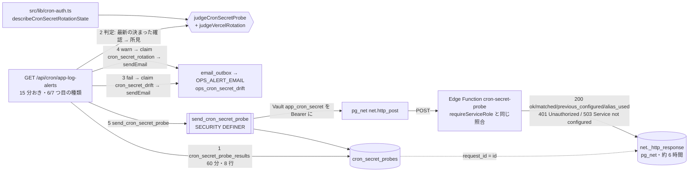

# operator/ cron の共有シークレットのずれの自動・定期の検知 (#1560 の項目 8) — 実経路の確認 (probe) による監視の設計

版: v1.0 (2026-10-17・A 型設計ゲートの叩き台)
Status: 設計ゲート審査中 (実装着手前。R1 の 2 枚同時レビュー待ち)
改定履歴: v1.0 2026-10-17 新設 (Issue #1560 の項目 8 の設計ゲート・A 型 4 相)

要件の正本は Issue #1560 の本文 (「決めること (オーナー)」の項目 8) と、2026-10-17 のコメント。そのコメントのオーナーの選択 (2026-10-17) は次のとおりで、本書はこの 1 文を要件の外形として、言い換えずに使う。

> 自動・定期のずれ検知を「作る」。値を出さずに 3 か所 (Vercel の環境変数・Edge Function の secret・Vault の app_cron_secret) を突き合わせ、ずれたら運用アラートで知らせる。

本書の前提 (範囲と方針):
- 手で流す検査 `scripts/check-cron-secret-drift.mjs` (本体 `scripts/lib/cron-secret-drift.mjs`。#1556) と、止めずに入れ替える仕組み `CRON_SECRET_PREVIOUS` (#1346) は main にある。本書はそれらを変えない。自動の検知は、手で流す検査の判定の意味 (PASS / WARN / FAIL の区分と文) を引き継ぎ、確かめ方だけを「実際の呼び出しの経路を通す確認 (probe)」に変える (§4.2 の裁定)。
- 知らせ方は、既存の運用アラート `GET /api/cron/app-log-alerts` (15 分おき・`OPS_ALERT_EMAIL`・`claim_ops_alert`。07 §8.3・11 §4〜§6) に種類を足す形にする。Vercel Cron は増やさない (`vercel.json` は変えない)。
- 値もダイジェストも、ログ・アラート (メール)・DB・応答に出さない。本書の構造は、そもそもダイジェストを計算しない (§4.2)。これが守られていることは、契約テストと単体テストで機械的に確かめる (§11)。
- 本番には触らない (設計ゲートでは読むだけ。migration の番号はマージ直前に確定する)。ローンチ前で利用者ゼロ (正しい形で作る)。
- 規約は `docs/design/CLAUDE.md` (章構成・snake_case・RLS 厳格化) と `operator/CLAUDE.md`。cron の正本は `08-cron-batches.md`、運用アラートの正本は `07-audit-monitoring.md` §8.3 と `10-logs-and-mail-retry.md` §8、定期処理の失敗の監視は `11-ops-batches-non-billing.md`。本書は、それらの改定を §15 の追随表で指定する。

---

## 0. 位置づけ・前提・分冊判定 (相 1)

### 0.1 決めること (要約)

| # | 決めること | 本書の決定 (要約) | 詳細 |
|---|---|---|---|
| D-1 | どこで突き合わせるか | **DB から実経路で確かめる**。`GET /api/cron/app-log-alerts` の各回が、DB の関数 `send_cron_secret_probe()` (SECURITY DEFINER・所有者 postgres) に Vault の `app_cron_secret` を `Authorization: Bearer` に付けて pg_net で新設の Edge Function `cron-secret-probe` を呼ばせる (pg_cron の実際の呼び出しと同じ道)。Edge Function は `requireServiceRole` と同じ規則で照合し、どの値と一致したか (`current` / `previous` / `service_role_key`) と `CRON_SECRET_PREVIOUS` の有無・別名の使用を JSON で返す。応答は pg_net の `net._http_response` に残るので、次の回 (15 分後) に `cron_secret_probe_results()` で読んで判定する。Vercel 側は route 自身の環境 (`src/lib/cron-auth.ts` の新しい読み口) で `CRON_SECRET_PREVIOUS` の残りを見る | §4 §5 §6 §7 |
| D-2 | 3 か所それぞれの値をどう得るか | Vault: DB の中で読み、Bearer に付けるだけ (DB の外に出さない)。Edge: 値もダイジェストも得ない。Edge Function 自身が照合した結果 (一致・不一致) だけを得る。Vercel: route の環境変数を読むだけ (値は比べない。`CRON_SECRET_PREVIOUS` の有無と、現行と同じかだけ)。**どの保管場所からもダイジェストを取り出さない** | §2.3 §4.2 |
| D-3 | 「ずれ」の検知 | Vault を変えたのに Edge を変えていない → 確認が HTTP 401 (`{"error":"Unauthorized"}`) → FAIL。Edge に `CRON_SECRET` が無い → 503 → FAIL。Vault に `app_cron_secret` が無い・空・復号できない → 送る前に FAIL。ゲートウェイの JWT 検証が生きている (401 に `code`)・関数が無い (404)・時間切れ・pg_net が送れない → FAIL。入れ替えの途中 (旧い値で一致・`CRON_SECRET_PREVIOUS` の残り) → WARN | §7.1 の判定表 |
| D-4 | 「呼び出しが 401 になる」ことの観測で代わりにできるか | **代わりにしない** (補助にもしない)。本物のジョブの 401 を `net._http_response` で観測する案は、1 時間おきのジョブに依存して遅く、入れ替えの途中 (200) を見分けられず、Vault の欠落は別の仕組み (`cron_failure`) に頼る。本書の確認 (probe) は同じ `net._http_response` を使うが、自分が送った要求 ID で突き合わせるので、ほかの呼び出しの応答と混ざらない (§4.2 の案 A) | §4.2 |
| D-5 | 知らせ方と抑止 | 運用アラートに **6 つ目の種類 `cron_secret_drift`** (FAIL。抑止は共通の `OPS_ALERT_COOLDOWN_MINUTES`・既定 60 分) と **7 つ目の種類 `cron_secret_rotation`** (WARN = 入れ替えの途中・残り。抑止は新しい `OPS_ALERT_CRON_SECRET_ROTATION_COOLDOWN_MINUTES`・既定 1440 分 = 24 時間) を足す。文面は 1 本 (`ops_cron_secret_drift`。種類で件名と前置きを書き分ける)。台帳は使わない (ずれは「続いている状態」なので、`pg_cron_stalled` と同じく、続く間は抑止ごとに知らせる) | §7 §8.3 |
| D-6 | 入れ替え中 (`CRON_SECRET_PREVIOUS` が入っている間) の扱い | 壊れてはいないので FAIL にしない。手で流す検査と同じ WARN として、`cron_secret_rotation` で 24 時間に 1 通だけ知らせる (入れ替えの作業中に 15 分ごとに鳴らさない。外し忘れは毎日 1 通届く)。Edge の `CRON_SECRET_PREVIOUS` は確認の応答の `previous_configured` で、Vercel の `CRON_SECRET_PREVIOUS` は route の環境で見る | §7.1 §8.3 |
| D-7 | Vercel の `CRON_SECRET` と Supabase 側 (Edge / Vault) の一致 | **比べない**。ENV_SETUP.md の正 (Vercel の `CRON_SECRET` は独立で、別の値でよい。手で流す検査でも INFO) に従う。比べるには、Vercel の値 (またはダイジェスト) を Supabase 側へ送るか、Supabase 側のダイジェストを Vercel へ持ち出す必要があり、「別の値にしておくと片方が漏れてももう片方は守られる」という独立の意味を弱める。Q-1 (§0.4) | §0.4 §17 |
| D-8 | 値やダイジェストを出さないことの機械検査 | (a) 本書の部品はダイジェストを計算しない (`createHash` / `crypto.subtle.digest` を monitor の TS に書かない)、(b) DB の関数の戻り値の列は固定 (値を運べる列が無い)、(c) Edge Function の応答の JSON のキーは固定の 4 つ、(d) 文面の題と対処の文は定数の表で、実行時の値を埋め込まない、(e) 偽の秘密 (canary) を環境変数と RPC の応答に入れて、メール・ログ・応答に出ないことを確かめる — を契約テストと単体テストに焼き込む | §11.1 §11.2 |

### 0.2 分冊判定

目安 3 つ (800 行超・消費先 3 以上・共有面 2 つ以上) のうち、「800 行超」と「共有面 2 つ以上」(運用アラートの route と定数・Edge の共通の認証 `_shared/auth.ts`・env の一覧・`supabase/config.toml`) に当たる。それでも **1 冊にする**。理由: (a) 作るものは 1 つの機構 (確認を送る → 応答を読む → 判定 → 通知) で、部品 (Edge 1 本・DB の表 1 つと関数 3 本・route の 1 種類の確認・文面 1 本) が互いの契約 (応答の JSON の形・関数の戻り値の列) を共有する。分けると契約の正本が 2 冊に散る。(b) 実装 WF は §12 の 3 段 (A: Edge / B: DB / C: アプリ) に分け、段ごとに 2 枚のレビューを閉じる。段 A と段 B は独立で、段 C が両方を前提にする。収束しなければ段 A を別冊に切り出す (核は段 B + C)。

### 0.3 用語

| 語 | 意味 |
|---|---|
| 確認 (probe) | DB の関数 `send_cron_secret_probe()` が Vault の `app_cron_secret` を Bearer に付けて Edge Function `cron-secret-probe` を 1 回呼ぶこと。1 確認 = `cron_secret_probes` の 1 行 |
| 確認の結果 | pg_net が `net._http_response` に残した応答 (HTTP の状態・本文・時間切れ) を、`cron_secret_probe_results()` が確認の行と突き合わせて返したもの |
| 決まった確認 (decided) | 結果を判定できる確認: 送れなかった (Vault が無いなど)・応答が記録された・応答が無いまま猶予 (`CRON_SECRET_PROBE_ANSWER_GRACE_MINUTES`・5 分) を過ぎた、のどれか。route は見る範囲 (60 分) の中で最新の「決まった確認」だけを判定する |
| 所見 (finding) | 判定の 1 件。`id` (固定の名前)・`level` (`fail` / `warn` / `info`)・題・対処の文。題と対処は定数の表 (`CRON_SECRET_FINDING_CATALOG`) から引く |
| ずれ (drift) | `fail` の所見があること = pg_cron からの呼び出しが 401 / 503 / 不達になる状態 |
| 入れ替えの途中 (rotation) | `warn` の所見があること = いまは通るが、片づけるか確かめるべき状態 (旧い値で一致・`CRON_SECRET_PREVIOUS` の残り・現行と同じ `CRON_SECRET_PREVIOUS`・Vault が service role key) |
| 権利 (claim) | `claim_ops_alert(alert_key, cooldown)` が返す時刻 (07 §8.3)。キーは `cron_secret_drift` と `cron_secret_rotation` の 2 つ |

### 0.4 オーナーが確かめる点 (本書の決定を置き換えうるもの)

| # | 確かめること | 本書の仮の決定 | 変えるときに触る場所 |
|---|---|---|---|
| Q-1 | Vercel の `CRON_SECRET` と Supabase 側 (Edge / Vault) の一致も自動で突き合わせるか | **比べない** (D-7。ENV_SETUP.md のとおり独立が正)。比べる形にするなら、Vercel の値のダイジェストを DB の関数の引数で渡して Vault 側で比べる (ダイジェストが PostgREST の要求の本文に乗る) か、Vercel の値を Bearer に付けて `cron-secret-probe` を呼ぶ (値が Edge へ渡る) のどちらかになり、INFO (別の値でよい) の情報のために独立の意味を弱める。手で流す検査の `--vercel-must-match` に当たる運用 (同じ値で運用する) を選ぶなら、後者を `OPS_ALERT_CRON_SECRET_VERCEL_MUST_MATCH=1` の opt-in として別の設計ゲートで足す | §7.1 (Vercel の行)・§17 |
| Q-2 | 入れ替えの途中・残り (WARN) をメールで知らせるか、ログと応答だけにするか | **知らせる** (D-6。24 時間の抑止)。侵害時の入れ替え (09 §11.5) で `CRON_SECRET_PREVIOUS` の外し忘れは旧い値で通り続ける穴なので、毎日 1 通届く形にする | `cron_secret_rotation` の通知 (§7.3 の `notifyCronSecret`)・`OPS_ALERT_CRON_SECRET_ROTATION_COOLDOWN_MINUTES` |
| Q-3 | Vercel の `CRON_SECRET` が無い・不正 (cron の API が 503 / 401 で、`app-log-alerts` 自身が動かない) ことの検知 | **本書の範囲外**。`app-log-alerts` の中からは自分の認証の失敗を見られない (route に届かない)。Vercel の Cron Jobs の画面の HTTP ステータスで分かる。自動で知らせるなら、Vercel の外 (pg_cron) から `app-log-alerts` の生存 (DB に残す心拍) を見て、Vercel を介さずに知らせる経路 (Edge Function から Resend など) が要る。別の設計ゲート | §17 |
| Q-4 | 確認の間隔 | **`app-log-alerts` と同じ 15 分おき** (別の cron を足さない)。検知の遅れは最大 30 分 (ずれ → 次の回で確認を送る (≤ 15 分) → その次の回で結果を読む (≤ 15 分)) | §4.3 |

### 0.5 Issue 本文との食い違い (本書を正とする)

- Issue #1560 の本文や関連の記述にある「Vercel Cron 6 本」は古い。origin/main (2026-10-17・`904f9e8f`) の `vercel.json` の `crons` は 5 本 (`process-menu-queue`・`app-log-alerts`・`email-outbox`・`push-outbox`・`backup-freshness`)。本書は `vercel.json` を変えない。
- Issue #1560 の項目 8 の例示「自己診断の Edge Function か、pg_cron の日次ジョブ」のうち、本書は「自己診断の Edge Function」を採り、pg_cron のジョブは足さない (確認の送り手は `app-log-alerts` の回。§4.2 の案 B)。

---

## 1. 目的・スコープ

### 1.1 解決すること

- cron の共有シークレットは 3 か所 (Vercel の環境変数 `CRON_SECRET`・Supabase の Edge Function secrets `CRON_SECRET`・Supabase Vault `app_cron_secret`) に別々に置かれ、自動では同期されない (ENV_SETUP.md「Cron の共有シークレットの保管場所とローテーション」)。Edge と Vault が食い違うと、pg_cron からの Edge Function の呼び出し (比較ランキングの集計・料理画像のジョブ・隠したコンテンツの削除・カタログ取り込み) が HTTP 401 で止まる。pg_net は非同期なので `cron.job_run_details` は `succeeded` のままで、既存の `cron_failure` の通知には出ない。手で流す検査 (`scripts/check-cron-secret-drift.mjs`) を流さない限り「静かに壊れる」。
- 入れ替え (ローテーション) の途中で止まった状態 (Vault が旧い値のまま・`CRON_SECRET_PREVIOUS` の外し忘れ) も、流さない限り分からない。侵害時 (09 §11.5) はとくに、旧い値で通り続ける穴になる。

### 1.2 対象外 (本書では決めない・変えない)

- 手で流す検査 (`scripts/check-cron-secret-drift.mjs`・`scripts/lib/cron-secret-drift.mjs`) とそのテスト (`tests/check-cron-secret-drift.test.ts`)。本書の自動の検知と並んで残す (本番の資格情報で手元から確かめる道具。3 か所のダイジェストの照合はこちらだけが行う)。
- 共通の照合 `supabase/functions/_shared/cron-secret.ts` (`checkCronSecret`) と `src/lib/cron-auth.ts` の `requireCronAuth`。本書は `_shared/auth.ts` に照合の結果を返す関数を 1 つ足す (§6.1) が、照合の規則は変えない。
- Vercel の `CRON_SECRET` と Supabase 側の一致 (Q-1)。Vercel の `CRON_SECRET` の欠落の検知 (Q-3)。
- 既存の運用アラート 5 種類 (server / client / email_dead_letter / cron_failure / pg_cron_stalled) のしきい値・窓・抑止・文面。
- pg_cron のジョブの追加 (08 §3.0 のジョブの数は変わらない)。`vercel.json` の変更。
- `net._http_response` の保持 (pg_net の `pg_net.ttl`・既定で約 6 時間) の変更。
- Supabase Management API や `supabase secrets list` を Vercel から呼ぶこと (本番のアクセストークンを Vercel に置くことになる。§4.2 の案 C で退ける)。

---

## 2. 関連要件と現行の事実 (相 1 の「いまの事実」)

### 2.1 根拠

- 要件: Issue #1560 の本文 (項目 8) と 2026-10-17 のコメント (オーナーの選択)。要件定義 `docs/requirements/03-operator-admin.md` §22.9 (監視)。
- 現行 (origin/main `904f9e8f`・2026-10-17):
  - `scripts/lib/cron-secret-drift.mjs`: 名前の定数 `CURRENT_NAME = 'CRON_SECRET'`・`PREVIOUS_NAME = 'CRON_SECRET_PREVIOUS'`・`ALIAS_NAME = 'SERVICE_ROLE_SECRET'`・`VAULT_SECRET_NAME = 'app_cron_secret'` (45〜50 行)。Edge の現行の値は `CRON_SECRET ?? SERVICE_ROLE_SECRET` (`effectiveEdgeCurrent`・619〜623 行。`??` は空文字を素通しする)。判定の ID は `edge-read` / `vault-read` / `vercel-read` / `edge-current` / `edge-alias-unused` / `vault-present` / `edge-vault-match` / `edge-previous` / `vercel-current` / `vercel-vs-supabase` / `vercel-previous` (`evaluate`・631〜776 行)。Edge ⇔ Vault の不一致の文は「pg_cron からの呼び出しが HTTP 401 ({"error":"Unauthorized"}) になります。Vault の app_cron_secret を正として、Edge Function secrets の CRON_SECRET をそれに合わせてください」(705 行)。Vercel は独立で `vercel-vs-supabase` は INFO (`--vercel-must-match` のときだけ FAIL。753〜756 行)。
  - `supabase/functions/_shared/auth.ts` の `requireServiceRole` (85〜127 行): Bearer が service role key (`SERVICE_ROLE_JWT` / `SUPABASE_SERVICE_ROLE_KEY`) と完全一致なら通す。それ以外は `checkCronSecret(authHeader, { current: Deno.env.get("CRON_SECRET") ?? Deno.env.get("SERVICE_ROLE_SECRET"), previous: Deno.env.get("CRON_SECRET_PREVIOUS") })`。`previous` で一致したら `console.warn` (パスを添える。値は出さない)。`not_configured` → 503 `{"error":"Service not configured"}`、`unauthorized` → 401 `{"error":"Unauthorized"}` (どちらも `Content-Type: application/json`)。
  - `supabase/functions/_shared/cron-secret.ts` の `checkCronSecret`: `{ ok: true, matched: "current" | "previous" } | { ok: false, reason: "not_configured" | "unauthorized" }`。import なし・Web 標準の `crypto.subtle` だけ (`tests/cron-secret-contract.test.ts` CC-7・CC-8)。
  - `src/lib/cron-auth.ts` の `requireCronAuth` (29〜49 行): `process.env.CRON_SECRET` / `CRON_SECRET_PREVIOUS` を読む唯一の場所 (CC-4)。`matched === 'previous'` で `console.warn`。
  - pg_cron から Edge Function を呼ぶ関数 (`public.invoke_calculate_segment_stats()` = migration `20261009100000` 96〜143 行、同型は `20261011120000`・`20261015180000`・`20261016100000`): `SECURITY DEFINER`・所有者 postgres・`search_path = ''`・`SELECT decrypted_secret INTO v_secret FROM vault.decrypted_secrets WHERE name = 'app_cron_secret' LIMIT 1` → 無ければ `RAISE EXCEPTION` → `net.http_post(url := c_url (本番の URL の定数), headers := jsonb_build_object('Authorization', 'Bearer ' || v_secret, 'Content-Type', 'application/json'), body := …, timeout_milliseconds := c_timeout_ms)` → 戻り値は pg_net の要求 ID (`bigint`)。`REVOKE ALL … FROM PUBLIC, anon, authenticated, service_role` (呼べるのは所有者 = pg_cron だけ)。
  - pg_net: 要求は `net.http_request_queue` に積まれ (Authorization ヘッダーごと。送ったら消える)、応答は `net._http_response (id, status_code, content_type, headers, content, timed_out, error_msg, created)` に、要求 ID と同じ `id` で残る。既定で約 6 時間で消える (migration `20261009100000` 26 行・ENV_SETUP.md「値が合っていないとどうなるか」の SQL は `id, status_code, timed_out, error_msg, created` と `content::text` を読む)。`net._http_response` の読み取りは、ENV_SETUP.md が SQL Editor (postgres ロール) の手順として載せており、整合ゲートが本番で使った (`tests/edge-function-verify-jwt.test.ts` の冒頭)。
  - Supabase のゲートウェイの JWT 検証 (`verify_jwt`): `supabase/config.toml` の `[functions.<name>]` に `verify_jwt = false` を書き、GitHub Actions「Deploy Supabase Functions」が `--use-api` で全関数を配る (`.github/workflows/deploy-supabase-functions.yml`)。検証が生きていると、関数に届く前に 401 (`{"code":"UNAUTHORIZED_INVALID_JWT_FORMAT", …}`) になる。`tests/edge-function-verify-jwt.test.ts` が、`config.toml` の一覧・関数の先頭の認証 (`await requireServiceRole(req)` など)・DB からの HTTP の呼び出し先 (`DB_HTTP_CALL_SITES`。SQL のファイルごとに `count` と `callees` を人が宣言。生の文字列で `net.http_post(` などの呼び出しと `/functions/v1/` を数える) を突き合わせる。
  - 運用アラート `src/app/api/cron/app-log-alerts/route.ts` (origin/main): `requireCronAuth` → 宛先 `resolveOpsAlertRecipient()` (未設定なら `disabled`・形が不正なら `invalid_config`。DB に触れない) → `resolveAppLogAlertSettings` (環境変数 4 つ) → `checkScope('server')` → `checkScope('client')` → `checkEmailDeadLetters` → `checkCronFailures` → `checkPgCronStalled` → 応答 `{ …server, window_minutes, client, email_dead_letter, cron_failure, pg_cron_stalled }`。後ろの種類の 500 は前の通知を止めない。1 種類の判定の形は `SpikeOutcome = { result: SpikeResult } | { response: NextResponse }`、`SpikeResult = { status, total, threshold }`、`status` は `below_threshold` / `deduped` / `sent` / `send_skipped` / `send_failed`。送れなかったときの権利の返し方は `NON_RELEASING_SEND_ERROR_CODES` (`suppressed` / `invalid_envelope`) で決まる。テスト O-1 が既定の場面で呼ばれる RPC の集合を固定 (7 本)。
  - `src/lib/ops-alerts/app-log-error-spike.ts`: `AppLogAlertScope = 'server' | 'client' | 'email_dead_letter' | 'cron_failure' | 'pg_cron_stalled'`、`APP_LOG_ALERT_COUNT_RPC` (`as const satisfies Readonly<Record<AppLogAlertScope, string>>`)、`APP_LOG_ALERT_KEYS`、`AppLogAlertSettingEnvName` (4 つ)、`AppLogAlertSettingSources` / `AppLogAlertSettings` (`pgCronStallMinutes` まで)、`resolveAppLogAlertSettings` (`resolveIntegerSetting` で整数と範囲を検証し、不正は既定値 + `ignored`)。
  - 文面の決まり: `src/lib/emails/ops/*.ts` の `render*Email` は `EmailEnvelope` (`src/lib/emails/envelope.ts`。`subject` は 100 字以内) を返し、`template` は `ops_` で始まる (`email_outbox_dead_counts` が数えない)。`src/__tests__/lib/emails/secret-templates.test.ts` は、文面ごとに秘密あり / なしの表と `*_url` の項目の列挙を要求する。
  - 環境変数の決まり: `src/lib/env.ts` の一覧 (`readOnlyBy` で読む場所を 1 か所に固定)・`.env.example`・`ENV_SETUP.md` の 3 か所にそろえる (`tests/env-source-scan.test.ts`・`src/__tests__/lib/env.test.ts`)。
  - Edge Function の決まり: バッチ専用の関数は CORS を付けない (`tests/edge-function-cors.test.ts`)・環境変数の名前を応答や例外に出さない (`tests/edge-missing-env-response.test.ts`)・トップレベルで例外を投げない・依存は `supabase/functions/deno.json` の imports だけ (`tests/edge-function-dep-pinning.test.ts`)・`supabase/functions/README.md` の表に載せる。

### 2.2 本番の読み取り (2026-10-17・Supabase MCP の読み取りだけ。値は読んでいない)

- Vault に `app_cron_secret` の行がある (`updated_at` = 2026-10-15 16:35:24 UTC)。値もダイジェストも読んでいない。
- 本番のいまのずれの有無は確かめていない (本書は仕組みを設計するだけ。確かめるのは Issue #1560 のオーナー作業 1)。

### 2.3 3 か所の値の得方 (各案の比較の材料)

| 保管場所 | 値を得る手段 (Vercel の route から) | 値を出さずに照合の結果だけを得る手段 | 本書 |
|---|---|---|---|
| Supabase Edge Function secrets | Management API `GET /v1/projects/{ref}/secrets` (アクセストークンが要る。CLI の `secrets list` と同じで、返るのはダイジェスト。一次情報は未確認: §16) / Edge Function 自身が自分の値のダイジェストを返す (service role key で認証) | **Edge Function 自身に照合させ、結果 (一致・不一致・どの値と一致したか) だけを返させる** | 右 (D-2) |
| Supabase Vault | SQL でダイジェストを計算して返す RPC (値は DB の外に出ないが、ダイジェストは出る) / `SELECT decrypted_secret` (出してはいけない) | **DB の中で読んで Bearer に付け、Edge Function に照合させる** (pg_cron の実際の呼び出しと同じ。値は TLS の中で Edge へ渡るだけ) | 右 (D-2) |
| Vercel の環境変数 | `process.env` (route 自身の環境。読むのは `src/lib/cron-auth.ts` だけ: CC-4) | `CRON_SECRET_PREVIOUS` の有無と現行と同じかを真偽値で返す読み口を `src/lib/cron-auth.ts` に足す。Supabase 側との一致は比べない (Q-1) | 右 (D-7) |

---

## 3. 相 1: 外形固定 — 要件行列とユーザーシナリオ

### 3.1 要件行列 (全 22 行)

| # | 要件 | 根拠 | 本書の節 |
|---|---|---|---|
| R-01 | Edge Function secrets の現行の値 (`CRON_SECRET`、無ければ `SERVICE_ROLE_SECRET`) と Vault の `app_cron_secret` が食い違ったら、30 分以内に運用メール (`OPS_ALERT_EMAIL`) で分かる | オーナーの選択 (2026-10-17)・手で流す検査の `edge-vault-match` | §4 §7.1 |
| R-02 | Edge Function secrets に現行の値が無い (503)・Vault に `app_cron_secret` が無い / 空 / 復号できない (例外) も、同じ通知で分かる | 手で流す検査の `edge-current`・`vault-present` | §5.2 §7.1 |
| R-03 | ゲートウェイの JWT 検証が生きている (`verify_jwt` の設定漏れ)・確認の Edge Function が無い (404)・時間切れ・pg_net が送れない / 送らない、も同じ通知で分かる (値が合っていても止まる状態) | ENV_SETUP.md「値が合っていないとどうなるか」(#1406 の実害) | §7.1 |
| R-04 | 入れ替えの途中 (Vault が旧い値で一致)・`CRON_SECRET_PREVIOUS` の残り (Edge / Vercel)・`CRON_SECRET_PREVIOUS` が現行と同じ (Vercel)・Vault が service role key と同じ、は FAIL ではなく WARN として、別の種類・長い抑止 (既定 24 時間) で知らせる | 手で流す検査の `edge-previous`・`vercel-previous`・D-6 | §7.1 §8.3 |
| R-05 | 値もダイジェストも、メール・ログ・応答・DB (`cron_secret_probes`・`ops_alert_state`)・`net._http_response` の本文に出ない。本書の部品はダイジェストを計算しない | オーナーの選択「値を出さずに」・D-8 | §4.2 §11.1 §11.2 |
| R-06 | Vault の値は DB の中で読み、Bearer に付けて Edge Function へ送るだけ (既存の `invoke_*` と同じ経路・同じ露出)。DB の関数の戻り値に値を含めない | 既存の `invoke_calculate_segment_stats` の形 | §5.2 |
| R-07 | Edge Function `cron-secret-probe` は、既存の `requireServiceRole` と同じ規則で照合し (`verify_jwt = false`・先頭で認証・本文を読まない・DB に触らない・CORS なし)、応答の JSON は `ok` / `matched` / `previous_configured` / `alias_used` の 4 つのキーだけ。401 / 503 の本文は `requireServiceRole` と同じ | `tests/edge-function-verify-jwt.test.ts`・`tests/edge-function-cors.test.ts`・CC-1〜CC-3 | §6 |
| R-08 | 確認の結果は、自分が送った要求 ID で `net._http_response` と突き合わせる (ほかの pg_net の呼び出しの応答と混ざらない)。判定に使う本文の項目は `matched` / `previous_configured` / `alias_used` / `error` / `code` だけで、長さを 64 字で切る。`headers` / `error_msg` の本文は読み出さない | D-4・R-05 | §5.2 |
| R-09 | 知らせ方は既存の運用アラートの形 (`claim_ops_alert` で権利 → `sendEmail` → 送れなければ `release_ops_alert`。`suppressed` / `invalid_envelope` は返さない)。`OPS_ALERT_EMAIL` 未設定なら何もしない (確認も送らない)。DB の失敗は 500 (本文は汎用)。前の種類の通知は後ろの失敗で止まらない (順は server → client → email_dead_letter → cron_failure → pg_cron_stalled → cron_secret) | 07 §8.3・10 §8.3・#1172・11 R-09 | §7.3 §8.1 |
| R-10 | ずれが続く間は、抑止 (`OPS_ALERT_COOLDOWN_MINUTES`・既定 60 分) ごとに知らせる。直れば静かになる (台帳は持たない) | `pg_cron_stalled` と同じ考え方 (11 §4.2 の F) | §7.3 §8.3 |
| R-11 | 抑止の分数は、ずれ (`cron_secret_drift`) は既存の `OPS_ALERT_COOLDOWN_MINUTES`、入れ替えの途中 (`cron_secret_rotation`) は新しい `OPS_ALERT_CRON_SECRET_ROTATION_COOLDOWN_MINUTES` (60〜10080 分・既定 1440)。不正な値は既定値に戻し、変数名だけを warn に残す | 07 §8.3 の環境変数の扱い | §10 |
| R-12 | 検知の遅れは最大 30 分 (確認を送った回の次の回で結果を読む)。確認の送り手は `app-log-alerts` の回で、pg_cron のジョブは足さない | Q-4・D-1 | §4.3 |
| R-13 | DB の関数は `SECURITY DEFINER` (所有者 postgres。Vault と `net` スキーマを読むため)・`search_path = ''`・参照は完全修飾・動的 SQL なし・引数は上限つきの整数だけ。`EXECUTE` は `service_role` だけ (本文の JSON を読む補助の関数は誰にも付けない)。表は RLS 有効・全拒否ポリシー・どのロールにも表の権限を付けない | CLAUDE.md RLS・`20261017220000` の権限の考え方・`tests/integration/security/anon-definer-execute.test.ts` | §5 |
| R-14 | 呼び先の URL は関数の中の定数 (引数で差し替えられない。秘密を任意の宛先へ送らせない)。`timeout_milliseconds` は短い定数 (15 秒。確認は何もしないので十分) | migration `20261009100000` の `c_url` の注記 (#1020) | §5.2 |
| R-15 | `cron_secret_probes` の行は 24 時間で自動で消える (送るたびに古い行を消す)。pg_cron のジョブは登録しない・既存の行を変えない・消さない | 11 R-16 の趣旨 (ジョブの数を増やさない) | §5.2 §8.3 |
| R-16 | pg_net・Vault・`net._http_response` の無い DB (ローカルの一部・CI) でも関数は作れ、呼べば「送れなかった」(`net_unavailable` / `vault_unavailable`) として返す。例外にしない | 11 R-13 (`to_regclass` の守り) | §5.2 |
| R-17 | 新しい表・RPC は `database.types.ts` (2 か所) に反映し、migration と対の down.sql を書く。migration のファイル名の番号はマージ直前に確定する | `tests/database-types-migrations-contract.test.ts`・`tests/migration-file-version-integrity.test.ts` | §5 §14 |
| R-18 | 新しい環境変数は `src/lib/env.ts` の一覧・`.env.example`・`ENV_SETUP.md` にそろえ、値を読むのは route 1 ファイル | `tests/env-source-scan.test.ts`・`src/__tests__/lib/env.test.ts` | §10 §14 |
| R-19 | DB から Edge Function を呼ぶ migration は、`tests/edge-function-verify-jwt.test.ts` の `DB_HTTP_CALL_SITES` に呼び先と数 (2) を宣言し、呼び先を `config.toml` で `verify_jwt = false` にする。migration の中に、HTTP の呼び出しらしい語を宣言の数より多く書かない (コメントも数える) | `tests/edge-function-verify-jwt.test.ts`・`supabase/functions/README.md` | §5.2 §14 |
| R-20 | Vercel 側は `CRON_SECRET_PREVIOUS` の有無と現行と同じかだけを見る。読むのは `src/lib/cron-auth.ts` だけ (CC-4)。Vercel と Supabase 側の一致は比べない (Q-1) | CC-4・D-7 | §7.2 |
| R-21 | 運用手順 (ENV_SETUP.md のローテーション手順・09 §11.5) に、自動の検知の読み方 (入れ替えの途中は 24 時間に 1 通の WARN・終われば止まる) を足す。手で流す検査は残す | 仕様 | §15 |
| R-22 | Edge Function の `requireServiceRole` の受け付け方 (service role key の完全一致・`CRON_SECRET ?? SERVICE_ROLE_SECRET`・`CRON_SECRET_PREVIOUS`・401 / 503 の本文・`previous` の warn) は変えない。`checkCronSecret` の呼び出しは `_shared/auth.ts` に 1 つのまま | `tests/cron-secret.test.ts` RS-1〜RS-11・`tests/edge-function-service-role-auth.test.ts` SR-1〜SR-12・CC-3 | §6.1 |

### 3.2 ユーザーシナリオ (22 本)

時刻は JST。`app-log-alerts` の回は毎時 00 / 15 / 30 / 45 分とする。

| # | シナリオ | 期待する結果 |
|---|---|---|
| S-01 | 10:05 に Vault の `app_cron_secret` を新しい値にした (ENV_SETUP.md の手順 3) が、Edge Function secrets の `CRON_SECRET` を変えておらず、`CRON_SECRET_PREVIOUS` も無い | 10:15 の回が確認を送る → Edge が 401 `{"error":"Unauthorized"}` → 10:30 の回が結果を読み、`edge-vault-mismatch` (fail) → キー `cron_secret_drift` で権利を取り、メール「cron の共有シークレットの確認が失敗しました (1 件)」。文面は題と対処 (Vault を正として Edge を合わせる) だけ。値もダイジェストも無い |
| S-02 | 入れ替えの手順 2 まで済み (Edge に新しい `CRON_SECRET` と旧い `CRON_SECRET_PREVIOUS`)、Vault はまだ旧い値 | 確認は 200 `{"ok":true,"matched":"previous","previous_configured":true,"alias_used":false}` → `edge-previous-in-use` (warn) → キー `cron_secret_rotation` (抑止 24 時間) で 1 通「入れ替えが途中です (1 件)」。`cron_secret_drift` は鳴らない。Edge のログには `CRON_SECRET_PREVIOUS (旧いシークレット) で認証されました (/cron-secret-probe)` が 15 分ごとに残る (手順 5 の「旧い値で認証された記録」は、この確認の分を除いて見る: §15 の行 2) |
| S-03 | 手順 3 で Vault を新しい値にしたが、手順 5 の `CRON_SECRET_PREVIOUS` の削除を忘れて 3 日たつ | 確認は 200 `matched: "current"`・`previous_configured: true` → `edge-previous-leftover` (warn) → 24 時間ごとに 1 通「入れ替えが途中です」。削除した次の確認から静かになる |
| S-04 | Edge Function secrets から `CRON_SECRET` と `SERVICE_ROLE_SECRET` の両方を消してしまった | 確認は 503 `{"error":"Service not configured"}` → `edge-not-configured` (fail) → `cron_secret_drift` で 1 通。直るまで 60 分ごと |
| S-05 | Vault から `app_cron_secret` を消してしまった | 次の回の `send_cron_secret_probe()` が `vault_missing` を返し (要求は送らない)、その次の回の読み取りで `vault-missing` (fail) → `cron_secret_drift` で 1 通。(同じ状態で pg_cron の `invoke_*` は例外で `failed` になるので、`cron_failure` の通知も別に届く) |
| S-06 | `supabase/config.toml` の `[functions.cron-secret-probe]` を誤って消した版がデプロイされた (ゲートウェイの JWT 検証が生きる) | 確認は 401 で本文に `code` がある → `gateway-jwt` (fail) → 1 通 (対処: Actions「Deploy Supabase Functions」と `config.toml` を確かめる)。`tests/edge-function-verify-jwt.test.ts` が PR の時点で止めるので、本番では起きにくい |
| S-07 | 段 C (アプリ) が段 A (Edge) より先に本番に出た | 確認は 404 → `probe-not-deployed` (fail) → 1 通。段 A が出れば次の確認から静かになる (§12 の順を守れば起きない) |
| S-08 | 3 か所が正しく設定され、入れ替えもしていない | 確認は 200 `matched: "current"`・`previous_configured: false`・`alias_used: false` → 所見なし。応答 `cron_secret_drift: { status: 'below_threshold', total: 0, threshold: 0 }`・`cron_secret_rotation: { status: 'below_threshold', total: 0, threshold: 0 }`。15 分ごとに確認が 1 行増え、24 時間より古い行は消える (常時 100 行程度) |
| S-09 | Vercel の `CRON_SECRET_PREVIOUS` に、間違えて現行と同じ値を入れて再デプロイした | `describeCronSecretRotationState()` が `previous_same_as_current: true` → `vercel-previous-same` (warn) → `cron_secret_rotation` で 1 通 (24 時間ごと) |
| S-10 | Vercel の `CRON_SECRET_PREVIOUS` に旧い値を入れて再デプロイした (手で呼ぶ運用の切り替えの途中) | `vercel-previous-set` (info) → メールは送らない。応答は `below_threshold` のまま。ログも残さない (info だけの回は静か) |
| S-11 | S-01 のずれが 3 時間続き、13:20 に直した | 10:30・11:30・12:30 に 1 通ずつ (抑止 60 分。10:45〜11:15 の回は `deduped`)。13:30 の回が送った確認が 200 → 13:45 の回は所見なし。以後静か |
| S-12 | `OPS_ALERT_EMAIL` が未設定 | 7 種類とも何もしない (応答 `{ status: 'disabled' }`。確認も送らない。DB にも触れない) |
| S-13 | pg_net の worker が止まり、要求が送られない (`net.http_request_queue` に残る) | 10:15 の回が送った確認に応答が無いまま、10:30 の回の読み取りで猶予 (5 分) を過ぎている → `probe-unanswered` (fail) → `cron_secret_drift` で 1 通 (対処: pg_net の待ち行列を確かめる)。pg_cron の `invoke_*` も同じく届いていない |
| S-14 | Edge Function が 15 秒以内に応答しなかった (`timed_out = true`) | `probe-timeout` (fail) → 1 通。1 回だけなら次の確認で静かになる (抑止 60 分の中に 2 回目が無ければ、それ以上は届かない) |
| S-15 | 段 C を本番に出した最初の回 | `cron_secret_probe_results()` が 0 行 → `no-probe-yet` (info) → メールは送らない → 確認を 1 つ送る。2 回目の回から判定が始まる |
| S-16 | Vercel Cron が同じ回を 2 回呼んだ (まれ) | 確認が 2 行増える。読み取りは最新の「決まった確認」1 つだけを判定し、権利は `claim_ops_alert` が原子的に決めるので、メールは 1 通 |
| S-17 | Edge Function secrets に `CRON_SECRET` が無く、別名の `SERVICE_ROLE_SECRET` に Vault と同じ値が入っている | 確認は 200 `matched: "current"`・`alias_used: true` → `edge-alias-used` (info) → メールは送らない (手で流す検査の `edge-current` PASS + 注記と同じ)。応答は `below_threshold` |
| S-18 | 第三者が `cron-secret-probe` に適当な Bearer で要求を送る | 401 `{"error":"Unauthorized"}` (ほかのバッチ関数と同じ)。`cron_secret_probes` には自分の要求 ID しか無いので、第三者の応答は判定に混ざらない。200 の本文に `previous_configured` などが載るのは、正しい秘密を持つ呼び出しだけ |
| S-19 | `cron_secret_probe_results` が DB の一時障害で error を返す | その回は 500 (前の 5 種類の判定と通知は済んでいる)。確認は送らない。次の回で読み直す (見る範囲 60 分の中に前の確認が残っている) |
| S-20 | fail の所見で権利を取ったが、送信待ちへの登録が失敗した (`outbox_failed`) | `release_ops_alert` で権利を返し `send_failed`。次の回で同じ所見をもう一度知らせる |
| S-21 | Vault の `app_cron_secret` に service role key を入れてしまった | 確認は 200 `matched: "service_role_key"` → `vault-holds-service-role-key` (warn) → `cron_secret_rotation` で 1 通 (対処: cron 専用のランダムな値に入れ替える) |
| S-22 | Vercel の `CRON_SECRET` を消してしまった (cron の API が 503) | `app-log-alerts` 自身が動かず、本書の検知は働かない (Q-3・§17)。Vercel の Cron Jobs の画面の HTTP ステータスで分かる。これは本書の範囲外 |

---

## 4. 相 2・相 3: 構造とその裁定

### 4.1 構造 (確定)



部品と責務:

| 部品 | 責務 | 置き場 (段) |
|---|---|---|
| `supabase/functions/_shared/auth.ts` の `describeServiceRoleAuth(req)` | `requireServiceRole` と同じ規則で照合し、結果 (`ok` / `matched` / `alias_used` / `previous_configured` または `reason`) を返す純粋な判定。`requireServiceRole` はこれを呼んで Response に変える (振る舞いは不変) | §6.1 (A) |
| Edge Function `cron-secret-probe` | 先頭で `await requireServiceRole(req)` (401 / 503 はそのまま返す) → `describeServiceRoleAuth(req)` の結果を 4 つのキーの JSON で返す。本文を読まない・DB に触らない・CORS なし・環境変数を直接読まない | §6.2 (A) |
| `public.cron_secret_probes` | 送った確認の記録 (`id`・`requested_at`・`send_state`・`request_id`)。値を運べる列は無い | §5.1 (B) |
| `public.send_cron_secret_probe()` | 24 時間より古い行を消す → `net` / Vault の有無と `app_cron_secret` の状態を見る → 行を 1 つ書く → 送れるなら pg_net で Edge Function を呼び、要求 ID を行に書く → `(probe_id, send_state, request_id)` を返す | §5.2 (B) |
| `public.cron_secret_probe_results(p_lookback_minutes, p_limit)` | 見る範囲の確認の行に `net._http_response` を突き合わせ、判定に要る項目だけ (状態コード・時間切れ・エラーの有無・本文の `matched` / `previous_configured` / `alias_used` / `error` / `code` を 64 字まで) を新しい順に返す | §5.2 (B) |
| `public.cron_secret_probe_body_json(p_content)` | 応答の本文を JSON として読む補助 (JSON でなければ NULL。例外にしない)。誰にも `EXECUTE` を付けない | §5.2 (B) |
| `src/lib/cron-auth.ts` の `describeCronSecretRotationState()` | Vercel の `CRON_SECRET_PREVIOUS` の有無と現行と同じかを真偽値で返す (値は返さない) | §7.2 (C) |
| `src/lib/ops-alerts/cron-secret-drift.ts` | 定数・所見の表・行の検証・「決まった確認」の選び方・判定 (純粋な関数) | §7.1 (C) |
| route の `checkCronSecretDrift` | 読む → 判定 → `cron_secret_drift` (fail) と `cron_secret_rotation` (warn) をそれぞれ通知 → 次の回のための確認を送る | §7.3 (C) |
| 文面 `renderCronSecretDriftEmail` | 種類 (drift / rotation) で件名と前置きを書き分け、所見の題と対処を番号つきで載せる。値・ダイジェスト・URL 以外のリンクは載せない | §7.4 (C) |

### 4.2 代替案と裁定 (相 3・1 回だけ)

| 案 | 中身 | 退ける / 採る理由 |
|---|---|---|
| A: 本物のジョブの 401 を観測する | `net._http_response` の直近の行で `status_code` が 401 / 503 のものを数えて知らせる (新しい Edge Function も確認の送信も要らない) | **退ける**。(1) 観測は本物のジョブの頻度に依存する (1 時間おきの `calculate-segment-stats` が最短。日次のものは 1 日 1 回) ので、検知が最大 1 時間 15 分遅れ、直したあとも次のジョブまで「ずれている」と出る。(2) 入れ替えの途中 (旧い値で一致 = 200) と `CRON_SECRET_PREVIOUS` の残りは見えない (R-04 を満たせない)。(3) Vault の欠落は pg_net の応答に出ない (ジョブが例外で `failed` → `cron_failure` に頼る)。(4) `net._http_response` には URL が無く、どの呼び出しの応答かを区別できない (ほかの失敗 — `SERVER_CONFIG_MISSING` の 503 など — と混ざる)。ただし、この「pg_net の応答の失敗一般」の監視は、秘密のずれとは別の価値 (`SERVER_CONFIG_MISSING` など、いまどの通知にも出ない失敗を拾う) があるので、別の候補として §16 に残す |
| B: 実経路の確認 (probe) — DB から Vault の値で確認用の Edge Function を呼び、応答を次の回に読む (本書) | 値もダイジェストも持ち出さない。照合は Edge Function の既存の規則 (`checkCronSecret`) そのもの。ゲートウェイの検証・デプロイ漏れ・pg_net の停止・時間切れも同じ 1 本で見える。送り手は `app-log-alerts` の回 (pg_cron のジョブを足さない) | **採る**。「値を出さずに」をもっとも強く満たし (ダイジェストすら作らない)、手で流す検査が「同じ値なのに FAIL」と疑う必要のあった前提 (`supabase secrets list` が平文の SHA-256 を返すこと) を持たない。縁は、応答が次の回に分かること (遅れ ≤ 30 分) と、確認の記録の表 1 つ |
| B': B と同じだが、同じ回の中で送って数秒待って読む | 表が要らない。遅れ ≤ 15 分 | **退ける**。pg_net の worker の遅れに依存して「待っても来ない」回が出る (route の `maxDuration` の中で待つ長さを決められない)。次の回に読む形なら、猶予 5 分で「送られていない」を確実に判定できる (S-13) |
| B'': B と同じだが、確認の送り手を pg_cron のジョブにする | route は読むだけ | **退ける**。ジョブが 1 つ増え (08 §3.0 の数・番兵・ロールバック)、pg_cron が止まると確認も止まる (すでに `pg_cron_stalled` が見ている状態と重なる)。route から送れば、Vercel Cron が動いている限り確認は続く |
| C: ダイジェストの照合 (手で流す検査の自動化) | Edge のダイジェストは Management API (本番のアクセストークンを Vercel に置く) か、Edge Function 自身が返す。Vault のダイジェストは SQL で計算して返す。Vercel は `process.env` から計算。route で `evaluate()` と同じ判定 | **退ける**。(1) ダイジェストを 2 つの境界 (Edge → Vercel・DB → Vercel) で持ち出す。ログ・応答・メールに漏らさない守りを 3 か所に要する。(2) Management API 案は、全部の secrets の読み書きと関数のデプロイができるトークンを Vercel の環境変数に置くことになる (監視のために権限が広すぎる)。(3) ゲートウェイの検証・デプロイ漏れ・pg_net の停止は見えない。(4) `supabase secrets list` の返す値が平文の SHA-256 であることの一次情報が無い (Issue #1560 の「参考 (低確信)」) |
| D: Edge Function が Vault を読んで自分で比べる | Edge が service role で `vault.decrypted_secrets` を読む RPC を呼ぶ | **退ける**。Vault の値を Edge に読ませる経路 (RPC) を service_role に開くことになる (いまは pg_cron の定義者関数だけが読める)。B は値を「送る側 (DB)」から「受ける側 (Edge)」へ、いまと同じ向きにしか動かさない |
| E: Vercel の値も Edge に送って 3 か所を比べる | route が自分の `CRON_SECRET` を Bearer に付けて `cron-secret-probe` を呼ぶ | **退ける** (Q-1 で変えうる)。独立であるべき値を別の系へ送り、INFO の情報しか増えない (D-7) |

**「縁の発生源を消すより単純な構造は無いか」**: 縁の発生源は 2 つ。(1) 応答が非同期で次の回に分かること — 消すには同期の HTTP (pgsql-http 拡張。本番に無い) か B' の待ちが要り、どちらも本番の前提を変える。(2) 確認の記録の表 — 消すには要求 ID を覚える場所が要り、`ops_alert_state` の流用は意味を壊す。残りの部品 (Edge Function 1 本・判定の純粋な関数・文面) は案 C でも要る。案 A は構造としては最小だが、R-04 を満たせない。構造はここで確定し、仕上げ相では蒸し返さない。

### 4.3 トレース (全シナリオを §4.1 の構造で手で走らせる)

| # | 道 (部品の順) | 結果 |
|---|---|---|
| S-01 | 10:15: `cron_secret_probe_results(60, 8)` = [10:00 の確認 (200 current。決まっている)] → 所見なし → 両方 `below_threshold` → `send_cron_secret_probe()` = (id 41, 'sent', req 9001) → pg_net が Vault の新しい値で POST → Edge の `checkCronSecret` が `unauthorized` → 401 `{"error":"Unauthorized"}` → `net._http_response` (id 9001, 401)。10:30: results = [id 41 (answered, 401, body_error 'Unauthorized', body_code NULL), id 40 (200)] → 決まった最新 = id 41 → `judgeProbeRow` → `edge-vault-mismatch` (fail) → `notifyCronSecret('cron_secret_drift', [fail])` → `claim_ops_alert('cron_secret_drift', 60)` = t → `renderCronSecretDriftEmail({ kind: 'drift', findings: [fail] })` → `sendEmail` ok → `sent` (total 1)。`cron_secret_rotation` は warn 0 → `below_threshold` → 確認 id 42 を送る | ✓ R-01 R-12 |
| S-02 | 確認 → `checkCronSecret` が `matched: "previous"` → `describeServiceRoleAuth` = { ok, matched 'previous', previous_configured true, alias_used false } → 200。次の回: `edge-previous-in-use` (warn) → drift は fail 0 → `below_threshold`。rotation: `claim_ops_alert('cron_secret_rotation', 1440)` = t → メール (kind 'rotation') → `sent`。以後 24 時間は `deduped` | ✓ R-04 R-11 |
| S-03 | 200 `matched: "current"`・`previous_configured: true` → `edge-previous-leftover` (warn) → S-02 と同じ道 (rotation)。削除後の確認は `previous_configured: false` → 所見なし | ✓ R-04 |
| S-04 | Edge の `describeServiceRoleAuth` が `not_configured` → `requireServiceRole` が 503 `{"error":"Service not configured"}` → 次の回: `http_status 503`・`body_error 'Service not configured'` → `edge-not-configured` (fail) → drift の道 | ✓ R-02 |
| S-05 | `send_cron_secret_probe()`: `SELECT decrypted_secret …` が 0 行 (`FOUND` 偽) → 行 (send_state 'vault_missing', request_id NULL) → 返す。次の回: results の最新 = その行 (send_state ≠ 'sent' なので決まっている) → `vault-missing` (fail) → drift の道 | ✓ R-02 R-16 |
| S-06 | ゲートウェイが 401 `{"code":"UNAUTHORIZED_INVALID_JWT_FORMAT", …}` → `body_code` が非 NULL → `gateway-jwt` (fail) | ✓ R-03 |
| S-07 | 404 (`{"code":"NOT_FOUND", …}`) → `http_status 404` → `probe-not-deployed` (fail) | ✓ R-03 |
| S-08 | 200 current・previous_configured false・alias_used false → 所見 [] → 両方 `below_threshold` → 確認を送る → `send` が 24 時間より古い行を DELETE | ✓ R-15 |
| S-09 | `describeCronSecretRotationState()` = { previous_configured true, previous_same_as_current true } → `judgeVercelRotation` → `vercel-previous-same` (warn) → rotation の道 | ✓ R-20 |
| S-10 | { true, false } → `vercel-previous-set` (info) → `partitionFindings` の fails も warns も空 → 両方 `below_threshold`。ログなし | ✓ |
| S-11 | 10:30 sent (t1)・10:45 `claim` = NULL → `deduped`・11:00 deduped・11:15 deduped・11:30 (t1 + 60 分) → sent … 13:30 の確認が 200 → 13:45 所見なし | ✓ R-10 |
| S-12 | `checkAppLogErrors` の冒頭で `disabled` → `checkCronSecretDrift` に到達しない | ✓ R-09 |
| S-13 | 10:15 の確認 (sent, req 9001) に `net._http_response` の行が無い。10:30: `answered false`・`requested_at` が 15 分前 > 猶予 5 分 → 決まっている → `probe-unanswered` (fail) | ✓ R-03 |
| S-14 | `timed_out true` → `probe-timeout` (fail)。次の確認が 200 なら最新の決まった確認が 200 → 所見なし | ✓ R-03 |
| S-15 | results = [] → `judgeCronSecretProbe` = { decided null, findings [no-probe-yet (info)] } → 両方 `below_threshold` → 確認を送る | ✓ |
| S-16 | 行 2 つ (id 41・42)。次の回: 新しい順に並べ、最新の決まった確認 1 つを判定。`claim_ops_alert` は 2 回目の回で NULL | ✓ |
| S-17 | `alias_used true`・`matched current` → `edge-alias-used` (info) → メールなし | ✓ |
| S-18 | 第三者の要求は `requireServiceRole` が 401。`cron_secret_probes.request_id` に無い応答は `cron_secret_probe_results` の JOIN に入らない | ✓ R-08 |
| S-19 | `read.error` → `internalError(ROUTE_NAME, …, { scope: 'cron_secret_drift', rpc })` → 500。`send_cron_secret_probe` は呼ばない | ✓ R-09 |
| S-20 | `sendEmail` が `ok: false, error.code 'outbox_failed'` → `NON_RELEASING_SEND_ERROR_CODES` に無い → `releaseClaim` → `send_failed` | ✓ R-09 |
| S-21 | `describeServiceRoleAuth` が service role key の完全一致で `matched 'service_role_key'` → 200 → `vault-holds-service-role-key` (warn) → rotation の道 | ✓ R-04 |
| S-22 | `requireCronAuth` が 503 → route の本体に到達しない (本書の範囲外) | — (Q-3) |

---

## 5. データモデル (段 B の migration)

### 5.1 表 `cron_secret_probes` (段 B)

```sql
-- migration: <番号はマージ時に確定>_cron_secret_drift_monitor.sql
-- 戻し方: supabase/rollbacks/<番号はマージ時に確定>_cron_secret_drift_monitor.down.sql
-- #1560 (項目 8) cron の共有シークレットのずれの自動・定期の検知の DB 側の部品。設計 docs/design/operator/12-cron-secret-drift-monitor.md §5。
-- 表 1 つ (送った確認の記録) + 関数 3 本。pg_cron のジョブは登録しない・既存の行を変えない・消さない (消すのは自分の表の 24 時間より古い行だけ)。
-- 注意: このファイルのコメントに、pg_net の呼び出しの形 (関数名に開きかっこを続けた形) と Edge Function の URL の途中の経路
--       (functions のあとの v1) を書かない。tests/edge-function-verify-jwt.test.ts が生の文字列で数え、宣言の数 (2) と突き合わせるため。
CREATE TABLE IF NOT EXISTS public.cron_secret_probes (
  id           BIGSERIAL   PRIMARY KEY,
  requested_at TIMESTAMPTZ NOT NULL DEFAULT pg_catalog.now(),   -- 送った (または送れなかった) 時刻
  send_state   TEXT        NOT NULL CHECK (send_state IN ('sent', 'vault_missing', 'vault_empty', 'vault_unreadable', 'vault_unavailable', 'net_unavailable')),
  request_id   BIGINT      NULL UNIQUE                           -- pg_net の要求 ID (send_state = 'sent' のときだけ)。net._http_response.id と同じ値
);
CREATE INDEX IF NOT EXISTS idx_cron_secret_probes_requested_at ON public.cron_secret_probes (requested_at);

ALTER TABLE public.cron_secret_probes ENABLE ROW LEVEL SECURITY;
-- 入口は RPC (SECURITY DEFINER・所有者 postgres) だけ。どのロールにも表の権限を付けない (cron_failure_alerts と同じ)
REVOKE ALL ON public.cron_secret_probes FROM PUBLIC, anon, authenticated, service_role;
DROP POLICY IF EXISTS cron_secret_probes_deny_client_access ON public.cron_secret_probes;
CREATE POLICY cron_secret_probes_deny_client_access ON public.cron_secret_probes
  FOR ALL TO anon, authenticated USING (false) WITH CHECK (false);

COMMENT ON TABLE public.cron_secret_probes IS
  '#1560: cron の共有シークレットの確認 (Vault の app_cron_secret で Edge Function cron-secret-probe を呼ぶ) の記録 (1 確認 = 1 行)。値もダイジェストも持たない (時刻・送れたか・pg_net の要求 ID だけ)。入口は send_cron_secret_probe / cron_secret_probe_results だけ。24 時間より古い行は send_cron_secret_probe が消す。';
```

列が 4 つしか無く、`send_state` は CHECK の 6 値、`request_id` は数値なので、この表に値やダイジェストを書ける列は無い (R-05。契約テストが列の一覧を固定する)。

### 5.2 関数 (段 B)

共通: `LANGUAGE plpgsql`・`SET search_path = ''`・参照は完全修飾・動的 SQL なし。(1)(2) は `SECURITY DEFINER` (所有者 postgres。Vault と `net` スキーマを読み、表に表の権限が無いため)。(3) は純粋な変換で `SECURITY INVOKER` (既定)。引数は上限つきの整数だけ ((2))。`EXECUTE` は (1)(2) が `service_role` だけ、(3) は誰にも付けない。Supabase は作った関数に anon / authenticated / service_role の `EXECUTE` を自動で付け、PostgreSQL は PUBLIC にも付けるので、`REVOKE ALL … FROM PUBLIC, anon, authenticated, service_role` の完全形で外してから付け直す。

```sql
-- (1) 確認を送る。GET /api/cron/app-log-alerts が毎回 1 回呼ぶ (service_role)。
--     24 時間より古い記録を消す → 送れる状態かを見る → 記録を 1 行書く → 送れるなら pg_net で Edge Function を呼び、要求 ID を記録に書く。
--     値 (v_secret) は Authorization ヘッダーに付けるだけで、戻り値・記録・例外の文に入れない。
CREATE OR REPLACE FUNCTION public.send_cron_secret_probe()
RETURNS TABLE (probe_id BIGINT, send_state TEXT, request_id BIGINT)
LANGUAGE plpgsql VOLATILE SECURITY DEFINER SET search_path = '' AS $$
#variable_conflict use_column
DECLARE
  -- 呼び先。既存の invoke_calculate_segment_stats と同じく本番のプロジェクトの Edge Function に固定する (引数で差し替えられない。秘密を任意の宛先へ送らせない #1020)
  c_url CONSTANT text := 'https://flmeolcfutuwwbjmzyoz.supabase.co/functions/v1/cron-secret-probe';
  -- pg_net が応答を待つ上限 (ミリ秒)。確認の Edge Function は照合しか行わないので、既定の 5 秒より少し長い 15 秒で足りる
  -- (アプリ側の猶予 CRON_SECRET_PROBE_ANSWER_GRACE_MINUTES = 5 分より十分短いこと。契約テストが突き合わせる)
  c_timeout_ms CONSTANT integer := 15000;
  -- 記録の保持。見る範囲 (アプリの CRON_SECRET_PROBE_LOOKBACK_MINUTES = 60 分) と pg_net の応答の保持 (既定 6 時間) より長く、表を小さく保つ
  c_retention CONSTANT pg_catalog.interval := interval '24 hours';
  -- pg_cron の関数が読む Vault の名前 (scripts/lib/cron-secret-drift.mjs の VAULT_SECRET_NAME と同じ)
  c_vault_secret_name CONSTANT text := 'app_cron_secret';
  v_secret text;
  v_state text;
  v_probe_id bigint;
  v_request_id bigint;
BEGIN
  DELETE FROM public.cron_secret_probes AS p WHERE p.requested_at < pg_catalog.now() - c_retention;

  IF pg_catalog.to_regclass('net._http_response') IS NULL THEN
    -- pg_net の無い DB (ローカルの一部・CI)。送れないことを記録して返す (例外にしない)
    v_state := 'net_unavailable';
  ELSIF pg_catalog.to_regclass('vault.decrypted_secrets') IS NULL THEN
    v_state := 'vault_unavailable';
  ELSE
    SELECT s.decrypted_secret INTO v_secret
      FROM vault.decrypted_secrets AS s
     WHERE s.name = c_vault_secret_name
     LIMIT 1;
    IF NOT FOUND THEN
      v_state := 'vault_missing';
    ELSIF v_secret IS NULL THEN
      v_state := 'vault_unreadable';   -- 行はあるが復号できない
    ELSIF v_secret = '' THEN
      v_state := 'vault_empty';
    ELSE
      v_state := 'sent';
    END IF;
  END IF;

  INSERT INTO public.cron_secret_probes (send_state) VALUES (v_state) RETURNING id INTO v_probe_id;

  IF v_state = 'sent' THEN
    SELECT net.http_post(
      url := c_url,
      headers := pg_catalog.jsonb_build_object(
        'Authorization', 'Bearer ' || v_secret,
        'Content-Type', 'application/json'
      ),
      body := pg_catalog.jsonb_build_object('probe_id', v_probe_id),
      timeout_milliseconds := c_timeout_ms
    ) INTO v_request_id;
    UPDATE public.cron_secret_probes AS p SET request_id = v_request_id WHERE p.id = v_probe_id;
  END IF;

  RETURN QUERY SELECT v_probe_id, v_state, v_request_id;
END $$;

-- (3) 応答の本文を JSON として読む補助。JSON でなければ NULL (例外にしない)。(2) だけが使う
CREATE OR REPLACE FUNCTION public.cron_secret_probe_body_json(p_content TEXT)
RETURNS JSONB
LANGUAGE plpgsql IMMUTABLE SET search_path = '' AS $$
BEGIN
  IF p_content IS NULL THEN
    RETURN NULL;
  END IF;
  RETURN p_content::jsonb;
EXCEPTION WHEN others THEN
  RETURN NULL;
END $$;

-- (2) 確認の結果。見る範囲 (p_lookback_minutes) の記録に net._http_response を要求 ID で突き合わせ、判定に要る項目だけを新しい順に返す。
--     応答の本文は matched / previous_configured / alias_used / error / code の 5 項目だけを、各 64 字までで返す。headers と error_msg の本文は返さない。
CREATE OR REPLACE FUNCTION public.cron_secret_probe_results(p_lookback_minutes INTEGER DEFAULT 60, p_limit INTEGER DEFAULT 8)
RETURNS TABLE (
  probe_id BIGINT, requested_at TIMESTAMPTZ, send_state TEXT, answered BOOLEAN,
  http_status INTEGER, timed_out BOOLEAN, has_error BOOLEAN,
  matched TEXT, previous_configured BOOLEAN, alias_used BOOLEAN, body_error TEXT, body_code TEXT
)
LANGUAGE plpgsql STABLE SECURITY DEFINER SET search_path = '' AS $$
#variable_conflict use_column
DECLARE
  -- 見る範囲の下限と上限 (分)。下限は app-log-alerts の間隔 (15 分)、上限は pg_net の応答の保持 (既定 6 時間 = 360 分)
  c_lookback_min CONSTANT integer := 15;
  c_lookback_max CONSTANT integer := 360;
  c_limit_max CONSTANT integer := 50;
  -- 本文の項目を返す長さの上限。想定の値 (current / previous / service_role_key / Unauthorized / Service not configured / UNAUTHORIZED_INVALID_JWT_FORMAT) はどれも 64 字より短い
  c_body_field_max_length CONSTANT integer := 64;
BEGIN
  IF p_lookback_minutes IS NULL OR p_lookback_minutes < c_lookback_min OR p_lookback_minutes > c_lookback_max THEN
    RAISE EXCEPTION 'cron_secret_probe_results: invalid lookback' USING ERRCODE = '22023';
  END IF;
  IF p_limit IS NULL OR p_limit < 1 OR p_limit > c_limit_max THEN
    RAISE EXCEPTION 'cron_secret_probe_results: invalid limit' USING ERRCODE = '22023';
  END IF;

  IF pg_catalog.to_regclass('net._http_response') IS NOT NULL THEN
    RETURN QUERY
    SELECT p.id, p.requested_at, p.send_state,
           (r.id IS NOT NULL),
           r.status_code, r.timed_out, (r.error_msg IS NOT NULL),
           pg_catalog.left(b.body ->> 'matched', c_body_field_max_length),
           CASE WHEN pg_catalog.jsonb_typeof(b.body -> 'previous_configured') = 'boolean' THEN (b.body ->> 'previous_configured')::boolean END,
           CASE WHEN pg_catalog.jsonb_typeof(b.body -> 'alias_used') = 'boolean' THEN (b.body ->> 'alias_used')::boolean END,
           pg_catalog.left(b.body ->> 'error', c_body_field_max_length),
           pg_catalog.left(b.body ->> 'code', c_body_field_max_length)
      FROM public.cron_secret_probes AS p
      LEFT JOIN net._http_response AS r ON r.id = p.request_id
      LEFT JOIN LATERAL (SELECT public.cron_secret_probe_body_json(r.content) AS body) AS b ON true
     WHERE p.requested_at >= pg_catalog.now() - pg_catalog.make_interval(mins => p_lookback_minutes)
     ORDER BY p.requested_at DESC, p.id DESC
     LIMIT p_limit;
  ELSE
    -- pg_net の無い DB: 記録だけを返す (応答は無い)
    RETURN QUERY
    SELECT p.id, p.requested_at, p.send_state, false,
           NULL::integer, NULL::boolean, NULL::boolean,
           NULL::text, NULL::boolean, NULL::boolean, NULL::text, NULL::text
      FROM public.cron_secret_probes AS p
     WHERE p.requested_at >= pg_catalog.now() - pg_catalog.make_interval(mins => p_lookback_minutes)
     ORDER BY p.requested_at DESC, p.id DESC
     LIMIT p_limit;
  END IF;
END $$;
```

権限:

```sql
REVOKE ALL ON FUNCTION public.send_cron_secret_probe() FROM PUBLIC, anon, authenticated, service_role;
GRANT EXECUTE ON FUNCTION public.send_cron_secret_probe() TO service_role;
REVOKE ALL ON FUNCTION public.cron_secret_probe_results(INTEGER, INTEGER) FROM PUBLIC, anon, authenticated, service_role;
GRANT EXECUTE ON FUNCTION public.cron_secret_probe_results(INTEGER, INTEGER) TO service_role;
REVOKE ALL ON FUNCTION public.cron_secret_probe_body_json(TEXT) FROM PUBLIC, anon, authenticated, service_role;
-- GRANT は付けない。所有者 (postgres) と、所有者として動く定義者関数 (2) だけが呼ぶ
```

`COMMENT ON FUNCTION` を 3 本とも書く (何を返すか・誰が呼ぶか・値もダイジェストも返さないこと)。文面は実装者が §4.1 の表から書く。⚠ コメントの文にも、pg_net の呼び出しの形 (関数名に開きかっこ) と URL の途中の経路を書かない (R-19)。

`tests/edge-function-verify-jwt.test.ts` の `DB_HTTP_CALL_SITES` に宣言する数は **2** (`net.http_post(` が 1・`c_url` の中の `/functions/v1/` が 1)。`'app_cron_secret'` と `'Bearer '` の印は上の SQL にある (§14)。

`service_role` に `send_cron_secret_probe` の `EXECUTE` を付けることの意味: service role key を持つ呼び出し元 (= アプリのサーバー側) が、DB に「固定の宛先 (自分の Edge Function) へ Vault の値を Bearer に付けた要求を 1 つ送らせる」ことができる。宛先は定数で、戻り値に値は無いので、service role key の持ち主にいま無い力は増えない (service role key はもともと DB を全権で操作できる鍵)。

段 B の down.sql (`<番号>_cron_secret_drift_monitor.down.sql`。1 行目は `-- rollback: <migration のファイル名>`):

```sql
-- rollback: <番号はマージ時に確定>_cron_secret_drift_monitor.sql
-- 本番に戻す必要があるときは、この内容を新しい migration として PR 経由で適用する (本番への直接 SQL は禁止。CLAUDE.md)。
-- 先に Web のデプロイ (GET /api/cron/app-log-alerts の cron_secret_drift / cron_secret_rotation の確認。段 C) を戻すこと。
-- 先にこのロールバックを当てると、段 C の route が関数 (cron_secret_probe_results など) を見つけられず、OPS_ALERT_EMAIL が設定されているあいだ 500 を返し続ける。
-- 消えるもの: 関数 3 本と表 public.cron_secret_probes (確認の記録。戻らない。消えても、次の回が「確認をまだ送っていない」から始め直すだけで、害は無い)。
-- 触れないもの: Edge Function cron-secret-probe (段 A)・ops_alert_state の cron_secret_drift / cron_secret_rotation の行 (次の claim_ops_alert で上書きされるだけ)・
--   net._http_response の行 (読むだけで、変えていない)・pg_cron のジョブ (この migration は登録しない)。
-- 何度流しても同じ結果になる (冪等)。表のポリシー・索引・権限・コメントは表と一緒に消えるので、個別には消さない。
DROP FUNCTION IF EXISTS public.cron_secret_probe_results(INTEGER, INTEGER);
DROP FUNCTION IF EXISTS public.cron_secret_probe_body_json(TEXT);
DROP FUNCTION IF EXISTS public.send_cron_secret_probe();
DROP TABLE IF EXISTS public.cron_secret_probes;
```

### 5.3 migration の共通の書き方

- 1 行目 `-- migration: <ファイル名>`、2 行目 `-- 戻し方: supabase/rollbacks/<ファイル名>.down.sql` (`tests/migration-file-version-integrity.test.ts`)。番号はマージ直前に origin/main の `supabase/migrations` の最大より大きい番号で確定する。
- 既存の行を変えない・消さない (表と関数の新設だけ。ジョブも登録しない)。`send_cron_secret_probe` の DELETE は自分の表の 24 時間より古い行だけ。
- `database.types.ts` (2 か所) に表 `cron_secret_probes` と関数 3 本を足す (型の作り直し方は `tests/database-types-migrations-contract.test.ts` の冒頭。§7.5 の形)。
- 追加だけの migration (表・関数の新設) なので、マージの前に本番へ当ててよい (段 C のデプロイより先に当たっていること: §12)。

---

## 6. Edge Function 側 (段 A)

### 6.1 `supabase/functions/_shared/auth.ts` — `describeServiceRoleAuth` を足し、`requireServiceRole` をその上に載せ替える

照合の規則は変えない (R-22)。`checkCronSecret` の呼び出しは、このファイルの中で `describeServiceRoleAuth` の 1 か所だけにする (CC-3)。`requireServiceRole` の Response の本文・状態・`previous` の warn はいまと同じ。

```ts
// tsc:skip — Deno の Edge Function (既存ファイルへの追記と載せ替え。型検査は Deno 側。import の行は既存のまま)
/** requireServiceRole の照合の結果 (Response にする前の形)。cron-secret-probe が応答に載せる */
export type ServiceRoleAuthDescription =
  | {
      ok: true;
      /** どの値と一致したか。service_role_key = service role key の完全一致 / current = CRON_SECRET (無ければ SERVICE_ROLE_SECRET) / previous = CRON_SECRET_PREVIOUS */
      matched: "service_role_key" | "current" | "previous";
      /** CRON_SECRET が未設定で、別名の SERVICE_ROLE_SECRET を現行として使っているか (?? の規則: CRON_SECRET が空文字なら別名には切り替わらない) */
      alias_used: boolean;
      /** CRON_SECRET_PREVIOUS が設定されている (空文字でない) か */
      previous_configured: boolean;
    }
  | { ok: false; reason: "not_configured" | "unauthorized" };

/**
 * requireServiceRole と同じ規則で照合し、結果だけを返す (Response を作らない・ログを出さない)。
 * 値は返さない (戻り値は一致した種類と真偽値だけ)。
 */
export async function describeServiceRoleAuth(req: Request): Promise<ServiceRoleAuthDescription> {
  const authHeader = req.headers.get("authorization");
  const bearerToken = /^Bearer\s+(.+?)\s*$/i.exec(authHeader ?? "")?.[1] ?? "";
  const serviceRoleKeys = [
    Deno.env.get("SERVICE_ROLE_JWT"),
    Deno.env.get("SUPABASE_SERVICE_ROLE_KEY"),
  ].filter((key): key is string => !!key);
  const cronSecret = Deno.env.get("CRON_SECRET");
  const aliasSecret = Deno.env.get("SERVICE_ROLE_SECRET");
  const previousSecret = Deno.env.get("CRON_SECRET_PREVIOUS");
  const alias_used = cronSecret === undefined && aliasSecret !== undefined;
  const previous_configured = typeof previousSecret === "string" && previousSecret.length > 0;

  if (bearerToken && serviceRoleKeys.includes(bearerToken)) {
    return { ok: true, matched: "service_role_key", alias_used, previous_configured };
  }
  const result = await checkCronSecret(authHeader, { current: cronSecret ?? aliasSecret, previous: previousSecret });
  if (result.ok) {
    return { ok: true, matched: result.matched, alias_used, previous_configured };
  }
  return { ok: false, reason: result.reason };
}

/** いまと同じ振る舞い (null = 成功 / 401 / 503)。previous で一致したときの warn もここに残す */
export async function requireServiceRole(req: Request): Promise<Response | null> {
  const auth = await describeServiceRoleAuth(req);
  if (auth.ok) {
    if (auth.matched === "previous") {
      console.warn(
        `[auth] requireServiceRole: CRON_SECRET_PREVIOUS (旧いシークレット) で認証されました (${requestPath(req)})。送信側を新しい CRON_SECRET に更新してください`,
      );
    }
    return null;
  }
  if (auth.reason === "not_configured") {
    return new Response(JSON.stringify({ error: "Service not configured" }), {
      status: 503,
      headers: { "Content-Type": "application/json" },
    });
  }
  return new Response(JSON.stringify({ error: "Unauthorized" }), {
    status: 401,
    headers: { "Content-Type": "application/json" },
  });
}
```

`alias_used` の `cronSecret === undefined` は、既存の `Deno.env.get("CRON_SECRET") ?? Deno.env.get("SERVICE_ROLE_SECRET")` の `??` と同じ境界 (空文字は別名に切り替わらない。`tests/cron-secret.test.ts` RS-6)。

### 6.2 Edge Function `cron-secret-probe` (新設・`supabase/functions/cron-secret-probe/index.ts`)

```ts
// tsc:skip — Deno の Edge Function (型検査は Deno 側)
/**
 * cron の共有シークレットの確認 (#1560)。
 *
 * 呼び出し元: GET /api/cron/app-log-alerts が、DB の public.send_cron_secret_probe() (SECURITY DEFINER) から、
 * pg_cron の実際の呼び出しと同じく Vault の app_cron_secret を Authorization: Bearer に付けて、pg_net で呼ぶ
 * (migration <番号>_cron_secret_drift_monitor.sql)。応答は pg_net の net._http_response に残り、次の回が読んで判定する。
 *
 * 行うのは照合だけ: 先頭で requireServiceRole (ほかのバッチ関数と同じ 401 / 503)、通ったら describeServiceRoleAuth の結果
 * (どの値と一致したか・CRON_SECRET_PREVIOUS の有無・別名の使用) を JSON で返す。本文は読まない・DB に触らない・環境変数を直接読まない
 * (読むのは _shared/auth.ts だけ: tests/cron-secret-contract.test.ts CC-1)。応答に秘密の値もダイジェストも入れない (キーは固定の 4 つ)。
 * バッチ専用 (ブラウザからは呼ばれない) なので CORS は付けない (#1167)。
 *
 * requireServiceRole と describeServiceRoleAuth で照合を 2 回計算するのは、先頭の認証の形 (await requireServiceRole(req)) を
 * 番兵 (tests/edge-function-verify-jwt.test.ts) がそのまま見られるようにするため (計算は SHA-256 が数回増えるだけ)。
 */
import { describeServiceRoleAuth, requireServiceRole } from "../_shared/auth.ts";

/** 受け付けるメソッド (pg_net は POST。手で確かめるときの GET も許す。どちらも本文は読まない) */
const ALLOWED_METHODS = ["GET", "POST"];

const JSON_HEADERS = { "Content-Type": "application/json" };

Deno.serve(async (req: Request) => {
  // バッチ専用: CRON_SECRET 認証 (本文を読む前・DB に触る前)
  const authErr = await requireServiceRole(req);
  if (authErr) return authErr;

  if (!ALLOWED_METHODS.includes(req.method)) {
    return new Response(JSON.stringify({ error: "Method not allowed" }), { status: 405, headers: JSON_HEADERS });
  }

  const auth = await describeServiceRoleAuth(req);
  if (!auth.ok) {
    // requireServiceRole が通った直後に secrets が変わった (まれ)。requireServiceRole と同じ 401 にそろえる
    return new Response(JSON.stringify({ error: "Unauthorized" }), { status: 401, headers: JSON_HEADERS });
  }
  return new Response(
    JSON.stringify({
      ok: true,
      matched: auth.matched,
      previous_configured: auth.previous_configured,
      alias_used: auth.alias_used,
    }),
    { status: 200, headers: JSON_HEADERS },
  );
});
```

### 6.3 `supabase/config.toml` (段 A)

`[functions.purge-hidden-content]` の節の次に足す (許された形の行だけ: 行全体のコメント・見出し・`verify_jwt = false`)。

```toml
# GET /api/cron/app-log-alerts が public.send_cron_secret_probe() から Vault の app_cron_secret (JWT でない) で呼ぶ、
# cron の共有シークレットの確認 (#1560。docs/design/operator/12-cron-secret-drift-monitor.md)
[functions.cron-secret-probe]
verify_jwt = false
```

### 6.4 `supabase/functions/README.md` (段 A)

関数の表 (認証の列) に `cron-secret-probe` の行を足す: 呼び出し元 = `GET /api/cron/app-log-alerts` → `public.send_cron_secret_probe()`、Bearer = Vault の `app_cron_secret` (JWT でない)、認証 = `requireServiceRole`、`verify_jwt` = `false`。関数の一覧の表に 1 行 (照合の結果だけを返す確認。本文を読まない・DB に触らない)。`DB_HTTP_CALL_SITES` を説明する段落の「いまは … を定義するファイル」の列挙に `public.send_cron_secret_probe` を足す (§15)。

---

## 7. アプリ側 (段 C)

### 7.1 `src/lib/ops-alerts/cron-secret-drift.ts` (新設・型検査の対象)

```ts
/**
 * cron の共有シークレットのずれの自動・定期の検知 (#1560 の項目 8) — 純粋な関数と定数だけ (DB・メール送信・環境変数は読まない)。
 * 実際の処理は GET /api/cron/app-log-alerts (src/app/api/cron/app-log-alerts/route.ts の checkCronSecretDrift) が行い、ここの関数を呼ぶ。
 *
 * 仕組み (設計 docs/design/operator/12-cron-secret-drift-monitor.md §4):
 *   1. 前の回が DB の send_cron_secret_probe で送った確認 (Vault の app_cron_secret を Bearer に付けて Edge Function cron-secret-probe を呼ぶ) の
 *      結果を、cron_secret_probe_results が pg_net の応答と突き合わせて返す。ここでは、見る範囲の中で最新の「決まった確認」を選び、所見にする。
 *   2. fail の所見 (401 = 食い違い・503 = Edge に値が無い・Vault に無い・ゲートウェイの検証・404・時間切れ・pg_net が送らない) は
 *      キー cron_secret_drift で、warn の所見 (入れ替えの途中・CRON_SECRET_PREVIOUS の残り・Vault が service role key) はキー cron_secret_rotation で、
 *      それぞれ権利 (claim_ops_alert) を取れた回だけ 1 通送る。info の所見は送らない。
 *   3. 判定のあと、次の回のための確認を 1 つ送る。
 *
 * 値もダイジェストも扱わない (このファイルは秘密の値に触れる型を持たず、ダイジェストも計算しない)。
 * メールに載せるのは所見の題と対処 (定数の表) だけ。
 */

/** 運用アラートのキー (ops_alert_state.alert_key)。ずれ (fail) と、入れ替えの途中・残り (warn) で分ける (抑止の長さが違う) */
export const CRON_SECRET_DRIFT_ALERT_KEY = 'cron_secret_drift';
export const CRON_SECRET_ROTATION_ALERT_KEY = 'cron_secret_rotation';
/** しきい値 (所見の件数)。0 = 1 件から知らせる */
export const CRON_SECRET_ALERT_THRESHOLD = 0;

/** DB の関数 (migration <番号>_cron_secret_drift_monitor.sql) */
export const CRON_SECRET_PROBE_RESULTS_RPC = 'cron_secret_probe_results';
export const CRON_SECRET_PROBE_SEND_RPC = 'send_cron_secret_probe';

/**
 * 確認の結果を見る範囲 (分)。app-log-alerts の間隔 (15 分) の 4 回分で、前の回の確認が必ず入り、
 * pg_net の応答の保持 (既定 6 時間) より短い。DB の cron_secret_probe_results の c_lookback_min (15) 〜 c_lookback_max (360) の範囲 (契約テストが突き合わせる)
 */
export const CRON_SECRET_PROBE_LOOKBACK_MINUTES = 60;
/** 読む行数の上限。15 分おきの 60 分で 4 行 + Vercel Cron の二重の発火の分 (DB の c_limit_max = 50 以下) */
export const CRON_SECRET_PROBE_RESULT_LIMIT = 8;
/**
 * 送った確認に応答が無いとき、「pg_net が送っていない」と判定するまでの猶予 (分)。
 * 確認の Edge Function の待ち時間の上限 (DB の c_timeout_ms = 15 秒) と pg_net の worker の遅れより長く、app-log-alerts の間隔 (15 分) より短い
 * (前の回の確認は、次の回には必ず決まっている)
 */
export const CRON_SECRET_PROBE_ANSWER_GRACE_MINUTES = 5;

/** 入れ替えの途中・残り (warn) の通知の抑止 (分) の既定値 = 24 時間。入れ替えの作業中に 15 分ごとに鳴らさず、外し忘れは毎日 1 通にする */
export const CRON_SECRET_ROTATION_COOLDOWN_MINUTES = 1440;
/** OPS_ALERT_CRON_SECRET_ROTATION_COOLDOWN_MINUTES で受け付ける最小値 (分)。ずれの通知の既定の抑止 (60 分) と同じ */
export const CRON_SECRET_ROTATION_COOLDOWN_MINUTES_MIN = 60;
/** 同じく最大値 (分)。DB の claim_ops_alert が受け付ける上限 (7 日) に合わせる */
export const CRON_SECRET_ROTATION_COOLDOWN_MINUTES_MAX = 7 * 24 * 60;

/** DB の cron_secret_probes.send_state の CHECK と同じ 6 値 */
export const CRON_SECRET_PROBE_SEND_STATES = ['sent', 'vault_missing', 'vault_empty', 'vault_unreadable', 'vault_unavailable', 'net_unavailable'] as const;
export type CronSecretProbeSendState = (typeof CRON_SECRET_PROBE_SEND_STATES)[number];

/** Edge Function cron-secret-probe の 200 の本文の matched (supabase/functions/_shared/auth.ts の ServiceRoleAuthDescription と同じ 3 値) */
export const CRON_SECRET_PROBE_MATCHES = ['current', 'previous', 'service_role_key'] as const;
export type CronSecretProbeMatch = (typeof CRON_SECRET_PROBE_MATCHES)[number];

/** requireServiceRole の 401 / 503 の本文の error (supabase/functions/_shared/auth.ts と同じ文。契約テストが突き合わせる) */
export const EDGE_UNAUTHORIZED_BODY_ERROR = 'Unauthorized';
export const EDGE_NOT_CONFIGURED_BODY_ERROR = 'Service not configured';

/** HTTP の状態コード (判定に使うもの) */
const HTTP_OK = 200;
const HTTP_UNAUTHORIZED = 401;
const HTTP_NOT_FOUND = 404;
const HTTP_SERVICE_UNAVAILABLE = 503;
/** 1 分のミリ秒 */
const MS_PER_MINUTE = 60_000;

export type CronSecretFindingLevel = 'fail' | 'warn' | 'info';

/** 所見の題と対処 (固定の文。実行時の値は埋め込まない) */
export interface CronSecretFindingText {
  readonly level: CronSecretFindingLevel;
  readonly title: string;
  readonly action: string;
}

/**
 * 所見の表。id は固定の名前 (ログと応答にはこの id だけを出す)。title は何が起きているか、action はどうするか (ENV_SETUP.md の節の名前で案内する)。
 * fail = pg_cron からの呼び出しが止まる / 確かめられない。warn = いまは通るが片づける。info = 知っておくだけ (メールは送らない)
 */
export const CRON_SECRET_FINDING_CATALOG = {
  'edge-vault-mismatch': {
    level: 'fail',
    title: 'Edge Function secrets の CRON_SECRET と Vault の app_cron_secret が食い違っています (確認の呼び出しが HTTP 401)',
    action:
      'pg_cron からの Edge Function の呼び出しが 401 で止まっています。Vault の app_cron_secret を正として、Edge Function secrets の CRON_SECRET をそれに合わせてください (ENV_SETUP.md「値のずれの確かめ方」「Edge Function secrets の設定手順」)。入れ替えが目的のときだけ「ローテーション手順」に従います',
  },
  'edge-not-configured': {
    level: 'fail',
    title: 'Edge Function secrets に現行の値 (CRON_SECRET。別名 SERVICE_ROLE_SECRET) がありません (確認の呼び出しが HTTP 503)',
    action: 'Edge Function は Service not configured を返し、pg_cron からの呼び出しがすべて止まります。Vault の app_cron_secret と同じ値を CRON_SECRET に入れてください (ENV_SETUP.md「Edge Function secrets の設定手順」)',
  },
  'vault-missing': {
    level: 'fail',
    title: 'Vault に app_cron_secret がありません',
    action: 'pg_cron の関数 (invoke_calculate_segment_stats など) が例外で止まります。ENV_SETUP.md「Catalog cron secret (Supabase Vault)」の手順で作り、Edge Function secrets の CRON_SECRET と同じ値にしてください',
  },
  'vault-empty': {
    level: 'fail',
    title: 'Vault の app_cron_secret が空の値です',
    action: 'Edge Function secrets の CRON_SECRET と同じ値を入れてください (ENV_SETUP.md「ローテーション手順」の 3 の SQL)',
  },
  'vault-unreadable': {
    level: 'fail',
    title: 'Vault の app_cron_secret を復号できません',
    action: 'Vault の鍵の問題です。Supabase のサポートに相談し、必要なら app_cron_secret を作り直してください (ENV_SETUP.md「ローテーション手順」)',
  },
  'vault-unavailable': {
    level: 'fail',
    title: 'この DB に Vault (vault.decrypted_secrets) がありません',
    action: '本番では起きません。ローカル・CI の DB なら想定どおりです',
  },
  'pg-net-unavailable': {
    level: 'fail',
    title: 'この DB に pg_net (net._http_response) がありません',
    action: '本番では起きません。ローカル・CI の DB なら想定どおりです',
  },
  'gateway-jwt': {
    level: 'fail',
    title: 'Supabase のゲートウェイの JWT 検証で止まっています (HTTP 401 に code がある)',
    action: 'supabase/config.toml の [functions.cron-secret-probe] verify_jwt = false がデプロイされていません。GitHub Actions「Deploy Supabase Functions」が成功しているかを確かめ、必要なら手動で実行してください (ENV_SETUP.md「値が合っていないとどうなるか」)',
  },
  'probe-not-deployed': {
    level: 'fail',
    title: '確認の Edge Function (cron-secret-probe) が見つかりません (HTTP 404)',
    action: 'デプロイされていません。GitHub Actions「Deploy Supabase Functions」を確かめてください',
  },
  'probe-timeout': {
    level: 'fail',
    title: '確認の Edge Function が時間内に応答しませんでした',
    action: 'Supabase の Edge Functions の状態を確かめてください。続くなら Supabase Dashboard の Edge Functions → cron-secret-probe → Logs を見てください',
  },
  'probe-error': {
    level: 'fail',
    title: 'pg_net が確認の要求を送れませんでした (接続のエラー)',
    action: 'Supabase の状態 (ネットワーク・Edge Functions) を確かめてください。pg_cron からの呼び出しも同じく届いていません',
  },
  'probe-unanswered': {
    level: 'fail',
    title: 'pg_net が確認の要求を送っていません (応答が記録されない)',
    action: 'pg_net の worker が止まっている可能性があります。SQL エディタで net.http_request_queue に残っている要求と net._http_response を確かめてください (ENV_SETUP.md「値が合っていないとどうなるか」)。pg_cron からの呼び出しも同じく届いていません',
  },
  'probe-unexpected-response': {
    level: 'fail',
    title: '確認の Edge Function の応答が想定外です',
    action: '呼び先が差し替わった・Supabase 側の障害などが考えられます。Supabase Dashboard の Edge Functions → cron-secret-probe → Logs と、ENV_SETUP.md「値が合っていないとどうなるか」の SQL で応答を確かめてください',
  },
  'edge-previous-in-use': {
    level: 'warn',
    title: 'Vault の app_cron_secret は、Edge Function secrets の旧い値 (CRON_SECRET_PREVIOUS) と一致しています (入れ替えの途中)',
    action: 'いまは通ります。Vault の app_cron_secret を新しい値に更新してください (ENV_SETUP.md「ローテーション手順」の 3)',
  },
  'edge-previous-leftover': {
    level: 'warn',
    title: 'Edge Function secrets に CRON_SECRET_PREVIOUS が残っています (Vault はもう新しい値)',
    action: '外すまでは旧い値でも通ります。旧い値で認証された記録 (この確認の分を除く) が Edge Function のログに無いことを確かめて、CRON_SECRET_PREVIOUS を削除してください (ENV_SETUP.md「ローテーション手順」の 5)',
  },
  'vault-holds-service-role-key': {
    level: 'warn',
    title: 'Vault の app_cron_secret が service role key と同じ値です',
    action: 'service role key は DB を全権で操作できる鍵です。cron 専用のランダムな値に入れ替えてください (ENV_SETUP.md「ローテーション手順」)',
  },
  'vercel-previous-same': {
    level: 'warn',
    title: 'Vercel の CRON_SECRET_PREVIOUS が現行の CRON_SECRET と同じです',
    action: '入れ替えの意味がありません。旧い値を入れるか、削除して再デプロイしてください (ENV_SETUP.md「Vercel の CRON_SECRET を入れ替えるとき」)',
  },
  'edge-alias-used': {
    level: 'info',
    title: 'Edge Function secrets に CRON_SECRET が無く、別名の SERVICE_ROLE_SECRET が使われています',
    action: 'CRON_SECRET に移すと分かりやすくなります',
  },
  'vercel-previous-set': {
    level: 'info',
    title: 'Vercel に CRON_SECRET_PREVIOUS があります (入れ替えの途中)',
    action: '入れ替えが終わったら削除して再デプロイしてください',
  },
  'no-probe-yet': {
    level: 'info',
    title: '確認をまだ送っていません (最初の回)',
    action: 'この回で送り、次の回 (15 分後) に結果を見ます',
  },
  'probe-pending': {
    level: 'info',
    title: '確認の応答を待っています',
    action: '次の回に結果を見ます',
  },
} as const satisfies Readonly<Record<string, CronSecretFindingText>>;

export type CronSecretFindingId = keyof typeof CRON_SECRET_FINDING_CATALOG;

export interface CronSecretFinding extends CronSecretFindingText {
  readonly id: CronSecretFindingId;
}

/** 表から所見を 1 つ作る */
export function cronSecretFinding(id: CronSecretFindingId): CronSecretFinding {
  const text: CronSecretFindingText = CRON_SECRET_FINDING_CATALOG[id];
  return { id, level: text.level, title: text.title, action: text.action };
}

/** cron_secret_probe_results (DB の関数) が返す 1 行 */
export interface CronSecretProbeResultRow {
  readonly probe_id: number;
  /** 確認を送った時刻 (ISO 8601) */
  readonly requested_at: string;
  readonly send_state: CronSecretProbeSendState;
  /** pg_net の応答が記録されているか */
  readonly answered: boolean;
  readonly http_status: number | null;
  readonly timed_out: boolean | null;
  readonly has_error: boolean | null;
  /** 200 の本文の matched (想定は CRON_SECRET_PROBE_MATCHES。それ以外の文字列も来うる) */
  readonly matched: string | null;
  readonly previous_configured: boolean | null;
  readonly alias_used: boolean | null;
  /** 401 / 503 の本文の error (requireServiceRole のもの) */
  readonly body_error: string | null;
  /** ゲートウェイの 401 / 404 の本文の code */
  readonly body_code: string | null;
}

/** send_cron_secret_probe (DB の関数) が返す 1 行 */
export interface CronSecretProbeSendRow {
  readonly probe_id: number;
  readonly send_state: CronSecretProbeSendState;
  readonly request_id: number | null;
}

function isSendState(value: unknown): value is CronSecretProbeSendState {
  return typeof value === 'string' && (CRON_SECRET_PROBE_SEND_STATES as readonly string[]).includes(value);
}

/** 0 以上の整数 (PostgREST は bigint を数値で返すが、設定によっては文字列で来る) */
function toNonNegativeInteger(value: unknown, field: string, rpcName: string): number {
  const n = typeof value === 'number' ? value : typeof value === 'string' && /^\d{1,15}$/.test(value) ? Number(value) : NaN;
  if (!Number.isSafeInteger(n) || n < 0) {
    throw new Error(`${rpcName} の応答の ${field} が 0 以上の整数ではありません`);
  }
  return n;
}

function toOptionalInteger(value: unknown, field: string, rpcName: string): number | null {
  if (value === null || value === undefined) return null;
  return toNonNegativeInteger(value, field, rpcName);
}

function toOptionalBoolean(value: unknown, field: string, rpcName: string): boolean | null {
  if (value === null || value === undefined) return null;
  if (typeof value !== 'boolean') throw new Error(`${rpcName} の応答の ${field} が真偽値ではありません`);
  return value;
}

function toOptionalString(value: unknown, field: string, rpcName: string): string | null {
  if (value === null || value === undefined) return null;
  if (typeof value !== 'string') throw new Error(`${rpcName} の応答の ${field} が文字列ではありません`);
  return value;
}

/**
 * cron_secret_probe_results の応答 (配列) を検証して型付きにする。形が想定と違うときは例外にする
 * (黙って「所見なし」と扱うと、検知が静かに止まる)
 */
export function parseCronSecretProbeRows(data: unknown, rpcName: string = CRON_SECRET_PROBE_RESULTS_RPC): CronSecretProbeResultRow[] {
  if (!Array.isArray(data)) throw new Error(`${rpcName} の応答が配列ではありません`);
  return data.map((row): CronSecretProbeResultRow => {
    if (row === null || typeof row !== 'object') throw new Error(`${rpcName} の応答の行がオブジェクトではありません`);
    const r = row as Record<string, unknown>;
    if (typeof r.requested_at !== 'string' || Number.isNaN(Date.parse(r.requested_at))) {
      throw new Error(`${rpcName} の応答の requested_at が日時ではありません`);
    }
    if (!isSendState(r.send_state)) throw new Error(`${rpcName} の応答の send_state が想定外です`);
    if (typeof r.answered !== 'boolean') throw new Error(`${rpcName} の応答の answered が真偽値ではありません`);
    return {
      probe_id: toNonNegativeInteger(r.probe_id, 'probe_id', rpcName),
      requested_at: r.requested_at,
      send_state: r.send_state,
      answered: r.answered,
      http_status: toOptionalInteger(r.http_status, 'http_status', rpcName),
      timed_out: toOptionalBoolean(r.timed_out, 'timed_out', rpcName),
      has_error: toOptionalBoolean(r.has_error, 'has_error', rpcName),
      matched: toOptionalString(r.matched, 'matched', rpcName),
      previous_configured: toOptionalBoolean(r.previous_configured, 'previous_configured', rpcName),
      alias_used: toOptionalBoolean(r.alias_used, 'alias_used', rpcName),
      body_error: toOptionalString(r.body_error, 'body_error', rpcName),
      body_code: toOptionalString(r.body_code, 'body_code', rpcName),
    };
  });
}

/** send_cron_secret_probe の応答 (RETURNS TABLE なので配列 1 行) を検証して型付きにする */
export function parseCronSecretProbeSendResult(data: unknown, rpcName: string = CRON_SECRET_PROBE_SEND_RPC): CronSecretProbeSendRow {
  const row = Array.isArray(data) ? data[0] : data;
  if (row === null || row === undefined || typeof row !== 'object') throw new Error(`${rpcName} の応答が行ではありません`);
  const r = row as Record<string, unknown>;
  if (!isSendState(r.send_state)) throw new Error(`${rpcName} の応答の send_state が想定外です`);
  const requestId = toOptionalInteger(r.request_id, 'request_id', rpcName);
  if (r.send_state === 'sent' && requestId === null) throw new Error(`${rpcName} の応答に request_id がありません`);
  return { probe_id: toNonNegativeInteger(r.probe_id, 'probe_id', rpcName), send_state: r.send_state, request_id: requestId };
}

/** 確認が「決まっている」か: 送れなかった・応答がある・応答が無いまま猶予を過ぎた */
export function isDecidedProbe(row: CronSecretProbeResultRow, now: Date, graceMinutes: number = CRON_SECRET_PROBE_ANSWER_GRACE_MINUTES): boolean {
  if (row.send_state !== 'sent') return true;
  if (row.answered) return true;
  return now.getTime() - Date.parse(row.requested_at) > graceMinutes * MS_PER_MINUTE;
}

/** 見る範囲の中で最新の「決まった確認」(行は新しい順に並んでいる前提だが、ここでも requested_at で並べ直す) */
export function selectDecidedProbe(
  rows: readonly CronSecretProbeResultRow[],
  now: Date,
  graceMinutes: number = CRON_SECRET_PROBE_ANSWER_GRACE_MINUTES,
): CronSecretProbeResultRow | null {
  const sorted = [...rows].sort((a, b) => Date.parse(b.requested_at) - Date.parse(a.requested_at) || b.probe_id - a.probe_id);
  return sorted.find((row) => isDecidedProbe(row, now, graceMinutes)) ?? null;
}

/** 送れなかった確認 (send_state ≠ sent) の所見 */
function judgeSendState(state: Exclude<CronSecretProbeSendState, 'sent'>): CronSecretFinding {
  switch (state) {
    case 'vault_missing':
      return cronSecretFinding('vault-missing');
    case 'vault_empty':
      return cronSecretFinding('vault-empty');
    case 'vault_unreadable':
      return cronSecretFinding('vault-unreadable');
    case 'vault_unavailable':
      return cronSecretFinding('vault-unavailable');
    case 'net_unavailable':
      return cronSecretFinding('pg-net-unavailable');
  }
}

/** 応答のある確認 (answered = true) の所見 */
function judgeAnsweredProbe(row: CronSecretProbeResultRow): CronSecretFinding[] {
  if (row.timed_out === true) return [cronSecretFinding('probe-timeout')];
  if (row.has_error === true || row.http_status === null) return [cronSecretFinding('probe-error')];
  if (row.http_status === HTTP_OK) {
    const findings: CronSecretFinding[] = [];
    if (row.matched === 'current') {
      if (row.previous_configured === true) findings.push(cronSecretFinding('edge-previous-leftover'));
    } else if (row.matched === 'previous') {
      findings.push(cronSecretFinding('edge-previous-in-use'));
    } else if (row.matched === 'service_role_key') {
      findings.push(cronSecretFinding('vault-holds-service-role-key'));
    } else {
      return [cronSecretFinding('probe-unexpected-response')];
    }
    if (row.alias_used === true) findings.push(cronSecretFinding('edge-alias-used'));
    return findings;
  }
  if (row.http_status === HTTP_UNAUTHORIZED) {
    if (row.body_code !== null) return [cronSecretFinding('gateway-jwt')];
    if (row.body_error === EDGE_UNAUTHORIZED_BODY_ERROR) return [cronSecretFinding('edge-vault-mismatch')];
    return [cronSecretFinding('probe-unexpected-response')];
  }
  if (row.http_status === HTTP_SERVICE_UNAVAILABLE) {
    if (row.body_error === EDGE_NOT_CONFIGURED_BODY_ERROR) return [cronSecretFinding('edge-not-configured')];
    return [cronSecretFinding('probe-unexpected-response')];
  }
  if (row.http_status === HTTP_NOT_FOUND) return [cronSecretFinding('probe-not-deployed')];
  return [cronSecretFinding('probe-unexpected-response')];
}

/** 決まった確認 1 つの所見 */
export function judgeProbeRow(row: CronSecretProbeResultRow): CronSecretFinding[] {
  if (row.send_state !== 'sent') return [judgeSendState(row.send_state)];
  if (!row.answered) return [cronSecretFinding('probe-unanswered')];
  return judgeAnsweredProbe(row);
}

export interface CronSecretProbeJudgement {
  /** 判定に使った確認 (無ければ null) */
  readonly decided: CronSecretProbeResultRow | null;
  readonly findings: readonly CronSecretFinding[];
}

/** 見る範囲の確認の結果から、最新の決まった確認を選んで判定する。確認が無ければ no-probe-yet、決まった確認が無ければ probe-pending (どちらも info) */
export function judgeCronSecretProbe(
  rows: readonly CronSecretProbeResultRow[],
  now: Date,
  graceMinutes: number = CRON_SECRET_PROBE_ANSWER_GRACE_MINUTES,
): CronSecretProbeJudgement {
  if (rows.length === 0) return { decided: null, findings: [cronSecretFinding('no-probe-yet')] };
  const decided = selectDecidedProbe(rows, now, graceMinutes);
  if (decided === null) return { decided: null, findings: [cronSecretFinding('probe-pending')] };
  return { decided, findings: judgeProbeRow(decided) };
}

/** Vercel 側 (src/lib/cron-auth.ts の describeCronSecretRotationState) の状態。値は含まない */
export interface CronSecretRotationState {
  readonly previous_configured: boolean;
  readonly previous_same_as_current: boolean;
}

/** Vercel の CRON_SECRET_PREVIOUS の所見 (Supabase 側との一致は比べない: 設計 §0.4 Q-1) */
export function judgeVercelRotation(state: CronSecretRotationState): CronSecretFinding[] {
  if (!state.previous_configured) return [];
  if (state.previous_same_as_current) return [cronSecretFinding('vercel-previous-same')];
  return [cronSecretFinding('vercel-previous-set')];
}

export interface CronSecretFindingPartition {
  readonly fails: readonly CronSecretFinding[];
  readonly warns: readonly CronSecretFinding[];
  readonly infos: readonly CronSecretFinding[];
}

/** 所見を level で分ける (順は保つ) */
export function partitionCronSecretFindings(findings: readonly CronSecretFinding[]): CronSecretFindingPartition {
  return {
    fails: findings.filter((f) => f.level === 'fail'),
    warns: findings.filter((f) => f.level === 'warn'),
    infos: findings.filter((f) => f.level === 'info'),
  };
}

/** ログと応答に出す形 (id だけ) */
export function cronSecretFindingIds(findings: readonly CronSecretFinding[]): CronSecretFindingId[] {
  return findings.map((f) => f.id);
}
```

#### `src/lib/ops-alerts/app-log-error-spike.ts` (既存ファイルへの追記)

```ts
// tsc:skip — 既存ファイルへの追記 (名前と値が正典)。既存の名前はそのまま
/** 運用アラートの種類。cron_secret_drift はずれ (fail)、cron_secret_rotation は入れ替えの途中・残り (warn) (#1560。文面は src/lib/emails/ops/cron-secret-drift.ts) */
export type AppLogAlertScope =
  | AppLogErrorSpikeScope
  | 'email_dead_letter'
  | 'cron_failure'
  | 'pg_cron_stalled'
  | 'cron_secret_drift'
  | 'cron_secret_rotation';

export const APP_LOG_ALERT_COUNT_RPC = {
  server: 'app_log_error_counts',
  client: 'app_log_client_error_counts',
  email_dead_letter: 'email_outbox_dead_counts',
  cron_failure: 'cron_failure_counts',
  pg_cron_stalled: 'pg_cron_last_run_at',
  // #1560 2 つの種類は同じ 1 本の RPC (確認の結果) から判定する
  cron_secret_drift: CRON_SECRET_PROBE_RESULTS_RPC,
  cron_secret_rotation: CRON_SECRET_PROBE_RESULTS_RPC,
} as const satisfies Readonly<Record<AppLogAlertScope, string>>;

export const APP_LOG_ALERT_KEYS: Readonly<Record<AppLogAlertScope, string>> = {
  server: APP_LOG_ALERT_KEY,
  client: APP_LOG_CLIENT_ALERT_KEY,
  email_dead_letter: EMAIL_DEAD_LETTER_ALERT_KEY,
  cron_failure: CRON_FAILURE_ALERT_KEY,
  pg_cron_stalled: PG_CRON_STALLED_ALERT_KEY,
  cron_secret_drift: CRON_SECRET_DRIFT_ALERT_KEY,
  cron_secret_rotation: CRON_SECRET_ROTATION_ALERT_KEY,
};

/** 上書きに使う環境変数の名前 (5 つ目を足す) */
export type AppLogAlertSettingEnvName =
  | 'OPS_ALERT_ERROR_THRESHOLD'
  | 'OPS_ALERT_CLIENT_ERROR_THRESHOLD'
  | 'OPS_ALERT_COOLDOWN_MINUTES'
  | 'OPS_ALERT_PG_CRON_STALL_MINUTES'
  | 'OPS_ALERT_CRON_SECRET_ROTATION_COOLDOWN_MINUTES';

export interface AppLogAlertSettingSources {
  readonly errorThreshold: string | undefined;
  readonly clientErrorThreshold: string | undefined;
  readonly cooldownMinutes: string | undefined;
  readonly pgCronStallMinutes: string | undefined;
  /** OPS_ALERT_CRON_SECRET_ROTATION_COOLDOWN_MINUTES (#1560) */
  readonly cronSecretRotationCooldownMinutes: string | undefined;
}

export interface AppLogAlertSettings {
  readonly errorThreshold: number;
  readonly clientErrorThreshold: number;
  readonly cooldownMinutes: number;
  readonly pgCronStallMinutes: number;
  /** 入れ替えの途中・残り (cron_secret_rotation) の通知を送り直さない時間 (分) */
  readonly cronSecretRotationCooldownMinutes: number;
  readonly ignored: readonly AppLogAlertSettingEnvName[];
}

// resolveAppLogAlertSettings: 既存の 4 つに続けて
//   const rotation = resolveIntegerSetting(
//     sources.cronSecretRotationCooldownMinutes,
//     CRON_SECRET_ROTATION_COOLDOWN_MINUTES,
//     CRON_SECRET_ROTATION_COOLDOWN_MINUTES_MIN,
//     CRON_SECRET_ROTATION_COOLDOWN_MINUTES_MAX,
//   );
//   if (rotation.ignored) ignored.push('OPS_ALERT_CRON_SECRET_ROTATION_COOLDOWN_MINUTES');
//   return { …, cronSecretRotationCooldownMinutes: rotation.value, ignored };
// CRON_SECRET_* の定数は src/lib/ops-alerts/cron-secret-drift.ts から import する (循環しない: cron-secret-drift.ts は何も import しない)
```

### 7.2 `src/lib/cron-auth.ts` (既存ファイルへの追記)

`CRON_SECRET` / `CRON_SECRET_PREVIOUS` を読んでよい唯一のファイル (CC-4)。値は返さない。比較は、どちらもサーバーが持つ値どうし (外からの入力ではない) なので、`===` でよい (`checkCronSecret` の定数時間の比較は、外からの Bearer を比べるためのもの)。`checkCronSecret` の呼び出しは増やさない (CC-5)。

```ts
// tsc:skip — 既存ファイルへの追記 (import は既存のまま。process.env を読むのはこのファイルだけ)
/** Vercel の環境の CRON_SECRET_PREVIOUS の状態 (値は含まない)。GET /api/cron/app-log-alerts の cron_secret_rotation が使う (#1560) */
export interface CronSecretRotationState {
  /** CRON_SECRET_PREVIOUS が設定されている (空文字でない) か */
  previous_configured: boolean;
  /** 設定されていて、現行の CRON_SECRET と同じ値か (入れ替えの意味が無い) */
  previous_same_as_current: boolean;
}

export function describeCronSecretRotationState(): CronSecretRotationState {
  const current = process.env.CRON_SECRET;
  const previous = process.env.CRON_SECRET_PREVIOUS;
  const previousConfigured = typeof previous === 'string' && previous.length > 0;
  return {
    previous_configured: previousConfigured,
    previous_same_as_current: previousConfigured && previous === current,
  };
}
```

### 7.3 route (`src/app/api/cron/app-log-alerts/route.ts` の変更)

変えるところ: (1) 冒頭の説明に 6 つ目・7 つ目の種類の段落を足す、(2) import に `describeCronSecretRotationState` (`@/lib/cron-auth`)・`renderCronSecretDriftEmail`・`cron-secret-drift.ts` の定数と関数を足す、(3) `SCOPE_LOG_LABEL` に 2 行、(4) `checkCronSecretDrift` と `notifyCronSecret` を足す、(5) `checkAppLogErrors` で `checkPgCronStalled` の次に呼び、応答に 2 キーを足す、(6) `resolveAppLogAlertSettings` に `cronSecretRotationCooldownMinutes: process.env.OPS_ALERT_CRON_SECRET_ROTATION_COOLDOWN_MINUTES` を渡す。既存の 5 種類の処理は変えない。

```ts
// tsc:skip — route への追記の断片 (AdminClient・Logger・SpikeResult・SpikeOutcome・ROUTE_NAME・releaseClaim・NON_RELEASING_SEND_ERROR_CODES・SCOPE_LOG_LABEL は同じファイルの既存の名前)
const SCOPE_LOG_LABEL: Readonly<Record<AppLogAlertScope, string>> = {
  server: 'エラー急増',
  client: 'ブラウザ・端末のエラー急増',
  email_dead_letter: '届けられなかったメール',
  cron_failure: '定期処理の失敗',
  pg_cron_stalled: 'pg_cron の停止',
  cron_secret_drift: 'cron の共有シークレットのずれ',
  cron_secret_rotation: 'cron の共有シークレットの入れ替えの途中',
};

/** 2 つの種類 (ずれ = fail / 入れ替えの途中 = warn) の結果。route の応答のキーと同じ */
interface CronSecretOutcome {
  readonly cron_secret_drift: SpikeResult;
  readonly cron_secret_rotation: SpikeResult;
}

/**
 * 所見があれば権利を取って 1 通送る (台帳は無い。続く間は抑止ごとに知らせる: checkPgCronStalled と同じ形)。
 * scope ごとにキーと抑止の分数が違う。文面には所見の題と対処だけを載せる (値・ダイジェストは所見に無い)。
 */
async function notifyCronSecret(
  scope: 'cron_secret_drift' | 'cron_secret_rotation',
  findings: readonly CronSecretFinding[],
  cooldownMinutes: number,
  supabase: AdminClient,
  recipient: string,
  requestId: string,
  logger: Logger,
): Promise<SpikeOutcome> {
  const threshold = CRON_SECRET_ALERT_THRESHOLD;
  const counts = { total: findings.length, threshold };
  if (!exceedsErrorThreshold(findings.length, threshold)) {
    return { result: { status: 'below_threshold', ...counts } };
  }
  const claimed = await supabase.rpc('claim_ops_alert', { p_alert_key: APP_LOG_ALERT_KEYS[scope], p_cooldown_minutes: cooldownMinutes });
  if (claimed.error) {
    return { response: internalError(ROUTE_NAME, claimed.error, { requestId, scope, rpc: 'claim_ops_alert' }) };
  }
  const claimedAt = typeof claimed.data === 'string' && claimed.data ? claimed.data : null;
  if (!claimedAt) {
    return { result: { status: 'deduped', ...counts } };
  }
  let sent: { readonly result: SendEmailResult } | { readonly thrown: unknown };
  try {
    const envelope = renderCronSecretDriftEmail({
      kind: scope === 'cron_secret_drift' ? 'drift' : 'rotation',
      to_email: recipient,
      findings,
      cooldown_minutes: cooldownMinutes,
      logs_url: `${getSiteUrl()}${SUPER_ADMIN_LOGS_PATH}`,
      detected_at: new Date(),
    });
    sent = { result: await sendEmail(envelope) };
  } catch (thrown) {
    sent = { thrown };
  }
  // ログには所見の id と件数だけ (題・対処の文も出さない。id から表を引ける)
  const alertMeta = { scope, ...counts, finding_ids: cronSecretFindingIds(findings) };
  if ('thrown' in sent) {
    await releaseClaim(supabase, scope, claimedAt, cooldownMinutes, logger);
    return { response: internalError(ROUTE_NAME, sent.thrown, { requestId, stage: 'send_email', ...alertMeta }) };
  }
  const { result } = sent;
  const label = SCOPE_LOG_LABEL[scope];
  if (result.ok) {
    logger.info(`${label}を運用メールに知らせました`, { ...alertMeta, outbox_id: result.id });
    return { result: { status: 'sent', ...counts } };
  }
  if (!NON_RELEASING_SEND_ERROR_CODES.has(result.error.code)) {
    await releaseClaim(supabase, scope, claimedAt, cooldownMinutes, logger);
  }
  logger.warn(
    result.skipped
      ? `${label}を検知しましたが、メールの送信設定が未完了のため通知を送っていません`
      : `${label}を検知しましたが、通知メールを送れませんでした`,
    { ...alertMeta, error_code: result.error.code },
  );
  return { result: { status: result.skipped ? 'send_skipped' : 'send_failed', ...counts } };
}

/**
 * cron の共有シークレットのずれ (#1560): 前の回の確認の結果を読む → 判定 → ずれ (fail) と入れ替えの途中 (warn) をそれぞれ通知 → 次の回のための確認を送る。
 * 読む・送る RPC の失敗と応答の形の誤りは 500 (前の 5 種類の通知は済んでいる)。通知の失敗で 500 になった回は確認を送らない (次の回が前の確認を読み直す)。
 */
async function checkCronSecretDrift(
  supabase: AdminClient,
  recipient: string,
  settings: AppLogAlertSettings,
  requestId: string,
  logger: Logger,
): Promise<{ readonly result: CronSecretOutcome } | { readonly response: NextResponse }> {
  // 1. 前の回の確認の結果 (見る範囲 60 分・新しい順に 8 行)。判定に要る項目だけが返る
  const read = await supabase.rpc(CRON_SECRET_PROBE_RESULTS_RPC, {
    p_lookback_minutes: CRON_SECRET_PROBE_LOOKBACK_MINUTES,
    p_limit: CRON_SECRET_PROBE_RESULT_LIMIT,
  });
  if (read.error) {
    return { response: internalError(ROUTE_NAME, read.error, { requestId, scope: 'cron_secret_drift', rpc: CRON_SECRET_PROBE_RESULTS_RPC }) };
  }
  const now = new Date();
  const probe = judgeCronSecretProbe(parseCronSecretProbeRows(read.data, CRON_SECRET_PROBE_RESULTS_RPC), now);
  const findings = [...probe.findings, ...judgeVercelRotation(describeCronSecretRotationState())];
  const { fails, warns } = partitionCronSecretFindings(findings);

  // 2. ずれ (fail)。抑止は既存の OPS_ALERT_COOLDOWN_MINUTES。文面には fail に続けて warn も載せる (入れ替えの途中かどうかが対処の判断に要る)
  const driftFindings = fails.length > 0 ? [...fails, ...warns] : [];
  const drift = await notifyCronSecret('cron_secret_drift', driftFindings, settings.cooldownMinutes, supabase, recipient, requestId, logger);
  if ('response' in drift) return drift;

  // 3. 入れ替えの途中・残り (warn)。抑止は OPS_ALERT_CRON_SECRET_ROTATION_COOLDOWN_MINUTES (既定 24 時間)
  const rotation = await notifyCronSecret('cron_secret_rotation', warns, settings.cronSecretRotationCooldownMinutes, supabase, recipient, requestId, logger);
  if ('response' in rotation) return rotation;

  // 4. 次の回のための確認を送る (Vault の値は DB の中で Bearer に付くだけで、ここには来ない)
  const sent = await supabase.rpc(CRON_SECRET_PROBE_SEND_RPC);
  if (sent.error) {
    return { response: internalError(ROUTE_NAME, sent.error, { requestId, scope: 'cron_secret_drift', rpc: CRON_SECRET_PROBE_SEND_RPC }) };
  }
  parseCronSecretProbeSendResult(sent.data, CRON_SECRET_PROBE_SEND_RPC);

  return { result: { cron_secret_drift: drift.result, cron_secret_rotation: rotation.result } };
}

// checkAppLogErrors: checkPgCronStalled の次に
//   const cronSecret = await checkCronSecretDrift(supabase, recipient.email, settings, requestId, logger);
//   if ('response' in cronSecret) return cronSecret.response;
// 応答: pg_cron_stalled: pgCronStalled.result, の次に
//   cron_secret_drift: cronSecret.result.cron_secret_drift,
//   cron_secret_rotation: cronSecret.result.cron_secret_rotation,
```

`drift` の文面に載せる所見: fail があるときだけ (`fails.length > 0`) fail と warn の両方 (件数 `total` は載せた所見の数 = fail + warn)。fail が無ければ空 (= `below_threshold`・total 0)。`rotation` の文面は warn だけ (fail があった回は、同じ回に rotation の通知も別に出る。2 通になるが、抑止の長さが違うので意味が違う: S-02・S-03 では drift は鳴らない)。

`notifyCronSecret` の `total` の意味は「その通知に載せた所見の件数」(`cron_failure` の「印を付けた件数」と同じ位置づけ)。`threshold` は 0 (環境変数では変えない)。

### 7.4 文面 `src/lib/emails/ops/cron-secret-drift.ts` (新設・型検査の対象)

```ts
/**
 * cron の共有シークレットのずれ (fail)・入れ替えの途中 (warn) を、運用のメールアドレス (OPS_ALERT_EMAIL) へ知らせる文面 (#1560)。
 * 判定と送信は GET /api/cron/app-log-alerts (src/app/api/cron/app-log-alerts/route.ts の checkCronSecretDrift / notifyCronSecret)。ここは文面を作るだけ。
 * 載せるのは所見の題と対処 (定数の表の文)・運用ログ画面へのリンク・確認した時刻だけ。秘密の値もダイジェストも、所見には無い (載せようがない)。
 * 利用者向けではないので署名は付けない。
 */
import type { EmailEnvelope } from '@/lib/emails/envelope';
import { getEmailFrom } from '@/lib/site-config';

/** 種類: drift = ずれ (pg_cron からの呼び出しが止まる) / rotation = 入れ替えの途中・残り (いまは通る) */
export type CronSecretAlertKind = 'drift' | 'rotation';

/** 文面に載せる所見 (src/lib/ops-alerts/cron-secret-drift.ts の CronSecretFinding と同じ形。ここでは構造で受ける) */
export interface CronSecretEmailFinding {
  readonly id: string;
  readonly level: 'fail' | 'warn' | 'info';
  readonly title: string;
  readonly action: string;
}

export interface CronSecretDriftEmailVars {
  /** 宛先 (環境変数 OPS_ALERT_EMAIL) */
  to_email: string;
  kind: CronSecretAlertKind;
  /** 載せる所見 (route が選んだもの。1 件以上) */
  findings: ReadonlyArray<CronSecretEmailFinding>;
  /** 同じ通知を送り直さない時間 (分) */
  cooldown_minutes: number;
  /** 運用ログ画面 (/super-admin/logs) の絶対 URL */
  logs_url: string;
  /** 確認した時刻 (日本時間で表示する) */
  detected_at: Date;
}

const JST_MINUTE_FORMAT = new Intl.DateTimeFormat('ja-JP', {
  timeZone: 'Asia/Tokyo',
  year: 'numeric',
  month: '2-digit',
  day: '2-digit',
  hour: '2-digit',
  minute: '2-digit',
  hourCycle: 'h23',
});

/** 一覧の番号の幅 (所見は多くても十数件なので 2 桁にそろえる) */
const LIST_NUMBER_WIDTH = 2;

/** level の表示 */
const LEVEL_LABEL: Readonly<Record<CronSecretEmailFinding['level'], string>> = { fail: 'FAIL', warn: 'WARN', info: 'INFO' };

/** 1,234 のように桁区切りにする (実行環境のロケールに左右されないよう ja-JP を指定) */
function formatCount(n: number): string {
  return n.toLocaleString('ja-JP');
}

/**
 * subject: drift「【ほめゴハン運用】cron の共有シークレットの確認が失敗しました (N 件)」/ rotation「【ほめゴハン運用】cron の共有シークレットの入れ替えが途中です (N 件)」
 */
export function renderCronSecretDriftEmail(vars: CronSecretDriftEmailVars): EmailEnvelope {
  const count = formatCount(vars.findings.length);
  const isDrift = vars.kind === 'drift';
  const findingLines = vars.findings.flatMap((f, index) => [
    `${String(index + 1).padStart(LIST_NUMBER_WIDTH, ' ')}. [${LEVEL_LABEL[f.level]}] ${f.title}`,
    `    対処: ${f.action}`,
  ]);
  return {
    template: 'ops_cron_secret_drift',
    to: vars.to_email,
    from: getEmailFrom(),
    subject: isDrift
      ? `【ほめゴハン運用】cron の共有シークレットの確認が失敗しました (${count} 件)`
      : `【ほめゴハン運用】cron の共有シークレットの入れ替えが途中です (${count} 件)`,
    text: [
      'ほめゴハンの運用アラートです。',
      '',
      isDrift
        ? 'cron の共有シークレット (Edge Function secrets の CRON_SECRET と Vault の app_cron_secret) の自動の確認が失敗しました。pg_cron からの Edge Function の呼び出し (比較ランキングの集計・料理画像のジョブ・隠したコンテンツの削除・カタログ取り込み) が止まっているか、確かめられない状態です。'
        : 'cron の共有シークレットの入れ替えが途中の状態、または旧い値が残っている状態です。いまの呼び出しは通っていますが、片づけてください。',
      '',
      '▼ 所見',
      ...findingLines,
      '',
      '▼ 確認のしかた',
      '手元で node scripts/check-cron-secret-drift.mjs --project-ref <ref> を流すと、3 か所の状態を値を出さずに確かめられます (手順は ENV_SETUP.md「値のずれの確かめ方」)。',
      '自動の確認の仕組みと所見の読み方は docs/design/operator/12-cron-secret-drift-monitor.md。',
      '運用ログの画面 (super_admin のみ):',
      vars.logs_url,
      '',
      `確認した時刻: ${JST_MINUTE_FORMAT.format(vars.detected_at)} (日本時間)`,
      '',
      `このメールは自動で送られています。直らないままなら ${formatCount(vars.cooldown_minutes)} 分ごとにもう一度お知らせします。`,
      'このメールに、シークレットの値・ダイジェスト・利用者の情報は含めていません。',
      '',
    ].join('\n'),
  };
}
```

### 7.5 `database.types.ts` (2 か所) に足す形

```ts
// tsc:skip — 生成物の断片 (supabase gen types の出力の形。手で書くときはこの形)
// Tables:
      cron_secret_probes: {
        Row: { id: number; request_id: number | null; requested_at: string; send_state: string }
        Insert: { id?: number; request_id?: number | null; requested_at?: string; send_state: string }
        Update: { id?: number; request_id?: number | null; requested_at?: string; send_state?: string }
        Relationships: []
      }
// Functions (アルファベット順の位置に):
      cron_secret_probe_body_json: { Args: { p_content: string }; Returns: Json }
      cron_secret_probe_results: {
        Args: { p_limit?: number; p_lookback_minutes?: number }
        Returns: {
          alias_used: boolean; answered: boolean; body_code: string; body_error: string; has_error: boolean; http_status: number;
          matched: string; previous_configured: boolean; probe_id: number; requested_at: string; send_state: string; timed_out: boolean
        }[]
      }
      send_cron_secret_probe: { Args: Record<PropertyKey, never>; Returns: { probe_id: number; request_id: number; send_state: string }[] }
```

---
