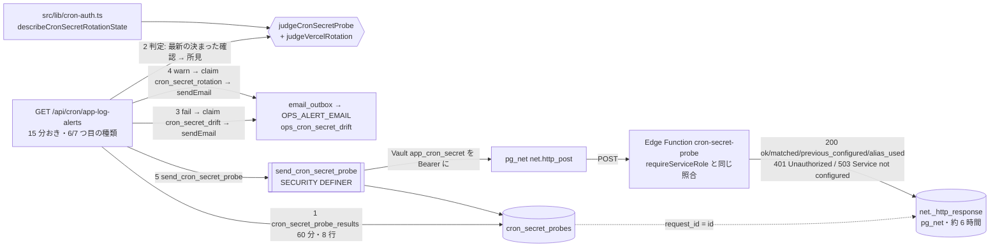

# operator/ cron の共有シークレットのずれの自動・定期の検知 (#1560 の項目 8) — 実経路の確認 (probe) による監視の設計

版: v1.2 (2026-10-17)
Status: 設計ゲート通過。段 A (Edge・#1863)・段 B (DB・#1872)・段 C (アプリ・#1877) は main に入っている

要件の正本は Issue #1560 の本文 (「決めること (オーナー)」の項目 8) と 2026-10-17 のコメント。オーナーの選択 (2026-10-17) は次の 1 文で、本書はこれを要件の外形として言い換えずに使う。範囲の細部 (Q-1〜Q-4) も、同じ日のコメントのとおりオーナーの選択 (2026-10-17) で決まっている (§0.4)。

> 自動・定期のずれ検知を「作る」。値を出さずに 3 か所 (Vercel の環境変数・Edge Function の secret・Vault の app_cron_secret) を突き合わせ、ずれたら運用アラートで知らせる。

本書の前提:
- 手で流す検査 `scripts/check-cron-secret-drift.mjs` (本体 `scripts/lib/cron-secret-drift.mjs`。#1556) と、止めずに入れ替える仕組み `CRON_SECRET_PREVIOUS` (#1346) は変えない。判定の意味 (PASS / WARN / FAIL) を引き継ぎ、確かめ方だけを実経路の確認 (probe) に変える (§4.2)。
- 知らせ方は既存の運用アラート `GET /api/cron/app-log-alerts` (15 分おき) に種類を足す形にする。`vercel.json` は変えない。
- 値もダイジェストも、ログ・メール・DB・応答に出さない。本書の部品はダイジェストを計算しない (§4.2)。機械検査は §11。
- 本番には触らない (migration の番号はマージ直前に確定する)。ローンチ前で利用者ゼロ (正しい形で作る)。
- 規約は `docs/design/CLAUDE.md` と `operator/CLAUDE.md`。関連の正本 (08 cron・07 §8.3 と 10 §8 運用アラート・11 定期処理の失敗の監視) の改定は §15 の追随表で指定する。

---

## 0. 位置づけ・前提・分冊判定 (相 1)

### 0.1 決めること (要約)

| # | 決めること | 本書の決定 (要約) | 詳細 |
|---|---|---|---|
| D-1 | どこで突き合わせるか | **DB から実経路で確かめる**。`GET /api/cron/app-log-alerts` の各回が DB の関数 `send_cron_secret_probe()` を呼び、関数が Vault の `app_cron_secret` を Bearer に付けて pg_net で新設の Edge Function `cron-secret-probe` を呼ぶ (pg_cron の実際の呼び出しと同じ道)。Edge Function は `requireServiceRole` と同じ規則で照合した結果を JSON で返し、応答は `net._http_response` に残る。次の回が `cron_secret_probe_results()` で読んで判定する。Vercel 側は route 自身の環境で `CRON_SECRET_PREVIOUS` を見る | §4 §5 §6 §7 |
| D-2 | 3 か所それぞれの値をどう得るか | どの保管場所からも値もダイジェストも取り出さない。Vault は DB の中で読んで Bearer に付けるだけ、Edge は照合の結果だけ、Vercel は `CRON_SECRET_PREVIOUS` の有無と現行と同じかだけ | §2.3 |
| D-3 | 「ずれ」の検知 | 確認の応答で判定する: 401 (食い違い)・503 (Edge に値が無い)・Vault が無い / 空 / 復号できない・ゲートウェイの JWT 検証・404・時間切れ・pg_net の不達 → FAIL。入れ替えの途中・`CRON_SECRET_PREVIOUS` の残り → WARN | §8.1.1 |
| D-4 | 「呼び出しが 401 になる」ことの観測 (`net._http_response`・Vercel の 401 のログ) で代わりにできるか | **どちらも代わりにしない** (補助にもしない)。`net._http_response` の観測は §4.2 の案 A、Vercel の 401 のログの観測は案 A' で退ける | §4.2 |
| D-5 | 知らせ方と抑止 | 運用アラートに 6 つ目の種類 `cron_secret_drift` (FAIL。抑止は既存の `OPS_ALERT_COOLDOWN_MINUTES`・既定 60 分) と 7 つ目の種類 `cron_secret_rotation` (WARN。抑止は新しい `OPS_ALERT_CRON_SECRET_ROTATION_COOLDOWN_MINUTES`・既定 1440 分 = 24 時間) を足す。文面は 1 本 (`ops_cron_secret_drift`。種類で件名と前置きを書き分ける)。台帳は使わない (`pg_cron_stalled` と同じく、続く間は抑止ごとに知らせる) | §7.3 §8.1.2 |
| D-6 | 入れ替え中 (`CRON_SECRET_PREVIOUS` が入っている間) の扱い | FAIL にしない。WARN として `cron_secret_rotation` で 1 日 1 通まで知らせる (Q-2)。Edge の `CRON_SECRET_PREVIOUS` は確認の応答の `previous_configured` で、Vercel の分は route の環境で見る | §7.1 §8.1 |
| D-7 | Vercel の `CRON_SECRET` と Supabase 側 (Edge / Vault) の一致 | **比べない** (Q-1)。ENV_SETUP.md の正 (Vercel の `CRON_SECRET` は独立で別の値でよい。手で流す検査でも INFO) のとおり | §0.4 |
| D-8 | 値やダイジェストを出さないことの機械検査 | (a) ダイジェストを計算しない、(b) DB の関数の戻り値の列が固定、(c) Edge Function の応答のキーが固定の 4 つ、(d) 文面の題と対処は定数の表の文、(e) 偽の秘密 (canary) がメール・ログ・応答に出ない — を契約テストと単体テストに焼き込む | §11 |

### 0.2 分冊判定

目安 3 つのうち「800 行超」と「共有面 2 つ以上」(運用アラートの route と定数・`_shared/auth.ts`・env の一覧・`supabase/config.toml`) に当たるが、**1 冊にする**。作るものは 1 つの機構 (確認を送る → 応答を読む → 判定 → 通知) で、部品が互いの契約 (応答の JSON の形・関数の戻り値の列) を共有するため、分けると契約の正本が散る。実装は §12 の 3 段 (A: Edge / B: DB / C: アプリ) に分け、段ごとに 2 枚のレビューを閉じる。

### 0.3 用語

| 語 | 意味 |
|---|---|
| 確認 (probe) | DB の関数 `send_cron_secret_probe()` が Vault の `app_cron_secret` を Bearer に付けて Edge Function `cron-secret-probe` を 1 回呼ぶこと。1 確認 = `cron_secret_probes` の 1 行 |
| 確認の結果 | pg_net が `net._http_response` に残した応答 (HTTP の状態・本文・時間切れ) を、`cron_secret_probe_results()` が確認の行と突き合わせて返したもの |
| 決まった確認 (decided) | 結果を判定できる確認: 送れなかった (Vault が無いなど)・応答が記録された・応答が無いまま猶予 (`CRON_SECRET_PROBE_ANSWER_GRACE_MINUTES`・5 分) を過ぎた、のどれか。route は見る範囲 (60 分) の中で最新の「決まった確認」だけを判定する |
| 所見 (finding) | 判定の 1 件。`id` (固定の名前)・`level` (`fail` / `warn` / `info`)・題・対処の文。題と対処は定数の表 (`CRON_SECRET_FINDING_CATALOG`) から引く |
| ずれ (drift) | `fail` の所見があること = pg_cron からの呼び出しが 401 / 503 / 不達になる状態 |
| 入れ替えの途中 (rotation) | `warn` の所見があること = いまは通るが、片づけるか確かめるべき状態 (旧い値で一致・Edge / Vercel の `CRON_SECRET_PREVIOUS` の残り・Vault が service role key) |
| 権利 (claim) | `claim_ops_alert(alert_key, cooldown)` が返す時刻 (07 §8.3)。キーは `cron_secret_drift` と `cron_secret_rotation` の 2 つ |

### 0.4 決まったこと (オーナーの選択 2026-10-17)

Q-1〜Q-4 は、オーナーの選択 (2026-10-17) で次のとおり決まった (Issue #1560 の 2026-10-17 のコメント)。

| # | 決まったこと (Issue #1560 の 2026-10-17 のコメントの文のまま) | 本書での形 |
|---|---|---|
| Q-1 | Vercel の CRON_SECRET と Supabase 側 (Edge と Vault) の一致は、比べません。 | Vercel の値は Supabase 側へ送らず、Supabase 側のダイジェストも持ち出さない。Vercel 側で見るのは `CRON_SECRET_PREVIOUS` の有無と現行と同じかだけ (§7.2) |
| Q-2 | 注意の状態 (入れ替えの途中、または CRON_SECRET_PREVIOUS の消し忘れ) は、メールで 1 日 1 通まで知らせます。 | WARN の所見 (§8.1.1 の 5 つ: Vault が旧い値で一致・Edge の `CRON_SECRET_PREVIOUS` の残り・Vault が service role key・Vercel の `CRON_SECRET_PREVIOUS` (現行と同じ / 違う)) はキー `cron_secret_rotation` の通知だけに載せる。「1 日 1 通まで」を、本書は抑止の既定値 1440 分 (24 時間) として実装する。環境変数 `OPS_ALERT_CRON_SECRET_ROTATION_COOLDOWN_MINUTES` で長くはできるが、1440 分より短くはできない (§7.1 の `_MIN`)。ずれ (FAIL) の通知には WARN を載せない (§7.3) |
| Q-3 | Vercel の CRON_SECRET 自体が無いときの検知は、今回は入れません。 | `app-log-alerts` 自身が 503 で止まる状態は本書の範囲外 (S-22・§17) |
| Q-4 | 確認は、運用アラートと同じ 15 分おきに行います。 | 確認の送り手は `app-log-alerts` の各回 (cron を足さない)。検知の遅れは最大 30 分 (確認を送った回の次の回で結果を読む) |

### 0.5 Issue 本文との食い違い (本書を正とする)

- Vercel Cron の本数は、Issue #1560 の本文とコメントには書かれていない (「Vercel Cron 6 本」とする記述の出どころは確かめられない)。本書の調査時点 (origin/main 2026-10-17・`2e94cc15`) の `vercel.json` の `crons` は 5 本 (`process-menu-queue`・`app-log-alerts`・`email-outbox`・`push-outbox`・`backup-freshness`) だった。そのあと #1720 段 B (`307ae1cf`) が `login-alerts` を足し、いまの `vercel.json` の `crons` は 6 本 (上の 5 本と `login-alerts`)。本書は `vercel.json` を変えない。
- 「3 か所 (Vercel・Edge・Vault) を突き合わせ」から読める「Vercel だけ古い」(Vercel の `CRON_SECRET` だけが入れ替え前の値で、Supabase 側 (Edge と Vault) は新しい値でそろっている) 場合は、所見にしない (Q-1 の「比べない」・D-7・R-20)。Vercel の `CRON_SECRET` は Vercel Cron が送り Vercel の route が照らす独立の値で、Supabase 側と違っても何も止まらないため (S-23)。Vercel の中で旧い値が残る形 (`CRON_SECRET_PREVIOUS`) は WARN で知らせる (S-09・S-10)。
- Issue #1560 の項目 8 の例示「自己診断の Edge Function か、pg_cron の日次ジョブ」のうち、本書は「自己診断の Edge Function」を採り、pg_cron のジョブは足さない (確認の送り手は `app-log-alerts` の回。§4.2 の案 B)。

---

## 1. 目的・スコープ

### 1.1 解決すること

- cron の共有シークレットは 3 か所 (Vercel の環境変数 `CRON_SECRET`・Supabase の Edge Function secrets `CRON_SECRET`・Supabase Vault `app_cron_secret`) に別々に置かれ、自動では同期されない (ENV_SETUP.md「Cron の共有シークレットの保管場所とローテーション」)。Edge と Vault が食い違うと、pg_cron からの Edge Function の呼び出し (比較ランキングの集計・料理画像のジョブ・隠したコンテンツの削除・カタログ取り込み) が HTTP 401 で止まる。pg_net は非同期なので `cron.job_run_details` は `succeeded` のままで、既存の `cron_failure` の通知には出ない。手で流す検査 (`scripts/check-cron-secret-drift.mjs`) を流さない限り「静かに壊れる」。
- 入れ替え (ローテーション) の途中で止まった状態 (Vault が旧い値のまま・`CRON_SECRET_PREVIOUS` の外し忘れ) も、流さない限り分からない。侵害時 (09 §11.5) はとくに、旧い値で通り続ける穴になる。

### 1.2 対象外 (本書では決めない・変えない)

- 手で流す検査 (`scripts/check-cron-secret-drift.mjs`・`scripts/lib/cron-secret-drift.mjs`・`tests/check-cron-secret-drift.test.ts`)。自動の検知と並んで残す (3 か所のダイジェストの照合はこちらだけが行う)。
- 照合の規則 (`supabase/functions/_shared/cron-secret.ts` の `checkCronSecret`・`src/lib/cron-auth.ts` の `requireCronAuth`)。`_shared/auth.ts` には照合の結果を返す関数を 1 つ足すだけ (§6.1)。
- Vercel の `CRON_SECRET` と Supabase 側の一致 (Q-1)。Vercel の `CRON_SECRET` の欠落の検知 (Q-3)。
- 既存の運用アラート 5 種類 (server / client / email_dead_letter / cron_failure / pg_cron_stalled) のしきい値・窓・抑止・文面。
- pg_cron のジョブの追加・`vercel.json` の変更・`net._http_response` の保持 (pg_net の `ttl`・既定で約 6 時間) の変更。
- Supabase Management API や `supabase secrets list` を Vercel から呼ぶこと (§4.2 の案 C で退ける)。Vercel のランタイムログ (401 の記録) を読むこと (§4.2 の案 A' で退ける)。

---

## 2. 関連要件と現行の事実 (相 1 の「いまの事実」)

### 2.1 根拠

- 要件: Issue #1560 の本文 (項目 8) と 2026-10-17 のコメント (オーナーの選択 (2026-10-17))。要件定義 `docs/requirements/03-operator-admin.md` §22.9 (監視)。
- 現行 (origin/main `2e94cc15`・2026-10-17):
  - `scripts/lib/cron-secret-drift.mjs`: 名前の定数 `CURRENT_NAME = 'CRON_SECRET'`・`PREVIOUS_NAME = 'CRON_SECRET_PREVIOUS'`・`ALIAS_NAME = 'SERVICE_ROLE_SECRET'`・`VAULT_SECRET_NAME = 'app_cron_secret'` (45〜50 行)。Edge の現行の値は `CRON_SECRET ?? SERVICE_ROLE_SECRET` (`effectiveEdgeCurrent`・619〜623 行。`??` は空文字を素通しする)。判定の ID は `edge-read` / `vault-read` / `vercel-read` / `edge-current` / `edge-alias-unused` / `vault-present` / `edge-vault-match` / `edge-previous` / `vercel-current` / `vercel-vs-supabase` / `vercel-previous` (`evaluate`・631〜776 行)。Edge ⇔ Vault の不一致の文は「pg_cron からの呼び出しが HTTP 401 ({"error":"Unauthorized"}) になります。Vault の app_cron_secret を正として、Edge Function secrets の CRON_SECRET をそれに合わせてください」(705 行)。Vercel は独立で `vercel-vs-supabase` は INFO (`--vercel-must-match` のときだけ FAIL。753〜756 行)。
  - `supabase/functions/_shared/auth.ts` の `requireServiceRole` (83〜124 行): Bearer が service role key (`SERVICE_ROLE_JWT` / `SUPABASE_SERVICE_ROLE_KEY`) と完全一致なら通す。それ以外は `checkCronSecret(authHeader, { current: Deno.env.get("CRON_SECRET") ?? Deno.env.get("SERVICE_ROLE_SECRET"), previous: Deno.env.get("CRON_SECRET_PREVIOUS") })`。`previous` で一致したら `console.warn` (パスを添える。値は出さない)。`not_configured` → 503 `{"error":"Service not configured"}`、`unauthorized` → 401 `{"error":"Unauthorized"}` (どちらも `Content-Type: application/json`)。
  - `supabase/functions/_shared/cron-secret.ts` の `checkCronSecret`: `{ ok: true, matched: "current" | "previous" } | { ok: false, reason: "not_configured" | "unauthorized" }`。import なし・Web 標準の `crypto.subtle` だけ (`tests/cron-secret-contract.test.ts` CC-7・CC-8)。
  - `src/lib/cron-auth.ts` の `requireCronAuth` (29〜49 行): `process.env.CRON_SECRET` / `CRON_SECRET_PREVIOUS` を読む唯一の場所 (CC-4)。`matched === 'previous'` で `console.warn`。
  - pg_cron から Edge Function を呼ぶ関数 (`public.invoke_calculate_segment_stats()` = migration `20261009100000` 96〜143 行、同型は `20261011120000`・`20261015180000`・`20261016100000`): `SECURITY DEFINER`・所有者 postgres・`search_path = ''`・`SELECT decrypted_secret INTO v_secret FROM vault.decrypted_secrets WHERE name = 'app_cron_secret' LIMIT 1` → 無ければ `RAISE EXCEPTION` → `net.http_post(url := c_url (本番の URL の定数), headers := jsonb_build_object('Authorization', 'Bearer ' || v_secret, 'Content-Type', 'application/json'), body := …, timeout_milliseconds := c_timeout_ms)` → 戻り値は pg_net の要求 ID (`bigint`)。`REVOKE ALL … FROM PUBLIC, anon, authenticated, service_role` (呼べるのは所有者 = pg_cron だけ)。
  - pg_net: 要求は `net.http_request_queue` に積まれ (Authorization ヘッダーごと。送ったら消える)、応答は `net._http_response (id, status_code, content_type, headers, content, timed_out, error_msg, created)` に、要求 ID と同じ `id` で残る。既定で約 6 時間で消える (migration `20261009100000` 26 行・ENV_SETUP.md「値が合っていないとどうなるか」の SQL は `id, status_code, timed_out, error_msg, created` と `content::text` を読む)。`net._http_response` の読み取りは、ENV_SETUP.md が SQL Editor (postgres ロール) の手順として載せており、整合ゲートが本番で使った (`tests/edge-function-verify-jwt.test.ts` の冒頭)。
  - Supabase のゲートウェイの JWT 検証 (`verify_jwt`): `supabase/config.toml` の `[functions.<name>]` に `verify_jwt = false` を書き、GitHub Actions「Deploy Supabase Functions」が `--use-api` で全関数を配る (`.github/workflows/deploy-supabase-functions.yml`)。検証が生きていると、関数に届く前に 401 (`{"code":"UNAUTHORIZED_INVALID_JWT_FORMAT", …}`) になる。`tests/edge-function-verify-jwt.test.ts` が、`config.toml` の一覧・関数の先頭の認証 (`await requireServiceRole(req)` など)・DB からの HTTP の呼び出し先 (`DB_HTTP_CALL_SITES`。SQL のファイルごとに `count` と `callees` を人が宣言。生の文字列で `net.http_post(` などの呼び出しと `/functions/v1/` を数える) を突き合わせる。
  - 運用アラート `src/app/api/cron/app-log-alerts/route.ts` (origin/main): `requireCronAuth` → 宛先 `resolveOpsAlertRecipient()` (未設定なら `disabled`・形が不正なら `invalid_config`。DB に触れない) → `resolveAppLogAlertSettings` (環境変数 4 つ) → `checkScope('server')` → `checkScope('client')` → `checkEmailDeadLetters` → `checkCronFailures` → `checkPgCronStalled` → 応答 `{ …server, window_minutes, client, email_dead_letter, cron_failure, pg_cron_stalled }`。後ろの種類の 500 は前の通知を止めない。1 種類の判定の形は `SpikeOutcome = { result: SpikeResult } | { response: NextResponse }`、`SpikeResult = { status, total, threshold }`、`status` は `below_threshold` / `deduped` / `sent` / `send_skipped` / `send_failed`。送れなかったときの権利の返し方は `NON_RELEASING_SEND_ERROR_CODES` (`suppressed` / `invalid_envelope`) で決まる。テスト O-1 が既定の場面で呼ばれる RPC の集合を固定 (7 本)。
  - `src/lib/ops-alerts/app-log-error-spike.ts`: `AppLogAlertScope = 'server' | 'client' | 'email_dead_letter' | 'cron_failure' | 'pg_cron_stalled'`、`APP_LOG_ALERT_COUNT_RPC` (`as const satisfies Readonly<Record<AppLogAlertScope, string>>`)、`APP_LOG_ALERT_KEYS`、`AppLogAlertSettingEnvName` (4 つ)、`AppLogAlertSettingSources` / `AppLogAlertSettings` (`pgCronStallMinutes` まで)、`resolveAppLogAlertSettings` (`resolveIntegerSetting` で整数と範囲を検証し、不正は既定値 + `ignored`)。
  - 文面の決まり: `src/lib/emails/ops/*.ts` の `render*Email` は `EmailEnvelope` (`src/lib/emails/envelope.ts`。`subject` は 100 字以内) を返し、`template` は `ops_` で始まる (`email_outbox_dead_counts` が数えない)。`src/__tests__/lib/emails/secret-templates.test.ts` は、文面ごとに秘密あり / なしの表と `*_url` の項目の列挙を要求する。
  - 環境変数の決まり: `src/lib/env.ts` の一覧 (`readOnlyBy` で読む場所を 1 か所に固定)・`.env.example`・`ENV_SETUP.md` の 3 か所にそろえる (`tests/env-source-scan.test.ts`・`src/__tests__/lib/env.test.ts`)。
  - Edge Function の決まり: バッチ専用の関数は CORS を付けない (`tests/edge-function-cors.test.ts`)・環境変数の名前を応答や例外に出さない (`tests/edge-missing-env-response.test.ts`)・トップレベルで例外を投げない・依存は `supabase/functions/deno.json` の imports だけ (`tests/edge-function-dep-pinning.test.ts`)・`supabase/functions/README.md` の表に載せる。

### 2.2 本番の読み取り (2026-10-17・Supabase MCP の読み取りだけ。値は読んでいない)

- Vault に `app_cron_secret` の行がある (`updated_at` = 2026-10-15 16:35:24 UTC)。値もダイジェストも読んでいない。
- 拡張の版は `supabase_vault` 0.3.1・`pg_net` 0.19.5。`vault.decrypted_secrets` の `decrypted_secret` は `convert_from(vault._crypto_aead_det_decrypt(…), 'utf8')` (C の関数・STRICT でない) で、`vault.secrets.secret` は NOT NULL。復号に失敗したときに NULL でなく例外になると読めるので、§5.2 は Vault の読み取りを例外の受け口で包む (`pg_get_viewdef` とカタログの読み取りだけ。値は読んでいない)。
- 本番のいまのずれの有無は確かめていない (本書は仕組みを設計するだけ。確かめるのは Issue #1560 のオーナー作業 1)。

### 2.3 3 か所の値の得方 (各案の比較の材料)

| 保管場所 | 値を得る手段 (Vercel の route から) | 値を出さずに照合の結果だけを得る手段 | 本書 |
|---|---|---|---|
| Supabase Edge Function secrets | Management API `GET /v1/projects/{ref}/secrets` (アクセストークンが要る。CLI の `secrets list` と同じで、返るのはダイジェスト。一次情報は未確認: §16 の 3) / Edge Function 自身が自分の値のダイジェストを返す (service role key で認証) | **Edge Function 自身に照合させ、結果 (一致・不一致・どの値と一致したか) だけを返させる** | 右 (D-2) |
| Supabase Vault | SQL でダイジェストを計算して返す RPC (値は DB の外に出ないが、ダイジェストは出る) / `SELECT decrypted_secret` (出してはいけない) | **DB の中で読んで Bearer に付け、Edge Function に照合させる** (pg_cron の実際の呼び出しと同じ。値は TLS の中で Edge へ渡るだけ) | 右 (D-2) |
| Vercel の環境変数 | `process.env` (route 自身の環境。読むのは `src/lib/cron-auth.ts` だけ: CC-4) | `CRON_SECRET_PREVIOUS` の有無と現行と同じかを真偽値で返す読み口を `src/lib/cron-auth.ts` に足す。Supabase 側との一致は比べない (Q-1) | 右 (D-7) |

---

## 3. 相 1: 外形固定 — 要件行列とユーザーシナリオ

### 3.1 要件行列 (全 22 行)

| # | 要件 | 根拠 | 本書の節 |
|---|---|---|---|
| R-01 | Edge Function secrets の現行の値 (`CRON_SECRET`、無ければ `SERVICE_ROLE_SECRET`) と Vault の `app_cron_secret` が食い違ったら、30 分以内に運用メール (`OPS_ALERT_EMAIL`) で分かる | オーナーの選択 (2026-10-17)・手で流す検査の `edge-vault-match` | §4 §7.1 |
| R-02 | Edge Function secrets に現行の値が無い (503)・Vault に `app_cron_secret` が無い / 空 / 復号できない (例外) も、同じ通知で分かる | 手で流す検査の `edge-current`・`vault-present` | §5.2 §7.1 |
| R-03 | ゲートウェイの JWT 検証が生きている (`verify_jwt` の設定漏れ)・確認の Edge Function が無い (404)・時間切れ・pg_net が送れない / 送らない、も同じ通知で分かる (値が合っていても止まる状態) | ENV_SETUP.md「値が合っていないとどうなるか」(#1406 の実害) | §7.1 |
| R-04 | 入れ替えの途中 (Vault が旧い値で一致)・`CRON_SECRET_PREVIOUS` の残り (Edge / Vercel)・`CRON_SECRET_PREVIOUS` が現行と同じ (Vercel)・Vault が service role key と同じ、は FAIL ではなく WARN として、別の種類で 1 日 1 通まで知らせる (抑止は既定 24 時間で、それより短くできない。ずれ (FAIL) の通知には載せない) | 手で流す検査の `edge-previous`・`vercel-previous`・Q-2 | §7.1 §8.3 |
| R-05 | 値もダイジェストも、メール・ログ・応答・DB (`cron_secret_probes`・`ops_alert_state`)・`net._http_response` の本文に出ない。本書の部品はダイジェストを計算しない | オーナーの選択 (2026-10-17) の「値を出さずに」・D-8 | §4.2 §11.1 §11.2 |
| R-06 | Vault の値は DB の中で読み、Bearer に付けて Edge Function へ送るだけ (既存の `invoke_*` と同じ経路・同じ露出)。DB の関数の戻り値に値を含めない | 既存の `invoke_calculate_segment_stats` の形 | §5.2 |
| R-07 | Edge Function `cron-secret-probe` は、既存の `requireServiceRole` と同じ規則で照合し (`verify_jwt = false`・先頭で認証・本文を読まない・DB に触らない・CORS なし)、応答の JSON は `ok` / `matched` / `previous_configured` / `alias_used` の 4 つのキーだけ。401 / 503 の本文は `requireServiceRole` と同じ | `tests/edge-function-verify-jwt.test.ts`・`tests/edge-function-cors.test.ts`・CC-1〜CC-3 | §6 |
| R-08 | 確認の結果は、自分が送った要求 ID で `net._http_response` と突き合わせる (ほかの pg_net の呼び出しの応答と混ざらない)。判定に使う本文の項目は `matched` / `previous_configured` / `alias_used` / `error` / `code` だけで、長さを 64 字で切る。`headers` / `error_msg` の本文は読み出さない | D-4・R-05 | §5.2 |
| R-09 | 知らせ方は既存の運用アラートの形 (`claim_ops_alert` で権利 → `sendEmail` → 送れなければ `release_ops_alert`。`suppressed` / `invalid_envelope` は返さない)。`OPS_ALERT_EMAIL` 未設定なら何もしない (確認も送らない)。DB の失敗は 500 (本文は汎用)。前の種類の通知は後ろの失敗で止まらない (順は server → client → email_dead_letter → cron_failure → pg_cron_stalled → cron_secret) | 07 §8.3・10 §8.3・#1172・11 R-09 | §7.3 §8.1 |
| R-10 | ずれが続く間は、抑止 (`OPS_ALERT_COOLDOWN_MINUTES`・既定 60 分) ごとに知らせる。直れば静かになる (台帳は持たない) | `pg_cron_stalled` と同じ考え方 (11 §4.2 の F) | §7.3 §8.3 |
| R-11 | 抑止の分数は、ずれ (`cron_secret_drift`) は既存の `OPS_ALERT_COOLDOWN_MINUTES`、入れ替えの途中 (`cron_secret_rotation`) は新しい `OPS_ALERT_CRON_SECRET_ROTATION_COOLDOWN_MINUTES` (1440〜10080 分・既定 1440。Q-2 の「1 日 1 通まで」より短くしない)。不正な値は既定値に戻し、変数名だけを warn に残す | 07 §8.3 の環境変数の扱い | §10 |
| R-12 | 検知の遅れは最大 30 分 (確認を送った回の次の回で結果を読む)。確認の送り手は `app-log-alerts` の回で、pg_cron のジョブは足さない | Q-4・D-1 | §4.3 |
| R-13 | DB の関数は `SECURITY DEFINER` (所有者 postgres。Vault と `net` スキーマを読むため)・`search_path = ''`・参照は完全修飾・動的 SQL なし・引数は上限つきの整数だけ。`EXECUTE` は `service_role` だけ (本文の JSON を読む補助の関数は誰にも付けない)。表は RLS 有効・全拒否ポリシー・どのロールにも表の権限を付けない | CLAUDE.md RLS・`20261017220000` の権限の考え方・`tests/integration/security/anon-definer-execute.test.ts` | §5 |
| R-14 | 呼び先の URL は関数の中の定数 (引数で差し替えられない。秘密を任意の宛先へ送らせない)。`timeout_milliseconds` は短い定数 (15 秒。確認は何もしないので十分) | migration `20261009100000` の `c_url` の注記 (#1020) | §5.2 |
| R-15 | `cron_secret_probes` の行は 24 時間で自動で消える (送るたびに古い行を消す)。pg_cron のジョブは登録しない・既存の行を変えない・消さない | 11 R-16 の趣旨 (ジョブの数を増やさない) | §5.2 §8.3 |
| R-16 | pg_net・Vault・`net._http_response` の無い DB (ローカルの一部・CI) でも関数は作れ、呼べば「送れなかった」(`net_unavailable` / `vault_unavailable`) として返す。Vault の行が復号できない (復号が例外になる) ときも `vault_unreadable` として返す。例外にしない | 11 R-13 (`to_regclass` の守り)・本番の Vault 0.3.1 の `decrypted_secrets` の定義 (§2.2) | §5.2 |
| R-17 | 新しい表・RPC は `database.types.ts` (2 か所) に反映し、migration と対の down.sql を書く。migration のファイル名の番号はマージ直前に確定する | `tests/database-types-migrations-contract.test.ts`・`tests/migration-file-version-integrity.test.ts` | §5 §14 |
| R-18 | 新しい環境変数は `src/lib/env.ts` の一覧・`.env.example`・`ENV_SETUP.md` にそろえ、値を読むのは route 1 ファイル | `tests/env-source-scan.test.ts`・`src/__tests__/lib/env.test.ts` | §10 §14 |
| R-19 | DB から Edge Function を呼ぶ migration は、`tests/edge-function-verify-jwt.test.ts` の `DB_HTTP_CALL_SITES` に呼び先と数 (2) を宣言し、呼び先を `config.toml` で `verify_jwt = false` にする。migration の中に、HTTP の呼び出しらしい語を宣言の数より多く書かない (コメントも数える) | `tests/edge-function-verify-jwt.test.ts`・`supabase/functions/README.md` | §5.2 §14 |
| R-20 | Vercel 側は `CRON_SECRET_PREVIOUS` の有無と現行と同じかだけを見る。読むのは `src/lib/cron-auth.ts` だけ (CC-4)。Vercel と Supabase 側の一致は比べない (Q-1) | CC-4・D-7 | §7.2 |
| R-21 | 運用手順 (ENV_SETUP.md のローテーション手順・09 §11.5) に、自動の検知の読み方 (入れ替えの途中は 24 時間に 1 通の WARN・終われば止まる) を足す。手で流す検査は残す | 仕様 | §15 |
| R-22 | Edge Function の `requireServiceRole` の受け付け方 (service role key の完全一致・`CRON_SECRET ?? SERVICE_ROLE_SECRET`・`CRON_SECRET_PREVIOUS`・401 / 503 の本文・`previous` の warn) は変えない。`checkCronSecret` の呼び出しは `_shared/auth.ts` に 1 つのまま | `tests/cron-secret.test.ts` RS-1〜RS-11・`tests/edge-function-service-role-auth.test.ts` SR-1〜SR-12・CC-3 | §6.1 |

### 3.2 ユーザーシナリオ (23 本)

時刻は JST。`app-log-alerts` の回は毎時 00 / 15 / 30 / 45 分とする。

| # | シナリオ | 期待する結果 |
|---|---|---|
| S-01 | 10:05 に Vault の `app_cron_secret` を新しい値にした (ENV_SETUP.md の手順 3) が、Edge Function secrets の `CRON_SECRET` を変えておらず、`CRON_SECRET_PREVIOUS` も無い | 10:15 の回が確認を送る → Edge が 401 `{"error":"Unauthorized"}` → 10:30 の回が結果を読み、`edge-vault-mismatch` (fail) → キー `cron_secret_drift` で権利を取り、メール「cron の共有シークレットの確認が失敗しました (1 件)」。文面は題と対処 (Vault を正として Edge を合わせる) だけ。値もダイジェストも無い |
| S-02 | 入れ替えの手順 2 まで済み (Edge に新しい `CRON_SECRET` と旧い `CRON_SECRET_PREVIOUS`)、Vault はまだ旧い値 | 確認は 200 `{"ok":true,"matched":"previous","previous_configured":true,"alias_used":false}` → `edge-previous-in-use` (warn) → キー `cron_secret_rotation` (抑止 24 時間) で 1 通「入れ替えが途中です (1 件)」。`cron_secret_drift` は鳴らない。Edge のログには `CRON_SECRET_PREVIOUS (旧いシークレット) で認証されました (/cron-secret-probe)` が 15 分ごとに残る (手順 5 の「旧い値で認証された記録」は、この確認の分を除いて見る: §15 の行 2) |
| S-03 | 手順 3 で Vault を新しい値にしたが、手順 5 の `CRON_SECRET_PREVIOUS` の削除を忘れて 3 日たつ | 確認は 200 `matched: "current"`・`previous_configured: true` → `edge-previous-leftover` (warn) → 24 時間ごとに 1 通「入れ替えが途中です」。削除した次の確認から静かになる |
| S-04 | Edge Function secrets から `CRON_SECRET` と `SERVICE_ROLE_SECRET` の両方を消してしまった | 確認は 503 `{"error":"Service not configured"}` → `edge-not-configured` (fail) → `cron_secret_drift` で 1 通。直るまで 60 分ごと |
| S-05 | Vault から `app_cron_secret` を消してしまった | 次の回の `send_cron_secret_probe()` が `vault_missing` を返し (要求は送らない)、その次の回の読み取りで `vault-missing` (fail) → `cron_secret_drift` で 1 通。(同じ状態で pg_cron の `invoke_*` は例外で `failed` になるので、`cron_failure` の通知も別に届く) |
| S-06 | `supabase/config.toml` の `[functions.cron-secret-probe]` を誤って消した版がデプロイされた (ゲートウェイの JWT 検証が生きる) | 確認は 401 で本文に `code` がある → `gateway-jwt` (fail) → 1 通 (対処: Actions「Deploy Supabase Functions」と `config.toml` を確かめる)。`tests/edge-function-verify-jwt.test.ts` が PR の時点で止めるので、本番では起きにくい |
| S-07 | 段 C (アプリ) が段 A (Edge) より先に本番に出た | 確認は 404 → `probe-not-deployed` (fail) → 1 通。段 A が出れば次の確認から静かになる (§12 の順を守れば起きない) |
| S-08 | 3 か所が正しく設定され、入れ替えもしていない | 確認は 200 `matched: "current"`・`previous_configured: false`・`alias_used: false` → 所見なし。応答 `cron_secret_drift: { status: 'below_threshold', total: 0, threshold: 0 }`・`cron_secret_rotation: { status: 'below_threshold', total: 0, threshold: 0 }`。15 分ごとに確認が 1 行増え、24 時間より古い行は消える (常時 100 行程度) |
| S-09 | Vercel の `CRON_SECRET_PREVIOUS` に、間違えて現行と同じ値を入れて再デプロイした | `describeCronSecretRotationState()` が `previous_same_as_current: true` → `vercel-previous-same` (warn) → `cron_secret_rotation` で 1 通 (24 時間ごと) |
| S-10 | Vercel の `CRON_SECRET_PREVIOUS` に旧い値を入れて再デプロイした (手で呼ぶ運用の切り替えの途中) まま、外し忘れた | `vercel-previous-set` (warn) → `cron_secret_rotation` で 1 通 (24 時間ごと)。外して再デプロイした次の回から静か |
| S-11 | S-01 のずれが 3 時間続き、13:20 に直した | 10:30・11:30・12:30 に 1 通ずつ (抑止 60 分。10:45〜11:15 の回は `deduped`)。13:30 の回が送った確認が 200 → 13:45 の回は所見なし。以後静か |
| S-12 | `OPS_ALERT_EMAIL` が未設定 | 7 種類とも何もしない (応答 `{ status: 'disabled' }`。確認も送らない。DB にも触れない) |
| S-13 | pg_net の worker が止まり、要求が送られない (`net.http_request_queue` に残る) | 10:15 の回が送った確認に応答が無いまま、10:30 の回の読み取りで猶予 (5 分) を過ぎている → `probe-unanswered` (fail) → `cron_secret_drift` で 1 通 (対処: pg_net の待ち行列を確かめる)。pg_cron の `invoke_*` も同じく届いていない |
| S-14 | Edge Function が 15 秒以内に応答しなかった (`timed_out = true`) | `probe-timeout` (fail) → 1 通。1 回だけなら次の確認で静かになる (抑止 60 分の中に 2 回目が無ければ、それ以上は届かない) |
| S-15 | 段 C を本番に出した最初の回 | `cron_secret_probe_results()` が 0 行 → `no-probe-yet` (info) → メールは送らない → 確認を 1 つ送る。2 回目の回から判定が始まる |
| S-16 | Vercel Cron が同じ回を 2 回呼んだ (まれ) | 確認が 2 行増える。読み取りは最新の「決まった確認」1 つだけを判定し、権利は `claim_ops_alert` が原子的に決めるので、メールは 1 通 |
| S-17 | Edge Function secrets に `CRON_SECRET` が無く、別名の `SERVICE_ROLE_SECRET` に Vault と同じ値が入っている | 確認は 200 `matched: "current"`・`alias_used: true` → `edge-alias-used` (info) → メールは送らない (手で流す検査の `edge-current` PASS + 注記と同じ)。応答は `below_threshold` |
| S-18 | 第三者が `cron-secret-probe` に適当な Bearer で要求を送る | 401 `{"error":"Unauthorized"}` (ほかのバッチ関数と同じ)。`cron_secret_probes` には自分の要求 ID しか無いので、第三者の応答は判定に混ざらない。200 の本文に `previous_configured` などが載るのは、正しい秘密を持つ呼び出しだけ |
| S-19 | `cron_secret_probe_results` が DB の一時障害で error を返す | その回は 500 (前の 5 種類の判定と通知は済んでいる)。確認は送らない。次の回で読み直す (見る範囲 60 分の中に前の確認が残っている) |
| S-20 | fail の所見で権利を取ったが、送信待ちへの登録が失敗した (`outbox_failed`) | `release_ops_alert` で権利を返し `send_failed`。次の回で同じ所見をもう一度知らせる |
| S-21 | Vault の `app_cron_secret` に service role key を入れてしまった | 確認は 200 `matched: "service_role_key"` → `vault-holds-service-role-key` (warn) → `cron_secret_rotation` で 1 通 (対処: cron 専用のランダムな値に入れ替える) |
| S-22 | Vercel の `CRON_SECRET` を消してしまった (cron の API が 503) | `app-log-alerts` 自身が動かず、本書の検知は働かない。今回は入れない (Q-3)。Vercel の Cron Jobs の画面の HTTP ステータスで分かる |
| S-23 | Supabase 側 (Edge Function secrets の `CRON_SECRET` と Vault) は新しい値に入れ替え済みで、Vercel の `CRON_SECRET` だけが入れ替え前の値のまま (Vercel に `CRON_SECRET_PREVIOUS` は無い) | 所見なし (Q-1: Vercel と Supabase 側は比べない)。Vercel Cron は Vercel の値で Vercel の route を呼ぶので何も止まらない。確認は 200 `matched: "current"` → 両方 `below_threshold`。route は Vercel の値を Supabase 側へ送らない (`send_cron_secret_probe` は引数なし) |

---

## 4. 相 2・相 3: 構造とその裁定

### 4.1 構造 (確定)



部品と責務:

| 部品 | 責務 | 置き場 (段) |
|---|---|---|
| `supabase/functions/_shared/auth.ts` の `describeServiceRoleAuth(req)` | `requireServiceRole` と同じ規則で照合し、結果 (`ok` / `matched` / `alias_used` / `previous_configured` または `reason`) を返す純粋な判定。`requireServiceRole` はこれを呼んで Response に変える (振る舞いは不変) | §6.1 (A) |
| Edge Function `cron-secret-probe` | 先頭で `await requireServiceRole(req)` (401 / 503 はそのまま返す) → `describeServiceRoleAuth(req)` の結果を 4 つのキーの JSON で返す。本文を読まない・DB に触らない・CORS なし・環境変数を直接読まない | §6.2 (A) |
| `public.cron_secret_probes` | 送った確認の記録 (`id`・`requested_at`・`send_state`・`request_id`)。値を運べる列は無い | §5.1 (B) |
| `public.send_cron_secret_probe()` | 24 時間より古い行を消す → `net` / Vault の有無と `app_cron_secret` の状態を見る → 行を 1 つ書く → 送れるなら pg_net で Edge Function を呼び、要求 ID を行に書く → `(probe_id, send_state, request_id)` を返す | §5.2 (B) |
| `public.cron_secret_probe_results(p_lookback_minutes, p_limit)` | 見る範囲の確認の行に `net._http_response` を突き合わせ、判定に要る項目だけ (状態コード・時間切れ・エラーの有無・本文の `matched` / `previous_configured` / `alias_used` / `error` / `code` を 64 字まで) を新しい順に返す | §5.2 (B) |
| `public.cron_secret_probe_body_json(p_content)` | 応答の本文を JSON として読む補助 (JSON でなければ NULL。例外にしない)。誰にも `EXECUTE` を付けない | §5.2 (B) |
| `src/lib/cron-auth.ts` の `describeCronSecretRotationState()` | Vercel の `CRON_SECRET_PREVIOUS` の有無と現行と同じかを真偽値で返す (値は返さない) | §7.2 (C) |
| `src/lib/ops-alerts/cron-secret-drift.ts` | 定数・所見の表・行の検証・「決まった確認」の選び方・判定 (純粋な関数) | §7.1 (C) |
| route の `checkCronSecretDrift` | 読む → 判定 → `cron_secret_drift` (fail) と `cron_secret_rotation` (warn) をそれぞれ通知 → 次の回のための確認を送る | §7.3 (C) |
| 文面 `renderCronSecretDriftEmail` | 種類 (drift / rotation) で件名と前置きを書き分け、所見の題と対処を番号つきで載せる。値・ダイジェスト・URL 以外のリンクは載せない | §7.4 (C) |

### 4.2 代替案と裁定 (相 3・1 回だけ)

| 案 | 中身 | 退ける / 採る理由 |
|---|---|---|
| A: 本物のジョブの 401 を観測する | `net._http_response` の直近の行で `status_code` が 401 / 503 のものを数えて知らせる (新しい Edge Function も確認の送信も要らない) | **退ける**。(1) 観測は本物のジョブの頻度に依存する (1 時間おきの `calculate-segment-stats` が最短。日次のものは 1 日 1 回) ので、検知が最大 1 時間 15 分遅れ、直したあとも次のジョブまで「ずれている」と出る。(2) 入れ替えの途中 (旧い値で一致 = 200) と `CRON_SECRET_PREVIOUS` の残りは見えない (R-04 を満たせない)。(3) Vault の欠落は pg_net の応答に出ない (ジョブが例外で `failed` → `cron_failure` に頼る)。(4) `net._http_response` には URL が無く、どの呼び出しの応答かを区別できない (ほかの失敗 — `SERVER_CONFIG_MISSING` の 503 など — と混ざる)。ただし、この「pg_net の応答の失敗一般」の監視は、秘密のずれとは別の価値 (`SERVER_CONFIG_MISSING` など、いまどの通知にも出ない失敗を拾う) があるので、別の候補として §17 に残す |
| A': Vercel の 401 のログを観測する | Vercel のランタイムログから、Vercel Cron の route が `requireCronAuth` で 401 を返した記録を数えて知らせる | **退ける**。(1) Vercel Cron は Vercel の環境変数 `CRON_SECRET` を Bearer に付けて Vercel の route を呼び、route は同じ Vercel の環境変数 (と `CRON_SECRET_PREVIOUS`) で照らす。Vercel の 401 は、この Vercel の中の食い違いか第三者の要求でしか起きない。pg_cron → Edge Function の道は Vercel を通らないので、Edge と Vault のずれ (R-01・R-02 の本題) は Vercel のログに出ない。(2) Vercel の中で食い違うと、`app-log-alerts` 自身も同じ 401 で止まるので、route の中からは知らせられない (外からログを読む仕組みが要る。Q-3 で入れないことにした「Vercel の `CRON_SECRET` が無い」ときと同じ形で、本書の範囲外: §17)。(3) ログを読むには Vercel の API トークンをどこか (Vercel の環境変数か Supabase) に置くことになり、監視のために新しい秘密を増やす。(4) 入れ替えの途中は 200 で通るので 401 にならず、見えない (R-04 を満たせない)。第三者の要求の 401 も混ざる |
| B: 実経路の確認 (probe) — DB から Vault の値で確認用の Edge Function を呼び、応答を次の回に読む (本書) | 値もダイジェストも持ち出さない。照合は Edge Function の既存の規則 (`checkCronSecret`) そのもの。ゲートウェイの検証・デプロイ漏れ・pg_net の停止・時間切れも同じ 1 本で見える。送り手は `app-log-alerts` の回 (pg_cron のジョブを足さない) | **採る**。「値を出さずに」をもっとも強く満たし (ダイジェストすら作らない)、手で流す検査が「同じ値なのに FAIL」と疑う必要のあった前提 (`supabase secrets list` が平文の SHA-256 を返すこと) を持たない。縁は、応答が次の回に分かること (遅れ ≤ 30 分) と、確認の記録の表 1 つ |
| B': B と同じだが、同じ回の中で送って数秒待って読む | 表が要らない。遅れ ≤ 15 分 | **退ける**。pg_net の worker の遅れに依存して「待っても来ない」回が出る (route の `maxDuration` の中で待つ長さを決められない)。次の回に読む形なら、猶予 5 分で「送られていない」を確実に判定できる (S-13) |
| B'': B と同じだが、確認の送り手を pg_cron のジョブにする | route は読むだけ | **退ける**。ジョブが 1 つ増え (08 §3.0 の数・番兵・ロールバック)、pg_cron が止まると確認も止まる (すでに `pg_cron_stalled` が見ている状態と重なる)。route から送れば、Vercel Cron が動いている限り確認は続く |
| C: ダイジェストの照合 (手で流す検査の自動化) | Edge のダイジェストは Management API (本番のアクセストークンを Vercel に置く) か、Edge Function 自身が返す。Vault のダイジェストは SQL で計算して返す。Vercel は `process.env` から計算。route で `evaluate()` と同じ判定 | **退ける**。(1) ダイジェストを 2 つの境界 (Edge → Vercel・DB → Vercel) で持ち出す。ログ・応答・メールに漏らさない守りを 3 か所に要する。(2) Management API 案は、全部の secrets の読み書きと関数のデプロイができるトークンを Vercel の環境変数に置くことになる (監視のために権限が広すぎる)。(3) ゲートウェイの検証・デプロイ漏れ・pg_net の停止は見えない。(4) `supabase secrets list` の返す値が平文の SHA-256 であることの一次情報が無い (Issue #1560 の「参考 (低確信)」) |
| D: Edge Function が Vault を読んで自分で比べる | Edge が service role で `vault.decrypted_secrets` を読む RPC を呼ぶ | **退ける**。Vault の値を Edge に読ませる経路 (RPC) を service_role に開くことになる (いまは pg_cron の定義者関数だけが読める)。B は値を「送る側 (DB)」から「受ける側 (Edge)」へ、いまと同じ向きにしか動かさない |
| E: Vercel の値も Edge に送って 3 か所を比べる | route が自分の `CRON_SECRET` を Bearer に付けて `cron-secret-probe` を呼ぶ | **退ける** (Q-1)。独立であるべき値を別の系へ送り、INFO の情報しか増えない (D-7) |

**「縁の発生源を消すより単純な構造は無いか」**: 縁の発生源は 2 つ。(1) 応答が非同期で次の回に分かること — 消すには同期の HTTP (pgsql-http 拡張。本番に無い) か B' の待ちが要り、どちらも本番の前提を変える。(2) 確認の記録の表 — 消すには要求 ID を覚える場所が要り、`ops_alert_state` の流用は意味を壊す。残りの部品 (Edge Function 1 本・判定の純粋な関数・文面) は案 C でも要る。案 A と案 A' は構造としては最小だが、R-04 を満たせない (A' は Edge と Vault のずれも見えない)。構造はここで確定し、仕上げ相では蒸し返さない。

### 4.3 トレース (全シナリオを §4.1 の構造で手で走らせる)

| # | 道 (部品の順) | 結果 |
|---|---|---|
| S-01 | 10:15: `cron_secret_probe_results(60, 8)` = [10:00 の確認 (200 current。決まっている)] → 所見なし → 両方 `below_threshold` → `send_cron_secret_probe()` = (id 41, 'sent', req 9001) → pg_net が Vault の新しい値で POST → Edge の `checkCronSecret` が `unauthorized` → 401 `{"error":"Unauthorized"}` → `net._http_response` (id 9001, 401)。10:30: results = [id 41 (answered, 401, body_error 'Unauthorized', body_code NULL), id 40 (200)] → 決まった最新 = id 41 → `judgeProbeRow` → `edge-vault-mismatch` (fail) → `notifyCronSecret('cron_secret_drift', [fail])` → `claim_ops_alert('cron_secret_drift', 60)` = t → `renderCronSecretDriftEmail({ kind: 'drift', findings: [fail] })` → `sendEmail` ok → `sent` (total 1)。`cron_secret_rotation` は warn 0 → `below_threshold` → 確認 id 42 を送る | ✓ R-01 R-12 |
| S-02 | 確認 → `checkCronSecret` が `matched: "previous"` → `describeServiceRoleAuth` = { ok, matched 'previous', previous_configured true, alias_used false } → 200。次の回: `edge-previous-in-use` (warn) → drift は fail 0 → `below_threshold`。rotation: `claim_ops_alert('cron_secret_rotation', 1440)` = t → メール (kind 'rotation') → `sent`。以後 24 時間は `deduped` | ✓ R-04 R-11 |
| S-03 | 200 `matched: "current"`・`previous_configured: true` → `edge-previous-leftover` (warn) → S-02 と同じ道 (rotation)。削除後の確認は `previous_configured: false` → 所見なし | ✓ R-04 |
| S-04 | Edge の `describeServiceRoleAuth` が `not_configured` → `requireServiceRole` が 503 `{"error":"Service not configured"}` → 次の回: `http_status 503`・`body_error 'Service not configured'` → `edge-not-configured` (fail) → drift の道 | ✓ R-02 |
| S-05 | `send_cron_secret_probe()`: `SELECT decrypted_secret …` が 0 行 (`FOUND` 偽) → 行 (send_state 'vault_missing', request_id NULL) → 返す。次の回: results の最新 = その行 (send_state ≠ 'sent' なので決まっている) → `vault-missing` (fail) → drift の道 | ✓ R-02 R-16 |
| S-06 | ゲートウェイが 401 `{"code":"UNAUTHORIZED_INVALID_JWT_FORMAT", …}` → `body_code` が非 NULL → `gateway-jwt` (fail) | ✓ R-03 |
| S-07 | 404 (`{"code":"NOT_FOUND", …}`) → `http_status 404` → `probe-not-deployed` (fail) | ✓ R-03 |
| S-08 | 200 current・previous_configured false・alias_used false → 所見 [] → 両方 `below_threshold` → 確認を送る → `send` が 24 時間より古い行を DELETE | ✓ R-15 |
| S-09 | `describeCronSecretRotationState()` = { previous_configured true, previous_same_as_current true } → `judgeVercelRotation` → `vercel-previous-same` (warn) → rotation の道 | ✓ R-20 |
| S-10 | { true, false } → `vercel-previous-set` (warn) → rotation の道 (S-02 と同じ)。drift は fail 0 → `below_threshold` | ✓ R-04 |
| S-11 | 10:30 sent (t1)・10:45 `claim` = NULL → `deduped`・11:00 deduped・11:15 deduped・11:30 (t1 + 60 分) → sent … 13:30 の確認が 200 → 13:45 所見なし | ✓ R-10 |
| S-12 | `checkAppLogErrors` の冒頭で `disabled` → `checkCronSecretDrift` に到達しない | ✓ R-09 |
| S-13 | 10:15 の確認 (sent, req 9001) に `net._http_response` の行が無い。10:30: `answered false`・`requested_at` が 15 分前 > 猶予 5 分 → 決まっている → `probe-unanswered` (fail) | ✓ R-03 |
| S-14 | `timed_out true` → `probe-timeout` (fail)。次の確認が 200 なら最新の決まった確認が 200 → 所見なし | ✓ R-03 |
| S-15 | results = [] → `judgeCronSecretProbe` = { decided null, findings [no-probe-yet (info)] } → 両方 `below_threshold` → 確認を送る | ✓ |
| S-16 | 行 2 つ (id 41・42)。次の回: 新しい順に並べ、最新の決まった確認 1 つを判定。`claim_ops_alert` は 2 回目の回で NULL | ✓ |
| S-17 | `alias_used true`・`matched current` → `edge-alias-used` (info) → メールなし | ✓ |
| S-18 | 第三者の要求は `requireServiceRole` が 401。`cron_secret_probes.request_id` に無い応答は `cron_secret_probe_results` の JOIN に入らない | ✓ R-08 |
| S-19 | `read.error` → `internalError(ROUTE_NAME, …, { scope: 'cron_secret_drift', rpc })` → 500。`send_cron_secret_probe` は呼ばない | ✓ R-09 |
| S-20 | `sendEmail` が `ok: false, error.code 'outbox_failed'` → `NON_RELEASING_SEND_ERROR_CODES` に無い → `releaseClaim` → `send_failed` | ✓ R-09 |
| S-21 | `describeServiceRoleAuth` が service role key の完全一致で `matched 'service_role_key'` → 200 → `vault-holds-service-role-key` (warn) → rotation の道 | ✓ R-04 |
| S-22 | `requireCronAuth` が 503 → route の本体に到達しない | — (Q-3) |
| S-23 | `requireCronAuth` は Vercel の値どうしで通る → results の最新 = 200 current → 所見 [] → `describeCronSecretRotationState()` = { false, false } → `judgeVercelRotation` = [] → 両方 `below_threshold` → `send_cron_secret_probe()` (引数なし。Bearer は DB の中で Vault の値) | ✓ R-20 (Q-1) |

---

## 5. データモデル (段 B の migration)

### 5.1 表 `cron_secret_probes` (段 B)

```sql
-- migration: <番号はマージ時に確定>_cron_secret_drift_monitor.sql
-- 戻し方: supabase/rollbacks/<番号はマージ時に確定>_cron_secret_drift_monitor.down.sql
-- #1560 (項目 8) cron の共有シークレットのずれの自動・定期の検知の DB 側の部品。設計 docs/design/operator/12-cron-secret-drift-monitor.md §5。
-- 表 1 つ (送った確認の記録) + 関数 3 本。pg_cron のジョブは登録しない・既存の行を変えない・消さない (消すのは自分の表の 24 時間より古い行だけ)。
-- 注意: このファイルのコメントに、pg_net の呼び出しの形 (関数名に開きかっこを続けた形) と Edge Function の URL の途中の経路
--       (functions のあとの v1) を書かない。tests/edge-function-verify-jwt.test.ts が生の文字列で数え、宣言の数 (2) と突き合わせるため。
CREATE TABLE IF NOT EXISTS public.cron_secret_probes (
  id           BIGSERIAL   PRIMARY KEY,
  requested_at TIMESTAMPTZ NOT NULL DEFAULT pg_catalog.now(),   -- 送った (または送れなかった) 時刻
  send_state   TEXT        NOT NULL CHECK (send_state IN ('sent', 'vault_missing', 'vault_empty', 'vault_unreadable', 'vault_unavailable', 'net_unavailable')),
  request_id   BIGINT      NULL UNIQUE                           -- pg_net の要求 ID (send_state = 'sent' のときだけ)。net._http_response.id と同じ値
);
CREATE INDEX IF NOT EXISTS idx_cron_secret_probes_requested_at ON public.cron_secret_probes (requested_at);

ALTER TABLE public.cron_secret_probes ENABLE ROW LEVEL SECURITY;
-- 入口は RPC (SECURITY DEFINER・所有者 postgres) だけ。どのロールにも表の権限を付けない (cron_failure_alerts と同じ)
REVOKE ALL ON public.cron_secret_probes FROM PUBLIC, anon, authenticated, service_role;
DROP POLICY IF EXISTS cron_secret_probes_deny_client_access ON public.cron_secret_probes;
CREATE POLICY cron_secret_probes_deny_client_access ON public.cron_secret_probes
  FOR ALL TO anon, authenticated USING (false) WITH CHECK (false);

COMMENT ON TABLE public.cron_secret_probes IS
  '#1560: cron の共有シークレットの確認 (Vault の app_cron_secret で Edge Function cron-secret-probe を呼ぶ) の記録 (1 確認 = 1 行)。値もダイジェストも持たない (時刻・送れたか・pg_net の要求 ID だけ)。入口は send_cron_secret_probe / cron_secret_probe_results だけ。24 時間より古い行は send_cron_secret_probe が消す。';
```

列が 4 つしか無く、`send_state` は CHECK の 6 値、`request_id` は数値なので、この表に値やダイジェストを書ける列は無い (R-05。契約テストが列の一覧を固定する)。

### 5.2 関数 (段 B)

共通: `LANGUAGE plpgsql`・`SET search_path = ''`・参照は完全修飾・動的 SQL なし。(1)(2) は `SECURITY DEFINER` (所有者 postgres。Vault と `net` スキーマを読み、表に表の権限が無いため)。(3) は純粋な変換で `SECURITY INVOKER` (既定)。引数は上限つきの整数だけ ((2))。`EXECUTE` は (1)(2) が `service_role` だけ、(3) は誰にも付けない。Supabase は作った関数に anon / authenticated / service_role の `EXECUTE` を自動で付け、PostgreSQL は PUBLIC にも付けるので、`REVOKE ALL … FROM PUBLIC, anon, authenticated, service_role` の完全形で外してから付け直す。

```sql
-- (1) 確認を送る。GET /api/cron/app-log-alerts が毎回 1 回呼ぶ (service_role)。
--     24 時間より古い記録を消す → 送れる状態かを見る → 記録を 1 行書く → 送れるなら pg_net で Edge Function を呼び、要求 ID を記録に書く。
--     値 (v_secret) は Authorization ヘッダーに付けるだけで、戻り値・記録・例外の文に入れない。
CREATE OR REPLACE FUNCTION public.send_cron_secret_probe()
RETURNS TABLE (probe_id BIGINT, send_state TEXT, request_id BIGINT)
LANGUAGE plpgsql VOLATILE SECURITY DEFINER SET search_path = '' AS $$
#variable_conflict use_column
DECLARE
  -- 呼び先。既存の invoke_calculate_segment_stats と同じく本番のプロジェクトの Edge Function に固定する (引数で差し替えられない。秘密を任意の宛先へ送らせない #1020)
  c_url CONSTANT text := 'https://flmeolcfutuwwbjmzyoz.supabase.co/functions/v1/cron-secret-probe';
  -- pg_net が応答を待つ上限 (ミリ秒)。確認の Edge Function は照合しか行わないので、既定の 5 秒より少し長い 15 秒で足りる
  -- (アプリ側の猶予 CRON_SECRET_PROBE_ANSWER_GRACE_MINUTES = 5 分より十分短いこと。契約テストが突き合わせる)
  c_timeout_ms CONSTANT integer := 15000;
  -- 記録の保持。見る範囲 (アプリの CRON_SECRET_PROBE_LOOKBACK_MINUTES = 60 分) と pg_net の応答の保持 (既定 6 時間) より長く、表を小さく保つ
  c_retention CONSTANT pg_catalog.interval := interval '24 hours';
  -- pg_cron の関数が読む Vault の名前 (scripts/lib/cron-secret-drift.mjs の VAULT_SECRET_NAME と同じ)
  c_vault_secret_name CONSTANT text := 'app_cron_secret';
  v_secret text;
  v_state text;
  v_probe_id bigint;
  v_request_id bigint;
BEGIN
  DELETE FROM public.cron_secret_probes AS p WHERE p.requested_at < pg_catalog.now() - c_retention;

  IF pg_catalog.to_regclass('net._http_response') IS NULL THEN
    -- pg_net の無い DB (ローカルの一部・CI)。送れないことを記録して返す (例外にしない)
    v_state := 'net_unavailable';
  ELSIF pg_catalog.to_regclass('vault.decrypted_secrets') IS NULL THEN
    v_state := 'vault_unavailable';
  ELSE
    -- 本番の Vault (supabase_vault 0.3.1) の decrypted_secrets は C の関数 vault._crypto_aead_det_decrypt で復号するので、復号の失敗は NULL ではなく例外になりうる (設計 §16 の 5)。
    -- 例外にしない (R-16) ため、読み取りだけを内側のブロックで受けて vault_unreadable にする。例外の文 (SQLERRM) は使わない・残さない
    BEGIN
      SELECT s.decrypted_secret INTO v_secret
        FROM vault.decrypted_secrets AS s
       WHERE s.name = c_vault_secret_name
       LIMIT 1;
      IF NOT FOUND THEN
        v_state := 'vault_missing';
      ELSIF v_secret IS NULL THEN
        v_state := 'vault_unreadable';   -- 行はあるが復号の結果が無い
      ELSIF v_secret = '' THEN
        v_state := 'vault_empty';
      ELSE
        v_state := 'sent';
      END IF;
    EXCEPTION WHEN others THEN
      v_secret := NULL;
      v_state := 'vault_unreadable';     -- 行はあるが復号できない (例外)
    END;
  END IF;

  INSERT INTO public.cron_secret_probes (send_state) VALUES (v_state) RETURNING id INTO v_probe_id;

  IF v_state = 'sent' THEN
    SELECT net.http_post(
      url := c_url,
      headers := pg_catalog.jsonb_build_object(
        'Authorization', 'Bearer ' || v_secret,
        'Content-Type', 'application/json'
      ),
      body := pg_catalog.jsonb_build_object('probe_id', v_probe_id),
      timeout_milliseconds := c_timeout_ms
    ) INTO v_request_id;
    UPDATE public.cron_secret_probes AS p SET request_id = v_request_id WHERE p.id = v_probe_id;
  END IF;

  RETURN QUERY SELECT v_probe_id, v_state, v_request_id;
END $$;

-- (3) 応答の本文を JSON として読む補助。JSON でなければ NULL (例外にしない)。(2) だけが使う
CREATE OR REPLACE FUNCTION public.cron_secret_probe_body_json(p_content TEXT)
RETURNS JSONB
LANGUAGE plpgsql IMMUTABLE SET search_path = '' AS $$
BEGIN
  IF p_content IS NULL THEN
    RETURN NULL;
  END IF;
  RETURN p_content::jsonb;
EXCEPTION WHEN others THEN
  RETURN NULL;
END $$;

-- (2) 確認の結果。見る範囲 (p_lookback_minutes) の記録に net._http_response を要求 ID で突き合わせ、判定に要る項目だけを新しい順に返す。
--     応答の本文は matched / previous_configured / alias_used / error / code の 5 項目だけを、各 64 字までで返す。headers と error_msg の本文は返さない。
--     応答の無い行は、answered が false で、応答に由来する項目 (http_status / timed_out / has_error / 本文の 5 項目) はすべて NULL (「エラーなし」とは区別する)。
CREATE OR REPLACE FUNCTION public.cron_secret_probe_results(p_lookback_minutes INTEGER DEFAULT 60, p_limit INTEGER DEFAULT 8)
RETURNS TABLE (
  probe_id BIGINT, requested_at TIMESTAMPTZ, send_state TEXT, answered BOOLEAN,
  http_status INTEGER, timed_out BOOLEAN, has_error BOOLEAN,
  matched TEXT, previous_configured BOOLEAN, alias_used BOOLEAN, body_error TEXT, body_code TEXT
)
LANGUAGE plpgsql STABLE SECURITY DEFINER SET search_path = '' AS $$
#variable_conflict use_column
DECLARE
  -- 見る範囲の下限と上限 (分)。下限は app-log-alerts の間隔 (15 分)、上限は pg_net の応答の保持 (既定 6 時間 = 360 分)
  c_lookback_min CONSTANT integer := 15;
  c_lookback_max CONSTANT integer := 360;
  c_limit_max CONSTANT integer := 50;
  -- 本文の項目を返す長さの上限。想定の値 (current / previous / service_role_key / Unauthorized / Service not configured / UNAUTHORIZED_INVALID_JWT_FORMAT) はどれも 64 字より短い
  c_body_field_max_length CONSTANT integer := 64;
BEGIN
  IF p_lookback_minutes IS NULL OR p_lookback_minutes < c_lookback_min OR p_lookback_minutes > c_lookback_max THEN
    RAISE EXCEPTION 'cron_secret_probe_results: invalid lookback' USING ERRCODE = '22023';
  END IF;
  IF p_limit IS NULL OR p_limit < 1 OR p_limit > c_limit_max THEN
    RAISE EXCEPTION 'cron_secret_probe_results: invalid limit' USING ERRCODE = '22023';
  END IF;

  IF pg_catalog.to_regclass('net._http_response') IS NOT NULL THEN
    RETURN QUERY
    SELECT p.id, p.requested_at, p.send_state,
           (r.id IS NOT NULL),
           r.status_code, r.timed_out, CASE WHEN r.id IS NOT NULL THEN (r.error_msg IS NOT NULL) END,
           pg_catalog.left(b.body ->> 'matched', c_body_field_max_length),
           CASE WHEN pg_catalog.jsonb_typeof(b.body -> 'previous_configured') = 'boolean' THEN (b.body ->> 'previous_configured')::boolean END,
           CASE WHEN pg_catalog.jsonb_typeof(b.body -> 'alias_used') = 'boolean' THEN (b.body ->> 'alias_used')::boolean END,
           pg_catalog.left(b.body ->> 'error', c_body_field_max_length),
           pg_catalog.left(b.body ->> 'code', c_body_field_max_length)
      FROM public.cron_secret_probes AS p
      LEFT JOIN net._http_response AS r ON r.id = p.request_id
      LEFT JOIN LATERAL (SELECT public.cron_secret_probe_body_json(r.content) AS body) AS b ON true
     WHERE p.requested_at >= pg_catalog.now() - pg_catalog.make_interval(mins => p_lookback_minutes)
     ORDER BY p.requested_at DESC, p.id DESC
     LIMIT p_limit;
  ELSE
    -- pg_net の無い DB: 記録だけを返す (応答は無い)
    RETURN QUERY
    SELECT p.id, p.requested_at, p.send_state, false,
           NULL::integer, NULL::boolean, NULL::boolean,
           NULL::text, NULL::boolean, NULL::boolean, NULL::text, NULL::text
      FROM public.cron_secret_probes AS p
     WHERE p.requested_at >= pg_catalog.now() - pg_catalog.make_interval(mins => p_lookback_minutes)
     ORDER BY p.requested_at DESC, p.id DESC
     LIMIT p_limit;
  END IF;
END $$;
```

権限:

```sql
REVOKE ALL ON FUNCTION public.send_cron_secret_probe() FROM PUBLIC, anon, authenticated, service_role;
GRANT EXECUTE ON FUNCTION public.send_cron_secret_probe() TO service_role;
REVOKE ALL ON FUNCTION public.cron_secret_probe_results(INTEGER, INTEGER) FROM PUBLIC, anon, authenticated, service_role;
GRANT EXECUTE ON FUNCTION public.cron_secret_probe_results(INTEGER, INTEGER) TO service_role;
REVOKE ALL ON FUNCTION public.cron_secret_probe_body_json(TEXT) FROM PUBLIC, anon, authenticated, service_role;
-- GRANT は付けない。所有者 (postgres) と、所有者として動く定義者関数 (2) だけが呼ぶ
```

R-16 (例外にしない) の守り: `send_cron_secret_probe` は `RAISE` を持たず、pg_net が無い (`net_unavailable`)・Vault が無い (`vault_unavailable`) は `to_regclass` で、Vault の行が無い・空・復号できない (NULL か例外) は内側のブロックで、それぞれ記録の行にする。例外の受け口は Vault の読み取りの 1 か所だけ (`net.http_post` の失敗は受けない — 送れないなら RPC の error で route が 500 にする: N-13)。本番の Vault の版 (0.3.1) と `decrypted_secrets` の定義は 2026-10-17 に Supabase MCP の読み取り (`pg_get_viewdef`) で確かめた (値は読んでいない)。

`COMMENT ON FUNCTION` を 3 本とも書く (何を返すか・誰が呼ぶか・値もダイジェストも返さないこと)。文面は実装者が §4.1 の表から書く。⚠ コメントの文にも、pg_net の呼び出しの形 (関数名に開きかっこ) と URL の途中の経路を書かない (R-19)。

`tests/edge-function-verify-jwt.test.ts` の `DB_HTTP_CALL_SITES` に宣言する数は **2** (`net.http_post(` が 1・`c_url` の中の `/functions/v1/` が 1)。`'app_cron_secret'` と `'Bearer '` の印は上の SQL にある (§14)。

`service_role` に `send_cron_secret_probe` の `EXECUTE` を付けることの意味: service role key を持つ呼び出し元 (= アプリのサーバー側) が、DB に「固定の宛先 (自分の Edge Function) へ Vault の値を Bearer に付けた要求を 1 つ送らせる」ことができる。宛先は定数で、戻り値に値は無いので、service role key の持ち主にいま無い力は増えない (service role key はもともと DB を全権で操作できる鍵)。

段 B の down.sql (`<番号>_cron_secret_drift_monitor.down.sql`。1 行目は `-- rollback: <migration のファイル名>`):

```sql
-- rollback: <番号はマージ時に確定>_cron_secret_drift_monitor.sql
-- 本番に戻す必要があるときは、この内容を新しい migration として PR 経由で適用する (本番への直接 SQL は禁止。CLAUDE.md)。
-- 先に Web のデプロイ (GET /api/cron/app-log-alerts の cron_secret_drift / cron_secret_rotation の確認。段 C) を戻すこと。
-- 先にこのロールバックを当てると、段 C の route が関数 (cron_secret_probe_results など) を見つけられず、OPS_ALERT_EMAIL が設定されているあいだ 500 を返し続ける。
-- 消えるもの: 関数 3 本と表 public.cron_secret_probes (確認の記録。戻らない。消えても、次の回が「確認をまだ送っていない」から始め直すだけで、害は無い)。
-- 触れないもの: Edge Function cron-secret-probe (段 A)・ops_alert_state の cron_secret_drift / cron_secret_rotation の行 (次の claim_ops_alert で上書きされるだけ)・
--   net._http_response の行 (読むだけで、変えていない)・pg_cron のジョブ (この migration は登録しない)。
-- 何度流しても同じ結果になる (冪等)。表のポリシー・索引・権限・コメントは表と一緒に消えるので、個別には消さない。
DROP FUNCTION IF EXISTS public.cron_secret_probe_results(INTEGER, INTEGER);
DROP FUNCTION IF EXISTS public.cron_secret_probe_body_json(TEXT);
DROP FUNCTION IF EXISTS public.send_cron_secret_probe();
DROP TABLE IF EXISTS public.cron_secret_probes;
```

### 5.3 migration の共通の書き方

- 1 行目 `-- migration: <ファイル名>`、2 行目 `-- 戻し方: supabase/rollbacks/<ファイル名>.down.sql` (`tests/migration-file-version-integrity.test.ts`)。番号はマージ直前に origin/main の `supabase/migrations` の最大より大きい番号で確定する。
- 既存の行を変えない・消さない (表と関数の新設だけ。ジョブも登録しない)。`send_cron_secret_probe` の DELETE は自分の表の 24 時間より古い行だけ。
- `database.types.ts` (2 か所) に表 `cron_secret_probes` と関数 3 本を足す (型の作り直し方は `tests/database-types-migrations-contract.test.ts` の冒頭。§7.5 の形)。
- 追加だけの migration (表・関数の新設) なので、マージの前に本番へ当ててよい (段 C のデプロイより先に当たっていること: §12)。

---

## 6. Edge Function 側 (段 A)

### 6.1 `supabase/functions/_shared/auth.ts` — `describeServiceRoleAuth` を足し、`requireServiceRole` をその上に載せ替える

照合の規則は変えない (R-22)。`checkCronSecret` の呼び出しは、このファイルの中で `describeServiceRoleAuth` の 1 か所だけにする (CC-3)。`requireServiceRole` の Response の本文・状態・`previous` の warn はいまと同じ。

```ts
// tsc:skip — Deno の Edge Function (既存ファイルへの追記と載せ替え。型検査は Deno 側。import の行は既存のまま)
/** requireServiceRole の照合の結果 (Response にする前の形)。cron-secret-probe が応答に載せる */
export type ServiceRoleAuthDescription =
  | {
      ok: true;
      /** どの値と一致したか。service_role_key = service role key の完全一致 / current = CRON_SECRET (無ければ SERVICE_ROLE_SECRET) / previous = CRON_SECRET_PREVIOUS */
      matched: "service_role_key" | "current" | "previous";
      /** CRON_SECRET が未設定で、別名の SERVICE_ROLE_SECRET を現行として使っているか (?? の規則: CRON_SECRET が空文字なら別名には切り替わらない) */
      alias_used: boolean;
      /** CRON_SECRET_PREVIOUS が設定されている (空文字でない) か */
      previous_configured: boolean;
    }
  | { ok: false; reason: "not_configured" | "unauthorized" };

/**
 * requireServiceRole と同じ規則で照合し、結果だけを返す (Response を作らない・ログを出さない)。
 * 値は返さない (戻り値は一致した種類と真偽値だけ)。
 */
export async function describeServiceRoleAuth(req: Request): Promise<ServiceRoleAuthDescription> {
  const authHeader = req.headers.get("authorization");
  const bearerToken = /^Bearer\s+(.+?)\s*$/i.exec(authHeader ?? "")?.[1] ?? "";
  const serviceRoleKeys = [
    Deno.env.get("SERVICE_ROLE_JWT"),
    Deno.env.get("SUPABASE_SERVICE_ROLE_KEY"),
  ].filter((key): key is string => !!key);
  const cronSecret = Deno.env.get("CRON_SECRET");
  const aliasSecret = Deno.env.get("SERVICE_ROLE_SECRET");
  const previousSecret = Deno.env.get("CRON_SECRET_PREVIOUS");
  const alias_used = cronSecret === undefined && aliasSecret !== undefined;
  const previous_configured = typeof previousSecret === "string" && previousSecret.length > 0;

  if (bearerToken && serviceRoleKeys.includes(bearerToken)) {
    return { ok: true, matched: "service_role_key", alias_used, previous_configured };
  }
  const result = await checkCronSecret(authHeader, { current: cronSecret ?? aliasSecret, previous: previousSecret });
  if (result.ok) {
    return { ok: true, matched: result.matched, alias_used, previous_configured };
  }
  return { ok: false, reason: result.reason };
}

/** いまと同じ振る舞い (null = 成功 / 401 / 503)。previous で一致したときの warn もここに残す */
export async function requireServiceRole(req: Request): Promise<Response | null> {
  const auth = await describeServiceRoleAuth(req);
  if (auth.ok) {
    if (auth.matched === "previous") {
      console.warn(
        `[auth] requireServiceRole: CRON_SECRET_PREVIOUS (旧いシークレット) で認証されました (${requestPath(req)})。送信側を新しい CRON_SECRET に更新してください`,
      );
    }
    return null;
  }
  if (auth.reason === "not_configured") {
    return new Response(JSON.stringify({ error: "Service not configured" }), {
      status: 503,
      headers: { "Content-Type": "application/json" },
    });
  }
  return new Response(JSON.stringify({ error: "Unauthorized" }), {
    status: 401,
    headers: { "Content-Type": "application/json" },
  });
}
```

`alias_used` の `cronSecret === undefined` は、既存の `Deno.env.get("CRON_SECRET") ?? Deno.env.get("SERVICE_ROLE_SECRET")` の `??` と同じ境界 (空文字は別名に切り替わらない。`tests/cron-secret.test.ts` RS-6)。

### 6.2 Edge Function `cron-secret-probe` (新設・`supabase/functions/cron-secret-probe/index.ts`)

```ts
// tsc:skip — Deno の Edge Function (型検査は Deno 側)
/**
 * cron の共有シークレットの確認 (#1560。設計 docs/design/operator/12-cron-secret-drift-monitor.md §6)。
 * GET /api/cron/app-log-alerts が DB の public.send_cron_secret_probe() から、pg_cron と同じく Vault の app_cron_secret を Bearer に付けて
 * pg_net で呼ぶ。応答は net._http_response に残り、次の回が読んで判定する。
 * 行うのは照合だけ: 先頭で requireServiceRole (ほかのバッチ関数と同じ 401 / 503)、通ったら describeServiceRoleAuth の結果をキー 4 つの JSON で返す。
 * 本文は読まない・DB に触らない・環境変数を直接読まない (CC-1)・秘密の値もダイジェストも返さない・CORS は付けない (バッチ専用。#1167)。
 * 照合を 2 回計算するのは、先頭の認証の形 (await requireServiceRole(req)) を番兵 (tests/edge-function-verify-jwt.test.ts) がそのまま見られるようにするため。
 */
import { describeServiceRoleAuth, requireServiceRole } from "../_shared/auth.ts";

/** 受け付けるメソッド (pg_net は POST。手で確かめるときの GET も許す。どちらも本文は読まない) */
const ALLOWED_METHODS = ["GET", "POST"];

const JSON_HEADERS = { "Content-Type": "application/json" };

Deno.serve(async (req: Request) => {
  // バッチ専用: CRON_SECRET 認証 (本文を読む前・DB に触る前)
  const authErr = await requireServiceRole(req);
  if (authErr) return authErr;

  if (!ALLOWED_METHODS.includes(req.method)) {
    return new Response(JSON.stringify({ error: "Method not allowed" }), { status: 405, headers: JSON_HEADERS });
  }

  const auth = await describeServiceRoleAuth(req);
  if (!auth.ok) {
    // requireServiceRole が通った直後に secrets が変わった (まれ)。requireServiceRole と同じ 401 にそろえる
    return new Response(JSON.stringify({ error: "Unauthorized" }), { status: 401, headers: JSON_HEADERS });
  }
  return new Response(
    JSON.stringify({
      ok: true,
      matched: auth.matched,
      previous_configured: auth.previous_configured,
      alias_used: auth.alias_used,
    }),
    { status: 200, headers: JSON_HEADERS },
  );
});
```

### 6.3 `supabase/config.toml` (段 A)

`[functions.purge-hidden-content]` の節の次に足す (許された形の行だけ: 行全体のコメント・見出し・`verify_jwt = false`)。

```toml
# GET /api/cron/app-log-alerts が public.send_cron_secret_probe() から Vault の app_cron_secret (JWT でない) で呼ぶ、
# cron の共有シークレットの確認 (#1560。docs/design/operator/12-cron-secret-drift-monitor.md)
[functions.cron-secret-probe]
verify_jwt = false
```

### 6.4 `supabase/functions/README.md` (段 A)

関数の表 (認証の列) に `cron-secret-probe` の行を足す: 呼び出し元 = `GET /api/cron/app-log-alerts` → `public.send_cron_secret_probe()`、Bearer = Vault の `app_cron_secret` (JWT でない)、認証 = `requireServiceRole`、`verify_jwt` = `false`。関数の一覧の表に 1 行 (照合の結果だけを返す確認。本文を読まない・DB に触らない)。`DB_HTTP_CALL_SITES` を説明する段落の「いまは … を定義するファイル」の列挙に `public.send_cron_secret_probe` を足す (§15)。

---

## 7. アプリ側 (段 C)

### 7.1 `src/lib/ops-alerts/cron-secret-drift.ts` (新設・型検査の対象)

```ts
/**
 * cron の共有シークレットのずれの自動・定期の検知 (#1560 の項目 8) — 純粋な関数と定数だけ (DB・メール送信・環境変数は読まない)。
 * 呼ぶのは GET /api/cron/app-log-alerts の checkCronSecretDrift (設計 docs/design/operator/12-cron-secret-drift-monitor.md §4):
 * 前の回の確認の結果 (cron_secret_probe_results) から最新の「決まった確認」を選んで所見にし、fail はキー cron_secret_drift、
 * warn はキー cron_secret_rotation で、それぞれ権利を取れた回だけ 1 通送る (info は送らない)。そのあと次の回のための確認を送る。
 * 値もダイジェストも扱わない (秘密の値に触れる型を持たず、ダイジェストも計算しない)。メールに載せるのは所見の題と対処 (定数の表) だけ。
 */

/** 運用アラートのキー (ops_alert_state.alert_key)。ずれ (fail) と、入れ替えの途中・残り (warn) で分ける (抑止の長さが違う) */
export const CRON_SECRET_DRIFT_ALERT_KEY = 'cron_secret_drift';
export const CRON_SECRET_ROTATION_ALERT_KEY = 'cron_secret_rotation';
/** しきい値 (所見の件数)。0 = 1 件から知らせる */
export const CRON_SECRET_ALERT_THRESHOLD = 0;

/** DB の関数 (migration <番号>_cron_secret_drift_monitor.sql) */
export const CRON_SECRET_PROBE_RESULTS_RPC = 'cron_secret_probe_results';
export const CRON_SECRET_PROBE_SEND_RPC = 'send_cron_secret_probe';

/**
 * 確認の結果を見る範囲 (分)。app-log-alerts の間隔 (15 分) の 4 回分で、前の回の確認が必ず入り、
 * pg_net の応答の保持 (既定 6 時間) より短い。DB の cron_secret_probe_results の c_lookback_min (15) 〜 c_lookback_max (360) の範囲 (契約テストが突き合わせる)
 */
export const CRON_SECRET_PROBE_LOOKBACK_MINUTES = 60;
/** 読む行数の上限。15 分おきの 60 分で 4 行 + Vercel Cron の二重の発火の分 (DB の c_limit_max = 50 以下) */
export const CRON_SECRET_PROBE_RESULT_LIMIT = 8;
/**
 * 送った確認に応答が無いとき、「pg_net が送っていない」と判定するまでの猶予 (分)。DB の c_timeout_ms (15 秒) と pg_net の worker の遅れより長く、
 * app-log-alerts の間隔 (15 分) より短い (前の回の確認は、次の回には必ず決まっている)
 */
export const CRON_SECRET_PROBE_ANSWER_GRACE_MINUTES = 5;

/** 入れ替えの途中・残り (warn) の通知の抑止 (分) の既定値 = 24 時間 (設計 §0.4 の Q-2: 注意はメールで 1 日 1 通まで) */
export const CRON_SECRET_ROTATION_COOLDOWN_MINUTES = 1440;
/** OPS_ALERT_CRON_SECRET_ROTATION_COOLDOWN_MINUTES で受け付ける最小値 (分)。1 日 1 通までを守るため、既定値より短くはできない */
export const CRON_SECRET_ROTATION_COOLDOWN_MINUTES_MIN = CRON_SECRET_ROTATION_COOLDOWN_MINUTES;
/** 同じく最大値 (分)。DB の claim_ops_alert が受け付ける上限 (7 日) に合わせる */
export const CRON_SECRET_ROTATION_COOLDOWN_MINUTES_MAX = 7 * 24 * 60;

/** DB の cron_secret_probes.send_state の CHECK と同じ 6 値 */
export const CRON_SECRET_PROBE_SEND_STATES = ['sent', 'vault_missing', 'vault_empty', 'vault_unreadable', 'vault_unavailable', 'net_unavailable'] as const;
export type CronSecretProbeSendState = (typeof CRON_SECRET_PROBE_SEND_STATES)[number];

/** Edge Function cron-secret-probe の 200 の本文の matched (supabase/functions/_shared/auth.ts の ServiceRoleAuthDescription と同じ 3 値) */
export const CRON_SECRET_PROBE_MATCHES = ['current', 'previous', 'service_role_key'] as const;
export type CronSecretProbeMatch = (typeof CRON_SECRET_PROBE_MATCHES)[number];

/** requireServiceRole の 401 / 503 の本文の error (supabase/functions/_shared/auth.ts と同じ文。契約テストが突き合わせる) */
export const EDGE_UNAUTHORIZED_BODY_ERROR = 'Unauthorized';
export const EDGE_NOT_CONFIGURED_BODY_ERROR = 'Service not configured';

/** HTTP の状態コード (判定に使うもの) と 1 分のミリ秒 */
const HTTP_OK = 200;
const HTTP_UNAUTHORIZED = 401;
const HTTP_NOT_FOUND = 404;
const HTTP_SERVICE_UNAVAILABLE = 503;
const MS_PER_MINUTE = 60_000;

export type CronSecretFindingLevel = 'fail' | 'warn' | 'info';

/** 所見の題と対処 (固定の文。実行時の値は埋め込まない) */
export interface CronSecretFindingText {
  readonly level: CronSecretFindingLevel;
  readonly title: string;
  readonly action: string;
}

/**
 * 所見の表 (設計 §8.1.1)。id は固定の名前 (ログと応答にはこの id だけを出す)。title は何が起きているか、action はどうするか (ENV_SETUP.md の節の名前で案内する)。
 * fail = pg_cron からの呼び出しが止まる / 確かめられない。warn = いまは通るが片づける。info = 知っておくだけ (メールは送らない)
 */
export const CRON_SECRET_FINDING_CATALOG = {
  'edge-vault-mismatch': { level: 'fail', title: 'Edge Function secrets の CRON_SECRET と Vault の app_cron_secret が食い違っています (確認の呼び出しが HTTP 401)',
    action: 'pg_cron からの Edge Function の呼び出しが 401 で止まっています。Vault の app_cron_secret を正として、Edge Function secrets の CRON_SECRET をそれに合わせてください (ENV_SETUP.md「値のずれの確かめ方」「Edge Function secrets の設定手順」)。入れ替えが目的のときだけ「ローテーション手順」に従います' },
  'edge-not-configured': { level: 'fail', title: 'Edge Function secrets に現行の値 (CRON_SECRET。別名 SERVICE_ROLE_SECRET) がありません (確認の呼び出しが HTTP 503)',
    action: 'Edge Function は Service not configured を返し、pg_cron からの呼び出しがすべて止まります。Vault の app_cron_secret と同じ値を CRON_SECRET に入れてください (ENV_SETUP.md「Edge Function secrets の設定手順」)' },
  'vault-missing': { level: 'fail', title: 'Vault に app_cron_secret がありません',
    action: 'pg_cron の関数 (invoke_calculate_segment_stats など) が例外で止まります。ENV_SETUP.md「Catalog cron secret (Supabase Vault)」の手順で作り、Edge Function secrets の CRON_SECRET と同じ値にしてください' },
  'vault-empty': { level: 'fail', title: 'Vault の app_cron_secret が空の値です',
    action: 'Edge Function secrets の CRON_SECRET と同じ値を入れてください (ENV_SETUP.md「ローテーション手順」の 3 の SQL)' },
  'vault-unreadable': { level: 'fail', title: 'Vault の app_cron_secret を復号できません',
    action: 'Vault の鍵の問題です。Supabase のサポートに相談し、必要なら app_cron_secret を作り直してください (ENV_SETUP.md「ローテーション手順」)' },
  'vault-unavailable': { level: 'fail', title: 'この DB に Vault (vault.decrypted_secrets) がありません',
    action: '本番では起きません。ローカル・CI の DB なら想定どおりです' },
  'pg-net-unavailable': { level: 'fail', title: 'この DB に pg_net (net._http_response) がありません',
    action: '本番では起きません。ローカル・CI の DB なら想定どおりです' },
  'gateway-jwt': { level: 'fail', title: 'Supabase のゲートウェイの JWT 検証で止まっています (HTTP 401 に code がある)',
    action: 'supabase/config.toml の [functions.cron-secret-probe] verify_jwt = false がデプロイされていません。GitHub Actions「Deploy Supabase Functions」が成功しているかを確かめ、必要なら手動で実行してください (ENV_SETUP.md「値が合っていないとどうなるか」)' },
  'probe-not-deployed': { level: 'fail', title: '確認の Edge Function (cron-secret-probe) が見つかりません (HTTP 404)',
    action: 'デプロイされていません。GitHub Actions「Deploy Supabase Functions」を確かめてください' },
  'probe-timeout': { level: 'fail', title: '確認の Edge Function が時間内に応答しませんでした',
    action: 'Supabase の Edge Functions の状態を確かめてください。続くなら Supabase Dashboard の Edge Functions → cron-secret-probe → Logs を見てください' },
  'probe-error': { level: 'fail', title: 'pg_net が確認の要求を送れませんでした (接続のエラー)',
    action: 'Supabase の状態 (ネットワーク・Edge Functions) を確かめてください。pg_cron からの呼び出しも同じく届いていません' },
  'probe-unanswered': { level: 'fail', title: 'pg_net が確認の要求を送っていません (応答が記録されない)',
    action: 'pg_net の worker が止まっている可能性があります。SQL エディタで net.http_request_queue に残っている要求と net._http_response を確かめてください (ENV_SETUP.md「値が合っていないとどうなるか」)。pg_cron からの呼び出しも同じく届いていません' },
  'probe-unexpected-response': { level: 'fail', title: '確認の Edge Function の応答が想定外です',
    action: '呼び先が差し替わった・Supabase 側の障害などが考えられます。Supabase Dashboard の Edge Functions → cron-secret-probe → Logs と、ENV_SETUP.md「値が合っていないとどうなるか」の SQL で応答を確かめてください' },
  'edge-previous-in-use': { level: 'warn', title: 'Vault の app_cron_secret は、Edge Function secrets の旧い値 (CRON_SECRET_PREVIOUS) と一致しています (入れ替えの途中)',
    action: 'いまは通ります。Vault の app_cron_secret を新しい値に更新してください (ENV_SETUP.md「ローテーション手順」の 3)' },
  'edge-previous-leftover': { level: 'warn', title: 'Edge Function secrets に CRON_SECRET_PREVIOUS が残っています (Vault はもう新しい値)',
    action: '外すまでは旧い値でも通ります。旧い値で認証された記録 (この確認の分を除く) が Edge Function のログに無いことを確かめて、CRON_SECRET_PREVIOUS を削除してください (ENV_SETUP.md「ローテーション手順」の 5)' },
  'vault-holds-service-role-key': { level: 'warn', title: 'Vault の app_cron_secret が service role key と同じ値です',
    action: 'service role key は DB を全権で操作できる鍵です。cron 専用のランダムな値に入れ替えてください (ENV_SETUP.md「ローテーション手順」)' },
  'vercel-previous-same': { level: 'warn', title: 'Vercel の CRON_SECRET_PREVIOUS が現行の CRON_SECRET と同じです',
    action: '入れ替えの意味がありません。旧い値を入れるか、削除して再デプロイしてください (ENV_SETUP.md「Vercel の CRON_SECRET を入れ替えるとき」)' },
  'vercel-previous-set': { level: 'warn', title: 'Vercel に CRON_SECRET_PREVIOUS があります (入れ替えの途中、または消し忘れ)',
    action: 'あるあいだは旧い値でも cron の API を呼べます。入れ替えが終わったら削除して再デプロイしてください (ENV_SETUP.md「Vercel の CRON_SECRET を入れ替えるとき」)' },
  'edge-alias-used': { level: 'info', title: 'Edge Function secrets に CRON_SECRET が無く、別名の SERVICE_ROLE_SECRET が使われています',
    action: 'CRON_SECRET に移すと分かりやすくなります' },
  'no-probe-yet': { level: 'info', title: '確認をまだ送っていません (最初の回)',
    action: 'この回で送り、次の回 (15 分後) に結果を見ます' },
  'probe-pending': { level: 'info', title: '確認の応答を待っています',
    action: '次の回に結果を見ます' },
} as const satisfies Readonly<Record<string, CronSecretFindingText>>;

export type CronSecretFindingId = keyof typeof CRON_SECRET_FINDING_CATALOG;

export interface CronSecretFinding extends CronSecretFindingText {
  readonly id: CronSecretFindingId;
}

/** 表から所見を 1 つ作る */
export function cronSecretFinding(id: CronSecretFindingId): CronSecretFinding {
  const text: CronSecretFindingText = CRON_SECRET_FINDING_CATALOG[id];
  return { id, level: text.level, title: text.title, action: text.action };
}

/** 送れなかった確認 (send_state ≠ sent) の所見 */
const SEND_STATE_FINDING: Readonly<Record<Exclude<CronSecretProbeSendState, 'sent'>, CronSecretFindingId>> = {
  vault_missing: 'vault-missing',
  vault_empty: 'vault-empty',
  vault_unreadable: 'vault-unreadable',
  vault_unavailable: 'vault-unavailable',
  net_unavailable: 'pg-net-unavailable',
};

/** cron_secret_probe_results (DB の関数) が返す 1 行 */
export interface CronSecretProbeResultRow {
  readonly probe_id: number;
  /** 確認を送った時刻 (ISO 8601) */
  readonly requested_at: string;
  readonly send_state: CronSecretProbeSendState;
  /** pg_net の応答が記録されているか */
  readonly answered: boolean;
  readonly http_status: number | null;
  readonly timed_out: boolean | null;
  readonly has_error: boolean | null;
  /** 200 の本文の matched (想定は CRON_SECRET_PROBE_MATCHES。それ以外の文字列も来うる) */
  readonly matched: string | null;
  readonly previous_configured: boolean | null;
  readonly alias_used: boolean | null;
  /** 401 / 503 の本文の error (requireServiceRole のもの) */
  readonly body_error: string | null;
  /** ゲートウェイの 401 / 404 の本文の code */
  readonly body_code: string | null;
}

/** send_cron_secret_probe (DB の関数) が返す 1 行 */
export interface CronSecretProbeSendRow {
  readonly probe_id: number;
  readonly send_state: CronSecretProbeSendState;
  readonly request_id: number | null;
}

function isSendState(value: unknown): value is CronSecretProbeSendState {
  return typeof value === 'string' && (CRON_SECRET_PROBE_SEND_STATES as readonly string[]).includes(value);
}

/** 0 以上の整数 (PostgREST は bigint を数値で返すが、設定によっては文字列で来る) */
function toNonNegativeInteger(value: unknown, field: string, rpcName: string): number {
  const n = typeof value === 'number' ? value : typeof value === 'string' && /^\d{1,15}$/.test(value) ? Number(value) : NaN;
  if (!Number.isSafeInteger(n) || n < 0) {
    throw new Error(`${rpcName} の応答の ${field} が 0 以上の整数ではありません`);
  }
  return n;
}

function toOptionalInteger(value: unknown, field: string, rpcName: string): number | null {
  return value === null || value === undefined ? null : toNonNegativeInteger(value, field, rpcName);
}

function toOptionalBoolean(value: unknown, field: string, rpcName: string): boolean | null {
  if (value === null || value === undefined) return null;
  if (typeof value !== 'boolean') throw new Error(`${rpcName} の応答の ${field} が真偽値ではありません`);
  return value;
}

function toOptionalString(value: unknown, field: string, rpcName: string): string | null {
  if (value === null || value === undefined) return null;
  if (typeof value !== 'string') throw new Error(`${rpcName} の応答の ${field} が文字列ではありません`);
  return value;
}

/**
 * cron_secret_probe_results の応答 (配列) を検証して型付きにする。形が想定と違うときは例外にする
 * (黙って「所見なし」と扱うと、検知が静かに止まる)
 */
export function parseCronSecretProbeRows(data: unknown, rpcName: string = CRON_SECRET_PROBE_RESULTS_RPC): CronSecretProbeResultRow[] {
  if (!Array.isArray(data)) throw new Error(`${rpcName} の応答が配列ではありません`);
  return data.map((row): CronSecretProbeResultRow => {
    if (row === null || typeof row !== 'object') throw new Error(`${rpcName} の応答の行がオブジェクトではありません`);
    const r = row as Record<string, unknown>;
    if (typeof r.requested_at !== 'string' || Number.isNaN(Date.parse(r.requested_at))) {
      throw new Error(`${rpcName} の応答の requested_at が日時ではありません`);
    }
    if (!isSendState(r.send_state)) throw new Error(`${rpcName} の応答の send_state が想定外です`);
    if (typeof r.answered !== 'boolean') throw new Error(`${rpcName} の応答の answered が真偽値ではありません`);
    return {
      probe_id: toNonNegativeInteger(r.probe_id, 'probe_id', rpcName),
      requested_at: r.requested_at,
      send_state: r.send_state,
      answered: r.answered,
      http_status: toOptionalInteger(r.http_status, 'http_status', rpcName),
      timed_out: toOptionalBoolean(r.timed_out, 'timed_out', rpcName),
      has_error: toOptionalBoolean(r.has_error, 'has_error', rpcName),
      matched: toOptionalString(r.matched, 'matched', rpcName),
      previous_configured: toOptionalBoolean(r.previous_configured, 'previous_configured', rpcName),
      alias_used: toOptionalBoolean(r.alias_used, 'alias_used', rpcName),
      body_error: toOptionalString(r.body_error, 'body_error', rpcName),
      body_code: toOptionalString(r.body_code, 'body_code', rpcName),
    };
  });
}

/** send_cron_secret_probe の応答 (RETURNS TABLE なので配列 1 行) を検証して型付きにする */
export function parseCronSecretProbeSendResult(data: unknown, rpcName: string = CRON_SECRET_PROBE_SEND_RPC): CronSecretProbeSendRow {
  const row = Array.isArray(data) ? data[0] : data;
  if (row === null || row === undefined || typeof row !== 'object') throw new Error(`${rpcName} の応答が行ではありません`);
  const r = row as Record<string, unknown>;
  if (!isSendState(r.send_state)) throw new Error(`${rpcName} の応答の send_state が想定外です`);
  const requestId = toOptionalInteger(r.request_id, 'request_id', rpcName);
  if (r.send_state === 'sent' && requestId === null) throw new Error(`${rpcName} の応答に request_id がありません`);
  return { probe_id: toNonNegativeInteger(r.probe_id, 'probe_id', rpcName), send_state: r.send_state, request_id: requestId };
}

/** 確認が「決まっている」か: 送れなかった・応答がある・応答が無いまま猶予を過ぎた */
export function isDecidedProbe(row: CronSecretProbeResultRow, now: Date, graceMinutes: number = CRON_SECRET_PROBE_ANSWER_GRACE_MINUTES): boolean {
  if (row.send_state !== 'sent') return true;
  if (row.answered) return true;
  return now.getTime() - Date.parse(row.requested_at) > graceMinutes * MS_PER_MINUTE;
}

/** 見る範囲の中で最新の「決まった確認」(行は新しい順に並んでいる前提だが、ここでも requested_at で並べ直す) */
export function selectDecidedProbe(
  rows: readonly CronSecretProbeResultRow[],
  now: Date,
  graceMinutes: number = CRON_SECRET_PROBE_ANSWER_GRACE_MINUTES,
): CronSecretProbeResultRow | null {
  const sorted = [...rows].sort((a, b) => Date.parse(b.requested_at) - Date.parse(a.requested_at) || b.probe_id - a.probe_id);
  return sorted.find((row) => isDecidedProbe(row, now, graceMinutes)) ?? null;
}

/** 応答のある確認 (answered = true) の所見 */
function judgeAnsweredProbe(row: CronSecretProbeResultRow): CronSecretFinding[] {
  if (row.timed_out === true) return [cronSecretFinding('probe-timeout')];
  if (row.has_error === true || row.http_status === null) return [cronSecretFinding('probe-error')];
  if (row.http_status === HTTP_OK) {
    const findings: CronSecretFinding[] = [];
    if (row.matched === 'current') {
      if (row.previous_configured === true) findings.push(cronSecretFinding('edge-previous-leftover'));
    } else if (row.matched === 'previous') {
      findings.push(cronSecretFinding('edge-previous-in-use'));
    } else if (row.matched === 'service_role_key') {
      findings.push(cronSecretFinding('vault-holds-service-role-key'));
    } else {
      return [cronSecretFinding('probe-unexpected-response')];
    }
    if (row.alias_used === true) findings.push(cronSecretFinding('edge-alias-used'));
    return findings;
  }
  if (row.http_status === HTTP_UNAUTHORIZED) {
    if (row.body_code !== null) return [cronSecretFinding('gateway-jwt')];
    if (row.body_error === EDGE_UNAUTHORIZED_BODY_ERROR) return [cronSecretFinding('edge-vault-mismatch')];
    return [cronSecretFinding('probe-unexpected-response')];
  }
  if (row.http_status === HTTP_SERVICE_UNAVAILABLE) {
    if (row.body_error === EDGE_NOT_CONFIGURED_BODY_ERROR) return [cronSecretFinding('edge-not-configured')];
    return [cronSecretFinding('probe-unexpected-response')];
  }
  if (row.http_status === HTTP_NOT_FOUND) return [cronSecretFinding('probe-not-deployed')];
  return [cronSecretFinding('probe-unexpected-response')];
}

/** 決まった確認 1 つの所見 */
export function judgeProbeRow(row: CronSecretProbeResultRow): CronSecretFinding[] {
  if (row.send_state !== 'sent') return [cronSecretFinding(SEND_STATE_FINDING[row.send_state])];
  if (!row.answered) return [cronSecretFinding('probe-unanswered')];
  return judgeAnsweredProbe(row);
}

export interface CronSecretProbeJudgement {
  /** 判定に使った確認 (無ければ null) */
  readonly decided: CronSecretProbeResultRow | null;
  readonly findings: readonly CronSecretFinding[];
}

/** 見る範囲の確認の結果から、最新の決まった確認を選んで判定する。確認が無ければ no-probe-yet、決まった確認が無ければ probe-pending (どちらも info) */
export function judgeCronSecretProbe(
  rows: readonly CronSecretProbeResultRow[],
  now: Date,
  graceMinutes: number = CRON_SECRET_PROBE_ANSWER_GRACE_MINUTES,
): CronSecretProbeJudgement {
  if (rows.length === 0) return { decided: null, findings: [cronSecretFinding('no-probe-yet')] };
  const decided = selectDecidedProbe(rows, now, graceMinutes);
  if (decided === null) return { decided: null, findings: [cronSecretFinding('probe-pending')] };
  return { decided, findings: judgeProbeRow(decided) };
}

/** Vercel 側 (src/lib/cron-auth.ts の describeCronSecretRotationState) の状態。値は含まない */
export interface CronSecretRotationState {
  readonly previous_configured: boolean;
  readonly previous_same_as_current: boolean;
}

/** Vercel の CRON_SECRET_PREVIOUS の所見 (Supabase 側との一致は比べない: 設計 §0.4 Q-1) */
export function judgeVercelRotation(state: CronSecretRotationState): CronSecretFinding[] {
  if (!state.previous_configured) return [];
  if (state.previous_same_as_current) return [cronSecretFinding('vercel-previous-same')];
  return [cronSecretFinding('vercel-previous-set')];
}

export interface CronSecretFindingPartition {
  readonly fails: readonly CronSecretFinding[];
  readonly warns: readonly CronSecretFinding[];
  readonly infos: readonly CronSecretFinding[];
}

/** 所見を level で分ける (順は保つ) */
export function partitionCronSecretFindings(findings: readonly CronSecretFinding[]): CronSecretFindingPartition {
  return {
    fails: findings.filter((f) => f.level === 'fail'),
    warns: findings.filter((f) => f.level === 'warn'),
    infos: findings.filter((f) => f.level === 'info'),
  };
}

/** ログと応答に出す形 (id だけ) */
export function cronSecretFindingIds(findings: readonly CronSecretFinding[]): CronSecretFindingId[] {
  return findings.map((f) => f.id);
}
```

#### `src/lib/ops-alerts/app-log-error-spike.ts` (既存ファイルへの追記)

```ts
// tsc:skip — 既存ファイルへの追記 (名前と値が正典)。既存の名前はそのまま
/** 運用アラートの種類。cron_secret_drift はずれ (fail)、cron_secret_rotation は入れ替えの途中・残り (warn) (#1560。文面は src/lib/emails/ops/cron-secret-drift.ts) */
export type AppLogAlertScope =
  | AppLogErrorSpikeScope
  | 'email_dead_letter'
  | 'cron_failure'
  | 'pg_cron_stalled'
  | 'cron_secret_drift'
  | 'cron_secret_rotation';

export const APP_LOG_ALERT_COUNT_RPC = {
  server: 'app_log_error_counts',
  client: 'app_log_client_error_counts',
  email_dead_letter: 'email_outbox_dead_counts',
  cron_failure: 'cron_failure_counts',
  pg_cron_stalled: 'pg_cron_last_run_at',
  // #1560 2 つの種類は同じ 1 本の RPC (確認の結果) から判定する
  cron_secret_drift: CRON_SECRET_PROBE_RESULTS_RPC,
  cron_secret_rotation: CRON_SECRET_PROBE_RESULTS_RPC,
} as const satisfies Readonly<Record<AppLogAlertScope, string>>;

export const APP_LOG_ALERT_KEYS: Readonly<Record<AppLogAlertScope, string>> = {
  server: APP_LOG_ALERT_KEY,
  client: APP_LOG_CLIENT_ALERT_KEY,
  email_dead_letter: EMAIL_DEAD_LETTER_ALERT_KEY,
  cron_failure: CRON_FAILURE_ALERT_KEY,
  pg_cron_stalled: PG_CRON_STALLED_ALERT_KEY,
  cron_secret_drift: CRON_SECRET_DRIFT_ALERT_KEY,
  cron_secret_rotation: CRON_SECRET_ROTATION_ALERT_KEY,
};

/** 上書きに使う環境変数の名前 (5 つ目を足す) */
export type AppLogAlertSettingEnvName =
  | 'OPS_ALERT_ERROR_THRESHOLD'
  | 'OPS_ALERT_CLIENT_ERROR_THRESHOLD'
  | 'OPS_ALERT_COOLDOWN_MINUTES'
  | 'OPS_ALERT_PG_CRON_STALL_MINUTES'
  | 'OPS_ALERT_CRON_SECRET_ROTATION_COOLDOWN_MINUTES';

export interface AppLogAlertSettingSources {
  readonly errorThreshold: string | undefined;
  readonly clientErrorThreshold: string | undefined;
  readonly cooldownMinutes: string | undefined;
  readonly pgCronStallMinutes: string | undefined;
  /** OPS_ALERT_CRON_SECRET_ROTATION_COOLDOWN_MINUTES (#1560) */
  readonly cronSecretRotationCooldownMinutes: string | undefined;
}

export interface AppLogAlertSettings {
  readonly errorThreshold: number;
  readonly clientErrorThreshold: number;
  readonly cooldownMinutes: number;
  readonly pgCronStallMinutes: number;
  /** 入れ替えの途中・残り (cron_secret_rotation) の通知を送り直さない時間 (分) */
  readonly cronSecretRotationCooldownMinutes: number;
  readonly ignored: readonly AppLogAlertSettingEnvName[];
}

// resolveAppLogAlertSettings: 既存の 4 つに続けて
//   const rotation = resolveIntegerSetting(
//     sources.cronSecretRotationCooldownMinutes,
//     CRON_SECRET_ROTATION_COOLDOWN_MINUTES,
//     CRON_SECRET_ROTATION_COOLDOWN_MINUTES_MIN,
//     CRON_SECRET_ROTATION_COOLDOWN_MINUTES_MAX,
//   );
//   if (rotation.ignored) ignored.push('OPS_ALERT_CRON_SECRET_ROTATION_COOLDOWN_MINUTES');
//   return { …, cronSecretRotationCooldownMinutes: rotation.value, ignored };
// import (循環しない: cron-secret-drift.ts は何も import しない):
// import {
//   CRON_SECRET_DRIFT_ALERT_KEY, CRON_SECRET_PROBE_RESULTS_RPC, CRON_SECRET_ROTATION_ALERT_KEY,
//   CRON_SECRET_ROTATION_COOLDOWN_MINUTES, CRON_SECRET_ROTATION_COOLDOWN_MINUTES_MAX, CRON_SECRET_ROTATION_COOLDOWN_MINUTES_MIN,
// } from './cron-secret-drift';
```

### 7.2 `src/lib/cron-auth.ts` (既存ファイルへの追記)

`CRON_SECRET` / `CRON_SECRET_PREVIOUS` を読んでよい唯一のファイル (CC-4)。値は返さない。比較は、どちらもサーバーが持つ値どうし (外からの入力ではない) なので、`===` でよい (`checkCronSecret` の定数時間の比較は、外からの Bearer を比べるためのもの)。`checkCronSecret` の呼び出しは増やさない (CC-5)。

```ts
// tsc:skip — 既存ファイルへの追記 (import は既存のまま。process.env を読むのはこのファイルだけ)
/** Vercel の環境の CRON_SECRET_PREVIOUS の状態 (値は含まない)。GET /api/cron/app-log-alerts の cron_secret_rotation が使う (#1560) */
export interface CronSecretRotationState {
  /** CRON_SECRET_PREVIOUS が設定されている (空文字でない) か */
  previous_configured: boolean;
  /** 設定されていて、現行の CRON_SECRET と同じ値か (入れ替えの意味が無い) */
  previous_same_as_current: boolean;
}

export function describeCronSecretRotationState(): CronSecretRotationState {
  const current = process.env.CRON_SECRET;
  const previous = process.env.CRON_SECRET_PREVIOUS;
  const previousConfigured = typeof previous === 'string' && previous.length > 0;
  return {
    previous_configured: previousConfigured,
    previous_same_as_current: previousConfigured && previous === current,
  };
}
```

### 7.3 route (`src/app/api/cron/app-log-alerts/route.ts` の変更)

変えるところ: (1) 冒頭の説明に 6 つ目・7 つ目の種類の段落を足す、(2) import を足す (下のコードの末尾の注記のとおり)、(3) `SCOPE_LOG_LABEL` に 2 行、(4) `checkCronSecretDrift` と `notifyCronSecret` を足す、(5) `checkAppLogErrors` で `checkPgCronStalled` の次に呼び、応答に 2 キーを足す、(6) `resolveAppLogAlertSettings` に `cronSecretRotationCooldownMinutes: process.env.OPS_ALERT_CRON_SECRET_ROTATION_COOLDOWN_MINUTES` を渡す。既存の 5 種類の処理は変えない。

```ts
// tsc:skip — route への追記の断片 (AdminClient・Logger・SpikeResult・SpikeOutcome・ROUTE_NAME・releaseClaim・NON_RELEASING_SEND_ERROR_CODES・SCOPE_LOG_LABEL は同じファイルの既存の名前)
const SCOPE_LOG_LABEL: Readonly<Record<AppLogAlertScope, string>> = {
  server: 'エラー急増',
  client: 'ブラウザ・端末のエラー急増',
  email_dead_letter: '届けられなかったメール',
  cron_failure: '定期処理の失敗',
  pg_cron_stalled: 'pg_cron の停止',
  cron_secret_drift: 'cron の共有シークレットのずれ',
  cron_secret_rotation: 'cron の共有シークレットの入れ替えの途中',
};

/** 2 つの種類 (ずれ = fail / 入れ替えの途中 = warn) の結果。route の応答のキーと同じ */
interface CronSecretOutcome {
  readonly cron_secret_drift: SpikeResult;
  readonly cron_secret_rotation: SpikeResult;
}

/**
 * 所見があれば権利を取って 1 通送る (台帳は無い。続く間は抑止ごとに知らせる: checkPgCronStalled と同じ形)。
 * scope ごとにキーと抑止の分数が違う。文面には所見の題と対処だけを載せる (値・ダイジェストは所見に無い)。
 */
async function notifyCronSecret(
  scope: 'cron_secret_drift' | 'cron_secret_rotation',
  findings: readonly CronSecretFinding[],
  cooldownMinutes: number,
  supabase: AdminClient,
  recipient: string,
  requestId: string,
  logger: Logger,
): Promise<SpikeOutcome> {
  const threshold = CRON_SECRET_ALERT_THRESHOLD;
  const counts = { total: findings.length, threshold };
  if (!exceedsErrorThreshold(findings.length, threshold)) {
    return { result: { status: 'below_threshold', ...counts } };
  }
  const claimed = await supabase.rpc('claim_ops_alert', { p_alert_key: APP_LOG_ALERT_KEYS[scope], p_cooldown_minutes: cooldownMinutes });
  if (claimed.error) {
    return { response: internalError(ROUTE_NAME, claimed.error, { requestId, scope, rpc: 'claim_ops_alert' }) };
  }
  const claimedAt = typeof claimed.data === 'string' && claimed.data ? claimed.data : null;
  if (!claimedAt) {
    return { result: { status: 'deduped', ...counts } };
  }
  let sent: { readonly result: SendEmailResult } | { readonly thrown: unknown };
  try {
    const envelope = renderCronSecretDriftEmail({
      kind: scope === 'cron_secret_drift' ? 'drift' : 'rotation',
      to_email: recipient,
      findings,
      cooldown_minutes: cooldownMinutes,
      logs_url: `${getSiteUrl()}${SUPER_ADMIN_LOGS_PATH}`,
      detected_at: new Date(),
    });
    sent = { result: await sendEmail(envelope) };
  } catch (thrown) {
    sent = { thrown };
  }
  // ログには所見の id と件数だけ (題・対処の文も出さない。id から表を引ける)
  const alertMeta = { scope, ...counts, finding_ids: cronSecretFindingIds(findings) };
  if ('thrown' in sent) {
    await releaseClaim(supabase, scope, claimedAt, cooldownMinutes, logger);
    return { response: internalError(ROUTE_NAME, sent.thrown, { requestId, stage: 'send_email', ...alertMeta }) };
  }
  const { result } = sent;
  const label = SCOPE_LOG_LABEL[scope];
  if (result.ok) {
    logger.info(`${label}を運用メールに知らせました`, { ...alertMeta, outbox_id: result.id });
    return { result: { status: 'sent', ...counts } };
  }
  if (!NON_RELEASING_SEND_ERROR_CODES.has(result.error.code)) {
    await releaseClaim(supabase, scope, claimedAt, cooldownMinutes, logger);
  }
  logger.warn(
    result.skipped
      ? `${label}を検知しましたが、メールの送信設定が未完了のため通知を送っていません`
      : `${label}を検知しましたが、通知メールを送れませんでした`,
    { ...alertMeta, error_code: result.error.code },
  );
  return { result: { status: result.skipped ? 'send_skipped' : 'send_failed', ...counts } };
}

/**
 * cron の共有シークレットのずれ (#1560): 前の回の確認の結果を読む → 判定 → ずれ (fail) と入れ替えの途中 (warn) をそれぞれ通知 → 次の回のための確認を送る。
 * 読む・送る RPC の失敗と応答の形の誤りは 500 (前の 5 種類の通知は済んでいる)。通知の失敗で 500 になった回は確認を送らない (次の回が前の確認を読み直す)。
 */
async function checkCronSecretDrift(
  supabase: AdminClient,
  recipient: string,
  settings: AppLogAlertSettings,
  requestId: string,
  logger: Logger,
): Promise<{ readonly result: CronSecretOutcome } | { readonly response: NextResponse }> {
  // 1. 前の回の確認の結果 (見る範囲 60 分・新しい順に 8 行)。判定に要る項目だけが返る
  const read = await supabase.rpc(CRON_SECRET_PROBE_RESULTS_RPC, {
    p_lookback_minutes: CRON_SECRET_PROBE_LOOKBACK_MINUTES,
    p_limit: CRON_SECRET_PROBE_RESULT_LIMIT,
  });
  if (read.error) {
    return { response: internalError(ROUTE_NAME, read.error, { requestId, scope: 'cron_secret_drift', rpc: CRON_SECRET_PROBE_RESULTS_RPC }) };
  }
  const now = new Date();
  const probe = judgeCronSecretProbe(parseCronSecretProbeRows(read.data, CRON_SECRET_PROBE_RESULTS_RPC), now);
  const findings = [...probe.findings, ...judgeVercelRotation(describeCronSecretRotationState())];
  const { fails, warns } = partitionCronSecretFindings(findings);

  // 2. ずれ (fail)。抑止は既存の OPS_ALERT_COOLDOWN_MINUTES。warn は載せない (注意は 3. の通知だけで 1 日 1 通まで: 設計 §0.4 の Q-2)
  const drift = await notifyCronSecret('cron_secret_drift', fails, settings.cooldownMinutes, supabase, recipient, requestId, logger);
  if ('response' in drift) return drift;

  // 3. 入れ替えの途中・残り (warn)。抑止は OPS_ALERT_CRON_SECRET_ROTATION_COOLDOWN_MINUTES (既定 24 時間)
  const rotation = await notifyCronSecret('cron_secret_rotation', warns, settings.cronSecretRotationCooldownMinutes, supabase, recipient, requestId, logger);
  if ('response' in rotation) return rotation;

  // 4. 次の回のための確認を送る (Vault の値は DB の中で Bearer に付くだけで、ここには来ない)
  const sent = await supabase.rpc(CRON_SECRET_PROBE_SEND_RPC);
  if (sent.error) {
    return { response: internalError(ROUTE_NAME, sent.error, { requestId, scope: 'cron_secret_drift', rpc: CRON_SECRET_PROBE_SEND_RPC }) };
  }
  parseCronSecretProbeSendResult(sent.data, CRON_SECRET_PROBE_SEND_RPC);

  return { result: { cron_secret_drift: drift.result, cron_secret_rotation: rotation.result } };
}

// import: 既存の import { requireCronAuth } from '@/lib/cron-auth' を { describeCronSecretRotationState, requireCronAuth } に。ほかに 2 本
//   import { renderCronSecretDriftEmail } from '@/lib/emails/ops/cron-secret-drift';
//   import { CRON_SECRET_ALERT_THRESHOLD, CRON_SECRET_PROBE_LOOKBACK_MINUTES, CRON_SECRET_PROBE_RESULT_LIMIT, CRON_SECRET_PROBE_RESULTS_RPC,
//     CRON_SECRET_PROBE_SEND_RPC, cronSecretFindingIds, judgeCronSecretProbe, judgeVercelRotation, parseCronSecretProbeRows,
//     parseCronSecretProbeSendResult, partitionCronSecretFindings, type CronSecretFinding } from '@/lib/ops-alerts/cron-secret-drift';
// checkAppLogErrors: checkPgCronStalled の次に
//   const cronSecret = await checkCronSecretDrift(supabase, recipient.email, settings, requestId, logger);
//   if ('response' in cronSecret) return cronSecret.response;
// 応答: pg_cron_stalled: pgCronStalled.result, の次に
//   cron_secret_drift: cronSecret.result.cron_secret_drift,
//   cron_secret_rotation: cronSecret.result.cron_secret_rotation,
```

`drift` の文面に載せるのは fail だけ、`rotation` の文面に載せるのは warn だけ (info はどちらにも載せない)。同じ回に fail と warn があれば、別のキーで 1 通ずつになる (抑止の長さが違う)。`total` は「その通知に載せた所見の件数」、`threshold` は 0 (環境変数では変えない)。

### 7.4 文面 `src/lib/emails/ops/cron-secret-drift.ts` (新設・型検査の対象)

```ts
/**
 * cron の共有シークレットのずれ (fail)・入れ替えの途中 (warn) を、運用のメールアドレス (OPS_ALERT_EMAIL) へ知らせる文面 (#1560)。
 * 判定と送信は GET /api/cron/app-log-alerts (src/app/api/cron/app-log-alerts/route.ts の checkCronSecretDrift / notifyCronSecret)。ここは文面を作るだけ。
 * 載せるのは所見の題と対処 (定数の表の文)・運用ログ画面へのリンク・確認した時刻だけ。秘密の値もダイジェストも、所見には無い (載せようがない)。
 * 利用者向けではないので署名は付けない。
 */
import type { EmailEnvelope } from '@/lib/emails/envelope';
import { getEmailFrom } from '@/lib/site-config';

/** 種類: drift = ずれ (pg_cron からの呼び出しが止まる) / rotation = 入れ替えの途中・残り (いまは通る) */
export type CronSecretAlertKind = 'drift' | 'rotation';

/** 文面に載せる所見 (src/lib/ops-alerts/cron-secret-drift.ts の CronSecretFinding と同じ形。ここでは構造で受ける) */
export interface CronSecretEmailFinding {
  readonly id: string;
  readonly level: 'fail' | 'warn' | 'info';
  readonly title: string;
  readonly action: string;
}

export interface CronSecretDriftEmailVars {
  /** 宛先 (環境変数 OPS_ALERT_EMAIL) */
  to_email: string;
  kind: CronSecretAlertKind;
  /** 載せる所見 (route が選んだもの。1 件以上) */
  findings: ReadonlyArray<CronSecretEmailFinding>;
  /** 同じ通知を送り直さない時間 (分) */
  cooldown_minutes: number;
  /** 運用ログ画面 (/super-admin/logs) の絶対 URL */
  logs_url: string;
  /** 確認した時刻 (日本時間で表示する) */
  detected_at: Date;
}

const JST_MINUTE_FORMAT = new Intl.DateTimeFormat('ja-JP', {
  timeZone: 'Asia/Tokyo', year: 'numeric', month: '2-digit', day: '2-digit', hour: '2-digit', minute: '2-digit', hourCycle: 'h23',
});

/** 一覧の番号の幅 (所見は多くても十数件なので 2 桁にそろえる) */
const LIST_NUMBER_WIDTH = 2;

/** level の表示 */
const LEVEL_LABEL: Readonly<Record<CronSecretEmailFinding['level'], string>> = { fail: 'FAIL', warn: 'WARN', info: 'INFO' };

/** 1,234 のように桁区切りにする (実行環境のロケールに左右されないよう ja-JP を指定) */
function formatCount(n: number): string {
  return n.toLocaleString('ja-JP');
}

/**
 * subject: drift「【ほめゴハン運用】cron の共有シークレットの確認が失敗しました (N 件)」/ rotation「【ほめゴハン運用】cron の共有シークレットの入れ替えが途中です (N 件)」
 */
export function renderCronSecretDriftEmail(vars: CronSecretDriftEmailVars): EmailEnvelope {
  const count = formatCount(vars.findings.length);
  const isDrift = vars.kind === 'drift';
  const findingLines = vars.findings.flatMap((f, index) => [
    `${String(index + 1).padStart(LIST_NUMBER_WIDTH, ' ')}. [${LEVEL_LABEL[f.level]}] ${f.title}`,
    `    対処: ${f.action}`,
  ]);
  return {
    template: 'ops_cron_secret_drift',
    to: vars.to_email,
    from: getEmailFrom(),
    subject: isDrift
      ? `【ほめゴハン運用】cron の共有シークレットの確認が失敗しました (${count} 件)`
      : `【ほめゴハン運用】cron の共有シークレットの入れ替えが途中です (${count} 件)`,
    text: [
      'ほめゴハンの運用アラートです。',
      '',
      isDrift
        ? 'cron の共有シークレット (Edge Function secrets の CRON_SECRET と Vault の app_cron_secret) の自動の確認が失敗しました。pg_cron からの Edge Function の呼び出し (比較ランキングの集計・料理画像のジョブ・隠したコンテンツの削除・カタログ取り込み) が止まっているか、確かめられない状態です。'
        : 'cron の共有シークレットの入れ替えが途中の状態、または旧い値が残っている状態です。いまの呼び出しは通っていますが、片づけてください。',
      '',
      '▼ 所見',
      ...findingLines,
      '',
      '▼ 確認のしかた',
      '手元で node scripts/check-cron-secret-drift.mjs --project-ref <ref> を流すと、3 か所の状態を値を出さずに確かめられます (手順は ENV_SETUP.md「値のずれの確かめ方」)。',
      '自動の確認の仕組みと所見の読み方は docs/design/operator/12-cron-secret-drift-monitor.md。',
      '運用ログの画面 (super_admin のみ):',
      vars.logs_url,
      '',
      `確認した時刻: ${JST_MINUTE_FORMAT.format(vars.detected_at)} (日本時間)`,
      '',
      `このメールは自動で送られています。直らないままなら ${formatCount(vars.cooldown_minutes)} 分ごとにもう一度お知らせします。`,
      'このメールに、シークレットの値・ダイジェスト・利用者の情報は含めていません。',
      '',
    ].join('\n'),
  };
}
```

### 7.5 `database.types.ts` (2 か所) に足す形

```ts
// tsc:skip — 生成物の断片 (supabase gen types の出力の形。手で書くときはこの形)
// Tables:
      cron_secret_probes: {
        Row: { id: number; request_id: number | null; requested_at: string; send_state: string }
        Insert: { id?: number; request_id?: number | null; requested_at?: string; send_state: string }
        Update: { id?: number; request_id?: number | null; requested_at?: string; send_state?: string }
        Relationships: []
      }
// Functions (アルファベット順の位置に):
      cron_secret_probe_body_json: { Args: { p_content: string }; Returns: Json }
      cron_secret_probe_results: {
        Args: { p_limit?: number; p_lookback_minutes?: number }
        Returns: {
          alias_used: boolean; answered: boolean; body_code: string; body_error: string; has_error: boolean; http_status: number;
          matched: string; previous_configured: boolean; probe_id: number; requested_at: string; send_state: string; timed_out: boolean
        }[]
      }
      send_cron_secret_probe: { Args: Record<PropertyKey, never>; Returns: { probe_id: number; request_id: number; send_state: string }[] }
```

---

## 8. 表 3 点

### 8.1 ①全パターン表

#### 8.1.1 判定表 (確認の結果 × 本文 → 所見)。`judgeCronSecretProbe` / `judgeVercelRotation` の正本

| # | 入力 (決まった確認) | 所見 (id) | level |
|---|---|---|---|
| P-1 | 見る範囲に確認が 0 行 | `no-probe-yet` | info |
| P-2 | 確認はあるが、どれも決まっていない (sent・未応答・猶予 5 分以内) | `probe-pending` | info |
| P-3 | `send_state = 'vault_missing'` | `vault-missing` | fail |
| P-4 | `send_state = 'vault_empty'` | `vault-empty` | fail |
| P-5 | `send_state = 'vault_unreadable'` | `vault-unreadable` | fail |
| P-6 | `send_state = 'vault_unavailable'` | `vault-unavailable` | fail |
| P-7 | `send_state = 'net_unavailable'` | `pg-net-unavailable` | fail |
| P-8 | sent・未応答・猶予 5 分超 | `probe-unanswered` | fail |
| P-9 | 応答あり・`timed_out = true` (`has_error` は問わない。pg_net は時間切れの行に `error_msg` も書くことがあり、両方 true でもこの行) | `probe-timeout` | fail |
| P-10 | 応答あり・`timed_out` が true でない (false / NULL)・(`has_error = true` または `http_status` が NULL) | `probe-error` | fail |
| P-11 | 200・`matched = 'current'`・`previous_configured = false`・`alias_used = false` | (所見なし) | — |
| P-12 | 200・`matched = 'current'`・`previous_configured = true` | `edge-previous-leftover` | warn |
| P-13 | 200・`matched = 'previous'` | `edge-previous-in-use` | warn |
| P-14 | 200・`matched = 'service_role_key'` | `vault-holds-service-role-key` | warn |
| P-15 | 200・`matched` がそれ以外 (NULL・想定外の文字列) | `probe-unexpected-response` | fail |
| P-16 | 200・`alias_used = true` (P-11〜P-14 に加えて) | `edge-alias-used` を足す | info |
| P-17 | 401・`body_code` が非 NULL (ゲートウェイの JWT 検証) | `gateway-jwt` | fail |
| P-18 | 401・`body_code` が NULL・`body_error = 'Unauthorized'` | `edge-vault-mismatch` | fail |
| P-19 | 401・それ以外の本文 | `probe-unexpected-response` | fail |
| P-20 | 503・`body_error = 'Service not configured'` | `edge-not-configured` | fail |
| P-21 | 503・それ以外の本文 (`SERVER_CONFIG_MISSING` は確認の関数では起きない) | `probe-unexpected-response` | fail |
| P-22 | 404 | `probe-not-deployed` | fail |
| P-23 | ほかの状態コード (405・5xx など) | `probe-unexpected-response` | fail |
| P-24 | Vercel: `previous_configured = false` | (所見なし) | — |
| P-25 | Vercel: `previous_configured = true`・`previous_same_as_current = true` | `vercel-previous-same` | warn |
| P-26 | Vercel: `previous_configured = true`・`previous_same_as_current = false` | `vercel-previous-set` | warn |

**評価の順と前提** (`judgeProbeRow` → `judgeAnsweredProbe` の if の順と同じ。上から見て最初に当たった行だけ。P-16 だけは P-11〜P-14 に重ねる): P-3〜P-7 (`send_state` ≠ `sent`) → P-8 (`sent`・未応答) → P-9 (`timed_out = true`) → P-10 (`has_error = true` / `http_status` NULL) → 状態コード (P-11〜P-23)。したがって **P-11〜P-23 の入力の前提は「`send_state = 'sent'`・応答あり・`timed_out` が true でない・`has_error` が true でない・`http_status` が非 NULL」** で、表の P-11〜P-23 の欄にはこの前提を繰り返さない。`timed_out` / `has_error` が NULL (応答の行の列が空) のときは false と同じに扱う (`=== true` で見る)。

複数の確認があるときは、`requested_at` の新しい順で最初の「決まった確認」1 つだけを P-3〜P-23 で判定する (古い確認の結果は見ない)。P-16 は P-11〜P-14 のどれかと同時に出る。Vercel の行 (P-24〜P-26) は確認の行と独立に、毎回足す。

#### 8.1.2 通知表 (所見 × 権利 × 送信 → 行動)。`notifyCronSecret` の正本 (11 §7.1 の `pg_cron_stalled` の行と同じ形。台帳は無い)

| # | 種類 | 所見 | 権利 | 送信 | 行動 (応答) |
|---|---|---|---|---|---|
| N-1 | drift | fail 0 | — | — | `below_threshold` (total 0)。warn・info だけの回はこちらでは何もしない |
| N-2 | drift | fail n ≥ 1 | NULL (抑止) | — | `deduped` (total n) |
| N-3 | drift | fail n ≥ 1 | t | ok | `sent` (total n)。info ログ (`finding_ids`) |
| N-4 | drift | fail n ≥ 1 | t | `ok: false` (`suppressed` / `invalid_envelope`) | 権利を返さない → `send_failed`。warn ログ |
| N-5 | drift | fail n ≥ 1 | t | `ok: false` (`not_configured` / `outbox_failed` ほか) | `release(t)` → `send_skipped` / `send_failed`。warn ログ |
| N-6 | drift | fail n ≥ 1 | t | 文面の作成・`sendEmail` が例外 | `release(t)` → 500 |
| N-7 | drift | fail n ≥ 1 | `claim_ops_alert` の error | — | 500 (返すものは無い)。rotation の通知と確認の送信には進まない |
| N-8 | rotation | warn 0 | — | — | `below_threshold` (total 0) |
| N-9 | rotation | warn m ≥ 1 | NULL (抑止・既定 24 時間) | — | `deduped` (total m) |
| N-10 | rotation | warn m ≥ 1 | t | ok | `sent` (total m) |
| N-11 | rotation | warn m ≥ 1 | t | `ok: false` / 例外 / `claim` の error | N-4〜N-7 と同じ (抑止の分数が `cronSecretRotationCooldownMinutes`) |
| N-12 | 共通 | 読む RPC (`cron_secret_probe_results`) の error / 応答の形の誤り | — | — | 500 (権利も取らない・確認も送らない) |
| N-13 | 共通 | 送る RPC (`send_cron_secret_probe`) の error / 応答の形の誤り (`sent` なのに `request_id` が無い など) | — | — | 500 (通知はもう送信待ちに入っている。取り消さない) |
| N-14 | 共通 | `OPS_ALERT_EMAIL` 未設定 / 形が不正 | — | — | `disabled` / `invalid_config` (7 種類とも判定しない。確認も送らない) |
| N-15 | 共通 | N-5・N-6・N-11 の道で `release(t)` の error / 例外 | — | — | warn ログ 1 行だけ (既存の `releaseClaim`)。応答は変えない。次の権利は抑止明け |

**権利の返し方** (正本。`checkPgCronStalled` と同じ): 送れた (`ok: true`) → 返さない / `suppressed`・`invalid_envelope` → 返さない / それ以外の `ok: false`・例外 → 返す / 権利を取る前の失敗 → 返すものは無い。

### 8.2 ②状態比較表 (現行 vs 設計後)

| 項目 | 現行 (origin/main `2e94cc15`・2026-10-17) | 設計後 |
|---|---|---|
| Edge ⇔ Vault のずれ | 手で流す検査を流さない限り分からない。pg_cron の実行は `succeeded` のまま (`cron_failure` に出ない) | 30 分以内に `OPS_ALERT_EMAIL` へ (`ops_cron_secret_drift`・キー `cron_secret_drift`)。続く間は 60 分ごと |
| Edge に現行の値が無い (503)・Vault に無い (例外) | 同上 (Vault の欠落だけは `cron_failure` の通知に出る) | 同じ通知で分かる |
| ゲートウェイの JWT 検証・デプロイ漏れ・pg_net の停止 | 分からない (#1406 の実害) | 同じ通知で分かる |
| 入れ替えの途中・`CRON_SECRET_PREVIOUS` の残り | 手で流す検査の WARN だけ。Edge のログの warn を目で見る | `ops_cron_secret_drift` (kind rotation)・キー `cron_secret_rotation`・24 時間に 1 通 |
| Vercel の `CRON_SECRET_PREVIOUS` | 手で流す検査の INFO / WARN | あれば WARN (rotation。1 日 1 通まで)。現行と同じならその旨の題 |
| Vercel と Supabase 側の一致 | 手で流す検査の INFO (`--vercel-must-match` で FAIL) | 比べない (Q-1) |
| 値・ダイジェストの扱い | 手で流す検査はダイジェストの先頭 8 字を画面に出す (手元だけ) | 自動の検知はダイジェストを計算しない。値は DB → Edge の既存の経路を通るだけ |
| `requireServiceRole` で認証する Edge Function | 12 本 (直接 6・`_shared/catalog/import-runner.ts` 経由のカタログ取り込み 6) | 13 本 (+ `cron-secret-probe`)。`config.toml` に 1 節 |
| `_shared/auth.ts` | `requireServiceRole` が照合と Response を 1 つの関数で行う | `describeServiceRoleAuth` (照合) + `requireServiceRole` (Response)。振る舞いは不変 |
| 運用アラートの種類 | 5 (server / client / email_dead_letter / cron_failure / pg_cron_stalled) | 7 (+ cron_secret_drift / cron_secret_rotation)。応答に 2 キー追加 |
| `app-log-alerts` の DB への入口 (RPC) | 11 本。テスト O-1 が既定の場面で固定するのは 7 本 | 13 本 (+ `cron_secret_probe_results`・`send_cron_secret_probe`)。O-1 の既定の場面で呼ばれるのは 9 本 (どちらも毎回呼ぶ) |
| 環境変数 `OPS_ALERT_*` | 5 つ | 6 つ (+ `OPS_ALERT_CRON_SECRET_ROTATION_COOLDOWN_MINUTES`) |
| メールの文面 (`ops_`) | 5 本 | 6 本 (+ `ops_cron_secret_drift`) |
| DB の表 / 関数 | — | 表 `cron_secret_probes` + 関数 3 本 (`send_cron_secret_probe` / `cron_secret_probe_results` / `cron_secret_probe_body_json`) |
| pg_cron のジョブ (migration が登録するもの) | 14 本 | 14 本 (変えない) |
| `vercel.json` | 6 本 | 6 本 (変えない) |
| `src/lib/cron-auth.ts` | `requireCronAuth` だけ | + `describeCronSecretRotationState` (値は返さない) |
| 手で流す検査 | ある | ある (変えない)。ENV_SETUP.md に「自動の確認もある」を足す |

### 8.3 ③状態遷移表

確認の 1 行 (`cron_secret_probes`):

| 状態 | 操作 | 遷移先 | ガード | 副作用 |
|---|---|---|---|---|
| (無し) | `send_cron_secret_probe` | `sent`・request_id あり | `net` と Vault があり `app_cron_secret` が非空 | pg_net の待ち行列に要求 1 つ (Bearer = Vault の値)。24 時間より古い行を消す |
| (無し) | `send_cron_secret_probe` | `vault_missing` / `vault_empty` / `vault_unreadable` / `vault_unavailable` / `net_unavailable`・request_id NULL | 上のガードが偽 (`net._http_response` が無い → `net_unavailable`、`vault.decrypted_secrets` が無い → `vault_unavailable`、行が無い → `vault_missing`、復号の結果が NULL か復号が例外 → `vault_unreadable`、空文字 → `vault_empty`。この順で見る) | 要求は送らない。古い行を消す。例外にしない (R-16) |
| `sent`・未応答 | pg_net の worker が送り、応答を `net._http_response` に書く | `sent`・応答あり (`answered`・状態コードあり) | `timed_out` / `has_error` が true でない | 応答の行 (状態・本文) → P-11〜P-23 で判定 |
| `sent`・未応答 | pg_net の worker が送ったが、`c_timeout_ms` (15 秒) の中に応答が来ない | `sent`・応答あり (`timed_out = true`) | — | 応答の行 (`timed_out = true`・状態コード NULL・`error_msg` も書かれうる) → P-9 `probe-timeout` (`has_error` より先に見る) |
| `sent`・未応答 | pg_net が接続できない (名前解決・TLS・接続の拒否など) | `sent`・応答あり (`has_error = true`) | `timed_out` が true でない | 応答の行 (`error_msg` あり・状態コード NULL) → P-10 `probe-error` |
| `sent`・未応答 | 時間の経過 (猶予 5 分) | `sent`・未応答・決まっている (`probe-unanswered`) | worker が送らない | — |
| `sent`・応答あり | 時間の経過 (pg_net の `ttl`・既定 6 時間) | `sent`・応答なし (応答の行が消えた) | 見る範囲 (60 分) の外なので判定には使わない | — |
| 任意 | `cron_secret_probe_results` | 同じ | 見る範囲の中 | 読むだけ |
| 任意 | `send_cron_secret_probe` (次の回以降) | 消える | `requested_at < now − 24 時間` | — |
| 任意 | down.sql | 消える (表ごと) | — | 次の回が `no-probe-yet` から始め直す |

権利 (`ops_alert_state`。キー `cron_secret_drift` / `cron_secret_rotation`): 11 §7.3 の「権利」の表と同じ (行なし → `claim` で行あり (t) → 抑止の間は NULL → 抑止明けで取り直し → 送れなければ `release(t)` で行なし。`release(t')` (t' ≠ t) は消さない。`claim` / `release` の error は 500 / warn)。2 つのキーは独立 (片方の抑止はもう片方に響かない)。

3 か所の状態 × 確認の結果 (ずれと入れ替えの遷移。Edge = Edge Function secrets の現行の値 `C` と旧い値 `P`、Vault = `V`、Vercel = Vercel の環境変数の現行の値 `VC` と旧い値 `VP`)。§8.1.1 の P-1〜P-26 の所見はどれも、下のどこかの行に現れる (P-1・P-2 は「まだ決まっていない」の行、P-24〜P-26 は Vercel の 3 行)。Vercel の行は確認の行と独立で、Supabase 側 (Edge・Vault) の行と同時に成り立つ (Vercel と Supabase 側は比べない: Q-1):

| 状態 | 確認の結果 | 所見 | 次の操作 (ENV_SETUP.md のローテーション手順) | 遷移先 |
|---|---|---|---|---|
| そろっている (`C = V`・`P` なし) | 200 current | なし | 手順 1・2 (Edge に新しい `C'` と `P = C`) | 入れ替え中 (Edge 先行) |
| 入れ替え中 (Edge 先行: `C'`・`P = V`) | 200 previous・previous_configured | `edge-previous-in-use` (warn) | 手順 3 (Vault を `C'` に) | 入れ替え中 (Vault 済み) |
| 入れ替え中 (Vault 済み: `C' = V'`・`P` 残り) | 200 current・previous_configured | `edge-previous-leftover` (warn) | 手順 5 (`P` を削除) | そろっている |
| ずれ (Vault だけ変えた: `C ≠ V'`・`P` なし) | 401 Unauthorized | `edge-vault-mismatch` (fail) | `C` を `V'` に合わせる (Vault が正) | そろっている |
| ずれ (Edge だけ変えた: `C' ≠ V`・`P` なし) | 401 Unauthorized | `edge-vault-mismatch` (fail) | `C'` を `V` に戻す (Vault が正)、または入れ替えが目的なら手順 2 から | そろっている / 入れ替え中 |
| Edge に値が無い (`C` も別名も無し) | 503 Service not configured | `edge-not-configured` (fail) | `C` に `V` を入れる | そろっている |
| Vault に無い / 空 | (送らない。`send_state` = `vault_missing` / `vault_empty`) | `vault-missing` / `vault-empty` (fail) | Vault を作り直す (手順 3 の SQL / 「Catalog cron secret」) | そろっている |
| Vault を復号できない (行はあるが、復号の結果が NULL か、復号が例外) | (送らない。`send_state` = `vault_unreadable`) | `vault-unreadable` (fail) | Vault の鍵を確かめる (Supabase のサポート)。必要なら `app_cron_secret` を作り直す (ローテーション手順) | そろっている |
| DB に Vault / pg_net が無い (`vault.decrypted_secrets` / `net._http_response` が無い。ローカル・CI の DB。本番では起きない) | (送らない。`send_state` = `vault_unavailable` / `net_unavailable`) | `vault-unavailable` / `pg-net-unavailable` (fail) | ローカル・CI なら操作なし (想定どおり)。本番で出たら拡張を確かめる | 変わらない (ローカル・CI) / そろっている (本番で拡張を戻した後) |
| 別名だけ (`C` 無し・`SERVICE_ROLE_SECRET = V`) | 200 current・alias_used | `edge-alias-used` (info) | `C` に移す (任意) | そろっている |
| Vault が service role key | 200 service_role_key | `vault-holds-service-role-key` (warn) | 手順 1〜5 で cron 専用の値に | そろっている |
| 設定は正しいが呼び先が届いていない (verify_jwt・未デプロイ) | 401 に code / 404 | `gateway-jwt` / `probe-not-deployed` (fail) | Actions「Deploy Supabase Functions」のデプロイを確かめる | そろっている |
| 設定は正しいが経路が壊れている (pg_net が送らない・時間切れ・接続のエラー) | 未応答で猶予超え / `timed_out = true` / `has_error = true` または状態コード NULL | `probe-unanswered` / `probe-timeout` / `probe-error` (fail) | pg_net の worker (`net.http_request_queue`・`net._http_response`) と Supabase の状態 (ネットワーク・Edge Functions) を確かめる | そろっている |
| 呼び先の応答が想定外 (呼び先が差し替わった・Supabase 側の障害) | 200 で `matched` が想定外 (P-15) / 401 でほかの本文 (P-19) / 503 でほかの本文 (P-21) / ほかの状態コード (P-23) | `probe-unexpected-response` (fail) | Edge Function のログと、ENV_SETUP.md「値が合っていないとどうなるか」の SQL で応答を確かめる | そろっている |
| まだ決まっていない (確認が無い・送ったばかり) | 確認が 0 行 / `sent`・未応答・猶予 5 分以内 | `no-probe-yet` / `probe-pending` (info。通知しない) | 操作なし (次の回を待つ) | 上の行のどれか (次の回の確認の結果で決まる) |
| Vercel: 旧い値なし (`VP` なし・空) | (確認の行と独立。毎回 `describeCronSecretRotationState`) `previous_configured = false` | なし (P-24) | Vercel の入れ替えのときだけ、`VC` を新しい値にし、手で呼ぶ運用があれば旧い値を `VP` に入れて再デプロイ (ENV_SETUP.md「Vercel の `CRON_SECRET` を入れ替えるとき」) | 変わらない / Vercel: 入れ替え中 |
| Vercel: 入れ替え中 (`VP` あり・`VP ≠ VC`) | `previous_configured = true`・`previous_same_as_current = false` | `vercel-previous-set` (warn) | 呼び出し側を直したら `VP` を削除して再デプロイ | Vercel: 旧い値なし |
| Vercel: 旧い値が現行と同じ (`VP = VC`) | `previous_configured = true`・`previous_same_as_current = true` | `vercel-previous-same` (warn) | 旧い値を入れる (入れ替えの途中なら) か、`VP` を削除して再デプロイ | Vercel: 入れ替え中 / Vercel: 旧い値なし |

---

## 9. エラー表

| 場面 | 誰が | コード / 応答 | 扱い |
|---|---|---|---|
| `cron_secret_probe_results` の引数が範囲外 (`p_lookback_minutes` が 15〜360 / `p_limit` が 1〜50 の外・NULL) | DB | `22023` (`invalid lookback` / `invalid limit`) | route は定数で呼ぶので起きない。起きれば `internalError` → 500 (N-12) |
| `cron_secret_probe_results` / `send_cron_secret_probe` を anon / authenticated / PUBLIC が呼ぶ | DB (PostgREST) | `42501` | 設計どおり (service_role だけ) |
| `cron_secret_probe_body_json` を service_role が直接呼ぶ | DB | `42501` | 設計どおり (誰にも付けない) |
| `cron_secret_probes` を直接読み書き (どのロールでも) | DB | `42501` | 設計どおり |
| 確認の Edge Function が 401 (`{"error":"Unauthorized"}`) | Edge (`requireServiceRole`) | 所見 `edge-vault-mismatch` | drift の通知 (P-18) |
| 同 401 で本文に `code` (ゲートウェイ) | Supabase のゲートウェイ | 所見 `gateway-jwt` | drift の通知 (P-17) |
| 同 503 (`{"error":"Service not configured"}`) | Edge | 所見 `edge-not-configured` | drift の通知 (P-20) |
| 同 404 | Supabase | 所見 `probe-not-deployed` | drift の通知 (P-22) |
| 同 405 (GET / POST 以外) | Edge | 所見 `probe-unexpected-response` | pg_net は POST なので起きない。手で呼んだときだけ |
| pg_net の応答が `timed_out` / `error_msg` あり | pg_net | 所見 `probe-timeout` / `probe-error` | drift の通知 (P-9・P-10) |
| 応答の本文が JSON でない | DB (`cron_secret_probe_body_json` が NULL) | `matched` などが NULL → 状態コードで判定 (200 なら `probe-unexpected-response`) | 例外にしない |
| route の RPC の応答の形が想定外 (`send_state` が 6 値の外・`requested_at` が日時でない・`sent` なのに `request_id` 無し) | アプリ (`parseCronSecretProbeRows` / `parseCronSecretProbeSendResult` が例外) | 500 (本文は汎用。詳細は `app_logs`) | 黙って「所見なし」にしない (N-12・N-13) |
| `claim_ops_alert` / `release_ops_alert` の error | DB | 500 / warn | 11 §9 と同じ (N-7・N-15) |
| `sendEmail` の `ok: false` | アプリ | `send_skipped` / `send_failed` | N-4・N-5 |
| `OPS_ALERT_CRON_SECRET_ROTATION_COOLDOWN_MINUTES` が不正 | アプリ (`resolveAppLogAlertSettings`) | 既定の 1440 分に戻し、`ignored_env` に変数名だけを warn | 既存の 4 変数と同じ |

新しいエラーコード (cross/04 の体系に足すもの) は無い。

---

## 10. 定数と環境変数

### 10.1 定数

定数の値と根拠は、正典のコードのコメントが正本 (DB 側は §5.2 の `c_*`、アプリ側は §7.1 の `CRON_SECRET_*` と `EDGE_*_BODY_ERROR`、Edge 側は §6.2 の `ALLOWED_METHODS`)。DB とアプリにまたがる組は契約テストが固定する: 見る範囲と行数 (`CRON_SECRET_PROBE_LOOKBACK_MINUTES` 60・`CRON_SECRET_PROBE_RESULT_LIMIT` 8 が `c_lookback_min` 15〜`c_lookback_max` 360・`c_limit_max` 50 の中)・待ちと猶予 (`c_timeout_ms` 15000 < `CRON_SECRET_PROBE_ANSWER_GRACE_MINUTES` 5 分)・保持 (`c_retention` 24 時間 > 見る範囲) は CT-8、`send_state` の 6 値は CT-2、本文の `error` の文と `matched` の 3 値は CT-14、所見の表 21 件 (fail 13・warn 5・info 3) は CT-16 と K-3。

### 10.2 環境変数 (新設 1 つ。`src/lib/env.ts` の一覧・`.env.example`・`ENV_SETUP.md` の 3 か所にそろえる)

`src/lib/env.ts` の `OPS_ALERT_PG_CRON_STALL_MINUTES` の次に:

```ts
// tsc:skip — src/lib/env.ts の一覧への追記
  OPS_ALERT_CRON_SECRET_ROTATION_COOLDOWN_MINUTES: {
    required: false,
    description:
      'cron の共有シークレットの入れ替えの途中・旧い値の残り (WARN) の運用メールを、送ったあと送り直さない時間 (分。#1560)。ずれ (FAIL) の通知は OPS_ALERT_COOLDOWN_MINUTES。1440〜10080 の整数 (1 日 1 通までより短くしない)',
    whenMissing: '既定の 1440 分 (24 時間) を使う (不正な値のときも既定値に戻し、warn ログを残す)',
    readOnlyBy: 'src/app/api/cron/app-log-alerts/route.ts',
  },
```

`.env.example` の `OPS_ALERT_PG_CRON_STALL_MINUTES=` の次に:

```
# cron の共有シークレットの入れ替えの途中・旧い値の残り (WARN) の通知の抑止 (任意。#1560)。空なら既定の 1440 分 (24 時間)。1440〜10080 の整数 (分。1 日 1 通までより短くしない)。範囲外・整数でない値は既定値に戻る (warn ログが残る)。
# ずれ (FAIL: Edge Function secrets の CRON_SECRET と Vault の app_cron_secret の食い違いなど) は OPS_ALERT_COOLDOWN_MINUTES の抑止で、同じ cron・同じ宛先に知らせる (docs/design/operator/12-cron-secret-drift-monitor.md)。
OPS_ALERT_CRON_SECRET_ROTATION_COOLDOWN_MINUTES=
```

`ENV_SETUP.md` は §15 の行 4。

---

## 11. テスト一覧

### 11.1 契約 (DB を使わない)

`tests/cron-secret-drift-monitor-contract.test.ts` (新設・段 B で作り、段 A・段 C の分は各段で足す):
- `it('CT-1: migration と rollback が同じ名前で対になっていて、1・2 行目の見出しと案内が正しい')`
- `it('CT-2: 表 cron_secret_probes の列は id / requested_at / send_state / request_id の 4 つだけで、send_state の CHECK は cron-secret-drift.ts の CRON_SECRET_PROBE_SEND_STATES と同じ 6 値 (値やダイジェストを書ける列が無い)')`
- `it('CT-3: 表は RLS 有効・全拒否ポリシー・どのロールにも表の権限を付けない')`
- `it('CT-4: send_cron_secret_probe / cron_secret_probe_results は SECURITY DEFINER・search_path 空・参照が完全修飾・動的 SQL なし。cron_secret_probe_body_json は SECURITY DEFINER でない')`
- `it('CT-5: EXECUTE: send / results は service_role だけ、body_json は誰にも付けない (完全形の REVOKE)')`
- `it('CT-6: send_cron_secret_probe の RETURNS TABLE は (probe_id BIGINT, send_state TEXT, request_id BIGINT) だけ。decrypted_secret はコメントを除いて 1 か所 (SELECT … INTO v_secret) だけに現れ、v_secret は Bearer の連結・IS NULL・= \'\' の比較・例外の受け口の v_secret := NULL 以外 (RETURN・RAISE・INSERT・UPDATE・COMMENT) に現れない')`
- `it('CT-7: cron_secret_probe_results の RETURNS TABLE の列は設計 §5.2 の 12 列だけ。本文は cron_secret_probe_body_json(r.content) を通してからの ->> だけで読み、text の項目は pg_catalog.left(…, c_body_field_max_length) で切る。r.headers と r.error_msg の値は返さない (error_msg は IS NOT NULL だけ)')`
- `it('CT-8: 引数の範囲 (c_lookback_min 15・c_lookback_max 360・c_limit_max 50) と、アプリの定数 (CRON_SECRET_PROBE_LOOKBACK_MINUTES 60・CRON_SECRET_PROBE_RESULT_LIMIT 8) が範囲の中。c_timeout_ms (15000) < CRON_SECRET_PROBE_ANSWER_GRACE_MINUTES × 60000。c_retention (24 hours) > CRON_SECRET_PROBE_LOOKBACK_MINUTES')`
- `it('CT-9: migration の生の文字列で HTTP の呼び出しらしい箇所 (tests/edge-function-verify-jwt.test.ts の DB_HTTP_FENCE と同じ正規表現) はちょうど 2 つ、\'app_cron_secret\' と \'Bearer \' がある。c_url は本番の cron-secret-probe を指す')`
- `it('CT-10: migration は cron.schedule を呼ばず、UPDATE は自分の表 (request_id を書く 1 か所)・DELETE は自分の表の 24 時間より古い行 (1 か所) だけ')`
- `it('CT-11: rollback が関数 3 本と表の DROP を行い、ops_alert_state・pg_cron のジョブ・Edge Function に触れない')`
- `it('CT-18: send_cron_secret_probe は例外にしない (R-16): 本文 (コメントを除く) に RAISE が無い。to_regclass(\'net._http_response\') IS NULL → \'net_unavailable\'、to_regclass(\'vault.decrypted_secrets\') IS NULL → \'vault_unavailable\' の順で、Vault の読み取りより前にある。EXCEPTION WHEN others はちょうど 1 つで、その中は v_secret := NULL と v_state := \'vault_unreadable\' だけ (SQLERRM・SQLSTATE・RAISE を含まない)。v_secret IS NULL → \'vault_unreadable\'・= \'\' → \'vault_empty\'・NOT FOUND → \'vault_missing\' の 3 つの分岐がある (段 B)')`
- `it('CT-12: supabase/config.toml に [functions.cron-secret-probe] verify_jwt = false がある (段 A)')`
- `it('CT-13: supabase/functions/cron-secret-probe/index.ts は Deno.env.get・req.json/text/formData・createClient・.from(・.rpc(・crypto.subtle.digest・createHash を含まず、200 の本文の JSON のキーは ok / matched / previous_configured / alias_used の 4 つだけ (構文木で確かめる。段 A)')`
- `it('CT-14: EDGE_UNAUTHORIZED_BODY_ERROR / EDGE_NOT_CONFIGURED_BODY_ERROR は supabase/functions/_shared/auth.ts の 401 / 503 の本文の error と同じ文。CRON_SECRET_PROBE_MATCHES は ServiceRoleAuthDescription の matched の 3 値と同じ (段 C)')`
- `it('CT-15: src/lib/ops-alerts/cron-secret-drift.ts・src/lib/emails/ops/cron-secret-drift.ts・src/app/api/cron/app-log-alerts/route.ts は createHash / crypto.subtle / digest( を含まない (ダイジェストを計算しない。段 C)')`
- `it('CT-16: CRON_SECRET_FINDING_CATALOG の title と action は文字列リテラルで、${ を含まない (実行時の値を埋め込まない)。fail 13・warn 5・info 3 の 21 件 (段 C)')`
- `it('CT-17: src/lib/cron-auth.ts の describeCronSecretRotationState は CRON_SECRET / CRON_SECRET_PREVIOUS の値を返さない (戻り値の型は真偽値 2 つ。関数の本文に return の中で process.env を直接返す形が無い。段 C)')`

`tests/cron-secret-contract.test.ts` (既存。変えない): CC-1 (環境変数を読むのは `_shared/auth.ts` だけ)・CC-2 (`requireServiceRole` は await)・CC-3 (`checkCronSecret` の呼び出しは 1 つ)・CC-4 / CC-5 (`src/lib/cron-auth.ts`) が、段 A と段 C の変更でもそのまま通ることを設計の条件にする (§14)。

### 11.2 単体 (`src/__tests__`・`tests`)

`tests/cron-secret.test.ts` に足す (段 A。`describe("describeServiceRoleAuth (#1560)")`。`Deno` は既存の `vi.stubGlobal` の形):
- `it('DS-1: 現行の値なら { ok: true, matched: "current", alias_used: false, previous_configured: false }')`
- `it('DS-2: CRON_SECRET_PREVIOUS で一致すれば matched "previous"・previous_configured true')`
- `it('DS-3: 現行で一致しても CRON_SECRET_PREVIOUS が設定されていれば previous_configured true。空文字の CRON_SECRET_PREVIOUS は false')`
- `it('DS-4: CRON_SECRET が無く SERVICE_ROLE_SECRET で一致すれば alias_used true。CRON_SECRET が空文字なら別名に切り替わらず not_configured (alias_used は問わない)')`
- `it('DS-5: service role key (SERVICE_ROLE_JWT / SUPABASE_SERVICE_ROLE_KEY) の完全一致なら matched "service_role_key" (CRON_SECRET が設定されていても)')`
- `it('DS-6: どれとも一致しなければ { ok: false, reason: "unauthorized" }。現行が無ければ not_configured')`
- `it('DS-7: 戻り値に秘密の値を含めない (JSON.stringify した結果に、どの秘密も現れない)')`
- `it('DS-8: requireServiceRole の振る舞い (RS-1〜RS-11) は変わらない (同じ入力で同じ Response・同じ warn)')`

`tests/cron-secret-probe-edge.test.ts` (新設・段 A。`Deno.serve` を `vi.stubGlobal` で差し替えて handler を捕まえる。`@supabase/supabase-js` は `vi.mock`):
- `it('PE-1: 正しい Bearer (現行) で 200。本文は { ok: true, matched: "current", previous_configured: false, alias_used: false } だけ (キーが 4 つ)')`
- `it('PE-2: 旧い値 (CRON_SECRET_PREVIOUS) で 200・matched "previous"・previous_configured true。console.warn が 1 回 (requireServiceRole の分だけ。describe は出さない)')`
- `it('PE-3: 誤った Bearer・ヘッダー無しは 401 {"error":"Unauthorized"}。現行が無ければ 503 {"error":"Service not configured"} (requireServiceRole と同じ本文)')`
- `it('PE-4: GET と POST は通り、ほかのメソッド (PUT) は認証のあとで 405')`
- `it('PE-5: 本文を読まない (req.json を呼ばない)。応答の本文に秘密の値が無い')`
- `it('PE-6: Access-Control-* のヘッダーを返さない')`

`src/__tests__/lib/cron-auth.test.ts` に足す (段 C):
- `it('RS-1: describeCronSecretRotationState: CRON_SECRET_PREVIOUS が無い・空文字なら { previous_configured: false, previous_same_as_current: false }')`
- `it('RS-2: 設定されていて現行と違えば { true, false }、同じなら { true, true }')`
- `it('RS-3: 戻り値に値を含めない (JSON.stringify に CRON_SECRET / CRON_SECRET_PREVIOUS の値が現れない)')`

`src/__tests__/lib/ops-alerts/cron-secret-drift.test.ts` (新設・段 C):
- `it('K-1: 定数: しきい値 0・見る範囲 60 分・8 行・猶予 5 分・rotation の抑止 1440 (1440〜10080)')`
- `it('K-2: 権利のキーは互いに独立: APP_LOG_ALERT_KEYS の 7 つの値と BACKUP_STALE_ALERT_KEY はすべて異なる')`
- `it('K-3: 所見の表は 21 件で、id と level の内訳 (fail 13 / warn 5 / info 3) が設計 §8.1.1 のとおり。cronSecretFinding(id) は表の文をそのまま返す')`
- `it('N-1: parseCronSecretProbeRows は配列の各行を型付きにし、bigint が文字列でも受ける。NULL の項目は null')`
- `it('N-2: 配列でない・行がオブジェクトでない・requested_at が日時でない・send_state が 6 値の外・answered が真偽値でない・http_status が負・timed_out が真偽値でない・matched が文字列でないときは例外')`
- `it('N-3: parseCronSecretProbeSendResult は配列 1 行を受け、sent なのに request_id が無ければ例外。sent でなければ request_id は null でよい')`
- `it('D-1: isDecidedProbe: send_state ≠ sent は決まっている。sent は応答ありか、猶予 (5 分) を 1 ミリ秒でも超えたら決まっている。猶予ちょうどは決まっていない')`
- `it('D-2: selectDecidedProbe は requested_at の新しい順で最初の決まった確認を返す (入力の順に依らない)。同時刻は probe_id の大きい方')`
- `it('J-1〜J-23: §8.1.1 の P-1〜P-23 を 1 行ずつ (it.each)。P-16 は P-11〜P-14 のそれぞれに alias_used true を重ねて info が 1 つ足されることを確かめる')`
- `it('J-24: judgeVercelRotation: P-24〜P-26')`
- `it('J-25: judgeCronSecretProbe は古い確認の結果を見ない (最新の決まった確認が 200 current なら、その前の 401 は所見にならない)')`
- `it('J-26: body_error / body_code / matched に秘密らしい文字列 (canary) が入っていても、所見の title / action に現れない (所見は表の文だけ)')`
- `it('Q-1: partitionCronSecretFindings は順を保って level で分け、cronSecretFindingIds は id だけを返す')`
- `src/__tests__/lib/ops-alerts/app-log-error-spike.test.ts` に `it('R-10 (#1560): OPS_ALERT_CRON_SECRET_ROTATION_COOLDOWN_MINUTES で rotation の抑止を変える。範囲外 (1439・10081・整数でない) は既定の 1440 に戻し ignored に入れる。2880 は受ける')` を足す (名前の R-9 は既存の `R-9 (#1493)` が使っているので R-10。既存の it の入力と期待値の直し方は §14 の app-log-error-spike.test.ts の行)

`src/__tests__/lib/emails/ops/cron-secret-drift.test.ts` (新設・段 C):
- `it('E-1: template ops_cron_secret_drift・宛先・送信元 (EMAIL_FROM)・件名が種類ごとの決まった形 (drift / rotation)・100 字以内で、EmailEnvelopeSchema を通る')`
- `it('E-2: 本文に所見の番号・[FAIL]/[WARN]・題・対処、手で流す検査の案内、運用ログ画面のリンク、確認した時刻 (日本時間)、抑止の分数が載る')`
- `it('E-3: 所見の title / action 以外の入力 (id・logs_url) に秘密らしい文字列があっても件名には出ない。本文に「値・ダイジェスト・利用者の情報は含めていません」の注記がある')`
- `it('E-4: 署名を付けない。contains_secret を宣言しない (秘密なしの文面)')`

`src/__tests__/api/cron/app-log-alerts.test.ts` に足す (段 C。`CS-` = ずれ / `CR-` = 入れ替え / `CO-` = 順と機械検査):
- `it('CS-1: 確認の結果が 0 行なら両方 below_threshold。権利を取らず、send_cron_secret_probe を 1 回呼ぶ (最初の回)')`
- `it('CS-2: 最新の決まった確認が 401 Unauthorized なら権利 (キー cron_secret_drift・既定の抑止 60 分) を取り、ops_cron_secret_drift (kind drift) を 1 通送る。応答 cron_secret_drift は sent・total 1。そのあと確認を送る')`
- `it('CS-3: 抑止の間 (権利 NULL) は deduped。sendEmail を呼ばず、確認は送る')`
- `it('CS-4: fail の所見 13 種類のうち CS-2 の edge-vault-mismatch を除く 12 種類が、どれも同じ drift の通知 (キー cron_secret_drift・total 1・文面にその所見の題) になる (it.each・16 の入力): send_state vault_missing / vault_empty / vault_unreadable / vault_unavailable / net_unavailable → vault-missing / vault-empty / vault-unreadable / vault-unavailable / pg-net-unavailable、未応答で猶予超え → probe-unanswered、timed_out → probe-timeout、has_error true・http_status NULL の 2 つ → probe-error、200 で matched が想定外・401 でほかの本文・503 でほかの本文・405 の 4 つ → probe-unexpected-response、401 に code → gateway-jwt、503 Service not configured → edge-not-configured、404 → probe-not-deployed')`
- `it('CS-5: 送れなかった (outbox_failed) ときは release (キー cron_secret_drift) → send_failed。suppressed / invalid_envelope は返さない')`
- `it('CS-6: 文面の作成・sendEmail が例外なら release してから 500。確認は送らない')`
- `it('CS-7: claim_ops_alert が error なら 500。rotation の判定にも確認の送信にも進まない')`
- `it('CS-8: cron_secret_probe_results が error・応答の形が誤り (send_state が想定外) なら 500。claim も send_cron_secret_probe も呼ばない')`
- `it('CS-9: send_cron_secret_probe が error・応答の形が誤り (sent なのに request_id 無し) なら 500。通知はその前に送信待ちに入っている (取り消さない)')`
- `it('CS-10: 直った (最新の決まった確認が 200 current) 回は所見なし。古い 401 の行が残っていても鳴らない')`
- `it('CS-11: canary: 環境変数 CRON_SECRET / CRON_SECRET_PREVIOUS と RPC の応答の body_error / body_code / matched に偽の秘密を入れても、メールの件名・本文、logger の全呼び出しの引数、応答の JSON のどこにもその文字列が現れない (M-3・M-4 と同じ確かめ方)')`
- `it('CS-12: ログに出すのは scope・total・finding_ids・outbox_id だけ (所見の題・対処も出さない)')`
- `it('CR-1: 200 previous (previous_configured true) → warn → 権利 (キー cron_secret_rotation・既定の抑止 1440 分) を取り、ops_cron_secret_drift (kind rotation) を 1 通。cron_secret_drift は below_threshold')`
- `it('CR-2: 200 current・previous_configured true → edge-previous-leftover で rotation の通知')`
- `it('CR-3: 200 service_role_key → vault-holds-service-role-key で rotation の通知')`
- `it('CR-4: Vercel の CRON_SECRET_PREVIOUS が現行と同じ (vi.stubEnv) → vercel-previous-same で rotation の通知。違う値なら vercel-previous-set で rotation の通知 (題が違う)。cron_secret_drift はどちらも below_threshold')`
- `it('CR-5: OPS_ALERT_CRON_SECRET_ROTATION_COOLDOWN_MINUTES で rotation の権利の抑止を変える。不正な値は既定 (1440) に戻して warn (変数名だけ)。drift の抑止 (OPS_ALERT_COOLDOWN_MINUTES) は変わらない')`
- `it('CR-6: fail と warn が同時 (401 + Vercel の previous が同じ) なら、drift の通知 (fail だけを載せる) と rotation の通知 (warn だけ) が別のキーで 1 通ずつ出る。drift の total は 1・rotation の total は 1。drift の文面に warn の題が無い')`
- `it('CR-7: rotation の通知を送れなかったときは rotation のキーだけを返す (drift の抑止は触らない)')`
- `it('CR-8: Vercel と Supabase 側は比べない (Q-1・S-23): CRON_SECRET を別の値に stub し CRON_SECRET_PREVIOUS は無し・確認の結果は 200 current → 両方 below_threshold。send_cron_secret_probe は引数なしで呼ばれ (rpc の第 2 引数が undefined)、どの RPC の引数を JSON.stringify しても CRON_SECRET の値が現れない')`
- `it('CO-1: 順は server → client → email_dead_letter → cron_failure → pg_cron_stalled → cron_secret (results → claim → sendEmail → send)。後ろの 500 は前の通知を止めない')`
- `it('CO-2: pg_cron_stalled の通知を送ったあと cron_secret_probe_results が error なら 500。前の 5 種類の sendEmail は呼ばれたまま')`
- `it('CO-3: OPS_ALERT_EMAIL が未設定・形が不正の回は、確認の結果に fail があっても cron_secret_probe_results も send_cron_secret_probe も呼ばない (disabled / invalid_config)')`
- `it('CO-4: 2 つのキーは独立: drift が抑止の間 (deduped) でも rotation は送れる。その逆も')`
- 既存のテストの追随 (O-1 の RPC の一覧を 9 本に・応答の `toEqual` 21 か所に 2 キー・`rpc` の個別の上書き 3 件と呼び出しの順の期待 3 件・文面の `vi.mock` 1 本・`Scenario` の項目) は §14.1 の逐語どおり

### 11.3 結合 (ローカル Supabase)

`tests/integration/security/cron-secret-drift-monitor.test.ts` (新設・段 B。SQL は postgres-meta (`/pg/query`) で、関数の呼び出しは 1 つのトランザクションの中で行い、最後に例外でロールバックする (`tests/integration/security/schedule-calculate-segment-stats-cron.test.ts` の B / C と同じ。pg_net の待ち行列への行はコミットされないので、本番の Edge Function には何も送らない)):
- `it('A-1: 表は anon / authenticated / service_role から直接読み書きできない (42501)。send / results は service_role だけ (カタログの has_function_privilege で確かめ、send は呼ばない)、body_json は service_role でも 42501')`
- `it('B-1: Vault に app_cron_secret があるとき (トランザクションの中で vault.create_secret): send は send_state sent・request_id を返し、表の行の request_id が net.http_request_queue の行の id と同じ。待ち行列の行の url は本番の cron-secret-probe、headers の Authorization は Bearer + Vault の値、Content-Type は application/json、body は { probe_id }、timeout_milliseconds は 15000。ロールバックする')`
- `it('B-2: Vault に無いとき: send は vault_missing・request_id NULL を返し、待ち行列に行を積まない。空文字の秘密なら vault_empty')`
- `it('B-3: send は 24 時間より古い自分の行を消し、新しい行は残す (requested_at を昔にした行を入れてから呼ぶ)')`
- `it('B-4: Vault の行はあるが復号できないとき (トランザクションの中で vault.create_secret のあと、postgres ロールで vault.secrets の secret を base64 の別のバイト列に書き換える): send は例外にならず vault_unreadable・request_id NULL を返し、待ち行列に行を積まない。記録の行が 1 つ増える。ロールバックする')`

`vault_unavailable` / `net_unavailable` (P-6・P-7) は、ローカルの Supabase に pg_net も Vault もあるため結合では作らない (拡張を外す DDL はほかのテストの前提を壊す)。`send_cron_secret_probe` の分岐と順は契約 CT-18 が、所見への写し方は単体 J-6・J-7 が受け持つ。
- `it('C-1: results は見る範囲の行を新しい順に p_limit 行まで返し、応答の無い行は answered false・ほかの項目 NULL。p_lookback_minutes 14 / 361・p_limit 0 / 51 は 22023')`
- `it('C-2: results は net._http_response の行を request_id で突き合わせる: postgres ロールで net._http_response に偽の応答 (200 の本文 {"ok":true,"matched":"current","previous_configured":true,"alias_used":false} / 401 の {"error":"Unauthorized"} / 401 の {"code":"UNAUTHORIZED_INVALID_JWT_FORMAT"} / JSON でない本文 / timed_out) を入れ、answered・http_status・matched・previous_configured・alias_used・body_error・body_code・timed_out が設計 §5.2 のとおりに出る。本文の項目は 64 字で切れる (長い matched を入れて確かめる)。ロールバックする')`
- `it('C-3: cron_secret_probe_body_json は JSON でない文字列・NULL で NULL を返し、例外にしない (postgres ロールで直接呼ぶ)')`
- `it('F-1: rollback で関数 3 本と表が消え (ops_alert_state の行と Edge Function は残り)、もう一度 migration を流すと戻る')`

B-4 の前提: ローカルの Vault で postgres ロールが `vault.secrets` の `secret` を UPDATE できること (§16 の未解決 5)。できなければ B-4 を外し、`vault_unreadable` の例外の受け口は CT-18 に任せる。

C-2 の前提: ローカルの pg_net で postgres ロールが `net._http_response` に INSERT できること (§16 の未解決 1)。できなければ C-2 を「results は応答の無い行を answered false で返す」(C-1 に含む) までにし、本文の突き合わせは単体 (J-1〜J-23) と CT-7 に任せる。

### 11.4 表の行・シナリオとテストの対応

| 行 | it | 行 | it |
|---|---|---|---|
| P-1 | 単体 J-1・route CS-1 | P-14 | 単体 J-14・route CR-3 |
| P-2 | 単体 J-2 | P-15 | 単体 J-15・route CS-4 |
| P-3 | 単体 J-3・route CS-4・結合 B-2 | P-16 | 単体 J-16 |
| P-4 | 単体 J-4・route CS-4・結合 B-2 | P-17 | 単体 J-17・route CS-4・結合 C-2 |
| P-5 | 単体 J-5・route CS-4・結合 B-4・契約 CT-18 | P-18 | 単体 J-18・route CS-2・結合 C-2 |
| P-6 | 単体 J-6・route CS-4・契約 CT-18 | P-19 | 単体 J-19・route CS-4 |
| P-7 | 単体 J-7・route CS-4・契約 CT-18 | P-20 | 単体 J-20・route CS-4 |
| P-8 | 単体 J-8・D-1・route CS-4 | P-21 | 単体 J-21・route CS-4 |
| P-9 | 単体 J-9・route CS-4・結合 C-2 | P-22 | 単体 J-22・route CS-4 |
| P-10 | 単体 J-10・route CS-4 | P-23 | 単体 J-23・route CS-4 |
| P-11 | 単体 J-11・route CS-10・結合 C-2 | P-24 | 単体 J-24・route CR-4 |
| P-12 | 単体 J-12・route CR-2 | P-25 | 単体 J-24・route CR-4 |
| P-13 | 単体 J-13・route CR-1 | P-26 | 単体 J-24・route CR-4 |
| N-1 | route CS-1・CS-10 | N-9 | route CO-4 |
| N-2 | route CS-3 | N-10 | route CR-1 |
| N-3 | route CS-2 | N-11 | route CR-7 |
| N-4 / N-5 | route CS-5 | N-12 | route CS-8・CO-2 |
| N-6 | route CS-6 | N-13 | route CS-9 |
| N-7 | route CS-7 | N-14 | route CO-3 |
| N-8 | route CS-1・CS-10 | N-15 | 既存 F-5・F-6 (server の分。同じ `releaseClaim`) |

| シナリオ | it | シナリオ | it |
|---|---|---|---|
| S-01 | route CS-2・結合 B-1・単体 J-18 | S-12 | route CO-3 |
| S-02 | route CR-1・Edge PE-2・単体 DS-2 | S-13 | route CS-4 (probe-unanswered)・単体 D-1 |
| S-03 | route CR-2・単体 DS-3 | S-14 | route CS-4 (probe-timeout)・結合 C-2 |
| S-04 | route CS-4 (edge-not-configured)・Edge PE-3 | S-15 | route CS-1 |
| S-05 | route CS-4 (vault-missing)・結合 B-2 | S-16 | 単体 D-2・J-25 |
| S-06 | route CS-4 (gateway-jwt)・CT-12 | S-17 | 単体 J-16・DS-4 |
| S-07 | route CS-4 (probe-not-deployed) | S-18 | Edge PE-3・結合 C-2 (自分の request_id だけ) |
| S-08 | route CS-10・結合 B-3 | S-19 | route CS-8・CO-2 |
| S-09 | route CR-4・cron-auth RS-2 | S-20 | route CS-5 |
| S-10 | route CR-4 (違う値)・単体 J-24 | S-21 | route CR-3・単体 DS-5 |
| S-11 | route CS-3・CO-4 | S-22 | — (Q-3。今回は入れない) |
|  |  | S-23 | route CR-8・単体 J-24 (P-24) |

---

## 12. 段分け

| 段 | 中身 | §15 の行 (他の文書の追随) | 前提 | マージの単位 |
|---|---|---|---|---|
| A: Edge | `supabase/functions/_shared/auth.ts` (`describeServiceRoleAuth`・`requireServiceRole` の載せ替え)・`supabase/functions/cron-secret-probe/index.ts`・`supabase/config.toml` の 1 節・`supabase/functions/README.md`・テスト (`tests/cron-secret.test.ts` DS-1〜DS-8・`tests/cron-secret-probe-edge.test.ts`・契約 CT-12・CT-13)・番兵の追随 (§14 の段 A の行: `tests/edge-function-cors.test.ts` の `BATCH_ONLY_SOURCES`) | 行 1 (Edge Function secrets の行)・行 6 (関数の表) | 無し | 単独でマージしてよい (main に入ると Actions が本番へ配る。呼び出し元はまだ無い) |
| B: DB | migration `<番号>_cron_secret_drift_monitor.sql` + down (表 1・関数 3)・`database.types.ts` 2 か所・契約テスト (`tests/cron-secret-drift-monitor-contract.test.ts` CT-1〜CT-11・CT-18)・結合テスト (`tests/integration/security/cron-secret-drift-monitor.test.ts`)・番兵の追随 (§14 の段 B の行: `tests/edge-function-verify-jwt.test.ts` の `DB_HTTP_CALL_SITES` と it「DB から呼ばれる関数の宣言に …」・`tests/ai-usage-contract.test.ts` の `CRON_ENTRYPOINTS`) | 行 6 (README の `DB_HTTP_CALL_SITES` の列挙) | 段 A のマージ (`DB_HTTP_CALL_SITES` の呼び先 `cron-secret-probe` が `config.toml` に無いと番兵が赤) | 段 A の後。追加だけの migration なので、マージの前に本番へ当ててよい |
| C: アプリ | `src/lib/ops-alerts/cron-secret-drift.ts`・`src/lib/emails/ops/cron-secret-drift.ts`・`src/lib/ops-alerts/app-log-error-spike.ts` の追記・`src/lib/cron-auth.ts` の追記・route・`src/lib/env.ts`・`.env.example`・`ENV_SETUP.md`・単体テスト (§11.2 の新設 2 ファイルと既存 3 ファイル (`src/__tests__/lib/cron-auth.test.ts`・`src/__tests__/lib/ops-alerts/app-log-error-spike.test.ts`・`src/__tests__/api/cron/app-log-alerts.test.ts`) への追記)・既存テストの追随 (§14 の段 C の行と §14.1)・契約 CT-14〜CT-17 | 行 1 (Vault の行)・行 2・3・4・5・7・8・9・10 | 段 A と段 B のマージ、段 B の migration の本番への適用 (route が関数を呼ぶ) | 段 A・B の後 |

段の順を守る理由: 段 C が段 A より先に本番に出ると、最初の確認が 404 (`probe-not-deployed`) で、ずれの通知が 1 通出る (S-07)。段 B の migration が当たっていないと、route が `cron_secret_probe_results` を見つけられず 500 (`cron_failure` に `vercel_cron/cron/app-log-alerts` が出る)。

---

## 13. 新設一覧

| 種類 | 名前 | 段 |
|---|---|---|
| Edge Function | `cron-secret-probe` (`supabase/functions/cron-secret-probe/index.ts`) | A |
| 関数 (Edge・既存ファイル) | `describeServiceRoleAuth(req)`・型 `ServiceRoleAuthDescription` (`supabase/functions/_shared/auth.ts`) | A |
| `supabase/config.toml` の節 | `[functions.cron-secret-probe]` `verify_jwt = false` | A |
| 表 | `public.cron_secret_probes` | B |
| 関数 (DB) | `public.send_cron_secret_probe()`・`cron_secret_probe_results(INTEGER, INTEGER)`・`cron_secret_probe_body_json(TEXT)` | B |
| migration | `<番号>_cron_secret_drift_monitor.sql` / `.down.sql` | B |
| ファイル (アプリ) | `src/lib/ops-alerts/cron-secret-drift.ts`・`src/lib/emails/ops/cron-secret-drift.ts` | C |
| 関数 (アプリ・既存ファイル) | `describeCronSecretRotationState()`・型 `CronSecretRotationState` (`src/lib/cron-auth.ts`)。route の `checkCronSecretDrift`・`notifyCronSecret` | C |
| `ops_alert_state` のキー | `cron_secret_drift`・`cron_secret_rotation` | C |
| メールの template | `ops_cron_secret_drift` | C |
| 定数 (既存ファイル) | `AppLogAlertScope` の 2 値・`APP_LOG_ALERT_COUNT_RPC` / `APP_LOG_ALERT_KEYS` の 2 行・`AppLogAlertSettingEnvName` の 1 値・`AppLogAlertSettingSources.cronSecretRotationCooldownMinutes`・`AppLogAlertSettings.cronSecretRotationCooldownMinutes` (`app-log-error-spike.ts`)。`SCOPE_LOG_LABEL` の 2 行 (route) | C |
| 定数 (Edge・新設ファイル) | `ALLOWED_METHODS`・`JSON_HEADERS` (`cron-secret-probe/index.ts`。export しない) | A |
| 定数 (新設ファイル・export 16) | `CRON_SECRET_DRIFT_ALERT_KEY`・`CRON_SECRET_ROTATION_ALERT_KEY`・`CRON_SECRET_ALERT_THRESHOLD`・`CRON_SECRET_PROBE_RESULTS_RPC`・`CRON_SECRET_PROBE_SEND_RPC`・`CRON_SECRET_PROBE_LOOKBACK_MINUTES`・`CRON_SECRET_PROBE_RESULT_LIMIT`・`CRON_SECRET_PROBE_ANSWER_GRACE_MINUTES`・`CRON_SECRET_ROTATION_COOLDOWN_MINUTES`・`CRON_SECRET_ROTATION_COOLDOWN_MINUTES_MIN`・`CRON_SECRET_ROTATION_COOLDOWN_MINUTES_MAX`・`CRON_SECRET_PROBE_SEND_STATES`・`CRON_SECRET_PROBE_MATCHES`・`EDGE_UNAUTHORIZED_BODY_ERROR`・`EDGE_NOT_CONFIGURED_BODY_ERROR`・`CRON_SECRET_FINDING_CATALOG` (`src/lib/ops-alerts/cron-secret-drift.ts`。§7.1) | C |
| 関数 (新設ファイル・export 10) | `cronSecretFinding`・`parseCronSecretProbeRows`・`parseCronSecretProbeSendResult`・`isDecidedProbe`・`selectDecidedProbe`・`judgeProbeRow`・`judgeCronSecretProbe`・`judgeVercelRotation`・`partitionCronSecretFindings`・`cronSecretFindingIds` (`cron-secret-drift.ts`。§7.1) | C |
| 型 (新設ファイル・export 11) | `CronSecretProbeSendState`・`CronSecretProbeMatch`・`CronSecretFindingLevel`・`CronSecretFindingText`・`CronSecretFindingId`・`CronSecretFinding`・`CronSecretProbeResultRow`・`CronSecretProbeSendRow`・`CronSecretProbeJudgement`・`CronSecretRotationState` (`cron-auth.ts` の同名の型と同じ形。`cron-secret-drift.ts` は何も import しないので、構造で受ける)・`CronSecretFindingPartition` (`cron-secret-drift.ts`。§7.1) | C |
| 内部の名前 (新設ファイル・export しない) | `HTTP_OK`・`HTTP_UNAUTHORIZED`・`HTTP_NOT_FOUND`・`HTTP_SERVICE_UNAVAILABLE`・`MS_PER_MINUTE`・`SEND_STATE_FINDING`・`isSendState`・`toNonNegativeInteger`・`toOptionalInteger`・`toOptionalBoolean`・`toOptionalString`・`judgeAnsweredProbe` (`cron-secret-drift.ts`) | C |
| 文面 (新設ファイル) | `renderCronSecretDriftEmail`・型 `CronSecretAlertKind`・`CronSecretEmailFinding`・`CronSecretDriftEmailVars`。内部の `JST_MINUTE_FORMAT`・`LIST_NUMBER_WIDTH`・`LEVEL_LABEL`・`formatCount` (`src/lib/emails/ops/cron-secret-drift.ts`。§7.4) | C |
| route の内部の型 | `CronSecretOutcome` (`src/app/api/cron/app-log-alerts/route.ts`。§7.3) | C |
| 環境変数 | `OPS_ALERT_CRON_SECRET_ROTATION_COOLDOWN_MINUTES` | C |
| 応答のキー | `cron_secret_drift`・`cron_secret_rotation` (`GET /api/cron/app-log-alerts`) | C |
| テスト | 契約 1: `tests/cron-secret-drift-monitor-contract.test.ts` (B で新設、A・C の it を足す) / 単体 3: `tests/cron-secret-probe-edge.test.ts` (A)・`src/__tests__/lib/ops-alerts/cron-secret-drift.test.ts`・`src/__tests__/lib/emails/ops/cron-secret-drift.test.ts` (C) / 結合 1: `tests/integration/security/cron-secret-drift-monitor.test.ts` (B) | A / B / C |

変えるもの (既存): `supabase/functions/_shared/auth.ts`・`supabase/config.toml`・`supabase/functions/README.md` (A)、`src/types/database.types.ts`・`packages/shared/src/database.types.ts` (B)、`src/lib/ops-alerts/app-log-error-spike.ts`・`src/lib/cron-auth.ts`・`src/app/api/cron/app-log-alerts/route.ts`・`src/lib/env.ts`・`.env.example`・`ENV_SETUP.md` (C)。既存のテスト (§11.2 の追記と §14 の「直し方」で編集するもの。全 12 ファイル): `tests/cron-secret.test.ts` (DS-1〜DS-8 を足す)・`tests/edge-function-cors.test.ts` (`BATCH_ONLY_SOURCES`) (A)、`tests/edge-function-verify-jwt.test.ts` (`DB_HTTP_CALL_SITES` と it「DB から呼ばれる関数の宣言に …」)・`tests/ai-usage-contract.test.ts` (`CRON_ENTRYPOINTS`) (B)、`src/__tests__/lib/cron-auth.test.ts` (RS-1〜RS-3)・`src/__tests__/lib/ops-alerts/app-log-error-spike.test.ts` (R-10 と既存の入力・期待値)・`src/__tests__/api/cron/app-log-alerts.test.ts` (CS・CR・CO と §14.1)・`tests/app-log-error-counts-split-contract.test.ts` (A-1 / A-2)・`src/__tests__/lib/ops-alerts/cron-failure.test.ts` (K-2)・`src/__tests__/lib/env.test.ts` (`readOnlyBy` の期待と `typeOnly`)・`src/__tests__/lib/emails/secret-templates.test.ts` (秘密なしの表)・`tests/design-doc-followup-owned-edits.test.ts` (`OWNED_EDITS`) (C)。§14 で grep に当たっても編集しないテスト (`tests/env-source-scan.test.ts`・`src/__tests__/lib/emails/template-names.test.ts` は一覧・文面を走査するだけで、名前や件数を書いていない。`tests/cron-secret-contract.test.ts`・`tests/edge-function-service-role-auth.test.ts` ほか §14 で「変えない」「反応しない」の行) は変えない。設計書 (§15 の行のとおり): `operator/07-audit-monitoring.md` §8.3・`operator/08-cron-batches.md` §6・`operator/09-runbook.md` §5.1・§11.5・`operator/10-logs-and-mail-retry.md` §8.1・`operator/CLAUDE.md`。**変えない**: `scripts/check-cron-secret-drift.mjs`・`scripts/lib/cron-secret-drift.mjs`・`supabase/functions/_shared/cron-secret.ts`・`vercel.json`・`src/lib/ops-alerts/recipient.ts`・`src/lib/api/errors.ts`・`src/lib/backups/core.ts`・既存の 5 種類の判定と文面・pg_cron のジョブ・`supabase/baseline/prod_schema.sql` (本番のスキーマの写し。段 A / B / C のどれでも変えない。将来の prod-schema-snapshot の更新の PR がこの関数を取り込んだら、その PR が §14 の行 1 の `count` を足す。本書の段の外)。

---

## 14. 既存の番兵 (契約テスト・走査テスト) の追随表

grep の語で見つかる既存のテストと、その直し方。直さずに通る (反応しない) ものも、grep で当たるなら行として記録する。段は §12。

| 番兵 | grep の語 | 反応する理由 | 直し方 | 段 |
|---|---|---|---|---|
| `tests/edge-function-verify-jwt.test.ts` (`DB_HTTP_CALL_SITES`・DB から呼ばれる関数の検査) | `DB_HTTP_CALL_SITES`・`net.http_post`・`/functions/v1/`・`verify_jwt = false` | migration の生の文字列で HTTP の呼び出しらしい箇所を数え、宣言の数と突き合わせる (宣言の無いファイルは 0)。呼び先が `config.toml` で `verify_jwt = false`・先頭で `requireServiceRole` であることも見る | 段 B の PR で、`MEAL_IMAGE_PICKUP_MIGRATION` の定数の次に `const CRON_SECRET_PROBE_MIGRATION = path.posix.join(MIGRATIONS_DIR, '<番号>_cron_secret_drift_monitor.sql');` と `const CRON_SECRET_PROBE_FUNCTION = 'cron-secret-probe';` を足し、`DB_HTTP_CALL_SITES` の末尾に `// public.send_cron_secret_probe: 定数 c_url の '.../functions/v1/cron-secret-probe' を net.http_post で呼ぶ (#1560)` と `[CRON_SECRET_PROBE_MIGRATION, { count: 2, callees: [CRON_SECRET_PROBE_FUNCTION] }],` を足す。同じ PR で、it「DB から呼ばれる関数の宣言に、… とカタログ取り込みの 5 本がある」(origin/main の 533〜535 行) を必ず直す (`DB_CALLEES` は `DB_HTTP_CALL_SITES` の全 `callees` で、この it は完全一致の `toEqual` なので、宣言を足すだけでは赤): it の名前を `` `DB から呼ばれる関数の宣言に、${SEGMENT_STATS_FUNCTION}・${MEAL_IMAGE_WORKER_FUNCTION}・${PURGE_HIDDEN_CONTENT_FUNCTION}・${CRON_SECRET_PROBE_FUNCTION} とカタログ取り込みの 5 本がある` `` に、期待値を `[...CATALOG_IMPORT_FUNCTIONS, SEGMENT_STATS_FUNCTION, MEAL_IMAGE_WORKER_FUNCTION, PURGE_HIDDEN_CONTENT_FUNCTION, CRON_SECRET_PROBE_FUNCTION].sort()` にする。⚠ 本番のスキーマの写し `supabase/baseline/prod_schema.sql` に、将来 `send_cron_secret_probe` が取り込まれたら (prod-schema-snapshot の更新)、その行の `count` を 2 + 2 にする (そのときの PR の仕事。いまの `DB_HTTP_CALL_SITES` の baseline の行は `CATALOG_IMPORT_FUNCTIONS` の分 (count 2) だけで、本書の段 A / B / C は baseline を変えない: §13) | B (baseline の行は本書の段の外) |
| 同上 (先頭の認証・CRON_SECRET を受け付ける関数) | `AUTH_CALLS`・`CRON_SECRET_ACCEPTANCE` | `verify_jwt = false` の関数は先頭で `await requireServiceRole(req)` を呼ぶこと。`requireServiceRole(` を含む関数は `verify_jwt = false` であること | `cron-secret-probe/index.ts` が先頭で `await requireServiceRole(req)` を呼び (§6.2)、`config.toml` に `verify_jwt = false` を書く (§6.3) ので、番兵は変えない。`describeServiceRoleAuth` を `AUTH_CALLS` に足さない (先頭の認証は `requireServiceRole` で済んでいる) | A |
| `tests/ai-usage-contract.test.ts` (6. 定期実行: `CRON_ENTRYPOINTS`・`scanCronEntrypoints`) | `CRON_ENTRYPOINTS`・`functions\/v1\/` | `scanCronEntrypoints()` (同じファイルの関数) は、`supabase/migrations` の `.sql` (`.down.sql` を除く) から `--` のコメントを消したあと、`functions/v1/<名前>` に当たるものを全部 `pg_cron:<名前>` として集める (呼び出し元が pg_cron のジョブかどうかは見ない)。it「定期実行の入口の全数は CRON_ENTRYPOINTS の一覧どおり。…」は、その集合と `Object.keys(CRON_ENTRYPOINTS).sort()` の完全一致を求める。段 B の migration の `c_url` (§5.2。コードでありコメントではない) で `pg_cron:cron-secret-probe` が増える | 段 B の PR で、`CRON_ENTRYPOINTS` (同じファイルの定数) の `'pg_cron:process-meal-image-jobs'` の行の次 (`// DB の関数が、名前を引数で受け取って …` の行の前) に次の 2 行を足す。`// #1560 cron の共有シークレットの確認。GET /api/cron/app-log-alerts が DB の public.send_cron_secret_probe() から pg_net で呼ぶ (pg_cron のジョブではないが、走査は migration の URL をすべて pg_cron: で集める)。import は認証だけ` と `'pg_cron:cron-secret-probe': 'cron の共有シークレットの確認 (照合の結果だけを返す。AI を使わない)',`。`PG_NET_CALLEES` は変えない (呼び先は URL の定数に名前まで書いてあり、名前を文字列の連結で決める形ではない)。次の it「定期実行は記録しない: …」は、`pg_cron:` の入口について `listEdgeFunctions()` に `cron-secret-probe` があること (段 A で入る) と、`recordedFeatures(ALL_EDGE['cron-secret-probe']?.usage)` が `[]` であることを見る。`cron-secret-probe` は AI を使わないので `ENFORCED_EDGE` / `EXEMPT_EDGE` (`tests/helpers/ai-consent-enforced-paths.ts`) に行を足さない — `ALL_EDGE` に無い名前は `recordedFeatures(undefined)` = `[]` で通る | B |
| `tests/cron-secret-contract.test.ts` CC-1〜CC-3 | `SECRET_ENV_NAMES`・`checkCronSecret`・`requireServiceRole` | 環境変数を読むのは `_shared/auth.ts` だけ / `requireServiceRole` は await / `checkCronSecret` の呼び出しは 1 つ | 変えない。§6.1 の載せ替えで `checkCronSecret` の呼び出しが `describeServiceRoleAuth` の 1 か所になり、`requireServiceRole` は呼ばない。`cron-secret-probe/index.ts` は環境変数の名前を書かない (CC-1 の走査は識別子と文字列。コメントは数えない) | A |
| 同 CC-4〜CC-6 | `NEXT_CRON_SECRET_NAMES`・`requireCronAuth` | `CRON_SECRET` / `CRON_SECRET_PREVIOUS` を読むのは `src/lib/cron-auth.ts` だけ / `checkCronSecret` は 1 つ / cron の route は `requireCronAuth` | 変えない。`describeCronSecretRotationState` を `src/lib/cron-auth.ts` に置く (§7.2)。route は値を読まず、この関数を呼ぶだけ | C |
| `tests/cron-secret.test.ts` RS-1〜RS-11・`tests/edge-function-service-role-auth.test.ts` SR-1〜SR-12 | `requireServiceRole` | `requireServiceRole` の振る舞い | 変えない (そのまま通ることが §6.1 の条件: R-22)。DS-1〜DS-8 を `tests/cron-secret.test.ts` に足す | A |
| `tests/edge-function-cors.test.ts` CORS-S1・S4 | `BATCH_ONLY_SOURCES` | バッチ専用の関数の一覧 (CORS が無いことを 1 本ずつ確かめる) | `BATCH_ONLY_SOURCES` に `// cron の共有シークレットの確認。GET /api/cron/app-log-alerts が DB (send_cron_secret_probe) から Vault の app_cron_secret で呼ぶ (#1560)` と `"supabase/functions/cron-secret-probe/index.ts",` を足す (`process-meal-image-jobs` の行の次) | A |
| `tests/edge-missing-env-response.test.ts`・`tests/edge-function-dep-pinning.test.ts`・`tests/edge-function-deploy-use-api.test.ts` | `supabase/functions` | 全関数の走査 (環境変数の名前を応答に出さない・トップレベルで投げない・依存は deno.json・import は相対) | 反応しない (`cron-secret-probe` は環境変数を読まず、例外を投げず、import は `../_shared/auth.ts` だけ) | A |
| `supabase/functions/README.md` (文書。`tests/edge-function-verify-jwt.test.ts` は読まない) | `DB_HTTP_CALL_SITES` | 関数の表と、`DB_HTTP_CALL_SITES` の列挙の段落 | §15 の行 6 | A / B |
| `tests/app-log-error-counts-split-contract.test.ts` A-1 / A-2 | `APP_LOG_ALERT_COUNT_RPC`・`APP_LOG_ALERT_KEYS` | `toEqual` で 5 キー・`size` 5 を固定。A-1 は値ごとに `latestDefinition` が non-null を要求 | 7 キーに更新 (`cron_secret_drift: 'cron_secret_probe_results'`・`cron_secret_rotation: 'cron_secret_probe_results'`、キーの `size` 7)。`CRON_SECRET_DRIFT_ALERT_KEY` / `CRON_SECRET_ROTATION_ALERT_KEY` の値の確かめを足す。A-1 の `latestDefinition('cron_secret_probe_results')` は段 B の migration の `CREATE OR REPLACE FUNCTION public.cron_secret_probe_results(` を見つける (同じ RPC が 2 キーに並ぶのは初めてなので、`for (const name of Object.values(...))` が同じ名前を 2 回確かめるだけで通る) | C |
| `src/__tests__/lib/ops-alerts/cron-failure.test.ts` K-2 | `APP_LOG_ALERT_KEYS`・`toHaveLength(5)` | キーの数を 5 で固定 | `toHaveLength(7)` に。it の名前の「5 つの値」を「7 つの値」に | C |
| `src/__tests__/api/cron/app-log-alerts.test.ts` (O-1・応答の `toEqual`・`mocks.rpc` の上書き・呼び出しの順・文面の `vi.mock`) | `既定の場面で呼ぶのは 7 つ`・`PG_CRON_STALLED_QUIET`・`harness?.(fn, args)`・`expect(order).toEqual`・`vi.mock('@/lib/emails/ops/pg-cron-stalled'` | O-1 が既定の場面で呼ばれる RPC の集合を固定・応答の全体を `toEqual` で固定 (21 か所)・個別の上書きが知らない RPC に `scenario.release` を返す / 例外を投げる・呼び出しの順を固定 | §14.1 の逐語どおり | C |
| `src/__tests__/lib/env.test.ts` の it「値を読む場所が決まっている変数 (… OPS_ALERT_* …)」 | `readOnlyBy`・`OPS_ALERT_` | `[name, readOnlyBy]` を `.sort()` してから `toEqual` で全件固定 | 期待の配列の `['OPS_ALERT_COOLDOWN_MINUTES', …],` の **前** (`.sort()` の順: `OPS_ALERT_CLIENT_ERROR_THRESHOLD` < `OPS_ALERT_COOLDOWN_MINUTES` < `OPS_ALERT_CRON_SECRET_ROTATION_COOLDOWN_MINUTES` < `OPS_ALERT_EMAIL`。`CO` < `CR` なので `OPS_ALERT_COOLDOWN_MINUTES` の次・`OPS_ALERT_EMAIL` の前) に `// #1560 cron の共有シークレットの入れ替えの途中の通知の抑止。不正な値の扱い (既定値に戻して warn) を cron の route 1 か所に置く` と `['OPS_ALERT_CRON_SECRET_ROTATION_COOLDOWN_MINUTES', 'src/app/api/cron/app-log-alerts/route.ts'],` を足す。同じ it の `typeOnly` の `getOptionalEnv('OPS_ALERT_PG_CRON_STALL_MINUTES');` の次に `// @ts-expect-error OPS_ALERT_CRON_SECRET_ROTATION_COOLDOWN_MINUTES も同じ (#1560)` と `getOptionalEnv('OPS_ALERT_CRON_SECRET_ROTATION_COOLDOWN_MINUTES');` を足す | C |
| `src/__tests__/lib/ops-alerts/app-log-error-spike.test.ts` の describe「resolveAppLogAlertSettings (#1157)」(R-1〜R-6・R-8 (#1493)・R-9 (#1493)・R-8 (#1125)) | `resolveAppLogAlertSettings`・`pgCronStallMinutes` | 設定の `toEqual`・`AppLogAlertSettingSources` の全項目 (新しい項目は必須なので、入力のオブジェクトの直書きに無いと型エラー、期待値の全体に無いと赤) | (i) 入力: `none` の定数 (origin/main の 300 行) と、`...none` を使わずにオブジェクトを直書きした入力の 10 か所 (R-2・R-3・R-4 の 2 つ・R-5・R-6 の 2 つ・R-8 (#1493) の 1 つ目・R-9 (#1493) の 2 つ = ループの中と、末尾の `.ignored` だけを見る 1 つ) に `cronSecretRotationCooldownMinutes: undefined` を足す。足し終えたら (iv) の R-10 を足す前に数えて `grep -c 'pgCronStallMinutes: undefined'` (11) と `grep -c 'cronSecretRotationCooldownMinutes: undefined'` が同じ数になる。(ii) 期待値: 設定の全体を `toEqual` で見る 12 か所 (R-1・R-2・R-3・R-4 の 2 つ・R-5・R-6 の 2 つ・R-8 (#1493)・R-9 (#1493)・R-8 (#1125) の 2 つ) の `pgCronStallMinutes: …` の次に `cronSecretRotationCooldownMinutes: 1440` を足す (R-1 は 1 行の形なので `pgCronStallMinutes: 60, cronSecretRotationCooldownMinutes: 1440, ignored: []`)。足し終えたら (iv) の R-10 を足す前に数えて `grep -c 'pgCronStallMinutes: 60,'` (11) と `grep -c 'pgCronStallMinutes: 120,'` (1) の和 (12) が、`grep -c 'cronSecretRotationCooldownMinutes: 1440'` と同じ数になる。(iii) `.ignored`・`.clientErrorThreshold`・`.pgCronStallMinutes` だけを見る expect の期待値と、R-7 は変えない。(iv) R-10 (#1560) を足す (§11.2) | C |
| `src/__tests__/lib/emails/template-names.test.ts` | `render\w+Email(` | 文面ごとに snake_case の template 1 つ | 新設の 1 本が `template: 'ops_cron_secret_drift'` を 1 行で持つ (そのまま通る) | C |
| `src/__tests__/lib/emails/secret-templates.test.ts` | `PUBLIC_TEMPLATES`・`_url` | 文面は秘密あり / なしの表のどちらかに載せ、`*_url` の項目を列挙する。文面の件数も固定 | 秘密なしの表の `ops_pg_cron_stalled: ['logs_url'],` の次に `// #1560 cron の共有シークレットのずれ・入れ替えの途中の運用メール。リンクは運用ログ画面 (super_admin だけが開ける固定の URL)` と `ops_cron_secret_drift: ['logs_url'],` を足す | C |
| `tests/env-source-scan.test.ts` 4・6・9 | `OPS_ALERT_CRON_SECRET_ROTATION_COOLDOWN_MINUTES` | 一覧 (`env.ts`)・`.env.example`・`readOnlyBy` | §10.2 の項目を `env.ts` と `.env.example` に足す。値を読むのは route だけ | C |
| `tests/database-types-migrations-contract.test.ts` | `database.types.ts` | migration の表・関数が 2 つの型ファイルにある・両者が同じ | §7.5 の形で 2 か所に足す (表 1 + 関数 3) | B |
| `tests/migration-file-version-integrity.test.ts` | `-- migration:`・`-- rollback:` | 1 行目の見出し・戻し口の実在 | §5.1・§5.2 の書き方 | B |
| `tests/integration/security/anon-definer-execute.test.ts` A | `SECURITY DEFINER` | anon が EXECUTE できる定義者関数は許可リストの 2 本だけ | 段 B の定義者関数 2 本は完全形の REVOKE で anon から外れる (許可リストは変えない) | B |
| `tests/log-cleanup-dau-snapshot-contract.test.ts` 規則 9・`tests/helpers/migration-cron-jobs.ts` | `cron.schedule(` | pg_cron のジョブの数と名前 | 反応しない (ジョブを足さない。CT-10 が `cron.schedule` を呼ばないことを固定) | — |
| `tests/env-setup-cron-secret-crons.test.ts` | `CRON_SECRET`・`vercel.json` | `ENV_SETUP.md` の `CRON_SECRET` の行の path = `vercel.json` | 反応しない (`vercel.json` を変えない。`ENV_SETUP.md` の Vercel の行 (`| Vercel の環境変数 | \`CRON_SECRET\` |` で始まる行) の path は変えない。§15 の行 4 で足すのは別の行) | — |
| `tests/cron-failure-monitoring-contract.test.ts` 9 (と 8) | `PG_CRON_STALL_MINUTES`・`vercel.json`・`internalError`・`createLogger` | 9: `src/app/api/cron/*/route.ts` が `createLogger` / `internalError` に渡す名前を走査し (文字列の直書きか、`const X = '…'` の定数)、候補の LIKE とディレクトリ名に合うかを見る。`vercel.json` の crons の 6 本 (`backup-freshness`・`login-alerts` を含む) が走査に入ることも見る。8: `PG_CRON_STALL_MINUTES` (60) を import してジョブの間隔と突き合わせる | 直さずに通る (反応しない)。段 C で route に足す `internalError` の呼び出し 4 か所 (§7.3) はどれも既存の定数 `ROUTE_NAME` (= `'cron/app-log-alerts'`。origin/main の route 115 行) を渡す。`createLogger` は足さない。`vercel.json` と `PG_CRON_STALL_MINUTES` は変えない | — |
| `src/__tests__/lib/emails/ops/pg-cron-stalled.test.ts` | `pg-cron-stalled`・`ops_pg_cron_stalled` | `renderPgCronStalledEmail` の文面 (件名・本文・100 字以内) | 反応しない (`src/lib/emails/ops/pg-cron-stalled.ts` を変えない。新しい文面は別ファイル `cron-secret-drift.ts` で、そのテストは §11.2 の新設 `src/__tests__/lib/emails/ops/cron-secret-drift.test.ts`) | — |
| `tests/integration/rls/ops-alert-state.test.ts` | `ops_alert_state` | `claim_ops_alert` の挙動 | 変えない (キーが増えるだけ) | — |
| `tests/email-send-throttle-contract.test.ts` | `EXEMPT_EMAIL_SENDERS`・`MAIL_TRIGGERING_RPCS`・`sendEmail(` | `sendEmail` の呼び出し元の除外リスト・メールを送る RPC の一覧 | 反応しない (route はすでに除外リストにあり、新しい文面は `src/lib/emails/ops/`、新しい RPC 2 本はメールを送らない) | — |
| `tests/design-doc-followup-owned-edits.test.ts` | `OWNED_EDITS` | 追随表の逐語の書き換えの行は、対象の文書に前か後の文のどちらかが残る | §15 の行 7 のうち逐語の書き換え (10 §8.1 の「… 5 種類 …」→「… 7 種類 …」) は、§15.1 の表に 1 行で書いてある。その行は 1 列目が `` `docs/design/operator/10-logs-and-mail-retry.md` `` で始まり (この検査の `rowsOf` は、表の 1 列目が `target` のパスで始まる行だけを拾う)、2 列目が「前の文」→「後の文」の形なので、`OWNED_EDITS` の末尾に `{ owner: 'docs/design/operator/12-cron-secret-drift-monitor.md', target: 'docs/design/operator/10-logs-and-mail-retry.md', pattern: /「([^」]*)」→「([^」]*)」/ }` を足す (段 C の PR。直前にコメント `// operator/12 §15.1: 10 §8.1 の 2 か所 (キー / クールダウン・宛先) の同じ文。オーケストレーターの docs PR が持つ`)。本書の中で 1 列目がこのパスで始まる行は §15.1 の 1 行だけ (§15 の表の行は 1 列目が番号)。ほかの §15 の行は「足す」だけなので載せない | C |
| `tests/edge-function-verify-jwt.test.ts` の `config.toml` の形の検査 | `TOML_FUNCTION_HEADER_LINE` | 許した形の行だけ | §6.3 の形 (行全体のコメント・見出し・`verify_jwt = false`) で書く | A |

### 14.1 `src/__tests__/api/cron/app-log-alerts.test.ts` の追随 (段 C・逐語)

route が pg_cron_stalled の後に `cron_secret_probe_results` と `send_cron_secret_probe` を必ず呼ぶようになる (§7.3)。このファイルの既存のテストは、次の (1)〜(6) を直さないと赤になる ((7) は足す it の書き方)。行番号は origin/main `2e94cc15` のもの (目安なので it の名前で探す)。

(1) 定数と場面 (`Scenario`・`setScenario`・`beforeEach`)。`PG_CRON_STALLED_QUIET` の定義 (109 行目) の次に足す:

```ts
// tsc:skip — 既存のテストファイルへの追記の断片 (RpcResult・scenario・mocks は同じファイルの既存の名前)
/** #1560 ずれの通知のキー (cron_secret_drift) で権利を取った時刻 */
const CRON_SECRET_DRIFT_CLAIMED_AT = '2026-10-09T01:15:00.357913+00:00';
/** #1560 入れ替えの途中の通知のキー (cron_secret_rotation) で権利を取った時刻 */
const CRON_SECRET_ROTATION_CLAIMED_AT = '2026-10-09T01:15:00.468024+00:00';
/** #1560 所見が無いときの、応答の cron_secret_drift / cron_secret_rotation (しきい値 0 = 1 件から) */
const CRON_SECRET_QUIET = { status: 'below_threshold', total: 0, threshold: 0 } as const;
/** #1560 既定の場面の確認の結果 (前の回の確認が 200 current。所見なし)。requested_at は「いま」から 15 分前 */
const probeRowOk = () => [
  {
    probe_id: 41, requested_at: new Date(Date.now() - 15 * 60_000).toISOString(), send_state: 'sent', answered: true,
    http_status: 200, timed_out: false, has_error: false, matched: 'current', previous_configured: false, alias_used: false,
    body_error: null, body_code: null,
  },
];
/** #1560 既定の場面の確認の送信の応答 */
const PROBE_SENT = [{ probe_id: 42, send_state: 'sent', request_id: 9002 }];

// interface Scenario に足す 4 つ
  /** #1560 確認の結果 (cron_secret_probe_results) の応答 */
  cronSecretResults: RpcResult;
  /** #1560 確認の送信 (send_cron_secret_probe) の応答 */
  cronSecretSend: RpcResult;
  /** #1560 ずれの通知のキー (cron_secret_drift) で権利を取ったときの応答 */
  cronSecretDriftClaim: RpcResult;
  /** #1560 入れ替えの途中の通知のキー (cron_secret_rotation) で権利を取ったときの応答 */
  cronSecretRotationClaim: RpcResult;

// setScenario の既定値に足す (既定では前の回の確認が 200 current で所見が無い。既存のテストに混ざらない)
    cronSecretResults: { data: probeRowOk(), error: null },
    cronSecretSend: { data: PROBE_SENT, error: null },
    cronSecretDriftClaim: { data: CRON_SECRET_DRIFT_CLAIMED_AT, error: null },
    cronSecretRotationClaim: { data: CRON_SECRET_ROTATION_CLAIMED_AT, error: null },

// beforeEach: vi.stubEnv('OPS_ALERT_PG_CRON_STALL_MINUTES', undefined); の次に
  vi.stubEnv('OPS_ALERT_CRON_SECRET_ROTATION_COOLDOWN_MINUTES', undefined);
// (CRON_SECRET_PREVIOUS は既存の beforeEach が undefined に stub している: Vercel 側の所見は既定で無い)

// beforeEach の mocks.rpc.mockImplementation: 'pg_cron_last_run_at' の行の次に 2 行
    if (fn === 'cron_secret_probe_results') return scenario.cronSecretResults;
    if (fn === 'send_cron_secret_probe') return scenario.cronSecretSend;
// 同じ関数の claim_ops_alert の分岐: 'pg_cron_stalled' の行の次に 2 行
      if (args?.p_alert_key === 'cron_secret_drift') return scenario.cronSecretDriftClaim;
      if (args?.p_alert_key === 'cron_secret_rotation') return scenario.cronSecretRotationClaim;
```

(2) 文面の `vi.mock`。`vi.mock('@/lib/emails/ops/pg-cron-stalled', …)` の次に、同じ形で `@/lib/emails/ops/cron-secret-drift` の `renderCronSecretDriftEmail` を通し、`mocks.renderCronSecretDriftThrows` が true のときだけ例外にする (CS-6 が使う)。`beforeEach` の `mocks.renderPgCronStalledThrows = false;` の次に `mocks.renderCronSecretDriftThrows = false;`。

(3) 応答の全体を `toEqual` で固定している 21 か所に、`cron_secret_drift: CRON_SECRET_QUIET, cron_secret_rotation: CRON_SECRET_QUIET` の 2 キーを足す。対象は「期待値が応答の全体で、キー `pg_cron_stalled` を持つ `toEqual`」のすべて (`pg_cron_stalled: PG_CRON_STALLED_QUIET` の行の次に足す)。`toMatchObject` の期待値・`{ status: 'disabled' }` などの短い応答・500 の本文は変えない。足し終えたら `grep -c 'cron_secret_drift: CRON_SECRET_QUIET'` が `grep -c 'pg_cron_stalled: PG_CRON_STALLED_QUIET'` と同じ数 (21) になる。

(4) O-1: 期待の配列を次の 9 本にし、it の名前の「既定の場面で呼ぶのは 7 つ」を「既定の場面で呼ぶのは 9 つ」にする (どちらの RPC も毎回呼ぶ)。

```ts
// tsc:skip — O-1 の期待値 (sort 済み)
    expect([...used].sort()).toEqual([
      'app_log_client_error_counts',
      'app_log_error_counts',
      'claim_ops_alert',
      'cron_failure_counts',
      'cron_secret_probe_results',
      'email_outbox_dead_counts',
      'pg_cron_last_run_at',
      'release_ops_alert',
      'send_cron_secret_probe',
    ]);
```

(5) `mocks.rpc` を個別に上書きしていて、知らない RPC を `harness` に渡す行が `cron_failure_counts` / `pg_cron_last_run_at` に限られている 3 件 (D-3・D-4・F-6: `if (fn === 'cron_failure_counts' || fn === 'pg_cron_last_run_at') return harness?.(fn, args);`)。この条件に `|| fn === 'cron_secret_probe_results' || fn === 'send_cron_secret_probe'` を足す (3 か所)。ほかの上書き (T-3・T-6・T-7b・T-9 など) は知らない RPC をすべて `harness` に渡しているので変えない。

(6) RPC の呼び出しの順を `toEqual` で固定している 2 件 (`mocks.rpc` で RPC の名前を `order` に積むもの) の期待値の末尾に `'cron_secret_probe_results', 'send_cron_secret_probe'` を足す: D-4 (`[…, 'cron_failure_counts', 'pg_cron_last_run_at', 'cron_secret_probe_results', 'send_cron_secret_probe']`)・T-3 (`'pg_cron_last_run_at'` の次に 2 つ)。既定の場面では所見が無く権利を取らないので `claim_ops_alert` は増えない。ORD-1 は**変えない**: その `order` は `sendEmail` の `mockImplementation` が積む `sendEmail:<template>` だけで RPC の名前は入らず、`everything()` の場面でも共有シークレットの所見は 0 件なので `sendEmail` は増えない (`claim_ops_alert` の鍵の列挙も 5 つのまま。後半の `pg_cron_stalled` の 500 の場面では route がそこで 500 を返し、`checkCronSecretDrift` に届かない)。

(7) 足す it (CS- / CR- / CO-。§11.2) は、(1) の場面の項目 (`cronSecretResults` ほか) を `setScenario({ … })` で上書きして書く。確認の結果の行は `probeRowOk()` を元に `http_status` / `matched` / `body_error` などを変えて作る。Vercel 側 (CR-4) は `vi.stubEnv('CRON_SECRET_PREVIOUS', SECRET)` (同じ値) / `vi.stubEnv('CRON_SECRET_PREVIOUS', OLD_SECRET)` (違う値) で作る。CS-11 の canary は `vi.stubEnv('CRON_SECRET', 'canary-cron-secret-…')` と、結果の行の `body_error: 'canary-body-…'` で作り、`mocks.sendEmail.mock.calls`・`mocks.logInfo/logWarn/logError.mock.calls`・応答の JSON を `JSON.stringify` して `not.toContain` で確かめる。

---

## 15. 他の文書への追随表

| # | 文書 | 直すこと | 段 |
|---|---|---|---|
| 1 | `ENV_SETUP.md` §「3 つの保管場所」(88 行〜) の Supabase の Edge Function secrets の行 (`| Supabase の Edge Function secrets |` で始まる行) | `requireServiceRole` で照らし合わせる Edge Function の列挙に `cron-secret-probe`（cron の共有シークレットの確認。#1560）を足す。Vault の行 (`| Supabase Vault |` で始まる行) の「この値を読み … Edge Function を呼びます」の列挙の末尾に「`public.send_cron_secret_probe()`（`GET /api/cron/app-log-alerts` が 15 分おきに呼ぶ確認。Edge Function `cron-secret-probe` を 1 回。#1560）」を足す。⚠ Vercel の行 (`| Vercel の環境変数 | \`CRON_SECRET\` |`) は変えない (番兵) | A (Edge の行) / C (Vault の行) |
| 2 | `ENV_SETUP.md` §「値のずれの確かめ方（`check-cron-secret-drift`）」(126 行〜) の末尾 | 「### 自動の確認（`GET /api/cron/app-log-alerts`。#1560）」の小節を足す: 15 分おきに DB の `send_cron_secret_probe()` が Vault の `app_cron_secret` で Edge Function `cron-secret-probe` を呼び、次の回に結果を判定する。FAIL (食い違い・未設定・ゲートウェイの検証・未デプロイ・pg_net の不達) はキー `cron_secret_drift` で `OPS_ALERT_COOLDOWN_MINUTES` の抑止、WARN (入れ替えの途中・Edge / Vercel の `CRON_SECRET_PREVIOUS` の残り・Vault が service role key) はキー `cron_secret_rotation` で `OPS_ALERT_CRON_SECRET_ROTATION_COOLDOWN_MINUTES` (既定 24 時間) の抑止 (1 日 1 通まで。ずれの通知には載らない)。Vercel と Supabase 側の一致は比べない。値もダイジェストも計算しない (手で流す検査との違い)。所見の一覧は設計書 §8.1.1 | C |
| 3 | `ENV_SETUP.md` §「ローテーション手順」の 2 と 5 (178 行〜) | 2 の末尾に「自動の確認が、Vault を更新するまで 24 時間に 1 通『入れ替えが途中です』を送る」、5 の「旧い値で認証された記録がログに無いことを確かめて」に「（`/cron-secret-probe` の記録は、自動の確認が Vault の値で呼んだものなので除く。Vault を更新したあとは、この記録も出なくなる）」を足す。§「Vercel の `CRON_SECRET` を入れ替えるとき」に「Vercel に `CRON_SECRET_PREVIOUS` がある間は、自動の確認が 1 日 1 通『入れ替えが途中です』を送る (現行と同じ値なら、その旨の題で)」を足す | C |
| 4 | `ENV_SETUP.md` §「🚨 エラー急増の運用メール」(372 行〜) | 表に `OPS_ALERT_CRON_SECRET_ROTATION_COOLDOWN_MINUTES`（任意）の行 (例 `2880`・役割・未設定なら既定の 1440 分・1440〜10080 分で、1440 分より短くはできない) を足し、箇条書きに「**cron の共有シークレットのずれ**（6 つ目の通知。キーは `cron_secret_drift`。#1560）」と「**入れ替えの途中・旧い値の残り**（7 つ目の通知。キーは `cron_secret_rotation`。抑止は `OPS_ALERT_CRON_SECRET_ROTATION_COOLDOWN_MINUTES`）」の 2 点を足す。応答の `status` の説明に `cron_secret_drift.status` / `cron_secret_rotation.status` を足す | C |
| 5 | `operator/07-audit-monitoring.md` §8.3 (669 行〜) の表 | 「定期処理の失敗と pg_cron の停止」の行の次に「cron の共有シークレットのずれと入れ替えの途中 (6 つ目・7 つ目の種類。#1560)」の行を足す (RPC `cron_secret_probe_results` / `send_cron_secret_probe`・表 `cron_secret_probes`・Edge Function `cron-secret-probe`・キー 2 つ・環境変数・文面 `src/lib/emails/ops/cron-secret-drift.ts` (template `ops_cron_secret_drift`)・本書 §4〜§8 への参照)。「実装」の行に新設 2 ファイルと migration・Edge Function を、「テスト」の行に CS- / CR- / CO- と新設のテストを足す。「限界」に「Vercel の `CRON_SECRET` の欠落は検知しない (本書 §17)」を足す | C |
| 6 | `supabase/functions/README.md` | 関数の表 (認証の列) に `cron-secret-probe` の行 (§6.4)。`DB_HTTP_CALL_SITES` を説明する段落の「いまは … を定義するファイル」の列挙に `public.send_cron_secret_probe` を足す | A (表) / B (列挙) |
| 7 | `operator/10-logs-and-mail-retry.md` §8.1 (1406 行〜) の表 | 「キー / クールダウン」の行と「宛先」の行の 2 か所にある同じ文を、§15.1 の逐語のとおりに書き換える。「キー / クールダウン」の行は、さらに「(既定 60 分。3 種類で同じ値・抑止は別々)」の次に「(`cron_secret_rotation` だけは `OPS_ALERT_CRON_SECRET_ROTATION_COOLDOWN_MINUTES`)」を足す。§15.1 の行は `tests/design-doc-followup-owned-edits.test.ts` の `OWNED_EDITS` に載せる (§14) | C |
| 8 | `operator/08-cron-batches.md` §6 (534 行〜) | 冒頭の段落の末尾に「cron の共有シークレットのずれ (Edge Function secrets と Vault の食い違いなど。pg_net は非同期なので `cron.job_run_details` に出ない) は、6 つ目・7 つ目の種類 `cron_secret_drift` / `cron_secret_rotation` が見る (正本は operator/12)」を 1 文足す。§6.1 の箇条書きに「pg_cron → Edge Function の 401 / 503 は失敗の行に出ないので、operator/12 の確認 (15 分おき) が受け持つ」を足す。ジョブの数と名前の注記 (§3.0・§3.1) は変えない (番兵) | C |
| 9 | `operator/09-runbook.md` §11.5 (717 行〜) の「入れ替えの後、`node scripts/check-cron-secret-drift.mjs` … で確かめる」の項 | 「自動の確認 (`GET /api/cron/app-log-alerts` の `cron_secret_drift` / `cron_secret_rotation`。operator/12) も 30 分以内に判定する。`CRON_SECRET_PREVIOUS` を外し忘れると 24 時間に 1 通『入れ替えが途中です』が届く。侵害時は外すまでの時間を短くする (届いたら即日外す)」を足す。§5.1 (166 行〜) の冒頭の段落に「cron の共有シークレットのずれ (pg_cron → Edge Function の 401 / 503) は `ops_cron_secret_drift` で届く (operator/12 §8.1.1 の所見の表と対処)」を足す | C |
| 10 | `operator/CLAUDE.md` のファイル一覧 | `12-cron-secret-drift-monitor.md | cron の共有シークレット (Vercel / Edge Function secrets / Vault) のずれの自動・定期の検知 (実経路の確認 + 運用アラートの 6 つ目・7 つ目の種類) | 03 §22.9` の行を足す (origin/main の一覧は 10 までで、`11-ops-batches-non-billing.md` の行も無い。同じ PR で 11 の行も足してよい) | C |

`#1560` を含む行に、帰属の文言を新しく書かない (本書の冒頭の 1 文の引用だけ)。

### 15.1 逐語の書き換え (`tests/design-doc-followup-owned-edits.test.ts` の `OWNED_EDITS` が見る行)

1 列目は対象の文書のリポジトリの根からのパス、2 列目は「前の文」→「後の文」の 1 組だけ。前の文は、origin/main の対象の文書に逐語である (10 の 1415 行と 1416 行)。本書の中で 1 列目がこのパスで始まる行は、この 1 行だけにする (検査は 1 列目がパスで始まる行を拾い、組が 1 つだけであることを求める)。

| 文書 | 書き換え | 箇所 | 段 |
|---|---|---|---|
| `docs/design/operator/10-logs-and-mail-retry.md` §8.1 の表 | 「(#1125 の B の 4 つ目 `cron_failure`・5 つ目 `pg_cron_stalled` を含めて 5 種類。operator/11 §4〜§6)」→「(#1125 の B の 4 つ目 `cron_failure`・5 つ目 `pg_cron_stalled`、#1560 の 6 つ目 `cron_secret_drift`・7 つ目 `cron_secret_rotation` を含めて 7 種類。operator/11 §4〜§6・operator/12 §7〜§8)」 | 「キー / クールダウン」の行と「宛先」の行の 2 か所 (同じ文) | C (§15 の行 7) |

---

## 16. 未解決事項

1. **ローカルの pg_net で postgres ロールが `net._http_response` に INSERT できるか** (結合 C-2 の前提)。読み取りは ENV_SETUP.md の手順と整合ゲートの実績から確かだが、INSERT の権限は一次情報を確かめていない。できなければ §11.3 の注記のとおり C-2 を縮める。
2. **Supabase のゲートウェイの 401 / 404 の本文の形** (`{"code":"UNAUTHORIZED_INVALID_JWT_FORMAT", …}` / `{"code":"NOT_FOUND", …}`)。判定は `code` の有無と状態コードだけに依り、形が変わっても fail にはなる (404 → `probe-not-deployed`・401 で `code` 無し + `Unauthorized` 以外 → `probe-unexpected-response`)。
3. **Management API / `supabase secrets list` の返す値が平文の SHA-256 かどうか** (Issue #1560 の「参考 (低確信)」)。本書の構造は依存しない (ダイジェストを使わない)。
4. **本番のいまのずれの有無**は確かめていない (Issue #1560 のオーナー作業 1)。段 C を本番に出した最初の判定 (30 分以内) で、いまの状態がそのまま所見になる。
5. **ローカルの Vault で postgres ロールが `vault.secrets` の `secret` を UPDATE できるか** (結合 B-4 の前提) と、**復号の失敗が例外になるか NULL になるか** (C の関数の中身は読んでいない)。§5.2 はどちらでも `vault_unreadable` になる形にしてある。UPDATE できなければ §11.3 の注記のとおり B-4 を外す。

---

## 17. 限界 (知っておくこと)

- **Vercel の `CRON_SECRET` が無いときは検知しない** (Q-3)。`app-log-alerts` 自身が 503 で止まるため。同じく、Vercel の中で値が食い違って `app-log-alerts` 自身が 401 で止まるときも、本書の検知は働かない (§4.2 の案 A')。どちらも Vercel の Cron Jobs の画面の HTTP ステータスで分かる。
- **Vercel と Supabase 側の一致は見ない** (Q-1)。
- **検知の遅れは最大 30 分** (Q-4)。ずれの直後の 1 時間おきのジョブ (`calculate-segment-stats`) は、通知より先に 401 で止まることがある。
- **確認は Vault の値を本番の Edge Function へ 15 分ごとに送る** (1 日 96 回)。pg_cron の実際の呼び出しと同じ経路・同じ露出で、pg_net の待ち行列に Authorization ヘッダーが載るのは送られるまでの数秒。
- **`cron-secret-probe` は、正しい秘密を持つ呼び出しにだけ `previous_configured` / `alias_used` を返す**。秘密を持たない呼び出しには既存の関数と同じ 401 しか返さない。
- **見る範囲 (60 分。`src/lib/ops-alerts/cron-secret-drift.ts` の `CRON_SECRET_PROBE_LOOKBACK_MINUTES`) より長く route が止まる**と、見る範囲に確認の行が無いので、再開後の最初の回は `no-probe-yet` から始め直す (`net._http_response` の保持 (既定 6 時間) より短い範囲しか見ないため)。
- **本物のジョブの応答 (`SERVER_CONFIG_MISSING` の 503 など) は見ない** (§4.2 の案 A)。pg_net の応答の失敗一般の監視は別の候補。
