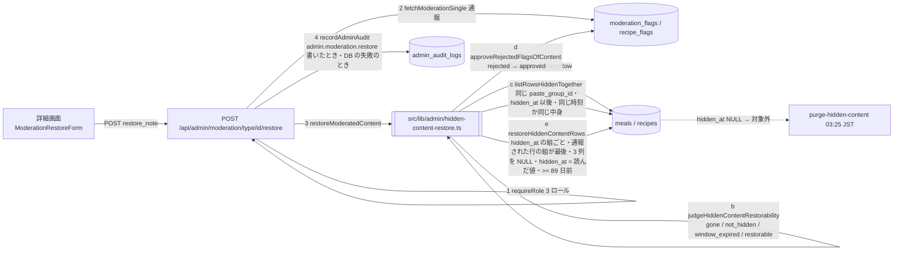

# operator/ 運営が隠したコンテンツを戻す操作 (#1538 の項目 4) — 画面と API の設計

版: v1.0 (2026-10-18)
Status: 設計ゲート通過 (wf_ca3ce394-4b2)。段 A (部品と API・#1878)・段 B (画面・#1881) は実装済み

要件の正本は Issue #1538 の本文 (項目 4「戻す操作: hidden_* を戻す運営の画面と API」) と、同 Issue の 2026-10-18 のコメント。オーナーの選択 (2026-10-18) は次の 1 文で、本書はこれを要件の外形として言い換えずに使う。

> 戻す操作を「今作る」。

本書の前提:
- 隠す側の仕組み (migration `20261009000500_hide_moderated_content.sql` の `hidden_at` / `hidden_by` / `hidden_reason`・RLS・ガードのトリガー・`paste_meal_to_family` の `MEAL_HIDDEN`) と、完全削除のジョブ `purge-hidden-content` (migration `20261016100000_purge_hidden_content.sql`・`supabase/functions/_shared/hidden-content-purge.ts`・90 日 = オーナーの選択 2026-10-15) は変えない。本書は、その上に「戻す」だけを足す。
- 新しい migration は無い (列・ポリシー・トリガー・関数を足さない・変えない。§5)。
- 本番には触らない。本番の隠した行の件数は読んでいない (§2.2)。
- 権限は隠す操作と同じ (`requireRole(['admin', 'super_admin', 'content_moderator'])`。§0.1 D-10)。
- 規約は `docs/design/CLAUDE.md` と `operator/CLAUDE.md`。関連の正本 (02 API・07 監査・cross/04 エラーコード) の改定は §17 の追随表で指定する。

---

## 0. 位置づけ・前提・分冊判定 (相 1)

### 0.1 決めること (要約)

| # | 決めること | 本書の決定 (要約) | 詳細 |
|---|---|---|---|
| D-1 | 戻す操作の API | **`POST /api/admin/moderation/{type}/{id}/restore`** を新設する (`{id}` は通報 `moderation_flags` / `recipe_flags` の id。隠す操作と同じ入口の形)。本文は `{ restore_note }` だけ。判定の順は「通報を読む → コンテンツの行を読む → 戻せるか判定 → 戻す対象の行を集める → 通報を `approved` に → 行の `hidden_*` を NULL に → 監査ログ」 | §4 §6 §8 |
| D-2 | 戻せる行の条件 | **隠されていて (`hidden_at IS NOT NULL`)、隠してから 89 日 (`HIDDEN_CONTENT_RESTORE_WINDOW_DAYS` = 保管期間 90 日 − 1 日) 以内の行だけ**。行が無い (持ち主が消した・完全削除された) → 410、隠れていない → 409、89 日を過ぎた → 409 | §6.1 §11 |
| D-3 | `hidden_*` の戻し方 | **3 列とも NULL に戻す** (隠れていない状態の正規形は「3 列とも NULL」。migration 20261009000500 の 1.)。履歴の列・表は足さない。隠していたときの値 (`hidden_at` / `hidden_by` / `hidden_reason`) は監査ログの `details` に残す | §5 §6.2 |
| D-4 | 戻す理由 | **必須** (`restore_note`。1〜5000 字・前後の空白を除く)。モデレーションの判定を覆す操作なので、理由の無い実行を許さない。食事は `moderation_flags.resolution_note` にも書く (レシピの `recipe_flags` には列が無いので監査ログだけ) | §7.1 |
| D-5 | 戻す対象の行 (食事の複製) | **通報された行 M1 と同じ `paste_group_id` で、M1 の `hidden_at` 以後に隠れた行のうち、(a) `hidden_at` が M1 と同じ行 (同じ操作で隠した複製。隠す操作は 1 回の UPDATE で同じ `hidden_at` を書く。隠したあとで持ち主が中身を書き換えていても戻す) と、(b) 写真とメモが M1 と今も同じ行 (M1 が隠れている間に来た M1 への 2 件目以降の `delete_*` が、まだ隠れていなかった同じ中身の複製を別の時刻で隠したもの) をまとめて戻す**。M1 より前に隠れた行と、あとに隠れて中身が違う行 (別の行への通報の判定で隠れたもの) は戻さない。レシピはその行だけ。起点は M1 なので、自分を指す通報の無い複製は、M1 が消えた・M1 の戻せる期間を過ぎたあとは画面から戻せない (§19・S-25) | §4.1 §6.3 |
| D-6 | 通報 (`moderation_flags` / `recipe_flags`) の扱い | **戻す行 (D-5 の (a)・(b)) を指す通報のうち `rejected` のものを、すべて `approved` にする** (コンテンツが見える状態に戻った以上、「却下 (削除)」の判定は残せない)。`resolved_by` / `resolved_at` (レシピは `reviewed_by` / `reviewed_at`) は戻した運営と時刻。`pending` / `escalated` / `approved` の通報は触らない。新しい状態は足さない | §4.1 §10.3 |
| D-7 | 書く順 | **通報 → 行** (隠す操作の「行 → 通報」の逆)。行は `hidden_at` の組ごとに 1 文で、**M1 の組を最後に**書く (途中で失敗しても M1 が隠れたままなので、やり直せる)。通報の更新に失敗したら何も変えず 500。通報を `approved` にしたあとで行の更新に失敗したら 500 `OP_CONTENT_RESTORE_FAILED`。行は隠れたままなので画面に「非表示の解除」の欄が出続け、同じ操作をやり直せば行が戻る (通報の更新は 0 行で素通り)。逆の順にすると「行は見えるのに通報は却下のまま」になり、画面から直す手段が無くなる | §4.2 §4.3 (S-14・S-15) §6.4 |
| D-8 | 監査ログ | `admin.moderation.restore` (operator/07 §4.1 に足す)。`target_id` = 通報の id・`target_type` = `moderation_item:<type>`。`details` に通報・コンテンツ・持ち主・理由・隠していたときの 3 列の値・対象の行・戻した行・`approved` にした通報・各段の成否。**状態を変えた操作 (通報を `approved` にした・行を戻した) と DB の失敗は必ず 1 行残し、何も書かずに断ったとき (判定の 409 / 410) は残さない** (§6.6)。成功は severity `info`、失敗と、書いたあとで M1 の UPDATE が 0 行になったときは `warn`。本人の権限の client (`createClient()`) で `recordAdminAudit()` を通す (fail-open) | §6.6 §8 |
| D-9 | 投稿者への通知 | **知らせない**。戻した行は本人にはもともと見えていた (隠しても本人には見える)。本人向けの表示・通知の経路は足さない | §1.2 |
| D-10 | 権限 | 隠す操作と同じ `requireRole(['admin', 'super_admin', 'content_moderator'])` (既定の assurance = `aal2`。`MFA_REQUIRED_ROLES` の admin / super_admin は AAL2 が要り、content_moderator は cross/12 の方針どおり MFA の対象外)。`delete_and_perm_ban` のような super_admin 限定は設けない (戻す操作は BAN を解かない: D-11) | §8 §18 |
| D-11 | BAN との関係 | **戻す操作は BAN (`user_profiles.frozen_at`) に触らない**。BAN の解除は既存の `DELETE /api/admin/users/{id}/freeze` | §1.2 |
| D-12 | 画面 | 詳細 `/admin/moderation/{type}/{id}` に「非表示の解除」の欄 (理由の入力 + ボタン。隠れている間だけ出る。89 日を過ぎたら案内だけ)。一覧 `/admin/moderation` のステータスの列に「非表示中」のバッジ。API (`GET /queue`・`GET /{type}/{id}`) が `hidden_at` を返すようにする | §9 |
| D-13 | 完全削除のジョブとの競合 | 戻せる期間を保管期間より 1 日短くする (D-2)。ジョブは「実行を始めた時刻の 90 日前」より前の行を消し、戻す操作は「要求の時刻の 89 日前」以後の行だけを戻す。2 つの期限は別の時刻で決まるが、1 日の幅はジョブの 1 回の実行 (300 秒) より十分長いので、同じ行が同時に両方の対象になることは無い。戻した行は `hidden_at` が NULL になるので、以後のジョブの対象から外れ、画像も「使っている行がある」として残る | §4.2 §6.1 §19 |

### 0.2 分冊判定

目安 3 つのうち「800 行超」に当たるが、**1 冊にする**。新しい migration が無く、触る共有面は運営のモデレーションの部品 (`moderation-schemas.ts`・`moderation-backend.ts`) だけで、消費先は運営の画面 1 つ。作るものは 1 つの機構 (判定 → 通報 → 行 → 監査) で、分けると判定の正本 (§10) が散る。実装は §14 の 2 段 (A: 部品と API / B: 画面) に分け、段ごとに 2 枚のレビューを閉じる。

### 0.3 用語

| 語 | 意味 |
|---|---|
| 隠す (hide) | `delete_*` の判定で `hidden_at` / `hidden_by` / `hidden_reason` を書くこと (`hideModeratedContent`)。本人以外に見えなくなる (RLS) |
| 戻す (restore) | 本書の操作。3 列を NULL に戻し、本人以外にも再び見えるようにする |
| 通報 (flag) | `moderation_flags` (食事) / `recipe_flags` (レシピ) の 1 行。API の `{id}` はこの id |
| コンテンツの行 | 通報が指す `meals` / `recipes` の 1 行 (`content_id`)。戻す対象の起点 |
| 戻す対象の行 | コンテンツの行と、同じ `paste_group_id` で、コンテンツの行の `hidden_at` 以後に隠れ、`hidden_at` が同じ (同じ操作で隠した行) か写真とメモが今も同じ `meals` の行 (D-5)。レシピはコンテンツの行だけ |
| 戻せる期間 (restore window) | 隠してから `HIDDEN_CONTENT_RESTORE_WINDOW_DAYS` (89 日) 以内 (D-2・D-13) |
| 保管期間 (retention) | 隠してから 90 日 (`HIDDEN_CONTENT_RETENTION_DAYS`。オーナーの選択 2026-10-15)。過ぎた行をジョブが消す |

### 0.4 決まったこと (オーナーの選択 2026-10-18)

| # | 決まったこと | 本書での形 |
|---|---|---|
| 1 | 戻す操作を「今作る」。 | 本書の全体 (画面 + API) |

### 0.5 Issue 本文・コメントとの食い違い (本書を正とする)

- Issue #1538 の 2026-10-17 の最後のコメントは、残りを「項目 4: 戻す操作 (必要になったら作る)」と書く。本書は §0.4 のオーナーの選択 (2026-10-18) に従い、今作る (§18 の 1 に記録)。
- Issue #1538 の本文の項目 4 は「hidden_* を戻す運営の画面と API」とだけ書く。戻せる期間・理由の要否・通報の扱い・複製の扱いは本書 §0.1 で決めた。
- migration `20261016100000_purge_hidden_content.sql` の冒頭のコメント (「隠した行を元に戻す操作 (必要なときは service_role で hidden_* を NULL に戻す)」) と `20261009000500` の「運営が隠した行を元に戻す画面・API は作らない」は、適用済みの migration の、その時点の事実としてそのまま残す (書き換えない)。コード側の説明 (`operator/02-api-spec.md` §5 の「隠した行を元に戻す操作は、まだ無い」) は §17 の追随表で現在形にする。同じく、`20261009000500_hide_moderated_content.sql` の 9 行目のコメントが書く判断日「2026-10-08」は誤りで、正しくは 2026-10-09 (#1538 の棚卸しで見つけた記録の誤り)。適用済みの migration なので書き換えず、ここに訂正を残す。

---

## 1. 目的・スコープ

### 1.1 解決すること

- 運営が `delete_*` で隠した食事・レシピを、運営の画面から安全に元に戻せるようにする (誤判定・申し立てへの対応)。いまは service_role で SQL を打つしか無い (migration 20261016100000 の注記)。
- 戻したコンテンツが、完全削除のジョブに消されないことを構造で保証する (D-13)。
- 戻したことを、誰が・いつ・何を・なぜ、の形で監査ログに残す (D-8)。
- 通報の状態とコンテンツの見え方を食い違わせない (D-6・D-7)。

### 1.2 対象外 (本書では決めない・変えない)

- 隠す操作そのもの (`hideModeratedContent`・`POST / PUT /api/admin/moderation/{type}/{id}`・判定の順「隠す → 判定の保存 → BAN」)。本書は `GET` の応答に `hidden_at` を足すだけ (§7.2)。
- 完全削除のジョブ (`purge-hidden-content`・保管期間 90 日・画像の削除の規則・pg_cron の登録)。
- RLS・ガードのトリガー・索引・`paste_meal_to_family`・`count_meals_per_user`・`calculate-segment-stats` の `hidden_at IS NULL` の条件。戻した行は `hidden_at` が NULL になるので、どれも隠す前の扱いに自然に戻る。
- BAN の解除 (D-11)。投稿者への通知 (D-9)。本人のアカウント出力 (`src/lib/account-export-tables.ts`。戻せば `hidden_at` / `hidden_reason` が null で出るだけ)。
- `ai_content` (バックエンドの表が無い。既存どおり 501)。
- 隠した行の一覧の専用画面 (一覧は既存の `/admin/moderation?status=rejected` に「非表示中」のバッジを足すことで足りる。D-12)。このため、自分を指す通報を持たない食事の複製で、起点の通報された行が消えた (通報も CASCADE で消えた)・戻せる期間を過ぎたものは、画面から戻す入口が無い (§4.2 の案 D・§19・S-25)。
- 90 日を過ぎて戻せなくなった行の救済 (保管期間の変更はオーナーの判断。§19)。

---

## 2. 関連要件と現行の事実 (相 1 の「いまの事実」)

### 2.1 根拠

- 要件: Issue #1538 の本文 (項目 4) と 2026-10-18 のコメント (オーナーの選択 (2026-10-18))。要件定義 `docs/requirements/03-operator-admin.md` §5.3 (モデレーション)・§15.8 (監査)。
- 現行 (origin/main `9dd73f23`・2026-10-17):
  - 列: `meals` / `recipes` の `hidden_at timestamptz` / `hidden_by uuid REFERENCES auth.users ON DELETE SET NULL` / `hidden_reason text`。どれも NULL 可・既定値なし。NULL = 隠れていない (migration `20261009000500` の 1.)。
  - ガード: `guard_hidden_content_columns()` (`BEFORE INSERT OR UPDATE OF hidden_at, hidden_by, hidden_reason`) は `current_user` が `authenticated` / `anon` のときだけ `42501 CANNOT_MODIFY_PRIVILEGED_COLUMN`。service_role と DEFINER 関数は止まらない (同 3.)。**戻す操作は service_role (`getSupabaseAdmin()`) で書けば、DB の変更なしに通る**。
  - RLS: `meals_select_owner_or_family` = `(hidden_at IS NULL OR user_id = auth.uid()) AND can_view_user_meals(user_id)`、`recipes."Users can view public recipes"` = `(hidden_at IS NULL OR auth.uid() = user_id) AND (user_id IS NULL OR is_public OR auth.uid() = user_id)` (同 4.)。`hidden_at` を NULL に戻せば、本人以外にも再び見える。
  - 貼り付け: `paste_meal_to_family` は `v_source.hidden_at IS NOT NULL` で `MEAL_HIDDEN` (同 5.)。戻せば通る。
  - 隠す側: `hideModeratedContent` (`src/lib/admin/moderation-backend.ts`) は、食事なら通報された行の `paste_group_id` / `photo_url` / `memo` を読み、同じ `paste_group_id` でまだ隠れていない行のうち中身が同じものを `targetIds` にし、**1 回の `.update({ hidden_at: new Date().toISOString(), hidden_by, hidden_reason: 'moderation:<action>' }).in('id', targetIds).is('hidden_at', null)`** で隠す (すでに隠れている行は上書きしない)。したがって同じ操作で隠した行は `hidden_at` / `hidden_by` / `hidden_reason` がすべて同じ値になる (D-5 の根拠)。
  - 判定の route (`src/app/api/admin/moderation/[type]/[id]/route.ts`): `rejectNullCharacterBody` → `requireRole(['admin', 'super_admin', 'content_moderator'])` → `MODERATION_TYPES` の検査 (400) → `isModerationBacked` (501) → 本文 → `fetchModerationSingle` (service_role) → 隠す → `resolveModerationItem` (status: approve = `approved` / escalate = `escalated` / それ以外 = `rejected`) → BAN → `recordAdminAudit` (`admin.moderation.<action>`・`details` に `content_id` / `hidden` / `hidden_ids` / `status_saved` ほか)。`delete_and_perm_ban` だけ super_admin 限定。
  - 一覧・詳細の API: `fetchModerationList` / `fetchModerationSingle` は `select('*, meals(user_id, photo_url)')` / `select('*, recipes(user_id, image_url)')` で、正規化した `NormalizedModerationItem` に `hidden_at` は無い (画面は隠れているかを知る手段が無い)。
  - 通報の表: `moderation_flags (id, meal_id, user_id, reason, status, created_at, updated_at, flag_type, resolved_by, resolved_at, resolution_note)`・`recipe_flags (id, recipe_id, reporter_id, flag_type, reason, status, reviewed_by, reviewed_at, created_at)`。`status` は `text` (CHECK 制約なし)。アプリが使う値は `pending` / `approved` / `rejected` / `escalated` (`ModerationQueueSearchSchema`)。`moderation_flags.meal_id` / `recipe_flags.recipe_id` はコンテンツの行に CASCADE。
  - 完全削除 (`purgeExpiredHiddenContent`): `cutoff = now − 90 日`。表ごとに `.lt('hidden_at', cutoff)` で古い順に 100 行読み、画像を Storage API で消してから `.delete().in('id', ids).lt('hidden_at', cutoff)` で消す (消す直前にも期限を確かめ直す)。1 回 300 秒まで。読んだ行が 1 行も消えなかったら止める (「同時に別の処理が消した・戻した」の注記あり)。画像は `hidden_content_purge_referenced_needles(p_needles, p_cutoff)` が「`hidden_at IS NULL` または `hidden_at >= p_cutoff` の行が使っている」と答えたものを消さない。
  - pg_cron のジョブ `purge-hidden-content` は毎日 03:25 JST (`25 18 * * *` UTC)。
  - 監査ログ: `admin_audit_logs` の `severity` は `info` / `warn` / `critical` (CHECK)。`target_type` は varchar(30) (`moderation_item:recipe` = 22 字で収まる)。`recordAdminAudit()` は fail-open で `{ ok }` を返す。変更系の route は `recordAdminAudit` を通し、`request` を渡す (`tests/admin-mutation-audit-coverage-1571.test.ts`)。
  - MFA: `MFA_REQUIRED_ROLES = ['super_admin', 'admin', 'finance', 'org_industrial_doctor']` (`src/lib/auth/mfa/policy.ts`)。`requireRole` の既定 (`assurance: 'aal2'`) は、この 4 つを持つ人に AAL2 を求める。content_moderator は対象外。
  - 画面: 一覧 `src/app/admin/moderation/page.tsx` (status の絞り込み `pending` / `approved` / `rejected` / `escalated`・`GET /api/admin/moderation/queue` 経由)。詳細 `src/app/admin/moderation/[type]/[id]/page.tsx` (`GET /api/admin/moderation/{type}/{id}` 経由・`ModerationReviewForm` は `status === 'pending'` のときだけ入力欄を出し、それ以外は「このアイテムは既に審査済みです」)。
  - 本人の出力: `src/lib/account-export-tables.ts` は `meals` / `recipes` の `hidden_by` だけ省き、`hidden_at` / `hidden_reason` は出す。
  - テスト基盤: 単体は `tests/helpers/fake-supabase.ts` (`select` / `eq` / `is` / `in` / `update` / `insert` / `delete` / `single` / `maybeSingle`。**`gte` は無い**)、結合は ローカル Supabase (PostgREST を直接: `tests/integration/rls/hidden-content-visibility.test.ts`) と Next の開発サーバー (`tests/integration/operator/admin-moderation-detail.test.ts`。`apiCall` / `dataOf` / `expectError` / `latestAuditLog`)。
  - `tests/jst-today-source-scan.test.ts` の規則 G: timestamptz の列を `.gte` / `.lt` などで絞る箇所は、暦日でない理由を許可リストに書く (`hidden-content-purge.ts` は count 2 で登録済み)。

### 2.2 本番の読み取り

本番 (Supabase) は読んでいない。本番の隠した行の件数・完全削除の実績は、本書の構造に影響しない (件数が 0 でも 1,000 でも同じ道を通る)。実装後の整合ゲートで、隠した行が 0 件でないなら 1 件を戻して確かめる (§13.4)。

---

## 3. 相 1: 外形固定 — 要件行列とユーザーシナリオ

### 3.1 要件行列 (全 20 行)

| # | 要件 | 根拠 | 本書の節 |
|---|---|---|---|
| R-01 | 運営の画面から、隠した食事・レシピを元に戻せる (API `POST /api/admin/moderation/{type}/{id}/restore` + 詳細画面の欄)。入口は通報なので、例外が 1 つある: 自分を指す通報を持たない食事の複製は、起点の通報された行が使えなくなる (消えて通報も CASCADE で消えた・戻せる期間を過ぎた) と画面から戻せない (隠れたまま保管期間で消える。§19・S-25) | オーナーの選択 (2026-10-17)・Issue 本文の項目 4 | §8 §9 §19 |
| R-02 | 戻せるのは、隠されていて、まだ完全に消えていない行だけ。行が無ければ 410、隠れていなければ 409 | Issue 本文の項目 4・D-2 | §6.1 §11 |
| R-03 | 隠してから 89 日を過ぎた行は戻さない (409)。保管期間 90 日の完全削除と同じ行を同時に扱わない | D-13 | §6.1 §4.2 |
| R-04 | 戻した行は、以後の完全削除の対象にならず、画像も消されない | D-13・`hidden-content-purge.ts` の `.lt('hidden_at')`・`hidden_content_purge_referenced_needles` の `hidden_at IS NULL` | §13.3 (I-5) |
| R-05 | `hidden_at` / `hidden_by` / `hidden_reason` を 3 列とも NULL に戻す。履歴は監査ログ | D-3 | §6.4 |
| R-06 | 食事は、同じ操作で隠した複製 (同じ `paste_group_id`・同じ `hidden_at`) と、通報された行への 2 件目以降の判定があとから隠した同じ中身の複製をまとめて戻す。通報された行より前に隠れた行と、別の行への通報で隠れた (中身が違う) 行は戻さない。レシピはその行だけ | D-5 | §6.3 |
| R-07 | 戻す理由 (`restore_note`) は必須 (1〜5000 字・前後の空白を除く)。NULL 文字は 400 `INVALID_CHARACTER` | D-4・#1657 | §7.1 §8 |
| R-08 | 戻す行を指す `rejected` の通報を `approved` にし、`resolved_by` / `resolved_at` (レシピは `reviewed_by` / `reviewed_at`) を戻した運営と時刻に、食事は `resolution_note` を理由にする。ほかの状態の通報は触らない | D-6 | §6.5 §10.3 |
| R-09 | 書く順は通報 → 行。どの失敗でも成功を装わない (500)。行が隠れたままなら、同じ操作をやり直して戻せる | D-7 | §8 §4.3 |
| R-10 | 監査ログ `admin.moderation.restore` を、状態を変えた操作 (通報を `approved` にした・行を戻した。成功も、書いたあとの失敗・0 行も) と DB の失敗で 1 行残す。何も書かずに断ったとき (判定の 409 / 410) は残さない (本人の client・`recordAdminAudit`・`request` を渡す)。`details` に理由・隠していたときの 3 列の値・対象と戻した行・`approved` にした通報・各段の成否 | D-8・07 §4・#1571 | §8 |
| R-11 | 権限は隠す操作と同じ 3 ロール。admin / super_admin は AAL2 (`requireRole` の既定の assurance・`MFA_REQUIRED_ROLES`)。content_moderator は MFA の対象外で AAL2 を求めない (隠す側と同じ)。content_moderator に戻す操作を許すかは保留 (オーナーの判断があれば従う。既定は隠す側と同じ: §18 の 2)。未認証 401・ロール不足と AAL 不足 403 は既存の文面とコード | D-10・route の `requireRole`・`MFA_REQUIRED_ROLES` | §8 §18 |
| R-12 | `ai_content` は本文の検証より前に 501 `OP_NOT_SUPPORTED` | #1128 | §8 |
| R-13 | 一覧 (`GET /queue`) と詳細 (`GET /{type}/{id}`) の応答に `hidden_at` (ISO 文字列 / null) を足す。既存の項目は変えない | D-12 | §7.2 |
| R-14 | 詳細画面は、隠れている間だけ「非表示の解除」の欄を出す。89 日を過ぎていたら理由の欄とボタンを出さず案内だけ。審査待ち (pending) の通報でも、隠れていれば出す | D-12 | §9.1 §9.2 |
| R-15 | 一覧画面は、隠れている行に「非表示中」のバッジを出す (status の絞り込みは変えない) | D-12 | §9.3 |
| R-16 | 戻す操作は BAN を解かない・投稿者に知らせない | D-9・D-11 | §1.2 |
| R-17 | DB の変更なし (migration・RLS・トリガー・関数・索引・型ファイルを変えない)。環境変数を足さない | D-3・§5 | §5 §12 |
| R-18 | 新しい route は既存の番兵 (NULL 文字・監査の網羅・MFA の入口・JST の走査・生のエラー文の走査) に追随する | §2.1 のテスト基盤 | §16 |
| R-19 | 保管期間の値は Edge Function の `HIDDEN_CONTENT_RETENTION_DAYS` が正本。src 側の写しとの一致を契約テストで固定する | §6.1 の注記 | §13.1 (CT-1) |
| R-20 | 同じコンテンツを 2 人の運営が同時に戻しても、片方は 200、もう片方は 409 (成功を 2 回数えない)。通報を `approved` にした方の操作は、どちらでも監査ログに残る | D-7 の 0 行更新の扱い・D-8 | §6.6 §8 §4.3 (S-16) |

### 3.2 ユーザーシナリオ (25 本)

時刻は JST。「運営」は admin / super_admin / content_moderator のどれか。

| # | シナリオ | 期待する結果 |
|---|---|---|
| S-01 | 運営が食事の通報 F1 を `delete_only` で判定 (行 M1 を隠す。複製なし)。本人から申し立てがあり、3 日後に別の運営が F1 の詳細画面で理由「申し立てを確認。規約違反ではなかった」を入れて「表示に戻す」を押す | 200。M1 の 3 列が NULL・F1 が `approved` (`resolved_by` = 戻した運営・`resolution_note` = 理由)。家族に再び見える。監査ログ `admin.moderation.restore` (info) に `content_id` = M1・`restored_ids` = [M1]・`approved_flag_ids` = [F1]・`hidden_at_before` ほか。画面は「表示に戻しました (1 行)」のあと、状態が `approved`・「表示中」に更新される |
| S-02 | S-01 と同じだが、M1 は家族へ貼り付け済みで、複製 M2・M3 (写真とメモが同じ) も同じ操作で隠れている (同じ `hidden_at`) | 200。M1・M2・M3 がまとめて戻る (`restored_ids` = 3 つ)。M2・M3 の持ち主の家族にも再び見える |
| S-03 | S-02 で、隠されたあとに M2 の持ち主がメモを書き換えていた | M2 も戻る (同じ操作で隠した行は、中身が変わっていても戻す: D-5)。`restored_ids` に M2 を含む |
| S-04 | S-02 の貼り付けグループに、別の通報 F9 で別の時刻に隠された複製 M4 (中身を書き換えたあとで通報されたもの) がある | M4 は戻らない (`hidden_at` が違い、写真とメモも M1 と違う)。F9 は `rejected` のまま。M4 の詳細画面を開けば、別に戻せる |
| S-05 | 運営が公開レシピ R1 の通報 F2 を `delete_and_warn` で判定 (R1 を隠す)。翌日戻す | 200。R1 の 3 列が NULL。未ログインの `GET /api/recipes` に再び出る。`recipe_flags` F2 は `approved`・`reviewed_by` = 戻した運営 (`resolution_note` の列は無いので理由は監査ログだけ) |
| S-06 | M1 に 2 件の通報 F1・F3 があり、両方 `delete_only` で `rejected` (2 件目は隠す対象がすでに隠れていたので上書きなし)。運営が F3 の画面から戻す | 200。M1 が戻り、F1 と F3 の両方が `approved` (`approved_flag_ids` = [F1, F3])。F1 の画面を開いても「表示中」で解除の欄は出ない |
| S-07 | S-01 のあと、別の運営が (古い画面のまま) もう一度「表示に戻す」を押す | 409 `OP_CONTENT_NOT_HIDDEN`「このコンテンツはすでに表示されています」。何も変えず、監査ログも残さない。画面は文面を出して状態を読み直す (`router.refresh()`) |
| S-08 | 隠してから 92 日たった行 (03:25 のジョブがまだ消していない・または消し残し) を戻そうとする | 409 `OP_CONTENT_RESTORE_WINDOW_EXPIRED`「隠してから 89 日を過ぎたため戻せません (保管期間 90 日で完全に削除されます)」。詳細画面は理由の欄とボタンを出さず、この案内だけを出す |
| S-09 | 持ち主が自分で M1 を消した (または完全削除のジョブが消した) あとで、F1 の画面から戻そうとする (通報は CASCADE で消えているので F1 も無い) | 404 `NOT_FOUND` (通報が無い)。通報の外部キー (`moderation_flags_meal_id_fkey`) は ON DELETE CASCADE なので、行を消すと通報も消え、「行が消えて通報だけ残る」形は無い。通報を読んだあと行を読むまでのあいだに行が消えたときだけ 410 `OP_CONTENT_GONE`「コンテンツはすでに削除されています」(P-9)。M1 と同じ操作で隠した複製が残っている形は S-25 |
| S-10 | 通報にコンテンツが紐づいていない (`content_id` が null) 通報で戻そうとする (指す列は NULL を許すので、通報の行を NULL のまま作ったときだけ起きる。行の消滅では生じない: S-09) | 410 `OP_CONTENT_GONE`。何も変えない |
| S-11 | 理由を空 (空白だけ) で送る / 5001 字で送る / 本文が JSON でない / 本文に NULL 文字 | 400 `VALIDATION_ERROR` / 400 `VALIDATION_ERROR` / 400 `INVALID_JSON` / 400 `INVALID_CHARACTER` (認証・DB より前)。画面は空と 5000 字超を送らずに知らせる |
| S-12 | content_moderator が戻す / support が戻す / 未ログインで呼ぶ | 200 (隠す操作と同じ 3 ロール) / 403 `OP_PERMISSION_DENIED` / 401 `AUTH_UNAUTHENTICATED` |
| S-13 | S-01 の翌日 03:25 に完全削除のジョブが動く | M1 は `hidden_at` が NULL なので対象外。M1 の写真は `hidden_content_purge_referenced_needles` が「使っている行がある」と答えるので、同じ写真を指す別の期限切れの行があっても消えない |
| S-14 | S-01 で、通報の更新 (`moderation_flags` の UPDATE) が DB のエラーになった | 500 `INTERNAL_ERROR`「通報の状態を更新できませんでした。コンテンツはまだ非表示のままです。もう一度同じ操作を実行してください」。行は触っていない。監査ログ (warn) に `status_saved: false` / `status_error` / `restored: false`。画面は欄を閉じず、もう一度押せる |
| S-15 | S-01 で、通報は `approved` にできたが、行の UPDATE が DB のエラーになった | 500 `OP_CONTENT_RESTORE_FAILED`「コンテンツを表示に戻せませんでした。通報の状態は承認済みにしました。もう一度同じ操作を実行してください」。監査ログ (warn) に `status_saved: true` / `approved_flag_ids` / `restored: false` / `restore_error`。行は隠れたままなので、画面を開き直しても解除の欄が出る。やり直すと通報は 0 行更新で素通りし、行が戻って 200 |
| S-16 | 2 人の運営がほぼ同時に M1 を戻す | 先の人は 200。後の人は 409 `OP_CONTENT_NOT_HIDDEN` (先の人が書いたあとに読めば判定で、先に読んでいれば M1 の UPDATE が 0 行 → 読み直して `not_hidden`)。監査ログは、先の人の 1 行 (info) と、後の人が通報を `approved` にしていた (通報の UPDATE が先の人より先に commit した) ときだけ後の人の 1 行 (warn・`approved_flag_ids` = [F1]・`restored: false`)。後の人が何も書いていなければ後の人の行は無い。どの順でも、通報の `resolved_by` の人の監査ログに F1 が残る |
| S-17 | `delete_and_temp_ban` で隠され、持ち主が BAN 中の行を戻す | 200。行は戻るが BAN はそのまま (`frozen_at` に触らない)。画面の結果に「BAN の解除は利用者の画面から」の 1 文を添える |
| S-18 | M1 が隠れている状態で、3 件目の通報 F5 が `pending` のまま残っている。運営が F5 の画面を開く | 審査の欄 (pending なので出る) と、非表示の解除の欄の両方が出る。解除すると M1 が戻り、F5 は `pending` のまま (触らない)。あとで F5 を `delete_only` で判定すると、M1 は新しい `hidden_at` で隠れ、保管期間はそこから数え直し |
| S-19 | `type = ai_content` で呼ぶ | 501 `OP_NOT_SUPPORTED` (本文の検証より前)。未認証・ロール不足はそれより前に 401 / 403 |
| S-20 | S-01 のあと、本人が M1 を家族に貼り付ける | 通る (`paste_meal_to_family` の `MEAL_HIDDEN` は `hidden_at IS NOT NULL` のときだけ) |
| S-21 | S-01 のあと、本人がアカウントの出力を取る | `meals` の `hidden_at` / `hidden_reason` が null で出る (`hidden_by` はもともと出さない)。コードの変更なし |
| S-22 | 運営が一覧を `status=rejected` で開く | 隠れている行の通報にはステータスの横に「非表示中」のバッジ。戻した行の通報は `approved` の一覧に移り、バッジは出ない。`pending` の通報でも、コンテンツがすでに隠れていればバッジが出る (S-18 の F5) |
| S-23 | 公開レシピ R2 を隠したあとで持ち主が退会し、`recipes.user_id` が NULL になった (外部キー `recipes_user_id_fkey` は `ON DELETE SET NULL`。migration `20251126124224`。退会で残るのは公開レシピだけ: migration `20261010000100`)。運営が R2 の通報の画面から戻す | 200。R2 の 3 列が NULL になり、RLS `"Users can view public recipes"` の `user_id IS NULL` の項で全員に再び見える (隠れている間は `hidden_at IS NULL OR auth.uid() = user_id` が誰にも真にならず、誰にも見えない)。判定は `user_id` を見ないので S-05 と同じ道を通る。監査ログの `content_user_id` は null。隠した運営が退会して `hidden_by` が NULL の行も、判定は `hidden_at` だけを見るので同じ道 (`hidden_by_before` が null) |
| S-24 | M1 (家族への貼り付けの元) を通報 F1 で `delete_only` にしたとき、複製 M2 は持ち主がメモを書き換えていて中身が違ったので隠れなかった (M1 だけ t1 で隠れる)。その後 M2 の持ち主がメモを元に戻し、M1 への 2 件目の通報 F3 を `delete_only` にすると、隠す操作は M2 を新しい t2 で隠す (M1 は隠れたまま。F3 は `rejected`)。運営が F1 (または F3) の画面から戻す | 200。M1 と M2 の両方が戻る (M2 は t1 以後に隠れ、写真とメモが M1 と同じ: D-5 の (b))。`target_ids` = [M1, M2]・`restored_ids` = [M2, M1] (M2 の組を先に書く)。F1 と F3 は `approved`。M2 を指す通報は無いが、M1 が残っていて M1 の戻せる期間の中なら、M1 から戻る (M1 が消えた・M1 の期間を過ぎたあとは S-25) |
| S-25 | S-02 と同じく、M1 と複製 M2 (別の家族の行) が F1 の `delete_only` で同じ t1 に隠れた。M2 を指す通報は無い。10 日後、M1 の持ち主が M1 を消す (または退会し、`meals_user_id_fkey` の CASCADE で M1 が消える)。F1 は `moderation_flags_meal_id_fkey` の CASCADE で消える。そのあとで運営が M2 を戻したくなる | 画面からは戻せない (限界: §19)。一覧に F1 は無く、F1 の id で呼べば 404 `NOT_FOUND`。M2 を指す通報が無いので、M2 を起点にする入口も無い。M2 は隠れたまま (家族には見えず、本人には見える) で、t1 + 90 日の完全削除のジョブで消える。それまでに戻すには service_role の SQL (M2 の id は隠す操作の監査ログ `admin.moderation.delete_only` の `hidden_ids` にある)。M2 を指す通報 (どの状態でも) があれば、その通報の画面から M2 を起点に戻せる (S-01 と同じ道) |

---

## 4. 相 2・相 3: 構造とその裁定

### 4.1 構造 (確定)



- 判定と読み書きは新設の 1 モジュール `src/lib/admin/hidden-content-restore.ts` (§6) に置く。route (§8) は HTTP への写像 (認可・本文・応答・監査ログ) だけ。隠す側 (`moderation-backend.ts`) は `hidden_at` を返す変更だけ (§7.2)。
- 戻す対象の行は、同じまとまりで通報された行の `hidden_at` 以後に隠れた行のうち、`hidden_at` が同じ時刻の行 (a) と写真とメモが今も同じ行 (b) (D-5・§6.3)。(a) は、隠す側が 1 回の UPDATE で同じ値を書くので、新しい列 (操作の id) を足さずに操作の単位を復元できる。(b) は、同じ行への 2 件目以降の `delete_*` が、別の時刻で隠した同じ中身の複製を拾う。
- 行の UPDATE は `hidden_at` の組ごとに `in('id', 組の行)` + `eq('hidden_at', 読んだ値)` + `gte('hidden_at', now − 89 日)` で絞り、通報された行の組を最後に書く (§6.4)。`eq` は「読んだときと同じ隠し操作」を、`gte` は戻せる期間を、それぞれ書く瞬間にもう一度確かめる (読んでから書くまでに別の操作が戻した・隠し直した・期限を過ぎた行は外れる)。
- 通報された行の組が 0 行のときは行を読み直して理由を決める (`raced`。`gone` → 410 / `not_hidden` → 409 / `window_expired` → 409 / 戻せる = 別の時刻で隠し直されている → 409 `CONFLICT_STALE_DATA`)。この操作が通報を `approved` にした・ほかの組の行を戻したなら、監査ログを warn で残す (§6.6)。

### 4.2 代替案と裁定 (相 3・1 回だけ)

| 案 | 中身 | 退ける / 採る理由 |
|---|---|---|
| **A (採用)**: アプリ側で 2 文 (通報 → 行) + 判定の純関数 | 新しいモジュール 1 つ。DB は変えない。失敗は段ごとに 500 で明示し、行が隠れたままならやり直せる | 隠す側と同じ形 (アプリ側で「隠す → 判定の保存」の 2 文。部分失敗は監査ログとやり直しで受ける) なので、運営の操作の失敗の見え方が揃う。migration・型ファイル・EXECUTE の権限・down.sql が要らず、番兵の追随が最小。残る縁 (S-14・S-15・S-16) は、書く順 (D-7) と 0 行更新の読み直しで、どれも「やり直せば直る」状態に閉じる |
| B: DB の関数 `restore_moderated_content(...)` で 1 トランザクション | migration で plpgsql の関数を足し、通報と行を同じトランザクションで更新。`FOR UPDATE` で行を固定し、`now()` で期限を決める | 部分失敗と競合が構造的に消えるが、migration (番号の確定・本番への適用の順・down.sql)・`database.types.ts` 2 か所・EXECUTE の REVOKE / GRANT・SQL の契約テスト・結合テストが増える。隠す側がアプリ側の 2 文なのに戻す側だけ DB 関数にすると、2 つの操作の失敗の見え方が食い違う。ローンチ前・利用者ゼロで、同時に同じ行を戻す運営が 2 人いる場面は実際には起きにくい。A の縁がやり直しで閉じることを確かめた上で、A を採る |
| C: 履歴の表 (`moderation_content_hides`) + 通報の新しい状態 `restored` | 隠す・戻すを 1 行ずつ記録し、通報の状態に `restored` を足す | 履歴は監査ログ (7 年) がすでに持つ (`hidden_ids`・本書の `restored_ids` と隠していたときの値)。新しい状態は Zod・画面の絞り込み・バッジ・既存テストの `status` の列挙に波及し、`approved` で表せる意味 (この通報の判定は「問題なし」で決着) に名前を増やすだけ。退ける |
| D: 戻す対象を通報でなくコンテンツの id で指定する (`POST /api/admin/moderation/content/{type}/{contentId}/restore`) | 通報が消えていても戻せる | 通報が消えるのは、通報が指す行が消えたとき (`moderation_flags_meal_id_fkey` / `recipe_flags_recipe_id_fkey` の CASCADE) だけ (通報者の退会では `user_id` / `reporter_id` が SET NULL で通報は残る。アプリに通報を消すコードは無い)。したがって通報された行そのものは、通報を起点にして困らない。困るのは食事の複製で、通報された行と一緒に隠れた複製は、自分を指す通報を持たないことがあり、起点の通報された行が消える (持ち主の削除・退会) と通報も消えて、戻す入口を失う (S-25)。D ならその複製にも届くが、運営の画面は通報の一覧で、通報を持たない隠れた行を見つける画面が無い。D を採るなら「隠した行の一覧」の画面と API を新しく作ることになり、本書の範囲 (戻す操作の画面と API・既存の通報の画面に欄を足す) を超える。入口を通報に揃え、この複製は限界として §19 に書く (隠れたまま = 見えてはいけない側に倒れ、保管期間で消える。戻すなら service_role の SQL)。退ける |

縁の発生源を消すより単純な構造は無いか: 2 文のあいだの失敗 (S-15) と競合 (S-16) は A の構造が生む縁だが、B で消すと別の縁 (migration と型の同期・権限) が生まれ、隠す側との非対称も生む。A の縁は「行が隠れたままならやり直せる」の 1 つの性質で全部閉じるので、A のまま確定する。以後、本書の中で構造を蒸し返さない。

### 4.3 トレース (全シナリオを §4.1 の構造で手で走らせる)

| # | 道 (§4.1 の番号) | 結果の確認 |
|---|---|---|
| S-01 | 1 → 2 (F1・`content_id` = M1) → 3a (M1: `hidden_at` = t1) → 3b restorable → 3c (`paste_group_id` null → [M1]) → 3d (F1 rejected → approved) → 3e (1 行) → 4 (info) → 200 | `restored_ids` = [M1]・`approved_flag_ids` = [F1]。RLS: `hidden_at IS NULL` で家族に見える |
| S-02 | 3c が `eq('paste_group_id', g).gte('hidden_at', t1)` で [M1, M2, M3] (どれも t1) → 3d (`meal_id IN (M1,M2,M3) AND status = rejected` → F1) → 3e (t1 の組 1 つ・3 行) | `restored_ids` = 3 つ |
| S-03 | 3c は `hidden_at` が t1 と同じ時刻の行を中身を見ずに拾う ((a)) → M2 を含む | D-5 のとおり |
| S-04 | M4 は `hidden_at` = t9 ≠ t1。t9 < t1 なら `gte` で読まれず、t9 > t1 でも写真とメモが M1 と違うので (b) に入らない → 3d の `meal_id IN` にも入らず F9 は rejected のまま | M4 の画面から別に戻せる (S-01 と同じ道) |
| S-05 | 2 (F2・`content_id` = R1) → 3a (recipes) → 3c ([R1]) → 3d (`recipe_flags` の `recipe_id IN (R1)`・`reviewed_by` / `reviewed_at`) → 3e → 200 | 未ログインの `GET /api/recipes` は RLS `"Users can view public recipes"` で再び返す |
| S-06 | 3d の UPDATE は `meal_id IN (M1) AND status = rejected` なので F1・F3 の両方 → `approved_flag_ids` = [F1, F3] | F1 の画面: `hidden_at` null → 欄なし |
| S-07 | 3a (`hidden_at` null) → 3b not_hidden → 409。3c〜3e・4 に進まない | 監査ログなし (状態を変えていない) |
| S-08 | 3a (`hidden_at` = 92 日前) → 3b window_expired (< now − 89 日) → 409 | 画面は `isWithinHiddenContentRestoreWindow` が false で案内だけ |
| S-09 | 2 で通報なし → 404 / 通報を読んだあとで行が消えた → 3a で行なし → 3b gone → 410 (P-9) | — |
| S-10 | 2 (`content_id` null) → 410 | — |
| S-11 | 0 (NULL 文字 400) / 本文 400 / Zod 400 — どれも 2 より前 | 画面は送らずに知らせる (F-2) |
| S-12 | 1 で 401 / 403。content_moderator は通る | `requireRole` の既存の挙動 |
| S-13 | ジョブの `.lt('hidden_at', cutoff)` に `hidden_at` NULL の M1 は入らない。needles の関数は `m.hidden_at IS NULL` で M1 の URL を数える | I-5 |
| S-14 | 3d が例外 → `HiddenContentRestoreStepError('flags')` → 4 (warn・`status_saved: false`) → 500 `INTERNAL_ERROR` | 3e に進まない。行は隠れたまま |
| S-15 | 3d 成功 → 3e が例外 → `HiddenContentRestoreStepError('rows'・progress.approvedFlagIds)` → 4 (warn・`status_saved: true`・`restored: false`) → 500 `OP_CONTENT_RESTORE_FAILED` | やり直し: 3d は 0 行 (もう approved)・3e で戻る → 200 |
| S-16 | 後の人: 先の人が書いたあとに 3a で読めば 3b not_hidden → 409 (何も書いていない → 監査ログなし)。先の人より前に 3a で読んでいれば 3a〜3c → 3d (先の人の 3d が先に commit していれば 0 件、後の人が先なら [F1]) → 3e の UPDATE は先の人の行ロックを待ち、READ COMMITTED で `eq('hidden_at', t1)` を評価し直して 0 行 → 読み直し not_hidden → `raced` → 409。`approvedFlagIds` が [F1] なら監査ログ warn | どの順でも、先の人の 200 と info の 1 行・後の人の 409。後の人が F1 を approved にした順なら後の人の warn の 1 行 (結合 A-9) |
| S-17 | 3 は `user_profiles` に触らない → BAN はそのまま | 画面の 1 文 (F-1) |
| S-18 | F5 は pending なので 3d の `status = rejected` に合わず触らない。M1 は戻る | その後の delete_* は `hideModeratedContent` の `.is('hidden_at', null)` に合うので新しい `hidden_at` で隠す |
| S-19 | 1 → type の検査 → `isModerationBacked` false → 501 (本文を読む前) | 既存の route と同じ順 |
| S-20 | DB の関数の `v_source.hidden_at IS NOT NULL` が偽 | 既存 F3 と同じ道 |
| S-21 | `account-export-tables.ts` は列をそのまま出す | 変更なし |
| S-22 | `fetchModerationList` の embed に `hidden_at` を足し、正規化で `hidden_at` を返す → 一覧がバッジを出す | §7.2 §9.3 |
| S-23 | 1 → 2 (通報・`content_id` = R2・`item.user_id` = null) → 3a (recipes: `user_id` null・`hidden_at` = t2) → 3b restorable (`user_id` を見ない) → 3c ([R2]) → 3d (`recipe_flags`) → 3e (1 行) → 4 (info・`content_user_id: null`) → 200 | RLS: `hidden_at IS NULL` かつ `user_id IS NULL` で全員に見える (隠す前と同じ) |
| S-24 | 2 (F1・`content_id` = M1) → 3a (M1: t1) → 3b restorable → 3c (`gte('hidden_at', t1)` で M1 (t1)・M2 (t2 > t1)。M2 は時刻が違うが写真とメモが M1 と同じ → (b)) → 3d (`meal_id IN (M1, M2)` の rejected → F1・F3) → 3e (`groupTargetsByHiddenAt`: [t2: M2] → [t1: M1] の 2 文) → 4 (info) → 200 | `restored_ids` = [M2, M1]・`approved_flag_ids` = [F1, F3] |
| S-25 | M1 の削除で F1 が CASCADE で消える → 一覧 (`fetchModerationList`) に F1 が出ない。F1 の id で呼べば 2 (`fetchModerationSingle`) が通報なし → 404。M2 を `content_id` に持つ通報が無いので、1〜4 のどの道も M2 に届かない。M2 は `hidden_at` = t1 のまま → ジョブが t1 + 90 日の後の 03:25 に消す | 限界 (§19・§10.3 の「起点を失った複製」の行)。M2 を指す通報があれば、その通報で 2 → 3a (M2: t1) → 3b restorable → 3c (M2 の t1 以後) → … の S-01 の道で戻る |

---

## 5. データモデル

**変更なし。** 本書は新しい表・列・ポリシー・トリガー・関数・索引・migration を足さず、既存のものも変えない。理由:
- 隠れていない状態の正規形は「`hidden_at` / `hidden_by` / `hidden_reason` がすべて NULL」(migration 20261009000500 の 1. と、ガードの INSERT の条件)。戻す = その正規形に戻す UPDATE で、service_role ならガードに止められない (同 3.)。
- 「同じ操作で隠した行」は `hidden_at` の等値で復元できる (§2.1 の隠す側の事実)。同じ行への 2 件目以降の判定が別の時刻で隠した複製は、写真とメモの一致で拾う (§6.3)。操作の id の列は要らない。
- 履歴は `admin_audit_logs` (7 年・UPDATE / DELETE 不可) が持つ。隠したとき (`hidden_ids`) と戻したとき (本書の `details`) の両方が残る。
- 通報の `status` は `text` で CHECK 制約が無く、既存の値 `approved` を使う (D-6)。

読み書きする既存の表と列 (service_role):

| 表 | 読む | 書く |
|---|---|---|
| `meals` | 通報された行: `id, user_id, hidden_at, hidden_by, hidden_reason, paste_group_id, photo_url, memo`。同じまとまりの行: `id, hidden_at, photo_url, memo` (`paste_group_id` が同じで `hidden_at >=` 通報された行の値。写真とメモは D-5 の (b) の判定にだけ使う) | `hidden_at = NULL, hidden_by = NULL, hidden_reason = NULL` (`hidden_at` の組ごと) |
| `recipes` | `id, user_id, hidden_at, hidden_by, hidden_reason` | 同上 |
| `moderation_flags` | (`fetchModerationSingle` で 1 行) | `status = 'approved', resolved_by, resolved_at, resolution_note` (`meal_id IN 対象 AND status = 'rejected'`) |
| `recipe_flags` | 同上 | `status = 'approved', reviewed_by, reviewed_at` (`recipe_id IN 対象 AND status = 'rejected'`) |
| `admin_audit_logs` | — | INSERT 1 行 (`recordAdminAudit`。本人の client) |

---

## 6. `src/lib/admin/hidden-content-restore.ts` (新設・型検査の対象)

判定の純関数と、service_role での読み書きを 1 つのファイルに置く (import は型 2 つだけ。DB・HTTP・環境変数に触れる型は持たない)。

```ts
/**
 * 運営が隠したコンテンツ (#1101) を戻す (#1538 の項目 4) — 判定の純関数と、service_role での読み書き。
 * 呼ぶのは POST /api/admin/moderation/{type}/{id}/restore (設計 docs/design/operator/13-hidden-content-restore.md)。
 *
 * 隠すのは src/lib/admin/moderation-backend.ts の hideModeratedContent (1 回の UPDATE で、同じ操作で隠した行に同じ hidden_at を書く)。
 * 完全削除は pg_cron のジョブ purge-hidden-content (supabase/functions/_shared/hidden-content-purge.ts。隠してから 90 日を過ぎた行と画像を消す)。
 * 戻した行は hidden_at が NULL になるので、完全削除の対象から外れ、画像も「使っている行がある」として残る。
 *
 * - 戻せるのは、隠されていて (hidden_at IS NOT NULL)、隠してから HIDDEN_CONTENT_RESTORE_WINDOW_DAYS (89 日) 以内の行だけ
 * - 食事は、通報された行と同じ paste_group_id の隠れている行のうち、hidden_at が同じ行 (= 同じ操作で隠した複製) と、
 *   通報された行よりあとに隠れ、写真とメモが通報された行と今も同じ行 (= 同じ行への 2 件目以降の delete_* が隠した複製) をまとめて戻す。
 *   レシピはその行だけ
 * - 書く順は「通報 (rejected → approved) → 行 (hidden_* を NULL。hidden_at の値ごとに 1 文で、通報された行の組を最後に)」。
 *   通報された行が隠れたままなら、同じ操作をやり直して戻せる
 * - hidden_* を書き換えられるのは service_role だけ (DB のトリガー guard_hidden_content_columns) なので、admin には
 *   認可 (requireRole) を通したあとの getSupabaseAdmin() を渡すこと
 */
import type { SupabaseClient } from '@supabase/supabase-js';
import type { ModerationBackedType } from '@/lib/admin/moderation-backend';

/**
 * 隠してから完全に消すまでの日数の写し。正本は supabase/functions/_shared/hidden-content-purge.ts の HIDDEN_CONTENT_RETENTION_DAYS
 * (オーナーの選択 2026-10-15: 90 日)。Edge Function のモジュールは Deno の書き方 (拡張子つきの import) で、src から型検査を通して
 * import できないので、ここに写す。一致は契約テスト (tests/hidden-content-restore-contract.test.ts CT-1) が確かめる
 */
export const HIDDEN_CONTENT_RETENTION_DAYS = 90;

/**
 * 戻せる期間を保管期間より短くする幅 (日)。完全削除のジョブは「実行を始めた時刻の 90 日前」より前の行を消し、戻す操作は
 * 「要求の時刻の 89 日前」以後の行だけを戻す。2 つの期限は別の時刻で決まるので、同じ行が両方の対象になる余地を、
 * ジョブの 1 回の実行時間 (300 秒。HIDDEN_CONTENT_PURGE_MAX_DURATION_MS) より十分長い 1 日の幅で消す。
 * これが無いと、ジョブが画像を消したあと行を消す前に戻す操作が割り込み、画像の無い行が残ることがある
 */
export const HIDDEN_CONTENT_RESTORE_MARGIN_DAYS = 1;

/** 戻せる期間 (隠してからの日数)。この日数を過ぎた行は戻さない (完全削除を待つ) */
export const HIDDEN_CONTENT_RESTORE_WINDOW_DAYS = HIDDEN_CONTENT_RETENTION_DAYS - HIDDEN_CONTENT_RESTORE_MARGIN_DAYS;

const MS_PER_DAY = 24 * 60 * 60 * 1000;

/** 通報の状態 (moderation_flags.status / recipe_flags.status) のうち、戻す操作が読む値と書く値 */
export const FLAG_STATUS_REJECTED = 'rejected';
export const FLAG_STATUS_APPROVED = 'approved';

/** 通報されたコンテンツ本体の表 (hideModeratedContent の contentTable と同じ対応) */
export const HIDDEN_CONTENT_TABLE_OF = {
  food: 'meals',
  recipe: 'recipes',
} as const satisfies Record<ModerationBackedType, 'meals' | 'recipes'>;

/** 通報の表 */
export const MODERATION_FLAG_TABLE_OF = {
  food: 'moderation_flags',
  recipe: 'recipe_flags',
} as const satisfies Record<ModerationBackedType, 'moderation_flags' | 'recipe_flags'>;

/** 通報の表の、コンテンツ本体を指す列 */
export const MODERATION_FLAG_CONTENT_COLUMN_OF = {
  food: 'meal_id',
  recipe: 'recipe_id',
} as const satisfies Record<ModerationBackedType, 'meal_id' | 'recipe_id'>;

/**
 * コンテンツの行から読む列。paste_group_id・photo_url・memo は meals にしか無い。
 * 型は string にしておく (文字列のリテラルのままだと、supabase-js の select の型の解析が長い列の並びで ParserError になる。
 * 行の形は unknown として受けて列ごとに確かめる: readHiddenContentRow)
 */
const HIDDEN_CONTENT_COLUMNS_OF: Readonly<Record<ModerationBackedType, string>> = {
  food: 'id, user_id, hidden_at, hidden_by, hidden_reason, paste_group_id, photo_url, memo',
  recipe: 'id, user_id, hidden_at, hidden_by, hidden_reason',
};

/** 同じまとまり (paste_group_id) の行から読む列。戻す対象を決める (listRowsHiddenTogether) */
const PASTE_GROUP_ROW_COLUMNS = 'id, hidden_at, photo_url, memo';

/** 戻す操作に使う client。認可 (requireRole) を通したあとの service_role の client を渡す */
export type HiddenContentRestoreAdmin = Pick<SupabaseClient, 'from'>;

/** 通報が指すコンテンツ本体の行の、戻す操作に関わる列 */
export interface HiddenContentRow {
  id: string;
  /** 持ち主。退会で外れた公開レシピは null (外部キーは ON DELETE SET NULL)。戻せるかの判定には使わない (S-23) */
  user_id: string | null;
  hidden_at: string | null;
  hidden_by: string | null;
  hidden_reason: string | null;
  /** 家族への貼り付けのまとまり (meals だけ)。recipes は常に null */
  paste_group_id: string | null;
  /** 写真 (meals だけ。recipes は常に null)。同じ中身の複製の判定 (hasSameMealContent) に使う */
  photo_url: string | null;
  /** メモ (meals だけ。recipes は常に null) */
  memo: string | null;
}

/** 隠れている行 (hidden_at が入っている) */
export interface HiddenContentRowHidden extends HiddenContentRow {
  hidden_at: string;
}

/** 戻す対象の 1 行 (id と、読んだときの hidden_at) */
export interface HiddenContentTarget {
  id: string;
  hidden_at: string;
}

/** 行を戻す UPDATE の 1 文分 (hidden_at が同じ行の組) */
export interface HiddenContentRestoreBatch {
  hiddenAt: string;
  ids: string[];
}

/** 写真とメモ (同じ中身かを比べる列) */
export interface MealContentFields {
  photo_url: string | null;
  memo: string | null;
}

/**
 * 写真とメモが同じか。隠す側 (src/lib/admin/moderation-backend.ts の isSameMealContent。export されていない) と同じ式で、
 * 一致は契約テスト (tests/hidden-content-restore-contract.test.ts CT-8) が確かめる
 */
export function hasSameMealContent(a: MealContentFields, b: MealContentFields): boolean {
  return a.photo_url === b.photo_url && a.memo === b.memo;
}

/** 2 つの hidden_at (ISO の文字列) が同じ時刻か (PostgREST の書き方の違いに左右されないよう、時刻の値で比べる) */
function isSameInstant(a: string, b: string): boolean {
  return Date.parse(a) === Date.parse(b);
}

/** 戻せるかの判定 (読んだ行と「今」だけで決まる純関数の結果) */
export type HiddenContentRestorability =
  | { kind: 'restorable'; row: HiddenContentRowHidden }
  | { kind: 'not_hidden'; row: HiddenContentRow }
  | { kind: 'window_expired'; row: HiddenContentRowHidden }
  | { kind: 'gone' };

/** 戻せる期間の下限 = now の 89 日前。hidden_at がこれ以後の行だけを戻す */
export function hiddenContentRestoreCutoff(now: Date): Date {
  return new Date(now.getTime() - HIDDEN_CONTENT_RESTORE_WINDOW_DAYS * MS_PER_DAY);
}

/**
 * 隠した日時が戻せる期間の中か (hidden_at >= now − 89 日)。画面 (欄を出すか) と判定 (judgeHiddenContentRestorability) の両方が使う。
 * hidden_at が日時として読めないときは例外 (DB の timestamptz の列なので、起きるのはプログラムの誤り)
 */
export function isWithinHiddenContentRestoreWindow(hiddenAt: string, now: Date): boolean {
  const hiddenAtMs = Date.parse(hiddenAt);
  if (Number.isNaN(hiddenAtMs)) {
    throw new Error('isWithinHiddenContentRestoreWindow: hidden_at is not a valid timestamp');
  }
  return hiddenAtMs >= hiddenContentRestoreCutoff(now).getTime();
}

/** 読んだ行から、戻せるかを決める (§10.1.1 の判定表 P-9〜P-11 の正本) */
export function judgeHiddenContentRestorability(row: HiddenContentRow | null, now: Date): HiddenContentRestorability {
  if (row === null) return { kind: 'gone' };
  if (row.hidden_at === null) return { kind: 'not_hidden', row };
  const hidden: HiddenContentRowHidden = { ...row, hidden_at: row.hidden_at };
  return isWithinHiddenContentRestoreWindow(hidden.hidden_at, now)
    ? { kind: 'restorable', row: hidden }
    : { kind: 'window_expired', row: hidden };
}

/**
 * PostgREST が返す 1 行。列を文字列で組み立てた select なので、supabase-js の型は行の形を表さない (GenericStringError)。
 * 形の分からない値 (unknown) として受けて、列ごとに確かめる
 */
type UnknownRow = Readonly<Record<string, unknown>>;

function isUnknownRow(value: unknown): value is UnknownRow {
  return typeof value === 'object' && value !== null && !Array.isArray(value);
}

/** 列の値が文字列ならその値、それ以外 (null・列が無い) なら null */
function stringOrNull(value: unknown): string | null {
  return typeof value === 'string' ? value : null;
}

/** 通報が指すコンテンツ本体の行を読む。無ければ null。DB エラーは例外 */
export async function readHiddenContentRow(
  admin: HiddenContentRestoreAdmin,
  type: ModerationBackedType,
  contentId: string,
): Promise<HiddenContentRow | null> {
  const { data, error } = await admin
    .from(HIDDEN_CONTENT_TABLE_OF[type])
    .select(HIDDEN_CONTENT_COLUMNS_OF[type])
    .eq('id', contentId)
    .maybeSingle();
  if (error) throw error;
  const raw: unknown = data;
  if (raw === null) return null;
  if (!isUnknownRow(raw) || typeof raw.id !== 'string') {
    throw new Error('readHiddenContentRow: unexpected row shape');
  }
  return {
    id: raw.id,
    user_id: stringOrNull(raw.user_id),
    hidden_at: stringOrNull(raw.hidden_at),
    hidden_by: stringOrNull(raw.hidden_by),
    hidden_reason: stringOrNull(raw.hidden_reason),
    paste_group_id: stringOrNull(raw.paste_group_id),
    photo_url: stringOrNull(raw.photo_url),
    memo: stringOrNull(raw.memo),
  };
}

/**
 * 戻す対象の行 (D-5)。食事は、通報された行と同じ paste_group_id で、通報された行の hidden_at 以後に隠れた行
 * (gte。NULL = 隠れていない行は入らない) のうち、
 *   (a) hidden_at が通報された行と同じ行 (= hideModeratedContent の 1 回の UPDATE で隠した行。隠したあとで持ち主が中身を書き換えていても戻す)
 *   (b) 写真とメモが通報された行と今も同じ行 (= 通報された行が隠れている間に来た 2 件目以降の delete_* が、まだ隠れていなかった
 *       同じ中身の複製を、別の時刻で隠したもの)
 * を戻す。通報された行より前に隠れた行と、あとに隠れて中身が違う行 (別の行への通報の判定で隠れたもの) は戻さない。
 * レシピには複製の仕組みが無いので、通報された行だけ。通報された行は必ず含める (その hidden_at は読んだ値のまま)
 */
export async function listRowsHiddenTogether(
  admin: HiddenContentRestoreAdmin,
  type: ModerationBackedType,
  row: HiddenContentRowHidden,
): Promise<HiddenContentTarget[]> {
  const self: HiddenContentTarget = { id: row.id, hidden_at: row.hidden_at };
  if (type !== 'food' || row.paste_group_id === null) return [self];
  const { data, error } = await admin
    .from(HIDDEN_CONTENT_TABLE_OF.food)
    .select(PASTE_GROUP_ROW_COLUMNS)
    .eq('paste_group_id', row.paste_group_id)
    .gte('hidden_at', row.hidden_at);
  if (error) throw error;
  const rows: unknown = data ?? [];
  const others = (Array.isArray(rows) ? rows : []).flatMap((r: unknown): HiddenContentTarget[] => {
    if (!isUnknownRow(r) || typeof r.id !== 'string' || r.id === row.id) return [];
    const hiddenAt = stringOrNull(r.hidden_at);
    if (hiddenAt === null) return [];
    const content: MealContentFields = { photo_url: stringOrNull(r.photo_url), memo: stringOrNull(r.memo) };
    return isSameInstant(hiddenAt, row.hidden_at) || hasSameMealContent(content, row) ? [{ id: r.id, hidden_at: hiddenAt }] : [];
  });
  return [self, ...others];
}

/**
 * 戻す対象を hidden_at ごとの組 (行を戻す UPDATE の 1 文分) に分ける。組の順は対象の並びのとおりで、通報された行 (content) の組を
 * 必ず最後にする (途中の組で失敗しても、通報された行が隠れたままなので、画面の欄からやり直せる: D-7)
 */
export function groupTargetsByHiddenAt(
  targets: readonly HiddenContentTarget[],
  content: HiddenContentTarget,
): HiddenContentRestoreBatch[] {
  const batches: HiddenContentRestoreBatch[] = [];
  const contentBatch: HiddenContentRestoreBatch = { hiddenAt: content.hidden_at, ids: [content.id] };
  for (const target of targets) {
    if (target.id === content.id) continue;
    if (isSameInstant(target.hidden_at, content.hidden_at)) {
      contentBatch.ids.push(target.id);
      continue;
    }
    const batch = batches.find((b) => isSameInstant(b.hiddenAt, target.hidden_at));
    if (batch) batch.ids.push(target.id);
    else batches.push({ hiddenAt: target.hidden_at, ids: [target.id] });
  }
  return [...batches, contentBatch];
}

export interface ApproveRejectedFlagsParams {
  /** 戻した運営 (resolved_by / reviewed_by) */
  resolvedBy: string;
  /** 戻す理由。moderation_flags.resolution_note に書く (recipe_flags には列が無い) */
  resolutionNote: string;
  now: Date;
}

/**
 * 戻す行を指す通報のうち rejected のものを approved にする (D-6)。pending / escalated / approved は触らない。
 * 戻り値は状態を変えた通報の ID (0 件も正常: やり直し・別の運営が先に戻した)。DB エラーは例外
 */
export async function approveRejectedFlagsOfContent(
  admin: HiddenContentRestoreAdmin,
  type: ModerationBackedType,
  contentIds: readonly string[],
  params: ApproveRejectedFlagsParams,
): Promise<string[]> {
  const nowIso = params.now.toISOString();
  const patch =
    type === 'food'
      ? {
          status: FLAG_STATUS_APPROVED,
          resolved_by: params.resolvedBy,
          resolved_at: nowIso,
          resolution_note: params.resolutionNote,
        }
      : { status: FLAG_STATUS_APPROVED, reviewed_by: params.resolvedBy, reviewed_at: nowIso };
  const { data, error } = await admin
    .from(MODERATION_FLAG_TABLE_OF[type])
    .update(patch)
    .in(MODERATION_FLAG_CONTENT_COLUMN_OF[type], [...contentIds])
    .eq('status', FLAG_STATUS_REJECTED)
    .select('id');
  if (error) throw error;
  return ((data ?? []) as Array<{ id: string }>).map((r) => r.id);
}

/**
 * 行の hidden_at / hidden_by / hidden_reason を NULL に戻す (D-3)。hidden_at が同じ行の組 (groupTargetsByHiddenAt の 1 組) を 1 文で。
 * - eq('hidden_at', hiddenAt): 読んだときと同じ隠し操作の行だけ (読んでから書くまでに戻されて隠し直された行は外れる)
 * - gte('hidden_at', 期限): 戻せる期間 (89 日) を書く瞬間にもう一度確かめる (完全削除のジョブと同じ行を扱わない: D-13)
 * 戻り値は戻した行の ID。通報された行の組で 0 件なら「読んでから書くまでに状態が変わった」の合図 (restoreModeratedContent が読み直す)。
 * DB エラーは例外
 */
export async function restoreHiddenContentRows(
  admin: HiddenContentRestoreAdmin,
  type: ModerationBackedType,
  contentIds: readonly string[],
  hiddenAt: string,
  now: Date,
): Promise<string[]> {
  const cutoffIso = hiddenContentRestoreCutoff(now).toISOString();
  const { data, error } = await admin
    .from(HIDDEN_CONTENT_TABLE_OF[type])
    .update({ hidden_at: null, hidden_by: null, hidden_reason: null })
    .in('id', [...contentIds])
    .eq('hidden_at', hiddenAt)
    .gte('hidden_at', cutoffIso)
    .select('id');
  if (error) throw error;
  return ((data ?? []) as Array<{ id: string }>).map((r) => r.id);
}

/** restoreModeratedContent の段 (失敗したときに、どこまで進んだかを route が監査ログに残す) */
export type HiddenContentRestoreStep = 'read' | 'flags' | 'rows' | 'reread';

/** 失敗した (または途中で止まった) ときに、それまでに済んだこと。route が監査ログに残す */
export interface HiddenContentRestoreProgress {
  /** 戻す対象の行 (まとまりを読む前なら空) */
  readonly targetIds: readonly string[];
  /** approved にできた通報 (flags の段より前なら空) */
  readonly approvedFlagIds: readonly string[];
  /** 戻せた行 (rows の段の途中で失敗したときは、先に書いた組の行) */
  readonly restoredIds: readonly string[];
}

/** まだ何も済んでいない (read の段の失敗) */
export const NO_RESTORE_PROGRESS: HiddenContentRestoreProgress = { targetIds: [], approvedFlagIds: [], restoredIds: [] };

/** 段の DB の失敗。route は step で応答のコードを決め、before / progress を監査ログに残す */
export class HiddenContentRestoreStepError extends Error {
  readonly step: HiddenContentRestoreStep;
  /** 元のエラー (supabase-js のエラーは Error とは限らない)。応答の本文には出さない */
  readonly reason: unknown;
  /** 判定の時点で読んだ行 (読めなかったときは null) */
  readonly before: HiddenContentRowHidden | null;
  /** 失敗の前に済んだこと */
  readonly progress: HiddenContentRestoreProgress;

  constructor(
    step: HiddenContentRestoreStep,
    reason: unknown,
    before: HiddenContentRowHidden | null,
    progress: HiddenContentRestoreProgress,
  ) {
    super(`restoreModeratedContent: ${step} failed`);
    this.name = 'HiddenContentRestoreStepError';
    this.step = step;
    this.reason = reason;
    this.before = before;
    this.progress = progress;
  }
}

export interface RestoreModeratedContentParams {
  /** 戻した運営 */
  restoredBy: string;
  /** 戻す理由 (検証済み。1〜5000 字) */
  restoreNote: string;
  now: Date;
}

/** restoreModeratedContent の結果 (§10.1 の判定表の正本) */
export type HiddenContentRestoreOutcome =
  | Exclude<HiddenContentRestorability, { kind: 'restorable' }>
  | {
      kind: 'restored';
      /** 判定の時点の行 (隠していたときの 3 列の値。監査ログに残す) */
      before: HiddenContentRowHidden;
      /** 戻す対象の行 (D-5) */
      targetIds: string[];
      /** 実際に戻した行 (通報された行を必ず含む) */
      restoredIds: string[];
      /** approved にした通報 */
      approvedFlagIds: string[];
    }
  | {
      /**
       * 通報された行の UPDATE が 0 行だった (読んでから書くまでに、別の操作が戻した・消した・隠し直した・期限の境を越えた)。
       * again は読み直した判定 (restorable = 別の時刻で隠し直されている)。それまでに書いたこと (通報の approved・先に書いた組の行) を持つ
       */
      kind: 'raced';
      before: HiddenContentRowHidden;
      targetIds: string[];
      restoredIds: string[];
      approvedFlagIds: string[];
      again: HiddenContentRestorability;
    };

/**
 * 通報が指すコンテンツを戻す。順は「行を読む → 判定 → 戻す対象の行 → 通報を approved に → 行を NULL に (hidden_at の組ごと。通報された行の組が最後)」。
 * 判定で戻せないときは何も書かずにその理由を返す。DB の失敗は HiddenContentRestoreStepError (どの段かと、済んだことを持つ)
 */
export async function restoreModeratedContent(
  admin: HiddenContentRestoreAdmin,
  type: ModerationBackedType,
  contentId: string,
  params: RestoreModeratedContentParams,
): Promise<HiddenContentRestoreOutcome> {
  let row: HiddenContentRow | null;
  try {
    row = await readHiddenContentRow(admin, type, contentId);
  } catch (reason) {
    throw new HiddenContentRestoreStepError('read', reason, null, NO_RESTORE_PROGRESS);
  }
  const judged = judgeHiddenContentRestorability(row, params.now);
  if (judged.kind !== 'restorable') return judged;
  const before = judged.row;

  let targets: HiddenContentTarget[];
  try {
    targets = await listRowsHiddenTogether(admin, type, before);
  } catch (reason) {
    throw new HiddenContentRestoreStepError('read', reason, before, NO_RESTORE_PROGRESS);
  }
  const targetIds = targets.map((target) => target.id);

  let approvedFlagIds: string[];
  try {
    approvedFlagIds = await approveRejectedFlagsOfContent(admin, type, targetIds, {
      resolvedBy: params.restoredBy,
      resolutionNote: params.restoreNote,
      now: params.now,
    });
  } catch (reason) {
    throw new HiddenContentRestoreStepError('flags', reason, before, { ...NO_RESTORE_PROGRESS, targetIds });
  }

  // hidden_at の組ごとに 1 文。通報された行の組が最後 (groupTargetsByHiddenAt)
  const restoredIds: string[] = [];
  for (const batch of groupTargetsByHiddenAt(targets, { id: before.id, hidden_at: before.hidden_at })) {
    try {
      restoredIds.push(...(await restoreHiddenContentRows(admin, type, batch.ids, batch.hiddenAt, params.now)));
    } catch (reason) {
      throw new HiddenContentRestoreStepError('rows', reason, before, {
        targetIds,
        approvedFlagIds,
        restoredIds: [...restoredIds],
      });
    }
  }
  if (restoredIds.includes(before.id)) return { kind: 'restored', before, targetIds, restoredIds, approvedFlagIds };

  // 通報された行が 0 行: 読んでから書くまでに、別の操作が戻した・消した・隠し直した・期限の境を越えた。読み直して理由を返す
  let again: HiddenContentRow | null;
  try {
    again = await readHiddenContentRow(admin, type, contentId);
  } catch (reason) {
    throw new HiddenContentRestoreStepError('reread', reason, before, { targetIds, approvedFlagIds, restoredIds });
  }
  return {
    kind: 'raced',
    before,
    targetIds,
    restoredIds,
    approvedFlagIds,
    again: judgeHiddenContentRestorability(again, params.now),
  };
}
```

### 6.1 戻せる期間の根拠 (D-2・D-13)

- 完全削除のジョブは 03:25 JST に始まり、`cutoff_p = T_p − 90 日` より前の行を、画像を消してから `DELETE … AND hidden_at < cutoff_p` で消す (1 回 300 秒まで)。
- 戻す操作は `cutoff_r = T_r − 89 日` 以後の行だけを戻す。`T_r` と `T_p` の差がどうであれ、`cutoff_r − cutoff_p = (T_r − T_p) + 1 日` で、`T_r` が `T_p` の 300 秒以上前でない限り正。したがって「ジョブが読んだ行 (`hidden_at < cutoff_p`)」と「戻す操作が書く行 (`hidden_at >= cutoff_r`)」は交わらない。
- 代償: 隠してから 89 日〜90 日 (+ 次の 03:25 まで) のあいだは、行がまだあるのに戻せない (S-08)。最長で 2 日弱。保管期間 90 日の運用の中では許容し、§19 に書く。

### 6.2 戻し方 (D-3)

3 列を NULL にする UPDATE (hidden_at が同じ行の組ごとに 1 文。§6.4)。`hidden_by` を残して「誰が隠したか」を行に持たせる案は、ガードの INSERT の条件 (3 列のどれかが非 NULL なら拒否) と「隠れていない = 3 列とも NULL」の正規形を崩すので採らない。隠していたときの値は監査ログの `details` (`hidden_at_before` / `hidden_by_before` / `hidden_reason_before`。通報された行の値) に残す。

### 6.3 戻す対象の行 (D-5)

隠す側 (`hideModeratedContent`) が同じまとまりの行を隠す道は 2 つある。

| 隠す道 | 隠れる行 | その行の `hidden_at` | 戻す側の拾い方 |
|---|---|---|---|
| 通報された行 M1 への 1 件目の `delete_*` | M1 と、まだ隠れていない、M1 と写真とメモが同じ行 | M1 と同じ t1 (1 回の UPDATE) | (a) `hidden_at` が t1 と同じ時刻 (中身を見ない: S-03) |
| M1 が隠れている間に来た、M1 への 2 件目以降の `delete_*` (M1 は `.is('hidden_at', null)` に合わないので上書きされない) | まだ隠れていない、M1 と写真とメモが同じ行 (1 件目のときは中身が違ったが、その後に持ち主が書き戻した行) | 新しい t2 (> t1) | (b) t1 以後に隠れ、写真とメモが M1 と今も同じ (S-24) |
| 同じまとまりの別の行 M4 への `delete_*` | M4 と、M4 と写真とメモが同じ行 | M4 の操作の時刻 | 拾わない (M1 より前なら `gte` で外れ、あとでも中身が M1 と違う: S-04)。M4 の通報の画面から戻す |

- (a) は `hideModeratedContent` が `new Date().toISOString()` (ミリ秒) を 1 回作って 1 回の UPDATE に使うことによる。同じ操作で隠した行の `hidden_at` は DB でも同じ値 (timestamptz はマイクロ秒まで持つが、書いた値はミリ秒で切れている)。比べるのは `Date.parse` の時刻の値 (`isSameInstant`)。PostgREST が返す文字列 (`2026-10-18T01:02:03.456+00:00`) を `eq('hidden_at', …)` に戻すと、同じ値に解決される (結合テスト I-2 で確かめる)。別の操作が同じミリ秒に同じまとまりを隠すことは実際には起きない (起きても、どちらも運営の隠す操作なので、まとめて戻って困らない)。
- (b) の「中身が同じ」は隠す側と同じ式 (`hasSameMealContent` = `isSameMealContent` の写し。CT-8)。M1 への判定を覆す操作なので、M1 と同じ中身のために隠れた行を戻す。(b) で拾った行を指す `rejected` の通報があれば、それも `approved` にする (§6.5。同じ中身への判定を、戻す理由で覆す)。
- 拾えない形 (§19): (b) の行が、t2 で隠れたあとでさらに持ち主に書き換えられ、M1 と中身が違う。その行は M1 から戻らず、その行を指す通報も無いので、画面からは戻せない (隠れたまま保管期間で消える。安全な側に倒れる)。
- 起点を失う形 (§19・S-25): (a)・(b) の行は M1 を起点にしてしか拾えない。M1 が消える (持ち主の削除・持ち主の退会 = `meals_user_id_fkey` の CASCADE・完全削除のジョブ) と、M1 を指す通報も CASCADE で消えて起点が無くなる (完全削除のジョブで消えるときは、(a) の行も同じ期限で消える)。M1 が残っていても、M1 の戻せる期間 (t1 + 89 日) を過ぎると判定は `window_expired` で止まり、(b) の行 (t2 > t1) は自分の期間の中でも戻らない。どちらも、その行を指す通報 (どの状態でも) があれば、その通報の画面から、その行を起点に戻せる。無ければ隠れたまま、自分の保管期間 (隠した時刻 + 90 日) で消える。

### 6.4 書く順 (D-7)

| 順 | 失敗したとき | 画面から直せるか |
|---|---|---|
| **通報 → 行 (採用)** | 通報だけ approved で行は隠れたまま (S-15) | 直せる: 行が隠れているので「非表示の解除」の欄が出続け、やり直すと通報は 0 行で素通りし行が戻る |
| 行 → 通報 | 行は見えるのに通報は rejected のまま | 直せない: 行が見えているので欄が出ず、通報の状態を変える入口が無い (審査の欄は pending にしか出ない) |

行の UPDATE は `hidden_at` の組ごとに 1 文で、**通報された行 M1 の組を最後に書く** (`groupTargetsByHiddenAt`)。(b) の組を書いたあとで M1 の組の UPDATE が失敗しても、M1 は隠れたままなので欄が出続け、やり直せば M1 の組が戻る ((b) の行はすでに表示中なので、やり直しの対象に入らない)。逆に M1 を先に書くと、(b) の組で失敗したときに M1 が表示中になって欄が消え、(b) の行を戻す入口が無くなる。

### 6.5 通報の扱い (D-6)

戻す行 (`targetIds`。§6.3 の (a) と (b)) を指す通報のうち `status = 'rejected'` のものを `approved` にする。`pending` (まだ判定していない) と `escalated` (上位の判断待ち) は、その判定がまだ生きているので触らない。すでに `approved` のものはそのまま。`approved` にする通報の `resolved_by` / `resolved_at` (レシピは `reviewed_by` / `reviewed_at`) は戻した運営と時刻で上書きする (通報の行は「最後の判定」を表し、前の判定は監査ログに残る)。

### 6.6 通報された行の UPDATE が 0 行のとき (`raced`) と監査ログ (D-8)

通報を `approved` にしたあとで、通報された行の UPDATE が 0 行になることがある (読んでから書くまでに、別の運営が戻した・持ち主が消した・別の操作で隠し直された・89 日の境を越えた)。`restoreModeratedContent` は行を読み直し、`{ kind: 'raced', again, targetIds, restoredIds, approvedFlagIds }` を返す。route は `again` で応答を決め (§10.1.1 の P-18〜P-21)、**この操作が何かを書いていれば (`approvedFlagIds` か `restoredIds` が空でない)、監査ログを warn で 1 行残す**。何も書いていなければ残さない (判定で断った 409 / 410 と同じ)。

監査ログの規則 (R-10) を 1 つにまとめると「**状態を変えた操作 (通報を approved にした・行を戻した) と、DB の失敗は、必ず 1 行残す。何も書かずに断ったとき (判定の 409 / 410、0 行で何も書いていないとき) は残さない**」。これで、通報の `resolved_by` / `resolution_note` に残る操作は、必ずどれかの `admin.moderation.restore` の `approved_flag_ids` に現れる (S-16 の交差の順によらない)。

`again` ごとの、書いたあとの状態:

| `again` | 応答 | そのあとの状態 | 食い違いの扱い |
|---|---|---|---|
| `gone` (P-18) | 410 `OP_CONTENT_GONE` | 行は消えた。通報は外部キーの CASCADE で消える | 残らない |
| `not_hidden` (P-19) | 409 `OP_CONTENT_NOT_HIDDEN` | 行は表示中 (別の運営が戻した)。通報は approved | 食い違いなし (表示中・approved) |
| `window_expired` (P-20) | 409 `OP_CONTENT_RESTORE_WINDOW_EXPIRED` | 行は隠れたまま・通報は approved。保管期間 (90 日) を過ぎた次の完全削除のジョブ (最長 2 日弱のあと) で行が消え、通報も CASCADE で消える | 消えるまでのあいだだけ「approved なのに隠れている」。監査ログ (warn) に残る (§19) |
| `restorable` (P-21。別の時刻で隠し直された) | 409 `CONFLICT_STALE_DATA` | 行は新しい時刻で隠れている。新しい判定の通報まで approved になっていることがある | 画面を開き直すと欄が出て、もう一度戻せば行と通報がそろう (§19) |

---

## 7. 既存ファイルへの追記

### 7.1 `src/lib/admin/moderation-schemas.ts` (型検査の対象。既存の定義の末尾に足す)

```ts
import { z } from 'zod';

// ─── 隠したコンテンツを戻す (#1538 の項目 4) ─────────────────────────────────

/** 解決メモ (resolution_note) と戻す理由 (restore_note) の長さ。既存の ModerationResolveBodySchema の resolution_note と同じ上限 */
export const MODERATION_NOTE_MIN_LENGTH = 1;
export const MODERATION_NOTE_MAX_LENGTH = 5000;

/**
 * POST /api/admin/moderation/{type}/{id}/restore の本文。戻す理由は必須 (モデレーションの判定を覆す操作に、理由の無い実行を許さない)。
 * 前後の空白を除いてから長さを見る (空白だけは 400)
 */
export const ModerationRestoreBodySchema = z.object({
  restore_note: z.string().trim().min(MODERATION_NOTE_MIN_LENGTH).max(MODERATION_NOTE_MAX_LENGTH),
});

export type ModerationRestoreBody = z.infer<typeof ModerationRestoreBodySchema>;

/** 戻す操作の監査ログの action_type (docs/design/operator/07-audit-monitoring.md §4.1) */
export const MODERATION_RESTORE_AUDIT_ACTION = 'admin.moderation.restore';
```

`ModerationItemSchema` (応答の形) には `hidden_at: z.string().nullable()` を 1 行足す (`resolved_at` の次)。

### 7.2 `src/lib/admin/moderation-backend.ts` (隠れているかを返す)

```ts
// tsc:skip — 既存ファイルの差分の断片 (NormalizedModerationItem・normalizeFoodRow・normalizeRecipeRow・fetchModerationList・fetchModerationSingle は同じファイルの既存の名前)

// NormalizedModerationItem に 1 項目足す (resolved_at の次)
  /**
   * 通報されたコンテンツ本体が運営に隠されている (#1101) なら、その日時 (ISO)。隠れていない・コンテンツが無いときは null (#1538)。
   * 画面はこれで「非表示中」のバッジと「非表示の解除」の欄を出す
   */
  hidden_at: string | null;

// normalizeFoodRow: embed の型と戻り値に足す
  const meal = (row.meals as { user_id?: string | null; photo_url?: string | null; hidden_at?: string | null } | null) ?? null;
  // ... 既存の項目のあとに
    hidden_at: meal?.hidden_at ?? null,

// normalizeRecipeRow: 同じく
  const recipe = (row.recipes as { user_id?: string | null; image_url?: string | null; hidden_at?: string | null } | null) ?? null;
    hidden_at: recipe?.hidden_at ?? null,

// embed に hidden_at を 4 か所足す (fetchModerationList と fetchModerationSingle の、食事とレシピの select)
      .select('*, meals(user_id, photo_url, hidden_at)')
      .select('*, recipes(user_id, image_url, hidden_at)')
```

冒頭の説明の「隠した行を元に戻す」に関する注記は無いので足す: 「戻すのは `src/lib/admin/hidden-content-restore.ts` (`POST /api/admin/moderation/{type}/{id}/restore`。#1538)。戻した行は完全削除のジョブ `purge-hidden-content` の対象から外れる」。`hideModeratedContent` の `.select('id')` の注記「運営が戻すときの手がかりにする」はそのまま。

---

## 8. route `src/app/api/admin/moderation/[type]/[id]/restore/route.ts` (新設)

```ts
// tsc:skip — 新設のモジュール (§6・§7.1) からの import を含むため、独立の検査では解決できない。実装はこの形をそのまま使う
/**
 * POST /api/admin/moderation/{type}/{id}/restore — 運営が隠したコンテンツを戻す (#1538 の項目 4)
 * 設計: docs/design/operator/13-hidden-content-restore.md
 * 権限: admin, super_admin, content_moderator (隠す操作 POST / PUT /api/admin/moderation/{type}/{id} と同じ)
 *
 * - {id} は通報 (moderation_flags / recipe_flags) の id。通報が指すコンテンツ本体 (meals / recipes) の hidden_at / hidden_by /
 *   hidden_reason を NULL に戻し、本人以外にも再び見えるようにする。食事は、同じまとまり (paste_group_id) で同じ操作で隠した複製
 *   (同じ hidden_at) と、あとから同じ中身のまま隠れた複製もまとめて戻す (src/lib/admin/hidden-content-restore.ts の listRowsHiddenTogether)。
 *   戻した行は、完全削除のジョブ purge-hidden-content (隠してから 90 日) の対象から外れる
 * - 戻せるのは、隠されていて、隠してから 89 日 (HIDDEN_CONTENT_RESTORE_WINDOW_DAYS) 以内の行だけ。行が無い (持ち主が消した・完全削除された)
 *   → 410 OP_CONTENT_GONE、隠れていない → 409 OP_CONTENT_NOT_HIDDEN、89 日を過ぎた → 409 OP_CONTENT_RESTORE_WINDOW_EXPIRED
 * - 順は「通報 (rejected → approved) → 行 (hidden_* を NULL)」。通報の更新に失敗したら何も変えず 500 INTERNAL_ERROR。通報を approved に
 *   したあとで行の更新に失敗したら 500 OP_CONTENT_RESTORE_FAILED (行は隠れたまま。画面の「非表示の解除」の欄からやり直せる)
 * - 通報された行の更新が 0 行 (読んでから書くまでに別の操作が戻した・消した・隠し直した・期限の境を越えた) なら、読み直して 409 / 410 を返す
 * - 戻す理由 (restore_note) は必須。監査ログ admin.moderation.restore (本人の権限の client・fail-open) に、通報・コンテンツ・持ち主・理由・
 *   隠していたときの 3 列の値・対象と戻した行・approved にした通報・各段の成否を残す。残すのは状態を変えた操作 (成功 info・0 行でも
 *   何かを書いていれば warn) と DB の失敗 (warn)。何も書かずに断った 409 / 410 は残さない
 * - BAN (user_profiles.frozen_at) には触らない (解除は DELETE /api/admin/users/{id}/freeze)
 * - 本文の NULL 文字は、認証・DB に触れる前に 400 INVALID_CHARACTER (#1657。src/__tests__/api/null-character-routes.test.ts)
 */

import { NextResponse } from 'next/server';
import { requireRole } from '@/lib/auth/helpers';
import { AuthError, ForbiddenError } from '@/lib/auth/errors'; import { operatorForbiddenMessageOf } from '@/lib/api/error-responses';
import { createClient, getSupabaseAdmin } from '@/lib/supabase/server';
import { createLogger, generateRequestId } from '@/lib/db-logger';
import {
  MODERATION_RESTORE_AUDIT_ACTION,
  MODERATION_TYPES,
  ModerationRestoreBodySchema,
  type ModerationType,
} from '@/lib/admin/moderation-schemas';
import {
  AI_CONTENT_NOT_SUPPORTED_MESSAGE,
  fetchModerationSingle,
  isModerationBacked,
} from '@/lib/admin/moderation-backend';
import {
  HIDDEN_CONTENT_RESTORE_WINDOW_DAYS,
  HIDDEN_CONTENT_RETENTION_DAYS,
  HiddenContentRestoreStepError,
  restoreModeratedContent,
  type HiddenContentRestorability,
  type HiddenContentRestoreProgress,
  type HiddenContentRowHidden,
} from '@/lib/admin/hidden-content-restore';
import { notSupportedResponse } from '@/lib/admin/not-supported';
import { recordAdminAudit, type AdminAuditSeverity } from '@/lib/admin/audit';
import { rejectNullCharacterBody } from '@/lib/api/reject-null-character';

export const dynamic = 'force-dynamic';

type Params = { params: Promise<{ type: string; id: string }> };

const ROUTE_NAME = 'api/admin/moderation/[type]/[id]/restore POST';

/** 監査ログ用にエラーを文字列にする (supabase-js のエラーは Error とは限らない) */
function describeError(err: unknown): string {
  if (err instanceof Error) return err.message;
  const message = (err as { message?: unknown } | null | undefined)?.message;
  return typeof message === 'string' && message ? message : String(err);
}

function errorResponse(status: number, code: string, message: string, data?: Record<string, unknown>) {
  return NextResponse.json(data === undefined ? { error: { code, message } } : { error: { code, message }, data }, { status });
}

/**
 * 戻せない理由 (判定・または 0 行のあとの読み直し) を応答にする (§10.1.1 の P-9〜P-11・P-18〜P-21)。
 * restorable は「0 行のあとで読み直すと戻せる = 別の時刻で隠し直されていた」(P-21) なので 409 CONFLICT_STALE_DATA
 */
function restorabilityErrorResponse(judged: HiddenContentRestorability) {
  switch (judged.kind) {
    case 'gone':
      return errorResponse(410, 'OP_CONTENT_GONE', 'コンテンツはすでに削除されています');
    case 'not_hidden':
      return errorResponse(409, 'OP_CONTENT_NOT_HIDDEN', 'このコンテンツはすでに表示されています', { content_hidden: false });
    case 'window_expired':
      return errorResponse(
        409,
        'OP_CONTENT_RESTORE_WINDOW_EXPIRED',
        `隠してから ${HIDDEN_CONTENT_RESTORE_WINDOW_DAYS} 日を過ぎたため戻せません (保管期間 ${HIDDEN_CONTENT_RETENTION_DAYS} 日で完全に削除されます)`,
        { content_hidden: true, hidden_at: judged.row.hidden_at },
      );
    case 'restorable':
      // 画面を開き直せば「非表示の解除」の欄が出て、やり直せる
      return errorResponse(409, 'CONFLICT_STALE_DATA', 'コンテンツの状態が変わりました。画面を開き直して、もう一度確認してください', {
        content_hidden: true,
      });
  }
}

/** 0 行のあとで読み直した判定ごとの、監査ログの restore_error (固定の文。応答には出さない) */
const RACED_RESTORE_ERROR: Record<HiddenContentRestorability['kind'], string> = {
  gone: 'raced: the content row was deleted before it was restored',
  not_hidden: 'raced: the content row was already restored by another operation',
  window_expired: 'raced: the restore window ended before the content row was updated',
  restorable: 'raced: the content row was hidden again by another operation',
};

export async function POST(request: Request, props: Params) {
  // 本文の NULL 文字は、認証・DB に触れる前に 400 で断る (#1657)
  const nullCharacterRejection = await rejectNullCharacterBody(request, { shape: 'nested' });
  if (nullCharacterRejection) return nullCharacterRejection;
  const params = await props.params;

  let actor;
  try {
    actor = await requireRole(['admin', 'super_admin', 'content_moderator']);
  } catch (err) {
    if (err instanceof AuthError) {
      return errorResponse(401, 'AUTH_UNAUTHENTICATED', '認証が必要です');
    }
    if (err instanceof ForbiddenError) {
      return errorResponse(403, 'OP_PERMISSION_DENIED', operatorForbiddenMessageOf(err));
    }
    throw err;
  }

  const { type, id } = params;
  if (!MODERATION_TYPES.includes(type as ModerationType)) {
    return errorResponse(400, 'VALIDATION_ERROR', MODERATION_TYPE_INVALID_MESSAGE);
  }
  const moderationType = type as ModerationType;
  // ai_content は準備中 (未対応)。本文の検証より前に 501 (#1128)
  if (!isModerationBacked(moderationType)) {
    return notSupportedResponse(AI_CONTENT_NOT_SUPPORTED_MESSAGE);
  }

  let body: unknown;
  try {
    body = await request.json();
  } catch {
    return errorResponse(400, 'INVALID_JSON', 'リクエストボディが不正です');
  }
  const parseResult = ModerationRestoreBodySchema.safeParse(body);
  if (!parseResult.success) {
    return NextResponse.json(
      { error: { code: 'VALIDATION_ERROR', message: 'バリデーションエラー', details: parseResult.error.flatten() } },
      { status: 400 },
    );
  }
  const { restore_note } = parseResult.data;

  // 通報の読み取り・通報と行の更新は service_role (hidden_* を書けるのは service_role だけ: guard_hidden_content_columns)。
  // 監査ログだけ本人の権限の client (RLS audit_logs_insert_admins)
  const supabaseAdmin = getSupabaseAdmin();
  const supabase = await createClient();

  let item;
  try {
    item = await fetchModerationSingle(supabaseAdmin, moderationType, id);
  } catch (err) {
    console.error('[api/admin/moderation/[type]/[id]/restore] fetch error:', describeError(err));
    return errorResponse(500, 'INTERNAL_ERROR', '内部エラーが発生しました');
  }
  if (!item) {
    return errorResponse(404, 'NOT_FOUND', 'モデレーションアイテムが見つかりません');
  }
  const contentId = item.content_id;
  if (contentId === null) {
    // 通報にコンテンツが紐づいていない (meal_id / recipe_id を NULL のまま作った通報。行を消すと通報も外部キーの CASCADE で消えるので、行の消滅では起きない)。戻す対象が無い
    return errorResponse(410, 'OP_CONTENT_GONE', 'コンテンツはすでに削除されています');
  }

  /**
   * 監査ログ (admin_audit_logs) に 1 行入れる。状態を変えた操作 (通報を approved にした・行を戻した) と DB の失敗で、同じ形で残す。
   * 何も書かずに断ったとき (判定の 409 / 410・0 行で何も書いていないとき) は呼ばない (§6.6)
   */
  const insertAuditLog = async (outcome: {
    before: HiddenContentRowHidden | null;
    /** 戻す対象の行・approved にした通報・戻した行 */
    progress: HiddenContentRestoreProgress;
    /** 通報の状態 (rejected → approved) を更新できたか */
    statusSaved: boolean;
    statusError: string | null;
    /** 通報された行を戻せたか */
    restored: boolean;
    restoreError: string | null;
    severity: AdminAuditSeverity;
  }) => {
    await recordAdminAudit({
      supabase,
      actorId: actor.id,
      actionType: MODERATION_RESTORE_AUDIT_ACTION,
      targetId: id,
      targetType: `moderation_item:${type}`,
      details: {
        moderation_type: type,
        flag_id: id,
        content_id: contentId,
        content_user_id: item.user_id,
        restore_note,
        // 隠していたときの値 (通報された行の値。3 列とも NULL に戻すので、行には残らない)
        hidden_at_before: outcome.before?.hidden_at ?? null,
        hidden_by_before: outcome.before?.hidden_by ?? null,
        hidden_reason_before: outcome.before?.hidden_reason ?? null,
        // 戻す対象の行 (D-5) と、実際に戻した行
        target_ids: [...outcome.progress.targetIds],
        restored_ids: [...outcome.progress.restoredIds],
        restored: outcome.restored,
        restore_error: outcome.restoreError,
        // approved にした通報と、通報の更新の成否
        approved_flag_ids: [...outcome.progress.approvedFlagIds],
        status_saved: outcome.statusSaved,
        status_error: outcome.statusError,
        restore_window_days: HIDDEN_CONTENT_RESTORE_WINDOW_DAYS,
      },
      severity: outcome.severity,
      request,
      routeName: ROUTE_NAME,
    });
  };

  const now = new Date();
  let outcome;
  try {
    outcome = await restoreModeratedContent(supabaseAdmin, moderationType, contentId, {
      restoredBy: actor.id,
      restoreNote: restore_note,
      now,
    });
  } catch (err) {
    if (!(err instanceof HiddenContentRestoreStepError)) {
      console.error('[api/admin/moderation/[type]/[id]/restore] unexpected error:', describeError(err));
      return errorResponse(500, 'INTERNAL_ERROR', '内部エラーが発生しました');
    }
    // 元のエラー文は構造化ログと監査ログにだけ残し、応答には固定の文を返す (#1172)
    const reasonText = describeError(err.reason);
    createLogger(ROUTE_NAME, generateRequestId())
      .withUser(actor.id)
      .error('隠したコンテンツを戻せませんでした', err.reason, {
        moderation_type: type,
        flag_id: id,
        content_id: contentId,
        step: err.step,
      });
    if (err.step === 'rows' || err.step === 'reread') {
      // 通報は approved にできた (または 0 行)。通報された行は隠れたまま (その組は最後に書く)。画面の「非表示の解除」の欄からやり直せる
      await insertAuditLog({
        before: err.before,
        progress: err.progress,
        statusSaved: true,
        statusError: null,
        restored: false,
        restoreError: reasonText,
        severity: 'warn',
      });
      return errorResponse(
        500,
        'OP_CONTENT_RESTORE_FAILED',
        'コンテンツを表示に戻せませんでした。通報の状態は承認済みにしました。もう一度同じ操作を実行してください。',
        { content_hidden: true, approved_flag_ids: [...err.progress.approvedFlagIds] },
      );
    }
    // read / flags: 何も変えていない
    await insertAuditLog({
      before: err.before,
      progress: err.progress,
      statusSaved: false,
      statusError: err.step === 'flags' ? reasonText : null,
      restored: false,
      restoreError: err.step === 'read' ? reasonText : null,
      severity: 'warn',
    });
    // 読み取りの段 (read) の失敗では、隠れているかどうかも分からないので data を付けない
    return errorResponse(
      500,
      'INTERNAL_ERROR',
      err.step === 'flags'
        ? '通報の状態を更新できませんでした。コンテンツはまだ非表示のままです。もう一度同じ操作を実行してください。'
        : 'コンテンツの状態を読み取れませんでした。もう一度同じ操作を実行してください。',
      err.step === 'flags' ? { content_hidden: true } : undefined,
    );
  }

  switch (outcome.kind) {
    case 'gone':
    case 'not_hidden':
    case 'window_expired':
      // 判定で戻せない (何も書いていない。監査ログは残さない: 状態を変えていない)
      return restorabilityErrorResponse(outcome);
    case 'raced':
      // 通報された行の UPDATE が 0 行 (P-18〜P-21)。この操作が何かを書いていれば (通報を approved にした・先の組の行を戻した)、
      // それを warn で残す。何も書いていなければ残さない (§6.6)
      if (outcome.approvedFlagIds.length > 0 || outcome.restoredIds.length > 0) {
        await insertAuditLog({
          before: outcome.before,
          progress: outcome,
          statusSaved: true,
          statusError: null,
          restored: false,
          restoreError: RACED_RESTORE_ERROR[outcome.again.kind],
          severity: 'warn',
        });
      }
      return restorabilityErrorResponse(outcome.again);
    case 'restored':
      break;
  }

  await insertAuditLog({
    before: outcome.before,
    progress: outcome,
    statusSaved: true,
    statusError: null,
    restored: true,
    restoreError: null,
    severity: 'info',
  });

  return NextResponse.json({
    data: {
      success: true,
      content_hidden: false,
      restored_ids: outcome.restoredIds,
      approved_flag_ids: outcome.approvedFlagIds,
    },
  });
}
```

応答の形 (成功): `{ data: { success: true, content_hidden: false, restored_ids: string[], approved_flag_ids: string[] } }`。失敗は既存の運営 API と同じ `{ error: { code, message }, data? }`。

---

## 9. 画面 (段 B)

### 9.1 詳細 `src/app/admin/moderation/[type]/[id]/page.tsx` の変更

- `ModerationItem` に `hidden_at: string | null` を足す。
- 「コンテンツ情報」の `dl` に 1 項目足す (「投稿日時」の次): `dt` = 「表示」、`dd` = 隠れていれば `非表示中 (隠した日時: <JST>)`、隠れていなければ `表示中`。JST は `new Date(hidden_at).toLocaleString('ja-JP', { timeZone: 'Asia/Tokyo' })`。
- 右の列 (「審査アクション」のカード) の下に `ModerationRestoreForm` を**条件なしで**描く。「非表示の解除」のカードの枠と見出しはコンポーネントが持ち、隠れていない (`hiddenAt` が null) うえに結果の表示も失敗の文も無いときは何も描かない (§9.2)。`restorable` はサーバー側で `resolvedItem.hidden_at !== null && isWithinHiddenContentRestoreWindow(resolvedItem.hidden_at, new Date())` (§6) で決めて渡す。審査の欄 (pending のときだけ入力欄が出る) とは独立に出す (S-18)。
- 条件 (`resolvedItem.hidden_at && …`) で描き分けない理由: 戻せたあとの `router.refresh()` でサーバーの page が描き直され、`hidden_at` が null になる。親が条件で描き分けると、そこでコンポーネントがアンマウントされ、「表示に戻しました (n 行)」と BAN の 1 文 (S-01・S-17・R-16)、409 の文面 (S-07) が画面から消える。いつも同じ位置・同じ `key` で描けば、`router.refresh()` はクライアントのコンポーネントの状態を保ったままサーバーのコンポーネントを読み直す (Next.js の App Router の `router.refresh()` の仕様) ので、結果の表示が残る。既存の `ModerationReviewForm` が条件なしで描かれ、判定のあとの結果が残るのと同じ形。
- 410 で通報そのものが消えた (コンテンツの削除で CASCADE) ときは、`router.refresh()` で page の `GET /api/admin/moderation/{type}/{id}` が 404 になり、page 全体が既存の `notFound()` の画面に変わる (コンポーネントの文面は残らないが、「見つかりません」が削除を伝える)。

```tsx
// tsc:skip — page.tsx への追記の断片 (resolvedItem・type・id は同じファイルの既存の名前)
import ModerationRestoreForm from '@/components/operator/moderation/ModerationRestoreForm';
import { HIDDEN_CONTENT_RESTORE_WINDOW_DAYS, HIDDEN_CONTENT_RETENTION_DAYS, isWithinHiddenContentRestoreWindow } from '@/lib/admin/hidden-content-restore';

// 「投稿日時」の次の項目
            <div>
              <dt className="text-gray-500">表示</dt>
              <dd className="text-gray-700">
                {resolvedItem.hidden_at
                  ? `非表示中 (隠した日時: ${new Date(resolvedItem.hidden_at).toLocaleString('ja-JP', { timeZone: 'Asia/Tokyo' })})`
                  : '表示中'}
              </dd>
            </div>

// 「審査アクション」のカードの次 (同じ右の列の中)。条件なしで描く (カードの枠と見出しはコンポーネントが持つ)
          <ModerationRestoreForm
            key={`restore:${type}:${id}`}
            type={type}
            id={id}
            hiddenAt={resolvedItem.hidden_at}
            restorable={
              resolvedItem.hidden_at !== null && isWithinHiddenContentRestoreWindow(resolvedItem.hidden_at, new Date())
            }
            restoreWindowDays={HIDDEN_CONTENT_RESTORE_WINDOW_DAYS}
            retentionDays={HIDDEN_CONTENT_RETENTION_DAYS}
          />
```

右の列は `grid-cols-1 lg:grid-cols-2` の 2 列目なので、2 つのカードを縦に並べるために 2 列目を `<div className="space-y-6">` で包む (既存の「審査アクション」のカードはその中へ移す。見た目はそのまま)。

### 9.2 `src/components/operator/moderation/ModerationRestoreForm.tsx` (新設・client)

ブロックの 1 行目の `// tsc:skip …` は設計書の型検査 (TS のブロックだけを .ts として抜き出して検査する) から外す印で、実装のファイルには写さない (2 行目の `'use client';` から写す)。

```tsx
// tsc:skip place=src/components/operator/moderation/ModerationRestoreForm.tsx — JSX を含む client のコンポーネント (設計書の型検査は .ts として抜き出すので対象外。実装の tsc が見る)
'use client';

/**
 * 個別審査画面 (/admin/moderation/{type}/{id}) の「非表示の解除」のカード (#1538 の項目 4)
 * 設計: docs/design/operator/13-hidden-content-restore.md §9.2
 *
 * - 親 (page) は条件なしで描く。カードの枠と見出しはこのコンポーネントが持つ。隠れていない (hiddenAt が null) うえに、
 *   結果の表示も失敗の文も無いときは何も描かない
 * - 戻せる期間 (89 日) を過ぎていたら (restorable = false)、理由の欄とボタンを出さず案内だけ
 * - 送る本文は { restore_note } (前後の空白を除く。空・5000 字超は送らずに画面で知らせる)
 * - 成功 (200) したら結果を表示して router.refresh() (左側の「表示」とステータスを更新する)。refresh で hiddenAt が null に
 *   なっても、このコンポーネントは同じ位置・同じ key のまま描かれるので、結果の表示 (done) は残る
 * - 409 / 410 (すでに表示されている・削除された・期限切れ・状態が変わった) は API の文面を出し、router.refresh() で状態を読み直す。
 *   refresh で hiddenAt が null になっても、文面 (error) は残る
 * - 500 は API の文面を出し、欄を閉じない (もう一度押せる)。401 はログインし直す案内
 * - 送信中は二重に送れない
 */

import { useState, type FormEvent, type ReactNode } from 'react';
import { useRouter } from 'next/navigation';

export type ModerationRestoreFormProps = {
  /** モデレーション対象のタイプ (food / recipe) */
  type: string;
  /** 通報 (moderation_flags / recipe_flags) の ID */
  id: string;
  /** 隠した日時 (ISO)。隠れていなければ null。表示と、欄を出すかに使う */
  hiddenAt: string | null;
  /** 戻せる期間の中か (サーバーが isWithinHiddenContentRestoreWindow で決める。hiddenAt が null なら false) */
  restorable: boolean;
  /** 戻せる期間 (日)。案内の文に使う */
  restoreWindowDays: number;
  /** 保管期間 (日)。案内の文に使う */
  retentionDays: number;
};

/** 戻す理由の長さ (src/lib/admin/moderation-schemas.ts の MODERATION_NOTE_MIN_LENGTH / MODERATION_NOTE_MAX_LENGTH と同じ値。client には schemas を読み込まない) */
const NOTE_MIN_LENGTH = 1;
const NOTE_MAX_LENGTH = 5000;

/** API が「状態が変わった」と答えるコード (画面を読み直す) */
const REFRESH_STATUSES: ReadonlySet<number> = new Set([409, 410]);

type ApiErrorBody = { error?: { code?: unknown; message?: unknown } };
type ApiSuccessBody = { data?: { restored_ids?: unknown; approved_flag_ids?: unknown } };

const SUBMIT_LABEL = '表示に戻す';
const CARD_TITLE = '非表示の解除';

function formatJst(iso: string): string {
  return new Date(iso).toLocaleString('ja-JP', { timeZone: 'Asia/Tokyo' });
}

export default function ModerationRestoreForm({
  type,
  id,
  hiddenAt,
  restorable,
  restoreWindowDays,
  retentionDays,
}: ModerationRestoreFormProps) {
  const router = useRouter();
  const [note, setNote] = useState('');
  const [submitting, setSubmitting] = useState(false);
  const [error, setError] = useState<string | null>(null);
  /** 戻せたときの結果。入っている間は「戻した」の表示にする (refresh で hiddenAt が null になっても残す) */
  const [done, setDone] = useState<{ restoredCount: number } | null>(null);

  async function handleSubmit(event: FormEvent) {
    event.preventDefault();
    if (submitting) return;
    setError(null);

    const trimmed = note.trim();
    if (trimmed.length < NOTE_MIN_LENGTH) {
      setError('戻す理由を入力してください');
      return;
    }
    if (trimmed.length > NOTE_MAX_LENGTH) {
      setError(`戻す理由は ${NOTE_MAX_LENGTH} 文字以内で入力してください`);
      return;
    }

    setSubmitting(true);
    try {
      const res = await fetch(`/api/admin/moderation/${encodeURIComponent(type)}/${encodeURIComponent(id)}/restore`, {
        method: 'POST',
        headers: { 'Content-Type': 'application/json' },
        body: JSON.stringify({ restore_note: trimmed }),
      });
      const json = (await res.json().catch(() => null)) as (ApiErrorBody & ApiSuccessBody) | null;

      if (res.ok) {
        const restoredIds = json?.data?.restored_ids;
        setDone({ restoredCount: Array.isArray(restoredIds) ? restoredIds.length : 1 });
        router.refresh();
        return;
      }
      if (res.status === 401) {
        setError('ログインの有効期限が切れました。ログインし直してください');
        return;
      }
      const message = json?.error?.message;
      setError(
        typeof message === 'string' && message
          ? message
          : `表示に戻せませんでした (HTTP ${res.status})。もう一度お試しください`,
      );
      if (REFRESH_STATUSES.has(res.status)) {
        // すでに表示されている・削除された・期限切れ・状態が変わった: 左側の表示を読み直す
        router.refresh();
      }
    } catch {
      setError('通信に失敗しました。もう一度お試しください (戻せたか分からないときは、ページを開き直して状態を確認してください)');
    } finally {
      setSubmitting(false);
    }
  }

  let body: ReactNode;
  if (done) {
    body = (
      <div className="space-y-2">
        <p role="status" className="rounded-lg bg-green-50 px-3 py-2 text-sm text-green-700">
          表示に戻しました ({done.restoredCount} 行)。投稿者本人以外にも再び見えます。
        </p>
        <p className="text-xs text-gray-500">投稿者を BAN している場合、BAN はこの操作では解除されません (利用者の画面から解除します)。</p>
      </div>
    );
  } else if (hiddenAt === null) {
    // 隠れていない (はじめから・または 409 のあとの refresh で表示中になった)。失敗の文があればそれだけを残す
    if (error === null) return null;
    body = (
      <p role="alert" className="rounded-lg bg-red-50 px-3 py-2 text-sm text-red-700">
        {error}
      </p>
    );
  } else if (!restorable) {
    body = (
      <div className="space-y-2 text-sm text-gray-700">
        <p>隠した日時: {formatJst(hiddenAt)}</p>
        <p role="status" className="rounded-lg bg-gray-50 px-3 py-2 text-gray-600">
          隠してから {restoreWindowDays} 日を過ぎたため戻せません。保管期間 ({retentionDays} 日) を過ぎると、定期のジョブが完全に削除します。
        </p>
      </div>
    );
  } else {
    body = (
      <form onSubmit={handleSubmit} noValidate className="space-y-4">
        <p className="text-sm text-gray-700">隠した日時: {formatJst(hiddenAt)}</p>
        <p className="text-xs text-gray-500">
          戻すと、このコンテンツは投稿者本人以外 (家族を含む) にも再び見えます。
          {type === 'food' && '家族への貼り付けの複製のうち、同じ操作で見えなくなったものと、同じ中身のまま見えなくなったものも一緒に戻ります。'}
          却下 (削除) にした通報は「承認」に変わります。
        </p>
        <div>
          <label htmlFor="restore_note" className="block text-sm font-medium text-gray-700 mb-1">
            戻す理由 <span className="text-red-500">*</span>
          </label>
          <textarea
            id="restore_note"
            name="restore_note"
            rows={3}
            value={note}
            onChange={(e) => setNote(e.target.value)}
            disabled={submitting}
            placeholder="戻す理由を入力してください (監査ログに残ります)"
            className="w-full rounded-lg border border-gray-300 px-3 py-2 text-sm focus:outline-none focus:ring-2 focus:ring-orange-400"
          />
        </div>
        <div className="bg-yellow-50 border border-yellow-200 rounded-lg p-3">
          <p className="text-xs text-yellow-700">この操作は admin_audit_logs に記録されます。</p>
        </div>
        {error && (
          <p role="alert" className="rounded-lg bg-red-50 px-3 py-2 text-sm text-red-700">
            {error}
          </p>
        )}
        <button
          type="submit"
          disabled={submitting}
          className="w-full px-4 py-2 rounded-lg border border-orange-500 text-orange-600 text-sm font-medium hover:bg-orange-50 transition-colors disabled:cursor-not-allowed disabled:opacity-60"
        >
          {submitting ? '戻しています…' : SUBMIT_LABEL}
        </button>
      </form>
    );
  }

  return (
    <section className="bg-white rounded-lg border border-gray-200 p-6">
      <h2 className="text-lg font-semibold text-gray-800 mb-4">{CARD_TITLE}</h2>
      {body}
    </section>
  );
}
```

### 9.3 一覧 `src/app/admin/moderation/page.tsx` の変更

- `ModerationItem` に `hidden_at: string | null` を足す。
- ステータスの `td` で、既存のバッジの次に `{item.hidden_at && (<span className="ml-1 inline-block bg-gray-100 text-gray-700 text-xs px-2 py-0.5 rounded font-medium">非表示中</span>)}` を足す。絞り込み (status の `select`) は変えない。

### 9.4 `operator/03-ui-spec.md` との関係

03 には `/admin/moderation` の節が無い (一覧の page.tsx の「§5 モデレーション画面準拠」の §5 は `/admin/users` の節)。本書 §9 を運営のモデレーション画面の「非表示の解除」と「非表示中」のバッジの正本とし、03 には §17 の行で参照を足す。

---

## 10. 表 3 点

### 10.1 ①全パターン表

#### 10.1.1 判定表 (通報 × コンテンツの行 × 期限 × 書き込みの結果 → 応答)。`restoreModeratedContent` と route の正本

| # | 入力 | 書くもの | 応答 | 監査ログ |
|---|---|---|---|---|
| P-1 | 本文に NULL 文字 | — | 400 `INVALID_CHARACTER` | なし |
| P-2 | 未認証 / 3 ロールのどれも無い・凍結中・AAL 不足 | — | 401 `AUTH_UNAUTHENTICATED` / 403 `OP_PERMISSION_DENIED` (`AUTH_ACCOUNT_FROZEN` / `AUTH_2FA_*` は `requireRole` の既存の形) | なし |
| P-3 | `type` が `food` / `recipe` / `ai_content` 以外 | — | 400 `VALIDATION_ERROR` | なし |
| P-4 | `type = ai_content` | — | 501 `OP_NOT_SUPPORTED` (本文を読まない) | なし |
| P-5 | 本文が JSON でない / `restore_note` が無い・空白だけ・5000 字超 | — | 400 `INVALID_JSON` / 400 `VALIDATION_ERROR` (`details` に Zod の flatten) | なし |
| P-6 | 通報が無い / 通報の読み取りが DB エラー | — | 404 `NOT_FOUND` / 500 `INTERNAL_ERROR` | なし |
| P-7 | 通報の `content_id` が null | — | 410 `OP_CONTENT_GONE` | なし |
| P-8 | 行の読み取りが DB エラー | — | 500 `INTERNAL_ERROR` (「読み取れませんでした」) | warn (`status_saved: false`・`restore_error`) |
| P-9 | 行が無い (`gone`) | — | 410 `OP_CONTENT_GONE` | なし |
| P-10 | `hidden_at` が NULL (`not_hidden`) | — | 409 `OP_CONTENT_NOT_HIDDEN` | なし |
| P-11 | `hidden_at < now − 89 日` (`window_expired`) | — | 409 `OP_CONTENT_RESTORE_WINDOW_EXPIRED` (`data.hidden_at`) | なし |
| P-12 | 戻せる・食事・`paste_group_id` NULL | 対象 = [行] | (P-15 以降へ) | — |
| P-13 | 戻せる・食事・`paste_group_id` あり | 対象 = 通報された行 + 同じまとまりで通報された行の `hidden_at` 以後に隠れた行のうち、`hidden_at` が同じ行 (a) と写真とメモが今も同じ行 (b) (§6.3)。行の UPDATE は `hidden_at` の組ごとで、通報された行の組が最後 | (P-15 以降へ) | — |
| P-14 | 戻せる・レシピ (持ち主 `user_id` が null の公開レシピも同じ: S-23) | 対象 = [行] | (P-15 以降へ) | — |
| P-15 | 同じまとまりの読み取りが DB エラー | — | 500 `INTERNAL_ERROR` | warn (`restore_error`) |
| P-16 | 通報の UPDATE (rejected → approved) が DB エラー | — | 500 `INTERNAL_ERROR` (「通報の状態を更新できませんでした」) | warn (`status_saved: false`・`status_error`) |
| P-17 | 通報の UPDATE 成功 (0 行も可)・行の UPDATE (どの組でも) が DB エラー | 通報 approved・先に書いた組の行 (b) は表示中。通報された行は隠れたまま | 500 `OP_CONTENT_RESTORE_FAILED` (`data.approved_flag_ids`) | warn (`status_saved: true`・`restored: false`・`restore_error`・`restored_ids` = 先に書いた組の行) |
| P-18 | 通報された行の組の UPDATE が 0 行・読み直すと行なし (`raced`・`again` = gone) | 通報 approved (0 件も可)・先の組の行 | 410 `OP_CONTENT_GONE` | 何かを書いていれば (`approved_flag_ids` か `restored_ids` が空でない) warn (`restored: false`・`restore_error` = 固定の文)。何も書いていなければなし (§6.6) |
| P-19 | 通報された行の組の UPDATE が 0 行・読み直すと `hidden_at` NULL (別の運営が先に戻した。`again` = not_hidden) | 通報 approved (先の人が先に approved にしていれば 0 件) | 409 `OP_CONTENT_NOT_HIDDEN` | P-18 と同じ規則 |
| P-20 | 通報された行の組の UPDATE が 0 行・読み直すと期限切れ (読んでから書くまでに 89 日の境を越えた。`again` = window_expired) | 通報 approved | 409 `OP_CONTENT_RESTORE_WINDOW_EXPIRED` | P-18 と同じ規則 |
| P-21 | 通報された行の組の UPDATE が 0 行・読み直すと戻せる (別の時刻で隠し直されている。`again` = restorable) | 通報 approved | 409 `CONFLICT_STALE_DATA` | P-18 と同じ規則 |
| P-22 | 読み直しが DB エラー | 通報 approved | 500 `OP_CONTENT_RESTORE_FAILED` | warn |
| P-23 | 通報された行が戻った (`restored_ids` に含まれる) | 通報 approved・行の 3 列 NULL | 200 `{ success: true, content_hidden: false, restored_ids, approved_flag_ids }` | info |
| P-24 | P-23 で監査ログの INSERT に失敗 | 同上 | 200 (fail-open。失敗は `app_logs`) | なし (失敗) |

**通報の `status` は判定の入力にしない**: P-6〜P-24 のどの行も、開いた通報の `status` (`pending` / `escalated` / `approved` / `rejected`) では分かれない (判定 `judgeHiddenContentRestorability` が見るのはコンテンツの行の有無・`hidden_at`・期限だけ)。`status` が効くのは書く段の通報の UPDATE の対象 (`status = 'rejected'` の通報だけを `approved` にする: §6.5・§10.3 の通報の表) だけで、開いた通報が `pending` / `escalated` / `approved` でも、行が隠れていれば P-12〜P-14 へ進み、その通報自身は変わらない (S-18)。

**評価の順**: P-1 → P-2 → P-3 → P-4 → P-5 → P-6 → P-7 → P-8 → (P-9 / P-10 / P-11 の判定) → (P-12 / P-13 / P-14 の対象) → P-15 → P-16 → P-17 → (通報された行の組が 0 行なら P-22 → P-18〜P-21、戻ったなら P-23) → P-24。上から見て最初に当たった行だけ。

#### 10.1.2 消費経路表 (`hidden_at` の値が効く場所 × 戻したあと)

読む側と書く側の両方を挙げる。書く側の行は 1 列目を「(書く側)」で始める。§6.3 の (a)・(b) が拾う行の中身と `hidden_*` は、ここの書く側の行が作る。

| 経路 | 隠れている間 | 戻したあと | 本書の変更 |
|---|---|---|---|
| (書く側) 持ち主の `meals.photo_url` / `memo` の UPDATE (`meals_update_owner` の `user_id = auth.uid()`。ガード `guard_hidden_content_columns` は `hidden_at` / `hidden_by` / `hidden_reason` の 3 列だけを見るので、隠れている行の写真とメモも持ち主が書き換えられる) | 書ける。書いた値は、戻す操作の (b) の判定 (写真とメモが通報された行と**今も**同じか: §6.3) の入力になる。(a) は時刻だけで拾い中身を見ないので、書き換えた複製も戻る (S-03)。隠れていない複製の中身を書き戻すと、通報された行への 2 件目の判定で (b) として隠れ、戻すときに一緒に戻る (S-24)。(b) の行を隠れたあとで書き換えると、通報された行からは戻らない (§19) | 隠す前と同じ (書ける) | なし (§6.3 は読んだ時点の写真とメモで比べる) |
| (書く側) 貼り付けの複製の INSERT (`paste_meal_to_family`。SECURITY DEFINER。写す列は `user_id, paste_group_id, eaten_at, meal_type, photo_url, memo` だけ) | 元が隠れていれば `MEAL_HIDDEN` で作らない (下の `paste_meal_to_family` の行)。元が表示中の間に作った複製は `hidden_*` を写さないので 3 列とも NULL で入り、元と同じ `paste_group_id` のまとまりに入る。これが、あとで隠す操作が同じまとまりで隠す行、戻す操作の (a)・(b) の候補になる | 作れる。新しい複製も `hidden_*` は NULL | なし |
| (書く側) ガード `guard_hidden_content_columns` (`current_user` が authenticated / anon のとき、`hidden_*` の値を変える UPDATE と、`hidden_*` が NULL でない INSERT を 42501 で拒否) | 持ち主は自分の行を戻せない | 戻す操作は service_role の client で書くので止まらない。本人の client で `restoreHiddenContentRows` を呼ぶと 42501 (§11・I-4) | なし |
| RLS `meals_select_owner_or_family` / `recipes."Users can view public recipes"` | 本人だけ (持ち主が退会して `user_id` が null のレシピは誰にも見えない) | 隠す前と同じ (家族・公開。`user_id` が null のレシピは全員: S-23) | なし |
| `paste_meal_to_family` | `MEAL_HIDDEN` | 通る | なし |
| `count_meals_per_user` / `calculate-segment-stats` の `hidden_at IS NULL` | 数えない | 数える | なし |
| 完全削除のジョブ `.lt('hidden_at', cutoff)` | 90 日で消す | 対象外 | なし (D-13 の 89 日で交差を消す) |
| `hidden_content_purge_referenced_needles` | `hidden_at >= cutoff` の行だけ数える | `hidden_at IS NULL` で数える (画像を消さない) | なし |
| 本人のアカウント出力 (`account-export-tables.ts`) | `hidden_at` / `hidden_reason` を出す | null で出す | なし |
| `hidden_by` (隠した運営の ID) | 行に残る。読むのは本書の §6 の `readHiddenContentRow` だけ (アカウント出力は `omit: ['hidden_by']` で出さない。src のほかの読み手は無い) | NULL (行には残らない)。誰が隠したかは、隠す操作の監査ログ `admin.moderation.<action>` (操作した運営) と、戻す操作の監査ログの `hidden_by_before` に残る | なし (§6 が読んで監査ログに写すだけ) |
| `GET /api/recipes` / `GET /api/recipes/{id}` (本人以外) | 出ない / 404 | 出る / 200 | なし |
| 運営 `GET /api/admin/moderation/queue` / `GET /{type}/{id}` | (いまは分からない) → `hidden_at` を返す | `hidden_at: null` | §7.2 |
| 運営の一覧画面のバッジ / 詳細画面の欄 | 「非表示中」/ 解除の欄 | 無し / 「表示中」 | §9 |
| (書く側) 隠す操作 `hideModeratedContent` (`.is('hidden_at', null)`) | 上書きしない | 新しい `hidden_at` で隠せる (保管期間は数え直し) | なし |
| (書く側) 監査ログ | `admin.moderation.<action>` の `hidden_ids` | + `admin.moderation.restore` の `restored_ids` と `*_before` | §8 |

### 10.2 ②状態比較表 (現行 vs 設計後)

| 項目 | 現行 (origin/main `9dd73f23`・2026-10-17) | 設計後 |
|---|---|---|
| 隠した行を戻す手段 | service_role で SQL を打つ (migration 20261016100000 の注記)。画面・API は無い | `POST /api/admin/moderation/{type}/{id}/restore` + 詳細画面の「非表示の解除」の欄 |
| 戻せる条件 | (SQL なら何でも) | 隠れている・89 日以内・行がある |
| 戻したときの通報 | (SQL では触らない) | `rejected` → `approved` (戻す行を指すものすべて) |
| 戻したときの記録 | 無し | `admin.moderation.restore` (理由・隠していたときの値・対象・戻した行・approved にした通報) |
| 完全削除との関係 | (SQL で戻した行は `hidden_at` NULL で対象外) | 同じ。加えて 89 日の窓で、ジョブの実行中に同じ行を扱わない |
| 運営の API の応答 (`queue` / `{type}/{id}`) | `hidden_at` 無し | `hidden_at: string / null` を追加 (既存の項目は不変) |
| 一覧画面 | status のバッジだけ | + 「非表示中」のバッジ |
| 詳細画面 | 審査の欄 (pending だけ) | + 「表示」の項目・「非表示の解除」の欄 (隠れている間) |
| `moderation-schemas.ts` | `ModerationResolveBodySchema` ほか | + `ModerationRestoreBodySchema`・`MODERATION_NOTE_*`・`MODERATION_RESTORE_AUDIT_ACTION`・`ModerationItemSchema.hidden_at` |
| `moderation-backend.ts` | `NormalizedModerationItem` に `hidden_at` 無し・embed 2 列 | `hidden_at` あり・embed に `hidden_at` を 4 か所足す |
| 新設のモジュール | — | `src/lib/admin/hidden-content-restore.ts` (§6)・`ModerationRestoreForm.tsx` (§9.2)・route (§8) |
| DB (表・列・RLS・トリガー・関数・索引・migration) | — | 変えない |
| 環境変数 | — | 足さない |
| 監査の action の一覧 (07 §4.1) | `admin.moderation.<action>` の 6 つ + `admin.moderation.view` | + `admin.moderation.restore` |
| エラーコード (cross/04 OP 系) | `OP_CONTENT_HIDE_FAILED` は実コードにあるが表に無い | + `OP_CONTENT_NOT_HIDDEN` / `OP_CONTENT_GONE` / `OP_CONTENT_RESTORE_WINDOW_EXPIRED` / `OP_CONTENT_RESTORE_FAILED` (と `OP_CONTENT_HIDE_FAILED` の行を §17 で足す) |
| BAN | `delete_and_*_ban` で `frozen_at`、解除は `DELETE …/freeze` | 変えない (戻す操作は触らない) |

### 10.3 ③状態遷移表

コンテンツの行 (`meals` / `recipes`)。状態 = `hidden_at` と行の有無:

| 状態 | 操作 | 遷移先 | ガード | 副作用 |
|---|---|---|---|---|
| 表示中 (`hidden_at` NULL) | `delete_*` の判定 (`hideModeratedContent`) | 非表示 (`hidden_at` = t) | `.is('hidden_at', null)` | 同じまとまりの同じ中身の複製も同じ t で非表示。通報 `rejected` |
| 表示中 | 戻す | 表示中 | 判定 `not_hidden` | 409 `OP_CONTENT_NOT_HIDDEN`。何も書かない |
| 非表示 (t) | 戻す (t >= now − 89 日) | 表示中 | 組ごとに `eq('hidden_at', 読んだ値)` + `gte('hidden_at', 期限)` | 同じまとまりで `hidden_at` = t の行 (a) と、t 以後に隠れて写真とメモが今も同じ行 (b) も表示中に ((b) の組を先に、通報された行の組を最後に書く)。戻す行を指す `rejected` の通報 → `approved`。監査ログ info |
| 非表示 (t) | 戻す (t < now − 89 日) | 非表示 (t) | 判定 `window_expired` | 409。何も書かない |
| 非表示 (t) | `delete_*` の判定 (同じ行への 2 件目の通報) | 非表示 (t。不変) | 通報された行は `.is('hidden_at', null)` に合わない | 通報 `rejected`。同じまとまりに、まだ隠れていない、写真とメモが通報された行と同じ行があれば、その行を新しい t2 で非表示に (監査ログの `hidden_ids` = その行)。無ければ `hidden_ids` は空。t2 の行は、通報された行を戻すときに (b) として一緒に戻る (中身が同じ間。§6.3) |
| 非表示 (t) | 持ち主が行を消す (持ち主の退会で `meals_user_id_fkey` の CASCADE で消えるときも同じ。公開レシピは退会で `user_id` が NULL になって残る: S-23) | 消滅 | 本人の DELETE (RLS)・退会の外部キーの CASCADE | 通報は CASCADE で消える。消えた行が通報された行なら、同じ操作で隠した複製 ((a)) と、あとから隠れた同じ中身の複製 ((b)) は隠れたまま残る (次の行) |
| 非表示 (t)。通報された行と一緒に隠れた食事の複製 ((a)・(b)) で、自分を指す通報が無い | 起点の通報された行が消える (持ち主の削除・退会。完全削除のジョブで消えるのは (b) のときだけ: (a) は起点と同じ t なので、ジョブの期限に同時に掛かる) か、起点の行の戻せる期間 (起点の `hidden_at` + 89 日) が過ぎる | 非表示 (t。不変) | — | 戻す入口が無い (起点の通報は CASCADE で消えている・残っていても判定は起点の行の `window_expired`)。自分の保管期間 (t + 90 日) の後で完全削除のジョブが消す。それまでに戻すには service_role の SQL (§19・S-25)。自分を指す通報 (どの状態でも) があれば、その通報の画面から自分を起点に「戻す」(上の「非表示 (t) / 戻す」の行) |
| 非表示 (t) | 完全削除のジョブ (t < T_p − 90 日) | 消滅 | `.lt('hidden_at', cutoff_p)` (読むときと消すとき) | 画像 (持ち主のもので、ほかが使っていないもの) も消える。通報は CASCADE |
| 非表示 (t) | 戻す操作の途中で行の UPDATE が失敗 | 非表示 (t) | — | 通報は `approved` 済み。(b) の組を先に書いていれば、その行は表示中。500 `OP_CONTENT_RESTORE_FAILED`・監査ログ warn。やり直せる (通報された行が隠れたままなので欄が出る) |
| 非表示 (t) | 戻す操作の、通報された行の組の UPDATE が 0 行 (読んだあとで別の操作が戻した・消した・隠し直した・期限を越えた) | 読み直した状態 (表示中 / 消滅 / 非表示 (t') / 非表示 (t)) | `eq('hidden_at', t)` か `gte` に合わない | 通報の approved・(b) の行の表示は書いたまま。409 / 410。書いたものがあれば監査ログ warn (§6.6) |
| 消滅 | 戻す | 消滅 | 通報は外部キーの CASCADE で行と一緒に消えるので、ふつうは通報が無く 404。通報を読んだあと行を読むまでのあいだに行が消えたときだけ判定 `gone` (P-9) | 404 / 410 |
| 表示中 (戻したあと) | `delete_*` の判定 (別の通報) | 非表示 (t'。新しい起点) | `.is('hidden_at', null)` | 保管期間は t' から数え直し |

通報の行 (`moderation_flags` / `recipe_flags`)。状態 = `status` と、コンテンツを指す列 (`meal_id` / `recipe_id`) の有無。指す列は NULL を許すが、外部キー (`moderation_flags_meal_id_fkey` / `recipe_flags_recipe_id_fkey`) が ON DELETE CASCADE なので、コンテンツの行が消えると通報も消える。「行が消えて、指す列が NULL の通報だけ残る」状態は無い:

| 状態 | 操作 | 遷移先 | ガード | 副作用 |
|---|---|---|---|---|
| `pending` | `approve` / `escalate` / `delete_*` | `approved` / `escalated` / `rejected` | (既存の route) | `delete_*` はコンテンツを非表示に |
| `escalated` / `approved` / `rejected` | `approve` / `escalate` / `delete_*` (既存の `POST` / `PUT /api/admin/moderation/{type}/{id}`) | `approved` / `escalated` / `rejected` | 既存の route は通報の `status` で断らない (画面の審査の欄 `ModerationReviewForm` は `pending` のときだけ出る)。本書は変えない | `delete_*` は、行が表示中なら隠す (`.is('hidden_at', null)`)。行が隠れていれば行は不変 (コンテンツの行の表の「非表示 (t) / `delete_*` の判定」の行)。戻す操作の判定には `status` を使わない (§10.1.1 の注記) |
| 指す列が NULL (`content_id` が null。通報の行を NULL のまま作ったときだけ。コンテンツの行の消滅では生じない) | 戻す | 同じ (変えない) | 判定より前 (P-7) | 410 `OP_CONTENT_GONE`。何も書かない・監査ログなし (S-10) |
| `rejected` | 戻す (この通報が指す行が対象 (§6.3 の (a)・(b)) に入る) | `approved` | `status = 'rejected'` AND `meal_id` (`recipe_id`) IN 対象 | `resolved_by` / `resolved_at` (`reviewed_*`) = 戻した運営と時刻。食事は `resolution_note` = 理由 |
| `rejected` | 戻す (この通報が指す行が対象に入らない: 通報された行より前に隠れた行・あとに隠れて中身が違う行 (別の行への通報で隠れたもの)) | `rejected` | 上のガードに合わない | — (S-04) |
| `pending` / `escalated` / `approved` | 戻す | 同じ | `status = 'rejected'` に合わない | — (S-18) |
| 任意 | コンテンツの行の消滅 (持ち主の削除・持ち主の退会・完全削除) | 消滅 | 外部キー CASCADE | 消えた通報が指していた行と一緒に隠れた複製は、自分を指す通報が無ければ戻す入口を失う (コンテンツの行の表の「起点を失った複製」の行・§19) |
| `approved` (戻したあと) | 戻す (もう一度) | `approved` | 行が表示中なので判定 `not_hidden` | 409 |

---

## 11. エラー表

| 場面 | 誰が | コード | HTTP | 本文の文 (固定) | 扱い |
|---|---|---|---|---|---|
| 本文に NULL 文字 | route (`rejectNullCharacterBody`) | `INVALID_CHARACTER` | 400 | `src/lib/api/null-character.ts` の `NULL_CHARACTER_ERROR_MESSAGE` | 認証・DB より前 |
| 未認証 | `requireRole` | `AUTH_UNAUTHENTICATED` | 401 | 認証が必要です | 既存と同じ |
| ロール不足・凍結・AAL 不足 | `requireRole` | `OP_PERMISSION_DENIED` (`ForbiddenError` 全般) | 403 | `MfaRequiredError` (`AUTH_2FA_*`) なら「二段階認証の確認が必要です」/「二段階認証の登録が必要です」、それ以外は「権限がありません」 | 文は `operatorForbiddenMessageOf` (`src/lib/api/error-responses.ts`) で決める (code はどれも `OP_PERMISSION_DENIED`。`cross/12-operator-mfa.md` §19.3 の (b)) |
| `type` が不正 | route | `VALIDATION_ERROR` | 400 | 種類 (type) は次のいずれかを指定してください (food, recipe, ai_content) (`src/lib/admin/moderation-schemas.ts` の `MODERATION_TYPE_INVALID_MESSAGE`。#1917 の続きで項目名と受け付ける値を括弧に入れた) | 既存と同じ |
| `type = ai_content` | route (`notSupportedResponse`) | `OP_NOT_SUPPORTED` | 501 | `AI_CONTENT_NOT_SUPPORTED_MESSAGE` | 本文の検証より前 |
| 本文が JSON でない | route | `INVALID_JSON` | 400 | リクエストボディが不正です | |
| `restore_note` が無い・空白だけ・5000 字超 | route (Zod) | `VALIDATION_ERROR` | 400 | バリデーションエラー (+ `details`) | 画面は送らずに知らせる |
| 通報が無い | route | `NOT_FOUND` | 404 | モデレーションアイテムが見つかりません | 既存と同じ文 |
| 通報の読み取り・行の読み取り・同じまとまりの読み取りが DB エラー | route | `INTERNAL_ERROR` | 500 | 内部エラーが発生しました / コンテンツの状態を読み取れませんでした。もう一度同じ操作を実行してください。 | 行・通報は変えていない。読み取りの段 (`read`) は監査ログ warn |
| 通報の `content_id` が null (通報の行を NULL のまま作ったとき。行の消滅では生じない: 外部キーの CASCADE) / 行が無い (通報を読んだあとで、完全削除・持ち主が消した) | route | **[NEW]** `OP_CONTENT_GONE` | 410 | コンテンツはすでに削除されています | 判定で断るときは何も書かない (監査ログなし)。書いたあとの 0 行で読み直して行が無いとき (P-18) は、書いたものがあれば監査ログ warn。cross/04 の OP 系に足す (§17) |
| 行が隠れていない | route | **[NEW]** `OP_CONTENT_NOT_HIDDEN` | 409 | このコンテンツはすでに表示されています | 判定で断るときは何も書かない (2 人目の運営・やり直し)。書いたあとの 0 行 (P-19) は、書いたものがあれば監査ログ warn |
| 隠してから 89 日を過ぎた | route | **[NEW]** `OP_CONTENT_RESTORE_WINDOW_EXPIRED` | 409 | 隠してから 89 日を過ぎたため戻せません (保管期間 90 日で完全に削除されます) | 判定で断るときは何も書かない。書いたあとの 0 行 (P-20) は、書いたものがあれば監査ログ warn。`data.hidden_at` |
| 通報の UPDATE が DB エラー | route | `INTERNAL_ERROR` | 500 | 通報の状態を更新できませんでした。コンテンツはまだ非表示のままです。もう一度同じ操作を実行してください。 | 監査ログ warn (`status_saved: false`) |
| 行の UPDATE (どの組でも) が DB エラー・読み直しが DB エラー | route | **[NEW]** `OP_CONTENT_RESTORE_FAILED` | 500 | コンテンツを表示に戻せませんでした。通報の状態は承認済みにしました。もう一度同じ操作を実行してください。 | 監査ログ warn (`status_saved: true`・`restored: false`)。`data.approved_flag_ids` |
| 通報された行の組の UPDATE が 0 行で、読み直すと別の時刻で隠し直されている | route | `CONFLICT_STALE_DATA` (cross/04 の既存のコード「WHERE 条件不一致 (0 行更新)」) | 409 | コンテンツの状態が変わりました。画面を開き直して、もう一度確認してください | 書いたものがあれば監査ログ warn (P-21)。画面を開き直せばやり直せる |
| 監査ログの INSERT に失敗 | `recordAdminAudit` | — | (応答は変えない) | — | fail-open。`app_logs` に error |
| `hidden_at` が日時として読めない | `isWithinHiddenContentRestoreWindow` が例外 | `INTERNAL_ERROR` | 500 | 内部エラーが発生しました | 起きない (DB の timestamptz)。`restoreModeratedContent` の外で投げるので route の `instanceof` に合わず汎用の 500 |
| 本人の client で `restoreHiddenContentRows` を呼ぶ (プログラムの誤り) | DB (`guard_hidden_content_columns`) | `42501` | — | — | 例外 → `HiddenContentRestoreStepError('rows')` → 500。結合 I-4 で確かめる |

新しいエラーコード 4 つ (`OP_CONTENT_GONE`・`OP_CONTENT_NOT_HIDDEN`・`OP_CONTENT_RESTORE_WINDOW_EXPIRED`・`OP_CONTENT_RESTORE_FAILED`) は cross/04 の OP 系に足す (§17 の行 3)。`CONFLICT_STALE_DATA` は既存。

---

## 12. 定数と環境変数

### 12.1 定数

| 名前 | 値 | 根拠 | 置き場所 |
|---|---|---|---|
| `HIDDEN_CONTENT_RETENTION_DAYS` (写し) | 90 | オーナーの選択 (2026-10-15)。正本は Edge の `hidden-content-purge.ts`。一致は CT-1 | `hidden-content-restore.ts` |
| `HIDDEN_CONTENT_RESTORE_MARGIN_DAYS` | 1 | ジョブの 1 回の実行 (300 秒) より十分長く、保管期間の運用を損なわない最小の単位 (日) | 同上 |
| `HIDDEN_CONTENT_RESTORE_WINDOW_DAYS` | 89 (= 90 − 1) | D-2・D-13 | 同上 |
| `FLAG_STATUS_REJECTED` / `FLAG_STATUS_APPROVED` | `'rejected'` / `'approved'` | 既存の通報の状態 (`ModerationQueueSearchSchema`) | 同上 |
| `HIDDEN_CONTENT_TABLE_OF` / `MODERATION_FLAG_TABLE_OF` / `MODERATION_FLAG_CONTENT_COLUMN_OF` | 表 §5 | 既存の表 | 同上 |
| `MODERATION_NOTE_MIN_LENGTH` / `MODERATION_NOTE_MAX_LENGTH` | 1 / 5000 | 既存の `resolution_note` の上限と同じ | `moderation-schemas.ts` |
| `MODERATION_RESTORE_AUDIT_ACTION` | `'admin.moderation.restore'` | 07 §4.1 の規則 `admin.<対象>.<操作>` | 同上 |
| `NOTE_MIN_LENGTH` / `NOTE_MAX_LENGTH` (client) | 1 / 5000 | schemas の写し (client に schemas を読み込まない。既存の `ModerationReviewForm` の `NOTE_MAX_LENGTH` と同じ扱い)。一致は F-2 と CT-3 | `ModerationRestoreForm.tsx` |
| `REFRESH_STATUSES` (client) | {409, 410} | §9.2 | 同上 |
| `CARD_TITLE` / `SUBMIT_LABEL` (client) | `'非表示の解除'` / `'表示に戻す'` | §9.2 (カードの見出しとボタンの文。テスト F-1・PG-3 が見る) | 同上 |
| `NO_RESTORE_PROGRESS` | `{ targetIds: [], approvedFlagIds: [], restoredIds: [] }` | §6 (read の段の失敗) | `hidden-content-restore.ts` |
| `MS_PER_DAY` (export しない) | `24 * 60 * 60 * 1000` | 1 日のミリ秒 (日数の定数を `Date` の時刻の差に直す単位の換算。`hiddenContentRestoreCutoff`) | `hidden-content-restore.ts` |
| `HIDDEN_CONTENT_COLUMNS_OF` (export しない) | food: `'id, user_id, hidden_at, hidden_by, hidden_reason, paste_group_id, photo_url, memo'` / recipe: `'id, user_id, hidden_at, hidden_by, hidden_reason'` | §6 (`readHiddenContentRow` がコンテンツの行から読む列。`paste_group_id`・`photo_url`・`memo` は meals にしか無い) | 同上 |
| `PASTE_GROUP_ROW_COLUMNS` (export しない) | `'id, hidden_at, photo_url, memo'` | §6.3 (同じまとまりの行から読む列) | 同上 |
| `RACED_RESTORE_ERROR` (route・export しない) | 0 行のあとで読み直した判定ごとの固定の文 (4 つ) | §6.6・§8 | route |

### 12.2 環境変数

**足さない。** 戻せる期間は保管期間 (オーナーの選択で決まる値で、コードの定数) から導くので、運用で独立に変える値ではない。保管期間を変えるときは Edge の正本と写しを同時に直す (CT-1 が食い違いを止める)。

---

## 13. テスト一覧

### 13.1 契約 (DB を使わない)

`tests/hidden-content-restore-contract.test.ts` (新設・段 A):
- `it('CT-1: src の写し HIDDEN_CONTENT_RETENTION_DAYS は、Edge の正本 (supabase/functions/_shared/hidden-content-purge.ts) と同じ 90')`
- `it('CT-2: 戻せる期間 = 保管期間 − 1 日 (89) で、1 日 (ms) は完全削除の 1 回の実行の上限 HIDDEN_CONTENT_PURGE_MAX_DURATION_MS より長い')`
- `it('CT-3: 画面の NOTE_MIN_LENGTH / NOTE_MAX_LENGTH (ModerationRestoreForm.tsx のソース) は schemas の MODERATION_NOTE_MIN_LENGTH / MODERATION_NOTE_MAX_LENGTH と同じ')` (段 B で足す)
- `it('CT-4: restore の route の requireRole のロールは、隠す route (POST / PUT /api/admin/moderation/[type]/[id]) と同じ 3 つ (ソースの文字列で突き合わせ)')`
- `it('CT-5: restore の route は recordAdminAudit に request を渡し、admin_audit_logs へ直接 INSERT しない (actionType は MODERATION_RESTORE_AUDIT_ACTION)')`
- `it('CT-6: hidden-content-restore.ts は hidden_at を書く UPDATE を 1 つだけ持ち、hidden_at / hidden_by / hidden_reason を null にする (別の値を書かない)')`
- `it('CT-7: hidden-content-restore.ts と restore の route は process.env を読まない (環境変数を足さない: R-17)')` (段 B で、同じ it の対象に `ModerationRestoreForm.tsx` を足す)
- `it('CT-8: hidden-content-restore.ts の hasSameMealContent の式は、moderation-backend.ts の isSameMealContent の式 (a.photo_url === b.photo_url && a.memo === b.memo) と同じ (両方のソースから return の式を抜き出し、空白を詰めて突き合わせる)')`

ジョブの名前 `purge-hidden-content` を挙げることと、ジョブが無かったころの言い回しが無いことは、既存の `tests/purge-hidden-content-migration-contract.test.ts` 5. が見る (§16 で `HIDE_DESCRIBERS` に段 A の 2 ファイルを足す)。新しい契約テストには言い回しを書かない (書くと、その既存の番兵の走査に当たる)。

### 13.2 単体 (`tests`)

`tests/hidden-content-restore.test.ts` (新設・段 A。`tests/helpers/fake-supabase.ts` を使う。§16 の `gte` の追加が前提):
- `it('U-1: hiddenContentRestoreCutoff は now のちょうど 89 日前')`
- `it('U-2: isWithinHiddenContentRestoreWindow: 89 日ちょうどは true、89 日 + 1 ms は false、1 分前は true')`
- `it('U-3: isWithinHiddenContentRestoreWindow: 日時として読めない hidden_at は例外')`
- `it('U-4: judgeHiddenContentRestorability: null → gone / hidden_at null → not_hidden (row を返す) / 89 日以内 → restorable (row.hidden_at が string) / 89 日超 → window_expired')`
- `it('U-5: readHiddenContentRow: food は paste_group_id・photo_url・memo を含む列で、recipe は含まない列で読む (recipe の 3 つは null)。無ければ null。足りない列・文字列でない値は null に。id が文字列でない行は例外。user_id が null の行 (退会で外れた公開レシピ: S-23) は user_id を null のまま返す。DB エラーは例外')`
- `it('U-6: listRowsHiddenTogether: recipe は [{ id, hidden_at }] だけ (読まない)。food で paste_group_id が null も同じ。food で paste_group_id があれば meals を select(id, hidden_at, photo_url, memo)・eq(paste_group_id)・gte(hidden_at, 通報された行の hidden_at) で読み、hidden_at が同じ時刻の行 (中身が違っても: S-03) と、写真とメモが通報された行と同じ行 (S-24) を返す。中身が違い時刻も違う行 (S-04)・hidden_at が null の行は返さない。通報された行を先頭に必ず含め、その hidden_at は読んだ値のまま。DB エラーは例外')`
- `it('U-13: groupTargetsByHiddenAt: hidden_at の時刻ごとに組にし、通報された行の組 (同じ時刻の行を含む) を最後に置く。書き方の違う同じ時刻 (Z と +00:00) は同じ組。通報された行だけなら 1 組')`
- `it('U-7: approveRejectedFlagsOfContent: food は moderation_flags を status approved / resolved_by / resolved_at / resolution_note で、in(meal_id, 対象)・eq(status, rejected) で更新し、id を返す。recipe は recipe_flags を reviewed_by / reviewed_at で (resolution_note を書かない)。0 行は空配列。DB エラーは例外')`
- `it('U-8: restoreHiddenContentRows: update は { hidden_at: null, hidden_by: null, hidden_reason: null } で、in(id, 対象)・eq(hidden_at, 読んだ値)・gte(hidden_at, now − 89 日)・select(id)。戻した id を返す。DB エラーは例外')`
- `it('U-9: restoreModeratedContent: 行の読み取りの失敗は HiddenContentRestoreStepError(read, before null, progress = NO_RESTORE_PROGRESS)。まとまりの読み取りの失敗は (read, before あり, 空)。通報の更新の失敗は (flags, progress.targetIds あり・approvedFlagIds 空)。行の更新の失敗は (rows, approvedFlagIds あり)。読み直しの失敗は (reread)')`
- `it('U-10: restoreModeratedContent: 判定で戻せない (gone / not_hidden / window_expired) ときは通報も行も触らずにその結果を返す')`
- `it('U-11: restoreModeratedContent: 戻せたら { restored, before, targetIds, restoredIds, approvedFlagIds }。呼ぶ順は 行を読む → まとまりを読む → 通報を更新 → 行を更新 (fake の from の呼び出し順で)')`
- `it('U-14: restoreModeratedContent: (b) の行 (別の時刻 t2) があると、行の UPDATE は t2 の組 (eq(hidden_at, t2)) → 通報された行の組 (eq(hidden_at, t1)) の順の 2 文。restoredIds は両方の組の行。t2 の組の失敗は (rows, restoredIds 空)・通報された行の組の失敗は (rows, restoredIds = t2 の組の行) で、どちらも通報された行は更新されていない')`
- `it('U-12: restoreModeratedContent: 通報された行の組の更新が 0 行なら読み直し、{ raced, again, targetIds, restoredIds, approvedFlagIds } を返す (again は gone / not_hidden / window_expired / restorable = 別の時刻で隠し直されている)。(b) の組だけ戻って通報された行の組が 0 行のときも raced (restoredIds に (b) の行)')`

`tests/moderation-backend.test.ts` (既存に足す・段 A):
- `it('#1538 food: meals.hidden_at を hidden_at として返す (無ければ null)。select は meals(user_id, photo_url, hidden_at)')`
- `it('#1538 recipe: recipes.hidden_at を hidden_at として返す。select は recipes(user_id, image_url, hidden_at)')`

`tests/moderation-restore-route-contracts.test.ts` (新設・段 A。`tests/moderation-route-contracts.test.ts` と同じ mock の形):
- `it('RT-1: 401 未認証 / 403 ロール不足 / 400 type が不正 / 501 ai_content (本文の検証より前・本文が不正でも) / 400 INVALID_JSON / 400 VALIDATION_ERROR (restore_note 無し・空白だけ・5001 字) / 400 INVALID_CHARACTER (NULL 文字。Supabase の client を作らない)')`
- `it('RT-2: 通報が無ければ 404。通報の読み取りが失敗したら 500 (404 に丸めない)。どちらも何も更新せず監査ログも残さない')`
- `it('RT-3: 通報の content_id が null なら 410 OP_CONTENT_GONE。行が無ければ 410。何も更新せず監査ログも残さない')`
- `it('RT-4: 行が隠れていなければ 409 OP_CONTENT_NOT_HIDDEN。隠してから 90 日なら 409 OP_CONTENT_RESTORE_WINDOW_EXPIRED (data.hidden_at)。何も更新せず監査ログも残さない')`
- `it('RT-5: food (複製なし): 通報 → 行の順で更新し、200 { success, content_hidden: false, restored_ids: [meal], approved_flag_ids: [flag] }。監査ログは admin.moderation.restore・info・target_type moderation_item:food・details に restore_note / hidden_*_before / target_ids / restored_ids / approved_flag_ids / status_saved true / restored true。本人の client (createClient) で書き、request を渡す')`
- `it('RT-6: food (複製あり): 同じ paste_group_id で通報された行の hidden_at 以後の行を gte で読み、同じ時刻の行をまとめて 1 文で更新する。approved_flag_ids に複製の通報も入る。別の時刻 t2 の同じ中身の行 (S-24) は先に別の 1 文で戻り、restored_ids と target_ids に入る')`
- `it('RT-7: recipe: recipe_flags は reviewed_by / reviewed_at で approved (resolution_note を書かない)。meals には触らない')`
- `it('RT-8: 通報の更新が失敗したら 500 INTERNAL_ERROR (固定の文)。行は更新しない。監査ログは warn・status_saved false・status_error に元のエラー文。応答の本文に生のエラー文を出さない')`
- `it('RT-9: 行の更新が失敗したら 500 OP_CONTENT_RESTORE_FAILED (固定の文・data.approved_flag_ids)。監査ログは warn・status_saved true・restored false・restore_error・target_ids・restored_ids (先に書いた組の行。無ければ空)。構造化ログに step: rows')`
- `it('RT-10: 通報を approved にしたあとで (approved_flag_ids が空でない) 通報された行の更新が 0 行なら読み直し: 無ければ 410 / hidden_at null なら 409 OP_CONTENT_NOT_HIDDEN / 期限切れなら 409 WINDOW_EXPIRED (data.hidden_at) / 戻せるなら 409 CONFLICT_STALE_DATA。4 つとも監査ログを warn で 1 行残し、approved_flag_ids・restored false・restore_error (RACED_RESTORE_ERROR の固定の文) を持つ (P-18〜P-21)')`
- `it('RT-18: 通報の更新が 0 件 (approved_flag_ids が空) で、通報された行の更新も 0 行・ほかの組も 0 行なら、409 / 410 を返し監査ログを残さない (何も書いていない: §6.6)。ほかの組の行だけ戻っていれば (restored_ids が空でない) warn で残す')`
- `it('RT-11: 監査ログの INSERT に失敗しても 200 (fail-open)')`
- `it('RT-12: content_moderator でも 200 (隠す操作と同じ 3 ロール)。super_admin 限定の分岐は無い')`
- `it('RT-13: user_profiles (BAN) には触らない')`
- `it('RT-14: 行の読み取りが失敗したら (P-8) 500 INTERNAL_ERROR「コンテンツの状態を読み取れませんでした。…」(data を付けない)。通報も行も更新しない。監査ログは warn・status_saved false・status_error null・restored false・restore_error に元のエラー文・hidden_at_before null。構造化ログに step: read。応答の本文に生のエラー文を出さない')`
- `it('RT-15: food (複製あり) で同じまとまりの読み取りが失敗したら (P-15) 500 INTERNAL_ERROR (RT-14 と同じ文・data なし)。通報も行も更新しない。監査ログは warn・status_saved false・restore_error・hidden_at_before は読んだ行の値。構造化ログに step: read')`
- `it('RT-16: 行の更新が 0 行で、読み直しが失敗したら (P-22) 500 OP_CONTENT_RESTORE_FAILED (固定の文・data.approved_flag_ids)。監査ログは warn・status_saved true・restored false・restore_error。構造化ログに step: reread')`
- `it('RT-17: recipe で持ち主 (recipes.user_id) が null の行 (S-23) も 200。recipe_flags は approved。監査ログの content_user_id は null')`

`tests/moderation-route-contracts.test.ts` (既存に足す・段 A):
- `it('#1538 GET /{type}/{id}: meals.hidden_at を hidden_at として返す (隠れていなければ null)')`
- `it('#1538 GET /queue: 各項目に hidden_at がある')`

`tests/admin-moderation-restore-form.test.tsx` (新設・段 B。`tests/admin-moderation-review-form.test.tsx` と同じ描画の方法):
- `it('F-1: 理由を入れて「表示に戻す」を押すと、JSON で POST /api/admin/moderation/{type}/{id}/restore に { restore_note } (前後の空白を除く) を送る。成功したら「表示に戻しました (n 行)」と BAN の 1 文を出し、router.refresh() を呼ぶ。そのあと親が refresh の後の形 (hiddenAt = null・restorable = false・同じ key) で描き直しても、見出し「非表示の解除」・「表示に戻しました (n 行)」・BAN の 1 文が残る (S-01・S-17・R-16)')`
- `it('F-2: 理由が空・空白だけ・5000 字超は送らずに画面で知らせる')`
- `it('F-3: 409 / 410 は API の文面を出して router.refresh()。409 OP_CONTENT_NOT_HIDDEN のあと親が hiddenAt = null で描き直しても、文面 (role=alert) が残る (S-07)。500 は文面を出して欄を残し refresh しない。401 はログインし直す案内。本文が JSON でない失敗は HTTP ステータスを添えた案内。通信の失敗は案内')`
- `it('F-7: hiddenAt が null で、結果の表示も失敗の文も無いときは何も描かない (見出し「非表示の解除」も無い: 親は条件なしで描くので、隠れていない通報の画面にカードが出ない)')`
- `it('F-4: 送信中は二重に送れない (ボタンが無効・fetch は 1 回)')`
- `it('F-5: hiddenAt があり restorable が false なら、見出し「非表示の解除」と、89 日と 90 日を含む案内だけ (理由の欄とボタンは無い)')`
- `it('F-6: 隠した日時を JST (Asia/Tokyo) で表示する。food では複製も一緒に戻る説明、recipe では出さない。type と id は URL に安全に埋め込む')`

`tests/admin-moderation-hidden-pages.test.tsx` (新設・段 B。`tests/admin-user-login-history-page.test.tsx` と同じ形: `@/lib/auth/page-guard` の `requireRoleForPage` と `@/lib/admin/fetch` の `adminFetch` を mock し、`next/navigation` の mock に `useRouter` を入れ、async の Server Component を `renderToStaticMarkup` で HTML にして確かめる。「今」は `vi.setSystemTime` で固定する):
- `it('PG-1: 一覧: hidden_at がある項目 (status rejected と pending) のステータスの欄に「非表示中」のバッジ。hidden_at が null の項目には出ない。status の絞り込みの選択肢 (pending / approved / rejected / escalated) は変わらない (S-22・R-15)')`
- `it('PG-2: 詳細: 「コンテンツ情報」の「表示」の項目は、hidden_at があれば「非表示中 (隠した日時: <JST>)」(JST は toLocaleString ja-JP・Asia/Tokyo と同じ文字列)、null なら「表示中」(§9.1)')`
- `it('PG-3: 詳細: status pending で hidden_at がある (89 日以内) と、審査の欄 (ModerationReviewForm の入力) と「非表示の解除」のカード (textarea#restore_note と「表示に戻す」) の両方が出る (S-18)。status rejected なら「このアイテムは既に審査済みです」と解除のカード。hidden_at が null なら解除のカードが無い (R-14)')`
- `it('PG-4: 詳細: hidden_at が 90 日前なら「非表示の解除」のカードはあるが、textarea#restore_note とボタンが無く、89 日を過ぎた案内だけ (S-08・R-14)')`

### 13.3 結合 (ローカル Supabase)

`tests/integration/rls/hidden-content-restore.test.ts` (新設・段 A。PostgREST を直接。`hidden-content-visibility.test.ts` と同じ seed の形。`restoreModeratedContent` ほかを service_role の client で直接呼ぶ):
- `it('I-1: 隠した食事を戻すと、3 列が NULL になり、家族のメンバーに再び見える。本人には隠れている間もあとも見える')`
- `it('I-2: 貼り付けの元と複製 (同じ中身) をまとめて隠したあと戻すと、まとめて戻る (PostgREST が返す hidden_at の文字列を eq に戻して同じ行に当たる)。別の時刻に隠した複製 (中身を書き換えてから通報したもの) は残る')`
- `it('I-10: 元を隠したとき中身が違って隠れなかった複製を、あとで中身を書き戻し、元への 2 件目の delete_only (hideModeratedContent) で別の時刻に隠す。元の通報から戻すと、元と、その複製の両方が戻る (S-24)')`
- `it('I-3: 隠した公開レシピを戻すと、未ログイン (anon) とほかのログインユーザーに再び見える')`
- `it('I-4: 本人の client で restoreHiddenContentRows を呼ぶと 42501 で例外になり、隠れたまま (ガードのトリガー)')`
- `it('I-5: 戻した行は purgeExpiredHiddenContent (now = 隠した日時 + 91 日) の対象にならず、画像も hidden_content_purge_referenced_needles が「使っている」と答えて残る')`
- `it('I-6: 戻したあと paste_meal_to_family が通る (MEAL_HIDDEN にならない)')`
- `it('I-7: hidden_at を 90 日前にした行は restoreHiddenContentRows で 0 行 (期限の gte が効く)。89 日前の行は戻る')`
- `it('I-8: 戻すと、その行を指す rejected の通報は approved に、pending の通報はそのまま')`
- `it('I-11: 貼り付けの元と複製を同じ操作で隠し (同じ hidden_at)、元を持ち主の client で消すと、元を指す通報は CASCADE で消え、複製は hidden_at がそのまま (隠れたまま) 残り、複製を meal_id に持つ通報は無い (§19 の「起点を失った複製」の前提の DB の事実: S-25)')`
- `it('I-9: user_id が NULL の公開レシピ (退会で外れたもの: S-23) を service_role で隠すと、未ログイン (anon) にもほかのログインユーザーにも見えない。restoreModeratedContent で戻すと、両方に再び見える')`

`tests/integration/operator/admin-moderation-restore.test.ts` (新設・段 A。Next の開発サーバー。`admin-moderation-detail.test.ts` と同じ `apiCall` / `dataOf` / `expectError` / `latestAuditLog`):
- `it('A-1: admin: delete_only で隠した公開レシピを restore で戻すと 200。未ログインの GET /api/recipes に再び出る。recipe_flags は approved (reviewed_by = admin)。監査ログ admin.moderation.restore (info) に restore_note と restored_ids')`
- `it('A-2: content_moderator は 200。support と一般ユーザーは 403 (何も変わらない)。未認証は 401')`
- `it('A-3: 2 回目は 409 OP_CONTENT_NOT_HIDDEN (何も変わらない・監査ログは増えない)')`
- `it('A-4: hidden_at を 90 日前に書き換えた行は 409 OP_CONTENT_RESTORE_WINDOW_EXPIRED (hidden_at はそのまま)')`
- `it('A-5: meal_id が NULL の通報 (service_role で NULL のまま INSERT したもの。行を消すと通報も CASCADE で消えるので、行を消して作ることはできない) は 410 OP_CONTENT_GONE。何も変わらず監査ログも増えない (S-10)')`
- `it('A-6: 同じ食事に rejected の通報が 2 件あるとき、片方から戻すと両方 approved (approved_flag_ids に 2 つ)')`
- `it('A-7: GET /queue と GET /{type}/{id} が hidden_at を返す (隠す前は null・隠したあとは ISO・戻したあと null)')`
- `it('A-8: restore_note が空白だけなら 400 VALIDATION_ERROR。NULL 文字は 400 INVALID_CHARACTER')`
- `it('A-9: admin と content_moderator が同じ通報を同時に (Promise.all) restore すると、応答は 200 と 409 OP_CONTENT_NOT_HIDDEN が 1 つずつ。行の 3 列は NULL・通報は approved。その通報を target_id とする admin.moderation.restore の監査ログは 1 行か 2 行増え (交差の順による)、そのうち restored: true は 200 を返した人の 1 行だけ。approved_flag_ids の和は [その通報] で、通報の resolved_by の人の監査ログの approved_flag_ids にその通報がある (S-16・R-10・R-20)')`

### 13.4 整合ゲート (実装後・本番)

- 本番の `meals` / `recipes` で `hidden_at IS NOT NULL` の行の件数を読む (読み取りだけ)。0 件なら、試験用のデータ (運営のテスト用のレシピ) を通報 → `delete_only` → restore で 1 往復し、戻ったこと・監査ログ 2 行・翌日のジョブが消していないことを確かめて、試験用のデータを消す。
- 一覧の「非表示中」のバッジと詳細の「非表示の解除」の欄が、隠れている間だけ出ることを画面で確かめる。
- 段 A・段 B の PR の差分 (`git diff --name-only origin/main...<枝>`) に、`supabase/**`・`src/types/database.types.ts`・`packages/shared/src/database.types.ts`・`src/lib/env.ts`・`.env.example`・`ENV_SETUP.md` が無いことを確かめる (R-17。DB と環境変数を変えない。環境変数を読まないことは CT-7 が見る)。

### 13.5 表の行・シナリオとテストの対応

| 判定表 | it | 判定表 | it |
|---|---|---|---|
| P-1 | RT-1・A-8 | P-13 | U-6・U-11・U-13・U-14・RT-6・RT-15・I-2・I-10 |
| P-2 | RT-1・RT-12・A-2 | P-14 | U-6・RT-7・RT-17・A-1・I-9 |
| P-3 | RT-1 | P-15 | U-9 (read)・RT-15 |
| P-4 | RT-1 | P-16 | U-9・RT-8 |
| P-5 | RT-1・F-2・CT-3・A-8 | P-17 | U-9・U-14・RT-9 |
| P-6 | RT-2 | P-18 | U-12・RT-10・RT-18 |
| P-7 | RT-3・A-5 | P-19 | U-12・RT-10・RT-18・A-9 |
| P-8 | U-9 (read)・RT-14 | P-20 | U-12・RT-10・RT-18 |
| P-9 | U-4・U-10・RT-3 | P-21 | U-12・RT-10・RT-18 |
| P-10 | U-4・U-10・RT-4・A-3 | P-22 | U-9 (reread)・RT-16 |
| P-11 | U-1・U-2・U-4・U-10・RT-4・I-7・A-4 | P-23 | U-11・U-14・RT-5・I-1・A-1 |
| P-12 | U-6・RT-5 | P-24 | RT-11 |

| シナリオ | it | シナリオ | it |
|---|---|---|---|
| S-01 | RT-5・I-1・A-1・F-1 | S-12 | RT-1・RT-12・A-2 |
| S-02 | RT-6・I-2 | S-13 | I-5 |
| S-03 | U-6 (同じ時刻は中身を見ない)・I-2 | S-14 | RT-8 |
| S-04 | U-6 (時刻も中身も違う行は返さない)・I-2 (別の時刻の複製) | S-15 | RT-9 |
| S-05 | RT-7・I-3・A-1 | S-16 | U-12・RT-10・A-9 |
| S-06 | U-7・A-6 | S-17 | RT-13・F-1 |
| S-07 | RT-4・A-3・F-3 | S-18 | I-8・PG-3 |
| S-08 | RT-4・F-5・PG-4・A-4 | S-19 | RT-1 |
| S-09 | RT-2・RT-3 (行が無い) | S-20 | I-6 |
| S-10 | RT-3・A-5 | S-21 | (既存 `tests/integration/security/account-export-scope.test.ts` の形。変更なし) |
| S-11 | RT-1・F-2・A-8 | S-22 | PG-1・A-7・§13.4 |
| S-23 | U-5・RT-17・I-9 | S-24 | U-6・U-14・RT-6・I-10 |
| S-25 | RT-2 (通報が無ければ 404)・I-11 | — | — |

| 要件 | it | 要件 | it |
|---|---|---|---|
| R-01 | RT-5・A-1・F-1・F-7・PG-3 (例外の前提: I-11) | R-11 | RT-1・RT-12・CT-4・A-2・既存の番兵 `tests/operator-mfa-entry-points-scan.test.ts` (既定の assurance = AAL2: §16) |
| R-02 | RT-3・RT-4・A-3・A-5 | R-12 | RT-1 |
| R-03 | U-1・U-2・CT-2・RT-4・I-7・A-4 | R-13 | `moderation-backend.test.ts` と `moderation-route-contracts.test.ts` の #1538 の it (各 2)・A-7 |
| R-04 | I-5 | R-14 | PG-2・PG-3・PG-4・F-5・F-6 |
| R-05 | U-8・CT-6・I-1・I-4 | R-15 | PG-1 |
| R-06 | U-6・U-13・U-14・CT-8・RT-6・I-2・I-10・F-6 (食事は複製も戻る説明) | R-16 | RT-13・F-1 |
| R-07 | RT-1・F-2・CT-3・A-8 | R-17 | CT-7・§13.4 (差分の確認) |
| R-08 | U-7・RT-5・RT-7・I-8・A-6 | R-18 | §16 の番兵 (`null-character-routes`・`admin-mutation-audit-coverage-1571`・`operator-mfa-entry-points-scan`・`jst-today-source-scan`・`api-raw-error-message-scan`) |
| R-09 | U-3・RT-8・RT-9・RT-14・RT-15・RT-16 | R-19 | CT-1 |
| R-10 | CT-5・RT-5・RT-8・RT-9・RT-10・RT-18・A-1・A-9 | R-20 | U-12・RT-10・A-9・F-4 (画面から二重に送らない) |

エラー表 (§11) の行のうち、判定表 (§10.1.1) に行が無いもの:

| §11 の行 | it |
|---|---|
| `hidden_at` が日時として読めない (`isWithinHiddenContentRestoreWindow` が例外) | U-3 |
| 本人の client で `restoreHiddenContentRows` を呼ぶ (ガードのトリガーの 42501) | I-4 |

---

## 14. 段分け

| 段 | 中身 | §17 の行 (他の文書の追随) | 前提 | マージの単位 |
|---|---|---|---|---|
| A: 部品と API | `src/lib/admin/hidden-content-restore.ts` (§6)・`moderation-schemas.ts` の追記 (§7.1)・`moderation-backend.ts` の `hidden_at` (§7.2)・route (§8)・テスト (CT-1〜CT-8 (CT-3 を除く)・U-1〜U-14・RT-1〜RT-18・`moderation-backend.test.ts` と `moderation-route-contracts.test.ts` の追記・I-1〜I-11・A-1〜A-9)・番兵の追随 (§16 の段 A の行) | 行 1・2・3・4・5 (オーケストレーターの docs PR。同日) | 無し | 単独でマージしてよい (画面はまだ呼ばないが、API は使える) |
| B: 画面 | `ModerationRestoreForm.tsx` (§9.2)・詳細 `page.tsx` (§9.1)・一覧 `page.tsx` (§9.3)・テスト (F-1〜F-7・PG-1〜PG-4・CT-3・CT-7 の対象に `ModerationRestoreForm.tsx` を足す) | 行 6 | 段 A のマージ (API と `hidden_at`) | 段 A の後 |

段の順を守る理由: 段 B が先に出ると、詳細画面が `hidden_at` を受け取れず (常に null) 欄が出ない (壊れはしない)。段 A が先なら、API だけが先に使える。

---

## 15. 新設一覧

| 種類 | 名前 | 段 |
|---|---|---|
| ファイル (lib) | `src/lib/admin/hidden-content-restore.ts` | A |
| 定数 (新設ファイル・export 9) | `HIDDEN_CONTENT_RETENTION_DAYS` (写し)・`HIDDEN_CONTENT_RESTORE_MARGIN_DAYS`・`HIDDEN_CONTENT_RESTORE_WINDOW_DAYS`・`FLAG_STATUS_REJECTED`・`FLAG_STATUS_APPROVED`・`HIDDEN_CONTENT_TABLE_OF`・`MODERATION_FLAG_TABLE_OF`・`MODERATION_FLAG_CONTENT_COLUMN_OF`・`NO_RESTORE_PROGRESS` | A |
| 関数 (新設ファイル・export 10) | `hasSameMealContent`・`hiddenContentRestoreCutoff`・`isWithinHiddenContentRestoreWindow`・`judgeHiddenContentRestorability`・`readHiddenContentRow`・`listRowsHiddenTogether`・`groupTargetsByHiddenAt`・`approveRejectedFlagsOfContent`・`restoreHiddenContentRows`・`restoreModeratedContent` | A |
| クラス (新設ファイル) | `HiddenContentRestoreStepError` | A |
| 型 (新設ファイル・export 12) | `HiddenContentRestoreAdmin`・`HiddenContentRow`・`HiddenContentRowHidden`・`HiddenContentTarget`・`HiddenContentRestoreBatch`・`MealContentFields`・`HiddenContentRestorability`・`ApproveRejectedFlagsParams`・`HiddenContentRestoreStep`・`HiddenContentRestoreProgress`・`RestoreModeratedContentParams`・`HiddenContentRestoreOutcome` | A |
| 内部の名前 (新設ファイル・export しない) | `MS_PER_DAY`・`HIDDEN_CONTENT_COLUMNS_OF`・`PASTE_GROUP_ROW_COLUMNS`・`isSameInstant`・`UnknownRow`・`isUnknownRow`・`stringOrNull` | A |
| 定数 (既存ファイル `moderation-schemas.ts`) | `MODERATION_NOTE_MIN_LENGTH`・`MODERATION_NOTE_MAX_LENGTH`・`ModerationRestoreBodySchema`・型 `ModerationRestoreBody`・`MODERATION_RESTORE_AUDIT_ACTION`。`ModerationItemSchema.hidden_at` | A |
| 項目 (既存ファイル `moderation-backend.ts`) | `NormalizedModerationItem.hidden_at`。embed に `hidden_at` を 4 か所足す | A |
| route | `src/app/api/admin/moderation/[type]/[id]/restore/route.ts` (`POST`)。内部の `ROUTE_NAME`・`describeError`・`errorResponse`・`restorabilityErrorResponse`・`RACED_RESTORE_ERROR`・`insertAuditLog` | A |
| 監査の action | `admin.moderation.restore` | A |
| エラーコード | `OP_CONTENT_GONE` (410)・`OP_CONTENT_NOT_HIDDEN` (409)・`OP_CONTENT_RESTORE_WINDOW_EXPIRED` (409)・`OP_CONTENT_RESTORE_FAILED` (500) | A |
| 応答の項目 | `GET /queue`・`GET /{type}/{id}` の `hidden_at`。`POST …/restore` の `data.success` / `content_hidden` / `restored_ids` / `approved_flag_ids` | A |
| コンポーネント | `src/components/operator/moderation/ModerationRestoreForm.tsx` (default export・型 `ModerationRestoreFormProps`。内部の `NOTE_MIN_LENGTH`・`NOTE_MAX_LENGTH`・`REFRESH_STATUSES`・`SUBMIT_LABEL`・`CARD_TITLE`・`formatJst`) | B |
| 画面の項目 | 詳細の「表示」の項目と「非表示の解除」のカード。一覧の「非表示中」のバッジ | B |
| テスト | 契約 1: `tests/hidden-content-restore-contract.test.ts` / 単体 4: `tests/hidden-content-restore.test.ts`・`tests/moderation-restore-route-contracts.test.ts` (A)・`tests/admin-moderation-restore-form.test.tsx`・`tests/admin-moderation-hidden-pages.test.tsx` (B) / 結合 2: `tests/integration/rls/hidden-content-restore.test.ts`・`tests/integration/operator/admin-moderation-restore.test.ts` (A) | A / B |

変えるもの (既存): `src/lib/admin/moderation-schemas.ts`・`src/lib/admin/moderation-backend.ts` (A)、`src/app/admin/moderation/[type]/[id]/page.tsx`・`src/app/admin/moderation/page.tsx` (B)。既存のテスト・helper (§13.2 の追記と §16 の「直し方」で編集するもの。全 7 ファイル・すべて段 A): `tests/moderation-backend.test.ts`・`tests/moderation-route-contracts.test.ts`・`tests/helpers/fake-supabase.ts`・`tests/admin-mutation-audit-coverage-1571.test.ts`・`src/__tests__/api/null-character-routes.test.ts`・`tests/jst-today-source-scan.test.ts`・`tests/purge-hidden-content-migration-contract.test.ts`。設計書 (§17 のとおり): `operator/02-api-spec.md`・`operator/07-audit-monitoring.md`・`cross/04-api-conventions.md`・`operator/08-cron-batches.md`・`operator/03-ui-spec.md`・`operator/CLAUDE.md`・`tests/design-doc-followup-owned-edits.test.ts` (オーケストレーターの docs PR)。**変えない**: `supabase/**` (migration・rollbacks・functions・baseline)・`src/types/database.types.ts`・`packages/shared/src/database.types.ts`・`src/lib/admin/user-ban.ts`・`src/lib/admin/audit.ts`・`src/components/operator/moderation/ModerationReviewForm.tsx`・`src/app/api/admin/moderation/[type]/[id]/route.ts`・`src/app/api/admin/moderation/queue/route.ts`・`src/app/api/admin/moderation/route.ts`・`src/lib/account-export-tables.ts`・環境変数の一覧 (`src/lib/env.ts`・`.env.example`・`ENV_SETUP.md`)。

---

## 16. 既存の番兵 (契約テスト・走査テスト) の追随表

grep の語で見つかる既存のテストと、その直し方。直さずに通る (反応しない) ものも、grep で当たるなら行として記録する。段は §14。

| 番兵 | grep の語 | 反応する理由 | 直し方 | 段 |
|---|---|---|---|---|
| `src/__tests__/api/null-character-routes.test.ts` (`ENTRIES`・洗い漏れの検出) | `admin/moderation/[type]/[id]/route.ts`・`rejectNullCharacterBody` | 本文を読む handler は表か `EXCLUDED` にちょうど 1 回載る。新しい route は本文を読むので、表に無いと赤 | `ENTRIES` の `admin/moderation/[type]/[id]/route.ts` の 2 行 (POST・PUT) の前後 (一覧の並びはファイル名の順) に `{ file: 'admin/moderation/[type]/[id]/restore/route.ts', method: 'POST', load: async () => (await import('@/app/api/admin/moderation/[type]/[id]/restore/route')).POST },` を足す。route は handler の最初で `rejectNullCharacterBody` を呼ぶ (§8) | A |
| `tests/admin-mutation-audit-coverage-1571.test.ts` (`EXPECTED`・(b) request) | `moderation/[type]/[id]/route.ts PUT`・`recordAdminAudit` | 変更系の handler は `EXPECTED` に 1 行。`recordAdminAudit` の呼び出しはオブジェクトのリテラルで `request` を渡す | `EXPECTED` の `'src/app/api/admin/moderation/[type]/[id]/route.ts PUT': 'audited',` の次に `'src/app/api/admin/moderation/[type]/[id]/restore/route.ts POST': 'audited',` を足す。route の `insertAuditLog` は同じファイルの関数で `recordAdminAudit({ …, request, … })` をリテラルで呼ぶ (§8) ので「audited」と判定される | A |
| `tests/jst-today-source-scan.test.ts` (規則 G の許可リスト) | `hidden-content-purge.ts`・`rule: 'G'`・`.gte(` | timestamptz の列 (`hidden_at`) を `.gte` で絞る箇所は、暦日でない理由を許可リストに書く (件数はちょうど) | 許可リストの `supabase/functions/_shared/hidden-content-purge.ts` の項の次に `{ file: 'src/lib/admin/hidden-content-restore.ts', rule: 'G', count: 2, reason: '運営が隠したコンテンツを戻す (#1538)。1 つは戻せる期限 (hidden_at >= 要求の時刻のちょうど 89 日前。今からの相対時刻) で行を戻す UPDATE を絞る (完全削除のジョブの期限 90 日前と同じ行を扱わないための幅)。もう 1 つは、同じまとまりの行を、通報された行の hidden_at (DB から読んだ時刻そのもの) 以後で読む。どちらも暦日ではない' }` を足す。`eq('hidden_at', …)` は規則 G の対象外 (`.gte` / `.gt` / `.lte` / `.lt` だけ) | A |
| `tests/helpers/fake-supabase.ts` (`createQueryBuilder`) | `is: vi.fn`・`in: vi.fn` | 単体テストの fake に `gte` が無い。`listRowsHiddenTogether` と `restoreHiddenContentRows` の `.gte` で `TypeError` | `in: vi.fn(() => builder),` の次に `gte: vi.fn(() => builder),` を足す (helper の変更。既存のテストは `gte` を呼ばないので影響なし) | A |
| `tests/purge-hidden-content-migration-contract.test.ts` 5. (`STALE_PHRASES`・`HIDE_DESCRIBERS`) | `STALE_PHRASES`・`purge-hidden-content` | src・tests のどこにも古い言い回し (「削除ジョブは別の作業」など 3 つ) が無いこと。隠す側の 3 ファイルがジョブの名前を挙げること | 新しいファイル (§6・§8・§9.2 と、§13 の新しいテスト) に 3 つの言い回しを書かない (書いていない)。`HIDE_DESCRIBERS` に `'src/lib/admin/hidden-content-restore.ts',` と `'src/app/api/admin/moderation/[type]/[id]/restore/route.ts',` の 2 行を足す (§6 と §8 の冒頭のコメントはジョブの名前 `purge-hidden-content` を挙げる。戻す側もジョブに追随していることを見張らせる。この 2 つの検査は、この番兵に一本化し、新しい契約テストでは繰り返さない: §13.1) | A |
| `tests/moderation-route-contracts.test.ts` (GET の `toBe` / `toMatchObject`) | `fetchModerationSingle`・`meals: { user_id` | 応答の項目を個別に見ている (全体の `toEqual` は無い) ので、`hidden_at` が増えても赤にならない | 反応しない。§13.2 の 2 つの it を足す | A |
| `tests/moderation-backend.test.ts` (`toMatchObject`) | `fetchModerationList`・`photo_url: 'https://example.com/meal.jpg'` | `toMatchObject` なので `hidden_at` が増えても赤にならない | 反応しない。§13.2 の 2 つの it を足す | A |
| `tests/integration/operator/admin-moderation-detail.test.ts` (`QueueItem`・`toMatchObject`) | `api/admin/moderation` | 応答は `toMatchObject` / `dataOf(res)` の `toEqual` は POST の `{ success, status, ban_applied }` (変えない) | 反応しない (`QueueItem` の interface は vitest の実行では型を見ない)。新しい結合テストは別ファイル (§13.3) | A |
| `tests/operator-mfa-entry-points-scan.test.ts` ① | `src/app/api/admin`・`requireRole` | 運営の route の全 handler が入口の関数 (`requireRole` ほか) を呼ぶこと | 反応しない (route は `requireRole(['admin', 'super_admin', 'content_moderator'])` を既定の assurance で呼ぶ。`{ assurance: 'session' }` を渡さない) | A |
| `tests/admin-view-audit-1326.test.ts` (b) | `admin_audit_logs`・`x-forwarded-for` | `src/app/api/admin` の route が監査ログを直接 INSERT せず、`x-forwarded-for` を直読みしない | 反応しない (`recordAdminAudit` だけ) | A |
| `tests/api-raw-error-message-scan.test.ts` (#1172) | `src/app/api`・`NextResponse.json` | `src/app/api` 配下の全ファイルを readdir で走査し、`NextResponse.json(body)` の本文にエラー由来の値 (エラーらしい名前の値の `.message` / `.details` / `.hint`・catch の変数そのもの・それを入れた変数) があれば赤。新しい route (§8) は走査の対象になる | 直さずに通る (反応しない)。§8 の本文は固定の文と、`errorResponse` の引数 (`code` / `message` / `data`。どれも固定の文と ID の配列) と、`parseResult.error.flatten()` (同期の検証の結果) だけ。元のエラー文 (`describeError(err)`・`reasonText`) は `console.error`・構造化ログ・監査ログにだけ渡す。実装で元のエラー文を本文に入れると、この番兵と RT-8・RT-14 が赤になる | A |
| `tests/lib-raw-error-message-scan.test.ts` (#1172) | `src/lib`・`RAW_TEXT_PROPERTIES` | `src/lib` のヘルパーの結果 (オブジェクトリテラル) にエラーの `.message` / `.details` / `.hint` を入れていないか。新しい `hidden-content-restore.ts` (§6) は走査の対象になる | 反応しない (§6 は DB のエラーを `throw` し、`HiddenContentRestoreStepError` の `reason` に代入で持つだけで、結果のオブジェクトにエラーの文面を入れない) | A |
| `tests/private-photo-buckets-migration-contract.test.ts` 4. (`STAGE1_FILES`・`STALE_WORDS`) | `src/lib/admin/moderation-backend.ts`・`これから非公開にする` | `STAGE1_FILES` に `moderation-backend.ts` があり、そのファイルに `STALE_WORDS` の 10 語 (公開バケットを前提にした説明の語。`これから非公開にする` ほか) が 1 つも無いこと。§7.2 はこのファイルに項目・型・select と冒頭の注記を足す | 反応しない (§7.2 で足す文 (`hidden_at` の JSDoc・冒頭の注記「戻すのは `src/lib/admin/hidden-content-restore.ts` …」) と select の文字列は、10 語のどれも含まない。実装でも足す文にバケットの公開・非公開の語を書かない) | A |
| `tests/admin-console-links.test.ts` | `src/app/admin`・`router.push` | `src/app/admin` と `src/app/super-admin` の画面のソースの JSX の `href="/…"` と `router.push` / `router.replace` の行き先が、`src/app` の `page.tsx` のどれかに当たること。§9.1 / §9.3 は `src/app/admin/moderation` の 2 つの page を変える | 反応しない (§9.1 / §9.3 は page に `href` も `router.push` / `router.replace` も足さない。新しいリンクは無い。`ModerationRestoreForm` は `src/components` にあって走査の外で、`router.refresh()` だけを呼び、push / replace をしない) | B |
| `tests/admin-console-entry.test.tsx` | `/admin/moderation` | 運営コンソールのサイドバーのリンクの一覧 (ロールごと)。`content_moderator` は `/admin/moderation` だけ | 反応しない (§9 はサイドバーと入口の画面に触れず、リンクの行き先を足さない。戻す操作は既存の `/admin/moderation/{type}/{id}` の画面の中の欄) | B |
| `tests/operator-page-guard-wiring.test.ts` (#1176・`EXPECTED_PAGE_GUARDS`) | `src/app/admin/moderation/page.tsx`・`requireRoleForPage` | 運営の page の `requireRoleForPage` の roles・next を表で持ち、素の `requireRole(` と `redirect('/login')` が残っていないことを見る。§9 は表に載っている 2 つの page (一覧と詳細) を変える | 反応しない (§9 は両 page の `requireRoleForPage` の呼び出し (roles・next) を変えず、素の `requireRole(` も `redirect('/login')` も足さない。足すのは `ModerationRestoreForm` の描画・`isWithinHiddenContentRestoreWindow` の呼び出し・「表示」の項目・バッジだけ) | B |
| `tests/admin-preparing-pages.test.tsx` (#1125 #1128) | `@/app/admin/moderation/page`・`AdminModerationDetailPage` | 一覧と詳細の page を描画する (一覧は `hidden_at` の無い項目、詳細は `ai_content` と未知の type だけ) | 反応しない (一覧の項目に `hidden_at` が無ければ `undefined` でバッジを出さない。詳細は `ai_content` で早く返すので `ModerationRestoreForm` (`useRouter` を使う) を描かない。このファイルの `next/navigation` の mock には `useRouter` が無いので、隠れている項目の描画は新しいファイル `tests/admin-moderation-hidden-pages.test.tsx` (§13.2) に置く) | B |
| `tests/integration/operator/auth-boundary.test.ts` (`endpoints`) | `/api/admin`・`401 for no auth` | 主な運営の endpoint の一覧に、未認証 401・一般ユーザー 403 を当てる。一覧にモデレーションの endpoint は既存のものも無い | 反応しない・足さない (一覧は主な endpoint の抜き出しで網羅の番兵ではない。新しい endpoint の 401 / 403 は A-2 と RT-1 が見る) | A |
| `tests/e2e-api-paths.test.ts` | `api/admin/moderation` | e2e spec が叩く `/api/...` のパスが実在する route に対応する | 反応しない (e2e spec は新しいパスを叩かない。route が増えるだけ) | — |
| `tests/signed-photo-display-scan.test.ts` | `src/app/admin/moderation` | 保存された写真の URL を `img` に直接渡さない | 反応しない (`ModerationRestoreForm` と足す項目は画像を描かない。既存の `img` は変えない) | B |
| `tests/moderation-photo-signing.test.ts` | `withSignedModerationContentUrls`・`detailGET` / `queueGET` | `content_url` の署名 | 反応しない (`hidden_at` は署名の対象外。generic の `T` にそのまま通る) | A |
| `tests/admin-moderation-review-form.test.tsx` | `ModerationReviewForm` | 審査の欄の振る舞い | 反応しない (`ModerationReviewForm.tsx` を変えない。新しい欄は別のコンポーネント) | B |
| `tests/integration/rls/hidden-content-visibility.test.ts` (C8 ほか) | `hidden_at`・`hideModeratedContent` | RLS・ガード・`hideModeratedContent` の振る舞い | 反応しない (隠す側・DB を変えない。C8「運営 (service_role) は、隠す・戻すことができる」が本書の前提の DB の事実)。戻す側の結合は新しいファイル (§13.3) | A |
| `tests/hidden-content-purge.test.ts`・`tests/integration/security/purge-hidden-content.test.ts` | `HIDDEN_CONTENT_RETENTION_DAYS`・`purgeExpiredHiddenContent` | 完全削除の振る舞い | 反応しない (Edge のモジュールを変えない)。写しの一致は CT-1 | A |
| `tests/billing-audit-action-lists-doc.test.ts` | `07-audit-monitoring.md`・`AUDIT_NAME_LINE` | 07 §4 の網羅リストの `*.billing.*` の名前とコードの一覧の突き合わせ | 反応しない (`admin.moderation.restore` の行を §4.1 に足しても、課金の名前ではない) | docs |
| `tests/docs-table-column-count.test.ts` | `docs/` の表 | 表の各行のセルの数が見出しと同じ | 本書の表は列の数を揃えてある (セルの中に `|` を書かない)。反応しない | docs |
| `tests/design-doc-followup-owned-edits.test.ts` (`OWNED_EDITS`) | `OWNED_EDITS`・`02-api-spec.md` | 追随表の逐語の書き換えの行は、対象の文書に前か後の文のどちらかが残る | §17.1 の行 (02 §5 の「隠した行を元に戻す操作は、まだ無い …」→ 新しい文) を `OWNED_EDITS` に足す: `{ owner: 'docs/design/operator/13-hidden-content-restore.md', target: 'docs/design/operator/02-api-spec.md', pattern: /「(`approve` \/ `escalate` は何も隠さない[^」]*)」→「([^」]*)」/ }` (直前にコメント `// operator/13 §17.1: 02 §5 の delete_* の説明の 1 行。オーケストレーターの docs PR が持つ`)。⚠ `OWNED_EDITS` の既存の cross/19 の行も `02-api-spec.md` を target にしているが、`rowsOf` は owner ごとに読むので衝突しない。本書の中で 1 列目が `` `docs/design/operator/02-api-spec.md` `` で始まる行は §17.1 の 1 行だけ | docs |
| `tests/admin-mutation-audit-1571.test.ts`・`tests/admin-pii-view-audit.test.ts`・`tests/admin-audit-client-ip-1571.test.ts` | `recordAdminAudit` | 個別の route の監査の振る舞い・IP の取り出し | 反応しない (新しい route は走査の対象でなく、`recordAdminAudit` を変えない) | — |
| `tests/e2e/operator/01-admin-flow.spec.ts`・`tests/e2e/w5-12-admin-adversarial.spec.ts` | `api/admin/moderation` | e2e (vitest の全件には入らない) | 反応しない (キューの応答に項目が増えるだけ。`toEqual` で全体を固定していない) | — |

### 16.1 `tests/helpers/fake-supabase.ts` の追記 (段 A・逐語)

```ts
// tsc:skip — helper への追記の断片 (builder は同じ関数の既存の名前)
    in: vi.fn(() => builder),
    gte: vi.fn(() => builder), // #1538 戻す操作の絞り込み (同じまとまりの hidden_at 以後・期限 hidden_at >= now − 89 日)
```

---

## 17. 他の文書への追随表

| # | 文書 | 直すこと | 段 |
|---|---|---|---|
| 1 | `operator/02-api-spec.md` §5 (364 行〜「PUT /api/admin/moderation/{type}/{id}」の箇条書き) | 「`approve` / `escalate` は何も隠さない。隠した行を元に戻す操作は、まだ無い (必要なときは service_role で `hidden_*` を NULL に戻す)」の行を §17.1 の逐語のとおりに書き換える。同じ節の末尾に「### POST /api/admin/moderation/{type}/{id}/restore」の小節を足す: 本文 `{ "restore_note": "…" }` (必須・1〜5000 字)・戻せる条件 (隠れている・89 日以内・行がある)・同じ操作で隠した複製と、あとから同じ中身のまま隠れた複製をまとめて戻す (本書 §6.3)・通報 `rejected` → `approved`・順 (通報 → 行)・応答 `{ data: { success, content_hidden, restored_ids, approved_flag_ids } }`・エラー (§11 の 409 / 410 / 500 の 4 つと `CONFLICT_STALE_DATA`)・監査ログ `admin.moderation.restore`・BAN に触れない・正本は本書 §8。`GET /api/admin/moderation/{type}` のレスポンスの例に `"hidden_at": null` を足す | A (オーケストレーターの docs PR・同日) |
| 2 | `operator/07-audit-monitoring.md` §4.1 (コードのフェンスの `admin.moderation.<action>` の行の次) | `admin.moderation.restore               - 隠したコンテンツを戻す (POST /api/admin/moderation/{type}/{id}/restore) (#1538)` の行と、続く注記の行「(対象は通報 (target_type = 'moderation_item:<type>')。details: moderation_type / flag_id / content_id / content_user_id / restore_note / hidden_at_before / hidden_by_before / hidden_reason_before / target_ids / restored_ids / restored / restore_error / approved_flag_ids / status_saved / status_error / restore_window_days。状態を変えた操作と DB の失敗で 1 行。成功 info・失敗と書いたあとの 0 行は warn。何も書かずに断った 409 / 410 は記録しない)」を足す。`AUDIT_NAME_LINE` の形 (`名前  - 説明`) を守る | A (同上) |
| 3 | `cross/04-api-conventions.md` 「OP 系」の表 | `OP_EMAIL_OUTBOX_NOT_REQUEUEABLE` の行の次に 5 行: `OP_CONTENT_HIDE_FAILED` (**[NEW]** 通報されたコンテンツを隠せなかった。判定を保存せず BAN もしない (`POST` / `PUT /api/admin/moderation/{type}/{id}`。`operator/02-api-spec.md` §5)・500)・`OP_CONTENT_GONE` (**[NEW]** 戻す対象のコンテンツが無い (通報に紐づかない・持ち主が消した・完全削除された) (`POST /api/admin/moderation/{type}/{id}/restore`。`operator/13-hidden-content-restore.md` §11)・410)・`OP_CONTENT_NOT_HIDDEN` (**[NEW]** 戻す対象がすでに表示されている・409)・`OP_CONTENT_RESTORE_WINDOW_EXPIRED` (**[NEW]** 隠してから 89 日を過ぎて戻せない (保管期間 90 日の完全削除を待つ)・409)・`OP_CONTENT_RESTORE_FAILED` (**[NEW]** 通報は承認済みにしたが行を戻せなかった。やり直せる・500)。`OP_` の接頭辞の表 (83 行) の HTTP に 409・410・500 が加わるので「400, 422」を「400, 403, 404, 409, 410, 422, 500」にする (既存の `OP_PLAN_NOT_FOUND` 404・`OP_SELF_MODIFY` 403 も実際にはある) | A (同上) |
| 4 | `operator/CLAUDE.md` のファイル一覧 | `13-hidden-content-restore.md | 運営が隠したコンテンツ (#1101) を戻す操作 (API + 詳細画面の欄 + 一覧のバッジ。戻せる期間 89 日・通報を approved に・監査ログ) | 03 §5.3` の行を足す (origin/main の一覧は 10 までで、`11-ops-batches-non-billing.md`・`12-cron-secret-drift-monitor.md` の行も無い。同じ PR で 11・12 の行も足してよい) | A (同上) |
| 5 | `operator/08-cron-batches.md` §3.0 の `purge-hidden-content` の箇条書き (38 行) | 末尾に「運営が戻した行 (`hidden_at` が NULL に戻った行。`POST /api/admin/moderation/{type}/{id}/restore`。operator/13) は対象から外れ、画像も「使っている行がある」として残る。戻せるのは隠してから 89 日以内 (ジョブの期限 90 日と同じ行を扱わない幅)」を 1 文足す | A (同上) |
| 6 | `operator/03-ui-spec.md` §3.2 の次 (または末尾の §38 既存実装との関連) | 「`/admin/moderation` と `/admin/moderation/{type}/{id}` の画面の仕様は、本書に節が無い。隠したコンテンツを戻す欄・『非表示中』のバッジは `operator/13-hidden-content-restore.md` §9 が正本」の 1 文を足す | B (同上) |

`#1538` を含む行に、帰属の文言を新しく書かない (本書の冒頭の 1 文の引用だけ)。

### 17.1 逐語の書き換え (`tests/design-doc-followup-owned-edits.test.ts` の `OWNED_EDITS` が見る行)

1 列目は対象の文書のリポジトリの根からのパス、2 列目は「前の文」→「後の文」の 1 組だけ。前の文は、origin/main の対象の文書に逐語である (02 §5 の `PUT` の箇条書きの 1 行)。本書の中で 1 列目がこのパスで始まる行は、この 1 行だけにする。

| 文書 | 書き換え | 箇所 | 段 |
|---|---|---|---|
| `docs/design/operator/02-api-spec.md` §5 の箇条書き | 「`approve` / `escalate` は何も隠さない。隠した行を元に戻す操作は、まだ無い (必要なときは service_role で `hidden_*` を NULL に戻す)」→「`approve` / `escalate` は何も隠さない。隠した行を元に戻すのは `POST /api/admin/moderation/{type}/{id}/restore` (隠してから 89 日以内。`operator/13-hidden-content-restore.md`)」 | `PUT /api/admin/moderation/{type}/{id}` の箇条書きの 1 行 | A (§17 の行 1) |

---

## 18. 未解決事項

1. **Issue #1538 の最後のコメント (2026-10-17) は「項目 4: 戻す操作 (必要になったら作る)」と書き、本書の前提 (オーナーの選択 (2026-10-18): 戻す操作を「今作る」。) と食い違う。** 本書はオーナーの選択に従う。Issue のコメントの現在形化は、Issue 化のときにオーケストレーターが行う。
2. **権限の細部**: 本書は「隠す操作と同じロール」として `content_moderator` を含めた (D-10)。content_moderator は `MFA_REQUIRED_ROLES` に無いので、admin / super_admin と違い AAL2 を求めない (cross/12 の方針どおり)。戻す操作を admin / super_admin だけに絞る (content_moderator は隠せるが戻せない) か、現状のまま (隠す側と同じ) かは、オーナーの判断があれば従う。本書の既定は現状のまま。
3. **戻せる期間の代償** (§6.1): 隠してから 89 日〜次の 03:25 のあいだ (最長 2 日弱) は、行がまだあるのに戻せない。許容する前提で設計した。
4. **本番の隠した行の件数** は読んでいない (§2.2)。0 件なら整合ゲートは試験用のデータで確かめる (§13.4)。
5. **`OP_CONTENT_HIDE_FAILED` が cross/04 の表に無い** (実コードと 02 §5 にはある)。§17 の行 3 で本書の 4 つと一緒に足す (本書の範囲の外の既存の抜け)。
6. **別の時刻で隠れた複製のうち、隠れたあとでさらに中身を書き換えられたもの** は、通報された行から戻らず、画面からは戻せない (§6.3・§19)。完全に閉じるには隠す側が操作の単位を行に残す (列を足す) 必要があり、本書の範囲 (DB を変えない) の外。必要になったら隠す側の改修として別に扱う。
7. **起点を失った複製** (§19・S-25): 自分を指す通報を持たない食事の複製は、起点の通報された行が消える (持ち主の削除・退会で、通報も CASCADE で消える) か、起点の行の戻せる期間を過ぎると、画面から戻せない。通報を持たない隠れた行を見つけて戻す入口 (§4.2 の案 D と、隠した行の一覧の画面) は本書の範囲の外。必要になったら、その画面と API を別の設計で足す。

---

## 19. 限界 (知っておくこと)

- **89 日を過ぎた行は戻せない** (D-2・D-13)。保管期間 90 日の運用の中で、ジョブと同じ行を扱わないための幅。期間を変えるときは、Edge の正本と src の写しを同時に直す (CT-1)。
- **同じ操作で隠した行の判定は `hidden_at` の等値** (D-5 の (a))。隠す側が 1 回の UPDATE で書く限り正しい。隠す側を 2 回の UPDATE に変える改修があれば、本書の D-5 も見直す (隠す側は本書の範囲の外)。
- **あとから別の時刻で隠れた複製の判定は、写真とメモの今の一致** (D-5 の (b))。その複製が隠れたあとで、持ち主がさらに中身を書き換えると、通報された行から戻らない。その複製を指す通報は無いので、画面からは戻せず、隠れたまま保管期間 (90 日) で消える (見えてはいけないものが見える側には倒れない)。隠す操作が操作の単位を行に残していない (列を足さない: §5) ことによる。行に操作の id を持たせれば消えるが、隠す側と DB の変更になる (本書の範囲の外)。
- **起点を失った複製は画面から戻せない** (S-25)。戻す入口は通報なので、自分を指す通報を持たない食事の複製 (同じ操作で隠した (a)・あとから隠れた (b)) は、通報された行 M1 を起点にしてしか戻らない。M1 が消える (持ち主の削除・持ち主の退会 = `meals_user_id_fkey` の CASCADE) と、M1 を指す通報も `moderation_flags_meal_id_fkey` の CASCADE で消え、複製を戻す入口が無くなる。M1 が残っていても、M1 の戻せる期間 (M1 の `hidden_at` + 89 日) を過ぎると判定が `window_expired` で止まり、(b) の複製は自分の期間の中でも戻らない。複製は隠れたまま (家族には見えず、本人には見える = 見えてはいけないものが見える側には倒れない)、自分の保管期間 (隠した時刻 + 90 日) の後で完全削除のジョブが消す。それまでに戻すには service_role の SQL で 3 列を NULL にする (複製の id は隠す操作の監査ログ `admin.moderation.<action>` の `hidden_ids` にある)。複製を指す通報 (どの状態でも) があれば、その通報の画面から複製を起点に戻せる。レシピは複製が無いので当たらない。§4.2 の案 D (コンテンツの id で戻す) と隠した行の一覧の画面を足せば消えるが、本書の範囲の外 (§18 の 7)。
- **(b) で拾った行に自分を指す `rejected` の通報があると、それも `approved` になる** (D-6)。その行は、通報された行と同じ中身のまま、別の通報の判定で隠れたもの。戻す操作は「この中身は問題ない」と判定し直すことなので、同じ中身への判定もそろえる (監査ログの `approved_flag_ids` に残る)。
- **書いたあとで通報された行の UPDATE が 0 行になり、読み直すと期限切れ** (P-20) のときは、通報が `approved`・行が隠れたままで残り、次の完全削除のジョブで行と通報 (CASCADE) が消えるまで食い違う。読んでから書くまでのミリ秒のあいだに 89 日の境を越えたときだけ起きる。監査ログ (warn) に `approved_flag_ids` が残る (§6.6)。
- **戻す操作と、別の通報の `delete_*` が同じ行でミリ秒単位で交差したとき** (読んでから書くまでに戻され、隠し直された: P-21)、通報の `rejected` → `approved` の更新が、新しい隠し操作の通報まで `approved` にすることがある (行は隠れたまま。監査ログ warn の `approved_flag_ids` に残る: §6.6)。画面を開き直すと「非表示の解除」の欄が出て、もう一度戻せば行と通報がそろう。ローンチ前・利用者ゼロでは実際に起きないが、§4.2 の案 B (DB の関数) に移れば構造的に消える。
- **`pending` / `escalated` の通報は戻しても変わらない** (D-6)。その通報を後で `delete_*` にすると、同じ行が新しい `hidden_at` で隠れる (保管期間は数え直し。S-18)。
- **BAN は戻さない** (D-11)。戻した画面に 1 文で案内するだけ。
- **投稿者には知らせない** (D-9)。
- **`ai_content` は対象外** (既存どおり 501)。
