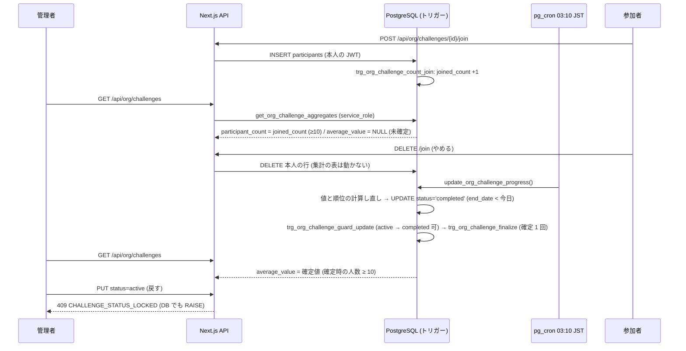

# org/ チャレンジ: 集計の差分から、やめた人の値を逆算させない (#1688)

| 版 | 日付 | 内容 |
|---|---|---|
| v1.0 | 2026-10-16 | 新設 (Issue #1688 の設計ゲート・A 型 4 相) |

要件の正本は Issue #1688 の本文とコメント (コメント 0 件)、親の #1600 (本文とコメント 1 件) と #1132。本書はその上で決めた範囲と設計で、Issue と食い違ったら本書が正。既存のチャレンジ設計 `07-challenge.md` §15 (実装の正) を前提に、§15 が「#1688 で設計する」と送った守りだけを扱う。

---

## 0. 外形固定と分冊判定 (相 1)

### 0.1 発注と前提

- 前提: ローンチ前で利用者ゼロ (正しい形で作る)。本番の DB に触らない。
- main に入っているもの: 最小人数 10 人と参加の直接の INSERT のポリシーの強化 (PR #1694 = 29ea690e。migration `supabase/migrations/20261016170000_org_challenge_min10_join_policy.sql`)。
- Issue #1600 のコメント (2026-10-15) の記録: 「オーナーの選択 (2026-10-15、選択式): 参加者の名前は見せないまま (ORG_CHALLENGE_SHOW_NAMES は入れない) にします。集計の最小人数は 10 人にします。」
- 以前の試み (ブランチ `fix/issue-1600-org-challenge-min10`・審査 4 周で毎回別の抜け道) は参考にしてよいが、構造から設計し直す。Issue に列挙された抜け道 (管理者による状態・期間・種類の書き換えで控えが書き直される / 管理者が任意の役割で参加して順位表を受け取る / 控えの作成と計算日のずれ) は、すべて §0.3 のシナリオに入れ、§4.3 のトレースで閉じていることを示す。
- 決めること: 誰から何を守るか・守りの範囲 (要件書 §6.4 の「部署の匿名化集計に 10 名以上」との関係)・管理者の変更操作との両立 (確定後の不変など)・順位表とメンバー一覧の読み方・既存の実装の流用か作り直しか。発明の前に、差分攻撃の一般的な対策を英語と日本語で調べ、採る・採らないを理由つきで書く (§3)。

### 0.2 要件行列

| # | 要件 | 出どころ | 本書の節 |
|---|---|---|---|
| R-1 | 管理者に見せる集計 (人数・平均) の 2 時点の差から、1 人の値を逆算できないこと | #1688 本文・#1600 本文 3「強化の候補」 | §4.1, §4.3 |
| R-2 | 管理者がチャレンジの状態・期間・種類を書き換えても、R-1 が破れないこと (旧ブランチの抜け道 1) | #1688「経緯」 | §4.1 (c), §4.3 S-6〜S-7 |
| R-3 | 管理者が任意の役割で参加して順位表を受け取っても、やめた・外した人の値が分からないこと (旧ブランチの抜け道 2) | #1688「経緯」 | §4.1 (d), §4.3 S-8 |
| R-4 | 控えの作成時点と計算日のずれが生まれる構造を持たないこと (旧ブランチの抜け道 3) | #1688「経緯」 | §4.2, §4.3 S-17 |
| R-5 | 誰から何を守るか (同じ組織の管理者・参加者) を定め、要件書 §6.4 の「匿名化集計の最低人数 10 名以上」との関係を書く | #1688「設計で決めること」・`docs/requirements/02-organization-management.md:884` | §3.1 |
| R-6 | 管理者がチャレンジの状態・期間・種類を変えられることとの両立 (確定後に変えられなくするのか) を決める | #1688「設計で決めること」 | §4.1 (c), §9.3 |
| R-7 | 順位表とメンバー一覧の読み方 (その場の行か、控えか) を決める | #1688「設計で決めること」 | §3.3, §4.2 |
| R-8 | 既存の実装 (旧ブランチ) を流用するか、作り直すかを決める | #1688「設計で決めること」 | §18 |
| R-9 | 参加は任意・順位は参加者どうしにだけ・管理者には集計だけ・表示名は見せない、という #1132 / #1600 の方針を崩さない | `07-challenge.md` §15・#1600 コメント | §4.1, §10 |
| R-10 | 全テーブル RLS 必須・snake_case・監査ログの原則・migration は冪等で対の down を持つ | `docs/design/CLAUDE.md` | §5 |
| R-11 | 最小人数 10 は DB の関数の cfg に 1 か所だけ書き、共有の定数と突合する (既存の番兵) | `packages/shared/src/org-challenges.ts:18`・`tests/org-challenges-lib.test.ts:153` | §5.1, §16 |
| R-12 | as any・マジックナンバーを使わない。意味のある数は名前付き定数に | 設計ゲートの規律 | §6 |

### 0.3 ユーザーシナリオ (18 本。トレースは §4.3)

| # | シナリオ |
|---|---|
| S-1 | メンバーが開催中のチャレンジに参加する。管理者の画面の「参加した人」が 1 増える (10 人になるまでは「10人未満」)。平均は「終了後に表示」のまま |
| S-2 | 参加者が参加をやめる (DELETE)。管理者の画面は何も変わらない。参加者向けの順位表からは、その場で行が消える |
| S-3 | 管理者がメンバー X を組織から外す (remove_org_member)。X の参加行は残るが、順位表・終了時の確定からは外れる。管理者の画面は何も変わらない |
| S-4 | 終了日を過ぎた夜 03:10 JST の集計で、全員の値と順位を終了日までの記録で計算し直し、completed にする。同じトランザクションで平均が確定し、順位がついた今のメンバーが 10 人以上なら管理者の画面に出る |
| S-5 | 確定したあとに管理者が X を組織から外す (または X が参加をやめる)。確定した平均は変わらない。差は取れない |
| S-6 | 管理者が終了したチャレンジを開催中に戻そうとする (API の PUT でも、PostgREST を直接叩いても)。409 / RAISE `CHALLENGE_STATUS_LOCKED` で変わらない |
| S-7 | 管理者が開催中のチャレンジの開始日・終了日・種類・部署を PostgREST で書き換えようとする。RAISE `CHALLENGE_PERIOD_LOCKED` で変わらない (API の PUT はそもそも受け付けない) |
| S-8 | 管理者 (owner / admin) が参加して詳細を開く。自分の記録と順位は見えるが、順位表は返らない (`reason: 'org_admin'`)。DB の関数も 0 行 |
| S-9 | 参加している管理者が X を外したあとに自分の順位を見る。順位は次の夜の計算し直しまで変わらず、変わっても自分との上下しか分からない (値は分からない。§19) |
| S-10 | 管理者が開催中のチャレンジを手動で終了 (PUT status=completed) する。前夜までの値で平均が確定し、以後変わらない |
| S-11 | 管理者が開催中のチャレンジを中止 (cancelled) する。平均は確定しない (表示されない)。以後、状態も期間も変えられない |
| S-12 | 管理者が下書きの開始日・終了日を直して開始する。下書きの間は期間・種類・部署を変えられ、開始したら変えられない |
| S-13 | 参加者がやめて、同じチャレンジにもう一度参加する。「参加した人」は 2 回数える (延べ) |
| S-14 | 参加者がアカウントを消す (退会)。参加行は外部キーで消えるが、「参加した人」も確定した平均も変わらない |
| S-15 | migration の適用時に、すでに終了している (completed の) チャレンジがある。いまの参加行から一度だけ確定する (これまで管理者に見えていた値と同じ) |
| S-16 | メンバーが自分の画面で参加者数を見る。管理者向けと同じ DB の関数・同じ規則 (延べ・10 人未満は出さない) なので、管理者がメンバーとして呼んでも迂回できない |
| S-17 | 夜の集計が止まっていた (何日か走らなかった) あとに走る。確定は「completed にする UPDATE」と同じトランザクションで、その直前に計算した値から取るので、控えの作成日と計算日がずれる余地が無い |
| S-18 | 参加した人がちょうど 10 人で、終了前に 1 人が組織から外れる。終了時点の順位がついた人が 9 人なので平均は出ない (管理者は「外した人が参加していた」と推測しうるが、値は分からない。§19) |

### 0.4 分冊判定

目安 (設計書 800 行超 / 消費先レーン 3 以上 / 共有面 2 つ以上) のうち、消費先 (管理者 API・メンバー API・管理者の画面 Web / モバイル・メンバーの画面) と共有面 (`organization_challenges` への変更ガード・新しい集計の表) に当たる。それでも **1 冊**にする。理由: 核 (DB の表・トリガー・関数 2 本の作り直し・lib の正典) と配線 (API 2 本の分岐と画面の文言) は同じ不変条件「集計は確定 1 回・順位表は管理者に出さない」を 1 つの契約で共有し、配線だけの冊に残る判断が無い (文言の置き換えと分岐 1 つ)。実装 WF は §14 のとおり核 → 配線の 2 段に分け、段ごとに 2 枚レビューを閉じる。

### 0.5 用語

| 語 | 意味 |
|---|---|
| 集計 | 管理者に見せる 2 値 = 参加者数と平均。`GET /api/org/challenges` が DB の関数 `get_org_challenge_aggregates` から取る |
| 確定 | チャレンジが `completed` になる UPDATE と同じトランザクションで、順位がついた今のメンバーの平均と人数を `organization_challenge_aggregates` に 1 回だけ書くこと。以後は書き換えない |
| 参加した人 (延べ) | 参加の INSERT のたびに +1 し、やめても・組織から外れても・退会しても減らない数 (`joined_count`)。画面の「参加者数」はこの値 |
| 管理者 | `user_profiles.org_role` が `owner` / `admin` の人 (`requireOrgAdmin` が通す人)。メンバーを組織から外せる唯一の主体 |
| 参加者 | `organization_challenge_participants` に行があり、今もその組織のメンバーである人 |
| 差分攻撃 | 2 つの公開値 (母集団が 1 人だけ違う) の差から、その 1 人の値を出すこと |

---

## 1. 目的・スコープ

対象: 組織チャレンジ (`organization_challenges` / `organization_challenge_participants`) の、管理者に見せる集計と参加者に見せる順位表から、参加をやめた人・組織から外れた人の値 (と、できる範囲で参加の有無) を逆算させない守り。
対象外: 順位表そのものをやめること (#1132 の方針の変更)・参加者どうしの社会的な知識 (「あの人がやめたと聞いた」) による結びつけ・内部の共謀 (管理者 2 人の分担)・歩数 / 体重 / カスタムの種類 (作成も参加もできない)・値の計算式 (`update_org_challenge_progress` は変えない)。

## 2. 関連要件

- 要件定義 02 §5.6 (F-ORG-006)・§6.4 プライバシー (`docs/requirements/02-organization-management.md:884` 匿名化集計の最低人数 10 名以上)
- `07-challenge.md` §15 (実装の正。「管理者に見せるもの」の行が既知の限界として本件を送っている: `docs/design/org/07-challenge.md:432`)
- `09-rls-policies.md` §14 の実装との違いの注記・§18 の表
- migration `20261014100100_org_challenge_progress.sql` (関数 3 本・ポリシー・pg_cron) と `20261016170000_org_challenge_min10_join_policy.sql` (最小人数 10・INSERT ポリシー)

---

## 3. 守る相手と、対策の選定 (発明の前の調査)

### 3.1 誰から何を守るか・要件書 §6.4 との関係

| 主体 | 持っている力 | 守る対象 | 本書の扱い |
|---|---|---|---|
| 組織の管理者 (owner / admin) | 集計を見る・メンバーを組織から外す (`remove_org_member`)・チャレンジの状態を変える (API) と全列を書き換える (ポリシー `Org admins can manage challenges` は FOR ALL で WITH CHECK 無し。`supabase/migrations/20251126124224_create_meal_planner_tables.sql:9620`)・メンバーとして参加して順位表と自分の順位を見る | 1 人の値 (current_value) と、できる範囲で参加の有無 | **本書の主対象**。集計の公開を確定 1 回にし、順位表を見せず、開始後の期間・種類と終了後の状態を不変にする |
| 参加者 (member) | 自分の参加・やめる・順位表 (上位 20 人と本人。名前なし) | 他の参加者の値と名前の結びつき | 順位表は #1132 の方針どおり値を名前なしで見せる。やめた人の行はその場で消える (§3.3 で理由)。社会的な知識による結びつけは対象外 (§19) |
| 組織に所属しない人・他組織 | 何も見えない (既存の RLS・認可) | — | 変えない |

要件書 §6.4 の「匿名化集計の最低人数 10 名以上」は、部署の集計だけでなく、管理者に見せる集計すべてに当てる (#1600 で 10 人に決まった)。最小人数は「1 回の集計」を守る規則で、2 回の集計の差は守らない (§3.2 の AWS の記述と同じ)。本書はその補完として「集計を 2 回出さない」構造を足す。

### 3.2 一般的な対策の調査と、採る・採らない

英語: AWS Clean Rooms「custom considerations」(https://docs.aws.amazon.com/clean-rooms/latest/userguide/custom-considerations.html) は、1 人だけ違う 2 つの SUM の差で 1 人の値が出る例を挙げ、「クエリ単位の最小集計の閾値は差分攻撃を防がない」とし、アクセス予算と差分プライバシーを勧める。差分攻撃の総説 (Dwork ら「Exposed! A Survey of Attacks on Private Data」https://privacytools.seas.harvard.edu/publications/exposed-survey-attacks-private-data) は、再構成攻撃と追跡攻撃に分け、集計に雑音を足す差分プライバシーを位置づける。PoPETs 2020 (https://www.petsymposium.org/popets/2020/popets-2020-0031.pdf) は、同じ答えになるクエリを並べて雑音を剥がす攻撃を示す。
日本語: 総務省の秘匿処理の資料 (https://www.soumu.go.jp/main_content/000339465.pdf) は、客体数が少ないセルを非表示にし、合計からの引き算で判明する場合に二次秘匿を行う運用を示す。統計数理研究所 南 (https://www.ism.ac.jp/openhouse/2024/index/DrMINAMI.pdf) は最小度数ルール・占有性ルールと、一次秘匿だけでは行和・列和から復元されるため二次秘匿が要ることを示す。瀧 (統計数理 51(2), 2003, https://www.ism.ac.jp/editsec/toukei/pdf/51-2-337.pdf) はセル秘匿の基準と方法を整理する。

| 対策 | 採否 | 理由 |
|---|---|---|
| 最小度数 (k-匿名の度数規則。10 人未満は出さない) | 採用済み (#1600) | 1 回の集計を守る。2 回の差は守らないので、下の対策で補う |
| 二次秘匿 (差で復元できる公開値を伏せる) | **採る (形を単純化)** | 統計表の二次秘匿は「差が取れる組を伏せる」。本書では公開を **1 チャレンジにつき 1 回 (終了時の確定値)** にし、差を取れる組そのものを作らない。開催中の平均は出さない |
| 時系列の抑制規則 (母集団が k 人以上変わるまで新しい値を出さない) | 採らない | 1 人やめたあと終了まで値が凍るので開催中の平均が使い物にならないうえ、終了時の確定と最後の公開値の母集団が 1 人違い、その間に他の人の記録が無ければ (休日・記録の少ない参加者) 差がそのまま 1 人の値になる |
| 夜ごとの控え (snapshot) を公開する | 採らない | 旧ブランチの形。全員の値を計算し直した夜にだけ控えを書いても、他の人の値が動かない夜 (新しい記録が無い) は差が正確に 1 人の値になる。書き直す条件 (counted_through) が抜け道の発生源になり、審査 4 周で閉じなかった |
| 雑音の付加 (差分プライバシー) | 採らない | 10 人の平均の感度は 100 / 10 = 10 点で、有用な精度の雑音にできない。AWS も最小人数との併用に注記がある。公開が 1 回なら雑音は要らない |
| 粗い丸め (整数・5 点刻み) | 採らない | 差を曖昧にするだけで閉じない。既存の小数第 1 位のまま |
| クエリ監査・アクセス予算 | 採らない | 公開面は固定の 2 値 (人数・平均) なので、「公開回数 = 1」が予算の代わりになる |
| 母集団の凍結 (やめた人の値を残して平均を計算し続ける) | 採らない | 「やめた人の記録は、集計にも順位にも残らない」(`src/app/api/org/challenges/[id]/join/route.ts:20`) の約束と、組織から外れた人のデータの継続利用に反する |
| 役割で順位表を伏せる | **採る** | メンバーを組織から外せるのは管理者だけ。順位表を管理者に見せなければ、「外した人の行が消える」経路が無くなる |
| 開始後の期間・種類と終了後の状態の不変 | **採る** | 書き換えで計算し直す経路 (旧ブランチの抜け道 1) を消す。API はもともと期間・種類を変えないので、PostgREST の直接の UPDATE をトリガーで止めるだけ |

### 3.3 順位表とメンバー一覧の読み方 (R-7)

- 順位表: **その場の行** (いまの `organization_challenge_participants`) のまま。管理者 (owner / admin) には返さない。控え (夜の時点の行) から返す形は採らない: 管理者の経路は役割で閉じ、参加者どうしの経路は控えにしても「他の人の値が動かない夜」に消えた行が特定できるので、控えの表と 2 本目の書き込み経路を足すだけの効果が無い。
- メンバー一覧: 参加者の一覧 API は無く、作らない。`GET /api/org/members` (組織のメンバー) は参加を示さない。参加者数は、集計の表の延べ数 (`joined_count`) を管理者向け・メンバー向けの両方が同じ関数で読む。

---

## 4. 構想 (相 2) と構造裁定 (相 3)

### 4.1 構造

公開値を「差の取れない形」にする 4 つの決まり。

(a) **平均は確定 1 回**: 管理者に見せる平均は、チャレンジが `completed` になる UPDATE の AFTER トリガー `org_challenge_finalize` が、そのトランザクションの参加行 (順位がついた今のメンバー) から計算して `organization_challenge_aggregates` に書く値だけ。開催中は返さない。確定後は書き換えない (`ON CONFLICT ... DO UPDATE ... WHERE finalized_at IS NULL`)。中止 (cancelled) は確定しない。
(b) **参加者数は延べ**: 参加の INSERT の AFTER トリガー `org_challenge_count_join` が `joined_count` を +1 する。DELETE・組織からの脱退・除名・退会では動かさない。管理者がメンバーを外しても数が動かないので、参加の有無が漏れない。10 人未満は NULL (既存の規則)。
(c) **開始後の不変**: BEFORE UPDATE トリガー `org_challenge_guard_update` が、状態の遷移表 (draft → active / completed / cancelled、active → completed / cancelled、終わった状態からは変えない) と、draft 以外での `start_date` / `end_date` / `challenge_type` / `department_id` の変更、常時の `organization_id` の変更を RAISE で止める。API の PUT は遷移表を先に確かめて 409 を返し、DB の RAISE も 409 に写す。
(d) **順位表は管理者に見せない**: `GET /api/org/challenges/[id]` は `org_role` が owner / admin なら順位表の関数を呼ばず `ranking: { available: false, reason: 'org_admin' }` を返す。DB の関数 `get_org_challenge_ranking` も、見る人が owner / admin なら 0 行 (API の確認が漏れても返らない)。自分の記録と順位 (`me`) は返す。

変えないもの: `update_org_challenge_progress` (値の計算・completed にする UPDATE)、pg_cron のジョブ、参加の INSERT / SELECT / DELETE のポリシー、参加をやめる DELETE (その場で行を消す)、メンバー向けの API の形 (順位表の `reason` を足すだけ)。

### 4.2 代替案の比較と裁定 (1 回だけ)

| 案 | 構造 | 差分攻撃 (正確な差) | 書き換えの抜け道 | 足すもの | 裁定 |
|---|---|---|---|---|---|
| A: 本書 | 平均は終了時の確定 1 回・人数は延べ・開始後の不変・順位表は管理者に出さない | 公開が 1 回なので差が無い | 不変のトリガーで無い | 表 1・トリガー 3・関数 2 本の作り直し | **採る** |
| B: 夜ごとの控え (旧ブランチ) | 毎晩の計算し直しと同時に控えを書き、集計と順位表を控えから返す | 他の人の値が動かない夜は差が 1 人の値になる (記録の無い日) | 控えを書き直す条件に依存 (4 周で閉じず) | 表 2・関数 1・バッチの改修・集合の受け渡し | 採らない |
| C: 開催中も平均を出すが、母集団が変わったら終了まで凍る | 抑制規則 | 最後の公開値と確定値の差 (母集団 1 人違い) が残る | A と同じ | A + 凍結の判定 | 採らない (閉じない) |
| D: やめた人の値を残す (母集団の凍結) | 行を消さず left_at で印 | 差は無い | A と同じ | 行の意味の変更・約束の変更 | 採らない (約束と継続利用に反する) |

「縁の発生源を消すより単純な構造は無いか」: 差分攻撃の発生源は「母集団が違う公開値が 2 つある」こと。発生源ごと消すのは A (公開を 1 回にする) で、控え・凍結・雑音はすべて「2 つ目の公開値をどう守るか」の対症療法になる。A を確定し、以後は蒸し返さない。

### 4.3 シナリオのトレース (構造 A で手で走らせた記録)

| # | 走らせた結果 | 閉じているか |
|---|---|---|
| S-1 | INSERT → `org_challenge_count_join` が `joined_count` を 1 → … → 10。`get_org_challenge_aggregates` は 10 以上で人数を返し、`final_ranked_count` が NULL なので平均は NULL。画面「終了後に表示」 | ✔ |
| S-2 | DELETE は本人の行だけ消す (ポリシー不変)。トリガー無し → `joined_count` 不変。平均は未確定のまま NULL。順位表 (参加者向け) はその場の行なので消える | ✔ (管理者には何も見えない) |
| S-3 | `remove_org_member` は `user_profiles.organization_id` を NULL にするだけ。参加行は残る。`joined_count` 不変・平均 NULL。順位表・確定の母集団からは組織の結合で外れる | ✔ |
| S-4 | バッチ: 値を計算し直す UPDATE → `UPDATE … SET status = 'completed' WHERE status = 'active' AND end_date < v_today` → BEFORE ガード (active → completed は可) → AFTER `org_challenge_finalize` が同じトランザクションの行から `final_ranked_count` / `final_average_value` を書く | ✔ (R-4: 計算と確定が同じトランザクション) |
| S-5 | 確定後の DELETE / 除名は表を触らない。関数は表から読む。差 = 0 | ✔ |
| S-6 | API: 現在の状態が completed / cancelled で status が違えば 409 `CHALLENGE_STATUS_LOCKED` (何も書かない)。PostgREST: ガードが RAISE。確定は `WHERE finalized_at IS NULL` で二度書かない | ✔ (抜け道 1) |
| S-7 | ガード: `OLD.status` が draft でないとき期間・種類・部署の変更を RAISE `CHALLENGE_PERIOD_LOCKED`。計算し直しの経路が無い | ✔ (抜け道 1) |
| S-8 | API: `profile.org_role` が owner / admin → 順位表の関数を呼ばず `reason: 'org_admin'`。関数も `meup.org_role NOT IN ('owner','admin')` で 0 行。`me` は本人の行 (RLS) から返す | ✔ (抜け道 2) |
| S-9 | 管理者の `me.rank` は夜の計算し直しでしか変わらない。X を外した次の夜、全員の値が動いた中で順位が 1 つ上がれば「X は自分より上だった」と分かりうる。値は分からない | 残る限界 (1 bit)。§19 |
| S-10 | PUT status=completed → ガード可 → `org_challenge_finalize` が前夜までの値 (行の current_value) で確定。平均は開催中に出ていないので前後の差が無い | ✔ |
| S-11 | PUT status=cancelled → ガード可 → 確定のトリガーは `NEW.status = 'completed'` だけなので書かない。以後の UPDATE はガードで RAISE | ✔ |
| S-12 | draft の期間変更はガードを通る。active にしたあとは S-7 | ✔ |
| S-13 | INSERT のたびに +1。延べ数であることを画面に書く | ✔ (限界: 1 人で増やせる。§19) |
| S-14 | `organization_challenge_participants.user_id` は auth.users を ON DELETE CASCADE で参照し、行が消える。DELETE にトリガーは無い。集計の表は `challenge_id` しか持たないので変わらない | ✔ |
| S-15 | migration の埋め戻し: `joined_count` = いまの参加行の数、completed の行は一度だけ確定。以後 S-5 と同じ | ✔ |
| S-16 | `GET /api/org/challenges/[id]` と `/my-challenges` は同じ `fetchChallengeAggregates` → 同じ関数。管理者がメンバーとして呼んでも同じ値 | ✔ |
| S-17 | 控えが無い。確定は「completed にする UPDATE」のトリガーで、その直前に同じトランザクションで計算した行から取る (バッチの経路)。手動終了 (S-10) は前夜の計算の行から取る。どちらも「いまの行」で、別の日付を記録しない | ✔ (抜け道 3) |
| S-18 | 10 人参加 → 1 人除名 → 終了時の順位がついた今のメンバー 9 人 → 平均 NULL。管理者は「10 人のうち 1 人外した結果が 9 人」から参加の有無を推測しうる | 残る限界 (値ではない)。§19 |

---

## 5. データモデル

### 5.1 DDL (migration と、対の down)

ファイル名は `supabase/migrations/<番号はマージ時に確定>_org_challenge_diff_privacy.sql` と `supabase/rollbacks/<同じ番号>_org_challenge_diff_privacy.down.sql`。番号は origin/main の `supabase/migrations` の最大より大きい値をマージ直前に確定し、1 行目の見出し・down の見出し・本文の「ロールバック」の参照もそろえる (`tests/migration-file-version-integrity.test.ts`)。`get_org_challenge_aggregates` と `get_org_challenge_ranking` は、それぞれ `20261016170000_org_challenge_min10_join_policy.sql:44` と `20261014100100_org_challenge_progress.sql:269` の最新の定義を土台にし、変える箇所をコメントで示す。

```sql
-- migration: <番号>_org_challenge_diff_privacy.sql
-- #1688: 組織チャレンジの集計の差分から、やめた人の値を逆算させない。#1600 (20261016170000_org_challenge_min10_join_policy.sql) の残り
--
-- 背景:
--   管理者に見せる集計 (get_org_challenge_aggregates) は参加者の行をその場で数えていたので、参加をやめる・組織から外す前後の
--   人数と平均の差から、やめた人の値が出た (最小人数の規則は 1 回の集計しか守らない)。参加者に見せる順位表も行をその場で読むので、
--   メンバーとして参加した管理者が、メンバーを外した前後で消えた 1 行の値を見られた。
--
-- 変更 (差の取れる公開値を作らない):
--   1. 表 organization_challenge_aggregates (チャレンジごとに 1 行): 参加した人の延べ数 (joined_count) と、終了時に 1 回だけ確定する
--      平均 (final_average_value) と人数 (final_ranked_count)。読み書きは service_role と所有者だけ (RLS 有効・ポリシー無し)。
--   2. トリガー org_challenge_count_join: 参加の INSERT ごとに joined_count を +1 (やめる・組織から外れる・退会では減らさない)。
--   3. トリガー org_challenge_guard_update: 状態の遷移 (draft → active / completed / cancelled、active → completed / cancelled) 以外を
--      CHALLENGE_STATUS_LOCKED で止め、draft 以外での start_date / end_date / challenge_type / department_id と常時の organization_id の
--      変更を CHALLENGE_PERIOD_LOCKED で止める (API の PUT は期間・種類を受け付けない。PostgREST の直接の UPDATE を止める)。
--   4. トリガー org_challenge_finalize: completed への遷移と同じトランザクションで、順位がついた今のメンバーの平均 (小数第 1 位) と
--      人数を 1 回だけ書く (確定済みなら書かない)。中止 (cancelled) は確定しない。
--   5. get_org_challenge_aggregates: 控えの表から返す。人数 = joined_count (最小人数未満は NULL)、平均 = 確定値 (確定時点の人数が
--      最小人数未満なら NULL。開催中は常に NULL)。名前・引数・返す列・SECURITY INVOKER・最小人数 (cfg の 10) は変えない。
--   6. get_org_challenge_ranking: 見る人が組織の管理者 (org_role が owner / admin) なら 0 行。ほかは 20261014100100 の定義のまま。
--   7. 埋め戻し: 既存のチャレンジに joined_count = いまの参加行の数。completed のチャレンジはいまの行から一度だけ確定。
--   変えないもの: update_org_challenge_progress・pg_cron のジョブ・参加の INSERT / SELECT / DELETE のポリシー。
--
-- 本番のデータへの影響: 表を 1 つ足し、既存のチャレンジの行数だけ控えの行を作る。既存の行は書き換えない。
--   表への書き込みを待たせるロックはトリガーの付与 (一瞬) だけ。10 秒でロック待ちを諦める。
-- 冪等: CREATE TABLE IF NOT EXISTS / CREATE OR REPLACE FUNCTION / CREATE OR REPLACE TRIGGER / 埋め戻しは ON CONFLICT。
-- 確認: tests/org-challenge-diff-privacy-migration-contract.test.ts / tests/integration/rls/org-challenge-diff-privacy.test.ts /
--       tests/integration/security/org-challenges-api.test.ts
-- ロールバック: supabase/rollbacks/<番号>_org_challenge_diff_privacy.down.sql

SET LOCAL lock_timeout = '10s';

-- ─────────────────────────────────────────────────────────
-- 1. 集計の控え (チャレンジごとに 1 行)
-- ─────────────────────────────────────────────────────────
CREATE TABLE IF NOT EXISTS public.organization_challenge_aggregates (
  challenge_id        uuid PRIMARY KEY REFERENCES public.organization_challenges(id) ON DELETE CASCADE,
  -- 参加した人の延べ数。参加の INSERT ごとに +1。やめる・組織から外れる・退会では減らさない
  joined_count        integer NOT NULL DEFAULT 0 CHECK (joined_count >= 0),
  -- 確定した時刻 (completed にした UPDATE の時刻)。NULL = 未確定 (開催中・下書き・中止)
  finalized_at        timestamptz,
  -- 確定時点の、順位がついた今のメンバーの人数と、その平均 (小数第 1 位)。人数 0 なら平均は NULL
  final_ranked_count  integer CHECK (final_ranked_count >= 0),
  final_average_value numeric,
  updated_at          timestamptz NOT NULL DEFAULT now(),
  CONSTRAINT organization_challenge_aggregates_final_shape CHECK (
    (finalized_at IS NULL AND final_ranked_count IS NULL AND final_average_value IS NULL)
    OR (finalized_at IS NOT NULL AND final_ranked_count IS NOT NULL)
  )
);

COMMENT ON TABLE public.organization_challenge_aggregates IS
  '#1688: 組織チャレンジの集計の控え。joined_count は参加の延べ数 (減らさない)。final_* は completed への遷移で 1 回だけ確定する平均と人数。読み書きは service_role と所有者だけ。';

ALTER TABLE public.organization_challenge_aggregates ENABLE ROW LEVEL SECURITY;
REVOKE ALL ON TABLE public.organization_challenge_aggregates FROM PUBLIC, anon, authenticated;
GRANT SELECT, INSERT, UPDATE, DELETE ON TABLE public.organization_challenge_aggregates TO service_role;

-- ─────────────────────────────────────────────────────────
-- 2. 参加の延べ数 (参加の INSERT ごとに +1)
-- ─────────────────────────────────────────────────────────
CREATE OR REPLACE FUNCTION public.org_challenge_count_join()
RETURNS trigger
LANGUAGE plpgsql
SECURITY DEFINER
SET search_path = ''
AS $$
BEGIN
  IF NEW.challenge_id IS NULL THEN
    RETURN NULL;
  END IF;
  INSERT INTO public.organization_challenge_aggregates AS a (challenge_id, joined_count)
  VALUES (NEW.challenge_id, 1)
  ON CONFLICT (challenge_id) DO UPDATE
     SET joined_count = a.joined_count + 1,
         updated_at   = now();
  RETURN NULL;
END $$;

REVOKE ALL ON FUNCTION public.org_challenge_count_join() FROM PUBLIC, anon, authenticated, service_role;
COMMENT ON FUNCTION public.org_challenge_count_join() IS
  '#1688: organization_challenge_participants の INSERT ごとに organization_challenge_aggregates.joined_count を +1 する (延べ数。DELETE では減らさない)。';

CREATE OR REPLACE TRIGGER trg_org_challenge_count_join
  AFTER INSERT ON public.organization_challenge_participants
  FOR EACH ROW EXECUTE FUNCTION public.org_challenge_count_join();

-- ─────────────────────────────────────────────────────────
-- 3. 状態の遷移表と、開始後の期間・種類・部署の不変
-- ─────────────────────────────────────────────────────────
CREATE OR REPLACE FUNCTION public.org_challenge_guard_update()
RETURNS trigger
LANGUAGE plpgsql
SET search_path = ''
AS $$
DECLARE
  -- 状態が NULL の行 (CHECK は NULL を通す) は下書きとみなす
  v_from text := COALESCE(OLD.status, 'draft');
BEGIN
  IF NEW.status IS DISTINCT FROM OLD.status THEN
    -- 遷移表 (src/lib/org-challenge-privacy.ts の ORG_CHALLENGE_STATUS_TRANSITIONS と同じ):
    --   draft → active / completed / cancelled、active → completed / cancelled。completed / cancelled からは変えない
    IF NOT (
         (v_from = 'draft'  AND NEW.status IN ('active', 'completed', 'cancelled'))
      OR (v_from = 'active' AND NEW.status IN ('completed', 'cancelled'))
    ) THEN
      RAISE EXCEPTION 'CHALLENGE_STATUS_LOCKED' USING ERRCODE = 'P0001',
        DETAIL = format('status %s -> %s', v_from, NEW.status);
    END IF;
  END IF;

  IF NEW.organization_id IS DISTINCT FROM OLD.organization_id THEN
    RAISE EXCEPTION 'CHALLENGE_PERIOD_LOCKED' USING ERRCODE = 'P0001', DETAIL = 'organization_id';
  END IF;

  IF v_from <> 'draft' AND (
       NEW.start_date     IS DISTINCT FROM OLD.start_date
    OR NEW.end_date       IS DISTINCT FROM OLD.end_date
    OR NEW.challenge_type IS DISTINCT FROM OLD.challenge_type
    OR NEW.department_id  IS DISTINCT FROM OLD.department_id
  ) THEN
    RAISE EXCEPTION 'CHALLENGE_PERIOD_LOCKED' USING ERRCODE = 'P0001',
      DETAIL = format('status %s', v_from);
  END IF;

  RETURN NEW;
END $$;

REVOKE ALL ON FUNCTION public.org_challenge_guard_update() FROM PUBLIC, anon, authenticated, service_role;
COMMENT ON FUNCTION public.org_challenge_guard_update() IS
  '#1688: organization_challenges の UPDATE を遷移表 (draft → active / completed / cancelled、active → completed / cancelled) に限り、draft 以外での start_date / end_date / challenge_type / department_id と、常時の organization_id の変更を止める。CHALLENGE_STATUS_LOCKED / CHALLENGE_PERIOD_LOCKED (P0001)。';

CREATE OR REPLACE TRIGGER trg_org_challenge_guard_update
  BEFORE UPDATE ON public.organization_challenges
  FOR EACH ROW EXECUTE FUNCTION public.org_challenge_guard_update();

-- ─────────────────────────────────────────────────────────
-- 4. 終了時の確定 (completed への遷移と同じトランザクションで 1 回だけ)
-- ─────────────────────────────────────────────────────────
CREATE OR REPLACE FUNCTION public.org_challenge_finalize()
RETURNS trigger
LANGUAGE plpgsql
SECURITY DEFINER
SET search_path = ''
AS $$
BEGIN
  INSERT INTO public.organization_challenge_aggregates AS a
         (challenge_id, joined_count, finalized_at, final_ranked_count, final_average_value, updated_at)
  SELECT NEW.id,
         0,
         now(),
         count(p.user_id) FILTER (WHERE p.rank IS NOT NULL),
         round(avg(p.current_value) FILTER (WHERE p.rank IS NOT NULL), 1),
         now()
    FROM public.organization_challenge_participants AS p
    JOIN public.user_profiles AS up
      ON up.id = p.user_id
     AND up.organization_id = NEW.organization_id
   WHERE p.challenge_id = NEW.id
  ON CONFLICT (challenge_id) DO UPDATE
     SET finalized_at        = EXCLUDED.finalized_at,
         final_ranked_count  = EXCLUDED.final_ranked_count,
         final_average_value = EXCLUDED.final_average_value,
         updated_at          = EXCLUDED.updated_at
   WHERE a.finalized_at IS NULL;
  RETURN NULL;
END $$;

REVOKE ALL ON FUNCTION public.org_challenge_finalize() FROM PUBLIC, anon, authenticated, service_role;
COMMENT ON FUNCTION public.org_challenge_finalize() IS
  '#1688: organization_challenges が completed になる UPDATE の AFTER トリガー。同じトランザクションの参加行 (順位がついた今のメンバー) から平均 (小数第 1 位) と人数を organization_challenge_aggregates に 1 回だけ書く (確定済みなら書かない)。';

CREATE OR REPLACE TRIGGER trg_org_challenge_finalize
  AFTER UPDATE OF status ON public.organization_challenges
  FOR EACH ROW
  WHEN (OLD.status IS DISTINCT FROM NEW.status AND NEW.status = 'completed')
  EXECUTE FUNCTION public.org_challenge_finalize();

-- ─────────────────────────────────────────────────────────
-- 5. 管理者に見せる集計: 控えの表から返す (名前・引数・返す列は 20261016170000 と同じ)
-- ─────────────────────────────────────────────────────────
CREATE OR REPLACE FUNCTION public.get_org_challenge_aggregates(p_organization_id uuid)
RETURNS TABLE (
  challenge_id      uuid,
  participant_count bigint,
  min_participants  integer,
  average_value     numeric
)
LANGUAGE sql
STABLE
SECURITY INVOKER
SET search_path = ''
AS $$
  WITH cfg AS (
    -- 値を出すのに必要な最小人数 (要件書 §6.4 の匿名化集計の最低人数。#1600 で 10 人。個人を特定されない集計にする人数)
    SELECT 10 AS min_participants
  )
  SELECT c.id,
         -- 参加した人の延べ数 (参加のたびに +1。やめても・組織から外れても減らない)。最小人数に満たなければ NULL
         CASE WHEN a.joined_count >= cfg.min_participants THEN a.joined_count::bigint END,
         cfg.min_participants,
         -- 終了時に確定した平均だけ。確定時点の順位がついた参加者が最小人数に満たなければ NULL。開催中・下書き・中止は常に NULL
         CASE WHEN a.final_ranked_count >= cfg.min_participants THEN round(a.final_average_value, 1) END
    FROM public.organization_challenges AS c
    LEFT JOIN public.organization_challenge_aggregates AS a
      ON a.challenge_id = c.id
   CROSS JOIN cfg
   WHERE c.organization_id = p_organization_id
$$;

REVOKE ALL ON FUNCTION public.get_org_challenge_aggregates(uuid)
  FROM PUBLIC, anon, authenticated, service_role;
GRANT EXECUTE ON FUNCTION public.get_org_challenge_aggregates(uuid)
  TO service_role;

COMMENT ON FUNCTION public.get_org_challenge_aggregates(uuid) IS
  '#1132 / #1600 / #1688: 管理者向けの集計。参加した人の延べ数 (joined_count。min_participants (10) 未満は NULL) と、終了時に確定した平均 (確定時点の順位がついた人が min_participants 未満なら NULL。開催中は NULL) を控えの表 organization_challenge_aggregates から返す。個人の値・ID は返さない。SECURITY INVOKER。service_role のみ。';

-- ─────────────────────────────────────────────────────────
-- 6. 参加者に見せる順位表: 組織の管理者には返さない (ほかは 20261014100100 の定義のまま)
-- ─────────────────────────────────────────────────────────
CREATE OR REPLACE FUNCTION public.get_org_challenge_ranking(
  p_challenge_id uuid,
  p_user_id      uuid,
  p_limit        integer DEFAULT NULL,  -- NULL は既定の人数 (下の cfg.default_limit)
  p_with_names   boolean DEFAULT false
)
RETURNS TABLE (
  rank         integer,
  current_value numeric,
  is_me        boolean,
  nickname     text,
  ranked_count bigint
)
LANGUAGE sql
STABLE
SECURITY INVOKER
SET search_path = ''
AS $$
  WITH cfg AS (
    -- 順位表に出す人数 (上位から。本人の行は、圏外でも別に付ける)。20261014100100 と同じ値
    SELECT 20 AS default_limit, 100 AS max_limit
  ),
  ranked AS (
    SELECT p.rank,
           p.current_value,
           p.user_id,
           CASE WHEN p_with_names THEN up.nickname END AS nickname,
           row_number() OVER (ORDER BY p.rank, p.joined_at, p.user_id) AS pos,
           count(*) OVER () AS total
      FROM public.organization_challenges AS c
      JOIN public.organization_challenge_participants AS p
        ON p.challenge_id = c.id
      JOIN public.user_profiles AS up
        ON up.id = p.user_id
       AND up.organization_id = c.organization_id
     WHERE c.id = p_challenge_id
       AND p.rank IS NOT NULL
  )
  SELECT r.rank,
         r.current_value,
         (r.user_id = p_user_id),
         r.nickname,
         r.total
    FROM ranked AS r
   CROSS JOIN cfg
   WHERE (r.pos <= LEAST(GREATEST(COALESCE(p_limit, cfg.default_limit), 1), cfg.max_limit) OR r.user_id = p_user_id)
     -- 順位表を見られるのは、そのチャレンジの参加者本人 (今も組織のメンバー) で、組織の管理者でない人だけ。
     -- 管理者 (org_role が owner / admin。メンバーを組織から外せる人) には 0 行 (#1688。src/lib/org-challenge-privacy.ts の
     -- ORG_CHALLENGE_RANKING_HIDDEN_ROLES と同じ並び)。参加していない人にも 0 行
     AND EXISTS (
       SELECT 1
         FROM public.organization_challenges AS c2
         JOIN public.organization_challenge_participants AS me
           ON me.challenge_id = c2.id
          AND me.user_id = p_user_id
         JOIN public.user_profiles AS meup
           ON meup.id = me.user_id
          AND meup.organization_id = c2.organization_id
        WHERE c2.id = p_challenge_id
          AND (meup.org_role IS NULL OR meup.org_role NOT IN ('owner', 'admin'))
     )
   ORDER BY r.pos
$$;

REVOKE ALL ON FUNCTION public.get_org_challenge_ranking(uuid, uuid, integer, boolean)
  FROM PUBLIC, anon, authenticated, service_role;
GRANT EXECUTE ON FUNCTION public.get_org_challenge_ranking(uuid, uuid, integer, boolean)
  TO service_role;

COMMENT ON FUNCTION public.get_org_challenge_ranking(uuid, uuid, integer, boolean) IS
  '#1132 / #1688: 参加者に見せる順位表。p_user_id がそのチャレンジの参加者 (今も組織のメンバー) で組織の管理者 (owner / admin) でないときだけ、順位がついている参加者を上位 p_limit 人 (NULL は既定の default_limit = 20 人。1〜max_limit = 100 人) と本人の行について返す。管理者・参加していない人には 0 行。他人の user_id は返さない。nickname は p_with_names が true のときだけ。SECURITY INVOKER。service_role のみ。';

-- ─────────────────────────────────────────────────────────
-- 7. 既存のチャレンジの埋め戻し (延べ数 = いまの参加行の数。completed は一度だけ確定)
-- ─────────────────────────────────────────────────────────
INSERT INTO public.organization_challenge_aggregates AS a (challenge_id, joined_count)
SELECT c.id, count(p.id)
  FROM public.organization_challenges AS c
  LEFT JOIN public.organization_challenge_participants AS p
    ON p.challenge_id = c.id
 GROUP BY c.id
ON CONFLICT (challenge_id) DO NOTHING;

INSERT INTO public.organization_challenge_aggregates AS a
       (challenge_id, joined_count, finalized_at, final_ranked_count, final_average_value, updated_at)
SELECT c.id,
       0,
       now(),
       count(m.user_id),
       round(avg(m.current_value), 1),
       now()
  FROM public.organization_challenges AS c
  LEFT JOIN LATERAL (
    -- 順位がついた、今も組織のメンバーである参加者だけ
    SELECT p.user_id, p.current_value
      FROM public.organization_challenge_participants AS p
      JOIN public.user_profiles AS up
        ON up.id = p.user_id
       AND up.organization_id = c.organization_id
     WHERE p.challenge_id = c.id
       AND p.rank IS NOT NULL
  ) AS m ON true
 WHERE c.status = 'completed'
 GROUP BY c.id
ON CONFLICT (challenge_id) DO UPDATE
   SET finalized_at        = EXCLUDED.finalized_at,
       final_ranked_count  = EXCLUDED.final_ranked_count,
       final_average_value = EXCLUDED.final_average_value,
       updated_at          = EXCLUDED.updated_at
 WHERE a.finalized_at IS NULL;
```

対の down (`supabase/rollbacks/<番号>_org_challenge_diff_privacy.down.sql`):

```sql
-- rollback: <番号>_org_challenge_diff_privacy.sql
-- ⚠️ 守りが弱くなる: 戻すと、集計は参加者の行をその場で数える形 (20261016170000 の定義) に、順位表は管理者にも返す形
--    (20261014100100 の定義) に戻り、終了・中止したチャレンジの状態や開始後の期間を管理者が書き換えられる状態に戻る。
--    明示的な承認を得た場合に限って使う。
--
-- 内容:
--   1. トリガー 3 本 (trg_org_challenge_count_join / trg_org_challenge_guard_update / trg_org_challenge_finalize) と、その関数 3 本を消す
--   2. get_org_challenge_aggregates(uuid) を 20261016170000_org_challenge_min10_join_policy.sql の定義 (最小人数 10。その場で数える) に戻す
--   3. get_org_challenge_ranking(uuid, uuid, integer, boolean) を 20261014100100_org_challenge_progress.sql の定義に戻す
--   4. 表 organization_challenge_aggregates を消す (控えのデータは失われる。参加行・チャレンジの行はそのまま)
--   権限 (service_role だけ) は 2・3 で流し直す。
-- 先に API のデプロイ (順位表の reason・PUT のガード) を戻す必要は無い (関数の名前・引数・返す列は変わらない。
-- 管理者への順位表は API 側で伏せたまま)。本番に戻すときは、この内容を新しい migration として PR 経由で適用する。
-- 何度流しても同じ結果になる (冪等)。

SET LOCAL lock_timeout = '10s';

DROP TRIGGER IF EXISTS trg_org_challenge_count_join   ON public.organization_challenge_participants;
DROP TRIGGER IF EXISTS trg_org_challenge_guard_update ON public.organization_challenges;
DROP TRIGGER IF EXISTS trg_org_challenge_finalize     ON public.organization_challenges;
DROP FUNCTION IF EXISTS public.org_challenge_count_join();
DROP FUNCTION IF EXISTS public.org_challenge_guard_update();
DROP FUNCTION IF EXISTS public.org_challenge_finalize();

-- 2. 20261016170000 の get_org_challenge_aggregates をそのまま写す (本体は省略せず、同 migration の 44〜86 行の逐語)
-- 3. 20261014100100 の get_org_challenge_ranking をそのまま写す (同 migration の 269〜334 行の逐語)
--    どちらも REVOKE ALL ... FROM PUBLIC, anon, authenticated, service_role; GRANT EXECUTE ... TO service_role; を流し直す

DROP TABLE IF EXISTS public.organization_challenge_aggregates;
```

### 5.2 列の意味と不変条件

| 列 | 意味 | 書く経路 | 不変条件 |
|---|---|---|---|
| `joined_count` | 参加した人の延べ数 | `org_challenge_count_join` (+1) と埋め戻し | 減らない。DELETE / 脱退 / 除名 / 退会で動かない |
| `finalized_at` | 確定の時刻 | `org_challenge_finalize` と埋め戻し (completed) | 一度入ったら変わらない (`WHERE a.finalized_at IS NULL`) |
| `final_ranked_count` | 確定時点の順位がついた今のメンバーの人数 | 同上 | `finalized_at` と同時にだけ入る |
| `final_average_value` | 確定した平均 (小数第 1 位) | 同上 | 人数 0 なら NULL |

### 5.3 RLS・権限の表

| 表 / 関数 | RLS | INSERT | SELECT | UPDATE | DELETE | EXECUTE |
|---|---|---|---|---|---|---|
| `organization_challenge_aggregates` | ✅ (ポリシー無し) | service_role・トリガー (所有者) | service_role・関数 (service_role が呼ぶ) | service_role・トリガー | service_role・FK CASCADE | — |
| `organization_challenge_participants` | ✅ (変えない) | 本人 (Users can join challenges) | 本人 | 無し (service_role) | 本人 | — |
| `organization_challenges` | ✅ (変えない) | 管理者 | 同組織 | 管理者 (ガードのトリガーが遷移・期間を制限) | 管理者 | — |
| `get_org_challenge_aggregates` / `get_org_challenge_ranking` | — | — | — | — | — | service_role だけ (変えない) |
| トリガー関数 3 本 | — | — | — | — | — | 誰にも渡さない (トリガーは所有者の権限で動く。既存 `20261008100000_membership_daily_send_cap.sql` と同じ形) |

監査ログ: 本書は新しい監査の行を足さない。管理者の状態変更は既存の PUT でも監査していない (§20 に残す)。除名・脱退は既存の `membership_audit` に残る。

---

## 6. 正典コード (定数 / 遷移表 / Zod / 純関数)

新しいモジュール `src/lib/org-challenge-privacy.ts` (既存の `src/lib/org-challenges.ts` は変えない。存在する export だけを読む)。

```ts
// src/lib/org-challenge-privacy.ts
// #1688 組織チャレンジの集計の差分から、やめた人の値を逆算させない守りの正典 (定数・遷移表・Zod・純関数)。
// DB 側の対 (遷移表・順位表を伏せる役割) は migration *_org_challenge_diff_privacy.sql のトリガーと関数。
import { z } from 'zod';
import type { PostgrestError } from '@supabase/supabase-js';
import { ORG_CHALLENGE_STATUSES } from '@/lib/org-challenges';

export type OrgChallengeStatus = (typeof ORG_CHALLENGE_STATUSES)[number];

/** 組織の役割 (DB の org_role_enum と同じ 3 値) */
export const ORG_ROLES = ['owner', 'admin', 'member'] as const;
export type OrgRole = (typeof ORG_ROLES)[number];

/**
 * 順位表を見せない役割 = 組織の管理者 (メンバーを組織から外せる人。外した人の行が消えるのを見せない)。
 * DB の関数 get_org_challenge_ranking の `meup.org_role NOT IN ('owner', 'admin')` と同じ並び (contract テストが突合する)
 */
export const ORG_CHALLENGE_RANKING_HIDDEN_ROLES = ['owner', 'admin'] as const satisfies readonly OrgRole[];

export function canViewChallengeRanking(orgRole: string | null | undefined): boolean {
  return !(ORG_CHALLENGE_RANKING_HIDDEN_ROLES as readonly string[]).includes(orgRole ?? '');
}

/** 終わった状態 (状態も期間も変えられない) */
export const ORG_CHALLENGE_TERMINAL_STATUSES = ['completed', 'cancelled'] as const satisfies readonly OrgChallengeStatus[];

/** 状態 × 遷移先 (§9.3 の状態遷移表と 1 対 1。DB のトリガー org_challenge_guard_update と同じ) */
export const ORG_CHALLENGE_STATUS_TRANSITIONS: Readonly<Record<OrgChallengeStatus, readonly OrgChallengeStatus[]>> = {
  draft: ['active', 'completed', 'cancelled'],
  active: ['completed', 'cancelled'],
  completed: [],
  cancelled: [],
};

/** 同じ状態の指定は「変えない」(可)。それ以外は遷移表のとおり */
export function isOrgChallengeStatusTransitionAllowed(from: OrgChallengeStatus, to: OrgChallengeStatus): boolean {
  return from === to || ORG_CHALLENGE_STATUS_TRANSITIONS[from].includes(to);
}

/** DB のトリガーが RAISE する識別子 (ERRCODE は P0001)。API はこれを 409 に写す */
export const ORG_CHALLENGE_LOCK_ERROR_CODES = {
  status: 'CHALLENGE_STATUS_LOCKED',
  period: 'CHALLENGE_PERIOD_LOCKED',
} as const;
export type OrgChallengeLockErrorCode = (typeof ORG_CHALLENGE_LOCK_ERROR_CODES)[keyof typeof ORG_CHALLENGE_LOCK_ERROR_CODES];

/** PostgreSQL の RAISE EXCEPTION の既定の SQLSTATE (raise_exception) */
const PG_RAISE_EXCEPTION_SQLSTATE = 'P0001';
/** 状態・期間の変更を断る HTTP ステータス (前提条件の衝突。既存の CHALLENGE_NOT_ACTIVE / CHALLENGE_ENDED と同じ) */
export const ORG_CHALLENGE_LOCK_HTTP_STATUS = 409;

/** DB のガードの RAISE を API の応答 (code・status) に写す。ガード由来でなければ null */
export function mapChallengeLockError(
  error: Pick<PostgrestError, 'code' | 'message'>,
): { code: OrgChallengeLockErrorCode; status: number } | null {
  if (error.code !== PG_RAISE_EXCEPTION_SQLSTATE) return null;
  const code = Object.values(ORG_CHALLENGE_LOCK_ERROR_CODES).find((c) => error.message.includes(c));
  return code ? { code, status: ORG_CHALLENGE_LOCK_HTTP_STATUS } : null;
}

/** 順位表を返さない理由 (メンバー向け API の ranking.reason) */
export const RANKING_HIDDEN_REASONS = ['not_joined', 'org_admin'] as const;
export type RankingHiddenReason = (typeof RANKING_HIDDEN_REASONS)[number];

export const rankingEntrySchema = z.object({
  rank: z.number().int().positive(),
  value: z.number(),
  isMe: z.boolean(),
  label: z.string(),
});

/** GET /api/org/challenges/[id] の ranking (canonical。画面とテストはこの形で読む) */
export const rankingSectionSchema = z.union([
  z.object({ available: z.literal(false), showNames: z.boolean(), reason: z.enum(RANKING_HIDDEN_REASONS) }),
  z.object({
    available: z.literal(true),
    showNames: z.boolean(),
    rankedCount: z.number().int().nonnegative(),
    truncated: z.boolean(),
    entries: z.array(rankingEntrySchema),
  }),
]);
export type RankingSection = z.infer<typeof rankingSectionSchema>;
```

最小人数 10 は既存どおり DB の関数の cfg と `packages/shared/src/org-challenges.ts` の `ORG_CHALLENGE_MIN_PARTICIPANTS` に置く (環境変数で動かす値ではない。変えるときは migration と定数を同時に変え、番兵が突合する)。本書で環境変数は足さない。

---

## 7. facade 契約 (関数シグネチャ)

### 7.1 DB

| 関数 / トリガー | シグネチャ | 変更 |
|---|---|---|
| `get_org_challenge_aggregates(p_organization_id uuid) RETURNS TABLE (challenge_id uuid, participant_count bigint, min_participants integer, average_value numeric)` | 不変 | 本体: 控えの表から読む。`participant_count` = 延べ数 (10 未満は NULL)、`average_value` = 確定値 (開催中 NULL) |
| `get_org_challenge_ranking(p_challenge_id uuid, p_user_id uuid, p_limit integer DEFAULT NULL, p_with_names boolean DEFAULT false) RETURNS TABLE (rank integer, current_value numeric, is_me boolean, nickname text, ranked_count bigint)` | 不変 | 本体: 見る人が owner / admin なら 0 行 |
| `update_org_challenge_progress(p_now timestamptz DEFAULT now()) RETURNS jsonb` | 不変 (作り直さない) | completed にする UPDATE がトリガーを起こす |
| `org_challenge_count_join()` / `org_challenge_guard_update()` / `org_challenge_finalize()` RETURNS trigger | 新設 | §5.1 |

### 7.2 TypeScript

| 関数 | シグネチャ | 置き場 |
|---|---|---|
| `canViewChallengeRanking(orgRole: string \| null \| undefined): boolean` | §6 | `src/lib/org-challenge-privacy.ts` (新設) |
| `isOrgChallengeStatusTransitionAllowed(from: OrgChallengeStatus, to: OrgChallengeStatus): boolean` | §6 | 同上 |
| `mapChallengeLockError(error: Pick<PostgrestError, 'code' \| 'message'>): { code: OrgChallengeLockErrorCode; status: number } \| null` | §6 | 同上 |
| `requireOrgMember(): Promise<OrgMemberContext>` | 戻り値の `profile` に `org_role: OrgRole \| null` を足す (`select('organization_id, department_id, org_role')`。`src/lib/auth/org-member.ts:19`・`:48`) | 既存の変更 |
| `fetchChallengeAggregates` / `fetchChallengeRanking` | 不変 (`src/lib/org-challenge-api.ts`) | — |

---

## 8. API 仕様 (変更点だけ。パスは変えない)

### 8.1 `PUT /api/org/challenges` (管理者)

`updates.status` があるとき、`isOrgChallengeStatus` の確認 (`src/app/api/org/challenges/route.ts:244`) の後、現在の行 (`status`, `challenge_type`) を読み (既存の `updates.status === 'active'` の読み取り `:249` をこの 1 回に統合)、`isOrgChallengeStatusTransitionAllowed(current.status, updates.status)` が false なら `409 { error: 'このチャレンジの状態は変えられません', code: 'CHALLENGE_STATUS_LOCKED' }` を返して何も書かない。行が無い (他組織・存在しない) ときは既存どおり更新 0 行で 200。`CHALLENGE_TYPE_DISABLED` (400) の確認は遷移の確認の後。`.update(updateData)` (`:275`) の `error` を `mapChallengeLockError` に通し、該当すれば同じ 409 (読んでから書くまでに状態が変わった場合)。本文の形 (平たい `{ error, code }`) は既存の `INVALID_STATUS` と同じ。

```ts
// tsc:skip
// src/app/api/org/challenges/route.ts PUT の要点 (既存の流れへの差し込み。説明用の断片)
if (updates.status !== undefined) {
  const current = await readCurrent(id, profile.organization_id); // select('status, challenge_type') ... maybeSingle()
  if (current && !isOrgChallengeStatusTransitionAllowed(current.status, updates.status)) {
    return NextResponse.json({ error: 'このチャレンジの状態は変えられません', code: ORG_CHALLENGE_LOCK_ERROR_CODES.status }, { status: ORG_CHALLENGE_LOCK_HTTP_STATUS });
  }
  if (updates.status === 'active' && current && !isOrgChallengeType(current.challenge_type)) { /* 既存の 400 CHALLENGE_TYPE_DISABLED */ }
}
const { error } = await supabase.from('organization_challenges').update(updateData).eq('id', id).eq('organization_id', profile.organization_id);
if (error) {
  const locked = mapChallengeLockError(error);
  if (locked) return NextResponse.json({ error: 'このチャレンジの状態は変えられません', code: locked.code }, { status: locked.status });
  throw error;
}
```

### 8.2 `GET /api/org/challenges` (管理者)

形は不変 (`participantCount`, `aggregate.{minParticipants, visible, averageValue}`)。意味が変わる: `participantCount` は延べ数、`averageValue` は確定値 (開催中は null = `visible: false`)。画面は `status` と `visible` で文言を決める (§10)。

### 8.3 `GET /api/org/challenges/[id]` (メンバー)

`ranking` を §6 の `rankingSectionSchema` の形にする。`profile.org_role` が owner / admin (`canViewChallengeRanking` が false) なら順位表の関数を呼ばず `{ available: false, showNames, reason: 'org_admin' }`。参加していなければ `{ available: false, showNames, reason: 'not_joined' }`。それ以外は既存の `available: true` の形。`me` (本人の行) は役割に関わらず返す。`participantCount` は延べ数。

### 8.4 `GET /api/org/my-challenges` (メンバー)

形は不変。`participantCount` が延べ数になるだけ。

### 8.5 `POST` / `DELETE /api/org/challenges/[id]/join`

不変。コメント (`src/app/api/org/challenges/[id]/join/route.ts:20` の「やめた人の記録は、集計にも順位にも残らない」) は、「管理者の集計 (延べ数・確定した平均) は動かない」を足して現在形化する。

---

## 9. 表 3 点

### 9.1 ①全パターン表 (状態 × 誰が何を見る・できる × 消費経路)

| 状態 | 管理者: 参加者数 | 管理者: 平均 | 管理者: PUT status | 管理者: PostgREST で期間・種類・部署 | 参加者 (member): 順位表 | 管理者 (参加中): 順位表 | 本人: `me` | 参加 INSERT (ポリシー) | やめる DELETE |
|---|---|---|---|---|---|---|---|---|---|
| draft | 延べ数 (10 未満 NULL。通常 0 → NULL) | NULL | → active / completed / cancelled 可 | 可 | 見えない (メンバー向け API は draft を出さない) | 同左 | — | 拒否 (status が active でない) | 可 (行があれば) |
| active | 延べ数 | NULL (「終了後に表示」) | → completed / cancelled 可。→ draft は 409 | RAISE `CHALLENGE_PERIOD_LOCKED` | その場の行 (上位 20 + 本人) | 返さない (`reason: 'org_admin'`) | 返す | 可 (条件は #1600 のまま) | 可 |
| completed | 延べ数 | 確定値 (確定時の人数 ≥ 10) / NULL | すべて 409 `CHALLENGE_STATUS_LOCKED` | RAISE | その場の行 (最終の順位) | 返さない | 返す | 拒否 | 可 (確定値は動かない) |
| cancelled | 延べ数 | NULL (確定しない) | すべて 409 | RAISE | 見えない (メンバー向け API は cancelled を出さない) | 同左 | — | 拒否 | 可 |

消費経路の全列挙: 書く側 = トリガー 3 本 (`org_challenge_count_join` / `org_challenge_guard_update` / `org_challenge_finalize`)・埋め戻し。読む側 = `get_org_challenge_aggregates` (管理者 GET・メンバー GET 2 本)・`get_org_challenge_ranking` (メンバー GET [id])。表示 = `src/app/(org)/org/challenges/page.tsx`・`apps/mobile/app/(org)/org/challenges.tsx`・`src/app/(main)/challenges/page.tsx`・`src/app/(main)/challenges/[id]/page.tsx`。既存テスト資産で反応するもの = §16。

### 9.2 ②状態比較表 (現行 vs 設計後)

| 観点 | 現行 (origin/main) | 設計後 |
|---|---|---|
| 管理者の参加者数 | 今も組織のメンバーである参加者の数 (その場で数える。除名で減る) | 参加の延べ数 `joined_count` (減らない) |
| 管理者の平均 | 順位がついた今のメンバーの平均 (その場。開催中も出る。やめる・除名で動く) | 終了時に 1 回確定した値だけ。開催中は出ない |
| 終了後の集計 | 行の変化でいつでも動く (差がそのまま 1 人の値) | 不変 |
| 管理者の状態変更 | どの状態からどの状態へも可 (PUT・PostgREST) | 遷移表だけ (終わった状態からは不可)。API 409・DB RAISE |
| 管理者の期間・種類・部署の変更 | API は不可、PostgREST は可 | draft の間だけ可 (DB で止める) |
| 順位表 (参加した管理者) | 見られる | 見られない (自分の記録・順位は見られる) |
| 順位表 (参加者) | その場の行 | 変えない |
| `requireOrgMember().profile` | `organization_id`・`department_id` | + `org_role` |
| 控えの表 | 無い | `organization_challenge_aggregates` (service_role のみ) |
| migration | — | 1 本 (+ down) |

### 9.3 ③状態遷移表 (状態 × 操作 → 遷移先・ガード・副作用)

| 状態 | 操作 (誰) | 遷移先 | ガード | 副作用 |
|---|---|---|---|---|
| draft | PUT status=active (管理者) | active | `isOrgChallengeType` (既存 400)・遷移表 | 無し (値は次の夜の集計から) |
| draft | PUT status=completed (管理者) | completed | 遷移表 | `org_challenge_finalize` が確定 (通常は人数 0 → 平均 NULL) |
| draft | PUT status=cancelled (管理者) | cancelled | 遷移表 | 無し |
| draft | 期間・種類・部署の UPDATE (PostgREST) | draft | 無し | 無し |
| active | 夜の集計で end_date < 今日 (JST) (バッチ) | completed | バッチの WHERE | 値の計算し直し → 確定 (同じトランザクション) |
| active | PUT status=completed (管理者) | completed | 遷移表 | 前夜までの値で確定 |
| active | PUT status=cancelled (管理者) | cancelled | 遷移表 | 無し (確定しない) |
| active | PUT status=draft (管理者) | — | 409 `CHALLENGE_STATUS_LOCKED` | 書き込み無し |
| active | 期間・種類・部署の UPDATE (PostgREST) | — | RAISE `CHALLENGE_PERIOD_LOCKED` | 書き込み無し |
| completed / cancelled | PUT status=(別の値) (管理者) | — | 409 `CHALLENGE_STATUS_LOCKED` (API) / RAISE (DB) | 書き込み無し |
| completed / cancelled | 期間・種類・部署の UPDATE (PostgREST) | — | RAISE `CHALLENGE_PERIOD_LOCKED` | 書き込み無し |
| 任意 | 同じ status の指定 (管理者) | 不変 | 遷移表 (from === to は可) | 無し |
| 任意 | title / description / target_value / target_unit / reward_description の更新 (管理者) | 不変 | 無し | 無し |
| 任意 | organization_id の UPDATE (PostgREST) | — | RAISE `CHALLENGE_PERIOD_LOCKED` | 書き込み無し |
| 任意 | 参加 INSERT (本人) | 不変 | 既存のポリシー | `joined_count` +1 |
| 任意 | やめる DELETE (本人) / 除名 / 脱退 / 退会 | 不変 | 既存 | 集計の表は動かない |
| 任意 | チャレンジの DELETE (管理者。PostgREST) | (行が消える) | 既存のポリシー | 参加行と集計の行が CASCADE で消える |

§6 の `ORG_CHALLENGE_STATUS_TRANSITIONS` が持つのは、この表のうち状態が変わる行 (draft → active / completed / cancelled、active → completed / cancelled) の 5 本。DB のガードも同じ 5 本だけを通す。

---

## 10. 画面 (文言の変更。構造は変えない)

| 画面 | 現行 | 設計後 |
|---|---|---|
| 管理者 Web `src/app/(org)/org/challenges/page.tsx:203` 〜 `:206` の説明 | 「参加者が10人以上になるまでは参加者数を、集計が済んだ参加者が10人以上になるまでは平均を表示しません」 | 「参加者数は、これまでに参加した人の数で、やめた人や組織を離れた人を引きません。10人以上になるまでは表示しません。平均は、チャレンジが終了したあとに、終了時点の参加者が10人以上のときだけ表示します (開催中は表示しません)」 |
| 管理者 Web 集計の欄 (`:356` 〜 `:383`) | 「参加者」/ 「集計中」+「集計が済んだ参加者が10人以上になると、平均を表示します」 | 人数の見出し「参加した人」。平均の欄: active / draft = 「終了後に表示」+「チャレンジが終了すると、終了時点の参加者 (10人以上) の平均を表示します」、completed で非表示 = 「表示なし」+「終了時点の参加者が10人未満のため、平均は表示しません」、completed で表示 = 値 + 「参加者の平均 (終了時点)」、cancelled = 平均の欄を出さない |
| 管理者モバイル `apps/mobile/app/(org)/org/challenges.tsx:155` | 「参加 {n}」 | 「参加した人 {n}」(`formatParticipantCount` はそのまま) |
| メンバー一覧 `src/app/(main)/challenges/page.tsx:113` | 「会社の管理者には、参加者全体の人数と平均だけが表示されます (参加者が少ない間は、人数も平均も表示されません)」 | 「会社の管理者には、参加した人数と、チャレンジが終了したあとの平均だけが表示されます (参加した人が少ない間は表示されません)」 |
| メンバー詳細 `src/app/(main)/challenges/[id]/page.tsx:275` | 同上 | 同上 |
| メンバー詳細 順位表の節 | `ranking.available` のときだけ表示 | `ranking.available === false && ranking.reason === 'org_admin'` のとき「組織の管理者には順位表を表示しません (あなたの記録と順位だけが表示されます)」を出す。`not_joined` は既存どおり何も出さない |
| メンバー詳細 やめる節の文 | 「参加をやめると、あなたの記録は順位から外れ、順位表も見られなくなります」 | 変えない |

---

## 11. エラー表

| code | HTTP | 出どころ | 条件 | 本文 |
|---|---|---|---|---|
| `CHALLENGE_STATUS_LOCKED` [NEW] | 409 | PUT /api/org/challenges (API の遷移表・DB の RAISE の写し) | 遷移表に無い状態の変更 (終わった状態から、active → draft) | `{ error: 'このチャレンジの状態は変えられません', code }` |
| `CHALLENGE_PERIOD_LOCKED` [NEW] | (PostgREST の 4xx。API は出さない) | DB のトリガー `org_challenge_guard_update` | draft 以外での start_date / end_date / challenge_type / department_id、常時の organization_id の変更 | RAISE EXCEPTION (ERRCODE P0001) |
| `INVALID_STATUS` | 400 | 既存 | DB が受け付けない status | 変えない |
| `CHALLENGE_TYPE_DISABLED` | 400 / 409 | 既存 | 変えない | — |
| `CHALLENGE_NOT_ACTIVE` / `CHALLENGE_ENDED` / `CHALLENGE_NOT_FOUND` / `PERM_DEPARTMENT_MISMATCH` | 既存 | 既存 | 変えない | — |

`cross/04-api-conventions.md` の一覧表には既存の `CHALLENGE_*` も載っていない。§17 で追記候補にする (本書では編集しない)。

---

## 12. シーケンス



---

## 13. テスト一覧

| ファイル | it 名 (要点) |
|---|---|
| `tests/org-challenge-diff-privacy-migration-contract.test.ts` (新設。DB を使わない) | migration と down の 1 行目の名前が実ファイル名と一致し、本文のロールバックの参照が実在する / organization_challenge_aggregates を作り、RLS を有効にし、PUBLIC・anon・authenticated の権限を外し、ポリシーを作らない / get_org_challenge_aggregates を最後に定義するのは本 migration で、本体は organization_challenge_aggregates から読み organization_challenge_participants を読まない。cfg の `SELECT 10 AS min_participants` が ORG_CHALLENGE_MIN_PARTICIPANTS と同じ / get_org_challenge_ranking を最後に定義するのは本 migration で、cfg (20 / 100) と LEAST(GREATEST(...)) は 20261014100100 と同じ、除外する役割の並びが ORG_CHALLENGE_RANKING_HIDDEN_ROLES と同じ / update_org_challenge_progress を作り直さない (最後の定義は 20261014100100) / ガードの関数が通す遷移は ORG_CHALLENGE_STATUS_TRANSITIONS の 5 本と同じで、止める列は start_date・end_date・challenge_type・department_id・organization_id / 確定のトリガーは `AFTER UPDATE OF status` と `NEW.status = 'completed'` の WHEN を持ち、INSERT は `WHERE a.finalized_at IS NULL` で 1 回だけ / 参加の INSERT にだけトリガーを付け、DELETE・UPDATE には付けない / 埋め戻しは ON CONFLICT で冪等 / down はトリガー → 関数 → 2 本の関数の復元 → 表の順で、復元した定義が 20261016170000 と 20261014100100 の逐語 |
| `tests/integration/rls/org-challenge-diff-privacy.test.ts` (新設。ローカル Supabase) | A: joined_count は参加で +1 し、やめても・組織から外れても (remove_org_member)・退会しても減らない。再参加は 2 と数える / B: 開催中は順位がついた人が 10 人いても average_value は NULL。participant_count は延べ数で 9 なら NULL・10 で出る / C: 終了日を過ぎた夜の集計 (update_org_challenge_progress の p_now) で completed になると、その時点の順位がついた今のメンバーの平均 (小数第 1 位) と人数が確定する / D: 確定後に参加をやめる・組織から外れる・service_role で値や順位を書き換えても average_value は変わらない / E: 確定は 1 回だけ。completed のまま値を変えて同じ関数を呼んでも final_* は変わらない / F: 確定時点の順位がついた人が 9 人なら NULL、10 人なら出る / G: 管理者の JWT で PostgREST を直接叩いても completed・cancelled から他の状態へ変えられない (P0001 CHALLENGE_STATUS_LOCKED)。active → draft も不可。draft → active / completed / cancelled、active → completed / cancelled は可 / H: active・completed・cancelled の start_date / end_date / challenge_type / department_id と、どの状態でも organization_id は変えられない (CHALLENGE_PERIOD_LOCKED)。draft なら期間を変えられる。title は終了後も変えられる / I: 順位表は見る人が owner / admin なら 0 行。member には従来どおり。参加後に admin になった人も 0 行 / J: 控えの表は利用者の JWT では読めない・書けない。service_role は読める / K: 退会 (auth.users の削除) で参加行が消えても joined_count と確定値は変わらない / L: トリガー関数 3 本の EXECUTE は PUBLIC・anon・authenticated・service_role に無い。トリガー 3 本が付いている |
| `tests/integration/security/org-challenges-api.test.ts` (既存の変更) | C-3 を置き換え: 参加した管理者 (owner / admin) には順位表を返さない (reason: org_admin)。自分の記録・順位は返る。やめると reason: not_joined / D-1〜D-3 を置き換え: 開催中は順位がついた人が 10 人いても平均は null (visible = false)、参加した人数は延べ数で 10 以上なら出る / 終了すると終了時点の平均が出て、参加をやめた後も変わらない / 終了時点の順位がついた人が 9 人なら平均は null / D-8 [NEW]: 管理者がメンバーを外しても、参加した人数も (確定後の) 平均も変わらない / D-9 [NEW]: 終了したチャレンジを PUT で開催中に戻せない (409 CHALLENGE_STATUS_LOCKED)。PostgREST を直接叩いても戻らない / E-5 [NEW]: PUT は開催中 → 下書きを 409 にし、終了後もタイトル・説明・報酬は更新できる |
| `tests/org-admin-routes.test.ts` (既存の変更) | PUT: 現在の状態が completed / cancelled で status を変えると 409 CHALLENGE_STATUS_LOCKED で何も更新しない / PUT: active → draft は 409 / PUT: 現在の行の読み取りは status があるときだけ 1 回 (challenge_type の確認と統合) / PUT: DB のガードの RAISE (P0001 CHALLENGE_STATUS_LOCKED) を 409 に写す。他の P0001 は従来どおり 500 / challenges GET: 返す形は変わらない (participantCount・aggregate) |
| `tests/org-challenge-member-routes.test.ts` (既存の変更) | GET [id]: 参加している管理者 (owner / admin) には順位表を返さず reason: org_admin。順位表の DB 関数を呼ばない。me は返す / GET [id]: 参加していない人は reason: not_joined / requireOrgMember は org_role を読む |
| `tests/org-challenge-privacy-lib.test.ts` (新設) | ORG_CHALLENGE_STATUS_TRANSITIONS は §9.3 の状態が変わる行と 1 対 1 (5 本) / isOrgChallengeStatusTransitionAllowed: 4 × 4 の全組 (同じ状態は true・終わった状態からは自分以外 false) / canViewChallengeRanking: owner・admin は false、member・null・undefined・未知の文字列は true / ORG_CHALLENGE_RANKING_HIDDEN_ROLES は migration の NOT IN の並びと同じ (contract) / mapChallengeLockError: P0001 + CHALLENGE_STATUS_LOCKED → 409、P0001 + CHALLENGE_PERIOD_LOCKED → 409、P0001 で別の文 → null、別の code → null / rankingSectionSchema: 2 形を受け、reason の無い available=false を拒む |
| `tests/org-challenges-lib.test.ts` (既存。変更不要の確認) | 「最小人数」「順位表の人数 (cfg)」「cfg の外に人数の数字が無い」は最後の定義 (本 migration) に対してそのまま緑であること (round(..., 1) と GREATEST(..., 1) の 1 だけ) |
| `tests/org-challenge-min10-join-policy-migration-contract.test.ts` (既存の変更) | 「最後に定義するのは本 migration」を「本 migration の次に定義するのは *_org_challenge_diff_privacy.sql で、それ以外に無い」に改める |
| `tests/org-challenge-pages.test.tsx` (既存の変更) | 管理者の説明文 (延べ数・終了後の平均) / 開催中は「終了後に表示」/ 終了で 10 人未満は「表示なし」/ 終了で表示は「参加者の平均 (終了時点)」/ 中止は平均の欄が無い / メンバー一覧・詳細の説明文 / 詳細: reason が org_admin のとき「組織の管理者には順位表を表示しません」を出し、順位表 (ol) を出さない |
| `apps/mobile/__tests__/app/org/challenges-screen.test.tsx` (既存の変更) | 「参加した人」の文言 |
| `tests/database-types-migrations-contract.test.ts` (既存。生成物の更新で緑) | organization_challenge_aggregates が両方の型ファイルにある。トリガー関数 3 本は型に出ない |

---

## 14. 段分け (実装 WF は 1 本・同じ worktree。段ごとに 2 枚レビューを閉じる)

| 段 | 内容 | 触るファイル |
|---|---|---|
| 核 (段 A) | migration + down・`src/lib/org-challenge-privacy.ts`・型の生成物 2 本・contract テスト・RLS 統合テスト・`tests/org-challenge-min10-join-policy-migration-contract.test.ts` の改め | `supabase/migrations/<番号>_org_challenge_diff_privacy.sql`、`supabase/rollbacks/<番号>_org_challenge_diff_privacy.down.sql`、`src/lib/org-challenge-privacy.ts`、`src/types/database.types.ts`、`packages/shared/src/database.types.ts`、`tests/org-challenge-diff-privacy-migration-contract.test.ts`、`tests/org-challenge-privacy-lib.test.ts`、`tests/integration/rls/org-challenge-diff-privacy.test.ts`、`tests/org-challenge-min10-join-policy-migration-contract.test.ts` |
| 配線 (段 B) | API 2 本の分岐・`requireOrgMember` の `org_role`・画面 4 つの文言・既存テストの改め | `src/app/api/org/challenges/route.ts`、`src/app/api/org/challenges/[id]/route.ts`、`src/app/api/org/challenges/[id]/join/route.ts` (コメントのみ)、`src/lib/auth/org-member.ts`、`src/app/(org)/org/challenges/page.tsx`、`apps/mobile/app/(org)/org/challenges.tsx`、`src/app/(main)/challenges/page.tsx`、`src/app/(main)/challenges/[id]/page.tsx`、`tests/integration/security/org-challenges-api.test.ts`、`tests/org-admin-routes.test.ts`、`tests/org-challenge-member-routes.test.ts`、`tests/org-challenge-pages.test.tsx`、`apps/mobile/__tests__/app/org/challenges-screen.test.tsx` |
| 横断整合 | 段 A の関数と段 B の API の契約 (reason・409)・画面の文言と API の意味・§16 の番兵が全部緑 | — |

触るファイルの母集合は上の 2 行で閉じる。`docs/design/org/07-challenge.md` / `09-rls-policies.md` などの他の文書は §17 (実装の PR または docs PR)。

---

## 15. 新設一覧

| 種類 | 名前 | 置き場 |
|---|---|---|
| migration | `<番号>_org_challenge_diff_privacy.sql` / `.down.sql` | `supabase/migrations/`・`supabase/rollbacks/` |
| 表 | `organization_challenge_aggregates` (challenge_id, joined_count, finalized_at, final_ranked_count, final_average_value, updated_at) | DB |
| CHECK | `organization_challenge_aggregates_final_shape` | DB |
| トリガー関数 | `org_challenge_count_join()` / `org_challenge_guard_update()` / `org_challenge_finalize()` | DB |
| トリガー | `trg_org_challenge_count_join` / `trg_org_challenge_guard_update` / `trg_org_challenge_finalize` | DB |
| RAISE の識別子 | `CHALLENGE_STATUS_LOCKED` / `CHALLENGE_PERIOD_LOCKED` | DB → API |
| TS モジュール | `src/lib/org-challenge-privacy.ts` | lib |
| 定数 | `ORG_ROLES` / `ORG_CHALLENGE_RANKING_HIDDEN_ROLES` / `ORG_CHALLENGE_TERMINAL_STATUSES` / `ORG_CHALLENGE_STATUS_TRANSITIONS` / `ORG_CHALLENGE_LOCK_ERROR_CODES` / `ORG_CHALLENGE_LOCK_HTTP_STATUS` / `RANKING_HIDDEN_REASONS` | 同上 |
| 関数 | `canViewChallengeRanking` / `isOrgChallengeStatusTransitionAllowed` / `mapChallengeLockError` | 同上 |
| Zod | `rankingEntrySchema` / `rankingSectionSchema` | 同上 |
| 型 | `OrgChallengeStatus` / `OrgRole` / `OrgChallengeLockErrorCode` / `RankingHiddenReason` / `RankingSection` | 同上 |
| API の項目 | `ranking.reason` (`'not_joined' \| 'org_admin'`) | `GET /api/org/challenges/[id]` |
| エラーコード | `CHALLENGE_STATUS_LOCKED` (409) | `PUT /api/org/challenges` |
| `requireOrgMember` の項目 | `profile.org_role` | `src/lib/auth/org-member.ts` |
| テスト | `tests/org-challenge-diff-privacy-migration-contract.test.ts` / `tests/org-challenge-privacy-lib.test.ts` / `tests/integration/rls/org-challenge-diff-privacy.test.ts` | tests |

変えない識別子: `get_org_challenge_aggregates` / `get_org_challenge_ranking` (名前・引数・返す列)・`update_org_challenge_progress`・pg_cron のジョブ `update-org-challenge-progress`・ポリシー 3 本・`ORG_CHALLENGE_MIN_PARTICIPANTS`・`RANKING_ENTRY_LIMIT`・route のパス。

---

## 16. 既存の番兵 (契約テスト・走査テスト) の追随表

| grep の語 | 反応する番兵 | いまの検査 | 直し方 | 段 |
|---|---|---|---|---|
| `get_org_challenge_aggregates` | `tests/org-challenge-min10-join-policy-migration-contract.test.ts:81` | 「最後に定義するのは #1600 の migration で、1 つ前は #1132」 | 「#1600 の次に定義するのは `*_org_challenge_diff_privacy.sql` で、それ以外に無い」に改める (#1600 の本文・down の検査は不変) | A |
| `SELECT (\d+) AS min_participants` | `packages/shared/src/org-challenges.test.ts:36`・`tests/org-challenges-lib.test.ts:153` | 最後の定義の cfg が定数と同じ | 本 migration の cfg に `SELECT 10 AS min_participants` を残す (§5.1)。改め不要 | A (確認) |
| `cfg の外に人数の数字が無い` (`tests/org-challenges-lib.test.ts:212` の `it.each`) | 同上 | 本体の数字の集合が {1} | aggregates の本体に `round(..., 1)` 以外の数字を書かない (`::bigint` は数字でない)。ranking の本体に足す条件に数字を書かない。改め不要 | A (確認) |
| `get_org_challenge_ranking` | `tests/org-challenges-lib.test.ts:190`〜 | cfg (20 / 100)・LEAST(GREATEST(...))・`p_limit integer DEFAULT NULL` | 本 migration の定義が 20261014100100 の逐語 + NOT IN の条件なので緑。改め不要 | A (確認) |
| `update_org_challenge_progress` | `tests/org-challenges-lib.test.ts:224`〜 (`definingMigration`) | 最後の定義が is_sandbox を読み meals を読まない | 作り直さないので不変 | — |
| `organization_challenge_aggregates` (新表) | `tests/database-types-migrations-contract.test.ts` | migration の CREATE TABLE が型ファイル 2 本にある | ローカルスタックで `gen types` を取り直し 2 本に写す (同テストの冒頭の手順) | A |
| 同上 | `tests/account-export-tables.test.ts` | user_id 系の列を持つ表・出力する表の子表は分類が要る | 新表は `challenge_id` だけで、親 `organization_challenges` は出力対象でないので分類不要。赤になったら理由つきで `ACCOUNT_EXPORT_EXCLUDED` に足す | A (確認) |
| 同上 | `tests/integration/security/auth-users-fk-on-delete.test.ts:144` | auth.users を指す外部キーの一覧 | 新表は auth.users を指さない。不変 | — |
| `-- migration:` / `supabase/rollbacks/` | `tests/migration-file-version-integrity.test.ts` | 1 行目の名前・down の参照の一致 | 番号確定時に migration・down・本文の 3 箇所をそろえる | A |
| `cron.schedule` | `tests/log-cleanup-dau-snapshot-contract.test.ts` (08-cron-batches の数) | ジョブの数と名前 | ジョブを足さない。不変 | — |
| `{ available: false, showNames` | `tests/integration/security/org-challenges-api.test.ts:502`・`tests/org-challenge-member-routes.test.ts:453` 付近 | `toEqual({ available: false, showNames: false })` | `reason` を足した形に改める (§13) | B |
| `select('organization_id, department_id')` | `tests/org-challenge-member-routes.test.ts` の user_profiles の模擬 (`:115`〜) | 模擬の行はすでに `org_role` を持つ | 列を足しても模擬は同じ。select 文字列を比べる assertion があれば改める | B |
| `参加者が10人以上になるまでは参加者数を` ほかの文言 | `tests/org-challenge-pages.test.tsx:213`・`:386`・`:651`〜`:716` | 画面の文言 | §10 の文言に改める | B |
| `Org admins can manage challenges` | `docs/operations/rls-drift-20261006.md`・`docs/design/cross/12-operator-mfa.md` | ポリシーの文面 | ポリシーは変えない (ガードはトリガー)。不変 | — |
| `rejectNullCharacterBody` の一覧 | `src/__tests__/api/null-character-routes.test.ts` | 本文を読む route の一覧 | 新しい route を足さない。不変 | — |
| `08-cron-batches.md` §3.0 の文 | 同上の contract | ジョブの説明 | 不変 (completed にする UPDATE が確定を起こすことは §17 で注記候補) | — |

---

## 17. 他の文書への追随表 (本書では編集しない。実装の PR または docs PR で足す)

| 文書 | 直す点 | 期日 |
|---|---|---|
| `docs/design/org/07-challenge.md` §15 (`:431`〜`:433`) | 「参加者に見せるもの」に「管理者 (owner / admin) には順位表を返さない」、「管理者に見せるもの」を「参加した人の延べ数と、終了時に 1 回確定した平均。既知の限界の文を本書 (#1688) への参照に現在形化」、「RLS」に控えの表とトリガー 3 本 | 実装のマージと同 PR |
| `docs/design/org/09-rls-policies.md` §14 の注記・§18 の表 | `organization_challenge_aggregates` の行 (RLS ✅・ポリシー無し・service_role のみ) と、`organization_challenges` の UPDATE にガードのトリガーがある注記 | 同上 |
| `docs/design/org/01-data-model.md` `organization_challenges` の節 | 新表の DDL の参照 | 同上 |
| `docs/design/cross/04-api-conventions.md` §4.2 | `CHALLENGE_STATUS_LOCKED` (409) を含む `CHALLENGE_*` の追記候補 (既存の `CHALLENGE_*` も未掲載) | docs PR |
| `docs/design/operator/08-cron-batches.md` §3.0 の `update-org-challenge-progress` の説明 | 「completed にする UPDATE で平均が確定する (トリガー)」の 1 文 | docs PR |
| `docs/requirements/02-organization-management.md` §1.4 の表 (チャレンジ参加・進捗 API の行) | #1688 の守りが入った旨 | docs PR |
| `src/app/api/org/challenges/[id]/join/route.ts:20` のコメント | 「やめた人の記録は、集計にも順位にも残らない」に「管理者の集計 (延べ数・確定した平均) は動かない」を足す | 段 B |

---

## 18. 既存実装との関連 (R-8: 流用か作り直しか)

- **作り直す**。旧ブランチ `fix/issue-1600-org-challenge-min10` (22 ファイル・+2,772/−202) の中心は「毎晩の控えと counted_through」で、本書はその構造を採らない (§3.2・§4.2)。流用するのは、INSERT ポリシーの強化 (すでに main の #1600 に入っている) と、テストの fixture の書き方 (`tests/integration/rls/org-challenge-progress.test.ts` の `createChallenge` / `join` / `pgQuery` の形) だけ。
- 保持: `update_org_challenge_progress`・pg_cron・ポリシー 3 本・`fetchChallengeAggregates` / `fetchChallengeRanking`・route のパスと形 (`ranking.reason` を足す)。
- 新規: §15。
- 削除: 無し。

---

## 19. 残る限界 (設計で閉じないと決めたもの。実装者は手を止めない)

1. 参加者どうしの順位表は、値を名前なしで見せる (#1132 の方針)。やめた人の行はその場で消えるので、「誰がやめたか」を別の経路で知っている参加者は、消えた行の値をその人に結びつけられる。確実に防ぐには順位表そのものをやめる (本書の範囲外。§20)。
2. 参加している管理者の自分の順位 (`me.rank`) は、メンバーを外した次の夜に 1 つ上がりうる (「外した人は自分より上だった」の 1 bit)。値は分からない。
3. 参加した人がちょうど最小人数のとき、1 人が外れると終了時の平均が出ない (外した人が参加していたことを推測しうる。値ではない)。
4. `joined_count` は延べ数なので、1 人がやめて再参加を繰り返すと増える (集計の値には影響しない。「参加した人」の見かけの数だけ)。
5. 管理者 2 人の分担 (1 人が member に降格して順位表を見る) など内部の共謀は対象外。

---

## 20. 未解決事項 (オーナーの確認が要るもの。設計は上の既定で進める)

1. 管理者 (owner / admin) に順位表を見せない代わりに「管理者は参加できない」にするか。本書は「参加できるが順位表は見られない (自分の記録・順位は見られる)」を既定にする (#1132 の「管理者も参加するかを選ぶ」を残す)。
2. 開催中は平均を出さず、終了後の確定値だけを出すこと (製品としての受け入れ)。本書はこれを既定にする (§3.2 の理由)。
3. 「参加した人」(延べ数) の画面の文言。
4. 順位表そのものを続けるか (残る限界 1)。本書は続ける。
5. 管理者の状態変更 (PUT) の監査ログ。既存の PUT も監査していないため本書では足さない。足すなら `membership_audit` の `action` の CHECK を広げる必要があり、別の設計。
6. `user_profiles.organization_id` を変える経路は `leave_org` / `remove_org_member` / `release_user_membership` (service_role) の 3 つで、どれも参加行を消さない前提 (リサーチの unknowns)。実装の統合テスト (§13 A) で `remove_org_member` の経路を確かめる。
7. §17 の他の文書の追随 (docs PR の起票)。
