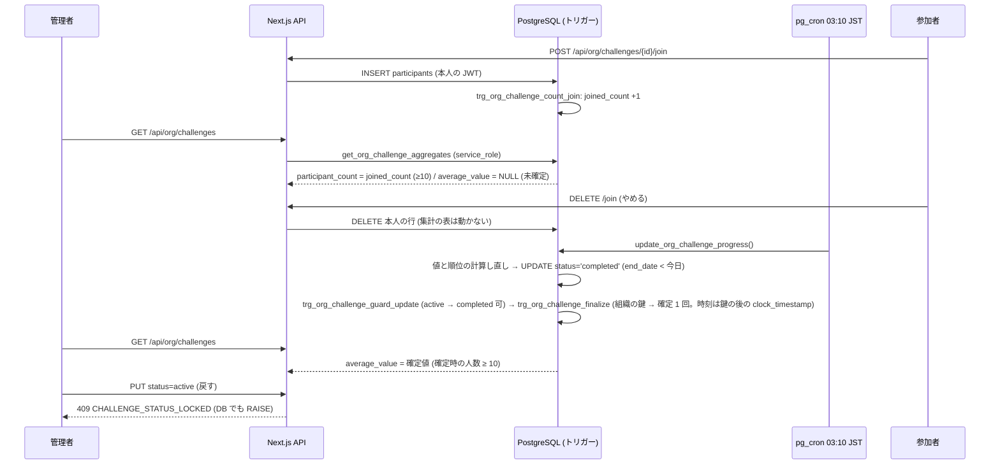

# org/ チャレンジ: 集計の差分から、やめた人の値を逆算させない (#1688)

| 版 | 日付 | 内容 |
|---|---|---|
| v1.0 | 2026-10-16 | 新設 (Issue #1688 の設計ゲート・A 型 4 相) |
| v1.1 | 2026-10-16 | 構造 A に、同じ種類で期間が重なるチャレンジの公開を 1 本にする規則・管理者だった人の印・削除の制限・状態の NOT NULL を足す |
| v1.2 | 2026-10-16 | 確定を組織ごとの鍵で 1 本ずつにし、確定の時刻を鍵を取ったあとの時計の時刻にする (確定の時刻の順 = コミットの順)。管理者が自分で持つ 2 つ目のアカウントを使う経路を残る限界に明記する |
| v1.3 | 2026-10-16 | モバイルの管理画面の状態のボタンを Web と同じく状態で出し分ける。段を「サーバー (DB・lib・API)」と「画面」に組み替える (段 A の終わりで既存の結合テストが赤くならない)。既存テストの追随 (順位表の service_role の模擬の作り直し・C-2 の reason・歩数の終了と中止の it・結合テストの it ごとの後片付け) を足す |
| v1.4 | 2026-10-16 | モバイルのネイティブの管理画面 (チャレンジ) とそのテストは #1598 (2026-10-16) で画面ごと削除したので、本書では変えない。モバイルの文言と状態のボタンの出し分けを、触るファイル・テスト・追随表から外す (Web の画面・API・DB の設計は変えない) |

要件の正本は Issue #1688 の本文とコメント (コメントは閉じたときの記録の 1 件で、要件を足していない)、親の #1600 (本文と、参加者の名前・集計の最小人数のコメント 1 件。ほかの 2 件のコメントは確認の記録) と #1132。本書はその上で決めた範囲と設計で、Issue と食い違ったら本書が正。既存のチャレンジ設計 `07-challenge.md` §15 (実装の正) を前提に、§15 が「#1688 で設計する」と送った守りだけを扱う。

---

## 0. 外形固定と分冊判定 (相 1)

### 0.1 発注と前提

- 前提: ローンチ前で利用者ゼロ (正しい形で作る)。本番の DB に触らない。
- main に入っているもの: 最小人数 10 人と参加の直接の INSERT のポリシーの強化 (PR #1694 = 29ea690e。migration `supabase/migrations/20261016170000_org_challenge_min10_join_policy.sql`)。
- Issue #1600 のコメント (2026-10-15) の記録: 「オーナーの選択 (2026-10-15、選択式): 参加者の名前は見せないまま (ORG_CHALLENGE_SHOW_NAMES は入れない) にします。集計の最小人数は 10 人にします。」
- 以前の試み (ブランチ `fix/issue-1600-org-challenge-min10`・審査 4 周で毎回別の抜け道) は参考にしてよいが、構造から設計し直す。Issue に列挙された抜け道 (管理者による状態・期間・種類の書き換えで控えが書き直される / 管理者が任意の役割で参加して順位表を受け取る / 控えの作成と計算日のずれ) は、すべて §0.3 のシナリオに入れ、§4.3 のトレースで閉じていることを示す。
- 決めること: 誰から何を守るか・守りの範囲 (要件書 §6.4 の「部署の匿名化集計に 10 名以上」との関係)・管理者の変更操作との両立 (確定後の不変など)・順位表とメンバー一覧の読み方・既存の実装の流用か作り直しか。発明の前に、差分攻撃の一般的な対策を英語と日本語で調べ、採る・採らないを理由つきで書く (§3)。

### 0.2 要件行列

| # | 要件 | 出どころ | 本書の節 |
|---|---|---|---|
| R-1 | 管理者に見せる集計 (人数・平均) の 2 時点の差から、1 人の値を逆算できないこと (同じチャレンジの 2 時点に加え、同じ値になるチャレンジを 2 本並べた差も含む) | #1688 本文・#1600 本文 3「強化の候補」 | §4.1 (a)(e), §4.3 S-21〜S-23・S-26 |
| R-2 | 管理者がチャレンジの状態・期間・種類を書き換えても、R-1 が破れないこと (旧ブランチの抜け道 1) | #1688「経緯」 | §4.1 (c), §4.3 S-6〜S-7・S-24 |
| R-3 | 管理者が任意の役割で参加して順位表を受け取っても、やめた・外した人の値が分からないこと (旧ブランチの抜け道 2) | #1688「経緯」 | §4.1 (d), §4.3 S-8・S-20・S-25 (1 つのアカウントでの役割の往復は閉じる)。管理者が別のメールアドレスで入れた 2 つ目の member のアカウントを使う経路 (S-27) は閉じない (§19-7・§20-4) |
| R-4 | 控えの作成時点と計算日のずれが生まれる構造を持たないこと (旧ブランチの抜け道 3) | #1688「経緯」 | §4.2, §4.3 S-17 |
| R-5 | 誰から何を守るか (同じ組織の管理者・参加者) を定め、要件書 §6.4 の「匿名化集計の最低人数 10 名以上」との関係を書く | #1688「設計で決めること」・`docs/requirements/02-organization-management.md:884` | §3.1 |
| R-6 | 管理者がチャレンジの状態・期間・種類を変えられることとの両立 (確定後に変えられなくするのか) を決める | #1688「設計で決めること」 | §4.1 (c), §9.3 |
| R-7 | 順位表とメンバー一覧の読み方 (その場の行か、控えか) を決める | #1688「設計で決めること」 | §3.3, §4.2 |
| R-8 | 既存の実装 (旧ブランチ) を流用するか、作り直すかを決める | #1688「設計で決めること」 | §18 |
| R-9 | 参加は任意・順位は参加者どうしにだけ・管理者には集計だけ・表示名は見せない、という #1132 / #1600 の方針を崩さない | `07-challenge.md` §15・#1600 コメント | §4.1, §10 |
| R-10 | 全テーブル RLS 必須・snake_case・監査ログの原則・migration は冪等で対の down を持つ | `docs/design/CLAUDE.md` | §5 |
| R-11 | 最小人数 10 は DB の関数の cfg に 1 か所だけ書き、共有の定数と突合する (既存の番兵) | `packages/shared/src/org-challenges.ts:18`・`tests/org-challenges-lib.test.ts:153` | §5.1, §16 |
| R-12 | as any・マジックナンバーを使わない。意味のある数は名前付き定数に | 設計ゲートの規律 | §6 |

### 0.3 ユーザーシナリオ (27 本。トレースは §4.3)

| # | シナリオ |
|---|---|
| S-1 | メンバーが開催中のチャレンジに参加する。管理者の画面の「参加した人」が 1 増える (10 人になるまでは「10人未満」)。平均は「終了後に表示」のまま |
| S-2 | 参加者が参加をやめる (DELETE)。管理者の画面は何も変わらない。参加者向けの順位表からは、その場で行が消える |
| S-3 | 管理者がメンバー X を組織から外す (remove_org_member)。X の参加行は残るが、順位表・終了時の確定からは外れる。管理者の画面は何も変わらない。X が自分で組織を抜ける (leave_org) ときも同じ |
| S-4 | 終了日を過ぎた夜 03:10 JST の集計で、全員の値と順位を終了日までの記録で計算し直し、completed にする。同じトランザクションで平均が確定し、順位がついた今のメンバーが 10 人以上なら管理者の画面に出る |
| S-5 | 確定したあとに管理者が X を組織から外す (または X が参加をやめる)。確定した平均は変わらない。差は取れない |
| S-6 | 管理者が終了したチャレンジを開催中に戻そうとする (API の PUT でも、PostgREST を直接叩いても)。409 / RAISE `CHALLENGE_STATUS_LOCKED` で変わらない |
| S-7 | 管理者が開催中のチャレンジの開始日・終了日・種類・部署を PostgREST で書き換えようとする。RAISE `CHALLENGE_PERIOD_LOCKED` で変わらない (API の PUT はそもそも受け付けない) |
| S-8 | 管理者 (owner / admin) が参加して詳細を開く。自分の記録と順位は見えるが、順位表は返らない (`reason: 'org_admin'`)。DB の関数も 0 行。そのチャレンジがある間に管理者になったことがある人 (いまは member) も同じ |
| S-9 | 参加している管理者が X を外したあとに自分の順位を見る。順位は次の夜の計算し直しまで変わらず、変わっても自分との上下しか分からない (値は分からない。§19) |
| S-10 | 管理者が開催中のチャレンジを手動で終了 (PUT status=completed) する。前夜までの値で平均が確定し、以後変わらない |
| S-11 | 管理者が開催中のチャレンジを中止 (cancelled) する。平均は確定しない (表示されない)。以後、状態も期間も変えられない |
| S-12 | 管理者が下書きの開始日・終了日を直して開始する。下書きの間は期間・種類・部署を変えられ、開始したら変えられない |
| S-13 | 参加者がやめて、同じチャレンジにもう一度参加する。「参加した人」は 2 回数える (延べ) |
| S-14 | 参加者がアカウントを消す (退会)。先に `release_user_membership` (service_role) が組織の所属を外し (その時点で S-3 と同じ)、続く auth.users の削除で参加行が外部キーで消える。「参加した人」も確定した平均も変わらない |
| S-15 | migration の適用時に、すでに終了している (completed の) チャレンジがある。いまの参加行から一度だけ確定する (これまで管理者に見えていた値と同じ) |
| S-16 | メンバーが自分の画面で参加者数を見る。管理者向けと同じ DB の関数・同じ規則 (延べ・10 人未満は出さない) なので、管理者がメンバーとして呼んでも迂回できない |
| S-17 | 夜の集計が止まっていた (何日か走らなかった) あとに走る。確定は「completed にする UPDATE」と同じトランザクションで、その直前に計算した値から取るので、控えの作成日と計算日がずれる余地が無い |
| S-18 | 参加した人がちょうど 10 人で、終了前に 1 人が組織から外れる。終了時点の順位がついた人が 9 人なので平均は出ない (管理者は「外した人が参加していた」と推測しうるが、値は分からない。§19) |
| S-19 | 部署を限定した開催中のチャレンジの参加者の所属部署が変わる (`user_profiles.department_id`。本人は変えられない特権列で、製品で変わるのは脱退・除名・退会での NULL だけ。ほかは service_role の直接の更新。チャレンジが参照する部署は削除できない)。その人は詳細を開けなくなるが、行は順位表にも終了時の確定にも残り、集計は動かない |
| S-20 | 参加中のメンバー Y が順位表を見たあと、管理者になり (#1799 の前は、同じ組織の招待を admin の役割で承諾してなれた。`accept_org_invite` が同じ組織の在籍者の承諾を拒まず、`org_role` を招待の役割で上書きしていた。#1799 (`supabase/migrations/20261017160000_org_invite_same_org_member.sql`) で拒むようにしたので、今は所有者の譲渡・運営の操作・抜けて入り直す経路 (S-25) で管理者になる)、X を組織から外し、member に戻ってから、もう一度順位表を見ようとする。管理者になった時点で、その組織にあるチャレンジすべてに Y の「管理者だった印」が付き、member に戻っても順位表は返らない (`reason: 'org_admin'`)。所有者の譲渡 (`accept_org_owner_transfer`) で owner になる経路も同じ |
| S-21 | 管理者が、種類・開始日・終了日が同じチャレンジ A・B を作り、11 人が両方に参加する。X が B だけやめる。終了日の夜、同じバッチで A・B が completed になる。平均は、先に確定した 1 本 (確定の時刻が早い方。同じなら ID の小さい方) だけが出て、もう 1 本は出ない |
| S-22 | 管理者が A (開催中) を PUT で completed にし (前夜の値で確定)、X を組織から外し、同じ日に B (A と種類が同じで期間が重なる) を completed にする。A の平均が出ていれば B の平均は出ない。A が 10 人未満で出ていなければ、B の平均は出る (公開は B の 1 回だけ) |
| S-23 | 管理者が、平均が出た A (completed) を PostgREST で消し、同じ種類・同じ期間の B を作り直して、メンバーにもう一度参加してもらう。A は消せない (DELETE が 0 行) ので、B の平均は S-22 の規則で出ない。開催中の A も消せない (中止してからなら消せる。中止は確定しない) |
| S-24 | 管理者が PostgREST で、開催中のチャレンジの状態を NULL にして期間を書き換え、開催中に戻そうとする (NULL の状態を下書きのように使う)。状態の列は NOT NULL で、ガードも NULL への遷移を CHALLENGE_STATUS_LOCKED で止めるので、1 回目の UPDATE で止まる |
| S-25 | 参加中のメンバー Y が順位表を見たあと、組織を抜け (`leave_org`。参加行は残る)、admin の役割の招待で入り直して X を外し、また抜けて member の役割の招待で入り直してから順位表を見ようとする。admin で入り直した時点で印が付き、member で入り直しても順位表は返らない。印の付いたチャレンジで参加をやめて参加し直しても、印は参加行とは別の表にあるので残る |
| S-26 | 種類が同じで期間が重なる A・B がある。A の終了日を過ぎた夜 03:10 JST に夜の集計 (T1) が始まり、全員の値を計算し直している間に、管理者が B を PUT で completed にする (T2)。T2 は先にコミットし、管理者が一覧を開くと B の平均が出る。そのあと T1 が A を completed にしてコミットする。A の確定は T2 のコミットのあとに鍵を取ってから時刻を決めるので B より後になり、A の平均は出ず、B の平均は出たまま (一度出た平均は消えず、2 本目は出ない) |
| S-27 | 管理者が、自分で持つ別のメールアドレスを member の役割で招待し (`create_org_invite` は、宛先がその組織の在籍者・持ち主でなければ絞らない (#1799)。席が空いていれば通る)、そのアカウントで承諾して開催中のチャレンジに参加し、順位表を見る。管理者のアカウントで X を外し、2 つ目のアカウントでもう一度順位表を見ると、X の行が消えていて値が分かる。2 つ目のアカウントは一度も管理者になっていないので印は付かない。本書はこの経路を閉じない (§19-7。閉じるには順位表をやめる。§20-4) |

### 0.4 分冊判定

目安 (設計書 800 行超 / 消費先レーン 3 以上 / 共有面 2 つ以上) のうち、消費先 (管理者 API・メンバー API・管理者の画面 Web・メンバーの画面。モバイルのネイティブの管理画面は #1598 (2026-10-16) で画面ごと削除したので、本書では変えない) と共有面 (`organization_challenges` への変更ガードと削除のポリシー・新しい表 2 つ・`user_profiles` のトリガー) に当たる。それでも **1 冊**にする。理由: 核 (DB の表・トリガー・ポリシー・関数 2 本の作り直し・lib の正典) と配線 (API 2 本の分岐と画面の文言) は同じ不変条件「平均の公開は重なるチャレンジの中で 1 回・順位表は管理者と管理者だった人に出さない」を 1 つの契約で共有し、配線だけの冊に残る判断が無い (文言の置き換えと分岐 1 つ)。実装 WF は §14 のとおりサーバー (DB・lib・API とそのテスト) → 画面 (Web とそのテスト) の 2 段に分け、段ごとに 2 枚レビューを閉じる。DB の意味が変わると API の結合テストが同時に変わるので、DB と API を同じ段に置く (§14)。

### 0.5 用語

| 語 | 意味 |
|---|---|
| 集計 | 管理者に見せる 2 値 = 参加者数と平均。`GET /api/org/challenges` が DB の関数 `get_org_challenge_aggregates` から取る |
| 確定 | チャレンジが `completed` になる UPDATE と同じトランザクションで、順位がついた今のメンバーの平均と人数を `organization_challenge_aggregates` に 1 回だけ書くこと。同じ組織の確定は組織ごとの鍵で 1 本ずつ進み、確定の時刻 (`finalized_at`) は鍵を取ったあとの時計の時刻。以後は書き換えない |
| 参加した人 (延べ) | 参加の INSERT のたびに +1 し、やめても・組織から外れても・退会しても減らない数 (`joined_count`)。画面の「参加者数」はこの値 |
| 管理者 | `user_profiles.org_role` が `owner` / `admin` の人 (`requireOrgAdmin` が通す人)。メンバーを組織から外せる唯一の主体 |
| 参加者 | `organization_challenge_participants` に行があり、今もその組織のメンバーである人 |
| 差分攻撃 | 2 つの公開値 (母集団が 1 人だけ違う) の差から、その 1 人の値を出すこと。2 つの公開値は、同じチャレンジの 2 時点でも、同じ値になる 2 本のチャレンジ (種類が同じで期間が重なる) でもよい |
| 期間が重なる | 同じ組織の 2 本のチャレンジ c・s で、`s.start_date <= c.end_date AND c.start_date <= s.end_date` (両端を含む) |
| 管理者だった印 | 表 `organization_challenge_ranking_exclusions` の行 (challenge_id, user_id)。その人が組織の管理者 (owner / admin) になった時点で、その組織にあったチャレンジすべてに付く。役割の変更・参加のやめ直しでは消えない (消えるのはチャレンジの削除と退会の CASCADE だけ)。印のある人には、そのチャレンジの順位表を返さない |

---

## 1. 目的・スコープ

対象: 組織チャレンジ (`organization_challenges` / `organization_challenge_participants`) の、管理者に見せる集計と参加者に見せる順位表から、参加をやめた人・組織から外れた人の値 (と、できる範囲で参加の有無) を逆算させない守り。
対象外: 順位表そのものをやめること (#1132 の方針の変更)・参加者どうしの社会的な知識 (「あの人がやめたと聞いた」) による結びつけ・内部の共謀 (管理者 2 人の分担)・管理者が自分で持つ 2 つ目の member のアカウントを使う経路 (DB からは別の人に見え、共謀と同じ形。§19-7 の残る限界)・歩数 / 体重 / カスタムの種類 (作成も参加もできない)・値の計算式 (`update_org_challenge_progress` は変えない)。

## 2. 関連要件

- 要件定義 02 §5.6 (F-ORG-006)・§6.4 プライバシー (`docs/requirements/02-organization-management.md:884` 匿名化集計の最低人数 10 名以上)
- `07-challenge.md` §15 (実装の正。「管理者に見せるもの」の行が既知の限界として本件を送っている: `docs/design/org/07-challenge.md:432`)
- `09-rls-policies.md` §14 の実装との違いの注記・§18 の表
- migration `20261014100100_org_challenge_progress.sql` (関数 3 本・ポリシー・pg_cron) と `20261016170000_org_challenge_min10_join_policy.sql` (最小人数 10・INSERT ポリシー)

---

## 3. 守る相手と、対策の選定 (発明の前の調査)

### 3.1 誰から何を守るか・要件書 §6.4 との関係

| 主体 | 持っている力 | 守る対象 | 本書の扱い |
|---|---|---|---|
| 組織の管理者 (owner / admin) | 集計を見る・メンバーを組織から外す (`remove_org_member`)・チャレンジを何本でも作る (種類・期間の重複を止める制約は無い)・チャレンジの状態を変える (API) と全列を書き換える・行を消す (ポリシー `Org admins can manage challenges` は FOR ALL で WITH CHECK 無し。`supabase/migrations/20251126124224_create_meal_planner_tables.sql:9620`)・メンバーとして参加して順位表と自分の順位を見る・所有者の譲渡や抜けて入り直す経路で自分の役割を member と行き来する (同じ組織の招待の承諾で役割を変える経路は #1799 で閉じた)・任意のメールアドレスを member の役割で招待してアカウントを増やす (`create_org_invite` は宛先がその組織の在籍者・持ち主でなければ絞らず (#1799)、席の上限だけを見る。`supabase/migrations/20261008100000_membership_daily_send_cap.sql:312`) | 1 人の値 (current_value) と、できる範囲で参加の有無 | **本書の主対象**。平均の公開を「同じ種類で期間が重なるチャレンジの中で確定 1 回」にし、公開したチャレンジを消させず、順位表を管理者と管理者だった人に見せず、開始後の期間・種類と終了後の状態を不変にする。ただし、管理者が別のメールアドレスで入れた 2 つ目の member のアカウントで順位表を見る経路は閉じない (§19-7) |
| 参加者 (member) | 自分の参加・やめる・順位表 (上位 20 人と本人。名前なし) | 他の参加者の値と名前の結びつき | 順位表は #1132 の方針どおり値を名前なしで見せる。やめた人の行はその場で消える (§3.3 で理由)。社会的な知識による結びつけは対象外 (§19) |
| 組織に所属しない人・他組織 | 何も見えない (既存の RLS・認可) | — | 変えない |

要件書 §6.4 の「匿名化集計の最低人数 10 名以上」は、部署の集計だけでなく、管理者に見せる集計すべてに当てる (#1600 で 10 人に決まった)。最小人数は「1 回の集計」を守る規則で、2 回の集計の差は守らない (§3.2 の AWS の記述と同じ)。本書はその補完として「集計を 2 回出さない」構造を足す。

### 3.2 一般的な対策の調査と、採る・採らない

英語: AWS Clean Rooms「custom considerations」(https://docs.aws.amazon.com/clean-rooms/latest/userguide/custom-considerations.html) は、1 人だけ違う 2 つの SUM の差で 1 人の値が出る例を挙げ、「クエリ単位の最小集計の閾値は差分攻撃を防がない」とし、アクセス予算と差分プライバシーを勧める。差分攻撃の総説 (Dwork ら「Exposed! A Survey of Attacks on Private Data」https://privacytools.seas.harvard.edu/publications/exposed-survey-attacks-private-data) は、再構成攻撃と追跡攻撃に分け、集計に雑音を足す差分プライバシーを位置づける。PoPETs 2020 (https://www.petsymposium.org/popets/2020/popets-2020-0031.pdf) は、同じ答えになるクエリを並べて雑音を剥がす攻撃を示す。
日本語: 総務省の秘匿処理の資料 (https://www.soumu.go.jp/main_content/000339465.pdf) は、客体数が少ないセルを非表示にし、合計からの引き算で判明する場合に二次秘匿を行う運用を示す。統計数理研究所 南 (https://www.ism.ac.jp/openhouse/2024/index/DrMINAMI.pdf) は最小度数ルール・占有性ルールと、一次秘匿だけでは行和・列和から復元されるため二次秘匿が要ることを示す。瀧 (統計数理 51(2), 2003, https://www.ism.ac.jp/editsec/toukei/pdf/51-2-337.pdf) はセル秘匿の基準と方法を整理する。

| 対策 | 採否 | 理由 |
|---|---|---|
| 最小度数 (k-匿名の度数規則。10 人未満は出さない) | 採用済み (#1600) | 1 回の集計を守る。2 回の差は守らないので、下の対策で補う |
| 二次秘匿 (差で復元できる公開値を伏せる) | **採る (形を単純化)** | 統計表の二次秘匿は「差が取れる組を伏せる」。本書では公開を **1 チャレンジにつき 1 回 (終了時の確定値)** にし、さらに **同じ組織・同じ種類・期間が重なるチャレンジの中で、先に確定した 1 本だけ**を出す (後のものを伏せる = 二次秘匿)。個人の値は (本人, 種類, 開始日, 終了日と前日の早い方) だけで決まる (`supabase/migrations/20261014100100_org_challenge_progress.sql:120`〜`:176`) ので、種類と期間が同じなら 2 本の母集団の差がそのまま 1 人の値になるため。開催中の平均は出さない |
| 時系列の抑制規則 (母集団が k 人以上変わるまで新しい値を出さない) | 採らない | 1 人やめたあと終了まで値が凍るので開催中の平均が使い物にならないうえ、終了時の確定と最後の公開値の母集団が 1 人違い、その間に他の人の記録が無ければ (休日・記録の少ない参加者) 差がそのまま 1 人の値になる |
| 夜ごとの控え (snapshot) を公開する | 採らない | 旧ブランチの形。全員の値を計算し直した夜にだけ控えを書いても、他の人の値が動かない夜 (新しい記録が無い) は差が正確に 1 人の値になる。書き直す条件 (counted_through) が抜け道の発生源になり、審査 4 周で閉じなかった |
| 雑音の付加 (差分プライバシー) | 採らない | 10 人の平均の感度は 100 / 10 = 10 点で、有用な精度の雑音にできない。AWS も最小人数との併用に注記がある。公開が 1 回なら雑音は要らない |
| 粗い丸め (整数・5 点刻み) | 採らない | 差を曖昧にするだけで閉じない。既存の小数第 1 位のまま |
| クエリ監査・アクセス予算 | **採る (組織単位の公開の予算 = 重なりの中で 1 回)** | 公開面は固定の 2 値 (人数・平均) なので、問い合わせの監査は要らない。ただしチャレンジ単位の「公開 1 回」だけでは、管理者が同じ値になるチャレンジを何本も作れる (S-21・S-22)。予算は「同じ組織・同じ種類・期間が重なるチャレンジの平均の公開は 1 回」とし、平均を出す関数がその場で判定する (確定の時刻と ID の順。別の台帳は持たない。確定の時刻の順をコミットの順とそろえるため、確定のトリガーが組織ごとの鍵を 1 つ取る。S-26)。公開した (completed の) チャレンジは利用者の権限では消せなくし、予算の記録が消えないようにする (S-23) |
| 母集団の凍結 (やめた人の値を残して平均を計算し続ける) | 採らない | 「やめた人の記録は、集計にも順位にも残らない」(`src/app/api/org/challenges/[id]/join/route.ts:20`) の約束と、組織から外れた人のデータの継続利用に反する |
| 役割で順位表を伏せる | **採る (今の役割 + 管理者だった印)** | メンバーを組織から外せるのは管理者だけ。順位表を管理者に見せなければ、「外した人の行が消える」経路が無くなる。今の役割だけでは、1 人が member ⇄ admin を往復して「member で見る → admin で外す → member で見る」を組めるので (S-20・S-25)、管理者になった時点でその組織のチャレンジに印を付け、印のある人にも見せない (§4.1 (d))。印はアカウントに付くので、管理者が別のメールアドレスで入れた 2 つ目の member のアカウント (S-27) は閉じない (§19-7) |
| 開始後の期間・種類と終了後の状態の不変 | **採る** | 書き換えで計算し直す経路 (旧ブランチの抜け道 1) を消す。API はもともと期間・種類を変えないので、PostgREST の直接の UPDATE をトリガーで止めるだけ。状態の列は NULL を許していた (CHECK は NULL を通す) ので NOT NULL にし、NULL を「下書き」として使う抜け道 (S-24) も消す |

### 3.3 順位表とメンバー一覧の読み方 (R-7)

- 順位表: **その場の行** (いまの `organization_challenge_participants`) のまま。管理者 (owner / admin) と、そのチャレンジに管理者だった印のある人には返さない。控え (夜の時点の行) から返す形は採らない: 管理者の経路は役割で閉じ、参加者どうしの経路は控えにしても「他の人の値が動かない夜」に消えた行が特定できるので、控えの表と 2 本目の書き込み経路を足すだけの効果が無い。
- メンバー一覧: 参加者の一覧 API は無く、作らない。`GET /api/org/members` (組織のメンバー) は参加を示さない。参加者数は、集計の表の延べ数 (`joined_count`) を管理者向け・メンバー向けの両方が同じ関数で読む。

---

## 4. 構想 (相 2) と構造裁定 (相 3)

### 4.1 構造

公開値を「差の取れない形」にする 6 つの決まり。

(a) **平均は確定 1 回**: 管理者に見せる平均は、チャレンジが `completed` になる UPDATE の AFTER トリガー `org_challenge_finalize` が、そのトランザクションの参加行 (順位がついた今のメンバー) から計算して `organization_challenge_aggregates` に書く値だけ。開催中は返さない。確定後は書き換えない (`ON CONFLICT ... DO UPDATE ... WHERE finalized_at IS NULL`)。中止 (cancelled) は確定しない。
(b) **参加者数は延べ**: 参加の INSERT の AFTER トリガー `org_challenge_count_join` が `joined_count` を +1 する。DELETE・組織からの脱退・除名・退会では動かさない。管理者がメンバーを外しても数が動かないので、参加の有無が漏れない。10 人未満は NULL (既存の規則)。
(c) **開始後の不変**: 状態の列を NOT NULL にする (NULL の行は先に draft にする)。BEFORE UPDATE トリガー `org_challenge_guard_update` が、状態の遷移表 (draft → active / completed / cancelled、active → completed / cancelled、終わった状態からは変えない。NULL への変更も止める) と、draft 以外での `start_date` / `end_date` / `challenge_type` / `department_id` の変更、常時の `organization_id` の変更を RAISE で止める。API の PUT は遷移表を先に確かめて 409 を返し、DB の RAISE も 409 に写す。
(d) **順位表は管理者と管理者だった人に見せない**: 見る人の今の `org_role` が owner / admin か、そのチャレンジに「管理者だった印」(§0.5) があれば返さない。印は `user_profiles` の AFTER INSERT / UPDATE OF `org_role`, `organization_id` のトリガー `org_challenge_mark_admin` が、その人が組織の管理者になった時点 (役割か組織が変わって owner / admin になった時点) で、その組織にあるチャレンジすべてに付ける。どの経路 (抜けてからの入り直し・所有者の譲渡・運営の操作・service_role の直接の更新) で役割が変わっても同じトリガーが拾う (同じ組織の招待の承諾は、#1799 (`supabase/migrations/20261017160000_org_invite_same_org_member.sql`) で拒むようにしたので、役割を変える経路ではない)。印は消さない (参加をやめて参加し直しても、member に戻っても残る)。`GET /api/org/challenges/[id]` は、今の役割か印で伏せるとき順位表の関数を呼ばず `ranking: { available: false, reason: 'org_admin' }` を返す。DB の関数 `get_org_challenge_ranking` も同じ 2 つの条件で 0 行 (API の確認が漏れても返らない)。自分の記録と順位 (`me`) は返す。印はアカウント (user_id) に付くので、管理者が別のメールアドレスで招待して入れた 2 つ目の member のアカウントには付かない。その経路 (S-27) は閉じない (§19-7)。
(e) **重なるチャレンジの平均は 1 本だけ**: `get_org_challenge_aggregates` は、確定した平均 (確定時点の人数が最小人数以上) を返す前に、同じ組織・同じ種類で期間が重なり (§0.5)、自分より先に確定した (確定の時刻、同じなら ID の順) チャレンジで、確定時点の人数が最小人数以上のものがあるかを見る。あれば平均を NULL にする。種類と期間は開始後に変わらず ((c))、確定値も変わらない。さらに、確定のトリガー `org_challenge_finalize` は、書く前に組織ごとの鍵 (`pg_advisory_xact_lock`。キーは `'org_challenge_finalize:' || organization_id`) を取り、確定の時刻を鍵を取ったあとの `clock_timestamp()` にする (トランザクションの開始時刻の `now()` は使わない)。同じ組織の確定は 1 本ずつ進み、後の確定は前の確定のコミットのあとに時刻を決めるので、確定の時刻の順がコミットの順と一致する。よって、ある確定が読めるとき、それより前の確定はすべて読める (読める確定の集合は、確定の時刻の順の先頭からの区間)。新しく読めるようになる確定は、すでに読める確定より必ず後ろなので、出ている平均を伏せることはない。これで、一度出た平均が後から消えたり、伏せた平均が後から出たりしない (S-26)。
(f) **公開したチャレンジは消させない**: `organization_challenges` に RESTRICTIVE の DELETE ポリシー `Org challenges can be deleted only as draft or cancelled` を足し、利用者の権限 (authenticated) で消せるのを draft と cancelled だけにする。completed (平均を出しうる) と active (これから確定する) は消せない。(e) の判定の相手が消えて、同じ種類・期間のチャレンジを作り直すと 2 回目の公開ができてしまうのを止める。組織を消したときの CASCADE と service_role はポリシーを通らない (RLS は参照整合の動作と service_role に掛からない) ので、組織の削除と運営の操作は止めない。消せる行 (draft / cancelled) を消すと、参加行・集計の行・印は外部キーの CASCADE で一緒に消える (§9.3 の DELETE の行)。

変えないもの: `update_org_challenge_progress` (値の計算・completed にする UPDATE)、pg_cron のジョブ、参加の INSERT / SELECT / DELETE のポリシー、`Org admins can manage challenges` ポリシー、参加をやめる DELETE (その場で行を消す)、メンバー向けの API の形 (順位表の `reason` を足すだけ)、招待・譲渡・脱退・除名の関数。

### 4.2 代替案の比較と裁定 (1 回だけ)

| 案 | 構造 | 差分攻撃 (正確な差) | 書き換えの抜け道 | 足すもの | 裁定 |
|---|---|---|---|---|---|
| A: 本書 | 平均は終了時の確定 1 回で、同じ種類で期間が重なるチャレンジの中でも 1 回・公開したチャレンジは消せない・人数は延べ・開始後の不変・順位表は管理者と管理者だった人に出さない | 同じ値になる公開が 1 回なので差が無い | 不変のトリガーと NOT NULL で無い | 表 2・トリガー 4・ポリシー 1・関数 2 本の作り直し・組織ごとの鍵 1 つ (確定のトリガーの中) | **採る** |
| B: 夜ごとの控え (旧ブランチ) | 毎晩の計算し直しと同時に控えを書き、集計と順位表を控えから返す | 他の人の値が動かない夜は差が 1 人の値になる (記録の無い日) | 控えを書き直す条件に依存 (4 周で閉じず) | 表 2・関数 1・バッチの改修・集合の受け渡し | 採らない |
| C: 開催中も平均を出すが、母集団が変わったら終了まで凍る | 抑制規則 | 最後の公開値と確定値の差 (母集団 1 人違い) が残る | A と同じ | A + 凍結の判定 | 採らない (閉じない) |
| D: やめた人の値を残す (母集団の凍結) | 行を消さず left_at で印 | 差は無い | A と同じ | 行の意味の変更・約束の変更 | 採らない (約束と継続利用に反する) |

「縁の発生源を消すより単純な構造は無いか」: 差分攻撃の発生源は「同じ値の集まりについて、母集団が違う公開値が 2 つある」こと。公開値が生まれる経路は 3 つで、A はそれぞれを発生源ごと消す: ①同じチャレンジの 2 時点 → 確定 1 回 ((a))、②同じ値になる別のチャレンジ (個人の値は種類と期間だけで決まる) → 重なりの中で 1 回 ((e)) と、判定の相手を消させない ((f))、③参加者に見せる順位表を、外す力を持つ人が前後で見る → 今の役割と管理者だった印 ((d))。③は同じアカウントの経路だけを閉じ、管理者が 2 つ目のアカウントを使う経路 (S-27) は残る (§19-7)。控え・凍結・雑音はすべて「2 つ目の公開値をどう守るか」の対症療法になる。

②の閉じ方の比較 (相 3 の裁定): 「同じ組織で種類が同じで期間が重なるチャレンジを作らせない」(除外の制約) は、既存のテストの fixture (同じ種類・同じ期間のチャレンジを同じ組織に何本も作る。`tests/integration/rls/org-challenge-progress.test.ts:617`〜`:621` など) と、部署を分けて同じ種類を同時に開く使い方を壊し、さらに消してから作り直す経路は別に止める必要がある。「手動の completed を止める」は S-21 (同じバッチで 2 本が終わる) を閉じない。平均を出す関数の中で「重なりの中で先に確定した 1 本だけ」を判定する形は、書き込みの経路を増やさず、同時に確定しても確定の時刻と ID の全順序で必ず 1 本に決まり、台帳が要らない。ただし確定の時刻をトランザクションの開始時刻 (`now()`) にすると、先に始まって後にコミットした確定が、すでに読めている確定の前に割り込み、出ていた平均が消えて別の平均が出る (S-26。READ COMMITTED では「先に始まった」は「先にコミットした」ではない)。そこで確定のトリガーが組織ごとの鍵を取り、鍵を取ったあとの時計の時刻を確定の時刻にする ((e))。鍵を取るのは確定のトリガーだけ。製品の経路で 1 つのトランザクションが複数の組織の鍵を取るのは夜の集計 (自分の鍵 `public.update_org_challenge_progress` で 1 本ずつ動く) だけで、PUT と管理者の PostgREST の UPDATE は自分の組織の行だけを書く (`Org admins can manage challenges` の USING が `up.organization_id = organization_challenges.organization_id`。`supabase/migrations/20251126124224_create_meal_planner_tables.sql:9620`)。行のロックは UPDATE の文の中で取り、確定のトリガー (AFTER ROW) は文の終わりに動くので、行のロックを待っている間に組織の鍵を持っていることも無い。よって製品の経路では鍵の取り合いで止まり合わない。service_role が 1 つのトランザクションの別々の文で複数の組織のチャレンジを終了にし、夜の集計と重なった場合だけは、PostgreSQL のデッドロック検出 (40P01) で片方が取り消されうる (取り消された側は何も書かない。夜の集計なら次の夜にやり直す)。鍵を待つ時間は、相手のトランザクションのコミットまで (夜の集計なら、値の計算し直しが終わって completed にしたあと、コミットまでの間)。「確定のときに公開するかを決めて列に残す」案は、同じ鍵が要るうえ書き込む列が増えるので採らない。平均を出す関数の中の判定と、確定のトリガーの組織ごとの鍵の組を採る。

③の閉じ方の比較: 「招待の承諾で同じ組織の在籍者を拒む」(`accept_org_invite` の作り直し) は、抜けて入り直す経路 (S-25)・所有者の譲渡・運営の操作・service_role の直接の更新を別々に閉じる必要があり、本書の範囲の外の関数を触る (この拒否そのものは、本書の外の #1799 (`supabase/migrations/20261017160000_org_invite_same_org_member.sql`) で入った。残りの経路があるので、印のトリガーは要るまま)。「参加行に在籍の世代を持たせる」は入り直しだけを閉じる。役割が owner / admin になったことを `user_profiles` の 1 本のトリガーで拾って印を付ける形は、経路を問わず閉じ、招待の関数を変えない。これを採る。印はアカウントに付くので、1 人が別のメールアドレスで 2 つ目の member のアカウントを入れて使う経路 (S-27) は、この形でも招待の関数の作り直しでも閉じない (DB からは別の人で、共謀と区別できない。§19-7)。印を「そのチャレンジの開始後に管理者だったか」ではなく「管理者になった時点で組織にあったチャレンジすべて」にするのは、印の要る場面 (member として見た → 管理者になった) では、見た時点でチャレンジがすでにあり、管理者になった時点にもあるから (§4.3 S-20 の証明)。

A を確定し、以後は蒸し返さない。

### 4.3 シナリオのトレース (構造 A で手で走らせた記録)

| # | 走らせた結果 | 閉じているか |
|---|---|---|
| S-1 | INSERT → `org_challenge_count_join` が `joined_count` を 1 → … → 10。`get_org_challenge_aggregates` は 10 以上で人数を返し、`final_ranked_count` が NULL なので平均は NULL。画面「終了後に表示」 | ✔ |
| S-2 | DELETE は本人の行だけ消す (ポリシー不変)。トリガー無し → `joined_count` 不変。平均は未確定のまま NULL。順位表 (参加者向け) はその場の行なので消える | ✔ (管理者には何も見えない) |
| S-3 | `remove_org_member` (最新の定義は `supabase/migrations/20261022140000_org_transfer_toctou.sql:284`) も `leave_org` (同 `:241`) も、`user_profiles` の `organization_id` / `org_role` / `department_id` を NULL にするだけ。参加行は残る。`joined_count` 不変・平均 NULL。順位表・確定の母集団からは組織の結合で外れる | ✔ |
| S-4 | バッチ: 値を計算し直す UPDATE → `UPDATE … SET status = 'completed' WHERE status = 'active' AND end_date < v_today` → BEFORE ガード (active → completed は可) → AFTER `org_challenge_finalize` が同じトランザクションの行から `final_ranked_count` / `final_average_value` を書く | ✔ (R-4: 計算と確定が同じトランザクション) |
| S-5 | 確定後の DELETE / 除名は表を触らない。関数は表から読む。差 = 0 | ✔ |
| S-6 | API: 現在の状態が completed / cancelled で status が違えば 409 `CHALLENGE_STATUS_LOCKED` (何も書かない)。PostgREST: ガードが RAISE。確定は `WHERE finalized_at IS NULL` で二度書かない。画面: Web (`src/app/(org)/org/challenges/page.tsx:386`〜`:401`) は、終わった状態のカードには状態のボタンを出さない (既存。全カードに「有効化」「完了」を出していたモバイルのネイティブの管理画面は、#1598 (2026-10-16) で画面ごと削除したので、本書では変えない) | ✔ (抜け道 1) |
| S-7 | ガード: `OLD.status` が draft でないとき期間・種類・部署の変更を RAISE `CHALLENGE_PERIOD_LOCKED`。計算し直しの経路が無い | ✔ (抜け道 1) |
| S-8 | API: `profile.org_role` が owner / admin → 順位表の関数を呼ばず `reason: 'org_admin'`。member でも `hasRankingExclusion` が true → 同じ。関数も `meup.org_role NOT IN ('owner','admin')` と印の `NOT EXISTS` で 0 行。`me` は本人の行 (RLS) から返す | ✔ (抜け道 2) |
| S-9 | 管理者の `me.rank` は夜の計算し直しでしか変わらない。X を外した次の夜、全員の値が動いた中で順位が 1 つ上がれば「X は自分より上だった」と分かりうる。値は分からない | 残る限界 (1 bit)。§19 |
| S-10 | PUT status=completed → ガード可 → `org_challenge_finalize` が前夜までの値 (行の current_value) で確定。平均は開催中に出ていないので前後の差が無い | ✔ |
| S-11 | PUT status=cancelled → ガード可 → 確定のトリガーは `NEW.status = 'completed'` だけなので書かない。以後の UPDATE はガードで RAISE | ✔ |
| S-12 | draft の期間変更はガードを通る。active にしたあとは S-7 | ✔ |
| S-13 | INSERT のたびに +1。延べ数であることを画面に書く | ✔ (限界: 1 人で増やせる。§19) |
| S-14 | 退会の処理 (`src/lib/account-deletion.ts:402`) が `release_user_membership` (最新の定義は `20261022160000_release_membership_owner_race.sql:57`。service_role だけ) を呼び、`organization_id` / `org_role` / `department_id` を NULL にする (参加行は触らない。ここまで S-3 と同じ)。続く auth.users の削除で、`organization_challenge_participants.user_id` の ON DELETE CASCADE により行が消える。DELETE にトリガーは無い。集計の表は `challenge_id` しか持たないので変わらない | ✔ |
| S-15 | migration の埋め戻し: `joined_count` = いまの参加行の数、completed の行は一度だけ確定。以後 S-5 と同じ | ✔ |
| S-16 | `GET /api/org/challenges/[id]` と `/my-challenges` は同じ `fetchChallengeAggregates` → 同じ関数。管理者がメンバーとして呼んでも同じ値 | ✔ |
| S-17 | 控えが無い。確定は「completed にする UPDATE」のトリガーで、その直前に同じトランザクションで計算した行から取る (バッチの経路)。手動終了 (S-10) は前夜の計算の行から取る。どちらも「いまの行」で、別の日付を記録しない | ✔ (抜け道 3) |
| S-18 | 10 人参加 → 1 人除名 → 終了時の順位がついた今のメンバー 9 人 → 平均 NULL。管理者は「10 人のうち 1 人外した結果が 9 人」から参加の有無を推測しうる | 残る限界 (値ではない)。§19 |
| S-19 | `department_id` は特権列 (`guard_user_profiles_privileged`、`supabase/migrations/20261008200700_legal_documents_acceptance.sql:77`) で、利用者の JWT では変えられない。製品で変わるのは S-3 / S-14 の NULL だけ (組織の所属と同時)。チャレンジが参照する部署は `organization_challenges_department_id_fkey` (ON DELETE の指定なし = NO ACTION) で削除できず、`DELETE /api/org/departments` は 23503 を 409 `DEPARTMENT_IN_USE` にする (`src/app/api/org/departments/route.ts:207-215`)。service_role で変えた場合: `get_org_challenge_ranking`・`org_challenge_finalize`・`get_org_challenge_aggregates` はどれも部署で絞らない (組織の結合だけ) ので、行は順位表と確定の母集団に残り、`joined_count` も不変。本人は `isVisibleToMember` (`src/lib/org-challenge-api.ts:77`) で詳細が 404 になるだけ。消える行が無いので差が無い | ✔ |
| S-20 | 経路の事実: `accept_org_invite` は、本書の時点の定義 (`supabase/migrations/20261007150200_invite_accept_creates_missing_profile.sql:97`) では別組織の在籍者だけを `ALREADY_IN_ORG` で拒み、同じ組織の在籍者の承諾では `INSERT ... ON CONFLICT (id) DO UPDATE SET organization_id = EXCLUDED.organization_id, org_role = EXCLUDED.org_role, ...` (`:151`〜`:156`) で役割を上書きしていた。#1799 (`supabase/migrations/20261017160000_org_invite_same_org_member.sql`) からは、所属のある人の承諾を宛先の組織によらず `ALREADY_IN_ORG` で拒み、招待の承諾では役割が変わらない (下の ②・④ の招待の経路は無くなった。役割の往復は所有者の譲渡・運営の操作・service_role の更新・抜けて入り直す経路 (S-25) に残り、印の証明はそのまま効く)。所有者の譲渡 (`accept_org_owner_transfer`、`20251126124224_create_meal_planner_tables.sql:811`) は member / admin → owner と owner → admin。運営の組織作成 (`src/app/api/admin/organizations/route.ts:216`) は service_role で owner にする。走らせた結果: ① Y (member) が順位表を見る (印なし・役割 member → 返る)。② Y が admin の招待を承諾 → `ON CONFLICT DO UPDATE` が `user_profiles` の UPDATE になり、`org_role` が member → admin に変わるので `trg_org_challenge_mark_admin` が発火し、組織 A のチャレンジすべてに (C, Y) の印を INSERT。③ Y が X を外す (`remove_org_member` は呼び出した人の `org_role` を見る)。④ Y が member の招待を承諾 → 役割は member に戻るが印は残る。⑤ Y が詳細を開く → `hasRankingExclusion` が true → `reason: 'org_admin'`。関数も印で 0 行。前後の順位表の組ができない。所有者の譲渡で owner になった場合も ② と同じく発火する。証明 (印の範囲が足りること): 差を取るには「member で見た時刻 t1 < 管理者として外した時刻 t2 < member で見た時刻 t3」が要る。t1 に member で t2 に管理者なので、t1 < t_p ≤ t2 に役割が owner / admin になった時刻 t_p があり、そこでトリガーが動く。t1 に順位表を見たチャレンジ C は t1 にすでにあり (メンバーに見えるのは active / completed だけ)、active / completed の行は利用者の権限で消せない ((f))。中止してから消していれば t3 で見る順位表も無い。よって C は t_p にもある。よって (C, Y) の印が t_p に付き、t3 では返らない | ✔ (抜け道 2) |
| S-21 | A・B は同じ種類・同じ期間なので、11 人の値は A と B で同じ。X が B をやめる (DELETE) → `joined_count` は A・B とも 11 のまま。終了日の夜のバッチ: 値の計算 → `UPDATE ... SET status = 'completed'` が A・B の 2 行を completed にし、行ごとの AFTER トリガーで A は 11 人、B は 10 人で確定する。`finalized_at` は行ごとに鍵を取ったあとの `clock_timestamp()` なので、先にトリガーが動いた行が早い (時計の値が同じなら ID の順で決まる)。2 行は同じトランザクションでコミットするので、読めるようになるのも同時。`get_org_challenge_aggregates`: A・B の両方が `final_ranked_count >= 10` で `eligible` に入る。`(finalized_at, id)` が小さい方 (A とする) は、自分より前の重なる行が無いので平均が出る。B は `(A.finalized_at, A.id) < (B.finalized_at, B.id)` の A があるので NULL。公開は 1 本 | ✔ (R-1) |
| S-22 | A を PUT completed → 確定 (前夜の値。11 人)。X を外す。B を PUT completed → 確定 (同じ前夜の値。10 人)。`finalized_at` は A が先。B は A と種類が同じで期間が重なり、A が 10 人以上で先に確定しているので NULL。A が 9 人以下で確定していれば A は出ず、B は自分より前に「出る資格のある」重なる行が無いので出る。どちらの場合も公開は 1 本 | ✔ (R-1) |
| S-23 | A (completed) の DELETE: `Org admins can manage challenges` (許可) と `Org challenges can be deleted only as draft or cancelled` (RESTRICTIVE。`status IN ('draft','cancelled')` が偽) の両方を満たす行だけが消えるので 0 行。A の控えも残り、B を作り直して確定しても S-22 と同じく NULL。active の A も 0 行。active の A を cancelled にしてからなら消せるが、cancelled は確定していない (平均を出していない) ので判定の相手を失っても公開は 1 回のまま。組織ごと消すと CASCADE で消えるが、そのときは管理者も組織も無い | ✔ (R-1) |
| S-24 | `ALTER COLUMN status SET NOT NULL` の後なので、NULL への UPDATE は 23502 で失敗する。その前に BEFORE トリガーが `NEW.status IS NULL` を CHALLENGE_STATUS_LOCKED で止める (どちらでも行は変わらない)。INSERT で NULL を入れる経路も NOT NULL で止まる。migration の時点の NULL の行は先に draft にする (集計・参加・メンバー向けの一覧の対象外だった行で、下書きとして扱ってきたもの) | ✔ (抜け道 1) |
| S-25 | ① Y (member) が順位表を見る。② `leave_org`: `organization_id` / `org_role` を NULL にする (参加行は残る)。トリガーは `organization_id` が NULL なので何もしない。③ admin の招待を承諾: `organization_id` NULL → A、`org_role` NULL → admin に変わる UPDATE で印が付く。④ X を外す。⑤ `leave_org` → member の招待を承諾: 役割は member、印は残る。⑥ 詳細を開く → `reason: 'org_admin'`。参加をやめて (DELETE) 参加し直しても、印は `organization_challenge_ranking_exclusions` にあり参加行の削除で消えない (FK はチャレンジと auth.users にだけ CASCADE) ので返らない | ✔ (抜け道 2) |
| S-26 | T1 (夜の集計) は `update_org_challenge_progress` の自分の鍵を取り、値の計算し直しの文 (`20261014100100_org_challenge_progress.sql:120`〜`:199`) を走らせている。T2 (管理者の PUT) が B を completed にする: ガード可 → `org_challenge_finalize` が組織の鍵を取る (T1 はまだ completed の UPDATE (`:202`) に達しておらず組織の鍵を持たないので、すぐ取れる) → `finalized_at = clock_timestamp()` (= f_B) → 前夜の値で確定 → コミットして鍵を放す。管理者の GET: A は未確定、B は eligible で、前に重なる確定が無いので平均が出る。T1 が A を completed にする: `org_challenge_finalize` が組織の鍵を取る (T2 はコミット済みなのですぐ取れる) → `finalized_at = clock_timestamp()` (= f_A。T2 のコミットより後なので f_B < f_A) → 確定 → コミット。管理者の GET: A は `(B.finalized_at, B.id) < (A.finalized_at, A.id)` の B があるので NULL。B は前に A が無いので出たまま。逆の並び (T1 の確定が先に鍵を取る) では、T2 は T1 のコミットまで鍵を待ち、f_A < f_B で、A が出て B は出ない (B は一度も出ていない)。どちらでも、読める確定の集合は確定の時刻の順の先頭からの区間 (§4.1 (e)) なので、出た平均は出たままで、伏せた平均は伏せたまま。旧の形 (`now()` を確定の時刻にする) では f_A = T1 の開始時刻 < f_B となり、B が出たあとに A が出て B が消え、母集団が X の 1 人だけ違う 2 つの平均が両方見えた | ✔ (R-1) |
| S-27 | `create_org_invite` (`supabase/migrations/20261008100000_membership_daily_send_cap.sql:312`) は呼び出した人が owner / admin で席が空いていれば、宛先のメールアドレスを絞らずに招待を作る (作成は `membership_audit` の `invite_created` に残る。同 `:65`)。`accept_org_invite` は承諾する人のメールアドレスが招待の宛先と同じことだけを確かめる (`20261007150200_invite_accept_creates_missing_profile.sql:131`)。管理者が自分で持つ別のメールアドレスのアカウント Z で member の招待を承諾すると、Z の `org_role` は member のまま入るので `trg_org_challenge_mark_admin` は何もしない。Z は参加し (参加の INSERT ポリシーは本人の行・開催中・種類・部署を見るだけで、招待した人を見ない)、順位表を受け取る → 管理者のアカウントで X を外す → Z でもう一度受け取ると X の行が消えている。Z は一度も管理者になっていないので印は無く、今の役割も member なので、API も DB の関数も順位表を返す。DB からは Z は別の人で、内部の共謀 (§1 の対象外) と区別できない。管理者に見せる集計 (延べ数・確定した平均) はこの経路でも動かない (§4.1 (a)(b)(e) は役割に依らない) | 閉じない (残る限界。§19-7・§20-4) |

---

## 5. データモデル

### 5.1 DDL (migration と、対の down)

ファイル名は `supabase/migrations/<番号はマージ時に確定>_org_challenge_diff_privacy.sql` と `supabase/rollbacks/<同じ番号>_org_challenge_diff_privacy.down.sql`。番号は origin/main の `supabase/migrations` の最大より大きい値をマージ直前に確定し、1 行目の見出し・down の見出し・本文の「ロールバック」の参照もそろえる (`tests/migration-file-version-integrity.test.ts`)。`get_org_challenge_aggregates` と `get_org_challenge_ranking` は、それぞれ `20261016170000_org_challenge_min10_join_policy.sql:44` と `20261014100100_org_challenge_progress.sql:269` の最新の定義を土台にし、変える箇所をコメントで示す。

```sql
-- migration: <番号>_org_challenge_diff_privacy.sql
-- #1688: 組織チャレンジの集計の差分から、やめた人の値を逆算させない。#1600 (20261016170000_org_challenge_min10_join_policy.sql) の残り
--
-- 背景:
--   管理者に見せる集計 (get_org_challenge_aggregates) は参加者の行をその場で数えていたので、参加をやめる・組織から外す前後の
--   人数と平均の差から、やめた人の値が出た (最小人数の規則は 1 回の集計しか守らない)。参加者に見せる順位表も行をその場で読むので、
--   メンバーとして参加した管理者が、メンバーを外した前後で消えた 1 行の値を見られた。個人の値は種類と期間だけで決まるので、
--   同じ種類・同じ期間のチャレンジを 2 本作れば、2 本の平均の差からも 1 人の値が出た。
--
-- 変更 (差の取れる公開値を作らない):
--   1. organization_challenges.status を NOT NULL にする (NULL の行は先に draft にする。CHECK は NULL を通していた)。
--   2. 表 organization_challenge_aggregates (チャレンジごとに 1 行): 参加した人の延べ数 (joined_count) と、終了時に 1 回だけ確定する
--      平均 (final_average_value) と人数 (final_ranked_count)。読み書きは service_role と所有者だけ (RLS 有効・ポリシー無し)。
--   3. 表 organization_challenge_ranking_exclusions (管理者だった印): (challenge_id, user_id)。印のある人には順位表を返さない。
--      読み書きは service_role と所有者だけ (RLS 有効・ポリシー無し)。
--   4. トリガー org_challenge_count_join: 参加の INSERT ごとに joined_count を +1 (やめる・組織から外れる・退会では減らさない)。
--   5. トリガー org_challenge_guard_update: 状態の遷移 (draft → active / completed / cancelled、active → completed / cancelled) 以外
--      (NULL への変更を含む) を CHALLENGE_STATUS_LOCKED で止め、draft 以外での start_date / end_date / challenge_type / department_id と
--      常時の organization_id の変更を CHALLENGE_PERIOD_LOCKED で止める (API の PUT は期間・種類を受け付けない。PostgREST の直接の UPDATE を止める)。
--   6. トリガー org_challenge_finalize: completed への遷移と同じトランザクションで、順位がついた今のメンバーの平均 (小数第 1 位) と
--      人数を 1 回だけ書く (確定済みなら書かない)。中止 (cancelled) は確定しない。書く前に組織ごとの鍵 (pg_advisory_xact_lock) を取り、
--      確定の時刻を鍵を取ったあとの clock_timestamp() にする (同じ組織の確定を 1 本ずつにし、確定の時刻の順をコミットの順とそろえる)。
--   7. トリガー org_challenge_mark_admin (user_profiles): 役割か組織が変わって組織の管理者 (owner / admin) になった時点で、
--      その組織のチャレンジすべてに印を付ける (招待の承諾・所有者の譲渡・運営の操作・service_role の更新のどの経路でも)。
--   8. ポリシー "Org challenges can be deleted only as draft or cancelled" (RESTRICTIVE・DELETE・authenticated): 利用者の権限で消せるのは
--      draft と cancelled だけ。平均を出しうるチャレンジを消して作り直す経路を止める。
--   9. get_org_challenge_aggregates: 控えの表から返す。人数 = joined_count (最小人数未満は NULL)、平均 = 確定値 (確定時点の人数が
--      最小人数未満なら NULL。開催中は常に NULL。同じ組織・同じ種類で期間が重なり、先に確定して最小人数を満たしたチャレンジがあれば NULL)。
--      名前・引数・返す列・SECURITY INVOKER・最小人数 (cfg の 10) は変えない。
--  10. get_org_challenge_ranking: 見る人が組織の管理者 (org_role が owner / admin) か、印がある人なら 0 行。ほかは 20261014100100 の定義のまま。
--  11. 埋め戻し: 既存のチャレンジに joined_count = いまの参加行の数。completed のチャレンジはいまの行から一度だけ確定。
--      印は埋め戻さない (いまの管理者は今の役割で伏せる。過去の役割の履歴は DB に無い)。
--   変えないもの: update_org_challenge_progress・pg_cron のジョブ・参加の INSERT / SELECT / DELETE のポリシー・
--   Org admins can manage challenges ポリシー・招待 / 譲渡 / 脱退 / 除名の関数。
--
-- 本番のデータへの影響: 表を 2 つ足し、既存のチャレンジの行数だけ控えの行を作る。状態が NULL のチャレンジの行だけ draft に書き換える。
--   表への書き込みを待たせるロックは NOT NULL の付与 (organization_challenges の全行を 1 回読む) とトリガーの付与だけ。10 秒でロック待ちを諦める。
-- 冪等: UPDATE ... WHERE status IS NULL / SET NOT NULL / CREATE TABLE IF NOT EXISTS / CREATE OR REPLACE FUNCTION /
--   CREATE OR REPLACE TRIGGER / DROP POLICY IF EXISTS → CREATE POLICY / 埋め戻しは ON CONFLICT。
-- 確認: tests/org-challenge-diff-privacy-migration-contract.test.ts / tests/integration/rls/org-challenge-diff-privacy.test.ts /
--       tests/integration/security/org-challenges-api.test.ts
-- ロールバック: supabase/rollbacks/<番号>_org_challenge_diff_privacy.down.sql

SET LOCAL lock_timeout = '10s';

-- ─────────────────────────────────────────────────────────
-- 1. 状態の NULL を無くす (ガードのトリガーより先に流す)
-- ─────────────────────────────────────────────────────────
-- NULL の行は、集計 (status = 'active' だけ)・参加 (ポリシーが status = 'active' を求める)・メンバー向けの一覧 (active / completed)
-- のどれの対象でもなく、下書きとして扱ってきた。draft にそろえてから NOT NULL にする
UPDATE public.organization_challenges SET status = 'draft' WHERE status IS NULL;
ALTER TABLE public.organization_challenges ALTER COLUMN status SET NOT NULL;

-- ─────────────────────────────────────────────────────────
-- 2. 集計の控え (チャレンジごとに 1 行)
-- ─────────────────────────────────────────────────────────
CREATE TABLE IF NOT EXISTS public.organization_challenge_aggregates (
  challenge_id        uuid PRIMARY KEY REFERENCES public.organization_challenges(id) ON DELETE CASCADE,
  -- 参加した人の延べ数。参加の INSERT ごとに +1。やめる・組織から外れる・退会では減らさない
  joined_count        integer NOT NULL DEFAULT 0 CHECK (joined_count >= 0),
  -- 確定した時刻 (確定のトリガーが組織ごとの鍵を取ったあとの clock_timestamp()。同じ組織の中では、この順がコミットの順と一致する)。
  -- NULL = 未確定 (開催中・下書き・中止)
  finalized_at        timestamptz,
  -- 確定時点の、順位がついた今のメンバーの人数と、その平均 (小数第 1 位)。人数 0 なら平均は NULL
  final_ranked_count  integer CHECK (final_ranked_count >= 0),
  final_average_value numeric,
  updated_at          timestamptz NOT NULL DEFAULT now(),
  CONSTRAINT organization_challenge_aggregates_final_shape CHECK (
    (finalized_at IS NULL AND final_ranked_count IS NULL AND final_average_value IS NULL)
    OR (finalized_at IS NOT NULL AND final_ranked_count IS NOT NULL)
  )
);

COMMENT ON TABLE public.organization_challenge_aggregates IS
  '#1688: 組織チャレンジの集計の控え。joined_count は参加の延べ数 (減らさない)。final_* は completed への遷移で 1 回だけ確定する平均と人数。読み書きは service_role と所有者だけ。';

ALTER TABLE public.organization_challenge_aggregates ENABLE ROW LEVEL SECURITY;
REVOKE ALL ON TABLE public.organization_challenge_aggregates FROM PUBLIC, anon, authenticated;
GRANT SELECT, INSERT, UPDATE, DELETE ON TABLE public.organization_challenge_aggregates TO service_role;

-- ─────────────────────────────────────────────────────────
-- 3. 管理者だった印 (この人には、このチャレンジの順位表を返さない)
-- ─────────────────────────────────────────────────────────
CREATE TABLE IF NOT EXISTS public.organization_challenge_ranking_exclusions (
  challenge_id uuid NOT NULL REFERENCES public.organization_challenges(id) ON DELETE CASCADE,
  -- 印の付いた人。退会 (auth.users の削除) で印も消える
  user_id      uuid NOT NULL REFERENCES auth.users(id) ON DELETE CASCADE,
  -- 印を付けた時刻 (その組織の管理者になった時刻)
  marked_at    timestamptz NOT NULL DEFAULT now(),
  PRIMARY KEY (challenge_id, user_id)
);

COMMENT ON TABLE public.organization_challenge_ranking_exclusions IS
  '#1688: 組織の管理者 (owner / admin) になった人の印。管理者になった時点でその組織にあったチャレンジごとに 1 行。印のある人には get_org_challenge_ranking が 0 行を返す (member に戻っても、参加し直しても消えない)。読み書きは service_role と所有者だけ。';

ALTER TABLE public.organization_challenge_ranking_exclusions ENABLE ROW LEVEL SECURITY;
REVOKE ALL ON TABLE public.organization_challenge_ranking_exclusions FROM PUBLIC, anon, authenticated;
GRANT SELECT, INSERT, UPDATE, DELETE ON TABLE public.organization_challenge_ranking_exclusions TO service_role;

-- ─────────────────────────────────────────────────────────
-- 4. 参加の延べ数 (参加の INSERT ごとに +1)
-- ─────────────────────────────────────────────────────────
CREATE OR REPLACE FUNCTION public.org_challenge_count_join()
RETURNS trigger
LANGUAGE plpgsql
SECURITY DEFINER
SET search_path = ''
AS $$
BEGIN
  IF NEW.challenge_id IS NULL THEN
    RETURN NULL;
  END IF;
  INSERT INTO public.organization_challenge_aggregates AS a (challenge_id, joined_count)
  VALUES (NEW.challenge_id, 1)
  ON CONFLICT (challenge_id) DO UPDATE
     SET joined_count = a.joined_count + 1,
         updated_at   = now();
  RETURN NULL;
END $$;

REVOKE ALL ON FUNCTION public.org_challenge_count_join() FROM PUBLIC, anon, authenticated, service_role;
COMMENT ON FUNCTION public.org_challenge_count_join() IS
  '#1688: organization_challenge_participants の INSERT ごとに organization_challenge_aggregates.joined_count を +1 する (延べ数。DELETE では減らさない)。';

CREATE OR REPLACE TRIGGER trg_org_challenge_count_join
  AFTER INSERT ON public.organization_challenge_participants
  FOR EACH ROW EXECUTE FUNCTION public.org_challenge_count_join();

-- ─────────────────────────────────────────────────────────
-- 5. 状態の遷移表と、開始後の期間・種類・部署の不変
-- ─────────────────────────────────────────────────────────
CREATE OR REPLACE FUNCTION public.org_challenge_guard_update()
RETURNS trigger
LANGUAGE plpgsql
SET search_path = ''
AS $$
DECLARE
  -- 状態の列は NOT NULL (1. で付けた) なので OLD.status は NULL にならない
  v_from text := OLD.status;
BEGIN
  IF NEW.status IS DISTINCT FROM OLD.status THEN
    -- 遷移表 (src/lib/org-challenge-privacy.ts の ORG_CHALLENGE_STATUS_TRANSITIONS と同じ):
    --   draft → active / completed / cancelled、active → completed / cancelled。completed / cancelled からは変えない。
    --   NULL への変更も止める (NOT NULL の 23502 より先に、同じ識別子で断る)。
    --   NOT (NULL) は NULL で IF を素通りするので、比較の結果を COALESCE で false に寄せてから否定する
    IF NEW.status IS NULL OR NOT COALESCE(
         (v_from = 'draft'  AND NEW.status IN ('active', 'completed', 'cancelled'))
      OR (v_from = 'active' AND NEW.status IN ('completed', 'cancelled')),
         false
    ) THEN
      RAISE EXCEPTION 'CHALLENGE_STATUS_LOCKED' USING ERRCODE = 'P0001',
        DETAIL = format('status %L -> %L', v_from, NEW.status);
    END IF;
  END IF;

  IF NEW.organization_id IS DISTINCT FROM OLD.organization_id THEN
    RAISE EXCEPTION 'CHALLENGE_PERIOD_LOCKED' USING ERRCODE = 'P0001', DETAIL = 'organization_id';
  END IF;

  IF v_from <> 'draft' AND (
       NEW.start_date     IS DISTINCT FROM OLD.start_date
    OR NEW.end_date       IS DISTINCT FROM OLD.end_date
    OR NEW.challenge_type IS DISTINCT FROM OLD.challenge_type
    OR NEW.department_id  IS DISTINCT FROM OLD.department_id
  ) THEN
    RAISE EXCEPTION 'CHALLENGE_PERIOD_LOCKED' USING ERRCODE = 'P0001',
      DETAIL = format('status %s', v_from);
  END IF;

  RETURN NEW;
END $$;

REVOKE ALL ON FUNCTION public.org_challenge_guard_update() FROM PUBLIC, anon, authenticated, service_role;
COMMENT ON FUNCTION public.org_challenge_guard_update() IS
  '#1688: organization_challenges の UPDATE を遷移表 (draft → active / completed / cancelled、active → completed / cancelled。NULL へは不可) に限り、draft 以外での start_date / end_date / challenge_type / department_id と、常時の organization_id の変更を止める。CHALLENGE_STATUS_LOCKED / CHALLENGE_PERIOD_LOCKED (P0001)。';

CREATE OR REPLACE TRIGGER trg_org_challenge_guard_update
  BEFORE UPDATE ON public.organization_challenges
  FOR EACH ROW EXECUTE FUNCTION public.org_challenge_guard_update();

-- ─────────────────────────────────────────────────────────
-- 6. 終了時の確定 (completed への遷移と同じトランザクションで 1 回だけ)
-- ─────────────────────────────────────────────────────────
CREATE OR REPLACE FUNCTION public.org_challenge_finalize()
RETURNS trigger
LANGUAGE plpgsql
SECURITY DEFINER
SET search_path = ''
AS $$
DECLARE
  v_finalized_at timestamptz;
BEGIN
  -- 同じ組織の確定を 1 本ずつにする (コミットで外れる)。get_org_challenge_aggregates は「重なりの中で確定の時刻が最も早い 1 本」
  -- だけに平均を出すので、確定の時刻の順がコミットの順と食い違うと、先に始まって後にコミットした確定が、すでに出ている平均の前に
  -- 割り込んでそれを消す (#1688 §4.3 S-26)。鍵を取ったあとの時計の時刻を確定の時刻にすれば、後の確定の時刻は前の確定の
  -- コミットより後になる。now() (トランザクションの開始時刻) は使わない
  PERFORM pg_catalog.pg_advisory_xact_lock(
    pg_catalog.hashtextextended('org_challenge_finalize:' || NEW.organization_id::text, 0));
  v_finalized_at := pg_catalog.clock_timestamp();

  INSERT INTO public.organization_challenge_aggregates AS a
         (challenge_id, joined_count, finalized_at, final_ranked_count, final_average_value, updated_at)
  SELECT NEW.id,
         0,
         v_finalized_at,
         count(p.user_id) FILTER (WHERE p.rank IS NOT NULL),
         round(avg(p.current_value) FILTER (WHERE p.rank IS NOT NULL), 1),
         v_finalized_at
    FROM public.organization_challenge_participants AS p
    JOIN public.user_profiles AS up
      ON up.id = p.user_id
     AND up.organization_id = NEW.organization_id
   WHERE p.challenge_id = NEW.id
  ON CONFLICT (challenge_id) DO UPDATE
     SET finalized_at        = EXCLUDED.finalized_at,
         final_ranked_count  = EXCLUDED.final_ranked_count,
         final_average_value = EXCLUDED.final_average_value,
         updated_at          = EXCLUDED.updated_at
   WHERE a.finalized_at IS NULL;
  RETURN NULL;
END $$;

REVOKE ALL ON FUNCTION public.org_challenge_finalize() FROM PUBLIC, anon, authenticated, service_role;
COMMENT ON FUNCTION public.org_challenge_finalize() IS
  '#1688: organization_challenges が completed になる UPDATE の AFTER トリガー。組織ごとの advisory lock (org_challenge_finalize:<organization_id>) を取ってから、同じトランザクションの参加行 (順位がついた今のメンバー) の平均 (小数第 1 位) と人数を organization_challenge_aggregates に 1 回だけ書く (確定済みなら書かない)。確定の時刻は鍵を取ったあとの clock_timestamp() (同じ組織の中で確定の時刻の順 = コミットの順)。';

CREATE OR REPLACE TRIGGER trg_org_challenge_finalize
  AFTER UPDATE OF status ON public.organization_challenges
  FOR EACH ROW
  WHEN (OLD.status IS DISTINCT FROM NEW.status AND NEW.status = 'completed')
  EXECUTE FUNCTION public.org_challenge_finalize();

-- ─────────────────────────────────────────────────────────
-- 7. 管理者になったときの印 (user_profiles のどの経路の変更でも)
-- ─────────────────────────────────────────────────────────
CREATE OR REPLACE FUNCTION public.org_challenge_mark_admin()
RETURNS trigger
LANGUAGE plpgsql
SECURITY DEFINER
SET search_path = ''
AS $$
BEGIN
  -- 組織の管理者 (owner / admin。src/lib/org-challenge-privacy.ts の ORG_CHALLENGE_RANKING_HIDDEN_ROLES と同じ並び) でなければ何もしない
  IF NEW.organization_id IS NULL
     OR NEW.org_role IS NULL
     OR NEW.org_role NOT IN ('owner', 'admin') THEN
    RETURN NULL;
  END IF;
  -- 役割も組織も変わっていない UPDATE (ほかの列の更新・同じ値の上書き) では付けない。管理者になった時点だけ
  -- (INSERT のときは OLD を読まない。TG_OP で分けてから比べる)
  IF TG_OP = 'UPDATE' THEN
    IF OLD.org_role IS NOT DISTINCT FROM NEW.org_role
       AND OLD.organization_id IS NOT DISTINCT FROM NEW.organization_id THEN
      RETURN NULL;
    END IF;
  END IF;
  INSERT INTO public.organization_challenge_ranking_exclusions (challenge_id, user_id)
  SELECT c.id, NEW.id
    FROM public.organization_challenges AS c
   WHERE c.organization_id = NEW.organization_id
  ON CONFLICT (challenge_id, user_id) DO NOTHING;
  RETURN NULL;
END $$;

REVOKE ALL ON FUNCTION public.org_challenge_mark_admin() FROM PUBLIC, anon, authenticated, service_role;
COMMENT ON FUNCTION public.org_challenge_mark_admin() IS
  '#1688: user_profiles の INSERT と、org_role / organization_id の UPDATE の AFTER トリガー。役割か組織が変わって組織の管理者 (owner / admin) になった時点で、その組織のチャレンジすべてに organization_challenge_ranking_exclusions の印を付ける (既にあれば何もしない)。';

CREATE OR REPLACE TRIGGER trg_org_challenge_mark_admin
  AFTER INSERT OR UPDATE OF org_role, organization_id ON public.user_profiles
  FOR EACH ROW EXECUTE FUNCTION public.org_challenge_mark_admin();

-- ─────────────────────────────────────────────────────────
-- 8. 削除の制限: 利用者の権限で消せるのは draft と cancelled だけ
-- ─────────────────────────────────────────────────────────
-- 平均を出しうる completed と、これから確定する active を消して同じ種類・期間で作り直すと、9. の「重なりの中で 1 本」の判定の
-- 相手が消えて 2 回目の公開ができる。RESTRICTIVE なので Org admins can manage challenges (FOR ALL) と AND で効く。
-- 組織の削除の CASCADE と service_role は RLS を通らないので止めない。
-- 並びは src/lib/org-challenge-privacy.ts の ORG_CHALLENGE_DELETABLE_STATUSES と同じ
DROP POLICY IF EXISTS "Org challenges can be deleted only as draft or cancelled" ON public.organization_challenges;
CREATE POLICY "Org challenges can be deleted only as draft or cancelled"
  ON public.organization_challenges
  AS RESTRICTIVE
  FOR DELETE
  TO authenticated
  USING (status IN ('draft', 'cancelled'));

-- ─────────────────────────────────────────────────────────
-- 9. 管理者に見せる集計: 控えの表から返す (名前・引数・返す列は 20261016170000 と同じ)
-- ─────────────────────────────────────────────────────────
CREATE OR REPLACE FUNCTION public.get_org_challenge_aggregates(p_organization_id uuid)
RETURNS TABLE (
  challenge_id      uuid,
  participant_count bigint,
  min_participants  integer,
  average_value     numeric
)
LANGUAGE sql
STABLE
SECURITY INVOKER
SET search_path = ''
AS $$
  WITH cfg AS (
    -- 値を出すのに必要な最小人数 (要件書 §6.4 の匿名化集計の最低人数。#1600 で 10 人。個人を特定されない集計にする人数)
    SELECT 10 AS min_participants
  ),
  eligible AS (
    -- 平均を出す資格のある確定 (この組織のチャレンジで、確定時点の順位がついた参加者が最小人数以上)。
    -- 種類・期間は draft の後に変わらず (org_challenge_guard_update)、確定値も変わらない (org_challenge_finalize) ので、この集合は増えるだけ
    SELECT s.id, s.challenge_type, s.start_date, s.end_date, sa.finalized_at
      FROM public.organization_challenges AS s
      JOIN public.organization_challenge_aggregates AS sa
        ON sa.challenge_id = s.id
     CROSS JOIN cfg
     WHERE s.organization_id = p_organization_id
       AND sa.final_ranked_count >= cfg.min_participants
  )
  SELECT c.id,
         -- 参加した人の延べ数 (参加のたびに +1。やめても・組織から外れても減らない)。最小人数に満たなければ NULL
         CASE WHEN a.joined_count >= cfg.min_participants THEN a.joined_count::bigint END,
         cfg.min_participants,
         -- 終了時に確定した平均だけ。確定時点の順位がついた参加者が最小人数に満たなければ NULL。開催中・下書き・中止は常に NULL。
         -- 同じ種類で期間が重なり (両端を含む)、自分より先に確定した (確定の時刻、同じなら ID の順) 資格のあるチャレンジがあれば NULL
         -- (個人の値は種類と期間で決まるので、2 本の平均の差から 1 人の値が出る。公開は重なりの中で 1 本だけ。#1688 §4.1 (e))
         CASE WHEN a.final_ranked_count >= cfg.min_participants
               AND NOT EXISTS (
                 SELECT 1
                   FROM eligible AS e
                  WHERE e.challenge_type = c.challenge_type
                    AND e.start_date <= c.end_date
                    AND c.start_date <= e.end_date
                    AND (e.finalized_at, e.id) < (a.finalized_at, c.id)
               )
              THEN round(a.final_average_value, 1) END
    FROM public.organization_challenges AS c
    LEFT JOIN public.organization_challenge_aggregates AS a
      ON a.challenge_id = c.id
   CROSS JOIN cfg
   WHERE c.organization_id = p_organization_id
$$;

REVOKE ALL ON FUNCTION public.get_org_challenge_aggregates(uuid)
  FROM PUBLIC, anon, authenticated, service_role;
GRANT EXECUTE ON FUNCTION public.get_org_challenge_aggregates(uuid)
  TO service_role;

COMMENT ON FUNCTION public.get_org_challenge_aggregates(uuid) IS
  '#1132 / #1600 / #1688: 管理者向けの集計。参加した人の延べ数 (joined_count。min_participants (10) 未満は NULL) と、終了時に確定した平均 (確定時点の順位がついた人が min_participants 未満なら NULL。開催中は NULL。同じ組織・同じ種類で期間が重なり先に確定した資格のあるチャレンジがあれば NULL) を控えの表 organization_challenge_aggregates から返す。個人の値・ID は返さない。SECURITY INVOKER。service_role のみ。';

-- ─────────────────────────────────────────────────────────
-- 10. 参加者に見せる順位表: 組織の管理者と、管理者だった印のある人には返さない (ほかは 20261014100100 の定義のまま)
-- ─────────────────────────────────────────────────────────
CREATE OR REPLACE FUNCTION public.get_org_challenge_ranking(
  p_challenge_id uuid,
  p_user_id      uuid,
  p_limit        integer DEFAULT NULL,  -- NULL は既定の人数 (下の cfg.default_limit)
  p_with_names   boolean DEFAULT false
)
RETURNS TABLE (
  rank         integer,
  current_value numeric,
  is_me        boolean,
  nickname     text,
  ranked_count bigint
)
LANGUAGE sql
STABLE
SECURITY INVOKER
SET search_path = ''
AS $$
  WITH cfg AS (
    -- 順位表に出す人数 (上位から。本人の行は、圏外でも別に付ける)。20261014100100 と同じ値
    SELECT 20 AS default_limit, 100 AS max_limit
  ),
  ranked AS (
    SELECT p.rank,
           p.current_value,
           p.user_id,
           CASE WHEN p_with_names THEN up.nickname END AS nickname,
           row_number() OVER (ORDER BY p.rank, p.joined_at, p.user_id) AS pos,
           count(*) OVER () AS total
      FROM public.organization_challenges AS c
      JOIN public.organization_challenge_participants AS p
        ON p.challenge_id = c.id
      JOIN public.user_profiles AS up
        ON up.id = p.user_id
       AND up.organization_id = c.organization_id
     WHERE c.id = p_challenge_id
       AND p.rank IS NOT NULL
  )
  SELECT r.rank,
         r.current_value,
         (r.user_id = p_user_id),
         r.nickname,
         r.total
    FROM ranked AS r
   CROSS JOIN cfg
   WHERE (r.pos <= LEAST(GREATEST(COALESCE(p_limit, cfg.default_limit), 1), cfg.max_limit) OR r.user_id = p_user_id)
     -- 順位表を見られるのは、そのチャレンジの参加者本人 (今も組織のメンバー) で、組織の管理者でなく、管理者だった印も無い人だけ。
     -- 管理者 (org_role が owner / admin。メンバーを組織から外せる人) には 0 行 (#1688。src/lib/org-challenge-privacy.ts の
     -- ORG_CHALLENGE_RANKING_HIDDEN_ROLES と同じ並び)。このチャレンジがある間に管理者になった人 (印。member に戻っても残る) にも 0 行。
     -- 参加していない人にも 0 行
     AND EXISTS (
       SELECT 1
         FROM public.organization_challenges AS c2
         JOIN public.organization_challenge_participants AS me
           ON me.challenge_id = c2.id
          AND me.user_id = p_user_id
         JOIN public.user_profiles AS meup
           ON meup.id = me.user_id
          AND meup.organization_id = c2.organization_id
        WHERE c2.id = p_challenge_id
          AND (meup.org_role IS NULL OR meup.org_role NOT IN ('owner', 'admin'))
          AND NOT EXISTS (
            SELECT 1
              FROM public.organization_challenge_ranking_exclusions AS x
             WHERE x.challenge_id = c2.id
               AND x.user_id = p_user_id
          )
     )
   ORDER BY r.pos
$$;

REVOKE ALL ON FUNCTION public.get_org_challenge_ranking(uuid, uuid, integer, boolean)
  FROM PUBLIC, anon, authenticated, service_role;
GRANT EXECUTE ON FUNCTION public.get_org_challenge_ranking(uuid, uuid, integer, boolean)
  TO service_role;

COMMENT ON FUNCTION public.get_org_challenge_ranking(uuid, uuid, integer, boolean) IS
  '#1132 / #1688: 参加者に見せる順位表。p_user_id がそのチャレンジの参加者 (今も組織のメンバー) で、組織の管理者 (owner / admin) でなく、organization_challenge_ranking_exclusions の印も無いときだけ、順位がついている参加者を上位 p_limit 人 (NULL は既定の default_limit = 20 人。1〜max_limit = 100 人) と本人の行について返す。管理者・印のある人・参加していない人には 0 行。他人の user_id は返さない。nickname は p_with_names が true のときだけ。SECURITY INVOKER。service_role のみ。';

-- ─────────────────────────────────────────────────────────
-- 11. 既存のチャレンジの埋め戻し (延べ数 = いまの参加行の数。completed は一度だけ確定。印は埋め戻さない)
-- ─────────────────────────────────────────────────────────
-- 確定の時刻は now() (この migration のトランザクションの開始時刻) でよい。確定のトリガーはこの migration のコミットまで
-- 他のトランザクションから見えず (1. の ALTER TABLE が organization_challenges の排他ロックをコミットまで持つ)、以後の確定の時刻は
-- コミットより後の clock_timestamp() なので、埋め戻した確定は必ずそれより前に並ぶ
INSERT INTO public.organization_challenge_aggregates AS a (challenge_id, joined_count)
SELECT c.id, count(p.id)
  FROM public.organization_challenges AS c
  LEFT JOIN public.organization_challenge_participants AS p
    ON p.challenge_id = c.id
 GROUP BY c.id
ON CONFLICT (challenge_id) DO NOTHING;

INSERT INTO public.organization_challenge_aggregates AS a
       (challenge_id, joined_count, finalized_at, final_ranked_count, final_average_value, updated_at)
SELECT c.id,
       0,
       now(),
       count(m.user_id),
       round(avg(m.current_value), 1),
       now()
  FROM public.organization_challenges AS c
  LEFT JOIN LATERAL (
    -- 順位がついた、今も組織のメンバーである参加者だけ
    SELECT p.user_id, p.current_value
      FROM public.organization_challenge_participants AS p
      JOIN public.user_profiles AS up
        ON up.id = p.user_id
       AND up.organization_id = c.organization_id
     WHERE p.challenge_id = c.id
       AND p.rank IS NOT NULL
  ) AS m ON true
 WHERE c.status = 'completed'
 GROUP BY c.id
ON CONFLICT (challenge_id) DO UPDATE
   SET finalized_at        = EXCLUDED.finalized_at,
       final_ranked_count  = EXCLUDED.final_ranked_count,
       final_average_value = EXCLUDED.final_average_value,
       updated_at          = EXCLUDED.updated_at
 WHERE a.finalized_at IS NULL;
```

対の down (`supabase/rollbacks/<番号>_org_challenge_diff_privacy.down.sql`):

```sql
-- rollback: <番号>_org_challenge_diff_privacy.sql
-- ⚠️ 守りが弱くなる: 戻すと、集計は参加者の行をその場で数える形 (20261016170000 の定義) に、順位表は管理者にも返す形
--    (20261014100100 の定義) に戻り、終了・中止したチャレンジの状態や開始後の期間を管理者が書き換えられ、開催中・終了した
--    チャレンジを消せる状態に戻る。明示的な承認を得た場合に限って使う。
--
-- 内容:
--   1. トリガー 4 本 (trg_org_challenge_count_join / trg_org_challenge_guard_update / trg_org_challenge_finalize /
--      trg_org_challenge_mark_admin) と、その関数 4 本を消す
--   2. ポリシー "Org challenges can be deleted only as draft or cancelled" を消す
--   3. get_org_challenge_aggregates(uuid) を 20261016170000_org_challenge_min10_join_policy.sql の定義 (最小人数 10。その場で数える) に戻す
--   4. get_org_challenge_ranking(uuid, uuid, integer, boolean) を 20261014100100_org_challenge_progress.sql の定義に戻す
--   5. 表 organization_challenge_ranking_exclusions と organization_challenge_aggregates を消す (印と控えのデータは失われる。
--      参加行・チャレンジの行はそのまま)
--   6. organization_challenges.status の NOT NULL を外す (本番の定義に戻す。NULL から draft にした行は draft のまま)
--   権限 (service_role だけ) は 3・4 で流し直す。
-- 先に API のデプロイ (順位表の reason・PUT のガード) を戻す必要は無い (関数の名前・引数・返す列は変わらない。
-- 管理者への順位表は API 側で伏せたまま)。本番に戻すときは、この内容を新しい migration として PR 経由で適用する。
-- 何度流しても同じ結果になる (冪等)。

SET LOCAL lock_timeout = '10s';

DROP TRIGGER IF EXISTS trg_org_challenge_count_join   ON public.organization_challenge_participants;
DROP TRIGGER IF EXISTS trg_org_challenge_guard_update ON public.organization_challenges;
DROP TRIGGER IF EXISTS trg_org_challenge_finalize     ON public.organization_challenges;
DROP TRIGGER IF EXISTS trg_org_challenge_mark_admin   ON public.user_profiles;
DROP FUNCTION IF EXISTS public.org_challenge_count_join();
DROP FUNCTION IF EXISTS public.org_challenge_guard_update();
DROP FUNCTION IF EXISTS public.org_challenge_finalize();
DROP FUNCTION IF EXISTS public.org_challenge_mark_admin();

DROP POLICY IF EXISTS "Org challenges can be deleted only as draft or cancelled" ON public.organization_challenges;

-- 3. 20261016170000 の get_org_challenge_aggregates をそのまま写す (本体は省略せず、同 migration の 44〜86 行の逐語)
-- 4. 20261014100100 の get_org_challenge_ranking をそのまま写す (同 migration の 269〜334 行の逐語)
--    どちらも REVOKE ALL ... FROM PUBLIC, anon, authenticated, service_role; GRANT EXECUTE ... TO service_role; を流し直す
--    (ranking を先に戻してから印の表を消す。新しい定義が印の表を読んでいるため)

DROP TABLE IF EXISTS public.organization_challenge_ranking_exclusions;
DROP TABLE IF EXISTS public.organization_challenge_aggregates;

ALTER TABLE public.organization_challenges ALTER COLUMN status DROP NOT NULL;
```

### 5.2 列の意味と不変条件

| 列 | 意味 | 書く経路 | 不変条件 |
|---|---|---|---|
| `joined_count` | 参加した人の延べ数 | `org_challenge_count_join` (+1) と埋め戻し | 減らない。DELETE / 脱退 / 除名 / 退会で動かない |
| `finalized_at` | 確定の時刻 (確定のトリガーが組織ごとの鍵を取ったあとの `clock_timestamp()`。埋め戻しは migration の `now()`) | `org_challenge_finalize` と埋め戻し (completed) | 一度入ったら変わらない (`WHERE a.finalized_at IS NULL`)。同じ組織の中では、確定の時刻の順がコミットの順と一致する (別のトランザクションの確定は、前の確定のコミットのあとに時刻を決める) |
| `final_ranked_count` | 確定時点の順位がついた今のメンバーの人数 | 同上 | `finalized_at` と同時にだけ入る |
| `final_average_value` | 確定した平均 (小数第 1 位) | 同上 | 人数 0 なら NULL。画面に出るのは、確定時点の人数が最小人数以上で、同じ種類で期間が重なり先に確定した資格のあるチャレンジが無いときだけ (§4.1 (e)) |
| `organization_challenge_ranking_exclusions.(challenge_id, user_id)` | 管理者だった印 | `org_challenge_mark_admin` だけ (埋め戻さない) | 消さない (チャレンジの削除・退会の CASCADE でだけ消える)。参加行の削除・役割の変更で動かない |
| `organization_challenges.status` | 状態 | 既存 (API の POST は draft、PUT は遷移表のとおり、バッチは active → completed) | NOT NULL。遷移は §9.3 の 5 本だけ |

### 5.3 RLS・権限の表

| 表 / 関数 | RLS | INSERT | SELECT | UPDATE | DELETE | EXECUTE |
|---|---|---|---|---|---|---|
| `organization_challenge_aggregates` | ✅ (ポリシー無し) | service_role・トリガー (所有者) | service_role・関数 (service_role が呼ぶ) | service_role・トリガー | service_role・FK CASCADE | — |
| `organization_challenge_participants` | ✅ (変えない) | 本人 (Users can join challenges) | 本人 | 無し (service_role) | 本人 | — |
| `organization_challenge_ranking_exclusions` | ✅ (ポリシー無し) | service_role・トリガー (所有者) | service_role (API の `hasRankingExclusion`)・関数 (service_role が呼ぶ) | service_role | service_role・FK CASCADE (チャレンジ・auth.users) | — |
| `organization_challenges` | ✅ | 管理者 | 同組織 | 管理者 (ガードのトリガーが遷移・期間を制限) | 管理者で、行の status が draft / cancelled のときだけ (RESTRICTIVE の新設ポリシー) | — |
| `user_profiles` | ✅ (変えない) | 既存 | 既存 | 既存 (新しい AFTER トリガー `trg_org_challenge_mark_admin` が印を書く) | 既存 | — |
| `get_org_challenge_aggregates` / `get_org_challenge_ranking` | — | — | — | — | — | service_role だけ (変えない) |
| トリガー関数 4 本 | — | — | — | — | — | 誰にも渡さない (トリガーは所有者の権限で動く。既存 `20261008100000_membership_daily_send_cap.sql` と同じ形) |

監査ログ: 本書は新しい監査の行を足さない。管理者の状態変更は既存の PUT でも監査していない (§20 に残す)。除名・脱退は既存の `membership_audit` に残る。印は役割の変化から機械的に付くもので、操作の記録ではない (役割の変化そのものは招待の承諾・譲渡の監査に既存どおり残る)。

---

## 6. 正典コード (定数 / 遷移表 / Zod / 純関数)

新しいモジュール `src/lib/org-challenge-privacy.ts` (既存の `src/lib/org-challenges.ts` は変えない。存在する export だけを読む)。

```ts
// src/lib/org-challenge-privacy.ts
// #1688 組織チャレンジの集計の差分から、やめた人の値を逆算させない守りの正典 (定数・遷移表・Zod・純関数)。
// DB 側の対 (遷移表・順位表を伏せる役割) は migration *_org_challenge_diff_privacy.sql のトリガーと関数。
import { z } from 'zod';
import type { PostgrestError, SupabaseClient } from '@supabase/supabase-js';
import { ORG_CHALLENGE_STATUSES } from '@/lib/org-challenges';

export type OrgChallengeStatus = (typeof ORG_CHALLENGE_STATUSES)[number];

/** 組織の役割 (DB の org_role_enum と同じ 3 値) */
export const ORG_ROLES = ['owner', 'admin', 'member'] as const;
export type OrgRole = (typeof ORG_ROLES)[number];

/**
 * 順位表を見せない役割 = 組織の管理者 (メンバーを組織から外せる人。外した人の行が消えるのを見せない)。
 * DB の関数 get_org_challenge_ranking の `meup.org_role NOT IN ('owner', 'admin')` と、トリガー関数
 * org_challenge_mark_admin の `NEW.org_role NOT IN ('owner', 'admin')` と同じ並び (contract テストが突合する)
 */
export const ORG_CHALLENGE_RANKING_HIDDEN_ROLES = ['owner', 'admin'] as const satisfies readonly OrgRole[];

/** 今の役割だけの判定。管理者だった印 (hasRankingExclusion) は別に見る */
export function canViewChallengeRanking(orgRole: string | null | undefined): boolean {
  return !(ORG_CHALLENGE_RANKING_HIDDEN_ROLES as readonly string[]).includes(orgRole ?? '');
}

/** 管理者だった印の表 (§5.1 の 3.)。読み書きは service_role だけ */
export const ORG_CHALLENGE_RANKING_EXCLUSIONS_TABLE = 'organization_challenge_ranking_exclusions';

/**
 * そのチャレンジに、その人の「管理者だった印」があるか。認可 (requireOrgMember) を通したあとに service_role のクライアントで呼ぶ。
 * 読めなかったときは例外 (呼び出し側の catch で 500。「印が無い」とみなして順位表を返すことはしない)
 */
export async function hasRankingExclusion(
  admin: Pick<SupabaseClient, 'from'>,
  args: { challengeId: string; userId: string },
): Promise<boolean> {
  const { data, error } = await admin
    .from(ORG_CHALLENGE_RANKING_EXCLUSIONS_TABLE)
    .select('challenge_id')
    .eq('challenge_id', args.challengeId)
    .eq('user_id', args.userId)
    .maybeSingle();
  if (error) {
    throw new Error(`順位表を伏せる印の取得に失敗しました: ${error.message}`);
  }
  return data !== null;
}

/**
 * 利用者の権限 (authenticated) で消せるチャレンジの状態。RESTRICTIVE ポリシー
 * "Org challenges can be deleted only as draft or cancelled" の `status IN ('draft', 'cancelled')` と同じ並び (contract テストが突合する)
 */
export const ORG_CHALLENGE_DELETABLE_STATUSES = ['draft', 'cancelled'] as const satisfies readonly OrgChallengeStatus[];

/** 状態 × 遷移先 (§9.3 の状態遷移表と 1 対 1。DB のトリガー org_challenge_guard_update と同じ) */
export const ORG_CHALLENGE_STATUS_TRANSITIONS: Readonly<Record<OrgChallengeStatus, readonly OrgChallengeStatus[]>> = {
  draft: ['active', 'completed', 'cancelled'],
  active: ['completed', 'cancelled'],
  completed: [],
  cancelled: [],
};

/** 同じ状態の指定は「変えない」(可)。それ以外は遷移表のとおり */
export function isOrgChallengeStatusTransitionAllowed(from: OrgChallengeStatus, to: OrgChallengeStatus): boolean {
  return from === to || ORG_CHALLENGE_STATUS_TRANSITIONS[from].includes(to);
}

/** DB のトリガーが RAISE する識別子 (ERRCODE は P0001)。API はこれを 409 に写す */
export const ORG_CHALLENGE_LOCK_ERROR_CODES = {
  status: 'CHALLENGE_STATUS_LOCKED',
  period: 'CHALLENGE_PERIOD_LOCKED',
} as const;
export type OrgChallengeLockErrorCode = (typeof ORG_CHALLENGE_LOCK_ERROR_CODES)[keyof typeof ORG_CHALLENGE_LOCK_ERROR_CODES];

/** PostgreSQL の RAISE EXCEPTION の既定の SQLSTATE (raise_exception) */
const PG_RAISE_EXCEPTION_SQLSTATE = 'P0001';
/** 状態・期間の変更を断る HTTP ステータス (前提条件の衝突。既存の CHALLENGE_NOT_ACTIVE / CHALLENGE_ENDED と同じ) */
export const ORG_CHALLENGE_LOCK_HTTP_STATUS = 409;

/** DB のガードの RAISE を API の応答 (code・status) に写す。ガード由来でなければ null */
export function mapChallengeLockError(
  error: Pick<PostgrestError, 'code' | 'message'>,
): { code: OrgChallengeLockErrorCode; status: number } | null {
  if (error.code !== PG_RAISE_EXCEPTION_SQLSTATE) return null;
  const code = Object.values(ORG_CHALLENGE_LOCK_ERROR_CODES).find((c) => error.message.includes(c));
  return code ? { code, status: ORG_CHALLENGE_LOCK_HTTP_STATUS } : null;
}

/** 順位表を返さない理由 (メンバー向け API の ranking.reason) */
export const RANKING_HIDDEN_REASONS = ['not_joined', 'org_admin'] as const;
export type RankingHiddenReason = (typeof RANKING_HIDDEN_REASONS)[number];

export const rankingEntrySchema = z.object({
  rank: z.number().int().positive(),
  value: z.number(),
  isMe: z.boolean(),
  label: z.string(),
});

/** GET /api/org/challenges/[id] の ranking (canonical。画面とテストはこの形で読む) */
export const rankingSectionSchema = z.union([
  z.object({ available: z.literal(false), showNames: z.boolean(), reason: z.enum(RANKING_HIDDEN_REASONS) }),
  z.object({
    available: z.literal(true),
    showNames: z.boolean(),
    rankedCount: z.number().int().nonnegative(),
    truncated: z.boolean(),
    entries: z.array(rankingEntrySchema),
  }),
]);
export type RankingSection = z.infer<typeof rankingSectionSchema>;
```

最小人数 10 は既存どおり DB の関数の cfg と `packages/shared/src/org-challenges.ts` の `ORG_CHALLENGE_MIN_PARTICIPANTS` に置く (環境変数で動かす値ではない。変えるときは migration と定数を同時に変え、番兵が突合する)。本書で環境変数は足さない。

---

## 7. facade 契約 (関数シグネチャ)

### 7.1 DB

| 関数 / トリガー | シグネチャ | 変更 |
|---|---|---|
| `get_org_challenge_aggregates(p_organization_id uuid) RETURNS TABLE (challenge_id uuid, participant_count bigint, min_participants integer, average_value numeric)` | 不変 | 本体: 控えの表から読む。`participant_count` = 延べ数 (10 未満は NULL)、`average_value` = 確定値 (開催中 NULL。重なりの中で先に確定した資格のあるチャレンジがあれば NULL) |
| `get_org_challenge_ranking(p_challenge_id uuid, p_user_id uuid, p_limit integer DEFAULT NULL, p_with_names boolean DEFAULT false) RETURNS TABLE (rank integer, current_value numeric, is_me boolean, nickname text, ranked_count bigint)` | 不変 | 本体: 見る人が owner / admin か、印があれば 0 行 |
| `update_org_challenge_progress(p_now timestamptz DEFAULT now()) RETURNS jsonb` | 不変 (作り直さない) | completed にする UPDATE がトリガーを起こす |
| `org_challenge_count_join()` / `org_challenge_guard_update()` / `org_challenge_finalize()` / `org_challenge_mark_admin()` RETURNS trigger | 新設 | §5.1 |
| ポリシー `Org challenges can be deleted only as draft or cancelled` (RESTRICTIVE・DELETE・authenticated) | 新設 | §5.1 の 8. |

### 7.2 TypeScript

| 関数 | シグネチャ | 置き場 |
|---|---|---|
| `canViewChallengeRanking(orgRole: string \| null \| undefined): boolean` | §6 | `src/lib/org-challenge-privacy.ts` (新設) |
| `isOrgChallengeStatusTransitionAllowed(from: OrgChallengeStatus, to: OrgChallengeStatus): boolean` | §6 | 同上 |
| `mapChallengeLockError(error: Pick<PostgrestError, 'code' \| 'message'>): { code: OrgChallengeLockErrorCode; status: number } \| null` | §6 | 同上 |
| `hasRankingExclusion(admin: Pick<SupabaseClient, 'from'>, args: { challengeId: string; userId: string }): Promise<boolean>` | §6。読めなければ `Error` を投げる | 同上 |
| `requireOrgMember(): Promise<OrgMemberContext>` | 戻り値の `profile` に `org_role: string \| null` を足す (`select('organization_id, department_id, org_role')`。値は `profile.org_role ?? null`。`src/lib/auth/org-member.ts:19`・`:48`)。型を `OrgRole` にしないのは、認可の層 (`src/lib/auth/`) からチャレンジの lib を import しないため。判定は `canViewChallengeRanking` が文字列で受ける | 既存の変更 |
| `fetchChallengeAggregates` / `fetchChallengeRanking` | シグネチャ・本体は不変 (`src/lib/org-challenge-api.ts`)。`ChallengeAggregate` の JSDoc の 2 か所 (`:88` 「今も組織のメンバーである参加者の人数」→ 参加した人の延べ数、`:94` 「集計が済んだ参加者の平均」→ 終了時に確定した平均。開催中・確定時点の人数が最小人数未満・同じ種類で期間が重なり先に平均を出したチャレンジがあるときは null) だけ現在形に直す | 既存 (段 A。コメントのみ) |

---

## 8. API 仕様 (変更点だけ。パスは変えない)

### 8.1 `PUT /api/org/challenges` (管理者)

`updates.status` があるとき、`isOrgChallengeStatus` の確認 (`src/app/api/org/challenges/route.ts:244`) の後、現在の行 (`status`, `challenge_type`) を読み (既存の `updates.status === 'active'` の読み取り `:249` をこの 1 回に統合)、`isOrgChallengeStatusTransitionAllowed(current.status, updates.status)` が false なら `409 { error: 'このチャレンジの状態は変えられません', code: 'CHALLENGE_STATUS_LOCKED' }` を返して何も書かない。行が無い (他組織・存在しない) ときは既存どおり更新 0 行で 200。`CHALLENGE_TYPE_DISABLED` (400) の確認は遷移の確認の後。`.update(updateData)` (`:275`) の `error` を `mapChallengeLockError` に通し、該当すれば同じ 409 (読んでから書くまでに状態が変わった場合)。写しは `CHALLENGE_PERIOD_LOCKED` も 409 にするが、PUT の `updateData` は title / description / target_value / target_unit / reward_description / status だけで、ガードが止める列 (start_date / end_date / challenge_type / department_id / organization_id) を書かないので、PUT からは実際には返らない (§11)。本文の形 (平たい `{ error, code }`) は既存の `INVALID_STATUS` と同じ。

```ts
// tsc:skip
// src/app/api/org/challenges/route.ts PUT の要点 (既存の流れへの差し込み。説明用の断片)
if (updates.status !== undefined) {
  const current = await readCurrent(id, profile.organization_id); // select('status, challenge_type') ... maybeSingle()
  if (current && !isOrgChallengeStatusTransitionAllowed(current.status, updates.status)) {
    return NextResponse.json({ error: 'このチャレンジの状態は変えられません', code: ORG_CHALLENGE_LOCK_ERROR_CODES.status }, { status: ORG_CHALLENGE_LOCK_HTTP_STATUS });
  }
  if (updates.status === 'active' && current && !isOrgChallengeType(current.challenge_type)) { /* 既存の 400 CHALLENGE_TYPE_DISABLED */ }
}
const { error } = await supabase.from('organization_challenges').update(updateData).eq('id', id).eq('organization_id', profile.organization_id);
if (error) {
  const locked = mapChallengeLockError(error);
  if (locked) return NextResponse.json({ error: 'このチャレンジの状態は変えられません', code: locked.code }, { status: locked.status });
  throw error;
}
```

### 8.2 `GET /api/org/challenges` (管理者)

形は不変 (`participantCount`, `aggregate.{minParticipants, visible, averageValue}`)。意味が変わる: `participantCount` は延べ数、`averageValue` は確定値 (開催中は null = `visible: false`。終了後でも、確定時点の人数が最小人数未満か、同じ種類で期間が重なり先に平均を出したチャレンジがあれば null。どちらの理由かは返さない)。画面は `status` と `visible` で文言を決める (§10)。ファイル冒頭のコメント (`src/app/api/org/challenges/route.ts:22`〜`:23` の「参加者が最小人数に満たない」「集計が済んだ参加者が最小人数に満たない」) を「参加した人 (延べ) が最小人数に満たない」「終了時点の順位がついた参加者が最小人数に満たない、または終了していない」に現在形化する。

### 8.3 `GET /api/org/challenges/[id]` (メンバー)

`ranking` を §6 の `rankingSectionSchema` の形にする。判定は次の順 (上から最初に当たったもの):

1. 参加していない (`mine` が null) → `{ available: false, showNames, reason: 'not_joined' }`。印は読まない。順位表の関数も呼ばない (既存どおり)
2. `canViewChallengeRanking(profile.org_role)` が false (今 owner / admin) → `{ available: false, showNames, reason: 'org_admin' }`。印も順位表の関数も呼ばない
3. `await hasRankingExclusion(admin, { challengeId: challenge.id, userId: user.id })` が true (管理者だった印) → `{ available: false, showNames, reason: 'org_admin' }`。順位表の関数は呼ばない。印を読めなければ例外 → 既存の `handleMemberError` で 500
4. それ以外 → 既存の `fetchChallengeRanking` を呼び、既存の `available: true` の形

`me` (本人の行) は役割・印に関わらず返す。`participantCount` は延べ数。`admin` (`getSupabaseAdmin()`) は既存どおり集計の前に 1 回だけ作る。

```ts
// tsc:skip
// src/app/api/org/challenges/[id]/route.ts の ranking の組み立て (既存の `const ranking = mine ? ... : null` と返り値の ranking の置き換え。説明用の断片)
let ranking: RankingSection;
if (!mine) {
  ranking = { available: false, showNames, reason: 'not_joined' };
} else if (
  !canViewChallengeRanking(profile.org_role) ||
  (await hasRankingExclusion(admin, { challengeId: challenge.id, userId: user.id }))
) {
  ranking = { available: false, showNames, reason: 'org_admin' };
} else {
  const view = await fetchChallengeRanking(admin, { challengeId: challenge.id, userId: user.id, showNames });
  ranking = {
    available: true,
    showNames,
    rankedCount: view.rankedCount,
    truncated: view.rankedCount > view.entries.length,
    entries: view.entries,
  };
}
```

### 8.4 `GET /api/org/my-challenges` (メンバー)

形は不変。`participantCount` が延べ数になるだけ。コードもコメントも変えない (`src/app/api/org/my-challenges/route.ts` のコメントは「参加者数」「最小人数に満たないときは null」「管理者向けと同じ DB の関数・同じ規則」で、延べ数になっても事実のまま)。

### 8.5 `POST` / `DELETE /api/org/challenges/[id]/join`

不変。コメント (`src/app/api/org/challenges/[id]/join/route.ts:20` の「やめた人の記録は、集計にも順位にも残らない」) は、「管理者の集計 (延べ数・確定した平均) は動かない」を足して現在形化する。

---

## 9. 表 3 点

### 9.1 ①全パターン表 (状態 × 誰が何を見る・できる × 消費経路)

| 状態 | 管理者: 参加者数 | 管理者: 平均 | メンバー: 参加者数 (`GET /api/org/my-challenges`・`GET /api/org/challenges/[id]`) | 管理者: PUT status | 管理画面の状態のボタン (Web。§10) | 管理者: PostgREST で status | 管理者: PostgREST で期間・種類・部署 | 管理者: PostgREST で行の DELETE | 参加者 (member・印なし): 順位表 | 管理者 (参加中) / 印のある member: 順位表 | 本人: `me` | 参加 INSERT (ポリシー) | やめる DELETE | 夜の集計 (`update_org_challenge_progress`。バッチ) |
|---|---|---|---|---|---|---|---|---|---|---|---|---|---|---|
| draft | 延べ数 (10 未満 NULL。通常 0 → NULL) | NULL | 見えない (メンバー向け API は draft を出さない) | → active / completed / cancelled 可 | 「開始」だけ (→ active) | → active / completed / cancelled 可 (ガードの遷移表)。→ NULL は RAISE `CHALLENGE_STATUS_LOCKED` (S-24) | 可 | 可 | 見えない (メンバー向け API は draft を出さない) | 同左 | — | 拒否 (status が active でない) | 可 (行があれば) | 対象外 (値の計算し直しも completed にする UPDATE も `status = 'active'` だけ。`supabase/migrations/20261014100100_org_challenge_progress.sql:128`・`:202`〜`:205`) |
| active | 延べ数 | NULL (「終了後に表示」) | 延べ数 (10 未満 NULL)。管理者と同じ関数 `get_org_challenge_aggregates` の同じ値で、平均の項目は無い (S-16) | → completed / cancelled 可。→ draft は 409 | 「終了」だけ (→ completed) | → completed / cancelled 可。→ draft・NULL は RAISE `CHALLENGE_STATUS_LOCKED` (S-6・S-24) | RAISE `CHALLENGE_PERIOD_LOCKED` | 0 行 (RESTRICTIVE ポリシー) | その場の行 (上位 20 + 本人) | 返さない (`reason: 'org_admin'`) | 返す | 可 (条件は #1600 のまま) | 可 | 値を計算し直す。end_date < 今日 (JST) なら同じトランザクションで completed にし、確定のトリガーが確定する (S-4・S-17。§9.3) |
| completed | 延べ数 | 確定値 (確定時の人数 ≥ 10 で、同じ種類で期間が重なり先に確定した資格のあるチャレンジが無いとき) / NULL | 延べ数 (同上。S-16) | すべて 409 `CHALLENGE_STATUS_LOCKED` | 出さない (S-6) | すべて RAISE `CHALLENGE_STATUS_LOCKED` (S-6) | RAISE | 0 行 (RESTRICTIVE ポリシー) | その場の行 (最終の順位) | 返さない | 返す | 拒否 | 可 (確定値は動かない) | 対象外 (計算し直さない。確定値は動かない) |
| cancelled | 延べ数 | NULL (確定しない) | 見えない (メンバー向け API は cancelled を出さない) | すべて 409 | 出さない (S-11) | すべて RAISE `CHALLENGE_STATUS_LOCKED` (S-11) | RAISE | 可 | 見えない (メンバー向け API は cancelled を出さない) | 同左 | — | 拒否 | 可 | 対象外 (確定しない。S-11) |

状態の値は 4 つだけ (NOT NULL。NULL の行は migration で draft にそろえる)。migration の適用時の 1 回限りの書き換え (状態の NULL → draft と、延べ数・確定の埋め戻し。S-15) は利用者の操作ではないので列に置かず、§9.3 の migration の行に書く。

消費経路の全列挙: 書く側 = トリガー 4 本 (`org_challenge_count_join` / `org_challenge_guard_update` / `org_challenge_finalize` / `org_challenge_mark_admin`)・埋め戻し・状態の NULL の draft への書き換え。読む側 = `get_org_challenge_aggregates` (管理者 GET・メンバー GET 2 本)・`get_org_challenge_ranking` (メンバー GET [id])・`hasRankingExclusion` (メンバー GET [id])。削除の経路 = PostgREST の DELETE (利用者の権限。draft / cancelled だけ)・組織の削除の CASCADE・service_role。表示 = `src/app/(org)/org/challenges/page.tsx`・`src/app/(main)/challenges/page.tsx`・`src/app/(main)/challenges/[id]/page.tsx`・`src/components/org-challenges/OrgChallengeEntry.tsx` (ホームの入口。`src/app/(main)/home/page.tsx:1105` が置く。`GET /api/org/my-challenges` を読み (`:25`)、`status` と本人の `joined` だけで開催中と参加中の件数を出す (`:31`〜`:34`・`:58`)。`participantCount` も平均も読まないので、延べ数になっても出す値は変わらない。触らない。§14)。状態を変える画面 (`PUT /api/org/challenges` の status) = Web の管理画面 (draft のカードに「開始」、active のカードに「終了」だけ。既存。`src/app/(org)/org/challenges/page.tsx:386`〜`:401`) だけ (モバイルのネイティブの管理画面 `apps/mobile/app/(org)/org/challenges.tsx` は #1598 (2026-10-16) で画面ごと削除したので、本書では変えない)。参照するだけで書かない = `DELETE /api/org/departments` (`src/app/api/org/departments/route.ts:207-215`。`organization_challenges.department_id` の外部キーは ON DELETE の指定なし (NO ACTION) で、チャレンジが参照する部署の削除は 23503 → 409 `DEPARTMENT_IN_USE`。チャレンジの行は UPDATE されず、ガードのトリガーも動かない。§9.3)。チャレンジの行を UPDATE するが守る列を変えない経路 = 作成者の退会 (`organization_challenges.created_by` は #1175 で auth.users を ON DELETE SET NULL で指す。`tests/integration/security/auth-users-fk-on-delete.test.ts` の `EXPECTED_ACTIONS`。参照整合の動作の UPDATE でも行ごとの BEFORE トリガーのガードは動くが、変わるのは created_by だけなので通す。確定のトリガーは `AFTER UPDATE OF status` なので動かない。§9.3)。母集団を変える経路 (集計の表には書かない) = `remove_org_member` / `leave_org` / `release_user_membership` (所属を外す)・auth.users の削除 (参加行の CASCADE)・本人の DELETE。役割を変える経路 (印を付ける。`trg_org_challenge_mark_admin` が拾う) = `accept_org_invite` (同じ組織の在籍者の上書き・入り直し)・`accept_org_owner_transfer`・運営の組織作成 (`src/app/api/admin/organizations/route.ts:216`)・service_role の直接の更新。既存テスト資産で反応するもの = §16。

### 9.2 ②状態比較表 (現行 vs 設計後)

| 観点 | 現行 (origin/main) | 設計後 |
|---|---|---|
| 管理者の参加者数 | 今も組織のメンバーである参加者の数 (その場で数える。除名で減る) | 参加の延べ数 `joined_count` (減らない) |
| 管理者の平均 | 順位がついた今のメンバーの平均 (その場。開催中も出る。やめる・除名で動く) | 終了時に 1 回確定した値だけ。開催中は出ない |
| 同じ種類で期間が重なるチャレンジの平均 | それぞれ出る (同じ値の 2 つの母集団の差が取れる) | 先に確定した資格のある 1 本だけ出る |
| 終了後の集計 | 行の変化でいつでも動く (差がそのまま 1 人の値) | 不変 |
| 管理者の状態変更 | どの状態からどの状態へも可 (PUT・PostgREST)。NULL も可 | 遷移表だけ (終わった状態からは不可。NULL は不可)。API 409・DB RAISE |
| 管理画面の状態のボタン | Web: draft に「開始」、active に「終了」だけ (モバイルのネイティブの管理画面は #1598 (2026-10-16) で画面ごと削除したので、本書では変えない) | 変えない (§10) |
| 管理者の期間・種類・部署の変更 | API は不可、PostgREST は可 | draft の間だけ可 (DB で止める) |
| 管理者のチャレンジの削除 | PostgREST でどの状態でも可 | draft / cancelled だけ (active / completed は 0 行) |
| 順位表 (参加した管理者) | 見られる | 見られない (自分の記録・順位は見られる) |
| 順位表 (管理者になったことがある member) | 見られる | そのチャレンジがある間に管理者になっていれば見られない |
| 順位表 (参加者) | その場の行 | 変えない |
| `requireOrgMember().profile` | `organization_id`・`department_id` | + `org_role` |
| `organization_challenges.status` | NULL 可 | NOT NULL |
| 新しい表 | 無い | `organization_challenge_aggregates`・`organization_challenge_ranking_exclusions` (どちらも service_role のみ) |
| `user_profiles` のトリガー | `trg_guard_user_profiles_privileged` / `_on_insert` (BEFORE) | + `trg_org_challenge_mark_admin` (AFTER) |
| migration | — | 1 本 (+ down) |

### 9.3 ③状態遷移表 (状態 × 操作 → 遷移先・ガード・副作用)

| 状態 | 操作 (誰) | 遷移先 | ガード | 副作用 |
|---|---|---|---|---|
| draft | PUT status=active (管理者) | active | `isOrgChallengeType` (既存 400)・遷移表 | 無し (値は次の夜の集計から) |
| draft | PUT status=completed (管理者) | completed | 遷移表・確定のトリガーの組織ごとの鍵 | `org_challenge_finalize` が確定 (通常は人数 0 → 平均 NULL) |
| draft | PUT status=cancelled (管理者) | cancelled | 遷移表 | 無し |
| draft | status=active / completed / cancelled の UPDATE (PostgREST。管理者の JWT) | active / completed / cancelled | ガード `org_challenge_guard_update` (遷移表の 5 本)。completed は確定のトリガーの組織ごとの鍵 | completed なら `org_challenge_finalize` が確定 (通常は人数 0 → 平均 NULL)。active は API の `isOrgChallengeType` の確認を通らないが、歩数・体重・カスタムを開始しても参加の INSERT ポリシーが種類で断る (`supabase/migrations/20261016170000_org_challenge_min10_join_policy.sql:117`。既存のまま) ので参加行はできない |
| draft | 期間・種類・部署の UPDATE (PostgREST) | draft | 無し | 無し |
| active | 夜の集計で end_date < 今日 (JST) (バッチ) | completed | バッチの WHERE・確定のトリガーの組織ごとの鍵 (同じ組織の別の確定がコミット前なら、そのコミットまで待つ) | 値の計算し直し → 確定 (同じトランザクション。確定の時刻は鍵を取ったあとの時計の時刻)。同じバッチで終わる重なるチャレンジも行ごとに確定し、平均を出すのは読むときに 1 本 (S-21)。計算し直しの間に PUT で終わった重なるチャレンジがあれば、そちらが先の確定になる (S-26) |
| active | PUT status=completed (管理者) | completed | 遷移表・確定のトリガーの組織ごとの鍵 (夜の集計など、同じ組織の別の確定がコミット前なら、そのコミットまで待つ) | 前夜までの値で確定 (確定の時刻は鍵を取ったあとの時計の時刻)。先に平均を出した重なるチャレンジがあれば、この平均は出ない (S-22・S-26) |
| active | PUT status=cancelled (管理者) | cancelled | 遷移表 | 無し (確定しない) |
| active | PUT status=draft (管理者) | — | 409 `CHALLENGE_STATUS_LOCKED` | 書き込み無し |
| active | status=completed / cancelled の UPDATE (PostgREST。管理者の JWT) | completed / cancelled | ガード (遷移表の 5 本)。completed は確定のトリガーの組織ごとの鍵 | completed なら PUT と同じく前夜までの値で確定 (S-10。§13 の節 M)。cancelled は確定しない (S-11。§13 の節 U) |
| active | status=draft の UPDATE (PostgREST。管理者の JWT) | — | RAISE `CHALLENGE_STATUS_LOCKED` (ガード) | 書き込み無し (S-6。§13 の節 G) |
| active | 期間・種類・部署の UPDATE (PostgREST) | — | RAISE `CHALLENGE_PERIOD_LOCKED` | 書き込み無し |
| completed / cancelled | PUT status=(別の値) (管理者) | — | 409 `CHALLENGE_STATUS_LOCKED` (API) / RAISE (DB) | 書き込み無し |
| 任意 | 管理画面の状態のボタンを押す (管理者。Web `src/app/(org)/org/challenges/page.tsx:466`〜`:483`) | 上の PUT の行のとおり | 画面は、draft のカードに → active (「開始」)、active のカードに → completed (「終了」) のボタンだけを出す。completed / cancelled のカードにはボタンを出さない (押すと 409 になるボタンを置かない) | 押したら `PUT /api/org/challenges` の行と同じ。中止 (→ cancelled) のボタンは Web に無い (変えない) |
| completed / cancelled | status=(別の値。draft / active / completed / cancelled のうち今と違うもの) の UPDATE (PostgREST。管理者の JWT) | — | RAISE `CHALLENGE_STATUS_LOCKED` (ガード。終わった状態からの遷移は遷移表に無い) | 書き込み無し。確定済みの値は動かず、中止は確定しないまま (S-6・S-11。§13 の節 G・U) |
| completed / cancelled | 期間・種類・部署の UPDATE (PostgREST) | — | RAISE `CHALLENGE_PERIOD_LOCKED` | 書き込み無し |
| 任意 | status を NULL にする UPDATE (PostgREST) | — | RAISE `CHALLENGE_STATUS_LOCKED` (ガード)。NOT NULL も 23502 で止める | 書き込み無し (S-24) |
| 任意 | 同じ status の指定 (管理者) | 不変 | 遷移表 (from === to は可) | 無し |
| 任意 | title / description / target_value / target_unit / reward_description の更新 (管理者) | 不変 | 無し | 無し |
| 任意 | organization_id の UPDATE (PostgREST) | — | RAISE `CHALLENGE_PERIOD_LOCKED` | 書き込み無し |
| 任意 | 作成者の退会 (auth.users の削除で `created_by` が ON DELETE SET NULL になる参照整合の UPDATE) | 不変 | ガード `org_challenge_guard_update` は動くが、変わるのは `created_by` だけなので通す (`tests/integration/security/account-deletion.test.ts:496`・`:511` の「チャレンジは残り created_by が NULL」のまま) | 無し (確定のトリガーは `UPDATE OF status` なので動かない) |
| 任意 | 参加 INSERT (本人) | 不変 | 既存のポリシー | `joined_count` +1 |
| 任意 | やめる DELETE (本人) | 不変 | 既存のポリシー (本人の行だけ) | 集計の表は動かない。参加者向けの順位表からその場で消える (S-2) |
| 任意 | 除名 `remove_org_member` (管理者) / 脱退 `leave_org` (本人) | 不変 | 既存 | 参加行は残り、順位表・確定の母集団から組織の結合で外れる。集計の表は動かない (S-3) |
| 任意 | 退会 (`release_user_membership` → auth.users の削除) | 不変 | 既存 | 所属を外したあと参加行が CASCADE で消える。集計の表は動かない (S-14) |
| 任意 | 参加者の所属部署の変更 (`user_profiles.department_id`。利用者の JWT では変えられない特権列。製品では脱退・除名・退会で NULL になるだけ。ほかは service_role) | 不変 | `guard_user_profiles_privileged` | 集計の表・順位表・確定の母集団は動かない (部署で絞らない)。本人は詳細が 404 (`isVisibleToMember`) (S-19) |
| 任意 | 部署の削除 (管理者。`DELETE /api/org/departments`) | 不変 | 外部キー (NO ACTION) が 23503 → 409 `DEPARTMENT_IN_USE` (チャレンジが参照する部署) | チャレンジの行は書き換わらない (S-19) |
| 任意 | 組織のメンバーの役割か所属が変わり owner / admin になる (`accept_org_invite` の同じ組織の上書き・入り直し / `accept_org_owner_transfer` / 運営の操作 / service_role) | 不変 | 既存 | `trg_org_challenge_mark_admin` がその組織のチャレンジすべてに印を付ける。以後その人には順位表を返さない (S-20・S-25) |
| 任意 | owner / admin から member に戻る・組織を抜ける | 不変 | 既存 | 印は残る (順位表は返さない)。印の無いチャレンジ (管理者だった間に無かったもの) は今の役割で決まる |
| draft / cancelled | チャレンジの DELETE (管理者。PostgREST) | (行が消える) | 既存のポリシー + RESTRICTIVE `status IN ('draft','cancelled')` | 参加行・集計の行・印が CASCADE で消える (どちらの状態も平均を出していない。§4.1 (f)・S-23) |
| active / completed | チャレンジの DELETE (管理者。PostgREST) | — | RESTRICTIVE のポリシーで対象外 (0 行。エラーにならない) | 書き込み無し (S-23) |
| 任意 | 組織の削除 (CASCADE)・service_role の DELETE | (行が消える) | RLS を通らない | 参加行・集計の行・印が CASCADE で消える |
| (migration の適用時) status が NULL | migration の 1. `UPDATE ... SET status = 'draft' WHERE status IS NULL` → `SET NOT NULL` (1 回限り) | draft | `WHERE status IS NULL` (2 回目は 0 行)。ガードのトリガーを作る前に流す | 無し (NULL の行は集計・参加・メンバー向けの一覧の対象外だった。S-24) |
| (migration の適用時) 任意 | migration の 11. 埋め戻し (1 回限り) | 不変 | `ON CONFLICT` (2 回目は何も変えない) | 集計の表に、すべてのチャレンジの `joined_count` = いまの参加行の数を作る。completed の行だけ、順位がついた今のメンバーから一度だけ確定する (確定の時刻は migration のトランザクションの `now()`)。印は付けない (S-15。§13 の節 N) |
| active (同じ組織の別のチャレンジの確定がコミット前) | status=completed (夜の集計・PUT・PostgREST のどれでも) | completed (先の確定のコミットを待ってから) | 確定のトリガーの組織ごとの鍵 (`org_challenge_finalize:<organization_id>`) | 確定の時刻は先の確定のコミットより後。読める確定の集合は確定の時刻の順の先頭からの区間のまま (出た平均は消えず、伏せた平均は出ない。S-26) |

§6 の `ORG_CHALLENGE_STATUS_TRANSITIONS` が持つのは、この表のうち状態が変わる遷移 (draft → active / completed / cancelled、active → completed / cancelled) の 5 本。表では同じ遷移が API の PUT の行と PostgREST の直接の UPDATE の行の 2 つに出る (経路が違うだけで、遷移の集合は同じ 5 本)。管理画面の状態のボタンの行は、そのうち draft → active と active → completed の 2 本を PUT で出すだけで、5 本の外の遷移を作らない。DB のガードも同じ 5 本だけを通す (NULL への変更は通さない)。migration の行の NULL → draft は、ガードのトリガーを作る前の 1 回限りのデータの直しで、利用者の操作の遷移ではないので 5 本に入らない。§6 の `ORG_CHALLENGE_DELETABLE_STATUSES` (draft / cancelled) は、この表の DELETE の行と同じ。

---

## 10. 画面 (文言の変更。ほかの構造は変えない)

| 画面 | 現行 | 設計後 |
|---|---|---|
| 管理者 Web `src/app/(org)/org/challenges/page.tsx:282` 〜 `:287` の説明 | 「参加者が10人以上になるまでは参加者数を、集計が済んだ参加者が10人以上になるまでは平均を表示しません」 | 「参加者数は、これまでに参加した人の数で、やめた人や組織を離れた人を引きません。10人以上になるまでは表示しません。平均は、チャレンジが終了したあとに、終了時点の参加者が10人以上のときだけ表示します (開催中は表示しません)。同じ種類で期間が重なるチャレンジは、先に終了したものの平均だけを表示します」 |
| 管理者 Web 集計の欄 (`参加した人` の欄と `AverageCell` の欄) | 「参加者」/ 「集計中」+「集計が済んだ参加者が10人以上になると、平均を表示します」 | 人数の見出し「参加した人」。平均の欄: active / draft = 「終了後に表示」+「チャレンジが終了すると、終了時点の参加者 (10人以上) の平均を表示します」、completed で非表示 = 「表示なし」+「終了時点の参加者が10人未満か、同じ種類で期間が重なるチャレンジの平均をすでに表示しているため、平均は表示しません」、completed で表示 = 値 + 「参加者の平均 (終了時点)」、cancelled = 平均の欄を出さない |
| 管理者モバイル `apps/mobile/app/(org)/org/challenges.tsx` (参加者数の文言・状態のボタン) | — | #1598 (2026-10-16) で画面ごと削除したので、本書では変えない (文言も状態のボタンの出し分けも対象外) |
| メンバー一覧 `src/app/(main)/challenges/page.tsx:113` | 「会社の管理者には、参加者全体の人数と平均だけが表示されます (参加者が少ない間は、人数も平均も表示されません)」 | 「会社の管理者には、参加した人数と、チャレンジが終了したあとの平均だけが表示されます (参加した人が少ない間は表示されません)」 |
| メンバー詳細 `src/app/(main)/challenges/[id]/page.tsx:264` | 同上 | 同上 |
| メンバー詳細 順位表の節 | `ranking.available` のときだけ表示 | `ranking.available === false && ranking.reason === 'org_admin'` のとき「組織の管理者 (このチャレンジがある間に管理者になったことがある人を含む) には、順位表を表示しません (あなたの記録と順位だけが表示されます)」を出す。`not_joined` は既存どおり何も出さない |
| メンバー詳細 やめる節の文 | 「参加をやめると、あなたの記録は順位から外れ、順位表も見られなくなります」 | 変えない |

---

## 11. エラー表

| code | HTTP | 出どころ | 条件 | 本文 |
|---|---|---|---|---|
| `CHALLENGE_STATUS_LOCKED` [NEW] | 409 (API) / PostgREST の 4xx (直接の UPDATE) | PUT /api/org/challenges (API の遷移表・DB の RAISE の写し)・DB のトリガー `org_challenge_guard_update` | 遷移表に無い状態の変更 (終わった状態から、active → draft、NULL へ。API の PUT は NULL を既存の `INVALID_STATUS` (400) で先に断る) | `{ error: 'このチャレンジの状態は変えられません', code }` |
| (エラーにならない) | PostgREST の 2xx・0 行 | RESTRICTIVE ポリシー `Org challenges can be deleted only as draft or cancelled` | active / completed のチャレンジの DELETE (利用者の権限) | 消えた行が 0 (RLS の対象外の行は黙って外れる)。API に DELETE は無い |
| `23502` (not_null_violation) | PostgREST の 4xx | `organization_challenges.status` の NOT NULL | status を NULL にする INSERT (UPDATE はガードが先に断る) | PostgreSQL の既定の文 |
| `CHALLENGE_PERIOD_LOCKED` [NEW] | PostgREST の 4xx (直接の UPDATE) / 409 (API。`mapChallengeLockError` の写し。§8.1 の PUT は止める列を書かないので、実際には返らない) | DB のトリガー `org_challenge_guard_update`・PUT /api/org/challenges (DB の RAISE の写しだけ。API で先に確かめる経路は無い) | draft 以外での start_date / end_date / challenge_type / department_id、常時の organization_id の変更 | PostgREST: RAISE EXCEPTION (ERRCODE P0001) の文。API: `{ error: 'このチャレンジの状態は変えられません', code: 'CHALLENGE_PERIOD_LOCKED' }` (§8.1 の写しと同じ文。code だけ違う) |
| `INVALID_STATUS` | 400 | 既存 | DB が受け付けない status | 変えない |
| `CHALLENGE_TYPE_DISABLED` | 400 (POST / PUT `/api/org/challenges`。§8.1 の PUT はこちら) / 409 (POST `/api/org/challenges/[id]/join`) | 既存 (`src/app/api/org/challenges/route.ts:152`・`:259`、`src/app/api/org/challenges/[id]/join/route.ts:54`) | 変えない | — |
| `CHALLENGE_NOT_ACTIVE` / `CHALLENGE_ENDED` / `CHALLENGE_NOT_FOUND` / `PERM_DEPARTMENT_MISMATCH` | 既存 | 既存 | 変えない | — |

`cross/04-api-conventions.md` の一覧表には既存の `CHALLENGE_*` も載っていない。§17 で追記候補にする (本書では編集しない)。

---

## 12. シーケンス



---

## 13. テスト一覧

| ファイル | it 名 (要点) |
|---|---|
| `tests/org-challenge-diff-privacy-migration-contract.test.ts` (新設。DB を使わない) | migration と down の 1 行目の名前が実ファイル名と一致し、本文のロールバックの参照が実在する / 状態の NULL を draft にする UPDATE と `ALTER COLUMN status SET NOT NULL` が、この順でガードのトリガーの作成より前にある。down は `DROP NOT NULL` を持つ / organization_challenge_aggregates と organization_challenge_ranking_exclusions を作り、どちらも RLS を有効にし、PUBLIC・anon・authenticated の権限を外し、ポリシーを作らない。印の表の外部キーは organization_challenges(id) と auth.users(id) に ON DELETE CASCADE / get_org_challenge_aggregates を最後に定義するのは本 migration で、本体は organization_challenge_aggregates から読み organization_challenge_participants を読まない。cfg の `SELECT 10 AS min_participants` が ORG_CHALLENGE_MIN_PARTICIPANTS と同じ。重なりの判定 (`e.challenge_type = c.challenge_type`・`e.start_date <= c.end_date`・`c.start_date <= e.end_date`・`(e.finalized_at, e.id) < (a.finalized_at, c.id)`) を持つ / get_org_challenge_ranking を最後に定義するのは本 migration で、cfg (20 / 100) と LEAST(GREATEST(...)) は 20261014100100 と同じ、除外する役割の並びが ORG_CHALLENGE_RANKING_HIDDEN_ROLES と同じ、organization_challenge_ranking_exclusions の `NOT EXISTS` を持つ / update_org_challenge_progress を作り直さない (最後の定義は 20261014100100) / ガードの関数が通す遷移は ORG_CHALLENGE_STATUS_TRANSITIONS の 5 本と同じで、`NEW.status IS NULL` を断り、比較を `COALESCE(..., false)` で包む。止める列は start_date・end_date・challenge_type・department_id・organization_id / 確定のトリガーは `AFTER UPDATE OF status` と `NEW.status = 'completed'` の WHEN を持ち、INSERT は `WHERE a.finalized_at IS NULL` で 1 回だけ / 確定の関数は INSERT より前に `pg_catalog.pg_advisory_xact_lock(pg_catalog.hashtextextended('org_challenge_finalize:' \|\| NEW.organization_id::text, 0))` を持ち、確定の時刻 (finalized_at と updated_at) に鍵の後の `clock_timestamp()` を使い、本体 (コメントを除く) に `now()` を持たない / 参加の INSERT にだけ延べ数のトリガーを付け、DELETE・UPDATE には付けない / 印のトリガーは `AFTER INSERT OR UPDATE OF org_role, organization_id ON public.user_profiles` で、関数の `NOT IN` の並びが ORG_CHALLENGE_RANKING_HIDDEN_ROLES と同じ / 削除のポリシーは `AS RESTRICTIVE`・`FOR DELETE`・`TO authenticated` で、`status IN (...)` の並びが ORG_CHALLENGE_DELETABLE_STATUSES と同じ。`Org admins can manage challenges` を作り直さない / トリガー関数 4 本は PUBLIC・anon・authenticated・service_role から EXECUTE を外す / 埋め戻しは ON CONFLICT で冪等で、印は埋め戻さない / down はトリガー → 関数 → ポリシー → 2 本の関数の復元 → 表 2 つ → NOT NULL の順で、復元した定義が 20261016170000 と 20261014100100 の逐語 |
| `tests/integration/rls/org-challenge-diff-privacy.test.ts` (新設。ローカル Supabase) | 後片付けと fixture (it より先に書く): ① afterEach で、その it で作ったチャレンジを service_role で消し、配列を空にする (`tests/integration/rls/org-challenge-progress.test.ts:290`〜`:297` と同じ形。参加行・集計の行・印は CASCADE で消え、service_role の DELETE は RESTRICTIVE の削除のポリシーを通らない)。§4.1 (e) の重なりの判定は組織の中のチャレンジすべてを相手にし、夜の集計 (`update_org_challenge_progress`) は DB 中の開催中のチャレンジを全部処理するので、前の it のチャレンジが残ると後の it の平均と確定が変わる (Q・R は特に)。同じ理由で、R の場合分け (下の R の 5 つの場合) は場合ごとに it を分ける (R-1〜R-5。1 つの it に並べると、先の場合で確定した資格のあるチャレンジが後の場合の重なりの判定の相手になる)。② メンバーを外す・抜けさせる・役割を変える it (A・D・I・I2・I3・I4・R) は、finally で service_role で所属と役割を元に戻す (印は ① でチャレンジと一緒に消える)。退会させる人 (K) は、その it の中で作る。③ 日付と p_now は過去の年にする (`org-challenge-progress.test.ts:34`〜`:35`・`:314`〜`:317` と同じ考え方。今の日付の、他のファイルのチャレンジに夜の集計を当てない。結合テストはファイルを 1 本ずつ流す: `vitest.integration.config.ts:93`〜`:94`)。④ 招待 (I・I2) は it ごとに別の利用者に出す (同じ組織から同じ宛先への招待は 24 時間に 3 本まで: `supabase/migrations/20261008100000_membership_daily_send_cap.sql:21`。I も I2 も 1 人に 2 本出す) / A: joined_count は参加で +1 し、やめても・組織から外れても (remove_org_member)・退会しても減らない。再参加は 2 と数える / B: 開催中は順位がついた人が 10 人いても average_value は NULL。participant_count は延べ数で 9 なら NULL・10 で出る / C: 終了日を過ぎた夜の集計 (update_org_challenge_progress の p_now) で completed になると、その時点の順位がついた今のメンバーの平均 (小数第 1 位) と人数が確定する / D: 確定後に参加をやめる・組織から外れる・service_role で値や順位を書き換えても average_value は変わらない / E: 確定は 1 回だけ。completed のまま値を変えて同じ関数を呼んでも final_* は変わらない / F: 確定時点の順位がついた人が 9 人なら NULL、10 人なら出る / G: 管理者の JWT で PostgREST を直接叩いても completed・cancelled から他の状態へ変えられない (P0001 CHALLENGE_STATUS_LOCKED)。active → draft も不可。active → NULL・draft → NULL も CHALLENGE_STATUS_LOCKED で、行は変わらない (続けて期間を書き換えることもできない)。draft → active / completed / cancelled、active → completed / cancelled は可 / H: active・completed・cancelled の start_date / end_date / challenge_type / department_id と、どの状態でも organization_id は変えられない (CHALLENGE_PERIOD_LOCKED)。draft なら期間を変えられる。title は終了後も変えられる / I [S-8・S-20・S-25]: 順位表は見る人が owner / admin なら 0 行。member には従来どおり。順位表を受け取った参加中の member には、同じ組織の admin の招待を作れない (#1799。`ALREADY_IN_ORG`。役割も印も変わらない)。service_role の更新で admin にすると、組織のチャレンジすべてに印が付き 0 行。member に戻しても 0 行 / I2: `leave_org` → admin の招待で入り直す → `leave_org` → member の招待で入り直しても 0 行。印のあるチャレンジで参加をやめて参加し直しても 0 行 / I3: service_role で参加者の org_role を owner にしても (所有者の譲渡・運営の操作と同じ UPDATE) 印が付き、member に戻しても 0 行 / I4: 管理者だった間に無かったチャレンジ (member に戻ったあとに作られたもの) の順位表は返る。役割も組織も変わらない UPDATE (nickname の更新・同じ役割の上書き) では印が増えない / J: 集計の表と印の表は利用者の JWT では読めない・書けない。service_role は読める / K: 退会 (auth.users の削除) で参加行と印が消えても joined_count と確定値は変わらない / L: トリガー関数 4 本の EXECUTE は PUBLIC・anon・authenticated・service_role に無い。トリガー 4 本が付いている / M [S-10]: 管理者の JWT で active のチャレンジを completed に UPDATE すると、その時点の参加行 (前夜の計算の current_value。順位がついた今のメンバー) の平均と人数で確定する。そのあと夜の集計 (update_org_challenge_progress) が走っても final_* は変わらない (completed は計算し直しの対象外) / N [S-15]: migration ファイルの「11. 既存のチャレンジの埋め戻し」の節 (見出しの行から末尾まで) を読み、fixture のチャレンジの控えの行を service_role で消してから pgQuery で流すと、active のチャレンジは joined_count = 参加行の数で未確定、completed のチャレンジは順位がついた今のメンバーの人数と平均 (小数第 1 位) で確定する。確定済みの控えの行は上書きしない。2 回流しても結果が同じ / O [S-17]: 終了日が 3 日前のまま active のチャレンジ (夜の集計が 3 晩止まった状態) に update_org_challenge_progress(p_now) を 1 回呼ぶと、同じ呼び出しで値の計算し直し・completed・確定が行われ、final_average_value は呼び出しの後の参加行 (順位がついた今のメンバー) の current_value の平均 (小数第 1 位) と一致する。控えの表の時刻の列は finalized_at と updated_at だけで、計算日を別に持たない / P [S-19]: service_role で参加者の department_id を別の部署に変えても、その人の行は他の参加者の順位表と確定の人数に残り、joined_count も変わらない。利用者の JWT では department_id を変えられない (CANNOT_MODIFY_PRIVILEGED_COLUMN) / Q [S-21]: 同じ種類・同じ期間の A・B に 11 人が参加し X が B だけやめたあと、1 つの UPDATE (pgQuery) で A・B を同時に completed にすると、集計の表の `(finalized_at, challenge_id)` が小さい方の平均だけが出て、もう 1 本は NULL (どちらが先かは集計の表から読んで期待値を決める)。joined_count は A・B とも 11 / R [S-22] (場合ごとに it を分ける): R-1『A を completed (11 人) → X を外す → B を completed (10 人) とすると B の平均は NULL』/ R-2『A の確定が 9 人 (平均が出ない) なら、後の B は 10 人で平均が出る』/ R-3『種類が違えば両方出る』/ R-4『同じ種類で期間が重ならなければ両方出る』/ R-5『終了日と開始日が同じ日 (両端を含む重なり) なら後の方は NULL』 (メンバーを外す場合は finally で組織に戻す) / S [S-23]: 管理者の JWT の DELETE で、active と completed のチャレンジは消えない (0 行。エラーにならない)。draft と cancelled は消える。service_role の DELETE と組織の削除 (CASCADE) では消える / T [S-24]: service_role で status を NULL にする INSERT は 23502。管理者の JWT で status を NULL にする UPDATE は P0001 CHALLENGE_STATUS_LOCKED / U [S-11]: 順位がついた今のメンバーが 10 人いる active のチャレンジを、管理者の JWT で cancelled に UPDATE すると、集計の表の finalized_at・final_ranked_count・final_average_value は NULL のままで (確定しない)、get_org_challenge_aggregates の average_value は NULL。そのあと end_date を過ぎた p_now で update_org_challenge_progress を呼んでも確定しない (バッチは active だけを completed にする)。cancelled から active・completed・draft への UPDATE は P0001 CHALLENGE_STATUS_LOCKED、start_date の UPDATE は P0001 CHALLENGE_PERIOD_LOCKED で、行は変わらない / V [S-26] (並行の確定。トランザクションを開いたままにする接続は `tests/integration/helpers/lock-holder.ts` の `createLockHolderKit` の部品 (postgres-meta の 1 回の要求 = 1 トランザクションで、放されるまで持ち、待ちに並んだのを確かめてから放す。時間で放さない)) / V-1『先に始まって後にコミットした確定は、すでに出ている平均を消さない』: 同じ種類・同じ期間の A・B (どちらも順位がついた今のメンバー 11 人) を作る。保持する接続で「放されるまで待つ → A を completed にする UPDATE」を流し、待ちに入ったのを確かめてから、管理者の JWT で B を completed にする (コミットまで終わる)。この時点の get_org_challenge_aggregates は B の平均が出て A は NULL。保持する接続が終わったあとも B の平均は同じ値で出たままで、A は NULL。集計の表の A の finalized_at は B より後 / V-2『同じ組織の確定は鍵で 1 本ずつ進む』: 保持する接続で「A を completed にする UPDATE → 放されるまで待つ」を流し、待ちに入ったのを確かめてから、管理者の JWT で B を completed にする要求を出すと、その接続は advisory の鍵の待ちに入る (`waitForLockWaiters` に `waitEvent: 'advisory'`)。保持する接続が終わると B の要求も終わり、A の finalized_at < B の finalized_at で、A の平均が出て B は NULL / V-3『別の組織の確定は待たない』: V-2 と同じく A の確定を保持している間に、別の組織のチャレンジを completed にする要求は、保持する接続が終わる前に終わる |
| `tests/integration/rls/org-challenge-progress.test.ts` (既存の変更。節 H だけ) | 節 H (`:782`〜`:912`) を延べ数と確定した平均の意味に改める。it 名と期待値: H-1『参加した人 (延べ) が 9 人なら人数も平均も NULL、10 人で人数が出る。開催中の平均は常に NULL』(9 人: participant_count null・average_value null → 10 人目: participant_count 10・average_value null) / H-2『5 人 (#1600 の前の最小人数) では、もう人数も平均も出さない』(変えない) / H-3『終了時点で順位がついた人が 9 人なら確定した平均は NULL、10 人なら出る。未集計の人は延べ数にだけ入る』(breakfast_rate の c1: 順位つき 9 人 (80) + 未集計 1 人 → service_role で status を completed に UPDATE → participant_count 10・average_value null。veg_score の c2: 順位つき 9 人 (80) + 順位つき 1 人 (30) + 未集計 1 人 → completed → participant_count 11・average_value 75) / H-4『確定した平均は小数第 1 位に丸める』(veg_score で同じ 10 値を入れて completed → 2.9) / H-5『延べ数は、脱退した人・別の組織の人の参加行も INSERT のたびに数える。確定した平均は今の組織のメンバーだけ。参加者のいないチャレンジは人数 NULL。他組織のチャレンジは返らない』(challenge: 10 人 (10) + former (99) + b1 (99) → participant_count 12、completed にすると average_value 10。short (veg_score): 9 人 + former + b1 → participant_count 11、completed にすると平均 NULL (確定時点の今のメンバーは 9 人)。empty・other は従来どおり) / H-6『返す列は、集計の 4 列だけ』(変えない。participant_count 10 のまま緑)。completed にする UPDATE は `srAdmin.from('organization_challenges').update({ status: 'completed' }).eq('id', id)` (ガードの active → completed は可) |
| `tests/integration/security/org-challenges-api.test.ts` (既存の変更。段 A) | 後片付けと fixture (it より先に直す): ① ファイルに afterEach を足し、その it で作ったチャレンジ (`createdChallengeIds`) を service_role で消して配列を空にする (`tests/integration/rls/org-challenge-progress.test.ts:290`〜`:297` と同じ形。afterAll の組織単位の削除はそのまま)。理由: このファイルのチャレンジは既定で組織 A・`breakfast_rate`・同じ START / END (`:97`〜`:98`・`:110`〜`:126`) で、後片付けは afterAll (`:223`〜`:247`) だけなので、§4.1 (e) の「同じ種類で期間が重なり先に確定した資格のあるチャレンジがあれば NULL」が it をまたいで効き、前の it が確定したチャレンジが後の it の平均を伏せる (D-11 のあとの D-8・D-10 は、残っていれば平均が前後とも null になり意味を失う)。service_role の DELETE は RESTRICTIVE の削除のポリシーを通らず、参加行・集計の行・印は CASCADE で消える。② メンバーを組織から外す it (D-8) は、外すのを部署なしの m10 にし、finally で `setMembership(m10.id, orgA, 'member')` で戻す (D-5 の b1 と同じ形。組織 A の一般メンバーは m1〜m10 の 10 人だけ (`:217`〜`:219`) で、後の it が 10 人の順位を使う)。③ 招待を使う it (C-6。#1799 からは、同じ組織の在籍者には招待を作れないことの確認に使う) のため、`TestUser` と `createUser` の戻り値に email を足す。招待は owner の JWT の `rpc('create_org_invite', { p_organization_id: orgA, p_email, p_role })` で作り、本人の JWT の `rpc('accept_org_invite', { p_token })` で承諾する (`tests/integration/security/invite-accept-missing-profile.test.ts:209`〜`:224` と同じ。`org_license_pools` の行が無ければ席の確認は飛ばされるので、行は作らない)。afterAll で組織を消す前に、組織ごとに `organization_invites` を消す (同ファイル `:292` と同じ)。④ 日付: 新しい it と fixture の日付は既定の START / END か `jstDaysAgo` で作り、import (`:33`)・`TODAY` (`:96`)・終了日の境目の 2 行 (`:350`・`:357`) を変えない。`toISOString()` の日付部分と `getTime() +` を書かない (§16 の `tests/integration-jst-days.test.ts` の行)。it: C-2 を改める: `:480` の `toEqual` を `{ available: false, showNames: false, reason: 'not_joined' }` にする (m5・owner・admin の、参加していない人。ほかの期待は変えない) / C-3 を置き換え『参加した管理者 (owner / admin) には順位表を返さない。自分の記録と順位は返る。やめると not_joined』: admin と owner がそれぞれ参加 → GET [id] は joined true・me は `{ currentValue: 0, rank: null }`・ranking は `{ available: false, showNames: false, reason: 'org_admin' }` で、応答に `"entries"` が無い → やめる → ranking は `{ available: false, showNames: false, reason: 'not_joined' }` / C-5 [NEW] [S-2]『順位がついた参加者の 1 人がやめると、ほかの参加者の順位表から、夜の集計を待たずにその行が消える。管理者の集計は前後で同じ』: m1〜m10 を値 10〜100・順位つきで参加 → m1 の GET [id] の rankedCount 10 → m10 が `DELETE /api/org/challenges/{id}/join` → m1 の rankedCount 9。owner の `GET /api/org/challenges` は前後とも participantCount 10・aggregate `{ minParticipants: 10, visible: false, averageValue: null }` (開催中) / C-6 [NEW] [S-20]『参加中の member が admin に上がったあと member に戻ると、順位表は返らない。同じ組織の招待では役割を変えられない (#1799)』: C の `seedRanking()` (`:425`〜`:431`。m2・m1・m3 が順位つき) のチャレンジに m6 (部署なし) が参加 → m6 の GET [id] は available: true で entries 3 件 → admin の招待は作れない (`ALREADY_IN_ORG`。役割は member のまま) → service_role の更新で admin → member → GET [id] は joined true・me あり・ranking `{ available: false, showNames: false, reason: 'org_admin' }` / D-1 は変えない (9 人なら人数も平均も null。設計後も同じ値) / D-2 を置き換え『開催中は、順位がついた人が 10 人いても平均は出さない。参加した人数 (延べ) は 10 で出る』: 値 10〜100 の 10 人 → participantCount 10・aggregate `{ minParticipants: 10, visible: false, averageValue: null }`。個人の ID と `"rank"` は応答に現れない / D-3 を置き換え『終了時点の順位がついた人が 9 人なら、終了しても平均は null』: 順位つき 9 人 (50) + 未集計 1 人 → owner の `PUT /api/org/challenges` で status=completed → participantCount 10・aggregate `{ minParticipants: 10, visible: false, averageValue: null }` / D-11 [NEW] [S-10]『終了すると終了時点の平均が出る。そのあと参加をやめても変わらない』: 値 10〜100 の 10 人 → owner の PUT で status=completed → visible true・averageValue 55 → m1 がやめる → participantCount 10・averageValue 55 のまま / D-4 を改める [S-16]: 同じチャレンジについて、管理者の GET /api/org/challenges の participantCount と、メンバー向けの GET /api/org/my-challenges・GET [id] の participantCount が同じ値 (延べ数。10 未満は null)。管理者がメンバー向けの API を呼んでも同じ値で、メンバー向けの応答に平均の項目は無い (迂回できない) / D-8 [NEW] [S-3・S-5]『管理者がメンバーを外しても、参加した人数も確定した平均も変わらない』: 値 10〜100 の 10 人 → owner の PUT で status=completed → averageValue 55 → owner の JWT の `rpc('remove_org_member', { p_organization_id: orgA, p_user_id: m10.id })` (route `POST /api/org/members/[user_id]/remove` が呼ぶのと同じ関数。通知メールの経路を通さない。error が null) → participantCount 10・averageValue 55 のまま。finally で m10 を戻す (②) / D-9 [NEW]: 終了したチャレンジを PUT で開催中に戻せない (409 CHALLENGE_STATUS_LOCKED)。owner の JWT で PostgREST を直接叩いても戻らない (P0001。行の status は completed のまま) / D-10 [NEW] [S-22]『同じ種類で期間が重なるチャレンジを 2 本 PUT で終了すると、平均は先に終了した 1 本だけ』: 既定の種類・期間の A・B に、どちらも値 10〜100 の 10 人 → A を PUT で completed → B を PUT で completed → A は visible true・averageValue 55、B は visible false・averageValue null (participantCount はどちらも 10) / E-5 [NEW]: PUT は開催中 → 下書きを 409 にし、終了後もタイトル・説明・報酬は更新できる |
| `tests/org-admin-routes.test.ts` (既存の変更) | `:743` の it『PUT: 歩数のチャレンジでも、終了や中止にはできる (開始だけを止める)』を `it.each(['completed', 'cancelled'])` の『PUT: 歩数の下書きのチャレンジでも、%s にはできる (開始だけを止める)』に改める: 1 つの it で同じ行 `CHALLENGE_A_STEPS` (draft。`:114`) に completed → cancelled と続けて PUT すると、偽の DB の update が行を書き換える (`tests/helpers/schema-checked-db.ts:364`) ので 2 回目は completed → cancelled になり、§8.1 で 409 になる。it ごとに beforeEach の `setup()` (`:154`〜`:163`) が作り直した draft の行へ 1 回だけ PUT し、200・`updates()` 1 件・その行の status が指定の値であることを確かめる (completed → cancelled が 409 になることは次の新設の it が確かめる) / PUT: 現在の状態が completed / cancelled で status を変えると 409 CHALLENGE_STATUS_LOCKED で何も更新しない / PUT: active → draft は 409 / PUT: 現在の行の読み取りは status があるときだけ 1 回 (challenge_type の確認と統合) / PUT: DB のガードの RAISE (P0001 CHALLENGE_STATUS_LOCKED) を 409 に写す。他の P0001 は従来どおり 500 / challenges GET: 返す形は変わらない (participantCount・aggregate) |
| `tests/org-challenge-member-routes.test.ts` (既存の変更) | service_role の模擬の作り直し (it より先に直す): `:51` の `const adminDb = createSchemaDb({ tables: {} })` を `let adminDb: SchemaDb` にし、ファイル先頭の beforeEach (`:191`) の最初で it ごとに `adminDb = createSchemaDb({ tables: {} })` で作り直す。`mockGetSupabaseAdmin` の実装 (`:193` の `() => makeClient(adminDb, null, mockAdminRpc)`) は呼ばれるたびに今の `adminDb` を読むので、そのままでよい。理由: `createSchemaDb` の `queries` (`tests/helpers/schema-checked-db.ts:117`・`:190`) は作ったときから溜まり続け、`vi.clearAllMocks()` でも消えない。設計後の GET [id] は、参加中で今 owner / admin でない人について印を `adminDb` で読む (§8.3 の 3 番) ので、先に走る describe『認可』(`:254` の it.each が既定の MEMBER_A1 (C_BREAKFAST に参加) で GET [id] を呼ぶ) と describe『GET [id]』の読み取りが残り、`:360` と `:635` の `expect(adminDb.queries).toHaveLength(0)` が赤になる。作り直せば `:360`・`:635` は期待を変えずに緑で、「その it で service_role の表を読まない」を確かめる意味も戻る。印の表はスキーマの写し (`tests/helpers/schema-snapshot.ts` が新しい migration の CREATE TABLE を読む) にあるので、`tables: {}` のままで空の表として答える (`worldTables()` には足さない。`worldTables()` は本人のセッションの DB (`:151`〜`:164`) にしか使われない)。it: `:461` と `:537` の `toEqual({ available: false, showNames })` に `reason: 'not_joined'` を足す / `:540` の it『参加している管理者は、一般のメンバーと同じく順位表を見られる』を『参加している管理者 (owner / admin) には順位表を返さず reason: org_admin。順位表の DB 関数を呼ばず、印の表も読まない。me は返す』に置き換える (ADMIN_A で C_VEG: ranking `{ available: false, showNames: false, reason: 'org_admin' }`・`mockAdminRpc` の呼び出しは `get_org_challenge_aggregates` だけ・`adminDb.recorded('organization_challenge_ranking_exclusions')` が 0 件・me は `{ currentValue: 0, rank: null, … }`) / [NEW]『member でも、このチャレンジに管理者だった印がある人には reason: org_admin。順位表の DB 関数を呼ばない』(it の中で `adminDb = createSchemaDb({ tables: { organization_challenge_ranking_exclusions: [{ challenge_id: C_BREAKFAST, user_id: MEMBER_A1, marked_at: '2026-10-03T00:00:00Z' }] } })` に差し替え、既定の MEMBER_A1 (C_BREAKFAST に参加。`:141`) で GET C_BREAKFAST → ranking `{ available: false, showNames: false, reason: 'org_admin' }`・me は `{ currentValue: 50, rank: 2, … }`・`mockAdminRpc` に `get_org_challenge_ranking` の呼び出しが無い) / [NEW]『印は service_role のクライアントで、チャレンジ ID と本人の ID で絞って読む』(既定の MEMBER_A1 で GET C_BREAKFAST → `adminDb.recorded('organization_challenge_ranking_exclusions', 'select')` が 1 件で、eq に `['challenge_id', C_BREAKFAST]` と `['user_id', MEMBER_A1]`。本人のセッションの DB (`sessionDb`) からは読まない) / [NEW]『印の表を読めないときは 500 (汎用メッセージだけ。順位表を返さない)』(it の中で `adminDb = createSchemaDb({ tables: {}, errors: { organization_challenge_ranking_exclusions: { code: 'XX000', message: 'boom; secret=abc123' } } })` に差し替え → 500・本文は `{ error: { code: 'INTERNAL_ERROR', message: '処理中にエラーが発生しました' } }`・`abc123` を含まない・`mockLoggerError` の 1 件目が `GET /api/org/challenges/[id]`・`get_org_challenge_ranking` を呼ばない) |
| `tests/org-member-auth.test.ts` (既存の変更) | `:99` の it『本人の行だけを、認証で確定した本人の ID で読む (必要な 2 列だけ)』を『(必要な 3 列だけ)』に改め、`:106` の期待を `'organization_id, department_id, org_role'` にする / [NEW]『組織の役割 (org_role) を返す。owner・admin・member はそのまま』(OWNER・ADMIN・MEMBER の 3 人で `profile.org_role` を確かめる) |
| `tests/org-challenge-privacy-lib.test.ts` (新設) | ORG_CHALLENGE_STATUS_TRANSITIONS は §9.3 の利用者の操作で状態が変わる行 (migration の 1 回限りの NULL → draft を除く) の遷移の集合と 1 対 1 (5 本) / isOrgChallengeStatusTransitionAllowed: 4 × 4 の全組 (同じ状態は true・終わった状態からは自分以外 false) / canViewChallengeRanking: owner・admin は false、member・null・undefined・未知の文字列は true / ORG_CHALLENGE_RANKING_HIDDEN_ROLES は migration の 2 つの NOT IN の並びと同じ (contract) / ORG_CHALLENGE_DELETABLE_STATUSES は draft と cancelled で、ORG_CHALLENGE_STATUSES の部分集合 / mapChallengeLockError: P0001 + CHALLENGE_STATUS_LOCKED → 409、P0001 + CHALLENGE_PERIOD_LOCKED → 409、P0001 で別の文 → null、別の code → null / hasRankingExclusion: 行があれば true・無ければ false・読めなければ例外 (模擬のクライアントで、表名とチャレンジ ID・本人の ID の絞り込みを確かめる) / rankingSectionSchema: 2 形を受け、reason の無い available=false を拒む |
| `tests/org-challenges-lib.test.ts` (既存。変更不要の確認) | 「最小人数」「順位表の人数 (cfg)」「cfg の外に人数の数字が無い」は最後の定義 (本 migration) に対してそのまま緑であること (round(..., 1) と GREATEST(..., 1) の 1 だけ。重なりの判定と印の条件は数字を持たない) |
| `tests/org-challenge-min10-join-policy-migration-contract.test.ts` (既存の変更) | 「最後に定義するのは本 migration」を「本 migration の次に定義するのは *_org_challenge_diff_privacy.sql で、それ以外に無い」に改める |
| `tests/org-challenge-pages.test.tsx` (既存の変更) | 管理者の説明文 (延べ数・終了後の平均・重なるチャレンジ) / 開催中は「終了後に表示」/ 終了で非表示は「表示なし」と 10 人未満・重なりの説明 / 終了で表示は「参加者の平均 (終了時点)」/ 中止は平均の欄が無い / メンバー一覧・詳細の説明文 / 詳細: reason が org_admin のとき「組織の管理者 (このチャレンジがある間に管理者になったことがある人を含む) には、順位表を表示しません」を出し、順位表 (ol) を出さない / 模擬の応答 (`:336`・`:399`) の ranking に reason を足す |
| `tests/database-types-migrations-contract.test.ts` (既存。生成物の更新で緑) | organization_challenge_aggregates と organization_challenge_ranking_exclusions が両方の型ファイルにある。organization_challenges.status の Row が `string` (NOT NULL)。トリガー関数 4 本は型に出ない |
| `tests/account-export-tables.test.ts` (既存。分類の追加で緑) | organization_challenge_ranking_exclusions (user_id を持つ) が `ACCOUNT_EXPORT_EXCLUDED` に理由つきである |

モバイルの `apps/mobile/__tests__/app/org/challenges-screen.test.tsx` は、画面と一緒に #1598 (2026-10-16) で削除したので、本書では変えない (本書のテストに入れない)。

---

## 14. 段分け (実装 WF は 1 本・同じ worktree。段ごとに 2 枚レビューを閉じる)

| 段 | 内容 | 触るファイル |
|---|---|---|
| サーバー (段 A) | DB (migration + down)・`src/lib/org-challenge-privacy.ts`・型の生成物 2 本・書き出しの分類・API の 2 本の分岐 (§8.1 の PUT の遷移の確認と 409、§8.3 の順位表の reason と印)・`requireOrgMember` の `org_role`・サーバー側のコメントの現在形化 (§7.2・§8.2・§8.5)・これらで赤くなる既存テストの改めと新設のテスト (単体と結合)。DB の意味 (延べ数・確定した平均・管理者に 0 行の順位表) が変わると、API を通す既存の結合テスト (`tests/integration/security/org-challenges-api.test.ts` の C-3 `:487`〜`:501` と D-2 `:561`〜`:573`) が同時に赤くなるので、DB と API とその結合テストを同じ段に置く (段の終わりで全件が緑になる)。画面は API の形を変えずに読める (`ranking.reason` は足すだけで、画面は `available` で分けている) ので、この段の間も画面のテストは緑のまま | `supabase/migrations/<番号>_org_challenge_diff_privacy.sql`、`supabase/rollbacks/<番号>_org_challenge_diff_privacy.down.sql`、`src/lib/org-challenge-privacy.ts`、`src/types/database.types.ts`、`packages/shared/src/database.types.ts`、`src/lib/account-export-tables.ts` (`ACCOUNT_EXPORT_EXCLUDED` に `organization_challenge_ranking_exclusions: 'チャレンジの順位表を伏せる印 (組織の管理者になった記録)。守りの内部の記録で、本人が入力したデータではない'` の 1 行)、`src/app/api/org/challenges/route.ts` (§8.1 の PUT と、§8.2 の冒頭のコメント)、`src/app/api/org/challenges/[id]/route.ts` (§8.3)、`src/app/api/org/challenges/[id]/join/route.ts` (§8.5。コメントのみ)、`src/lib/org-challenge-api.ts` (`ChallengeAggregate` の JSDoc のみ。§7.2)、`src/lib/auth/org-member.ts` (§7.2)、`tests/org-challenge-diff-privacy-migration-contract.test.ts`、`tests/org-challenge-privacy-lib.test.ts`、`tests/integration/rls/org-challenge-diff-privacy.test.ts`、`tests/integration/rls/org-challenge-progress.test.ts` (節 H だけ)、`tests/org-challenge-min10-join-policy-migration-contract.test.ts`、`tests/integration/security/org-challenges-api.test.ts`、`tests/integration/security/auth-users-fk-on-delete.test.ts` (`EXPECTED_ACTIONS` に 1 行)、`tests/org-admin-routes.test.ts`、`tests/org-challenge-member-routes.test.ts`、`tests/org-member-auth.test.ts` (21 ファイル) |
| 画面 (段 B) | 画面 3 つの文言 (§10)・その画面のテストの改め (モバイルのネイティブの管理画面とそのテストは #1598 (2026-10-16) で画面ごと削除したので、本書では変えない) | `src/app/(org)/org/challenges/page.tsx`、`src/app/(main)/challenges/page.tsx`、`src/app/(main)/challenges/[id]/page.tsx`、`tests/org-challenge-pages.test.tsx` (4 ファイル) |
| 横断整合 | 段 A の DB と API の契約 (reason・409・印・延べ数・確定した平均) と、段 B の画面 (文言・`reason` の出し分け) の対応・§16 の番兵が全部緑 | — |

触るファイルの母集合は上の 2 行で閉じる (条件つきのファイルは無い)。消費経路 (§9.1) のうち触らないと確かめたもの: `src/app/api/org/my-challenges/route.ts` (§8.4。形もコメントも事実のまま)、`src/components/org-challenges/OrgChallengeEntry.tsx` (§9.1。my-challenges の `status` と `joined` だけを読み、集計の値を読まない。そのテスト `tests/org-challenge-pages.test.tsx:115`〜 の describe『ホーム画面の入り口』は段 B でも改めずに緑)、`src/app/api/org/departments/route.ts` (参照だけ。§9.3)、`remove_org_member` / `leave_org` / `release_user_membership` / `accept_org_owner_transfer` / `accept_org_invite` / `src/app/api/admin/organizations/route.ts` (集計の表に書かない。役割の変化は `user_profiles` のトリガーが拾うので、関数と route は変えない)、`src/lib/auth/helpers.ts` の `requireOrgAdmin` (変えない)、チャレンジの表と参加行に直接触る既存のテスト `tests/integration/security/account-deletion.test.ts`・`tests/integration/security/account-export-scope.test.ts`・`tests/integration/security/org-admin-tenant-scope.test.ts`・`tests/integration/security/org-departments-api.test.ts`・`tests/integration/rls/challenge-participants-org-scope.test.ts`・`tests/org-challenge-api-lib.test.ts`・`tests/role-check-source-scan.test.ts` (どれも改めずに緑。理由は §16 の各行)、本番スキーマの写し `supabase/baseline/` と `scripts/baseline/` (実装の PR では書き換えない。§16)。`docs/design/org/07-challenge.md` / `09-rls-policies.md` などの他の文書は §17 (実装の PR または docs PR)。

---

## 15. 新設一覧

| 種類 | 名前 | 置き場 |
|---|---|---|
| migration | `<番号>_org_challenge_diff_privacy.sql` / `.down.sql` | `supabase/migrations/`・`supabase/rollbacks/` |
| 表 | `organization_challenge_aggregates` (challenge_id, joined_count, finalized_at, final_ranked_count, final_average_value, updated_at) | DB |
| 表 | `organization_challenge_ranking_exclusions` (challenge_id, user_id, marked_at。主キー (challenge_id, user_id)) | DB |
| CHECK | `organization_challenge_aggregates_final_shape` | DB |
| 列の制約 | `organization_challenges.status` の NOT NULL | DB |
| トリガー関数 | `org_challenge_count_join()` / `org_challenge_guard_update()` / `org_challenge_finalize()` / `org_challenge_mark_admin()` | DB |
| トリガー | `trg_org_challenge_count_join` / `trg_org_challenge_guard_update` / `trg_org_challenge_finalize` / `trg_org_challenge_mark_admin` (`user_profiles`) | DB |
| ポリシー | `Org challenges can be deleted only as draft or cancelled` (RESTRICTIVE・DELETE・authenticated) | DB (`organization_challenges`) |
| RAISE の識別子 | `CHALLENGE_STATUS_LOCKED` / `CHALLENGE_PERIOD_LOCKED` | DB → API |
| advisory lock のキー | `'org_challenge_finalize:' \|\| organization_id` (`hashtextextended(..., 0)`。確定のトリガーの中だけで取る) | DB (`org_challenge_finalize`) |
| TS モジュール | `src/lib/org-challenge-privacy.ts` | lib |
| 定数 | `ORG_ROLES` / `ORG_CHALLENGE_RANKING_HIDDEN_ROLES` / `ORG_CHALLENGE_RANKING_EXCLUSIONS_TABLE` / `ORG_CHALLENGE_DELETABLE_STATUSES` / `ORG_CHALLENGE_STATUS_TRANSITIONS` / `ORG_CHALLENGE_LOCK_ERROR_CODES` / `ORG_CHALLENGE_LOCK_HTTP_STATUS` / `RANKING_HIDDEN_REASONS` | 同上 (export) |
| 定数 (モジュール内だけ) | `PG_RAISE_EXCEPTION_SQLSTATE` (`'P0001'`。export しない) | 同上 |
| 関数 | `canViewChallengeRanking` / `hasRankingExclusion` / `isOrgChallengeStatusTransitionAllowed` / `mapChallengeLockError` | 同上 |
| Zod | `rankingEntrySchema` / `rankingSectionSchema` | 同上 |
| 型 | `OrgChallengeStatus` / `OrgRole` / `OrgChallengeLockErrorCode` / `RankingHiddenReason` / `RankingSection` | 同上 |
| API の項目 | `ranking.reason` (`'not_joined' \| 'org_admin'`) | `GET /api/org/challenges/[id]` |
| エラーコード | `CHALLENGE_STATUS_LOCKED` (409) / `CHALLENGE_PERIOD_LOCKED` (409。DB の RAISE の写しだけで、PUT からは実際には返らない。§11) | `PUT /api/org/challenges` |
| `requireOrgMember` の項目 | `profile.org_role` | `src/lib/auth/org-member.ts` |
| 書き出しの分類 | `ACCOUNT_EXPORT_EXCLUDED.organization_challenge_ranking_exclusions` | `src/lib/account-export-tables.ts` |
| テスト | `tests/org-challenge-diff-privacy-migration-contract.test.ts` / `tests/org-challenge-privacy-lib.test.ts` / `tests/integration/rls/org-challenge-diff-privacy.test.ts` | tests |

変えない識別子: `get_org_challenge_aggregates` / `get_org_challenge_ranking` (名前・引数・返す列)・`update_org_challenge_progress`・pg_cron のジョブ `update-org-challenge-progress`・参加のポリシー 3 本・`Org admins can manage challenges`・`ORG_CHALLENGE_MIN_PARTICIPANTS`・`RANKING_ENTRY_LIMIT`・route のパス・招待 / 譲渡 / 脱退 / 除名の関数。

---

## 16. 既存の番兵 (契約テスト・走査テスト) の追随表

| grep の語 | 反応する番兵 | いまの検査 | 直し方 | 段 |
|---|---|---|---|---|
| `get_org_challenge_aggregates` | `tests/org-challenge-min10-join-policy-migration-contract.test.ts:81` | 「最後に定義するのは #1600 の migration で、1 つ前は #1132」 | 「#1600 の次に定義するのは `*_org_challenge_diff_privacy.sql` で、それ以外に無い」に改める (#1600 の本文・down の検査は不変) | A |
| 同上 (結合テスト) | `tests/integration/rls/org-challenge-progress.test.ts:782`〜`:912` (節 H) | 開催中の平均 (55・75・2.9) と、脱退した人・別組織の人を数えない人数 (10・NULL) | 延べ数と確定した平均の意味に改める (§13 の H-1〜H-6)。H-2・H-6 は変えずに緑 | A |
| `SELECT (\d+) AS min_participants` | `packages/shared/src/org-challenges.test.ts:36`・`tests/org-challenges-lib.test.ts:153` | 最後の定義の cfg が定数と同じ | 本 migration の cfg に `SELECT 10 AS min_participants` を残す (§5.1)。改め不要 | A (確認) |
| `cfg の外に人数の数字が無い` (`tests/org-challenges-lib.test.ts:212` の `it.each`) | 同上 | 本体の数字の集合が {1} (コメントは除いて数える) | aggregates の本体に `round(..., 1)` 以外の数字を書かない (`::bigint`・重なりの判定は数字を持たない)。ranking の本体に足す条件 (役割・印) に数字を書かない。改め不要 | A (確認) |
| `get_org_challenge_ranking` | `tests/org-challenges-lib.test.ts:190`〜 | cfg (20 / 100)・LEAST(GREATEST(...))・`p_limit integer DEFAULT NULL` | 本 migration の定義が 20261014100100 の逐語 + 役割と印の条件なので緑。改め不要 | A (確認) |
| 同上 (結合テスト) | `tests/integration/rls/org-challenge-progress.test.ts:974`〜 (節 J) | 参加者・非参加者・管理者 (非参加) の順位表 | 管理者 (`admin`) は参加していないので 0 行のまま。印は beforeAll の役割の設定 (チャレンジが無い時点) では付かない。改め不要 | A (確認) |
| `update_org_challenge_progress` | `tests/org-challenges-lib.test.ts:224`〜 (`definingMigration`) | 最後の定義が is_sandbox を読み meals を読まない | 作り直さないので不変 | — |
| `organization_challenge_aggregates` / `organization_challenge_ranking_exclusions` (新表) | `tests/database-types-migrations-contract.test.ts` | migration の CREATE TABLE が型ファイル 2 本にある | ローカルスタックで `gen types` を取り直し 2 本に写す (同テストの冒頭の手順)。`organization_challenges.status` の Row も `string` になる | A |
| 同上 | `tests/account-export-tables.test.ts` | user_id 系の列を持つ表・出力する表の子表は分類が要る | 集計の表は `challenge_id` だけで、親 `organization_challenges` は出力対象でないので分類不要。印の表は `user_id` を持つので `ACCOUNT_EXPORT_EXCLUDED` に理由つきで足す (§14 段 A) | A |
| 同上 | `tests/integration/security/auth-users-fk-on-delete.test.ts` | D0 (#1714): auth.users を指す外部キー (RESTRICT / NO ACTION の許可リストを除く) の「表.列」の集合が `EXPECTED_ACTIONS` のキーの集合と過不足なく一致する。A・B・C・E・H は従来の検査 | 印の表の `user_id` (CASCADE) を `EXPECTED_ACTIONS` に `'organization_challenge_ranking_exclusions.user_id': 'CASCADE'` の 1 行で足す (足さないと D0 が赤)。A・B・C = CASCADE なので NO ACTION・RESTRICT・SET NULL のどれでもない。E = 印の表を指す外部キーは無いので新しい行は出ない。集計の表は `challenge_id` だけを持つ。H = 新しい 2 つの表にメールアドレスの列は無い。退会で印が実際に消えることは §13 の節 K で確かめる | A |
| 同上 | `tests/integration/security/anon-definer-execute.test.ts` | anon が EXECUTE できる SECURITY DEFINER 関数は許可リストの 2 本だけ | 新しいトリガー関数 4 本は PUBLIC・anon・authenticated・service_role から EXECUTE を外す (§5.1)。不変 | — |
| `organization_challenges` (チャレンジの行を直接作る・消す結合テスト) | `tests/integration/security/account-deletion.test.ts` (`:261` で status を指定せずに作る = 既定の `'active'`、`created_by` は退会する運営者 / `:432` の後始末の DELETE / `:496`・`:511` で退会後も行が残り `created_by` が NULL) | 退会で運営者を指す列が NULL になり、記録は残る | 不変。運営者の退会の `created_by` の SET NULL は参照整合の UPDATE でガードが動くが、変わるのは `created_by` だけなので通す (§9.3)。後始末の DELETE は `/pg/query` (postgres-meta。利用者の JWT ではない) なので、`TO authenticated` の RESTRICTIVE の削除のポリシーに当たらない。このファイルは `org_role` を設定せず参加行も作らないので、印も延べ数も生まれない | — |
| 同上 | `tests/integration/security/account-export-scope.test.ts` (`:265` 参加行・`:303` 2 人を member に・`:306` チャレンジ (既定の active)・`:367`〜`:368` service_role の後始末・`:454` 出力の表 = `ACCOUNT_EXPORT_TABLES`・`:480` `organization_challenge_participants: 1`) | 書き出しが本人の行だけで、表の集合が許可リストと一致する | 不変。印の表は `ACCOUNT_EXPORT_EXCLUDED` に入り (§14 段 A) `ACCOUNT_EXPORT_TABLES` に入らないので、`:454` の表の集合も `:460` の空の表の一覧も変わらない。管理者を作らないので印は付かない。参加行の INSERT は延べ数を 1 にするだけで、書き出しは参加行を読む。後始末は service_role (RLS を通らない) | — |
| 同上 | `tests/integration/security/org-admin-tenant-scope.test.ts` (`:115`〜`:120` で owner / admin を設定してから `:124` でチャレンジを作る・`:213` 管理者でない人の title の UPDATE・`:313` `GET /api/org/challenges` が管理者に 200・`:166` 組織の削除で CASCADE) | 管理者の判定が `org_role` だけ | 不変。役割の設定はチャレンジを作る前なので印は 0 本 (印は管理者になった時点にあったチャレンジにだけ付く。検査もしない)。`:213` は `Org admins can manage challenges` の USING で 0 行になり、ガードまで届かない (title は止める列でもない)。`:313` は `get_org_challenge_aggregates` の名前・引数・返す列を変えないので 200 のまま。組織の削除の CASCADE は RLS を通らない | — |
| 同上 | `tests/integration/security/org-departments-api.test.ts` (`:239` 部署つきのチャレンジを service_role で作る (既定の active)・`:250` 部署の削除が 409 `DEPARTMENT_IN_USE`・`:156` service_role の後始末) | 参照される部署は消せない | 不変。部署の外部キー (NO ACTION) は変えず、チャレンジの行は UPDATE されない (§9.3 の部署の削除の行)。後始末は service_role | — |
| `organization_challenge_participants` (参加行を直接作る・書き換える結合テスト) | `tests/integration/rls/challenge-participants-org-scope.test.ts` (`:107`〜`:121` の `createChallenge` (`:386`〜`:396` で draft / completed / cancelled も) で、チャレンジを service_role の INSERT で作る・`:194` service_role で参加行を作る・`:295` 本人の UPDATE が 0 行・`:310` service_role の UPDATE・`:211` 後始末) | 参加行の INSERT / UPDATE の組織スコープ | 不変。ガードと確定のトリガーは `organization_challenges` の UPDATE にだけ付くので、completed / cancelled の行を INSERT で作っても動かない (集計の表の行は、参加行の INSERT が延べ数のトリガーで作るまで無い。このファイルは集計を読まない)。延べ数のトリガーは参加行の INSERT にだけ付き、UPDATE (`:295`・`:310`) には付かない。参加のポリシーは変えない | — |
| `get_org_challenge_aggregates` / `get_org_challenge_ranking` (rpc の名前と引数) | `tests/org-challenge-api-lib.test.ts` (`:77`・`:106` 集計の rpc の名前と引数・`:123`・`:154`・`:187`・`:214` 順位表の rpc の名前と引数・`:275` `CHALLENGE_COLUMNS` の列) | `fetchChallengeAggregates` / `fetchChallengeRanking` が呼ぶ関数と引数・読む列 | 不変。2 つの関数の名前・引数・返す列と、`src/lib/org-challenge-api.ts` の関数 (JSDoc の変更だけ。§7.2) と `CHALLENGE_COLUMNS` を変えない (§15 の「変えない識別子」)。順位表を伏せる判断は route (§8.3) で、この lib の関数は変えない | — |
| `organization_challenges` / `organization_challenge_participants` (本番スキーマの写し) | `supabase/baseline/` (`prod_schema.sql`・`prod_table_acl.sql`・`catalog/catalog_tables.csv`・`catalog/catalog_policies.csv`) と `scripts/baseline/` | 本番の読み取り専用のスナップショット (`manifest.json` の `ledger_max_version` = `20261007112200`)。ローカル / CI はこの上に、それより新しい migration だけを積む (`supabase/baseline/README.md`) | 不変 (実装の PR では書き換えない)。本書の migration は `ledger_max_version` より新しいので、`scripts/supabase-local.sh` がスナップショットの上に積む。スナップショットの取り直しは `refresh-request.txt` を変える別の PR と、本番の読み取り専用のワークフローで行う (README の「取り直し方」)。スナップショットを読むテスト (`tests/account-export-tables.test.ts`・`tests/database-types-migrations-contract.test.ts`) は、スナップショットとそれより新しい migration の両方を読むので、本書の表はスナップショットに無くても検査に入る (上の行) | — |
| `-- migration:` / `supabase/rollbacks/` | `tests/migration-file-version-integrity.test.ts` | 1 行目の名前・down の参照の一致 | 番号確定時に migration・down・本文の 3 箇所をそろえる | A |
| `cron.schedule` | `tests/log-cleanup-dau-snapshot-contract.test.ts` (08-cron-batches の数) | ジョブの数と名前 | ジョブを足さない。不変 | — |
| `{ available: false, showNames` | `tests/integration/security/org-challenges-api.test.ts:480` (C-2。参加していない m5・owner・admin)・`:501` (C-3 のやめた後)・`tests/org-challenge-member-routes.test.ts:461`・`:537` | `toEqual({ available: false, showNames: ... })` (§8.3 の 1 番で `reason: 'not_joined'` が付くと外れる) | `:480`・`:461`・`:537` は `reason: 'not_joined'` を足した形に改める。`:501` は C-3 ごと置き換える (§13) | A |
| `一般のメンバーと同じく順位表を見られる` | `tests/org-challenge-member-routes.test.ts:540`・`tests/integration/security/org-challenges-api.test.ts:487` (C-3) | 参加した管理者に順位表が返る | 返さない (reason: org_admin) に置き換える (§13) | A |
| `select('organization_id, department_id')` | `tests/org-member-auth.test.ts:106` (it『… (必要な 2 列だけ)』`:99`) | select の文字列を厳密に比べる | `'organization_id, department_id, org_role'` と「3 列だけ」に改める (§13) | A |
| 同上 | `tests/org-challenge-member-routes.test.ts` の user_profiles の模擬 (`:115`〜) | 模擬の行はすでに `org_role` を持つ | 列を足しても模擬は同じ。改め不要 | A (確認) |
| `expect(adminDb.queries).toHaveLength(0)` | `tests/org-challenge-member-routes.test.ts:360` (my-challenges が service_role の表を読まない)・`:635` (参加の POST が service_role を使わない)。`adminDb` はモジュールで 1 回だけ作る const (`:51`) | `createSchemaDb` の `queries` は作ったときから溜まり、beforeEach (`:191`〜`:200`) の `vi.clearAllMocks()` でも消えない。今は誰も `adminDb.from` を呼ばないので 0 件 | 設計後は GET [id] が参加中の member について印を `adminDb` で読む (§8.3) ので、先に走る describe『認可』(`:254`) と『GET [id]』の記録が残って `:360`・`:635` が赤になる。`adminDb` を `let` にして beforeEach で it ごとに作り直す (§13)。2 つの期待は変えない | A |
| `PUT: 歩数のチャレンジでも、終了や中止にはできる` | `tests/org-admin-routes.test.ts:743`〜`:749` | 同じ行 `CHALLENGE_A_STEPS` (draft。`:114`) に completed → cancelled と続けて PUT し、両方 200・`updates()` 2 件 | 偽の DB の update は行を書き換える (`tests/helpers/schema-checked-db.ts:364`) ので、2 回目は completed → cancelled になり §8.1 で 409 になる。`it.each(['completed', 'cancelled'])` にして、it ごとに作り直した draft の行へ 1 回だけ PUT する (§13)。期待 (200・その行の status) は緩めない | A |
| `createChallenge` の既定 (組織 A・`breakfast_rate`・START / END) と afterAll だけの後片付け | `tests/integration/security/org-challenges-api.test.ts:97`〜`:98`・`:110`〜`:126`・`:223`〜`:247` | it ごとにチャレンジを作り、消すのはファイルの最後だけ | §4.1 (e) の重なりの判定が it をまたいで効く (前の it が確定したチャレンジが後の it の平均を伏せる)。afterEach でその it のチャレンジを service_role で消す (§13。`tests/integration/rls/org-challenge-progress.test.ts:290`〜`:297` と同じ形。progress のテストはすでに it ごとに消しているので、節 H の改めはこの影響を受けない) | A |
| `const TODAY = jstDaysAgo(0);`・`newChallenge({ start: jstDaysAgo(10), end: jstDaysAgo(1) })`・`newChallenge({ start: jstDaysAgo(10), end: TODAY })` | `tests/integration-jst-days.test.ts:207`〜`:216` (コメントを除いた `tests/integration/security/org-challenges-api.test.ts` の文字列を検査する) | import `jstDaysAgo` (`:33`)・`TODAY` の定義 (`:96`)・終了日の境目の 2 行 (`:350`・`:357`) を含み、UTC の暦日 (`toISOString()` の日付部分) と `getTime() +` を含まない | §13 の改め (afterEach・D-8 の m10・email・C / D / E の it の置き換えと新設) は import・`:96`・`:350`・`:357` を変えない。新しい it の日付は既定の START / END か `jstDaysAgo` で作り、`toISOString()` の日付部分と `getTime() +` を書かない (§13 の ④)。改め不要 | A (確認) |
| `['owner', 'admin']` の手書きの許可リスト | `tests/role-check-source-scan.test.ts` (`src/app/api` の route の配列リテラルを構文木で探す。`:178`〜`:181`) | route に owner / admin の許可リストを書かない | §8.3 の route は `canViewChallengeRanking(profile.org_role)` を呼ぶだけで、並び `ORG_CHALLENGE_RANKING_HIDDEN_ROLES` は `src/lib/org-challenge-privacy.ts` (走査の外) に置く。route に配列を書かない。不変 | A (確認) |
| `参加者が10人以上になるまでは参加者数を` ほかの文言 | `tests/org-challenge-pages.test.tsx:213`・`:386`・`:651`〜`:716` | 画面の文言 | §10 の文言に改める | B |
| `参加 ` (モバイルの参加者数の文言) | — (`apps/mobile/__tests__/app/org/challenges-screen.test.tsx` は画面と一緒に #1598 (2026-10-16) で削除したので、本書では変えない) | — | 対象外 | — |
| `Org admins can manage challenges` | `docs/operations/rls-drift-20261006.md`・`docs/design/cross/12-operator-mfa.md` | ポリシーの文面 | このポリシーは変えない (RESTRICTIVE を別に足す)。`rls-drift-20261006.md` は 2026-10-06 時点の本番と migration の突合の記録 (`:100`) で、ポリシーの一覧を持たないので追随しない | — |
| `trg_guard_user_profiles_privileged` (`user_profiles` のトリガー) | `tests/integration/rls/user-profiles-insert-guard.test.ts` ほか | 特権列のガード (BEFORE) | 新しいトリガーは AFTER で、特権列を書かない (印の表にだけ書く)。不変 | — |
| `rejectNullCharacterBody` の一覧 | `src/__tests__/api/null-character-routes.test.ts` | 本文を読む route の一覧 | 新しい route を足さない。不変 | — |
| `08-cron-batches.md` §3.0 の文 | 同上の contract | ジョブの説明 | 不変 (completed にする UPDATE が確定を起こすことは §17 で注記候補) | — |

---

## 17. 他の文書への追随表 (本書では編集しない。実装の PR または docs PR で足す)

| 文書 | 直す点 | 期日 |
|---|---|---|
| `docs/design/org/07-challenge.md` §15 (`:431`〜`:433`) | 「参加者に見せるもの」に「管理者 (owner / admin) と、チャレンジがある間に管理者になった人には順位表を返さない」、「管理者に見せるもの」を「参加した人の延べ数と、終了時に 1 回確定した平均 (同じ種類で期間が重なるチャレンジの中で 1 本)。既知の限界の文を本書 (#1688) への参照に現在形化」、「RLS」に新しい表 2 つ・トリガー 4 本・削除のポリシー | 実装のマージと同 PR |
| `docs/design/org/09-rls-policies.md` §14 の注記・§18 の表 | `organization_challenge_aggregates` と `organization_challenge_ranking_exclusions` の行 (RLS ✅・ポリシー無し・service_role のみ)、`organization_challenges` の DELETE の RESTRICTIVE ポリシーと UPDATE のガードのトリガーの注記 | 同上 |
| `docs/design/org/01-data-model.md` `organization_challenges` の節 | 新しい表 2 つの DDL の参照・`status` の NOT NULL | 同上 |
| `docs/design/cross/04-api-conventions.md` §4.2 | `CHALLENGE_STATUS_LOCKED` (409) を含む `CHALLENGE_*` の追記候補 (既存の `CHALLENGE_*` も未掲載) | docs PR |
| `docs/design/operator/08-cron-batches.md` §3.0 の `update-org-challenge-progress` の説明 | 「completed にする UPDATE で平均が確定する (トリガー)」の 1 文 | docs PR |
| `docs/requirements/02-organization-management.md` §1.4 の表 (チャレンジ参加・進捗 API の行) | #1688 の守りが入った旨 | docs PR |
| 招待の設計 `docs/design/membership/02-flow-spec.md` (`accept_org_invite` の流れ。最新の定義は `supabase/migrations/20261007150200_invite_accept_creates_missing_profile.sql:97`) | 同じ組織の在籍者が招待を承諾すると `org_role` が招待の役割で上書きされる (所有者が member になりうる)。本件の順位表の守りは印で閉じたので本件の前提ではないが、招待の既存の欠陥として別 Issue で扱うかを決める | #1799 で直した (`supabase/migrations/20261017160000_org_invite_same_org_member.sql`) |
| `src/app/api/org/challenges/[id]/join/route.ts:20` のコメント | 「やめた人の記録は、集計にも順位にも残らない」に「管理者の集計 (延べ数・確定した平均) は動かない」を足す | 段 A |

`organization_challenges` / `org_challenges` に触れていて、確かめたうえで直さないと決めた文書 (上の表の 8 行には数えない):

| 文書 | 触れている箇所 | 直さない理由 |
|---|---|---|
| `docs/design/00-existing-cleanup.md` | `:83`・`:190` の `DROP TABLE IF EXISTS organization_challenges CASCADE;` | PR #797 の要件の書き直しの前の、既存実装の削除の計画の記録で、いまの手順ではない。チャレンジの表の定義・ポリシー・集計に触れず、本書の表 2 つ・トリガー・ポリシーの前提にもならない |
| `docs/design/cross/02-rls-patterns.md` | `:130` の同組織ポリシーのテンプレート (`same_organization`) の「用途: org_health_notes, org_challenges, org_license_assignments 等」 | テンプレートの用途の例の一覧。本書は `organization_challenges` の SELECT / INSERT / UPDATE のポリシーの型を変えない (足すのは DELETE の RESTRICTIVE のポリシー 1 本で、上の表の `09-rls-policies.md` の行に書く)。新しい 2 つの表はポリシーを持たない (service_role だけ) のでこのテンプレートを使わず、例の一覧に足すものも無い。例の中の名前 `org_challenges` と実際の表の名前 `organization_challenges` の違いは本書の前からのもので、本件の範囲の外 |
| `supabase/baseline/` (本番スキーマの写し。文書ではないが表とポリシーの一覧を持つ) | `prod_schema.sql`・`prod_table_acl.sql`・`catalog/catalog_tables.csv`・`catalog/catalog_policies.csv` の `organization_challenges` / `organization_challenge_participants` | 本番の読み取り専用のスナップショットで、実装の PR では書き換えない (取り直しは別の PR とワークフロー)。理由は §16 の `supabase/baseline/` の行 |

---


## 18. 既存実装との関連 (R-8: 流用か作り直しか)

- **作り直す**。旧ブランチ `fix/issue-1600-org-challenge-min10` (22 ファイル・+2,772/−202) の中心は「毎晩の控えと counted_through」で、本書はその構造を採らない (§3.2・§4.2)。流用するのは、INSERT ポリシーの強化 (すでに main の #1600 に入っている) と、テストの fixture の書き方 (`tests/integration/rls/org-challenge-progress.test.ts` の `createChallenge` / `join` / `pgQuery` の形) だけ。
- 保持: `update_org_challenge_progress`・pg_cron・参加のポリシー 3 本と `Org admins can manage challenges`・招待 / 譲渡 / 脱退 / 除名の関数・`fetchChallengeAggregates` / `fetchChallengeRanking`・route のパスと形 (`ranking.reason` を足す)。
- 新規: §15。
- 削除: 無し。

---

## 19. 残る限界 (設計で閉じないと決めたもの。実装者は手を止めない)

1. 参加者どうしの順位表は、値を名前なしで見せる (#1132 の方針)。やめた人の行はその場で消えるので、「誰がやめたか」を別の経路で知っている参加者は、消えた行の値をその人に結びつけられる。確実に防ぐには順位表そのものをやめる (本書の範囲外。§20)。
2. 参加している管理者の自分の順位 (`me.rank`) は、メンバーを外した次の夜に 1 つ上がりうる (「外した人は自分より上だった」の 1 bit)。値は分からない。
3. 参加した人がちょうど最小人数のとき、1 人が外れると終了時の平均が出ない (外した人が参加していたことを推測しうる。値ではない)。
4. `joined_count` は延べ数なので、1 人がやめて再参加を繰り返すと増える (集計の値には影響しない。「参加した人」の見かけの数だけ)。
5. 別の人どうしの分担 (印の無いメンバーが前後の順位表を見て、管理者が間で外す) など内部の共謀は対象外。1 つのアカウントで役割を往復して同じことをする経路 (S-20・S-25) は、印で閉じた (§4.1 (d))。1 人が 2 つ目のアカウントを使う経路は閉じていない (下の 7)。
6. 種類の違うチャレンジ (朝食をとれた日の割合・野菜スコア・自炊の割合) の平均は、期間が重なっていても別々に出る。指標の計算式が違い (`update_org_challenge_progress`)、1 人の値どうしに決まった関係が無いので、2 本の差は 1 人の値にならない。
7. 管理者が自分で持つ 2 つ目のアカウント (席を 1 つ使い、別のメールアドレスを member の役割で招待して入れたもの) で参加して順位表を見る経路 (S-27) は、1 人の経路として残る。`create_org_invite` は宛先を絞らず (`supabase/migrations/20261008100000_membership_daily_send_cap.sql:312`)、印はアカウントに付き、2 つ目のアカウントは一度も管理者にならないので、管理者のアカウントで X を外した前後の順位表から X の値が分かる。DB からは別の人で、上の 5 の共謀と区別できないので、本書の守り (印・今の役割) では閉じない。閉じるには順位表をやめる必要がある (上の 1 と同じ。§20-4)。管理者に見せる集計 (延べ数・確定した平均) はこの経路でも動かない。招待の作成は `membership_audit` の `invite_created` に残る (`20261008100000_membership_daily_send_cap.sql:65`) が、それは後から追えるだけで、止めはしない。

---

## 20. 未解決事項 (オーナーの確認が要るもの。設計は上の既定で進める)

1. 管理者 (owner / admin) に順位表を見せない代わりに「管理者は参加できない」にするか。本書は「参加できるが順位表は見られない (自分の記録・順位は見られる)」を既定にする (#1132 の「管理者も参加するかを選ぶ」を残す)。
2. 開催中は平均を出さず、終了後の確定値だけを出すこと (製品としての受け入れ)。本書はこれを既定にする (§3.2 の理由)。
3. 「参加した人」(延べ数) の画面の文言。
4. 順位表そのものを続けるか。本書は続ける。続けると次の 2 つが残る (どちらも、閉じるには順位表をやめる必要がある): 残る限界 1 (参加者が、やめた人を別の経路で知っていると、消えた行の値をその人に結びつけられる) と、残る限界 7 (管理者が、別のメールアドレスで入れた自分の 2 つ目の member のアカウントで、メンバーを外した前後の順位表を見て、外した人の値を知る。S-27)。後者は管理者 1 人でできる経路で、本書の主対象 (§3.1) の管理者に対して開いたまま残る。
5. 管理者の状態変更 (PUT) の監査ログ。既存の PUT も監査していないため本書では足さない。足すなら `membership_audit` の `action` の CHECK を広げる必要があり、別の設計。
6. `user_profiles.organization_id` を外す経路は `leave_org` / `remove_org_member` / `release_user_membership` (service_role。退会の処理から呼ぶ) の 3 つで、どれも `organization_id` / `org_role` / `department_id` を NULL にするだけで参加行を消さないことを定義で確かめた (`supabase/migrations/20251126124224_create_meal_planner_tables.sql:2084`・`:2878`・`:2803`)。`leave_org` / `remove_org_member` は `20261022140000_org_transfer_toctou.sql`、`release_user_membership` は `20261022160000_release_membership_owner_race.sql` で作り直された (所属の列を NULL にし参加行を消さない形は同じ)。ほかに組織の強制解散 (運営) も全員の所属を外す。実装の統合テスト (§13 A・K) で `remove_org_member` と退会の経路を確かめる。
7. §17 の他の文書の追随。§17 の 8 行それぞれについて、誰がいつ直すかの確認が要る (本書では編集しない):
   - 7-1. `docs/design/org/07-challenge.md` §15 の「参加者に見せるもの」「管理者に見せるもの」「RLS」の現在形化 (実装のマージと同 PR)。
   - 7-2. `docs/design/org/09-rls-policies.md` §14 の注記・§18 の表への新しい表 2 つ・削除の RESTRICTIVE ポリシー・UPDATE のガードの追記 (実装のマージと同 PR)。
   - 7-3. `docs/design/org/01-data-model.md` の `organization_challenges` の節への新しい表 2 つと `status` の NOT NULL の追記 (実装のマージと同 PR)。
   - 7-4. `docs/design/cross/04-api-conventions.md` §4.2 への `CHALLENGE_STATUS_LOCKED` を含む `CHALLENGE_*` の追記 (docs PR の起票)。
   - 7-5. `docs/design/operator/08-cron-batches.md` §3.0 の `update-org-challenge-progress` の説明への「completed にする UPDATE で平均が確定する」の 1 文 (docs PR の起票)。
   - 7-6. `docs/requirements/02-organization-management.md` §1.4 の表への #1688 の守りの追記 (docs PR の起票)。
   - 7-7. 招待の設計 `docs/design/membership/02-flow-spec.md` の、同じ組織の在籍者の承諾で `org_role` が上書きされる既存の欠陥を別 Issue にするか (下の 11 と同じ件)。→ #1799 で直した (`supabase/migrations/20261017160000_org_invite_same_org_member.sql`)。
   - 7-8. `src/app/api/org/challenges/[id]/join/route.ts:20` のコメントの現在形化 (段 A で実装者が直す。文書ではなくコードのコメントなので、確認は段 A のレビューで足りる)。
8. 同じ組織・同じ種類で期間が重なるチャレンジは、先に確定した 1 本の平均だけを出し、後のものは出さない (§4.1 (e))。部署ごとに同じ種類を同時に開く使い方では、2 本目以降の平均が出ない。本書はこれを既定にする (重なりそのものを禁じると既存の使い方とテストを壊すため。§4.2)。
9. 開催中・終了したチャレンジは、管理者が消せない (中止してからなら消せる。§4.1 (f))。いまの管理画面に削除の操作は無い (API にも DELETE は無い)。
10. 管理者になったことがある人は、その時点で組織にあったチャレンジの順位表を、member に戻ったあとも見られない (自分の記録と順位は見られる)。役割を一時的に変えただけの人にも効く。本書はこれを既定にする (§4.3 S-20 の証明のとおり、印の範囲をこれより狭くすると往復の経路が残る)。
11. 同じ組織の在籍者が招待を承諾すると所有者 (`organizations.owner_id`) の `org_role` も member に書き換わりうるのは、本件と独立の招待の既存の欠陥 (§17)。本件の守りは印で閉じるので、この欠陥の修正を前提にしない。→ #1799 で直した (`supabase/migrations/20261017160000_org_invite_same_org_member.sql`)。
